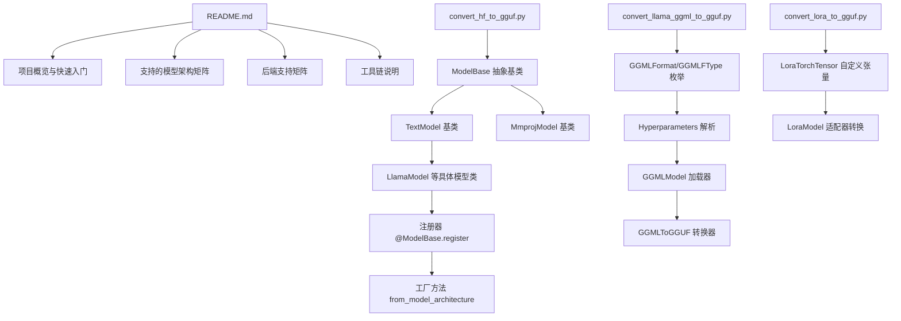

# 第1章 中央调度台：解码 HF→GGUF 的模型物流分拨中心

## 学习目标

- 理解 llama.cpp 零依赖、跨平台的设计哲学及其模型矩阵
- 掌握 GGUF 作为 llama.cpp 唯一认可模型容器的核心地位
- 熟悉三大转换器（HF→GGUF、GGML→GGUF、LoRA→GGUF）的功能边界与协作关系
- 理解 `convert_hf_to_gguf.py` 入口命令行开关（vocab-only、outtype、remote、mmproj、split 等）的语义
- 掌握 ModelBase 注册器模式（`@ModelBase.register` 装饰器）与 `from_model_architecture` 工厂方法的自动分发原理
- 了解 Mistral 格式下的模型类自动选择（MistralMoeModel / MistralModel）逻辑
- 理解 `convert_lora_to_gguf.py` 中 LoraTorchTensor 如何模拟 PyTorch 接口以支持切片、reshape、permute 等操作
- 掌握 `convert_llama_ggml_to_gguf.py` 中 GGMLFormat / GGMLFType 枚举与外部 HF 元数据覆盖机制

## 1.1 生活类比

想象 llama.cpp 是一座国际化的大型物流转运中心，把全球各地（HuggingFace）生产的"模型货物"统一打包到 GGUF 标准集装箱里运输。README.md 是物流中心的对外宣传册，告诉客户我们支持哪些品牌的货物（模型架构）、发往哪些目的地（后端）、使用什么交通工具（Metal/CUDA/Vulkan/SYCL 等）；GGUF 是全球通用集装箱标准，所有进来的模型都必须"换装"成这种标准箱才能上路；convert_hf_to_gguf.py 是主调度台，根据货物标签（architectures 字段）自动派单到对应的打包流水线；convert_llama_ggml_to_gguf.py 是旧版集装箱改造车间，把古董级 GGML/GGMF/GGJT 集装箱翻新成 GGUF；convert_lora_to_gguf.py 是配件仓库，专门处理 LoRA 适配器这种"模型补丁"，以 A/B 矩阵对的形式入库；ModelBase 注册表是调度台背后的"货物-流水线对应表"，写着"LLaMA 走 3 号流水线、Qwen 走 7 号流水线、…"；parse_args() 的开关是客户的提单指令（要什么精度、要分片、要远程取货等）。就像调度台需要精确识别每个货物标签并匹配对应流水线一样，convert_hf_to_gguf.py 的核心挑战就是：如何通过 `@ModelBase.register` 装饰器和 `from_model_architecture()` 工厂方法，让一个 Python 入口能优雅地承载上百种架构的转换需求。



## 1.2 源码地图

README.md
├── 项目蓝图（Quick Start、Hot topics）
├── Description（零依赖、Apple Silicon 一等公民、量化矩阵、后端全家福）
├── Supported backends（Metal/CUDA/HIP/Vulkan/SYCL/CANN/Hexagon/VirtGPU 等）
├── Text-only 与 Multimodal 模型矩阵
├── Obtainning & quantizing models（-hf 参数、HuggingFace 缓存）
├── 命令行工具说明（llama-cli/llama-server/llama-perplexity/llama-bench/llama-simple）

./convert_hf_to_gguf.py
├── ModelType (IntEnum): TEXT=1, MMPROJ=2
├── SentencePieceTokenTypes (IntEnum)
├── ModelBase (抽象基类)
│   ├── _model_classes: dict[ModelType, dict[str, type[ModelBase]]]  # 注册表
│   ├── __init__()                 # 初始化 hparams、GGUFWriter、lazy 模式
│   ├── index_tensors()            # 索引 safetensors / pytorch_model 分片
│   ├── dequant_model()            # 反量化 bitnet/fp8/gptq/compressed-m3-tensors 等
│   ├── prepare_tensors()          # 遍历模型张量并写入 GGUF
│   ├── prepare_metadata()         # 写入元数据（hyperparams/parameter count）
│   ├── write() / write_vocab()    # 输出文件
│   ├── @classmethod register()    # 注册架构名 → 模型类
│   ├── @classmethod from_model_architecture()  # 工厂方法
│   ├── _set_vocab_* (gpt2/sentencepiece/llama_hf/rwkv_world/mistral/plamo/builtin/...)
│   ├── _set_vocab_none()          # 无词表（解码器类）
│   ├── set_gguf_parameters()      # 通用超参写入（raise NotImplementedError）
│   └── tensor_force_quant()       # 张量强制量化策略
├── TextModel(ModelBase)
│   ├── __init__()                 # 解析 block_count、tensor_map、rope_parameters
│   ├── set_vocab()                # 默认 _set_vocab_gpt2()
│   ├── set_gguf_parameters()      # context_length/embedding_length/head_count/RoPE/expert/...
│   ├── get_vocab_base_pre()       # BPE 预分词器识别（hash 查表）
│   └── get_vocab_base()           # 通过 AutoTokenizer 提取 token/toktype
├── MmprojModel(ModelBase)
│   ├── model_arch = MODEL_ARCH.MMPROJ
│   ├── has_vision_encoder / has_audio_encoder
│   ├── __init__()                 # 分离 hparams_vision / hparams_audio / preprocessor_config
│   └── set_gguf_parameters()      # vision/audio 投影器参数
├── @ModelBase.register("LLaMAForCausalLM") class LlamaModel(TextModel)
│   ├── model_arch = MODEL_ARCH.LLAMA
│   ├── permute()                  # Q/K 反向 permute
│   └── modify_tensors()           # 跳过视觉张量、合并 MoE 专家
├── MistralModel / MistralMoeModel (Mistral 格式入口)
├── parse_args() / main()          # 命令行入口与模型分发

./convert_llama_ggml_to_gguf.py
├── GGMLFormat (IntEnum): GGML/GGMF/GGJT
├── GGMLFType (IntEnum): ALL_F32/MOSTLY_F16/Q4_0/Q4_1/Q8_0/Q5_0/Q5_1/Q2_K/Q3_K*/Q4_K*/Q5_K*/Q6_K
├── Hyperparameters                # 解析 n_vocab/n_embd/n_mult/n_head/n_layer/n_rot/ftype
├── Vocab / Tensor / GGMLModel     # 解析旧版 GGML 二进制布局
├── GGMLToGGUF                     # 转换为 GGUFWriter（默认 MODEL_ARCH.LLAMA）
├── handle_metadata()              # 从独立目录加载 HF config + params.json 覆盖旧 GGML 缺失参数
└── main()                         # 命令行入口

./convert_lora_to_gguf.py
├── PartialLoraTensor (A/B 矩阵对)
├── LoraTorchTensor                # 自定义张量子类，模拟 PyTorch 接口
│   ├── __init__()                 # 接收 lora_A / lora_B 两个矩阵
│   ├── __getitem__ / reshape / permute / transpose / contiguous / view
│   └── __torch_function__         # 支持 torch.permute/reshape/stack/cat
├── get_base_tensor_name()         # 去掉 .lora_A.weight / .lora_B.weight 后缀
├── parse_args()                   # 命令行参数
├── load_hparams_from_hf()         # 从 HuggingFace 加载基模型配置
└── LoraModel (动态继承 model_class)
    ├── __init__()                 # 重写 dir_model_card、lora_alpha
    ├── set_type()                 # GGUFType.ADAPTER + Adapter.TYPE="lora"
    ├── set_vocab()                # pass（不写词表）
    ├── set_gguf_parameters()      # 写入 Adapter.LORA_ALPHA / ALORA_INVOCATION_TOKENS
    ├── get_tensors()              # 合并 A/B 为 LoraTorchTensor
    ├── modify_tensors()           # 写出 .lora_a / .lora_b 对
    └── generate_extra_tensors()   # 空（适配器不写额外张量）

## 1.3 llama.cpp 项目初印象：走进「大模型推理引擎」的大门

### 1.3.1 为什么 llama.cpp 能「单文件即可运行」？

llama.cpp 的核心目标是 Plain C/C++ 实现，无任何外部依赖，零门槛跨平台。这种设计意味着用户只需一个编译好的二进制文件即可在任何支持的硬件上运行模型，无需配置 Python 环境、CUDA Toolkit 或复杂的依赖链。Apple Silicon 是一等公民，体现在 NEON、Accelerate、Metal 的深度优化上；同时支持 x86 AVX/AVX2/AVX512/AMX 与 RISC-V RVV/ZVFH 等指令集。项目提供 1.5~8 bit 整数量化与 GGML 生态全栈加速，覆盖从服务器级 GPU 到边缘设备的全场景。

### 1.3.2 README 的「项目蓝图」告诉我们什么？

README 提供了四种安装方式：包管理器、Docker、Release 二进制、源码编译。一个命令即可从 Hugging Face 直接下载并运行模型（`-hf` 参数），缓存与 HF Hub 共享，极大降低了使用门槛。

### 1.3.3 README 中的「模型宇宙」有多庞大？

文本模型覆盖 LLaMA、Mistral、Qwen、DeepSeek、Mamba、RWKV 等上百种架构；多模态家族包含 LLaVA、Qwen2-VL、LFM2-VL、GLM-4V 等视觉/音频模型。这种广泛的覆盖得益于下文将详述的注册器模式架构。

### 1.3.4 「支持的后端全家福」揭示了什么？

后端矩阵包含 Metal（Apple）、CUDA/HIP/MUSA（NVIDIA/AMD/摩尔线程）、Vulkan/SYCL/OpenCL/WebGPU（跨平台 GPU）、BLAS、ZenDNN、zDNN、CANN（昇腾 NPU）等专用加速库，以及 RPC/VirtGPU 支持跨主机分布式推理与 virtio-GPU API。这展示了 llama.cpp "Write once, run anywhere" 的工程野心。

## 1.4 HF → GGUF 转换器家族概览：三套「模型打包工具」

### 1.4.1 为什么需要 convert_hf_to_gguf.py？

llama.cpp 只识别 GGUF 格式，需要一个中央调度台把 HuggingFace 模型统一转换。它支持文本模型（TextModel）与多模态投影器（MmprojModel）两大类。

### 1.4.2 convert_llama_ggml_to_gguf.py 在做什么？

把旧版 GGML/GGMF/GGJT 三种格式迁移到 GGUF，是历史包袱的搬运工。支持从独立目录加载 HuggingFace 配置覆盖旧 GGML 的缺失参数。

### 1.4.3 convert_lora_to_gguf.py 的角色是什么？

LoRA 适配器以 .lora_a / .lora_b 张量对形式写入 ADAPTER 类型 GGUF。LoraTorchTensor 模拟 PyTorch 接口支持切片、重塑、转置等操作。

### 1.4.4 StableLM 的 per-head norm 合并机制是什么？

StableLM 使用 per-head Q/K LayerNorm，需要把 n_head 个独立 norm 张量合并成一个 2D 权重。`_stack_qk_norm` 方法把分散的 per-head 权重 `torch.stack` 之后变成 2D 张量，对应 GGUF 中的 MODEL_TENSOR。

## 1.5 源码解析：ModelBase 基类设计

### 1.5.1 ModelBase.__init__：转换器实例的初始化与惰性加载策略

**源码路径**：`./convert_hf_to_gguf.py` - `ModelBase.__init__`（第 81-143 行）

```python
def __init__(self, dir_model: Path, ftype: gguf.LlamaFileType, fname_out: Path, *,
             is_big_endian: bool = False,
             use_temp_file: bool = False, eager: bool = False,
             metadata_override: Path | None = None, model_name: str | None = None,
             split_max_tensors: int = 0, split_max_size: int = 0, dry_run: bool = False,
             small_first_shard: bool = False, hparams: dict[str, Any] | None = None, 
             remote_hf_model_id: str | None = None,
             disable_mistral_community_chat_template: bool = False,
             sentence_transformers_dense_modules: bool = False,
             fuse_gate_up_exps: bool = False):
    # ① 禁止直接实例化基类
    if type(self) is ModelBase or type(self) is TextModel or type(self) is MmprojModel:
        raise TypeError(...)
    # ② Mistral 格式依赖检查
    if self.is_mistral_format and not _mistral_common_installed:
        raise ImportError(_mistral_import_error_msg)
    
    # ③ 核心字段初始化
    self.dir_model = dir_model                          # 模型目录
    self.ftype = ftype                                  # 量化类型
    self.fname_out = fname_out                          # 输出路径
    self.is_big_endian = is_big_endian                  # 字节序标志
    self.endianess = gguf.GGUFEndian.BIG if is_big_endian else gguf.GGUFEndian.LITTLE  # 统一字节序
    self.use_temp_file = use_temp_file                  # 临时文件模式
    self.lazy = not eager or (remote_hf_model_id is not None)  # 惰性加载：远程模式强制开启
    self.dry_run = dry_run                              # 试运行模式
    self.remote_hf_model_id = remote_hf_model_id        # 远程 HF 仓库 ID
    self.sentence_transformers_dense_modules = sentence_transformers_dense_modules  # 句子变换器密集模块
    self.fuse_gate_up_exps = fuse_gate_up_exps          # MoE gate/up 融合开关
    
    # ④ 加载超参数与索引张量
    self.hparams = ModelBase.load_hparams(self.dir_model, self.is_mistral_format) if hparams is None else hparams
    self.model_tensors = self.index_tensors(remote_hf_model_id=remote_hf_model_id)
    
    # ⑤ 元数据与输出配置
    self.metadata_override = metadata_override
    self.model_name = model_name
    self.dir_model_card = dir_model
    self._is_nvfp4 = False
    self._is_mxfp4 = False
    self.gguf_writer = gguf.GGUFWriter(...)
    self.disable_mistral_community_chat_template = disable_mistral_community_chat_template
```

这段代码定义了模型转换器的核心基类，完成了以下关键初始化：
1. **双注册表架构**：`_model_classes` 按 `ModelType.TEXT` 和 `ModelType.MMPROJ` 分离，避免文本/视觉张量名冲突
2. **惰性加载策略**：`self.lazy` 控制是否延迟读取权重，远程模式强制开启
3. **字节序处理**：统一管理大小端转换，跨平台兼容
4. **张量索引构建**：`index_tensors()` 扫描本地/远程 safetensors 分片，建立名称到生成器的映射
5. **GGUF 写入器**：预创建 `gguf.GGUFWriter`，后续所有元数据/张量写入均通过它完成

### 1.5.2 ModelBase.index_tensors：张量索引构建与远程加载支持

**源码路径**：`./convert_hf_to_gguf.py` - `ModelBase.index_tensors`（第 160-240 行）

```python
def index_tensors(self, remote_hf_model_id: str | None = None) -> dict[str, Callable[[], Tensor]]:
    tensors: dict[str, Callable[[], Tensor]] = {}
    if remote_hf_model_id is not None:
        # 远程模式：直接从 HF Hub 获取 safetensors 列表
        remote_tensors = gguf.utility.SafetensorRemote.get_list_tensors_hf_model(remote_hf_model_id)
        for name, remote_tensor in remote_tensors.items():
            # 使用 LazyTorchTensor 包装远程张量，延迟下载
            tensors[name] = lambda r=remote_tensor: LazyTorchTensor.from_remote_tensor(r)
        return tensors
    
    # 本地模式：扫描 safetensors 或 pytorch_model 分片
    prefix = "model" if not self.is_mistral_format else "consolidated"
    part_names = ModelBase.get_model_part_names(self.dir_model, prefix, ".safetensors")
    is_safetensors = len(part_names) > 0
    if not is_safetensors:
        part_names = ModelBase.get_model_part_names(self.dir_model, "pytorch_model", ".bin")
    
    for part_name in part_names:
        with ctx as model_part:  # ctx 为 safetensors 或 torch 安全上下文
            for name in model_part.keys():
                # 创建延迟加载生成器，捕获当前分片和名称
                def data_gen(name=name, part=model_part):
                    return part.get_tensor(name) if is_safetensors else part[name]
                tensors[name] = data_gen
    
    # 校验 index.json 中的张量名与实际文件一致
    if len(tensor_names_from_index) > 0:
        verify tensor names and missing files
    return tensors
```

该方法构建张量名称到延迟加载生成器的映射。远程模式下利用 `SafetensorRemote` 直接读取 HF Hub 索引，本地模式下扫描分片文件。所有张量均通过 `LazyTorchTensor` 包装，实现按需加载，大幅降低内存峰值。

### 1.5.3 ModelBase.dequant_model：多种量化格式的反量化处理

**源码路径**：`./convert_hf_to_gguf.py` - `ModelBase.dequant_model`（第 242-397 行）

```python
def dequant_model(self):
    if self._is_nvfp4 and not any(k.endswith((".weight_scale", ".weight_scale_inv")) for k in self.model_tensors):
        return
    tensors_to_remove: list[str] = []
    new_tensors: dict[str, Callable[[], Tensor]] = {}
    if (quant_config := self.hparams.get("quantization_config")) and isinstance(quant_config, dict):
        quant_method = quant_config.get("quant_method")
        
        # 定义各种反量化内部函数
        def dequant_bitnet(weight: Tensor, scale: Tensor) -> Tensor: ...
        def dequant_simple(weight: Tensor, scale: Tensor, block_size: Sequence[int] | None = None) -> Tensor: ...
        def dequant_gptq(g_idx: Tensor, qweight: Tensor, qzeros: Tensor, scales: Tensor) -> Tensor: ...
        def dequant_packed(...): ...
        
        if quant_method == "bitnet":
            # BitNet b1.58: weight ∈ {-1, 0, 1}, 通过 scale 还原
            ...
        elif quant_method == "fp8":
            # FP8 E4M3/E5M2: weight * scale 还原为 FP16/BF16
            ...
        elif quant_method == "gptq":
            # GPTQ: 通过 g_idx、qzeros、scales 反量化回 FP16
            ...
        elif quant_method == "compressed-tensors":
            # Compressed-tensors: 支持多种量化方案的统一格式
            ...
        elif quant_method == "modelopt":
            # NVIDIA ModelOpt: NVFP4/MXFP4 等高级量化
            ...
        elif quant_method is not None:
            raise NotImplementedError(...)
    
    # 移除已消费的辅助张量，注入反量化后的新张量
    for name in tensors_to_remove:
        if name in self.model_tensors:
            del self.model_tensors[name]
    for name, value in new_tensors.items():
        self.model_tensors[name] = value
```

该方法统一处理 BitNet、FP8、GPTQ、compressed-tensors、ModelOpt 等量化格式的反量化。核心思想是：识别量化配置 → 定义对应反量化逻辑 → 将量化权重及其辅助张量替换为全精度张量，供后续重新量化为 GGUF 格式使用。

### 1.5.4 ModelBase.prepare_tensors：张量处理流水线核心

**源码路径**：`./convert_hf_to_gguf.py` - `ModelBase.prepare_tensors`（第 740-834 行）

```python
def prepare_tensors(self):
    # ① 检测量化配置，处理 NVFP4 专家张量
    quant_algo = (self.hparams.get("quantization_config") or {}).get("quant_algo")
    quant_method = (self.hparams.get("quantization_config") or {}).get("quant_method")
    quant_layers = (self.hparams.get("quantization_config") or {}).get("quantized_layers") or {}
    quant_config_file = self.dir_model / "hf_quant_config.json"
    if (not quant_algo or not quant_layers) and quant_config_file.is_file():
        with open(quant_config_file, "r", encoding="utf-8") as f:
            quant_config = json.load(f).get("quantization") or {}
            quant_algo = quant_config.get("quant_algo", quant_algo)
            quant_layers = quant_config.get("quantized_layers", quant_layers) or {}
    if quant_algo != "NVFP4":
        if any(v.get("quant_algo") == "NVFP4" for v in quant_layers.values() if isinstance(v, dict)):
            quant_algo = "NVFP4"
    self._is_nvfp4 = quant_algo == "NVFP4"
    self._is_mxfp4 = quant_method == "mxfp4"
    if self._is_nvfp4:
        self._generate_nvfp4_tensors()
    
    # ② 反量化预处理
    self.dequant_model()
    
    # ③ 遍历张量：生成额外张量 + 映射名称 + 强制量化 + 写入
    for name, data_torch in chain(self.generate_extra_tensors(), self.get_tensors()):
        data_qtype = self.tensor_force_quant(name, new_name, bid, n_dims)
        data = gguf.quants.quantize(data, data_qtype)
        self.gguf_writer.add_tensor(new_name, data, raw_dtype=data_qtype)
```

流水线三阶段：
1. **量化检测与 NVFP4 预处理**：解析量化配置，若为 NVFP4 则先生成专家张量
2. **反量化**：将各种量化格式统一还原为全精度
3. **逐张量处理**：遍历所有张量（含额外生成张量），经 `modify_tensors` 映射名称、`tensor_force_quant` 确定量化类型，最后量化写入

### 1.5.5 ModelBase.prepare_metadata：元数据生成与量化类型自动调整

**源码路径**：`./convert_hf_to_gguf.py` - `ModelBase.prepare_metadata`（第 836-861 行）

```python
def prepare_metadata(self, vocab_only: bool):
    total_params, shared_params, expert_params, expert_count = self.gguf_writer.get_total_parameter_count()
    self.metadata = gguf.Metadata.load(self.metadata_override, self.dir_model_card, self.model_name, total_params)
    if self.remote_hf_model_id:
        self.metadata.name = self.remote_hf_model_id
    if self.metadata.name is None:
        self.metadata.name = self.dir_model.name
    # 根据量化类型自动调整 ftype
    if self.ftype in (gguf.LlamaFileType.ALL_F32, gguf.LlamaFileType.MOSTLY_F16, gguf.LlamaFileType.MOSTLY_BF16):
        if self._is_nvfp4:
            self.ftype = gguf.LlamaFileType.MOSTLY_NVFP4
        elif self._is_mxfp4:
            self.ftype = gguf.LlamaFileType.MOSTLY_MXFP4_MOE
    self.set_type()
    self.metadata.set_gguf_meta_model(self.gguf_writer)
    self.set_gguf_parameters()
    self.gguf_writer.add_quantization_version(gguf.GGML_QUANT_VERSION)
```

关键逻辑：统计参数量 → 加载/生成元数据 → 根据检测到的特殊量化（NVFP4/MXFP4）自动修正 `ftype` → 写入架构超参（由子类实现 `set_gguf_parameters`）→ 标记量化版本。

### 1.5.6 ModelBase.register 与 from_model_architecture：注册器模式与工厂方法

**源码路径**：`./convert_hf_to_gguf.py` - `ModelBase.register`（第 916-925 行）、`from_model_architecture`（第 934-939 行）

```python
@classmethod
def register(cls, *names: str) -> Callable[[AnyModel], AnyModel]:
    assert names
    def func(modelcls: AnyModel) -> AnyModel:
        model_type = ModelType.MMPROJ if modelcls.model_arch == gguf.MODEL_ARCH.MMPROJ else ModelType.TEXT
        for name in names:
            cls._model_classes[model_type][name] = modelcls
        return modelcls
    return func

@classmethod
def from_model_architecture(cls, arch: str, model_type = ModelType.TEXT) -> type[ModelBase]:
    try:
        return cls._model_classes[model_type][arch]
    except KeyError:
        raise NotImplementedError(f'Architecture {arch!r} not supported!') from None
```

**注册器工作原理**：
1. **装饰器收集架构名**：`@ModelBase.register("LLaMAForCausalLM", "LlamaForCausalLM")` 支持多别名映射到同一类
2. **按类型分表存储**：`model_type` 由 `model_arch` 自动判断（MMPROJ 走视觉表，其余走文本表）
3. **工厂方法精准分发**：`from_model_architecture()` 仅接受架构名字符串，找不到抛 `NotImplementedError`

这种设计将「架构识别」与「转换逻辑」完全解耦——新增模型只需编写子类并加装饰器，无需修改主流程分发代码。

### 1.5.7 StableLMModel.modify_tensors 与 _stack_qk_norm：Per-head Norm 合并案例

**源码路径**：`./convert_hf_to_gguf.py` - `StableLMModel.modify_tensors` 与 `_stack_qk_norm`（约第 5920-5980 行）

```python
def modify_tensors(self, data_torch: Tensor, name: str, bid: int | None) -> Iterable[tuple[str, Tensor]]:
    # ① 收集 per-head norm 权重
    if name.endswith(("q_layernorm.weight", "k_layernorm.weight")):
        if bid not in self._q_norms:
            self._q_norms[bid] = {}
            self._k_norms[bid] = {}
        head_idx = int(re.search(r"layers\.(\d+)\.", name).group(1))  # 伪代码
        if "q_layernorm" in name:
            self._q_norms[bid][head_idx] = data_torch
        else:
            self._k_norms[bid][head_idx] = data_torch
        return  # 暂不输出，等全部收齐
    
    # ② 触发合并条件：当前层 Q/K norm 都收集满 n_head 个
    if bid in self._q_norms and len(self._q_norms[bid]) == n_head:
        self._stack_qk_norm(bid, "q_layernorm")
    if bid in self._k_norms and len(self._k_norms[bid]) == n_head:
        self._stack_qk_norm(bid, "k_layernorm")
    
    yield from super().modify_tensors(data_torch, name, bid)

def _stack_qk_norm(self, bid: int, norm_type: str):
    norms_dict = self._q_norms[bid] if norm_type == "q_layernorm" else self._k_norms[bid]
    # 按 head_idx 排序后堆叠
    stacked = torch.stack([norms_dict[i] for i in sorted(norms_dict.keys())], dim=0)  # [n_head, head_dim]
    # 映射到 GGUF 标准张量名
    gguf_key = gguf.MODEL_TENSOR.ATTN_Q_NORM if norm_type == "q_layernorm" else gguf.MODEL_TENSOR.ATTN_K_NORM
    merged_name = self.format_tensor_name(gguf_key, bid)
    self.gguf_writer.add_tensor(merged_name, stacked.numpy(), raw_dtype=gguf.GGMLQuantizationType.F32)
    # 清理缓存
    if norm_type == "q_layernorm":
        del self._q_norms[bid]
    else:
        del self._k_norms[bid]
```

**设计精妙之处**：
- **延迟写入**：单个 head 的 norm 无法直接写入（GGUF 要求合并后的 2D 张量），需缓存等齐
- **维度对齐**：`torch.stack(dim=0)` 将 `[head_dim]` × n_head → `[n_head, head_dim]`，完美匹配 GGUF `ATTN_Q_NORM` 规范
- **兜底校验**：`prepare_tensors()` 末尾会检查 `_q_norms/_k_norms` 是否清空，防止配置缺失导致静默丢失

## 1.6 源码解析：convert_llama_ggml_to_gguf.py 核心类与函数

### 1.6.1 GGMLModel.load：旧版 GGML 二进制格式的完整解析

**源码路径**：`./convert_llama_ggml_to_gguf.py` - `GGMLModel.load`（第 178-195 行）

```python
def load(self, data, offset):
    offset += self.validate_header(data, offset)
    hp = Hyperparameters()
    offset += hp.load(data, offset)
    logger.info(f'* File format: {self.file_format.name}v{self.format_version} with ftype {hp.ftype.name}')
    self.validate_conversion(hp.ftype)
    vocab = Vocab(load_scores = self.file_format > GGMLFormat.GGML)
    offset += vocab.load(data, offset, hp.n_vocab)
    tensors: list[Tensor] = []
    tensor_map = {}
    while offset < len(data):
        tensor = Tensor(use_padding = self.file_format > GGMLFormat.GGMF)
        offset += tensor.load(data, offset)
        tensor_map[tensor.name] = len(tensors)
        tensors.append(tensor)
    self.hyperparameters = hp
    self.vocab = vocab
    self.tensors = tensors
    self.tensor_map = tensor_map
    hp.set_n_ff(self)
    return offset
```

该方法按顺序解析：文件头魔数/版本 → 超参数（7 个 uint32） → 词表（含分数） → 所有张量（维度、名称、数据类型、数据块）。`validate_conversion` 根据格式版本和量化类型判断是否支持转换。`Tensor.load` 处理不同版本的 padding 规则，`Hyperparameters.set_n_ff` 从首层 FFN 权重推断中间层维度。

### 1.6.2 GGMLToGGUF.save：GGML→GGUF 转换的完整写入流程

**源码路径**：`./convert_llama_ggml_to_gguf.py` - `GGMLToGGUF.save`（第 222-237 行）

```python
def save(self):
    logger.info('* Preparing to save GGUF file')
    gguf_writer = gguf.GGUFWriter(
        self.cfg.output,
        gguf.MODEL_ARCH_NAMES[gguf.MODEL_ARCH.LLAMA],
        use_temp_file = False)
    self.add_params(gguf_writer)
    self.add_vocab(gguf_writer)
    if self.special_vocab is not None:
        self.special_vocab.add_to_gguf(gguf_writer)
    self.add_tensors(gguf_writer)
    logger.info("    gguf: write header")
    gguf_writer.write_header_to_file()
    logger.info("    gguf: write metadata")
    gguf_writer.write_kv_data_to_file()
    logger.info("    gguf: write tensors")
    gguf_writer.write_tensors_to_file()
    gguf_writer.close()
```

标准 GGUF 写入流程：创建 Writer → 写入超参（`add_params`）→ 写入词表（`add_vocab`）→ 写入特殊词表 → 写入张量（`add_tensors`）→ 依次落盘 Header/KV/Tensors。

### 1.6.3 handle_metadata：外部 HF 元数据覆盖旧 GGML 缺失参数

**源码路径**：`./convert_llama_ggml_to_gguf.py` - `handle_metadata`（第 323-344 行）

```python
def handle_metadata(cfg, hp):
    import examples.convert_legacy_llama as convert
    assert cfg.model_metadata_dir.is_dir(), 'Metadata dir is not a directory'
    hf_config_path   = cfg.model_metadata_dir / "config.json"
    orig_config_path = cfg.model_metadata_dir / "params.json"
    fakemodel = {
        'tok_embeddings.weight': convert.LazyTensor.__new__(convert.LazyTensor),
        'layers.0.feed_forward.w1.weight': convert.LazyTensor.__new__(convert.LazyTensor),
    }
    fakemodel['tok_embeddings.weight'].shape = [hp.n_vocab]
    fakemodel['layers.0.feed_forward.w1.weight'].shape = [hp.n_ff]
    if hf_config_path.exists():
        params = convert.Params.loadHFTransformerJson(fakemodel, hf_config_path)
    elif orig_config_path.exists():
        params = convert.Params.loadOriginalParamsJson(fakemodel, orig_config_path)
    else:
        raise ValueError('Unable to load metadata')
    vocab_path = Path(cfg.vocab_dir if cfg.vocab_dir is not None else cfg.model_metadata_dir)
    vocab_factory = convert.VocabFactory(vocab_path)
    vocab, special_vocab = vocab_factory.load_vocab(cfg.vocabtype.split(","), cfg.model_metadata_dir)
    convert.check_vocab_size(params, vocab)
    return params, vocab, special_vocab
```

旧版 GGML 缺少上下文长度、RoPE 参数、归一化 epsilon 等关键超参。该函数从独立目录加载 HF `config.json` 或原始 `params.json`，构造假模型对象供旧转换器复用，并加载词表工厂，最终返回覆盖用的参数、词表、特殊词表对象。

## 1.7 源码解析：convert_lora_to_gguf.py 核心类与函数

### 1.7.1 LoraTorchTensor.__init__：LoRA 低秩分解张量的构造

**源码路径**：`./convert_lora_to_gguf.py` - `LoraTorchTensor.__init__`（第 64-72 行）

```python
def __init__(self, A: Tensor, B: Tensor):
    assert len(A.shape) == len(B.shape)
    assert A.shape[-2] == B.shape[-1]
    if A.dtype != B.dtype:
        A = A.to(torch.float32)
        B = B.to(torch.float32)
    self._lora_A = A
    self._lora_B = B
    self._rank = B.shape[-1]
```

接收 LoRA 的两个低秩矩阵 A（[..., r, d]）和 B（[..., d, r]），校验形状兼容性，统一 dtype 为 float32，记录秩 `r`。

### 1.7.2 LoraTorchTensor.__getitem__ / reshape / permute：模拟 PyTorch 切片与变形操作

**源码路径**：`./convert_lora_to_gguf.py` - `LoraTorchTensor` 核心方法（第 77-187 行）

```python
def __getitem__(self, indices) -> LoraTorchTensor:
    shape = self.shape
    if isinstance(indices, SupportsIndex):
        if len(shape) > 2:
            return LoraTorchTensor(self._lora_A[indices], self._lora_B[indices])
        else:
            raise NotImplementedError
    elif isinstance(indices, slice):
        if len(shape) > 2:
            return LoraTorchTensor(self._lora_A[indices], self._lora_B[indices])
        else:
            return LoraTorchTensor(self._lora_A, self._lora_B[indices])
    elif isinstance(indices, tuple):
        # 复杂多维索引：分别构造 A/B 的索引元组
        # A 矩阵在倒数第二维为完整切片，B 矩阵保持原索引
        indices_A = (..., slice(None), indices[-1])
        indices_B = indices[:-1]
        return LoraTorchTensor(self._lora_A[indices_A], self._lora_B[indices_B])
    else:
        raise NotImplementedError

def reshape(self, *shape: int | tuple[int, ...]) -> LoraTorchTensor:
    if isinstance(shape[0], tuple):
        new_shape: tuple[int, ...] = shape[0]
    else:
        new_shape = cast(tuple[int, ...], shape)
    orig_shape = self.shape
    if len(new_shape) < 2:
        raise NotImplementedError
    if any(dim == -1 for dim in new_shape):
        n_elems = prod(orig_shape)
        n_new_elems = prod(dim if dim != -1 else 1 for dim in new_shape)
        assert n_elems % n_new_elems == 0
        new_shape = (*(dim if dim != -1 else n_elems // n_new_elems for dim in new_shape),)
    if new_shape[-1] != orig_shape[-1]:
        raise NotImplementedError
    # 保持最后一维不变，前置维度压缩为 1
    shape_A = (*(1 for _ in new_shape[:-2]), self._rank, orig_shape[-1])
    shape_B = (*new_shape[:-1], self._rank)
    return LoraTorchTensor(
        self._lora_A.reshape(shape_A),
        self._lora_B.reshape(shape_B),
    )

def permute(self, *dims: int) -> LoraTorchTensor:
    shape = self.shape
    dims = tuple(dim - len(shape) if dim >= 0 else dim for dim in dims)
    if dims[-1] == -1:
        assert all(dim == 1 for dim in self._lora_A.shape[:-2])
        return LoraTorchTensor(self._lora_A, self._lora_B.permute(*dims))
    if len(shape) == 2 and dims[-1] == -2 and dims[-2] == -1:
        # 2D 转置特例：交换 A/B 并各自转置
        return LoraTorchTensor(self._lora_B.permute(*dims), self._lora_A.permute(*dims))
    else:
        raise NotImplementedError
```

**核心设计**：所有操作都在保持 LoRA 分解结构（A @ B）的前提下，对 A、B 矩阵分别应用对应变换。`reshape` 保持输出维度不变，压缩前置维度；`permute` 处理 2D 转置特例（交换 A/B 角色）。

### 1.7.3 LoraTorchTensor.__torch_function__：拦截 torch 函数调用

**源码路径**：`./convert_lora_to_gguf.py` - `LoraTorchTensor.__torch_function__`（第 192-223 行）

```python
@classmethod
def __torch_function__(cls, func: Callable, types, args=(), kwargs=None):
    del types
    if kwargs is None:
        kwargs = {}
    if func is torch.permute:
        assert len(args)
        return type(args[0]).permute(*args, **kwargs)
    elif func is torch.reshape:
        assert len(args)
        return type(args[0]).reshape(*args, **kwargs)
    elif func is torch.stack:
        assert len(args)
        assert isinstance(args[0], Sequence)
        dim = kwargs.get("dim", 0)
        assert dim == 0
        return LoraTorchTensor(
            torch.stack([a._lora_A for a in args[0]], dim),
            torch.stack([b._lora_B for b in args[0]], dim),
        )
    elif func is torch.cat:
        assert len(args)
        assert isinstance(args[0], Sequence)
        dim = kwargs.get("dim", 0)
        assert dim == 0
        if len(args[0][0].shape) > 2:
            return LoraTorchTensor(
                torch.cat([a._lora_A for a in args[0]], dim),
                torch.cat([b._lora_B for b in args[0]], dim),
            )
        elif all(torch.equal(args[0][0]._lora_A, t._lora_A) for t in args[0][1:]):
            return LoraTorchTensor(
                args[0][0]._lora_A,
                torch.cat([b._lora_B for b in args[0]], dim),
            )
        else:
            raise NotImplementedError
    else:
        raise NotImplementedError
```

通过 `__torch_function__` 协议，拦截 `torch.permute`、`torch.reshape`、`torch.stack`、`torch.cat` 等操作，将其分发到自定义方法。`stack` 沿第 0 维堆叠 A/B；`cat` 支持两种情况：高维张量直接拼接，或共享 A 矩阵仅拼接 B。

### 1.7.4 LoraModel.get_tensors：LoRA A/B 矩阵配对与 LoraTorchTensor 生成

**源码路径**：`./convert_lora_to_gguf.py` - `LoraModel.get_tensors`（第 374-401 行）

```python
def get_tensors(self) -> Iterator[tuple[str, Tensor]]:
    tensor_map: dict[str, PartialLoraTensor] = {}
    for name, tensor in lora_model.items():
        if self.lazy:
            tensor = LazyTorchTensor.from_eager(tensor)
        base_name = get_base_tensor_name(name)
        is_lora_a = ".lora_A.weight" in name or ".lora_embedding_A" in name
        is_lora_b = ".lora_B.weight" in name or ".lora_embedding_B" in name
        if not is_lora_a and not is_lora_b:
            if ".base_layer.weight" in name:
                continue
            if "_layernorm" in name or ".norm" in name:
                yield (base_name, tensor)
                continue
            logger.error(f"Unexpected name '{name}': Not a lora_A or lora_B tensor")
            sys.exit(1)
        if base_name in tensor_map:
            if is_lora_a:
                tensor_map[base_name].A = tensor
            else:
                tensor_map[base_name].B = tensor
        else:
            if is_lora_a:
                tensor_map[base_name] = PartialLoraTensor(A=tensor)
            else:
                tensor_map[base_name] = PartialLoraTensor(B=tensor)
    for name, tensor in tensor_map.items():
        assert tensor.A is not None
        assert tensor.B is not None
        yield (name, cast(torch.Tensor, LoraTorchTensor(tensor.A, tensor.B)))
```

遍历 LoRA 权重字典，按基础张量名分组收集 A/B 矩阵。跳过 `base_layer.weight`（基础模型权重），直接透传 norm 张量。最终为每对 A/B 创建 `LoraTorchTensor` 实例，使后续转换流程可像处理普通张量一样处理 LoRA 权重。

### 1.7.5 LoraModel.modify_tensors：输出 .lora_a / .lora_b 对

**源码路径**：`./convert_lora_to_gguf.py` - `LoraModel.modify_tensors`（第 403-418 行）

```python
def modify_tensors(self, data_torch: Tensor, name: str, bid: int | None) -> Iterable[tuple[str, Tensor]]:
    dest = list(super().modify_tensors(data_torch, name, bid))
    if name == "lm_head.weight" and len(dest) == 0:
        raise ValueError("lm_head is present in adapter, but is ignored in base model")
    for dest_name, dest_data in dest:
        if "_norm" in dest_name:
            assert dest_data.dim() == 1
            yield (dest_name, dest_data)
            continue
        assert isinstance(dest_data, LoraTorchTensor)
        lora_a, lora_b = dest_data.get_lora_A_B()
        if "token_embd.weight" in dest_name:
            lora_a = lora_a.T
        yield (dest_name + ".lora_a", lora_a)
        yield (dest_name + ".lora_b", lora_b)
```

调用父类 `modify_tensors` 获取标准化名称，对 norm 张量直接透传。对 LoRA 张量，拆解为 A/B 两个矩阵，token_embd 特殊转置，最后以 `.lora_a`、`.lora_b` 后缀写入 GGUF，符合 ADAPTER 格式规范。

## 1.8 convert_hf_to_gguf.py 入口与命令行：转换器的「启动开关」

### 1.8.1 parse_args：命令行参数定义与分组

**源码路径**：`./convert_hf_to_gguf.py` - `parse_args`（第 12924-13020 行）

```python
def parse_args() -> argparse.Namespace:
    parser = argparse.ArgumentParser(description="Convert a huggingface model to a GGML compatible file")
    parser.add_argument("--vocab-only", action="store_true", help="Extract only the vocab")
    parser.add_argument("--outfile", type=Path, help="Path to write to; default: based on input")
    parser.add_argument("--outtype", type=str, choices=[
        "f32", "f16", "bf16", "q8_0", "tq1_0", "tq2_0", "auto"
    ], default="auto", help="Output format")
    parser.add_argument("--bigendian", action="store_true", help="Model runs on big-endian machine")
    parser.add_argument("model", type=str, nargs="?", help="Model directory")
    parser.add_argument("--use-temp-file", action="store_true", help="Use temp file for output")
    parser.add_argument("--no-lazy", action="store_true", help="Disable lazy evaluation")
    parser.add_argument("--model-name", type=str, default=None, help="Model name override")
    parser.add_argument("--verbose", action="store_true", help="Increase output verbosity")
    parser.add_argument("--split-max-tensors", type=int, default=0, help="Max tensors per shard")
    parser.add_argument("--split-max-size", type=str, default="0", help="Max size per shard (e.g. 10G)")
    parser.add_argument("--dry-run", action="store_true", help="Print what would be done without writing")
    parser.add_argument("--no-tensor-first-split", action="store_true", help="Don't put tensor data in first shard")
    parser.add_argument("--metadata", type=Path, help="Override metadata from directory")
    parser.add_argument("--print-supported-models", action="store_true", help="Print supported architectures")
    parser.add_argument("--remote", action="store_true", help="Load model from Hugging Face Hub")
    parser.add_argument("--mmproj", action="store_true", help="Export multimodal projector")
    parser.add_argument("--mistral-format", action="store_true", help="Use Mistral format (params.json)")
    parser.add_argument("--disable-mistral-community-chat-template", action="store_true")
    parser.add_argument("--sentence-transformers-dense-modules", action="store_true")
    parser.add_argument("--fuse-gate-up-exps", action="store_true", help="Fuse gate/up projections for MoE")
    args = parser.parse_args()
    if not args.print_supported_models and args.model is None:
        parser.error("the following arguments are required: model")
    return args
```

**关键参数分组**：
| 类别 | 参数 | 语义 |
|------|------|------|
| **输出控制** | `--vocab-only` | 仅导出词表，跳过权重 |
| | `--outtype` | 量化精度：f32/f16/bf16/q8_0/tq1_0/tq2_0/auto |
| | `--split-max-tensors/size` | 分片策略：按张量数或文件大小切分 |
| **输入源** | `--remote` | 直接读 HF Hub 远程 safetensors，不落盘 |
| | `--mistral-format` | 识别 Mistral params.json 格式 |
| **模型类型** | `--mmproj` | 切换到 MMPROJ 注册表（视觉/音频投影器） |
| **优化开关** | `--fuse-gate-up-exps` | MoE gate/up 融合，减少张量数量 |
| | `--no-lazy` | 关闭惰性加载，全量读入内存 |

### 1.8.2 main：主流程与模型分发决策树

**源码路径**：`./convert_hf_to_gguf.py` - `main`（第 13198-13292 行）

```python
def main() -> None:
    args = parse_args()
    if args.print_supported_models:
        logger.error("Supported models:")
        ModelBase.print_registered_models()
        sys.exit(0)
    
    # ① 日志级别
    logging.basicConfig(level=logging.DEBUG if args.verbose else logging.INFO)
    
    # ② 远程模式：下载配置/词表到本地缓存
    if args.remote:
        hf_repo_id = args.model
        from huggingface_hub import snapshot_download
        allowed_patterns = ["LICENSE", "*.json", "*.md", "*.txt", "tokenizer.model"]
        if args.sentence_transformers_dense_modules:
            allowed_patterns.append("*.safetensors")
        local_dir = snapshot_download(repo_id=hf_repo_id, allow_patterns=allowed_patterns)
        dir_model = Path(local_dir)
        logger.info(f"Downloaded config and tokenizer to {local_dir}")
    else:
        hf_repo_id = None
        dir_model = Path(args.model)
    
    # ③ 量化类型映射
    ftype_map = {
        "f32": gguf.LlamaFileType.ALL_F32,
        "f16": gguf.LlamaFileType.MOSTLY_F16,
        "bf16": gguf.LlamaFileType.MOSTLY_BF16,
        "q8_0": gguf.LlamaFileType.MOSTLY_Q8_0,
        "tq1_0": gguf.LlamaFileType.MOSTLY_TQ1_0,
        "tq2_0": gguf.LlamaFileType.MOSTLY_TQ2_0,
        "auto": gguf.LlamaFileType.GUESSED,
    }
    
    # ④ 输出路径解析
    is_split = args.split_max_tensors > 0 or args.split_max_size != "0"
    if args.use_temp_file and is_split:
        logger.error("Error: Cannot use temp file when splitting")
        sys.exit(1)
    
    # ⑤ 架构识别与模型类分发
    is_mistral_format = args.mistral_format
    if is_mistral_format and not _mistral_common_installed:
        raise ImportError(_mistral_import_error_msg)
    
    with torch.inference_mode():
        output_type = ftype_map[args.outtype]
        model_type = ModelType.MMPROJ if args.mmproj else ModelType.TEXT
        
        hparams = ModelBase.load_hparams(dir_model, is_mistral_format)
        
        if not is_mistral_format:
            # 标准 HF 格式：通过 architectures[0] 查注册表
            model_architecture = get_model_architecture(hparams, model_type)
            logger.info(f"Model architecture: {model_architecture}")
            try:
                model_class = ModelBase.from_model_architecture(model_architecture, model_type=model_type)
            except NotImplementedError:
                logger.error(f"Model {model_architecture} is not supported")
                sys.exit(1)
        elif args.mmproj:
            # Mistral 多模态投影器固定走 PixtralModel
            assert hparams.get("vision_encoder") is not None, "This model does not support multimodal"
            model_class = PixtralModel
        elif "moe" in hparams:
            # Mistral MoE 格式
            model_class = MistralMoeModel
        else:
            # Mistral 稠密格式
            model_class = MistralModel
        
        # ⑥ 实例化并执行转换
        model_instance = model_class(
            dir_model, output_type, fname_out,
            is_big_endian=args.bigendian, use_temp_file=args.use_temp_file,
            eager=args.no_lazy,
            metadata_override=args.metadata, model_name=args.model_name,
            split_max_tensors=args.split_max_tensors,
            split_max_size=split_str_to_n_bytes(args.split_max_size), dry_run=args.dry_run,
            small_first_shard=args.no_tensor_first_split,
            remote_hf_model_id=hf_repo_id,
            disable_mistral_community_chat_template=args.disable_mistral_community_chat_template,
            sentence_transformers_dense_modules=args.sentence_transformers_dense_modules,
            fuse_gate_up_exps=args.fuse_gate_up_exps
        )
        
        if args.vocab_only:
            logger.info("Exporting model vocab...")
            model_instance.write_vocab()
            logger.info(f"Model vocab successfully exported to {model_instance.fname_out}")
        else:
            logger.info("Exporting model...")
            model_instance.write()
            out_path = f"{model_instance.fname_out.parent}{os.sep}" if is_split else model_instance.fname_out
            logger.info(f"Model successfully exported to {out_path}")
```

**分发决策树**：
```
                        ┌── args.mmproj ──► ModelType.MMPROJ
args.model_type ───────┤
                        └── 否则 ─────────► ModelType.TEXT
                              │
                              ├── is_mistral_format?
                              │     ├── 是 ──► mmproj? ──► PixtralModel
                              │     │            └── 否 ──► "moe" in hparams? ──► MistralMoeModel
                              │     │                                          └── 否 ──► MistralModel
                              │     │
                              │     └── 否 ──► get_model_architecture() ──► from_model_architecture()
```

### 1.8.3 get_model_architecture：多模态架构识别逻辑

**源码路径**：`./convert_hf_to_gguf.py` - `get_model_architecture`（第 13042-13061 行）

```python
def get_model_architecture(hparams: dict[str, Any], model_type: ModelType) -> str:
    text_config = hparams.get("text_config", {})
    vision_config = hparams.get("vision_config", {})
    arch = None
    
    # ① 优先取顶层 architectures[0]
    if (arches := hparams.get("architectures")) is not None and len(arches) > 0:
        arch = arches[0]
    # ② 兜底：SSM 类模型从 ssm_cfg.layer 推断
    elif "ssm_cfg" in hparams:
        arch = hparams["ssm_cfg"].get("layer", "Mamba") + "ForCausalLM"
    
    # ③ 多模态场景：根据 model_type 选择 text_config/vision_config
    if model_type == ModelType.TEXT and text_config.get("architectures") is not None:
        arch = text_config["architectures"][0]
    elif model_type == ModelType.MMPROJ and vision_config.get("architectures") is not None:
        arch = vision_config["architectures"][0]
    
    if arch is None:
        raise ValueError("Failed to detect model architecture")
    return arch
```

**多模态架构识别逻辑**：
- **文本模型**（`ModelType.TEXT`）：优先 `hparams.architectures[0]` → 回退 `text_config.architectures[0]`
- **投影模型**（`ModelType.MMPROJ`）：优先 `vision_config.architectures[0]`
- 这种分层查找确保了 Qwen2-VL 等「文本+视觉」复合模型能正确分离出文本骨干与视觉投影器

## 1.9 设计中的取舍

**问**：为什么 `ModelBase._model_classes` 要按 `ModelType.TEXT` / `MMPROJ` 分两级？

**答**：避免张量名称冲突。文本模型与视觉投影器可能共享相同的架构名（如 `LlamaModel`），但张量命名空间完全不同（`blk.0.attn_q.weight` vs `vision.encoder.layers.0.attn_q.weight`）。分表隔离使得 `from_model_architecture()` 能在正确的命名空间内查找。

**问**：标准 HF 格式走 `get_model_architecture()` + 注册表，为什么 Mistral 格式要在 `main()` 里硬编码 `if "moe" in hparams` 选择类？

**答**：Mistral 格式（`params.json`）不包含标准的 `architectures` 字段，无法通过通用识别流程。且 Mistral MoE 与稠密模型共用同一套 `params.json` 结构，只能通过 `moe` 字段区分。硬编码分支是对非标准格式的务实妥协。

**问**：这种设计的 trade-off 是什么？

| 优点 | 缺点 |
|------|------|
| **开放封闭原则**：新增架构只需加装饰器，零侵入主流程 | **隐式依赖**：注册表在导入时构建，IDE 难以静态分析调用链 |
| **双表隔离**：文本/视觉张量名空间天然分离 | **Mistral 特例**：破坏了统一分发抽象，增加维护认知负担 |
| **惰性加载默认开启**：大模型转换内存友好 | **远程模式实验性**：`--remote` 仍标记实验，生产环境慎用 |

## 1.10 动手练习

### 1.10.1 练习 1：阅读 README.md 的 Description 与 Supported backends

阅读 `README.md` 第 36-90 行（Description 与 Supported backends 表格），理解以下要点：
1. llama.cpp 的核心目标是什么？Plain C/C++ 实现意味着什么？
2. Apple Silicon 一等公民体现在哪些方面（NEON / Accelerate / Metal）？
3. 1.5~8 bit 整数量化的具体类型有哪些？
4. 后端表格里 Backend、Target devices、当前状态（In Progress）分别说明什么？

回答问题：
- 为什么 llama.cpp 可以做到「单文件即可运行」？这种设计带来了哪些 trade-off？
- 在 Apple M2 Ultra + 96GB 内存的机器上运行 70B Q4_K_M 模型，最佳后端组合应该是什么？
- 如果要在国产昇腾 NPU 上部署，应该选择哪个后端？该后端当前处于什么状态？

### 1.10.2 练习 2：阅读 convert_hf_to_gguf.py 入口与命令行

阅读 `./convert_hf_to_gguf.py` 第 12924-13292 行（`parse_args()` 与 `main()`），弄清：
1. `--vocab-only`、`--outtype`、`--remote`、`--mmproj` 四个开关的语义与典型用法
2. `ModelType.TEXT` 与 `ModelType.MMPROJ` 两条分发路径如何根据 `args.mmproj` 切换
3. Mistral 格式下 `model_class` 的选择逻辑（`hparams.get("moe")`）
4. `--fuse-gate-up-exps` 与 `--split-max-*` 分片策略的适用场景

回答问题：
- 当同时传 `--remote --mistral-format` 时，代码会走哪条分支？
- 如果一个模型是 Qwen2.5-VL，命令行应该如何选择才能分别导出文本模型与 mmproj？
- `model_instance.fname_out` 在 vocab-only 与完整导出两种场景下分别会如何处理？

### 1.10.3 练习 3：阅读 ModelBase 注册器与工厂方法

阅读 `./convert_hf_to_gguf.py` 第 916-939 行（`ModelBase.register`、`from_model_architecture`、`print_registered_models`）与第 13042-13061 行（`main()` 中的 `get_model_architecture` + `from_model_architecture` 调用），弄清：
1. `_model_classes` 字典的两级结构（按 `ModelType` 分组）
2. `@ModelBase.register("LLaMAForCausalLM", "LlamaForCausalLM", ...)` 这种装饰器如何支持多架构名映射到同一个类
3. `from_model_architecture()` 找不到时的错误处理路径
4. `get_model_architecture()` 在多模态场景下如何区分 text_config / vision_config

回答问题：
- 如果你新增了一个模型架构 `MiniMaxM2ForCausalLM`，最少需要修改哪几处？
- 为什么 `MODEL_ARCH.MMPROJ` 要从 TEXT 注册表中独立出来？
- 当架构名为 `Mistral3ForConditionalGeneration`（同时含文本与视觉）时，`get_model_architecture` 会如何决定走 TEXT 还是 MMPROJ 分支？

### 1.10.4 练习 4：阅读 StableLMModel.modify_tensors 与 Q/K norm 合并

阅读 `./convert_hf_to_gguf.py` 中 `StableLMModel.modify_tensors`（约 5920-5980 行附近），弄清：
1. StableLM 的 q_layernorm / k_layernorm 为什么要按 head 拆分？每个 head 的 norm 是什么形状？
2. `_q_norms` / `_k_norms` 字典如何收集各层、各 head 的 norm 权重？什么条件下会触发 `_stack_qk_norm`？
3. `_stack_qk_norm` 把分散的 per-head 权重 `torch.stack` 之后变成什么形状？生成的张量对应 GGUF 中的哪个 MODEL_TENSOR？
4. `prepare_tensors` 末尾的「未处理 norm 校验」是做什么用的？如果开发者在配置中漏了某个 head 的 norm 会发生什么？

回答问题：
- 为什么 StableLM 不像其他模型那样直接把 norm 写入单一 1D 张量，而要等所有 head 收齐才写？
- 如果模型同时打开了 `tie_word_embeddings` 并去掉了 `lm_head`，StableLM 这条路径会受影响吗？为什么？
- 对比 StableLM 的 per-head norm 与 Gemma3 的 `+1` 偏移，量化阶段对这两种 norm 的处理策略应该有何不同？

### 1.10.5 练习 5：对比三大转换器的职责边界

对照三个转换脚本的入口函数，弄清它们各自负责什么：
1. `convert_hf_to_gguf.py::main()`（第 13198-13292 行）
2. `convert_llama_ggml_to_gguf.py::main()`（第 367-393 行）
3. `convert_lora_to_gguf.py` 的 `if __name__ == '__main__'` 入口（未在片段中展示，但可推断）

回答问题：
- 三个转换器输出的 GGUF 在 `GGUFType` 字段上分别是什么值（MODEL / ADAPTER / MMPROJ）？
- `convert_llama_ggml_to_gguf.py` 为什么要支持 `--model-metadata-dir`？它会去加载哪些文件？
- `convert_lora_to_gguf.py` 的 `LoraTorchTensor` 为什么需要 `__torch_function__` 魔法方法？
- 如果用户有一个 7B 模型 + 三个不同任务的 LoRA 适配器，应该如何组合使用这三个转换器？

## 1.11 本章小结

这一章中我们学习了 llama.cpp 的核心转换工具链架构。首先了解了 llama.cpp 的零依赖跨平台设计哲学及 GGUF 作为唯一模型容器的地位；其次深入剖析了 convert_hf_to_gguf.py 的 ModelBase 抽象基类、注册器模式与工厂方法如何实现上百种架构的自动分发；接着分析了命令行入口 parse_args() 与 main() 的七大开关语义、Mistral 格式特殊分发逻辑及多模态架构识别机制；然后对比了三大转换器（HF→GGUF、GGML→GGUF、LoRA→GGUF）的职责边界与输出 GGUFType 差异；最后通过 StableLM 的 per-head norm 合并案例，理解了张量级转换中的延迟写入与维度对齐技巧。

本章我们一起学习了以下概念：

| 概念 | 解释 |
|------|------|
| `llama.cpp` 哲学 | Plain C/C++ 零依赖实现，Apple Silicon 一等公民，跨平台 + 跨硬件 + 跨模型 |
| `README.md` 项目蓝图 | Quick Start、模型矩阵、后端全家福、量化档位、CLI 工具速查表 |
| `-hf` 参数 | 一个命令即可从 Hugging Face 直接下载并运行模型，缓存与 HF Hub 共享 |
| `GGUF` 文件格式 | llama.cpp 唯一认可的模型容器，统一张量、元数据、量化、tokenizer |
| 后端矩阵 | Metal/CUDA/HIP/MUSA/Vulkan/SYCL/OpenCL/WebGPU/RPC/VirtGPU/CANN/Ascend 等十余种 |
| `convert_hf_to_gguf.py` | HF→GGUF 的中央调度台，支持 TextModel 与 MmprojModel 两条转换流水线 |
| `convert_llama_ggml_to_gguf.py` | 旧版 GGML/GGMF/GGJT → GGUF 迁移器，可加载 HF config 覆盖缺失超参 |
| `convert_lora_to_gguf.py` | LoRA → GGUF 适配器，以 .lora_a / .lora_b 对写入 ADAPTER 类型 GGUF |
| `LoraTorchTensor` | 自定义张量子类，模拟 PyTorch 接口支持切片/reshape/permute/transpose/cat/stack |
| `parse_args()` 七大开关 | --vocab-only / --outtype(f32/f16/bf16/q8_0/tq1_0/tq2_0/auto) / --remote / --mmproj / --split-* / --fuse-gate-up-exps / --mistral-format |
| `ModelType` 枚举 | TEXT=1 与 MMPROJ=2 两套独立的模型注册表，避免文本/视觉张量名冲突 |
| `@ModelBase.register` 装饰器 | 通过架构名（HF `architectures[0]`）将模型类注册到 `_model_classes` 字典 |
| `from_model_architecture()` 工厂方法 | 通过架构名查找对应模型类，未注册则抛 NotImplementedError |
| `ModelBase` 构造与生命周期 | load_hparams → index_tensors → dequant_model → prepare_tensors → prepare_metadata → write |
| `get_model_architecture()` | 识别模型架构，优先取 `architectures[0]`，多模态回退到 text_config/vision_config |
| Mistral 格式分发 | hparams 含 `moe` 走 MistralMoeModel，否则走 MistralModel（兼容 DeepseekV2） |
| `StableLMModel.modify_tensors` | StableLM 使用 per-head Q/K LayerNorm，需要把 n_head 个独立 norm 张量合并成一个 2D 权重 |
| `StableLMModel._stack_qk_norm` | 将分散的 per-head norm 权重 torch.stack 成 2D 张量，对应 GGUF 中的 MODEL_TENSOR |

下一章中，我们将学习文本模型转换家族，深入剖析 LLaMA、Qwen、DeepSeek、Mamba 等主流架构的子类如何定制专属转换逻辑（QKV 打包、专家权重合并、RoPE 参数生成、张量重排等）。


