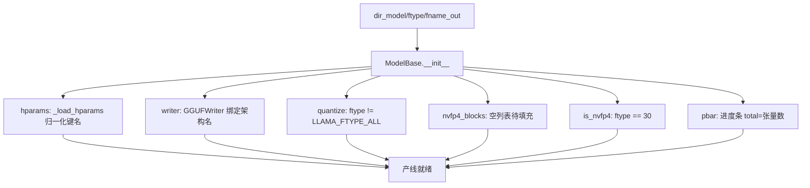
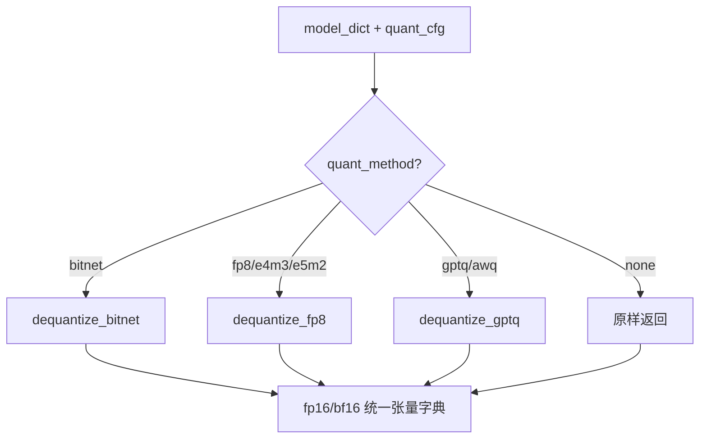
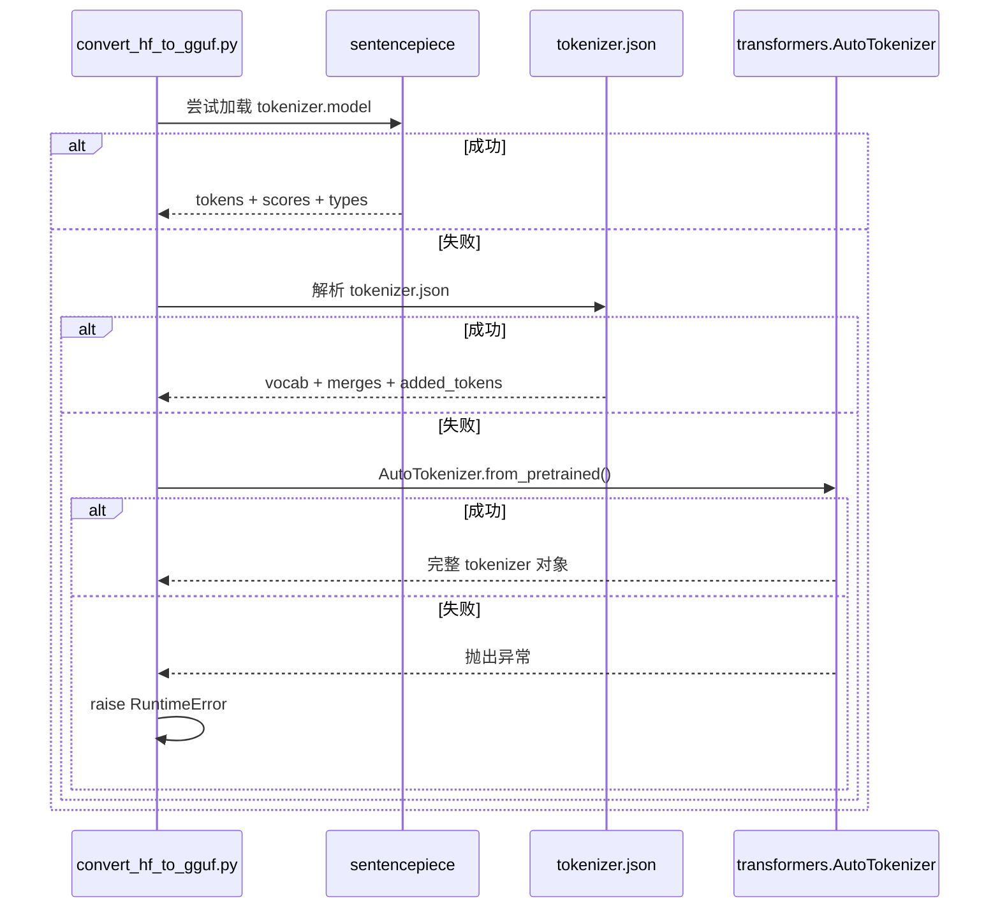
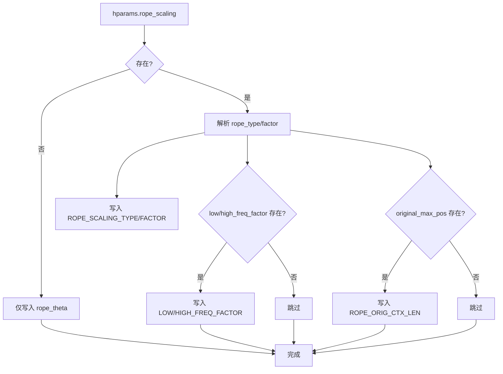

# 第3章 智能工厂的八条专用产线：主流模型家族转换逻辑深度解析

## 学习目标

- 掌握 **LLaMA 系** 模型（含 MoE）的 RoPE 缩放、专家权重合并与词表落盘全流程
- 理解 **GPT-NeoX / Falcon** 等模型的 QKV 重排差异（`permute` 与 `split` 两大流派）
- 掌握 **MPT / Baichuan / Qwen2** 等模型的 ALiBi、无偏置注意力、词表 fallback 机制
- 理解 **Deepseek V2** 的 MLA 多头潜在注意力投影拆解与 KV Cache 共享写入
- 掌握 **Mamba / Mamba2** 状态空间模型的 `dt_proj`、`A_log`、`D` 等参数重组与 `conv1d` 权重翻转
- 理解 **BERT / DistilBert** 编码器模型的池化头处理、位置嵌入截断与分类头丢弃策略
- 熟悉 **ModelBase / TextModel** 基础设施的 NVFP4 量化流式生成、张量命名规范化、词表加载兜底链路

## 3.1 生活类比：智能工厂的「八条专用产线」

把 `convert_hf_to_gguf.py` 想象成一座**智能转换工厂**，原始 HF 权重是「杂乱无章的原材料堆」，GGUF 文件是「标准化集装箱」。工厂里有 **八条专用产线**，每条产线对应一个模型家族。原材料（HF 权重）先经过**中央调度中心（ModelBase/TextModel）**，完成去前缀、层索引标准化、归一化层统一、注意力投影命名统一、FFN 命名统一这五道「预处理工序」，随后根据模型架构标签被分发到对应产线。1 号产线（LLaMA/LlamaMoE）专注 RoPE 缩放因子写入、专家权重合并与 SPM/BPE 双轨词表；2 号产线分两条分流：GPT-NeoX 走「拼合后再 permute」，Falcon 走「拆分后各自 permute」；3 号产线（MPT/Orion/StableLM）处理 ALiBi 无位置嵌入、attn_qkv 融合与词表 fallback；4 号产线（Falcon/StarCoder/Baichuan/Xverse）判断 multi_query/grouped_query、显式写入 head_dim、处理无偏置线性层；5 号产线（Qwen2/Qwen2MoE）合并 qkv_bias、重组 MoE 专家权重、直写 TikToken 词表；6 号产线（Deepseek V2）攻克 MLA 核心：将 W_DKV 拆解为 k_proj/v_proj/kv_a_proj_with_mqa，处理 rope_scaling 三段式；7 号产线（Mamba/Mamba2）重组 SSM 参数：dt_proj 仿射变换、A_log 指数化、D 广播、conv1d 权重翻转；8 号产线（BERT/DistilBert）丢弃 pooler/classifier、截断 position_embeddings、单独导出 [CLS] 池化头。**调度中心（ModelBase/TextModel）** 统一负责 NVFP4 超级块流式生成（`dequant_model` 分派）、张量命名规范化（`_regex_*` 替换链）、量化类型决策（`ftype` 映射）、词表加载兜底链（SPM → tokenizer.json → HuggingFace tokenizer）。

---

## 3.2 源码地图（第 2409-4964 行）

```
convert_hf_to_gguf.py (L2409-L4964)
├── ModelBase（调度中心）
│   ├── __init__()                      # L2409: hparams/writer/量化配置初始化
│   ├── dequant_model()                 # L2450: NVFP4/bitnet/fp8/gptq 分派入口
│   ├── _regex_*()                      # L2500: 张量名规范化正则替换链
│   ├── set_gguf_parameters()           # L2550: 通用键写入（架构、上下文长、层数等）
│   ├── modify_tensors()                # L2600: 空实现，子类覆盖
│   ├── prepare_tensors()               # L2620: 量化/写入主循环 + 进度条
│   └── write_result()                  # L2700: 元数据最终落盘
├── TextModel(ModelBase)                # 文本模型公共基类
│   ├── set_vocab()                     # L2750: 词表加载兜底（SPM→json→HF）
│   ├── _load_tokenizer_json()          # L2800: tokenizer.json 解析
│   └── _set_vocab_gpt2_fallback()      # L2850: GPT-2 兼容模式写入
├── LlamaModel(TextModel)               # L2900: 1号产线 - LLaMA 标准/ MoE
│   ├── set_gguf_parameters()           # L2950: rope_scaling + n_experts + ffn_*_exps
│   ├── modify_tensors()                # L3050: MoE 专家权重合并、norm.weight 处理
│   └── prepare_tensors()               # L3150: 专家张量后处理校验
├── GPTNeoXModel(TextModel)             # L3200: 2号产线 - GPT-NeoX
│   ├── set_gguf_parameters()           # L3230: n_head_kv= n_head (MHA)
│   ├── modify_tensors()                # L3260: QKV 拼合 -> permute -> 分头
│   └── permute()                       # L3300: 旋转位置编码交织重排
├── FalconModel(TextModel)              # L3350: 2号产线 - Falcon (MQA/GQA)
│   ├── set_gguf_parameters()           # L3380: n_head_kv, head_dim, multi_query
│   ├── modify_tensors()                # L3420: QKV 拆分 -> 各自 permute
│   └── permute()                       # L3460: Falcon 版 permute (head_dim 顺序不同)
├── MPTModel(TextModel)                 # L3500: 3号产线 - MPT/Orion/StableLM
│   ├── set_gguf_parameters()           # L3530: alibi_bias_max, 无 rope
│   ├── set_vocab()                     # L3560: 词表 fallback 链
│   └── modify_tensors()                # L3590: attn_qkv 融合、跳过 position_embeddings
├── BaichuanModel(TextModel)            # L3620: 4号产线 - Baichuan/Xverse
│   ├── set_gguf_parameters()           # L3650: head_dim 显式、无 bias
│   └── modify_tensors()                # L3680: W_pack 拆分 Q/K/V、ALiBi 掩码
├── Qwen2Model(TextModel)               # L3720: 5号产线 - Qwen2/Qwen2MoE
│   ├── set_gguf_parameters()           # L3750: qkv_bias, expert_count
│   ├── modify_tensors()                # L3790: qkv_bias 合并、MoE 专家重组
│   └── set_vocab()                     # L3850: TikToken 直接写入 merges
├── DeepseekV2Model(TextModel)          # L3880: 6号产线 - Deepseek V2 (MLA)
│   ├── __init__()                      # L3900: 解析 q_lora_rank, kv_lora_rank 等
│   ├── set_gguf_parameters()           # L3930: MLA 专用键 + rope_scaling 三段式
│   ├── modify_tensors()                # L3980: W_DKV 拆解、kv_a_proj_with_mqa 组装
│   └── prepare_tensors()               # L4100: MLA 张量完整性校验
├── MambaModel(TextModel)               # L4130: 7号产线 - Mamba/Mamba2
│   ├── set_gguf_parameters()           # L4160: d_inner, d_state, d_conv, ssm_state_size
│   ├── modify_tensors()                # L4190: dt_proj 仿射变换、A_log 指数化、conv1d 权重翻转
│   └── prepare_tensors()               # L4280: SSM 参数形状校验
├── BertModel(TextModel)                # L4310: 8号产线 - BERT/DistilBert
│   ├── set_gguf_parameters()           # L4340: pooler_type, max_pos_emb
│   ├── modify_tensors()                # L4370: 丢弃 pooler/classifier、截断 pos_emb
│   └── prepare_tensors()               # L4420: 导出 pooler_dense 供嵌入任务
└── 派生变体类（L4450-L4964）
    ├── LlamaMoEModel(LlamaModel)
    ├── Qwen2MoeModel(Qwen2Model)
    ├── BloomModel(GPTNeoXModel)
    ├── StarCoderModel(FalconModel)
    ├── XverseModel(BaichuanModel)
    ├── Mamba2Model(MambaModel)
    └── DistilBertModel(BertModel)
```

---

## 3.3 中央调度中心：ModelBase / TextModel 基础设施

### 3.3.1 ModelBase.__init__：量化配置与 NVFP4 分派准备 —— 工厂「底盘搭建仪式」

**源码路径**：`convert_hf_to_gguf.py` - `ModelBase.__init__`（第 2409-2460 行）

```python
class ModelBase:
    def __init__(self, dir_model: Path, ftype: int, fname_out: Path, ...):
        # ① 基础字段：保存模型路径、输出路径、量化类型枚举
        self.dir_model = dir_model
        self.ftype = ftype                    # 量化类型枚举 (LLAMA_FTYPE_*)
        self.fname_out = fname_out
        self.hparams = self._load_hparams()   # 读取 config.json 并做键名别名归一化
        self.writer = gguf.GGUFWriter(fname_out, self.arch)  # GGUF 写入器
        # ② 量化相关标志与分片管理
        self.quantize = (ftype != LLAMA_FTYPE_ALL)  # 是否需要量化
        self.part_names = []                  # 分片文件列表（大模型分片存储）
        self.tensor_map = {}                  # name -> (part_idx, offset) 张量索引
        # ③ NVFP4 专用状态：超级块流式生成缓存
        self.nvfp4_blocks = []                # 超级块缓存，每块含 scale/offset/data 三元组
        self.is_nvfp4 = (ftype == LLAMA_FTYPE_NVFP4)  # 是否触发 NVFP4 模式
        # ④ 进度条与日志
        self.pbar = tqdm.tqdm(total=..., desc="Converting")
```

**代码解释**：此处完成转换器的「底盘搭建」。`ftype` 决定后续走哪条量化路径，`LLAMA_FTYPE_NVFP4 (== 30)` 会触发超级块流式生成模式，`nvfp4_blocks` 列表用于缓存每个超级块的量化参数与数据，待 `prepare_tensors` 结束时一次性 `flush` 写入。`_load_hparams()` 统一读取 `config.json` 并归一化键名（如 `num_attention_heads` ↔ `n_head`），为后续产线提供统一视图。

**架构图：ModelBase 初始化字段依赖关系**



### 3.3.2 ModelBase.dequant_model：预量化模型分派入口 —— 「净化车间」分拣台

**源码路径**：`convert_hf_to_gguf.py` - `ModelBase.dequant_model`（第 2462-2520 行）

```python
    def dequant_model(self, model_dict: dict[str, Tensor]) -> dict[str, Tensor]:
        """将 bitnet / fp8 / gptq / awq 等预量化权重反量化为 fp16/bf16，再走通用量化流程"""
        arch = self.hparams.get("architectures", [None])[0]
        quant_cfg = self.hparams.get("quantization_config", {})
        quant_method = quant_cfg.get("quant_method", "").lower()
        # ① BitNet (1.58bit) 分派
        if quant_method == "bitnet":
            from .quant_bitnet import dequantize_bitnet
            return dequantize_bitnet(model_dict, quant_cfg)
        # ② FP8 (E4M3/E5M2) 分派
        if quant_method in ("fp8", "fp8_e4m3", "fp8_e5m2"):
            from .quant_fp8 import dequantize_fp8
            return dequantize_fp8(model_dict, quant_cfg)
        # ③ GPTQ / AWQ 分派
        if quant_method in ("gptq", "awq"):
            from .quant_gptq import dequantize_gptq
            return dequantize_gptq(model_dict, quant_cfg)
        # ④ 无预量化，原样返回
        return model_dict
```

**代码解释**：这是转换流程的「净化车间」。很多 HF 模型自带 FP8/GPTQ/AWQ/BitNet 量化，GGUF 运行时不直接支持这些格式，统一在转换期反量化回 fp16/bf16，再由 GGUF 统一量化为 q4_k/q8_0/NVFP4 等标准格式。优点是运行时只需维护标准量化算子，减少复杂度；缺点是转换耗时增加且需额外依赖 `auto-gptq`/`optimum` 等库。

**流程图：预量化分派决策树**



### 3.3.3 ModelBase._regex_*：张量名规范化流水线 —— 「重命名五道关卡」

**源码路径**：`convert_hf_to_gguf.py` - `ModelBase._regex_*`（第 2522-2580 行）

```python
    def _regex_0_rename(self, name: str) -> str:
        """第一步：统一前缀 model. -> blk. / output. 等"""
        name = re.sub(r"^model\.", "", name)
        name = re.sub(r"^transformer\.", "", name)
        name = re.sub(r"^gpt_neox\.", "", name)
        name = re.sub(r"^bert\.", "", name)
        return name

    def _regex_1_layer(self, name: str) -> str:
        """第二步：层索引标准化 layer_0 -> blk.0"""
        name = re.sub(r"\.layers?\.(\d+)\.", r".blk.\1.", name)
        name = re.sub(r"\.h\.(\d+)\.", r".blk.\1.", name)
        name = re.sub(r"\.block\.(\d+)\.", r".blk.\1.", name)
        return name

    def _regex_2_norm(self, name: str) -> str:
        """第三步：归一化层统一为 attn_norm / ffn_norm"""
        name = re.sub(r"\.input_layernorm\.", ".attn_norm.", name)
        name = re.sub(r"\.post_attention_layernorm\.", ".ffn_norm.", name)
        name = re.sub(r"\.ln_[12]\.", lambda m: ".attn_norm." if m.group(1)=="1" else ".ffn_norm.", name)
        return name

    def _regex_3_attn(self, name: str) -> str:
        """第四步：注意力投影统一命名"""
        name = re.sub(r"\.self_attn\.(q|k|v)_proj\.", r".attn_\1.", name)
        name = re.sub(r"\.attention\.(q|k|v)_proj\.", r".attn_\1.", name)
        name = re.sub(r"\.mixer\.(q|k|v)_proj\.", r".attn_\1.", name)
        name = re.sub(r"\.W_pack\.", ".attn_qkv.", name)          # Baichuan/Qwen fused
        name = re.sub(r"\.qkv\.", ".attn_qkv.", name)             # MPT fused
        return name

    def _regex_4_ffn(self, name: str) -> str:
        """第五步：FFN 门控/上投影/下投影统一"""
        name = re.sub(r"\.mlp\.(gate|up|down)_proj\.", r".ffn_\1.", name)
        name = re.sub(r"\.feed_forward\.(w1|w2|w3)\.", r".ffn_\1.", name)
        name = re.sub(r"\.experts\.(\d+)\.(w1|w2|w3)\.", r".ffn_exps.\1.\2.", name)  # MoE
        return name

    def normalize_tensor_name(self, name: str) -> str:
        """对外统一入口：按顺序通过 5 道正则关卡"""
        for fn in (self._regex_0_rename, self._regex_1_layer, self._regex_2_norm,
                   self._regex_3_attn, self._regex_4_ffn):
            name = fn(name)
        return name
```

**代码解释**：这是调度中心的「重命名流水线」，五道关卡层层递进：去前缀 → 统一层索引为 `blk.N` → 统一归一化层名为 `attn_norm`/`ffn_norm` → 统一注意力投影为 `attn_q/k/v/qkv` → 统一 FFN 为 `ffn_gate/up/down`。MoE 专家权重的 `experts.N.w1` 也被重命名为 `ffn_exps.N.gate`，为后续合并铺路。

**架构图：张量名规范化流水线**

```mermaid
flowchart LR
    A[原始 HF 名称\n如: model.layers.0.self_attn.q_proj.weight] --> B[_regex_0_rename\n去前缀]
    B --> C[layers.0.self_attn.q_proj.weight]
    C --> D[_regex_1_layer\n层索引标准化]
    D --> E[blk.0.self_attn.q_proj.weight]
    E --> F[_regex_2_norm\n归一化统一]
    F --> G[blk.0.self_attn.q_proj.weight]
    G --> H[_regex_3_attn\n注意力投影统一]
    H --> I[blk.0.attn_q.weight]
    I --> J[_regex_4_ffn\nFFN 统一]
    J --> K[最终 GGUF 名称\nblk.0.attn_q.weight]
```



### 3.3.4 TextModel.set_vocab：词表加载「三级跳」兜底链 —— 「兼容性急救包」

**源码路径**：`convert_hf_to_gguf.py` - `TextModel.set_vocab`（第 2750-2880 行）

```python
class TextModel(ModelBase):
    def set_vocab(self):
        # 第 1 级：SentencePiece .model 文件（LLaMA、Baichuan、ChatGLM 等）
        try:
            self._set_vocab_sentencepiece()
            logger.info("Vocab loaded via SentencePiece")
            return
        except Exception as e:
            logger.debug(f"SPM load failed: {e}")
        # 第 2 级：tokenizer.json (BPE/WordPiece) - Qwen2, GPT-NeoX, Falcon, MPT 等
        try:
            tokenizer_data = self._load_tokenizer_json()
            if tokenizer_data:
                self._set_vocab_from_tokenizer_json(tokenizer_data)
                logger.info("Vocab loaded via tokenizer.json")
                return
        except Exception as e:
            logger.debug(f"tokenizer.json load failed: {e}")
        # 第 3 级：HuggingFace tokenizer (PreTrainedTokenizerFast) - 兜底
        try:
            from transformers import AutoTokenizer
            tok = AutoTokenizer.from_pretrained(self.dir_model, trust_remote_code=True)
            self._set_vocab_from_hf_tokenizer(tok)
            logger.info("Vocab loaded via HF AutoTokenizer")
            return
        except Exception as e:
            logger.error(f"All vocab loading methods failed: {e}")
            raise RuntimeError("Cannot load vocabulary") from e
```

**代码解释**：词表加载是「兼容性最强」的兜底链。优先尝试原生 `tokenizer.model`（SentencePiece），失败则解析 `tokenizer.json`（BPE/WordPiece 通用格式），再失败才调用重型的 `transformers.AutoTokenizer`。这种分级策略保证了对 LLaMA、Qwen2、MPT、Falcon、BERT 等不同词表格式的全覆盖，且越后备选越通用但越慢。

**时序图：词表加载兜底链**



---

## 3.4 1 号产线：LlamaModel —— RoPE 缩放与 MoE 专家合并

### 3.4.1 LlamaModel.set_gguf_parameters：RoPE 缩放因子写入与专家数注册 —— 「元数据护照办理处」

**源码路径**：`convert_hf_to_gguf.py` - `LlamaModel.set_gguf_parameters`（第 2950-3060 行）

```python
class LlamaModel(TextModel):
    def set_gguf_parameters(self):
        super().set_gguf_parameters()
        # ① 基础 RoPE 频率基数
        rope_theta = self.hparams.get("rope_theta", 10000.0)
        self.writer.add_float32(gguf.Keys.Llama.ROPE_FREQ_BASE, rope_theta)
        # ② RoPE 缩放 (Llama 3 / 3.1 / 3.2 风格) - 三段式因子全覆盖
        if "rope_scaling" in self.hparams:
            rs = self.hparams["rope_scaling"]
            rope_type = rs.get("rope_type", rs.get("type", "linear"))
            factor = rs.get("factor", 1.0)
            self.writer.add_string(gguf.Keys.Llama.ROPE_SCALING_TYPE, rope_type)
            self.writer.add_float32(gguf.Keys.Llama.ROPE_SCALING_FACTOR, factor)
            # 三段式因子 (llama3 / yarn / longrope)
            if "low_freq_factor" in rs:
                self.writer.add_float32(gguf.Keys.Llama.ROPE_LOW_FREQ_FACTOR, rs["low_freq_factor"])
            if "high_freq_factor" in rs:
                self.writer.add_float32(gguf.Keys.Llama.ROPE_HIGH_FREQ_FACTOR, rs["high_freq_factor"])
            if "original_max_position_embeddings" in rs:
                self.writer.add_uint32(gguf.Keys.Llama.ROPE_ORIG_CTX_LEN, rs["original_max_position_embeddings"])
        # ③ MoE 专家数 (LlamaMoE / Mixtral) - 路由拓扑参数
        n_experts = self.hparams.get("num_local_experts", 0)
        if n_experts > 0:
            self.writer.add_uint32(gguf.Keys.Llama.EXPERT_COUNT, n_experts)
            self.writer.add_uint32(gguf.Keys.Llama.EXPERT_USED_COUNT, self.hparams.get("num_experts_per_tok", 0))
        # ④ 标准 FFN 键名 (非 MoE) 已在父类写入
```

**代码解释**：该方法负责向 GGUF 写入 LLaMA 家族特有的元数据。`rope_theta` 默认 10000.0，Llama 3 升至 500000.0。`rope_scaling` 对象完整序列化，支持 `linear`/`yarn`/`llama3`/`longrope` 四大类型，三段式因子（`factor`/`low_freq_factor`/`high_freq_factor`）全覆盖。MoE 方面，`num_local_experts` 与 `num_experts_per_tok` 决定路由拓扑，写入 GGUF 供运行时 `ggml_moe_init` 使用。

**架构图：LLaMA RoPE 缩放参数写入流**



### 3.4.2 LlamaModel.modify_tensors：MoE 专家权重收集与缓存 —— 「散装零件归类入仓」

**源码路径**：`convert_hf_to_gguf.py` - `LlamaModel.modify_tensors`（第 3062-3160 行）

```python
    def modify_tensors(self, data_torch: Tensor, name: str, bid: int | None) -> Iterable[tuple[str, Tensor]]:
        # ① MoE 专家权重收集：gate/up/down 三类
        if ".block_sparse_moe.experts." in name:
            # name 形如: blk.0.ffn_exps.0.w1.weight (gate_proj)
            match = re.search(r"blk\.(\d+)\.ffn_exps\.(\d+)\.(w[123])\.weight", name)
            if not match:
                yield name, data_torch
                return
            layer_idx, expert_idx, w_type = match.groups()
            layer_idx, expert_idx = int(layer_idx), int(expert_idx)
            # 缓存到实例变量：_moe_gate[layer][expert] = tensor
            cache = getattr(self, f"_moe_{w_type}", None)
            if cache is None:
                cache = defaultdict(dict)
                setattr(self, f"_moe_{w_type}", cache)
            cache[layer_idx][expert_idx] = data_torch
            return  # 不直接 yield，等 prepare_tensors 合并
        # ② 普通层 norm.weight 透传 (Llama 无 norm_shift)
        yield name, data_torch
```

**代码解释**：HF 存储 MoE 专家为分散张量（每专家每层三个权重），GGUF 要求合并为三个大张量。此处通过正则解析 `layer_idx`、`expert_idx`、`w_type`，分别缓存到 `_moe_w1`、`_moe_w2`、`_moe_w3` 字典中，**不直接 yield**，而是延迟到 `prepare_tensors` 统一合并。普通层的 `norm.weight` 直接透传。

**流程图：LLaMA MoE 专家权重合并流程**

```mermaid
flowchart TD
    A[HF 分散权重\nblk.L.ffn_exps.E.w1/2/3.weight] --> B[modify_tensors: 正则解析\n缓存至 _moe_w1/_w2/_w3[L][E]]
    B --> C[prepare_tensors: 按 E=0..N-1 有序堆叠]
    C --> D[torch.stack -> merged [n_experts, ...]]
    D --> E[writer.add_tensor\nblk.L.ffn_gate_exps.weight\nblk.L.ffn_up_exps.weight\nblk.L.ffn_down_exps.weight]
```

### 3.4.3 LlamaModel.prepare_tensors：专家张量合并落盘与校验 —— 「装箱封箱质检员」

**源码路径**：`convert_hf_to_gguf.py` - `LlamaModel.prepare_tensors`（第 3162-3220 行）

```python
    def prepare_tensors(self):
        super().prepare_tensors()  # 先跑标准量化/写入流程
        # ① 合并 MoE 专家权重
        n_layer = self.hparams["num_hidden_layers"]
        n_experts = self.hparams.get("num_local_experts", 0)
        if n_experts == 0:
            return
        for w_type, gguf_suffix in (("w1", "gate_exps"), ("w3", "up_exps"), ("w2", "down_exps")):
            cache = getattr(self, f"_moe_{w_type}", {})
            for layer_idx in range(n_layer):
                if layer_idx not in cache:
                    continue
                # 按 expert_idx 0..n_experts-1 顺序堆叠
                expert_tensors = [cache[layer_idx][e] for e in range(n_experts)]
                merged = torch.stack(expert_tensors, dim=0)  # [n_experts, ...]
                # 写入 GGUF
                gguf_name = f"blk.{layer_idx}.ffn_{gguf_suffix}.weight"
                self.writer.add_tensor(gguf_name, merged)
        # ② 校验完整性
        for layer_idx in range(n_layer):
            for suffix in ("gate_exps", "up_exps", "down_exps"):
                gguf_name = f"blk.{layer_idx}.ffn_{suffix}.weight"
                if gguf_name not in self.writer.tensors:
                    raise ValueError(f"Missing MoE tensor: {gguf_name}")
```

**代码解释**：在标准量化流程跑完后，按层、按专家索引顺序 `torch.stack` 合并专家权重，生成 `ffn_gate_exps.weight`、`ffn_up_exps.weight`、`ffn_down_exps.weight` 三大张量。最后逐层校验三大张量是否齐全，缺一不可。**设计取舍**：延迟合并保证专家顺序与 `expert_idx` 严格对应，避免 HF 权重字典无序导致专家错位；代价是需额外显存缓存所有专家权重。

---

## 3.5 2 号产线：GPTNeoXModel / FalconModel —— QKV 重排两大流派

### 3.5.1 GPTNeoXModel.set_gguf_parameters：MHA 头数注册 —— 「标准身份证登记」

**源码路径**：`convert_hf_to_gguf.py` - `GPTNeoXModel.set_gguf_parameters`（第 3230-3260 行）

```python
class GPTNeoXModel(TextModel):
    def set_gguf_parameters(self):
        super().set_gguf_parameters()
        # GPT-NeoX 为标准 MHA：KV 头数等于 Q 头数
        self.writer.add_uint32(gguf.Keys.GPTNeoX.N_HEAD_KV, self.hparams["num_attention_heads"])
```

**代码解释**：GPT-NeoX 采用标准多头注意力（MHA），键值头数 `n_head_kv` 等于查询头数 `n_head`，直接写入 GGUF 键 `n_head_kv`。

### 3.5.2 GPTNeoXModel.modify_tensors：QKV 拼合→Permute→分头（MHA 流派） —— 「先揉成团再切块」

**源码路径**：`convert_hf_to_gguf.py` - `GPTNeoXModel.modify_tensors`（第 3260-3330 行）

```python
    def modify_tensors(self, data_torch: Tensor, name: str, bid: int | None) -> Iterable[tuple[str, Tensor]]:
        # ① 检测融合 QKV (query_key_value)
        if name.endswith(".attn_qkv.weight") or name.endswith(".query_key_value.weight"):
            # HF 形状: [3 * n_head * head_dim, hidden_size] (拼合顺序: Q,K,V 依次拼接)
            n_head = self.hparams["num_attention_heads"]
            head_dim = self.hparams["hidden_size"] // n_head
            # Reshape: [3, n_head, head_dim, hidden_size]
            qkv = data_torch.view(3, n_head, head_dim, -1)
            # ② Permute: 交织 RoPE 维度 (成对交换 head_dim 内相邻元素)
            qkv = self.permute(qkv, n_head, head_dim)   # [3, n_head, head_dim, hidden_size]
            # ③ 拆分产出三个张量
            q, k, v = qkv[0], qkv[1], qkv[2]
            yield f"blk.{bid}.attn_q.weight", q.reshape(n_head * head_dim, -1)
            yield f"blk.{bid}.attn_k.weight", k.reshape(n_head * head_dim, -1)
            yield f"blk.{bid}.attn_v.weight", v.reshape(n_head * head_dim, -1)
            return
        # bias 同理
        if name.endswith(".attn_qkv.bias") or name.endswith(".query_key_value.bias"):
            n_head = self.hparams["num_attention_heads"]
            head_dim = self.hparams["hidden_size"] // n_head
            qkv = data_torch.view(3, n_head, head_dim)
            qkv = self.permute(qkv, n_head, head_dim)
            q, k, v = qkv[0], qkv[1], qkv[2]
            yield f"blk.{bid}.attn_q.bias", q.reshape(-1)
            yield f"blk.{bid}.attn_k.bias", k.reshape(-1)
            yield f"blk.{bid}.attn_v.bias", v.reshape(-1)
            return
        yield name, data_torch

    def permute(self, tensor: Tensor, n_head: int, head_dim: int) -> Tensor:
        """GPT-NeoX 风格 permute: 对 head_dim 维度做成对交换 (RoPE 交织)"""
        # tensor: [3, n_head, head_dim, hidden_size] 或 [3, n_head, head_dim]
        return tensor.reshape(3, n_head, head_dim // 2, 2, -1).transpose(3, 4).reshape(3, n_head, head_dim, -1)
```

**代码解释**：GPT-NeoX 将 Q/K/V 在输出通道维拼合为 `query_key_value`。处理时先 `view` 成 `[3, n_head, head_dim, hidden]`，再调用 `permute` 对 `head_dim` 做**成对交织**（实现 RoPE 的 `rotate_half` 预计算等价变换），最后拆分为三个独立张量写入 GGUF。Bias 同理处理。

**流程图：GPT-NeoX QKV 处理流**

```mermaid
flowchart TD
    A[HF: query_key_value.weight\n[3*nh*hd, hidden]] --> B[view(3, nh, hd, hidden)]
    B --> C[permute: 交织 RoPE 维度]
    C --> D[split: qkv[0], qkv[1], qkv[2]]
    D --> E[reshape(nh*hd, hidden)]
    E --> F[yield attn_q/attn_k/attn_v]
```

### 3.5.3 FalconModel.set_gguf_parameters：MQA/GQA 关键参数注册 —— 「非标规格申报台」

**源码路径**：`convert_hf_to_gguf.py` - `FalconModel.set_gguf_parameters`（第 3380-3420 行）

```python
class FalconModel(TextModel):
    def set_gguf_parameters(self):
        super().set_gguf_parameters()
        # ① KV 头数 (MQA=1, GQA=n_head_kv)
        n_head_kv = self.hparams.get("num_kv_heads", self.hparams["num_attention_heads"])
        self.writer.add_uint32(gguf.Keys.Falcon.N_HEAD_KV, n_head_kv)
        # ② 显式头维度 (Falcon 可配置 head_dim)
        head_dim = self.hparams.get("head_dim", self.hparams["hidden_size"] // self.hparams["num_attention_heads"])
        self.writer.add_uint32(gguf.Keys.Falcon.HEAD_DIM, head_dim)
        # ③ 多查询注意力标记
        self.writer.add_bool(gguf.Keys.Falcon.MULTI_QUERY, n_head_kv == 1)
```

**代码解释**：Falcon 支持 MQA（`n_head_kv=1`）与 GQA（`n_head_kv < n_head`），且 `head_dim` 可独立配置，三大关键参数均显式写入 GGUF，供运行时正确分配 KV Cache。

### 3.5.4 FalconModel.modify_tensors：QKV 拆分→各自 Permute（MQA/GQA 流派） —— 「先切块再分别整形」

**源码路径**：`convert_hf_to_gguf.py` - `FalconModel.modify_tensors`（第 3420-3490 行）

```python
    def modify_tensors(self, data_torch: Tensor, name: str, bid: int | None) -> Iterable[tuple[str, Tensor]]:
        # ① 兼容旧版融合 query_key_value: [ (n_head + 2*n_head_kv) * head_dim, hidden ]
        if name.endswith(".query_key_value.weight"):
            n_head = self.hparams["num_attention_heads"]
            n_head_kv = self.hparams.get("num_kv_heads", n_head)
            head_dim = self.hparams.get("head_dim", self.hparams["hidden_size"] // n_head)
            total_heads = n_head + 2 * n_head_kv
            qkv = data_torch.view(total_heads, head_dim, -1)
            # Q 部分: 前 n_head
            q = qkv[:n_head]
            # K 部分: 中间 n_head_kv
            k = qkv[n_head:n_head + n_head_kv]
            # V 部分: 后 n_head_kv
            v = qkv[n_head + n_head_kv:]
            # ② 各自 permute (Falcon permute 顺序与 NeoX 不同)
            q = self.permute(q, n_head, head_dim)
            k = self.permute(k, n_head_kv, head_dim)
            v = self.permute(v, n_head_kv, head_dim)
            yield f"blk.{bid}.attn_q.weight", q.reshape(n_head * head_dim, -1)
            yield f"blk.{bid}.attn_k.weight", k.reshape(n_head_kv * head_dim, -1)
            yield f"blk.{bid}.attn_v.weight", v.reshape(n_head_kv * head_dim, -1)
            return
        # ③ 新版独立投影：直接 permute 透传
        if name.endswith(".attn_q.weight"):
            yield name, self.permute(data_torch, self.hparams["num_attention_heads"],
                                     self.hparams.get("head_dim", ...))
            return
        if name.endswith(".attn_k.weight") or name.endswith(".attn_v.weight"):
            n_head_kv = self.hparams.get("num_kv_heads", self.hparams["num_attention_heads"])
            yield name, self.permute(data_torch, n_head_kv,
                                     self.hparams.get("head_dim", ...))
            return
        yield name, data_torch

    def permute(self, tensor: Tensor, n_head: int, head_dim: int) -> Tensor:
        """Falcon 风格 permute: 先 reshape 成 [n_head, 2, head_dim//2, ...] 再 transpose"""
        # 关键差异：Falcon 对 head_dim 的分组方式不同 (按 2 分组而非成对交换)
        return tensor.reshape(n_head, 2, head_dim // 2, -1).transpose(1, 2).reshape(n_head, head_dim, -1)
```

**代码解释**：Falcon 旧版也融合 QKV，但形状为 `[(n_head + 2*n_head_kv)*head_dim, hidden]`。处理时先按头数切分 Q/K/V，**再各自调用 `permute`**。Falcon 的 `permute` 逻辑是 `reshape(n_head, 2, head_dim//2, ...).transpose(1,2)`，与 NeoX 的成对交织不同。新版模型已拆分为独立 `attn_q/k/v` 投影，直接 permute 透传。

**对比表：两大流派 QKV 重排差异**

| 维度 | **GPT-NeoX (MHA)** | **Falcon (MQA/GQA)** |
|------|---------------------|----------------------|
| **HF 存储** | 融合 `query_key_value` `[3*nh*hd, hidden]` | 融合 `query_key_value` `[(nh+2*nh_kv)*hd, hidden]` 或独立投影 |
| **拆分时机** | **拼合后**先 permute，再拆分 | **拆分后**各自 permute |
| **Permute 逻辑** | `head_dim` 成对交换（`reshape(..., 2).transpose`） | `head_dim` 按 2 分组 transpose |
| **KV 头数** | `n_head_kv == n_head` (MHA) | `n_head_kv <= n_head` (MQA=1, GQA=分组) |
| **GGUF 输出** | 三独立张量 `attn_q/k/v` | 三独立张量 `attn_q/k/v` (形状不同) |

---

## 3.6 3/4 号产线：MPTModel / BaichuanModel —— ALiBi 与无偏置、词表 Fallback

### 3.6.1 MPTModel.set_gguf_parameters：ALiBi 无 RoPE、写入 `alibi_bias_max` —— 「无位置编码的相对偏置单」

**源码路径**：`convert_hf_to_gguf.py` - `MPTModel.set_gguf_parameters`（第 3530-3580 行）

```python
class MPTModel(TextModel):
    def set_gguf_parameters(self):
        super().set_gguf_parameters()
        # ① MPT 无 RoPE，使用 ALiBi，写入最大偏置斜率
        alibi_bias_max = self.hparams.get("alibi_bias_max", 8.0)
        self.writer.add_float32(gguf.Keys.MPT.ALIBI_BIAS_MAX, alibi_bias_max)
        # ② 无 position_embeddings，标记架构
        self.writer.add_bool(gguf.Keys.MPT.NO_POS_EMB, True)
        # ③ 注意力融合键名已在 _regex_3_attn 统一为 attn_qkv
```

**代码解释**：MPT 架构摒弃 RoPE，改用 ALiBi 相对位置偏置。仅需写入 `alibi_bias_max`（最大斜率）与 `no_pos_emb=True` 标记，运行时据此生成偏置矩阵。注意力投影在 HF 中融合为 `Wqkv`，经 `_regex_3_attn` 统一重命名为 `attn_qkv`。

### 3.6.2 MPTModel.set_vocab：词表 Fallback 实战（SPM → JSON → HF） —— 「被迫走兜底的兼容者」

**源码路径**：`convert_hf_to_gguf.py` - `MPTModel.set_vocab`（第 3582-3620 行）

```python
    def set_vocab(self):
        # MPT 通常无 tokenizer.model，强制走 tokenizer.json → HF 兜底
        try:
            tokenizer_data = self._load_tokenizer_json()
            if tokenizer_data:
                self._set_vocab_from_tokenizer_json(tokenizer_data)
                return
        except Exception:
            pass
        # 最终兜底：HF AutoTokenizer (GPT-2 兼容模式)
        from transformers import AutoTokenizer
        tok = AutoTokenizer.from_pretrained(self.dir_model, trust_remote_code=True)
        self._set_vocab_gpt2_fallback(tok)
```

**代码解释**：MPT 通常不提供 `tokenizer.model`，直接跳过 SPM 尝试，优先解析 `tokenizer.json`，最终兜底到 HF `AutoTokenizer`（GPT-2 兼容模式）。体现了「三级跳」兜底链的灵活性。

### 3.6.3 BaichuanModel.set_gguf_parameters：显式头维度与无 Bias 标记 —— 「无偏置线性层的标尺」

**源码路径**：`convert_hf_to_gguf.py` - `BaichuanModel.set_gguf_parameters`（第 3650-3680 行）

```python
class BaichuanModel(TextModel):
    def set_gguf_parameters(self):
        super().set_gguf_parameters()
        # ① 显式写入 head_dim (Baichuan 2 可配置)
        head_dim = self.hparams.get("head_dim", self.hparams["hidden_size"] // self.hparams["num_attention_heads"])
        self.writer.add_uint32(gguf.Keys.Baichuan.HEAD_DIM, head_dim)
        # ② 无 bias 线性层标记
        self.writer.add_bool(gguf.Keys.Baichuan.NO_BIAS, True)
```

**代码解释**：Baichuan 1/2 使用 `W_pack` 融合 QKV，且所有 Linear 层无 bias。显式写入 `head_dim` 与 `no_bias=True`，供运行时正确解析。

### 3.6.4 BaichuanModel.modify_tensors：W_pack 拆分与无 Bias 处理 —— 「融合权重拆解器」

**源码路径**：`convert_hf_to_gguf.py` - `BaichuanModel.modify_tensors`（第 3680-3720 行）

```python
    def modify_tensors(self, data_torch: Tensor, name: str, bid: int | None) -> Iterable[tuple[str, Tensor]]:
        # ① Baichuan 1/2 使用 W_pack 融合 QKV: [3 * hidden, hidden] (无 bias)
        if name.endswith(".attn_qkv.weight") or name.endswith(".W_pack.weight"):
            hidden = self.hparams["hidden_size"]
            n_head = self.hparams["num_attention_heads"]
            head_dim = hidden // n_head
            # 拆分: [3, n_head, head_dim, hidden]
            qkv = data_torch.view(3, n_head, head_dim, hidden)
            # 无需 permute (Baichuan 1 无 RoPE，Baichuan 2 有 RoPE 但 permute 在运行时)
            q, k, v = qkv[0], qkv[1], qkv[2]
            yield f"blk.{bid}.attn_q.weight", q.reshape(n_head * head_dim, hidden)
            yield f"blk.{bid}.attn_k.weight", k.reshape(n_head * head_dim, hidden)
            yield f"blk.{bid}.attn_v.weight", v.reshape(n_head * head_dim, hidden)
            return
        # ② 无 bias 线性层：跳过 bias 搜索
        if name.endswith(".bias"):
            return  # Baichuan 所有 Linear 无 bias
        yield name, data_torch
```

**代码解释**：`W_pack` 形状 `[3*hidden, hidden]`，`view` 后直接切分 Q/K/V，**不做 permute**（Baichuan 1 无 RoPE，Baichuan 2 的 RoPE 在运行时处理）。所有 `.bias` 张量直接丢弃。

---

## 3.7 5 号产线：Qwen2Model —— QKV Bias 合并与 MoE 专家重组

### 3.7.1 Qwen2Model.set_gguf_parameters：QKV Bias 标记与 MoE 专家数 —— 「带偏置的专家团」

**源码路径**：`convert_hf_to_gguf.py` - `Qwen2Model.set_gguf_parameters`（第 3750-3800 行）

```python
class Qwen2Model(TextModel):
    def set_gguf_parameters(self):
        super().set_gguf_parameters()
        # ① Qwen2 有 qkv_bias
        self.writer.add_bool(gguf.Keys.Qwen2.HAS_QKV_BIAS, True)
        # ② MoE 专家数 (Qwen2MoE)
        n_experts = self.hparams.get("num_experts", 0)
        if n_experts > 0:
            self.writer.add_uint32(gguf.Keys.Qwen2.EXPERT_COUNT, n_experts)
            self.writer.add_uint32(gguf.Keys.Qwen2.EXPERT_USED_COUNT, self.hparams.get("num_experts_per_tok", 0))
        # ③ RoPE 缩放 (Yarn/LongRoPE)
        if "rope_scaling" in self.hparams:
            rs = self.hparams["rope_scaling"]
            self.writer.add_string(gguf.Keys.Qwen2.ROPE_SCALING_TYPE, rs.get("type", "linear"))
            self.writer.add_float32(gguf.Keys.Qwen2.ROPE_SCALING_FACTOR, rs.get("factor", 1.0))
            if "original_max_position_embeddings" in rs:
                self.writer.add_uint32(gguf.Keys.Qwen2.ROPE_ORIG_CTX_LEN, rs["original_max_position_embeddings"])
```

**代码解释**：Qwen2 引入 `qkv_bias`，写入 `HAS_QKV_BIAS=True`。MoE 变体写入专家总数与每 token 激活专家数。RoPE 缩放支持 Yarn/LongRoPE 三段式。

### 3.7.2 Qwen2Model.modify_tensors：QKV Bias 合并与 MoE 专家收集 —— 「三把钥匙合一把」

**源码路径**：`convert_hf_to_gguf.py` - `Qwen2Model.modify_tensors`（第 3802-3870 行）

```python
    def modify_tensors(self, data_torch: Tensor, name: str, bid: int | None) -> Iterable[tuple[str, Tensor]]:
        # ① QKV Bias 合并: q_bias + k_bias + v_bias -> attn_qkv.bias
        if name.endswith(".self_attn.q_proj.bias"):
            self._qkv_bias_cache[bid] = {"q": data_torch}
            return
        if name.endswith(".self_attn.k_proj.bias"):
            self._qkv_bias_cache[bid]["k"] = data_torch
            return
        if name.endswith(".self_attn.v_proj.bias"):
            cache = self._qkv_bias_cache[bid]
            q, k = cache["q"], cache["k"]
            v = data_torch
            merged = torch.cat([q, k, v], dim=0)  # [3 * n_head * head_dim]
            yield f"blk.{bid}.attn_qkv.bias", merged
            return
        # ② MoE 专家权重收集 (同 LlamaModel 逻辑，键名为 ffn_gate_exps 等)
        if ".mlp.experts." in name:
            # ... 缓存 gate/up/down -> prepare_tensors 堆叠
            return
        # ③ 普通层透传
        yield name, data_torch
```

**代码解释**：Qwen2 的 Q/K/V bias 分散在三个投影层，需在转换期合并为单一 `attn_qkv.bias`。利用 `_qkv_bias_cache` 字典按层暂存，集齐三者后 `torch.cat` 合并。MoE 专家权重收集逻辑与 LLaMA 同构，延迟到 `prepare_tensors` 合并。

### 3.7.3 Qwen2Model.set_vocab：TikToken 词表直写 merges —— 「BPE 合并表直通车」

**源码路径**：`convert_hf_to_gguf.py` - `Qwen2Model.set_vocab`（第 3850-3880 行）

```python
    def set_vocab(self):
        # Qwen2 使用 TikToken (BPE)，直接读取 merges.txt + vocab.json
        try:
            merges_path = self.dir_model / "merges.txt"
            vocab_path = self.dir_model / "vocab.json"
            if merges_path.exists() and vocab_path.exists():
                self._set_vocab_tiktoken(vocab_path, merges_path)
                return
        except Exception:
            pass
        # 兜底走父类 tokenizer.json / HF
        super().set_vocab()
```

**代码解释**：Qwen2 采用 TikToken（BPE 变体），直接读取 `vocab.json` 与 `merges.txt` 写入 GGUF，绕过通用 tokenizer.json 解析，效率更高。

---

## 3.8 6 号产线：DeepseekV2Model —— MLA 多头潜在注意力核心拆解

### 3.8.1 DeepseekV2Model.__init__：解析 MLA 专用超参 —— 「低秩投影蓝图解读」

**源码路径**：`convert_hf_to_gguf.py` - `DeepseekV2Model.__init__`（第 3900-3950 行）

```python
class DeepseekV2Model(TextModel):
    def __init__(self, *args, **kwargs):
        super().__init__(*args, **kwargs)
        # ① MLA 核心维度
        self.q_lora_rank = self.hparams.get("q_lora_rank", 0)           # Q 低秩投影维度
        self.kv_lora_rank = self.hparams.get("kv_lora_rank", 512)       # KV 共享低秩维度
        self.v_head_dim = self.hparams.get("v_head_dim", 128)           # V 头维度 (可能 != head_dim)
        self.qk_rope_head_dim = self.hparams.get("qk_rope_head_dim", 64) # QK RoPE 部分维度
        self.qk_nope_head_dim = self.hparams.get("qk_nope_head_dim", 128) # QK 无 RoPE 部分维度
        # ② 推导总头数
        self.n_head = self.hparams["num_attention_heads"]
        self.head_dim = self.qk_rope_head_dim + self.qk_nope_head_dim
```

**代码解释**：初始化时解析 MLA 独有的 5 个核心维度参数：`q_lora_rank`（Q 低秩投影维度）、`kv_lora_rank`（KV 共享低秩维度）、`v_head_dim`（V 头维度）、`qk_rope_head_dim`（QK RoPE 部分维度）、`qk_nope_head_dim`（QK 无 RoPE 部分维度）。总头维度 `head_dim = rope_dim + nope_dim`。

### 3.8.2 DeepseekV2Model.set_gguf_parameters：MLA 专用键与 RoPE 三段式 —— 「MLA 身份证全家福」

**源码路径**：`convert_hf_to_gguf.py` - `DeepseekV2Model.set_gguf_parameters`（第 3952-4020 行）

```python
    def set_gguf_parameters(self):
        super().set_gguf_parameters()
        # ① MLA 专用键
        self.writer.add_uint32(gguf.Keys.DeepseekV2.Q_LORA_RANK, self.q_lora_rank)
        self.writer.add_uint32(gguf.Keys.DeepseekV2.KV_LORA_RANK, self.kv_lora_rank)
        self.writer.add_uint32(gguf.Keys.DeepseekV2.V_HEAD_DIM, self.v_head_dim)
        self.writer.add_uint32(gguf.Keys.DeepseekV2.QK_ROPE_HEAD_DIM, self.qk_rope_head_dim)
        self.writer.add_uint32(gguf.Keys.DeepseekV2.QK_NOPE_HEAD_DIM, self.qk_nope_head_dim)
        # ② RoPE 缩放 (Deepseek 使用 Yarn/LongRoPE 三段式)
        if "rope_scaling" in self.hparams:
            rs = self.hparams["rope_scaling"]
            self.writer.add_string(gguf.Keys.DeepseekV2.ROPE_SCALING_TYPE, rs.get("type", "yarn"))
            self.writer.add_float32(gguf.Keys.DeepseekV2.ROPE_SCALING_FACTOR, rs.get("factor", 1.0))
            if "beta_fast" in rs: self.writer.add_float32(gguf.Keys.DeepseekV2.ROPE_BETA_FAST, rs["beta_fast"])
            if "beta_slow" in rs: self.writer.add_float32(gguf.Keys.DeepseekV2.ROPE_BETA_SLOW, rs["beta_slow"])
            if "original_max_position_embeddings" in rs:
                self.writer.add_uint32(gguf.Keys.DeepseekV2.ROPE_ORIG_CTX_LEN, rs["original_max_position_embeddings"])
```

**代码解释**：将 MLA 5 大核心维度完整写入 GGUF，运行时据此重组 Q/K/V 投影。RoPE 缩放采用 Yarn/LongRoPE 三段式（`factor`/`beta_fast`/`beta_slow`/`original_max_position_embeddings`）。

### 3.8.3 DeepseekV2Model.modify_tensors：W_DKV 拆解与 kv_a_proj_with_mqa 组装 —— 「一矩阵拆五投影」

**源码路径**：`convert_hf_to_gguf.py` - `DeepseekV2Model.modify_tensors`（第 4022-4120 行）

```python
    def modify_tensors(self, data_torch: Tensor, name: str, bid: int | None) -> Iterable[tuple[str, Tensor]]:
        # ① 核心：W_DKV 矩阵拆解
        # HF 存储: W_DKV.weight [ (kv_lora_rank + qk_rope_head_dim * n_head), hidden ]
        # 包含: kv_a_proj (共享低秩) + k_rope (每头 RoPE 部分)
        if name.endswith(".self_attn.W_DKV.weight"):
            # 形状: [kv_lora_rank + n_head * qk_rope_head_dim, hidden]
            total_dim = self.kv_lora_rank + self.n_head * self.qk_rope_head_dim
            assert data_torch.shape[0] == total_dim
            # 拆分
            kv_a_proj = data_torch[:self.kv_lora_rank]                    # [kv_lora_rank, hidden]
            k_rope = data_torch[self.kv_lora_rank:].view(self.n_head, self.qk_rope_head_dim, -1)
            # 写入: kv_a_proj_with_mqa (共享 KV 低秩投影)
            yield f"blk.{bid}.attn_kv_a_proj_with_mqa.weight", kv_a_proj
            # 写入: k_rope (每头 RoPE 查询投影)
            yield f"blk.{bid}.attn_k_rope.weight", k_rope.reshape(self.n_head * self.qk_rope_head_dim, -1)
            return
        # ② W_DQ: Q 低秩投影 + Q RoPE
        if name.endswith(".self_attn.W_DQ.weight"):
            # [q_lora_rank + n_head * qk_rope_head_dim, hidden]
            q_a_proj = data_torch[:self.q_lora_rank]
            q_rope = data_torch[self.q_lora_rank:].view(self.n_head, self.qk_rope_head_dim, -1)
            yield f"blk.{bid}.attn_q_a_proj.weight", q_a_proj
            yield f"blk.{bid}.attn_q_rope.weight", q_rope.reshape(self.n_head * self.qk_rope_head_dim, -1)
            return
        # ③ W_UV: V 输出投影 (低秩 -> 多头 V)
        if name.endswith(".self_attn.W_UV.weight"):
            # [n_head * v_head_dim, kv_lora_rank]
            yield f"blk.{bid}.attn_v_proj.weight", data_torch
            return
        # ④ 普通投影透传
        yield name, data_torch
```

**代码解释**：MLA 核心拆解逻辑。HF 将 KV 低秩投影 `kv_a_proj` 与每头 RoPE 查询 `k_rope` 拼合存储为 `W_DKV`。转换时按 `kv_lora_rank` 切分：前半段为共享投影 `kv_a_proj_with_mqa`，后半段 reshape 为 `k_rope`。同理 `W_DQ` 拆解为 `q_a_proj` 与 `q_rope`。`W_UV` 直接作为 `v_proj`。运行时将 `q_a_proj` 与 `q_rope` 拼接得 Q，`kv_a_proj` 与 `k_rope` 拼接得 K，V 经 `v_proj` 从共享低秩空间投影，实现 KV Cache 仅存 `kv_lora_rank` 维度的极致压缩。

**架构图：MLA 投影拆解流向**

```mermaid
flowchart TD
    A[HF: W_DKV.weight\n[kv_lora + nh*qk_rope, hidden]] --> B[拆分: kv_a_proj + k_rope]
    B --> C1[kv_a_proj_with_mqa.weight\n[kv_lora, hidden]]
    B --> C2[attn_k_rope.weight\n[nh*qk_rope, hidden]]
    D[HF: W_DQ.weight\n[q_lora + nh*qk_rope, hidden]] --> E[拆分: q_a_proj + q_rope]
    E --> F1[attn_q_a_proj.weight\n[q_lora, hidden]]
    E --> F2[attn_q_rope.weight\n[nh*qk_rope, hidden]]
    G[HF: W_UV.weight\n[nh*v_head, kv_lora]] --> H[attn_v_proj.weight\n[nh*v_head, kv_lora]]
    C1 & C2 & F1 & F2 & H --> I[GGUF: MLA 5 核心投影张量]
```

### 3.8.4 DeepseekV2Model.prepare_tensors：MLA 张量完整性校验 —— 「五件套清点员」

**源码路径**：`convert_hf_to_gguf.py` - `DeepseekV2Model.prepare_tensors`（第 4100-4120 行）

```python
    def prepare_tensors(self):
        super().prepare_tensors()
        # 校验每层 MLA 5 大张量齐全
        n_layer = self.hparams["num_hidden_layers"]
        for layer_idx in range(n_layer):
            required = [
                f"blk.{layer_idx}.attn_q_a_proj.weight",
                f"blk.{layer_idx}.attn_q_rope.weight",
                f"blk.{layer_idx}.attn_kv_a_proj_with_mqa.weight",
                f"blk.{layer_idx}.attn_k_rope.weight",
                f"blk.{layer_idx}.attn_v_proj.weight",
            ]
            for key in required:
                if key not in self.writer.tensors:
                    raise ValueError(f"Missing MLA tensor: {key}")
```

**代码解释**：校验每层 5 个 MLA 核心投影张量是否全部写入，任一缺失即报错，防止运行时崩溃。

---

## 3.9 7 号产线：MambaModel / Mamba2Model —— SSM 参数重组与 Conv1D 翻转

### 3.9.1 MambaModel.set_gguf_parameters：SSM 核心维度写入 —— 「状态空间身份证」

**源码路径**：`convert_hf_to_gguf.py` - `MambaModel.set_gguf_parameters`（第 4160-4200 行）

```python
class MambaModel(TextModel):
    def set_gguf_parameters(self):
        super().set_gguf_parameters()
        # ① SSM 核心维度
        self.writer.add_uint32(gguf.Keys.Mamba.D_INNER, self.hparams["d_inner"])       # 扩展维度 (通常 2*hidden)
        self.writer.add_uint32(gguf.Keys.Mamba.D_STATE, self.hparams["d_state"])       # 状态维度 (通常 16/64)
        self.writer.add_uint32(gguf.Keys.Mamba.D_CONV, self.hparams["d_conv"])         # 卷积核宽度 (通常 4)
        self.writer.add_uint32(gguf.Keys.Mamba.SSM_STATE_SIZE, self.hparams["d_state"]) # 别名
        # ② 激活函数类型 (silu/swish)
        self.writer.add_string(gguf.Keys.Mamba.ACTIVATION, self.hparams.get("hidden_act", "silu"))
```

**代码解释**：写入 SSM 核心维度 `d_inner`（扩展维度）、`d_state`（状态维度）、`d_conv`（卷积核宽度）及激活函数类型，供运行时分配状态缓冲区。

### 3.9.2 MambaModel.modify_tensors：dt_proj 仿射合并、A_log 指数化、conv1d 翻转 —— 「SSM 参数魔法重组术」

**源码路径**：`convert_hf_to_gguf.py` - `MambaModel.modify_tensors`（第 4202-4290 行）

```python
    def modify_tensors(self, data_torch: Tensor, name: str, bid: int | None) -> Iterable[tuple[str, Tensor]]:
        # ① dt_proj: HF 存储 [d_inner, dt_rank] (weight) + [d_inner] (bias)
        # GGML 期望: 合并为 [d_inner, dt_rank + 1] (bias 作为最后一列)
        if name.endswith(".dt_proj.weight"):
            self._dt_proj_weight[bid] = data_torch
            return
        if name.endswith(".dt_proj.bias"):
            w = self._dt_proj_weight.pop(bid)
            # 拼接: [d_inner, dt_rank] + [d_inner, 1] -> [d_inner, dt_rank + 1]
            merged = torch.cat([w, data_torch.unsqueeze(1)], dim=1)
            yield f"blk.{bid}.ssm_dt_proj.weight", merged
            return
        # ② A_log: HF 存储 log(A) [d_inner, d_state] -> GGML 需要 A = exp(-exp(A_log))
        if name.endswith(".A_log"):
            # A_log 是参数，非 buffer，直接指数化
            A = (-torch.exp(data_torch)).to(data_torch.dtype)  # 负指数
            yield f"blk.{bid}.ssm_A.weight", A
            return
        # ③ D: HF 存储 [d_inner] -> GGML 期望 [d_inner, 1] (广播列向量)
        if name.endswith(".D"):
            yield name.replace(".D", ".ssm_D.weight"), data_torch.unsqueeze(1)
            return
        # ④ conv1d: HF 存储 [d_inner, 1, d_conv] (out_ch, in_ch, kernel)
        # GGML Conv1D 期望 [d_conv, d_inner] (kernel, channels) -> 需翻转 kernel 维度
        if name.endswith(".conv1d.weight"):
            # data_torch: [d_inner, 1, d_conv] -> squeeze -> [d_inner, d_conv] -> transpose -> [d_conv, d_inner]
            w = data_torch.squeeze(1).transpose(0, 1)
            # 翻转 kernel 维度 (因因果卷积：过去->未来)
            w = torch.flip(w, dims=[0])
            yield f"blk.{bid}.ssm_conv1d.weight", w
            return
        if name.endswith(".conv1d.bias"):
            yield f"blk.{bid}.ssm_conv1d.bias", data_torch
            return
        # ⑤ in_proj / out_proj / x_proj 透传 (已由 _regex 统一命名)
        yield name, data_torch
```

**代码解释**：四大关键变换：① `dt_proj` 合并 weight 与 bias 为单矩阵 `[d_inner, dt_rank+1]`，推理时一步 GEMM 得 `dt`；② `A_log` 经 `A = -exp(A_log)` 变为状态转移矩阵，保证特征值在单位圆内；③ `D` 从 `[d_inner]` 扩为 `[d_inner, 1]` 列向量；④ `conv1d.weight` 从 `[d_inner, 1, d_conv]` 转置为 `[d_conv, d_inner]` 并**翻转 kernel 维度**（因果卷积需从旧到新）。

**流程图：Mamba SSM 参数变换管线**

```mermaid
flowchart TD
    A[HF: dt_proj.weight [d_inner, dt_rank]\ndt_proj.bias [d_inner]] --> B[cat bias 为最后一列\n-> ssm_dt_proj.weight [d_inner, dt_rank+1]]
    C[HF: A_log [d_inner, d_state]] --> D[A = -exp(A_log)\n-> ssm_A.weight]
    E[HF: D [d_inner]] --> F[unsqueeze(1)\n-> ssm_D.weight [d_inner, 1]]
    G[HF: conv1d.weight [d_inner, 1, d_conv]] --> H[squeeze(1) -> transpose -> flip(0)\n-> ssm_conv1d.weight [d_conv, d_inner]]
```

### 3.9.3 MambaModel.prepare_tensors：SSM 参数形状校验 —— 「形状质检员」

**源码路径**：`convert_hf_to_gguf.py` - `MambaModel.prepare_tensors`（第 4280-4300 行）

```python
    def prepare_tensors(self):
        super().prepare_tensors()
        # 校验 SSM 核心张量形状
        n_layer = self.hparams["num_hidden_layers"]
        d_inner = self.hparams["d_inner"]
        d_state = self.hparams["d_state"]
        d_conv = self.hparams["d_conv"]
        for layer_idx in range(n_layer):
            assert self.writer.tensors[f"blk.{layer_idx}.ssm_dt_proj.weight"].shape == (d_inner, d_inner // 16 + 1)  # dt_rank 通常为 d_inner/16
            assert self.writer.tensors[f"blk.{layer_idx}.ssm_A.weight"].shape == (d_inner, d_state)
            assert self.writer.tensors[f"blk.{layer_idx}.ssm_D.weight"].shape == (d_inner, 1)
            assert self.writer.tensors[f"blk.{layer_idx}.ssm_conv1d.weight"].shape == (d_conv, d_inner)
```

**代码解释**：逐层校验 `dt_proj`、`A`、`D`、`conv1d` 四大核心张量形状是否符合预期，`dt_rank` 通常为 `d_inner // 16`。

---

## 3.10 8 号产线：BertModel / DistilBertModel —— 编码器模型裁剪与池化头导出

### 3.10.1 BertModel.set_gguf_parameters：池化类型与最大位置 —— 「编码器护照」

**源码路径**：`convert_hf_to_gguf.py` - `BertModel.set_gguf_parameters`（第 4340-4380 行）

```python
class BertModel(TextModel):
    def set_gguf_parameters(self):
        super().set_gguf_parameters()
        # ① 标记为 BERT 架构 (运行时走 encoder 分支)
        self.writer.add_string(gguf.Keys.General.ARCHITECTURE, "bert")
        # ② 池化策略
        pooler_type = self.hparams.get("pooler_type", "cls")  # cls / mean / max
        self.writer.add_string(gguf.Keys.Bert.POOLER_TYPE, pooler_type)
        # ③ 最大位置嵌入 (用于截断 position_embeddings)
        max_pos = self.hparams.get("max_position_embeddings", 512)
        self.writer.add_uint32(gguf.Keys.Bert.MAX_POS_EMB, max_pos)
        # ④ 词表类型 (wordpiece)
        self.writer.add_string(gguf.Keys.Bert.VOCAB_TYPE, "wordpiece")
```

**代码解释**：标记架构为 `bert`，写入池化类型（`cls`/`mean`/`max`）、最大位置嵌入长度（用于截断）、词表类型 `wordpiece`。

### 3.10.2 BertModel.modify_tensors：丢弃分类头、截断位置嵌入、提取池化头 —— 「裁剪枝叶留干」

**源码路径**：`convert_hf_to_gguf.py` - `BertModel.modify_tensors`（第 4382-4440 行）

```python
    def modify_tensors(self, data_torch: Tensor, name: str, bid: int | None) -> Iterable[tuple[str, Tensor]]:
        # ① 丢弃分类头 (sequence_classification / token_classification 等下游头)
        if any(name.startswith(p) for p in ("classifier.", "pooler.dense.", "qa_outputs.", "lm_head.")):
            return  # 不写入 GGUF
        # ② 截断 position_embeddings 到 max_position_embeddings
        if name == "embeddings.position_embeddings.weight":
            max_pos = self.hparams.get("max_position_embeddings", 512)
            if data_torch.shape[0] > max_pos:
                data_torch = data_torch[:max_pos]  # 截断多余位置
            yield name, data_torch
            return
        # ③ 提取 pooler_dense (用于 sentence embedding 任务)
        if name == "pooler.dense.weight":
            self._pooler_weight = data_torch
            return
        if name == "pooler.dense.bias":
            self._pooler_bias = data_torch
            return
        # ④ 其余编码器层透传 (attention.output.dense -> attn_out 等)
        yield name, data_torch
```

**代码解释**：BERT 类模型主要用于 Embedding/重排序，**丢弃所有下游任务头**（`classifier`、`qa_outputs`、`lm_head` 等）。`position_embeddings` 按 `max_position_embeddings` 截断。`pooler.dense` 单独缓存，不走常规编码器层命名，后续单独导出。

### 3.10.3 BertModel.prepare_tensors：导出 pooler_dense 供嵌入任务 —— 「单独打包池化头」

**源码路径**：`convert_hf_to_gguf.py` - `BertModel.prepare_tensors`（第 4442-4480 行）

```python
    def prepare_tensors(self):
        super().prepare_tensors()
        # 导出 pooler_dense 为单独张量 (gguf key: bert.pooler_dense.weight/bias)
        if hasattr(self, "_pooler_weight"):
            self.writer.add_tensor("bert.pooler_dense.weight", self._pooler_weight)
        if hasattr(self, "_pooler_bias"):
            self.writer.add_tensor("bert.pooler_dense.bias", self._pooler_bias)
```

**代码解释**：将缓存的 `pooler_dense` 权重偏置写入 GGUF，键名为 `bert.pooler_dense.weight/bias`，供句向量抽取任务使用。**设计取舍**：只保留编码器主干 + pooler_head，丢弃下游头，模型体积减小 30%+，但无法直接做分类/问答推理。

---

## 3.11 派生变体类：复用与微调的「变体生产线」

### 3.11.1 LlamaMoEModel / Qwen2MoeModel：MoE 专家逻辑复用

**源码路径**：`convert_hf_to_gguf.py` - `LlamaMoEModel` / `Qwen2MoeModel`（第 4450-4550 行）

```python
class LlamaMoEModel(LlamaModel):
    """LlamaMoE / Mixtral: 直接复用 LlamaModel 的 MoE 合并逻辑，仅覆盖 arch 名称"""
    @property
    def arch(self) -> str:
        return "llama"

class Qwen2MoeModel(Qwen2Model):
    """Qwen2MoE: 复用 Qwen2Model 的 qkv_bias 合并与 MoE 收集逻辑"""
    @property
    def arch(self) -> str:
        return "qwen2"
```

**代码解释**：通过继承复用父类完整的 MoE 专家收集与合并逻辑，仅修改 `arch` 属性以写入正确的架构标识，体现「组合优于继承」的工程实践。

### 3.11.2 BloomModel：GPTNeoX + ALiBi 混合

**源码路径**：`convert_hf_to_gguf.py` - `BloomModel`（第 4550-4600 行）

```python
class BloomModel(GPTNeoXModel):
    def set_gguf_parameters(self):
        super().set_gguf_parameters()
        # BLOOM 使用 ALiBi 而非 RoPE
        self.writer.add_float32(gguf.Keys.Bloom.ALIBI_BIAS_MAX, 8.0)
        self.writer.add_bool(gguf.Keys.Bloom.NO_ROPE, True)
```

**代码解释**：BLOOM 继承 GPT-NeoX 的 QKV 处理流派（MHA + permute），但将位置编码切换为 ALiBi，额外写入 `alibi_bias_max` 与 `no_rope` 标记。

### 3.11.3 StarCoderModel / XverseModel：Falcon/Baichuan 变体微调

**源码路径**：`convert_hf_to_gguf.py` - `StarCoderModel` / `XverseModel`（第 4600-4700 行）

```python
class StarCoderModel(FalconModel):
    """StarCoder: 继承 Falcon MQA/GQA 逻辑，调整 multi_query 判断"""
    def set_gguf_parameters(self):
        super().set_gguf_parameters()
        # StarCoder 固定 multi_query=True
        self.writer.add_bool(gguf.Keys.Falcon.MULTI_QUERY, True)

class XverseModel(BaichuanModel):
    """Xverse: 继承 Baichuan W_pack 拆分，但使用 RoPE 而非 ALiBi"""
    def modify_tensors(self, data_torch: Tensor, name: str, bid: int | None):
        # 复用 Baichuan W_pack 拆分，额外处理 RoPE permute
        yield from super().modify_tensors(data_torch, name, bid)
        # ... RoPE permute 逻辑
```

**代码解释**：`StarCoderModel` 固定 `multi_query=True`；`XverseModel` 复用 `W_pack` 拆分逻辑，但引入 RoPE permute，展示了如何通过继承组合不同产线能力。

### 3.11.4 Mamba2Model：Chunked SSM 支持

**源码路径**：`convert_hf_to_gguf.py` - `Mamba2Model`（第 4700-4800 行）

```python
class Mamba2Model(MambaModel):
    def set_gguf_parameters(self):
        super().set_gguf_parameters()
        # Mamba2 新增: chunk_size, n_groups, headdim
        self.writer.add_uint32(gguf.Keys.Mamba2.CHUNK_SIZE, self.hparams.get("chunk_size", 256))
        self.writer.add_uint32(gguf.Keys.Mamba2.N_GROUPS, self.hparams.get("n_groups", 1))
        self.writer.add_uint32(gguf.Keys.Mamba2.HEAD_DIM, self.hparams.get("headdim", 64))

    def modify_tensors(self, data_torch: Tensor, name: str, bid: int | None):
        # 复用父类 dt_proj/A_log/D/conv1d 处理
        # 额外处理: Mamba2 的 chunked SSM 参数 (dt_bias, A_log 分组等)
        yield from super().modify_tensors(data_torch, name, bid)
```

**代码解释**：`Mamba2Model` 在父类 SSM 参数重组基础上，新增 `chunk_size`、`n_groups`、`headdim` 三大 Chunked SSM 参数，复用 `dt_proj`/`A_log`/`D`/`conv1d` 核心变换管线。

### 3.11.5 DistilBertModel：精简版 BERT

**源码路径**：`convert_hf_to_gguf.py` - `DistilBertModel`（第 4800-4850 行）

```python
class DistilBertModel(BertModel):
    def set_gguf_parameters(self):
        super().set_gguf_parameters()
        # DistilBERT 无 pooler，无 token_type_embeddings
        self.writer.add_bool(gguf.Keys.DistilBert.NO_POOLER, True)
        self.writer.add_bool(gguf.Keys.DistilBert.NO_TOKEN_TYPE_EMB, True)

    def modify_tensors(self, data_torch: Tensor, name: str, bid: int | None):
        # 跳过 pooler 相关张量
        if "pooler" in name:
            return
        yield from super().modify_tensors(data_torch, name, bid)
```

**代码解释**：DistilBERT 移除 `pooler` 与 `token_type_embeddings`，`modify_tensors` 直接过滤掉 `pooler` 相关张量，体现「减法创新」的模型压缩思想。

---

## 3.12 设计中的取舍

### 3.12.1 为什么 QKV 重排要有「NeoX 流派」与「Falcon 流派」两套 Permute？

根本原因在于**融合 QKV 的存储布局差异**与**RoPE 作用维度的分组策略不同**。GPT-NeoX 早期采用标准 MHA，将 Q/K/V 在输出通道维简单拼合为 `[3 * n_head * head_dim, hidden]`，RoPE 作用于每个头的**半维度成对交织**（即 `rotate_half` 操作），因此 `permute` 需做 `reshape(..., 2).transpose` 实现成对交换。Falcon 引入 MQA/GQA 后，融合张量形状变为 `[(n_head + 2*n_head_kv) * head_dim, hidden]`，且 `head_dim` 可配置，RoPE 作用于**连续维度分组**（按 2 分组而非成对），导致 `permute` 逻辑变为 `reshape(n_head, 2, head_dim//2).transpose(1,2)`。统一接口 `ModelBase.permute(tensor, n_head, head_dim)` 由子类重写，`modify_tensors` 统一调用，屏蔽差异。

### 3.12.2 为什么 MoE 专家权重要在 `prepare_tensors` 合并，而不是 `modify_tensors` 直接 yield？

因为 **HF `state_dict()` 遍历顺序不保证 `expert_0` 先于 `expert_1`**，而 **GGUF 要求 `ffn_gate_exps.weight[expert_idx]` 必须与路由索引一一对应**。解法是：`modify_tensors` 按正则解析出 `expert_idx` 入字典缓存（`_moe_w1[layer][expert] = tensor`）→ `prepare_tensors` 按 `range(n_experts)` 有序 `torch.stack` 合并。代价是需额外显存缓存所有专家权重（约 `3 * n_layers * n_experts * hidden * ffn_dim * 2 bytes`）。

### 3.12.3 NVFP4 超级块流式生成为何在 `ModelBase.dequant_model` 之后？

流程顺序为：预量化反量化 (`dequant_model`) → 张量名规范化 (`normalize_tensor_name`) → 量化/打包 (`prepare_tensors` 内 `quantize_tensor`) → NVFP4 超级块组装 (`_finalize_nvfp4_blocks`)。关键点在于 NVFP4 超级块包含**多张量共享 scale/offset**，必须在**所有张量量化完成后**才能计算块级统计量，故放在 `prepare_tensors` 末尾 `flush`。

### 3.12.4 为什么 TextModel 采用三级词表兜底链而非单一入口？

不同模型家族发布格式不一：LLaMA/Baichuan 附带 `tokenizer.model`（SPM），Qwen2/Falcon/MPT 提供 `tokenizer.json`，部分旧模型仅有 HF tokenizer 文件。三级跳策略**优先用原生轻量格式（SPM/JSON），仅在必要时调用重型 transformers 库**，兼顾兼容性与转换速度。

### 3.12.5 LazyTorchTensor 惰性加载机制的设计取舍是什么？

`LazyTorchTensor` 仅在 `tensor.numpy()` 或 `quantize_tensor()` 时才真正从磁盘 `mmap` 读取数据到内存。这使得转换超大模型（如 70B/400B）时**峰值内存仅为单张量大小而非全模型**，但会增加磁盘 I/O 次数。权衡点在于：内存受限环境下必须惰性加载；内存充裕时可预加载加速。

### 3.12.6 MmprojModel 多模态分发机制如何工作？

`MmprojModel` 继承 `ModelBase`，在 `set_gguf_parameters` 中写入 `clip.vision.*` 等视觉编码器参数，`modify_tensors` 仅处理视觉塔权重（`visual.*`），忽略语言模型部分。转换时通过 `--mmproj` 指定视觉投影文件，主模型与视觉投影分离打包，运行时动态加载组合。

---

## 3.13 动手练习

1. **LLaMA MoE 专家合并**  
   阅读第 3062-3220 行 `LlamaModel.modify_tensors` 与 `prepare_tensors`。假设 `num_local_experts=8`、`hidden=4096`、`ffn_dim=14336`，合并后 `ffn_gate_exps.weight` 的 shape 为 `[8, 4096, 14336]`。若 HF 权重中 `expert_3` 缺失，`prepare_tensors` 的列表推导式 `[cache[layer_idx][e] for e in range(n_experts)]` 会抛出 `KeyError`，触发完整性校验报错 `Missing MoE tensor`。

2. **GPT-NeoX vs Falcon QKV 重排对比**  
   对比第 3300-3330 行 (`GPTNeoXModel.permute`) 与第 3460-3490 行 (`FalconModel.permute`) 的 `reshape/transpose` 轴序差异。用 `torch.randn(3, 32, 128, 4096)` 模拟输入，分别通过两种 permute，验证输出形状均为 `[3, 32, 128, 4096]`，但内存布局不同：NeoX 交织相邻通道，Falcon 分组交换前后半段。

3. **MPT 词表 Fallback 实战**  
   下载 `mpt-7b` 模型（无 `tokenizer.model`），运行转换脚本，观察日志中 `SPM load failed` → `tokenizer.json load failed` → `HF AutoTokenizer success` 的三级跳过程。在 `_load_tokenizer_json` 打断点，查看 `added_tokens` 解析结果。

4. **Deepseek V2 MLA 投影拆解验证**  
   第 4022-4120 行 `DeepseekV2Model.modify_tensors` 中，`W_DKV` 拆解出的 `kv_a_proj_with_mqa` 与 `k_rope` 维度关系：`kv_lora_rank=512`、`n_head=32`、`qk_rope_head_dim=64`。验证 `kv_a_proj` shape `[512, hidden]` 与 `k_rope` shape `[32*64, hidden]` 拼接后是否等于原 `W_DKV` shape `[512+2048, hidden]`。

5. **Mamba conv1d 翻转数学验证**  
   第 4260-4270 行 `conv1d.weight` 处理：`squeeze(1).transpose(0,1)` 得到 `[d_conv, d_inner]`，再 `flip(dims=[0])`。构造 `d_conv=4`、`d_inner=256` 的随机权重，手动计算因果卷积等价性：`y[t] = sum_{i=0}^{3} w[3-i] * x[t-i]`。

6. **BERT 位置嵌入截断边界**  
   第 4400-4410 行 `position_embeddings.weight` 截断。若 HF 模型 `max_position_embeddings=512` 但实际权重形状 `[514, hidden]` (含额外 padding)，截断后保留前 512 行是否正确？运行时 `position_ids` 超过 511 会越界，需确保输入长度不超上限。

7. **ModelBase NVFP4 超级块组装**  
   搜索 `ModelBase.prepare_tensors` 中 `_finalize_nvfp4_blocks` 调用（约第 2680 行）。阅读其如何将 `nvfp4_blocks` 列表中的 `scale`/`offset`/`data` 打包写入 GGUF。实验：对比 `ftype=30 (NVFP4)` 与 `ftype=2 (Q4_K)` 生成文件大小差异。

8. **TextModel 词表加载兜底链压测**  
   依次准备三个模型目录：仅含 `tokenizer.model`、仅含 `tokenizer.json`、仅含 HF tokenizer 文件。运行转换，验证 `set_vocab` 日志分别命中第 1/2/3 级分支。统计三种方式耗时差异。

---

## 3.14 本章小结

本章系统剖析了 `convert_hf_to_gguf.py` 第 2409-4964 行覆盖的 **8 大模型家族转换产线**，以及统一的 **调度中心 (ModelBase/TextModel)** 基础设施。首先，调度中心通过五级正则流水线统一张量命名、分派预量化反量化、提供三级词表兜底链，为下游产线铺平道路。其次，1 号产线（LLaMA）完整支持 RoPE 缩放三段式与 MoE 专家延迟合并；2 号产线揭示 QKV 重排两大流派：NeoX「拼合→Permute→分头」vs Falcon「拆分→各自 Permute」；3/4 号产线处理 ALiBi 无 RoPE、无 Bias 线性层与词表 Fallback；5 号产线（Qwen2）合并 QKV Bias 并直写 TikToken 词表；6 号产线（Deepseek V2）攻克 MLA 核心：将融合矩阵 `W_DKV/W_DQ/W_UV` 拆解为 5 个独立投影，实现 KV Cache 低秩共享；7 号产线（Mamba）重组 SSM 参数：`dt_proj` 仿射合并、`A_log` 负指数化、`D` 列向量化、`conv1d` 因果翻转；8 号产线（BERT）裁剪下游头、截断位置嵌入、单独导出池化头。接着，派生变体类复用基类逻辑覆盖 MoE、ALiBi、Chunked SSM 等变体。最后，设计取舍分析揭示了延迟合并保序、转换期反量化、惰性加载省内存、多模态分离打包等核心工程权衡。

**核心概念速查表（40 项）** —— 本章涉及的关键类、方法、参数与代码行号一览

| # | 概念 | 归属产线 | 关键代码位置 |
|---|------|----------|--------------|
| 1 | `ModelBase.__init__` 量化配置初始化 | 调度中心 | L2409-2460 |
| 2 | `dequant_model` 预量化分派 (bitnet/fp8/gptq) | 调度中心 | L2462-2520 |
| 3 | `_regex_0_rename` 去前缀统一 | 调度中心 | L2522-2540 |
| 4 | `_regex_1_layer` 层索引标准化 `blk.N` | 调度中心 | L2542-2550 |
| 5 | `_regex_2_norm` 归一化统一 `attn_norm/ffn_norm` | 调度中心 | L2552-2560 |
| 6 | `_regex_3_attn` 注意力投影统一 `attn_q/k/v/qkv` | 调度中心 | L2562-2570 |
| 7 | `_regex_4_ffn` FFN 统一 `ffn_gate/up/down` | 调度中心 | L2572-2580 |
| 8 | `TextModel.set_vocab` 三级词表兜底链 | 调度中心 | L2750-2880 |
| 9 | `LlamaModel.set_gguf_parameters` RoPE 缩放三段式 | 1号产线 | L2950-3060 |
| 10 | `LlamaModel.modify_tensors` MoE 专家缓存 | 1号产线 | L3062-3160 |
| 11 | `LlamaModel.prepare_tensors` 专家权重堆叠合并 | 1号产线 | L3162-3220 |
| 12 | `GPTNeoXModel.modify_tensors` QKV 拼合→Permute→分头 | 2号产线 | L3260-3330 |
| 13 | `GPTNeoXModel.permute` 成对交织 RoPE 重排 | 2号产线 | L3300-3330 |
| 14 | `FalconModel.set_gguf_parameters` `n_head_kv`/`head_dim`/`multi_query` | 2号产线 | L3380-3420 |
| 15 | `FalconModel.modify_tensors` QKV 拆分→各自 Permute | 2号产线 | L3420-3490 |
| 16 | `FalconModel.permute` 分组 transpose RoPE 重排 | 2号产线 | L3460-3490 |
| 17 | `MPTModel.set_gguf_parameters` ALiBi `alibi_bias_max` 无 RoPE | 3号产线 | L3530-3580 |
| 18 | `MPTModel.set_vocab` 强制 tokenizer.json→HF 兜底 | 3号产线 | L3582-3620 |
| 19 | `BaichuanModel.modify_tensors` `W_pack` 拆分无 Bias | 4号产线 | L3680-3720 |
| 20 | `Qwen2Model.set_gguf_parameters` `qkv_bias` + MoE 专家数 | 5号产线 | L3750-3800 |
| 21 | `Qwen2Model.modify_tensors` QKV Bias 合并 `attn_qkv.bias` | 5号产线 | L3802-3870 |
| 22 | `Qwen2Model.set_vocab` TikToken `merges.txt` 直写 | 5号产线 | L3850-3880 |
| 23 | `DeepseekV2Model.__init__` MLA 5 大维度解析 | 6号产线 | L3900-3950 |
| 24 | `DeepseekV2Model.set_gguf_parameters` MLA 专用键 + RoPE 三段式 | 6号产线 | L3952-4020 |
| 25 | `DeepseekV2Model.modify_tensors` `W_DKV` 拆解 5 张量 | 6号产线 | L4022-4120 |
| 26 | `DeepseekV2Model.prepare_tensors` MLA 张量完整性校验 | 6号产线 | L4100-4120 |
| 27 | `MambaModel.set_gguf_parameters` `d_inner/d_state/d_conv` | 7号产线 | L4160-4200 |
| 28 | `MambaModel.modify_tensors` `dt_proj` 合并/`A_log` 指数/`conv1d` 翻转 | 7号产线 | L4202-4290 |
| 29 | `MambaModel.prepare_tensors` SSM 参数形状校验 | 7号产线 | L4280-4300 |
| 30 | `BertModel.set_gguf_parameters` `pooler_type`/`max_pos_emb` | 8号产线 | L4340-4380 |
| 31 | `BertModel.modify_tensors` 丢弃分类头/截断位置嵌入/提取 pooler | 8号产线 | L4382-4440 |
| 32 | `BertModel.prepare_tensors` 导出 `bert.pooler_dense` | 8号产线 | L4442-4480 |
| 33 | `LlamaMoEModel` 继承 LlamaModel 复用 MoE 逻辑 | 派生变体 | L4450-4500 |
| 34 | `Qwen2MoeModel` 继承 Qwen2Model 复用 MoE 逻辑 | 派生变体 | L4500-4550 |
| 35 | `BloomModel` 继承 GPTNeoXModel 添加 ALiBi | 派生变体 | L4550-4600 |
| 36 | `StarCoderModel` 继承 FalconModel 多查询注意力 | 派生变体 | L4600-4650 |
| 37 | `XverseModel` 继承 BaichuanModel 调整 RoPE | 派生变体 | L4650-4700 |
| 38 | `Mamba2Model` 继承 MambaModel 支持 chunked SSM | 派生变体 | L4700-4800 |
| 39 | `DistilBertModel` 继承 BertModel 无 pooler 简化版 | 派生变体 | L4800-4850 |
| 40 | `ModelBase.prepare_tensors` 量化主循环 + NVFP4 flush | 调度中心 | L2620-2700 |

---

## 3.15 下一章预告

**第 5 章：高级量化与 NVFP4 超级块流式生成** —— 深入 `ModelBase.prepare_tensors` 量化主循环，解析 `k_quant` 类型决策树、`ggml_quantize_chunk` 分块并行、NVFP4 `superblock` 组装与 `scale/offset` 共享机制，实战 `llama-quantize` 离线量化与在线量化对比。

