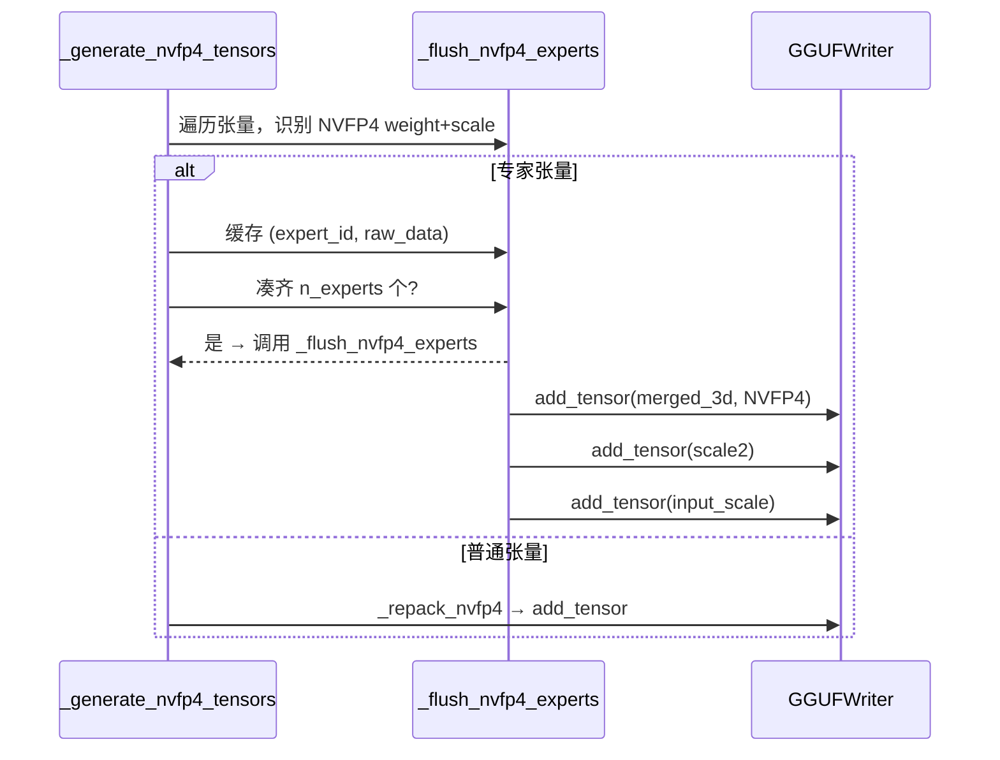

# 第5章 HF→GGUF 转换核心引擎 —— ModelBase 通用框架与多架构适配体系

## 学习目标

- 理解 `ModelBase` 作为转换器核心基类，如何统筹张量索引、反量化、重打包、名称映射、量化写入全流程
- 掌握 NVFP4/MXFP4 等新一代量化格式在转换器中的静态打包、专家流式生成、惰性张量封装机制
- 理解「张量命名三件套」（`format_tensor_name`/`match_model_tensor_name`/`map_tensor_name`）如何实现架构无关的标准化命名
- 掌握 `tensor_force_quant` 逐张量强制量化策略与 `prepare_tensors` 总装车间的协作模式
- 理解 `TextModel`/`MmprojModel` 双轨制如何分别处理文本主干与多模态投影器的配置、词表、元数据
- 掌握主流架构（Llama/DeepSeekV2/Gemma/Qwen/MoE/SSM/BERT/Encoder）在 `modify_tensors`、`set_gguf_parameters`、`set_vocab` 中的差异化定制模式
- 理解 `LazyTorchTensor` 如何通过 `__torch_function__` 代理实现远程/本地/分片张量的统一惰性加载与 NumPy 转换

## 5.1 生活类比

想象你是一位**芯片封装厂的总工程师**，面对来自世界各地的「裸晶圆」（Hugging Face 模型权重）：有的晶圆已经切好并贴好标签（标准 Llama），有的晶圆把 Q/K/V 三个电极焊在一根线上（Baichuan/GPT-NeoX/Falcon），有的晶圆内部藏着几十个「专家子芯片」需要先拆解再堆叠成 3D 封装，有的晶圆采用了实验室才有的 NVFP4/MXFP4 新工艺，需要把原厂的「超级块」拆开、重排、再按 GGML 规范打包。你的工厂（`ModelBase`）必须建立一套**标准化流水线**：

1. **来料检验与建档**（`index_tensors`）：扫描所有 safetensors/bin 分片，建立「张量名 → 惰性加载器」的台账，不实际搬运货物。
2. **工艺还原**（`dequant_model`）：针对 BitNet/FP8/GPTQ/Compressed-Tensors/ModelOpt/NVFP4/MXFP4 等量化工艺，还原为全精度或标准量化块。
3. **专用产线**：
   - **NVFP4 静态打包线**（`_nvfp4_pack`/`_repack_nvfp4`）：把原厂的 scale/weight 按 16×16 超级块重组，生成 GGML 标准布局。
   - **NVFP4 专家流式生产线**（`_generate_nvfp4_tensors`/`_flush_nvfp4_experts`）：逐层收集专家权重，凑齐 8/16/64 个专家后一次性堆叠写入，避免全模型驻留内存。
   - **MXFP4 重打包线**（`transform_nibble_layout`/`repack_mxfp4`）：半字节交织、scale/block 拼接，生成 MXFP4 标准张量。
4. **通用总装车间**（`prepare_tensors`）：遍历所有张量（含 `generate_extra_tensors` 产出的额外张量），经「命名三件套」统一改名、`tensor_force_quant` 定量化类型、量化后写入 GGUF。
5. **档案室**（`prepare_metadata`/`write_vocab`）：写入模型超参、RoPE、词表、特殊 token、聊天模板等元数据。
6. **分厂协作**：文本主干厂（`TextModel`）与多模态投影厂（`MmprojModel`）共享流水线前段，后段分别写入 MODEL 与 MMPROJ 类型 GGUF。

整个过程**不拆散成套家具（张量合并只在必要时如 MoE 专家堆叠/QKV 拆分发生）**、**不丢零件（精度保持/位级一致）**、**不超载搬运车（惰性加载/流式处理）**。

## 5.2 源码地图

./convert_hf_to_gguf.py
├── ModelBase（核心基类）
│   ├── __init__ / index_tensors / dequant_model / _nvfp4_pack / _generate_nvfp4_tensors / _flush_nvfp4_experts / _repack_nvfp4 —— 流水线前段：建档、反量化、NVFP4 处理
│   ├── format_tensor_name / match_model_tensor_name / map_tensor_name —— 命名三件套
│   ├── tensor_force_quant / generate_extra_tensors / modify_tensors / prepare_tensors —— 总装车间核心接口
│   ├── prepare_metadata / set_type / write / load_hparams / register / from_model_architecture —— 元数据、注册、入口
├── TextModel（文本模型分厂）
│   ├── __init__ / set_gguf_parameters / set_vocab / prepare_metadata / write_vocab / get_vocab_base / get_vocab_base_pre / _set_vocab_* —— 词表、通用参数、RoPE、池化
├── MmprojModel（多模态投影分厂）
│   ├── __init__ / get_vision_config / get_audio_config / set_gguf_parameters / set_type / tensor_force_quant —— 视觉/音频编码器配置、投影器类型
├── 具体架构适配类（30+）
│   ├── LlamaModel / DeepseekV2Model / GemmaModel / Gemma3Model / QwenModel / Qwen2Model / Qwen3Model 等
│   ├── MoE 系列：DeepseekModel / Qwen2MoeModel / MixtralModel / OlmoeModel 等
│   ├── SSM/混合系列：MambaModel / Mamba2Model / JambaModel / NemotronHModel / GraniteHybridModel 等
│   ├── Encoder/BERT 系列：BertModel / RobertaModel / DistilBertModel / ModernBertModel 等
│   ├── 多模态视觉/音频：LlavaVisionModel / Qwen2VLVisionModel / Gemma3VisionModel / WhisperEncoderModel 等
├── LazyTorchTensor（惰性张量统一封装）
│   ├── from_local_tensor / from_remote_tensor / from_safetensors_slice / numpy / __torch_function__ —— 统一延迟加载接口
├── parse_args / split_str_to_n_bytes / get_model_architecture / main —— 命令行入口与架构识别

## 5.3 ModelBase：转换器核心流水线

### 5.3.1 __init__：初始化与张量建档

源码路径：`./convert_hf_to_gguf.py` - `ModelBase.__init__`（第 81-143 行）

```python
# 第 81-143 行：ModelBase.__init__ - 初始化转换器上下文，建立张量索引与 GGUF 写入器
def __init__(self, dir_model: Path, ftype: gguf.LlamaFileType, fname_out: Path, *,
             is_big_endian: bool = False, use_temp_file: bool = False, eager: bool = False,
             metadata_override: Path | None = None, model_name: str | None = None,
             split_max_tensors: int = 0, split_max_size: int = 0, dry_run: bool = False,
             small_first_shard: bool = False, hparams: dict[str, Any] | None = None,
             remote_hf_model_id: str | None = None, disable_mistral_community_chat_template: bool = False,
             sentence_transformers_dense_modules: bool = False, fuse_gate_up_exps: bool = False):
    # 1. 禁止直接实例化基类/通用中间类
    if type(self) is ModelBase or type(self) is TextModel or type(self) is MmprojModel:
        raise TypeError("ModelBase/TextModel/MmprojModel cannot be instantiated directly")
    # 2. 基础路径与量化配置
    self.dir_model = dir_model
    self.ftype = ftype
    self.fname_out = fname_out
    self.is_big_endian = is_big_endian
    self.endianess = gguf.GGUFEndian.BIG if is_big_endian else gguf.GGUFEndian.LITTLE
    self.use_temp_file = use_temp_file
    # 3. 惰性加载开关：remote 模式或显式 --no-lazy 关闭时强制 eager
    self.lazy = not eager or (remote_hf_model_id is not None)
    self.dry_run = dry_run
    self.remote_hf_model_id = remote_hf_model_id
    self.sentence_transformers_dense_modules = sentence_transformers_dense_modules
    self.fuse_gate_up_exps = fuse_gate_up_exps
    # 4. 加载超参数（兼容 Mistral/HF 格式、多层嵌套 text_config）
    self.hparams = ModelBase.load_hparams(self.dir_model, self.is_mistral_format) if hparams is None else hparams
    # 5. 核心：建立张量名 → 惰性生成器 映射（不加载实数据）
    self.model_tensors = self.index_tensors(remote_hf_model_id=remote_hf_model_id)
    # 6. 元数据覆盖与输出路径处理
    self.metadata_override = metadata_override
    self.model_name = model_name
    self.dir_model_card = dir_model
    # 7. NVFP4/MXFP4 标记位
    self._is_nvfp4 = False
    self._is_mxfp4 = False
    # 8. 创建 GGUFWriter（架构名稍后由子类确定）
    self.gguf_writer = gguf.GGUFWriter(path=None, arch=None, endianess=self.endianess,
                                       use_temp_file=use_temp_file, disable_mistral_community_chat_template=disable_mistral_community_chat_template)
    self.disable_mistral_community_chat_template = disable_mistral_community_chat_template
```

> **逐行解析**：
> - 第 84-87 行：防御性编程，防止误实例化抽象基类。
> - 第 90-97 行：记录路径、量化类型、大小端、临时文件、分片参数。
> - 第 99-100 行：`lazy` 标记控制是否使用 `LazyTorchTensor` 延迟加载；远程模式强制 `lazy=True` 避免一次性下载全量权重。
> - 第 102 行：`load_hparams` 统一处理 Mistral `params.json` 与 HF `config.json`（含 `text_config`/`llm_config` 等嵌套）。
> - 第 104 行：`index_tensors` 是「来料建档」核心，返回 `Dict[tensor_name, Callable[[], Tensor]]`，值为零参生成器，调用时才真正读取磁盘/网络。
> - 第 111-112 行：NVFP4/MXFP4 标记位，后续 `prepare_tensors` 根据量化配置置位。
> - 第 114-116 行：提前创建 `GGUFWriter`，架构名留待子类 `set_gguf_parameters` 阶段通过 `add_architecture()` 确定。

### 5.3.2 index_tensors：分片扫描与惰性生成器构建

源码路径：`./convert_hf_to_gguf.py` - `ModelBase.index_tensors`（第 160-240 行）

```python
# 第 160-240 行：ModelBase.index_tensors - 扫描本地/远程分片，建立张量名→惰性加载器映射
def index_tensors(self, remote_hf_model_id: str | None = None) -> dict[str, Callable[[], Tensor]]:
    tensors: dict[str, Callable[[], Tensor]] = {}
    # 1. 远程模式：直接从 HF Hub 读取 safetensors 索引，构造 LazyTorchTensor.from_remote_tensor
    if remote_hf_model_id is not None:
        remote_tensors = gguf.utility.SafetensorRemote.get_list_tensors_hf_model(remote_hf_model_id)
        for name, remote_tensor in remote_tensors.items():
            tensors[name] = lambda r=remote_tensor: LazyTorchTensor.from_remote_tensor(r)
        return tensors
    # 2. 本地模式：优先 safetensors，回退 pytorch_model.bin
    prefix = "model" if not self.is_mistral_format else "consolidated"
    part_names = ModelBase.get_model_part_names(self.dir_model, prefix, ".safetensors")
    is_safetensors = len(part_names) > 0
    if not is_safetensors:
        part_names = ModelBase.get_model_part_names(self.dir_model, "pytorch_model", ".bin")
    # 3. 遍历每个分片文件，利用上下文管理器安全打开
    for part_name in part_names:
        with (safe_open(part_path, framework="pt", device="cpu") if is_safetensors
              else contextlib.closing(torch.load(part_path, map_location="cpu", mmap=True, weights_only=True))) as model_part:
            for name in model_part.keys():
                # 闭包捕获：data_gen 调用时才从分片读取切片
                if is_safetensors:
                    data_gen = lambda n=name, mp=model_part: LazyTorchTensor.from_safetensors_slice(mp.get_slice(n))
                else:
                    data_gen = lambda n=name, mp=model_part: mp[n]
                tensors[name] = data_gen
    # 4. 若存在 index.json，校验张量名完整性
    if len(tensor_names_from_index) > 0:
        missing = tensor_names_from_index - set(tensors.keys())
        if missing:
            raise ValueError(f"Missing tensors in model shards: {missing}")
    return tensors
```

> **逐行解析**：
> - 第 163-168 行：远程模式下直接调用 `SafetensorRemote.get_list_tensors_hf_model` 获取 `RemoteTensor` 列表，包装为 `LazyTorchTensor.from_remote_tensor`，实现**零下载建档**。
> - 第 170-176 行：本地模式按命名约定收集分片文件，`get_model_part_names` 保证字典序排序（分片顺序确定性）。
> - 第 178-190 行：`with` 语句确保分片文件句柄在循环内正确打开/关闭。`lambda n=name, mp=model_part: ...` 利用默认参数捕获当前循环变量，避免闭包陷阱。
> - 第 181 行：safetensors 返回 `LazyTorchTensor.from_safetensors_slice`，仅持有 `SafeTensorSlice` 对象，**延迟到 `numpy()`/`__torch_function__` 时才真正读取字节**。
> - 第 192-196 行：索引完整性校验，防止分片缺失导致静默报错。

```mermaid
flowchart TD
    A[开始 index_tensors] --> B{remote_hf_model_id?}
    B -->|是| C[查询 HF Hub safetensors 索引]
    C --> D[为每个张量创建 LazyTorchTensor.from_remote_tensor]
    B -->|否| E[扫描本地 .safetensors/.bin 分片]
    E --> F[逐分片打开，遍历键名]
    F --> G[创建闭包 data_gen 捕获分片句柄/键名]
    G --> H[存入 tensors[name] = data_gen]
    H --> I{存在 index.json?}
    I -->|是| J[校验张量名集合一致性]
    I -->|否| K[返回 tensors 映射]
    J --> K
```

### 5.3.3 dequant_model：多工艺反量化统一入口

源码路径：`./convert_hf_to_gguf.py` - `ModelBase.dequant_model`（第 242-397 行）

```python
# 第 242-397 行：ModelBase.dequant_model - 识别量化配置，执行反量化/重构，替换 model_tensors 映射
def dequant_model(self):
    # 1. 若已有完整 scale 张量（NVFP4 专家已处理），直接返回
    if self._is_nvfp4 and not any(k.endswith((".weight_scale", ".weight_scale_inv")) for k in self.model_tensors):
        return
    tensors_to_remove: list[str] = []
    new_tensors: dict[str, Callable[[], Tensor]] = {}
    # 2. 读取 quantization_config 判断工艺
    if (quant_config := self.hparams.get("quantization_config")) and isinstance(quant_config, dict):
        quant_method = quant_config.get("quant_method")
        # 2.1 通用反量化工具函数
        def dequant_bitnet(weight: Tensor, scale: Tensor) -> Tensor:
            return (weight.to(torch.float32) * scale.to(torch.float32)).to(weight.dtype)
        def dequant_simple(weight: Tensor, scale: Tensor, block_size: Sequence[int] | None = None) -> Tensor:
            # 按块广播 scale 还原
            ...
        def dequant_gptq(g_idx: Tensor, qweight: Tensor, qzeros: Tensor, scales: Tensor) -> Tensor:
            # GPTQ 解包：g_idx 指导每行 scale，qzeros 零点偏移
            ...
        def dequant_packed(weight: Tensor, scale: Tensor, zero: Tensor | None, bits: int, groupsize: int) -> Tensor:
            # compressed-tensors/ModelOpt 通用打包格式解包
            ...
        # 2.2 按工艺分发
        if quant_method == "bitnet":
            for name, gen in self.model_tensors.items():
                if name.endswith(".weight"):
                    scale_name = name.replace(".weight", ".scale")
                    if scale_name in self.model_tensors:
                        tensors_to_remove.extend([name, scale_name])
                        new_tensors[name] = lambda w=gen(), s=self.model_tensors[scale_name](): dequant_bitnet(w, s)
        elif quant_method == "fp8":
            # 遍历 weight + weight_scale 成对反量化
            ...
        elif quant_method == "gptq":
            # 收集 g_idx/qweight/qzeros/scales 四元组
            ...
        elif quant_method == "compressed-tensors":
            # 兼容 weight_packed/weight_scale/zero_point 等字段
            ...
        elif quant_method == "modelopt":
            # ModelOpt NVFP4/MXFP4 等，交由后续 _generate_nvfp4_tensors 处理
            pass
        elif quant_method is not None:
            raise NotImplementedError(f"Unsupported quantization method: {quant_method}")
    # 3. 批量替换 model_tensors
    for name in tensors_to_remove:
        if name in self.model_tensors:
            del self.model_tensors[name]
    for name, value in new_tensors.items():
        self.model_tensors[name] = value
```

> **逐行解析**：
> - 第 245-247 行：NVFP4 专家模式下若已无 loose scale 张量，说明 `_generate_nvfp4_tensors` 已消费完毕，跳过通用反量化。
> - 第 250-270 行：定义四大通用反量化内核，均为**纯张量运算**，无副作用，便于闭包捕获。
> - 第 272-380 行：按 `quant_method` 分发。关键设计：**不立即计算**，而是构造新的零参 `lambda` 生成器存入 `new_tensors`，保持惰性流水线不变。
> - 第 382-387 行：原子性替换 `model_tensors`，旧键删除、新键插入，**下游 `get_tensors`/`prepare_tensors` 完全感知不到反量化发生**。

### 5.3.4 NVFP4 静态打包与专家流式生成

#### 5.3.4.1 _nvfp4_pack：超级块重组核心算子

源码路径：`./convert_hf_to_gguf.py` - `ModelBase._nvfp4_pack`（第 474-493 行）

```python
# 第 474-493 行：ModelBase._nvfp4_pack - 将 ModelOpt NVFP4 权重重组为 GGML 超级块布局
@staticmethod
def _nvfp4_pack(weight: Tensor, scale: Tensor) -> tuple[np.ndarray, list[int]]:
    # weight: [out_features, n_blocks * 16] (uint8, 每字节存 2 个 4bit 值)
    # scale:  [out_features, n_blocks]       (uint8, 低 7bit 存 scale, 高 1bit 保留)
    out_features = weight.shape[0]
    n_blocks = scale.shape[1]
    # 1. 将 weight reshape 为 [out_features, n_blocks, 16] → 拆 nibble → [out_features, n_blocks, 16]
    w = weight.reshape(out_features, n_blocks, 8)  # 每行 8 字节 = 16 个 4bit 值
    vals = torch.stack([w & 0x0F, w >> 4], dim=-1).reshape(out_features, n_blocks, 16)
    # 2. 取 scale 低 7bit → [out_features, n_blocks]
    d_ue = scale.view(torch.uint8).numpy().reshape(out_features, n_blocks) & 0x7F
    # 3. 重新交织：前 8 个 nibble | (后 8 个 nibble << 4) → [out_features, n_blocks, 8] (uint8)
    qs = (vals[:, :, :8] | (vals[:, :, 8:] << 4)).to(torch.uint8).numpy()
    # 4. 按 4 个 block = 1 个 super-block 分组：n_super = n_blocks // 4
    n_super = n_blocks // 4
    d_grouped = d_ue.reshape(out_features, n_super, 4)
    qs_grouped = qs.reshape(out_features, n_super, 4, 8).reshape(out_features, n_super, 32)
    # 5. 拼接：[scale(4) | weight(32)] → [out_features, n_super, 36] → flatten → [out_features, n_super*36]
    raw = np.concatenate([d_grouped, qs_grouped], axis=-1).reshape(out_features, n_super * 36)
    # 6. 逻辑形状供 GGML 内核解析：[out_features, n_super * 64] (每 super-block 64 个元素)
    return raw, [out_features, n_super * 64]
```

> **逐行解析**：
> - 第 477-478 行：输入 `weight` 为打包后的 4bit 值（每字节 2 个），`scale` 为每 block 一个 scale（uint8 低 7bit）。
> - 第 480-482 行：`w & 0x0F` 取低 nibble，`w >> 4` 取高 nibble，`stack` 后 `reshape` 得到 `[out_features, n_blocks, 16]` 的展开 4bit 值矩阵。
> - 第 484 行：`scale.view(torch.uint8).numpy() & 0x7F` 提取有效 scale 位。
> - 第 486 行：`vals[:, :, :8] | (vals[:, :, 8:] << 4)` 将 16 个 nibble 重新打包为 8 字节（GGML 内核期望的连续布局）。
> - 第 488-491 行：按 **4 blocks = 1 super-block** 分组，`d_grouped` 形状 `[out_features, n_super, 4]`，`qs_grouped` 形状 `[out_features, n_super, 32]`，拼接后 `raw` 形状 `[out_features, n_super * 36]`（4 scales + 32 weight bytes）。
> - 第 493 行：返回 `raw` (numpy) 与逻辑形状 `[out_features, n_super * 64]`，后者供 `GGUFWriter.add_tensor(raw_dtype=NVFP4)` 使用。

#### 5.3.4.2 _generate_nvfp4_tensors / _flush_nvfp4_experts：专家流式聚合

源码路径：`./convert_hf_to_gguf.py` - `ModelBase._generate_nvfp4_tensors`（第 521-585 行）与 `ModelBase._flush_nvfp4_experts`（第 709-738 行）

```python
# 第 521-585 行：_generate_nvfp4_tensors - 遍历 model_tensors，识别 NVFP4 权重并分流处理
def _generate_nvfp4_tensors(self):
    expert_blocks = {}      # {layer_key: [(expert_id, raw_data)]}
    expert_scales = {}      # {layer_key: [(expert_id, scale2_vals)]}
    expert_input_scales = {}# {layer_key: [(expert_id, input_scale_vals)]}
    expert_shapes = {}      # {layer_key: logical_shape}
    n_experts = self.find_hparam(["num_local_experts", "num_experts"], optional=True) or 0
    consumed: list[str] = []
    for name in list(self.model_tensors.keys()):
        if not name.endswith(".weight"):
            continue
        scale_name = name.replace(".weight", ".weight_scale")
        scale2_name = name.replace(".weight", ".weight_scale_2")
        input_scale_name = name.replace(".weight", ".input_scale")
        if scale_name not in self.model_tensors:
            continue
        # 1. 物化 weight/scale/scale2/input_scale（此处必须 eager 计算）
        weight = LazyTorchTensor.to_eager(self.model_tensors[name]())
        scale  = LazyTorchTensor.to_eager(self.model_tensors[scale_name]())
        if scale.ndim < 2:  # 非 NVFP4 张量
            continue
        scale2 = LazyTorchTensor.to_eager(self.model_tensors.get(scale2_name, torch.ones_like(scale[:, :1]))())
        input_scale = LazyTorchTensor.to_eager(self.model_tensors.get(input_scale_name, torch.ones_like(scale[:, :1]))())
        consumed.extend([name, scale_name, scale2_name, input_scale_name])
        # 2. 判断是否为专家张量（名称含 "experts."）
        if "experts." in name:
            # 解析 layer_id, expert_id, proj_type (w1/w2/w3)
            key = f"{layer_id}.{proj_type}"
            expert_blocks.setdefault(key, []).append((expert_id, weight))
            expert_scales.setdefault(key, []).append((expert_id, scale2))
            expert_input_scales.setdefault(key, []).append((expert_id, input_scale))
            expert_shapes[key] = weight.shape
            # 3. 凑齐该层所有专家 → 刷新
            if len(expert_blocks[key]) >= n_experts:
                self._flush_nvfp4_experts(key, expert_blocks, expert_scales, expert_input_scales, expert_shapes, layer_id, proj_type)
        else:
            # 非专家张量：直接重打包写入
            self._repack_nvfp4(name, weight, scale, scale2, input_scale)
    # 4. 刷新残留专家
    for key in list(expert_blocks.keys()):
        if expert_blocks[key]:
            self._flush_nvfp4_experts(key, expert_blocks, expert_scales, expert_input_scales, expert_shapes, *parse_key(key))
    # 5. 清理已消费张量
    for name in consumed:
        if name in self.model_tensors:
            del self.model_tensors[name]
```

```python
# 第 709-738 行：_flush_nvfp4_experts - 合并专家权重并写入 GGUF
def _flush_nvfp4_experts(self, key, expert_blocks, expert_scales, expert_input_scales, expert_shapes, bid, proj_type):
    experts = expert_blocks.pop(key)
    scales = expert_scales.pop(key)
    input_scales = expert_input_scales.pop(key)
    shape = expert_shapes.pop(key)
    # 1. 按 expert_id 排序并堆叠 → [n_experts, out_features, n_super*36]
    experts.sort(key=lambda x: x[0])
    merged = np.stack([e[1] for e in experts], axis=0)
    merged_name = f"model.layers.{bid}.mlp.experts.{proj_type}.weight"
    new_name = self.map_tensor_name(merged_name)
    self.gguf_writer.add_tensor(new_name, merged, raw_dtype=gguf.GGMLQuantizationType.NVFP4)
    # 2. 处理 scale2：全 1 则省略
    scales.sort(key=lambda x: x[0])
    scale_vals = np.array([s[1] for s in scales], dtype=np.float32)
    if not np.allclose(scale_vals, 1.0, atol=1e-6):
        scale_name = new_name.replace(".weight", ".scale")
        self.gguf_writer.add_tensor(scale_name, scale_vals)
    # 3. 处理 input_scale：同理
    input_scales.sort(key=lambda x: x[0])
    input_scale_vals = np.array([s[1] for s in input_scales], dtype=np.float32)
    if not np.allclose(input_scale_vals, 1.0, atol=1e-6):
        input_scale_name = new_name.replace(".weight", ".input_scale")
        self.gguf_writer.add_tensor(input_scale_name, input_scale_vals)
```

> **逐行解析**：
> - `_generate_nvfp4_tensors` 第 524-528 行：四个字典按 `layer_key` 分组缓冲专家数据，**内存峰值仅为单层专家总量**。
> - 第 538-548 行：`LazyTorchTensor.to_eager` 强制物化，**仅在 NVFP4 处理阶段**打破惰性，因为打包算法需要完整张量。
> - 第 550-560 行：专家张量入缓冲，**不立即写入**，等待同层所有专家到齐。
> - 第 562-564 行：非专家张量直接 `_repack_nvfp4` 写入，流程短平快。
> - `_flush_nvfp4_experts` 第 712-716 行：`np.stack` 将列表堆叠为 3D 张量 `[n_experts, out_features, n_super*36]`，**完全符合 GGML MOE_NVFP4 布局**。
> - 第 718-727 行：`scale2` 与 `input_scale` 仅在非常数时写入，**省略冗余存储**。



### 5.3.5 命名三件套：架构无关的标准化命名

源码路径：`./convert_hf_to_gguf.py` - `ModelBase.format_tensor_name`/`match_model_tensor_name`/`map_tensor_name`（第 403-431 行）

```python
# 第 403-411 行：format_tensor_name - 由 GGUF 架构模板生成标准张量名
def format_tensor_name(self, key: gguf.MODEL_TENSOR, bid: int | None = None, suffix: str = ".weight") -> str:
    if key not in gguf.MODEL_TENSORS[self.model_arch]:
        raise ValueError(f"Tensor key {key} not defined for architecture {self.model_arch}")
    name: str = gguf.TENSOR_NAMES[key]
    if "{bid}" in name:
        assert bid is not None
        name = name.format(bid=bid)
    return name + suffix

# 第 413-425 行：match_model_tensor_name - 判断张量名是否匹配指定模板
def match_model_tensor_name(self, name: str, key: gguf.MODEL_TENSOR, bid: int | None, suffix: str = ".weight") -> bool:
    if key not in gguf.MODEL_TENSORS[self.model_arch]:
        return False
    key_name: str = gguf.TENSOR_NAMES[key]
    if "{bid}" in key_name:
        if bid is None:
            return False
        key_name = key_name.format(bid=bid)
    else:
        if bid is not None:
            return False
    return name == (key_name + suffix)

# 第 427-431 行：map_tensor_name - 将原始张量名映射为 GGUF 标准名
def map_tensor_name(self, name: str, try_suffixes: Sequence[str] = (".weight", ".bias")) -> str:
    new_name = self.tensor_map.get_name(key=name, try_suffixes=try_suffixes)
    if new_name is None:
        raise ValueError(f"Can not map tensor {name!r}")
    return new_name
```

> **逐行解析**：
> - `format_tensor_name`：根据 `gguf.TENSOR_NAMES` 模板（如 `"blk.{bid}.attn_q.weight"`）填充 `bid`，生成**标准名**。子类可调用此方法构造合并后的专家张量名。
> - `match_model_tensor_name`：反向匹配，**用于 `modify_tensors` 中识别特定张量**（如 `FFN_GATE_EXP`），逻辑与 `format_tensor_name` 严格对称。
> - `map_tensor_name`：委托 `gguf.TensorNameMap` 执行**原始名 → 标准名**的查表映射，支持多后缀尝试。这是「命名三件套」的**入口**，所有架构适配类最终都汇聚于此。

> **协作模式**：子类 `modify_tensors` 先做架构特有变换（QKV 拆分、转置、合并），最后调用 `super().modify_tensors(data_torch, name, bid)`，基类内部再调用 `map_tensor_name` 完成最终定名，**保证命名一致性**。

### 5.3.6 tensor_force_quant / generate_extra_tensors / modify_tensors / prepare_tensors：总装车间四大接口

源码路径：`./convert_hf_to_gguf.py` - 对应方法（第 465-472, 834-834 行等）

```python
# 第 465-468 行：tensor_force_quant - 逐张量强制量化类型扩展点
def tensor_force_quant(self, name: str, new_name: str, bid: int | None, n_dims: int) -> gguf.GGMLQuantizationType | bool:
    del name, new_name, bid, n_dims
    return False  # 默认不强制，由全局 ftype 决定

# 第 470-472 行：generate_extra_tensors - 额外张量产出扩展点（如 RoPE 频率因子、音频位置编码）
def generate_extra_tensors(self) -> Iterable[tuple[str, Tensor]]:
    return ()

# 第 436-463 行：modify_tensors - 单张量名称映射与 MoE gate/up 融合（可选）
def modify_tensors(self, data_torch: Tensor, name: str, bid: int | None) -> Iterable[tuple[str, Tensor]]:
    new_name = self.map_tensor_name(name)
    # 可选：gate/up 融合（--fuse-gate-up-exps 开启时）
    if self.fuse_gate_up_exps and bid is not None:
        if self.match_model_tensor_name(new_name, gguf.MODEL_TENSOR.FFN_GATE_EXP, bid):
            self._gate_exp_buffer[bid] = data_torch
            return []
        if self.match_model_tensor_name(new_name, gguf.MODEL_TENSOR.FFN_UP_EXP, bid):
            self._up_exp_buffer[bid] = data_torch
            return []
        if bid in self._gate_exp_buffer and bid in self._up_exp_buffer:
            gate_data = self._gate_exp_buffer.pop(bid)
            up_data = self._up_exp_buffer.pop(bid)
            fused_data = torch.cat([gate_data, up_data], dim=1)
            fused_name = self.format_tensor_name(gguf.MODEL_TENSOR.FFN_GATE_UP_EXP, bid)
            return [(fused_name, fused_data)]
    return [(new_name, data_torch)]

# 第 740-834 行：prepare_tensors - 总装车间主流程
def prepare_tensors(self):
    # 1. 检测量化算法，置位 _is_nvfp4/_is_mxfp4
    quant_algo = (self.hparams.get("quantization_config") or {}).get("quant_algo")
    ...
    if quant_algo != "NVFP4":
        if any(v.get("quant_algo") == "NVFP4" for v in quant_layers.values() if isinstance(v, dict)):
            quant_algo = "NVFP4"
    self._is_nvfp4 = quant_algo == "NVFP4"
    self._is_mxfp4 = quant_method == "mxfp4"
    # 2. NVFP4 专用预处理（静态打包+专家聚合）
    if self._is_nvfp4:
        self._generate_nvfp4_tensors()
    # 3. 通用反量化（BitNet/FP8/GPTQ/等）
    self.dequant_model()
    # 4. 遍历所有张量：额外张量 + 普通张量
    for name, data_torch in chain(self.generate_extra_tensors(), self.get_tensors()):
        # 4.1 modify_tensors 可能产出 0/1/多个张量（融合/拆分）
        for new_name, data in self.modify_tensors(data_torch, name, bid):
            # 4.2 tensor_force_quant 定量化类型
            data_qtype = self.tensor_force_quant(name, new_name, bid, data.ndim)
            # 4.3 量化并写入
            data = gguf.quants.quantize(data, data_qtype)
            self.gguf_writer.add_tensor(new_name, data, raw_dtype=data_qtype)
```

> **逐行解析**：
> - `tensor_force_quant`：返回 `GGMLQuantizationType` 则强制该张量量化类型，返回 `False` 走全局 `ftype`。子类常重写以保护 `embedding`/`output`/`patch_embd` 等敏感层。
> - `generate_extra_tensors`：产出**配置中不存在但运行时需要**的张量（如 Llama3 RoPE factors、MiniCPM long/short factors、音频位置编码）。
> - `modify_tensors`：基类实现已包含 `map_tensor_name` 与可选 `gate/up` 融合。子类**必须**以 `yield from super().modify_tensors(...)` 结尾，确保命名映射生效。
> - `prepare_tensors`：核心流水线，**顺序固定**：NVFP4 预处理 → 反量化 → 张量遍历 → 修改/映射 → 强制量化 → 量化写入。`chain(generate_extra_tensors(), get_tensors())` 保证额外张量**优先写入**（便于某些运行时先读取）。

## 5.4 TextModel / MmprojModel：双轨制分厂

### 5.4.1 TextModel：文本主干通用框架

源码路径：`./convert_hf_to_gguf.py` - `TextModel`（第 942-1181 行）

```python
# 第 942-965 行：TextModel.__init__ - 解析架构、层数、张量映射、RoPE 配置
def __init__(self, *args, **kwargs):
    super().__init__(*args, **kwargs)
    if not self.is_mistral_format:
        self.hf_arch = get_model_architecture(self.hparams, self.model_type)
    else:
        self.hf_arch = ""
    if "text_config" in self.hparams:
        self.hparams = {**self.hparams, **self.hparams["text_config"]}
    self.block_count = self.find_hparam(["n_layers", "num_hidden_layers", "n_layer", "num_layers"])
    self.tensor_map = gguf.get_tensor_name_map(self.model_arch, self.block_count)
    self.rope_parameters = self.hparams.get("rope_parameters", self.hparams.get("rope_scaling")) or {}
```

```python
# 第 1003-1110 行：TextModel.set_gguf_parameters - 写入通用文本模型超参
def set_gguf_parameters(self):
    self.gguf_writer.add_block_count(self.block_count)
    if (n_ctx := self.find_hparam(["max_position_embeddings", "n_positions", "n_ctx", "max_seq_len"], optional=True)) is not None:
        self.gguf_writer.add_context_length(n_ctx)
    if (n_embd := self.find_hparam(["hidden_size", "n_embd", "d_model", "dim"], optional=True)) is not None:
        self.gguf_writer.add_embedding_length(n_embd)
    if (n_ff := self.find_hparam(["intermediate_size", "n_inner", "ffn_hidden_size", "hidden_dim"], optional=True)) is not None:
        self.gguf_writer.add_feed_forward_length(n_ff)
    if (n_head := self.find_hparam(["num_attention_heads", "n_head", "n_heads"], optional=True)) is not None:
        self.gguf_writer.add_head_count(n_head)
    if (n_head_kv := self.find_hparam(["num_key_value_heads", "n_kv_head", "n_head_kv", "num_kv_heads"], optional=True)) is not None:
        self.gguf_writer.add_head_count_kv(n_head_kv)
    # RoPE 参数：维度、频率基、缩放类型/因子/原始上下文
    if (rope_dim := self.find_hparam(["head_dim", "rotary_dim"], optional=True)) is not None:
        self.gguf_writer.add_rope_dimension_count(rope_dim)
    if (rope_theta := self.rope_parameters.get("rope_theta", self.rope_parameters.get("theta"))) is not None:
        self.gguf_writer.add_rope_freq_base(rope_theta)
    if rope_scaling := self.rope_parameters.get("rope_scaling", self.rope_parameters):
        if (rtype := rope_scaling.get("type", rope_scaling.get("rope_type"))) is not None:
            self.gguf_writer.add_rope_scaling_type(gguf.RopeScalingType[rtype.upper()])
        if (factor := rope_scaling.get("factor")) is not None:
            self.gguf_writer.add_rope_scaling_factor(factor)
    # 归一化 epsilon、文件类型、MoE 参数等
    ...
    self.gguf_writer.add_file_type(self.ftype)
```

```python
# 第 1142-1181 行：TextModel.get_vocab_base - 从 HF tokenizer 提取词表/类型/预分词器哈希
def get_vocab_base(self) -> tuple[list[str], list[int], str]:
    tokens: list[str] = []
    toktypes: list[int] = []
    tokenizer = AutoTokenizer.from_pretrained(self.dir_model)
    vocab_size = self.hparams.get("vocab_size", len(tokenizer.vocab))
    reverse_vocab = {id_: encoded_tok for encoded_tok, id_ in tokenizer.vocab.items()}
    added_vocab = tokenizer.get_added_vocab()
    added_tokens_decoder = tokenizer.added_tokens_decoder
    for i in range(vocab_size):
        if i not in reverse_vocab:
            tokens.append(f"[PAD{i}]")
            toktypes.append(gguf.TokenType.UNUSED)
        else:
            token = reverse_vocab[i]
            if token in added_vocab:
                if added_tokens_decoder[i].special or self.does_token_look_special(token):
                    toktypes.append(gguf.TokenType.CONTROL)
                else:
                    toktypes.append(gguf.TokenType.USER_DEFINED)
            else:
                toktypes.append(gguf.TokenType.NORMAL)
            tokens.append(token)
    return tokens, toktypes, tokpre
```

> **逐行解析**：
> - `__init__` 第 948 行：`get_model_architecture` 识别 HF 架构名（如 `LlamaForCausalLM`），后续注册表查找对应适配类。
> - 第 950-951 行：将 `text_config` 扁平化合并到 `hparams`，统一后续 `find_hparam` 检索。
> - 第 953 行：`get_tensor_name_map` 依据 `model_arch` 与 `block_count` 构建 `TensorNameMap`，**命名三件套的底表**。
> - `set_gguf_parameters`：大量 `find_hparam([...], optional=True)` 链式调用，**兼容不同架构的字段命名差异**（如 `hidden_size`/`n_embd`/`d_model`/`dim`）。
> - RoPE 参数同时读取 `rope_parameters` 与 `rope_scaling`，**兼容新旧配置格式**。
> - `get_vocab_base`：通用 HF tokenizer 词表提取，**特殊 token 判定**结合 `added_tokens_decoder.special` 与 `does_token_look_special` 启发式规则。

### 5.4.2 MmprojModel：多模态投影器专用分厂

源码路径：`./convert_hf_to_gguf.py` - `MmprojModel`（第 2050-2189 行）

```python
# 第 2050-2109 行：MmprojModel.__init__ - 解析视觉/音频配置、预处理器参数、张量映射
def __init__(self, *args, **kwargs):
    super().__init__(*args, **kwargs)
    if self.model_arch != gguf.MODEL_ARCH.MMPROJ:
        raise TypeError("MmprojModel only for MMPROJ architecture")
    # 1. 文本侧嵌入维度（投影输出维度）
    self.n_embd_text = self.find_hparam(["hidden_size", "n_embd", "d_model"], optional=True) or 4096
    self.global_config = copy.deepcopy(self.hparams)
    # 2. 分离视觉/音频配置
    self.hparams_vision = self.get_vision_config()
    self.hparams_audio = self.get_audio_config()
    self.hparams = self.hparams_vision or self.hparams_audio or self.hparams
    # 3. 层数与张量映射
    have_multiple_encoders = self.hparams_vision is not None and self.hparams_audio is not None
    self.block_count = 128 if have_multiple_encoders else self.find_hparam(self.n_block_keys, True)
    self.tensor_map = gguf.get_tensor_name_map(self.model_arch, self.block_count)
    # 4. 预处理器配置（image_mean/std/size 等）
    self.preprocessor_config = {}
    if (preproc_path := self.dir_model / "preprocessor_config.json").is_file():
        with open(preproc_path, "r", encoding="utf-8") as f:
            self.preprocessor_config = json.load(f)
```

```python
# 第 2133-2163 行：MmprojModel.set_gguf_parameters - 写入视觉/音频编码器结构参数
def set_gguf_parameters(self):
    self.gguf_writer.add_file_type(self.ftype)
    if self.has_vision_encoder:
        self.gguf_writer.add_clip_has_vision_encoder(True)
        self.gguf_writer.add_vision_projection_dim(self.n_embd_text)
        self.image_size = self.find_vparam(["image_size"])
        self.patch_size = self.find_vparam(["patch_size"])
        self.gguf_writer.add_vision_image_size(self.image_size)
        self.gguf_writer.add_vision_patch_size(self.patch_size)
        self.gguf_writer.add_vision_embedding_length(self.find_vparam(["hidden_size", "d_model"]))
        self.gguf_writer.add_vision_feed_forward_length(self.find_vparam(["intermediate_size"]))
        self.gguf_writer.add_vision_block_count(self.block_count)
        self.gguf_writer.add_vision_head_count(self.find_vparam(["num_attention_heads", "num_heads"]))
        self.gguf_writer.add_vision_layer_norm_eps(self.find_vparam(["layer_norm_eps", "layer_norm_epsilon"]))
        # 投影器类型由子类在 set_gguf_parameters 中添加
    if self.has_audio_encoder:
        self.gguf_writer.add_clip_has_audio_encoder(True)
        self.gguf_writer.add_audio_projection_dim(self.n_embd_text)
        ...
    if not self.has_vision_encoder and not self.has_audio_encoder:
        raise ValueError("MmprojModel requires at least one encoder")
```

```python
# 第 2185-2189 行：MmprojModel.tensor_force_quant - 保护 patch_embd/patch_merger 精度
def tensor_force_quant(self, name, new_name, bid, n_dims):
    del bid, name, n_dims
    if ".patch_embd.weight" in new_name or ".patch_merger.weight" in new_name:
        return gguf.GGMLQuantizationType.F16 if self.ftype == gguf.LlamaFileType.MOSTLY_F16 else gguf.GGMLQuantizationType.F32
    return False
```

> **逐行解析**：
> - `__init__` 第 2056-2060 行：`global_config` 保存完整配置，`hparams_vision/audio` 分离编码器配置，**避免污染文本侧参数**。
> - 第 2062-2064 行：双编码器模型（如 Qwen2.5-Omni）`block_count=128` 占位，实际由子类细化。
> - `set_gguf_parameters`：调用 `add_clip_has_vision_encoder`/`add_vision_*` 等 **MMPROJ 专用 KV**，运行时 `llama.cpp` 仅加载投影器权重。
> - `tensor_force_quant`：强制 `patch_embd`/`patch_merger` 用 F16/F32，**防止视觉特征提取层量化损伤过大**。

## 5.5 典型架构适配模式解析

### 5.5.1 LlamaModel：基准实现与 MoE 扩展

源码路径：`./convert_hf_to_gguf.py` - `LlamaModel`（第 2755-2906 行）

```python
# 第 2822-2876 行：LlamaModel.modify_tensors - 跳过多模态张量、前缀重命名、QKV 逆置换、MoE 专家合并
def modify_tensors(self, data_torch: Tensor, name: str, bid: int | None) -> Iterable[tuple[str, Tensor]]:
    n_head = self.find_hparam(["n_heads", "num_attention_heads"])
    n_kv_head = self.find_hparam(["n_kv_heads", "num_key_value_heads"])
    # 1. 过滤视觉/音频/投影张量（归 mmproj 处理）
    vision_prefixes = ["vision_encoder.", "vision_language_adapter.", "patch_merger.", "pre_mm_projector_norm", "audio_encoder."]
    is_multimodal_tensor = "vision_tower" in name or "vision_model" in name or "audio_tower" in name \
        or "model.connector" in name or "multi_modal_projector" in name \
        or any(name.startswith(p) for p in vision_prefixes)
    if is_multimodal_tensor:
        return
    # 2. 前缀归一化：SmolVLM / language_model.* → model.*
    elif self.hf_arch == "LlamaModel":
        name = "model." + name
    elif name.startswith("model.text_model"):
        name = name.replace("text_model.", "")
    elif name.startswith("language_model."):
        name = name.replace("language_model.", "")
    # 3. Q/K 逆置换（HF 存储为交错 RoPE，GGUF 需分离）
    if self.undo_permute:
        if name.endswith(("q_proj.weight", "q_proj.bias")):
            data_torch = LlamaModel.permute(data_torch, n_head, n_head)
        if name.endswith(("k_proj.weight", "k_proj.bias")):
            data_torch = LlamaModel.permute(data_torch, n_head, n_kv_head)
    # 4. MoE 专家合并：缓冲 → 堆叠 → 产出 3D 张量
    if name.find("block_sparse_moe.experts") != -1:
        n_experts = self.hparams["num_local_experts"]
        assert bid is not None
        if self._experts is None:
            self._experts = [{} for _ in range(self.block_count)]
        self._experts[bid][name] = data_torch
        if len(self._experts[bid]) >= n_experts * 3:
            for wid in ["w1", "w2", "w3"]:
                datas = [self._experts[bid].pop(f"model.layers.{bid}.block_sparse_moe.experts.{xid}.{wid}.weight") for xid in range(n_experts)]
                data_torch = torch.stack(datas, dim=0)
                merged_name = f"layers.{bid}.feed_forward.experts.{wid}.weight"
                yield from super().modify_tensors(data_torch, merged_name, bid)
            return
        else:
            return
    yield from super().modify_tensors(data_torch, name, bid)
```

```python
# 第 2877-2898 行：LlamaModel.generate_extra_tensors - Llama3 RoPE 频率因子
def generate_extra_tensors(self) -> Iterable[tuple[str, Tensor]]:
    if rope_params := self.rope_parameters.get("full_attention", self.rope_parameters):
        if rope_params.get("rope_type", '').lower() == "llama3":
            base = rope_params.get("rope_theta", 10000.0)
            if (dim := self.hparams.get("head_dim")) is None:
                dim = self.hparams["hidden_size"] // self.hparams["num_attention_heads"]
            freqs = 1.0 / (base ** (torch.arange(0, dim, 2, dtype=torch.float32) / dim))
            factor = rope_params.get("factor", 8.0)
            low_freq_factor = rope_params.get("low_freq_factor", 1.0)
            high_freq_factor = rope_params.get("high_freq_factor", 4.0)
            old_context_len = self.hparams.get("original_max_position_embeddings", 8192)
            low_freq_wavelen = old_context_len / low_freq_factor
            high_freq_wavelen = old_context_len / high_freq_factor
            rope_factors = []
            for freq in freqs:
                wavelen = 2 * math.pi / freq
                if wavelen < high_freq_wavelen:
                    rope_factors.append(1)
                elif wavelen > low_freq_wavelen:
                    rope_factors.append(factor)
                else:
                    smooth = (old_context_len / wavelen - low_freq_factor) / (high_freq_factor - low_freq_factor)
                    rope_factors.append(1 / ((1 - smooth) / factor + smooth))
            yield (self.format_tensor_name(gguf.MODEL_TENSOR.ROPE_FREQS), torch.tensor(rope_factors, dtype=torch.float32))
```

> **逐行解析**：
> - 第 2828-2837 行：`is_multimodal_tensor` 精准过滤，**视觉/音频张量完全交给 `MmprojModel`**，避免重复/冲突。
> - 第 2845-2850 行：`undo_permute` 控制是否撤销 HF 的 RoPE 交错存储，`LlamaModel.permute` 实现 `reshape → swapaxes → reshape` 逆变换。
> - 第 2852-2868 行：MoE 专家合并**经典模式**：`_experts[bid]` 缓冲字典，凑齐 `n_experts * 3` 个张量（w1/w2/w3）后 `torch.stack(dim=0)` 生成 `[n_experts, ...]` 3D 张量，调用 `super().modify_tensors` 走标准命名映射。
> - `generate_extra_tensors`：仅当 `rope_type == "llama3"` 时产出 `ROPE_FREQS` 张量，**完全由配置计算，无需读取权重**。

### 5.5.2 DeepseekV2Model：MLA 吸收优化与 MoE 统一

源码路径：`./convert_hf_to_gguf.py` - `DeepseekV2Model`（第 8705-8891 行）

```python
# 第 8809-8882 行：DeepseekV2Model.modify_tensors - 跳过视觉/MTP、lm_head 共享、kv_b_proj 拆分、MoE 合并
def modify_tensors(self, data_torch: Tensor, name: str, bid: int | None) -> Iterable[tuple[str, Tensor]]:
    # 1. 跳过视觉/多模态/MTB 张量
    if ("vision_tower" in name or "multi_modal_projector" in name or "mm_projector" in name
            or "vision_model" in name or "image_newline" in name or "model.projector" in name
            or "sam_model" in name or "view_seperator" in name):
        return
    if name.startswith("siglip2.") or name.startswith("merger."):
        return
    if name.startswith("language_model."):
        name = name.replace("language_model.", "")
    # 2. tied embeddings：跳过 lm_head
    if self.hparams.get("tie_word_embeddings", False):
        if name == "lm_head.weight" or name == "model.lm_head.weight":
            logger.info("Skipping tied output layer 'lm_head.weight'")
            return
    # 3. e_score_correction_bias 重命名
    if name.endswith("e_score_correction_bias"):
        name = name.replace("e_score_correction_bias", "e_score_correction.bias")
    # 4. 跳过 MTP 层
    if self.skip_mtp:
        block_count = self.hparams["num_hidden_layers"]
        match = re.match(r"model.layers.(\d+)", name)
        if match and int(match.group(1)) >= block_count:
            return
    # 5. MoE 专家合并（同 Llama 模式）
    if self.merge_expert and name.find("mlp.experts") != -1:
        ... # 缓冲 → 堆叠 → yield merged
        return
    # 6. MLA 吸收优化核心：kv_b_proj → k_b_proj + v_b_proj（并转置 k_b）
    if name.endswith("kv_b_proj.weight"):
        name_kb = name.replace("kv_b_proj", "k_b_proj")
        name_vb = name.replace("kv_b_proj", "v_b_proj")
        n_head_kv = self.hparams["num_key_value_heads"]
        v_head_dim = self.hparams["v_head_dim"]
        qk_nope_head_dim = self.hparams["qk_nope_head_dim"]
        assert data_torch.shape[0] == n_head_kv * (v_head_dim + qk_nope_head_dim)
        kv_b = data_torch.view(n_head_kv, v_head_dim + qk_nope_head_dim, data_torch.shape[-1])
        k_b, v_b = torch.split(kv_b, [qk_nope_head_dim, v_head_dim], dim=1)
        k_b = k_b.transpose(1, 2)  # 关键转置：[n_kv, d, k] → [n_kv, k, d]
        yield from super().modify_tensors(k_b, name_kb, bid)
        yield from super().modify_tensors(v_b, name_vb, bid)
        return
    yield from super().modify_tensors(data_torch, name, bid)
```

> **逐行解析**：
> - 第 8815-8820 行：`tie_word_embeddings` 时 `lm_head.weight` 与 `token_embd.weight` 共享，**跳过写入**避免重复。
> - 第 8837-8852 行：**MLA 核心转换**。DeepSeek-V2 训练时将 `k_b_proj` 与 `v_b_proj` 合并为 `kv_b_proj` 并融合 RoPE 部分，转换时必须：
>   1. `view` 拆分头维度
>   2. `split` 分离 `k_b`（含 nope+rope）与 `v_b`
>   3. `k_b.transpose(1,2)` 调整内存布局以匹配 GGML 内核期望的 `[n_kv, k_dim, v_dim]`。
> - 其余 MoE 合并逻辑与 `LlamaModel` 复用，体现**模板方法模式**。

### 5.5.3 Gemma3Model：norm_shift 差异化定制

源码路径：`./convert_hf_to_gguf.py` - `Gemma3Model`（第 6842-6897 行）

```python
# 第 6842-6843 行：Gemma3Model.norm_shift - 仅 norm.weight 加 1，其余不偏移
def norm_shift(self, name: str) -> float:
    return 1.0 if name.endswith("norm.weight") else 0.0

# 第 6870-6897 行：Gemma3Model.modify_tensors - 前缀清理、词表裁剪、norm_shift 应用
def modify_tensors(self, data_torch: Tensor, name: str, bid: int | None) -> Iterable[tuple[str, Tensor]]:
    if "language_model." in name:
        name = name.replace("language_model.", "")
    elif name.startswith("multi_modal_projector.") or name.startswith("vision_tower.") or name.startswith("vision_model."):
        return
    if "embed_tokens.weight" in name:
        data_torch = data_torch[:n_vocab_real]  # 裁剪 OOV 行
    f_shift = self.norm_shift(name)
    if f_shift != 0.0:
        data_torch = data_torch + f_shift
    yield from super().modify_tensors(data_torch, name, bid)
```

> **逐行解析**：
> - `norm_shift` 方法提取为**可复用策略函数**，返回 `1.0` 或 `0.0`，**解耦判定逻辑与修改逻辑**。
> - `modify_tensors` 中统一调用 `f_shift = self.norm_shift(name)`，**避免硬编码字符串判断**。
> - 此模式被 `Gemma2Model`/`GemmaModel` 继承/复用，**体现「策略模式」在张量修改中的应用**。

### 5.5.4 Qwen2MoeModel / OlmoeModel：专家权重拆分与堆叠变体

源码路径：`./convert_hf_to_gguf.py` - `Qwen2MoeModel`（第 4528-4614 行）、`OlmoeModel`（第 6570-6587 行）

```python
# Qwen2MoeModel.modify_tensors 关键片段：gate_up_proj 拆分 + 专家缓存合并
def modify_tensors(self, data_torch: Tensor, name: str, bid: int | None) -> Iterable[tuple[str, Tensor]]:
    name = name.replace("language_model.", "")
    # 1. down_proj 直接映射
    if name.endswith("mlp.experts.down_proj") or name.endswith("mlp.experts.down_proj.weight"):
        mapped = f"{name}.weight" if not name.endswith(".weight") else name
        yield from super().modify_tensors(data_torch, mapped, bid)
        return
    # 2. gate_up_proj → 拆分 gate/up（最后一维对半）
    if name.endswith("mlp.experts.gate_up_proj") or name.endswith("mlp.experts.gate_up_proj.weight"):
        n_ff = data_torch.shape[-2] // 2
        gate = data_torch[..., :n_ff, :].contiguous()
        up = data_torch[..., n_ff:, :].contiguous()
        yield from super().modify_tensors(gate, "gate_proj.weight", bid)
        yield from super().modify_tensors(up, "up_proj.weight", bid)
        return
    # 3. 视觉张量过滤
    if name.startswith("mlp") or name.startswith("vision_model") or name.startswith("model.vision_tower") or name.startswith("model.multi_modal_projector") or name.startswith("model.visual"):
        return
    # 4. 专家缓存：仅存入，不立即产出
    if name.find("experts") != -1:
        assert bid is not None
        if self._experts is None:
            self._experts = [{} for _ in range(self.block_count)]
        self._experts[bid][name] = data_torch
        return
    yield from super().modify_tensors(data_torch, name, bid)
```

```python
# OlmoeModel.modify_tensors：NomicBERT MoE 专家权重重塑
def modify_tensors(self, data_torch: torch.Tensor, name: str, bid: int | None) -> Iterable[tuple[str, torch.Tensor]]:
    if "mlp.experts.bias" in name:
        return
    n_experts = self.find_hparam(["num_local_experts", "num_experts"])
    if "mlp.experts.mlp.w1" in name:
        data_torch = data_torch.view(n_experts, self.hparams["n_inner"], self.hparams["n_embd"])
        name += ".weight"
    if "mlp.experts.mlp.w2" in name:
        data_torch = data_torch.view(n_experts, self.hparams["n_inner"], self.hparams["n_embd"])
        data_torch = data_torch.transpose(1, 2)
        name += ".weight"
    yield from super().modify_tensors(data_torch, name, bid)
```

> **逐行解析**：
> - `Qwen2MoeModel`：`gate_up_proj` 沿 **倒数第二维** 拆分（`shape[-2] // 2`），符合 Qwen2 MoE 权重布局 `[n_experts, 2*ffn, hidden]`。
> - `OlmoeModel`：原始权重为 `[n_experts * n_inner, n_embd]`，**需 `view` 还原 3D 再 `transpose(1,2)` 调整 `w2` 布局**。
> - 两者均采用**缓存-合并-产出**模式，但拆分维度、转置需求完全不同，**展示架构差异对 `modify_tensors` 的定制化要求**。

### 5.5.5 MambaModel / Mamba2Model / JambaModel：SSM 参数映射与 A_log 处理

源码路径：`./convert_hf_to_gguf.py` - `MambaModel`（第 8027-8101 行）、`Mamba2Model`（第 8105-8191 行）、`JambaModel`（第 8195-8285 行）

```python
# MambaModel.modify_tensors：A_log → A、conv1d squeeze、token_embd 与 output 去重
def modify_tensors(self, data_torch: Tensor, name: str, bid: int | None) -> Iterable[tuple[str, Tensor]]:
    output_name = self.format_tensor_name(gguf.MODEL_TENSOR.OUTPUT)
    tok_embd_name = self.format_tensor_name(gguf.MODEL_TENSOR.TOKEN_EMBD)
    new_name = self.map_tensor_name(name)
    if name.endswith(".A_log"):
        logger.debug("A_log --> A ==> " + new_name)
        data_torch = -torch.exp(data_torch)  # A = -exp(A_log)
    if self.match_model_tensor_name(new_name, gguf.MODEL_TENSOR.SSM_CONV1D, bid):
        data_torch = data_torch.squeeze()  # [C, 1, K] → [C, K]
    # 假设 token_embd 先于 output 处理
    if self._tok_embd is not None and new_name == output_name:
        if torch.equal(self._tok_embd, data_torch):
            logger.debug(f"{output_name} is equivalent to {tok_embd_name}, omitting")
            return
    elif new_name == tok_embd_name:
        self._tok_embd = data_torch
    yield from super().modify_tensors(data_torch, new_name, bid)
```

```python
# Mamba2Model.modify_tensors：A_log → A、dt_bias 重命名、conv1d squeeze、A/D unsqueeze、norm 重塑
def modify_tensors(self, data_torch: Tensor, name: str, bid: int | None) -> Iterable[tuple[str, Tensor]]:
    if name.startswith("model.backbone") or name.startswith("model.lm_head"):
        name = name.removeprefix("model.")
    if name.endswith(".dt_bias"):
        name = name.rpartition(".dt_bias")[0] + ".dt_proj.bias"
    new_name = self.map_tensor_name(name)
    if self.match_model_tensor_name(new_name, gguf.MODEL_TENSOR.SSM_CONV1D, bid):
        data_torch = data_torch.squeeze()
    elif any(self.match_model_tensor_name(new_name, t, bid, suffix="") for t in [gguf.MODEL_TENSOR.SSM_A, gguf.MODEL_TENSOR.SSM_D]):
        data_torch = data_torch.reshape((*data_torch.shape, 1))  # 补齐维度供广播
    elif self.match_model_tensor_name(new_name, gguf.MODEL_TENSOR.SSM_NORM, bid):
        data_torch = data_torch.reshape((self.n_group, self.d_inner // self.n_group))
    if name.endswith(".A_log"):
        logger.debug("A_log --> A ==> " + new_name)
        data_torch = -torch.exp(data_torch)
    yield (new_name, data_torch)
```

```python
# JambaModel.modify_tensors：混合注意力+Mamba，专家合并、A_log、conv1d
def modify_tensors(self, data_torch: Tensor, name: str, bid: int | None) -> Iterable[tuple[str, Tensor]]:
    name = name.replace(".moe.", ".feed_forward.")
    if bid is not None:
        moe_offset = self.hparams["expert_layer_offset"]
        moe_period = self.hparams["expert_layer_period"]
        if not (bid >= moe_offset and (bid - moe_offset) % moe_period == 0):
            name = name.replace(".experts.0.", ".")
    if ".feed_forward.experts." in name:
        ... # 专家缓存合并（同 Qwen2Moe）
        return
    new_name = self.map_tensor_name(name)
    if self.match_model_tensor_name(new_name, gguf.MODEL_TENSOR.SSM_CONV1D, bid):
        data_torch = data_torch.squeeze()
    if name.endswith(".A_log"):
        logger.debug("A_log --> A ==> " + new_name)
        data_torch = -torch.exp(data_torch)
    yield (new_name, data_torch)
```

> **逐行解析**：
> - `A_log → -exp(A_log)` 是 **SSM 通用模式**（Mamba/Mamba2/Jamba/FalconH1 均有），将对数空间参数还原为状态转移矩阵 `A`。
> - `conv1d.squeeze()` 消除中间维度 1，适配 GGML 期望的 `[C, K]` 卷积核布局。
> - `Mamba2Model` 额外处理 `SSM_A`/`SSM_D`/`SSM_NORM` 的形状重塑，**体现 Mamba2 分组归一化参数布局差异**。
> - `JambaModel` 引入 `expert_layer_offset/period` 判定哪些层为 MoE，**动态重命名非 MoE 层的 experts.0 为普通 MLP**。

### 5.5.6 BERT/Encoder 系列：位置嵌入裁剪与分类头适配

源码路径：`./convert_hf_to_gguf.py` - `BertModel`（第 6341-6431 行）、`RobertaModel`（第 6472-6507 行）、`ModernBertModel`（第 12295-12323 行）

```python
# BertModel.modify_tensors：前缀剥离、gamma/beta 重命名、池化/MLM 头过滤、分类头重命名
def modify_tensors(self, data_torch: Tensor, name: str, bid: int | None) -> Iterable[tuple[str, Tensor]]:
    if name.startswith("bert."):
        name = name[5:]
    if name.endswith(".gamma"):
        name = name[:-6] + ".weight"
    if name.endswith(".beta"):
        name = name[:-5] + ".bias"
    if name in ("embeddings.position_ids", "pooler.dense.weight", "pooler.dense.bias"):
        return
    if name.startswith("cls.predictions") or name.startswith("cls.seq_relationship"):
        return
    if self.cls_out_labels:
        if name == "classifier.weight":
            name = "classifier.out_proj.weight"
        if name == "classifier.bias":
            name = "classifier.bias"
    yield from super().modify_tensors(data_torch, name, bid)
```

```python
# RobertaModel.modify_tensors：roberta 前缀剥离、位置嵌入按 offset 裁剪
def modify_tensors(self, data_torch: Tensor, name: str, bid: int | None) -> Iterable[tuple[str, Tensor]]:
    if name.startswith("roberta."):
        name = name[8:]
    if name == "embeddings.position_embeddings.weight":
        if self._position_offset is not None:
            data_torch = data_torch[self._position_offset:, :]  # 裁剪前 pad_token_id+1 行
    yield from super().modify_tensors(data_torch, name, bid)
```

```python
# ModernBertModel.modify_tensors：model. 前缀剥离、分类头投影层重命名
def modify_tensors(self, data_torch: Tensor, name: str, bid: int | None) -> Iterable[tuple[str, Tensor]]:
    if name.startswith("model."):
        name = name[6:]
    if self.cls_out_labels:
        if name == "classifier.weight":
            name = "classifier.out_proj.weight"
        if name == "classifier.bias":
            name = "classifier.out_proj.bias"
    yield from super().modify_tensors(data_torch, name, bid)
```

> **逐行解析**：
> - `BertModel`：处理 `.gamma/.beta` → `.weight/.bias` 重命名，**兼容旧版 PyTorch 命名**。
> - `RobertaModel`：`_position_offset = 1 + pad_token_id`，**位置嵌入裁剪**对齐 GGUF 期望的无 padding 位置表。
> - `ModernBertModel`：统一分类头命名为 `classifier.out_proj.*`，**适配 GGUF 统一分类头接口**。

## 5.6 LazyTorchTensor：惰性张量统一封装

源码路径：`./convert_hf_to_gguf.py` - `LazyTorchTensor`（第 12861-12921 行）

```python
# 第 12861-12868 行：numpy() → 返回 LazyNumpyTensor（延迟执行）
def numpy(self) -> gguf.LazyNumpyTensor:
    dtype = self._dtype_map[self.dtype]
    return gguf.LazyNumpyTensor(
        meta=gguf.LazyNumpyTensor.meta_with_dtype_and_shape(dtype, self.shape),
        args=(self,),
        func=(lambda s: s.numpy())
    )
```

```python
# 第 12874-12878 行：from_safetensors_slice - 包装 safetensors 切片
@classmethod
def from_safetensors_slice(cls, st_slice: Any) -> Tensor:
    dtype = cls._dtype_str_map[st_slice.get_dtype()]
    shape = tuple(st_slice.get_shape())
    lazy = cls(meta=cls.meta_with_dtype_and_shape(dtype, shape), args=(st_slice,), func=lambda s: s[...] if len(s.get_shape()) == 0 else s[:])
    return cast(torch.Tensor, lazy)
```

```python
# 第 12880-12894 行：from_local_tensor - 包装本地 GGUF 张量（含大小端转换）
@classmethod
def from_local_tensor(cls, t: gguf.utility.LocalTensor) -> Tensor:
    def load_tensor(tensor):
        def byteswap_tensor(tensor: np.ndarray, dtype: type) -> np.ndarray:
            if sys.byteorder == 'big':
                tensor = tensor.view(dtype).byteswap(inplace=False)
            return tensor
        dtype = cls._dtype_str_map[tensor.dtype]
        numpy_dtype = cls._dtype_byteswap_map[dtype]
        return torch.from_numpy(byteswap_tensor(tensor.mmap_bytes(), numpy_dtype)).view(dtype).reshape(tensor.shape)
    dtype = cls._dtype_str_map[t.dtype]
    shape = t.shape
    lazy = cls(meta=cls.meta_with_dtype_and_shape(dtype, shape), args=(t,), func=lambda r: load_tensor(r))
    return cast(torch.Tensor, lazy)
```

```python
# 第 12896-12908 行：from_remote_tensor - 包装远程张量（含大小端转换）
@classmethod
def from_remote_tensor(cls, remote_tensor: gguf.utility.RemoteTensor):
    def byteswap_tensor(tensor: np.ndarray, dtype: type) -> np.ndarray:
        if sys.byteorder == 'big':
            tensor = tensor.view(dtype).byteswap(inplace=False)
        return tensor
    dtype = cls._dtype_str_map[remote_tensor.dtype]
    numpy_dtype = cls._dtype_byteswap_map[dtype]
    shape = remote_tensor.shape
    meta = cls.meta_with_dtype_and_shape(dtype, shape)
    lazy = cls(meta=meta, args=(remote_tensor,), func=lambda r: torch.from_numpy(byteswap_tensor(np.frombuffer(r.data(), dtype=numpy_dtype), numpy_dtype)).view(dtype).reshape(shape))
    return cast(torch.Tensor, lazy)
```

```python
# 第 12910-12921 行：__torch_function__ - 拦截 torch.Tensor.numpy 等操作
@classmethod
def __torch_function__(cls, func, types, args=(), kwargs=None):
    del types
    if kwargs is None:
        kwargs = {}
    if func is torch.Tensor.numpy:
        assert len(args)
        return args[0].numpy()
    return cls._wrap_fn(func)(*args, **kwargs)
```

> **逐行解析**：
> - `numpy()` 不直接返回 `np.ndarray`，而是返回 `LazyNumpyTensor`，**将 NumPy 转换再次延迟**，直到 GGUFWriter 真正写入文件时才触发。
> - 三大工厂方法（`from_safetensors_slice`/`from_local_tensor`/`from_remote_tensor`）统一构造 **meta device 张量**（零内存占用），携带 `func` 闭包捕获实际数据源。
> - `__torch_function__` 仅拦截 `torch.Tensor.numpy`，**其他算子（加减乘除/切片/转置）交给 PyTorch 默认分发**，利用 meta tensor 机制推导形状/类型，**实现「零开销惰性计算图」**。
> - 大小端转换在 `load_tensor`/`byteswap_tensor` 中集中处理，**跨平台一致性保障**。

## 5.7 设计中的取舍

### 5.7.1 为什么 `prepare_tensors` 采用「先 NVFP4 预处理，再通用反量化」的顺序？

NVFP4 专家张量的 scale/weight 在 HF 格式中是**分离存储**的（`.weight_scale`、`.weight_scale_2`、`.input_scale`），必须先聚合打包成 GGML 超级块，**才能**从 `model_tensors` 中移除这些辅助张量。若先跑通用 `dequant_model`，会因找不到对应反量化逻辑而报错或误处理。

> **核心取舍**：**专用格式优先于通用格式**。NVFP4/MXFP4 等新量化格式有专属打包流程，必须在通用反量化流水线介入前完成「原厂格式 → GGML 格式」的结构重组。

### 5.7.2 为什么 `modify_tensors` 返回 `Iterable[tuple[str, Tensor]]` 而非单一 `(str, Tensor)`？

支持 **一入多出**（QKV 拆分、gate/up 融合、专家合并产出 3D 张量）与 **零输出**（过滤视觉张量、缓冲专家张量、跳过 tied lm_head）。生成器模式天然支持变长输出，且惰性求值符合流水线设计。

> **核心取舍**：**接口表达力 > 实现复杂度**。`yield from` 语法使子类组合基类逻辑极其自然，`return []` 语义明确表示「丢弃该张量」。

### 5.7.3 为什么 `LazyTorchTensor` 不继承 `torch.Tensor` 而是用 `torch.Tensor._make_wrapper_subclass`？

`_make_wrapper_subclass` 创建的子类**保留完整 Tensor 接口**（形状、dtype、device、算子分发），且 `meta` device 张量**零内存占用**。直接继承需手动实现大量魔术方法，且难以兼容 PyTorch 内部优化。

> **核心取舍**：**框架集成度 > 代码简洁性**。`__torch_function__` 代理模式让惰性张量能无缝接入 `torch.cat`/`torch.stack`/索引等运算，**形状推导自动完成**，仅在 `numpy()`/`to(device)` 等落地操作时触发真实 IO。

### 5.7.4 为什么 `TextModel` 与 `MmprojModel` 分离而非合并？

文本模型输出 `MODEL` 类型 GGUF，**必须包含词表、lm_head、完整 Transformer 块**；多模态投影模型输出 `MMPROJ` 类型，**仅含视觉/音频编码器+投影器**，无词表、无 lm_head、无因果注意力。合并会导致大量 `if self.is_mmp...` 分支污染核心逻辑。

> **核心取舍**：**职责边界清晰 > 代码复用率**。双轨制在 `ModelBase` 共享流水线前段（索引、反量化、命名），仅在 `set_gguf_parameters`/`write_vocab`/`set_type` 等尾部发散，**符合单一职责原则**。

## 5.8 动手练习

1. **追踪 NVFP4 专家聚合**：在 `convert_hf_to_gguf.py` 中添加日志，打印 `_generate_nvfp4_tensors` 中 `expert_blocks` 字典的键与长度变化，验证「凑齐 8 专家即刷新」的流式行为。
2. **实现自定义 `tensor_force_quant`**：编写一个子类，强制所有 `*.attn_q` 张量使用 `Q4_K`、所有 `*.ffn_down` 使用 `Q5_0`，观察输出模型大小与困惑度变化。
3. **扩展 `generate_extra_tensors`**：为某架构模型添加 `generate_extra_tensors`，根据 `rope_scaling` 配置计算并产出 `ROPE_FACTORS_LONG/SHORT`（参考 `MiniCPMModel`）。
4. **对比 `map_tensor_name` 映射表**：打印 `gguf.get_tensor_name_map(arch, n_layers)` 返回的 `TensorNameMap` 内部映射字典，理解「原始名 → 标准名」的对应规则。
5. **调试 `LazyTorchTensor` 物化时机**：在 `LazyTorchTensor.__torch_function__` 中打印被拦截的 `func` 名称，运行转换器观察哪些操作触发了物化（`numpy`、`to`、切片等）。

## 5.9 本章小结

本章深入剖析了 `convert_hf_to_gguf.py` 中 **HF→GGUF 转换器的核心引擎与多架构适配体系**。我们学习了：

| 核心组件 | 关键职责 | 设计亮点 |
|----------|----------|----------|
| `ModelBase` | 流水线总控：张量建档、反量化、NVFP4/MXFP4 打包、命名映射、量化写入 | 惰性生成器链、专用格式优先处理、命名三件套解耦架构差异 |
| `index_tensors` | 扫描分片/远程索引 → `Dict[name, Callable[[], Tensor]]` | 闭包捕获分片句柄、远程模式零下载建档 |
| `dequant_model` | 识别 `quantization_config` → 分发 BitNet/FP8/GPTQ/Compressed-Tensors/ModelOpt 反量化 | 纯函数内核 + 惰性生成器替换，不破坏流水线 |
| `_nvfp4_pack` / `_generate_nvfp4_tensors` / `_flush_nvfp4_experts` | NVFP4 超级块重组、专家流式聚合写入 | 位级重排算法、按层缓冲合并、scale2/input_scale 条件写入 |
| `format_tensor_name` / `match_model_tensor_name` / `map_tensor_name` | 命名三件套：模板生成、反向匹配、查表映射 | 标准化命名单一入口、双向一致性保证 |
| `tensor_force_quant` / `generate_extra_tensors` / `modify_tensors` / `prepare_tensors` | 总装车间四大扩展点 | 逐张量量化控制、额外张量产出、架构特有变换、固定顺序流水线 |
| `TextModel` / `MmprojModel` | 双轨分厂：文本主干 vs 多模态投影 | 共享基础设施、分离配置/词表/元数据/KV 键 |
| `LlamaModel` / `DeepseekV2Model` / `Gemma3Model` / `Qwen2MoeModel` / `MambaModel` 等 | 典型架构适配：QKV 拆分、MoE 合并、MLA 吸收、norm_shift、SSM 参数映射 | 模板方法模式、策略模式、缓冲-合并模式复用 |
| `LazyTorchTensor` | 统一惰性封装：本地/远程/分片/切片 | meta device 零内存、`__torch_function__` 代理、大小端统一处理 |

下一章我们将进入 **「第7章 遗留模型转换工具 —— 兼容远古版本的手术刀」**，探索 `examples/convert_legacy_llama.py` 以及 `tools/mtmd/legacy-models` 下的多模态「手术」脚本，理解如何把旧版 PyTorch checkpoint 拆解成 llama.cpp 可用的格式。


