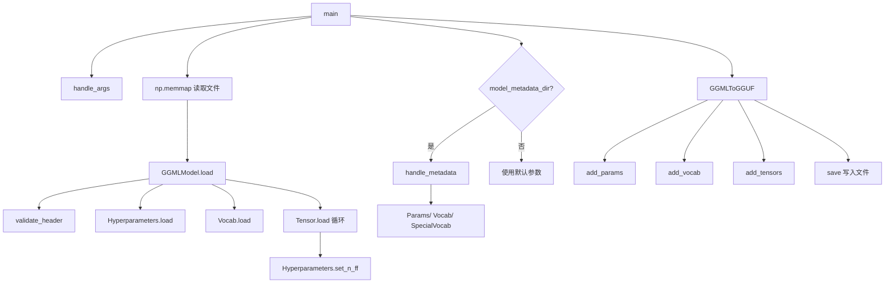

# 第6章 遗留模型转换工具 —— 兼容「远古版本」的手术刀

## 学习目标

- 理解GGML 头部 magic 字节的识别机制与三代格式演进
- 掌握 Hyperparameters / Vocab / Tensor 三大数据结构的解析流程与初始化
- 熟悉 GGMLFType / GGMLFormat 枚举的全部量化与格式版本
- 熟悉 GGUF 写入流水线（参数/词表/张量）的装配顺序与 mmap 直传机制
- 理解 GQA 反推、params_override 校验、special_vocab 注入等关键约束
- 掌握 LoraTorchTensor 如何封装 A/B 张量对以模拟 PyTorch 接口的全部属性
- 理解 LoRA 适配器的 PartialLoraTensor 合并策略与命名清洗规则
- 掌握 LoraModel 子类的类型/词表/参数重写机制与 generate_extra_tensors 抑制
- 了解 aLoRA invocation tokens 的延迟编码机制与 off-by-one 修正
- 熟悉 load_hparams_from_hf 的 HF Hub 配置拉取流程与 parse_args CLI 解析
- 能够阅读并修改自定义 GGUF 转换器逻辑

## 6.1 生活类比

想象 GGML→GGUF 转换器是一座「文物修复工厂」，专门复活三个时代的旧模型档案：GGMLFormat 三代头部 = 三种不同的封蜡方式（GGML 老式火漆/GGMF 钢印/GGJT 条码），用 magic 字节一秒识别年代；GGMLFType 量化枚举 = 修复工坊的「工具箱标签」：每个量化方案都有专属代号（F32/F16/Q4_0/Q4_K/Q6_K...）；Hyperparameters 7 元组 = 修复工坊收到的「配方卡」：一次性读取 7 个数字（词表/维度/头数/层数/旋转/格式）；Hyperparameters.__init__ = 空白的「配方卡」：先把 7 个字段填 0，等待后续读取；Vocab 长度前缀协议 = 档案柜的「标签箱」：每个抽屉先贴长度标签，再放内容（可选评分）；Vocab.__init__ = 「空柜子准备」：决定是否装评分格（GGML 格式不带分数）；Tensor 32 字节对齐 = 档案柜的「整齐码放」：每个卷宗结束都要补齐到 32 字节，方便卡车一箱箱搬运；Tensor.__init__ = 「空卷宗封皮」：先写下名称长度、维度、对齐方式，等真正读取时再填内容；GGMLModel.__init__ = 「工坊开工准备」：先摆放好 hp/vocab/tensors 四个空抽屉，等待装填；GQA 反推 = 侦探从「分组因子」反推「KV 头数」：1~255 逐一排查，找到能让 n_head/x == gqa 的 x；params_override 优先级 = 资深修复师的「权威判断」：一旦提供完整图纸，命令行参数全部靠边站；add_tensors 维度转置 = 「卷宗调头」：GGML 习惯把维度 0/1 反着写，GGUF 要正过来，所以交换前两维；add_vocab 字节 token 重编码 = 「古董符号翻译」：单字节字符按 0xXX 重新贴标签，让旧模型兼容新推理器；LoraTorchTensor = 永远成对出现的「双胞胎文件」：哥哥 A 是 (rank, row)，弟弟 B 是 (col, rank)，索引时必须联动；LoraTorchTensor.shape/dtype/size = 「双胞胎的合成身份」：对外只展示组合后的总维度，dtype 永远是共同的；LoraTorchTensor.contiguous/to = 「双胞胎同步搬家」：连续化或迁移设备时，必须同时搬运 A 和 B；PartialLoraTensor 合并 = 整理「散装零件」：先把所有 A/B 按 base_name 分组入柜，再校验齐备才打包；LoraModel.set_type / set_vocab = 「特化车间印章」：标记文件是适配器（ADAPTER），并跳过基础词表设置；LoraModel.generate_extra_tensors = 「明确说不要赠品」：返回空，禁止注入 RoPE 频率等额外张量；load_hparams_from_hf = 「快递员代取基模型配置」：通过 huggingface_hub 直接拉 config.json 即可；aLoRA invocation tokens = 「激活口令本」：从 HF 配置拿口令词，让 tokenizer 现场编码，并把首 token 撕掉（修补老版误差）。就像文物修复师既要尊重原件的原始结构（老 GGML 格式），又要让它兼容现代设备（GGUF），这套转换器在「忠实历史」与「面向未来」之间精妙平衡。

## 6.2 源码地图

./convert_llama_ggml_to_gguf.py
├── GGMLFormat(IntEnum)                  # 三代格式枚举（GGML/GGMF/GGJT）
├── GGMLFType(IntEnum)                   # 文件类型枚举（F32/Q4_K/Q6_K...）
├── Hyperparameters                      # 超参数（7 元组 + ftype + set_n_ff）
│   ├── __init__()                       # 初始化 7 个字段为 0、ftype 默认为 F32
│   ├── __str__()                        # 调试日志中友好打印所有字段
│   ├── set_n_ff(model)                  # 反向推断 FF 维度
│   └── load(data, offset)               # struct.unpack('<7I') 读取
├── Vocab                                # 词表（长度前缀加载协议）
│   ├── __init__(load_scores=True)       # 初始化空列表与是否读取分数
│   └── load(data, offset, n_vocab)      # 逐条目读取 [len][text][score]
├── Tensor                               # 张量元数据
│   ├── __init__(use_padding=True)       # 初始化默认值与对齐标志
│   └── load(data, offset)               # 12字节头 + dims + name + 32对齐
├── GGMLModel                            # 模型聚合入口
│   ├── __init__()                       # 初始化 hp/vocab/tensor_map/tensors
│   ├── validate_header()                # 识别 lmgg/fmgg/tjgg
│   ├── validate_conversion(ftype)       # 兼容性校验（GGJTv2/3 量化变更）
│   └── load(data, offset)               # 流水线：头部→超参→词表→张量
├── GGMLToGGUF                           # GGUF 输出装配器
│   ├── __init__()                       # GQA 反推 + name_map 构建
│   ├── save()                           # 写出 4 阶段（header/kv/tensors/close）
│   ├── add_params()                     # params_override 优先 + 完整性断言
│   ├── add_vocab()                      # 特殊 token 智能推断（UNK/BOS/EOS/字节）
│   └── add_tensors()                    # mmap 直接切片 + 维度转置
├── handle_metadata()                    # 借助 HF config/params.json 修补老模型
├── handle_args()                        # argparse CLI 解析
├── main()                               # 主流程：扫描→可选 metadata→转换→写出
└── __main__                             # 模块入口 if __name__ == '__main__'

./convert_lora_to_gguf.py
├── PartialLoraTensor(dataclass)         # A/B 张量对容器
├── LoraTorchTensor                      # 模拟 PyTorch Tensor 接口
│   ├── __init__(A, B)                   # dtype 自动对齐 float32，记录 rank
│   ├── get_lora_A_B()                   # 解包返回原始 A、B 张量
│   ├── dtype (property)                 # 一致性断言后返回公共 dtype
│   ├── shape (property)                 # 返回合成形状 (*B.shape[:-1], A.shape[-1])
│   ├── size(dim=None)                   # 包装 shape，等价 torch 的 size()
│   ├── contiguous()                     # 同时连续化 A 和 B
│   ├── to(*args, **kwargs)              # dtype/device 双侧迁移
│   ├── view(*size)                      # 包装 reshape
│   ├── reshape_as(other)                # 按另一张量形状重塑
│   ├── reshape(*shape)                  # 形状约束：最后维度不能跨越
│   ├── permute()                        # 仅最后维交换 vs 2D 全转置
│   ├── transpose()                      # 通过 permute 实现
│   ├── swapaxes()                       # transpose 的语义别名
│   ├── __getitem__()                    # 索引分离：A 仅最后维，B 广播其余
│   └── __torch_function__()             # 拦截 permute/reshape/stack/cat
├── get_base_tensor_name()               # 命名清洗（去前缀、合并 A/B）
├── load_hparams_from_hf()               # 通过 HF Hub 拉取基模型 config
├── parse_args()                         # argparse CLI 解析
├── __main__                             # 内嵌 LoraModel + 主流程
│   └── LoraModel(model_class)           # 继承自 ModelBase 的内嵌类
│       ├── __init__()                   # 保存 dir_lora_model / lora_alpha
│       ├── set_type()                   # 标记 GGUFType.ADAPTER + 'lora'
│       ├── set_vocab()                  # LoRA 适配器禁用词表写入
│       ├── set_gguf_parameters()        # 写 LORA_ALPHA / ALORA_INVOCATION_TOKENS
│       ├── generate_extra_tensors()     # 返回空，抑制 RoPE 频率等额外张量
│       ├── get_tensors()                # PartialLoraTensor 合并 → LoraTorchTensor
│       └── modify_tensors()             # 拆分为 .lora_a / .lora_b

## 6.3 GGML 头部验证与模型初始化 —— 解读「历史文件」的第一道关卡

### 6.3.1 为什么需要识别 magic 字节？

GGML 经历了 GGML → GGMF → GGJT 三代演进，每代头部布局都不同。通过 magic 字节（lmgg / fmgg / tjgg）即可秒判文件类型与版本。防止用户误把 GGUF 文件当作 GGML 转换，避免破坏已有数据。

### 6.3.2 版本兼容性的关键约束

GGJTv2 之前不支持量化（仅 F32/F16），遇到量化文件必须报错。GGJTv3 重新设计了 Q4/Q8 编码，遇到旧量化同样拒绝转换。validate_conversion 在加载前主动拦截不兼容组合。

### 6.3.3 GGMLModel 的容器初始化

__init__ 准备好 hyperparameters / tensor_map / tensors / vocab 四个抽屉。后续 validate_header → load 方法才会向这些抽屉装填内容。

### 6.3.4 GGMLFormat：三代格式枚举

源码路径：`./convert_llama_ggml_to_gguf.py` - `GGMLFormat`（第 18-22 行）

```python
# 三代格式枚举：GGML(老版) → GGMF(中版) → GGJT(新版)
class GGMLFormat(IntEnum):
    GGML = 0  # 初代：无版本号，magic = b'lmgg'
    GGMF = 1  # 二代：引入版本号，magic = b'fmgg'
    GGJT = 2  # 三代：引入量化重构，magic = b'tjgg'
```

这段代码定义了 GGML 文件的三代格式枚举，用于后续 identify 文件年代。

### 6.3.5 GGMLFType：量化类型枚举

源码路径：`./convert_llama_ggml_to_gguf.py` - `GGMLFType`（第 25-44 行）

```python
class GGMLFType(IntEnum):
    ALL_F32              = 0   # 全 fp32
    MOSTLY_F16           = 1   # 大部份 fp16
    MOSTLY_Q4_0          = 2   # 早期 Q4_0 量化（已废弃）
    MOSTLY_Q4_1          = 3   # 早期 Q4_1 量化（已废弃）
    MOSTLY_Q4_1_SOME_F16 = 4   # Q4_1 混合 F16（已废弃）
    MOSTLY_Q8_0          = 7   # 早期 Q8_0 量化（已废弃）
    # ... 中间省略 ...
    MOSTLY_Q2_K          = 10  # K-quant 系列
    MOSTLY_Q3_K_S        = 11
    MOSTLY_Q3_K_M        = 12
    MOSTLY_Q3_K_L        = 13
    MOSTLY_Q4_K_S        = 14
    MOSTLY_Q4_K_M        = 15
    MOSTLY_Q5_K_S        = 16
    MOSTLY_Q5_K_M        = 17
    MOSTLY_Q6_K          = 18  # 最新 K-quant
```

这段代码定义了 GGML 文件支持的全部量化方案代号，Hyperparameters.ftype 直接映射到本枚举，驱动后续量化校验。

### 6.3.6 GGMLModel.__init__：四抽屉准备

源码路径：`./convert_llama_ggml_to_gguf.py` - `GGMLModel.__init__`（第 158-164 行）

```python
def __init__(self):
    self.hyperparameters = None    # 超参数抽屉
    self.vocab = None              # 词表抽屉
    self.tensors = []              # 张量列表
    self.tensor_map = {}           # 张量名→索引映射
```

这段代码初始化模型聚合容器，为后续流水线加载预留空槽位。

### 6.3.7 validate_header：识别三代魔数

源码路径：`./convert_llama_ggml_to_gguf.py` - `GGMLModel.validate_header()`（第 175-195 行）

```python
def validate_header(self, data, offset):
    magic = bytes(data[offset:offset + 4])          # 读取前 4 字节 magic
    if magic == b'GGUF':                            # 防呆：已是 GGUF
        raise ValueError('File is already in GGUF format.')
    if magic == b'lmgg':                            # 初代 GGML
        self.file_format = GGMLFormat.GGML
        self.format_version = 1
        return 4                                    # 仅 4 字节 magic
    version = struct.unpack('<I', data[offset + 4:offset + 8])[0]  # 读取版本号
    if magic == b'fmgg':                            # 二代 GGMF
        if version != 1:
            raise ValueError(f'Cannot handle unexpected GGMF file version {version}')
        self.file_format = GGMLFormat.GGMF
        self.format_version = version
        return 8                                    # magic + version = 8 字节
    if magic == b'tjgg':                            # 三代 GGJT
        if version < 1 or version > 3:
            raise ValueError(f'Cannot handle unexpected GGJT file version {version}')
        self.file_format = GGMLFormat.GGJT
        self.format_version = version
        return 8
    raise ValueError(f"Unexpected file magic {magic!r}! This doesn't look like a GGML format file.")
```

这段代码实现了文件头识别逻辑：先读 4 字节 magic 判断代际，二/三代再读版本号。GGMLv1 只有 magic，无版本号；GGMF/GGJT 均为 8 字节头部（magic+version）。遇到 GGUF 直接报错拦截。

### 6.3.8 validate_conversion：量化兼容性闸门

源码路径：`./convert_llama_ggml_to_gguf.py` - `GGMLModel.validate_conversion()`（第 197-211 行）

```python
def validate_conversion(self, ftype):
    err = ''
    # GGJTv2 之前不支持量化
    if (self.file_format < GGMLFormat.GGJT or self.format_version < 2):
        if ftype not in (GGMLFType.ALL_F32, GGMLFType.MOSTLY_F16):
            err = 'Quantizations changed in GGJTv2. Can only convert unquantized GGML files older than GGJTv2.'
    # GGJTv2 专用：旧 Q4/Q8 编码已变更
    elif (self.file_format == GGMLFormat.GGJT and self.format_version == 2):
        if ftype in (GGMLFType.MOSTLY_Q4_0, GGMLFType.MOSTLY_Q4_1,
                     GGMLFType.MOSTLY_Q4_1_SOME_F16, GGMLFType.MOSTLY_Q8_0):
            err = 'Q4 and Q8 quantizations changed in GGJTv3.'
    if len(err) > 0:
        raise ValueError(f'{err} Sorry, your {self.file_format.name}v{self.format_version} file of type {ftype.name} is not eligible for conversion.')
```

这段代码实现了转换前的兼容性检查：GGJTv2 前只允许 F32/F16；GGJTv2 遇到旧 Q4/Q8 直接拒绝。保护用户不产出错误的 GGUF。

## 6.4 超参数与词表解析 —— 模型「身份档案」的重构

### 6.4.1 Hyperparameters 类：小而美的 7 元组

__init__ 把 7 个数字字段全部置 0，ftype 默认 ALL_F32。__str__ 提供调试友好的字符串表示。load 用 struct.unpack('<7I') 一次性读取 n_vocab / n_embd / n_mult / n_head / n_layer / n_rot / ftype。set_n_ff 反向查询 w1.weight 张量的第二维来推断 FF 维度。

### 6.4.2 Hyperparameters.__init__：空白配方卡

源码路径：`./convert_llama_ggml_to_gguf.py` - `Hyperparameters.__init__`（第 53-57 行）

```python
def __init__(self):
    self.n_vocab = self.n_embd = self.n_mult = self.n_head = 0
    self.n_layer = self.n_rot = self.n_ff = 0
    self.ftype = GGMLFType.ALL_F32
```

这段代码把所有超参数字段初始化为 0，ftype 默认为全精度 F32，等待 load 填充真实值。

### 6.4.3 Hyperparameters.__str__：调试友好打印

源码路径：`./convert_llama_ggml_to_gguf.py` - `Hyperparameters.__str__`（第 76-77 行）

```python
def __str__(self):
    return f'<Hyperparameters: n_vocab={self.n_vocab}, n_embd={self.n_embd}, n_mult={self.n_mult}, n_head={self.n_head}, n_layer={self.n_layer}, n_rot={self.n_rot}, n_ff={self.n_ff}, ftype={self.ftype.name}>'
```

这段代码提供了可读的调试字符串，包含全部关键字段与枚举名。

### 6.4.4 Hyperparameters.load：一次性读 7 字段

源码路径：`./convert_llama_ggml_to_gguf.py` - `Hyperparameters.load()`（第 65-74 行）

```python
def load(self, data, offset):
    (self.n_vocab, self.n_embd, self.n_mult, self.n_head,
     self.n_layer, self.n_rot, ftype) = struct.unpack('<7I', data[offset:offset + (4 * 7)])
    try:
        self.ftype = GGMLFType(ftype)
    except ValueError:
        raise ValueError(f'Invalid ftype {ftype}')
    return 4 * 7  # 消耗 28 字节
```

这段代码使用小端序一次性解包 7 个 uint32，再将 ftype 转为枚举。返回消耗字节数供流水线推进 offset。

### 6.4.5 Hyperparameters.set_n_ff：反向推断 FF 维度

源码路径：`./convert_llama_ggml_to_gguf.py` - `Hyperparameters.set_n_ff()`（第 59-63 行）

```python
def set_n_ff(self, model):
    ff_tensor_idx = model.tensor_map.get(b'layers.0.feed_forward.w1.weight')
    assert ff_tensor_idx is not None, 'Missing layer 0 FF tensor'
    ff_tensor = model.tensors[ff_tensor_idx]
    self.n_ff = ff_tensor.dims[1]  # w1.weight 形状 [n_ff, n_embd] → 取第 1 维
```

这段代码通过查找第 0 层 FFN 的 w1.weight 张量，从其形状第二维反推 n_ff。这是 GGML 旧格式未显式存储 n_ff 的补救措施。

### 6.4.6 GGMLFType 枚举：所有量化方案的代号表

前文已展示完整枚举。F32/F16 是基础款；Q4_0/Q4_1/Q5_0/Q5_1/Q8_0 是早期整数位量化；Q2_K/Q3_K_*/Q4_K_*/Q5_K_*/Q6_K 是 K-quant 精细化系列。ftype 字段映射到本枚举，决定了模型兼容性与精度档位。

### 6.4.7 Vocab 类的「长度前缀」加载协议

__init__(load_scores=True) 根据格式决定是否带分数格。GGML 格式不带分数（load_scores=False），GGMF/GGJT 才有 scores。每个词条 = [uint32 长度] + [字节内容] + [可选 float 分数]。加载过程中严格检查 itemlen < 4096，防止恶意文件攻击。

### 6.4.8 Vocab.__init__：空柜子准备

源码路径：`./convert_llama_ggml_to_gguf.py` - `Vocab.__init__`（第 80-83 行）

```python
def __init__(self, load_scores = True):
    self.items = []
    self.load_scores = load_scores
```

这段代码初始化空词表列表，load_scores 标志决定后续 load 是否读取分数。GGMLv1 不带分数，传 False；GGMF/GGJT 默认 True。

### 6.4.9 Vocab.load：逐条目解析

源码路径：`./convert_llama_ggml_to_gguf.py` - `Vocab.load()`（第 85-98 行）

```python
def load(self, data, offset, n_vocab):
    orig_offset = offset
    for _ in range(n_vocab):
        itemlen = struct.unpack('<I', data[offset:offset + 4])[0]  # 读长度
        assert itemlen < 4096, 'Absurd vocab item length'
        offset += 4
        item_text = bytes(data[offset:offset + itemlen])           # 读内容
        offset += itemlen
        if self.load_scores:
            item_score = struct.unpack('<f', data[offset:offset + 4])[0]  # 读分数
            offset += 4
        else:
            item_score = 0.0
        self.items.append((item_text, item_score))
    return offset - orig_offset
```

这段代码实现了长度前缀协议：每个 token 先读 4 字节长度，再读内容，最后可选读 4 字节 float 分数。4096 上限防止异常长 token 攻击。

### 6.4.10 特殊 token 的智能推断

前 3 个 token 默认为 ࠀ/ ࡱ/ ࠁ。3~258 范围的单字节 token 被重新编码为 <0xXX> 字节 token。空格被替换为 ▁（U+2581），与 SentencePiece 保持一致。这一逻辑在后续 GGMLToGGUF.add_vocab 中实现。

## 6.5 张量元数据解析 —— 「逐块」读取二进制布局

### 6.5.1 Tensor 的初始化与对齐标志

__init__ 设置默认值：name=None / dims=() / dtype=None / start_offset=0 / len_bytes=0。use_padding 控制在 GGMF 之后的格式才启用 32 字节对齐。

### 6.5.2 Tensor.__init__：空卷宗封皮

源码路径：`./convert_llama_ggml_to_gguf.py` - `Tensor.__init__`（第 91-98 行）

```python
def __init__(self, use_padding = True):
    self.name = None
    self.dims: tuple[int, ...] = ()
    self.dtype = None
    self.start_offset = 0
    self.len_bytes = np.int64(0)
    self.use_padding = use_padding
```

这段代码初始化张量元数据容器，use_padding 决定是否在读取名字后进行 32 字节对齐（GGMLv1 不对齐，GGMF/GGJT 对齐）。

### 6.5.3 Tensor.load 的三段式读取

前 12 字节：n_dims / name_len / dtype 三元组。接着 n_dims × 4 字节：每个维度的具体数值。再 name_len 字节：张量名。

### 6.5.4 Tensor.load：完整解析流程

源码路径：`./convert_llama_ggml_to_gguf.py` - `Tensor.load()`（第 110-132 行）

```python
def load(self, data, offset):
    orig_offset = offset
    (n_dims, name_len, dtype) = struct.unpack('<3I', data[offset:offset + 12])  # 12 字节头
    assert n_dims >= 0 and n_dims <= 4, f'Invalid tensor dimensions {n_dims}'
    assert name_len < 4096, 'Absurd tensor name length'
    self.dtype = gguf.GGMLQuantizationType(dtype)
    quant = gguf.GGML_QUANT_SIZES.get(self.dtype)
    assert quant is not None, 'Unknown tensor type'
    (blksize, tysize) = quant
    offset += 12
    self.dims = struct.unpack(f'<{n_dims}I', data[offset:offset + (4 * n_dims)])  # 维度数组
    offset += 4 * n_dims
    self.name = bytes(data[offset:offset + name_len])                             # 张量名
    offset += name_len
    pad = ((offset + 31) & ~31) - offset if self.use_padding else 0               # 32 字节对齐
    offset += pad
    n_elems = np.prod(self.dims)
    n_bytes = np.int64(np.int64(n_elems) * np.int64(tysize)) // np.int64(blksize)  # 字节长度
    self.start_offset = offset
    self.len_bytes = n_bytes
    offset += n_bytes
    return offset - orig_offset
```

这段代码完整解析张量元数据：12 字节头 → 维度数组 → 名字 → 32 字节对齐 → 计算数据区字节长度。使用 gguf.GGML_QUANT_SIZES 查表得到 (blksize, tysize) 计算 n_bytes。例如 Q4_K 的 256 元素共用一个 144 字节的块。

### 6.5.5 GGML 的 32 字节对齐机制

通过 ((offset + 31) & ~31) - offset 计算填充字节。对齐可让 mmap 读取时按页加载更高效。GGMLv1 不对齐（use_padding=False），GGMF/GGJT 开启对齐。

### 6.5.6 GGMLModel.load：流水线串联

源码路径：`./convert_llama_ggml_to_gguf.py` - `GGMLModel.load()`（第 213-231 行）

```python
def load(self, data, offset):
    offset += self.validate_header(data, offset)          # 1. 头部识别
    hp = Hyperparameters()
    offset += hp.load(data, offset)                       # 2. 超参数
    logger.info(f'* File format: {self.file_format.name}v{self.format_version} with ftype {hp.ftype.name}')
    self.validate_conversion(hp.ftype)                    # 3. 兼容性检查
    vocab = Vocab(load_scores = self.file_format > GGMLFormat.GGML)  # 4. 词表
    offset += vocab.load(data, offset, hp.n_vocab)
    tensors: list[Tensor] = []
    tensor_map = {}
    while offset < len(data):                             # 5. 张量循环
        tensor = Tensor(use_padding = self.file_format > GGMLFormat.GGMF)
        offset += tensor.load(data, offset)
        tensor_map[tensor.name] = len(tensors)
        tensors.append(tensor)
    self.hyperparameters = hp
    self.vocab = vocab
    self.tensors = tensors
    self.tensor_map = tensor_map
    hp.set_n_ff(self)                                     # 6. 反推 n_ff
    return offset
```

这段代码串联了完整的解析流水线：头部 → 超参 → 词表 → 张量循环 → 反推 n_ff。使用 np.memmap 零拷贝读取文件，offset 逐段推进。

## 6.6 GGUF 输出流水线 —— 「装配」现代文件格式

### 6.6.1 GGMLToGGUF 的三大装配阶段

add_params 写入所有超参数 KV 对。add_vocab 写入 tokenizer 类型 + token 列表 + 分数 + 类型。add_tensors 通过 mmap 直接切片写入权重。

### 6.6.2 GGMLToGGUF.__init__：GQA 反推与名称映射

源码路径：`./convert_llama_ggml_to_gguf.py` - `GGMLToGGUF.__init__()`（第 234-243 行）

```python
def __init__(self, ggml_model, data, cfg, params_override = None, vocab_override = None, special_vocab = None):
    hp = ggml_model.hyperparameters
    self.model = ggml_model
    self.data = data
    self.cfg = cfg
    self.params_override = params_override
    self.vocab_override = vocab_override
    self.special_vocab = special_vocab
    if params_override is not None:
        n_kv_head = params_override.n_head_kv
    else:
        if cfg.gqa == 1:
            n_kv_head = hp.n_head
        else:
            gqa = float(cfg.gqa)
            n_kv_head = None
            for x in range(1, 256):                     # 1~255 穷举
                if float(hp.n_head) / float(x) == gqa:
                    n_kv_head = x
            assert n_kv_head is not None, "Couldn't determine n_kv_head from GQA param"
            logger.info(f'- Guessed n_kv_head = {n_kv_head} based on GQA {cfg.gqa}')
    self.n_kv_head = n_kv_head
    self.name_map = gguf.get_tensor_name_map(gguf.MODEL_ARCH.LLAMA, ggml_model.hyperparameters.n_layer)
```

这段代码完成两件事：① 若无 params_override，根据 --gqa 反推 n_kv_head（遍历 1~255）；② 获取 LLAMA 架构的标准张量名映射表，用于后续重命名。

### 6.6.3 GQA 反推机制

用户通过 --gqa 传入分组因子。遍历 1~255 找出 n_head / x == gqa 的 x。找不到时报错退出，提醒用户检查参数。

### 6.6.4 GGMLToGGUF.save：四阶段写入

源码路径：`./convert_llama_ggml_to_gguf.py` - `GGMLToGGUF.save()`（第 245-262 行）

```python
def save(self):
    logger.info('* Preparing to save GGUF file')
    gguf_writer = gguf.GGUFWriter(
        self.cfg.output,
        gguf.MODEL_ARCH_NAMES[gguf.MODEL_ARCH.LLAMA],
        use_temp_file = False)
    self.add_params(gguf_writer)        # 1. 参数
    self.add_vocab(gguf_writer)         # 2. 词表
    if self.special_vocab is not None:
        self.special_vocab.add_to_gguf(gguf_writer)
    self.add_tensors(gguf_writer)       # 3. 张量
    logger.info("    gguf: write header")
    gguf_writer.write_header_to_file()
    logger.info("    gguf: write metadata")
    gguf_writer.write_kv_data_to_file()
    logger.info("    gguf: write tensors")
    gguf_writer.write_tensors_to_file()
    gguf_writer.close()
```

这段代码按 GGUF 规范顺序写入：创建 Writer → add_params → add_vocab → add_tensors → write_header → write_kv → write_tensors → close。use_temp_file=False 直接写目标文件。

### 6.6.5 add_params：参数写入与 params_override 优先级

源码路径：`./convert_llama_ggml_to_gguf.py` - `GGMLToGGUF.add_params()`（第 264-307 行）

```python
def add_params(self, gguf_writer):
    hp = self.model.hyperparameters
    cfg = self.cfg
    if cfg.desc is not None:
        desc = cfg.desc
    else:
        desc = f'converted from legacy {self.model.file_format.name}v{self.model.format_version} {hp.ftype.name} format'
    try:
        name = cfg.name if cfg.name is not None else cfg.input.name
    except UnicodeDecodeError:
        name = None
    logger.info('* Adding model parameters and KV items')
    if name is not None:
        gguf_writer.add_name(name)
    gguf_writer.add_description(desc)
    gguf_writer.add_file_type(int(hp.ftype))
    if self.params_override is not None:                      # 覆盖模式
        po = self.params_override
        assert po.n_embd == hp.n_embd, 'Model hyperparams mismatch'
        assert po.n_layer == hp.n_layer, 'Model hyperparams mismatch'
        assert po.n_head == hp.n_head, 'Model hyperparams mismatch'
        gguf_writer.add_context_length(po.n_ctx)
        gguf_writer.add_embedding_length(po.n_embd)
        gguf_writer.add_block_count(po.n_layer)
        gguf_writer.add_feed_forward_length(po.n_ff)
        gguf_writer.add_rope_dimension_count(po.n_embd // po.n_head)
        gguf_writer.add_head_count(po.n_head)
        gguf_writer.add_head_count_kv(po.n_head_kv)
        gguf_writer.add_layer_norm_rms_eps(po.f_norm_eps)
        return
    # 默认模式：使用 CLI 参数
    gguf_writer.add_context_length(cfg.context_length)
    gguf_writer.add_embedding_length(hp.n_embd)
    gguf_writer.add_block_count(hp.n_layer)
    gguf_writer.add_feed_forward_length(hp.n_ff)
    gguf_writer.add_rope_dimension_count(hp.n_embd // hp.n_head)
    gguf_writer.add_head_count(hp.n_head)
    gguf_writer.add_head_count_kv(self.n_kv_head)
    gguf_writer.add_layer_norm_rms_eps(float(cfg.eps))
```

这段代码实现了参数写入的两套逻辑：有 params_override 时，完全使用外部参数并校验 n_embd/n_layer/n_head 一致（防止人为错误）；无覆盖时，用 CLI 的 --context-length/--eps 与 hp 推导值混合。params_override 优先级最高，一旦提供，--gqa/--eps/--context-length 全部失效。

### 6.6.6 add_vocab 的特殊 token 智能识别

源码路径：`./convert_llama_ggml_to_gguf.py` - `GGMLToGGUF.add_vocab()`（第 309-360 行）

```python
def add_vocab(self, gguf_writer):
    hp = self.model.hyperparameters
    gguf_writer.add_tokenizer_model('llama')
    gguf_writer.add_tokenizer_pre('default')
    tokens = []
    scores = []
    toktypes = []
    if self.vocab_override is not None:
        vo = self.vocab_override
        logger.info('* Adding vocab item(s)')
        for (_, (vbytes, score, ttype)) in enumerate(vo.all_tokens()):
            tokens.append(vbytes)
            scores.append(score)
            toktypes.append(ttype)
        assert len(tokens) == hp.n_vocab, \
            f'Override vocab has a different number of items than hyperparameters - override = {len(tokens)} but n_vocab={hp.n_vocab}'
        gguf_writer.add_token_list(tokens)
        gguf_writer.add_token_scores(scores)
        if len(toktypes) > 0:
            gguf_writer.add_token_types(toktypes)
        return
    logger.info(f'* Adding {hp.n_vocab} vocab item(s)')
    assert len(self.model.vocab.items) >= 3, 'Cannot handle unexpectedly short model vocab'
    for (tokid, (vbytes, vscore)) in enumerate(self.model.vocab.items):
        tt = 1  # Normal
        # Special handling for UNK, BOS, EOS tokens.
        if tokid <= 2:
            if tokid == 0:
                vbytes = b'ࠀ'
                tt = 2  # Unknown
            elif tokid == 1:
                vbytes = b'ࡱ'
                tt = 3  # Control
            else:
                vbytes = b'ࠁ'
                tt = 3  # Control
        elif len(vbytes) == 0:
            tt = 3  # Control
        elif tokid >= 3 and tokid <= 258 and len(vbytes) == 1:
            vbytes = bytes(f'<0x{vbytes[0]:02X}>', encoding = 'UTF-8')
            tt = 6  # Byte
        else:
            vbytes = vbytes.replace(b' ', b'\xe2\x96\x81')  # 空格→▁
        toktypes.append(tt)
        tokens.append(vbytes)
        scores.append(vscore)
    gguf_writer.add_token_list(tokens)
    gguf_writer.add_token_scores(scores)
    gguf_writer.add_token_types(toktypes)
    gguf_writer.add_unk_token_id(0)
    gguf_writer.add_bos_token_id(1)
    gguf_writer.add_eos_token_id(2)
```

这段代码实现了词表写入的核心逻辑：有 vocab_override 直接用外部词表并校验数量；否则遍历原始 vocab，对前 3 个 token 强制替换为 UNK/BOS/EOS 并打标签，3~258 单字节 token 重编码为 <0xXX> 字节类型，空格统一替换为 ▁。最后写入 token 列表、分数、类型及特殊 token ID。

### 6.6.7 add_tensors 的维度对齐与 mmap 直传

源码路径：`./convert_llama_ggml_to_gguf.py` - `GGMLToGGUF.add_tensors()`（第 362-389 行）

```python
def add_tensors(self, gguf_writer):
    tensor_map = self.name_map
    data = self.data
    logger.info(f'* Adding {len(self.model.tensors)} tensor(s)')
    for tensor in self.model.tensors:
        name = str(tensor.name, 'UTF-8')
        mapped_name = tensor_map.get_name(name, try_suffixes = (".weight", ".bias"))
        assert mapped_name is not None, f'Bad name {name}'
        tempdims = list(tensor.dims[:])
        if len(tempdims) > 1:
            temp = tempdims[1]
            tempdims[1] = tempdims[0]
            tempdims[0] = temp                        # 交换前两维
        gguf_writer.add_tensor(
            mapped_name,
            data[tensor.start_offset:tensor.start_offset + tensor.len_bytes],  # mmap 直接切片
            raw_shape = tempdims,
            raw_dtype = tensor.dtype)
```

这段代码遍历所有张量：① 用 tensor_map 将旧名映射为 GGUF 标准名（兼容 .weight/.bias 后缀）；② 交换前两维适配 GGUF 布局（GGML 习惯 [out, in]，GGUF 习惯 [in, out]）；③ 通过 numpy memmap 切片直接取数据，无额外拷贝，极其高效。

### 6.6.8 补充：模块依赖图



## 6.7 外部元数据覆盖与 CLI —— 借助「现代参数」修补古董模型

### 6.7.1 为什么需要 handle_metadata？

古董 GGML 文件常常缺少 GQA / eps / n_head_kv 等新参数。通过 HuggingFace 仓库或 params.json 重建完整参数集。让 LLaMA1 / OpenLLaMA 等老模型获得现代推理引擎的全部能力。

### 6.7.2 「假模型」反向探测技术

构造只含 shape 字段的 LazyTensor，不实际加载权重。让 convert_legacy_llama.Params 类在不读权重的情况下验证维度。节省大量内存与磁盘 I/O。

### 6.7.3 handle_metadata：多源参数加载

源码路径：`./convert_llama_ggml_to_gguf.py` - `handle_metadata()`（第 392-418 行）

```python
def handle_metadata(cfg, hp):
    import examples.convert_legacy_llama as convert
    assert cfg.model_metadata_dir.is_dir(), 'Metadata dir is not a directory'
    hf_config_path   = cfg.model_metadata_dir / "config.json"
    orig_config_path = cfg.model_metadata_dir / "params.json"
    # 构造假模型：只含 shape，不含数据
    fakemodel = {
        'tok_embeddings.weight': convert.LazyTensor.__new__(convert.LazyTensor),
        'layers.0.feed_forward.w1.weight': convert.LazyTensor.__new__(convert.LazyTensor),
    }
    fakemodel['tok_embeddings.weight'].shape = [hp.n_vocab]
    fakemodel['layers.0.feed_forward.w1.weight'].shape = [hp.n_ff]
    if hf_config_path.exists():
        params = convert.Params.loadHFTransformerJson(fakemodel, hf_config_path)
    elif orig_config_path.exists():
        params = convert.Params.loadOriginalParamsJson(fakemodel, orig_config_path)
    else:
        raise ValueError('Unable to load metadata')
    vocab_path = Path(cfg.vocab_dir if cfg.vocab_dir is not None else cfg.model_metadata_dir)
    vocab_factory = convert.VocabFactory(vocab_path)
    vocab, special_vocab = vocab_factory.load_vocab(cfg.vocabtype.split(","), cfg.model_metadata_dir)
    convert.check_vocab_size(params, vocab)
    return params, vocab, special_vocab
```

这段代码实现了元数据覆盖：优先读 config.json（HF 格式），回退到 params.json（OpenLLaMA 格式）。用「假模型」只传 shape 给 Params 类验证维度。通过 VocabFactory 统一加载 spm/hfft 等多种 tokenizer。最后 check_vocab_size 校验词表大小一致。

### 6.7.4 handle_args 的参数设计

源码路径：`./convert_llama_ggml_to_gguf.py` - `handle_args()`（第 421-455 行）

```python
def handle_args():
    parser = argparse.ArgumentParser(description = 'Convert GGML models to GGUF')
    parser.add_argument('--input', '-i', type = Path, required = True, help = 'Input GGMLv3 filename')
    parser.add_argument('--output', '-o', type = Path, required = True, help ='Output GGUF filename')
    parser.add_argument('--name', help = 'Set model name')
    parser.add_argument('--desc', help = 'Set model description')
    parser.add_argument('--gqa', type = int, default = 1, help = 'grouped-query attention factor (use 8 for LLaMA2 70B)')
    parser.add_argument('--eps', default = '5.0e-06', help = 'RMS norm eps: Use 1e-6 for LLaMA1 and OpenLLaMA, use 1e-5 for LLaMA2')
    parser.add_argument('--context-length', '-c', type=int, default = 2048, help = 'Default max context length: LLaMA1 is typically 2048, LLaMA2 is typically 4096')
    parser.add_argument('--model-metadata-dir', '-m', type = Path, help ='Load HuggingFace/.pth vocab and metadata from the specified directory')
    parser.add_argument("--vocab-dir", type=Path, help="directory containing tokenizer.model, if separate from model file - only meaningful with --model-metadata-dir")
    parser.add_argument("--vocabtype", default="spm,hfft", help="vocab format - only meaningful with --model-metadata-dir and/or --vocab-dir (default: spm,hfft)")
    parser.add_argument("--verbose", action="store_true", help="increase output verbosity")
    return parser.parse_args()
```

这段代码定义了 CLI 参数：--gqa 控制 GQA 分组（LLaMA2 70B 用 8）；--eps 默认 5e-6（LLaMA1/OpenLLaMA 用 1e-6，LLaMA2 用 1e-5）；--context-length 默认 2048（LLaMA1）或 4096（LLaMA2）。--model-metadata-dir 触发参数与词表覆盖。

### 6.7.5 main 的执行流程

源码路径：`./convert_llama_ggml_to_gguf.py` - `main()`（第 458-501 行）

```python
def main():
    cfg = handle_args()
    logging.basicConfig(level=logging.DEBUG if cfg.verbose else logging.INFO)
    logger.info(f'* Using config: {cfg}')
    logger.warning('=== WARNING === Be aware that this conversion script is best-effort. Use a native GGUF model if possible. === WARNING ===')
    if cfg.model_metadata_dir is None and (cfg.gqa == 1 or cfg.eps == '5.0e-06'):
        logger.info('- Note: If converting LLaMA2, specifying "--eps 1e-5" is required. 70B models also need "--gqa 8".')
    data = np.memmap(cfg.input, mode = 'r')
    model = GGMLModel()
    logger.info('* Scanning GGML input file')
    offset = model.load(data, 0)
    logger.info(f'* GGML model hyperparameters: {model.hyperparameters}')
    vocab_override = None
    params_override = None
    special_vocab = None
    if cfg.model_metadata_dir is not None:
        (params_override, vocab_override, special_vocab) = handle_metadata(cfg, model.hyperparameters)
        logger.info('!! Note: When overriding params the --gqa, --eps and --context-length options are ignored.')
        logger.info(f'* Overriding params: {params_override}')
        logger.info(f'* Overriding vocab: {vocab_override}')
        logger.info(f'* Special vocab: {special_vocab}')
    else:
        logger.warning('\n=== WARNING === Special tokens may not be converted correctly. Use --model-metadata-dir if possible === WARNING ===\n')
        if model.file_format == GGMLFormat.GGML:
            logger.info('! This is a very old GGML file that does not contain vocab scores. Strongly recommend using model metadata!')
    converter = GGMLToGGUF(
        model, data, cfg,
        params_override = params_override,
        vocab_override = vocab_override,
        special_vocab = special_vocab
    )
    converter.save()
    logger.info(f'* Successful completion. Output saved to: {cfg.output}')
```

这段代码是主流程：解析参数 → 打印警告 → mmap 读文件 → GGMLModel.load 扫描 → 可选 handle_metadata → 实例化 GGMLToGGUF → save 写出。若无 metadata_dir 且用默认 gqa/eps，提示 LLaMA2 需显式指定；若是 GGMLv1，强烈建议用 metadata。

### 6.7.6 __main__ 入口

源码路径：`./convert_llama_ggml_to_gguf.py` - `__main__`（第 504-538 行）

```python
if __name__ == '__main__':
    main()
```

标准 Python 模块入口，直接调用 main()。

## 6.8 LoraTorchTensor 基础与属性 —— 「孪生张量」的算术魔法

### 6.8.1 为什么要把 A/B 张量封装为一对？

LoRA 的 A (n_rank, row) 与 B (col, n_rank) 在计算中需要协同。合并公式：W_new = W + alpha/rank * B @ A。保持两者绑定可避免索引时错位。

### 6.8.2 LoraTorchTensor.__init__：双胞胎构造

源码路径：`./convert_lora_to_gguf.py` - `LoraTorchTensor.__init__()`（第 64-72 行）

```python
def __init__(self, A: Tensor, B: Tensor):
    assert len(A.shape) == len(B.shape)
    assert A.shape[-2] == B.shape[-1]
    if A.dtype != B.dtype:
        A = A.to(torch.float32)
        B = B.to(torch.float32)
    self._lora_A = A
    self._lora_B = B
    self._rank = B.shape[-1]
```

这段代码构造孪生张量：断言维数相同、A 的倒数第二维等于 B 的最后一维（即 rank 一致）。dtype 不一致时自动统一到 float32，记录 rank 供后续 reshape 使用。

### 6.8.3 get_lora_A_B 解包方法

源码路径：`./convert_lora_to_gguf.py` - `LoraTorchTensor.get_lora_A_B()`（第 74-75 行）

```python
def get_lora_A_B(self) -> tuple[Tensor, Tensor]:
    return (self._lora_A, self._lora_B)
```

返回原始 A、B 张量对，供 modify_tensors 拆分 .lora_a / .lora_b 时使用。

### 6.8.4 property 属性的合成语义

dtype：A 与 B 必须保持一致，否则断言失败。shape：合成形状 = (*B.shape[:-1], A.shape[-1])。size(dim=None)：包装 shape，等价 PyTorch 的 size() 接口。

### 6.8.5 LoraTorchTensor.dtype/shape/size

源码路径：`./convert_lora_to_gguf.py` - `LoraTorchTensor.dtype/shape/size`（第 121-133 行）

```python
@property
def dtype(self) -> torch.dtype:
    assert self._lora_A.dtype == self._lora_B.dtype
    return self._lora_A.dtype

@property
def shape(self) -> tuple[int, ...]:
    assert len(self._lora_A.shape) == len(self._lora_B.shape)
    return (*self._lora_B.shape[:-1], self._lora_A.shape[-1])

def size(self, dim=None):
    assert dim is None
    return self.shape
```

这三个 property 对外呈现「合成张量」的统一视图：dtype 以 A 为准（已断言一致），shape 取 B 的前缀维度 + A 的最后一维（即合并后的完整形状），size 直接委托 shape。

### 6.8.6 张量操作的同步机制

contiguous：同时对 A、B 调用 contiguous()。to(*args, **kwargs)：对 A、B 同时迁移 dtype/device。view(*size)：内部调用 reshape，保持双胞胎同步。

### 6.8.7 LoraTorchTensor.contiguous/to/view

源码路径：`./convert_lora_to_gguf.py` - `LoraTorchTensor.contiguous/to/view`（第 135-140、189-190、164-165 行）

```python
def contiguous(self) -> LoraTorchTensor:
    return LoraTorchTensor(self._lora_A.contiguous(), self._lora_B.contiguous())

def to(self, *args, **kwargs):
    return LoraTorchTensor(self._lora_A.to(*args, **kwargs), self._lora_B.to(*args, **kwargs))

def view(self, *size: int) -> LoraTorchTensor:
    return self.reshape(*size)
```

这三个方法保证双胞胎同步变换：contiguous/to 直接对 A、B 并行调用；view 只是 reshape 别名。

### 6.8.8 reshape_as 的等价实现

源码路径：`./convert_lora_to_gguf.py` - `LoraTorchTensor.reshape_as()`（第 207-208 行）

```python
def reshape_as(self, other: Tensor) -> LoraTorchTensor:
    return self.reshape(*other.shape)
```

直接调用 reshape(*other.shape)，按目标张量的形状重塑自身。

### 6.8.9 __getitem__ 的复杂维度处理

对最后维度做 A 索引，其余维度广播到 B。自动展开 Ellipsis 占位符到正确的切片数量。2D 与 N-D 张量的索引行为不同，需分别处理。

### 6.8.10 LoraTorchTensor.__getitem__：索引分离逻辑

源码路径：`./convert_lora_to_gguf.py` - `LoraTorchTensor.__getitem__()`（第 77-119 行）

```python
def __getitem__(self, indices: ...) -> LoraTorchTensor:
    shape = self.shape
    if isinstance(indices, SupportsIndex):
        if len(shape) > 2:
            return LoraTorchTensor(self._lora_A[indices], self._lora_B[indices])
        else:
            raise NotImplementedError
    elif isinstance(indices, slice):
        if len(shape) > 2:
            return LoraTorchTensor(self._lora_A[indices], self._lora_B[indices])
        else:
            return LoraTorchTensor(self._lora_A, self._lora_B[indices])
    elif isinstance(indices, tuple):
        assert len(indices) > 0
        if indices[-1] is Ellipsis:
            return self[indices[:-1]]
        # 展开 Ellipsis
        indices = tuple(u for v in (( (slice(None, None) for _ in range(len(indices) - 1)) if i is Ellipsis else (i,) ) for i in indices) for u in v)
        if len(indices) < len(shape):
            indices = (*indices, *(slice(None, None) for _ in range(len(indices), len(shape))))
        # A 只索引最后一维，其余广播
        indices_A = (*( (j.__index__() % self._lora_A.shape[i] if isinstance(j, SupportsIndex) else slice(None, None)) for i, j in enumerate(indices[:-2]) ), slice(None, None), indices[-1])
        indices_B = indices[:-1]
        return LoraTorchTensor(self._lora_A[indices_A], self._lora_B[indices_B])
    else:
        raise NotImplementedError
```

这段代码实现了 LoRA 张量的索引语义：标量索引仅支持 >2D；切片索引在 2D 时只对 B 切片；元组索引时，A 只在最后一维响应索引，其余维度广播（全切片），B 正常响应前 N-1 维。Ellipsis 自动展开。这是 LoRA 数学结构（A 只在 rank 维变化）的直接体现。

### 6.8.11 reshape 的形状约束

总元素数必须保持不变（处理 -1 推断）。A 重塑为 (..., rank, row)，B 重塑为 (..., col, rank)。不能跨越最后维度做 reshape，会破坏 LoRA 结构。

### 6.8.12 LoraTorchTensor.reshape：维度守恒

源码路径：`./convert_lora_to_gguf.py` - `LoraTorchTensor.reshape()`（第 139-159 行）

```python
def reshape(self, *shape: int | tuple[int, ...]) -> LoraTorchTensor:
    if isinstance(shape[0], tuple):
        new_shape: tuple[int, ...] = shape[0]
    else:
        new_shape = cast(tuple[int, ...], shape)
    orig_shape = self.shape
    if len(new_shape) < 2:
        raise NotImplementedError
    if any(dim == -1 for dim in new_shape):
        n_elems = prod(orig_shape)
        n_new_elems = prod(dim if dim != -1 else 1 for dim in new_shape)
        assert n_elems % n_new_elems == 0
        new_shape = (*(dim if dim != -1 else n_elems // n_new_elems for dim in new_shape),)
    if new_shape[-1] != orig_shape[-1]:
        raise NotImplementedError
    shape_A = (*(1 for _ in new_shape[:-2]), self._rank, orig_shape[-1])
    shape_B = (*new_shape[:-1], self._rank)
    return LoraTorchTensor(self._lora_A.reshape(shape_A), self._lora_B.reshape(shape_B))
```

这段代码严格保护 LoRA 结构：最后一维（输出维度）不能变；A 的 shape 强制为 (..., rank, row)，B 强制为 (..., col, rank)。-1 自动推断。确保合并后 B@A 的数学意义不变。

## 6.9 维度置换与算子重载 —— PyTorch 接口的「完美伪装」

### 6.9.1 permute 的双重分支处理

仅置换最后一维 → 走 B.permute 路径。2D 张量的 (0,1) 全转置 → 需同时交换 A、B 的对应维度。其他组合抛 NotImplementedError 限制误用。

### 6.9.2 LoraTorchTensor.permute：受控置换

源码路径：`./convert_lora_to_gguf.py` - `LoraTorchTensor.permute()`（第 187-202 行）

```python
def permute(self, *dims: int) -> LoraTorchTensor:
    shape = self.shape
    dims = tuple(dim - len(shape) if dim >= 0 else dim for dim in dims)
    if dims[-1] == -1:                                      # 仅置换最后一维
        assert all(dim == 1 for dim in self._lora_A.shape[:-2])
        return LoraTorchTensor(self._lora_A, self._lora_B.permute(*dims))
    if len(shape) == 2 and dims[-1] == -2 and dims[-2] == -1:  # 2D 全转置
        return LoraTorchTensor(self._lora_B.permute(*dims), self._lora_A.permute(*dims))
    else:
        raise NotImplementedError
```

这段代码只允许两种置换：① 仅动最后一维 → 只动 B（A 的前缀全是 1）；② 2D 张量完整转置 → 同时置换 A、B 并交换角色（因为转置后 A/B 维度角色互换）。其他情况禁止，防止破坏低秩结构。

### 6.9.3 transpose 与 swapaxes 的实现差异

transpose(dim0, dim1)：构造新的维度顺序后委托给 permute。swapaxes(axis0, axis1)：直接调用 transpose，是其语义别名。

### 6.9.4 LoraTorchTensor.transpose/swapaxes

源码路径：`./convert_lora_to_gguf.py` - `LoraTorchTensor.transpose/swapaxes()`（第 213-187 行）

```python
def transpose(self, dim0: int, dim1: int) -> LoraTorchTensor:
    shape = self.shape
    dims = [i for i in range(len(shape))]
    dims[dim0], dims[dim1] = dims[dim1], dims[dim0]
    return self.permute(*dims)

def swapaxes(self, axis0: int, axis1: int) -> LoraTorchTensor:
    return self.transpose(axis0, axis1)
```

transpose 只是构造置换元组转给 permute；swapaxes 直接别名。核心逻辑在 permute。

### 6.9.5 __torch_function__ 协议桥接

拦截 torch.permute / reshape / stack / cat 等函数。让 LoraTorchTensor 可在父类代码中无缝替换原生 Tensor。stack/cat 仅在 dim=0 时支持，其他维度抛错。

### 6.9.6 LoraTorchTensor.__torch_function__：算子拦截

源码路径：`./convert_lora_to_gguf.py` - `LoraTorchTensor.__torch_function__()`（第 227-260 行）

```python
@classmethod
def __torch_function__(cls, func: Callable, types, args=(), kwargs=None):
    del types
    if kwargs is None:
        kwargs = {}
    if func is torch.permute:
        assert len(args)
        return type(args[0]).permute(*args, **kwargs)
    elif func is torch.reshape:
        assert len(args)
        return type(args[0]).reshape(*args, **kwargs)
    elif func is torch.stack:
        assert len(args)
        assert isinstance(args[0], Sequence)
        dim = kwargs.get("dim", 0)
        assert dim == 0
        return LoraTorchTensor(torch.stack([a._lora_A for a in args[0]], dim),
                               torch.stack([b._lora_B for b in args[0]], dim))
    elif func is torch.cat:
        assert len(args)
        assert isinstance(args[0], Sequence)
        dim = kwargs.get("dim", 0)
        assert dim == 0
        if len(args[0][0].shape) > 2:
            return LoraTorchTensor(torch.cat([a._lora_A for a in args[0]], dim),
                                   torch.cat([b._lora_B for b in args[0]], dim))
        elif all(torch.equal(args[0][0]._lora_A, t._lora_A) for t in args[0][1:]):
            return LoraTorchTensor(args[0][0]._lora_A,
                                   torch.cat([b._lora_B for b in args[0]], dim))
        else:
            raise NotImplementedError
    else:
        raise NotImplementedError
```

这段代码实现了 PyTorch 函数重载协议：permute/reshape 委托给实例方法；stack 要求 dim=0，对 A/B 分别 stack；cat 要求 dim=0，若 >2D 则 A/B 同猫，若 2D 且所有 A 相同则只 cat B（mergekit 多适配器合并常见优化）。其他函数直接抛错。

### 6.9.7 cat 的 A 共享优化

当所有张量的 A 相同时，只 cat B 即可。来自 mergekit 提取的多适配器场景的常见情况。大幅节省显存与拷贝时间。

## 6.10 LoRA 适配器写入 —— GGUF 的「adapter」分支

### 6.10.1 张量命名清洗规则

去掉 base_model.model. 前缀。把 .lora_A.weight / .lora_B.weight 还原为 .weight。兼容 .lora_embedding_A / .lora_embedding_B（mergekit 扩展）。

### 6.10.2 get_base_tensor_name：命名清洗

源码路径：`./convert_lora_to_gguf.py` - `get_base_tensor_name()`（第 261-269 行）

```python
def get_base_tensor_name(lora_tensor_name: str) -> str:
    base_name = lora_tensor_name.replace("base_model.model.", "")
    base_name = base_name.replace(".lora_A.weight", ".weight")
    base_name = base_name.replace(".lora_B.weight", ".weight")
    base_name = base_name.replace(".lora_embedding_A", ".weight")
    base_name = base_name.replace(".lora_embedding_B", ".weight")
    return base_name
```

这段代码将 HF PEFT 格式的 LoRA 张量名还原为基模型张量名：去掉 base_model.model. 前缀，统一 .lora_A.weight/.lora_B.weight/.lora_embedding_A/.lora_embedding_B 为 .weight。

### 6.10.3 load_hparams_from_hf 的 Hub 拉取

源码路径：`./convert_lora_to_gguf.py` - `load_hparams_from_hf()`（第 313-321 行）

```python
def load_hparams_from_hf(hf_model_id: str) -> tuple[dict[str, Any], Path | None]:
    from huggingface_hub import try_to_load_from_cache
    config = AutoConfig.from_pretrained(hf_model_id)
    cache_dir = try_to_load_from_cache(hf_model_id, "config.json")
    cache_dir = Path(cache_dir).parent if isinstance(cache_dir, str) else None
    return config.to_dict(), cache_dir
```

通过 huggingface_hub.AutoConfig 拉取基模型 config，同时返回本地缓存目录（用于后续加载 tokenizer/权重）。

### 6.10.4 parse_args 的 CLI 设计

源码路径：`./convert_lora_to_gguf.py` - `parse_args()`（第 272-311 行）

```python
def parse_args() -> argparse.Namespace:
    parser = argparse.ArgumentParser(description="Convert a Hugging Face PEFT LoRA adapter to a GGUF file")
    parser.add_argument("--outfile", type=Path, help="path to write to; default: based on input. {ftype} will be replaced by the outtype.")
    parser.add_argument("--outtype", type=str, choices=["f32", "f16", "bf16", "q8_0", "auto"], default="f32", help="output format...")
    parser.add_argument("--bigendian", action="store_true", help="model is executed on big endian machine")
    parser.add_argument("--no-lazy", action="store_true", help="use more RAM by computing all outputs before writing")
    parser.add_argument("--verbose", action="store_true", help="increase output verbosity")
    parser.add_argument("--dry-run", action="store_true", help="only print out what will be done, without writing any new files")
    parser.add_argument("--base", type=Path, help="directory containing Hugging Face model config files...")
    parser.add_argument("--base-model-id", type=str, help="the model ID of the base model...")
    parser.add_argument("lora_path", type=Path, help="directory containing Hugging Face PEFT LoRA config...")
    return parser.parse_args()
```

CLI 支持：--outtype 控制输出精度（f32/f16/bf16/q8_0/auto）；--base/--base-model-id 配合 lparams 做基模型定位；--no-lazy/--dry-run 应对特殊场景。

### 6.10.5 LoraModel 的子类化重写

__init__ 在调用 super().__init__ 之前/之后保存 dir_lora_model 与 lora_alpha。set_type 标记 GGUFType.ADAPTER 并写入 Keys.Adapter.TYPE='lora'。set_vocab 空实现，禁用基类词表写入逻辑（适配器不需要词表）。generate_extra_tensors 返回空迭代器，抑制 RoPE 频率等额外张量。

### 6.10.6 LoraModel.__init__/set_type/set_vocab/generate_extra_tensors

源码路径：`./convert_lora_to_gguf.py` - `LoraModel` 核心方法（第 360-372、376-396 行）

```python
def __init__(self, *args, dir_lora_model: Path, lora_alpha: float, **kwargs):
    super().__init__(*args, **kwargs)
    self.dir_model_card = dir_lora_model
    self.lora_alpha = float(lora_alpha)

def set_type(self):
    self.gguf_writer.add_type(gguf.GGUFType.ADAPTER)
    self.gguf_writer.add_string(gguf.Keys.Adapter.TYPE, "lora")

def set_vocab(self):
    pass

def generate_extra_tensors(self) -> Iterable[tuple[str, Tensor]]:
    return ()
```

这四个方法完成了 LoRA 适配器的特化：标记文件类型为 ADAPTER，写入 type='lora'；禁用词表写入；禁止额外张量生成（如 RoPE 频率）。

### 6.10.7 PartialLoraTensor 的合并机制

第一遍遍历：把所有 .lora_A 与 .lora_B 按 base_name 分组。第二遍：校验 A 与 B 都齐备，组合成 LoraTorchTensor。跳过 .base_layer.weight（原始权重，LoRA 不需要）。

### 6.10.8 LoraModel.get_tensors：两遍合并

源码路径：`./convert_lora_to_gguf.py` - `LoraModel.get_tensors()`（第 444-490 行）

```python
def get_tensors(self) -> Iterator[tuple[str, Tensor]]:
    tensor_map: dict[str, PartialLoraTensor] = {}
    for name, tensor in lora_model.items():
        if self.lazy:
            tensor = LazyTorchTensor.from_eager(tensor)
        base_name = get_base_tensor_name(name)
        is_lora_a = ".lora_A.weight" in name or ".lora_embedding_A" in name
        is_lora_b = ".lora_B.weight" in name or ".lora_embedding_B" in name
        if not is_lora_a and not is_lora_b:
            if ".base_layer.weight" in name:
                continue
            if "_layernorm" in name or ".norm" in name:
                yield (base_name, tensor)
                continue
            logger.error(f"Unexpected name '{name}': Not a lora_A or lora_B tensor")
            if ".embed_tokens.weight" in name or ".lm_head.weight" in name:
                logger.error("Embeddings is present in the adapter. This can be due to new tokens added during fine tuning")
                logger.error("Please refer to https://github.com/ggml-org/llama.cpp/pull/9948")
            sys.exit(1)
        if base_name in tensor_map:
            if is_lora_a:
                tensor_map[base_name].A = tensor
            else:
                tensor_map[base_name].B = tensor
        else:
            if is_lora_a:
                tensor_map[base_name] = PartialLoraTensor(A=tensor)
            else:
                tensor_map[base_name] = PartialLoraTensor(B=tensor)
    for name, tensor in tensor_map.items():
        assert tensor.A is not None
        assert tensor.B is not None
        yield (name, cast(torch.Tensor, LoraTorchTensor(tensor.A, tensor.B)))
```

这段代码实现了两遍合并：第一遍按 base_name 分组收集 A/B；第二遍断言 A/B 都存在，封装为 LoraTorchTensor。Norm 层直接透传（非 LoRA 结构）。Embedding/lm_head 出现报错提示用户参考 PR #9948。

### 6.10.9 GGUFType.ADAPTER 的元数据标记

通过 add_type 标记文件类型为适配器。add_string(Keys.Adapter.TYPE, 'lora') 明确说明。add_float32(Keys.Adapter.LORA_ALPHA) 记录缩放超参。

### 6.10.10 LoraModel.set_gguf_parameters：写入 LoRA 专用 KV

源码路径：`./convert_lora_to_gguf.py` - `LoraModel.set_gguf_parameters()`（第 379-407 行）

```python
def set_gguf_parameters(self):
    logger.debug("GGUF KV: %s = %d", gguf.Keys.Adapter.LORA_ALPHA, self.lora_alpha)
    self.gguf_writer.add_float32(gguf.Keys.Adapter.LORA_ALPHA, self.lora_alpha)
    alora_invocation_tokens = lparams.get("alora_invocation_tokens")
    invocation_string = lparams.get("invocation_string")
    if invocation_string and not alora_invocation_tokens:
        logger.debug("Tokenizing invocation_string -> alora_invocation_tokens")
        base_model_path_or_id = hparams.get("_name_or_path")
        try:
            tokenizer = AutoTokenizer.from_pretrained(base_model_path_or_id)
        except ValueError:
            logger.error("Unable to load tokenizer from %s", base_model_path_or_id)
            raise
        alora_invocation_tokens = tokenizer(invocation_string)["input_ids"][1:]  # off-by-one 修正
    if alora_invocation_tokens:
        logger.debug("GGUF KV: %s = %s", gguf.Keys.Adapter.ALORA_INVOCATION_TOKENS, alora_invocation_tokens)
        self.gguf_writer.add_key_value(
            gguf.Keys.Adapter.ALORA_INVOCATION_TOKENS,
            alora_invocation_tokens,
            GGUFValueType.ARRAY,
            GGUFValueType.UINT32,
        )
```

这段代码写入 LoRA 专用元数据：LORA_ALPHA 缩放因子；若配置中有 invocation_string 而无现成 invocation_tokens，则用基模型 tokenizer 现场编码，并主动跳过首 token（修正老版 aLoRA 的 off-by-one 问题）。

### 6.10.11 aLoRA 调用 token 处理

优先读取 alora_invocation_tokens。否则通过 invocation_string + tokenizer 现场编码。主动跳过首 token 修正老版 aLoRA 的 off-by-one 问题。

### 6.10.12 LoraModel.modify_tensors：拆分 .lora_a / .lora_b

源码路径：`./convert_lora_to_gguf.py` - `LoraModel.modify_tensors()`（第 492-524 行）

```python
def modify_tensors(self, data_torch: Tensor, name: str, bid: int | None) -> Iterable[tuple[str, Tensor]]:
    dest = list(super().modify_tensors(data_torch, name, bid))
    if name == "lm_head.weight" and len(dest) == 0:
        raise ValueError("lm_head is present in adapter, but is ignored in base model")
    for dest_name, dest_data in dest:
        if "_norm" in dest_name:
            assert dest_data.dim() == 1
            yield (dest_name, dest_data)
            continue
        assert isinstance(dest_data, LoraTorchTensor)
        lora_a, lora_b = dest_data.get_lora_A_B()
        if "token_embd.weight" in dest_name:
            lora_a = lora_a.T
        yield (dest_name + ".lora_a", lora_a)
        yield (dest_name + ".lora_b", lora_b)
```

这段代码将合并后的 LoraTorchTensor 拆回 .lora_a / .lora_b 两个张量写入 GGUF。Norm 层保持原样（1D）。token_embd.weight 的 lora_a 需转置（适配 GGUF 期望的布局）。lm_head.weight 若出现在 adapter 但 base model 忽略则报错。

## 6.11 设计中的取舍

为什么 GGML 转换器不直接支持所有量化类型？GGJTv2 前不支持量化，GGJTv2/3 量化编码不同，强行转换会产生错误权重。与其给错误结果，不如早报错引导用户用原版工具或寻找未量化版本。

为什么 LoRA 转换器要自定义 LoraTorchTensor 而不是直接用 PyTorch Tensor？LoRA 的 A/B 矩阵必须永远绑定，任何切片/重塑/转置都要同步作用于两者。原生 Tensor 无法表达这种「孪生约束」，自定义类在 __getitem__/reshape/permute/__torch_function__ 中强制同步，保证数学正确性。

为什么 add_tensors 用 mmap 切片而非读入内存再写？GGML 文件动辄数 GB，读入内存会 OOM。mmap 让 OS 管理页缓存，按需加载，零拷贝直传 GGUF Writer，内存占用恒定。

为什么 params_override 优先级高于 CLI 参数？外部参数（HF config.json）是权威来源，CLI 参数仅为兜底默认值。混用会导致不一致，单一真相源源原则避免人为配错。

为什么 LoraModel.generate_extra_tensors 返回空？基模型已包含 RoPE 频率等张量，适配器只存增量权重。写入额外张量会重复且可能冲突。

## 6.12 动手练习

### 6.12.1 练习 1：追踪 GGML 头部识别逻辑

阅读 `./convert_llama_ggml_to_gguf.py` 第 175-211 行的 `validate_header` 与 `validate_conversion` 方法，回答：
1. `lmgg` / `fmgg` / `tjgg` 三种 magic 字节分别代表什么？
2. 为什么 GGJTv2 之前的文件遇到量化就要报错？
3. GGJTv2 与 GGJTv3 在 Q4/Q8 量化上有什么关键差异？
4. 如果输入文件是 GGUF 格式，函数会抛出什么异常？

### 6.12.2 练习 2：分析 Hyperparameters 与 Tensor 加载流程

阅读 `./convert_llama_ggml_to_gguf.py` 第 26-119 行的 `Hyperparameters` / `Vocab` / `Tensor` 类，回答：
1. `set_n_ff` 方法为什么要从 w1.weight 的第二维推断 FF 维度？
2. `Vocab.__init__` 中 `load_scores` 标志如何决定？
3. `Tensor.__init__` 中 `use_padding` 默认值为什么是 True？
4. `Vocab.load` 中 `assert itemlen < 4096` 的目的是什么？
5. `Tensor.load` 中 32 字节对齐公式 `((offset + 31) & ~31) - offset` 是如何计算的？
6. 量化类型 Q4_K 的 (blksize, tysize) 各是多少？
7. 如果张量名包含非法 UTF-8，`add_tensors` 会如何处理？

### 6.12.3 练习 3：理解 GGUF 输出装配与 GQA 反推

阅读 `./convert_llama_ggml_to_gguf.py` 第 234-389 行的 `GGMLToGGUF.__init__` / `add_params` / `add_vocab` / `add_tensors`，回答：
1. GQA 反推为什么在 1~255 范围内查找？
2. `params_override` 提供时，`--gqa` / `--eps` / `--context-length` 为什么全部失效？
3. `add_vocab` 中前 3 个 token 默认为 `ࠀ` / `ࡱ` / `ࠁ`，依据是什么？
4. 字节 token 重编码为 `<0xXX>` 的范围是多少？
5. `add_tensors` 中为什么要交换前两个维度？
6. `tensor_map.get_name` 的 `try_suffixes` 参数起什么作用？

### 6.12.4 练习 4：剖析 handle_metadata 与 CLI 主流程

阅读 `./convert_llama_ggml_to_gguf.py` 第 392-538 行的 `handle_metadata` / `handle_args` / `main` / `__main__`，回答：
1. 为什么需要构造「假模型」（fake LazyTensor）？
2. `config.json` 与 `params.json` 的优先级是什么？
3. `VocabFactory` 支持哪些 tokenizer 类型？
4. `check_vocab_size` 校验了什么？
5. `handle_args` 中 `--gqa` / `--eps` 的默认值为什么是 1 / 5e-6？
6. `main` 在何时输出「LLaMA2 转换提示」与「GGMLv1 文件警告」？

### 6.12.5 练习 5：解读 LoraTorchTensor 的 PyTorch 伪装

阅读 `./convert_lora_to_gguf.py` 第 47-260 行的 `LoraTorchTensor` 类，回答：
1. `__init__` 中为什么要强制将 A/B dtype 对齐到 float32？
2. `dtype` / `shape` / `size` 三个 property 为什么都需要一致性断言？
3. `contiguous` / `to` / `view` 在双胞胎上必须同步的原因？
4. `__getitem__` 中为什么对最后维度做 A 索引，而其余维度广播到 B？
5. `reshape` 中最后维度为什么不能跨越？
6. `reshape_as` 与 `reshape` 的等价关系？
7. `permute` 中仅置换最后一维与 2D 全转置的处理逻辑有何不同？
8. `transpose` 与 `swapaxes` 的实现差异？
9. `cat` 操作的 A 共享优化在什么场景下生效？

### 6.12.6 练习 6：理解 LoRA 适配器的装配与 aLoRA 处理

阅读 `./convert_lora_to_gguf.py` 第 261-524 行的 `get_base_tensor_name` / `load_hparams_from_hf` / `parse_args` / `LoraModel`，回答：
1. `get_base_tensor_name` 中 `.lora_embedding_A` / `.lora_embedding_B` 是哪个工具的扩展？
2. `load_hparams_from_hf` 与 `ModelBase.load_hparams` 的调用时机有何不同？
3. `PartialLoraTensor` 的两次遍历合并策略是什么？
4. `LoraModel.set_type` 与 `set_vocab` 为什么必须覆盖基类方法？
5. `LoraModel.generate_extra_tensors` 返回空迭代器是为了解决什么问题？
6. `set_gguf_parameters` 中 aLoRA invocation tokens 的 off-by-one 修正是如何处理的？
7. `modify_tensors` 中为什么要拆分 `.lora_a` / `.lora_b`？
8. `token_embd.weight` 为什么要对 `lora_a` 做转置？
9. `parse_args` 中 `--outtype auto` 与 `--no-lazy` / `--dry-run` 的用途？

## 6.13 本章小结

这一章中我们学习了 GGML 旧格式到 GGUF 的转换全流程，以及 Hugging Face LoRA 适配器到 GGUF 适配器的打包流程。首先我们剖析了 GGML 三代格式的头部识别与兼容性校验，理解了 magic 字节如何秒判文件年代，validate_conversion 如何拦截跨代量化组合。其次我们深入了 Hyperparameters/Vocab/Tensor 三大数据结构的加载协议：7 元组一次性读取、长度前缀词表、32 字节对齐的张量元数据。接着我们详细解读了 GGUF 输出流水线的四阶段写入，重点分析了 GQA 反推、params_override 优先级、特殊 token 智能推断、字节 token 重编码、维度转置与 mmap 直传等关键工程细节。然后我们探讨了 handle_metadata 如何借助 HF config/params.json 修补古董模型缺失参数，以及 CLI 参数设计的工程考量。随后我们转向 LoRA 转换器，重点剖析了 LoraTorchTensor 如何以「孪生张量」模拟 PyTorch 接口：从 __init__ 的 dtype 对齐、property 的合成视图、__getitem__ 的索引分离、reshape 的结构守恒，到 permute/transpose/swapaxes/__torch_function__ 的受控置换与算子拦截。最后我们分析了 LoRA 适配器的 GGUF 装配：命名清洗、基模型配置拉取、PartialLoraTensor 两遍合并、LoraModel 子类化重写（ADAPTER 类型、禁用词表、抑制额外张量）、aLoRA invocation tokens 的延迟编码与 off-by-one 修正、modify_tensors 拆分 .lora_a/.lora_b。

本章我们一起学习了以下概念：

| 概念 | 解释 |
|------|------|
| `GGMLFormat` 枚举 | 三代文件格式枚举（GGML/GGMF/GGJT），通过 magic 字节识别 |
| `GGMLFType` 枚举 | 文件类型枚举（F32/Q4_0/Q4_K/Q6_K），对应不同量化方案 |
| `Hyperparameters.__init__` | 初始化 7 个数字字段为 0，ftype 默认 ALL_F32 |
| `Hyperparameters.__str__` | 调试日志中友好打印全部超参数 |
| `Hyperparameters.load()` | 用 struct.unpack('<7I') 一次性读取 7 个超参 |
| `Hyperparameters.set_n_ff()` | 通过 w1.weight 第二维反向推断 FF 维度 |
| `Vocab.__init__` | 根据是否带分数初始化，决定 load_scores 标志 |
| `Vocab.load()` | 长度前缀协议：每个词条 = [uint32 长度] + [字节] + [可选分数] |
| `Tensor.__init__` | 设置默认值与 use_padding 对齐标志 |
| `Tensor.load()` | 三段式读取：12字节头 + dims + name，附带 32 字节对齐 |
| `GGMLModel.__init__` | 初始化 hp/vocab/tensor_map/tensors 四个空容器 |
| `validate_header()` | 识别 lmgg/fmgg/tjgg magic 字节，秒判文件年代 |
| `validate_conversion()` | 拦截 GGJTv2 前量化与 GGJTv3 旧 Q4/Q8 组合 |
| `GGMLToGGUF.save()` | GGUF 写入 4 阶段：header → kv → tensors → close |
| `add_params()` | params_override 优先，校验 n_embd/n_layer/n_head 一致 |
| `add_vocab()` | 智能推断特殊 token，字节 token 重编码为 <0xXX> |
| `add_tensors()` | mmap 直接切片写入，交换前两维适配 GGUF |
| `handle_metadata()` | 借助 HF config/params.json 修补古董 GGML 缺失参数 |
| `handle_args()` | argparse 定义输入输出/GQA/eps/context-length/metadata 等参数 |
| `main()` | 主流程：扫描 → 可选 metadata → 转换 → 写出 |
| `__main__` | 模块入口调用 main() |
| `LoraTorchTensor` | 封装 A/B 张量对，模拟 PyTorch Tensor 接口 |
| `LoraTorchTensor.dtype` | 一致性断言后返回 A、B 共同的 dtype |
| `LoraTorchTensor.shape` | 合成形状 = (*B.shape[:-1], A.shape[-1]) |
| `LoraTorchTensor.size` | 包装 shape，无 dim 参数时等价 |
| `LoraTorchTensor.contiguous` | 同时对 A 和 B 做 contiguous |
| `LoraTorchTensor.to` | 对 A、B 同时迁移 dtype/device |
| `LoraTorchTensor.view` | 包装 reshape 的别名 |
| `LoraTorchTensor.reshape_as` | 按其他张量的 shape 重塑自身 |
| `LoraTorchTensor.__getitem__` | 索引分离：A 仅最后维，其余维度广播到 B |
| `LoraTorchTensor.reshape` | 形状约束：最后维度不能跨越，保持总元素数不变 |
| `LoraTorchTensor.swapaxes` | transpose 的语义别名 |
| `LoraTorchTensor.__torch_function__` | 拦截 torch.permute/reshape/stack/cat 等函数调用 |
| `PartialLoraTensor` | A/B 张量对容器，按 base_name 分组合并 |
| `get_base_tensor_name()` | 清洗 LoRA 张量名（去前缀、合并 A/B、合并 embedding） |
| `load_hparams_from_hf()` | 通过 huggingface_hub.AutoConfig 拉取基模型配置 |
| `parse_args()` | argparse 定义 outfile/outtype/base/base-model-id/lora_path 等 |
| `LoraModel.__init__` | 保存 LoRA 目录路径与 alpha 缩放因子 |
| `LoraModel.set_type()` | 标记 GGUFType.ADAPTER 并写入 Keys.Adapter.TYPE='lora' |
| `LoraModel.set_vocab()` | 空实现，禁用基类词表写入逻辑 |
| `LoraModel.set_gguf_parameters()` | 写入 LORA_ALPHA 与 ALORA_INVOCATION_TOKENS |
| `LoraModel.generate_extra_tensors` | 返回空，禁止 RoPE 频率等额外张量写入 |
| `LoraModel.get_tensors()` | PartialLoraTensor 合并 → LoraTorchTensor |
| `LoraModel.modify_tensors()` | 拆分为 .lora_a / .lora_b |
| `GGUFType.ADAPTER` | 适配器文件类型标记 + Keys.Adapter.TYPE = 'lora' |

下一章中，我们将学习多模态模型的旧版转换手术脚本，包括 CLIP/SigLIP/LLaVA 视觉编码器转换、GLM-Edge 多模态投影与 CLIP 分离、LLaVA 投影器提取、MiniCPM-V 视觉模型转换等内容。

感谢你读到了这里，恭喜你，你已经完成了第 7 章「遗留模型转换工具 —— 兼容远古版本的手术刀」的学习！
