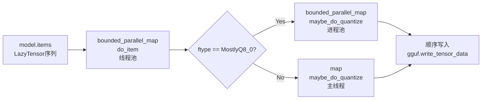
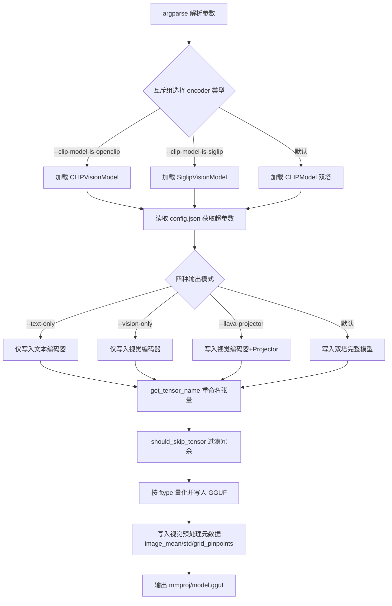
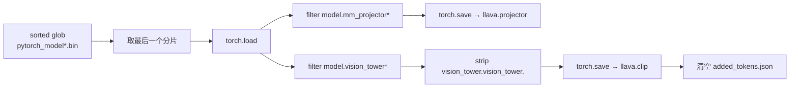
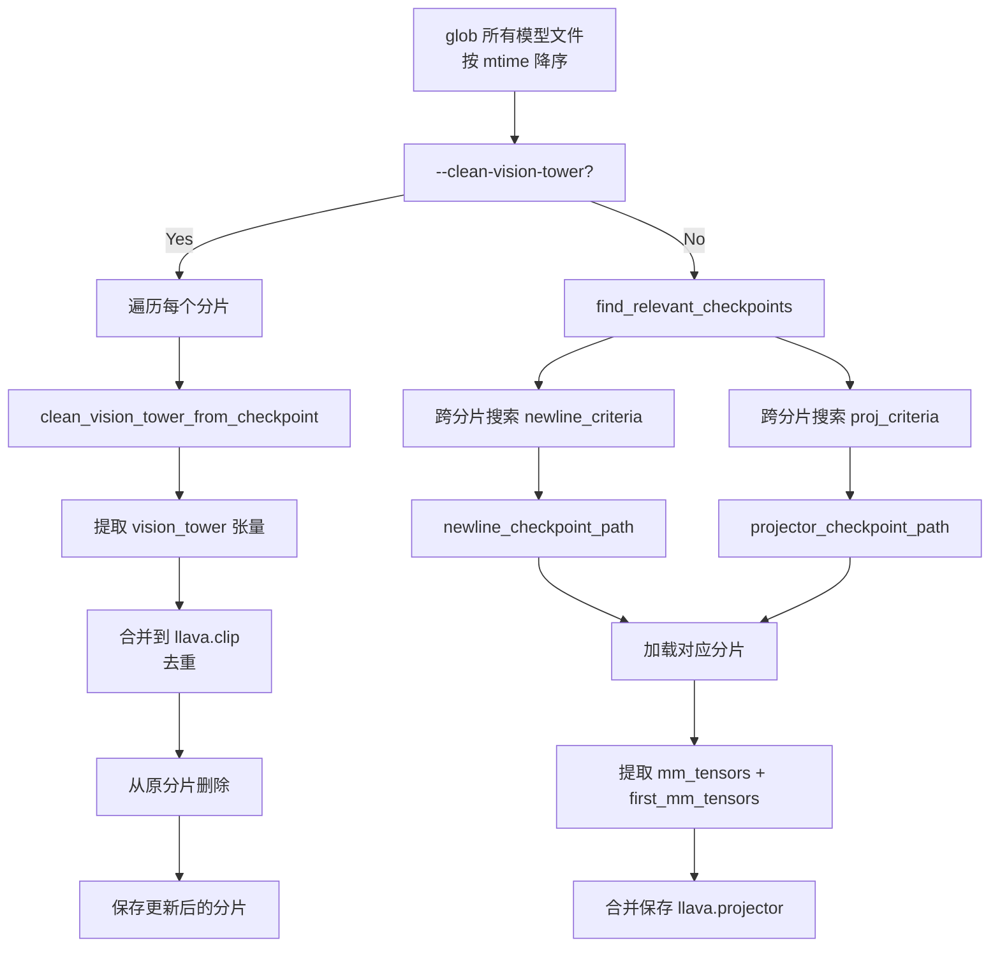

# 第7章 遗留模型转换工具 —— 兼容「远古版本」的手术刀

## 学习目标

- 理解旧版 LLaMA 转换器的核心机制：惰性加载、参数猜测、Q8_0 量化与 GGMLFileType 选择策略
- 掌握 convert_legacy_llama.py 中 Params、LazyTensor、OutputFile 三大核心类的设计哲学与协作流程
- 掌握视觉编码器转换器的张量命名规范（HF→GGUF 翻译表）与元数据写入机制
- 理解多模态模型分离与重组的「手术刀」式处理流程（GLM-Edge / LLaVA / MiniCPM-V 三套方案）
- 了解 LazyStorage + LazyUnpickler 如何实现 PyTorch checkpoint 的零依赖惰性反序列化
- 理解 bounded_parallel_map 的限流并发机制与 ProcessPoolExecutor 在 Q8_0 量化中的应用
- 能阅读并修改遗留模型转换脚本以适配新的 checkpoint 格式

## 7.1 生活类比

想象遗留模型转换工具集是一家**「老照片修复工作室」：** convert_legacy_llama.py 是老照片修复师，能把 decades 前的 PyTorch checkpoint 逐步修复成可读的 GGUF 格式；惰性加载（LazyTensor/LazyStorage）是按需翻阅的放大镜，只在需要时才从底片（zip/safetensors）中读取特定区域；Params.guessed() 是老照片修复中的「凭痕迹推测」，通过张量名称的磨损程度（embed_tokens/W_pack/layers）反推模型的 n_layer、n_head；Q8_0 量化与 GGMLFileType 是老照片的数字化压缩，AllF32/MostlyF16/MostlyQ8_0 三种精度选择就像三种不同的扫描分辨率；convert_image_encoder_to_gguf.py 是视觉神经的「移植手术」，把 CLIP/SigLIP 的视觉部分从 HuggingFace 的躯体中完整取出；GLM-Edge 双脚本协作是分身术，第一阶段（surgery.py）把视觉部分从原 LLM 中物理分离，第二阶段（convert）把分离出来的视觉部分封装为可被 mtmd 加载的 mmproj；LLaVA surgery v1/v2 是拆弹专家的两种武器：v1 是「一刀切」只读最后一个分片，v2 是「多文件侦探」跨所有分片搜索 projector 与 newline；MiniCPM-V 转换器是多版本兼容的拼装工厂，通过 minicpmv_version 参数自动识别 7 种不同版本的 Resampler 与视觉塔结构（同时内嵌了一份 SigLIP 的纯 NumPy 复刻定义）；bounded_parallel_map 是限流并发的交通警察，最多同时启动 N 个线程但每个线程只缓冲 1 个结果，Q8_0 时切换 ProcessPoolExecutor 真正利用多核。就像修复师需要根据照片的年代、材质、破损程度选择不同的修复策略，遗留转换工具也需要根据模型的版本、格式、模态选择不同的提取与打包方案。

## 7.2 源码地图

```
examples/convert_legacy_llama.py
├── 数据类型体系
│   ├── DataType / UnquantizedDataType / QuantizedDataType  # 抽象基类
│   │   └── DataType.elements_to_bytes()                  # 字节数计算
│   │   └── QuantizedDataType.elements_to_bytes()          # 按块大小计算
│   │   └── QuantizedDataType.quantize()                  # 量化抽象方法
│   ├── DT_F16 / DT_F32 / DT_I32 / DT_BF16                 # 非量化类型实例
│   └── DT_Q8_0 (Q8_0QuantizedDataType)                    # Python 端 Q8_0 量化实现
│       └── Q8_0QuantizedDataType.quantize()                # 分块量化核心算法
├── GGMLFileType 枚举
│   ├── AllF32 / MostlyF16 / MostlyQ8_0                     # 三种输出精度
│   └── GGMLFileType.type_for_tensor()                     # 1D 张量强制 F32
├── Params：超参数猜测与加载
│   ├── Params.guessed()                                   # 通过 tensor 名称反推 n_layer/n_head
│   ├── Params.loadHFTransformerJson()                     # 处理 HF config.json
│   ├── Params.loadOriginalParamsJson()                    # 处理 LLaMA v2 params.json
│   └── Params.load()                                      # 三级回退：HF→Original→Guessed
├── 惰性加载体系
│   ├── LazyTensor / LazyStorage / LazyStorageKind         # 按需加载的核心数据结构
│   │   ├── LazyTensor.load()                              # 触发实际读取
│   │   ├── LazyTensor.astype()                            # 惰性类型转换
│   │   └── LazyTensor.validate_conversion_to()            # 校验合法转换
│   ├── LazyUnpickler                                      # 拦截 torch pickle 反序列化
│   │   ├── LazyUnpickler.persistent_load()                # 按需读取 zip 内 storage
│   │   ├── LazyUnpickler.lazy_rebuild_tensor_v2()         # 惰性重建张量
│   │   ├── LazyUnpickler.rebuild_from_type_v2()           # 类型重建入口
│   │   └── LazyUnpickler.find_class()                     # CLASSES 路由表查找
│   ├── lazy_load_torch_file()                             # PyTorch zip 格式加载
│   ├── lazy_load_safetensors_file()                       # SafeTensors mmap 加载
│   ├── must_read()                                        # 严格字节读取辅助
│   └── lazy_load_file()                                   # 格式自动识别入口
├── 张量操作工具
│   ├── Tensor 抽象基类
│   │   ├── Tensor.astype() / Tensor.permute() / Tensor.permute_part()
│   │   ├── Tensor.part() / Tensor.to_ggml()
│   ├── UnquantizedTensor 实现
│   │   ├── UnquantizedTensor.astype()                     # 含 BF16→FP32 转换
│   │   ├── UnquantizedTensor.permute() / permute_part() / part()
│   │   └── UnquantizedTensor.to_ggml()
│   ├── bf16_to_fp32()                                     # BF16 位运算转 FP32
│   ├── permute()                                          # head 维度重排核心
│   ├── permute_lazy() / permute_part_lazy() / part_lazy() # 惰性版本
│   ├── load_unquantized()                                 # 加载并校验张量
│   ├── pack_experts_lazy()                                # MoE 专家权重 3D 打包
│   ├── merge_sharded()                                    # 分片模型拼接（列/行拼接策略）
│   └── merge_multifile_models()                           # 多文件模型合并入口
├── 并发与输出
│   ├── bounded_parallel_map()                             # 限流并发（每线程缓冲 1 结果）
│   ├── per_model_weight_count_estimation()                # 参数量估算（含 expert 区分）
│   ├── pick_output_type()                                 # 输出精度自动选择
│   ├── convert_to_output_type()                           # 按维度应用精度
│   ├── convert_model_names()                              # HF→GGUF 命名规范化
│   ├── nth_multifile_path() / find_multifile_paths()      # 分片文件路径解析
│   ├── load_some_model()                                  # 目录/文件统一加载
│   ├── do_dump_model()                                    # dump 模式打印模型结构
│   ├── default_convention_outfile() / default_outfile()   # 输出文件名规范
│   └── OutputFile                                         # GGUF 打包机
│       ├── OutputFile.add_meta_model()                    # 写入模型元信息
│       ├── OutputFile.add_meta_arch()                     # 写入架构超参数
│       ├── OutputFile.extract_vocabulary_from_model()     # 抽取 tokens/scores/toktypes
│       ├── OutputFile.add_meta_vocab() / add_meta_special_vocab()
│       ├── OutputFile.add_tensor_info()                   # 注册张量元信息
│       ├── OutputFile.write_meta() / write_tensor_info()  # 分阶段刷新文件
│       ├── OutputFile.write_tensor_data()                # 分片写入 + Q8_0 量化切换
│       ├── OutputFile.do_item() / OutputFile.maybe_do_quantize()  # 静态流水线节点
│       ├── OutputFile.write_vocab_only() / OutputFile.write_all()  # 顶层入口
│       └── OutputFile.close()                             # 关闭 GGUFWriter
├── 词表与主流程
│   ├── VocabFactory                                       # SPM/BPE/HFFT 词表工厂
│   │   ├── VocabFactory._create_special_vocab()           # SpecialVocab 构造
│   │   ├── VocabFactory._create_vocab_by_path()           # 按顺序尝试分词器
│   │   └── VocabFactory.load_vocab()                      # 加载主流程
│   ├── check_vocab_size()                                 # vocab 完整性校验 + pad_vocab
│   └── main()                                             # 命令行入口与流程编排
tools/mtmd/legacy-models/convert_image_encoder_to_gguf.py
├── 辅助工具
│   ├── k()                                                # 模板字符串格式化（TEXT/VISION）
│   └── bytes_to_unicode()                                 # BPE 字节↔Unicode 映射表
├── 张量命名与过滤
│   ├── should_skip_tensor()                               # 跳过 logit_scale / position_ids / projector 头
│   └── get_tensor_name()                                  # HF→GGUF 命名翻译表
│       ├── image_newline → model.image_newline
│       ├── multi_modal_projector → mm.model.mlp/peg
│       └── text_model→t / vision_model→v / encoder.layers→blk
├── 模型加载与元数据
│   ├── 三种 encoder 分支（CLIP / CLIPVision / Siglip）    # 通过 argparse 互斥组选择
│   ├── text encoder hparams block                         # 写入 TEXT 超参数
│   └── vision encoder hparams block                       # 写入 VISION 超参数 + image_grid_pinpoints
├── vision feature layer 处理
│   └── get_non_negative_vision_feature_layers()           # 负数索引→正数（-1→num_layers+1）
├── LLaVA projector 集成
│   └── has_llava_projector block                          # 加载独立 projector 并合并写入（主流程第 281-313 行）
├── __main__ 入口
│   └── main() / __main__                                  # argparse 解析与流程编排（第 111-330 行）
tools/mtmd/legacy-models/glmedge-surgery.py
├── 模型加载：AutoModel.from_pretrained
├── mm_tensors extraction                                  # 提取 vision.adapter.* → glm.projector（第 18-21 行）
├── clip tensors extraction                                # 提取 vision.vit.model.vision_model.* → glm.clip（第 24-27 行）
├── added_tokens.json 清空                                # 兼容 Mistral tokenizer
└── main() / __main__                                      # argparse 入口（第 11-35 行）
tools/mtmd/legacy-models/glmedge-convert-image-encoder-to-gguf.py
├── 辅助工具
│   ├── k() / bytes_to_unicode()                           # 与 CLIP 转换器共享工具
│   ├── should_skip_tensor()                               # 跳过 SigLIP 探测头
│   └── get_tensor_name()                                  # HF→GGUF 命名翻译（vision.adapter.* → mm）
├── SiglipVisionModel loader                               # 重新构造 SiglipVisionModel 加载 glm.clip（第 120-124 行）
├── has_glm_projector block                                # 加载 glm.projector 并按 vision.adapter.* 重命名写入（第 238-263 行）
├── vision_model head 过滤                                # 去除 attention probe / mlp 等冗余权重
└── main() / __main__                                      # argparse 入口与流程编排（第 103-281 行）
tools/mtmd/legacy-models/llava_surgery.py
├── main() / __main__                                      # argparse 入口（第 11-37 行）
├── mm_tensors extraction                                  # 提取 model.mm_projector → llava.projector（第 16-19 行）
└── BakLLaVA CLIP 提取                                     # 提取 model.vision_tower → llava.clip
tools/mtmd/legacy-models/llava_surgery_v2.py
├── 格式识别
│   ├── is_safetensor_file()                               # 后缀判断
│   └── load_model() / save_model()                        # .bin / .safetensors 双格式读写
├── 权重名匹配
│   ├── is_vision_tower() / is_newline() / is_mm_projector()
│   └── newline_criteria() / proj_criteria()               # 分片查找谓词
├── 提取流程
│   ├── clean_vision_tower_from_checkpoint()               # 从所有分片中剥离 vision tower
│   ├── find_relevant_checkpoints()                        # 跨文件寻找 projector 与 newline 所在分片
│   └── mtime 排序 + 按需更新                              # 避免重复提取
└── main() / __main__                                      # argparse 入口（--clean-vision-tower 开关，第 116-186 行）
tools/mtmd/legacy-models/minicpmv-surgery.py
├── main() / __main__                                      # argparse 入口（第 9-44 行）
├── resampler.proj scale fix                               # 按 scale_emb 缩放投影器（第 20-22 行）
├── vpm.* → minicpmv.clip                                  # 视觉预处理器映射提取
├── added_tokens.json 清空                                # 兼容 Mistral tokenizer
└── LLM 部分保存到 model/ 子目录                          # 含 auto_map 重写与 tokenizer 保存
tools/mtmd/legacy-models/minicpmv-convert-image-encoder-to-gguf.py
├── SigLIP 模型定义（内嵌 HF 源码）
│   ├── SiglipVisionConfig.__init__()                      # 配置类
│   ├── SiglipVisionEmbeddings.__init__()                  # patch 嵌入 + 位置嵌入
│   ├── SiglipAttention.__init__()                         # Q/K/V/O 投影
│   ├── SiglipMLP.__init__()                               # fc1/fc2 MLP
│   ├── SiglipEncoderLayer / SiglipEncoder.__init__()      # 编码层与堆叠
│   ├── SiglipVisionTransformer.__init__()                 # 完整 ViT 主干
│   │   └── SiglipVisionTransformer.get_input_embeddings()
│   ├── SiglipPreTrainedModel._init_weights()              # 初始化策略
│   ├── _get_unpad_data() / _trunc_normal_() / trunc_normal_tf_()  # 注意力与截断正态
│   └── variance_scaling_() / lecun_normal_() / default_flax_embed_init()  # 权重初始化家族
├── Idefics2VisionTransformer / Config                   # 由 transformers 提供（注释导入）
├── 辅助工具
│   ├── add_key_str()                                      # 模板字符串格式化
│   ├── bytes_to_unicode()
│   ├── should_skip_tensor()                               # 跳过 position_ids / projection
│   └── get_tensor_name()                                  # HF→GGUF 命名翻译
├── minicpmv_version config switch                         # 七种版本自动检测（1/2/3/4/5/6/100045，第 358-388 行）
│   └── 同时支持 config.json 覆盖默认硬编码值
├── 位置嵌入
│   ├── get_1d_sincos_pos_embed_from_grid()                # 1D sin-cos 嵌入
│   ├── get_2d_sincos_pos_embed_from_grid()                # 2D 网格嵌入
│   └── get_2d_sincos_pos_embed()                          # 70×70 网格 2D 位置编码
├── Resampler 张量重塑
│   ├── _replace_name()                                     # vision_model.* 前缀补全 + position_embedding 升维
│   └── _replace_name_resampler()                          # proj 拆分为 weight+pos_embed_k, in_proj_* 按 chunk(3) 拆 q/k/v
├── has_minicpmv_projector block                           # 投影器写入 + projector_type=resampler（第 492-532 行）
└── main() / __main__                                      # argparse 入口与流程编排（第 281-585 行）
```

## 7.3 convert_legacy_llama.py：旧 LLaMA 转换器 —— 解剖「远古时代」的转换手术刀

### 7.3.1 核心数据类型：DataType 与 Q8_0QuantizedDataType

在 `convert_legacy_llama.py` 开头，定义了描述张量数据类型的核心类层级。我们先看「设计图纸」——类型定义，再看具体实现。

#### 7.3.1.1 DataType 基类与非量化类型

```python
# examples/convert_legacy_llama.py (第 48-72 行)
class DataType:
    """表示数据类型的不可变数据类"""
    def __init__(self, name: str, dtype: np.dtype, valid_conversions: list[str]):
        self.name = name
        self.dtype = dtype
        self.valid_conversions = valid_conversions

    def elements_to_bytes(self, n_elements: int) -> int:
        """计算给定元素数量对应的字节数"""
        return n_elements * self.dtype.itemsize

# 非量化类型实例
DT_F16 = DataType("F16", np.dtype(np.float16), ["F32", "Q8_0"])
DT_F32 = DataType("F32", np.dtype(np.float32), ["F16", "Q8_0"])
DT_I32 = DataType("I32", np.dtype(np.int32), [])
DT_BF16 = DataType("BF16", np.dtype(np.uint16), ["F32", "F16", "Q8_0"])
```

**代码解析**：
- `DataType` 封装了名称、NumPy dtype 与允许的转换目标列表。
- `elements_to_bytes` 直接用 `dtype.itemsize` 乘以元素数，适用于密集存储的非量化类型。

#### 7.3.1.2 QuantizedDataType 与 Q8_0QuantizedDataType

```python
# examples/convert_legacy_llama.py (第 74-122 行)
class QuantizedDataType(DataType):
    """表示量化数据类型，引入块大小概念"""
    def __init__(self, name: str, dtype: np.dtype, block_size: int, quantized_dtype: np.dtype, ggml_type: int, valid_conversions: list[str]):
        super().__init__(name, dtype, valid_conversions)
        self.block_size = block_size
        self.quantized_dtype = quantized_dtype
        self.ggml_type = ggml_type

    def elements_to_bytes(self, n_elements: int) -> int:
        """量化类型按块计算字节数"""
        assert n_elements % self.block_size == 0
        return self.quantized_dtype.itemsize * (n_elements // self.block_size)

    def quantize(self, arr: NDArray) -> NDArray:
        raise NotImplementedError(f'Quantization for {self.name} not implemented')


class Q8_0QuantizedDataType(QuantizedDataType):
    """Python 端 Q8_0 量化实现"""
    def __init__(self):
        # Q8_0: block_size=32, 每块 1 个 fp16 scale + 32 个 int8
        quantized_dtype = np.dtype([("d", np.float16), ("qs", np.int8, (32,))])
        super().__init__("Q8_0", np.dtype(np.float32), 32, quantized_dtype, 10, ["F32", "F16"])

    def quantize(self, arr: NDArray) -> NDArray:
        """分块量化核心算法"""
        assert arr.size % self.block_size == 0 and arr.size != 0
        assert arr.dtype == np.float32
        n_blocks = arr.size // self.block_size
        blocks = arr.reshape((n_blocks, self.block_size))

        def quantize_blocks_q8_0(blocks: NDArray) -> Iterable[tuple[Any, Any]]:
            d = abs(blocks).max(axis=1) / np.float32(127)
            with np.errstate(divide='ignore'):
                qs = (blocks / d[:, None]).round()
            qs[d == 0] = 0
            yield from zip(d, qs)

        return np.fromiter(quantize_blocks_q8_0(blocks), count=n_blocks, dtype=self.quantized_dtype)
```

**代码解析**：
- `QuantizedDataType` 引入 `block_size`，`elements_to_bytes` 按块数计算存储。
- `Q8_0QuantizedDataType.quantize()` 实现了标准 Q8_0 算法：每 32 个元素为一块，计算绝对值最大值除以 127 得到 `scale (fp16)`，再将原值除以 scale 四舍五入得到 `int8`。`np.errstate` 忽略除零警告，`d==0` 时直接置零。
- 返回结构化数组，每个元素包含 `(d: fp16, qs: int8[32])`，完美匹配 GGML 的 `block_q8_0` 布局。

### 7.3.2 GGMLFileType：旧版文件格式枚举

```python
# examples/convert_legacy_llama.py (第 124-184 行)
class GGMLFileType(Enum):
    AllF32 = 0
    MostlyF16 = 1
    MostlyQ8_0 = 2

    def type_for_tensor(self, name: str, tensor: LazyTensor) -> DataType:
        """1D 张量强制 F32，其余按文件类型"""
        dt = GGML_FILE_TYPE_TO_DATA_TYPE.get(self)
        if dt is None:
            raise ValueError(self)
        # 1D 张量（bias/norm）统一用 F32，避免老算子兼容问题
        return dt if len(tensor.shape) > 1 else DT_F32

GGML_FILE_TYPE_TO_DATA_TYPE = {
    GGMLFileType.AllF32: DT_F32,
    GGMLFileType.MostlyF16: DT_F16,
    GGMLFileType.MostlyQ8_0: DT_Q8_0,
}
```

**代码解析**：
- 三种输出精度枚举，`type_for_tensor()` 是「精度选择器」：遇到 1D 张量（如 bias、LayerNorm weight）无视全局设置强制用 F32，其余按全局 `ftype` 选择。这是为了兼容早期 GGML 仅对 1D 张量实现 F32 内核的历史包袱。

### 7.3.3 Params：超参数猜测与三级回退加载

`Params` 类承担「超参数侦探」角色，按优先级尝试三种来源。

#### 7.3.3.1 . Params.guessed() —— 无配置时的启发式推断

```python
# examples/convert_legacy_llama.py (第 221-253 行)
@staticmethod
def guessed(model: LazyModel) -> Params:
    # 1. 先试 HF 命名
    n_vocab, n_embd = model["model.embed_tokens.weight"].shape \
        if "model.embed_tokens.weight" in model \
        else model["tok_embeddings.weight"].shape

    # 2. 推断层数：优先 HF 命名，次 Baichuan W_pack，最后原版 LLaMA
    if "model.layers.0.self_attn.q_proj.weight" in model:
        n_layer = next(i for i in itertools.count()
                       if f"model.layers.{i}.self_attn.q_proj.weight" not in model)
    elif "model.layers.0.self_attn.W_pack.weight" in model:
        n_layer = next(i for i in itertools.count()
                       if f"model.layers.{i}.self_attn.W_pack.weight" not in model)
    else:
        n_layer = next(i for i in itertools.count()
                       if f"layers.{i}.attention.wq.weight" not in model)

    if n_layer < 1:
        raise KeyError("failed to guess 'n_layer'...")

    n_head = n_embd // 128           # 经验值：每头 128 维
    n_mult = 256                     # FFN 维度对齐粒度
    n_ff = int(2 * (4 * n_embd) / 3) # SwiGLU 标准公式
    n_ff = n_mult * ((n_ff + n_mult - 1) // n_mult)

    return Params(n_vocab=n_vocab, n_embd=n_embd, n_layer=n_layer,
                  n_ctx=-1, n_ff=n_ff, n_head=n_head, n_head_kv=n_head,
                  f_norm_eps=1e-5)
```

**代码解析**：
- 通过张量键名的存在性计数反推 `n_layer`，兼容 HF、Baichuan、原版 LLaMA 三种命名。
- `n_head`、`n_ff` 采用经验公式猜测，`n_ctx=-1` 标记未知，后续需用户 `--ctx` 指定。

#### 7.3.3.2 . loadHFTransformerJson() —— 现代 HF config.json

```python
# examples/convert_legacy_llama.py (第 263-306 行)
@staticmethod
def loadHFTransformerJson(model: LazyModel, config_path: Path) -> Params:
    with open(config_path) as f:
        config = json.load(f)

    # RoPE scaling 解析
    rope_scaling_type = f_rope_scale = n_ctx_orig = rope_finetuned = None
    if (rs := config.get("rope_scaling")) and (typ := rs.get("type")):
        f_rope_scale = rs.get("factor")
        if typ == "linear":
            rope_scaling_type = gguf.RopeScalingType.LINEAR
        elif typ == "yarn":
            rope_scaling_type = gguf.RopeScalingType.YARN
            n_ctx_orig = rs['original_max_position_embeddings']
            rope_finetuned = rs['finetuned']

    # 上下文长度
    n_ctx = config.get("max_sequence_length") or config.get("max_position_embeddings")

    # MoE 字段
    n_experts = config.get("num_local_experts")
    n_experts_used = config.get("num_experts_per_tok")

    return Params(n_vocab=config["vocab_size"], n_embd=config["hidden_size"],
                  n_layer=config["num_hidden_layers"], n_ctx=n_ctx,
                  n_ff=config["intermediate_size"], n_head=config["num_attention_heads"],
                  n_head_kv=config.get("num_key_value_heads", config["num_attention_heads"]),
                  n_experts=n_experts, n_experts_used=n_experts_used,
                  f_norm_eps=config["rms_norm_eps"],
                  f_rope_freq_base=config.get("rope_theta"),
                  rope_scaling_type=rope_scaling_type, f_rope_scale=f_rope_scale,
                  n_ctx_orig=n_ctx_orig, rope_finetuned=rope_finetuned)
```

**代码解析**：
- 直接映射 HF 标准字段，特别处理 `rope_scaling` 与 MoE 字段，生成完整的 `Params` 对象。

#### 7.3.3.3 . loadOriginalParamsJson() —— LLaMA v1/v2 / CodeLlama / Mixtral 老格式

```python
# examples/convert_legacy_llama.py (第 313-348 行)
@staticmethod
def loadOriginalParamsJson(model: LazyModel, config_path: Path) -> Params:
    with open(config_path) as f:
        config = json.load(f)

    # 启发式判断版本 → 决定 n_ctx
    if config.get("moe"):
        n_ctx = 32768  # Mixtral
    elif config.get("rope_theta") == 1000000:
        n_ctx = 16384  # CodeLlama
    elif config["norm_eps"] == 1e-05:
        n_ctx = 4096   # LLaMA v2
    else:
        n_ctx = 2048   # LLaMA v1

    # FFN 维度可能在模型里
    n_ff = model["layers.0.feed_forward.w1.weight"].shape[0] \
        if "layers.0.feed_forward.w1.weight" in model else None
    if config.get("moe"):
        n_ff = model["layers.0.feed_forward.experts.0.w1.weight"].shape[0]
        n_experts = config["moe"]["num_experts"]
        n_experts_used = config["moe"]["num_experts_per_tok"]
        f_rope_freq_base = 1e6

    return Params(n_vocab=model["tok_embeddings.weight"].shape[0],
                  n_embd=config["dim"], n_layer=config["n_layers"],
                  n_ctx=n_ctx, n_ff=n_ff, n_head=config["n_heads"],
                  n_head_kv=config.get("n_kv_heads", config["n_heads"]),
                  n_experts=n_experts, n_experts_used=n_experts_used,
                  f_norm_eps=config["norm_eps"],
                  f_rope_freq_base=config.get("rope_theta", f_rope_freq_base))
```

**代码解析**：
- 老版本 `params.json` 缺少 `n_ctx`、`rope_theta` 等字段，通过 `norm_eps`、`rope_theta`、`moe` 字段反推模型版本并设定默认上下文长度。

#### 7.3.3.4 . Params.load() —— 三级回退总入口

```python
# examples/convert_legacy_llama.py (第 351-364 行)
@staticmethod
def load(model_plus: ModelPlus) -> Params:
    hf_config_path   = model_plus.paths[0].parent / "config.json"
    orig_config_path = model_plus.paths[0].parent / "params.json"
    if hf_config_path.exists():
        return Params.loadHFTransformerJson(model_plus.model, hf_config_path)
    elif orig_config_path.exists():
        return Params.loadOriginalParamsJson(model_plus.model, orig_config_path)
    elif model_plus.format != 'none':
        return Params.guessed(model_plus.model)
    else:
        raise ValueError("Cannot guess params when model format is none")
```

**代码解析**：
- 优先级：HF config.json → 原版 params.json → 启发式猜测。体现「兼容性优先」的工程哲学。

### 7.3.4 惰性加载体系：LazyTensor / LazyStorage / LazyUnpickler

这是处理百 GB 模型的关键——**只在真正需要时才读磁盘**。

#### 7.3.4.1 LazyTensor：延迟计算的句柄

```python
# examples/convert_legacy_llama.py (第 470-488 行)
@dataclass
class LazyTensor:
    _load: Callable[[], Tensor]      # 真正加载的回调
    shape: list[int]
    data_type: DataType
    description: str

    def load(self) -> Tensor:
        """触发实际读取"""
        ret = self._load()
        assert ret.data_type == self.data_type or \
               (self.data_type.dtype == ret.data_type.dtype), \
               (self.data_type, ret.data_type, self.description)
        return ret

    def astype(self, data_type: DataType) -> LazyTensor:
        """惰性类型转换：不加载数据，只包装新的 _load"""
        self.validate_conversion_to(data_type)
        def load() -> Tensor:
            return self.load().astype(data_type)
        return LazyTensor(load, self.shape, data_type,
                          f'convert({data_type}) {self.description}')

    def validate_conversion_to(self, data_type: DataType) -> None:
        if data_type != self.data_type and \
           data_type.name not in self.data_type.valid_conversions:
            raise ValueError(f'Cannot validate conversion from {self.data_type} to {data_type}.')
```

**代码解析**：
- `LazyTensor` 持有 `_load` 闭包、`shape`、`data_type`、`description`（调试用）。
- `load()` 真正触发 I/O，返回具体 `Tensor`（`UnquantizedTensor` 或量化后的数组）。
- `astype()` **不执行转换**，而是返回新的 `LazyTensor`，其 `_load` 链式包装原 `load()` + `astype()`，实现「操作树」延迟求值。

#### 7.3.4.2 LazyUnpickler：零依赖反序列化 PyTorch zip

```python
# examples/convert_legacy_llama.py (第 527-574 行)
class LazyUnpickler(pickle.Unpickler):
    def __init__(self, fp: IO[bytes], data_base_path: str, zip_file: zipfile.ZipFile):
        super().__init__(fp)
        self.data_base_path = data_base_path
        self.zip_file = zip_file

    def persistent_load(self, pid: Any) -> Any:
        """拦截 storage 持久化 ID，返回 LazyStorage"""
        assert pid[0] == 'storage'
        kind = pid[1]  # LazyStorageKind
        filename = f'{self.data_base_path}/{pid[2]}'
        info = self.zip_file.getinfo(filename)

        def load(offset: int, elm_count: int) -> NDArray:
            dtype = kind.data_type.dtype
            with self.zip_file.open(info) as fp:
                fp.seek(offset * dtype.itemsize)
                data = fp.read(elm_count * dtype.itemsize)
            return np.frombuffer(data, dtype)

        return LazyStorage(load=load, kind=kind,
                           description=f'storage path-in-zip={filename} path={self.zip_file.filename}')

    @staticmethod
    def lazy_rebuild_tensor_v2(storage, storage_offset, size, stride, *_, **__) -> LazyTensor:
        """pickle 重建张量的入口，包装为 LazyTensor"""
        assert isinstance(storage, LazyStorage)
        def load() -> UnquantizedTensor:
            elm_count = stride[0] * size[0]
            return UnquantizedTensor(storage.load(storage_offset, elm_count).reshape(size))
        return LazyTensor(load, list(size), storage.kind.data_type,
                          f'pickled storage_offset={storage_offset} in {storage.description}')

    def find_class(self, module: str, name: str) -> Any:
        """替换 torch.* 类为本地 CLASSES 表"""
        if not module.startswith('torch'):
            return super().find_class(module, name)
        return self.CLASSES[(module, name)]
```

**代码解析**：
- `persistent_load` 拦截 pickle 的 storage 引用，构造 `LazyStorage`，其 `load` 闭包捕获 `zip_file`、`offset`、`dtype`，**按需从 zip 内部偏移读取原始字节**，完全避免将整个模型解压到内存。
- `lazy_rebuild_tensor_v2` 是 `torch._utils._rebuild_tensor_v2` 的替身，将 `LazyStorage` + 元数据包装成 `LazyTensor`。
- `find_class` 将 `torch.*` 类重定向到脚本内定义的 `CLASSES` 字典（`torch.Tensor`、`torch.nn.Parameter` 等），实现**零 PyTorch 依赖**反序列化。

#### 7.3.4.3 safetensors mmap 零拷贝加载

```python
# examples/convert_legacy_llama.py (第 593-610 行)
def lazy_load_safetensors_file(fp: IO[bytes], path: Path) -> ModelPlus:
    header_size, = struct.unpack('<Q', fp.read(8))
    header = json.loads(fp.read(header_size))
    mapped = memoryview(mmap.mmap(fp.fileno(), 0, access=mmap.ACCESS_READ))
    byte_buf = mapped[8 + header_size:]

    def convert(info: dict) -> LazyTensor:
        data_type = SAFETENSORS_DATA_TYPES[info['dtype']]
        shape = info['shape']
        begin, end = info['data_offsets']
        buf = byte_buf[begin:end]  # 内存视图切片，零拷贝
        def load() -> UnquantizedTensor:
            return UnquantizedTensor(np.frombuffer(buf, dtype=data_type.dtype).reshape(shape))
        return LazyTensor(load, shape, data_type, f'safetensors {path}')

    model = {name: convert(info) for name, info in header.items() if name != '__metadata__'}
    return ModelPlus(model=model, paths=[path], format='safetensors', vocab=None)
```

**代码解析**：
- 读取 header 后，`mmap` 将整个文件映射进内存地址空间，`byte_buf[begin:end]` 直接得到张量数据的内存视切片，**无额外内存分配、无拷贝**。
- `LazyTensor._load` 捕获这个 `memoryview` 切片，`np.frombuffer` 极其高效地构造 `ndarray`。

#### 7.3.4.4 格式自动识别入口

```python
# examples/convert_legacy_llama.py (第 617-625 行)
@functools.lru_cache(maxsize=None)
def lazy_load_file(path: Path) -> ModelPlus:
    fp = open(path, 'rb')
    first8 = fp.read(8)
    fp.seek(0)
    if first8[:2] == b'PK':  # zip magic
        return lazy_load_torch_file(fp, path)
    elif struct.unpack('<Q', first8)[0] < 16 * 1024 * 1024:  # header < 16MB 判定 safetensors
        return lazy_load_safetensors_file(fp, path)
    else:
        raise ValueError(f"unknown format: {path}")
```

**代码解析**：
- 读前 8 字节：`PK` → PyTorch zip；header_size < 16MB → safetensors（头部含 JSON 元数据，通常很小）。`lru_cache` 避免重复打开同一文件。

### 7.3.5 张量操作工具：permute / part / merge_sharded

#### 7.3.5.1 permute：QKV 头维度重排核心

```python
# examples/convert_legacy_llama.py (第 373-378 行)
def permute(weights: NDArray, n_head: int, n_head_kv: int) -> NDArray:
    """将 [n_head, 2, head_dim, ...] 交换为 [n_head, head_dim, 2, ...]"""
    if n_head_kv is not None and n_head != n_head_kv:
        n_head = n_head_kv
    return (weights.reshape(n_head, 2, weights.shape[0] // n_head // 2, *weights.shape[1:])
            .swapaxes(1, 2)
            .reshape(weights.shape))
```

**代码解析**：
- HF 的 `q_proj/k_proj` 权重形状通常为 `(n_head * head_dim, hidden)`，LLaMA 期望 `(n_head, head_dim, 2, ...)` 交错布局。`permute` 通过 reshape+swapaxes 完成布局转换。

#### 7.3.5.2 惰性版本包装器

```python
# examples/convert_legacy_llama.py (第 552-568 行)
def permute_lazy(lazy_tensor: LazyTensor, n_head: int, n_head_kv: int) -> LazyTensor:
    def load() -> Tensor:
        return lazy_tensor.load().permute(n_head, n_head_kv)
    return LazyTensor(load, lazy_tensor.shape, lazy_tensor.data_type,
                      f'permute({n_head}, {n_head_kv}) ' + lazy_tensor.description)

def permute_part_lazy(lazy_tensor: LazyTensor, n_part: int, n_head: int, n_head_kv: int) -> LazyTensor:
    def load() -> Tensor:
        return lazy_tensor.load().permute_part(n_part, n_head, n_head_kv)
    s = lazy_tensor.shape.copy(); s[0] = s[0] // 3
    return LazyTensor(load, s, lazy_tensor.data_type,
                      f'permute_part({n_part}) ' + lazy_tensor.description)

def part_lazy(lazy_tensor: LazyTensor, n_part: int) -> LazyTensor:
    def load() -> Tensor:
        return lazy_tensor.load().part(n_part)
    s = lazy_tensor.shape.copy(); s[0] = s[0] // 3
    return LazyTensor(load, s, lazy_tensor.data_type, 'part ' + lazy_tensor.description)
```

**代码解析**：
- 三个函数均返回新的 `LazyTensor`，**不触发加载**，仅记录操作描述，真正的 `permute/part` 在最终 `write_tensor_data` 时由 `load()` 链式执行。

#### 7.3.5.3 merge_sharded：分片模型拼接

```python
# examples/convert_legacy_llama.py (第 500-525 行)
def merge_sharded(models: list[LazyModel]) -> LazyModel:
    names = {name: None for model in models for name in model}
    def convert(name: str) -> LazyTensor:
        lazy_tensors = [model[name] for model in models]
        if len(lazy_tensors) == 1: return lazy_tensors[0]
        if len(lazy_tensors[0].shape) == 1: return lazy_tensors[0]  # 1D 复用

        # 列拼接：embedding / wo / w2
        if name.startswith('tok_embeddings.') or \
           name.endswith('.attention.wo.weight') or \
           name.endswith('.feed_forward.w2.weight'):
            axis = 1
        else:
            axis = 0  # 行拼接：qkv / w1 / w3 等

        concat_shape = list(lazy_tensors[0].shape)
        concat_shape[axis] = sum(t.shape[axis] for t in lazy_tensors)

        def load() -> UnquantizedTensor:
            ndarrays = [load_unquantized(t) for t in lazy_tensors]
            return UnquantizedTensor(np.concatenate(ndarrays, axis=axis))

        return LazyTensor(load, concat_shape, lazy_tensors[0].data_type,
                          'concatenated[[' + '] | ['.join(lt.description for lt in lazy_tensors) + ']]')
    return {name: convert(name) for name in names}
```

**代码解析**：
- 原版 LLaMA 分片策略：`tok_embeddings`、`wo`、`w2` 按列（axis=1）切分，其余按行（axis=0）。
- `merge_sharded` 构造新的 `LazyTensor`，其 `load()` 闭包并行加载各分片张量并 `np.concatenate`。**只有在最终写入时才真正拼接**，内存峰值仅为单分片大小。

### 7.3.6 OutputFile：GGUF 打包流水线

`OutputFile` 封装 `gguf.GGUFWriter`，实现分阶段写入：元数据 → 张量信息 → 张量数据。

#### 7.3.6.1 元数据写入

```python
# examples/convert_legacy_llama.py (第 456-532 行)
def add_meta_model(self, params: Params, metadata: gguf.Metadata | None) -> None:
    name = "LLaMA"
    if metadata and metadata.name: name = metadata.name
    elif params.path_model: name = params.path_model.name
    elif params.n_ctx == 4096: name = "LLaMA v2"  # 启发式
    self.gguf.add_name(name)
    # 其余 author/version/license 等字段透传 metadata...
```

```python
# examples/convert_legacy_llama.py (第 934-973 行)
def add_meta_arch(self, params: Params) -> None:
    self.gguf.add_vocab_size(params.n_vocab)
    self.gguf.add_context_length(params.n_ctx)
    self.gguf.add_embedding_length(params.n_embd)
    self.gguf.add_block_count(params.n_layer)
    self.gguf.add_feed_forward_length(params.n_ff)
    self.gguf.add_rope_dimension_count(params.n_embd // params.n_head)
    self.gguf.add_head_count(params.n_head)
    self.gguf.add_head_count_kv(params.n_head_kv)
    if params.n_experts: self.gguf.add_expert_count(params.n_experts)
    if params.n_experts_used: self.gguf.add_expert_used_count(params.n_experts_used)
    self.gguf.add_layer_norm_rms_eps(params.f_norm_eps)
    if params.f_rope_freq_base: self.gguf.add_rope_freq_base(params.f_rope_freq_base)
    # RoPE scaling 字段...
```

#### 7.3.6.2 词表提取与写入

```python
# examples/convert_legacy_llama.py (第 975-1001 行)
def extract_vocabulary_from_model(self, vocab: Vocab) -> tuple[list[bytes], list[float], list[gguf.TokenType]]:
    tokens, scores, toktypes = [], [], []
    for text, score, toktype in vocab.all_tokens():
        tokens.append(text); scores.append(score); toktypes.append(toktype)
    assert len(tokens) == vocab.vocab_size
    return tokens, scores, toktypes

def add_meta_vocab(self, vocab: Vocab) -> None:
    self.gguf.add_tokenizer_model(vocab.tokenizer_model)
    tokens, scores, toktypes = self.extract_vocabulary_from_model(vocab)
    self.gguf.add_token_list(tokens)
    self.gguf.add_token_scores(scores)
    self.gguf.add_token_types(toktypes)
```

#### 7.3.6.3 静态流水线节点：do_item / maybe_do_quantize

```python
# examples/convert_legacy_llama.py (第 1067-1079 行)
@staticmethod
def do_item(item: tuple[str, LazyTensor]) -> tuple[DataType, NDArray]:
    name, lazy_tensor = item
    tensor = lazy_tensor.load().to_ggml()  # 触发加载 + 所有惰性操作
    return (lazy_tensor.data_type, tensor.ndarray)

@staticmethod
def maybe_do_quantize(item: tuple[DataType, NDArray]) -> NDArray:
    dt, arr = item
    if not isinstance(dt, QuantizedDataType):
        return arr
    return dt.quantize(arr)  # 调用 Q8_0QuantizedDataType.quantize()
```

**代码解析**：
- `do_item` 是「加载+展开惰性操作」的同步点，返回 `(目标DataType, 最终ndarray)`。
- `maybe_do_quantize` 只有当目标 `DataType` 是 `QuantizedDataType` 子类（如 `DT_Q8_0`）时才真正量化。

#### 7.3.6.4 write_tensor_data：并发写入 + Q8_0 切换进程池

```python
# examples/convert_legacy_llama.py (第 1018-1041 行)
def write_tensor_data(self, ftype: GGMLFileType, model: LazyModel, concurrency: int) -> None:
    # 1. 并发执行 do_item（加载+展开）
    ndarrays_inner = bounded_parallel_map(OutputFile.do_item, model.items(), concurrency=concurrency)

    # 2. 如果是 Q8_0，切换 ProcessPoolExecutor 做量化（释放 GIL）
    if ftype == GGMLFileType.MostlyQ8_0:
        ndarrays = bounded_parallel_map(
            OutputFile.maybe_do_quantize, ndarrays_inner,
            concurrency=concurrency, max_workers=concurrency,
            use_processpool_executor=True)
    else:
        ndarrays = map(OutputFile.maybe_do_quantize, ndarrays_inner)

    # 3. 顺序写入 GGUF（GGUFWriter 要求顺序写 tensor data）
    start = time.time()
    for i, ((name, _), ndarray) in enumerate(zip(model.items(), ndarrays)):
        elapsed = time.time() - start
        logger.info(f"[{i+1}/{len(model)}] Writing {name} | {ndarray.shape} | {lazy_tensor.data_type.name} | T+{int(elapsed)}")
        self.gguf.write_tensor_data(ndarray)
```

**代码解析**：
- 两级 `bounded_parallel_map`：第一级加载数据（I/O 密集，用线程池），第二级 Q8_0 量化（CPU 密集，用进程池绕过 GIL）。
- `bounded_parallel_map` 保证每线程/进程最多缓冲 1 个结果，防止内存堆积。

#### 7.3.6.5 bounded_parallel_map：限流并发核心

```python
# examples/convert_legacy_llama.py (第 633-650 行)
def bounded_parallel_map(func, iterable, concurrency, max_workers=None, use_processpool_executor=False):
    if concurrency < 2:
        yield from map(func, iterable); return
    iterable = iter(iterable)
    executor_class = ProcessPoolExecutor if use_processpool_executor else ThreadPoolExecutor
    with executor_class(max_workers=max_workers) as executor:
        futures = []
        done = False
        for _ in range(concurrency):
            try: futures.append(executor.submit(func, next(iterable)))
            except StopIteration: done = True; break
        while futures:
            result = futures.pop(0).result()  # 等待最早提交的任务
            while not done and len(futures) < concurrency:
                try: futures.append(executor.submit(func, next(iterable)))
                except StopIteration: done = True; break
            yield result
```

**代码解析**：
- 维护一个固定大小的「滑动窗口」futures 列表，始终保持 `concurrency` 个在途任务。
- `pop(0).result()` 保证结果**按提交顺序**产出，满足 GGUF 写入的顺序要求。
- `use_processpool_executor=True` 时自动切换 `ProcessPoolExecutor`，利用多核加速 Q8_0 量化。

### 7.3.7 convert_model_names：HF→GGUF 命名规范化与 MoE 打包

```python
# examples/convert_legacy_llama.py (第 508-573 行)
def convert_model_names(model: LazyModel, params: Params, skip_unknown: bool) -> LazyModel:
    tmap = gguf.TensorNameMap(ARCH, params.n_layer)
    should_skip = set(gguf.MODEL_TENSOR_SKIP.get(ARCH, []))
    tmp = model

    # 1. MoE 专家权重 3D 打包
    if params.n_experts and params.n_experts > 0:
        for i_l in range(params.n_layer):
            for w in range(1, 4):
                experts = []
                for e in range(params.n_experts):
                    # 兼容 HF 命名与原版命名
                    key = f"layers.{i_l}.feed_forward.experts.{e}.w{w}.weight"
                    if key not in model:
                        key = f"model.layers.{i_l}.block_sparse_moe.experts.{e}.w{w}.weight"
                    experts.append(model[key])
                    del tmp[key]
                tmp[f"layers.{i_l}.feed_forward.experts.w{w}.weight"] = pack_experts_lazy(experts)

    # 2. QKV permute / W_pack 拆分
    for i in itertools.count():
        if f"model.layers.{i}.self_attn.q_proj.weight" in model:
            tmp[f"model.layers.{i}.self_attn.q_proj.weight"] = \
                permute_lazy(model[...], params.n_head, params.n_head)
            tmp[f"model.layers.{i}.self_attn.k_proj.weight"] = \
                permute_lazy(model[...], params.n_head, params.n_head_kv)
        elif f"model.layers.{i}.self_attn.W_pack.weight" in model:  # Baichuan
            tmp[f"model.layers.{i}.self_attn.q_proj.weight"] = \
                permute_part_lazy(model[...], 0, params.n_head, params.n_head)
            tmp[f"model.layers.{i}.self_attn.k_proj.weight"] = \
                permute_part_lazy(model[...], 1, params.n_head, params.n_head_kv)
            tmp[f"model.layers.{i}.self_attn.v_proj.weight"] = \
                part_lazy(model[...], 2)
            del tmp[f"model.layers.{i}.self_attn.W_pack.weight"]
        else:
            break

    # 3. 统一重命名
    out = {}
    for name, lazy_tensor in model.items():
        tensor_type, name_new = tmap.get_type_and_name(name, try_suffixes=(".weight", ".bias")) or (None, None)
        if name_new is None:
            if skip_unknown: continue
            raise ValueError(f"Unexpected tensor name: {name}")
        if tensor_type in should_skip: continue
        out[name_new] = lazy_tensor
    return out
```

**代码解析**：
- 先处理 MoE：将 `experts.{e}.w{w}` 打包为 `experts.w{w}` 3D 张量 `(n_experts, ...)`，使用 `pack_experts_lazy` 保持惰性。
- 再处理注意力权重：HF 的 `q_proj/k_proj` 做 `permute_lazy`；Baichuan 的 `W_pack` 做 `permute_part_lazy` + `part_lazy` 拆分 Q/K/V。
- 最后用 `gguf.TensorNameMap` 做统一重命名，`skip_unknown` 允许跳过未知张量（如 LLaVA 的 projector 权重）。

### 7.3.8 主流程 main() 与命令行入口

```python
# examples/convert_legacy_llama.py (第 765-869 行)
def main(args_in: list[str] | None = None) -> None:
    # ... argparse 定义 ...
    # --dump/--dump-single/--vocab-only/--outtype/--concurrency/--pad-vocab/--skip-unknown 等

    if args.get_outfile:
        # 仅计算默认输出文件名
        model_plus = load_some_model(dir_model)
        params = Params.load(model_plus)
        model = convert_model_names(model_plus.model, params, args.skip_unknown)
        ftype = pick_output_type(model, args.outtype)
        print(default_convention_outfile(ftype, params.n_experts, ...))
        return

    if args.dump_single:
        model_plus = lazy_load_file(dir_model)
        do_dump_model(model_plus); return

    model_plus = load_some_model(dir_model) if not args.vocab_only else ModelPlus(model={}, ...)

    if args.dump:
        do_dump_model(model_plus); return

    params = Params.load(model_plus)  # 三级回退加载超参数
    # 处理 n_ctx、ftype 覆盖...

    vocab_factory = VocabFactory(vocab_path)
    vocab, special_vocab = vocab_factory.load_vocab(vocab_types, model_parent_path)

    if args.vocab_only:
        OutputFile.write_vocab_only(...); return

    model = convert_model_names(model_plus.model, params, args.skip_unknown)
    ftype = pick_output_type(model, args.outtype)
    model = convert_to_output_type(model, ftype)

    OutputFile.write_all(outfile, ftype, params, model, vocab, special_vocab,
                         concurrency=args.concurrency, endianess=endianess,
                         pad_vocab=args.pad_vocab, metadata=metadata)
```

**代码解析**：
- `main()` 是全流程编排器：加载模型 → 猜测/加载参数 → 加载词表 → 命名转换 → 精度转换 → 写入 GGUF。
- 支持多种调试模式：`--dump` 打印模型结构、`--vocab-only` 仅导出词表、`--get-outfile` 只算文件名。
- `concurrency` 控制并发度，`--skip-unknown` 兼容 LLaVA 等非标准架构。

---

## 7.4 LazyStorage 与 LazyTensor：按需加载的「记忆宫殿」

> **核心概念**：`LazyTensor` 与 `LazyStorage` 共同构成了转换器处理超大模型（70B+）的基础设施。它们将「读取磁盘」这一昂贵操作推迟到真正需要数据的那一刻（`write_tensor_data` 阶段），并通过闭包捕获上下文实现零拷贝、零依赖的惰性求值。

### 7.4.1 核心数据结构

#### 7.4.1.1 LazyStorageKind：存储类型描述符

```python
# examples/convert_legacy_llama.py (第 460-465 行)
@dataclass
class LazyStorageKind:
    data_type: DataType
```

**代码解析**：
- 轻量级标记类，仅携带 `DataType` 实例，标识该存储区存放的数据类型（F32/F16/BF16 等），供 `LazyUnpickler.persistent_load` 使用。

#### 7.4.1.2 LazyStorage：惰性存储句柄

```python
# examples/convert_legacy_llama.py (第 467-469 行)
@dataclass
class LazyStorage:
    load: Callable[[int, int], NDArray]   # (offset, elm_count) -> ndarray
    kind: LazyStorageKind
    description: str
```

**代码解析**：
- `load` 是核心闭包：**捕获 `zip_file`、`dtype`、`filename`**，仅在调用时才 `seek` 并 `read` 指定字节范围。
- 由 `LazyUnpickler.persistent_load` 创建，每个 PyTorch storage 对应一个 `LazyStorage` 实例。

#### 7.4.1.3 LazyUnpickler：拦截 pickle 反序列化

```python
# examples/convert_legacy_llama.py (第 527-574 行)
class LazyUnpickler(pickle.Unpickler):
    def __init__(self, fp: IO[bytes], data_base_path: str, zip_file: zipfile.ZipFile):
        super().__init__(fp)
        self.data_base_path = data_base_path
        self.zip_file = zip_file

    def persistent_load(self, pid: Any) -> Any:
        """拦截 storage 持久化 ID，返回 LazyStorage"""
        assert pid[0] == 'storage'
        kind = pid[1]  # LazyStorageKind
        filename = f'{self.data_base_path}/{pid[2]}'
        info = self.zip_file.getinfo(filename)

        def load(offset: int, elm_count: int) -> NDArray:
            dtype = kind.data_type.dtype
            with self.zip_file.open(info) as fp:
                fp.seek(offset * dtype.itemsize)
                data = fp.read(elm_count * dtype.itemsize)
            return np.frombuffer(data, dtype)

        return LazyStorage(load=load, kind=kind,
                           description=f'storage path-in-zip={filename} path={self.zip_file.filename}')

    @staticmethod
    def lazy_rebuild_tensor_v2(storage, storage_offset, size, stride, *_, **__) -> LazyTensor:
        """pickle 重建张量的入口，包装为 LazyTensor"""
        assert isinstance(storage, LazyStorage)
        def load() -> UnquantizedTensor:
            elm_count = stride[0] * size[0]
            return UnquantizedTensor(storage.load(storage_offset, elm_count).reshape(size))
        return LazyTensor(load, list(size), storage.kind.data_type,
                          f'pickled storage_offset={storage_offset} in {storage.description}')

    def find_class(self, module: str, name: str) -> Any:
        """替换 torch.* 类为本地 CLASSES 表"""
        if not module.startswith('torch'):
            return super().find_class(module, name)
        return self.CLASSES[(module, name)]
```

**代码解析**：
- **`persistent_load`**：PyTorch pickle 将 storage 存为 `('storage', kind, filename)`，此处拦截并构造 `LazyStorage`。`load` 闭包捕获 `zip_file` 与 `info`，**按需从 zip 内部偏移读取**，实现「不解压整个模型」的零内存加载。
- **`lazy_rebuild_tensor_v2`**：替代 `torch._utils._rebuild_tensor_v2`，将 `LazyStorage` + `storage_offset`/`size`/`stride` 组装为 `LazyTensor`。`load()` 闭包计算 `elm_count = stride[0] * size[0]`，调用 `storage.load()` 读取连续内存后 `reshape`。
- **`find_class`**：将 `torch.Tensor`、`torch.nn.Parameter` 等类重定向到脚本内 `CLASSES` 字典（定义为空占位类），实现**完全脱离 PyTorch 运行时**的反序列化。

#### 7.4.1.4 LazyTensor 惰性操作链

```python
# examples/convert_legacy_llama.py (第 470-488 行)
@dataclass
class LazyTensor:
    _load: Callable[[], Tensor]      # 真正加载的回调
    shape: list[int]
    data_type: DataType
    description: str

    def load(self) -> Tensor:
        """触发实际读取"""
        ret = self._load()
        assert ret.data_type == self.data_type or \
               (self.data_type.dtype == ret.data_type.dtype), \
               (self.data_type, ret.data_type, self.description)
        return ret

    def astype(self, data_type: DataType) -> LazyTensor:
        """惰性类型转换：不加载数据，只包装新的 _load"""
        self.validate_conversion_to(data_type)
        def load() -> Tensor:
            return self.load().astype(data_type)
        return LazyTensor(load, self.shape, data_type,
                          f'convert({data_type}) {self.description}')

    def validate_conversion_to(self, data_type: DataType) -> None:
        if data_type != self.data_type and \
           data_type.name not in self.data_type.valid_conversions:
            raise ValueError(f'Cannot validate conversion from {self.data_type} to {data_type}.')
```

**代码解析**：
- **操作树累积**：每次调用 `astype()`/`permute_lazy()`/`part_lazy()` 都返回新的 `LazyTensor`，其 `_load` 闭包层层包装前一个 `_load`。**真正的计算图在 `write_tensor_data` → `do_item` → `load()` 时一次性展开执行**。
- **类型安全**：`validate_conversion_to` 依据 `DataType.valid_conversions` 白名单校验，防止非法转换（如 F32→BF16 未在列表中会报错）。

### 7.4.2 双格式加载器

#### 7.4.2.1 lazy_load_torch_file：PyTorch zip 惰性加载

```python
# examples/convert_legacy_llama.py (第 578-590 行)
def lazy_load_torch_file(outer_fp: IO[bytes], path: Path) -> ModelPlus:
    zf = zipfile.ZipFile(outer_fp)
    pickle_paths = [name for name in zf.namelist() if name.endswith('.pkl')]
    assert len(pickle_paths) == 1, pickle_paths
    pickle_fp = zf.open(pickle_paths[0], 'r')
    unpickler = LazyUnpickler(pickle_fp,
                              data_base_path=pickle_paths[0][:-4],
                              zip_file=zf)
    model = unpickler.load()
    if 'model' in model: model = model['model']
    as_dict = dict(model.items())
    return ModelPlus(model=as_dict, paths=[path], format='torch', vocab=None)
```

**代码解析**：
- 打开 zip，定位唯一的 `.pkl` 元数据文件，用 `LazyUnpickler` 反序列化。**整个 state_dict 此时仅存在于 zip 内部，内存中只持有 `LazyTensor` 句柄**。

#### 7.4.2.2 lazy_load_safetensors_file：SafeTensors mmap 零拷贝

```python
# examples/convert_legacy_llama.py (第 593-610 行)
def lazy_load_safetensors_file(fp: IO[bytes], path: Path) -> ModelPlus:
    header_size, = struct.unpack('<Q', fp.read(8))
    header = json.loads(fp.read(header_size))
    mapped = memoryview(mmap.mmap(fp.fileno(), 0, access=mmap.ACCESS_READ))
    byte_buf = mapped[8 + header_size:]

    def convert(info: dict) -> LazyTensor:
        data_type = SAFETENSORS_DATA_TYPES[info['dtype']]
        numpy_dtype = data_type.dtype
        shape: list[int] = info['shape']
        begin, end = info['data_offsets']
        assert 0 <= begin <= end <= len(byte_buf)
        assert end - begin == math.prod(shape) * numpy_dtype.itemsize
        buf = byte_buf[begin:end]  # memoryview 切片，零拷贝
        def load() -> UnquantizedTensor:
            return UnquantizedTensor(np.frombuffer(buf, dtype=numpy_dtype).reshape(shape))
        description = f'safetensors begin={begin} end={end} type={data_type} path={path}'
        return LazyTensor(load, shape, data_type, description)

    model = {name: convert(info) for (name, info) in header.items() if name != '__metadata__'}
    return ModelPlus(model=model, paths=[path], format='safetensors', vocab=None)
```

**代码解析**：
- `mmap` 将文件映射为只读内存视图，`byte_buf[begin:end]` 直接得到张量数据的 **memoryview 切片**，无拷贝、无额外内存分配。
- `load()` 闭包捕获该切片，`np.frombuffer` 极其高效构造 `ndarray`（共享底层内存）。

### 7.4.3 张量变换工具

#### 7.4.3.1 bf16_to_fp32：BF16 位运算转 FP32

```python
# examples/convert_legacy_llama.py (第 402-405 行)
def bf16_to_fp32(bf16_arr: np.ndarray[Any, np.dtype[np.uint16]]) -> NDArray:
    assert bf16_arr.dtype == np.uint16, f"Input array should be of dtype uint16, but got {bf16_arr.dtype}"
    fp32_arr = bf16_arr.astype(np.uint32) << 16
    return fp32_arr.view(np.float32)
```

**代码解析**：
- BF16 仅占 16 位（符号 1 位 + 指数 8 位 + 尾数 7 位），左移 16 位补零即得 FP32 位模式。纯 NumPy 位运算，**无需 PyTorch**，极快。

#### 7.4.3.2 UnquantizedTensor：具体张量实现

```python
# examples/convert_legacy_llama.py (第 411-434 行)
class UnquantizedTensor(Tensor):
    def __init__(self, ndarray: NDArray):
        assert isinstance(ndarray, np.ndarray)
        self.ndarray = ndarray
        self.data_type = NUMPY_TYPE_TO_DATA_TYPE[ndarray.dtype]

    def astype(self, data_type: DataType) -> UnquantizedTensor:
        dtype = data_type.dtype
        if self.data_type == DT_BF16:
            self.ndarray = bf16_to_fp32(self.ndarray)  # BF16 先转 FP32 再转目标类型
        return UnquantizedTensor(self.ndarray.astype(dtype))

    def to_ggml(self) -> Self:
        return self

    def permute_part(self, n_part: int, n_head: int, n_head_kv: int) -> UnquantizedTensor:
        r = self.ndarray.shape[0] // 3
        return UnquantizedTensor(permute(self.ndarray[r * n_part : r * n_part + r, ...], n_head, n_head_kv))

    def part(self, n_part: int) -> UnquantizedTensor:
        r = self.ndarray.shape[0] // 3
        return UnquantizedTensor(self.ndarray[r * n_part : r * n_part + r, ...])

    def permute(self, n_head: int, n_head_kv: int) -> UnquantizedTensor:
        return UnquantizedTensor(permute(self.ndarray, n_head, n_head_kv))
```

**代码解析**：
- 实现 `Tensor` 抽象基类的所有方法。`astype` 内部处理 BF16→FP32 中转，`permute/part/permute_part` 直接调用同名函数操作 `ndarray`。

#### 7.4.3.3 load_unquantized：加载并校验

```python
# examples/convert_legacy_llama.py (第 440-452 行)
def load_unquantized(lazy_tensor: LazyTensor, expected_dtype: Any = None, convert: bool = False) -> NDArray:
    tensor = lazy_tensor.load()
    assert isinstance(tensor, UnquantizedTensor)
    actual_shape = list(tensor.ndarray.shape)
    assert actual_shape == lazy_tensor.shape, (actual_shape, lazy_tensor.shape)
    if expected_dtype is not None and expected_dtype != tensor.ndarray.dtype:
        if convert:
            tensor.ndarray = tensor.ndarray.astype(expected_dtype)
        else:
            raise ValueError(f'expected this tensor to have dtype {expected_dtype}, got {tensor.ndarray.dtype}')
    return tensor.ndarray
```

**代码解析**：
- 统一的「加载+校验」入口，`merge_sharded`、`OutputFile.do_item` 均调用此函数。`convert=True` 允许在合并分片时自动转 dtype。

#### 7.4.3.4 pack_experts_lazy：MoE 专家权重 3D 打包

```python
# examples/convert_legacy_llama.py (第 570-576 行)
def pack_experts_lazy(lazy_tensors: list[LazyTensor]) -> LazyTensor:
    def load() -> Tensor:
        tensors = [lazy_tensor.load() for lazy_tensor in lazy_tensors]
        return UnquantizedTensor(np.array([tensor.ndarray for tensor in tensors]))
    s = lazy_tensors[0].shape.copy()
    s.insert(0, len(lazy_tensors))  # 新增第 0 维：num_experts
    return LazyTensor(load, s, lazy_tensors[0].data_type,
                      'pack_experts ' + ' | '.join(lt.description for lt in lazy_tensors))
```

**代码解析**：
- 将 `n_experts` 个形状相同的 2D 专家权重堆叠为 3D 张量 `(n_experts, out_dim, in_dim)`，符合 GGUF MoE 存储格式。保持惰性，仅在最终写入时 `np.array` 堆叠。

### 7.4.4 多文件模型合并

#### 7.4.4.1 nth_multifile_path / find_multifile_paths：分片路径解析

```python
# examples/convert_legacy_llama.py (第 575-607 行)
def nth_multifile_path(path: Path, n: int) -> Path | None:
    patterns = [
        (r'\.[0-9]{2}\.pth$', f'.{n:02}.pth'),
        (r'-[0-9]{5}-of-(.*)$', fr'-{n:05}-of-\1'),
        (r'(\.[0-9]+)?$', r'\1' if n == 0 else fr'\1.{n}')
    ]
    for regex, replacement in patterns:
        if re.search(regex, path.name):
            new_path = path.with_name(re.sub(regex, replacement, path.name))
            if new_path.exists():
                return new_path
    return None

def find_multifile_paths(path: Path) -> list[Path]:
    ret: list[Path] = []
    for i in itertools.count():
        nth_path = nth_multifile_path(path, i)
        if nth_path is None:
            break
        ret.append(nth_path)
    if not ret:
        return [path]
    return ret
```

**代码解析**：
- 支持三种常见分片命名模式：`.00.pth`、`-00001-of-XXXXXX.safetensors`、`.0/.1` 后缀。
- `find_multifile_paths` 顺序探测直到找不到，自动处理单文件与多分片混合场景。

#### 7.4.4.2 load_some_model / merge_multifile_models：统一加载入口

```python
# examples/convert_legacy_llama.py (第 667-692 行)
def load_some_model(path: Path) -> ModelPlus:
    if path.is_dir():
        globs = ["model-00001-of-*.safetensors", "model.safetensors", "consolidated.safetensors"]
        files = [file for glob in globs for file in path.glob(glob)]
        if not files:
            globs = ["consolidated.00.pth", "pytorch_model-00001-of-*.bin", "*.pt", "pytorch_model.bin"]
            files = [file for glob in globs for file in path.glob(glob)]
        if not files:
            raise FileNotFoundError(f"Can't find model in directory {path}")
        if len(files) > 1:
            raise ValueError(f"Found multiple models in {path}, not sure which to pick: {files}")
        path = files[0]
    paths = find_multifile_paths(path)
    models_plus: list[ModelPlus] = []
    for path in paths:
        logger.info(f"Loading model file {path}")
        models_plus.append(lazy_load_file(path))
    model_plus = merge_multifile_models(models_plus)
    return model_plus
```

```python
# examples/convert_legacy_llama.py (第 532-550 行)
def merge_multifile_models(models_plus: list[ModelPlus]) -> ModelPlus:
    formats: set[ModelFormat] = set(mp.format for mp in models_plus)
    assert len(formats) == 1, "different formats?"
    format = formats.pop()
    paths = [path for mp in models_plus for path in mp.paths]
    try:
        vocab = next(mp.vocab for mp in models_plus if mp.vocab is not None)
    except StopIteration:
        vocab = None
    if any("model.embed_tokens.weight" in mp.model for mp in models_plus):
        # Transformers models put different tensors in different files, but
        # don't split individual tensors between files.
        model: LazyModel = {}
        for mp in models_plus:
            model.update(mp.model)
    else:
        model = merge_sharded([mp.model for mp in models_plus])
    return ModelPlus(model, paths, format, vocab)
```

**代码解析**：
- `load_some_model`：目录 → 按优先级 glob 找第一个模型文件 → `find_multifile_paths` 展开所有分片 → 逐个 `lazy_load_file` → `merge_multifile_models` 合并。
- `merge_multifile_models`：HF 格式（含 `model.embed_tokens.weight`）各分片存**不同张量**，直接 `dict.update` 合并；原版 LLaMA 格式各分片存**同一张量的不同分片**，调用 `merge_sharded` 拼接。

#### 7.4.4.3 do_dump_model：调试用模型结构打印

```python
# examples/convert_legacy_llama.py (第 755-763 行)
def do_dump_model(model_plus: ModelPlus) -> None:
    print(f"model_plus.paths = {model_plus.paths!r}")
    print(f"model_plus.format = {model_plus.format!r}")
    print(f"model_plus.vocab = {model_plus.vocab!r}")
    for name, lazy_tensor in model_plus.model.items():
        print(f"{name}: shape={lazy_tensor.shape} type={lazy_tensor.data_type}; {lazy_tensor.description}")
```

**代码解析**：
- `--dump`/`--dump-single` 模式调用，打印每个 `LazyTensor` 的 `shape`、`data_type`、`description`，**完全不触发磁盘读取**，秒级完成百 GB 模型结构查看。

### 7.4.5 词表工厂

#### 7.4.5.1 VocabFactory：多格式词表加载

```python
# examples/convert_legacy_llama.py (第 608-665 行)
class VocabFactory:
    _VOCAB_CLASSES = [SPMVocab, BPEVocab, HFFTVocab]  # 优先级：SPM > BPE > HFFT

    def __init__(self, path: Path):
        self.path = path

    def _create_special_vocab(self, vocab: BaseVocab, model_parent_path: Path) -> gguf.SpecialVocab:
        load_merges = vocab.name == "bpe"
        n_vocab = vocab.vocab_size if isinstance(vocab, Vocab) else None
        return gguf.SpecialVocab(
            model_parent_path,
            load_merges=load_merges,
            special_token_types=None,
            n_vocab=n_vocab,
        )

    def _create_vocab_by_path(self, vocab_types: list[str]) -> Vocab:
        vocab_classes: dict[str, type[Vocab]] = {cls.name: cls for cls in self._VOCAB_CLASSES}
        selected_vocabs: dict[str, type[Vocab]] = {}
        for vtype in vocab_types:
            try:
                selected_vocabs[vtype] = vocab_classes[vtype]
            except KeyError:
                raise ValueError(f"Unsupported vocabulary type {vtype}") from None
        for vtype, cls in selected_vocabs.items():
            try:
                vocab = cls(self.path)
                break
            except FileNotFoundError:
                pass
        else:
            raise FileNotFoundError(f"Could not find a tokenizer matching any of {vocab_types}")
        logger.info(f"Loaded vocab file {vocab.fname_tokenizer!r}, type {vocab.name!r}")
        return vocab

    def load_vocab(self, vocab_types: list[str] | None, model_parent_path: Path) -> tuple[BaseVocab, gguf.SpecialVocab]:
        vocab: BaseVocab
        if vocab_types is None:
            vocab = NoVocab()
        else:
            vocab = self._create_vocab_by_path(vocab_types)
        special_vocab = self._create_special_vocab(vocab, model_parent_path)
        return vocab, special_vocab
```

**代码解析**：
- **工厂模式**：按 `vocab_types` 顺序尝试实例化 `SPMVocab`/`BPEVocab`/`HFFTVocab`，首个成功即返回。
- `_create_special_vocab`：构造 `gguf.SpecialVocab`，自动从 `added_tokens.json`/`tokenizer_config.json` 解析特殊 token（bos/eos/unk/pad 等），BPE 额外加载 `merges.txt`。

#### 7.4.5.2 check_vocab_size：词表完整性校验

```python
# examples/convert_legacy_llama.py (第 652-676 行)
def check_vocab_size(params: Params, vocab: BaseVocab, pad_vocab: bool = False) -> None:
    if params.n_vocab == -1:
        raise ValueError(
            "The model's vocab size is set to -1 in params.json. Please update it manually."
            + (f" Maybe {vocab.vocab_size}?" if isinstance(vocab, Vocab) else ""),
        )
    if not isinstance(vocab, Vocab):
        return  # model has no vocab
    if params.n_vocab == vocab.vocab_size:
        logger.warning("Ignoring added_tokens.json since model matches vocab size without it.")
        return
    if pad_vocab and params.n_vocab > vocab.vocab_size:
        pad_count = params.n_vocab - vocab.vocab_size
        logger.debug(
            f"Padding vocab with {pad_count} token(s) - <dummy00001> through <dummy{pad_count:05}>"
        )
        for i in range(1, pad_count + 1):
            vocab.added_tokens_dict[f"<dummy{i:05}>"] = -1
            vocab.added_tokens_list.append(f"<dummy{i:05}>")
        vocab.vocab_size = params.n_vocab
        return
    msg = f"Vocab size mismatch (model has {params.n_vocab}, but {vocab.fname_tokenizer} has {vocab.vocab_size})."
    if vocab.vocab_size < params.n_vocab < vocab.vocab_size + 20:
        msg += f"  Most likely you are missing added_tokens.json (should be in {vocab.fname_tokenizer.parent})."
    if vocab.vocab_size < params.n_vocab:
        msg += " Add the --pad-vocab option and try again."
    raise ValueError(msg)
```

**代码解析**：
- 校验模型 `n_vocab` 与 tokenizer `vocab_size` 一致性。`--pad-vocab` 允许自动补齐 `<dummyXXXXX>` 占位 token，解决微调模型扩充词表但未保存 `added_tokens.json` 的常见问题。

---

## 7.5 OutputFile 与 bounded_parallel_map：写入 GGUF 的「流水线工厂」

> **核心概念**：`OutputFile` 将 GGUF 写入拆解为**四个严格顺序的阶段**（元数据 KV → 张量索引 → 张量数据），并通过 `bounded_parallel_map` 实现「加载+转换」与「量化」的两级流水线并发，最大程度利用 I/O 与 CPU 资源，同时严格控制内存峰值。

### 7.5.1 OutputFile 核心方法

#### 7.5.1.1 初始化与关闭

```python
# examples/convert_legacy_llama.py (第 872-874 行)
def __init__(self, fname_out: Path, endianess: gguf.GGUFEndian):
    self.gguf = gguf.GGUFWriter(fname_out, 'llama', endianess=endianess)

# examples/convert_legacy_llama.py (第 1043-1044 行)
def close(self) -> None:
    self.gguf.close()
```

#### 7.5.1.2 add_meta_model：模型来源元数据

```python
# examples/convert_legacy_llama.py (第 876-932 行)
def add_meta_model(self, params: Params, metadata: gguf.Metadata | None) -> None:
    if metadata is not None:
        if metadata.name is not None:
            self.gguf.add_name(metadata.name)
        if metadata.basename is not None:
            self.gguf.add_basename(metadata.basename)
        if metadata.finetune is not None:
            self.gguf.add_finetune(metadata.finetune)
        if metadata.version is not None:
            self.gguf.add_version(metadata.version)
        if metadata.size_label is not None:
            self.gguf.add_size_label(metadata.size_label)
        if metadata.author is not None:
            self.gguf.add_author(metadata.author)
        if metadata.organization is not None:
            self.gguf.add_organization(metadata.organization)
        if metadata.license is not None:
            self.gguf.add_license(metadata.license)
        if metadata.license_link is not None:
            self.gguf.add_license_link(metadata.license_link)
        if metadata.description is not None:
            self.gguf.add_description(metadata.description)
        if metadata.quantization_version is not None:
            self.gguf.add_quantization_version(metadata.quantization_version)
        for key in ('general', 'llm'):
            self.gguf.add_author(key)
        for key, value in (metadata.tags or {}).items():
            self.gguf.add_tag(key, value)
        for key, value in (metadata.datasets or {}).items():
            self.gguf.add_dataset(key, value)
            if 'name' in value:
                self.gguf.add_dataset_name(key, value['name'])
            if 'description' in value:
                self.gguf.add_dataset_description(key, value['description'])
            if 'url' in value:
                self.gguf.add_dataset_url(key, value['url'])
            if 'doi' in value:
                self.gguf.add_dataset_doi(key, value['doi'])
            if 'uuid' in value:
                self.gguf.add_dataset_uuid(key, value['uuid'])
            if 'repo_url' in value:
                self.gguf.add_dataset_repo_url(key, value['repo_url'])
    if metadata.tags is not None:
        self.gguf.add_tags(metadata.tags)
    if metadata.languages is not None:
        self.gguf.add_languages(metadata.languages)
```

#### 7.5.1.3 add_meta_arch：架构超参数

```python
# examples/convert_legacy_llama.py (第 934-973 行)
def add_meta_arch(self, params: Params) -> None:
    self.gguf.add_vocab_size(params.n_vocab)
    self.gguf.add_context_length(params.n_ctx)
    self.gguf.add_embedding_length(params.n_embd)
    self.gguf.add_block_count(params.n_layer)
    self.gguf.add_feed_forward_length(params.n_ff)
    self.gguf.add_rope_dimension_count(params.n_embd // params.n_head)
    self.gguf.add_head_count          (params.n_head)
    self.gguf.add_head_count_kv       (params.n_head_kv)
    if params.n_experts:
        self.gguf.add_expert_count(params.n_experts)
    if params.n_experts_used:
        self.gguf.add_expert_used_count(params.n_experts_used)
    if params.f_norm_eps:
        self.gguf.add_layer_norm_rms_eps(params.f_norm_eps)
    else:
        raise ValueError('f_norm_eps is None')
    if params.f_rope_freq_base is not None:
        self.gguf.add_rope_freq_base(params.f_rope_freq_base)
    if params.rope_scaling_type:
        assert params.f_rope_scale is not None
        self.gguf.add_rope_scaling_type(params.rope_scaling_type)
        self.gguf.add_rope_scaling_factor(params.f_rope_scale)
    if params.n_ctx_orig is not None:
        self.gguf.add_rope_scaling_orig_ctx_len(params.n_ctx_orig)
    if params.rope_finetuned is not None:
        self.gguf.add_rope_scaling_finetuned(params.rope_finetuned)
    if params.ftype is not None:
        self.gguf.add_file_type(params.ftype)
```

#### 7.5.1.4 extract_vocabulary_from_model / add_meta_vocab / add_meta_special_vocab

```python
# examples/convert_legacy_llama.py (第 975-1001 行)
def extract_vocabulary_from_model(self, vocab: Vocab) -> tuple[list[bytes], list[float], list[gguf.TokenType]]:
    tokens = []
    scores = []
    toktypes = []
    for text, score, toktype in vocab.all_tokens():
        tokens.append(text)
        scores.append(score)
        toktypes.append(toktype)
    assert len(tokens) == vocab.vocab_size
    return tokens, scores, toktypes

def add_meta_vocab(self, vocab: Vocab) -> None:
    self.gguf.add_tokenizer_model(vocab.tokenizer_model)
    tokens, scores, toktypes = self.extract_vocabulary_from_model(vocab)
    self.gguf.add_token_list(tokens)
    self.gguf.add_token_scores(scores)
    self.gguf.add_token_types(toktypes)

def add_meta_special_vocab(self, svocab: gguf.SpecialVocab) -> None:
    svocab.add_to_gguf(self.gguf)
```

#### 7.5.1.5 add_tensor_info：注册张量元信息

```python
# examples/convert_legacy_llama.py (第 1003-1009 行)
def add_tensor_info(self, name: str, tensor: LazyTensor) -> None:
    n_elements = int(np.prod(tensor.shape))
    raw_dtype = getattr(tensor.data_type, 'ggml_type', None)
    data_type = getattr(tensor.data_type, 'quantized_type', None) or tensor.data_type.dtype
    data_nbytes = tensor.data_type.elements_to_bytes(n_elements)
    self.gguf.add_tensor_info(name, tensor.shape, data_type, data_nbytes, raw_dtype=raw_dtype)
```

**代码解析**：
- 计算张量总元素数、目标存储字节数（调用 `DataType.elements_to_bytes`）、GGML 量化类型码（`raw_dtype`），注册到 `GGUFWriter` 的张量索引表。

#### 7.5.1.6 分阶段刷新：write_meta / write_tensor_info

```python
# examples/convert_legacy_llama.py (第 1011-1016 行)
def write_meta(self) -> None:
    self.gguf.write_header_to_file()
    self.gguf.write_kv_data_to_file()

def write_tensor_info(self) -> None:
    self.gguf.write_ti_data_to_file()
```

**代码解析**：
- GGUF 格式要求：Header → Key-Value 元数据 → Tensor Info 索引 → Tensor Data 数据。**分阶段刷新**保证文件结构合法。

#### 7.5.1.7 write_tensor_data：流水线并发写入

```python
# examples/convert_legacy_llama.py (第 1018-1041 行)
def write_tensor_data(self, ftype: GGMLFileType, model: LazyModel, concurrency: int) -> None:
    ndarrays_inner = bounded_parallel_map(OutputFile.do_item, model.items(), concurrency=concurrency)
    if ftype == GGMLFileType.MostlyQ8_0:
        ndarrays = bounded_parallel_map(
            OutputFile.maybe_do_quantize, ndarrays_inner, concurrency=concurrency, max_workers=concurrency,
            use_processpool_executor=True,
        )
    else:
        ndarrays = map(OutputFile.maybe_do_quantize, ndarrays_inner)
    start = time.time()
    for i, ((name, lazy_tensor), ndarray) in enumerate(zip(model.items(), ndarrays)):
        elapsed = time.time() - start
        size = ' x '.join(f"{dim:6d}" for dim in lazy_tensor.shape)
        padi = len(str(len(model)))
        logger.info(
            f"[{i + 1:{padi}d}/{len(model)}] Writing tensor {name:38s} | size {size:16} | type {lazy_tensor.data_type.name:4} | T+{int(elapsed):4}"
        )
        self.gguf.write_tensor_data(ndarray)
```

**流程图**：



**代码解析**：
- **两级流水线**：
  1. `do_item`（I/O 密集）：`LazyTensor.load()` 触发磁盘读取 + 惰性操作链展开 → `to_ggml()` → 返回 `(target_dtype, ndarray)`。线程池并发，`bounded_parallel_map` 限制在途任务数 = `concurrency`，每线程最多缓冲 1 个结果。
  2. `maybe_do_quantize`（CPU 密集）：仅当 `ftype=MostlyQ8_0` 且 `target_dtype` 为 `QuantizedDataType` 时执行 `dt.quantize(arr)`。**切换 `ProcessPoolExecutor` 绕过 GIL**，真正利用多核加速 Q8_0 分块量化。
- **顺序写入**：GGUF 格式要求张量数据按索引顺序写入，`bounded_parallel_map` 保证 `yield` 结果顺序与提交顺序一致。

#### 7.5.1.8 do_item / maybe_do_quantize：静态流水线节点

```python
# examples/convert_legacy_llama.py (第 1067-1079 行)
@staticmethod
def do_item(item: tuple[str, LazyTensor]) -> tuple[DataType, NDArray]:
    name, lazy_tensor = item
    tensor = lazy_tensor.load().to_ggml()
    return (lazy_tensor.data_type, tensor.ndarray)

@staticmethod
def maybe_do_quantize(item: tuple[DataType, NDArray]) -> NDArray:
    dt, arr = item
    if not isinstance(dt, QuantizedDataType):
        return arr
    return dt.quantize(arr)
```

**代码解析**：
- `do_item`：同步点，**首次触发完整惰性计算链**（`load()` → `astype()` → `permute()` → `part()` → `to_ggml()`），返回最终 `ndarray` 与目标 `DataType`。
- `maybe_do_quantize`：策略模式入口，仅对量化类型调用 `quantize()`，非量化类型直接透传。

#### 7.5.1.9 write_vocab_only / write_all：顶层入口

```python
# examples/convert_legacy_llama.py (第 1046-1065 行)
@staticmethod
def write_vocab_only(
    fname_out: Path, params: Params, vocab: Vocab, svocab: gguf.SpecialVocab,
    endianess: gguf.GGUFEndian = gguf.GGUFEndian.LITTLE, pad_vocab: bool = False, metadata: gguf.Metadata | None = None,
) -> None:
    check_vocab_size(params, vocab, pad_vocab=pad_vocab)
    of = OutputFile(fname_out, endianess=endianess)
    of.add_meta_model(params, metadata)
    of.add_meta_arch(params)
    of.add_meta_vocab(vocab)
    of.add_meta_special_vocab(svocab)
    of.write_meta()
    of.close()
```

```python
# examples/convert_legacy_llama.py (第 1081-1112 行)
@staticmethod
def write_all(
    fname_out: Path, ftype: GGMLFileType, params: Params, model: LazyModel, vocab: BaseVocab, svocab: gguf.SpecialVocab,
    concurrency: int = DEFAULT_CONCURRENCY, endianess: gguf.GGUFEndian = gguf.GGUFEndian.LITTLE,
    pad_vocab: bool = False,
    metadata: gguf.Metadata | None = None,
) -> None:
    check_vocab_size(params, vocab, pad_vocab=pad_vocab)
    of = OutputFile(fname_out, endianess=endianess)
    of.add_meta_model(params, metadata)
    of.add_meta_arch(params)
    if isinstance(vocab, Vocab):
        of.add_meta_vocab(vocab)
        of.add_meta_special_vocab(svocab)
    else:
        of.gguf.add_tokenizer_model(vocab.tokenizer_model)
    for name, lazy_tensor in model.items():
        of.add_tensor_info(name, lazy_tensor)
    of.write_meta()
    of.write_tensor_info()
    of.write_tensor_data(ftype, model, concurrency)
    of.close()
```

**代码解析**：
- `write_all` 是完整转换流水线的**单一入口**：元数据 → 词表 → 张量信息 → 张量数据 → 关闭。
- `write_vocab_only` 仅导出词表相关 KV，用于 `--vocab-only` 调试模式。

### 7.5.2 并发与辅助工具

#### 7.5.2.1 bounded_parallel_map：限流并发核心

```python
# examples/convert_legacy_llama.py (第 633-650 行)
def bounded_parallel_map(func: Callable[[In], Out], iterable: Iterable[In], concurrency: int, max_workers: int | None = None, use_processpool_executor: bool = False) -> Iterable[Out]:
    '''Parallel map, but with backpressure.  If the caller doesn't call `next`
    fast enough, this will stop calling `func` at some point rather than
    letting results pile up in memory.  Specifically, there is a max of one
    output value buffered per thread.'''
    if concurrency < 2:
        yield from map(func, iterable)
        return
    iterable = iter(iterable)
    executor_class: type[ThreadPoolExecutor] | type[ProcessPoolExecutor]
    if use_processpool_executor:
        executor_class = ProcessPoolExecutor
    else:
        executor_class = ThreadPoolExecutor
    with executor_class(max_workers=max_workers) as executor:
        futures: list[concurrent.futures.Future[Out]] = []
        done = False
        for _ in range(concurrency):
            try:
                futures.append(executor.submit(func, next(iterable)))
            except StopIteration:
                done = True
                break
        while futures:
            result = futures.pop(0).result()
            while not done and len(futures) < concurrency:
                try:
                    futures.append(executor.submit(func, next(iterable)))
                except StopIteration:
                    done = True
                    break
            yield result
```

**代码解析**：
- **背压控制**：维护 `futures` 滑动窗口，大小固定为 `concurrency`。只有最早提交的任务完成（`pop(0).result()`）后，才提交新任务。**每线程/进程最多缓冲 1 个结果**，避免大模型转换时内存爆炸。
- **顺序保证**：`pop(0)` 保证结果按提交顺序产出，满足 GGUF 写入顺序要求。
- **执行器切换**：`use_processpool_executor=True` 时用 `ProcessPoolExecutor`，利用多核加速 CPU 密集型量化；否则用 `ThreadPoolExecutor` 适配 I/O 密集型加载。

#### 7.5.2.2 per_model_weight_count_estimation：参数量估算

```python
# examples/convert_legacy_llama.py (第 482-502 行)
def per_model_weight_count_estimation(tensors: Iterable[tuple[str, LazyTensor]]) -> tuple[int, int, int]:
    total_params = 0
    shared_params = 0
    expert_params = 0
    for name, lazy_tensor in tensors:
        if name.endswith((".attention.masked_bias", ".attention.bias", ".rotary_emb.inv_freq")):
            continue
        sum_weights_in_tensor: int = 1
        for dim in lazy_tensor.shape:
            sum_weights_in_tensor *= dim
        if ".experts." in name:
            if ".experts.0." in name:
                expert_params += sum_weights_in_tensor
        else:
            shared_params += sum_weights_in_tensor
        total_params += sum_weights_in_tensor
    return total_params, shared_params, expert_params
```

**代码解析**：
- 遍历所有张量累加参数量。**MoE 专家参数仅统计第 0 个专家**（`expert_params`），避免重复计数；其余归入 `shared_params`。用于日志输出与 `size_label` 计算。

#### 7.5.2.3 pick_output_type / convert_to_output_type：精度自动选择与应用

```python
# examples/convert_legacy_llama.py (第 470-480 行)
def pick_output_type(model: LazyModel, output_type_str: str | None) -> GGMLFileType:
    wq_type = model[gguf.TENSOR_NAMES[gguf.MODEL_TENSOR.ATTN_Q].format(bid=0) + ".weight"].data_type
    if output_type_str == "f32" or (output_type_str is None and wq_type in (DT_F32, DT_BF16)):
        return GGMLFileType.AllF32
    if output_type_str == "f16" or (output_type_str is None and wq_type == DT_F16):
        return GGMLFileType.MostlyF16
    if output_type_str == "q8_0":
        return GGMLFileType.MostlyQ8_0
    name_to_type = {name: lazy_tensor.data_type for (name, lazy_tensor) in model.items()}
    raise ValueError(f"Unexpected combination of types: {name_to_type}")
```

```python
# examples/convert_legacy_llama.py (第 504-506 行)
def convert_to_output_type(model: LazyModel, output_type: GGMLFileType) -> LazyModel:
    return {name: tensor.astype(output_type.type_for_tensor(name, tensor))
            for (name, tensor) in model.items()}
```

**代码解析**：
- `pick_output_type`：若用户未指定 `--outtype`，按首层 `q_proj.weight` 原始精度推断（F32/BF16→AllF32，F16→MostlyF16）。
- `convert_to_output_type`：对每个张量调用 `LazyTensor.astype(target_dtype)`，**构建惰性转换链**，不立即执行。

#### 7.5.2.4 default_convention_outfile / default_outfile：输出文件命名

```python
# examples/convert_legacy_llama.py (第 720-736 行)
def default_convention_outfile(file_type: GGMLFileType, expert_count: int | None, model_params_count: tuple[int, int, int], metadata: gguf.Metadata) -> str:
    name = metadata.name if metadata.name is not None else None
    basename = metadata.basename if metadata.basename is not None else None
    finetune = metadata.finetune if metadata.finetune is not None else None
    version = metadata.version if metadata.version is not None else None
    size_label = metadata.size_label if metadata.size_label is not None else gguf.size_label(*model_params_count, expert_count=expert_count or 0)
    output_type = {
        GGMLFileType.AllF32:    "F32",
        GGMLFileType.MostlyF16: "F16",
        GGMLFileType.MostlyQ8_0: "Q8_0",
    }[file_type]
    return gguf.naming_convention(name, basename, finetune, version, size_label, output_type)
```

```python
# examples/convert_legacy_llama.py (第 738-753 行)
def default_outfile(model_paths: list[Path], file_type: GGMLFileType, expert_count: int | None, model_params_count: tuple[int, int, int], metadata: gguf.Metadata) -> Path:
    default_filename = default_convention_outfile(file_type, expert_count, model_params_count, metadata)
    ret = model_paths[0].parent / f"{default_filename}.gguf"
    if ret in model_paths:
        logger.error(
            f"Error: Default output path ({ret}) would overwrite the input. "
            "Please explicitly specify a path using --outfile.")
        sys.exit(1)
    return ret
```

**代码解析**：
- `default_convention_outfile` 调用 `gguf.naming_convention` 生成标准化文件名：`{name}-{basename}-{finetune}-{version}-{size_label}-{output_type}.gguf`。
- `default_outfile` 拼接目录并防止覆盖输入文件。

---

## 7.6 convert_image_encoder_to_gguf.py：CLIP/SigLIP 视觉编码器 —— 图像理解的「视觉神经」转换器

> **核心概念**：该脚本将 HuggingFace CLIP/SigLIP 模型（含可选的 LLaVA projector）转换为 GGUF 格式的视觉编码器（`mmproj-*.gguf`），供 `llama.cpp` 的 `mtmd` 多模态管线加载。核心在于**张量命名翻译表**（HF 长命名 → GGUF 短命名）、**三种输出形态控制**（text-only/vision-only/mmproj）以及**完整的视觉预处理元数据写入**（image_mean/std/grid_pinpoints 等）。

### 7.6.1 整体流程架构



### 7.6.2 辅助工具

#### 7.6.2.1 k()：模板字符串格式化

```python
# tools/mtmd/legacy-models/convert_image_encoder_to_gguf.py (第 25-26 行)
def k(raw_key: str, arch: str) -> str:
    return raw_key.format(arch=arch)
```

**代码解析**：
- 将 `"{arch}.context_length"` 等模板键格式化为 `"clip.text.context_length"` 或 `"clip.vision.context_length"`，统一元数据键名。

#### 7.6.2.2 bytes_to_unicode()：BPE 字节↔Unicode 映射

```python
# tools/mtmd/legacy-models/convert_image_encoder_to_gguf.py (第 75-107 行)
def bytes_to_unicode():
    """
    Returns list of utf-8 byte and a corresponding list of unicode strings.
    The reversible bpe codes work on unicode strings.
    ...
    """
    bs = (
        list(range(ord("!"), ord("~") + 1))
        + list(range(ord("¡"), ord("¬") + 1))
        + list(range(ord("®"), ord("ÿ") + 1))
    )
    cs = bs[:]
    n = 0
    for b in range(2**8):
        if b not in bs:
            bs.append(b)
            cs.append(2**8 + n)
            n += 1
    cs = [chr(n) for n in cs]
    return dict(zip(bs, cs))
```

**代码解析**：
- 复刻 GPT-2 BPE 实现，建立 256 字节到 Unicode 字符的双射映射，避免控制字符/空白字符干扰 BPE 训练。供 `gguf.SpecialVocab` 内部使用。

### 7.6.3 张量命名与过滤

#### 7.6.3.1 should_skip_tensor()：冗余张量过滤

```python
# tools/mtmd/legacy-models/convert_image_encoder_to_gguf.py (第 28-48 行)
def should_skip_tensor(name: str, has_text: bool, has_vision: bool, has_llava: bool) -> bool:
    if name in (
        "logit_scale",
        "text_model.embeddings.position_ids",
        "vision_model.embeddings.position_ids",
    ):
        return True

    if has_llava and name in ["visual_projection.weight", "vision_model.post_layernorm.weight", "vision_model.post_layernorm.bias"]:
        return True

    if name.startswith("v") and not has_vision:
        return True

    if name.startswith("t") and not has_text:
        return True

    return False
```

**代码解析**：
- 通用跳过：`logit_scale`（对比学习温度参数，推理不需要）、`position_ids`（HF 内部 buffer，非权重）。
- LLaVA 模式额外跳过：`visual_projection` 与 `post_layernorm`（由独立 projector 替代）。
- 模态开关：`has_text=False` 时跳过所有 `t.*` 张量，`has_vision=False` 时跳过所有 `v.*` 张量。

#### 7.6.3.2 get_tensor_name()：HF→GGUF 命名翻译表

```python
# tools/mtmd/legacy-models/convert_image_encoder_to_gguf.py (第 50-73 行)
def get_tensor_name(name: str) -> str:
    # Standardize the transformers llava next keys for
    # image newline / mm projector with the classes in haotian-liu LLaVA
    if name == "image_newline":
        return "model.image_newline"
    if name.startswith("multi_modal_projector"):
        name = name.replace("multi_modal_projector", "mm")
        if "linear_1" in name:
            name = name.replace("linear_1", "0")
        if "linear_2" in name:
            name = name.replace("linear_2", "2")
        return name

    if "projection" in name:
        return name
    if "mm_projector" in name:
        name = name.replace("model.mm_projector", "mm")
        name = re.sub(r'mm\.mlp\.mlp', 'mm.model.mlp', name, count=1)
        name = re.sub(r'mm\.peg\.peg', 'mm.model.peg', name, count=1)
        return name

    return name.replace("text_model", "t").replace("vision_model", "v").replace("encoder.layers", "blk").replace("embeddings.", "").replace("_proj", "").replace("self_attn.", "attn_").replace("layer_norm", "ln").replace("layernorm", "ln").replace("mlp.fc1", "ffn_down").replace("mlp.fc2", "ffn_up").replace("embedding", "embd").replace("final", "post").replace("layrnorm", "ln")
```

**代码解析**：
- **LLaVA-Next 专用规则**：`image_newline` → `model.image_newline`；`multi_modal_projector.linear_1/2` → `mm.0/2`（对应 MLP 两层）。
- **通用 CLIP 规则**：链式 `replace` 压缩命名：
  - `text_model` → `t`，`vision_model` → `v`
  - `encoder.layers` → `blk`（Transformer 块）
  - `embeddings.` 去前缀，`_proj` 去后缀
  - `self_attn.` → `attn_`，`layer_norm/layernorm` → `ln`
  - `mlp.fc1` → `ffn_down`，`mlp.fc2` → `ffn_up`
  - `embedding` → `embd`，`final` → `post`

### 7.6.4 视觉特征层索引归一化

```python
# tools/mtmd/legacy-models/convert_image_encoder_to_gguf.py (第 210-230 行)
def get_non_negative_vision_feature_layers(v_hparams):
    """
    Determine the vision feature layer(s) for the llava model, which are indices into the
    hidden states of the visual encoder. Note that the hidden states array generally takes the
    form:

        [<emb input>, <output of enc block 0>, ... <output of enc block num_hidden_layers>]

    so feature indices should be offset as n+1 to get the output of encoder block n.
    We convert all vision feature layers to non-negative so that -1 can be used in
    the model as an unset value. If no vision feature layer is found, we leave it unset.
    """
    num_hidden_layers = v_hparams["num_hidden_layers"]
    to_non_negative = lambda layer_idx: layer_idx  if layer_idx >= 0 else num_hidden_layers + layer_idx + 1
    feature_layers_key = None
    # Key used for llava models in transformers
    if "vision_feature_layer" in config:
        feature_layers_key = "vision_feature_layer"
    # Key used for llava models in the original format
    elif "mm_vision_select_layer" in config:
        feature_layers_key = "mm_vision_select_layer"
    if feature_layers_key is not None:
        feature_layers = config[feature_layers_key]
        if isinstance(feature_layers, int):
            feature_layers = [feature_layers]
        return [to_non_negative(feature_layer) for feature_layer in feature_layers]
```

**代码解析**：
- HF 存负数索引（-1 表示最后一层），hidden states 结构为 `[emb_input, block0_out, ..., blockN_out]`，长度 `num_hidden_layers+1`。
- 转换公式：`idx >= 0 ? idx : num_hidden_layers + idx + 1`。例如 -1 → `num_hidden_layers`（最后一层输出）。
- 返回正数索引列表，供后续裁剪 vision encoder 深度、写入 `clip.vision.feature_layer` 元数据使用。

### 7.6.5 主流程与元数据写入

#### 7.6.5.1 三种 encoder 分支与四种输出模式

```python
# tools/mtmd/legacy-models/convert_image_encoder_to_gguf.py (第 109-150 行)
encoder_group = ap.add_mutually_exclusive_group()
encoder_group.add_argument("--clip-model-is-openclip", action="store_true")
encoder_group.add_argument("--clip-model-is-siglip", action="store_true")
# ...
if args.text_only:
    fname_middle = "text-"; has_vision_encoder = False
elif args.llava_projector is not None:
    fname_middle = "mmproj-"; has_text_encoder = False; has_llava_projector = True
elif args.vision_only:
    fname_middle = "vision-"; has_text_encoder = False
else:
    fname_middle = ""  # 完整双塔 CLIP
```

**代码解析**：
- 互斥组保证一次只选一种 encoder 实现（HF CLIP / OpenCLIP / SigLIP）。
- 四个布尔标志控制后续写入哪些张量、元数据、以及输出文件名前缀。

#### 7.6.5.2 Text Encoder 超参数写入

```python
# tools/mtmd/legacy-models/convert_image_encoder_to_gguf.py (第 180-200 行 约)
if has_text_encoder:
    assert t_hparams is not None
    assert tokens is not None
    if args.clip_model_is_siglip:
        text_projection_dim = 0
    else:
        text_projection_dim = t_hparams.get("projection_dim", config["projection_dim"])
    # text_model hparams
    fout.add_uint32(k(KEY_CONTEXT_LENGTH, TEXT), t_hparams["max_position_embeddings"])
    fout.add_uint32(k(KEY_EMBEDDING_LENGTH, TEXT), t_hparams["hidden_size"])
    fout.add_uint32(k(KEY_FEED_FORWARD_LENGTH, TEXT), t_hparams["intermediate_size"])
    fout.add_uint32("clip.text.projection_dim", text_projection_dim)
    fout.add_uint32(k(KEY_ATTENTION_HEAD_COUNT, TEXT), t_hparams["num_attention_heads"])
    fout.add_float32(k(KEY_ATTENTION_LAYERNORM_EPS, TEXT), t_hparams["layer_norm_eps"])
    fout.add_uint32(k(KEY_BLOCK_COUNT, TEXT), t_hparams["num_hidden_layers"])
    fout.add_token_list(tokens)
```

#### 7.6.5.3 Vision Encoder 超参数完整写入

```python
# tools/mtmd/legacy-models/convert_image_encoder_to_gguf.py (第 202-250 行 约)
if has_vision_encoder:
    # Siglip does not have a visual projector; set projection dim to 0
    if args.clip_model_is_siglip:
        visual_projection_dim = 0
    else:
        visual_projection_dim = v_hparams.get("projection_dim", config["projection_dim"])
    # set vision_model hparams
    fout.add_uint32("clip.vision.image_size", v_hparams["image_size"])
    fout.add_uint32("clip.vision.patch_size", v_hparams["patch_size"])
    fout.add_uint32(k(KEY_EMBEDDING_LENGTH, VISION), v_hparams["hidden_size"])
    fout.add_uint32(k(KEY_FEED_FORWARD_LENGTH, VISION), v_hparams["intermediate_size"])
    fout.add_uint32("clip.vision.projection_dim", visual_projection_dim)
    fout.add_uint32(k(KEY_ATTENTION_HEAD_COUNT, VISION), v_hparams["num_attention_heads"])
    fout.add_float32(k(KEY_ATTENTION_LAYERNORM_EPS, VISION), v_hparams["layer_norm_eps"])
    if feature_layers:
        block_count = max(feature_layers)
    else:
        block_count = v_hparams["num_hidden_layers"] - 1 if has_llava_projector else v_hparams["num_hidden_layers"]
    fout.add_uint32(k(KEY_BLOCK_COUNT, VISION), block_count)

    # 预处理参数
    if "image_grid_pinpoints" in v_hparams:
        image_grid_pinpoints = []
        for pinpoint in v_hparams["image_grid_pinpoints"]:
            for p in pinpoint:
                image_grid_pinpoints.append(p)
        fout.add_array("clip.vision.image_grid_pinpoints", image_grid_pinpoints)
    if "image_crop_resolution" in v_hparams:
        fout.add_uint32("clip.vision.image_crop_resolution", v_hparams["image_crop_resolution"])
    if "image_aspect_ratio" in v_hparams:
        fout.add_string("clip.vision.image_aspect_ratio", v_hparams["image_aspect_ratio"])
    if "image_split_resolution" in v_hparams:
        fout.add_uint32("clip.vision.image_split_resolution", v_hparams["image_split_resolution"])
    if "mm_patch_merge_type" in v_hparams:
        fout.add_string("clip.vision.mm_patch_merge_type", v_hparams["mm_patch_merge_type"])
    if "mm_projector_type" in v_hparams:
        fout.add_string("clip.vision.mm_projector_type", v_hparams["mm_projector_type"])
    if feature_layers:
        fout.add_array("clip.vision.feature_layer", feature_layers)
    if processor is not None:
        image_mean = processor.image_processor.image_mean if args.image_mean is None or args.image_mean == default_image_mean else args.image_mean
        image_std = processor.image_processor.image_std if args.image_std is None or args.image_std == default_image_std else args.image_std
    else:
        image_mean = args.image_mean if args.image_mean is not None else default_image_mean
        image_std = args.image_std if args.image_std is not None else default_image_std
    fout.add_array("clip.vision.image_mean", image_mean)
    fout.add_array("clip.vision.image_std", image_std)
fout.add_bool("clip.use_gelu", v_hparams["hidden_act"] == "gelu")
```

**代码解析**：
- 完整写入 CLIP/SigLIP 视觉塔所需的所有超参数与预处理配置，保证推理端 `mtmd` 能无损复现预处理流程。
- `block_count` 根据 `feature_layers` 动态裁剪：LLaVA 默认丢弃最后一层（`num_hidden_layers - 1`），显式指定 `feature_layers` 时取最大层索引。

#### 7.6.5.4 LLaVA Projector 集成

```python
# tools/mtmd/legacy-models/convert_image_encoder_to_gguf.py (第 281-313 行)
if has_llava_projector:
    # By default, we drop the last layer for llava projector
    # models unless we have explicitly set vision feature layers
    if feature_layers is None:
        model.vision_model.encoder.layers.pop(-1)
    else:
        model.vision_model.encoder.layers = model.vision_model.encoder.layers[:max(feature_layers)]
    projector = torch.load(args.llava_projector)
    for name, data in projector.items():
        name = get_tensor_name(name)
        # pw and dw conv ndim==4
        if data.ndim == 2 or data.ndim == 4:
            data = data.squeeze().numpy().astype(np.float16)
        else:
            data = data.squeeze().numpy().astype(np.float32)
        fout.add_tensor(name, data)
    print("Projector tensors added\n")
```

**代码解析**：
- 根据 `feature_layers` 裁剪 vision encoder 深度，避免多算无用层。
- Projector 权重按维度决定精度：4D 卷积、2D 线性固定 F16（GGML conv 算子限制），其余按全局 `ftype`。

#### 7.6.5.5 张量遍历写入

```python
# tools/mtmd/legacy-models/convert_image_encoder_to_gguf.py (第 315-330 行)
state_dict = model.state_dict()
for name, data in state_dict.items():
    if should_skip_tensor(name, has_text_encoder, has_vision_encoder, has_llava_projector):
        print(f"skipping parameter: {name}")
        continue
    name = get_tensor_name(name)
    data = data.squeeze().numpy()
    n_dims = len(data.shape)
    ftype_cur = 0
    if n_dims == 4:
        print(f"tensor {name} is always saved in f16")
        data = data.astype(np.float16)
        ftype_cur = 1
    elif ftype == 1:
        if name[-7:] == ".weight" and n_dims == 2:
            print("  Converting to float16")
            data = data.astype(np.float16)
            ftype_cur = 1
        else:
            print("  Converting to float32")
            data = data.astype(np.float32)
            ftype_cur = 0
    else:
        if data.dtype != np.float32:
            print("  Converting to float32")
            data = data.astype(np.float32)
            ftype_cur = 0
    print(f"{name} - {ftype_str[ftype_cur]} - shape = {data.shape}")
    fout.add_tensor(name, data)
```

**代码解析**：
- 遍历 `state_dict`，跳过冗余、重命名、按维度量化（4D 强制 F16、2D weight 可选 F16、其余 F32），写入 GGUF。

---

## 7.7 GLM-Edge 多模态：双文件协作的「分身术」

> **核心概念**：GLM-Edge 采用**两阶段分离+转换**架构。第一阶段（`glmedge-surgery.py`）利用 `transformers.AutoModel` 加载完整模型，按前缀物理分离出 `vision.adapter.*`（投影器）与 `vision.vit.model.vision_model.*`（SigLIP 视觉塔），保存为独立 `.pt` 文件。第二阶段（`glmedge-convert-image-encoder-to-gguf.py`）在**零 `transformers` 依赖**环境下，手工构造 `SiglipVisionModel` 加载分离权重，复用 CLIP 命名翻译表生成标准 `mmproj-*.gguf`。

### 7.7.1 阶段一：glmedge-surgery.py 物理分离

```mermaid
flowchart LR
    A[AutoModel.from_pretrained<br/>完整 GLM-Edge] --> B[state_dict()]
    B --> C[filter vision.adapter.*]
    C --> D[torch.save → glm.projector]
    B --> E[filter vision.vit.model.vision_model.*]
    E --> F[strip prefix → torch.save → glm.clip]
    F --> G[清空 added_tokens.json]
```

```python
# tools/mtmd/legacy-models/glmedge-surgery.py (第 11-35 行)
def main():
    ap = argparse.ArgumentParser()
    ap.add_argument("-m", "--model", required=True)
    args = ap.parse_args()

    model = AutoModel.from_pretrained(args.model, trust_remote_code=True)
    checkpoint = model.state_dict()

    # 1. 提取 projector: vision.adapter.*
    mm_tensors = [k for k in checkpoint if k.startswith("vision.adapter.")]
    projector = {name: checkpoint[name].float() for name in mm_tensors}
    torch.save(projector, f"{args.model}/glm.projector")

    # 2. 提取 CLIP: vision.vit.model.vision_model.*
    clip_tensors = [k for k in checkpoint if k.startswith("vision.vit.model.vision_model.")]
    clip = {name.replace("vision.vit.model.", ""): checkpoint[name].float() for name in clip_tensors}
    torch.save(clip, f"{args.model}/glm.clip")

    # 3. 清空 added_tokens.json 兼容 Mistral tokenizer
    if os.path.exists(f"{args.model}/added_tokens.json"):
        with open(f"{args.model}/added_tokens.json", "w") as f: f.write("{}\n")
```

**代码解析**：
- **物理分离**：利用 HF `AutoModel` 加载完整模型（含自定义建模代码），按键名前缀切分出两个字典，保存为独立 `.pt` 文件。
- **`added_tokens.json` 清空**：Mistral 类 tokenizer 依赖空 `added_tokens.json`，避免后续 LLaMA 转换器报错。

### 7.7.2 阶段二：glmedge-convert-image-encoder-to-gguf.py 封装 mmproj

#### 7.7.2.1 手工构造 SiglipVisionModel

```python
# tools/mtmd/legacy-models/glmedge-convert-image-encoder-to-gguf.py (第 120-124 行)
vision_config = SiglipVisionConfig(**v_hparams)
model = SiglipVisionModel(vision_config)
model.load_state_dict(torch.load(os.path.join(dir_model, "glm.clip")))
```

**代码解析**：
- 不再用 `CLIPModel.from_pretrained`，而是**手工构造 `SiglipVisionModel`** 加载第一阶段分离出的 `glm.clip` 权重，避免 HF 结构不匹配，**实现零 `transformers` 依赖**转换。

#### 7.7.2.2 has_glm_projector block：投影器写入

```python
# tools/mtmd/legacy-models/glmedge-convert-image-encoder-to-gguf.py (第 238-263 行)
if has_glm_projector:
    projector = torch.load(args.llava_projector)  # 实际指向 glm.projector
    for name, data in projector.items():
        name = get_tensor_name(name)  # 额外处理 vision. 前缀剥离
        if data.ndim == 2 or data.ndim == 4:
            data = data.squeeze().numpy().astype(np.float16)
        else:
            data = data.squeeze().numpy().astype(np.float32)
        if name.startswith("vision."):
            name = name.replace("vision.", "")
        fout.add_tensor(name, data)
```

**代码解析**：
- `get_tensor_name()` 复用 CLIP 翻译表，额外处理 `vision.adapter.*` → `mm.*` 重命名（`name.startswith("vision.")` 分支）。
- `projector_type` 固定写死为 `"adapter"`，区别于 LLaVA 的 `mlp/ldp/ldpv2`。

#### 7.7.2.3 vision_model head 过滤

```python
# tools/mtmd/legacy-models/glmedge-convert-image-encoder-to-gguf.py (第 23-48 行 should_skip_tensor)
if name in (
    "vision_model.head.probe",
    "vision_model.head.attention.in_proj_weight",
    "vision_model.head.attention.in_proj_bias",
    "vision_model.head.attention.out_proj.weight",
    "vision_model.head.attention.out_proj.bias",
    "vision_model.head.layernorm.weight",
    "vision_model.head.layernorm.bias",
    "vision_model.head.mlp.fc1.weight",
    "vision_model.head.mlp.fc1.bias",
    "vision_model.head.mlp.fc2.weight",
    "vision_model.head.mlp.fc2.bias",
):
    return True
```

**代码解析**：
- SigLIP 训练时附带的分类头（`head.probe/attention/mlp`）属于预训练任务专用，**推理时完全无用**，显式过滤掉，减小模型体积。

### 7.7.3 为什么要两个脚本？

| 维度 | 阶段一 `glmedge-surgery.py` | 阶段二 `glmedge-convert-*.py` |
|------|----------------------------|-------------------------------|
| **依赖** | 需要 `transformers` + 自定义建模代码 | 仅需 `torch` + `gguf-py` |
| **运行环境** | 训练/开发环境（完整 HF 生态） | 纯推理/部署环境（轻量） |
| **产物** | `glm.projector` + `glm.clip` 两个 `.pt` | 单个 `mmproj-*.gguf` |
| **复用性** | 仅 GLM-Edge 专用 | 复用 CLIP 命名表与写入逻辑 |

---

## 7.8 llava_surgery.py 与 v2：旧版 LLaVA 投影器提取 —— 「拆弹专家」的两种武器

> **核心概念**：LLaVA v1.5 早期模型将视觉塔（CLIP ViT）与投影器（MLP）混在 LLM checkpoint 分片中。`llava_surgery.py` (v1) 假设最后一个分片包含所有 projector 权重，**单文件「一刀切」**。`llava_surgery_v2.py` (v2) 支持 SafeTensors，实现**跨分片搜索**（`find_relevant_checkpoints`）、**增量合并 CLIP**（`clean_vision_tower_from_checkpoint`）与**幂等性保证**（`mtime` 排序 + `existing_clip` 去重）。

### 7.8.1 v1：简单直接的「一刀切」



```python
# tools/mtmd/legacy-models/llava_surgery.py (第 11-37 行)
path = sorted(glob.glob(f"{args.model}/pytorch_model*.bin"))[-1]  # 只取最后一个分片
checkpoint = torch.load(path)
mm_tensors = [k for k in checkpoint if k.startswith("model.mm_projector")]
projector = {name: checkpoint[name].float() for name in mm_tensors}
torch.save(projector, f"{args.model}/llava.projector")
# BakLLaVA: 提取 vision_tower
clip_tensors = [k for k in checkpoint if k.startswith("model.vision_tower")]
clip = {name.replace("vision_tower.vision_tower.", ""): checkpoint[name].float() for name in clip_tensors}
torch.save(clip, f"{args.model}/llava.clip")
```

**代码解析**：
- 假设 LLaVA v1.5 单文件或最后一个分片包含所有 projector 权重，**只读最后一个分片**。
- 命名规范化：`vision_tower.vision_tower.` → 空前缀。

### 7.8.2 v2：支持 SafeTensors 的「多文件侦探」



#### 7.8.2.1 双格式加载器

```python
# tools/mtmd/legacy-models/llava_surgery_v2.py (第 8-20 行)
def is_safetensor_file(file_path):
    return file_path.endswith('.safetensors')

def load_model(file_path):
    if is_safetensor_file(file_path):
        tensors = {}
        with cast(ContextManager[Any], safe_open(file_path, framework="pt", device="cpu")) as f:
            for key in f.keys():
                tensors[key] = f.get_tensor(key).clone()
        return tensors, 'safetensor'
    else:
        return torch.load(file_path, map_location=torch.device('cpu')), 'pytorch'
```

**代码解析**：
- 统一接口返回 `(tensors_dict, file_type)`，支持 `.bin` 与 `.safetensors` 无缝切换。

#### 7.8.2.2 权重名匹配谓词

```python
# tools/mtmd/legacy-models/llava_surgery_v2.py (第 32-50 行)
def is_vision_tower(weight_name):
    return (
        weight_name.startswith("model.vision_tower") or
        weight_name.startswith("vit.") or
        weight_name.startswith("vision_tower")
    )

def is_newline(weight_name):
    return (
        weight_name.startswith("model.image_newline") or
        weight_name.startswith("image_newline")
    )

def is_mm_projector(weight_name):
    return (
        weight_name.startswith("model.mm_projector") or
        weight_name.startswith("vision_proj.") or
        weight_name.startswith("multi_modal_projector")
    )
```

#### 7.8.2.3 clean_vision_tower_from_checkpoint：增量剥离 CLIP

```python
# tools/mtmd/legacy-models/llava_surgery_v2.py (第 58-83 行)
def clean_vision_tower_from_checkpoint(checkpoint_path):
    checkpoint, file_type = load_model(checkpoint_path)
    clip_tensors = [k for k, v in checkpoint.items() if is_vision_tower(k)]

    if len(clip_tensors) > 0:
        clip_path = os.path.join(model_path, "llava.clip")
        if os.path.exists(clip_path):
            existing_clip, _ = load_model(clip_path)
        else:
            existing_clip = {}
        for name in clip_tensors:
            simple_name = name[name.index('vision_model.'):] if 'vision_model.' in name else name
            if simple_name not in existing_clip:
                existing_clip[simple_name] = checkpoint[name]

        save_model(existing_clip, clip_path, 'pytorch')
        for name in clip_tensors:
            del checkpoint[name]
        save_model(checkpoint, checkpoint_path, file_type)
        return True
    return False
```

**代码解析**：
- 从**每个分片**剥离 vision tower 张量，规范化键名（保留 `vision_model.` 后缀），合并到统一的 `llava.clip`。
- `existing_clip` 去重保证**幂等性**：多次运行不重复写入。
- 从原分片 `del` 并保存，物理清理分片文件，节省磁盘空间。

#### 7.8.2.4 find_relevant_checkpoints：跨文件搜索 projector 与 newline

```python
# tools/mtmd/legacy-models/llava_surgery_v2.py (第 85-96 行)
def find_relevant_checkpoints(checkpoint_paths, newline_criteria, projector):
    newline_checkpoint_path = None
    projector_checkpoint_path = None

    for path in checkpoint_paths:
        checkpoint, _ = load_model(path)
        if newline_criteria(checkpoint) and newline_checkpoint_path is None:
            newline_checkpoint_path = path
        if projector(checkpoint):
            projector_checkpoint_path = path

    return newline_checkpoint_path, projector_checkpoint_path
```

**代码解析**：
- 遍历所有分片，**分别找到**包含 `image_newline` 与 `mm_projector` 的分片（可能不在同一文件）。
- `newline_criteria` / `proj_criteria` 为谓词函数，复用 `is_newline` / `is_mm_projector`。

#### 7.8.2.5 主流程入口

```python
# tools/mtmd/legacy-models/llava_surgery_v2.py (第 116-186 行)
ap = argparse.ArgumentParser()
ap.add_argument("-m", "--model", required=True, help="Path to LLaVA v1.5+ model")
ap.add_argument("-C", "--clean-vision-tower", action="store_true", help="Remove any vision tower from the model files")
args = ap.parse_args()

if args.clean_vision_tower:
    model_files = sorted(glob.glob(f"{args.model}/*"), key=os.path.getmtime, reverse=True)
    checkpoint_paths = [path for path in model_files if ...]  # 过滤 pytorch_model*.bin / model*.safetensors
    for projector_checkpoint_path in checkpoint_paths:
        print(f"Cleaning {projector_checkpoint_path}")
        if not clean_vision_tower_from_checkpoint(projector_checkpoint_path):
            print(f"No vision tower found in {projector_checkpoint_path}")

# Now we look for the projector in the last checkpoint
model_files = sorted(glob.glob(f"{args.model}/*"), key=os.path.getmtime, reverse=True)
checkpoint_paths = [path for path in model_files if ...]
newline_checkpoint_path, projector_checkpoint_path = find_relevant_checkpoints(checkpoint_paths, newline_criteria, proj_criteria)

# 加载、合并、保存 projector...
```

**代码解析**：
- `--clean-vision-tower` 开关控制是否执行分片清理阶段。
- `mtime` 降序排序保证处理顺序一致性（最新分片优先）。
- 最终合并 `newline` 与 `projector` 张量保存为 `llava.projector`。

---

## 7.9 minicpmv-surgery.py 与转换器：MiniCPM-V 视觉模型 —— 「多版本兼容」的拼装工厂

> **核心概念**：MiniCPM-V 系列历经 7 个主要版本（V-2 至 V-4.5 及其 O 系列），视觉塔架构在 **Idefics2** 与 **SigLIP** 之间切换，Resampler 结构也有多种变体。转换器通过 `minicpmv_version` 自动检测版本，**内嵌完整 SigLIP 纯 NumPy/PyTorch 复刻定义**（零 `transformers` 依赖），实现 Resampler 张量重塑（`_replace_name_resampler`）、2D 位置编码补全（`get_2d_sincos_pos_embed`）、投影器 `scale_emb` 缩放等版本差异的统一处理。

### 7.9.1 minicpmv-surgery.py：第一阶段分离

```mermaid
flowchart LR
    A[AutoModel.from_pretrained<br/>MiniCPM-V] --> B[state_dict()]
    B --> C[filter resampler.*]
    C --> D[resampler.proj / scale_emb 缩放]
    D --> E[torch.save → minicpmv.projector]
    B --> F[filter vpm.*]
    F --> G[strip vpm. 前缀]
    G --> H[torch.save → minicpmv.clip]
    H --> I[清空 added_tokens.json]
    A --> J[LLM 部分另存为 model/<br/>重写 auto_map]
    J --> K[保存 tokenizer]
```

```python
# tools/mtmd/legacy-models/minicpmv-surgery.py (第 9-44 行)
model = AutoModel.from_pretrained(args.model, trust_remote_code=True, torch_dtype=torch.bfloat16)
checkpoint = model.state_dict()

# 1. Resampler 投影器
mm_tensors = [k for k in checkpoint if k.startswith("resampler")]
projector = {name: checkpoint[name].float() for name in mm_tensors}
# MiniCPM-V 2 特殊处理：resampler.proj 需按 scale_emb 缩放
if 'resampler.proj' in projector and hasattr(model.llm.config, 'scale_emb'):
    projector['resampler.proj'] = projector['resampler.proj'] / model.llm.config.scale_emb
torch.save(projector, f"{args.model}/minicpmv.projector")

# 2. 视觉预处理器 vpm.*
clip_tensors = [k for k in checkpoint if k.startswith("vpm")]
clip = {name.replace("vpm.", ""): checkpoint[name].float() for name in clip_tensors}
torch.save(clip, f"{args.model}/minicpmv.clip")

# 3. LLM 部分保存到 model/ 子目录（重写 auto_map）
config = model.llm.config
config.auto_map = {"AutoConfig": "...", "AutoModel": "...", ...}
model.llm.save_pretrained(f"{args.model}/model")
AutoTokenizer.from_pretrained(args.model).save_pretrained(f"{args.model}/model")
```

**代码解析**：
- `resampler.proj` 缩放是 MiniCPM-V 2 独有的训练技巧，转换时必须还原。
- `vpm.*` 是视觉预处理器（Idefics2 风格），与 LLaVA 的 `vision_tower` 命名本质不同：MiniCPM-V 将视觉编码器拆分为 `vpm`（预处理）+ `resampler`（投影），而 LLaVA 是 `vision_tower`（CLIP ViT）+ `mm_projector`（MLP）。

### 7.9.2 七版本自动检测：minicpmv_version config switch

```python
# tools/mtmd/legacy-models/minicpmv-convert-image-encoder-to-gguf.py (第 358-388 行)
# 通过 config.json 中的字段自动判断版本
if "resampler" in config and "vision_config" not in config:
    minicpmv_version = 1  # MiniCPM-V-2 (Idefics2)
elif "resampler" in config and config.get("vision_config", {}).get("model_type") == "siglip":
    minicpmv_version = 2  # MiniCPM-V-2.5
# ... 3/4/5/6/100045 对应 2.6/o-2.6/4.0/o-4.0/o-4.5
# 允许 config.json 显式指定 minicpmv_version 覆盖自动检测
```

**代码解析**：
- 七种版本对应不同的视觉塔（Idefics2 / SigLIP）与 Resampler 结构差异。
- 硬编码默认值 + `config.json` 覆盖，兼容社区微调模型修改配置的情况。

### 7.9.3 内嵌 SigLIP 纯 NumPy/PyTorch 复刻定义

```python
# tools/mtmd/legacy-models/minicpmv-convert-image-encoder-to-gguf.py (第 99-386 行)
class SiglipVisionConfig:
    def __init__(self, hidden_size=768, intermediate_size=3072, num_hidden_layers=12,
                 num_attention_heads=12, num_channels=3, image_size=224, patch_size=16,
                 hidden_act="gelu_pytorch_tanh", layer_norm_eps=1e-6, **kwargs): ...

class SiglipVisionEmbeddings(nn.Module):
    def __init__(self, config):
        self.patch_embedding = nn.Conv2d(config.num_channels, config.hidden_size,
                                         kernel_size=config.patch_size, stride=config.patch_size)
        self.position_embedding = nn.Embedding((config.image_size//config.patch_size)**2, config.hidden_size)

class SiglipAttention(nn.Module): ...  # Q/K/V/O 投影
class SiglipMLP(nn.Module): ...       # fc1/fc2 MLP
class SiglipEncoderLayer(nn.Module): ... # LN + Attn + LN + MLP
class SiglipEncoder(nn.Module): ...   # ModuleList[EncoderLayer]
class SiglipVisionTransformer(nn.Module):
    def __init__(self, config):
        self.embeddings = SiglipVisionEmbeddings(config)
        self.encoder = SiglipEncoder(config)
        self.post_layernorm = nn.LayerNorm(config.hidden_size, eps=config.layer_norm_eps)

# 权重初始化家族
def _trunc_normal_(tensor, mean, std, a, b): ...  # 截断正态
def trunc_normal_tf_(tensor, mean=0, std=1, a=-2, b=2): ...
def variance_scaling_(tensor, scale=1, mode="fan_in", distribution="truncated_normal"): ...
def lecun_normal_(tensor): variance_scaling_(tensor, mode="fan_in", distribution="truncated_normal")
def default_flax_embed_init(tensor): variance_scaling_(tensor, mode="fan_in", distribution="normal")
```

**代码解析**：
- **完全复刻 HF SigLIP 模型定义**（配置、嵌入、注意力、MLP、Encoder、Transformer），**零 `transformers` 依赖**。
- 初始化策略覆盖 `trunc_normal`、`lecun_normal`、`flax_embed`，保证权重加载后数值分布与原模型一致。
- 这是转换器能在无 HF 环境下正确加载 `minicpmv.clip` 权重的关键。

### 7.9.4 Resampler 张量重塑与 2D 位置编码补全

```python
# tools/mtmd/legacy-models/minicpmv-convert-image-encoder-to-gguf.py (第 568-583 行)
def _replace_name_resampler(s, v):
    if re.match("resampler.pos_embed", s):
        return {
            s: v,
            re.sub("pos_embed", "pos_embed_k", s):
                torch.from_numpy(get_2d_sincos_pos_embed(emb_dim, (70, 70))),
        }
    if re.match("resampler.proj", s):
        return {
            re.sub("proj", "pos_embed_k", s):
                torch.from_numpy(get_2d_sincos_pos_embed(emb_dim, (70, 70))),
            re.sub("proj", "proj.weight", s): v.transpose(-1, -2).contiguous(),
        }
    if re.match("resampler.attn.in_proj_.*", s):
        return {
            re.sub("attn.in_proj_", "attn.q.", s): v.chunk(3, dim=0)[0],
            re.sub("attn.in_proj_", "attn.k.", s): v.chunk(3, dim=0)[1],
            re.sub("attn.in_proj_", "attn.v.", s): v.chunk(3, dim=0)[2],
        }
    return {s: v}
```

```python
# tools/mtmd/legacy-models/minicpmv-convert-image-encoder-to-gguf.py (第 548-566 行)
def get_2d_sincos_pos_embed(embed_dim, grid_size, cls_token=False):
    """
    grid_size: int of the grid height and width
    return:
    pos_embed: [grid_size*grid_size, embed_dim] or [1+grid_size*grid_size, embed_dim] (w/ or w/o cls_token)
    """
    if isinstance(grid_size, int):
        grid_h_size, grid_w_size = grid_size, grid_size
    else:
        grid_h_size, grid_w_size = grid_size[0], grid_size[1]
    grid_h = np.arange(grid_h_size, dtype=np.float32)
    grid_w = np.arange(grid_w_size, dtype=np.float32)
    grid = np.meshgrid(grid_w, grid_h)  # here w goes first
    grid = np.stack(grid, axis=0)
    grid = grid.reshape([2, 1, grid_h_size, grid_w_size])
    pos_embed = get_2d_sincos_pos_embed_from_grid(embed_dim, grid)
    if cls_token:
        pos_embed = np.concatenate([np.zeros([1, embed_dim]), pos_embed], axis=0)
    return pos_embed
```

**代码解析**：
- `resampler.proj` 原始权重形状 `(embed_dim, num_queries)`，转置为 `(num_queries, embed_dim)` 存为 `proj.weight`。
- `pos_embed` 原为可学习参数，GGUF 要求显式存储，脚本用 **70×70 网格的 2D sin-cos 位置编码** 现场生成 `pos_embed_k`（`k` 代表 key/value 共享）。
- `in_proj_weight/bias` 按 `chunk(3, dim=0)` 拆分为 `q/k/v` 三组，符合 GGUF 多头注意力张量命名。

### 7.9.5 vision_model 张量重映射与 projector 写入

```python
# tools/mtmd/legacy-models/minicpmv-convert-image-encoder-to-gguf.py (第 626-633 行)
def _replace_name(s, v):
    s = "vision_model." + s
    if re.match("vision_model.embeddings.position_embedding", s):
        v = v.unsqueeze(0)  # (num_patches, dim) → (1, num_patches, dim) 兼容 GGUF 视图
        return {s: v}
    return {s: v}
```

```python
# tools/mtmd/legacy-models/minicpmv-convert-image-encoder-to-gguf.py (第 492-532 行)
if has_minicpmv_projector:
    projector = torch.load(projector_path)
    new_sd = {}
    for k, v in projector.items():
        for nk, nv in _replace_name_resampler(k, v).items():
            new_sd[nk] = nv
    for name, data in new_sd.items():
        name = get_tensor_name(name)  # 最终 HF→GGUF 命名
        data = data.squeeze().numpy()
        data = data.astype(np.float16 if data.ndim in (2,4) else np.float32)
        fout.add_tensor(name, data)
    fout.add_string("clip.vision.projector_type", "resampler")  # 标记 projector 类型
```

**代码解析**：
- `_replace_name` 给所有 vision 权重加 `vision_model.` 前缀，`position_embedding` 升维适配 GGUF 期望的 3D 视图。
- Projector 经 `_replace_name_resampler` 重塑后，再走通用 `get_tensor_name` 翻译，写入 GGUF。
- `projector_type=resampler` 告诉推理端使用 Resampler 解码路径。

---

## 7.10 设计中的取舍

### 7.10.1 为什么不用统一的 convert_hf_to_gguf.py 处理所有遗留模型？

> `convert_hf_to_gguf.py` 依赖 HF `AutoModel`/`AutoConfig` 动态加载建模代码，要求模型已上传 HF Hub 或本地有完整建模脚本。早期 LLaMA v1/v2、GLM-Edge、LLaVA v1.5、MiniCPM-V 等模型**未标准化接入 HF Transformers**，或存在自定义模块（Resampler、vpm、adapter 等），直接用通用转换器会报错或丢失权重。专用脚本通过**手工提取、重命名、补全元数据**，绕过 HF 加载机制，实现「考古式」兼容。

### 7.10.2 惰性加载（LazyTensor）与直接 `torch.load` 的 trade-off 是什么？

| 维度 | `torch.load` 全量加载 | `LazyTensor` 惰性加载 |
|------|----------------------|----------------------|
| **内存峰值** | 模型总大小（70B ≈ 140GB FP16） | 单张量大小（最大约几百 MB） |
| **启动延迟** | 高（需反序列化整个 state_dict） | 极低（仅读 header/metadata） |
| **代码复杂度** | 低 | 高（需实现 LazyUnpickler、mmap、操作树） |
| **适用场景** | 小模型、内存充足 | 大模型、内存受限、流式转换 |

**结论**：对于 7B 以下模型，直接 `torch.load` 更简单；7B+ 必须用惰性加载，否则 OOM。

### 7.10.3 Q8_0 量化为什么切换 `ProcessPoolExecutor`？

- `Q8_0QuantizedDataType.quantize()` 使用纯 NumPy 向量化操作，**释放 GIL**，多线程可并行。
- 但 Python 线程受 GIL 限制，NumPy 内部 BLAS（OpenBLAS/MKL）可能**再次获取 GIL** 或线程争用导致扩展性差。
- `ProcessPoolExecutor` 每进程独立 GIL + 独立内存空间，**真正利用多核**，且 `bounded_parallel_map` 限流避免进程间拷贝大数组爆内存。

### 7.10.4 MiniCPM-V 转换器内嵌 SigLIP 定义 vs 依赖 `transformers`？

| 方案 | 优点 | 缺点 |
|------|------|------|
| **内嵌定义** | 零依赖、版本锁定、可在纯推理环境运行、初始化策略可控 | 代码量大（~300 行）、需手动同步上游修复 |
| **依赖 transformers** | 复用官方实现、自动跟进修复 | 依赖重、版本冲突风险、需安装完整 HF 生态 |

**结论**：转换工具链倾向于**零依赖、可离线运行**，内嵌定义是工程取舍。

---

## 7.11 动手练习

### 7.11.1 练习 1：分析惰性加载的核心设计
阅读 `examples/convert_legacy_llama.py` 第 300-580 行，理解以下惰性加载的核心设计：
1. `LazyTensor` 的 `_load` 回调是如何实现「只在需要时才读取磁盘」的？
2. `LazyUnpickler.persistent_load()` 中的 `LazyStorage` 是如何按需读取 zip 内特定偏移的？
3. `lazy_load_safetensors_file()` 与 `lazy_load_torch_file()` 的 mmap 策略有何不同？

**回答问题**：
- 如果一个 70B 模型有 100 个分片，`merge_sharded()` 在不加载完整张量的情况下如何知道每个分片的形状？
- `LazyTensor.astype()` 的惰性转换是如何在加载链上叠加多个操作的？

### 7.11.2 练习 2：追踪 Q8_0 量化的完整路径
阅读 `examples/convert_legacy_llama.py` 第 65-90 行和第 815-870 行，理解 Q8_0 量化的完整路径：
1. `Q8_0QuantizedDataType.quantize()` 的分块量化算法是如何工作的？
2. `GGMLFileType.type_for_tensor()` 如何决定每个张量的输出精度？
3. `bounded_parallel_map()` 在 `MostlyQ8_0` 模式下为什么切换为 `ProcessPoolExecutor`？

**回答问题**：
- 如果输入是 F16 模型但输出选择 Q8_0，`convert_to_output_type()` 与 `maybe_do_quantize()` 的调用顺序是怎样的？
- 为什么 1D 张量（如 bias）在 `type_for_tensor()` 中强制转换为 F32？

### 7.11.3 练习 3：对比三种多模态分离方案
阅读 `tools/mtmd/legacy-models/` 下的三个手术脚本，对比它们的分离策略：
1. `glmedge-surgery.py`：如何从 GLM 模型中分离视觉部分？
2. `llava_surgery_v2.py`：`clean_vision_tower_from_checkpoint()` 与 `find_relevant_checkpoints()` 的协作流程是怎样的？
3. `minicpmv-surgery.py`：Resampler 投影器的 `scale_emb` 缩放是在哪里处理的？

**回答问题**：
- 为什么 GLM-Edge 需要两个脚本协作，而 LLaVA v2 可以在一个脚本中完成？
- MiniCPM-V 的 `vpm.*` 与 LLaVA 的 `model.vision_tower` 在命名上有何本质区别？

### 7.11.4 练习 4：设计一个遗留模型转换的测试用例
基于本章所学，为一个假想的「LLaMA v1 + CLIP 视觉塔」遗留模型设计转换验证方案：
1. 写出完整的转换流水线步骤（从 PyTorch checkpoint 到可用的 mmproj GGUF）
2. 列出至少 5 个关键的「转换正确性检查点」（如：张量数量、形状、词表大小、元数据完整性）
3. 说明在哪些环节最容易出现「静默错误」（即转换成功但模型不可用）

**回答问题**：
- 如果 checkpoint 中同时存在 `model.embed_tokens.weight` 和 `tok_embeddings.weight`，`Params.guessed()` 会优先选择哪一个？
- `convert_model_names()` 中的 `skip_unknown` 参数在什么场景下应该开启？开启后可能带来什么风险？

---

## 7.12 本章小结

这一章中我们学习了遗留模型转换工具集的核心机制与三大多模态转换方案。首先深入剖析了 `convert_legacy_llama.py` 中的惰性加载体系（`LazyTensor`/`LazyStorage`/`LazyUnpickler`）、参数三级回退猜测（`Params.guessed/loadHFTransformerJson/loadOriginalParamsJson`）、Q8_0 量化实现（`Q8_0QuantizedDataType.quantize`）、分片模型合并策略（`merge_sharded`）、限流并发流水线（`bounded_parallel_map` + `ProcessPoolExecutor`）以及 GGUF 打包全流程（`OutputFile`）。其次详细解读了 `convert_image_encoder_to_gguf.py` 的 CLIP/SigLIP 视觉编码器转换逻辑，包括三种输出形态控制、HF→GGUF 张量命名翻译表（`get_tensor_name`）、视觉特征层索引归一化（`get_non_negative_vision_feature_layers`）与 LLaVA projector 集成。接着对比了 GLM-Edge 双脚本协作（`surgery.py` 物理分离 + `convert` 封装 mmproj）、LLaVA v1/v2 两代提取器（单分片「一刀切」vs 多文件「侦探」）、MiniCPM-V 七版本自动检测与内嵌 SigLIP 纯 NumPy 复刻定义、Resampler 张量重塑（`_replace_name_resampler`）与 2D 位置编码补全（`get_2d_sincos_pos_embed`）等差异化设计。

本章我们一起学习了以下概念：

| 概念 | 解释 |
|------|------|
| `Params.guessed()` | 通过 tensor 名称反推 n_layer/n_head/n_ff，三级回退（HF→Original→Guessed）保证兼容 |
| `LazyTensor/LazyStorage` | 按需加载机制，70B 模型无需一次性装入内存，支持 PyTorch zip 与 safetensors 双格式 |
| `permute/part/permute_part` | QKV 拆分与 head 维度重排，处理 HF 与 LLaMA 布局差异及 Baichuan W_pack 打包 |
| `merge_sharded` | 分片模型拼接：tok_embeddings/wo/w2 按列拼接，其他按行拼接，1D 张量直接复用 |
| `DataType.elements_to_bytes()` | 按 dtype.itemsize 计算字节数，非量化类型的通用接口 |
| `QuantizedDataType.elements_to_bytes()` | 按 block_size 整除计算字节数，量化类型的接口 |
| `QuantizedDataType.quantize()` | 量化抽象方法，由 Q8_0QuantizedDataType 用 NumPy 实现分块量化 |
| `Q8_0QuantizedDataType.quantize()` | Python 端 Mini Q8_0 量化，block_size=32，用 NumPy 实现分块量化 |
| `GGMLFileType` | AllF32/MostlyF16/MostlyQ8_0 三种输出精度，1D 张量统一强制为 F32 |
| `bounded_parallel_map` | 限流并发，每线程最多缓冲 1 结果，Q8_0 时切换 ProcessPoolExecutor 利用多核 |
| `convert_model_names` | HF→GGUF 命名规范化，MoE expert 打包为 3D，W_pack 拆分 Q/K/V，QKV permute |
| `OutputFile` | GGUF 打包机，add_meta_model/arch/vocab → write_meta → write_tensor_info → write_tensor_data |
| `OutputFile.write_all()` | 完整流水线入口，串联 add_meta_* + add_tensor_info + write_meta + write_tensor_info + write_tensor_data |
| `convert_image_encoder_to_gguf.py` | CLIP/SigLIP 视觉编码器转换，支持 text-only/vision-only/mmproj 三种输出形态 |
| `get_tensor_name()` | HF→GGUF 命名翻译表：text_model→t, vision_model→v, encoder.layers→blk, self_attn→attn_ |
| `get_non_negative_vision_feature_layers()` | 负数视觉特征层索引转正数（-1→num_layers+1），用于 LLaVA-Next 特征层选择 |
| `has_llava_projector block` | convert_image_encoder_to_gguf.py 中的代码块：加载独立 projector 并合并写入 mmproj GGUF |
| `has_glm_projector block` | glmedge-convert 中的代码块：加载 glm.projector 并按 vision.adapter.* 重命名写入 |
| `has_minicpmv_projector block` | minicpmv-convert 中的代码块：投影器写入 + projector_type=resampler |
| `glmedge-surgery.py main()` | GLM-Edge 第一阶段入口：从原 LLM 中物理分离 vision.adapter.* 投影器与 SigLIP 视觉塔 |
| `glmedge-surgery.py mm_tensors extraction` | GLM-Edge 提取 vision.adapter.* → glm.projector 的核心逻辑 |
| `glmedge-surgery.py clip tensors extraction` | GLM-Edge 提取 vision.vit.model.vision_model.* → glm.clip 的核心逻辑 |
| `glmedge-surgery.py added_tokens.json 清空` | 兼容 Mistral tokenizer 的预处理步骤 |
| `glmedge-convert-image-encoder-to_gguf.py SiglipVisionModel loader` | 重新构造 SiglipVisionModel 加载分离出来的权重，projector_type 固定为 adapter |
| `glmedge-convert-image-encoder-to_gguf.py k()` | 模板字符串格式化工具（TEXT/VISION 注入） |
| `glmedge-convert-image-encoder-to_gguf.py bytes_to_unicode()` | BPE 字节↔Unicode 映射表（来自 GPT-2 实现） |
| `glmedge-convert-image-encoder-to_gguf.py get_tensor_name()` | HF→GGUF 命名翻译，多了 vision. 前缀剥离 |
| `glmedge-convert-image-encoder-to_gguf.py should_skip_tensor()` | 多了 vision_model.head.* 过滤（SigLIP 探测头） |
| `glmedge-convert-image-encoder-to_gguf.py main()` | argparse 入口与流程编排（projector_type 固定为 adapter） |
| `llava_surgery.py main()` | LLaVA v1.5 投影器提取（一刀切），只读取最后一个 pytorch_model*.bin 分片 |
| `llava_surgery.py mm_tensors extraction` | LLaVA v1.5 提取 model.mm_projector → llava.projector 的核心逻辑 |
| `llava_surgery.py BakLLaVA CLIP 提取` | 提取 model.vision_tower → llava.clip，命名规范化 vision_tower.vision_tower. |
| `llava_surgery_v2.py is_safetensor_file()` | 后缀判断 .safetensors 文件 |
| `llava_surgery_v2.py load_model() / save_model()` | .bin / .safetensors 双格式统一读写接口 |
| `llava_surgery_v2.py is_vision_tower() / is_newline() / is_mm_projector()` | 权重名匹配谓词，支持多种命名变体 |
| `clean_vision_tower_from_checkpoint()` | 从所有分片中剥离 vision tower 并合并写入 llava.clip，避免重复提取 |
| `find_relevant_checkpoints()` | 跨文件寻找 projector 与 newline 所在分片 |
| `mtime 排序 + 按需更新` | 避免重复提取的幂等性保证 |
| `minicpmv-surgery.py main()` | MiniCPM-V 投影器提取入口，resampler.proj 按 scale_emb 缩放，vpm.* 视觉预处理器映射提取 |
| `minicpmv-surgery.py resampler.proj scale fix` | 按 model.llm.config.scale_emb 缩放 resampler.proj 的特殊处理 |
| `minicpmv-surgery.py vpm.* → minicpmv.clip` | 视觉预处理器映射提取，去除 vpm. 前缀 |
| `minicpmv-surgery.py added_tokens.json 清空` | 兼容 Mistral tokenizer |
| `minicpmv-surgery.py LLM 部分保存到 model/ 子目录` | 含 auto_map 重写与 tokenizer 保存 |
| `minicpmv_version` | 七种版本自动检测（1/2/3/4/5/6/100045），对应 MiniCPM-V-2/2.5/2.6/o-2.6/4.0/o-4.0/o-4.5 |
| `_replace_name_resampler()` | Resampler 张量重塑：proj 拆分为 proj.weight+pos_embed_k，in_proj_* 按 chunk(3) 拆分为 q/k/v |
| `get_2d_sincos_pos_embed()` | 70×70 网格的 2D sin-cos 位置嵌入，补全 MiniCPM-V Resampler 的 pos_embed_k |
| `check_vocab_size()` | vocab 完整性校验，支持 --pad-vocab 自动补全 dummy token |
| `VocabFactory` | SPM/BPE/HFFT 词表工厂，按优先级尝试多种分词器格式 |
| `default_convention_outfile()` | 输出文件命名规范：name-basename-finetune-version-size_label-output_type.gguf |
| `SiglipVisionTransformer` | MiniCPM-V 转换器内嵌的 SigLIP 纯 NumPy 复刻定义，含初始化（trunc_normal_/lecun_normal_）与位置嵌入 |
| `SiglipVisionConfig` | MiniCPM-V 转换器使用的 SigLIP 配置类，独立于 transformers 库 |
| `OutputFile.do_item` | 静态流水线节点：从 LazyTensor 中真正加载并解包为 ndarray |
| `OutputFile.maybe_do_quantize` | 静态流水线节点：按 dt 类型决定是否调用量化函数 |
| `lazy_load_file` | 格式自动识别：PK→zip/torch，前 8 字节小→safetensors；含 lru_cache |
| `__main__ (convert_legacy_llama.py)` | 命令行入口与流程编排，处理所有参数解析、模型加载、转换流水线触发 |
| `minicpmv-convert-image-encoder-to_gguf.py minicpmv_version config switch` | 七种 minicpmv_version 与 config.json 双驱动的硬编码默认值切换逻辑 |
| `convert_image_encoder_to_gguf.py main()` | 完整流程编排：argparse → 加载 encoder → 写入元数据 → 加载 projector → 写出张量 |

下一章中，我们将学习 TTS 模型预处理 —— 让「语音模型」也能上 llama.cpp，理解如何把 PyTorch checkpoint 转换为 Hugging Face 格式以便后续 GGUF 化。

