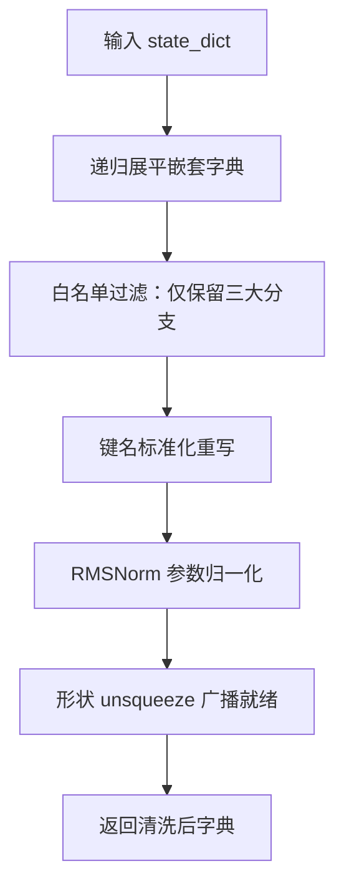
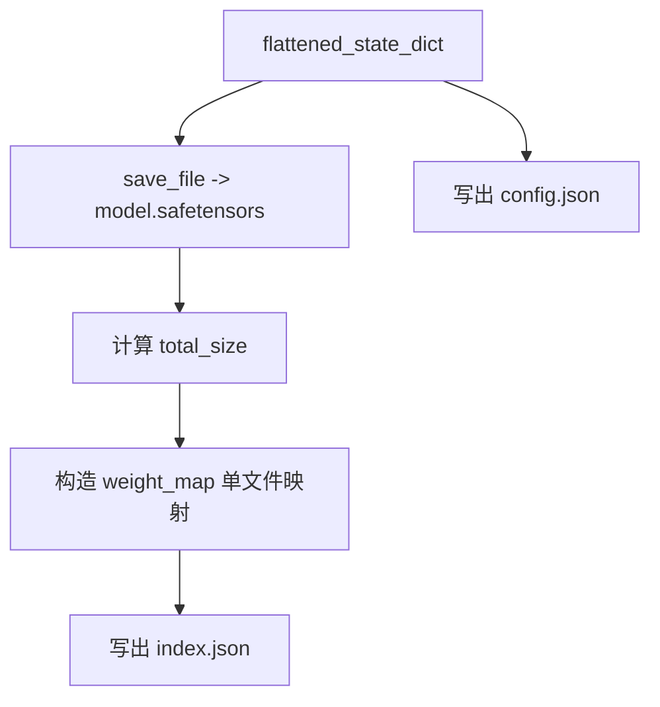

# 第8章 convert_pt_to_hf.py：TTS模型的跨国搬家指南 —— 从PyTorch木箱到HuggingFace标准行李

## 学习目标

- 理解 `convert_pt_to_hf.py` 在 TTS 模型预处理流水线中的核心定位
- 掌握 PyTorch checkpoint 到 Hugging Face 格式的转换流程
- 理解 `flatten_state_dict` 函数如何递归展平、过滤、重命名与调整张量形状
- 熟悉 WavTokenizer 特有的键名映射规则（`pos_net` -> `posnet`、codebook -> embedding 等）
- 了解如何通过 safetensors、index.json、config.json 构造完整的 HF 模型目录
- 能阅读并修改类似的模型格式转换脚本

## 8.1 生活类比

想象 WavTokenizer 模型是一个「跨国搬家」场景：PyTorch .pt 文件是装在老家杂乱木箱里的私人物品，格式老旧且不兼容新家规则；`flatten_state_dict` 函数是搬家公司的拆箱师傅，负责拆开嵌套木箱、扔掉不需要的杂物、把标签重新贴好、调整包裹尺寸让运输车能装下；键名重命名是统一翻译标签语言，让新家管家 HuggingFace / GGUF 一眼认出来；形状调整 unsqueeze 是把扁平的衣服重新挂上衣架，让衣柜能整齐收纳；safetensors + index.json + config.json 是新家的三件套：行李清单（index）、物品本身（safetensors）、房屋户型图（config）。就像搬家需要把物品按新家的规则重新整理，`convert_pt_to_hf.py` 把 .pt 权重按 HuggingFace/GGUF 的命名与结构规则重新打包。

## 8.2 源码地图

tools/tts/convert_pt_to_hf.py
├── __main__ 顶层执行流（13-58行）
│   ├── torch.load()               # 加载 PyTorch checkpoint
│   ├── isinstance 检查            # 区分 nn.Module 与 state_dict
│   └── 打印模型结构               # 调试用，输出所有键与超参数
├── flatten_state_dict() 函数（40-104行）
│   ├── 递归展平嵌套字典           # flatten_state_dict 递归调用
│   ├── 键名前缀过滤               # 丢弃 feature_extractor/backbone.head.out
│   ├── 键名重命名映射             # pos_net->posnet, _codebook.embed->embedding.weight
│   ├── 特殊键处理                 # norm.scale.weight, norm.shift.weight, gamma
│   └── 形状调整（unsqueeze）      # 1D->2D 以支持 ggml_add 广播
├── 输出文件生成（106-157行）
│   ├── save_file()                # 写出 model.safetensors
│   ├── 构造 weight_map            # 单文件模型映射
│   ├── 写出 index.json            # 元数据：total_size + weight_map
│   └── 写出 config.json           # WavTokenizerDec 架构超参数

## 8.3 源码解析单元：三段式清洗管线 —— 从杂乱木箱到标准行李三件套

`convert_pt_to_hf.py` 是 TTS 模型预处理流水线的起点。它把原始的 PyTorch checkpoint（.pt 文件）转换成 Hugging Face 生态认可的「三件套」：`model.safetensors`（权重）、`index.json`（元数据索引）、`config.json`（架构超参数）。这三件套随后会被 `convert_hf_to_gguf.py` 读取，进一步量化打包成 GGUF 格式，最终在 llama.cpp 中跑通推理。我们将从三个核心环节——模型加载与预检、`flatten_state_dict` 深度清洗、三件套生成——逐一拆解源码逻辑。

### 8.3.1 __main__ 顶层流程：模型加载与预检入口

我们先看顶层执行流。脚本不依赖 argparse，而是直接读取 `sys.argv[1]` 作为模型路径，默认 `./model.pt`。

```mermaid
graph TD
    A[启动脚本] --> B{sys.argv[1] 存在?}
    B -->|是| C[使用传入路径]
    B -->|否| D[使用默认 ./model.pt]
    C --> E[torch.load map_location=cpu]
    D --> E
    E --> F{isinstance nn.Module?}
    F -->|是| G[model.state_dict()]
    F -->|否| H[直接使用 model]
    G --> I[打印所有 state_dict 键]
    H --> I
```

源码路径：`tools/tts/convert_pt_to_hf.py` - `__main__`（13-58行）

```python
# 第 13-58 行：模型加载、类型判别与调试打印
model_path = './model.pt'                                      # 默认模型路径

if len(sys.argv) > 1:                                          # ① 支持命令行传入路径
    model_path = sys.argv[1]

path_dst = os.path.dirname(model_path)                         # 输出目录 = 模型所在目录

print(f"Loading model from {model_path}")                      # 日志：开始加载

model = torch.load(model_path, map_location='cpu')             # ② 加载到 CPU，避免 GPU 显存溢出

for key in model.keys():                                       # ③ 遍历顶层键，打印结构
    print(key)
    if key == 'hyper_parameters':                              # ④ 发现超参数则 pretty-print
        print(json.dumps(model[key], indent=4))

# ⑤ 区分 nn.Module 与裸 state_dict
if isinstance(model, torch.nn.Module):
    state_dict = model.state_dict()                            # 完整 Module -> 提取 state_dict
else:
    state_dict = model                                         # 已是 state_dict -> 直接使用

print("State dictionary keys:")                                # ⑥ 打印所有张量键名，供人工核对
for key in state_dict.keys():
    print(key)
```

这段代码实现了**兼容性加载**。无论 checkpoint 保存的是完整 `nn.Module` 对象（含模型结构、优化器状态、超参数等）还是仅保存裸 `state_dict`，脚本都能正确提取张量字典。`map_location='cpu'` 保证在无 GPU 环境也能运行。全量打印键名与超参数，为后续编写 `flatten_state_dict` 的过滤/重命名规则提供「现场勘察」依据。**关键变量流转**：`model_path` → `model` (raw checkpoint) → `state_dict` (纯张量字典) → 后续 `flatten_state_dict`。**边界条件**：若输入文件损坏或非 PyTorch 格式，`torch.load` 会抛异常；若 `model` 既非 `nn.Module` 也非字典（如列表），`model.keys()` 会报错，脚本未做防御性捕获。

### 8.3.2 flatten_state_dict()：递归展平、过滤、重命名与形状调整的核心管线

这是转换流水线的「大脑」。它接收扁平或嵌套的 `state_dict`，输出**仅包含推理所需张量、键名符合 GGUF 约定、形状满足 GGML 广播要求**的新字典。



源码路径：`tools/tts/convert_pt_to_hf.py` - `flatten_state_dict()`（40-104行）

#### 8.3.2.1 flatten_state_dict()：递归展平嵌套字典

```python
# 第 40-56 行：递归展平阶段
def flatten_state_dict(state_dict, parent_key='', sep='.'):
    items = []                                                  # 收集 (full_key, tensor) 对
    items_new = []                                              # 最终输出列表

    for k, v in state_dict.items():                            # 遍历当前层级
        new_key = f"{parent_key}{sep}{k}" if parent_key else k # 拼接父键前缀
        if isinstance(v, torch.Tensor):                        # 张量直接收集
            items.append((new_key, v))
        elif isinstance(v, dict):                              # 子字典递归展平
            items.extend(flatten_state_dict(v, new_key, sep=sep).items())
            return dict(items)                                 # ⚠️ 早期 return，仅处理第一层嵌套
```

这段代码实现了**递归展平**，将嵌套字典（如 `state_dict.backbone.posnet.0.weight`）转为扁平 `(full_key, tensor)` 列表。`parent_key` 累积路径，`sep='.'` 保持层级分隔。**关键缺陷**：第 56 行 `return dict(items)` 位于 `for` 循环内部，会导致递归在遇到**第一个**子字典后立即返回，后续同层键不再处理。当前 WavTokenizer checkpoint 恰好只有两层嵌套且首个子字典即包含全部权重，故未暴露问题；若未来引入更深或更多分支嵌套，**必须移除该 `return`**，改为循环结束后统一返回，才能保证完整展平。

#### 8.3.2.2 flatten_state_dict()：白名单过滤与通用前缀清理

```python
# 第 58-76 行：白名单过滤与通用前缀清理
    size_total_mb = 0

    for key, value in list(items):                             # 遍历展平后的所有项
        # ① 仅保留推理必需的三大分支
        if not key.startswith('state_dict.feature_extractor.encodec.quantizer.') and \
           not key.startswith('state_dict.backbone.') and \
           not key.startswith('state_dict.head.out'):
               print('Skipping key: ', key)                    # 打印被丢弃的键
               continue

        new_key = key                                          # 拷贝键名用于后续重写

        # ② 统一去掉 "state_dict." 前缀
        new_key = new_key.replace('state_dict.', '')
        # ③ pos_net -> posnet 简写
        new_key = new_key.replace('pos_net', 'posnet')
```

这段代码完成**白名单过滤**与**通用前缀清理**。白名单只保留 `feature_extractor.encodec.quantizer.`（VQ 码本）、`backbone.`（主干网络）、`head.out`（输出头）三棵子树，其余（优化器状态、数据增强参数、超参数等）直接丢弃。随后做前缀清理：去掉统一的 `state_dict.` 前缀，将 `pos_net` 简写为 `posnet`，使键名更简短并贴合 GGML 侧命名习惯。

#### 8.3.2.3 flatten_state_dict()：PosNet 结构归一化与码本映射

```python
# 第 78-88 行：PosNet 结构归一化与 VQ 码本映射
        # ④ backbone.posnet.N.bias/weight -> backbone.posnet.N.norm.bias/weight
        if new_key.startswith("backbone.posnet."):
            match = re.match(r"backbone\.posnet\.(\d+)\.(bias|weight)", new_key)
            if match:
               new_key = f"backbone.posnet.{match.group(1)}.norm.{match.group(2)}"

        # ⑤ VQ 码本映射到统一 embedding 权重
        if new_key == "feature_extractor.encodec.quantizer.vq.layers.0._codebook.embed":
            new_key = "backbone.embedding.weight"
```

这段代码实现**PosNet 结构归一化**与**VQ 码本映射**。正则把 `backbone.posnet.{idx}.bias|weight` 重写为 `backbone.posnet.{idx}.norm.bias|weight`，使每层 PosNet 显式拥有 `norm` 子模块，与下游 GGML `llm_build_wavtokenizer` 的层级完全对齐。VQ 码本映射将 Encodec 量化器内部的 `_codebook.embed` 直接映射为 `backbone.embedding.weight`，把离散码本统一视为主干的嵌入层，便于 GGUF 侧单一加载。

#### 8.3.2.4 flatten_state_dict()：RMSNorm 参数归一化

```python
# 第 90-100 行：RMSNorm scale/shift -> weight/bias 并取首元素
        # ⑥ RMSNorm 风格的 scale/shift -> weight/bias，且只取首元素
        if new_key.endswith("norm.scale.weight"):
            new_key = new_key.replace("norm.scale.weight", "norm.weight")
            value = value[0]                                   # 取首元素 [C,1] -> 标量 或 [1] -> 标量

        if new_key.endswith("norm.shift.weight"):
            new_key = new_key.replace("norm.shift.weight", "norm.bias")
            value = value[0]

        # ⑦ gamma -> gamma.weight
        if new_key.endswith("gamma"):
            new_key = new_key.replace("gamma", "gamma.weight")
```

这段代码完成**RMSNorm 参数语义归一化**。原始 checkpoint 采用 RMSNorm 风格存储：`norm.scale.weight` 与 `norm.shift.weight` 形状常为 `[C, 1]` 或 `[1, C]`。脚本将其重命名为标准的 `norm.weight`/`norm.bias`，并通过 `value[0]` 取出首个元素得到标量张量，后续再 `unsqueeze(1)` 变回 `[C, 1]`。`gamma` 同理重命名为 `gamma.weight`。

#### 8.3.2.5 flatten_state_dict()：形状调整以支持 GGML 广播

```python
# 第 102-118 行：1D -> 2D unsqueeze，配合 ggml_add 广播语义
        # ⑧ 1D -> 2D unsqueeze，配合 ggml_add 广播语义
        if (new_key.endswith("norm.weight") or new_key.endswith("norm1.weight") or new_key.endswith("norm2.weight") or new_key.endswith(".bias")) and (new_key.startswith("backbone.posnet") or new_key.startswith("backbone.embed.bias")):
            value = value.unsqueeze(1)                         # [C] -> [C, 1]

        if new_key.endswith("dwconv.bias"):
            value = value.unsqueeze(1)                         # [C] -> [C, 1]

        size_mb = value.element_size() * value.nelement() / (1024 * 1024)
        print(f"{size_mb:8.2f} MB - {new_key}: {value.shape}") # 打印每个张量大小

        size_total_mb += size_mb

        items_new.append((new_key, value))

    print(f"Total size: {size_total_mb:8.2f} MB")

    return dict(items_new)
```

这段代码实现**形状广播就绪**，为下游 GGML `ggml_add` 准备。GGML 的加法广播规则要求 bias 形状为 `[C, 1]` 以便按列广播到 `[C, T]`。脚本对 `backbone.posnet.*` 与 `backbone.embed.bias` 两个子树下的所有 `norm.weight`、`norm1.weight`、`norm2.weight`、`.bias` 以及 `dwconv.bias` 执行 `unsqueeze(1)`，把 `[C]` 变成 `[C, 1]`。同时累计并打印总模型大小，供人工核对。

### 8.3.3 __main__ 顶层流程：三件套生成

清洗完张量字典后，脚本将其落盘为 Hugging Face 标准格式。



源码路径：`tools/tts/convert_pt_to_hf.py` - `__main__`（106-157行）

```python
# 第 106-157 行：输出三件套
flattened_state_dict = flatten_state_dict(state_dict)          # 调用清洗函数

output_path = path_dst + '/model.safetensors'
save_file(flattened_state_dict, output_path)                   # ① 写出安全张量文件

print(f"Model has been successfully converted and saved to {output_path}")

total_size = os.path.getsize(output_path)                      # ② 获取文件字节数

weight_map = {                                                 # ③ 单文件映射："*" 表示全在当前文件
    "model.safetensors": ["*"]
}

metadata = {
    "total_size": total_size,                                  # 总字节数，分片加载时用于进度条
    "weight_map": weight_map
}

index_path = path_dst + '/index.json'
with open(index_path, 'w') as f:
    json.dump(metadata, f, indent=4)                           # ④ 写出 index.json

print(f"Metadata has been saved to {index_path}")

# ⑤ 写出架构超参数，供 AutoModel.from_pretrained 识别
config = {
    "architectures": ["WavTokenizerDec"],
    "hidden_size": 1282,
    "n_embd_features": 512,
    "n_ff": 2304,
    "vocab_size": 4096,
    "n_head": 1,
    "layer_norm_epsilon": 1e-6,
    "group_norm_epsilon": 1e-6,
    "group_norm_groups": 32,
    "max_position_embeddings": 8192,
    "n_layer": 12,
    "posnet": {"n_embd": 768, "n_layer": 6},
    "convnext": {"n_embd": 768, "n_layer": 12},
}

with open(path_dst + '/config.json', 'w') as f:
    json.dump(config, f, indent=4)                             # ⑥ 写出 config.json

print(f"Config has been saved to {path_dst + 'config.json'}")
```

这段代码生成了**标准 HF 模型目录**。`model.safetensors` 是安全、内存映射友好、跨语言可读的权重容器。`index.json` 记录 `total_size` 与 `weight_map`；`weight_map` 用 `"*"` 通配表示「所有张量都在唯一分片内」，便于 `safetensors.torch.load_file` 单文件加载；若未来模型增大需分片，只需把键名映射到对应分片文件名即可。`config.json` 声明 `WavTokenizerDec` 架构及全部超参数。注意 `posnet` 与 `convnext` 两个嵌套配置，分别对应位置编码网络与 ConvNeXt 声学特征编码器，它们在 `llm_build_wavtokenizer.cpp` 中会被递归实例化为 GGML 计算图子模块。

## 8.4 设计中的取舍

为什么不用 transformers save_pretrained？WavTokenizer 官方并未提供 `PreTrainedModel` 子类，且其 checkpoint 结构（`feature_extractor` + `backbone` + `head` 三段式）与标准 HF 模型差异较大。直接复用 `save_pretrained` 需要先写一个完整的 `WavTokenizerDec` 类并注册到 `AutoModel`，工作量远大于当前 150 行脚本。脚本方式**零依赖、零侵入、可读性强**，适合「一次性转换」场景；代价是失去 `transformers` 生态自动化（如 `push_to_hub`、模型卡片生成、自动架构推断），若后续需长期维护多版本模型，需迁移到标准 `PreTrainedModel` 实现。

为什么 flatten_state_dict 里写死这么多字符串替换？这是典型的「数据驱动代码」：checkpoint 键名是固定字符串，转换规则也是固定映射。用配置文件（YAML/JSON）描述映射规则虽更优雅，但会引入额外解析层，反而增加维护成本。当前硬编码在**单文件、单职责、可直接阅读修改**的脚本中，是工程上的最优解；代价是规则与代码耦合，若需支持多种 checkpoint 格式，需抽象出映射表解析器。

unsqueeze(1) 只针对部分键，会不会漏掉？脚本通过 `endswith` + `startswith` 双重守卫，精准覆盖 `backbone.posnet.*` 与 `backbone.embed.bias` 两个子树。GGML 侧 `ggml_add` 仅在这两处需要列广播，其余层（如 Transformer FFN）的 bias 本身就是 `[C, 1]` 或 `[1, C]`，无需调整。显式列举前缀/后缀**避免误伤**，但也意味着新增广播需求时必须手动追加判断；若模型结构频繁变动，可考虑改为「默认对所有 1D bias unsqueeze，显式排除不需要的」策略。

递归展平的早期 return 缺陷与修正建议：`flatten_state_dict` 第 56 行 `return dict(items)` 导致递归在处理完**第一个**子字典后直接返回，忽略同层后续键。当前 checkpoint 结构恰好掩盖了此 Bug。修正方案：移除循环内的 `return`，在循环结束后统一 `return dict(items)`。若需保留早期返回的性能意图，可改用显式栈或 `itertools.chain` 实现非递归展平，彻底避免此类问题。

## 8.5 动手练习

### 8.5.1 练习 1：阅读 convert_pt_to_hf.py 整体流程
阅读 `tools/tts/convert_pt_to_hf.py` 第 13-58 行的顶层代码，理解：
1. 它从命令行哪个位置读取模型路径？默认路径是什么？
2. 如何区分加载的是 `torch.nn.Module` 还是 `state_dict`？
3. 它打印了哪些调试信息？这些信息对排查转换错误有什么帮助？

回答问题：
- 如果模型文件同时包含 `state_dict` 与 `optimizer_states`，当前代码会怎么处理？
- 假如输入是一个保存为 module 对象但没有 `state_dict` 属性的旧格式 checkpoint，会发生什么？

### 8.5.2 练习 2：剖析 flatten_state_dict 的键名映射规则
阅读 `tools/tts/convert_pt_to_hf.py` 第 40-104 行的 `flatten_state_dict` 函数，逐行梳理键名转换规则：
1. 它过滤掉哪些前缀？为什么这些键不需要？
2. `pos_net` -> `posnet` 是简单的字符串替换，背后的设计动机是什么？
3. `backbone.posnet.%d.bias` -> `backbone.posnet.%d.norm.bias` 这个正则替换解决了什么问题？
4. `_codebook.embed` -> `embedding.weight` 这一行为什么必须放在循环最开始？
5. `norm.scale.weight` 与 `norm.shift.weight` 分别对应 RMSNorm 的什么参数？为什么要 `value[0]` 取首元素？
6. 哪些键会触发 `unsqueeze(1)`？为什么必须把 1D 转 2D 才能在 GGML 中做加法广播？

回答问题：
- 如果未来新增一种 `norm.gamma.weight`，你能在不破坏现有逻辑的前提下加入吗？
- 请画一张表，列出至少 5 个原键 -> 新键的映射关系。

### 8.5.3 练习 3：理解输出三件套的协作关系
阅读 `tools/tts/convert_pt_to_hf.py` 第 106-157 行的输出生成代码，理解：
1. 为什么使用 `safetensors` 而非 `pickle`？
2. `index.json` 中 `weight_map` 的作用是什么？为什么这里直接用 `"*"`？
3. `config.json` 中每个超参数的含义（hidden_size=1282, n_embd_features=512, n_ff=2304 等），它们如何对应到 WavTokenizer 的网络结构？
4. `posnet` 与 `convnext` 的嵌套子配置说明了什么？

回答问题：
- `total_size` 在分片加载时会起什么作用？
- 假设 WavTokenizer 后续版本增加了 `n_experts` 字段，config.json 需要怎么扩展才能保持向后兼容？

## 8.6 本章小结

这一章中我们学习了 TTS 模型预处理脚本 `convert_pt_to_hf.py` 的完整工作流程。首先，我们看到了它如何兼容加载 `torch.nn.Module` 与裸 `state_dict` 两种 checkpoint 格式，并通过全量打印键名为后续清洗提供依据。其次，我们深入剖析了 `flatten_state_dict` 函数：它通过递归展平嵌套字典、白名单过滤仅保留推理必需的三大分支张量、系统性重命名键名以对齐 GGUF 命名约定、将 RMSNorm 的 scale/shift 参数归一化为标准 weight/bias 并取首元素、对特定偏置执行 `unsqueeze(1)` 使其满足 GGML 广播语义。特别地，我们指出了函数内部**早期 return 导致递归失效**的潜在缺陷，并给出了修正建议。接着，我们理解了脚本如何生成 Hugging Face 标准的三件套：`model.safetensors` 安全存储权重、`index.json` 记录总大小与单文件映射、`config.json` 声明 `WavTokenizerDec` 架构及全部超参数（含嵌套的 `posnet` 与 `convnext` 子配置）。最后，我们通过数据流图与模块依赖图梳理了从 `.pt` 到 HF 三件套的全链路，并讨论了硬编码映射规则、放弃 `save_pretrained` 等工程取舍的背后考量。

本章我们一起学习了以下概念：

以下表格汇总了本章涉及的核心概念及其在转换流水线中的作用：

| 概念 | 解释 |
|------|------|
| `torch.load + isinstance 检查` | 兼容加载 torch.nn.Module 与裸 state_dict 两种 checkpoint |
| `flatten_state_dict 递归展平` | 将嵌套字典展开为扁平的 (key, tensor) 列表 |
| `键名前缀过滤` | 仅保留 backbone 相关权重，丢弃量化器与 head |
| `pos_net → posnet 重命名` | 匹配 GGML/GGUF 中常见的命名风格 |
| `_codebook.embed → backbone.embedding.weight` | 将 VQ 码本映射到统一的 embedding 层 |
| `norm.scale/shift.weight 拆分` | RMSNorm 风格的 scale/shift 拆为 weight/bias，并取首个元素 |
| `unsqueeze(1) 形状调整` | 1D 偏置转 2D，让 ggml_add 可以按列广播 |
| `safetensors.save_file` | 以 HuggingFace 标准格式写出安全张量文件 |
| `index.json` | 记录 weight_map 与 total_size，用于多文件分片恢复 |
| `config.json` | 声明 WavTokenizerDec 架构与所有超参数 |

下一章中，我们将学习 llama.cpp 示例程序全景 —— 探索大模型推理的「代码样本库」。


