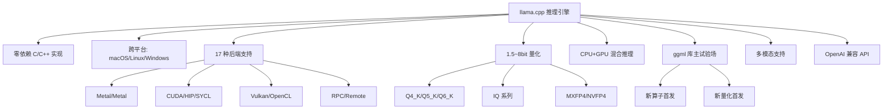
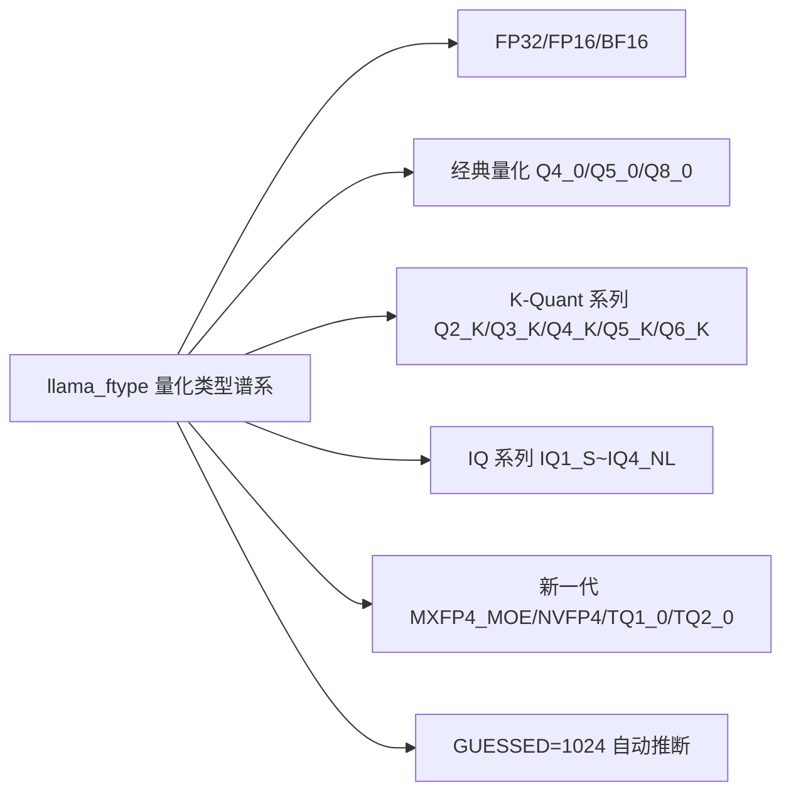
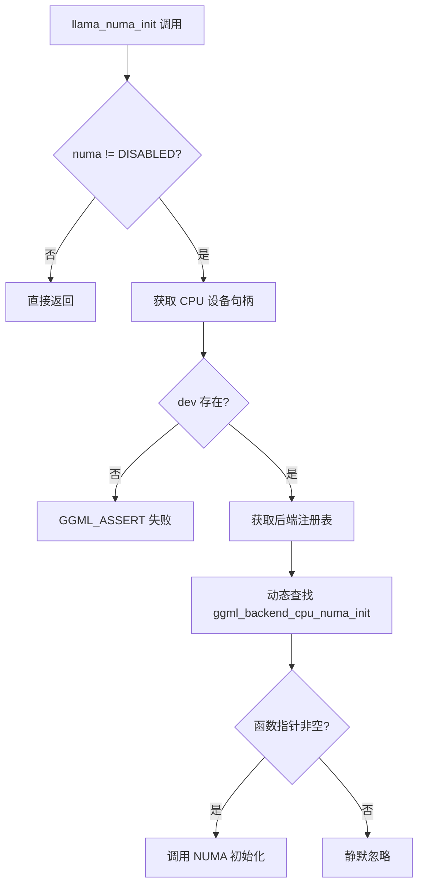
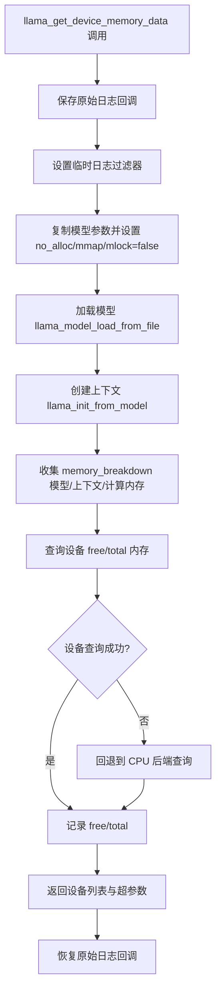
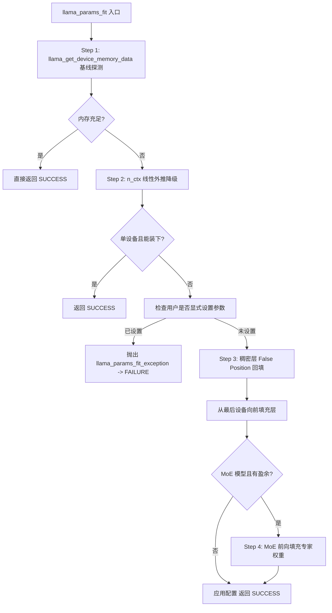
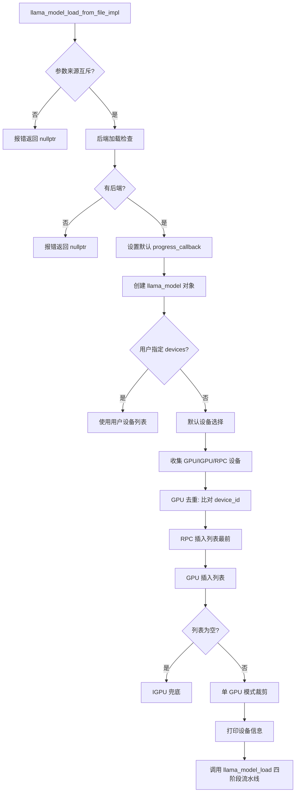
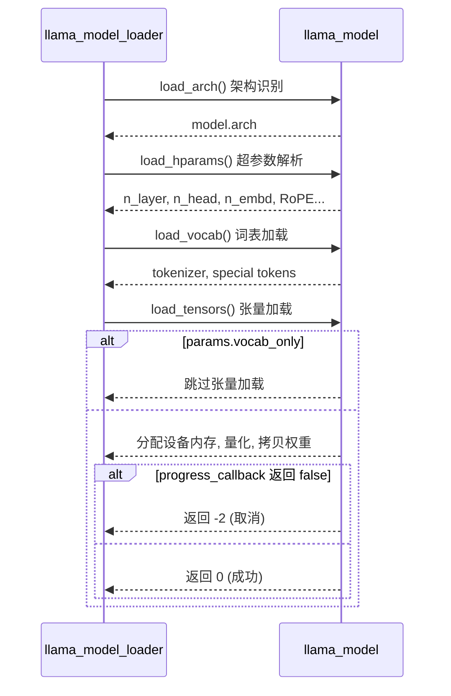

# 第11章 llama.cpp 概览 —— 认识这座"大模型推理引擎"

## 学习目标

- 理解 llama_backend_init / llama_backend_free / llama_numa_init 的全局初始化职责
- 掌握 llama_supports_mmap/mlock/gpu_offload/rpc 四个能力探测函数的实现依据
- 熟悉 llama_max_devices/max_tensor_buft_overrides 等容量常量的来源
- 理解 src/llama.cpp 文件级作用域（__main__）的构成：头文件、条件编译、constexpr、enum、异常类
- 了解 llama_params_fit 自适应降级算法的四阶段流水线与异常分档
- 能阅读 llama_model_load_from_file_impl 的设备选择策略与四阶段加载入口
- 掌握模型加载的四个公开入口（file / ptr / splits / user）与 DEPRECATED 兼容层
- 理解 llama_chat_apply_template、llama_split_path/prefix、llama_print_system_info 的实现机制

## 11.1 生活类比

想象 llama.cpp 是一座「大模型推理工厂」的总控制室，每个文件都是不同的「设施部门」：README.md = 工厂的「产品说明书与能力清单」，告诉你这座工厂能造什么、运到哪些平台；include/llama.h = 工厂的「大门与接待处」，只有四个不透明指针（模型、上下文、词表、采样器）对外暴露，内部完全封装；include/llama-cpp.h = 工厂提供的「自动回收垃圾车」，用 unique_ptr + 自定义 deleter 确保资源不泄漏；llama_backend_init / supports_* = 工厂的「动力与基础设施检查」，启动前确认电力（后端）、网络（RPC）、门禁（mmap/mlock）是否就绪；llama_params_fit = 工厂的「智能排产调度器」，当显存放不下时自动缩减上下文、调整 GPU 层数、把 MoE 专家权重退回内存；llama_model_load 系列 = 工厂的「多入口装卸码头」，分别对应本地路径、文件指针、分片集合和用户自定义张量四种入库方式；llama_split_path / prefix = 工厂的「集装箱拆装工程师」，按 "%05d-of-%05d.gguf" 命名规则把巨型模型拆成标准集装箱；src/llama.cpp 全局作用域（__main__）= 工厂的「门牌与操作手册」，头文件是原材料清单，constexpr/enum/异常类是车间规约。就像工厂经理需要在开工前检查设备、分配任务、预留产能，llama.cpp 也在每次推理前精细规划内存与计算资源。

## 11.2 源码地图

README.md
├── 项目定位与设计哲学（Description）
├── Supported backends 表格（17 种后端）
├── 支持模型清单（Text-only + Multimodal）
├── 快速开始与工具链入口
└── 依赖清单（单文件库）
include/llama.h
├── 头文件包含与宏定义（LLAMA_DEFAULT_SEED / LLAMA_TOKEN_NULL / LLAMA_FILE_MAGIC_*）
├── 四大核心 C 对象（llama_vocab / llama_model / llama_context / llama_sampler）
├── 基础类型定义（llama_pos / llama_token / llama_seq_id / llama_memory_t）
├── 关键枚举（vocab_type / rope_type / token_type / ftype / rope_scaling / pooling / attention / flash_attn / split_mode）
├── 数据结构（llama_batch / llama_token_data / kv_override / buft_override / model_params / context_params / quantize_params / sampler_chain_params）
├── 默认参数工厂（4 个 default_params）
├── 后端生命周期（llama_backend_init / _free / llama_numa_init）
├── 能力查询（llama_supports_mmap/mlock/gpu_offload/rpc + max_*）
├── 模型加载家族（_from_file / _ptr / _splits / _init_from_user + save_to_file + free）
├── 参数适配（llama_params_fit + enum llama_params_fit_status）
├── 模型信息查询（n_ctx_train / n_embd / n_layer / n_head / n_head_kv / n_swa / n_params / size / desc）
├── 元数据访问（meta_val_str / meta_count / meta_key_str / meta_key_by_index / meta_val_str_by_index）
├── 词表访问（vocab_type / n_tokens / get_text / get_score / get_attr / is_eog / is_control / bos/eos/eot/sep/nl/pad/mask + FIM tokens）
├── 分词与反分词（llama_tokenize / token_to_piece / detokenize）
├── 聊天模板（llama_chat_apply_template / llama_chat_builtin_templates）
├── 内存序列操作（memory_clear / seq_rm / seq_cp / seq_keep / seq_add / seq_div / seq_pos_min/max / can_shift）
├── 状态序列化（state_get_size / _get_data / _set_data / _load_file / _save_file / _seq_*）
├── 解码接口（batch_get_one / batch_init / batch_free / encode / decode）
├── 线程与回调（set_n_threads / set_embeddings / set_causal_attn / set_warmup / set_abort_callback / synchronize）
├── 输出提取（get_logits / get_logits_ith / get_embeddings / get_embeddings_ith / get_embeddings_seq）
├── 后端采样（[EXPERIMENTAL] get_sampled_token_ith / _probs_ith / _logits_ith / _candidates_ith）
├── 采样器工厂（init_greedy/dist/top_k/top_p/min_p/typical/temp/temp_ext/xtc/top_n_sigma/mirostat/v2/grammar/grammar_lazy_patterns/logit_bias/infill/penalties/dry/adaptive_p）
├── 采样器链（sampler_chain_init / _add / _get / _n / _remove）
├── 采样执行（sampler_sample / sampler_get_seed）
├── 适配器（adapter_lora_init / _meta_val_str / _meta_count / _key_by_index / _val_str_by_index / _free / _get_alora_*）
├── 适配器应用（set_adapters_lora / set_adapter_cvec）
├── 模型分割（split_path / split_prefix）
├── 系统信息与日志（print_system_info / log_get / log_set）
├── 性能工具（perf_context / _print / _reset / perf_sampler / _print / _reset）
├── 内存分解（memory_breakdown_print）
└── 训练接口（opt_init / opt_epoch / opt_param_filter_all）
include/llama-cpp.h
├── C++ 智能指针 deleter（llama_model_deleter / context_deleter / sampler_deleter / adapter_lora_deleter）
└── unique_ptr 类型别名（llama_model_ptr / context_ptr / sampler_ptr / adapter_lora_ptr）
src/llama.cpp
├── __main__（头文件包含 + #pragma warning 条件编译）
├── llama_flash_attn_type_name()（枚举→字符串映射）
├── llama_device_memory_data：设备内存数据采集结构
├── llama_get_device_memory_data()（临时日志控制 + no_alloc/use_mmap/use_mlock=false + 加载+采集 + 设备 free/total CPU 回退）
├── constexpr int64_t MiB（内存单位常量）
├── enum layer_fraction_t（LAYER_FRACTION_NONE/ATTN/UP/GATE/MOE）
├── class llama_params_fit_exception（继承 std::runtime_error）
├── llama_params_fit_impl()（step1 探测 → step2 缩 n_ctx → step3 稠密层 false position → step4 MoE 前向填充）
│   ├─ get_overflow_pattern()：LAYER_FRACTION_ATTN/UP/GATE/MOE 四种张量正则
│   ├─ set_ngl_tensor_split_tbo()：分配 n_gpu_layers + tensor_split + tensor_buft_overrides
│   └─ get_memory_for_layers()：测试配置的内存占用
├── llama_params_fit()（计时 + try/catch + llama_params_fit_exception / std::runtime_error 分档 + 返回 enum status）
├── llama_sampler_chain_default_params()（no_perf=true）
├── 容量常量（llama_max_devices=16 / llama_max_tensor_buft_overrides=4096）
├── 能力查询（supports_mmap/mlock/gpu_offload/rpc）
├── 后端生命周期（backend_init = ggml_time_init + f16 表 / numa_init = dlsym ggml_backend_cpu_numa_init / backend_free = ggml_quantize_free）
├── llama_time_us()（封装 ggml_time_us）
├── llama_model_load()（创建 llama_model_loader + 四阶段流水线 load_arch/load_hparams/load_vocab/load_tensors + -1/-2 状态码）
├── llama_model_load_from_file_impl()（metadata/path/file 三选一互斥 + 后端检查 + 默认 progress_callback + 设备选择：RPC 最前/GPU 去重/IGPU 兜底 + 单 GPU 裁剪 + 设备日志）
├── 模型加载函数家族（init_from_user + load_from_file + load_from_file_ptr + load_from_splits + load_model_from_file DEPRECATED）
├── llama_model_save_to_file()（llama_model_saver：add_kv_from_model + add_tensors_from_model + save）
├── llama_chat_apply_template()（llm_chat_detect_template + llm_chat_apply_template）
├── 模型分割工具（split_path = "%s-%05d-of-%05d.gguf" / split_prefix 反向提取）
└── llama_print_system_info()（遍历 ggml_backend_reg_count + ggml_backend_get_features 拼接特性字符串）

## 11.3 概览：llama.cpp —— 认识这座"大模型推理引擎"

llama.cpp 是一个用纯 C/C++ 实现的大语言模型推理引擎，主打「零依赖、单文件即可运行」的极简哲学，目标是「最小化设置、最广泛的硬件支持、业界领先的性能」。它不依赖任何第三方库（除单文件库外），可在 macOS、Linux、Windows 上从源码编译；同时支持 Apple Silicon（Metal/Accelerate）、x86（AVX/AVX2/AVX512/AMX）、RISC-V（RVV/ZVFH/ZFH）、CUDA、HIP、Vulkan、SYCL 等多种架构。在量化与推理优化方面，支持 1.5-bit 到 8-bit 等多种整数量化（Q4_K、Q5_K、Q6_K、IQ 系列），并支持 CPU+GPU 混合推理，可在显存不足时部分卸载模型。此外，llama.cpp 是 ggml 库新功能的「主试验场」，二者在 GitHub 上分属 `ggml-org/llama.cpp` 与 `ggml-org/ggml` 两个仓库，但深度联动。通过 mtmd 模块支持 LLaVA、Qwen2-VL、GLM-EDGE 等多模态模型；通过 `llama-server` 提供 OpenAI 兼容的 HTTP API，并自带 WebUI 前端。

### 11.3.1 项目定位与设计哲学

源码路径：`README.md` - 全局概览（1-100行）

```markdown
# llama.cpp

LLM inference in C/C++

## Description

llama.cpp is an LLM inference engine written in C/C++. Its main advantages are:

- **Minimal setup and state-of-the-art performance** on a wide variety of hardware — both locally and in the cloud
- **No dependencies** (except for single-file libraries)
- **Cross-platform** — runs on macOS, Linux, Windows, and more
- **Supports many architectures** — Apple Silicon, x86, RISC-V, CUDA, HIP, Vulkan, SYCL, etc.
- **Quantization** — 1.5-bit, 2-bit, 3-bit, 4-bit, 5-bit, 6-bit, 8-bit
- **Hybrid CPU+GPU inference** — partial offloading when VRAM is insufficient
- **Main testbed** for the `ggml` library

...
```

这段文档定义了 llama.cpp 的核心定位：纯 C/C++ 零依赖 LLM 推理引擎，支持 17 种后端与 1.5~8bit 量化，是 ggml 库的主试验场。

### 11.3.2 支持的后端矩阵

源码路径：`README.md` - Supported backends 表格（200-300行）

```markdown
## Supported backends

| Backend | Hardware | Status |
|---------|----------|--------|
| Metal | Apple Silicon (M-series) | ✅ |
| BLAS | CPU (OpenBLAS, Accelerate, etc.) | ✅ |
| BLIS | CPU | ✅ |
| SYCL | Intel GPU, NVIDIA GPU | ✅ |
| OpenVINO | Intel CPU/GPU/NPU | ✅ |
| MUSA | Moore Threads GPU | ✅ |
| CUDA | NVIDIA GPU | ✅ |
| HIP | AMD GPU | ✅ |
| ZenDNN | AMD CPU | ✅ |
| Vulkan | Cross-vendor GPU | ✅ |
| CANN | Ascend NPU | ✅ |
| OpenCL | Adreno GPU, etc. | ✅ |
| zDNN | IBM Z | ✅ |
| WebGPU | Browser/WASM | ✅ |
| RPC | Remote compute | ✅ |
| Hexagon | Qualcomm Hexagon DSP | ✅ |
| VirtGPU | virtio-GPU | ✅ |
```

这张表格展示了 llama.cpp 支持的 17 种后端，覆盖了从 Apple Silicon 到 NVIDIA/AMD/Intel/Qualcomm/IBM 等主流硬件平台。

### 11.3.3 支持的模型矩阵

源码路径：`README.md` - Models 清单（200-300行）

```markdown
## Models

### Text-only models
- LLaMA, LLaMA 2, LLaMA 3, LLaMA 3.1, LLaMA 3.2
- Mistral, Mixtral, Mistral-Nemo
- Qwen, Qwen2, Qwen2.5, Qwen3
- DeepSeek, DeepSeek-V2, DeepSeek-V3
- Gemma, Gemma 2, Gemma 3
- Mamba, Mamba2
- RWKV 6, RWKV 7
- Phi-2, Phi-3, Phi-3.5
- Falcon, Falcon-H1
- GLM, GLM-4, GLM-4-MoE
- Baichuan, Baichuan2
- Yi, InternLM2
- StableLM, StableLM2
- MPT, Refact
- Bloom, CodeShell
- GPT-2, GPT-NeoX
- ...

### Multimodal models
- LLaVA, LLaVA-1.5, LLaVA-Next
- Qwen2-VL, Qwen2.5-VL
- GLM-4V, GLM-Edge
- LFM2-VL
- MiniCPM-V
- ...
```

这个清单展示了 llama.cpp 支持的海量文本模型与多模态模型家族，从经典的 LLaMA 到最新的 Qwen3、DeepSeek-V3、Mamba2、RWKV7 等前沿架构。



## 11.4 公共 C 接口总览：llama_vocab/llama_model/llama_context/llama_sampler —— 四大核心不透明指针

`include/llama.h` 是 llama.cpp 对外暴露的唯一 C 语言 API 入口，所有功能都通过四个不透明指针封装：`llama_vocab`（词表）、`llama_model`（模型）、`llama_context`（推理上下文）、`llama_sampler`（采样器）。这种设计体现了「封装即自由」——内部实现可以随意重构，外部接口保持稳定。

### 11.4.1 llama_vocab/llama_model/llama_context/llama_sampler：四大核心不透明指针

源码路径：`include/llama.h` - 核心类型定义（100-150行）

```c
// 四大核心不透明指针
struct llama_vocab;
struct llama_model;
struct llama_context;
struct llama_sampler;

// 内存句柄（实际为 llama_memory_i*）
typedef struct llama_memory_i * llama_memory_t;

// 三大基础整数类型
typedef int32_t llama_pos;     // 序列位置
typedef int32_t llama_token;   // token id
typedef int32_t llama_seq_id;  // 序列标识
```

这三个类型（`llama_token`/`llama_pos`/`llama_seq_id`）均为 `int32_t`，分别代表 token id、序列位置、序列标识，构成了推理过程中的最小数据单元。

### 11.4.2 llama_token/pos/seq_id：三大基础整数类型

源码路径：`include/llama.h` - 基础类型定义（150-160行）

```c
// 内存句柄（实际为 llama_memory_i*）
typedef struct llama_memory_i * llama_memory_t;

// 三大基础整数类型
typedef int32_t llama_pos;     // 序列位置
typedef int32_t llama_token;   // token id
typedef int32_t llama_seq_id;  // 序列标识
```

### 11.4.3 llama_vocab_type/llama_rope_type/llama_ftype：关键枚举体系

源码路径：`include/llama.h` - 枚举定义（160-400行）

```c
// 词表类型：SPM/BPE/WPM/UGM/RWKV/PLAMO2
enum llama_vocab_type {
    LLAMA_VOCAB_TYPE_NONE   = 0,
    LLAMA_VOCAB_TYPE_SPM    = 1,  // LLaMA tokenizer
    LLAMA_VOCAB_TYPE_BPE    = 2,  // GPT-2 tokenizer
    LLAMA_VOCAB_TYPE_WPM    = 3,  // BERT WordPiece
    LLAMA_VOCAB_TYPE_UGM    = 4,  // T5 Unigram
    LLAMA_VOCAB_TYPE_RWKV   = 5,  // RWKV greedy
    LLAMA_VOCAB_TYPE_PLAMO2 = 6,  // PLaMo-2 Aho-Corasick
};

// RoPE 类型：覆盖主流旋转位置编码变体
enum llama_rope_type {
    LLAMA_ROPE_TYPE_NONE   = -1,
    LLAMA_ROPE_TYPE_NORM   = 0,
    LLAMA_ROPE_TYPE_NEOX   = GGML_ROPE_TYPE_NEOX,
    LLAMA_ROPE_TYPE_MROPE  = GGML_ROPE_TYPE_MROPE,
    LLAMA_ROPE_TYPE_IMROPE = GGML_ROPE_TYPE_IMROPE,
    LLAMA_ROPE_TYPE_VISION = GGML_ROPE_TYPE_VISION,
};

// 模型文件量化类型：0~40+ 种 + GUESSED=1024
enum llama_ftype {
    LLAMA_FTYPE_ALL_F32              = 0,
    LLAMA_FTYPE_MOSTLY_F16           = 1,
    LLAMA_FTYPE_MOSTLY_Q4_0          = 2,
    // ... Q4_K/Q5_K/Q6_K/IQ 系列 ...
    LLAMA_FTYPE_MOSTLY_Q4_K_M        = 15,
    LLAMA_FTYPE_MOSTLY_Q5_K_M        = 17,
    LLAMA_FTYPE_MOSTLY_Q6_K          = 18,
    LLAMA_FTYPE_MOSTLY_IQ2_XXS       = 19,
    LLAMA_FTYPE_MOSTLY_IQ3_S         = 26,
    LLAMA_FTYPE_MOSTLY_IQ4_NL        = 25,
    LLAMA_FTYPE_MOSTLY_BF16          = 32,
    LLAMA_FTYPE_MOSTLY_TQ1_0         = 36,
    LLAMA_FTYPE_MOSTLY_TQ2_0         = 37,
    LLAMA_FTYPE_MOSTLY_MXFP4_MOE     = 38,
    LLAMA_FTYPE_MOSTLY_NVFP4         = 39,
    LLAMA_FTYPE_MOSTLY_Q1_0          = 40,
    LLAMA_FTYPE_GUESSED = 1024,  // 自动推断
};
```

**枚举设计要点**：
- `llama_ftype` 覆盖了从 F32/F16 到 Q4_K/Q5_K/Q6_K、IQ 系列、MXFP4_MOE、NVFP4、TQ1_0/TQ2_0 等 40+ 种量化格式
- `LLAMA_FTYPE_GUESSED=1024` 留给「文件未指定时自动推断」的场景
- `llama_rope_type` 直接复用 ggml 的常量，保证与底层计算图一致



### 11.4.4 llama_batch/llama_sampler_i：核心数据结构

源码路径：`include/llama.h` - 结构体定义（400-600行）

```c
// 推理输入载体：token/embd/pos/seq_id/logits 五大数组
typedef struct llama_batch {
    int32_t n_tokens;
    llama_token  *  token;
    float        *  embd;
    llama_pos    *  pos;
    int32_t      *  n_seq_id;
    llama_seq_id ** seq_id;
    int8_t       *  logits;  // 输出标志
} llama_batch;

// 采样器虚函数表：C 风格多态
struct llama_sampler_i {
    const char * (*name)(const struct llama_sampler *);
    void         (*accept)(struct llama_sampler *, llama_token);
    void         (*apply)(struct llama_sampler *, llama_token_data_array *);
    void         (*reset)(struct llama_sampler *);
    struct llama_sampler * (*clone)(const struct llama_sampler *);
    void         (*free)(struct llama_sampler *);
    
    // [EXPERIMENTAL] 后端采样扩展点
    bool         (*backend_init)(struct llama_sampler *, struct llama_context *);
    bool         (*backend_apply)(struct llama_sampler *, llama_token_data_array *, struct llama_context *);
    bool         (*backend_accept)(struct llama_sampler *, llama_token, struct llama_context *);
    void         (*backend_set_input)(struct llama_sampler *, const float *, size_t, struct llama_context *);
};
```

**结构体设计要点**：
- `llama_batch` 是推理的基本输入单元，`n_tokens` 决定批次大小，`logits` 数组控制哪些 token 产出 logits
- `llama_sampler_i` 采用 C 风格虚函数表，`backend_*` 系列函数指针为 GPU 直接参与 token 选择提供了扩展点（标记为 EXPERIMENTAL）

### 11.4.5 llama_model_params/llama_context_params：模型/上下文参数结构

源码路径：`include/llama.h` - 参数结构体（600-900行）

```c
// 模型加载参数
struct llama_model_params {
    ggml_backend_dev_t * devices;                    // 设备列表（NULL=全部）
    const struct llama_model_tensor_buft_override * tensor_buft_overrides;  // 张量缓冲区覆盖
    int32_t n_gpu_layers;    // 负数=全层卸载
    enum llama_split_mode split_mode;  // NONE/LAYER/ROW
    int32_t main_gpu;        // 单 GPU 模式下的主设备索引
    const float * tensor_split;        // 多 GPU 权重分割比例
    llama_progress_callback progress_callback;  // 进度回调，返回 false 中止
    void * progress_callback_user_data;
    const struct llama_model_kv_override * kv_overrides;  // 元数据覆盖
    bool vocab_only;       // 仅加载词表
    bool use_mmap;         // 启用 mmap
    bool use_direct_io;    // 直接 I/O（优先于 mmap）
    bool use_mlock;        // 锁内存
    bool check_tensors;    // 校验张量
    bool use_extra_bufts;  // 额外缓冲区类型（重排权重用）
    bool no_host;          // 绕过主机缓冲区
    bool no_alloc;         // 仅加载元数据、模拟分配
};

// 上下文参数
struct llama_context_params {
    uint32_t n_ctx;              // 上下文长度，0=从模型读取
    uint32_t n_batch;            // 逻辑最大批次
    uint32_t n_ubatch;           // 物理最大批次
    uint32_t n_seq_max;          // 最大序列数
    int32_t n_threads;           // 生成线程数
    int32_t n_threads_batch;     // 批处理线程数
    enum llama_rope_scaling_type rope_scaling_type;
    enum llama_pooling_type      pooling_type;
    enum llama_attention_type    attention_type;
    enum llama_flash_attn_type   flash_attn_type;
    float rope_freq_base;        // RoPE 基频
    float rope_freq_scale;       // RoPE 缩放因子
    float yarn_ext_factor;       // YaRN 外推混合因子
    float yarn_attn_factor;      // YaRN 幅度缩放
    float yarn_beta_fast;        // YaRN 低维修正
    float yarn_beta_slow;        // YaRN 高维修正
    uint32_t yarn_orig_ctx;      // YaRN 原始上下文
    float defrag_thold;          // [DEPRECATED] KV 碎片整理阈值
    ggml_backend_sched_eval_callback cb_eval;
    void * cb_eval_user_data;
    enum ggml_type type_k;       // [EXPERIMENTAL] K cache 类型
    enum ggml_type type_v;       // [EXPERIMENTAL] V cache 类型
    ggml_abort_callback abort_callback;
    void * abort_callback_data;
    bool embeddings;      // 输出嵌入向量
    bool offload_kqv;     // KQV 算子卸载到 GPU
    bool no_perf;         // 禁用性能统计
    bool op_offload;      // 主机张量操作卸载
    bool swa_full;        // 全尺寸 SWA 缓存
    bool kv_unified;      // 统一 KV 缓冲区
    struct llama_sampler_seq_config * samplers;  // [EXPERIMENTAL] 后端采样器链
    size_t n_samplers;
};
```

**参数设计要点**：
- `llama_model_params` 控制「模型怎么放进设备」，`llama_context_params` 控制「推理怎么跑」
- `no_alloc=true` 是参数适配（`llama_params_fit`）的关键：仅模拟分配、不真正占内存
- `samplers` 字段让上下文层感知后端采样器链，实现 GPU 侧采样

### 11.4.6 llama_cpp_deleters：C++ 智能指针封装

源码路径：`include/llama-cpp.h` - RAII 封装（1-30行）

```cpp
#pragma once
#ifndef __cplusplus
#error "This header is for C++ only"
#endif

#include <memory>
#include "llama.h"

struct llama_model_deleter {
    void operator()(llama_model * model) { llama_model_free(model); }
};
struct llama_context_deleter {
    void operator()(llama_context * context) { llama_free(context); }
};
struct llama_sampler_deleter {
    void operator()(llama_sampler * sampler) { llama_sampler_free(sampler); }
};
struct llama_adapter_lora_deleter {
    void operator()(llama_adapter_lora * adapter) { llama_adapter_lora_free(adapter); }
};

typedef std::unique_ptr<llama_model, llama_model_deleter> llama_model_ptr;
typedef std::unique_ptr<llama_context, llama_context_deleter> llama_context_ptr;
typedef std::unique_ptr<llama_sampler, llama_sampler_deleter> llama_sampler_ptr;
typedef std::unique_ptr<llama_adapter_lora, llama_adapter_lora_deleter> llama_adapter_lora_ptr;
```

这段代码定义了四个自定义 deleter，配合 `std::unique_ptr` 实现 RAII，彻底消除手动 `free` 的心智负担。C++ 用户只需写 `llama_model_ptr model = llama_model_load_from_file(...);`，离开作用域自动释放。

## 11.5 后端初始化与能力探测：llama_backend_init/llama_numa_init/llama_supports_* —— GGML 的"握手协议"

在任何 llama.cpp 程序启动时，首先要完成后端初始化与系统能力探测，这相当于工厂开工前的「水电气检查」。

### 11.5.1 llama_backend_init()：全局初始化入口与 f16 表构建

源码路径：`src/llama.cpp` - `llama_backend_init()`（843-852行）

```cpp
void llama_backend_init(void) {
    ggml_time_init();

    // needed to initialize f16 tables
    {
        struct ggml_init_params params = { 0, NULL, false };
        struct ggml_context * ctx = ggml_init(params);
        ggml_free(ctx);
    }
}
```

**逐行解析**：
1. `ggml_time_init()`：初始化高精度计时器（用于性能统计）
2. 创建一个临时 `ggml_context`（`no_alloc=true`，不分配内存），仅为了触发 ggml 内部的 **f16 查找表初始化**（半精度浮点数转换表）
3. 立即释放临时上下文

> 为什么需要初始化 f16 表？ggml 的量化内核大量使用 `fp16` 与 `bf16`，首次转换时会构建查找表，提前初始化避免首次推理时的延迟抖动。

### 11.5.2 llama_numa_init()：NUMA 策略动态加载

源码路径：`src/llama.cpp` - `llama_numa_init()`（852-862行）

```cpp
void llama_numa_init(enum ggml_numa_strategy numa) {
    if (numa != GGML_NUMA_STRATEGY_DISABLED) {
        auto * dev = ggml_backend_dev_by_type(GGML_BACKEND_DEVICE_TYPE_CPU);
        GGML_ASSERT(dev && "CPU backend is not loaded");
        auto * reg = ggml_backend_dev_backend_reg(dev);
        auto * numa_init_fn = (decltype(ggml_numa_init) *) ggml_backend_reg_get_proc_address(reg, "ggml_backend_cpu_numa_init");
        if (numa_init_fn) {
            numa_init_fn(numa);
        }
    }
}
```

**逐行解析**：
1. 若 NUMA 策略非禁用，获取 CPU 设备句柄
2. 通过 `ggml_backend_reg_get_proc_address` **动态获取** `ggml_backend_cpu_numa_init` 函数指针
3. 存在则调用，否则静默忽略

> **设计妙处**：通过后端注册表动态获取函数指针，避免了 NUMA 策略被硬链接到主程序。如果用户没链接 ggml-cpu 后端（纯 GPU 场景），`dev` 为空，断言失败保护；若链接了但后端未实现 NUMA 初始化，函数指针为空，优雅降级。



### 11.5.3 llama_supports_mmap/mlock/gpu_offload/rpc()：能力查询四件套

源码路径：`src/llama.cpp` - 能力查询函数（831-843行）

```cpp
bool llama_supports_mmap(void) {
    return llama_mmap::SUPPORTED;
}

bool llama_supports_mlock(void) {
    return llama_mlock::SUPPORTED;
}

bool llama_supports_gpu_offload(void) {
    return ggml_backend_dev_by_type(GGML_BACKEND_DEVICE_TYPE_GPU) != nullptr ||
           ggml_backend_dev_by_type(GGML_BACKEND_DEVICE_TYPE_IGPU) != nullptr ||
           llama_supports_rpc();
}

bool llama_supports_rpc(void) {
    return ggml_backend_reg_by_name("RPC") != nullptr;
}
```

**实现依据对比**：

| 函数 | 判断依据 | 备注 |
|------|----------|------|
| `llama_supports_mmap` | `llama_mmap::SUPPORTED` 编译期常量 | 跨平台 mmap 实现是否可用 |
| `llama_supports_mlock` | `llama_mlock::SUPPORTED` 编译期常量 | `mlock` 系统调用是否可用 |
| `llama_supports_gpu_offload` | 存在 GPU/IGPU 设备 **或** 支持 RPC | 覆盖离线 GPU 与远程算力 |
| `llama_supports_rpc` | 后端注册表中存在 "RPC" | **唯一**通过后端注册表名称判断的函数 |

### 11.5.4 llama_max_devices/llama_max_tensor_buft_overrides/llama_time_us/llama_sampler_chain_default_params：容量常量与默认参数工厂

源码路径：`src/llama.cpp` - 常量与工厂函数（820-830行）

```cpp
struct llama_sampler_chain_params llama_sampler_chain_default_params() {
    struct llama_sampler_chain_params result = { /*.no_perf =*/ true };
    return result;
}

size_t llama_max_devices(void) { return 16; }
size_t llama_max_tensor_buft_overrides() { return 4096; }

int64_t llama_time_us(void) { return ggml_time_us(); }
```

- `llama_max_devices=16`：足够覆盖单机多卡甚至 RPC 集群场景
- `llama_max_tensor_buft_overrides=4096`：张量缓冲区覆盖规则上限，配合 `tensor_buft_overrides` 数组使用
- `llama_sampler_chain_default_params()` 将 `no_perf=true`，默认关闭采样器性能统计以减少开销

### 11.5.5 llama_print_system_info()：后端特性遍历打印

源码路径：`src/llama.cpp` - `llama_print_system_info()`（1250-1275行）

```cpp
const char * llama_print_system_info(void) {
    static std::string s;
    s.clear();  // 静态变量需手动清空，避免累积

    for (size_t i = 0; i < ggml_backend_reg_count(); i++) {
        auto * reg = ggml_backend_reg_get(i);
        auto * get_features_fn = (ggml_backend_get_features_t) ggml_backend_reg_get_proc_address(reg, "ggml_backend_get_features");
        if (get_features_fn) {
            ggml_backend_feature * features = get_features_fn(reg);
            s += ggml_backend_reg_name(reg);
            s += " : ";
            for (; features->name; features++) {
                s += features->name;
                s += " = ";
                s += features->value;
                s += " | ";
            }
        }
    }
    return s.c_str();
}
```

**逐行解析**：
1. 静态 `std::string` 缓存结果，避免重复分配
2. 遍历所有已注册后端（`ggml_backend_reg_count`）
3. 动态获取 `ggml_backend_get_features` 函数指针（同 NUMA 机制）
4. 拼接 `后端名 : 特性1=值1 | 特性2=值2 | ...` 格式字符串

> 典型输出示例：`CUDA : cc = 8.0 | name = NVIDIA RTX 3080 | ... | Metal : device = M2 Max | ...`

### 11.5.6 llama_backend_free()：资源释放

源码路径：`src/llama.cpp` - `llama_backend_free()`（862-864行）

```cpp
void llama_backend_free(void) {
    ggml_quantize_free();
}
```

仅释放量化相关的全局资源（主要用于 MPI 多进程场景的清理），不释放后端设备本身。

## 11.6 底层基础设施：__main__/llama_get_device_memory_data/llama_params_fit_exception —— 推理引擎的"硬件调度室"

`src/llama.cpp` 的文件全局作用域（`__main__` 区域）定义了参数适配与设备调度的核心规约层，是整个推理引擎的「操作手册」。

### 11.6.1 __main__ 文件全局作用域：规约层常量与异常定义

源码路径：`src/llama.cpp` - 文件头部（1-90行）

```cpp
// 头文件包含与条件编译
#include "llama.h"
#include "llama-model.h"
#include "llama-context.h"
#include "ggml.h"
#include "ggml-backend.h"
#include "ggml-alloc.h"
#include "ggml-quants.h"
#include "gguf.h"
#include <cstdint>
#include <vector>
#include <string>
#include <map>
#include <array>
#include <stdexcept>
#include <cassert>

#if defined(_MSC_VER)
#pragma warning(disable: 4244 4267)  // 禁用 MSVC 的类型转换警告
#endif

// 文件级常量
constexpr int64_t MiB = 1024 * 1024;

// 层分数枚举：用于 get_overflow_pattern 正则匹配
enum layer_fraction_t {
    LAYER_FRACTION_NONE = 0,
    LAYER_FRACTION_ATTN = 1,  // 注意力投影（q/k/v/o）
    LAYER_FRACTION_UP   = 2,  // FFN up 投影
    LAYER_FRACTION_GATE = 3,  // FFN gate 投影
    LAYER_FRACTION_MOE  = 4,  // MoE 专家权重
};

// 参数适配专用异常类
class llama_params_fit_exception : public std::runtime_error {
    using std::runtime_error::runtime_error;
};
```

**关键点**：
- `constexpr int64_t MiB`：内存单位常量，类型选 `int64_t` 防止 32 位溢出（单模型可达数百 GB）
- `layer_fraction_t` 四种取值直接对应 `get_overflow_pattern()` 的四种正则模式
- `llama_params_fit_exception` 继承 `std::runtime_error`，用于「用户已显式设置参数、不应自动调整」等可预期失败场景

### 11.6.2 llama_flash_attn_type_name()：Flash Attention 类型名称映射

源码路径：`src/llama.cpp` - `llama_flash_attn_type_name()`（22-30行）

```cpp
const char * llama_flash_attn_type_name(enum llama_flash_attn_type flash_attn_type) {
    switch (flash_attn_type) {
        case LLAMA_FLASH_ATTN_TYPE_AUTO:     return "auto";
        case LLAMA_FLASH_ATTN_TYPE_DISABLED: return "disabled";
        case LLAMA_FLASH_ATTN_TYPE_ENABLED:  return "enabled";
    }
    GGML_ABORT("fatal error");
}
```

简单的枚举到字符串映射，用于日志输出。

### 11.6.3 llama_device_memory_data：设备内存数据采集结构

源码路径：`src/llama.cpp` - `llama_device_memory_data` 结构（33-105行附近）

```cpp
struct llama_device_memory_data {
    size_t free;   // 设备空闲内存
    size_t total;  // 设备总内存
    llama_memory_breakdown_data mb;  // 模型/上下文/计算缓冲区分解
};
```

### 11.6.4 llama_get_device_memory_data()：模拟加载采样设备内存

源码路径：`src/llama.cpp` - `llama_get_device_memory_data()`（33-105行）

```cpp
static std::vector<llama_device_memory_data> llama_get_device_memory_data(
    const char * path_model, const llama_model_params * mparams, const llama_context_params * cparams,
    std::vector<ggml_backend_dev_t> & devs, uint32_t & hp_ngl, uint32_t & hp_n_ctx_train, uint32_t & hp_n_expert,
    const ggml_log_level log_level) {
    
    // 1. 临时接管日志系统，过滤低于 log_level 的日志
    struct user_data_t { ... } ud;
    llama_log_get(&ud.original_logger.callback, &ud.original_logger.user_data);
    ud.min_level = log_level;
    llama_log_set([](ggml_log_level level, const char * text, void * user_data) {
        const user_data_t * ud = (const user_data_t *) user_data;
        const ggml_log_level level_eff = level >= ud->min_level ? level : GGML_LOG_LEVEL_DEBUG;
        ud->original_logger.callback(level_eff, text, ud->original_logger.user_data);
    }, &ud);

    // 2. 配置模型参数：no_alloc=true, use_mmap=false, use_mlock=false（仅模拟分配）
    llama_model_params mparams_copy = *mparams;
    mparams_copy.no_alloc  = true;
    mparams_copy.use_mmap  = false;
    mparams_copy.use_mlock = false;

    // 3. 加载模型并创建上下文
    llama_model * model = llama_model_load_from_file(path_model, mparams_copy);
    if (!model) { restore_logger(); throw std::runtime_error("failed to load model"); }
    llama_context * ctx = llama_init_from_model(model, *cparams);
    if (!ctx) { llama_model_free(model); restore_logger(); throw std::runtime_error("failed to create context"); }

    // 4. 收集每个设备的内存分解数据
    std::vector<llama_device_memory_data> ret(model->devices.size());
    std::map<ggml_backend_buffer_type_t, llama_memory_breakdown_data> memory_breakdown = ctx->memory_breakdown();
    for (const auto & [buft, mb] : memory_breakdown) {
        if (ggml_backend_buft_is_host(buft)) continue;  // 跳过主机内存
        ggml_backend_dev_t dev = ggml_backend_buft_get_device(buft);
        if (!dev) continue;
        for (size_t i = 0; i < ret.size(); i++) {
            if (model->devices[i] == dev) {
                ret[i].mb.model   += mb.model;
                ret[i].mb.context += mb.context;
                ret[i].mb.compute += mb.compute;
                break;
            }
        }
    }

    // 5. 查询设备 free/total，CPU 回退兜底
    for (size_t i = 0; i < ret.size(); i++) {
        size_t free, total;
        ggml_backend_dev_memory(model->devices[i], &free, &total);
        if (free == 0 && total == 0) {
            ggml_backend_dev_t cpu_dev = ggml_backend_dev_by_type(GGML_BACKEND_DEVICE_TYPE_CPU);
            if (!cpu_dev) throw std::runtime_error("no CPU backend found");
            ggml_backend_dev_memory(cpu_dev, &free, &total);
        }
        ret[i].free  = free;
        ret[i].total = total;
    }

    // 6. 返回设备列表与模型超参数
    devs = model->devices;
    hp_ngl = model->hparams.n_layer;
    hp_n_ctx_train = model->hparams.n_ctx_train;
    hp_n_expert = model->hparams.n_expert;

    llama_memory_breakdown_print(ctx);
    llama_free(ctx);
    llama_model_free(model);
    llama_log_set(ud.original_logger.callback, ud.original_logger.user_data);  // 恢复日志
    return ret;
}
```

**核心流程**：
1. **临时日志控制**：通过 RAII 风格的 lambda 过滤日志级别，避免参数适配过程污染用户日志
2. **模拟加载**：`no_alloc=true, use_mmap=false, use_mlock=false` —— 只走元数据解析和内存规划，**不真正分配张量内存**
3. **内存分解收集**：`ctx->memory_breakdown()` 返回每个缓冲区类型的 `model/context/compute` 内存占用
4. **设备内存查询**：`ggml_backend_dev_memory` 获取 free/total，失败时回退到 CPU 后端（修复 issue #18577）
5. **返回关键超参数**：层数、训练上下文、专家数，供后续算法使用

> 这是 `llama_params_fit` 的「探针函数」，每次尝试新配置都会调用一次，开销极小（不分配权重内存）。



## 11.7 参数自适应降级：llama_params_fit/llama_params_fit_impl —— 算法深度解析

当模型默认参数装不下设备内存时，`llama_params_fit` 是自动「瘦身」的核心算法。它分四阶段流水线工作：

1. **Step 1 探测**：调用 `llama_get_device_memory_data` 获取基线内存占用
2. **Step 2 缩 n_ctx**：二分查找 + 线性外推，逐步减小上下文长度
3. **Step 3 稠密层回填**：从后向前用 **false position 法**（试位法）填充稠密层到 GPU
4. **Step 4 MoE 前向填充**：将稠密-only 层转为全层（含专家权重），溢出部分溢出到下一设备/系统内存

### 11.7.1 llama_params_fit()：入口计时与异常分档

源码路径：`src/llama.cpp` - `llama_params_fit()`（800-820行）

```cpp
enum llama_params_fit_status llama_params_fit(
    const char * path_model, struct llama_model_params * mparams, struct llama_context_params * cparams,
    float * tensor_split, struct llama_model_tensor_buft_override * tensor_buft_overrides,
    size_t * margins, uint32_t n_ctx_min, enum ggml_log_level log_level) {
    
    const int64_t t0_us = llama_time_us();
    llama_params_fit_status status = LLAMA_PARAMS_FIT_STATUS_SUCCESS;
    try {
        llama_params_fit_impl(path_model, mparams, cparams, tensor_split, tensor_buft_overrides, margins, n_ctx_min, log_level);
        LLAMA_LOG_INFO("%s: successfully fit params to free device memory\n", __func__);
    } catch (const llama_params_fit_exception & e) {
        LLAMA_LOG_WARN("%s: failed to fit params to free device memory: %s\n", __func__, e.what());
        status = LLAMA_PARAMS_FIT_STATUS_FAILURE;  // 可预期失败：用户已设置参数
    } catch (const std::runtime_error & e) {
        LLAMA_LOG_ERROR("%s: encountered an error while trying to fit params to free device memory: %s\n", __func__, e.what());
        status = LLAMA_PARAMS_FIT_STATUS_ERROR;    // 硬错误：模型不存在、OOM 等
    }
    const int64_t t1_us = llama_time_us();
    LLAMA_LOG_INFO("%s: fitting params to free memory took %.2f seconds\n", __func__, (t1_us - t0_us) * 1e-6);
    return status;
}
```

**异常分档策略**：
- `llama_params_fit_exception` → `FAILURE`：用户显式设置了 `n_gpu_layers`/`tensor_split` 等，算法拒绝覆盖
- `std::runtime_error` → `ERROR`：模型加载失败、设备查询失败等硬错误
- 成功 → `SUCCESS`：找到可行参数组合

### 11.7.2 llama_params_fit_impl() Step 2：n_ctx 线性外推与 256 对齐

源码路径：`src/llama.cpp` - `llama_params_fit_impl()` 片段（87-472行中 Step 2 部分）

```cpp
// 计算全局盈余：sum_projected_free - sum(margins)
int64_t global_surplus = sum_projected_free;
for (size_t id = 0; id < nd; id++) global_surplus -= margins[id];

if (global_surplus < 0) {  // 内存不足，需缩减 n_ctx
    if (cparams->n_ctx == 0) {  // 用户未显式设置
        if (hp_nct > n_ctx_min) {
            // 线性插值公式：目标内存 = 总空闲 - 总margin
            int64_t sum_used_target = sum_free;
            for (size_t id = 0; id < nd; id++) sum_used_target -= margins[id];
            
            // 多设备时预留模型权重内存
            if (nd > 1) {
                int64_t model_per_layer = sum_projected_model / std::min(uint32_t(mparams->n_gpu_layers), hp_ngl);
                sum_used_target -= (nd + 1) * model_per_layer / (hp_nex == 0 ? 2 : 6);
            }
            
            // 测量最小上下文的内存占用
            cparams->n_ctx = n_ctx_min;
            dmds_t dmds_min_ctx = llama_get_device_memory_data(...);
            int64_t sum_projected_used_min_ctx = 0;
            for (auto & dmd : dmds_min_ctx) sum_projected_used_min_ctx += dmd.mb.total();
            
            // 线性外推计算可行 n_ctx
            if (sum_used_target > sum_projected_used_min_ctx) {
                cparams->n_ctx += (hp_nct - n_ctx_min) * (sum_used_target - sum_projected_used_min_ctx)
                    / (sum_projected_used - sum_projected_used_min_ctx);
                cparams->n_ctx = std::max(cparams->n_ctx - cparams->n_ctx % 256, n_ctx_min);  // 向下对齐 256
                // 打印日志...
            }
        }
    }
}
```

**线性外推公式**：
```
n_ctx_new = n_ctx_min + (n_ctx_train - n_ctx_min) * (target_mem - min_ctx_mem) / (full_ctx_mem - min_ctx_mem)
```
然后 **向下对齐到 256 的倍数**（KV cache 通常按 256 对齐，避免碎片）。

### 11.7.3 get_overflow_pattern()：四种层分数正则模式

源码路径：`src/llama.cpp` - `llama_params_fit_impl()` 内部 lambda（200-250行）

```cpp
auto get_overflow_pattern = [&](const size_t il, const layer_fraction_t lf) -> const char * {
    constexpr size_t n_strings = 1000;
    if (il >= n_strings) {
        throw std::runtime_error("at most " + std::to_string(n_strings) + " model layers are supported");
    }
    switch (lf) {
        case LAYER_FRACTION_ATTN: {
            static std::array<std::string, n_strings> patterns;
            if (patterns[il].empty()) {
                patterns[il] = "blk\\.\\." + std::to_string(il) + "\\.ffn_(gate|up|gate_up|down).*";
            }
            return patterns[il].c_str();
        }
        case LAYER_FRACTION_UP: {
            static std::array<std::string, n_strings> patterns;
            if (patterns[il].empty()) {
                patterns[il] = "blk\\.\\." + std::to_string(il) + "\\.ffn_(gate|gate_up|down).*";
            }
            return patterns[il].c_str();
        }
        case LAYER_FRACTION_GATE: {
            static std::array<std::string, n_strings> patterns;
            if (patterns[il].empty()) {
                patterns[il] = "blk\\.\\." + std::to_string(il) + "\\.ffn_down.*";
            }
            return patterns[il].c_str();
        }
        case LAYER_FRACTION_MOE: {
            static std::array<std::string, n_strings> patterns;
            if (patterns[il].empty()) {
                patterns[il] = "blk\\.\\." + std::to_string(il) + "\\.ffn_(up|down|gate_up|gate)_(ch|)exps";
            }
            return patterns[il].c_str();
        }
        default:
            GGML_ABORT("fatal error");
    }
};
```

**四种层分数正则模式对比**：

| layer_fraction_t | 正则模式 | 匹配张量 |
|------------------|----------|----------|
| `LAYER_FRACTION_ATTN` | `blk\.\d+\.ffn_(gate\|up\|gate_up\|down).*` | 注意力投影（q/k/v/o） |
| `LAYER_FRACTION_UP` | `blk\.\d+\.ffn_(gate\|gate_up\|down).*` | FFN up 投影 |
| `LAYER_FRACTION_GATE` | `blk\.\d+\.ffn_down.*` | FFN gate 投影 |
| `LAYER_FRACTION_MOE` | `blk\.\d+\.ffn_(up\|down\|gate_up\|gate)_(ch\|)exps` | MoE 专家权重 |

> 当某层装不下时，算法按 **ATTN → UP → GATE → MOE** 优先级拆分该层：先把注意力留在 GPU，FFN up/gate/down 溢出到 CPU；MoE 专家权重整体溢出。

### 11.7.4 llama_params_fit_impl() Step 3：稠密层 False Position 法回填

源码路径：`src/llama.cpp` - `llama_params_fit_impl()` 片段（Step 3 核心循环）

```cpp
// 从最后一个设备向前填充
for (int id = nd - 1; id >= 0; id--) {
    uint32_t n_unassigned = hp_ngl + 1;  // +1 含 output 层
    for (size_t jd = id + 1; jd < nd; ++jd) n_unassigned -= ngl_per_device[jd].n_layer;
    
    // 尝试将该设备填满
    std::vector<ngl_t> ngl_per_device_high = ngl_per_device;
    ngl_per_device_high[id].n_layer = n_unassigned;
    if (hp_nex > 0)  // MoE 模型：稠密-only 层不含专家权重
        ngl_per_device_high[id].n_part = (id < nd - 1) ? n_unassigned : n_unassigned - 1;
    
    if (ngl_per_device_high[id].n_layer > 0) {
        auto mem_high = get_memory_for_layers(__func__, ngl_per_device_high, overflow_bufts);
        if (mem_high[id] > targets[id]) {  // 装不下，需二分/试位法搜索
            uint32_t delta = ngl_per_device_high[id].n_layer - ngl_per_device[id].n_layer;
            while (delta > 1) {
                // False position 法计算步长
                uint32_t step_size = int64_t(delta) * (targets[id] - mem[id]) / (mem_high[id] - mem[id]);
                step_size = std::max(step_size, uint32_t(1));
                step_size = std::min(step_size, delta - 1);
                
                // 测试中间配置
                auto ngl_test = ngl_per_device;
                ngl_test[id].n_layer += step_size;
                if (hp_nex) ngl_test[id].n_part += ...;
                auto mem_test = get_memory_for_layers(__func__, ngl_test, overflow_bufts);
                
                if (mem_test[id] <= targets[id]) {
                    ngl_per_device = ngl_test;  // 可行，下界上移
                    mem = mem_test;
                } else {
                    ngl_per_device_high = ngl_test;  // 不可行，上界下移
                    mem_high = mem_test;
                }
                delta = ngl_per_device_high[id].n_layer - ngl_per_device[id].n_layer;
            }
        } else {
            ngl_per_device = ngl_per_device_high;  // 全装得下
            mem = mem_high;
        }
    }
    // 打印该设备最终层数、内存占用、剩余量
}
```

**False Position 法（试位法）核心公式**：
```
step_size = delta * (target - current_mem) / (high_mem - current_mem)
```
- `delta`：当前可行层数与全装层数的差值
- 分子：还需腾出的内存；分母：全装时增加的内存
- 结果 clamp 到 `[1, delta-1]`，保证每次迭代都收敛

### 11.7.5 set_ngl_tensor_split_tbo()：配置应用与张量溢出规则生成

源码路径：`src/llama.cpp` - `set_ngl_tensor_split_tbo()` lambda（内部实现）

```cpp
auto set_ngl_tensor_split_tbo = [&](
    const std::vector<ngl_t> & ngl_per_device,
    const std::vector<ggml_backend_buffer_type_t> & overflow_bufts,
    llama_model_params & mparams) {
    
    mparams.n_gpu_layers = 0;
    for (size_t id = 0; id < nd; id++) {
        mparams.n_gpu_layers += ngl_per_device[id].n_layer;
        if (nd > 1) tensor_split[id] = ngl_per_device[id].n_layer;
    }
    assert(uint32_t(mparams.n_gpu_layers) <= hp_ngl + 1);
    
    uint32_t il0 = hp_ngl + 1 - mparams.n_gpu_layers;  // 起始层索引
    mparams.tensor_split = tensor_split;
    
    size_t itbo = 0;
    for (size_t id = 0; id < nd; id++) {
        il0 += ngl_per_device[id].n_full();  // 跳过完整层
        for (uint32_t il = il0; il < il0 + ngl_per_device[id].n_part; il++) {
            if (itbo + 1 >= ntbo) throw llama_params_fit_exception("tensor_buft_overrides buffer insufficient");
            // 第一层溢出用该层的 overflow_type，后续强制 MOE
            tensor_buft_overrides[itbo].pattern = get_overflow_pattern(il, il == il0 ? ngl_per_device[id].overflow_type : LAYER_FRACTION_MOE);
            tensor_buft_overrides[itbo].buft = il == il0 ? overflow_bufts[id] : ggml_backend_cpu_buffer_type();
            itbo++;
        }
        il0 += ngl_per_device[id].n_part;
    }
    tensor_buft_overrides[itbo] = {nullptr, nullptr};  // 终止哨兵
    mparams.tensor_buft_overrides = tensor_buft_overrides;
};
```

**作用**：将算法计算出的 `ngl_per_device` 转换为 `mparams` 的三个输出字段：
1. `n_gpu_layers`：总 GPU 层数
2. `tensor_split`：每设备层数比例（按层数比例分配）
3. `tensor_buft_overrides`：溢出张量的正则模式 → 目标缓冲区类型映射

### 11.7.6 llama_params_fit_impl() Step 4：MoE 专家权重前向填充

源码路径：`src/llama.cpp` - `llama_params_fit_impl()` 片段（Step 4 部分）

```cpp
if (hp_nex == 0 || global_surplus_cpu_moe <= 0) {
    // 非 MoE 或即使把所有 MoE 权重移到 CPU 仍不够 -> 直接应用当前配置
    set_ngl_tensor_split_tbo(ngl_per_device, overflow_bufts, *mparams);
    return;
}

// 找到第一个只有稠密层的设备索引
size_t id_dense_start = nd;
for (int id = nd - 1; id >= 0; id--) {
    if (ngl_per_device[id].n_layer > 0) { id_dense_start = id; continue; }
    break;
}
assert(id_dense_start < nd);

// 从前向后尝试将稠密-only 层转为全层（含专家权重）
for (size_t id = 0; id <= id_dense_start && id_dense_start < nd; id++) {
    // 将后续设备的专家权重迁移到当前设备
    for (size_t jd = id_dense_start; jd < nd; jd++) {
        uint32_t n_layer_move = (jd < nd - 1) ? ngl_per_device[jd].n_layer : ngl_per_device[jd].n_layer - 1;
        ngl_per_device[id].n_layer += n_layer_move;
        ngl_per_device[jd].n_layer -= n_layer_move;
        ngl_per_device[jd].n_part = 0;
    }
    // ... 类似 false position 法搜索可行层数 ...
    // 尝试额外塞入一层，overflow_type 依次尝试 UP -> GATE -> ATTN
}
```

**触发条件**：`hp_nex > 0`（MoE 模型）且 `global_surplus_cpu_moe > 0`（把所有专家权重移到 CPU 后，总内存有盈余）。
**核心思想**：稠密层（注意力+FFN）优先放 GPU，专家权重因稀疏激活、访问不连续，优先放 CPU；但若 GPU 仍有富余，可将部分专家权重「前向填充」到前序设备。



## 11.8 设备选择与模型加载入口：llama_model_load_from_file_impl/llama_model_load —— 多码头统一调度

模型加载是推理的起点，llama.cpp 提供四个公开入口，内部统一委托给 `llama_model_load_from_file_impl`。

### 11.8.1 llama_model_load_from_file_impl()：统一实现入口与设备选择策略

源码路径：`src/llama.cpp` - `llama_model_load_from_file_impl()`（906-1100行）

```cpp
static struct llama_model * llama_model_load_from_file_impl(
    struct gguf_context * metadata,
    llama_model_set_tensor_data_t set_tensor_data,
    void * set_tensor_data_ud,
    const std::string & path_model,
    std::vector<std::string> & splits,
    FILE * file,
    struct llama_model_params params) {
    
    // 1. 参数来源互斥校验：metadata / path_model / file 三选一
    int n_sources_defined = 0;
    if (metadata) n_sources_defined++;
    if (!path_model.empty()) n_sources_defined++;
    if (file) n_sources_defined++;
    if (n_sources_defined != 1) {
        LLAMA_LOG_ERROR("exactly one out metadata, path_model, and file must be defined\n");
        return nullptr;
    }

    // 2. 后端加载检查
    ggml_time_init();
    if (!params.vocab_only && ggml_backend_reg_count() == 0) {
        LLAMA_LOG_ERROR("no backends are loaded. hint: use ggml_backend_load()...\n");
        return nullptr;
    }

    // 3. 默认进度回调（打印点号）
    unsigned cur_percentage = 0;
    if (params.progress_callback == NULL) {
        params.progress_callback_user_data = &cur_percentage;
        params.progress_callback = [](float progress, void * ctx) { ... };
    }

    // 4. 创建模型对象
    llama_model * model = new llama_model(params);

    // 5. 设备选择策略
    if (params.devices) {
        // 用户显式指定设备列表
        for (ggml_backend_dev_t * dev = params.devices; *dev; ++dev) model->devices.push_back(*dev);
    } else {
        // 默认设备选择：GPU去重 -> RPC优先 -> IGPU兜底
        std::vector<ggml_backend_dev_t> gpus, igpus, rpc_servers;
        for (size_t i = 0; i < ggml_backend_dev_count(); ++i) {
            ggml_backend_dev_t dev = ggml_backend_dev_get(i);
            switch (ggml_backend_dev_type(dev)) {
                case GGML_BACKEND_DEVICE_TYPE_CPU:
                case GGML_BACKEND_DEVICE_TYPE_ACCEL:
                    break;  // 跳过 CPU/加速器
                case GGML_BACKEND_DEVICE_TYPE_GPU: {
                    // RPC 服务器单独分类
                    if (ggml_backend_reg_name(ggml_backend_dev_backend_reg(dev)) == "RPC") {
                        rpc_servers.push_back(dev);
                    } else {
                        // GPU 去重：按 device_id 判断
                        ggml_backend_dev_props props; ggml_backend_dev_get_props(dev, &props);
                        auto it = std::find_if(gpus.begin(), gpus.end(), [&props](ggml_backend_dev_t d) {
                            ggml_backend_dev_props d_props; ggml_backend_dev_get_props(d, &d_props);
                            return props.device_id && d_props.device_id && strcmp(props.device_id, d_props.device_id) == 0;
                        });
                        if (it != gpus.end()) {
                            LLAMA_LOG_INFO("skipping device %s with id %s - already using device %s\n", ...);
                        } else {
                            gpus.push_back(dev);
                        }
                    }
                    break;
                }
                case GGML_BACKEND_DEVICE_TYPE_IGPU:
                    igpus.push_back(dev);
                    break;
            }
        }
        // RPC 服务器插入最前，减少网络传输
        model->devices.insert(model->devices.begin(), rpc_servers.begin(), rpc_servers.end());
        // 普通 GPU
        model->devices.insert(model->devices.end(), gpus.begin(), gpus.end());
        // 核显仅在无其他设备时启用
        if (model->devices.empty()) model->devices.insert(model->devices.end(), igpus.begin(), igpus.end());
    }

    // 6. 单 GPU 模式裁剪
    if (params.split_mode == LLAMA_SPLIT_MODE_NONE) {
        if (params.main_gpu < 0) {
            model->devices.clear();
        } else {
            if (params.main_gpu >= (int)model->devices.size()) { /* 报错 */ }
            ggml_backend_dev_t main_gpu = model->devices[params.main_gpu];
            model->devices.clear();
            model->devices.push_back(main_gpu);
        }
    }

    // 7. 打印设备使用日志
    for (auto * dev : model->devices) {
        ggml_backend_dev_props props; ggml_backend_dev_get_props(dev, &props);
        LLAMA_LOG_INFO("using device %s (%s) (%s) - %zu MiB free\n",
            ggml_backend_dev_name(dev), ggml_backend_dev_description(dev),
            props.device_id ? props.device_id : "unknown id",
            props.memory_free / 1024 / 1024);
    }

    // 8. 调用四阶段加载流水线
    const int status = llama_model_load(metadata, set_tensor_data, set_tensor_data_ud, path_model, splits, file, *model, params);
    if (status < 0) { llama_model_free(model); return nullptr; }
    return model;
}
```

**设备选择策略总结**：

| 优先级 | 设备类型 | 处理逻辑 |
|--------|----------|----------|
| 1 | RPC 服务器 | 插入列表**最前**，最小化网络传输 |
| 2 | 离散 GPU | 按 `device_id` **去重**，避免同物理卡重复 |
| 3 | 集成 GPU (IGPU) | 仅当列表为空时**兜底**启用 |
| - | CPU | 隐式处理（张量溢出回退、kv cache 等） |



### 11.8.2 llama_model_load()：四阶段流水线与返回码语义

源码路径：`src/llama.cpp` - `llama_model_load()`（866-906行）

```cpp
static int llama_model_load(struct gguf_context * metadata, llama_model_set_tensor_data_t set_tensor_data,
    void * set_tensor_data_ud, const std::string & fname, std::vector<std::string> & splits, FILE * file,
    llama_model & model, llama_model_params & params) {
    
    model.t_load_us = 0;
    time_meas tm(model.t_load_us);
    model.t_start_us = tm.t_start_us;

    try {
        // 创建加载器
        llama_model_loader ml(metadata, set_tensor_data, set_tensor_data_ud, fname, splits, file,
            params.use_mmap, params.use_direct_io, params.check_tensors, params.no_alloc,
            params.kv_overrides, params.tensor_buft_overrides);
        ml.print_info();

        model.hparams.vocab_only = params.vocab_only;
        model.hparams.no_alloc   = params.no_alloc;

        // Stage 1: 加载架构信息
        try { model.load_arch(ml); }
        catch (const std::exception & e) { throw std::runtime_error("error loading model architecture: " + std::string(e.what())); }

        // CLIP 不能作为主模型
        if (model.arch == LLM_ARCH_CLIP) throw std::runtime_error("CLIP cannot be used as main model, use it with --mmproj instead");

        // Stage 2: 加载超参数
        try { model.load_hparams(ml); }
        catch (const std::exception & e) { throw std::runtime_error("error loading model hyperparameters: " + std::string(e.what())); }

        // Stage 3: 加载词表
        try { model.load_vocab(ml); }
        catch (const std::exception & e) { throw std::runtime_error("error loading model vocabulary: " + std::string(e.what())); }

        model.load_stats(ml);
        model.print_info();

        if (params.vocab_only) { LLAMA_LOG_INFO("vocab only - skipping tensors\n"); return 0; }

        // Stage 4: 加载张量权重
        if (!model.load_tensors(ml)) return -2;  // 进度回调返回 false -> 取消

    } catch (const std::exception & err) {
        LLAMA_LOG_ERROR("error loading model: %s\n", err.what());
        return -1;
    }
    return 0;
}
```

**四阶段流水线**：
1. `load_arch`：识别模型架构（LLaMA/Qwen/Mamba...），设置 `model.arch`
2. `load_hparams`：读取维度、层数、头数、RoPE、MoE 等超参数
3. `load_vocab`：加载分词器、特殊 token、聊天模板
4. `load_tensors`：按设备分配、量化、加载权重张量（最耗时，**可取消**）

**返回码语义**：
- `0`：成功
- `-1`：硬错误（文件损坏、架构不支持、OOM 等）
- `-2`：用户取消（`progress_callback` 返回 `false`）



### 11.8.3 模型加载函数家族：四个公开入口与 DEPRECATED 兼容层

源码路径：`src/llama.cpp` - 公开 API（1100-1150行）

```cpp
// 1. 最常用：从文件路径加载
struct llama_model * llama_model_load_from_file(const char * path_model, struct llama_model_params params) {
    std::vector<std::string> splits = {};
    return llama_model_load_from_file_impl(nullptr, nullptr, nullptr, path_model, splits, nullptr, params);
}

// 2. 嵌入场景：从已打开 FILE* 加载
struct llama_model * llama_model_load_from_file_ptr(FILE * file, struct llama_model_params params) {
    if (!file) { LLAMA_LOG_ERROR("file is NULL\n"); return nullptr; }
    std::string path_model; std::vector<std::string> splits = {};
    return llama_model_load_from_file_impl(nullptr, nullptr, nullptr, path_model, splits, file, params);
}

// 3. 分片模型：自定义命名方案
struct llama_model * llama_model_load_from_splits(const char ** paths, size_t n_paths, struct llama_model_params params) {
    std::vector<std::string> splits;
    if (n_paths == 0) { LLAMA_LOG_ERROR("list of splits is empty\n"); return nullptr; }
    splits.reserve(n_paths);
    for (size_t i = 0; i < n_paths; ++i) splits.push_back(paths[i]);
    return llama_model_load_from_file_impl(nullptr, nullptr, nullptr, splits.front(), splits, nullptr, params);
}

// 4. 高级：用户自定义张量回调（如从内存、网络流式加载）
struct llama_model * llama_model_init_from_user(
    struct gguf_context * metadata, llama_model_set_tensor_data_t set_tensor_data, void * set_tensor_data_ud,
    struct llama_model_params params) {
    GGML_ASSERT(metadata != nullptr);
    std::string path_model; std::vector<std::string> splits = {};
    params.use_mmap = false;      // 强制禁用 mmap
    params.use_extra_bufts = false; // 强制禁用额外缓冲区
    return llama_model_load_from_file_impl(metadata, set_tensor_data, set_tensor_data_ud, path_model, splits, nullptr, params);
}

// DEPRECATED 兼容层
struct llama_model * llama_load_model_from_file(const char * path_model, struct llama_model_params params) {
    return llama_model_load_from_file(path_model, params);
}
```

**差异对比**：

| 入口 | 适用场景 | 关键差异 |
|------|----------|----------|
| `load_from_file` | 标准单文件/标准分片 | 自动识别 `%05d-of-%05d` 分片 |
| `load_from_file_ptr` | 内存映射文件、嵌入式场景 | 接管外部 `FILE*` 生命周期 |
| `load_from_splits` | 非标准命名分片 | 需手动传入有序路径数组 |
| `init_from_user` | 完全自定义加载（流式、加密、合并） | **强制** `use_mmap=false, use_extra_bufts=false`，用户全权负责张量数据 |

> `init_from_user` 强制禁用 mmap 和 extra bufts，因为用户通过 `set_tensor_data` 回调直接提供张量数据指针，无需库管理内存映射或重排缓冲区。

### 11.8.4 llama_model_save_to_file/llama_split_path/llama_split_prefix：模型保存与分割工具

源码路径：`src/llama.cpp` - 保存与分割（1147-1250行）

```cpp
// 保存模型到 GGUF
void llama_model_save_to_file(const struct llama_model * model, const char * path_model) {
    llama_model_saver ms(model);
    ms.add_kv_from_model();      // 导出所有元数据键值
    ms.add_tensors_from_model(); // 导出所有张量
    ms.save(path_model);         // 写入文件（自动分片）
}

// 生成分片路径：prefix-XXXXX-of-XXXXX.gguf
int32_t llama_split_path(char * split_path, size_t maxlen, const char * path_prefix, int32_t split_no, int32_t split_count) {
    static const char * const SPLIT_PATH_FORMAT = "%s-%05d-of-%05d.gguf";
    int written = snprintf(split_path, maxlen, SPLIT_PATH_FORMAT, path_prefix, split_no + 1, split_count);
    return (written < 0 || (size_t)written >= maxlen) ? 0 : written;
}

// 反向提取前缀
int32_t llama_split_prefix(char * split_prefix, size_t maxlen, const char * split_path, int32_t split_no, int32_t split_count) {
    char postfix[32]; snprintf(postfix, sizeof(postfix), "-%05d-of-%05d.gguf", split_no + 1, split_count);
    std::string str_split_path(split_path), str_postfix(postfix);
    if (str_split_path.size() <= str_postfix.size()) return 0;
    size_t size_prefix = str_split_path.size() - str_postfix.size();
    if (str_split_path.compare(size_prefix, std::string::npos, str_postfix) == 0) {
        snprintf(split_prefix, std::min(size_prefix + 1, maxlen), "%s", split_path);
        return (int32_t)size_prefix;
    }
    return 0;
}
```

**分片命名规范**：`<prefix>-00001-of-00004.gguf`，`split_no` 从 0 开始，输出时 `+1` 显示为 1-based。

### 11.8.5 llama_chat_apply_template()：聊天模板应用

源码路径：`src/llama.cpp` - `llama_chat_apply_template()`（1158-1190行）

```cpp
int32_t llama_chat_apply_template(const char * tmpl, const struct llama_chat_message * chat, size_t n_msg, bool add_ass, char * buf, int32_t length) {
    const std::string curr_tmpl(tmpl == nullptr ? "chatml" : tmpl);  // 默认 chatml

    // 转换为内部 vector<const llama_chat_message*>
    std::vector<const llama_chat_message *> chat_vec(n_msg);
    for (size_t i = 0; i < n_msg; i++) chat_vec[i] = &chat[i];

    std::string formatted_chat;
    llm_chat_template detected_tmpl = llm_chat_detect_template(curr_tmpl);  // 检测模板类型
    if (detected_tmpl == LLM_CHAT_TEMPLATE_UNKNOWN) return -1;

    int32_t res = llm_chat_apply_template(detected_tmpl, chat_vec, formatted_chat, add_ass);
    if (res < 0) return res;

    if (buf && length > 0) strncpy(buf, formatted_chat.c_str(), length);
    return res;
}
```

**流程**：字符串模板名 → `llm_chat_detect_template` 枚举化 → `llm_chat_apply_template` 渲染 → 回填用户缓冲区。

## 11.9 设计中的取舍

**为什么不用统一的 `llama_model_load` 处理所有场景，而要四个入口？**
入口分离体现了接口隔离原则：常用场景（路径）零配置；高级场景（流式、加密、合并）完全可控。`init_from_user` 强制 `no_alloc/no_mmap`，将内存管理权彻底交给用户，避免库与用户双重管理导致的双重释放或泄漏。

**为什么 `llama_params_fit` 区分 `FAILURE` 和 `ERROR` 两种失败？**
`FAILURE`（`llama_params_fit_exception`）是策略冲突，用户已显式配置参数，算法尊重用户意愿不覆盖，上层可提示「请调整参数后重试」；`ERROR`（`std::runtime_error`）是环境故障，模型不存在、设备查询失败、OOM 等，上层应报错退出。这种分档让调用方（如 `llama-server`、`llama-cli`）能给出差异化的用户提示。

**为什么设备选择要把 RPC 放最前？**
RPC 设备意味着网络传输延迟，靠前分配层可减少跨网络的张量传输（尤其是 KV cache 和中间激活值）。普通 GPU 之间通过 NVLink/PCIe 互联带宽高、延迟低，放在 RPC 后无伤大雅。

**为什么单 GPU 模式下 `main_gpu < 0` 要清空设备列表？**
`split_mode=NONE` 表示「不拆分模型，整模放单设备」；`main_gpu < 0` 表示「用户未指定哪张卡」 → 退回纯 CPU 推理（设备列表为空，后续张量分配自动落到 CPU 后端）。

## 11.10 动手练习

1. **分析后端初始化与能力探测流程**
   - 阅读 `src/llama.cpp` 中以下函数的实现，理解后端初始化与能力探测的完整链路：
     1. `llama_backend_init()` - 全局初始化入口
     2. `llama_numa_init()` - NUMA 策略动态加载
     3. `llama_supports_mmap()` / `llama_supports_mlock()` / `llama_supports_gpu_offload()` / `llama_supports_rpc()` - 能力查询
     4. `llama_max_devices()` / `llama_max_tensor_buft_overrides()` - 上限常量
     5. `llama_print_system_info()` - 后端特性遍历打印
   - 回答问题：
     - `llama_backend_init()` 除了调用 `ggml_time_init()` 还做了什么？为什么需要初始化 f16 表？
     - `llama_numa_init()` 如何通过 `ggml_backend_reg_get_proc_address` 避免 NUMA 策略被硬链接？如果 CPU 后端未加载会怎样？
     - 四个 `llama_supports_*()` 函数的实现依据是什么？哪个是通过后端注册表名称判断的？
     - `llama_print_system_info()` 遍历后端时调用了 `ggml_backend_reg_get_proc_address` 获取什么函数？

2. **剖析 llama_params_fit 参数自适应降级**
   - 阅读 `src/llama.cpp` 中 `llama_params_fit_impl()` 的实现，理解参数自适应的核心算法：
     1. step 1：获取初始设备内存数据，判断是否需要调整
     2. step 2：按需降低 n_ctx（二分查找 + 线性外推）
     3. step 3：从后向前填充稠密层（false position 法）
     3. step 4：MoE 模型将稠密-only 层转为全层
   - 回答问题：
     - step 2 中 `cparams->n_ctx` 的线性插值公式是什么？为什么需要向下取整到 256 的倍数？
     - step 3 中 `get_overflow_pattern()` 的四种 `layer_fraction_t`（ATTN/UP/GATE/MOE）分别匹配哪些张量？
     - false position 法的迭代终止条件是什么？`step_size` 的计算公式如何避免越界？
     - step 4 仅在什么条件下触发？`id_dense_start` 的作用是什么？
     - 整个函数如何保证「不修改用户已显式设置的参数」？

3. **理解设备选择与模型加载入口**
   - 阅读 `src/llama.cpp` 中 `llama_model_load_from_file_impl()` 的实现，理解设备选择与加载流程：
     1. 参数来源互斥校验（metadata/path_model/file 三选一）
     2. 后端加载检查与默认 progress_callback
     3. 设备选择策略（GPU 去重、RPC 优先、IGPU 最后）
     4. 单 GPU 模式裁剪与设备信息打印
     5. `llama_model_load()` 四阶段流水线
   - 回答问题：
     - 设备去重时依据什么字段？如果 `props.device_id` 为 NULL 会怎样？
     - 为什么 RPC 服务器要插入到设备列表的最前面？
     - 单 GPU 模式（split_mode==NONE）下 `main_gpu < 0` 的处理逻辑是什么？
     - `llama_model_load()` 返回 -1 和 -2 分别代表什么含义？调用方如何区分？
     - 如果 `ggml_backend_reg_count() == 0` 说明了什么问题？

4. **对比 README 与源码验证后端与模型矩阵**
   - 对照 `README.md` 中的「Supported backends」表格与「Models」清单，完成以下验证：
     1. 在 `src/llama.cpp` 的 `llama_print_system_info()` 输出中，你期望看到哪些后端名称？
     2. 在 `include/llama.h` 的 `enum llama_ftype` 中，找到以下量化类型的枚举值：
        - Q4_K_M / Q5_K_M / Q6_K
        - IQ2_XXS / IQ3_S / IQ4_NL
        - MXFP4_MOE / NVFP4 / TQ1_0 / TQ2_0
     3. 在 `include/llama.h` 中找到 `llama_chat_apply_template()` 的声明，分析其参数与返回值
     4. 在 `include/llama.h` 中找到采样器相关 API（`llama_sampler_chain_init()`），分析 `backend_init/backend_apply/backend_accept` 在后端采样中的作用
     5. 思考：README 中列出的 17 种后端，哪些是「运行时动态加载」的？哪些是「编译时内建」的？
     6. 选做：尝试运行 `llama-cli -m your_model.gguf`，观察终端输出的设备使用日志，与源码中的 `LLAMA_LOG_INFO` 打印逻辑对照

5. **追踪模型加载的多入口实现**
   - 阅读 `src/llama.cpp` 中四个模型加载入口的实现，理解它们的差异与共性：
     1. `llama_model_load_from_file()` - 最常用的路径加载入口
     2. `llama_model_load_from_file_ptr()` - 从已打开的 FILE* 加载（用于嵌入场景）
     3. `llama_model_load_from_splits()` - 从多分片文件加载
     4. `llama_model_init_from_user()` - 从用户自定义的 gguf_context 与张量回调加载
   - 回答问题：
     - 四个入口最终都调用了哪个核心函数？
     - `llama_model_init_from_user()` 为什么强制将 `use_mmap` 和 `use_extra_bufts` 设为 false？
     - `llama_model_load_from_splits()` 如何验证 `n_paths > 0`？
     - `llama_load_model_from_file()` 这个 DEPRECATED 函数是如何转发到新接口的？
     - `llama_model_save_to_file()` 内部使用的 `llama_model_saver` 包含哪些步骤？

6. **理解 src/llama.cpp 的文件全局作用域（__main__）**
   - 阅读 `src/llama.cpp` 第 1-50 行的文件全局作用域代码，理解实现框架的构成：
     1. 头文件包含与条件编译（`#pragma warning`）
     2. `constexpr int64_t MiB` 的定义与用途
     3. `enum layer_fraction_t` 的四种取值（ATTN/UP/GATE/MOE）
     4. `class llama_params_fit_exception` 的继承与抛出场景
   - 回答问题：
     - `constexpr int64_t MiB` 在哪些地方被使用？它的类型选择 `int64_t` 有什么考量？
     - `enum layer_fraction_t` 的四种取值分别对应哪些张量？它们如何影响 `get_overflow_pattern()` 的正则匹配？
     - `class llama_params_fit_exception` 与 `std::runtime_error` 在 `llama_params_fit()` 中是如何分档处理的？
     - 文件顶部的条件编译（`#if defined(_MSC_VER)`）解决了什么跨平台问题？

## 11.11 本章小结

这一章中我们学习了 llama.cpp 的整体架构与核心 C API 设计。首先从项目定位出发，理解了 llama.cpp 作为「零依赖、跨平台、极致性能」的大模型推理引擎的设计哲学；其次剖析了四大核心 C 对象（模型、上下文、词表、采样器）与基础类型体系；接着深入了后端初始化与能力探测的「握手协议」，包括全局初始化、NUMA 优化、四大能力查询、系统信息打印；然后重点解读了文件全局作用域中的规约层（MiB 常量、层分数枚举、异常类）以及核心参数自适应算法 `llama_params_fit` 的四阶段流水线（探测、缩 n_ctx、稠密层回填、MoE 前向填充）；最后追踪了模型加载的统一实现入口与四个公开加载门面，理解了设备选择策略（RPC 优先、GPU 去重、IGPU 兜底）、四阶段加载流水线（架构→超参数→词表→张量）与分片命名规范。

本章我们一起学习了以下概念：

| 概念 | 解释 |
|------|------|
| llama.cpp 项目定位 | 纯 C/C++ 零依赖 LLM 推理引擎，支持 17 种后端与 1.5~8bit 量化，是 ggml 库的主试验场 |
| 四大核心 C 对象 | llama_model / llama_context / llama_vocab / llama_sampler，全部不透明指针封装 |
| llama_token/pos/seq_id | 均为 int32_t，分别代表 token id、序列位置、序列标识 |
| enum llama_ftype | 0~40+ 种量化文件类型（F32/F16/Q4_K/Q5_K/Q6_K/IQ 系列/MXFP4_MOE/NVFP4 等），GUESSED=1024 表示自动推断 |
| enum llama_rope_type | NONE/NORM/NEOX/MROPE/IMROPE/VISION，覆盖主流旋转位置编码变体 |
| llama_batch | 推理输入载体，包含 token/embd/pos/seq_id/logits 五个数组，n_tokens 决定批次大小 |
| llama_model_params | 模型加载参数：devices/n_gpu_layers/split_mode/main_gpu/tensor_split/progress_callback/kv_overrides 等 |
| llama_context_params | 上下文参数：n_ctx/n_batch/n_ubatch/n_seq_max/线程数/RoPE 配置/samplers 采样器链 |
| llama_sampler_i | 采样器虚函数表：name/accept/apply/reset/clone/free，外加 [EXPERIMENTAL] backend_init/backend_apply/backend_accept/backend_set_input |
| llama_backend_init() | 调用 ggml_time_init() 并通过 ggml_init 初始化 f16 查找表，是任何 llama.cpp 程序的第一行 |
| llama_supports_*() | mmap/mlock/gpu_offload/rpc 四个布尔函数，运行前判断系统能力避免硬编码后端假设 |
| llama_params_fit | 自适应降级工具：二分查找 + 线性外推缩小 n_ctx、调整 n_gpu_layers/tensor_split，稠密层优先放显存、MoE 专家层回退内存 |
| llama_model_load 四阶段流水线 | load_arch → load_hparams → load_vocab → load_tensors，统一处理 file/ptr/splits/init_from_user 四种加载路径 |
| 设备选择策略 | GPU 按 device_id 去重，RPC 服务器插入列表最前减少网络传输，仅当无其他设备时才启用 IGPU |
| 模型加载函数家族 | llama_model_load_from_file/_from_file_ptr/_from_splits/_init_from_user 四个入口分别对应路径、FILE*、分片、用户自定义张量场景 |
| 模型保存与分割 | llama_model_save_to_file() 通过 llama_model_saver 序列化回 GGUF；llama_split_path/llama_split_prefix 实现 "%05d-of-%05d" 命名规范的路径生成与反向提取 |
| llama-cpp.h 智能指针 | unique_ptr + 自定义 deleter（llama_model_deleter/llama_context_deleter/llama_sampler_deleter/llama_adapter_lora_deleter） |
| README 支持的 17 种后端 | Metal/BLAS/BLIS/SYCL/OpenVINO/MUSA/CUDA/HIP/ZenDNN/Vulkan/CANN/OpenCL/zDNN/WebGPU/RPC/Hexagon/VirtGPU |
| README 支持的模型矩阵 | 文本模型（LLaMA/Qwen/DeepSeek/Gemma/Mamba/RWKV 等）+ 多模态模型（LLaVA/Qwen2-VL/GLM-EDGE/LFM2-VL 等） |
| src/llama.cpp 全局作用域（__main__） | 文件级代码：头文件包含、#pragma warning 条件编译、constexpr int64_t MiB、enum layer_fraction_t、class llama_params_fit_exception，是参数适配与设备调度的规约层 |

下一章中，我们将学习模型架构与元数据系统 —— 解码 AI 的"基因图谱"，深入探讨 llama.cpp 如何识别和描述不同的神经网络架构，解析 GGUF 文件中的元数据，以及如何为不同模型选择合适的张量名称和键值规则。


