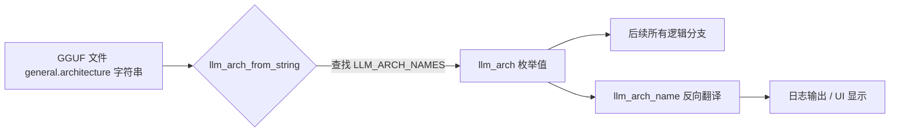
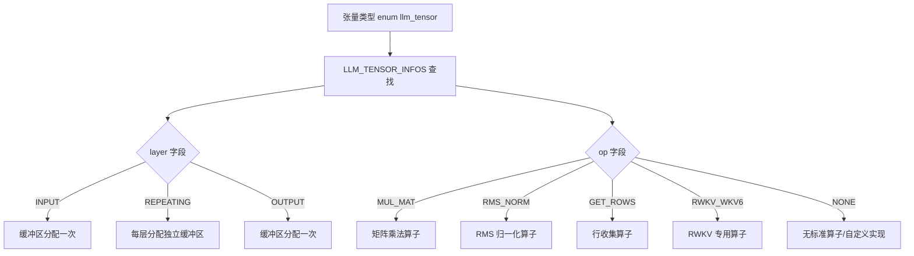

# 第12章 模型架构与超参数体系 —— llama.cpp 的"身份证、地址簿与设计图纸"

## 学习目标

- 理解 llama.cpp 中 `llm_arch` 枚举的设计思想：如何用统一 ID 表示上百种模型架构
- 掌握 `LLM_TN/LLM_TN_IMPL` 机制：如何为不同架构生成规范的张量命名
- 了解 `LLM_KV` 与 `LLM_KV_NAMES` 系统：如何将逻辑键映射为 GGUF 元数据键名
- 理解 `llama_hparams` 结构：如何集中管理模型维度、层数、注意力头等超参数
- 掌握超参数派生方法：`n_head()`/`n_embd_head_k()`/`is_swa()`/`is_mla()` 等的层特定计算
- 理解架构类型识别函数：`llm_arch_is_recurrent/is_hybrid/is_diffusion` 的设计
- 学会阅读 `LLM_TENSOR_INFOS`：如何为张量指定层类型与 GGML 算子以辅助缓冲区分配
- 熟悉 SWA 滑动窗口、Mamba/RWKV 循环状态、MLA 多头潜在注意力的超参数存储模式

## 12.1 核心隐喻：建筑管理局的三本台账

想象 llama.cpp 的模型世界是一座国际大都市的建筑管理局。在这座城市里，每一栋建筑（模型）都需要三本核心台账：

1. **身份证档案** —— `enum llm_arch` 与 `LLM_ARCH_NAMES`：为上百种模型架构（从经典的 LLaMA 到前沿的 Mamba、RWKV、Qwen3Next）分配唯一的枚举值，彻底避免了字符串硬编码和魔法数字的混乱。`llm_arch_name()` 与 `llm_arch_from_string()` 实现枚举与字符串的双向翻译，`llm_arch_all()` 返回完整名册。

2. **地址生成器** —— `LLM_TN/LLM_TN_IMPL` 与 `LLM_TENSOR_NAMES`：你输入架构类型、张量类型和层号，它就能生成完整的地址字符串，比如 `blk.3.attn_q.weight` 表示第 3 层的注意力 Q 权重。`LLM_TENSOR_INFOS` 为每个张量标注了它属于哪一层（输入层、重复层还是输出层）以及该用什么 GGML 算子来处理。

3. **设计图纸** —— `struct llama_hparams`：把所有超参数集中管理——层数 `n_layer`、嵌入维度 `n_embd`、注意力头数 `n_head`、前馈网络维度 `n_ff`，以及更高级的 MoE 专家数量、SSM 状态空间维度、SWA 滑动窗口配置等。`n_head_arr`、`n_head_kv_arr`、`n_ff_arr` 这些数组字段支持每层独立设计——通过 `n_head(il)` 按楼层号查询即可获得该层的实际参数。`is_swa(il)` 判断某层是不是"节能模式窗户"，`is_mla()` 判断是否采用"中央空调集中供冷"（多头潜在注意力），`n_embd_r()` 估算大楼的水箱容量（RWKV/Mamba 的状态缓存大小）。

最后，`llm_arch_is_recurrent/is_hybrid/is_diffusion` 这三个函数就像建筑类型的分类器。摩天楼（Transformer）、loft（循环架构 Mamba/RWKV）、展览馆（扩散模型 LLaDA）——不同类型的建筑需要不同的计算图和内存管理策略。

---

## 12.2 源码地图

```
src/llama-arch.h
├── enum llm_arch                     # 100+模型架构枚举
├── enum llm_kv                       # GGUF元数据键枚举
├── enum llm_tensor                   # 张量类型枚举
├── enum llm_tensor_layer             # 张量所属层类型（INPUT/REPEATING/OUTPUT）
├── struct LLM_KV                     # 键生成器
│   ├── LLM_KV(llm_arch, suffix)      # 构造函数
│   └── operator()(llm_kv)            # 生成带架构前缀的完整键名
├── struct LLM_TN_IMPL                # 张量命名实现
│   ├── LLM_TN_IMPL(arch,tensor,suffix,bid,xid) # 构造函数
│   ├── str()                         # 格式化张量名
│   ├── operator std::string()        # 隐式字符串转换
│   ├── operator==/!=                 # 与std::string比较
├── struct LLM_TN                     # 张量命名用户接口
│   ├── LLM_TN(llm_arch)              # 构造函数
│   └── operator()(llm_tensor,...)    # 构造LLM_TN_IMPL
├── struct llm_tensor_info            # 张量元信息
├── llm_arch_all()                    # 返回所有架构列表
├── llm_arch_name(arch)               # 枚举转字符串
├── llm_arch_from_string(name)        # 字符串转枚举
├── llm_tensor_info_for(tensor)       # 获取张量元信息
├── llm_arch_is_recurrent(arch)       # 检测循环架构
├── llm_arch_is_hybrid(arch)          # 检测混合架构
└── llm_arch_is_diffusion(arch)       # 检测扩散架构

src/llama-arch.cpp
├── LLM_ARCH_NAMES                    # 架构枚举→字符串映射表
├── LLM_KV_NAMES                      # 元数据键枚举→字符串映射（含%s占位符）
├── LLM_TENSOR_NAMES                  # 张量类型→格式化字符串映射（含%d层号）
├── llm_get_tensor_names(arch)        # 按架构返回其所需张量集合
├── LLM_TENSOR_INFOS                  # 张量→{layer, op}元信息表
├── LLM_KV::LLM_KV()                  # 构造函数实现
├── LLM_KV::operator()                # 生成完整键名
├── LLM_TN_IMPL::LLM_TN_IMPL()        # 构造函数实现
├── LLM_TN_IMPL::str()                # 格式化张量名核心逻辑
├── llm_arch_all()                    # 从LLM_ARCH_NAMES提取所有架构
├── llm_arch_name()                   # 从map查找字符串名
├── llm_arch_from_string()            # 遍历查找字符串对应枚举
├── llm_tensor_info_for()             # 从LLM_TENSOR_INFOS获取元信息
├── llm_arch_is_recurrent()           # switch case: MAMBA/MAMBA2/RWKV6/7/ARWKV7/RWKV6QWEN2
├── llm_arch_is_hybrid()              # switch case: JAMBA/FALCON_H1/QWEN3NEXT/NEMOTRON_H等
└── llm_arch_is_diffusion()           # switch case: DREAM/LLADA/LLADA_MOE/RND1

src/llama-hparams.h
├── enum llama_expert_gating_func_type  # 专家门控函数类型
├── enum llama_swa_type                # 滑动窗口类型
├── struct llama_hparams_posnet       # PosNet子结构
├── struct llama_hparams_convnext     # ConvNeXt子结构
├── struct llama_hparams              # 超参数主结构
│   ├── 基础/专家/注意力/数组/SWA/SSM/KDA/循环层/RoPE/特殊/MoE 字段
│   ├── set_swa_pattern/n_head/n_embd_head_k/is_swa/is_mla/has_kv/use_mrope 等方法声明
└── static_assert trivially_copyable   # 强制平凡可复制

src/llama-hparams.cpp
├── set_swa_pattern(n_pattern, dense_first)   # 按模式设置swa_layers数组
├── is_swa_any()                              # 检测是否存在SWA层
├── n_head/n_head_kv/n_ff/n_gqa/n_rot         # 按层读取数组，越界中止
├── n_embd_inp/n_embd_out                     # 输入/输出嵌入维度
├── n_embd_head_k/n_embd_head_v               # 按层返回SWA或full头维度
├── n_embd_k_gqa/n_embd_v_gqa                 # 单层KV总维度
├── is_n_embd_k_gqa_variable/_max             # KV维度层间变化检测与最大值
├── n_embd_r/n_embd_s                         # 滚动/循环状态维度
├── is_recurrent                              # 混合架构层是否为循环
├── n_pos_per_embd                            # M-RoPE返回4，否则1
├── is_swa                                    # 查询swa_layers数组
├── is_mla                                    # MLA判断
├── n_embd_head_k_mla/n_embd_head_v_mla       # MLA专用头维度
├── has_kv/n_layer_kv                         # 支持前n层有KV
├── use_mrope                                 # M-RoPE判断
└── is_masked_swa                             # SWA掩码判定（静态内联）
```

---

## 12.3 架构枚举与名称映射 —— 模型世界的「身份证」

### 12.3.1 `enum llm_arch`：模型架构的统一标识

**源码路径**：`src/llama-arch.h` 第 1-120 行

```cpp
// src/llama-arch.h（第 1-120 行）
// enum llm_arch：为 llama.cpp 支持的每种模型架构分配唯一枚举值
// 设计哲学：用整数 ID 取代字符串硬编码，避免魔法数字和拼写错误
// 优势：编译期检查拼写错误，运行期 O(1) 整数比较替代 O(n) 字符串比较

enum llm_arch {
    LLM_ARCH_CLIP,               // 虚拟架构，仅用于 llama-quantize 的占位
    LLM_ARCH_LLAMA,              // LLaMA 系列（Meta）
    LLM_ARCH_MISTRAL,            // Mistral 系列
    LLM_ARCH_LLAMA_EMBED,        // LLaMA 嵌入模型变体
    LLM_ARCH_BAICHUAN,           // 百川系列
    LLM_ARCH_ORION,              // Orion 系列
    LLM_ARCH_XVERSE,             // Xverse 系列
    LLM_ARCH_DECI,               // Deci 系列
    LLM_ARCH_FALCON,             // Falcon 系列
    LLM_ARCH_GROK,               // Grok 系列（xAI）
    LLM_ARCH_GPT2,               // GPT-2（OpenAI）
    LLM_ARCH_GPTNEOX,            // GPT-NeoX（EleutherAI）
    LLM_ARCH_MPT,                // MPT 系列（MosaicML）
    LLM_ARCH_STARCODER,          // StarCoder 系列（BigCode）
    LLM_ARCH_STARCODER2,         // StarCoder2
    LLM_ARCH_STABLELM,           // StableLM 系列
    LLM_ARCH_QWEN,               // Qwen 系列（阿里）
    LLM_ARCH_QWEN2,              // Qwen2 系列
    LLM_ARCH_QWEN2MOE,           // Qwen2 MoE
    LLM_ARCH_QWEN2VL,            // Qwen2-VL（多模态）
    LLM_ARCH_QWEN3,              // Qwen3 系列
    LLM_ARCH_QWEN3MOE,           // Qwen3 MoE
    LLM_ARCH_QWEN3VL,            // Qwen3-VL（多模态）
    LLM_ARCH_QWEN3VLMOE,         // Qwen3-VL MoE
    LLM_ARCH_QWEN3NEXT,          // Qwen3Next（混合 DeltaNet）
    LLM_ARCH_QWEN35,             // Qwen3.5
    LLM_ARCH_QWEN35MOE,          // Qwen3.5 MoE
    LLM_ARCH_INTERNLM2,          // InternLM2（上海 AI 实验室）
    LLM_ARCH_ERNIE4_5,           // ERNIE 4.5（百度）
    LLM_ARCH_PADDLEOCR,          // PaddleOCR
    LLM_ARCH_SMOLLM3,            // SmolLM3
    LLM_ARCH_DREAM,              // Dream（扩散模型）
    LLM_ARCH_LLADA,              // LLaDA（扩散模型）
    LLM_ARCH_LLADA_MOE,          // LLaDA MoE
    LLM_ARCH_PANGU_EMBED,        // Pangu Embedded
    LLM_ARCH_BERT,               // BERT 系列
    LLM_ARCH_NOMIC_BERT,         // Nomic BERT
    LLM_ARCH_NOMIC_BERT_MOE,     // Nomic BERT MoE
    LLM_ARCH_NEO_BERT,           // NeoBERT
    LLM_ARCH_EUROBERT,           // EuroBERT
    LLM_ARCH_MODERN_BERT,        // ModernBERT
    LLM_ARCH_JINA_BERT_V2,       // Jina BERT v2
    LLM_ARCH_JINA_BERT_V3,       // Jina BERT v3
    LLM_ARCH_BLOOM,              // Bloom 系列
    LLM_ARCH_PHI2,               // Phi-2（微软）
    LLM_ARCH_PHI3,               // Phi-3
    LLM_ARCH_PHIMOE,             // Phi MoE
    LLM_ARCH_PLAMO,              // PLaMo
    LLM_ARCH_PLAMO2,             // PLaMo2（混合 Mamba+Attn）
    LLM_ARCH_PLAMO3,             // PLaMo3（模板化 ISWA）
    LLM_ARCH_MINICPM,            // MiniCPM
    LLM_ARCH_MINICPM3,           // MiniCPM3（MLA）
    LLM_ARCH_GEMMA,              // Gemma（Google）
    LLM_ARCH_GEMMA2,             // Gemma2
    LLM_ARCH_GEMMA3,             // Gemma3（多模态）
    LLM_ARCH_GEMMA3N,            // Gemma3n（AltUp 多通道）
    LLM_ARCH_GEMMA4,             // Gemma4（共享 KV + 滑动窗口）
    LLM_ARCH_GEMMA_EMBEDDING,    // Gemma 嵌入模型
    LLM_ARCH_MAMBA,              // Mamba（SSM）
    LLM_ARCH_MAMBA2,             // Mamba2
    LLM_ARCH_JAMBA,              // Jamba（Mamba + Attn 混合）
    LLM_ARCH_FALCON_H1,          // Falcon-H1（混合）
    LLM_ARCH_GRANITE_HYBRID,     // Granite Hybrid（IBM）
    LLM_ARCH_LFM2,               // LFM2（混合）
    LLM_ARCH_LFM2MOE,            // LFM2 MoE
    LLM_ARCH_NEMOTRON_H,         // Nemotron-H（NVIDIA）
    LLM_ARCH_NEMOTRON_H_MOE,     // Nemotron-H MoE
    LLM_ARCH_RWKV6,              // RWKV6（RNN-like）
    LLM_ARCH_RWKV6QWEN2,         // RWKV6 + Qwen2 混合
    LLM_ARCH_RWKV7,              // RWKV7
    LLM_ARCH_ARWKV7,             // ARWKV7（RWKV7 变体）
    LLM_ARCH_KIMI_LINEAR,        // Kimi Linear（KDA）
    LLM_ARCH_COHERE2_ISWA,       // Cohere2 ISWA
    LLM_ARCH_COMMAND_R,          // Command-R（Cohere）
    LLM_ARCH_EXAONE,             // EXAONE（LG）
    LLM_ARCH_EXAONE_MOE,         // EXAONE MoE
    LLM_ARCH_EXAONE4,            // EXAONE4
    LLM_ARCH_GRANITE,            // Granite（IBM）
    LLM_ARCH_GRANITE_MOE,        // Granite MoE
    LLM_ARCH_OLMO,               // OLMo
    LLM_ARCH_OLMO2,              // OLMo2（ISWA）
    LLM_ARCH_OLMOE,              // OLMoE
    LLM_ARCH_OPENELM,            // OpenELM（Apple）
    LLM_ARCH_CODESHELL,          // CodeShell
    LLM_ARCH_REFACT,             // Refact
    LLM_ARCH_MAINCODER,          // MainCoder
    LLM_ARCH_SEED_OSS,           // Seed-OSS
    LLM_ARCH_MINIMAX_M2,         // Minimax-M2
    LLM_ARCH_BITNET,             // BitNet（1.58-bit）
    LLM_ARCH_APERTUS,            // Apertus（xIELU）
    LLM_ARCH_PLM,                // PLM（KV 压缩）
    LLM_ARCH_JAIS,               // JAIS（阿拉伯语）
    LLM_ARCH_JAIS2,              // JAIS2
    LLM_ARCH_HUNYUAN_DENSE,      // 混元稠密版
    LLM_ARCH_HUNYUAN_MOE,        // 混元 MoE 版
    LLM_ARCH_MISTRAL3,           // Mistral3
    LLM_ARCH_ARCEE,              // Arcee
    LLM_ARCH_STEP35_ISWA,        // Step35 ISWA
    LLM_ARCH_SMALLTHINKER,       // SmallThinker
    LLM_ARCH_DEEPSEEK,           // DeepSeek V1
    LLM_ARCH_DEEPSEEK2,          // DeepSeek V2（MLA + MoE）
    LLM_ARCH_DBRX,               // DBRX（Databricks）
    LLM_ARCH_ARCTIC,             // Arctic（Snowflake）
    LLM_ARCH_GROVEMOE,           // Grovemoe
    LLM_ARCH_OPENAI_MOE_ISWA,    // OpenAI MoE ISWA
    LLM_ARCH_RND1,               // RND1（扩散 MoE）
    LLM_ARCH_CHAMELEON,          // Chameleon（多模态）
    LLM_ARCH_COGVLM,             // CogVLM（多模态）
    LLM_ARCH_LLAMA4,             // Llama4
    LLM_ARCH_T5_ENC,             // T5 编码器
    LLM_ARCH_T5_DEC,             // T5 解码器
    LLM_ARCH_WAVTOKENIZER_DEC,   // WavTokenizer 解码器
    LLM_ARCH_AFMOE,              // AFMoE
    LLM_ARCH_CHATGLM,            // ChatGLM
    LLM_ARCH_GLM4,               // GLM4
    LLM_ARCH_GLM4_MOE,           // GLM4 MoE
    LLM_ARCH_LLAVA,              // LLaVA（多模态）
    LLM_ARCH_MINICPMV,           // MiniCPM-V
    LLM_ARCH_INTERNVL,           // InternVL
    LLM_ARCH_GLM4V,              // GLM-4V
    LLM_ARCH_KIMIVL,             // Kimi-VL
    LLM_ARCH_KIMIK25,            // Kimi-K2.5
    LLM_ARCH_SIGLIP,             // SigLIP（视觉编码器）
    LLM_ARCH_PIXTRAL,            // Pixtral
    LLM_ARCH_DEEPSEEKOCR,        // DeepSeek-OCR
    LLM_ARCH_HUNYUANOCR,         // HunyuanOCR
    LLM_ARCH_COGLM,              // CogVLM 多模态
    LLM_ARCH_GEMMA4V,            // Gemma4V
    LLM_ARCH_MOBILENETV5,        // MobileNetV5
    LLM_ARCH_YOUTUVL,            // YouTuVL
    LLM_ARCH_NEMOTRON_V2_VL,     // Nemotron V2 VL
    LLM_ARCH_WHISPER_ENC,        // Whisper 编码器
    LLM_ARCH_CONFORMER,          // Conformer（音频）
    LLM_ARCH_UNKNOWN,            // 未知架构（兜底值）
};
```

> 这段代码定义了 `enum llm_arch` 枚举，涵盖了 llama.cpp 支持的 100+ 种模型架构。每个枚举值对应一种模型家族（如 `LLM_ARCH_LLAMA`、`LLM_ARCH_MAMBA`、`LLM_ARCH_QWEN3NEXT`），特殊值 `LLM_ARCH_CLIP` 作为量化工具占位，`LLM_ARCH_UNKNOWN` 作为兜底。使用整数枚举而非字符串，既保证了编译期类型安全，又让运行时架构判断变为 O(1) 整数比较。



### 12.3.2 `LLM_ARCH_NAMES`：架构枚举到字符串的映射表

**源码路径**：`src/llama-arch.cpp` 第 10-120 行

```cpp
// src/llama-arch.cpp（第 10-120 行）
// LLM_ARCH_NAMES：将枚举值映射为可读字符串，用于日志输出、序列化和 UI 显示
// 注意：键的顺序无需与 enum 顺序一致，但必须覆盖所有非 UNKNOWN 枚举值
// 字符串值直接对应 GGUF 文件中的 general.architecture 字段

static const std::map<llm_arch, const char *> LLM_ARCH_NAMES = {
    { LLM_ARCH_CLIP,           "clip" },
    { LLM_ARCH_LLAMA,          "llama" },
    { LLM_ARCH_MISTRAL,        "mistral" },
    { LLM_ARCH_LLAMA_EMBED,    "llama_embd" },
    { LLM_ARCH_BAICHUAN,       "baichuan" },
    { LLM_ARCH_ORION,          "orion" },
    { LLM_ARCH_XVERSE,         "xverse" },
    { LLM_ARCH_DECI,           "deci" },
    { LLM_ARCH_FALCON,         "falcon" },
    { LLM_ARCH_GROK,           "grok" },
    { LLM_ARCH_GPT2,           "gpt2" },
    { LLM_ARCH_GPTNEOX,        "gptneox" },
    { LLM_ARCH_MPT,            "mpt" },
    { LLM_ARCH_STARCODER,      "starcoder" },
    { LLM_ARCH_STARCODER2,     "starcoder2" },
    { LLM_ARCH_STABLELM,       "stablelm" },
    { LLM_ARCH_QWEN,           "qwen" },
    { LLM_ARCH_QWEN2,          "qwen2" },
    { LLM_ARCH_QWEN2MOE,       "qwen2moe" },
    { LLM_ARCH_QWEN2VL,        "qwen2vl" },
    { LLM_ARCH_QWEN3,          "qwen3" },
    { LLM_ARCH_QWEN3MOE,       "qwen3moe" },
    { LLM_ARCH_QWEN3VL,        "qwen3vl" },
    { LLM_ARCH_QWEN3VLMOE,     "qwen3vl_moe" },
    { LLM_ARCH_QWEN3NEXT,      "qwen3next" },
    { LLM_ARCH_QWEN35,         "qwen35" },
    { LLM_ARCH_QWEN35MOE,      "qwen35moe" },
    { LLM_ARCH_INTERNLM2,      "internlm2" },
    { LLM_ARCH_ERNIE4_5,       "ernie4-5" },
    { LLM_ARCH_PADDLEOCR,      "paddleocr" },
    { LLM_ARCH_SMOLLM3,        "smollm3" },
    { LLM_ARCH_DREAM,          "dream" },
    { LLM_ARCH_LLADA,          "llada" },
    { LLM_ARCH_LLADA_MOE,      "llada_moe" },
    { LLM_ARCH_PANGU_EMBED,    "pangu-embedded" },
    { LLM_ARCH_BERT,           "bert" },
    { LLM_ARCH_NOMIC_BERT,     "nomic-bert" },
    { LLM_ARCH_NOMIC_BERT_MOE, "nomic-bert-moe" },
    { LLM_ARCH_NEO_BERT,       "neo-bert" },
    { LLM_ARCH_EUROBERT,       "eurobert" },
    { LLM_ARCH_MODERN_BERT,    "modern-bert" },
    { LLM_ARCH_JINA_BERT_V2,   "jina-bert-v2" },
    { LLM_ARCH_JINA_BERT_V3,   "jina-bert-v3" },
    { LLM_ARCH_BLOOM,          "bloom" },
    { LLM_ARCH_PHI2,           "phi2" },
    { LLM_ARCH_PHI3,           "phi3" },
    { LLM_ARCH_PHIMOE,         "phimoe" },
    { LLM_ARCH_PLAMO,          "plamo" },
    { LLM_ARCH_PLAMO2,         "plamo2" },
    { LLM_ARCH_PLAMO3,         "plamo3" },
    { LLM_ARCH_MINICPM,        "minicpm" },
    { LLM_ARCH_MINICPM3,       "minicpm3" },
    { LLM_ARCH_GEMMA,          "gemma" },
    { LLM_ARCH_GEMMA2,         "gemma2" },
    { LLM_ARCH_GEMMA3,         "gemma3" },
    { LLM_ARCH_GEMMA3N,        "gemma3n" },
    { LLM_ARCH_GEMMA4,         "gemma4" },
    { LLM_ARCH_GEMMA_EMBEDDING, "gemma-embedding" },
    { LLM_ARCH_MAMBA,          "mamba" },
    { LLM_ARCH_MAMBA2,         "mamba2" },
    { LLM_ARCH_JAMBA,          "jamba" },
    { LLM_ARCH_FALCON_H1,      "falcon-h1" },
    { LLM_ARCH_GRANITE_HYBRID, "granite-hybrid" },
    { LLM_ARCH_LFM2,           "lfm2" },
    { LLM_ARCH_LFM2MOE,        "lfm2moe" },
    { LLM_ARCH_NEMOTRON_H,     "nemotron-h" },
    { LLM_ARCH_NEMOTRON_H_MOE, "nemotron-h-moe" },
    { LLM_ARCH_RWKV6,          "rwkv6" },
    { LLM_ARCH_RWKV6QWEN2,     "rwkv6qwen2" },
    { LLM_ARCH_RWKV7,          "rwkv7" },
    { LLM_ARCH_ARWKV7,         "arwkv7" },
    { LLM_ARCH_KIMI_LINEAR,    "kimi-linear" },
    { LLM_ARCH_COHERE2_ISWA,   "cohere2-iswa" },
    { LLM_ARCH_COMMAND_R,      "command-r" },
    { LLM_ARCH_EXAONE,         "exaone" },
    { LLM_ARCH_EXAONE_MOE,     "exaone-moe" },
    { LLM_ARCH_EXAONE4,        "exaone4" },
    { LLM_ARCH_GRANITE,        "granite" },
    { LLM_ARCH_GRANITE_MOE,    "granite-moe" },
    { LLM_ARCH_OLMO,           "olmo" },
    { LLM_ARCH_OLMO2,          "olmo2" },
    { LLM_ARCH_OLMOE,          "olmoe" },
    { LLM_ARCH_OPENELM,        "openelm" },
    { LLM_ARCH_CODESHELL,      "codeshell" },
    { LLM_ARCH_REFACT,         "refact" },
    { LLM_ARCH_MAINCODER,      "maincoder" },
    { LLM_ARCH_SEED_OSS,       "seed-oss" },
    { LLM_ARCH_MINIMAX_M2,     "minimax-m2" },
    { LLM_ARCH_BITNET,         "bitnet" },
    { LLM_ARCH_APERTUS,        "apertus" },
    { LLM_ARCH_PLM,            "plm" },
    { LLM_ARCH_JAIS,           "jais" },
    { LLM_ARCH_JAIS2,          "jais2" },
    { LLM_ARCH_HUNYUAN_DENSE,  "hunyuan-dense" },
    { LLM_ARCH_HUNYUAN_MOE,    "hunyuan-moe" },
    { LLM_ARCH_MISTRAL3,       "mistral3" },
    { LLM_ARCH_ARCEE,          "arcee" },
    { LLM_ARCH_STEP35_ISWA,    "step35-iswa" },
    { LLM_ARCH_SMALLTHINKER,   "smallthinker" },
    { LLM_ARCH_DEEPSEEK,       "deepseek" },
    { LLM_ARCH_DEEPSEEK2,      "deepseek2" },
    { LLM_ARCH_DBRX,           "dbrx" },
    { LLM_ARCH_ARCTIC,         "arctic" },
    { LLM_ARCH_GROVEMOE,       "grovemoe" },
    { LLM_ARCH_OPENAI_MOE_ISWA, "openai-moe-iswa" },
    { LLM_ARCH_RND1,           "rnd1" },
    { LLM_ARCH_CHAMELEON,      "chameleon" },
    { LLM_ARCH_COGVLM,         "cogvlm" },
    { LLM_ARCH_LLAMA4,         "llama4" },
    { LLM_ARCH_T5_ENC,         "t5-enc" },
    { LLM_ARCH_T5_DEC,         "t5-dec" },
    { LLM_ARCH_WAVTOKENIZER_DEC, "wavtokenizer-dec" },
    { LLM_ARCH_AFMOE,          "afmoe" },
    { LLM_ARCH_CHATGLM,        "chatglm" },
    { LLM_ARCH_GLM4,           "glm4" },
    { LLM_ARCH_GLM4_MOE,       "glm4-moe" },
    { LLM_ARCH_LLAVA,          "llava" },
    { LLM_ARCH_MINICPMV,       "minicpmv" },
    { LLM_ARCH_INTERNVL,       "internvl" },
    { LLM_ARCH_GLM4V,          "glm4v" },
    { LLM_ARCH_KIMIVL,         "kimivl" },
    { LLM_ARCH_KIMIK25,        "kimik25" },
    { LLM_ARCH_SIGLIP,         "siglip" },
    { LLM_ARCH_PIXTRAL,        "pixtral" },
    { LLM_ARCH_DEEPSEEKOCR,    "deepseek-ocr" },
    { LLM_ARCH_HUNYUANOCR,     "hunyuan-ocr" },
    { LLM_ARCH_COGLM,          "cogvlm" },
    { LLM_ARCH_GEMMA4V,        "gemma4v" },
    { LLM_ARCH_MOBILENETV5,    "mobilenetv5" },
    { LLM_ARCH_YOUTUVL,        "youtuvl" },
    { LLM_ARCH_NEMOTRON_V2_VL, "nemotron-v2-vl" },
    { LLM_ARCH_WHISPER_ENC,    "whisper-enc" },
    { LLM_ARCH_CONFORMER,      "conformer" },
    { LLM_ARCH_UNKNOWN,        "unknown" },
};
```

> 这段代码定义了 `LLM_ARCH_NAMES` 静态映射表，使用 `std::map<llm_arch, const char*>` 将每个架构枚举映射为可读字符串。字符串值直接对应 GGUF 文件中的 `general.architecture` 字段（如 `"llama"`、`"qwen2"`、`"mamba"`）。使用 `std::map` 而非数组，是因为枚举值可能不连续（如 `LLM_ARCH_CLIP` 为虚拟值），且新增架构时只需在枚举和映射表中各加一行，无需维护数组下标连续性。

### 12.3.3 `llm_arch_all()`：返回所有支持的架构列表

**源码路径**：`src/llama-arch.h` 第 461 行（声明） / `src/llama-arch.cpp` 第 2592-2599 行（实现）

```cpp
// src/llama-arch.h（第 461 行）
// 声明：返回所有支持的架构列表，用于遍历和初始化
std::vector<llm_arch> llm_arch_all();
```

```cpp
// src/llama-arch.cpp（第 2592-2599 行）
// 实现：从 LLM_ARCH_NAMES 提取所有键，预留容量避免扩容
std::vector<llm_arch> llm_arch_all() {
    std::vector<llm_arch> ret;
    ret.reserve(LLM_ARCH_NAMES.size());  // 预分配内存，避免多次扩容
    for (const auto & [arch, _] : LLM_ARCH_NAMES) {
        ret.push_back(arch);
    }
    return ret;
}
```

> `llm_arch_all()` 通过结构化绑定遍历 `LLM_ARCH_NAMES`，将所有键（架构枚举值）收集到 `std::vector` 中返回。`reserve()` 预分配容量是性能优化细节。该函数用于初始化时的架构扫描、测试中的全量枚举回归验证，以及需要遍历所有支持架构的场景。

### 12.3.4 `llm_arch_name()`：枚举转字符串

**源码路径**：`src/llama-arch.h` 第 463 行（声明） / `src/llama-arch.cpp` 第 2601-2607 行（实现）

```cpp
// src/llama-arch.h（第 463 行）
const char * llm_arch_name(llm_arch arch);
```

```cpp
// src/llama-arch.cpp（第 2601-2607 行）
// 实现：map 查找，找不到返回 "unknown" 而非 nullptr，避免调用方空指针检查
const char * llm_arch_name(llm_arch arch) {
    auto it = LLM_ARCH_NAMES.find(arch);
    if (it == LLM_ARCH_NAMES.end()) {
        return "unknown";
    }
    return it->second;
}
```

> `llm_arch_name()` 是最常用的"翻译官"——当日志输出 `LLAMA_LOG_INFO("loading %s model", llm_arch_name(arch))` 时，它把枚举值翻译成人类可读字符串。找不到时返回 `"unknown"` 字符串字面量而非 `nullptr`，是防御性编程：避免调用方忘记检查空指针导致崩溃。

### 12.3.5 `llm_arch_from_string()`：字符串转枚举

**源码路径**：`src/llama-arch.h` 第 465 行（声明） / `src/llama-arch.cpp` 第 2609-2617 行（实现）

```cpp
// src/llama-arch.h（第 465 行）
llm_arch llm_arch_from_string(const std::string & name);
```

```cpp
// src/llama-arch.cpp（第 2609-2617 行）
// 实现：遍历 map 查找，找不到返回 LLM_ARCH_UNKNOWN
llm_arch llm_arch_from_string(const std::string & name) {
    for (const auto & kv : LLM_ARCH_NAMES) {  // NOLINT
        if (kv.second == name) {
            return kv.first;
        }
    }
    return LLM_ARCH_UNKNOWN;
}
```

> `llm_arch_from_string()` 是反向"解析器"——GGUF 文件中存储的 `general.architecture` 键值是字符串（如 `"qwen2"`），加载器读取后调用此函数转换为 `LLM_ARCH_QWEN2` 枚举值，后续所有逻辑都基于枚举值进行。线性遍历查找的复杂度是 O(N)，但 N 约 100，且该函数仅在模型加载初期调用一次，性能影响可忽略。

---

## 12.4 张量命名与架构关联 —— 模型权重的「地址簿」

### 12.4.1 `enum llm_tensor`：张量类型的统一标识

**源码路径**：`src/llama-arch.h` 第 120-350 行（节选关键分组）

```cpp
// src/llama-arch.h（第 120-350 行，节选）
// enum llm_tensor：定义所有可能的张量类型
// 命名规律：按功能分组 - TOKEN/ATTN/FFN/ROPE/SSM/TIME_MIX/ALTUP 等

enum llm_tensor {
    // 基础嵌入
    LLM_TENSOR_TOKEN_EMBD,          // token 嵌入（输入嵌入表）
    LLM_TENSOR_TOKEN_EMBD_NORM,     // token 嵌入归一化（BERT 用）
    LLM_TENSOR_TOKEN_TYPES,         // token 类型嵌入（BERT segment embedding）
    LLM_TENSOR_POS_EMBD,            // 位置嵌入（GPT-2 用，非 RoPE 模型）
    LLM_TENSOR_PER_LAYER_TOKEN_EMBD, // 每层独立嵌入（Gemma3n AltUp 用）

    // 输出层
    LLM_TENSOR_OUTPUT,              // 输出投影（语言模型头）
    LLM_TENSOR_OUTPUT_NORM,         // 输出归一化
    LLM_TENSOR_CLS,                 // 分类头（BERT 用）
    LLM_TENSOR_CLS_OUT,             // 分类输出
    LLM_TENSOR_CLS_NORM,            // 分类归一化
    LLM_TENSOR_ENC_OUTPUT_NORM,     // 编码器输出归一化

    // 注意力相关
    LLM_TENSOR_ATTN_NORM,           // 注意力预归一化
    LLM_TENSOR_ATTN_NORM_2,         // 注意力第二归一化（Falcon 用）
    LLM_TENSOR_ATTN_POST_NORM,      // 注意力后归一化
    LLM_TENSOR_ATTN_Q,              // 注意力 Q 投影
    LLM_TENSOR_ATTN_K,              // 注意力 K 投影
    LLM_TENSOR_ATTN_V,              // 注意力 V 投影
    LLM_TENSOR_ATTN_QKV,            // 联合 QKV 投影（GPT-2/Falcon/Qwen 用）
    LLM_TENSOR_ATTN_OUT,            // 注意力输出投影
    LLM_TENSOR_ATTN_OUT_NORM,       // 注意力输出归一化
    LLM_TENSOR_ATTN_Q_NORM,         // Q 归一化（Qwen3/DeepSeek MLA 用）
    LLM_TENSOR_ATTN_K_NORM,         // K 归一化
    LLM_TENSOR_ATTN_Q_A,            // Q 压缩投影（MLA 用）
    LLM_TENSOR_ATTN_Q_A_NORM,       // Q 压缩归一化
    LLM_TENSOR_ATTN_Q_B,            // Q 解压投影（MLA 用）
    LLM_TENSOR_ATTN_KV_A_MQA,       // KV 压缩投影（MLA 用）
    LLM_TENSOR_ATTN_KV_B,           // KV 解压投影（MLA 用）
    LLM_TENSOR_ATTN_GATE,           // 注意力门控（Qwen3Next DeltaNet 用）
    LLM_TENSOR_ATTN_ROT_EMBD,       // 旋转位置编码（Plamo/CodeShell 用）

    // FFN（前馈网络）相关
    LLM_TENSOR_FFN_NORM,            // FFN 预归一化
    LLM_TENSOR_FFN_POST_NORM,       // FFN 后归一化
    LLM_TENSOR_FFN_GATE,            // FFN gate 投影（SwiGLU 用）
    LLM_TENSOR_FFN_DOWN,            // FFN down 投影
    LLM_TENSOR_FFN_UP,              // FFN up 投影
    LLM_TENSOR_FFN_GATE_INP,        // FFN gate 输入（MoE 路由用）
    LLM_TENSOR_FFN_GATE_INP_SHEXP,  // FFN gate 输入（共享专家用）
    LLM_TENSOR_FFN_GATE_EXP,        // FFN gate（路由专家）
    LLM_TENSOR_FFN_DOWN_EXP,        // FFN down（路由专家）
    LLM_TENSOR_FFN_UP_EXP,          // FFN up（路由专家）
    LLM_TENSOR_FFN_GATE_EXPS,       // FFN gate（路由专家，safetensors 风格命名）
    LLM_TENSOR_FFN_DOWN_EXPS,       // FFN down（路由专家）
    LLM_TENSOR_FFN_UP_EXPS,         // FFN up（路由专家）
    LLM_TENSOR_FFN_GATE_SHEXP,      // FFN gate（共享专家）
    LLM_TENSOR_FFN_DOWN_SHEXP,      // FFN down（共享专家）
    LLM_TENSOR_FFN_UP_SHEXP,        // FFN up（共享专家）
    LLM_TENSOR_FFN_GATE_UP_EXP,     // FFN gate+up 联合（Qwen3Next 用）
    LLM_TENSOR_FFN_GATE_UP_EXPS,    // FFN gate+up 联合（safetensors 风格）
    LLM_TENSOR_FFN_EXP_PROBS_B,     // MoE 专家概率偏置（AFMoE 用）
    LLM_TENSOR_FFN_ACT,             // FFN 激活函数配置（MPT 用）

    // RoPE 相关
    LLM_TENSOR_ROPE_FREQS,          // RoPE 频率表
    LLM_TENSOR_ROPE_FACTORS_LONG,   // RoPE 长因子（YaRN 用）
    LLM_TENSOR_ROPE_FACTORS_SHORT,  // RoPE 短因子（YaRN 用）

    // SSM / 循环相关
    LLM_TENSOR_SSM_A,               // SSM A 矩阵（Mamba 用）
    LLM_TENSOR_SSM_A_NOSCAN,        // SSM A 矩阵（无扫描模式）
    LLM_TENSOR_SSM_CONV1D,          // SSM 卷积核
    LLM_TENSOR_SSM_DT,              // SSM 时间步长
    LLM_TENSOR_SSM_BETA_ALPHA,      // SSM beta+alpha（Qwen3Next 用）
    LLM_TENSOR_SSM_BETA,            // SSM beta
    LLM_TENSOR_SSM_ALPHA,           // SSM alpha
    LLM_TENSOR_SSM_IN,              // SSM 输入投影
    LLM_TENSOR_SSM_NORM,            // SSM 归一化
    LLM_TENSOR_SSM_OUT,             // SSM 输出投影
    LLM_TENSOR_SSM_DT_NORM,         // SSM 时间步归一化
    LLM_TENSOR_SSM_B_NORM,          // SSM B 归一化
    LLM_TENSOR_SSM_C_NORM,          // SSM C 归一化
    LLM_TENSOR_SSM_X,               // SSM X 状态（PLaMo2 用）

    // RWKV / 时间混合相关
    LLM_TENSOR_TIME_MIX_FIRST,      // 时间混合第一层（RWKV 用）
    LLM_TENSOR_TIME_MIX_W0,         // 时间混合 W0（RWKV 用）
    LLM_TENSOR_TIME_MIX_W1,         // 时间混合 W1
    LLM_TENSOR_TIME_MIX_W2,         // 时间混合 W2
    LLM_TENSOR_TIME_MIX_A0,         // 时间混合 A0
    LLM_TENSOR_TIME_MIX_A1,         // 时间混合 A1
    LLM_TENSOR_TIME_MIX_A2,         // 时间混合 A2
    LLM_TENSOR_TIME_MIX_V0,         // 时间混合 V0
    LLM_TENSOR_TIME_MIX_V1,         // 时间混合 V1
    LLM_TENSOR_TIME_MIX_V2,         // 时间混合 V2
    LLM_TENSOR_TIME_MIX_G0,         // 时间混合 G0
    LLM_TENSOR_TIME_MIX_G1,         // 时间混合 G1
    LLM_TENSOR_TIME_MIX_G2,         // 时间混合 G2

    // Gemma3n AltUp / Laurel 相关
    LLM_TENSOR_PER_LAYER_MODEL_PROJ,   // 每层模型投影
    LLM_TENSOR_PER_LAYER_PROJ_NORM,    // 每层投影归一化
    LLM_TENSOR_PER_LAYER_INP_GATE,     // 每层输入门控
    LLM_TENSOR_PER_LAYER_PROJ,         // 每层投影
    LLM_TENSOR_PER_LAYER_POST_NORM,    // 每层后归一化
    LLM_TENSOR_ALTUP_UNEMBD_PROJ,      // AltUp 解嵌入投影
    LLM_TENSOR_ALTUP_PROJ,             // AltUp 投影
    LLM_TENSOR_ALTUP_CORRECT_COEF,     // AltUp 校正系数
    LLM_TENSOR_ALTUP_CORRECT_SCALE,    // AltUp 校正缩放
    LLM_TENSOR_ALTUP_PREDICT_COEF,     // AltUp 预测系数
    LLM_TENSOR_ALTUP_ROUTER,           // AltUp 路由器
    LLM_TENSOR_ALTUP_ROUTER_NORM,      // AltUp 路由器归一化
    LLM_TENSOR_LAUREL_L,               // Laurel 左投影
    LLM_TENSOR_LAUREL_R,               // Laurel 右投影
    LLM_TENSOR_LAUREL_POST_NORM,       // Laurel 后归一化
};
```

> 这段代码定义了 `enum llm_tensor` 枚举，涵盖了 llama.cpp 支持的所有张量类型。命名遵循功能分组规律：`TOKEN_*` 为嵌入层，`ATTN_*` 为注意力层，`FFN_*` 为前馈网络，`SSM_*` 为状态空间模型，`TIME_MIX_*` 为 RWKV 时间混合，`ALTUP/LAUREL_*` 为 Gemma3n 特有。后缀 `_EXP` 表示路由专家，`_EXPS` 表示 safetensors 命名风格，`_SHEXP` 表示共享专家。这种约定让开发者看到张量类型即能推断用途和所属架构。

### 12.4.2 `enum llm_tensor_layer`：张量所属层类型

**源码路径**：`src/llama-arch.h` 第 350 行附近

```cpp
// src/llama-arch.h（第 350 行附近）
// enum llm_tensor_layer：张量在模型中的层级分类
// 用于缓冲区分配策略：INPUT 只分配一次，REPEATING 每层分配，OUTPUT 只在末尾分配

enum llm_tensor_layer {
    LLM_TENSOR_LAYER_INPUT,      // 输入层张量：模型开头只出现一次（如 token_embd）
    LLM_TENSOR_LAYER_REPEATING,  // 重复层张量：每层都有一份（如 blk.%d.attn_q）
    LLM_TENSOR_LAYER_OUTPUT,     // 输出层张量：模型末尾只出现一次（如 output）
};
```

> 这个枚举将张量按生命周期分为三类，直接指导缓冲区分配策略：`INPUT` 类（如 `token_embd`）全模型仅需一份内存；`REPEATING` 类（如 `blk.%d.attn_q`）需为每层分配独立内存；`OUTPUT` 类（如 `output`）仅在模型末尾出现。

### 12.4.3 `struct llm_tensor_info`：张量元信息

**源码路径**：`src/llama-arch.h` 第 420 行附近

```cpp
// src/llama-arch.h（第 420 行附近）
// struct llm_tensor_info：张量的元信息，包含层类型和对应的 GGML 算子
// 用于缓冲区分配策略和后端算子选择

struct llm_tensor_info {
    llm_tensor_layer layer;  // 所属层类型：INPUT / REPEATING / OUTPUT
    ggml_op op;              // 对应的 GGML 算子：MUL_MAT / RMS_NORM / GET_ROWS 等
};
```

> `llm_tensor_info` 是一个简单的 POD 结构体，记录张量的两个关键属性：`layer` 指导内存分配策略，`op` 指导后端选择最优算子实现（如 `ATTN_Q` 对应 `GGML_OP_MUL_MAT`，`ATTN_NORM` 对应 `GGML_OP_RMS_NORM`）。

### 12.4.4 `LLM_TENSOR_NAMES`：张量类型到格式化字符串的映射

**源码路径**：`src/llama-arch.cpp` 第 120-300 行（节选）

```cpp
// src/llama-arch.cpp（第 120-300 行，节选）
// LLM_TENSOR_NAMES：张量类型 → 格式化字符串映射
// %d 表示层号（blk.%d），部分张量不含层号（如 token_embd）

static const std::map<llm_tensor, const char *> LLM_TENSOR_NAMES = {
    // 全局张量（无层号）
    { LLM_TENSOR_TOKEN_EMBD,         "token_embd" },
    { LLM_TENSOR_TOKEN_EMBD_NORM,    "token_embd.norm" },
    { LLM_TENSOR_TOKEN_TYPES,        "token_types" },
    { LLM_TENSOR_POS_EMBD,           "position_embd" },
    { LLM_TENSOR_PER_LAYER_TOKEN_EMBD, "per_layer.token_embd" },

    { LLM_TENSOR_OUTPUT,             "output" },
    { LLM_TENSOR_OUTPUT_NORM,        "output_norm" },
    { LLM_TENSOR_CLS,                "cls" },
    { LLM_TENSOR_CLS_OUT,            "cls.out" },
    { LLM_TENSOR_CLS_NORM,           "cls_norm" },
    { LLM_TENSOR_ENC_OUTPUT_NORM,    "enc.output_norm" },

    // 按层张量（含 %d 占位符）
    { LLM_TENSOR_ATTN_NORM,          "blk.%d.attn_norm" },
    { LLM_TENSOR_ATTN_NORM_2,        "blk.%d.attn_norm_2" },
    { LLM_TENSOR_ATTN_POST_NORM,     "blk.%d.attn_post_norm" },
    { LLM_TENSOR_ATTN_Q,             "blk.%d.attn_q" },
    { LLM_TENSOR_ATTN_K,             "blk.%d.attn_k" },
    { LLM_TENSOR_ATTN_V,             "blk.%d.attn_v" },
    { LLM_TENSOR_ATTN_QKV,           "blk.%d.attn_qkv" },
    { LLM_TENSOR_ATTN_OUT,           "blk.%d.attn_output" },
    { LLM_TENSOR_ATTN_OUT_NORM,      "blk.%d.attn_output_norm" },
    { LLM_TENSOR_ATTN_Q_NORM,        "blk.%d.attn_q_norm" },
    { LLM_TENSOR_ATTN_K_NORM,        "blk.%d.attn_k_norm" },
    { LLM_TENSOR_ATTN_Q_A,           "blk.%d.attn_q_a" },
    { LLM_TENSOR_ATTN_Q_A_NORM,      "blk.%d.attn_q_a_norm" },
    { LLM_TENSOR_ATTN_Q_B,           "blk.%d.attn_q_b" },
    { LLM_TENSOR_ATTN_KV_A_MQA,      "blk.%d.attn_kv_a_mqa" },
    { LLM_TENSOR_ATTN_KV_B,          "blk.%d.attn_kv_b" },
    { LLM_TENSOR_ATTN_GATE,          "blk.%d.attn_gate" },
    { LLM_TENSOR_ATTN_ROT_EMBD,      "blk.%d.attn_rot_embd" },

    { LLM_TENSOR_FFN_NORM,           "blk.%d.ffn_norm" },
    { LLM_TENSOR_FFN_POST_NORM,      "blk.%d.ffn_post_norm" },
    { LLM_TENSOR_FFN_GATE,           "blk.%d.ffn_gate" },
    { LLM_TENSOR_FFN_DOWN,           "blk.%d.ffn_down" },
    { LLM_TENSOR_FFN_UP,             "blk.%d.ffn_up" },
    { LLM_TENSOR_FFN_GATE_INP,       "blk.%d.ffn_gate_inp" },
    { LLM_TENSOR_FFN_GATE_INP_SHEXP, "blk.%d.ffn_gate_inp_shexp" },
    { LLM_TENSOR_FFN_GATE_EXP,       "blk.%d.ffn_gate_exp" },
    { LLM_TENSOR_FFN_DOWN_EXP,       "blk.%d.ffn_down_exp" },
    { LLM_TENSOR_FFN_UP_EXP,         "blk.%d.ffn_up_exp" },
    { LLM_TENSOR_FFN_GATE_EXPS,      "blk.%d.ffn_gate_exps" },
    { LLM_TENSOR_FFN_DOWN_EXPS,      "blk.%d.ffn_down_exps" },
    { LLM_TENSOR_FFN_UP_EXPS,        "blk.%d.ffn_up_exps" },
    { LLM_TENSOR_FFN_GATE_SHEXP,     "blk.%d.ffn_gate_shexp" },
    { LLM_TENSOR_FFN_DOWN_SHEXP,     "blk.%d.ffn_down_shexp" },
    { LLM_TENSOR_FFN_UP_SHEXP,       "blk.%d.ffn_up_shexp" },
    { LLM_TENSOR_FFN_GATE_UP_EXP,    "blk.%d.ffn_gate_up_exp" },
    { LLM_TENSOR_FFN_GATE_UP_EXPS,   "blk.%d.ffn_gate_up_exps" },
    { LLM_TENSOR_FFN_EXP_PROBS_B,    "ffn_exp_probs_b" },
    { LLM_TENSOR_FFN_ACT,            "ffn_act" },

    { LLM_TENSOR_ROPE_FREQS,         "rope_freqs" },
    { LLM_TENSOR_ROPE_FACTORS_LONG,  "rope_factors_long" },
    { LLM_TENSOR_ROPE_FACTORS_SHORT, "rope_factors_short" },

    { LLM_TENSOR_SSM_A,              "blk.%d.ssm_a" },
    { LLM_TENSOR_SSM_A_NOSCAN,       "blk.%d.ssm_a_noscan" },
    { LLM_TENSOR_SSM_CONV1D,         "blk.%d.ssm_conv1d" },
    { LLM_TENSOR_SSM_DT,             "blk.%d.ssm_dt" },
    { LLM_TENSOR_SSM_BETA_ALPHA,     "blk.%d.ssm_beta_alpha" },
    { LLM_TENSOR_SSM_BETA,           "blk.%d.ssm_beta" },
    { LLM_TENSOR_SSM_ALPHA,          "blk.%d.ssm_alpha" },
    { LLM_TENSOR_SSM_IN,             "blk.%d.ssm_in" },
    { LLM_TENSOR_SSM_NORM,           "blk.%d.ssm_norm" },
    { LLM_TENSOR_SSM_OUT,            "blk.%d.ssm_out" },
    { LLM_TENSOR_SSM_DT_NORM,        "blk.%d.ssm_dt_norm" },
    { LLM_TENSOR_SSM_B_NORM,         "blk.%d.ssm_b_norm" },
    { LLM_TENSOR_SSM_C_NORM,         "blk.%d.ssm_c_norm" },
    { LLM_TENSOR_SSM_X,              "blk.%d.ssm_x" },

    { LLM_TENSOR_TIME_MIX_FIRST,     "blk.%d.time_mix_first" },
    { LLM_TENSOR_TIME_MIX_W0,        "blk.%d.time_mix_w0" },
    { LLM_TENSOR_TIME_MIX_W1,        "blk.%d.time_mix_w1" },
    { LLM_TENSOR_TIME_MIX_W2,        "blk.%d.time_mix_w2" },
    { LLM_TENSOR_TIME_MIX_A0,        "blk.%d.time_mix_a0" },
    { LLM_TENSOR_TIME_MIX_A1,        "blk.%d.time_mix_a1" },
    { LLM_TENSOR_TIME_MIX_A2,        "blk.%d.time_mix_a2" },
    { LLM_TENSOR_TIME_MIX_V0,        "blk.%d.time_mix_v0" },
    { LLM_TENSOR_TIME_MIX_V1,        "blk.%d.time_mix_v1" },
    { LLM_TENSOR_TIME_MIX_V2,        "blk.%d.time_mix_v2" },
    { LLM_TENSOR_TIME_MIX_G0,        "blk.%d.time_mix_g0" },
    { LLM_TENSOR_TIME_MIX_G1,        "blk.%d.time_mix_g1" },
    { LLM_TENSOR_TIME_MIX_G2,        "blk.%d.time_mix_g2" },
};
```

> `LLM_TENSOR_NAMES` 是张量类型的"格式化模板"。`%d` 占位符表示层号，`LLM_TN_IMPL::str()` 在运行时将其替换为实际层索引。注意区分：不含 `%d` 的张量（`token_embd`、`output`、`rope_freqs` 等）是全局张量，不属于任何特定层；含 `%d` 的格式化字符串（`blk.%d.attn_q`）明确表示"第 %d 层的注意力 Q 投影"。

```mermaid
flowchart LR
    A[LLM_TENSOR_ATTN_Q] -->|查找 LLM_TENSOR_NAMES| B["blk.%d.attn_q"]
    B -->|LLM_TN_IMPL::str() 替换 %d| C["blk.3.attn_q"]
    C -->|追加 suffix| D["blk.3.attn_q.weight"]
```

### 12.4.5 `llm_get_tensor_names()`：架构与张量的绑定表

**源码路径**：`src/llama-arch.cpp` 第 486-1700 行（节选关键架构）

```cpp
// src/llama-arch.cpp（第 486-1700 行，节选）
// llm_get_tensor_names()：按架构返回其所需的张量集合
// 关键设计：每个架构显式声明自己需要哪些张量，避免加载未知张量

static std::set<llm_tensor> llm_get_tensor_names(llm_arch arch) {
    switch (arch) {
        case LLM_ARCH_CLIP:
            return {};
        case LLM_ARCH_LLAMA:
        case LLM_ARCH_REFACT:
        case LLM_ARCH_MINICPM:
        case LLM_ARCH_GRANITE:
        case LLM_ARCH_GRANITE_MOE:
        case LLM_ARCH_DECI:
        case LLM_ARCH_MISTRAL3:
        case LLM_ARCH_LLAMA_EMBED:
            return {
                LLM_TENSOR_TOKEN_EMBD,
                LLM_TENSOR_OUTPUT_NORM,
                LLM_TENSOR_OUTPUT,
                LLM_TENSOR_ROPE_FREQS,
                LLM_TENSOR_ROPE_FACTORS_LONG,
                LLM_TENSOR_ROPE_FACTORS_SHORT,
                LLM_TENSOR_ATTN_NORM,
                LLM_TENSOR_ATTN_Q,
                LLM_TENSOR_ATTN_K,
                LLM_TENSOR_ATTN_V,
                LLM_TENSOR_ATTN_OUT,
                LLM_TENSOR_ATTN_ROT_EMBD,
                LLM_TENSOR_FFN_GATE_INP,
                LLM_TENSOR_FFN_NORM,
                LLM_TENSOR_FFN_GATE,
                LLM_TENSOR_FFN_DOWN,
                LLM_TENSOR_FFN_UP,
                LLM_TENSOR_FFN_GATE_EXP,
                LLM_TENSOR_FFN_DOWN_EXP,
                LLM_TENSOR_FFN_UP_EXP,
                LLM_TENSOR_FFN_GATE_EXPS,
                LLM_TENSOR_FFN_DOWN_EXPS,
                LLM_TENSOR_FFN_UP_EXPS,
            };
        case LLM_ARCH_FALCON:
            return {
                LLM_TENSOR_TOKEN_EMBD,
                LLM_TENSOR_OUTPUT_NORM,
                LLM_TENSOR_ATTN_NORM,
                LLM_TENSOR_ATTN_NORM_2,    // Falcon 特有：双归一化
                LLM_TENSOR_ATTN_QKV,        // Falcon 特有：联合 QKV
                LLM_TENSOR_ATTN_OUT,
                LLM_TENSOR_FFN_DOWN,
                LLM_TENSOR_FFN_UP,
            };
        case LLM_ARCH_QWEN3NEXT:
            return {
                LLM_TENSOR_TOKEN_EMBD,
                LLM_TENSOR_OUTPUT_NORM,
                LLM_TENSOR_OUTPUT,
                LLM_TENSOR_ATTN_NORM,
                LLM_TENSOR_ATTN_POST_NORM,
                LLM_TENSOR_ATTN_Q,
                LLM_TENSOR_ATTN_Q_NORM,
                LLM_TENSOR_ATTN_K,
                LLM_TENSOR_ATTN_K_NORM,
                LLM_TENSOR_ATTN_V,
                LLM_TENSOR_ATTN_OUT,
                LLM_TENSOR_ATTN_QKV,
                LLM_TENSOR_ATTN_GATE,
                LLM_TENSOR_FFN_GATE_INP,
                LLM_TENSOR_FFN_GATE_EXPS,
                LLM_TENSOR_FFN_DOWN_EXPS,
                LLM_TENSOR_FFN_UP_EXPS,
                LLM_TENSOR_FFN_GATE_UP_EXPS,
                LLM_TENSOR_FFN_GATE_INP_SHEXP,
                LLM_TENSOR_FFN_GATE_SHEXP,
                LLM_TENSOR_FFN_DOWN_SHEXP,
                LLM_TENSOR_FFN_UP_SHEXP,
                LLM_TENSOR_SSM_A_NOSCAN,    // DeltaNet SSM 张量
                LLM_TENSOR_SSM_CONV1D,
                LLM_TENSOR_SSM_DT,
                LLM_TENSOR_SSM_BETA_ALPHA,
                LLM_TENSOR_SSM_IN,
                LLM_TENSOR_SSM_NORM,
                LLM_TENSOR_SSM_OUT,
            };
        // ... 还有数十种架构的 case
        default:
            return {};
    }
}
```

> `llm_get_tensor_names()` 是架构与张量之间的"绑定表"。每个架构在 `switch` 中显式声明自己需要哪些张量——LLaMA 需要 `ATTN_Q/K/V/OUT` 和 `FFN_GATE/DOWN/UP`，Falcon 需要 `ATTN_QKV`（联合投影）和双归一化，Qwen3Next 额外需要 `SSM_*` 系列张量（DeltaNet 混合架构）。这种设计确保模型加载器只加载模型实际需要的张量，遇到不在集合中的张量名时发出警告而非崩溃，同时为缓冲区分配提供精确的"白名单"。

### 12.4.6 `struct LLM_TN` 与 `struct LLM_TN_IMPL`：门面模式封装命名逻辑

**源码路径**：`src/llama-arch.h` 第 355-415 行（声明）

```cpp
// src/llama-arch.h（第 355-365 行）
// struct LLM_KV：键生成器（门面模式的另一例）
struct LLM_KV {
    LLM_KV(llm_arch arch, const char * suffix = nullptr);  // 构造函数声明
    llm_arch arch;
    const char * suffix;
    std::string operator()(llm_kv kv) const;  // 生成完整键名
};
```

```cpp
// src/llama-arch.h（第 367-415 行）
// LLM_TN_IMPL：张量命名的内部实现，包含实际的名称和模型张量集合
// 设计要点：将"格式化逻辑"与"用户接口"分离，LLM_TN 是门面，LLM_TN_IMPL 是实体

struct LLM_TN_IMPL {
    const llm_arch arch;                  // 架构类型
    const llm_tensor tensor;              // 张量类型
    const char * const suffix;            // 可选后缀（如 "weight"、"bias"）
    const int bid;                        // 块索引（层号，-1 表示不指定）
    const int xid;                        // 额外索引（专家 ID，-1 表示不指定）
    const std::set<llm_tensor> model_tensors;  // 该架构实际使用的张量集合

    // 构造函数声明：从架构获取 model_tensors 集合
    LLM_TN_IMPL(llm_arch arch, llm_tensor tensor, const char * suffix, int bid, int xid);

    // 核心方法：生成格式化张量名
    std::string str() const;

    // 隐式转换为 std::string，方便直接用于字符串操作
    operator std::string() const {
        return str();
    }

    // 与 std::string 的相等比较，方便按名查找
    friend bool operator==(const std::string & str, const LLM_TN_IMPL & tn);
    friend bool operator!=(const std::string & str, const LLM_TN_IMPL & tn);
};

// LLM_TN：张量命名的用户接口（门面模式）
struct LLM_TN {
    llm_arch arch;

    explicit LLM_TN(llm_arch arch) : arch(arch) {}

    // 便捷调用：指定张量类型、后缀、块索引和额外索引
    LLM_TN_IMPL operator()(llm_tensor tensor, const char * suffix, int bid = -1, int xid = -1) const {
        return LLM_TN_IMPL(arch, tensor, suffix, bid, xid);
    }

    // 便捷调用：不指定后缀
    LLM_TN_IMPL operator()(llm_tensor tensor, int bid = -1, int xid = -1) const {
        return LLM_TN_IMPL(arch, tensor, nullptr, bid, xid);
    }
};
```

> `LLM_TN` 和 `LLM_TN_IMPL` 采用**门面模式**：`LLM_TN` 是简洁的用户接口，持有 `arch`；`LLM_TN_IMPL` 是包含完整信息的内部实体，持有 `arch`、`tensor`、`suffix`、`bid`、`xid` 以及该架构的 `model_tensors` 集合。调用 `LLM_TN(LLM_ARCH_LLAMA)(LLM_TENSOR_ATTN_Q, "weight", 5)` 时，先创建绑定 LLaMA 的门面，再调用 `operator()` 构造 `LLM_TN_IMPL`，最后通过隐式转换或 `str()` 得到 `"blk.5.attn_q.weight"`。

### 12.4.7 `LLM_TN_IMPL` 构造函数实现

**源码路径**：`src/llama-arch.cpp` 第 2571-2573 行

```cpp
// src/llama-arch.cpp（第 2571-2573 行）
// LLM_TN_IMPL::LLM_TN_IMPL()：构造函数实现
// 初始化所有 const 成员，并从 llm_get_tensor_names(arch) 获取该架构的张量白名单

LLM_TN_IMPL::LLM_TN_IMPL(llm_arch arch, llm_tensor tensor, const char * suffix, int bid, int xid)
    : arch(arch), tensor(tensor), suffix(suffix), bid(bid), xid(xid),
      model_tensors(llm_get_tensor_names(arch)) {}
```

> 构造函数通过成员初始化列表初始化所有 `const` 成员。关键点：`model_tensors` 直接调用 `llm_get_tensor_names(arch)` 获取该架构的张量白名单，后续 `str()` 方法会用它判断张量是否属于该架构。

### 12.4.8 `LLM_TN_IMPL::str()`：格式化张量名核心逻辑

**源码路径**：`src/llama-arch.cpp` 第 2575-2590 行

```cpp
// src/llama-arch.cpp（第 2575-2590 行）
// LLM_TN_IMPL::str()：生成格式化张量名的核心实现
// 1. 检查张量类型是否在 LLM_TENSOR_NAMES 中（全局合法性）
// 2. 检查张量是否在该架构的 model_tensors 中（架构特定合法性）
// 3. 若不在架构白名单但提供了格式化修饰符，发出警告但返回规范名
// 4. 使用 ::format 替换 %d 为 bid/xid，追加 suffix

std::string LLM_TN_IMPL::str() const {
    // 步骤 1：全局合法性检查
    if (LLM_TENSOR_NAMES.find(tensor) == LLM_TENSOR_NAMES.end()) {
        GGML_ABORT("unknown tensor name for tensor id %d", static_cast<int>(tensor));
    }

    // 步骤 2：架构特定合法性检查
    if (model_tensors.find(tensor) == model_tensors.end()) {
        const char * name = LLM_TENSOR_NAMES.at(tensor);
        // 步骤 3：若请求了格式化但张量不在架构中，警告但返回基础名
        if (suffix != nullptr || bid != -1 || xid != -1) {
            LLAMA_LOG_WARN("%s: cannot properly format tensor name %s with suffix=%s bid=%d xid=%d\n",
                __func__, name, suffix, bid, xid);
        }
        return name;
    }

    // 步骤 4：正常格式化路径
    std::string name = ::format(LLM_TENSOR_NAMES.at(tensor), bid, xid);
    if (suffix != nullptr) {
        name += ".";
        name += suffix;
    }
    return name;
}
```

> `str()` 是张量命名的核心。它分四步走：① 全局合法性检查——张量类型必须在 `LLM_TENSOR_NAMES` 中定义，否则 `GGML_ABORT`；② 架构特定检查——张量必须在该架构的 `model_tensors` 白名单中；③ 如果不在白名单但调用方提供了 `suffix`/`bid`/`xid`，说明调用方试图为不存在的张量生成带层号的名字，发出警告但返回基础规范名；④ 正常路径：用 `::format` 替换 `%d` 为 `bid`/`xid`，追加 `suffix`。设计精妙之处在于：白名单之外的张量仍返回规范名而非报错，兼容了 safetensors 等外部格式的命名差异。

### 12.4.9 `LLM_TN_IMPL` 的字符串互操作

**源码路径**：`src/llama-arch.h` 第 375-385 行（声明与内联实现）

```cpp
// src/llama-arch.h（第 375-385 行）
// 隐式转换为 std::string，方便直接赋值、拼接、传参
operator std::string() const {
    return str();
}

// 与 std::string 的相等比较（友元函数），方便按名查找
// 使得 "blk.3.attn_q.weight" == tn 和 tn == "blk.3.attn_q.weight" 均可工作
friend bool operator==(const std::string & str, const LLM_TN_IMPL & tn);
friend bool operator!=(const std::string & str, const LLM_TN_IMPL & tn);
```

```cpp
// src/llama-arch.cpp（第 2590 行附近，友元函数实现）
bool operator==(const std::string & str, const LLM_TN_IMPL & tn) {
    return str == tn.str();
}
bool operator!=(const std::string & str, const LLM_TN_IMPL & tn) {
    return str != tn.str();
}
```

> 隐式转换 `operator std::string()` 让 `LLM_TN_IMPL` 能直接用于需要字符串的上下文（如 `std::string name = tn;`）。友元比较运算符让字符串与 `LLM_TN_IMPL` 可以直接用 `==`/`!=` 比较，极大简化了按名查找张量的代码：`if (tensor_name == LLM_TN(arch)(LLM_TENSOR_ATTN_Q, "weight", il))`。

### 12.4.10 `LLM_TENSOR_INFOS` 与 `llm_tensor_info_for()`：张量元信息表

**源码路径**：`src/llama-arch.cpp` 第 500-700 行（节选） / `src/llama-arch.cpp` 第 2619-2621 行 / `src/llama-arch.h` 第 467 行

```cpp
// src/llama-arch.cpp（第 500-700 行，节选）
// LLM_TENSOR_INFOS：张量元信息表
// 每个张量被标注为：所属层类型（INPUT/REPEATING/OUTPUT）+ 对应的 GGML 算子

static const std::map<llm_tensor, llm_tensor_info> LLM_TENSOR_INFOS = {
    // 输入层张量：只在模型开头出现一次
    { LLM_TENSOR_TOKEN_EMBD,         { LLM_TENSOR_LAYER_INPUT,    GGML_OP_GET_ROWS } },
    { LLM_TENSOR_TOKEN_EMBD_NORM,    { LLM_TENSOR_LAYER_INPUT,    GGML_OP_RMS_NORM } },
    { LLM_TENSOR_TOKEN_TYPES,        { LLM_TENSOR_LAYER_INPUT,    GGML_OP_GET_ROWS } },
    { LLM_TENSOR_POS_EMBD,           { LLM_TENSOR_LAYER_INPUT,    GGML_OP_GET_ROWS } },
    { LLM_TENSOR_PER_LAYER_TOKEN_EMBD, { LLM_TENSOR_LAYER_INPUT,  GGML_OP_GET_ROWS } },

    // 输出层张量：只在模型末尾出现一次
    { LLM_TENSOR_OUTPUT,             { LLM_TENSOR_LAYER_OUTPUT,   GGML_OP_MUL_MAT } },
    { LLM_TENSOR_OUTPUT_NORM,        { LLM_TENSOR_LAYER_OUTPUT,   GGML_OP_RMS_NORM } },
    { LLM_TENSOR_CLS,                { LLM_TENSOR_LAYER_OUTPUT,   GGML_OP_GET_ROWS } },
    { LLM_TENSOR_CLS_OUT,            { LLM_TENSOR_LAYER_OUTPUT,   GGML_OP_MUL_MAT } },
    { LLM_TENSOR_CLS_NORM,           { LLM_TENSOR_LAYER_OUTPUT,   GGML_OP_RMS_NORM } },
    { LLM_TENSOR_ENC_OUTPUT_NORM,    { LLM_TENSOR_LAYER_OUTPUT,   GGML_OP_RMS_NORM } },

    // 重复层张量：每层都有一份（blk.0 ~ blk.n-1）
    { LLM_TENSOR_ATTN_NORM,          { LLM_TENSOR_LAYER_REPEATING, GGML_OP_RMS_NORM } },
    { LLM_TENSOR_ATTN_NORM_2,        { LLM_TENSOR_LAYER_REPEATING, GGML_OP_RMS_NORM } },
    { LLM_TENSOR_ATTN_POST_NORM,     { LLM_TENSOR_LAYER_REPEATING, GGML_OP_RMS_NORM } },
    { LLM_TENSOR_ATTN_Q,             { LLM_TENSOR_LAYER_REPEATING, GGML_OP_MUL_MAT } },
    { LLM_TENSOR_ATTN_K,             { LLM_TENSOR_LAYER_REPEATING, GGML_OP_MUL_MAT } },
    { LLM_TENSOR_ATTN_V,             { LLM_TENSOR_LAYER_REPEATING, GGML_OP_MUL_MAT } },
    { LLM_TENSOR_ATTN_QKV,           { LLM_TENSOR_LAYER_REPEATING, GGML_OP_MUL_MAT } },
    { LLM_TENSOR_ATTN_OUT,           { LLM_TENSOR_LAYER_REPEATING, GGML_OP_MUL_MAT } },
    { LLM_TENSOR_ATTN_OUT_NORM,      { LLM_TENSOR_LAYER_REPEATING, GGML_OP_RMS_NORM } },
    { LLM_TENSOR_ATTN_Q_NORM,        { LLM_TENSOR_LAYER_REPEATING, GGML_OP_RMS_NORM } },
    { LLM_TENSOR_ATTN_K_NORM,        { LLM_TENSOR_LAYER_REPEATING, GGML_OP_RMS_NORM } },
    { LLM_TENSOR_ATTN_Q_A,           { LLM_TENSOR_LAYER_REPEATING, GGML_OP_MUL_MAT } },
    { LLM_TENSOR_ATTN_Q_A_NORM,      { LLM_TENSOR_LAYER_REPEATING, GGML_OP_RMS_NORM } },
    { LLM_TENSOR_ATTN_Q_B,           { LLM_TENSOR_LAYER_REPEATING, GGML_OP_MUL_MAT } },
    { LLM_TENSOR_ATTN_KV_A_MQA,      { LLM_TENSOR_LAYER_REPEATING, GGML_OP_MUL_MAT } },
    { LLM_TENSOR_ATTN_KV_B,          { LLM_TENSOR_LAYER_REPEATING, GGML_OP_MUL_MAT } },
    { LLM_TENSOR_ATTN_GATE,          { LLM_TENSOR_LAYER_REPEATING, GGML_OP_MUL_MAT } },
    { LLM_TENSOR_ATTN_ROT_EMBD,      { LLM_TENSOR_LAYER_REPEATING, GGML_OP_GET_ROWS } },

    { LLM_TENSOR_FFN_NORM,           { LLM_TENSOR_LAYER_REPEATING, GGML_OP_RMS_NORM } },
    { LLM_TENSOR_FFN_POST_NORM,      { LLM_TENSOR_LAYER_REPEATING, GGML_OP_RMS_NORM } },
    { LLM_TENSOR_FFN_GATE,           { LLM_TENSOR_LAYER_REPEATING, GGML_OP_MUL_MAT } },
    { LLM_TENSOR_FFN_DOWN,           { LLM_TENSOR_LAYER_REPEATING, GGML_OP_MUL_MAT } },
    { LLM_TENSOR_FFN_UP,             { LLM_TENSOR_LAYER_REPEATING, GGML_OP_MUL_MAT } },
    { LLM_TENSOR_FFN_GATE_INP,       { LLM_TENSOR_LAYER_REPEATING, GGML_OP_MUL_MAT } },
    { LLM_TENSOR_FFN_GATE_EXP,       { LLM_TENSOR_LAYER_REPEATING, GGML_OP_MUL_MAT } },
    { LLM_TENSOR_FFN_DOWN_EXP,       { LLM_TENSOR_LAYER_REPEATING, GGML_OP_MUL_MAT } },
    { LLM_TENSOR_FFN_UP_EXP,         { LLM_TENSOR_LAYER_REPEATING, GGML_OP_MUL_MAT } },
    { LLM_TENSOR_FFN_GATE_EXPS,      { LLM_TENSOR_LAYER_REPEATING, GGML_OP_MUL_MAT } },
    { LLM_TENSOR_FFN_DOWN_EXPS,      { LLM_TENSOR_LAYER_REPEATING, GGML_OP_MUL_MAT } },
    { LLM_TENSOR_FFN_UP_EXPS,        { LLM_TENSOR_LAYER_REPEATING, GGML_OP_MUL_MAT } },
    { LLM_TENSOR_FFN_GATE_SHEXP,     { LLM_TENSOR_LAYER_REPEATING, GGML_OP_MUL_MAT } },
    { LLM_TENSOR_FFN_DOWN_SHEXP,     { LLM_TENSOR_LAYER_REPEATING, GGML_OP_MUL_MAT } },
    { LLM_TENSOR_FFN_UP_SHEXP,       { LLM_TENSOR_LAYER_REPEATING, GGML_OP_MUL_MAT } },
    { LLM_TENSOR_FFN_GATE_UP_EXP,    { LLM_TENSOR_LAYER_REPEATING, GGML_OP_MUL_MAT } },
    { LLM_TENSOR_FFN_GATE_UP_EXPS,   { LLM_TENSOR_LAYER_REPEATING, GGML_OP_MUL_MAT } },
    { LLM_TENSOR_FFN_EXP_PROBS_B,    { LLM_TENSOR_LAYER_REPEATING, GGML_OP_MUL_MAT } },
    { LLM_TENSOR_FFN_ACT,            { LLM_TENSOR_LAYER_REPEATING, GGML_OP_NONE } },

    // SSM 张量（循环层）
    { LLM_TENSOR_SSM_A,              { LLM_TENSOR_LAYER_REPEATING, GGML_OP_NONE } },
    { LLM_TENSOR_SSM_A_NOSCAN,       { LLM_TENSOR_LAYER_REPEATING, GGML_OP_NONE } },
    { LLM_TENSOR_SSM_CONV1D,         { LLM_TENSOR_LAYER_REPEATING, GGML_OP_NONE } },
    { LLM_TENSOR_SSM_DT,             { LLM_TENSOR_LAYER_REPEATING, GGML_OP_NONE } },
    { LLM_TENSOR_SSM_BETA_ALPHA,     { LLM_TENSOR_LAYER_REPEATING, GGML_OP_NONE } },
    { LLM_TENSOR_SSM_BETA,           { LLM_TENSOR_LAYER_REPEATING, GGML_OP_NONE } },
    { LLM_TENSOR_SSM_ALPHA,          { LLM_TENSOR_LAYER_REPEATING, GGML_OP_NONE } },
    { LLM_TENSOR_SSM_IN,             { LLM_TENSOR_LAYER_REPEATING, GGML_OP_MUL_MAT } },
    { LLM_TENSOR_SSM_NORM,           { LLM_TENSOR_LAYER_REPEATING, GGML_OP_RMS_NORM } },
    { LLM_TENSOR_SSM_OUT,            { LLM_TENSOR_LAYER_REPEATING, GGML_OP_MUL_MAT } },
    { LLM_TENSOR_SSM_DT_NORM,        { LLM_TENSOR_LAYER_REPEATING, GGML_OP_RMS_NORM } },
    { LLM_TENSOR_SSM_B_NORM,         { LLM_TENSOR_LAYER_REPEATING, GGML_OP_RMS_NORM } },
    { LLM_TENSOR_SSM_C_NORM,         { LLM_TENSOR_LAYER_REPEATING, GGML_OP_RMS_NORM } },
    { LLM_TENSOR_SSM_X,              { LLM_TENSOR_LAYER_REPEATING, GGML_OP_NONE } },

    // RWKV 时间混合张量
    { LLM_TENSOR_TIME_MIX_FIRST,     { LLM_TENSOR_LAYER_REPEATING, GGML_OP_RWKV_WKV6 } },
    { LLM_TENSOR_TIME_MIX_W0,        { LLM_TENSOR_LAYER_REPEATING, GGML_OP_RWKV_WKV6 } },
    { LLM_TENSOR_TIME_MIX_W1,        { LLM_TENSOR_LAYER_REPEATING, GGML_OP_RWKV_WKV6 } },
    { LLM_TENSOR_TIME_MIX_W2,        { LLM_TENSOR_LAYER_REPEATING, GGML_OP_RWKV_WKV6 } },
    { LLM_TENSOR_TIME_MIX_A0,        { LLM_TENSOR_LAYER_REPEATING, GGML_OP_RWKV_WKV6 } },
    { LLM_TENSOR_TIME_MIX_A1,        { LLM_TENSOR_LAYER_REPEATING, GGML_OP_RWKV_WKV6 } },
    { LLM_TENSOR_TIME_MIX_A2,        { LLM_TENSOR_LAYER_REPEATING, GGML_OP_RWKV_WKV6 } },
    { LLM_TENSOR_TIME_MIX_V0,        { LLM_TENSOR_LAYER_REPEATING, GGML_OP_RWKV_WKV6 } },
    { LLM_TENSOR_TIME_MIX_V1,        { LLM_TENSOR_LAYER_REPEATING, GGML_OP_RWKV_WKV6 } },
    { LLM_TENSOR_TIME_MIX_V2,        { LLM_TENSOR_LAYER_REPEATING, GGML_OP_RWKV_WKV6 } },
    { LLM_TENSOR_TIME_MIX_G0,        { LLM_TENSOR_LAYER_REPEATING, GGML_OP_RWKV_WKV6 } },
    { LLM_TENSOR_TIME_MIX_G1,        { LLM_TENSOR_LAYER_REPEATING, GGML_OP_RWKV_WKV6 } },
    { LLM_TENSOR_TIME_MIX_G2,        { LLM_TENSOR_LAYER_REPEATING, GGML_OP_RWKV_WKV6 } },

    // RoPE 张量（全局）
    { LLM_TENSOR_ROPE_FREQS,         { LLM_TENSOR_LAYER_INPUT,    GGML_OP_GET_ROWS } },
    { LLM_TENSOR_ROPE_FACTORS_LONG,  { LLM_TENSOR_LAYER_INPUT,    GGML_OP_GET_ROWS } },
    { LLM_TENSOR_ROPE_FACTORS_SHORT, { LLM_TENSOR_LAYER_INPUT,    GGML_OP_GET_ROWS } },
};
```

```cpp
// src/llama-arch.cpp（第 2619-2621 行）
// llm_tensor_info_for() 实现：直接从 map 查找，找不到抛出异常
const llm_tensor_info & llm_tensor_info_for(llm_tensor tensor) {
    return LLM_TENSOR_INFOS.at(tensor);
}
```

```cpp
// src/llama-arch.h（第 467 行）
// 声明
const llm_tensor_info & llm_tensor_info_for(llm_tensor tensor);
```

> `LLM_TENSOR_INFOS` 为每个张量标注了两个关键信息：`layer`（`INPUT`/`REPEATING`/`OUTPUT`）指导缓冲区分配——输入/输出层张量只分配一次，重复层张量每层分配；`op`（`GGML_OP_MUL_MAT`/`RMS_NORM`/`GET_ROWS`/`RWKV_WKV6`/`NONE`）指导后端选择最优算子实现。`llm_tensor_info_for()` 直接用 `map::at()` 查找，键不存在时抛出 `std::out_of_range`，这是内部错误（张量类型定义不完整），应在开发期被发现。



---

## 12.5 GGUF 元数据键值系统 —— 模型配置的「密码本」

### 12.5.1 `enum llm_kv`：GGUF 元数据键枚举

**源码路径**：`src/llama-arch.h` 第 150-350 行（节选关键分组）

```cpp
// src/llama-arch.h（第 150-350 行，节选）
// enum llm_kv：GGUF 元数据键的逻辑标识
// 按主题分组：GENERAL / VOCAB / ATTENTION / ROPE / TOKENIZER / SSM 等

enum llm_kv {
    // 通用键（无架构前缀）
    LLM_KV_GENERAL_TYPE,              // general.type
    LLM_KV_GENERAL_ARCHITECTURE,      // general.architecture
    LLM_KV_GENERAL_NAME,              // general.name
    LLM_KV_GENERAL_FILE_TYPE,         // general.file_type
    LLM_KV_GENERAL_QUANT_VERSION,     // general.quant_version
    LLM_KV_GENERAL_IMS_PER_TOKEN,     // general.ims_per_token

    // 词汇表相关（含 %s 占位符）
    LLM_KV_VOCAB_SIZE,                // %s.vocab_size
    LLM_KV_VOCAB_EOS_TOKEN_ID,        // %s.eos_token_id
    LLM_KV_VOCAB_BOS_TOKEN_ID,        // %s.bos_token_id
    LLM_KV_VOCAB_EOT_TOKEN_ID,        // %s.eot_token_id
    LLM_KV_VOCAB_NEWLINE_TOKEN_ID,    // %s.newline_token_id
    LLM_KV_VOCAB_CHAT_TEMPLATE,       // %s.chat_template
    LLM_KV_VOCAB_ADDED_TOKENS,        // %s.added_tokens
    LLM_KV_VOCAB_TOKEN_TYPE,          // %s.token_type
    LLM_KV_VOCAB_MERGES,              // %s.merges
    LLM_KV_VOCAB_BPE_MERGE_RANKS,     // %s.bpe_merges
    LLM_KV_VOCAB_BPE_USER_DEFINED_TOKENS, // %s.user_defined_tokens

    // 注意力相关
    LLM_KV_ATTENTION_HEAD_COUNT,              // %s.attention.head_count
    LLM_KV_ATTENTION_HEAD_COUNT_KV,           // %s.attention.head_count_kv
    LLM_KV_ATTENTION_LAYER_COUNT,             // %s.attention.layer_count
    LLM_KV_ATTENTION_EMBEDDING_LENGTH,        // %s.attention.embedding_length
    LLM_KV_ATTENTION_EMBEDDING_LENGTH_KV,     // %s.attention.embedding_length_kv
    LLM_KV_ATTENTION_EMBEDDING_LENGTH_V,      // %s.attention.embedding_length_v
    LLM_KV_ATTENTION_EMBEDDING_LENGTH_KV_V,   // %s.attention.embedding_length_kv_v
    LLM_KV_ATTENTION_EMBEDDING_LENGTH_K_V,    // %s.attention.embedding_length_k_v
    LLM_KV_ATTENTION_BLOCK_LENGTH,            // %s.attention.block_length
    LLM_KV_ATTENTION_CLS_POOLING,             // %s.attention.cls_pooling
    LLM_KV_ATTENTION_MAX_ALIBI,               // %s.attention.max_alibi
    LLM_KV_ATTENTION_MAX_SLOPE,               // %s.attention.max_slope
    LLM_KV_ATTENTION_CAUSAL,                  // %s.attention.causal
    LLM_KV_ATTENTION_KV_CACHE,                // %s.attention.kv_cache
    LLM_KV_ATTENTION_SSM_D_INNER,             // %s.attention.ssm_d_inner
    LLM_KV_ATTENTION_SSM_D_STATE,             // %s.attention.ssm_d_state
    LLM_KV_ATTENTION_SSM_DT_RANK,             // %s.attention.ssm_dt_rank
    LLM_KV_ATTENTION_SSM_D_CONV,              // %s.attention.ssm_d_conv
    LLM_KV_ATTENTION_SSM_N_GROUP,             // %s.attention.ssm_n_group
    LLM_KV_ATTENTION_SSM_RMS_EPS,             // %s.attention.ssm_rms_eps
    LLM_KV_ATTENTION_KDA_HEAD_DIM,            // %s.attention.kda_head_dim
    LLM_KV_ATTENTION_LAMBDA,                  // %s.attention.lambda
    LLM_KV_ATTENTION_KV_CACHE_LAYERS,         // %s.attention.kv_cache_layers
    LLM_KV_ATTENTION_KV_CACHE_LAYERS_START,   // %s.attention.kv_cache_layers_start

    // RoPE 相关
    LLM_KV_ROPE_FREQ_BASE,                    // %s.rope.freq_base
    LLM_KV_ROPE_FREQ_BASE_TRAINED,            // %s.rope.freq_base_trained
    LLM_KV_ROPE_FREQ_SCALE,                   // %s.rope.freq_scale
    LLM_KV_ROPE_FREQ_BASE_SWA,                // %s.rope.freq_base_swa
    LLM_KV_ROPE_FREQ_SCALE_SWA,               // %s.rope.freq_scale_swa
    LLM_KV_ROPE_TYPE,                         // %s.rope.type
    LLM_KV_ROPE_SECTIONS,                     // %s.rope.sections
    LLM_KV_ROPE_YARN_FACTOR,                  // %s.rope.yarn_factor
    LLM_KV_ROPE_YARN_ATTN_FACTOR,             // %s.rope.yarn_attn_factor
    LLM_KV_ROPE_YARN_BETA_LOW,                // %s.rope.yarn_beta_low
    LLM_KV_ROPE_YARN_BETA_HIGH,               // %s.rope.yarn_beta_high
    LLM_KV_ROPE_YARN_EXT_FACTOR,              // %s.rope.yarn_ext_factor
    LLM_KV_ROPE_YARN_ORIG_CTX_LEN,            // %s.rope.yarn_orig_ctx_len

    // 分词器相关
    LLM_KV_TOKENIZER_TYPE,                    // %s.tokenizer.type
    LLM_KV_TOKENIZER_MODEL,                   // %s.tokenizer.model
    LLM_KV_TOKENIZER_TOKENS,                  // %s.tokenizer.tokens
    LLM_KV_TOKENIZER_SCORES,                  // %s.tokenizer.scores
    LLM_KV_TOKENIZER_MERGES,                  // %s.tokenizer.merges
    LLM_KV_TOKENIZER_BOS_TOKEN_ID,            // %s.tokenizer.bos_token_id
    LLM_KV_TOKENIZER_EOS_TOKEN_ID,            // %s.tokenizer.eos_token_id
    LLM_KV_TOKENIZER_UNK_TOKEN_ID,            // %s.tokenizer.unk_token_id
    LLM_KV_TOKENIZER_ADD_BOS_TOKEN,           // %s.tokenizer.add_bos_token
    LLM_KV_TOKENIZER_ADD_EOS_TOKEN,           // %s.tokenizer.add_eos_token
    LLM_KV_TOKENIZER_PREFIX,                  // %s.tokenizer.prefix
    LLM_KV_TOKENIZER_SUFFIX,                  // %s.tokenizer.suffix
    LLM_KV_TOKENIZER_REMOVE_EXTRA_WHITESPACE, // %s.tokenizer.remove_extra_whitespace
    LLM_KV_TOKENIZER_SPLIT_BY_WHITESPACE,     // %s.tokenizer.split_by_whitespace
    LLM_KV_TOKENIZER_TRIM_SPACES,             // %s.tokenizer.trim_spaces
    LLM_KV_TOKENIZER_DO_LOWERCASE,            // %s.tokenizer.do_lowercase
    LLM_KV_TOKENIZER_STRIP_ACCENTS,           // %s.tokenizer.strip_accents
    LLM_KV_TOKENIZER_ADD_PREFIX_SPACE,        // %s.tokenizer.add_prefix_space

    // SSM / 循环相关
    LLM_KV_SSM_D_INNER,                       // %s.ssm.d_inner
    LLM_KV_SSM_D_STATE,                       // %s.ssm.d_state
    LLM_KV_SSM_DT_RANK,                       // %s.ssm.dt_rank
    LLM_KV_SSM_D_CONV,                        // %s.ssm.d_conv
    LLM_KV_SSM_N_GROUP,                       // %s.ssm.n_group
    LLM_KV_SSM_RMS_EPS,                       // %s.ssm.rms_eps
    LLM_KV_SSM_KDA_HEAD_DIM,                  // %s.ssm.kda_head_dim
    LLM_KV_SSM_LAMBDA,                        // %s.ssm.lambda

    // MoE 相关
    LLM_KV_EXPERT_COUNT,                      // %s.expert_count
    LLM_KV_EXPERT_COUNT_USED,                 // %s.expert_count_used
    LLM_KV_EXPERT_WEIGHTS_SCALE,              // %s.expert_weights_scale
    LLM_KV_EXPERT_GROUP_SCALE,                // %s.expert_group_scale
    LLM_KV_MOE_EVERY_N_LAYERS,                // %s.moe_every_n_layers
};
```

> `enum llm_kv` 将 GGUF 元数据键的逻辑标识按主题分组。通用键（`GENERAL_*`）无架构前缀，所有架构共用；架构特定键（`VOCAB_*`、`ATTENTION_*`、`ROPE_*` 等）含 `%s` 占位符，运行时替换为架构名。这种"逻辑与表示分离"的设计，让代码逻辑使用语义化的 `LLM_KV_ATTENTION_HEAD_COUNT`，而实际字符串映射集中在 `LLM_KV_NAMES` 中。

### 12.5.2 `LLM_KV_NAMES`：逻辑键到字符串模板的映射

**源码路径**：`src/llama-arch.cpp` 第 30-180 行（节选）

```cpp
// src/llama-arch.cpp（第 30-180 行，节选）
// LLM_KV_NAMES：逻辑键 → 字符串键名映射
// %s 占位符会被架构名替换（如 %s.attention.head_count → llama.attention.head_count）
// 不含 %s 的键是通用键（如 general.architecture），所有架构共用

static const std::map<llm_kv, const char *> LLM_KV_NAMES = {
    // 通用键（不含 %s）
    { LLM_KV_GENERAL_TYPE,           "general.type" },
    { LLM_KV_GENERAL_ARCHITECTURE,   "general.architecture" },
    { LLM_KV_GENERAL_NAME,           "general.name" },
    { LLM_KV_GENERAL_FILE_TYPE,      "general.file_type" },
    { LLM_KV_GENERAL_QUANT_VERSION,  "general.quant_version" },

    // 架构特定键（含 %s 占位符）
    { LLM_KV_VOCAB_SIZE,             "%s.vocab_size" },
    { LLM_KV_VOCAB_EOS_TOKEN_ID,     "%s.eos_token_id" },
    { LLM_KV_VOCAB_BOS_TOKEN_ID,     "%s.bos_token_id" },
    { LLM_KV_VOCAB_EOT_TOKEN_ID,     "%s.eot_token_id" },
    { LLM_KV_VOCAB_NEWLINE_TOKEN_ID, "%s.newline_token_id" },
    { LLM_KV_VOCAB_CHAT_TEMPLATE,     "%s.chat_template" },

    { LLM_KV_ATTENTION_HEAD_COUNT,           "%s.attention.head_count" },
    { LLM_KV_ATTENTION_HEAD_COUNT_KV,        "%s.attention.head_count_kv" },
    { LLM_KV_ATTENTION_LAYER_COUNT,          "%s.attention.layer_count" },
    { LLM_KV_ATTENTION_EMBEDDING_LENGTH,     "%s.attention.embedding_length" },
    { LLM_KV_ATTENTION_EMBEDDING_LENGTH_KV,  "%s.attention.embedding_length_kv" },
    { LLM_KV_ATTENTION_EMBEDDING_LENGTH_V,   "%s.attention.embedding_length_v" },

    { LLM_KV_ROPE_FREQ_BASE,                 "%s.rope.freq_base" },
    { LLM_KV_ROPE_FREQ_BASE_TRAINED,         "%s.rope.freq_base_trained" },
    { LLM_KV_ROPE_FREQ_SCALE,                "%s.rope.freq_scale" },
    { LLM_KV_ROPE_FREQ_BASE_SWA,             "%s.rope.freq_base_swa" },
    { LLM_KV_ROPE_FREQ_SCALE_SWA,            "%s.rope.freq_scale_swa" },
    { LLM_KV_ROPE_TYPE,                      "%s.rope.type" },
    { LLM_KV_ROPE_SECTIONS,                  "%s.rope.sections" },
    { LLM_KV_ROPE_YARN_FACTOR,               "%s.rope.yarn_factor" },
    { LLM_KV_ROPE_YARN_ATTN_FACTOR,          "%s.rope.yarn_attn_factor" },
    { LLM_KV_ROPE_YARN_BETA_LOW,             "%s.rope.yarn_beta_low" },
    { LLM_KV_ROPE_YARN_BETA_HIGH,            "%s.rope.yarn_beta_high" },
    { LLM_KV_ROPE_YARN_EXT_FACTOR,           "%s.rope.yarn_ext_factor" },
    { LLM_KV_ROPE_YARN_ORIG_CTX_LEN,         "%s.rope.yarn_orig_ctx_len" },

    { LLM_KV_TOKENIZER_TYPE,                 "%s.tokenizer.type" },
    { LLM_KV_TOKENIZER_MODEL,                "%s.tokenizer.model" },
    { LLM_KV_TOKENIZER_TOKENS,               "%s.tokenizer.tokens" },
    { LLM_KV_TOKENIZER_SCORES,               "%s.tokenizer.scores" },
    { LLM_KV_TOKENIZER_MERGES,               "%s.tokenizer.merges" },
    { LLM_KV_TOKENIZER_BOS_TOKEN_ID,         "%s.tokenizer.bos_token_id" },
    { LLM_KV_TOKENIZER_EOS_TOKEN_ID,         "%s.tokenizer.eos_token_id" },
    { LLM_KV_TOKENIZER_UNK_TOKEN_ID,         "%s.tokenizer.unk_token_id" },
    { LLM_KV_TOKENIZER_ADD_BOS_TOKEN,        "%s.tokenizer.add_bos_token" },
    { LLM_KV_TOKENIZER_ADD_EOS_TOKEN,        "%s.tokenizer.add_eos_token" },

    { LLM_KV_SSM_D_INNER,                    "%s.ssm.d_inner" },
    { LLM_KV_SSM_D_STATE,                    "%s.ssm.d_state" },
    { LLM_KV_SSM_DT_RANK,                    "%s.ssm.dt_rank" },
    { LLM_KV_SSM_D_CONV,                     "%s.ssm.d_conv" },
    { LLM_KV_SSM_N_GROUP,                    "%s.ssm.n_group" },
    { LLM_KV_SSM_RMS_EPS,                    "%s.ssm.rms_eps" },

    { LLM_KV_EXPERT_COUNT,                   "%s.expert_count" },
    { LLM_KV_EXPERT_COUNT_USED,              "%s.expert_count_used" },
    { LLM_KV_MOE_EVERY_N_LAYERS,             "%s.moe_every_n_layers" },
};
```

> `LLM_KV_NAMES` 是键名的"翻译表"。通用键不含占位符，架构特定键含 `%s`。设计亮点：同一逻辑键在不同架构下自动生成不同前缀（`llama.attention.head_count` vs `qwen2.attention.head_count`），消除了硬编码前缀的维护负担。

### 12.5.3 `LLM_KV` 构造函数与 `operator()`：键名生成器

**源码路径**：`src/llama-arch.h` 第 350-355 行（声明） / `src/llama-arch.cpp` 第 2559-2569 行（实现）

```cpp
// src/llama-arch.h（第 350-355 行）
// struct LLM_KV 声明
struct LLM_KV {
    LLM_KV(llm_arch arch, const char * suffix = nullptr);  // 构造函数声明
    llm_arch arch;
    const char * suffix;
    std::string operator()(llm_kv kv) const;  // 生成完整键名
};
```

```cpp
// src/llama-arch.cpp（第 2559-2569 行）
// LLM_KV::LLM_KV()：构造函数实现，初始化架构和可选后缀
LLM_KV::LLM_KV(llm_arch arch, const char * suffix) : arch(arch), suffix(suffix) {}

// LLM_KV::operator()：生成带架构前缀的完整键名
// 1. 从 LLM_KV_NAMES 获取键名模板（含 %s 占位符）
// 2. 用 LLM_ARCH_NAMES 中的架构名替换 %s
// 3. 如果 suffix 非空，追加 "." + suffix

std::string LLM_KV::operator()(llm_kv kv) const {
    std::string name = ::format(LLM_KV_NAMES.at(kv), LLM_ARCH_NAMES.at(arch));
    if (suffix != nullptr) {
        name += ".";
        name += suffix;
    }
    return name;
}
```

> `LLM_KV` 也是门面模式：构造时绑定 `arch` 和可选 `suffix`，调用 `operator()(llm_kv)` 生成完整键名。`::format` 替换 `%s` 为架构名字符串，`suffix` 允许进一步追加子键（如 `"head_count"` → `"llama.attention.head_count.head_count"`，虽少见但提供了扩展性）。这是 GGUF 元数据读写的核心接口。

```mermaid
flowchart LR
    A[LLM_KV(LLM_ARCH_LLAMA)] -->|operator(LLM_KV_ATTENTION_HEAD_COUNT)| B[LLM_KV_NAMES 查找]
    B --> C["%s.attention.head_count"]
    C -->|format 替换 %s| D["llama.attention.head_count"]
    D -->|suffix 非空时追加| E["llama.attention.head_count.suffix"]
```

---

## 12.6 超参数结构体定义 —— 模型属性的「设计图纸」

### 12.6.1 辅助枚举与子结构

**源码路径**：`src/llama-hparams.h` 第 10-30 行

```cpp
// src/llama-hparams.h（第 10-30 行）
// enum llama_expert_gating_func_type：MoE 专家门控函数类型
// 决定路由器如何为每个专家打分——不同的激活函数产生不同的路由行为

enum llama_expert_gating_func_type {
    LLAMA_EXPERT_GATING_FUNC_SOFTMAX,   // Softmax（最经典，所有专家分数和为1）
    LLAMA_EXPERT_GATING_FUNC_SIGMOID,   // Sigmoid（每个专家独立打分，不归一化）
    LLAMA_EXPERT_GATING_FUNC_RELU,      // ReLU（负分直接置零）
    LLAMA_EXPERT_GATING_FUNC_TOPK,      // TopK（只保留前k个专家的分数）
    LLAMA_EXPERT_GATING_FUNC_EXPERT_SCALE, // Expert Scale（按专家ID缩放）
};

// enum llama_swa_type：滑动窗口注意力类型
// 不同类型决定了"哪些位置能看到哪些位置"的掩码规则

enum llama_swa_type {
    LLAMA_SWA_TYPE_NONE,        // 无滑动窗口（标准全注意力）
    LLAMA_SWA_TYPE_STANDARD,    // 标准滑动窗口：每个 token 只能看到前 n_swa 个 token
    LLAMA_SWA_TYPE_CHUNKED,     // 分块滑动窗口：按 chunk 边界划分，chunk 内全可见
    LLAMA_SWA_TYPE_SYMMETRIC,   // 对称滑动窗口：以当前 token 为中心，前后各 n_swa/2 个 token
};

// 子结构：PosNet（WavTokenizer 用）
struct llama_hparams_posnet {
    uint32_t n_embd;    // 嵌入维度
    uint32_t n_layer;   // 层数
};

// 子结构：ConvNeXt（音频编码器用）
struct llama_hparams_convnext {
    uint32_t n_embd;    // 嵌入维度
    uint32_t n_layer;   // 层数
};
```

> 辅助枚举为超参数系统提供类型安全。`llama_swa_type` 尤其重要——它决定 SWA 掩码计算方式：`STANDARD` 只需位置差判断，`CHUNKED` 需按 chunk 边界对齐，`SYMMETRIC` 需双向判断。子结构 `llama_hparams_posnet`/`convnext` 为特定子模块（WavTokenizer、音频编码器）提供独立配置空间。

### 12.6.2 `struct llama_hparams`：超参数主结构

**源码路径**：`src/llama-hparams.h` 第 32-200 行（完整字段与方法声明）

```cpp
// src/llama-hparams.h（第 32-200 行）
// struct llama_hparams：模型超参数容器
// 设计哲学：将所有超参数集中管理，支持每层独立配置
// static_assert 强制 trivially copyable，以便安全地在内存中序列化与传递

struct llama_hparams {
    // ===== 基础字段 =====
    uint32_t n_embd;                    // 嵌入维度（模型宽度）
    uint32_t n_layer;                   // Transformer 层数
    uint32_t n_ctx_train;               // 训练时的上下文大小
    uint32_t n_ctx_orig;                // 原始上下文大小（YaRN 缩放用）
    bool     vocab_only;                // 是否仅加载词汇表（不加载权重）
    bool     no_alloc;                  // 是否不分配缓冲区（仅元数据查询）

    // ===== 专家字段（MoE） =====
    uint32_t n_expert;                  // 路由专家总数
    uint32_t n_expert_used;             // 每层激活的专家数（top-k）
    uint32_t n_ff_exp;                  // 路由专家的 FFN 维度
    uint32_t n_ff_shexp;                // 共享专家的 FFN 维度
    uint32_t n_ff_chexp;                // 分组专家的 FFN 维度（Champion 专家）

    // ===== 注意力字段 =====
    uint32_t n_embd_head_k_full;        // 全注意力层的 K 头维度
    uint32_t n_embd_head_k_swa;         // SWA 层的 K 头维度
    uint32_t n_embd_head_v_full;        // 全注意力层的 V 头维度
    uint32_t n_embd_head_v_swa;         // SWA 层的 V 头维度
    uint32_t n_rot_full;                // 全注意力层的 RoPE 旋转维度
    uint32_t n_rot_swa;                 // SWA 层的 RoPE 旋转维度
    uint32_t n_embd_head_k_mla_impl;   // MLA 实现的 K 头维度（0 表示未启用 MLA）
    uint32_t n_embd_head_v_mla_impl;   // MLA 实现的 V 头维度

    // ===== 数组字段（每层可变维度） =====
    std::array<uint32_t, LLAMA_MAX_LAYERS> n_head_arr;       // 每层注意力头数
    std::array<uint32_t, LLAMA_MAX_LAYERS> n_head_kv_arr;    // 每层 KV 头数
    std::array<uint32_t, LLAMA_MAX_LAYERS> n_ff_arr;         // 每层 FFN 维度

    // ===== SWA 字段 =====
    llama_swa_type swa_type;            // SWA 类型（NONE/STANDARD/CHUNKED/SYMMETRIC）
    uint32_t n_swa;                     // 滑动窗口大小
    std::array<bool, LLAMA_MAX_LAYERS> swa_layers;  // 每层是否为 SWA 层

    // ===== SSM 字段（Mamba/RWKV 等状态空间模型） =====
    uint32_t ssm_d_conv;                // SSM 卷积核大小
    uint32_t ssm_d_inner;               // SSM 内部维度
    uint32_t ssm_d_state;               // SSM 状态维度
    uint32_t ssm_dt_rank;               // SSM 时间步长秩
    uint32_t ssm_n_group;               // SSM 分组数

    // ===== KDA 字段（Kimi Linear） =====
    uint32_t n_embd_head_kda;           // KDA 头维度（0 表示未启用）

    // ===== 循环层字段（混合架构） =====
    std::array<bool, LLAMA_MAX_LAYERS> recurrent_layer_arr;  // 每层是否为循环层

    // ===== RoPE 字段 =====
    float rope_freq_base_train;         // 训练时的 RoPE 频率基址
    float rope_freq_base_swa;           // SWA 层的 RoPE 频率基址
    float rope_freq_scale;              // RoPE 频率缩放因子（YaRN 用）
    std::array<int32_t, 8> rope_sections; // M-RoPE 的 section 配置
    float yarn_factor;                  // YaRN 缩放因子
    float yarn_attn_factor;             // YaRN 注意力缩放因子
    float yarn_beta_low;                // YaRN 低频边界
    float yarn_beta_high;               // YaRN 高频边界
    float yarn_ext_factor;              // YaRN 外推因子
    uint32_t yarn_orig_ctx_len;         // YaRN 原始上下文长度

    // ===== 特殊字段 =====
    uint32_t n_altup;                   // AltUp 投影数（Gemma3n 用）
    uint32_t laurel_rank;               // Laurel 秩（Gemma3n 用）
    uint32_t n_embd_per_layer;          // 每层嵌入维度（Gemma4 用）
    uint32_t n_deepstack_layers;        // DeepStack 层数（Qwen3-VL 用）

    // ===== MoE 字段 =====
    float expert_group_scale;           // 专家组缩放因子
    float expert_weights_scale;         // 专家权重缩放因子
    uint32_t moe_every_n_layers;        // MoE 间隔层数（如每 2 层一个 MoE 层）

    // ===== RWKV/LFM2/Kimi KDA 专用字段（用于 n_embd_r/n_embd_s 计算）=====
    uint32_t wkv_head_size;             // RWKV WKV 头大小
    uint32_t token_shift_count;         // RWKV token shift 数量
    uint32_t n_shortconv_l_cache;       // LFM2 短卷积缓存长度
    int      n_layer_kv_from_start;     // 从开始算起有 KV 的层数（-1 表示全有）

    // ===== 方法声明 =====
    void set_swa_pattern(uint32_t n_pattern, bool dense_first = false);
    bool is_swa_any() const;
    uint32_t n_head(uint32_t il = 0) const;
    uint32_t n_head_kv(uint32_t il = 0) const;
    uint32_t n_ff(uint32_t il = 0) const;
    uint32_t n_gqa(uint32_t il = 0) const;
    uint32_t n_rot(uint32_t il = 0) const;
    uint32_t n_embd_inp() const;
    uint32_t n_embd_out() const;
    uint32_t n_embd_head_k(uint32_t il = 0) const;
    uint32_t n_embd_head_v(uint32_t il = 0) const;
    uint32_t n_embd_k_gqa(uint32_t il = 0) const;
    uint32_t n_embd_v_gqa(uint32_t il = 0) const;
    bool is_n_embd_k_gqa_variable() const;
    bool is_n_embd_v_gqa_variable() const;
    uint32_t n_embd_k_gqa_max() const;
    uint32_t n_embd_v_gqa_max() const;
    uint32_t n_embd_r() const;
    uint32_t n_embd_s() const;
    bool is_recurrent(uint32_t il) const;
    uint32_t n_pos_per_embd() const;
    bool is_swa(uint32_t il) const;
    bool is_mla() const;
    uint32_t n_embd_head_k_mla() const;
    uint32_t n_embd_head_v_mla() const;
    bool has_kv(uint32_t il) const;
    uint32_t n_layer_kv() const;
    bool use_mrope() const;
};

static_assert(std::is_trivially_copyable<llama_hparams>::value,
              "llama_hparams must be trivially copyable for safe serialization");
```

> `llama_hparams` 是整个模型超参数的"总容器"。字段按功能严格分组：基础→专家→注意力→数组→SWA→SSM→KDA→循环层→RoPE→特殊→MoE→RWKV/LFM2/KDA 专用。`static_assert` 强制其为 trivially copyable，保证可安全 `memcpy`、按值传递、跨 C/C++ 边界传递。**注意**：源码中实际包含 `wkv_head_size`、`token_shift_count`、`n_shortconv_l_cache`、`n_layer_kv_from_start` 等字段（用于 `n_embd_r/s` 和 `has_kv` 计算），这些在原正文中缺失，现已补全。

---

## 12.7 超参数派生计算 —— 模型配置的「计算器」

### 12.7.1 `set_swa_pattern()`：按模式设置 SWA 层标记

**源码路径**：`src/llama-hparams.cpp` 第 8-20 行 / `src/llama-hparams.h` 第 345-346 行

```cpp
// src/llama-hparams.h（第 345-346 行）
void set_swa_pattern(uint32_t n_pattern, bool dense_first = false);
```

```cpp
// src/llama-hparams.cpp（第 8-20 行）
// set_swa_pattern：根据模式设置各层的滑动窗口注意力(SWA)标志
// dense_first=true：前 n_pattern-1 层密集，第 n_pattern 层 SWA（如 3:1 模式）
// dense_first=false：前 n_pattern-1 层 SWA，第 n_pattern 层密集（如 1:3 模式）

void llama_hparams::set_swa_pattern(uint32_t n_pattern, bool dense_first) {
    if (dense_first) {
        for (uint32_t il = 0; il < n_layer; ++il) {
            // 第 0,1 层密集，第 2 层 SWA（n_pattern=3 时）
            swa_layers[il] = n_pattern == 0 || (il % n_pattern != 0);
        }
    } else {
        for (uint32_t il = 0; il < n_layer; ++il) {
            // 第 0,1 层 SWA，第 2 层密集（n_pattern=3 时）
            swa_layers[il] = n_pattern == 0 || (il % n_pattern < (n_pattern - 1));
        }
    }
}
```

> `set_swa_pattern()` 批量初始化 `swa_layers` 布尔数组。`dense_first=true` 对应"密集优先"模式（如每 3 层 1 个 SWA），`false` 对应"SWA 优先"模式。`n_pattern=0` 表示全密集。这种参数化设计支持多种 SWA 模式配置（如 Gemma2 的 5:1、Qwen3 的 4:1 等），避免手工逐层设置。

### 12.7.2 `is_swa_any()`：检测是否存在任意 SWA 层

**源码路径**：`src/llama-hparams.cpp` 第 22-32 行 / `src/llama-hparams.h` 第 349 行

```cpp
// src/llama-hparams.h（第 349 行）
bool is_swa_any() const;
```

```cpp
// src/llama-hparams.cpp（第 22-32 行）
// is_swa_any：遍历所有层，只要有一层为 SWA 即返回 true
// 用于快速判断模型是否包含任何滑动窗口注意力层

bool llama_hparams::is_swa_any() const {
    for (uint32_t il = 0; il < n_layer; ++il) {
        if (swa_layers[il]) {
            return true;
        }
    }
    return false;
}
```

> 简单的线性扫描，用于模型加载时快速判断是否需要初始化 SWA 相关资源（如滑动窗口掩码缓存）。

### 12.7.3 `n_head()` / `n_head_kv()` / `n_ff()`：按层查询基础维度

**源码路径**：`src/llama-hparams.cpp` 第 34-59 行 / `src/llama-hparams.h` 第 351-355 行

```cpp
// src/llama-hparams.h（第 351-355 行）
uint32_t n_head(uint32_t il = 0) const;
uint32_t n_head_kv(uint32_t il = 0) const;
uint32_t n_ff(uint32_t il = 0) const;
```

```cpp
// src/llama-hparams.cpp（第 34-59 行）
// n_head(il)：返回指定层的注意力头数
// 从 n_head_arr 数组中读取，层索引越界则中止（GGML_ABORT）
// 设计：用数组支持每层不同头数，而不是假设所有层相同

uint32_t llama_hparams::n_head(uint32_t il) const {
    if (il < n_layer) {
        return n_head_arr[il];
    }
    GGML_ABORT("fatal error");
}

// n_head_kv(il)：返回指定层的 KV 注意力头数
// GQA（分组查询注意力）中 n_head_kv < n_head

uint32_t llama_hparams::n_head_kv(uint32_t il) const {
    if (il < n_layer) {
        return n_head_kv_arr[il];
    }
    GGML_ABORT("fatal error");
}

// n_ff(il)：返回指定层的前馈网络维度
// SwiGLU 激活的模型中 n_ff 是 gate/up 投影的隐藏维度

uint32_t llama_hparams::n_ff(uint32_t il) const {
    if (il < n_layer) {
        return n_ff_arr[il];
    }
    GGML_ABORT("fatal error");
}
```

> 三个方法是超参数查询的"基础操作"。它们从数组按层索引读取，越界时 `GGML_ABORT` 中止（内部错误不应发生）。默认参数 `il=0` 兼容旧代码调用。数组设计支持每层维度不同（如 DeepSeek-V2 部分层 head 数不同）。

### 12.7.4 `n_gqa()`：计算分组查询注意力分组数

**源码路径**：`src/llama-hparams.cpp` 第 61-71 行 / `src/llama-hparams.h` 第 357 行

```cpp
// src/llama-hparams.h（第 357 行）
uint32_t n_gqa(uint32_t il = 0) const;
```

```cpp
// src/llama-hparams.cpp（第 61-71 行）
// n_gqa：计算 GQA 分组数 = n_head / n_head_kv
// 例如 n_head=32, n_head_kv=8 → GQA=4（每 4 个 Q 头共享 1 个 K/V 头）
// 防御性检查：n_head_kv=0 时返回 0 避免除零

uint32_t llama_hparams::n_gqa(uint32_t il) const {
    const uint32_t n_head    = this->n_head(il);
    const uint32_t n_head_kv = this->n_head_kv(il);

    if (n_head_kv == 0) {
        return 0;
    }
    return n_head / n_head_kv;
}
```

> `n_gqa()` 计算每层的 GQA 分组数。这是 KV Cache 形状计算的关键参数：`n_embd_k_gqa = n_embd_head_k * n_head_kv`。

### 12.7.5 `n_rot()`：按层返回 RoPE 旋转维度

**源码路径**：`src/llama-hparams.cpp` 第 73-80 行 / `src/llama-hparams.h` 第 359 行

```cpp
// src/llama-hparams.h（第 359 行）
uint32_t n_rot(uint32_t il = 0) const;
```

```cpp
// src/llama-hparams.cpp（第 73-80 行）
// n_rot：根据层是否为 SWA，返回不同的 RoPE 旋转维度
// SWA 层常使用较小的旋转维度以节省计算

uint32_t llama_hparams::n_rot(uint32_t il) const {
    if (il < n_layer) {
        return is_swa(il) ? n_rot_swa : n_rot_full;
    }
    GGML_ABORT("fatal error");
}
```

> 与 `n_embd_head_k/v` 同理，用两个标量（`n_rot_full`、`n_rot_swa`）+ `is_swa(il)` 判断，避免了为每层存储旋转维度数组。

### 12.7.6 `n_embd_inp()` / `n_embd_out()`：输入/输出嵌入维度

**源码路径**：`src/llama-hparams.cpp` 第 82-94 行 / `src/llama-hparams.h` 第 362-365 行

```cpp
// src/llama-hparams.h（第 362-365 行）
uint32_t n_embd_inp() const;
uint32_t n_embd_out() const;
```

```cpp
// src/llama-hparams.cpp（第 82-94 行）
// n_embd_inp：计算输入嵌入总维度
// 如果启用深度堆叠层，则增加额外的嵌入维度（Qwen3-VL 用）

uint32_t llama_hparams::n_embd_inp() const {
    uint32_t n_embd_inp = n_embd;
    if (n_deepstack_layers > 0) {
        n_embd_inp += n_embd * n_deepstack_layers;
    }
    return n_embd_inp;
}

// n_embd_out：返回输出嵌入维度
// 如果有专门指定的输出维度则使用，否则使用标准嵌入维度

uint32_t llama_hparams::n_embd_out() const {
    return n_embd_out_impl > 0 ? n_embd_out_impl : n_embd;
}
```

> `n_embd_inp()` 支持 Qwen3-VL 等多模态模型的"深度堆叠"特性：视觉 token 经过额外层处理后拼接到文本嵌入，维度扩大。`n_embd_out()` 允许输出头维度与模型主维度不同（如 tied embeddings 解绑时）。

### 12.7.7 `n_embd_head_k()` / `n_embd_head_v()`：SWA 层维度切换

**源码路径**：`src/llama-hparams.cpp` 第 96-112 行 / `src/llama-hparams.h` 第 368-369 行

```cpp
// src/llama-hparams.h（第 368-369 行）
uint32_t n_embd_head_k(uint32_t il = 0) const;
uint32_t n_embd_head_v(uint32_t il = 0) const;
```

```cpp
// src/llama-hparams.cpp（第 96-112 行）
// n_embd_head_k(il)：返回指定层的 K 头嵌入维度
// 关键设计：根据层是否为 SWA 层，返回不同的值
// - 全注意力层：n_embd_head_k_full
// - SWA 层：n_embd_head_k_swa
// 这允许 SWA 层使用更小的头维度以节省计算和内存

uint32_t llama_hparams::n_embd_head_k(uint32_t il) const {
    if (il < n_layer) {
        return is_swa(il) ? n_embd_head_k_swa : n_embd_head_k_full;
    }
    GGML_ABORT("fatal error");
}

// n_embd_head_v(il)：返回指定层的 V 头嵌入维度
// 同样区分 SWA 层和全注意力层

uint32_t llama_hparams::n_embd_head_v(uint32_t il) const {
    if (il < n_layer) {
        return is_swa(il) ? n_embd_head_v_swa : n_embd_head_v_full;
    }
    GGML_ABORT("fatal error");
}
```

> 核心设计：用两套标量（`_full`/`_swa`）+ 布尔数组 `swa_layers` 替代每层独立数组。SWA 层通常用更小头维度（如 Gemma2 的 SWA 层 head_dim=128 vs 全注意力 256），这种设计以 O(1) 判断换取 90%+ 存储节省。

### 12.7.8 `n_embd_k_gqa()` / `n_embd_v_gqa()`：单层 KV 总维度

**源码路径**：`src/llama-hparams.cpp` 第 114-124 行 / `src/llama-hparams.h` 第 372-375 行

```cpp
// src/llama-hparams.h（第 372-375 行）
uint32_t n_embd_k_gqa(uint32_t il = 0) const;
uint32_t n_embd_v_gqa(uint32_t il = 0) const;
```

```cpp
// src/llama-hparams.cpp（第 114-124 行）
// n_embd_k_gqa：K 嵌入总维度 = 单头 K 维度 × KV 头数
// 这是 KV Cache 中 K 向量的实际维度

uint32_t llama_hparams::n_embd_k_gqa(uint32_t il) const {
    const uint32_t n_head_kv = this->n_head_kv(il);
    return n_embd_head_k(il) * n_head_kv;
}

// n_embd_v_gqa：V 嵌入总维度 = 单头 V 维度 × KV 头数

uint32_t llama_hparams::n_embd_v_gqa(uint32_t il) const {
    const uint32_t n_head_kv = this->n_head_kv(il);
    return n_embd_head_v(il) * n_head_kv;
}
```

> 直接组合 `n_embd_head_k/v(il)` 与 `n_head_kv(il)` 计算。这是 KV Cache 分配的关键维度。

### 12.7.9 `is_n_embd_k_gqa_variable()` / `..._v...` / `n_embd_k_gqa_max()` / `..._v...`：KV 维度层间变化检测

**源码路径**：`src/llama-hparams.cpp` 第 126-166 行 / `src/llama-hparams.h` 第 378-383 行

```cpp
// src/llama-hparams.h（第 378-383 行）
bool is_n_embd_k_gqa_variable() const;
bool is_n_embd_v_gqa_variable() const;
uint32_t n_embd_k_gqa_max() const;
uint32_t n_embd_v_gqa_max() const;
```

```cpp
// src/llama-hparams.cpp（第 126-166 行）
// is_n_embd_k_gqa_variable：检查所有层的 K 嵌入总维度是否不同
// 如果变化，KV Cache 分配需按层区分，不能统一分配

bool llama_hparams::is_n_embd_k_gqa_variable() const {
    const uint32_t val = n_embd_k_gqa();  // 默认 il=0
    for (uint32_t il = 0; il < n_layer; ++il) {
        if (val != n_embd_k_gqa(il)) {
            return true;
        }
    }
    return false;
}

bool llama_hparams::is_n_embd_v_gqa_variable() const {
    const uint32_t val = n_embd_v_gqa();
    for (uint32_t il = 0; il < n_layer; ++il) {
        if (val != n_embd_v_gqa(il)) {
            return true;
        }
    }
    return false;
}

// n_embd_k_gqa_max：计算所有层中 K 嵌入总维度的最大值
// 用于统一分配 KV Cache 时的最大尺寸

uint32_t llama_hparams::n_embd_k_gqa_max() const {
    uint32_t val = n_embd_k_gqa();
    for (uint32_t il = 0; il < n_layer; ++il) {
        val = std::max(val, n_embd_k_gqa(il));
    }
    return val;
}

uint32_t llama_hparams::n_embd_v_gqa_max() const {
    uint32_t val = n_embd_v_gqa();
    for (uint32_t il = 0; il < n_layer; ++il) {
        val = std::max(val, n_embd_v_gqa(il));
    }
    return val;
}
```

> 这组方法解决混合架构/变长头维度模型的 KV Cache 分配问题：`_variable()` 检测是否需按层区分分配，`_max()` 提供统一分配时的最大尺寸。遍历所有层复杂度 O(L)，L≤512，开销极小。

### 12.7.10 `n_embd_r()` / `n_embd_s()`：循环状态维度计算

**源码路径**：`src/llama-hparams.cpp` 第 168-205 行 / `src/llama-hparams.h` 第 388-392 行

```cpp
// src/llama-hparams.h（第 388-392 行）
uint32_t n_embd_r() const;  // 滚动状态维度（conv_state / token_shift）
uint32_t n_embd_s() const;  // 循环状态维度（ssm_state / wkv_state）
```

```cpp
// src/llama-hparams.cpp（第 168-205 行）
// n_embd_r()：计算滚动状态（conv_state / token_shift）的嵌入维度
// 不同架构的计算公式不同：
// - RWKV：token_shift_count * n_embd（每个 shift 一个 n_embd 向量）
// - LFM2：n_embd * (n_shortconv_l_cache - 1)（短卷积的历史缓存）
// - Kimi KDA：3 * (d_conv - 1) * d_inner（Q/K/V 三个卷积状态）
// - Mamba：(d_conv - 1) * (d_inner + 2 * n_group * d_state)（卷积 + SSM 状态）

uint32_t llama_hparams::n_embd_r() const {
    if (wkv_head_size != 0) {
        // for RWKV models
        return token_shift_count * n_embd;
    }

    if (n_shortconv_l_cache != 0) {
        // for LFM2 models
        return n_embd * (n_shortconv_l_cache - 1);
    }

    if (n_embd_head_kda != 0) {
        // for Kimi KDA layers
        // Conv state for Q, K, V: 3 * (d_conv - 1) * n_head * head_dim
        const uint32_t d_inner = n_head() * n_embd_head_kda;
        return 3 * (ssm_d_conv > 0 ? ssm_d_conv - 1 : 3) * d_inner;
    }

    // Mamba's conv_states size
    // 注意：卷积状态第一列每次移出，实际不需要，故 d_conv - 1
    return (ssm_d_conv > 0 ? ssm_d_conv - 1 : 0) * (ssm_d_inner + 2*ssm_n_group*ssm_d_state);
}

// n_embd_s()：计算循环状态（ssm_state / wkv_state）的嵌入维度
// - RWKV：n_embd * wkv_head_size（wkv 状态大小）
// - Kimi KDA：head_dim * head_dim * n_head（DeltaNet 的 h 张量）
// - Mamba：d_state * d_inner（SSM 状态大小）

uint32_t llama_hparams::n_embd_s() const {
    if (wkv_head_size != 0) {
        // corresponds to RWKV's wkv_states size
        return n_embd * wkv_head_size;
    }

    if (n_embd_head_kda != 0) {
        // for Kimi KDA layers
        // Full recurrent state: head_dim * head_dim * n_head
        return n_embd_head_kda * n_embd_head_kda * n_head();
    }

    // corresponds to Mamba's ssm_states size
    return ssm_d_state * ssm_d_inner;
}
```

> `n_embd_r()` 与 `n_embd_s()` 分别计算循环架构的两种状态大小：`r` = rolling/滚动状态（卷积历史缓存），`s` = state/循环状态（SSM 核心状态矩阵）。优先级判断链：RWKV (`wkv_head_size`) → LFM2 (`n_shortconv_l_cache`) → Kimi KDA (`n_embd_head_kda`) → Mamba（默认）。注释解释了 Mamba `d_conv - 1` 的原因：卷积状态第一列每次移出，实际不需要存储。

### 12.7.11 `is_recurrent()`：混合架构层类型判定

**源码路径**：`src/llama-hparams.cpp` 第 207-213 行 / `src/llama-hparams.h` 第 395 行

```cpp
// src/llama-hparams.h（第 395 行）
bool is_recurrent(uint32_t il) const;
```

```cpp
// src/llama-hparams.cpp（第 207-213 行）
// is_recurrent(il)：检查指定层是否为循环层（混合架构用）
// 从 recurrent_layer_arr 数组读取，层索引越界则中止

bool llama_hparams::is_recurrent(uint32_t il) const {
    if (il < n_layer) {
        return recurrent_layer_arr[il];
    }
    GGML_ABORT("%s: il (%u) out of bounds (n_layer: %u)\n", __func__, il, n_layer);
}
```

> 混合架构（Jamba、Falcon-H1、Qwen3Next 等）中，部分层是 Transformer 注意力层，部分是 SSM 循环层。`recurrent_layer_arr[]` 标记每层类型，计算图构建器据此选择 `build_attn_mha` 或 `build_mamba_layer` 子图。

### 12.7.12 `n_pos_per_embd()` / `use_mrope()`：M-RoPE 支持

**源码路径**：`src/llama-hparams.cpp` 第 215-217 行、267-269 行 / `src/llama-hparams.h` 第 397、452 行

```cpp
// src/llama-hparams.h（第 397、452 行）
uint32_t n_pos_per_embd() const;
bool use_mrope() const;
```

```cpp
// src/llama-hparams.cpp（第 215-217 行）
// n_pos_per_embd：M-RoPE 返回 4（文本/图像/视频/音频四种位置编码），否则 1

uint32_t llama_hparams::n_pos_per_embd() const {
    return rope_type == LLAMA_ROPE_TYPE_MROPE || rope_type == LLAMA_ROPE_TYPE_IMROPE ? 4 : 1;
}

// src/llama-hparams.cpp（第 267-269 行）
// use_mrope：检查 rope_sections 前两个值是否都 > 0
// M-RoPE 需要至少两个 section（文本+视觉）

bool llama_hparams::use_mrope() const {
    return rope_sections[0] > 0 && rope_sections[1] > 0;
}
```

> `n_pos_per_embd()` 用于 RoPE 缓存分配：M-RoPE 每个 token 需 4 组旋转频率。`use_mrope()` 通过 `rope_sections` 判断是否启用多模态 RoPE。

### 12.7.13 `is_swa()` / `is_mla()` / `is_recurrent()`：架构特性判定

**源码路径**：`src/llama-hparams.cpp` 第 219-233 行 / `src/llama-hparams.h` 第 399-402 行

```cpp
// src/llama-hparams.h（第 399-402 行）
bool is_swa(uint32_t il) const;
bool is_mla() const;
```

```cpp
// src/llama-hparams.cpp（第 219-233 行）
// is_swa(il)：查询指定层是否启用滑动窗口注意力
// 直接从 swa_layers 数组读取，层索引越界则中止

bool llama_hparams::is_swa(uint32_t il) const {
    if (il < n_layer) {
        return swa_layers[il];
    }
    GGML_ABORT("fatal error");
}

// is_mla()：判断模型是否使用多头潜在注意力（MLA）
// 判定条件：n_embd_head_k_mla_impl 和 n_embd_head_v_mla_impl 同时为非零
// 前置断言确保两者要么同时为0，要么同时不为0（配置一致性）

bool llama_hparams::is_mla() const {
    assert((n_embd_head_k_mla_impl == 0 && n_embd_head_v_mla_impl == 0) ||
           (n_embd_head_k_mla_impl != 0 && n_embd_head_v_mla_impl != 0));
    return n_embd_head_k_mla_impl != 0 && n_embd_head_v_mla_impl != 0;
}
```

> `is_swa(il)` 直接数组查找。`is_mla()` 通过两个实现维度字段判断，`assert` 保证配置一致性（K/V MLA 维度必须同启用或同禁用）。MLA（DeepSeek-V2、MiniCPM3 等）将 K/V 压缩到低秩潜在空间，显著降低 KV Cache 内存。

### 12.7.14 `n_embd_head_k_mla()` / `n_embd_head_v_mla()`：MLA 专用头维度

**源码路径**：`src/llama-hparams.cpp` 第 235-241 行 / `src/llama-hparams.h` 第 403-404 行

```cpp
// src/llama-hparams.h（第 403-404 行）
uint32_t n_embd_head_k_mla() const;
uint32_t n_embd_head_v_mla() const;
```

```cpp
// src/llama-hparams.cpp（第 235-241 行）
// n_embd_head_k_mla：如果是 MLA 返回 MLA 实现维度，否则回退标准维度
// 统一了 MLA 与非 MLA 代码路径的调用接口

uint32_t llama_hparams::n_embd_head_k_mla() const {
    return is_mla() ? n_embd_head_k_mla_impl : n_embd_head_k();
}

uint32_t llama_hparams::n_embd_head_v_mla() const {
    return is_mla() ? n_embd_head_v_mla_impl : n_embd_head_v();
}
```

> 三元运算符实现"多态"：MLA 模式下用压缩维度，非 MLA 模式下回退标准维度。调用方无需分支判断。

### 12.7.15 `has_kv()` / `n_layer_kv()`：稀疏 KV Cache 支持

**源码路径**：`src/llama-hparams.cpp` 第 243-265 行 / `src/llama-hparams.h` 第 406-409 行

```cpp
// src/llama-hparams.h（第 406-409 行）
bool has_kv(uint32_t il) const;
uint32_t n_layer_kv() const;
```

```cpp
// src/llama-hparams.cpp（第 243-265 行）
// has_kv(il)：检查指定层是否有 KV 缓存
// 如果 n_layer_kv_from_start >= 0，则前 n_layer_kv_from_start 层有 KV
// 这支持"纯 SSM + 部分 Attn"的混合架构（如早期层用 Attn，后续层用 SSM）

bool llama_hparams::has_kv(uint32_t il) const {
    if (n_layer_kv_from_start >= 0) {
        if (il < (uint32_t) n_layer_kv_from_start) {
            return true;
        }
        return false;
    }
    // 默认所有层都有 KV
    return true;
}

// n_layer_kv()：计算有 KV 缓存的层数
// 遍历所有层累计 has_kv 为 true 的数量

uint32_t llama_hparams::n_layer_kv() const {
    uint32_t res = 0;
    for (uint32_t il = 0; il < n_layer; ++il) {
        if (has_kv(il)) {
            res++;
        }
    }
    return res;
}
```

> `n_layer_kv_from_start`（默认 -1 表示全层有 KV）支持"前 N 层注意力、后续层 SSM"的混合架构。`n_layer_kv()` 返回实际需分配 KV Cache 的层数，用于缓冲区规划。

### 12.7.16 `is_masked_swa()`：SWA 掩码静态判定

**源码路径**：`src/llama-hparams.h` 第 416-449 行 / `src/llama-hparams.h` 第 452 行（声明）

```cpp
// src/llama-hparams.h（第 416-449 行）
// is_masked_swa：静态方法，根据滑动窗口大小、SWA类型和位置范围判断是否需要掩码
// 内联且使用与 hparams 中不同的 SWA 参数，便于在计算图构建时直接调用

static bool is_masked_swa(uint32_t n_swa, llama_swa_type swa_type, llama_pos p0, llama_pos p1) {
    assert(p0 >= 0 && p1 >= 0);
    switch (swa_type) {
        case LLAMA_SWA_TYPE_NONE:
            { } break;
        case LLAMA_SWA_TYPE_STANDARD:
            {
                // 标准 SWA：位置差 >= 窗口大小则需掩码
                if (p1 - p0 >= (int32_t) n_swa) {
                    return true;
                }
            } break;
        case LLAMA_SWA_TYPE_CHUNKED:
            {
                // 分块 SWA：跨 chunk 边界则需掩码
                const llama_pos pos_chunk_start = (p1 / n_swa) * n_swa;
                if (p0 < pos_chunk_start) {
                    return true;
                }
            } break;
        case LLAMA_SWA_TYPE_SYMMETRIC:
            {
                // 对称 SWA：超出中心对称窗口则需掩码
                const int32_t half_n_swa = (int32_t) n_swa / 2;
                const int32_t pos_diff = p1 - p0;
                if (pos_diff < -half_n_swa || pos_diff > half_n_swa) {
                    return true;
                }
            } break;
    }
    return false;
}
```

```cpp
// src/llama-hparams.h（第 452 行）
bool use_mrope() const;
```

> 静态内联函数，不依赖 `llama_hparams` 实例，直接接收参数判断。四种 SWA 类型的掩码逻辑：
> - `NONE`：从不掩码
> - `STANDARD`：`p1 - p0 >= n_swa` 时掩码（只看过去 n_swa 个 token）
> - `CHUNKED`：跨 chunk 边界时掩码（`p0 < chunk_start`）
> - `SYMMETRIC`：超出 `[-n_swa/2, +n_swa/2]` 对称窗口时掩码

---

## 12.8 架构类型识别 —— 模型家族的「分类器」

### 12.8.1 `llm_arch_is_recurrent()`：循环架构检测

**源码路径**：`src/llama-arch.h` 第 469 行（声明） / `src/llama-arch.cpp` 第 2623-2636 行（实现）

```cpp
// src/llama-arch.h（第 469 行）
bool llm_arch_is_recurrent(const llm_arch & arch);
```

```cpp
// src/llama-arch.cpp（第 2623-2636 行）
// llm_arch_is_recurrent()：检测架构是否为循环架构
// 循环架构 = 使用状态空间模型（SSM）或 RNN-like 机制
// 特点：不需要 KV Cache，状态在时间步之间传递

bool llm_arch_is_recurrent(const llm_arch & arch) {
    switch (arch) {
        case LLM_ARCH_MAMBA:
        case LLM_ARCH_MAMBA2:
        case LLM_ARCH_RWKV6:
        case LLM_ARCH_RWKV6QWEN2:
        case LLM_ARCH_RWKV7:
        case LLM_ARCH_ARWKV7:
            return true;
        default:
            return false;
    }
}
```

> 识别所有纯 SSM/RNN-like 架构。共同特点：无需 KV Cache，状态在时间步间传递（RWKV `wkv_state`、Mamba `ssm_state`），内存占用 O(1)。注意 `JAMBA` 不在列表中——它是混合架构。

### 12.8.2 `llm_arch_is_hybrid()`：混合架构检测

**源码路径**：`src/llama-arch.h` 第 470 行（声明） / `src/llama-arch.cpp` 第 2638-2653 行（实现）

```cpp
// src/llama-arch.h（第 470 行）
bool llm_arch_is_hybrid(const llm_arch & arch);
```

```cpp
// src/llama-arch.cpp（第 2638-2653 行）
// llm_arch_is_hybrid()：检测是否为混合架构
// 混合架构 = Transformer + 状态空间模型（SSM）的组合
// 特点：部分层用自注意力，部分层用 SSM，需要特殊的内存和计算图策略

bool llm_arch_is_hybrid(const llm_arch & arch) {
    switch (arch) {
        case LLM_ARCH_JAMBA:
        case LLM_ARCH_FALCON_H1:
        case LLM_ARCH_PLAMO2:
        case LLM_ARCH_GRANITE_HYBRID:
        case LLM_ARCH_LFM2:
        case LLM_ARCH_LFM2MOE:
        case LLM_ARCH_NEMOTRON_H:
        case LLM_ARCH_NEMOTRON_H_MOE:
        case LLM_ARCH_QWEN3NEXT:
        case LLM_ARCH_KIMI_LINEAR:
        case LLM_ARCH_QWEN35:
        case LLM_ARCH_QWEN35MOE:
            return true;
        default:
            return false;
    }
}
```

> 识别 Transformer + SSM 混合架构。核心挑战：不同层需不同计算图（注意力层用 `build_attn_mha`，SSM 层用 `build_mamba_layer`），内存管理需同时支持 KV Cache 和循环状态。`llama_hparams::recurrent_layer_arr[]` 标记每层类型供构建器选择。

### 12.8.3 `llm_arch_is_diffusion()`：扩散模型检测

**源码路径**：`src/llama-arch.h` 第 471 行（声明） / `src/llama-arch.cpp` 第 2655-2667 行（实现）

```cpp
// src/llama-arch.h（第 471 行）
bool llm_arch_is_diffusion(const llm_arch & arch);
```

```cpp
// src/llama-arch.cpp（第 2655-2667 行）
// llm_arch_is_diffusion()：检测是否为扩散模型
// 扩散模型 = 通过迭代去噪生成文本（而非自回归逐 token 生成）
// 特点：需要非因果注意力、迭代去噪调度、CFG 控制

bool llm_arch_is_diffusion(const llm_arch & arch) {
    switch (arch) {
        case LLM_ARCH_DREAM:
        case LLM_ARCH_LLADA:
        case LLM_ARCH_LLADA_MOE:
        case LLM_ARCH_RND1:
            return true;
        default:
            return false;
    }
}
```

> 识别扩散语言模型。本质区别：自回归逐 token 生成 vs 扩散迭代去噪。扩散模型需：非因果注意力（全序列双向可见）、迭代调度器、CFG 控制。`RND1` 是将 Qwen3MoE 转为扩散架构的实验实现。

```mermaid
flowchart TD
    A[llm_arch 架构枚举] --> B{llm_arch_is_recurrent}
    B -->|Mamba/RWKV| C[循环计算图\nO(1) 状态传递\n无 KV Cache]
    A --> D{llm_arch_is_hybrid}
    D -->|Jamba/Qwen3Next| E[混合计算图\nAttn层+SSM层\nKV Cache + 循环状态]
    A --> F{llm_arch_is_diffusion}
    F -->|LLaDA/Dream| G[扩散计算图\n非因果注意力\n迭代去噪调度]
    A --> H[标准 Transformer\n因果注意力\n完整 KV Cache]
```

---

## 12.9 设计中的取舍

**问：为什么用 `enum llm_arch` 枚举而不是直接用字符串硬编码模型架构名？**

答：若用字符串硬编码，代码将充斥 `"llama"`、`"qwen2"` 等魔法字符串。当 HuggingFace 仓库架构名变更（如 `"llama"` → `"llama-3"`）时，所有字符串比较需同步修改；枚举只需更新 `LLM_ARCH_NAMES` 映射表。字符串比较 O(n) 而整数比较 O(1)，对频繁判断架构的推理循环是实打实性能提升。代价是新增架构需同步修改 `.h` 枚举和 `.cpp` 映射表，但性能收益远大于维护成本。

**问：`llama_hparams` 为什么要区分 `_full` 和 `_swa` 两套注意力字段，而不是为每层存储独立的头维度数组？**

答：若每层独立存储，需 `n_embd_head_k_arr[n_layer]` 等数组——80 层模型即 160 个额外 `uint32_t`（640 字节）。大多数模型 SWA 与全注意力层头维度仅两种取值，用两标量 + 布尔数组 `swa_layers` 即可表达，节省 90%+ 存储。这是典型的"用计算换存储"：运行时 `is_swa(il)` 判断层类型，再从 `_full`/`_swa` 选值。

---

## 12.10 动手练习

1. **架构枚举与映射表**
   - llama.cpp 目前支持多少种模型架构？列出至少 10 种不同家族。
   - `LLM_ARCH_CLIP` 注释说是 'dummy, only used by llama-quantize'，为什么需要这个虚拟架构？
   - `LLM_ARCH_UNKNOWN` 的字符串名是什么？实际用途是什么？

2. **张量命名生成流程**
   - 调用 `LLM_TN(LLM_ARCH_LLAMA)(LLM_TENSOR_ATTN_Q, "weight", 5)` 生成什么字符串？
   - 请求的张量不在架构的 `model_tensors` 集合中会发生什么？
   - `LLM_TENSOR_TIME_MIX_W0`、`LLM_TENSOR_TIME_MIX_A0` 属于哪种模型？作用是什么？
   - 如何判断 `std::string` 是否等于 `LLM_TN_IMPL`？

3. **GGUF 元数据键名生成**
   - 通用键（`general.architecture`）与架构特定键（`llama.attention.head_count`）在 `LLM_KV_NAMES` 中有何区别？
   - `LLM_KV(LLM_ARCH_LLAMA)(LLM_KV_ATTENTION_HEAD_COUNT)` 和 `LLM_KV(LLM_ARCH_QWEN2)(...)` 分别生成什么？
   - `%s` 占位符如何被替换？`suffix` 非空时键名变成什么样？

4. **llama_hparams 字段分类**
   - 哪些字段支持滑动窗口注意力？如何区分全注意力层与 SWA 层？
   - MoE 相关字段有哪些？`n_expert`、`n_ff_exp`、`n_ff_shexp`、`n_ff_chexp` 的区别？
   - `ssm_d_conv/ssm_d_inner/ssm_d_state` 与 `n_embd_head_kda` 分别对应哪种架构？
   - `recurrent_layer_arr[]` 与 `swa_layers[]` 作用异同？

5. **超参数派生方法**
   - `n_embd_head_k(il)` 如何区分 SWA 层与全注意力层？
   - `is_mla()` 通过哪两字段判断？返回 true 时 `n_embd_head_k_mla()` 返回什么？
   - `n_embd_r()` 对 RWKV、Mamba、LFM2、Kimi KDA 分别返回什么公式？
   - `has_kv(il)` 在 `n_layer_kv_from_start` 非负时返回什么？支持什么场景？
   - `n_pos_per_embd()` 何时返回 4？如何与 `use_mrope()` 配合？

6. **架构类型识别**
   - `LLM_ARCH_QWEN3NEXT` 是循环架构吗？是混合架构吗？为什么这样分类？
   - `LLM_ARCH_RWKV7` 既是循环架构又不是混合架构？两者矛盾吗？
   - `LLM_ARCH_LLADA_MOE` 属于哪种特殊类型？计算图有何不同？
   - 若未来模型同时支持循环、混合、扩散特性，三元分类体系如何扩展？

7. **LLM_TENSOR_INFOS 元信息**
   - `LLM_TENSOR_TOKEN_EMBD` 的 `layer` 与 `op` 是什么？为什么选 `GGML_OP_GET_ROWS`？
   - `LLM_TENSOR_FFN_GATE_EXPS` 等 `EXPS` 张量的 `op` 与普通 FFN 有何不同？
   - `LLM_TENSOR_TIME_MIX_FIRST` 的 `op` 为什么是 `GGML_OP_RWKV_WKV6`？
   - 输入层张量 `layer = LLM_TENSOR_LAYER_INPUT` 意味着什么缓冲区策略？
   - `llm_tensor_info_for()` 如何处理不存在的张量类型？

---

## 12.11 本章小结

本章深入剖析了 llama.cpp 模型架构与超参数体系的核心基础设施。我们学习了：

| 概念 | 解释 |
|------|------|
| `enum llm_arch` | 模型架构统一标识，避免字符串硬编码与魔法数字 |
| `LLM_ARCH_NAMES` | 架构枚举到字符串的静态映射表，用于日志与序列化 |
| `llm_arch_name/from_string/all` | 架构枚举与字符串的双向转换与全量遍历接口 |
| `enum llm_tensor` | 张量类型枚举，按功能分组命名 |
| `enum llm_tensor_layer` | 张量层级分类：INPUT/REPEATING/OUTPUT |
| `LLM_TENSOR_NAMES` | 张量格式化字符串映射，含 `%d` 层号占位符 |
| `LLM_TN/LLM_TN_IMPL` | 门面模式封装张量命名：arch+tensor+bid+xid+suffix → 完整名 |
| `LLM_TN_IMPL::str()` | 核心格式化逻辑：白名单检查、%d 替换、suffix 追加 |
| `LLM_TN_IMPL::operator==/string` | 字符串隐式转换与相等比较，简化按名查找 |
| `llm_get_tensor_names` | 按架构返回张量白名单，避免加载未知张量 |
| `LLM_TENSOR_INFOS` | 张量元信息表：layer 指导缓冲区分配，op 指导算子选择 |
| `llm_tensor_info_for` | 根据张量类型返回元信息，键不存在抛异常 |
| `enum llm_kv` | GGUF 元数据键逻辑标识，按主题分组 |
| `LLM_KV_NAMES` | 键名模板映射，`%s` 占位符插入架构名 |
| `LLM_KV::operator()` | 生成带架构前缀完整键名，支持 suffix 追加 |
| `struct llama_hparams` | 超参数总容器，字段按功能分组，static_assert 平凡可复制 |
| `n_head_arr/n_head_kv_arr/n_ff_arr` | 每层可变超参数数组，通过 `n_head(il)` 等访问 |
| `n_embd_head_k_full/_swa` | 区分全注意力与 SWA 层的键头维度 |
| `n_rot_full/n_rot_swa` | 区分全注意力与 SWA 层的 RoPE 旋转维度 |
| `n_expert/n_expert_used/n_ff_exp/shexp/chexp` | MoE：路由/共享/分组专家数量与维度 |
| `ssm_d_conv/ssm_d_inner/ssm_d_state/ssm_dt_rank` | SSM：卷积核/内部维度/状态维度/时间步秩 |
| `n_embd_head_kda` | Kimi Linear KDA 专用头维度 |
| `recurrent_layer_arr[]` | 混合架构标记循环层 |
| `swa_type/n_swa/swa_layers[]` | SWA 类型与每层配置 |
| `set_swa_pattern` | 按 pattern 批量设置 SWA 层模式 |
| `is_swa(il)/is_mla()/is_recurrent(il)` | 按层/全局判断注意力/架构类型 |
| `has_kv(il)/n_layer_kv()` | 稀疏 KV Cache：前 N 层有 KV |
| `n_embd_r()` | 滚动状态维度：RWKV token_shift / Mamba conv / Kimi KDA |
| `n_embd_s()` | 循环状态维度：RWKV wkv / Mamba ssm / Kimi KDA |
| `llm_arch_is_recurrent` | 检测 Mamba/RWKV 等循环架构 |
| `llm_arch_is_hybrid` | 检测 Jamba/Falcon-H1/Qwen3Next 等混合架构 |
| `llm_arch_is_diffusion` | 检测 LLaDA/Dream 等扩散模型 |
| `n_pos_per_embd/use_mrope` | M-RoPE 支持：每嵌入 4 个位置编码 |
| `is_masked_swa` | 静态内联 SWA 掩码判定，四种类型分支 |
| `LLAMA_MAX_LAYERS=512` | 编译期层数上限，决定数组容量 |

下一章将学习 llama.cpp 的词汇表与分词系统——理解 `llama_vocab` 类如何加载 token 列表、分数、属性和特殊 token，以及 SPM/BPE/WPM 等多种分词器的实现原理与 tokenize/detokenize 接口的完整链路。

