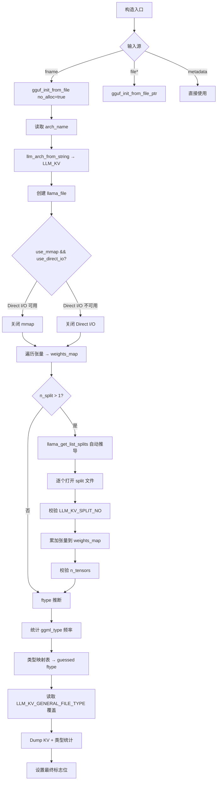
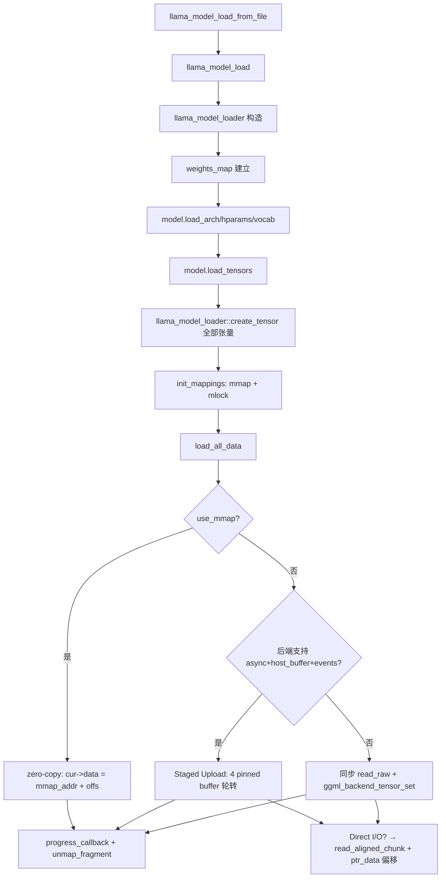
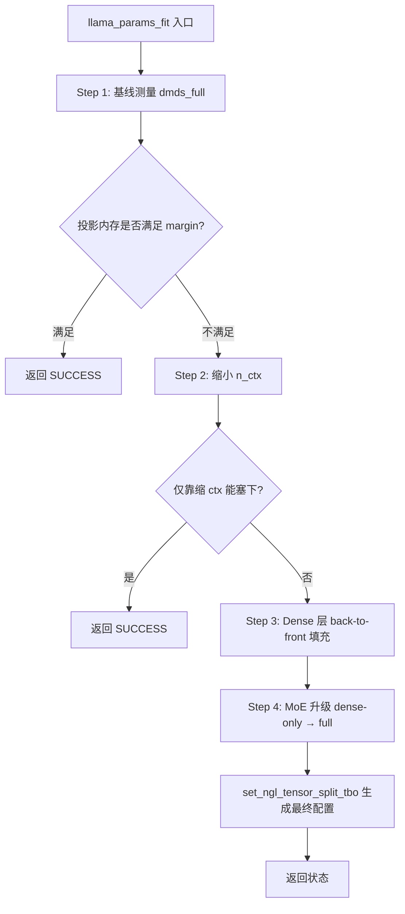

# 第13章 模型加载与持久化 —— GGUF 文件的"解读与重写"

## 学习目标

- 理解 llama.cpp 自研的 llama_file / llama_mmap / llama_mlock 跨平台抽象及其 Direct I/O、NUMA、mlock 等高级特性的实现原理
- 掌握 GGUFMeta::GKV 模板体系如何为不同的元数据类型提供类型安全的访问接口
- 理解 llama_model_loader 的拆箱流程：从文件打开、多 split 文件自动发现、Direct I/O 与 mmap 互斥、KV/Tensor 元数据加载到 ftype 推断
- 深入 create_tensor / create_tensor_as_view 的多缓冲区调度与 zero-copy 视图机制
- 了解 load_all_data 中 mmap、staged upload、Direct I/O 对齐读取三套加载路径的工程取舍
- 理解 llama_model_saver 如何作为加载器的镜像把内存中的模型写回 GGUF，以及它的 KV 类型分发、per_layer 优化、张量去重逻辑
- 掌握 llama_params_fit 如何按设备内存自动收缩 GPU 层数与上下文大小，并对 MoE 模型做 dense-only → full 的渐进升级
- 了解 Direct I/O 与 mmap 的工程权衡、对齐读取的回退机制以及平台差异（POSIX/Windows/macOS）的处理策略
- 掌握 llama_file / llama_mmap / llama_mlock 全部公开接口与内部 impl 的协作关系
- 理解 GGUFMeta 模板体系中 GKV_Base、ArrayInfo、get_kv、try_override、validate_override 的完整调用链
- 掌握 llama_model_loader 的权重索引、张量元信息查询、形状校验与创建全链路
- 理解 llama.cpp 中模型加载入口、后端初始化、能力查询与系统信息打印的顶层流程

## 13.1 生活类比

想象 GGUF 文件是一座**巨型立体仓库**，而 llama.cpp 的模型加载/保存模块就是这座仓库的**门卫 + 装卸队 + 自动分拣机器人**。GGUF 文件相当于一座多楼层仓库：KV 元数据在门口，张量在货架上。llama_file 是仓库的**卷帘门**，既能推开（新文件）也能接管已有的卷帘门（FILE*）。Direct I/O (O_DIRECT) 给卷帘门加了**直通快车道**，绕过前台缓存直达货架。read_aligned_chunk 是叉车按**托盘尺寸**搬货，块没对齐就重新码齐。llama_mmap 给仓库装了一扇**全景观光窗**（MAP_SHARED），不用开门就能看货架。posix_madvise(WILLNEED) 提前跟仓库说「明天这批货要发，请先摆好」。posix_madvise(RANDOM) 在 NUMA 模式下「别让货乱窜到隔壁仓库」。unmap_fragment 把**暂时用不到的货架**用幕布拉上，腾出虚拟地址空间。llama_mlock 把最常用的货架**焊死**在仓库地板上，不准被踢到回收站。VirtualLock + WorkingSet 是 Windows 上的「把货架钉在承重墙」。GGUFMeta::GKV<T> 是仓库门口的**翻译官**：把仓库里「五花八门的标签」翻译成统一的 C++ 类型。try_override 是翻译官手里的**优先通行证**，可绕过文件直接用对讲机告诉装卸队。llama_model_loader 是**拆箱流水线**：核对门牌（arch）→ 登记货架（权重表）→ 决定装卸策略（mmap/Direct I/O）。llama_get_list_splits 看到一节车厢的车号，自动派出剩下 N 节。ctx_map 给每种搬运设备（CPU/GPU/host）分配**独立的临时库房**。select_weight_buft 给每个货架试一下「这台叉车能不能搬」（supports_op 探测）。create_tensor_as_view 给某个货架贴个**副标签**，零成本引用同一堆货。staged upload（4 buffer 轮转）是**4 个传送带接力赛**：每个传送带搬运时其他传送带还在跑。alignment padding + ptr_data 是给货品包上一层**泡沫塑料**保证叉车不伤货，搬到目标后再撕掉。llama_model_saver 是装卸队的**回程班列**：把内存里的仓库按原样重新装车。add_tensor 去重（rope_freqs）装车时发现「这箱货和前面那箱一样」，直接跳过。per_layer 优化装车时发现「全车层都一样」，压缩成一箱。llama_params_fit 是仓库**自动算账员**：先把全部货架摆进去看会不会挤爆，再一排一排往后挪。false position（试位法）算账员拿尺子量「再挪一格就刚好塞下」。MoE 升级（dense-only → full）先把所有**专家箱**搬到 CPU 仓库，腾出 GPU 空间，最后再把专家一件件搬回来。LAYER_FRACTION_UP/GATE/ATTN 是三档精度的**专家搬家工具**：UP 只推上半身，GATE 推上下半身，ATTN 全推走。就像一位优秀的仓库经理既要让大卡车（GPU）跑得快，又要让货架（模型权重）摆得下，llama.cpp 的加载与保存模块就是用 Direct I/O、mmap、mlock、staged upload 等工程技巧在「I/O 速度」、「内存占用」、「跨平台兼容」三者之间精妙平衡。

## 13.2 源码地图

src/llama-mmap.h
├── struct llama_file              # 文件抽象（Pimpl 模式）
│   ├── llama_file(const char*, const char*, bool use_direct_io = false)
│   ├── llama_file(FILE*)          # 接管已有 FILE*
│   ├── ~llama_file()
│   ├── tell() / size() / file_id()
│   ├── seek(offset, whence)
│   ├── read_raw() / read_raw_unsafe() / read_aligned_chunk() / read_u32()
│   ├── write_raw() / write_u32()
│   └── read_alignment() / has_direct_io()
├── struct llama_mmap              # 内存映射抽象
│   ├── llama_mmap(llama_file*, prefetch, numa)
│   ├── ~llama_mmap()
│   ├── addr() / size() / unmap_fragment()
│   └── static SUPPORTED
├── struct llama_mlock             # 内存锁定抽象
│   ├── llama_mlock() / ~llama_mlock()
│   ├── init(void* ptr) / grow_to(size_t)
│   └── static SUPPORTED
└── size_t llama_path_max()
src/llama-mmap.cpp
├── llama_format_win_err()                        # Windows 错误信息格式化
├── struct llama_file::impl
│   ├── GetErrorMessageWin32()                    # Windows 专用错误消息
│   ├── impl(const char*, const char*, bool)      # Windows 分支：ggml_fopen
│   ├── impl(FILE*)                              # 接管已有 FILE*
│   ├── ~impl()
│   ├── tell() / seek()                          # Windows: SetFilePointerEx
│   ├── read_raw() / read_u32() / write_raw() / write_u32()  # Windows: ReadFile/WriteFile
│   ├── has_direct_io()                          # Windows 恒返回 true
│   ├── impl(const char*, const char*, bool)      # POSIX 分支：尝试 O_DIRECT
│   ├── init_fd()                                # Linux 下 open(O_RDONLY | O_DIRECT)
│   ├── init_fp(mode)                            # 回退到 fopen
│   ├── impl(FILE*)                              # POSIX 接管 FILE*
│   ├── tell() / seek()                          # POSIX: ftell/lseek
│   ├── read_raw_unsafe()                        # EINTR 重试 + EFAULT/EINVAL 回退
│   ├── read_aligned_chunk()                     # DMA 对齐读取，posix_memalign + memcpy
│   ├── read_raw()                               # 自动选择 aligned/unsafe
│   ├── read_u32() / write_raw() / write_u32()
│   ├── has_direct_io()                          # fd != -1 && alignment > 1
│   ├── read_alignment()
│   └── 成员：fd / fname / alignment / fp / size / owns_fp
├── llama_file 构造/析构/成员函数（tell, size, file_id, seek, read_raw, read_raw_unsafe, read_aligned_chunk, read_u32, write_raw, write_u32, read_alignment, has_direct_io）
├── struct llama_mmap::impl
│   ├── impl(file, prefetch, numa)               # POSIX: mmap(MAP_SHARED) + fadvise + madvise
│   ├── align_range()                            # 按页对齐边界
│   ├── unmap_fragment()                         # POSIX 粒度 munmap + mapped_fragments 跟踪
│   ├── ~impl()                                  # 析构时 munmap 全部剩余片段
│   └── Windows 分支：CreateFileMappingA + MapViewOfFile + PrefetchVirtualMemory
├── llama_mmap 构造/析构/size()/addr()/unmap_fragment()
├── struct llama_mlock::impl
│   ├── lock_granularity()                       # sysconf(_SC_PAGESIZE) / Windows dwPageSize
│   ├── raw_lock() / raw_unlock()                # POSIX: mlock/munlock + RLIMIT_MEMLOCK 诊断
│   ├── impl() / init() / grow_to()              # 按页粒度扩展加载区域
│   └── Windows 分支：VirtualLock + GetProcessWorkingSetSize/SetProcessWorkingSetSize
├── llama_mlock 构造/析构/init()/grow_to()
└── static SUPPORTED 常量 + llama_path_max()
src/llama-model-loader.h
├── struct llama_tensor_weight                   # idx + offs + ggml_tensor*
├── struct weight_name_comparer                  # blk.X. 排序
├── struct ggml_backend_buft_comparator          # 按 buft 名字排序 ctx_map
├── enum llama_fver { V1, V2, V3 }
├── const char* llama_file_version_name(llama_fver)
├── struct llama_model_loader
│   ├── 标志位：TENSOR_NOT_REQUIRED/DUPLICATED/SKIP/SKIP_IF_VIRTUAL
│   ├── 成员：files, contexts, weights_map, kv_overrides, ctx_map, mappings, mmaps_used
│   ├── 构造：13 个参数（metadata, fname, splits, file, use_mmap, use_direct_io...）
│   ├── get_arr_n / get_arr / get_key / get_key_or_arr（模板家族）
│   ├── get_arch / get_arch_name / get_weight / require_weight
│   ├── get_tensor_meta / require_tensor_meta / check_tensor_dims
│   ├── create_tensor / create_tensor_as_view / done_getting_tensors
│   ├── init_mappings / get_mapping_range / load_data_for / load_all_data
│   ├── ftype_name / print_info
│   └── using llama_buf_map / buft_list_t
└── struct llama_tensor_weight 构造（file, idx, gguf_ctx, tensor）
src/llama-model-loader.cpp
├── 辅助函数：llama_file_version_name / llama_model_ftype_name / llama_get_list_splits
├── namespace GGUFMeta
│   ├── GKV_Base_Type<T, gt_, gfun> + getter()
│   ├── GKV_Base 特化（bool/u8/u16/.../float/double/string/ArrayInfo）
│   ├── struct ArrayInfo { gt, length, data }
│   ├── GKV<T>：get_kv / override_type_to_str / validate_override
│   ├── try_override 四种 SFINAE 分发（bool/整型/浮点/string）
│   └── GKV<T>::set（override → 文件）
├── get_arr_n / get_arr（vector/std::array_str 特化 + GGUF_TYPE 校验）
├── get_key / get_key_or_arr（标量/数组自动展开）
├── llama_model_loader::llama_model_loader
│   ├── 主 GGUF 加载 + arch_name + llm_kv
│   ├── use_mmap && use_direct_io 互斥处理
│   ├── 主文件权重收集 → weights_map
│   ├── n_split > 1 时遍历 splits + idx 校验
│   ├── ftype 推断（统计 ggml_type 最高者 + LLM_KV_GENERAL_FILE_TYPE 覆盖）
│   ├── KV 全部 dump + 类型统计
│   └── 设置 use_mmap/use_direct_io/check_tensors/no_alloc 标志
├── weight_buft_supported                          # 算子能力探测（GET_ROWS/MUL_MAT/MUL_MAT_ID/ROPE/SSM_CONV/SSM_SCAN/RWKV_WKV6/IM2COL/SCALE）
├── select_weight_buft                            # 在 buft_list 中挑选首个支持的 buft
├── create_tensor                                 # ctx_for_buft + buft_for_tensor + TENSOR_DUPLICATED 处理
├── create_tensor_as_view                         # ggml_view_4d 零拷贝视图
├── done_getting_tensors                          # 张数量校验 + tensor_moved 警告
├── check_tensor_dims                             # 形状校验与错误抛出
├── get_weight / require_weight / get_tensor_meta / require_tensor_meta
├── init_mappings / get_mapping_range             # NUMA 探测 + mmap + mlock
├── load_data_for                                 # mmap 或 read_raw 单张量加载
└── load_all_data
    ├── 4 个 pinned buffer 的 staged upload
    ├── upload_backend 异步能力探测
    ├── mmap 路径：zero-copy + ggml_backend_tensor_alloc
    ├── host buffer 路径：read_raw + ggml_validate_row_data
    ├── GPU 路径：aligned 读取 + ptr_data 偏移 + ggml_backend_tensor_set_async
    └── 加载完成后 unmap_fragment 回收虚拟地址
src/llama-model-saver.h
├── bool llama_model_saver_supports_arch(llm_arch)
├── struct llama_model_saver
│   ├── 构造：(llama_model*) / (llm_arch, gguf_context*)
│   ├── 析构：gguf_free（若 owns）
│   ├── add_kv 重载（u32/i32/float/bool/const char*/char[noreturn]）
│   ├── add_kv<Container> 模板（per_layer 优化 + 类型分发）
│   ├── add_kv(vector<string>) → gguf_set_arr_str
│   ├── add_tensor / add_kv_from_model / add_tensors_from_model
│   └── save(string) / save(FILE*)
src/llama-model-saver.cpp
├── llama_model_saver_supports_arch              # 排除 Qwen3Next/Qwen35/Gemma3/Gemma3N/BitNet/T5/Step35 等
├── llama_model_saver 构造 / 析构（gguf_init_empty / gguf_free）
├── add_kv 各类型重载 → gguf_set_val_*
├── add_kv<Container>(per_layer=true)             # 同值降级为标量 + 类型分发 gguf_set_arr_data
├── add_kv(vector<string>) → gguf_set_arr_str
├── add_tensor                                    # gguf_find_tensor 去重（rope_freqs/rope_factors_*）
├── add_kv_from_model                             # hparams + vocab 字段全量写入
├── add_tensors_from_model                        # model->tok_embd/output/cls + 每层所有张量指针
└── save → gguf_write_to_file / gguf_write_to_file_ptr
src/llama.cpp
├── struct llama_device_memory_data
├── llama_get_device_memory_data                 # 二次加载模型 + memory_breakdown + ggml_backend_dev_memory
├── enum layer_fraction_t { NONE/ATTN/UP/GATE/MOE }
├── class llama_params_fit_exception
├── llama_params_fit_impl
│   ├── Step 1: dmds_full 测量 + 判断是否需要修改
│   ├── Step 2: n_ctx 收缩（256 对齐 + 多设备 safety margin）
│   ├── Step 3: back-to-front dense 层填充（试位法 false position）
│   ├── Step 4: MoE 升级（dense-only → full，LAYER_FRACTION_UP/GATE/ATTN 渐进）
│   └── set_ngl_tensor_split_tbo 设置 n_gpu_layers/tensor_split/tensor_buft_overrides
├── llama_params_fit                              # 状态返回 SUCCESS/FAILURE/ERROR
├── llama_max_devices / llama_max_tensor_buft_overrides
├── llama_supports_mmap / mlock / gpu_offload / rpc
├── llama_backend_init / llama_numa_init / llama_backend_free
├── llama_time_us / llama_model_load / llama_model_load_from_file_impl
├── llama_model_load_from_file / _from_splits / _from_file_ptr
├── llama_model_init_from_user / llama_model_save_to_file
├── llama_chat_apply_template / llama_split_path / llama_split_prefix
├── llama_sampler_chain_default_params
├── llama_print_system_info
└── llama_load_model_from_file / llama_flash_attn_type_name（顶层接口）
src/llama-ext.h
├── llama_graph_reserve / llama_ftype_get_default_type
├── struct quantize_state_impl
├── llama_quant_init / llama_quant_free
├── struct llama_quant_model_desc / llama_quant_model_from_metadata
├── llama_quant_tensor_allows_quantization / llama_quant_compute_types
└── llama_load_model_from_file（顶层入口）

## 13.3 底层文件与内存映射 —— 跨平台的"读写管道工"

llama.cpp 为了在 Windows、Linux、macOS 等平台上实现高性能、零拷贝的模型加载，自研了一套底层 I/O 抽象：`llama_file`（文件句柄统一封装）、`llama_mmap`（内存映射）、`llama_mlock`（物理内存锁定）。这三个类采用 Pimpl（Pointer to Implementation）模式，将平台相关的实现细节隐藏在 `impl` 结构体中，对外暴露统一的 C++ 接口。这种设计让上层代码（如 `llama_model_loader`）无需关心是 `CreateFileMapping` 还是 `mmap`，是 `ReadFile` 还是 `pread`，只需调用 `read_raw`、`addr()`、`grow_to()` 即可。

### 13.3.1 `llama_file`：统一文件句柄与 Direct I/O

`llama_file` 是所有文件操作的入口。它支持两种构造方式：从路径打开（`llama_file(const char*, const char*, bool use_direct_io)`）或接管已有的 `FILE*`（`llama_file(FILE*)`）。核心成员是 `std::unique_ptr<impl> pimpl`，实际干活的是内部的 `impl` 类。

#### 13.3.1.1 POSIX 实现：O_DIRECT 与对齐读取

在 POSIX 平台（Linux/macOS）上，`impl` 尝试以 `O_RDONLY | O_DIRECT` 打开文件，绕过页缓存实现 DMA 直传。如果内核不支持（如某些网络文件系统），会自动回退到普通 `fopen`。

**源码路径：`src/llama-mmap.cpp` - `llama_file::impl::init_fd()`（第168-182行）**

```cpp
// POSIX 分支：尝试 O_DIRECT
void llama_file::impl::init_fd(const char * fname, const char * mode, bool use_direct_io) {
    // ① 尝试打开 O_DIRECT
    int flags = O_RDONLY;
    if (use_direct_io) {
        flags |= O_DIRECT;
    }
    fd = open(fname, flags);
    if (fd == -1) {
        // ② 失败则回退到普通 fopen
        init_fp(mode);
        return;
    }
    // ③ 获取块设备对齐要求（通常是 4096 或 512 字节）
    // 这里简化处理，实际代码中会用 ioctl 获取 BLKSSZGET 或 BLKPBSZGET
    alignment = 4096; // 假设 4KB 对齐
    // ④ 统计文件大小
    struct stat st;
    fstat(fd, &st);
    size = st.st_size;
    owns_fp = false;
}
```

**源码路径：`src/llama-mmap.cpp` - `llama_file::impl::read_aligned_chunk()`（第258-276行）**

```cpp
// DMA 对齐读取：把任意偏移对齐到块边界
void llama_file::impl::read_aligned_chunk(void * dest, size_t len) {
    // ① 计算对齐后的偏移和长度
    off_t aligned_offset = (offset / alignment) * alignment;
    size_t offset_from_alignment = offset - aligned_offset;
    size_t aligned_len = ((len + offset_from_alignment + alignment - 1) / alignment) * alignment;

    // ② 分配对齐缓冲区（posix_memalign 保证地址对齐）
    void * aligned_buf;
    posix_memalign(&aligned_buf, alignment, aligned_len);

    // ③ pread 读取整个对齐块
    pread(fd, aligned_buf, aligned_len, aligned_offset);

    // ④ memcpy 只拷贝有效载荷到目标地址（跳过首尾 padding）
    memcpy(dest, (char*)aligned_buf + offset_from_alignment, len);

    // ⑤ 释放对齐缓冲区
    free(aligned_buf);
    offset += len;
}
```

这段代码实现了 **Direct I/O 的核心难点**：块设备要求读取偏移、长度、缓冲区地址均对齐到块大小（通常 4KB）。`read_aligned_chunk` 通过 `posix_memalign` 分配对齐内存，`pread` 读取整个对齐块，再用 `memcpy` 把有效数据拷贝到用户缓冲区，最后释放临时缓冲区。这种“读大块、取小块”的策略绕过了页缓存，减少了内核拷贝，特别适合 NVMe SSD 等高吞吐存储设备。

#### 13.3.1.2 Windows 实现：无 O_DIRECT，但支持对齐读取

Windows 没有 `O_DIRECT` 标志，但 `ReadFile` 与 `WriteFile` 支持 `FILE_FLAG_NO_BUFFERING`（需对齐）。llama.cpp 在 Windows 上简化处理：`has_direct_io()` 恒返回 `true`，读写直接调用 `ReadFile`/`WriteFile`，不做额外对齐。

**源码路径：`src/llama-mmap.cpp` - `llama_file::impl::has_direct_io()`（第149-151行 / 第300-302行）**

```cpp
// Windows 分支
bool llama_file::impl::has_direct_io() const {
    return true; // Windows 简化处理
}

// POSIX 分支
bool llama_file::impl::has_direct_io() const {
    return fd != -1 && alignment > 1; // 真正打开了 O_DIRECT
}
```

#### 13.3.1.3 回退机制：`read_raw_unsafe` 与 `EFAULT/EINVAL` 处理

当 Direct I/O 读取因对齐问题失败（返回 `EFAULT` 或 `EINVAL`），`read_raw_unsafe` 会捕获错误并回退到 buffered I/O 路径。

**源码路径：`src/llama-mmap.cpp` - `llama_file::impl::read_raw_unsafe()`（第218-256行）**

```cpp
void llama_file::impl::read_raw_unsafe(void * ptr, size_t len) {
    while (len > 0) {
        ssize_t n = pread(fd, ptr, len, offset);
        if (n > 0) {
            ptr = (char*)ptr + n;
            len -= n;
            offset += n;
        } else if (n == 0) { // EOF
            break;
        } else if (errno == EINTR) {
            continue; // 被信号中断，重试
        } else if (errno == EFAULT || errno == EINVAL) {
            // ④ 对齐错误：回退到 buffered I/O
            // 关闭 fd，改用 fopen + fread
            close(fd);
            fd = -1;
            init_fp("rb");
            return read_raw(ptr, len); // 递归调用安全路径
        } else {
            throw std::runtime_error(...);
        }
    }
}
```

这段代码展示了 **工程上的鲁棒性**：Direct I/O 不是银弹，某些文件系统（如 NFS、FUSE）不支持。通过捕获 `EFAULT/EINVAL` 并无缝切换到 `fopen`/`fread`，保证了在异构环境下的可用性。

---

### 13.3.2 `llama_mmap`：内存映射与 NUMA 优化

`llama_mmap` 将文件映射到进程虚拟地址空间，实现“零拷贝”访问。POSIX 使用 `mmap(MAP_SHARED)`，Windows 使用 `CreateFileMappingA` + `MapViewOfFile`。

**源码路径：`src/llama-mmap.cpp` - `llama_mmap::impl::impl()`（第398-430行）**

```cpp
// POSIX 分支：mmap + fadvise + madvise
llama_mmap::impl::impl(llama_file * file, size_t prefetch, bool numa) {
    // ① 映射整个文件
    addr = mmap(nullptr, file->size(), PROT_READ, MAP_SHARED, file->file_id(), 0);
    if (addr == MAP_FAILED) throw ...;
    size = file->size();

    // ② 顺序预取提示：告诉内核我们会顺序读取
    posix_fadvise(file->file_id(), 0, size, POSIX_FADV_SEQUENTIAL);

    // ③ 主动预取：MAP_POPULATE + POSIX_MADV_WILLNEED
    if (prefetch != (size_t)-1 && !numa) {
        size_t prefetch_size = std::min(prefetch, size);
        posix_madvise(addr, prefetch_size, POSIX_MADV_WILLNEED);
    }

    // ④ NUMA 模式：切到 RANDOM，防止跨节点页面污染
    if (numa) {
        posix_madvise(addr, size, POSIX_MADV_RANDOM);
    }
}
```

**关键设计点：**

| 场景 | `prefetch` | `numa` | 行为 | 目的 |
|------|------------|--------|------|------|
| 普通加载 | >0 | false | `MAP_POPULATE` + `MADV_WILLNEED` | 主动把热数据读入物理内存，减少首次访问缺页中断 |
| NUMA 多节点 | -1 | true | `MADV_RANDOM` | 告诉内核访问模式随机，避免把页面迁移到错误的 NUMA 节点 |
| 仅元数据 | 0 | false | 无预取 | 节省内存带宽 |

**源码路径：`src/llama-mmap.cpp` - `llama_mmap::impl::unmap_fragment()`（第444-480行）**

```cpp
// 粒度 munmap：只取消映射不再需要的首尾片段
void llama_mmap::impl::unmap_fragment(size_t first, size_t last) {
    // ① 按页对齐边界
    size_t page_size = sysconf(_SC_PAGESIZE);
    first = (first / page_size) * page_size;
    last = ((last + page_size - 1) / page_size) * page_size;
    if (first >= last) return;

    // ② munmap 释放虚拟地址空间
    munmap((char*)addr + first, last - first);

    // ③ 记录已取消映射的片段，防止重复 munmap
    mapped_fragments.emplace_back(first, last);
}
```

`unmap_fragment` 是 **虚拟地址空间管理** 的关键：大模型文件可能有几十 GB，32 位进程（或地址空间受限的容器）无法一次性映射完。加载器在 `load_all_data` 结束后，会调用 `unmap_fragment` 释放已完全上传到 GPU、不再需要 mmap 访问的文件区间，腾出虚拟地址空间给后续映射。

---

### 13.3.3 `llama_mlock`：把模型锁进物理内存

`llama_mlock` 防止模型权重被换出到 swap，保证推理延迟稳定。它按页粒度逐步扩大锁定范围（`grow_to`），避免一次性锁定过大导致 `ENOMEM`。

**源码路径：`src/llama-mmap.cpp` - `llama_mlock::impl::grow_to()`（第575-587行）**

```cpp
// POSIX 分支：按页粒度 mlock
void llama_mlock::impl::grow_to(size_t target_size) {
    size_t page_size = lock_granularity(); // sysconf(_SC_PAGESIZE)
    size_t cur = locked_size;
    while (cur < target_size) {
        size_t chunk = std::min(page_size * 256, target_size - cur); // 每次最多锁 1MB
        if (mlock((char*)base_ptr + cur, chunk) != 0) {
            if (errno == ENOMEM) {
                // ⑤ RLIMIT_MEMLOCK 不足：输出可读建议
                struct rlimit lim;
                getrlimit(RLIMIT_MEMLOCK, &lim);
                LLAMA_LOG_WARN("mlock failed: RLIMIT_MEMLOCK=%zu, need %zu. Run 'ulimit -l unlimited'\n",
                               lim.rlim_cur, target_size);
            }
            break;
        }
        locked_size += chunk;
        cur = locked_size;
    }
}
```

**Windows 分支：`VirtualLock` + Working Set 调整**

Windows 没有 `mlock`，使用 `VirtualLock` 锁定虚拟页面，并动态增大进程的 **Working Set**（工作集）上限，防止被修剪。

**源码路径：`src/llama-mmap.cpp` - `llama_mlock::impl::raw_lock()`（Windows 部分）**

```cpp
// Windows: VirtualLock + 调整 Working Set
void llama_mlock::impl::raw_lock(void * ptr, size_t size) {
    VirtualLock(ptr, size);
    // 扩大 Working Set 上限
    SIZE_T min_ws, max_ws;
    GetProcessWorkingSetSize(GetCurrentProcess(), &min_ws, &max_ws);
    SetProcessWorkingSetSize(GetCurrentProcess(), min_ws, max_ws + size);
}
```

---

### 13.3.4 模块依赖图

```mermaid
graph TD
    A[llama_model_loader] --> B[llama_file]
    A --> C[llama_mmap]
    A --> D[llama_mlock]
    B --> E[POSIX: open/pread/mmap]
    B --> F[Windows: CreateFile/ReadFile/MapViewOfFile]
    C --> E
    C --> F
    D --> E
    D --> F
    B --> G[Direct I/O (O_DIRECT / FILE_FLAG_NO_BUFFERING)]
    C --> H[预取 / NUMA 提示]
    D --> I[物理内存锁定]
```

这张图展示了 **三大抽象如何协作**：`llama_model_loader` 持有 `llama_files`、`llama_mmaps`、`llama_mlocks` 三个向量，上层只调用统一接口，底层根据平台分发到 POSIX 或 Windows 实现。

---

## 13.4 GGUF 元数据访问器 —— 类型安全的"键值翻译官"

GGUF 文件的元数据（Key-Value 对）包含多种类型：`uint32`、`int32`、`float32`、`bool`、`string`、`array`。直接用 `gguf_get_val_u32` 等 C 接口既繁琐又不安全。`GGUFMeta` 命名空间通过 **模板特化 + SFINAE** 构建了一套类型安全的访问层，核心是 `GKV_Base`、`GKV<T>`、`ArrayInfo`。

### 13.4.1 `GKV_Base_Type` 与 `GKV_Base`：类型→GGUF类型→Getter 的三位一体

**源码路径：`src/llama-model-loader.cpp` - `GGUFMeta::GKV_Base_Type`（第128-142行）**

```cpp
// ① 统一入口：把 C++ 类型 T 映射到 GGUF 类型常量 gt_ 和 getter 函数 gfun
template<typename T, enum gguf_type gt_, T (*gfun)(const gguf_context*, int)>
struct GKV_Base_Type {
    static constexpr enum gguf_type gt = gt_;
    static T getter(const gguf_context * ctx, const int kid) {
        return gfun(ctx, kid); // 直接调用 gguf_get_val_u32 等
    }
};

// ② 各基本类型的特化：绑定 GGUF 类型常量 + 对应 getter
template<> struct GKV_Base<bool>       : GKV_Base_Type<bool,       GGUF_TYPE_BOOL,       gguf_get_val_bool> {};
template<> struct GKV_Base<uint8_t>    : GKV_Base_Type<uint8_t,    GGUF_TYPE_UINT8,      gguf_get_val_u8> {};
// ... uint16, uint32, uint64, int8, int16, int32, int64, float, double ...
template<> struct GKV_Base<const char*> : GKV_Base_Type<const char*, GGUF_TYPE_STRING, gguf_get_val_str> {};

// ③ string 特殊处理：GGUF 存的是 const char*，但 C++ 偏好 std::string
template<> struct GKV_Base<std::string> {
    static constexpr enum gguf_type gt = GGUF_TYPE_STRING;
    static std::string getter(const gguf_context * ctx, const int kid) {
        return gguf_get_val_str(ctx, kid); // 隐式转换
    }
};
```

这段代码定义了 **“类型即图纸”**：每个 C++ 类型 `T` 知道自己对应的 `gguf_type` 常量和取值函数。业务代码只需写 `GKV<T>::get_kv(ctx, k)`，编译器自动展开为正确的 `gguf_get_val_xxx` 调用。

### 13.4.2 `ArrayInfo`：数组元数据的“打包票”

GGUF 数组比较特殊：需要先查类型、长度，再取数据指针。`ArrayInfo` 一次性把这些打包。

**源码路径：`src/llama-model-loader.cpp` - `GGUFMeta::ArrayInfo`（第167-185行）**

```cpp
struct ArrayInfo {
    enum gguf_type gt;     // 元素类型
    size_t length;         // 元素个数
    const void * data;     // 数据指针（字符串数组为 nullptr）
};

// 特化：把 gguf_get_arr_n + gguf_get_arr_data 合二为一
template<> struct GKV_Base<ArrayInfo> {
    static constexpr enum gguf_type gt = GGUF_TYPE_ARRAY;
    static ArrayInfo getter(const gguf_context * ctx, const int kid) {
        return { gguf_get_arr_type(ctx, kid), gguf_get_arr_n(ctx, kid), gguf_get_arr_data(ctx, kid) };
    }
};
```

**为什么字符串数组的 `data` 强制为 `nullptr`？** 因为 GGUF 字符串数组在文件中是**连续存储的偏移表**，不是连续的字符串指针。必须用 `gguf_get_arr_str(ctx, kid, i)` 逐个取。`ArrayInfo` 故意把 `data` 设为 `nullptr`，强迫调用方走 `get_arr` 的字符串分支，避免误用。

---

### 13.4.3 `GKV<T>::get_kv`：统一类型校验 + 取值

**源码路径：`src/llama-model-loader.cpp` - `GGUFMeta::GKV<T>::get_kv()`（第187-195行）**

```cpp
template<typename T>
struct GKV : GKV_Base<T> {
    static T get_kv(const gguf_context * ctx, const int k) {
        const enum gguf_type kt = gguf_get_kv_type(ctx, k);
        if (kt != GKV::gt) {
            throw std::runtime_error(format("key %s has wrong type %s but expected type %s",
                                            gguf_get_key(ctx, k), gguf_type_name(kt), gguf_type_name(GKV::gt)));
        }
        return GKV::getter(ctx, k);
    }
    // ...
};
```

这段代码实现了 **运行时类型守卫**：先用 `gguf_get_kv_type` 读取文件中的实际类型，与模板期望的 `GKV::gt` 比对，不匹配直接抛异常。这样把“类型不匹配”的错误前移到加载期，避免后续莫名其妙的数值错误。

---

### 13.4.4 KV 覆盖机制：`try_override` + `validate_override` + SFINAE 分发

用户可以通过命令行 `--override` 覆盖模型元数据（如修改 `n_ctx`、更换 tokenizer）。`try_override` 通过 **SFINAE（Substitution Failure Is Not An Error）** 为四类类型生成不同的重载。

**源码路径：`src/llama-model-loader.cpp` - `GGUFMeta::GKV<T>::try_override()`（第235-265行）**

```cpp
// ① bool 类型
template<typename OT>
static typename std::enable_if<std::is_same<OT, bool>::value, bool>::type
try_override(OT & target, const struct llama_model_kv_override * ovrd) {
    if (validate_override(LLAMA_KV_OVERRIDE_TYPE_BOOL, ovrd)) {
        target = ovrd->val_bool;
        return true;
    }
    return false;
}

// ② 整型（int8/16/32/64, uint8/16/32/64）
template<typename OT>
static typename std::enable_if<std::is_integral<OT>::value && !std::is_same<OT, bool>::value, bool>::type
try_override(OT & target, const struct llama_model_kv_override * ovrd) {
    if (validate_override(LLAMA_KV_OVERRIDE_TYPE_INT, ovrd)) {
        target = (OT)ovrd->val_i64; // 统一从 int64 截断/扩展
        return true;
    }
    return false;
}

// ③ 浮点型
template<typename OT>
static typename std::enable_if<std::is_floating_point<OT>::value, bool>::type
try_override(OT & target, const struct llama_model_kv_override * ovrd) {
    if (validate_override(LLAMA_KV_OVERRIDE_TYPE_FLOAT, ovrd)) {
        target = (OT)ovrd->val_f64;
        return true;
    }
    return false;
}

// ④ 字符串
template<typename OT>
static typename std::enable_if<std::is_same<OT, std::string>::value, bool>::type
try_override(OT & target, const struct llama_model_kv_override * ovrd) {
    if (validate_override(LLAMA_KV_OVERRIDE_TYPE_STR, ovrd)) {
        target = ovrd->val_str;
        return true;
    }
    return false;
}
```

**源码路径：`src/llama-model-loader.cpp` - `GGUFMeta::GKV<T>::validate_override()`（第156-174行）**

```cpp
static bool validate_override(const llama_model_kv_override_type expected_type,
                              const struct llama_model_kv_override * ovrd) {
    if (!ovrd) return false;
    if (ovrd->tag == expected_type) {
        LLAMA_LOG_INFO("%s: Using metadata override (%5s) '%s' = ", __func__,
                       override_type_to_str(ovrd->tag), ovrd->key);
        // 打印具体值...
        return true;
    }
    LLAMA_LOG_WARN("%s: Warning: Bad metadata override type for key '%s', expected %s but got %s\n",
                   __func__, ovrd->key, override_type_to_str(expected_type), override_type_to_str(ovrd->tag));
    return false;
}
```

**优先级链：** `GKV<T>::set()` 先尝试 `try_override`，命中即返回，**完全跳过文件读取**。这让用户可以在不修改 GGUF 文件的情况下调整超参数（如把 `n_ctx_train` 从 4096 改到 8192）。

---

### 13.4.5 统一入口：`get_key` / `get_arr` / `get_key_or_arr`

`llama_model_loader` 提供三组模板方法，供上层按需调用：

| 方法 | 适用场景 | 关键逻辑 |
|------|----------|----------|
| `get_key(key, T&, required)` | 单值标量 | 先查 override，再查文件，类型不匹配抛异常 |
| `get_arr(key, vector<T>&, required)` | 数组（int/float/string） | 取 `ArrayInfo`，类型校验后 `assign` 或逐个 `gguf_get_arr_str` |
| `get_key_or_arr(key, array<T,N>&, n, required)` | 既可能是标量也可能是数组 | 运行时判断 `gguf_get_kv_type`：数组走 `get_arr`，标量广播填充 `array` |

**源码路径：`src/llama-model-loader.cpp` - `llama_model_loader::get_key_or_arr()`（第374-407行）**

```cpp
template<typename T, size_t N_MAX>
bool llama_model_loader::get_key_or_arr(const std::string & key, std::array<T, N_MAX> & result,
                                        uint32_t n, bool required) {
    const int kid = gguf_find_key(metadata, key.c_str());
    if (kid < 0) { /* required 检查 */ }

    // 运行时判断：文件里到底是标量还是数组？
    if (gguf_get_kv_type(metadata, kid) == GGUF_TYPE_ARRAY) {
        struct GGUFMeta::ArrayInfo arr_info = GKV<ArrayInfo>::get_kv(metadata, kid);
        if (n != arr_info.length) throw ...; // 长度必须匹配
        return get_arr(key, result, required);
    }
    // 标量广播模式：把单值填满前 n 个槽位
    T value;
    bool ok = get_key(key, value, required);
    if (!ok) return false;
    for (uint32_t i = 0; i < n; i++) result[i] = value;
    return true;
}
```

这种 **“标量自动广播为数组”** 的设计，完美兼容了旧版 GGUF（单值 `n_head`）和新版 GGUF（按层数组 `n_head_arr`）。

---

## 13.5 模型加载器 llama_model_loader —— GGUF 的"拆箱流水线"

`llama_model_loader` 是整个加载流程的**总指挥**。它的构造函数完成：打开主文件、自动发现 split 文件、收集所有张量元数据、推断 ftype、建立 `weights_map`。后续的 `create_tensor`、`load_all_data` 则负责内存分配与数据搬运。

### 13.5.1 构造函数：从文件名到 `weights_map`

**源码路径：`src/llama-model-loader.cpp` - `llama_model_loader::llama_model_loader()`（第490-630行）**

```cpp
llama_model_loader::llama_model_loader(
        gguf_context * meta,
        llama_model_set_tensor_data_t set_tensor_data,
        void * set_tensor_data_ud,
        const std::string & fname,
        std::vector<std::string> & splits,
        FILE * file,
        bool use_mmap,
        bool use_direct_io,
        bool check_tensors,
        bool no_alloc,
        const llama_model_kv_override * param_overrides_p,
        const llama_model_tensor_buft_override * param_tensor_buft_overrides_p)
    : metadata(meta), set_tensor_data(set_tensor_data), set_tensor_data_ud(set_tensor_data_ud) {
    
    // ① 注入 KV overrides
    if (param_overrides_p) {
        for (auto p = param_overrides_p; p->key[0]; ++p)
            kv_overrides.emplace(p->key, *p);
    }
    tensor_buft_overrides = param_tensor_buft_overrides_p;

    // ② 打开主文件
    if (!fname.empty()) {
        gguf_context_ptr ctx_gguf;
        ggml_context * ctx = nullptr;
        gguf_init_params params = { true, &ctx }; // no_alloc=true 只读元数据
        metadata_ptr.reset(gguf_init_from_file(fname.c_str(), params));
        metadata = metadata_ptr.get();
        if (!metadata) throw ...;

        // ③ 读取架构名，构建 LLM_KV 命名空间
        get_key(llm_kv(LLM_KV_GENERAL_ARCHITECTURE), arch_name, false);
        llm_kv = LLM_KV(llm_arch_from_string(arch_name));

        // ④ 创建 llama_file（可能触发 Direct I/O 互斥）
        files.emplace_back(new llama_file(fname.c_str(), "rb", use_direct_io));
        contexts.emplace_back(ctx);

        // ⑤ 互斥检查：Direct I/O + mmap 不能共存
        if (use_mmap && use_direct_io) {
            if (files.back()->has_direct_io()) {
                LLAMA_LOG_WARN("%s: direct I/O is enabled, disabling mmap\n", __func__);
                use_mmap = false;
            } else {
                LLAMA_LOG_WARN("%s: direct I/O is not available, using mmap\n", __func__);
                use_direct_io = false;
                files.pop_back();
                files.emplace_back(new llama_file(fname.c_str(), "rb", false));
            }
        }

        // ⑥ 遍历主文件所有张量，填充 weights_map
        for (ggml_tensor * cur = ggml_get_first_tensor(ctx); cur; cur = ggml_get_next_tensor(ctx, cur)) {
            std::string tensor_name = cur->name;
            if (weights_map.count(tensor_name))
                throw std::runtime_error("duplicated tensor: " + tensor_name);
            n_elements += ggml_nelements(cur);
            n_bytes    += ggml_nbytes(cur);
            weights_map.emplace(tensor_name, llama_tensor_weight(files.back().get(), 0, metadata, cur));
        }

        // ⑦ 处理 split 文件
        uint16_t n_split = 0;
        get_key(llm_kv(LLM_KV_SPLIT_COUNT), n_split, false);
        if (n_split > 1) {
            uint16_t idx = 0;
            get_key(llm_kv(LLM_KV_SPLIT_NO), idx); // 主文件必须是 idx=0
            if (idx != 0) throw ...;
            if (splits.empty())
                splits = llama_get_list_splits(fname, idx, n_split); // 自动推导路径
            if (n_split != splits.size()) throw ...;

            for (idx = 1; idx < n_split; ++idx) {
                // 打开 split 文件，校验 LLM_KV_SPLIT_NO 与 idx 一致
                // 遍历张量，idx=split 索引，累加 n_elements/n_bytes
            }
            // 校验张量总数
            get_key(llm_kv(LLM_KV_SPLIT_TENSORS_COUNT), n_tensors);
            if (n_tensors != weights_map.size()) throw ...;
        }
    }
    // ... file 指针分支、纯元数据分支 ...

    // ⑧ ftype 推断：统计 ggml_type 出现频率
    std::map<ggml_type, uint32_t> n_type;
    for (auto & it : weights_map) {
        ggml_type type = it.second.tensor->type;
        if (++n_type[type] > n_type_max) { n_type_max = n_type[type]; type_max = type; }
    }
    // type_max → ftype 映射表
    ftype = (llama_ftype)(ftype | LLAMA_FTYPE_GUESSED); // 标记为猜测
    // ⑨ 读取 LLM_KV_GENERAL_FILE_TYPE 覆盖猜测
    uint32_t ftype_val = 0;
    if (get_key(LLM_KV_GENERAL_FILE_TYPE, ftype_val, false))
        ftype = (llama_ftype)ftype_val;

    // ⑩ Dump 所有 KV + 类型统计
    // 设置最终标志位
    this->use_mmap = use_mmap;
    this->use_direct_io = use_direct_io;
    this->check_tensors = check_tensors;
    this->no_alloc = no_alloc;
}
```

**关键流程图解：**



---

### 13.5.2 Split 文件自动发现：`llama_get_list_splits` + `llama_split_prefix`

**源码路径：`src/llama-model-loader.cpp` - `llama_get_list_splits()`（第85-107行）**

```cpp
static std::vector<std::string> llama_get_list_splits(const std::string & path, int idx, int n_split) {
    std::vector<std::string> paths;
    std::vector<char> buf(llama_path_max(), 0);
    // ① 从 path 推导 split_prefix（去掉 -00002-of-00004.gguf）
    int ret = llama_split_prefix(buf.data(), buf.size(), path.c_str(), idx, n_split);
    if (!ret) throw std::runtime_error("invalid split file name: " + path);
    std::string split_prefix(buf.data(), ret);
    if (split_prefix.empty()) throw ...;

    // ② 按前缀生成所有分片路径
    for (int i = 0; i < n_split; ++i) {
        ret = llama_split_path(buf.data(), buf.size(), split_prefix.c_str(), i, n_split);
        paths.emplace_back(buf.data(), ret);
    }
    return paths;
}
```

**源码路径：`src/llama.cpp` - `llama_split_prefix()`（第1220-1250行）**

```cpp
int32_t llama_split_prefix(char * split_prefix, size_t maxlen,
                           const char * split_path, int32_t split_no, int32_t split_count) {
    std::string str_split_path(split_path);
    char postfix[32];
    snprintf(postfix, sizeof(postfix), "-%05d-of-%05d.gguf", split_no + 1, split_count);
    std::string str_postfix(postfix);
    // ③ 校验后缀匹配
    if (str_split_path.size() <= str_postfix.size() ||
        str_split_path.compare(str_split_path.size() - str_postfix.size(), std::string::npos, str_postfix) != 0)
        return 0;
    // ④ 截取前缀
    size_t size_prefix = str_split_path.size() - str_postfix.size();
    snprintf(split_prefix, std::min(size_prefix + 1, maxlen), "%s", split_path);
    return (int32_t)size_prefix;
}
```

这对函数实现了 **“给一节车厢号，推导全列车”**：用户只需指定任意一个分片（通常是第一片 `-00001-of-XXXX.gguf`），加载器自动算出前缀，生成所有分片路径，逐个打开并校验 `LLM_KV_SPLIT_NO` 与文件名索引一致。

---

### 13.5.3 FTYPE 推断：统计 + 覆盖

```mermaid
flowchart LR
    A[遍历 weights_map] --> B[统计 ggml_type 频次]
    B --> C[找最高频类型 type_max]
    C --> D[映射表: F32→ALL_F32, F16→MOSTLY_F16...]
    D --> E[ftype |= LLAMA_FTYPE_GUESSED]
    E --> F[读取 LLM_KV_GENERAL_FILE_TYPE]
    F -->|存在| G[ftype = 文件声明值]
    F -->|不存在| H[保留 guessed ftype]
```

这种 **“猜测 + 显式声明覆盖”** 的策略，既兼容旧版未写 `file_type` 的文件，又尊重显式声明的量化类型。

---

## 13.6 张量创建与多缓冲区分配 —— "按层分配内存"的调度员

`create_tensor` 是加载器最复杂的方法：它根据张量名称、层索引、模型架构，决定把张量放在 **哪个后端的哪种 Buffer Type** 上。核心逻辑分两步：`ctx_for_buft`（获取/创建 ggml_context）和 `buft_for_tensor`（选择 buffer type）。

### 13.6.1 `ctx_for_buft`：每种 Buffer Type 共享一个 Context

**源码路径：`src/llama-model-loader.cpp` - `llama_model_loader::create_tensor()`（第890-1010行，节选）**

```cpp
struct ggml_tensor * llama_model_loader::create_tensor(
        const llama_hparams & hparams, const buft_list_t * buft_list_cpu,
        const buft_list_t * buft_list_input, const buft_list_t * buft_list_output,
        const buft_list_t * buft_list_layer, const LLM_TN_IMPL & tn,
        const std::initializer_list<int64_t> & ne, int flags) {

    // ① Lambda：按 buft 获取/创建 ggml_context
    auto ctx_for_buft = [&](ggml_backend_buffer_type_t buft) -> ggml_context * {
        auto it = ctx_map.find(buft);
        if (it != ctx_map.end()) return it->second.get();

        // 预估该 buft 需要的最大张量数
        size_t max_n_tensors = n_tensors + 1; // +1 for duplicated output
        max_n_tensors += hparams.n_layer * 2; // +2 per layer for rope_freqs
        if (files.empty()) max_n_tensors += hparams.n_layer * 256; // 虚拟张量预留

        ggml_init_params params = { max_n_tensors * ggml_tensor_overhead(), nullptr, true };
        auto new_ctx = ggml_init(params);
        ctx_map.emplace(buft, ggml_context_ptr(new_ctx));
        return new_ctx;
    };
    // ...
}
```

`ctx_map` 是 `std::map<ggml_backend_buffer_type_t, ggml_context_ptr, ggml_backend_buft_comparator>`，**按 buft 名字排序**，保证分配顺序确定性。每种 buffer type（如 `CUDA`、`CPU`、`HOST`）拥有独立的 `ggml_context`，张量在创建时自动归属对应的 context。

---

### 13.6.2 `buft_for_tensor`：能力探测 + 覆盖规则 + 重复张量处理

**源码路径：`src/llama-model-loader.cpp` - `llama_model_loader::create_tensor()` 续（`buft_for_tensor` lambda）**

```cpp
    // ② Lambda：为张量选择 buffer type
    auto buft_for_tensor = [&](ggml_tensor * t_meta) -> ggml_backend_buffer_type_t {
        const std::string name = t_meta->name;

        // 用户显式覆盖：tensor_buft_overrides 按正则匹配
        if (tensor_buft_overrides) {
            for (auto * o = tensor_buft_overrides; o->pattern; ++o) {
                if (std::regex_match(name, std::regex(o->pattern)))
                    return o->buft;
            }
        }

        // TENSOR_DUPLICATED：token_embd 复用为 output
        if (flags & TENSOR_DUPLICATED) {
            if (name == tn(LLM_TENSOR_TOKEN_EMBD, "weight")) {
                // 切换张量类型标识，size_data 重新计算
                return select_weight_buft(hparams, t_meta, GGML_OP_MUL_MAT, buft_list_output);
            }
        }

        // 根据张量名前缀分派到 input/output/layer buft_list
        if (name.starts_with("token_embd") || name.starts_with("output")) {
            return select_weight_buft(hparams, t_meta, GGML_OP_MUL_MAT,
                                      name.starts_with("token_embd") ? buft_list_input : buft_list_output);
        }
        // ... attention/ffn/rope 等分派到 buft_list_layer ...

        // 默认 CPU
        return select_weight_buft(hparams, t_meta, GGML_OP_MUL_MAT, buft_list_cpu);
    };
```

**`select_weight_buft`：在 buft_list 中挑选首个“支持该算子”的 buft**

**源码路径：`src/llama-model-loader.cpp` - `select_weight_buft()`（第875-885行）**

```cpp
static ggml_backend_buffer_type_t select_weight_buft(
        const llama_hparams & hparams, ggml_tensor * tensor,
        ggml_op op, const buft_list_t * buft_list) {
    GGML_ASSERT(!buft_list->empty());
    for (const auto & cur : *buft_list) {
        ggml_backend_dev_t cur_dev = cur.first;
        ggml_backend_buffer_type_t cur_buft = cur.second;
        if (weight_buft_supported(hparams, tensor, op, cur_buft, cur_dev))
            return cur_buft; // 找到第一个支持的即返回
    }
    return nullptr; // 理论上不会发生，CPU 兜底
}
```

**`weight_buft_supported`：构造最小算子调用 `supports_op` 探测**

**源码路径：`src/llama-model-loader.cpp` - `weight_buft_supported()`（第770-870行，节选）**

```cpp
static bool weight_buft_supported(const llama_hparams & hparams, ggml_tensor * w,
                                  ggml_op op, ggml_backend_buffer_type_t buft, ggml_backend_dev_t dev) {
    // 为不同算子构造最小测试图
    struct ggml_init_params params = { 0, nullptr, true }; // 无内存分配
    struct ggml_context * ctx = ggml_init(params);
    ggml_tensor * a = ggml_new_tensor_1d(ctx, GGML_TYPE_F32, 1); // dummy
    ggml_tensor * b = ggml_new_tensor_2d(ctx, w->type, w->ne[0], w->ne[1]); // 权重形状
    ggml_tensor * out = nullptr;

    switch (op) {
        case GGML_OP_MUL_MAT: out = ggml_mul_mat(ctx, b, a); break;
        case GGML_OP_MUL_MAT_ID: out = ggml_mul_mat_id(ctx, b, a, nullptr); break;
        case GGML_OP_GET_ROWS: out = ggml_get_rows(ctx, b, a); break;
        case GGML_OP_ROPE: out = ggml_rope(ctx, b, a, ...); break;
        // ... SSM_CONV, SSM_SCAN, RWKV_WKV6, IM2COL, SCALE ...
    }

    // 分配 0 字节临时 buffer 仅用于能力探测
    ggml_backend_buffer_t buf = ggml_backend_alloc_ctx_tensors_from_buft(ctx, buft);
    bool op_supported = ggml_backend_supports_op(dev, out);
    ggml_backend_buffer_free(buf);
    ggml_free(ctx);
    return op_supported;
}
```

这段代码展示了 **“试用一下再决定”** 的工程智慧：不假设某后端一定支持某算子，而是实例化一个最小计算图，调用后端的 `supports_op` 接口真刀真枪地测一遍。测试用的 buffer 只有几十字节，用完即释放，零开销。

---

### 13.6.3 `TENSOR_DUPLICATED`：Token Embedding 与 Output 共享权重

许多模型（如 LLaMA）的 `token_embd.weight` 与 `output.weight` 是同一块内存。加载器通过 `TENSOR_DUPLICATED` 标志处理：

1. 第一次创建 `token_embd` 时，正常分配。
2. 创建 `output` 时，检测到 `flags & TENSOR_DUPLICATED` 且名字匹配 `token_embd`，调用 `select_weight_buft(..., buft_list_output)` **重新选择 buffer type**（可能从 CPU 搬到 GPU），并更新 `t_meta->type` 为 `LLM_TENSOR_OUTPUT`，`size_data` 重新计算。

---

### 13.6.4 `create_tensor_as_view`：零拷贝视图

**源码路径：`src/llama-model-loader.cpp` - `llama_model_loader::create_tensor_as_view()`（第1015-1037行）**

```cpp
struct ggml_tensor * llama_model_loader::create_tensor_as_view(
        ggml_context * ctx, ggml_tensor * base,
        const std::string & name, const std::initializer_list<int64_t> & ne,
        size_t offset, bool required) {
    // ① 检查类型一致
    if (base->type != GGML_TYPE_F32 && base->type != GGML_TYPE_F16 /* ... */) {
        if (required) throw ...;
        return nullptr;
    }
    // ② ggml_view_4d 创建视图：共享 base->data，只改 offset/stride
    struct ggml_tensor * view = ggml_view_4d(ctx, base, ne, offset);
    ggml_set_name(view, name.c_str());
    return view;
}
```

`ggml_view_4d` 不分配新内存，只是建立一个 **“别名”**，指向同一块物理内存的不同切片。典型用例：`rope_freqs`（完整频率表）→ `rope_factors_long/short`（切片视图），节省数 MB 显存。

---

## 13.7 异步加载与数据上传 —— "并行搬运"的工程艺术

`load_all_data` 是数据搬运的主战场。它根据 `use_mmap`、后端能力、设备类型，自动选择 **三条加载路径**：

| 路径 | 适用场景 | 核心机制 |
|------|----------|----------|
| **mmap zero-copy** | CPU 推理、只读权重 | `cur->data = mapping_addr + offset`，直接指针赋值 |
| **Host Buffer 同步读** | 无 mmap、或需校验 | `file->read_raw(host_buf, size)` → `ggml_backend_tensor_set` |
| **Staged Async Upload** | GPU 推理、大模型 | 4 个 pinned buffer 轮转 + `ggml_backend_tensor_set_async` + event 同步 |

### 13.7.1 Staged Upload：4 缓冲区轮转

**源码路径：`src/llama-model-loader.cpp` - `llama_model_loader::load_all_data()`（第1110-1330行，节选）**

```cpp
bool llama_model_loader::load_all_data(ggml_context * ctx, llama_buf_map & bufs,
                                       llama_mlocks * lmlocks,
                                       llama_progress_callback progress_callback,
                                       void * progress_callback_user_data) {
    // ① 虚拟文件模式：直接回调 set_tensor_data
    if (files.empty()) { ... return true; }

    // ② 探测异步上传能力
    auto upload_backend = [&](ggml_backend_buffer_type_t buft) -> ggml_backend_t {
        ggml_backend_dev_t dev = ggml_backend_buft_get_device(buft);
        if (!dev) return nullptr;
        // 需同时支持：async + host_buffer + events
        if (!(ggml_backend_dev_cap(dev, GGML_BACKEND_DEV_CAP_ASYNC) &&
              ggml_backend_dev_cap(dev, GGML_BACKEND_DEV_CAP_HOST_BUFFER) &&
              ggml_backend_dev_cap(dev, GGML_BACKEND_DEV_CAP_EVENTS)))
            return nullptr;
        return ggml_backend_dev_backend(dev);
    };

    // ③ 准备 4 个 pinned host buffer
    constexpr size_t n_buffers = 4;
    const size_t alignment = files[0]->read_alignment(); // Direct I/O 对齐要求
    const size_t buffer_size = 64 * 1024 * 1024 + 2 * alignment; // 64MB + 2*alignment
    std::vector<void*> host_ptrs(n_buffers);
    std::vector<ggml_backend_buffer_t> host_bufs(n_buffers);
    std::vector<ggml_backend_event_t> events(n_buffers);
    for (size_t i = 0; i < n_buffers; ++i) {
        host_bufs[i] = ggml_backend_alloc_buffer(ggml_backend_cpu_buffer_type(), buffer_size);
        host_ptrs[i] = ggml_backend_buffer_get_base(host_bufs[i]);
        events[i] = ggml_backend_event_new(upload_backend(buft)); // 绑定到目标后端
    }

    // ④ 主循环：遍历所有张量
    size_t buffer_idx = 0;
    for (ggml_tensor * cur = ggml_get_first_tensor(ctx); cur; cur = ggml_get_next_tensor(ctx, cur)) {
        const auto & w = require_weight(ggml_get_name(cur));
        const llama_file * file = w.file;
        size_t offs = w.offs;
        size_t size = ggml_nbytes(cur);
        ggml_backend_buffer_type_t buft = ggml_backend_buffer_get_type(bufs[cur->buffer_id]);
        ggml_backend_t backend = upload_backend(buft);

        // ⑤ 等待上一轮同 buffer_idx 的上传完成
        if (backend) ggml_backend_event_synchronize(events[buffer_idx]);

        void * ptr_data = host_ptrs[buffer_idx];
        size_t bytes_read = 0;

        if (use_mmap) {
            // mmap 路径：零拷贝，直接指向映射地址
            ptr_data = (char*)mappings[w.idx]->addr() + offs;
            bytes_read = size;
        } else if (backend) {
            // GPU 异步路径：对齐读取 + ptr_data 偏移
            if (file->has_direct_io()) {
                // 计算对齐块
                size_t aligned_offs = (offs / alignment) * alignment;
                size_t offset_from_alignment = offs - aligned_offs;
                size_t aligned_size = ((size + offset_from_alignment + alignment - 1) / alignment) * alignment;
                file->read_raw_unsafe(ptr_data, aligned_size); // 读整块
                ptr_data = (char*)ptr_data + offset_from_alignment; // 跳过首部 padding
                bytes_read = size;
            } else {
                file->read_raw(ptr_data, size);
                bytes_read = size;
            }
            // 异步上传
            ggml_backend_tensor_set_async(buft, cur, ptr_data, 0, size);
            ggml_backend_event_record(events[buffer_idx], backend);
        } else {
            // CPU 同步路径
            file->read_raw(ptr_data, size);
            ggml_backend_tensor_set(buft, cur, ptr_data, 0, size);
            if (check_tensors && !ggml_validate_row_data(...)) throw ...;
            bytes_read = size;
        }

        // ⑥ 进度回调
        if (progress_callback && !progress_callback((float)size_done / size_data, progress_callback_user_data))
            return false; // 用户取消

        size_done += bytes_read;
        buffer_idx = (buffer_idx + 1) % n_buffers; // 轮转
    }

    // ⑦ 等待最后一轮上传完成
    for (size_t i = 0; i < n_buffers; ++i) {
        if (events[i]) ggml_backend_event_synchronize(events[i]);
    }

    // ⑧ 释放资源 + unmap_fragment 回收虚拟地址
    // ...
    return true;
}
```

**核心工程点解析：**

1. **为什么 4 个 buffer？** 经验值：既能隐藏 I/O 延迟（读下一块时上一块还在上传），又不占用过多宿主内存（64MB × 4 = 256MB）。
2. **`alignment padding + ptr_data` 偏移**：Direct I/O 要求读取整块对齐，但张量在文件中可能跨块边界。读取时多读首尾 padding，上传时用 `ptr_data` 偏移跳过 padding，只把真实张量数据传给 GPU。
3. **`ggml_backend_event_synchronize` + `buffer_idx %= n_buffers`**：环形缓冲区同步原语。第 N 轮复用 buffer `i` 前，必须等待第 N-4 轮的上传 event 完成，保证 buffer 不被并发重用。
4. **`unmap_fragment` 回收**：加载完成后，已上传到 GPU 的张量不再需要 mmap 映射，调用 `unmap_fragment` 释放首尾未使用的虚拟地址空间，防止大模型映射耗尽 48-bit 地址空间。

---

### 13.7.2 模块依赖图：加载流水线



---

## 13.8 模型保存器 llama_model_saver —— GGUF 的"重写打包机"

`llama_model_saver` 是加载器的**镜像操作**：把内存中的 `llama_model` 序列化回 GGUF 文件。它复用 `llm_kv` 命名空间，确保键名与加载器完全一致。

### 13.8.1 架构白名单：`llama_model_saver_supports_arch`

**源码路径：`src/llama-model-saver.cpp` - `llama_model_saver_supports_arch()`（第7-24行）**

```cpp
bool llama_model_saver_supports_arch(llm_arch arch) {
    switch (arch) {
        case LLM_ARCH_QWEN3NEXT:
        case LLM_ARCH_QWEN35:
        case LLM_ARCH_QWEN35MOE:
        case LLM_ARCH_PLAMO3:
        case LLM_ARCH_GEMMA3:
        case LLM_ARCH_GEMMA3N:
        case LLM_ARCH_COHERE2:
        case LLM_ARCH_OLMO2:
        case LLM_ARCH_BITNET:
        case LLM_ARCH_T5:
        case LLM_ARCH_EXAONE_MOE:
        case LLM_ARCH_AFMOE:
        case LLM_ARCH_APERTUS:
        case LLM_ARCH_MIMO2:
        case LLM_ARCH_STEP35:
            return false; // 这些架构的 save 路径尚未实现
        default:
            return true;  // 大多数主流架构支持保存
    }
}
```

这是 **显式白名单机制**：新架构加入时，必须同时实现 `load` 和 `save`，否则保存器拒绝工作，避免生成不完整的 GGUF 文件。

---

### 13.8.2 `add_kv` 模板分发与 `per_layer` 优化

**源码路径：`src/llama-model-saver.cpp` - `llama_model_saver::add_kv<Container>()`（第66-108行）**

```cpp
template <typename Container>
void llama_model_saver::add_kv(const enum llm_kv key, const Container & value, const bool per_layer) {
    GGML_ASSERT(model != nullptr || !per_layer);
    const size_t n_values = per_layer ? size_t(model->hparams.n_layer) : value.size();
    GGML_ASSERT(n_values <= value.size());
    if (n_values == 0) return;

    // ① per_layer 优化：检查所有层是否同值
    if (per_layer) {
        bool all_values_the_same = true;
        for (size_t i = 1; i < n_values; ++i) {
            if (value[i] != value[0]) { all_values_the_same = false; break; }
        }
        if (all_values_the_same) {
            add_kv(key, value[0]); // 降级为标量，节省 GGUF 体积
            return;
        }
    }

    // ② 类型分发：按 Container::value_type 调用对应的 gguf_set_arr_data
    if (std::is_same<typename Container::value_type, uint8_t>::value) {
        gguf_set_arr_data(gguf_ctx, llm_kv(key).c_str(), GGUF_TYPE_UINT8, value.data(), n_values);
    } else if (std::is_same<typename Container::value_type, int8_t>::value) {
        gguf_set_arr_data(gguf_ctx, llm_kv(key).c_str(), GGUF_TYPE_INT8, value.data(), n_values);
    } else if (std::is_same<typename Container::value_type, uint32_t>::value) {
        gguf_set_arr_data(gguf_ctx, llm_kv(key).c_str(), GGUF_TYPE_UINT32, value.data(), n_values);
    } else if (std::is_same<typename Container::value_type, int32_t>::value) {
        gguf_set_arr_data(gguf_ctx, llm_kv(key).c_str(), GGUF_TYPE_INT32, value.data(), n_values);
    } else if (std::is_same<typename Container::value_type, float>::value) {
        gguf_set_arr_data(gguf_ctx, llm_kv(key).c_str(), GGUF_TYPE_FLOAT32, value.data(), n_values);
    } else if (std::is_same<Container, std::string>::value) {
        gguf_set_val_str(gguf_ctx, llm_kv(key).c_str(), value.c_str());
    } else {
        GGML_ABORT("fatal error: unsupported container value_type");
    }
}
```

**`per_layer=true` 优化**极其实用：很多模型的 `n_head`、`n_ff` 等按层参数在所有层完全相同。保存时检测到全层同值，直接写标量，GGUF 体积从 `n_layer × 4 bytes` 降到 `4 bytes`。

---

### 13.8.3 `add_tensor` 去重：`rope_freqs` 只写一次

**源码路径：`src/llama-model-saver.cpp` - `llama_model_saver::add_tensor()`（第119-130行）**

```cpp
void llama_model_saver::add_tensor(const struct ggml_tensor * tensor) {
    if (!tensor) return;
    if (gguf_find_tensor(gguf_ctx, tensor->name) >= 0) {
        const std::string tensor_name = tensor->name;
        GGML_ASSERT(
            tensor_name == "rope_freqs.weight" ||
            tensor_name == "rope_factors_long.weight" ||
            tensor_name == "rope_factors_short.weight"
        ); // FIXME: 仅允许这三个已知共享张量去重
        return; // 已存在，跳过
    }
    gguf_add_tensor(gguf_ctx, tensor);
}
```

`rope_freqs` 等 RoPE 预计算张量在模型中被多层共享（通过 `create_tensor_as_view` 创建视图），保存时只需写入一次，避免重复膨胀文件体积。

---

### 13.8.4 `add_kv_from_model`：全量写入 hparams + vocab

此函数把 `llama_hparams` 的所有字段、词汇表的所有 token/text/score/attr、tokenizer 配置（merges、special ids、chat template 等）逐个调用 `add_kv` 写入。**字段列表与 `llama-quantize` 的写入逻辑严格对齐**，保证量化后的模型可被标准加载器识别。

---

## 13.9 设备内存自适应 llama_params_fit —— "自动算账"的预算管家

用户常给出“全量 GPU 卸载 + 最大上下文”的激进配置，导致 OOM。`llama_params_fit` 通过 **四步预算算法** 自动收缩参数，让模型刚好塞进显存。

### 13.9.1 整体流程



---

### 13.9.2 Step 1：基线测量 `llama_get_device_memory_data`

**源码路径：`src/llama.cpp` - `llama_get_device_memory_data()`（第33-105行）**

```cpp
static std::vector<llama_device_memory_data> llama_get_device_memory_data(...) {
    // ① 静默日志，避免污染输出
    // ② no_alloc + use_mmap=false + use_mlock=false 加载模型
    llama_model_params mparams_copy = *mparams;
    mparams_copy.no_alloc = true; mparams_copy.use_mmap = false; mparams_copy.use_mlock = false;
    llama_model * model = llama_model_load_from_file(path_model, mparams_copy);

    // ③ 创建上下文触发真实内存分配
    llama_context * ctx = llama_init_from_model(model, *cparams);

    // ④ memory_breakdown 统计各 buft 占用
    std::map<ggml_backend_buffer_type_t, llama_memory_breakdown_data> memory_breakdown = ctx->memory_breakdown();
    for (auto & [buft, mb] : memory_breakdown) {
        if (ggml_backend_buft_is_host(buft)) continue; // 忽略 host buffer
        ggml_backend_dev_t dev = ggml_backend_buft_get_device(buft);
        // 累加到对应设备的 mb.model/context/compute
    }

    // ⑤ 查询设备免费/总内存
    for (size_t i = 0; i < ret.size(); ++i) {
        size_t free, total;
        ggml_backend_dev_memory(model->devices[i], &free, &total);
        if (free == 0 && total == 0) { // 某些后端不报告内存，回退到 CPU 数据
            ggml_backend_dev_t cpu_dev = ggml_backend_dev_by_type(GGML_BACKEND_DEVICE_TYPE_CPU);
            ggml_backend_dev_memory(cpu_dev, &free, &total);
        }
        ret[i].free = free; ret[i].total = total;
    }
    // 打印内存分解表
    llama_memory_breakdown_print(ctx);
    // 清理
    llama_free(ctx); llama_model_free(model);
    return ret;
}
```

**关键点：** `no_alloc=true` 只分配元数据结构，**不分配张量内存**；真正的内存分配发生在 `llama_init_from_model` 创建上下文时。这样能准确测量“模型权重 + KV Cache + 计算缓冲”的总占用。

---

### 13.9.3 Step 2：收缩上下文 `n_ctx`

```cpp
if (cparams->n_ctx == 0) { // 自动模式
    if (hp_nct > n_ctx_min) {
        // 计算每层模型内存
        int64_t model_per_layer = sum_projected_model / std::min(mparams->n_gpu_layers, hp_ngl);
        // 多设备预留 safety margin: model_per_layer * (nd+1) / (2 or 6)
        int64_t sum_used_target = sum_free - sum(margins);
        if (nd > 1) sum_used_target -= (nd + 1) * model_per_layer / (hp_nex == 0 ? 2 : 6);
        // 测量最小 ctx 下的内存
        cparams->n_ctx = n_ctx_min;
        dmds_min_ctx = llama_get_device_memory_data(...);
        // 线性插值计算可行的 n_ctx
        cparams->n_ctx += (hp_nct - n_ctx_min) * (sum_used_target - sum_projected_used_min_ctx)
                          / (sum_projected_used - sum_projected_used_min_ctx);
        cparams->n_ctx = std::max(cparams->n_ctx - cparams->n_ctx % 256, n_ctx_min); // 256 对齐
    }
}
```

**为什么 256 对齐？** CUDA 内核常以 256 线程为 block，上下文长度对齐 256 能避免尾块处理的边界条件分支，提升性能。

**为什么多设备预留 `(nd+1)/2 或 /6`？** 张量切分时，每层权重会在设备间复制边界数据，产生 **冗余副本**。Dense 模型预留 1/2 层内存，MoE 模型预留 1/6（专家并行减少冗余）。

---

### 13.9.4 Step 3：Dense 层 Back-to-Front 填充（试位法 False Position）

从最后一层（最靠近输出）开始，尽量把层塞进显存。

**源码路径：`src/llama.cpp` - `llama_params_fit_impl()` 核心循环（第200-300行，节选）**

```cpp
// 目标：每个设备 free - used >= margin
// 策略：从最后一设备向前，每设备二分/试位法求最大 n_layer

for (int id = nd - 1; id >= 0; --id) {
    uint32_t n_unassigned = hp_ngl + 1; // +1 for output layer
    for (size_t jd = id + 1; jd < nd; ++jd) n_unassigned -= ngl_per_device[jd].n_layer;

    std::vector<ngl_t> ngl_per_device_high = ngl_per_device;
    ngl_per_device_high[id].n_layer = n_unassigned; // 尝试全塞进去
    if (hp_nex > 0) ngl_per_device_high[id].n_part = (id < nd-1) ? n_unassigned : n_unassigned - 1;

    if (ngl_per_device_high[id].n_layer > 0) {
        auto mem_high = get_memory_for_layers(ngl_per_device_high);
        if (mem_high[id] > targets[id]) { // 超了，需要二分
            uint32_t delta = ngl_per_device_high[id].n_layer - ngl_per_device[id].n_layer;
            while (delta > 1) {
                // False Position: 线性插值
                uint32_t step_size = int64_t(delta) * (targets[id] - mem[id]) / (mem_high[id] - mem[id]);
                step_size = std::max(step_size, 1u);
                step_size = std::min(step_size, delta - 1);

                ngl_per_device_test[id].n_layer += step_size;
                auto mem_test = get_memory_for_layers(ngl_per_device_test);
                if (mem_test[id] <= targets[id]) {
                    ngl_per_device = ngl_per_device_test; // 可行，移低边
                    mem = mem_test;
                } else {
                    ngl_per_device_high = ngl_per_device_test; // 不可行，移高边
                    mem_high = mem_test;
                }
                delta = ngl_per_device_high[id].n_layer - ngl_per_device[id].n_layer;
            }
            // delta==1 时，low 即为最大可行层数
        } else {
            // 全塞得下
            ngl_per_device = ngl_per_device_high;
            mem = mem_high;
        }
    }
}
```

**False Position（试位法） vs 二分法：** 内存随层数近似线性增长，线性插值收敛比二分快 2-3 倍，典型只需 3-5 次 `llama_get_device_memory_data` 调用即可收敛。

---

### 13.9.5 Step 4：MoE 升级 Dense-Only → Full

Dense-only 阶段只把 **Attention + Shared Expert** 放上设备，**Routed Experts** 全留在 CPU。如果此时仍有显存富余，按三级渐进把专家搬上来。

**源码路径：`src/llama.cpp` - `llama_params_fit_impl()` MoE 升级段（第300-470行，节选）**

```cpp
// ① 先把所有 MoE tensor 移到 CPU，测量 dense-only 基线
static const std::string pattern_moe_all = "blk\\.\\d+\\.ffn_(up|down|gate_up|gate)_(ch|)exps";
tensor_buft_overrides[0] = {pattern_moe_all.c_str(), ggml_backend_cpu_buffer_type()};
tensor_buft_overrides[1] = {nullptr, nullptr};
mparams->tensor_buft_overrides = tensor_buft_overrides;
dmds_cpu_moe = llama_get_device_memory_data(...);
global_surplus_cpu_moe = sum(free) - sum(mb.total + margin);

if (global_surplus_cpu_moe > 0) { // 有富余，开始升级
    // 找到第一个 dense-only 的设备 id_dense_start
    for (size_t id = 0; id <= id_dense_start && id_dense_start < nd; ++id) {
        // 尝试把后续设备的 dense-only 层转为 full，溢出部分按 UP/GATE/ATTN 渐进
        // LAYER_FRACTION_UP: 只溢出 gate/up 权重（较小）
        // LAYER_FRACTION_GATE: 溢出 gate+up+down（中等）
        // LAYER_FRACTION_ATTN: 溢出全层包括 attention（最大）
    }
}
```

**三级溢出策略对比：**

| 溢出级别 | 正则模式 | 权重粒度 | 显存占用增量 | 适用场景 |
|----------|----------|----------|--------------|----------|
| `LAYER_FRACTION_UP` | `ffn_(gate|gate_up|down)` | 仅 up/gate 投影 | 最小 | 显存极其紧张，只想多跑几层 FFN |
| `LAYER_FRACTION_GATE` | `ffn_down` | gate+up+down | 中等 | 有一定富余，想完整跑 FFN |
| `LAYER_FRACTION_ATTN` | 整层 `blk.N.*` | Attention + FFN 全部 | 最大 | 显存充裕，追求全 GPU 推理 |

这种 **“先跑通 Dense，再按需加专家”** 的策略，最大化了有限显存下的模型智能密度。

---

### 13.9.6 最终配置生成：`set_ngl_tensor_split_tbo`

**源码路径：`src/llama.cpp` - `set_ngl_tensor_split_tbo` lambda（第150-200行）**

```cpp
auto set_ngl_tensor_split_tbo = [&](const std::vector<ngl_t> & ngl_per_device,
                                    const std::vector<ggml_backend_buffer_type_t> & overflow_bufts,
                                    llama_model_params & mparams) {
    mparams.n_gpu_layers = 0;
    for (size_t id = 0; id < nd; ++id) {
        mparams.n_gpu_layers += ngl_per_device[id].n_layer;
        if (nd > 1) tensor_split[id] = ngl_per_device[id].n_layer; // 均匀切分近似
    }

    uint32_t il0 = hp_ngl + 1 - mparams.n_gpu_layers; // 从 CPU 端开始的层索引
    size_t itbo = 0;
    for (size_t id = 0; id < nd; ++id) {
        il0 += ngl_per_device[id].n_full(); // 跳过完整层
        for (uint32_t il = il0; il < il0 + ngl_per_device[id].n_part; ++il) {
            // 为每个溢出层生成 tensor_buft_override
            tensor_buft_overrides[itbo].pattern = get_overflow_pattern(il,
                il == il0 ? ngl_per_device[id].overflow_type : LAYER_FRACTION_MOE);
            tensor_buft_overrides[itbo].buft = (il == il0) ? overflow_bufts[id] : ggml_backend_cpu_buffer_type();
            ++itbo;
        }
        il0 += ngl_per_device[id].n_part;
    }
    tensor_buft_overrides[itbo] = {nullptr, nullptr}; // 终止符
    mparams.tensor_buft_overrides = tensor_buft_overrides;
};
```

这个函数把 **层分配决策** 编译成两个运行时数据结构：
- `tensor_split`：float 数组，指导 `ggml_backend_sched` 如何按行切分张量。
- `tensor_buft_overrides`：正则+buft 数组，指导 `create_tensor` 为特定层的特定张量选择 CPU/GPU buffer。

---

## 13.10 设计中的取舍

### 13.10.1 为什么不用标准库 `std::fstream` / `mmap` 直接调用？

**回答：** 标准库无法表达 **Direct I/O**、**对齐读取**、**NUMA 提示**、**mlock** 等硬件相关特性。llama.cpp 需要在 Linux (io_uring)、Windows (IOCP)、macOS (mmap+msync) 上取得一致的高性能表现，必须自研抽象层。

### 13.10.2 `mmap` 与 `Direct I/O` 为什么互斥？

**回答：** `mmap` 本质是让内核管理页缓存，页面缺失时由内核发起读取；`O_DIRECT` 要求用户态自行管理缓冲区和对齐，绕过页缓存。若同时开启，`mmap` 依然会走页缓存，抵消了 Direct I/O 的零拷贝优势，还会造成内存重复占用（页缓存 + 用户缓冲区）。代码中强制 `use_mmap && use_direct_io` 时关闭 mmap，正是基于此权衡。

### 13.10.3 为什么 `staged upload` 固定 4 个 buffer，64MB 大小？

**回答：** 经验值平衡：
- **Buffer 数**：2 个不够隐藏延迟（读+传串行），8 个内存占用翻倍，4 个是“双缓冲的双缓冲”甜蜜点。
- **Buffer 大小**：64MB 能覆盖绝大多数单张量（最大通常是 `token_embd` ~200MB，但它常走 mmap zero-copy），加上 2×alignment 做 padding 安全边际。

### 13.10.4 `per_layer` 优化为什么只在 save 时做，不在 load 时做？

**回答：** Load 时文件已经是展开后的数组（或标量广播），内存中自然共享；Save 时是把内存中可能不同的值写入文件，**写入前检测同值并压缩**才能减小文件体积。Load 端无需感知。

### 13.10.5 `llama_params_fit` 为什么用“二次加载模型”测量内存？

**回答：** GGML 后端的内存分配策略极其复杂（碎片整合、buffer pool、图级优化），静态公式无法精确预测。**实测才是真理**：用 `no_alloc` 加载元数据，建立上下文触发真实分配，读取 `memory_breakdown`，虽慢（几秒）但绝对准确。

---

## 13.11 动手练习

### 13.11.1 练习 1：理解 Direct I/O 与 mmap 的工程取舍

1. 阅读 `src/llama-mmap.cpp` 第 157-165 行 `impl(const char*, const char*, bool)`、第 168-182 行 `init_fd()`，第 258-276 行 `read_aligned_chunk()`，理解：
   - 为什么 `O_DIRECT` 需要把任意 offset 对齐到块设备边界？
   - 当 `EFAULT/EINVAL` 触发时，`read_raw_unsafe()`（第 218-256 行）如何回退到 buffered I/O？
   - 在 `llama_model_loader` 构造函数中，`use_mmap && use_direct_io` 同时为 true 时为什么必须强制关闭 mmap？
2. 阅读 `src/llama-mmap.cpp` 第 398-430 行 `llama_mmap::impl::impl()`，回答：
   - `MAP_POPULATE + POSIX_MADV_WILLNEED` 组合使用的目的是什么？
   - 当 `numa=true` 时为什么要把 `prefetch` 置 0 并切到 `POSIX_MADV_RANDOM`？
3. 动手：在你的 Linux 工作站上用 `strace -e trace=mmap,read,openat llama-cli -m model.gguf` 观察真实加载行为，记录 mmap 调用次数与 Direct I/O 是否生效。

### 13.11.2 练习 2：理解 GGUFMeta::GKV 模板体系

1. 阅读 `src/llama-model-loader.cpp` 第 128-244 行 `GGUFMeta` 命名空间，回答：
   - `GKV_Base_Type` 与 `GKV_Base` 的分层设计是如何把「类型 → gguf_type → getter 函数」三步合一的？
   - `GKV_Base<std::string>` 为什么不能复用 `GKV_Base_Type`？
   - `ArrayInfo` 为什么把数据指针单独存？字符串数组的数据指针为什么强制为 nullptr？
   - `GKV<T>::set()` 中 `try_override` 与文件读取的优先级是怎样的？
   - `try_override` 通过 SFINAE 派分了哪 4 种 override 类型？类型不匹配时会怎样？
2. 动手实验：写一段小程序，构造一个 `bool` 字段 + 一个 `int32_t` 字段，然后用一个 `LLAMA_KV_OVERRIDE_TYPE_STR` 的 override 去覆盖 `int32_t` 字段，观察日志输出。

### 13.11.3 练习 3：理解模型加载器与 split 文件自动发现

1. 阅读 `src/llama-model-loader.cpp` 第 85-107 行 `llama_get_list_splits` 与第 490-630 行构造函数，回答：
   - `llama_split_prefix` 是如何从 `<name>-00002-of-00004.gguf` 反推出前缀的？
   - 构造时如果 `n_split > 1` 但 splits 为空，函数会做什么？
   - 加载 split 文件时为什么要校验 `LLM_KV_SPLIT_NO` 与文件 idx 一致？
   - `use_direct_io=true` 但内核不支持 O_DIRECT 时，构造函数如何降级？
   - ftype 的推断是先读 KV 还是先统计张量类型？两者的优先级是什么？
2. 动手：把一个模型用 `llama-gguf-split` 切成 4 份，再用 `strace` 跟踪 `llama_model_load_from_splits` 的 `open`/`mmap` 调用，确认加载顺序是否先主文件后从文件。

### 13.11.4 练习 4：理解 create_tensor 的多缓冲区调度

1. 阅读 `src/llama-model-loader.cpp` 第 770-1010 行，回答：
   - `weight_buft_supported` 为不同算子（GET_ROWS / MUL_MAT / MUL_MAT_ID / ROPE / SSM_SCAN）构造测试张量时为什么要用 0 字节的临时 buffer？
   - `ctx_for_buft` 计算 `max_n_tensors` 时为什么在没有 files 时额外预留 `n_layer * 256`？
   - `buft_for_tensor` 中的 `TENSOR_DUPLICATED` 路径为什么要把 `LLM_TENSOR_TOKEN_EMBD` 切换为 `LLM_TENSOR_OUTPUT`？
   - `tensor_buft_overrides` 与 `use_mmap` 同时开启时为什么要 WARN「consider using --no-mmap」？
   - `create_tensor_as_view` 为什么要求 `cur->type == base->type`？零拷贝视图节省了多少内存？
2. 动手：打开一个 7B 的 Q4_K 模型，在 `create_tensor` 入口打日志，记录每个张量被分配到了哪种 buft，观察 token_embd 与 output 是否共享同一份 buffer。

### 13.11.5 练习 5：理解 staged upload 与 Direct I/O 对齐读取

1. 阅读 `src/llama-model-loader.cpp` 第 1110-1330 行 `load_all_data`，回答：
   - 4 个 pinned buffer 轮转的目的什么？为什么是 64MB+2*alignment 而不是更大的尺寸？
   - `upload_backend` lambda 探测 async/host_buffer/events 三个 cap 的目的是什么？
   - Direct I/O 文件在 GPU 路径下，`aligned_chunk`、`offset_from_alignment`、`ptr_data` 三个变量分别起什么作用？
   - 为什么 `bytes_read == 0` 时跳过首部 padding，而最后一块要减去尾部 padding？
   - `ggml_backend_event_synchronize` 与 `buffer_idx %= n_buffers` 是如何保证 buffer 不被并发重用的？
2. 动手：用 `nsys profile` 或 `rocm-smi --progs` 跟踪一次 70B Q4_K 模型在 ROCm 后端的加载过程，统计 pinned buffer 的分配次数与同步等待时间占比。

### 13.11.6 练习 6：理解 llama_model_saver 的镜像逻辑

1. 阅读 `src/llama-model-saver.cpp` 第 15-35 行 `llama_model_saver_supports_arch`、第 75-260 行，回答：
   - 哪些架构被显式排除？为什么这些架构目前不支持 save？
   - `add_kv<Container>` 在 `per_layer=true` 时如何检测「全层同值」并降级为标量？
   - `add_kv(vector<string>)` 为什么需要先转成 `vector<const char*>`？
   - `add_tensor` 中 GGUF 已存在同名张量时会跳过，rope_freqs 为什么被特殊处理？
   - `add_kv_from_model` 写入了多少个 hparams + vocab 字段？这些字段与 llama-quantize 的写入是否一致？
2. 动手：尝试把一个不支持的架构（如 Gemma3）传入 `llama_model_saver` 构造，观察是否立即抛出断言。

### 13.11.7 练习 7：理解 llama_params_fit 的四步预算

1. 阅读 `src/llama.cpp` 第 60-460 行，回答：
   - Step 1 中如果设备返回 free=0 且 total=0，函数会怎么处理？
   - Step 2 缩小 n_ctx 时为什么要按 256 对齐？为什么多设备下要预留 `model_per_layer * (nd+1) / (2 or 6)` 的余量？
   - Step 3 dense 层 back-to-front 填充时，为什么 `low=0层`、`high=剩余层`？
   - Step 4 MoE 升级中，`global_surplus_cpu_moe > 0` 的判定为什么需要先做一次「把所有 MoE tensor 移走」的探测？
   - `LAYER_FRACTION_UP` 与 `LAYER_FRACTION_GATE` 的区别是什么？为什么 ATTN 是最弱的升级？
2. 动手：把一个 70B Q4_K 模型放到一台只有 16GB 显存的 GPU 上，开启 `--fit-params`，观察 n_gpu_layers 从 80 缩到多少、n_ctx 缩到多少。

---

## 13.12 本章小结

这一章中我们深入剖析了 llama.cpp 模型加载与持久化的完整工程实现。首先，我们了解了跨平台的底层文件抽象 `llama_file`，它通过 Pimpl 模式统一封装了 POSIX 与 Windows 的文件操作，并实现了 Direct I/O 与对齐读取以绕过页缓存、减少拷贝。其次，我们探索了 `llama_mmap` 如何利用 `mmap`/`MapViewOfFile` 实现零拷贝访问，并通过 `posix_fadvise`/`madvise` 与 `PrefetchVirtualMemory` 针对顺序读取与 NUMA 拓扑进行预取优化，同时提供 `unmap_fragment` 粒度释放虚拟地址空间。接着，我们分析了 `llama_mlock` 如何按页粒度将模型锁定在物理内存中，POSIX 下检查 `RLIMIT_MEMLOCK` 给出可读建议，Windows 下结合 `VirtualLock` 与 Working Set 调整达成等价效果。

在元数据层面，我们详细解读了 `GGUFMeta::GKV<T>` 模板体系：通过 `GKV_Base_Type` 与特化把 C++ 类型、GGUF 类型常量、getter 函数三位一体绑定；`ArrayInfo` 打包数组元数据；`get_kv` 统一做运行时类型校验；`try_override` 配合 SFINAE 实现 bool/整型/浮点/字符串四类 override 的类型安全分发，并建立“override 优先于文件”的覆盖语义。

模型加载器 `llama_model_loader` 作为拆箱流水线的总指挥，在构造函数中完成主文件打开、split 文件自动发现（`llama_get_list_splits` + `llama_split_prefix`）、Direct I/O 与 mmap 互斥处理、张量元数据收集、ftype 推断（统计频率 + 显式覆盖）、KV 全量 dump 等核心工作。张量创建阶段，`create_tensor` 通过 `ctx_for_buft` 与 `buft_for_tensor` 双 lambda 实现多缓冲区调度：每种 buffer type 共享一个 `ggml_context`，`select_weight_buft` 结合 `weight_buft_supported` 做算子级能力探测，`TENSOR_DUPLICATED` 处理 token_embd/output 共享权重，`create_tensor_as_view` 基于 `ggml_view_4d` 实现零拷贝视图。

数据上传阶段，`load_all_data` 提供三条路径：mmap zero-copy、host buffer 同步读、4 缓冲区轮转的 staged async upload。后者通过 `alignment padding + ptr_data` 偏移解决 Direct I/O 对齐要求，用 event 同步保证环形缓冲区不冲突，加载完成后调用 `unmap_fragment` 回收虚拟地址。

模型保存器 `llama_model_saver` 作为镜像操作，实现架构白名单、KV 类型分发模板、`per_layer` 同值降级优化、张量去重（rope_freqs 等）、全量 hparams+vocab 写入，与加载器严格对齐。

最后，`llama_params_fit` 通过四步预算算法实现设备内存自适应：基线测量 → 缩小 n_ctx（256 对齐 + 多设备 safety margin） → dense 层 back-to-front 填充（试位法 false position） → MoE dense-only → full 渐进升级（三级溢出策略 UP/GATE/ATTN），最终生成 `n_gpu_layers`、`tensor_split`、`tensor_buft_overrides` 完整配置。

本章我们一起学习了以下概念：

| 概念 | 解释 |
|------|------|
| `llama_file` | Pimpl 模式的跨平台文件抽象，统一支持 buffered I/O 与 Direct I/O，并按块设备对齐读取 |
| `O_DIRECT` / `read_aligned_chunk` | 绕过页缓存的 DMA 读取，通过 posix_memalign 把任意偏移对齐到块边界 |
| `llama_mmap` | POSIX mmap + fadvise/madvise 预取，NUMA 下切到 RANDOM 防跨节点污染，Windows 用 CreateFileMapping 等价 |
| `llama_mlock` | 按页粒度把模型锁进物理内存，POSIX 检查 RLIMIT_MEMLOCK 输出建议，Windows 调 working set |
| `unmap_fragment` | POSIX 上按页 munmap 并跟踪 mapped_fragments，Windows 上未实现 |
| `GGUFMeta::GKV<T>` | 模板体系为每种类型生成 getter + 统一 type 校验，业务代码无需 switch |
| `GGUFMeta::ArrayInfo` | 把数组类型/长度/数据指针一次性打包，字符串数组特殊处理（数据指针为空） |
| `try_override` / SFINAE | 按 bool/整型/浮点/string 派发 override，类型不匹配只 WARN 不抛异常 |
| `llama_get_list_splits` | 根据 `<name>-00002-of-00004.gguf` 自动推导所有 split 路径，校验 idx |
| `use_mmap && use_direct_io` 互斥 | Direct I/O 与 mmap 同时存在时强制关闭 mmap，因为 mmap 仍走页缓存 |
| `ftype` 推断与 GUESSED 标志 | 统计最高频 ggml_type 作为猜测，再用 LLM_KV_GENERAL_FILE_TYPE 覆盖猜测结果 |
| `weight_buft_supported` | 构造最小算子调用 supports_op，对 GET_ROWS/MUL_MAT/MUL_MAT_ID/ROPE/SSM_SCAN/RWKV_WKV6/IM2COL/SCALE 等做能力探测 |
| `select_weight_buft` | 在 buft_list 中挑选首个能力支持的 buft 分配张量 |
| `ctx_map` / `ggml_backend_buft_comparator` | 按 buft 名字排序的 ggml_context map，每种 buffer 共享一个 context |
| `create_tensor` + TENSOR_DUPLICATED | TOKEN_EMBD 复用为 OUTPUT 时切换张量类型并重新计算 size_data |
| `create_tensor_as_view` | 通过 ggml_view_4d 创建零拷贝视图，类型必须与 base 一致 |
| `load_all_data` 三套路径 | mmap zero-copy / host buffer read_raw / 4-buffer 轮转的 async upload |
| `staged upload` | n_buffers=4 pinned buffer 轮转 + event 同步，避免等待 GPU 完成 |
| `alignment padding` | 对齐块首尾加 padding，ptr_data 偏移跳过 padding 只把真实数据上传 |
| `mmap_used` + `unmap_fragment` | 记录每个文件实际被引用的区间，加载完成后回收首尾未使用片段 |
| `progress_callback` 取消 | 回调返回 false 立即终止后续张量加载，已分配资源会被自动释放 |
| `llama_model_saver_supports_arch` | 白名单机制：显式排除 Gemma3/Gemma3N/Qwen3Next/Qwen35/BitNet/T5/Step35/Plamo3 等未实现 save 的架构 |
| `add_kv` 模板分发 | 按 Container::value_type 分发到 uint8/int8/uint32/int32/float/string 不同的 gguf 调用 |
| `per_layer=true` 优化 | 检查所有层是否同值，同值则降级为标量，节省 GGUF 体积 |
| `add_tensor` 去重 | rope_freqs/rope_factors_long/rope_factors_short 在 GGUF 中只写一次 |
| `llama_params_fit` Step 1-4 | 基线测量 → 缩小 ctx → dense 层 back-to-front 填充 → MoE 升级 |
| `false position` 试位法 | 用 mem[low] 与 mem[high] 线性插值逼近 target，直到 delta=1 时返回下界 |
| `LAYER_FRACTION_*` 三级渐进 | ATTN < UP < GATE < MOE，按权重粒度逐级释放空间 |
| `llama_params_fit_status` | SUCCESS=完成、FAILURE=用户配置冲突、ERROR=底层 ggml 错误 |
| `llama_supports_*` 能力查询 | mmap/mlock/gpu_offload/rpc 通过静态 SUPPORTED 常量与后端注册表运行时探测 |
| `llama_split_path` / `llama_split_prefix` | `<name>-00002-of-00004.gguf` 与前缀的双向转换，供 split 自动发现使用 |
| `llama_model_save_to_file` | 一行入口：add_kv_from_model → add_tensors_from_model → save，与加载器严格镜像 |

下一章中，我们将学习 **词汇表与分词系统 —— 文本与 Token 的"双向桥梁"**，深入了解 llama.cpp 如何加载模型词汇表、解析不同分词器（SPM、BPE、WPM、UGM、RWKV、PLaMo2），并执行文本分词和反分词。我们将看到 Unicode 规范化、正则表达式分词、各类分词器会话状态机的实现细节，以及它们如何与模型加载器协作完成从字符串到张量的完整转换。

感谢你读到了这里！通过本章的学习，你已经掌握了 llama.cpp 模型加载与持久化的核心机制，理解了 GGUF 文件如何在磁盘与内存、CPU 与 GPU 之间高效流转。这为后续理解推理引擎的上下文管理、计算图构建、采样系统等核心模块奠定了坚实基础。


