# 第16章 批处理与微批次调度 —— 推理任务的「交通指挥中心」

## 学习目标

- 理解 llama_ubatch 与 llama_batch 的语义区别，掌握微批次作为「最小推理单元」的数据布局
- 掌握 llama_batch_allocr 的 init 流程：输入校验、自动补全、统计分析与一致性检查
- 理解位置连续性、M-RoPE 特殊处理、耦合序列等约束条件的工程含义
- 掌握三种拆分策略（split_simple、split_equal、split_seq）的设计差异与适用场景
- 理解 ubatch_add 的内存编排机制：shared_ptr data_t 与扁平 seq_id_data 的指针算术
- 能阅读 LLAMA_BATCH_DEBUG 调试输出，定位批处理相关问题

## 16.1 生活类比

想象 llama.cpp 的批处理系统是一座物流公司的调度中心。客户提交的原始发货清单好比 `llama_batch`，上面可能缺字段、可能填错位置；而调度中心的总调度员 `llama_batch_allocr` 则负责清点校验与分批装车。真正开上高速的卡车是 `llama_ubatch`，它结构紧凑、字段齐全，还附带 `shared_ptr` 货车所有权凭证。调度中心里的标准容器规格对应着类型别名，如 `pos_set_t`、`seq_set_t` 等，统一用同一规格的箱子避免尺寸混乱。私有状态字段 `used`、`out_ids`、`n_used` 则像工作台账本，记录哪些货已发、哪些待发、发给谁。`init()` 的校验阶段是调度员对照发货单检查地址是否合法、重量是否超标；补全阶段自动填上默认收货地址与默认发货时间；统计阶段则建立哪些客户拼车、哪些路线重合的运筹表。三种拆分策略如同三种拼车规则：`split_simple` 来一辆空车塞到满就走，最简单且不考虑拼车；`split_equal` 找几个终点相同方向的客户拼满一辆方阵车，在 prompt processing 阶段最高效；`split_seq` 则像同一目的地的货物一节节车皮地发，适合 decode 阶段逐序列推进。`ubatch_add()` 的内存编排好比调度员把发货单抄写到装车清单 udata，用指针算术把多页发货单钉在一起。`shared_ptr<data_t>` 是货车的所有权凭证，确保卡车在运输途中不会被销毁。`seq_set` 位图则是客户编号的位掩码，让 O(1) 判断哪些客户可以拼车。总之，调度中心需要权衡拼车效率与送达时效，`llama_batch_allocr` 也在 KV 缓存复用与计算图效率之间精妙平衡。

## 16.2 源码地图

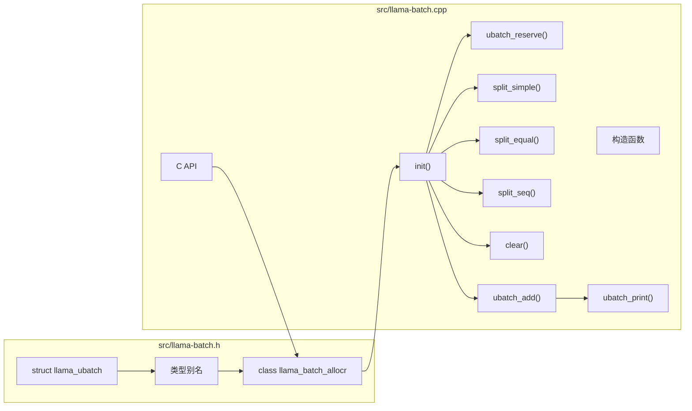

src/llama-batch.h
├── struct llama_ubatch                          # 微批次数据结构（行 13-67）
│   ├── equal_seqs() / is_pos_2d()               # 状态查询方法
│   ├── 字段：b_equal_seqs, n_tokens, n_seq_tokens, n_seqs, n_seqs_unq, n_pos
│   ├── 字段：token, embd, pos, n_seq_id, seq_id, seq_id_unq, seq_idx, output
│   └── struct data_t                            # 自有数据容器（shared_ptr 管理）
│       ├── token/embd/pos/n_seq_id/seq_id 数组
│       └── seq_id_data                         # 扁平化存储区
├── 类型别名（行 218-224）
│   ├── using pos_set_t = std::set<llama_pos>   # 序列位置集合类型
│   ├── using seq_cpl_t = std::vector<bool>     # 序列耦合矩阵行类型
│   ├── using idx_vec_t = std::vector<int32_t>  # 索引向量类型
│   └── using seq_set_t = std::bitset<LLAMA_MAX_SEQ>  # 序列集位图类型
├── class llama_batch_allocr                     # 批处理分配器
│   ├── llama_batch_allocr(n_pos_per_embd)      # 构造函数
│   ├── init(batch, vocab, memory, ...)          # 校验+补全+统计+一致性
│   ├── split_reset()                           # 重置拆分状态
│   ├── split_simple(n_ubatch)                  # 朴素贪心拆分
│   ├── split_equal(n_ubatch, sequential)       # 等长方阵拆分
│   ├── split_seq(n_ubatch)                     # 单序列集拆分
│   ├── ubatch_reserve(n_seq_tokens, n_seqs)    # 预留空 ubatch
│   ├── ubatch_add(idxs, n_seqs, equal_seqs)    # 内存编排（私有）
│   └── ubatch_print(ubatch, debug)              # 调试打印（私有）
├── C API 接口
│   ├── llama_batch_get_one(tokens, n)          # 单序列快捷构造
│   ├── llama_batch_init(n_tokens_alloc, embd, n_seq_max)  # C 风格分配
│   └── llama_batch_free(batch)                 # C 风格释放
└── 私有状态
    ├── batch, vocab, n_pos_per_embd, n_embd, n_seq_max, n_outputs
    ├── seq_id_0 (默认序列 {0})
    ├── has_cpl, seq_pos[], seq_cpl[][]
    ├── seq_set[], seq_set_map<bitset, idxs>
    ├── out_ids, n_used, used[]
    └── debug (LLAMA_BATCH_DEBUG 环境变量)

src/llama-batch.cpp
├── 构造函数 (11-25 行)
│   └── 读取 LLAMA_BATCH_DEBUG，预分配 seq_pos/seq_cpl/seq_idx
├── init() (27-431 行)
│   ├── clear() 重置所有状态
│   ├── 硬性校验：n_seq_max、token 范围、seq_id 范围
│   ├── 自动补全：n_seq_id、seq_id、pos、logits
│   ├── 统计分析：n_outputs、has_cpl、seq_pos、seq_cpl
│   ├── 序列集位图：seq_set、seq_set_map、seq_idx、seq_id_unq
│   ├── 一致性检查：位置连续性、耦合序列、子集一致性、位置回退
│   └── split_reset() 收尾
├── ubatch_reserve() (352-399 行)
│   └── 创建空 udata，预填充 seq_idx/seq_id_unq，返回带 data 的 ubatch
├── split_simple() (435-462 行)
│   └── 朴素贪心：按 used[] 顺序取够 n_ubatch 个 token
├── split_equal() (464-538 行)
│   ├── 第一遍：挑选无重叠的序列集（可选 sequential 约束）
│   ├── 第二遍：按序列集并行推进游标，组装方阵
│   └── 调用 ubatch_add(n_seqs, equal_seqs=true)
├── split_seq() (540-572 行)
│   └── 单序列集：按子集约束连续追加 token
├── clear() (596-621 行)
│   └── 清空所有 vector 与 bitset
├── ubatch_add() (623-712 行)
│   ├── 分配 udata，按 token 数预分配各字段
│   ├── token/embd/pos 拷贝（含 M-RoPE 广播逻辑）
│   ├── seq_id_data 扁平化追加
│   ├── output 收集 → out_ids
│   ├── seq_id[i] 指针算术指向各段
│   └── 构造 llama_ubatch 并 move(udata)
├── ubatch_print() (714-779 行)
│   ├── debug=1：元数据 + seq_id_unq/seq_idx 可视化
│   └── debug=2：逐 token 打印 id/text/pos/seq 位图
└── C API 实现 (781-848 行)
    ├── llama_batch_get_one
    ├── llama_batch_init
    └── llama_batch_free

## 16.3 `llama_ubatch` 数据结构与类型别名

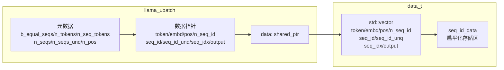

**`llama_ubatch` 是计算图真正消费的「最小推理单元」**。与 `llama_batch`（用户输入的原始批数据）不同，`llama_ubatch` 是经过校验、补全与切分后的内部表示。它持有 token、位置、序列 ID、输出标志等核心字段，每个字段都有内存语义说明（size / idx / val）。通过 `std::shared_ptr<data_t> data` 管理自有数据，外部数据则不持有所有权，实现零拷贝共享。`b_equal_seqs` 标记所有序列集是否等长，是 MHA 等路径的重要分支依据。`is_pos_2d()` 通过 `n_pos >= 3` 判断是否为 M-RoPE（如视觉位置 = y/x/other）场景。`equal_seqs()` 返回 `b_equal_seqs != 0`，供调用方查询等长标志。内部 `data_t` 结构聚合所有 std::vector，`seq_id_data` 是连续的扁平存储区，`seq_id[i]` 通过指针算术指向其中片段。**文件级类型别名共同构成批处理的数据基石**：`using pos_set_t = std::set<llama_pos>`：每条序列出现过的位置集合（保证有序且唯一）；`using seq_cpl_t = std::vector<bool>`：耦合序列矩阵的每一行（动态长度适配 LLAMA_MAX_SEQ）；`using idx_vec_t = std::vector<int32_t>`：序列集对应的 token 索引列表（拆分阶段的核心数据结构）；`using seq_set_t = std::bitset<LLAMA_MAX_SEQ>`：用位图表示 token 的序列归属集合（O(1) 重叠检测）。

### 16.3.1 `llama_ubatch`：核心字段与状态查询

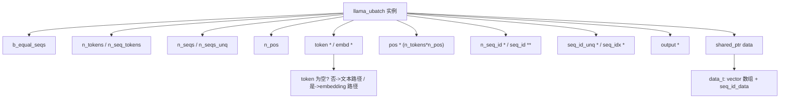

源码路径：`src/llama-batch.h` - `llama_ubatch`（第 13-67 行）

```cpp
// 类型即图纸，先理解数据结构
struct llama_ubatch {
    // 标记所有序列是否等长（即每个序列贡献的 token 数是否相同）
    // 等长是 MHA 等高性能路径的前提
    uint32_t b_equal_seqs;

    // 本 ubatch 中 token 总数
    uint32_t n_tokens;

    // 每个序列贡献的 token 数（仅当 b_equal_seqs 为真时有意义）
    uint32_t n_seq_tokens;

    // 本 ubatch 中涉及的序列集数量（如 {0}, {0,1} 算两个集合）
    uint32_t n_seqs;

    // 本 ubatch 中实际出现过的不同序列 ID 数量
    uint32_t n_seqs_unq;

    // 每个 token/embedding 的位置维度数（普通模型为 1，M-RoPE 为 3+）
    uint32_t n_pos;

    // --- 数据指针（指向 data_t 内部数组或外部内存） ---
    llama_token * token;           // token 数组（文本输入时使用）
    float * embd;                  // embedding 数组（视觉/音频输入时使用）
    llama_pos * pos;               // 位置数组，长度为 n_tokens * n_pos
    int32_t * n_seq_id;            // 每个 token 归属的序列数
    llama_seq_id ** seq_id;        // 每个 token 的序列 ID 列表（指向扁平存储区的指针）
    llama_seq_id * seq_id_unq;     // 本 ubatch 中出现的所有唯一序列 ID
    int32_t * seq_idx;             // 序列 ID -> ubatch 内部紧凑索引映射（用于 embeddings 提取）
    int8_t * output;               // 该 token 是否需要输出 logits（采样用）

    // --- 内部方法 ---
    // 判断所有序列是否等长
    bool equal_seqs() const {
        return b_equal_seqs != 0;
    }

    // 判断是否为 2D+ 位置（M-RoPE 场景：n_pos >= 3 通常意味着 y/x/other）
    bool is_pos_2d() const {
        // TODO @ngxson : we may need to check for model arch when more models use >1 positions
        return n_pos >= 3;
    }

    // --- 自有数据容器（shared_ptr 管理生命周期） ---
    struct data_t {
        std::vector<llama_token> token;         // token 存储
        std::vector<float> embd;                // embedding 存储
        std::vector<llama_pos> pos;             // 位置存储
        std::vector<int32_t> n_seq_id;          // 每 token 的序列数
        std::vector<llama_seq_id *> seq_id;     // 每 token 的序列 ID 指针（指向 seq_id_data）
        std::vector<llama_seq_id> seq_id_unq;   // 唯一序列 ID 列表
        std::vector<int32_t> seq_idx;           // 全局 seq_id -> 本地索引
        std::vector<int8_t> output;             // 输出标志
        std::vector<llama_seq_id> seq_id_data;  // 扁平化存储区：所有 seq_id 连续存放
    };
    std::shared_ptr<data_t> data;  // 自有数据所有权；外部数据时为空
};
```

这段代码定义了 `llama_ubatch` 结构体，它是计算图消费的最小推理单元，包含 token/embd/pos/seq_id 等扁平字段，通过 `data_t` 统一管理内存所有权，`b_equal_seqs` 标记等长序列以支持高性能 MHA 路径，`is_pos_2d()` 用于识别 M-RoPE 等多维位置编码场景。

### 16.3.2 文件级类型别名：批处理的「标准容器规格」

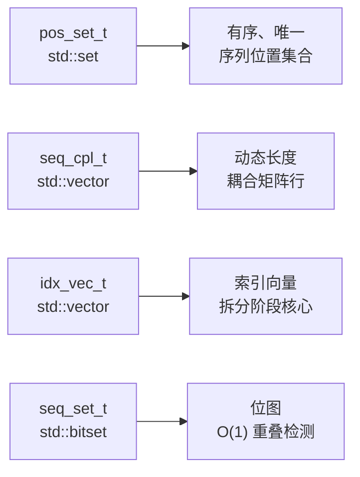

源码路径：`src/llama-batch.h` - 类型别名（第 218-224 行）

```cpp
// 类型即图纸，先理解数据结构
using pos_set_t = std::set<llama_pos>;              // 序列位置集合（有序、唯一）
using seq_cpl_t = std::vector<bool>;                // 耦合矩阵行（动态长度）
using idx_vec_t = std::vector<int32_t>;             // 索引向量（拆分阶段核心）
using seq_set_t = std::bitset<LLAMA_MAX_SEQ>;       // 序列集位图（O(1) 重叠检测）
```

这段代码定义了四个核心类型别名：`pos_set_t` 用 `std::set` 保证序列位置有序唯一；`seq_cpl_t` 用 `std::vector<bool>` 动态适配最大序列数；`idx_vec_t` 存储 token 索引列表；`seq_set_t` 用 `std::bitset` 实现序列归属的位图表示，支持 O(1) 位运算判断序列集重叠，是 `split_equal` 高效去重的关键。

## 16.4 `llama_batch_allocr` 骨架、构造函数与私有状态

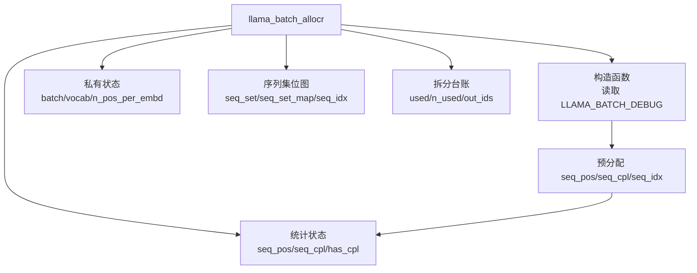

**`llama_batch_allocr` 是整个批次处理流水线的「调度中枢」**。构造时接收 `n_pos_per_embd`（每个 token/embedding 的位置数量，普通模型为 1，M-RoPE 模型为 3+）。通过环境变量 `LLAMA_BATCH_DEBUG` 控制调试日志详细程度（0/1/2 三档）。内部维护 `seq_pos[s]`（每条序列的位置集合）与 `seq_cpl[s0][s1]`（序列间耦合关系矩阵）。提前为 `LLAMA_MAX_SEQ` 条序列分配好 `seq_pos` 与 `seq_cpl`，避免运行时重复分配。`seq_idx` 初始化为 -1，对应「该序列在 ubatch 中不出现」的语义。**私有状态字段构成完整的「工作台账本」**：`batch`：缓存当前处理的原始批数据（const 引用访问）；`vocab`：仅用于调试的词表指针，供 `ubatch_print` 反查 token 文本；`seq_id_0`：默认单序列 `{0}` 的 `std::array`，自动补全 `n_seq_id` 与 `seq_id` 时使用；`used[]` / `n_used`：拆分阶段的「已消费」账本，分别记录每个 token 是否已被拆分到某个 ubatch；`out_ids`：本批次中需要采样输出的 token 在原 batch 中的索引列表；`debug`：从 `LLAMA_BATCH_DEBUG` 环境变量读取的调试级别（0/1/2）。

### 16.4.1 `llama_batch_allocr::llama_batch_allocr()` 构造函数


源码路径：`src/llama-batch.cpp` - `llama_batch_allocr::llama_batch_allocr()`（第 11-25 行）

```cpp
// 逐行注释解释
llama_batch_allocr::llama_batch_allocr(uint32_t n_pos_per_embd) : n_pos_per_embd(n_pos_per_embd) {
    // ① 读取环境变量控制调试级别：0=关闭，1=元数据，2=逐 token 详情
    const char * LLAMA_BATCH_DEBUG = getenv("LLAMA_BATCH_DEBUG");
    debug = LLAMA_BATCH_DEBUG ? atoi(LLAMA_BATCH_DEBUG) : 0;

    // ② 预分配序列位置集合：LLAMA_MAX_SEQ 个 std::set
    seq_pos.resize(LLAMA_MAX_SEQ);

    // ③ 预分配耦合矩阵：LLAMA_MAX_SEQ x LLAMA_MAX_SEQ 的二维 bool 表
    seq_cpl.resize(LLAMA_MAX_SEQ);
    for (auto & cur : seq_cpl) {
        cur.resize(LLAMA_MAX_SEQ);
    }

    // ④ seq_idx 初始化为 -1，表示「该序列在当前 ubatch 中不出现」
    seq_idx.resize(LLAMA_MAX_SEQ, -1);
}
```

这段代码实现了构造函数：读取 `LLAMA_BATCH_DEBUG` 环境变量设置调试级别，预分配 `seq_pos` 与 `seq_cpl` 容器避免运行时扩容，`seq_idx` 初始化为 -1 哨兵值表示序列未出现。

### 16.4.2 `llama_batch_allocr` 私有状态全景

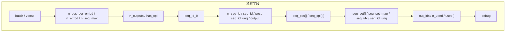

源码路径：`src/llama-batch.h` - `llama_batch_allocr` 私有字段（第 107-242 行）

```cpp
// 类型即图纸，先理解数据结构
class llama_batch_allocr {
    // ... 公开方法 ...

private:
    // 当前处理的原始 batch（const 引用语义）
    llama_batch batch;

    // 词表指针：仅用于调试打印 token 文本
    const llama_vocab * vocab;

    // 每个 token/embedding 的位置维度（1=普通，3+=M-RoPE）
    uint32_t n_pos_per_embd;

    // embedding 维度（仅 embedding 输入时使用）
    uint32_t n_embd;

    // 用户声明的最大序列 ID（用于校验 seq_id 范围）
    uint32_t n_seq_max;

    // 本 batch 中需输出的 token 计数
    uint32_t n_outputs;

    // --- 自动补全生成的字段 ---
    std::vector<int32_t> n_seq_id;           // 每 token 的序列数
    std::vector<llama_seq_id *> seq_id;      // 每 token 的序列 ID 指针（指向 seq_id_0 或自有存储）
    std::vector<llama_pos> pos;              // 自动生成的位置
    std::vector<llama_seq_id> seq_id_unq;    // 本 batch 出现的唯一序列 ID
    std::vector<int8_t> output;              // 自动生成的 logits 输出标志

    // 默认单序列 {0} 的静态数组，自动补全时使用
    const std::array<llama_seq_id, 1> seq_id_0 = {{ 0 }};

    // --- 统计分析产生的状态 ---
    bool has_cpl;                            // 是否存在耦合序列
    pos_set_t seq_pos[LLAMA_MAX_SEQ];        // 每条序列出现过的位置集合
    seq_cpl_t seq_cpl[LLAMA_MAX_SEQ];        // 耦合矩阵：seq_cpl[s1][s0] 表示 s1 耦合到 s0

    // 序列集位图与反向索引
    std::vector<seq_set_t> seq_set;              // 每个 token 的序列集位图
    std::unordered_map<seq_set_t, idx_vec_t> seq_set_map; // 序列集 -> token 索引列表
    std::array<int32_t, LLAMA_MAX_SEQ> seq_idx;  // 全局 seq_id -> ubatch 内部索引
    std::vector<llama_seq_id> seq_id_unq;        // 本 batch 实际出现的唯一序列 ID

    // --- 拆分阶段工作台账本 ---
    std::vector<int32_t> out_ids;       // 需输出的 token 在原 batch 中的索引
    uint32_t n_used = 0;                // 已消费 token 计数
    std::vector<bool> used;             // 每个 token 是否已被拆分

    // 调试级别
    int debug = 0;

    // ... 私有方法 ...
};
```

这段代码展示了 `llama_batch_allocr` 的私有状态全貌：缓存原始 batch、词表指针、位置维度、嵌入维度、最大序列数、输出计数、自动补全生成的字段数组、默认序列数组、耦合标志与矩阵、序列位置集合、序列集位图与反向索引、序列映射、拆分阶段的工作台账本（out_ids、n_used、used）以及调试级别。

## 16.5 `llama_batch_allocr::init()` 输入校验阶段

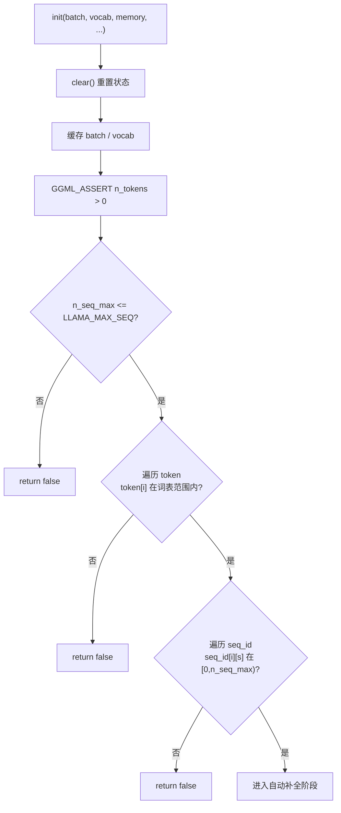

**`init()` 是分配器的入口，负责把用户的 `llama_batch` 变成可消费的内部状态**。第一步：硬性校验 `n_tokens > 0`、`n_seq_max <= LLAMA_MAX_SEQ`。逐 token 校验 `token[i]` 是否在词汇表范围内（`vocab.n_tokens()`）。逐 token 逐序列校验 `seq_id[i][s]` 是否在 `[0, n_seq_max)` 范围内。任一校验失败即 `return false`，并打印详细错误位置与值。这一阶段是「零信任」策略：哪怕上层调用方再可信，也必须在分配器侧重新校验。配合 `LLAMA_LOG_ERROR` 输出可定位的诊断信息，方便用户排查批数据问题。

### 16.5.1 `llama_batch_allocr::init()` 硬性校验

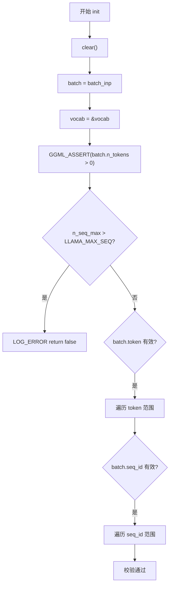

源码路径：`src/llama-batch.cpp` - `llama_batch_allocr::init()` 校验阶段（第 27-71 行）

```cpp
// 逐行注释解释
bool llama_batch_allocr::init(
        const llama_batch & batch_inp,
        const llama_vocab & vocab,
        const llama_memory_i * memory,
        uint32_t n_embd,
        uint32_t n_seq_max,
        bool output_all) {
    // ① 清空上一轮状态，确保纯净起点
    clear();

    // ② 缓存输入 batch 与词表
    batch = batch_inp;
    this->vocab = &vocab;

    // ③ 硬性前置：必须有 token
    GGML_ASSERT(batch.n_tokens > 0);

    // ④ 校验 n_seq_max 不超过编译期上限
    if (n_seq_max > LLAMA_MAX_SEQ) {
        LLAMA_LOG_ERROR("%s: n_seq_max = %d > %d\n", __func__, n_seq_max, LLAMA_MAX_SEQ);
        return false;
    }

    // ⑤ 逐 token 校验 token ID 是否在词表范围内
    if (batch.token) {
        for (int32_t i = 0; i < batch.n_tokens; ++i) {
            if (batch.token[i] < 0 || (uint32_t) batch.token[i] >= vocab.n_tokens()) {
                LLAMA_LOG_ERROR("%s: invalid token[%d] = %d\n", __func__, i, batch.token[i]);
                return false;
            }
        }
    }

    // ⑥ 逐 token 逐序列校验 seq_id 是否在 [0, n_seq_max)
    if (batch.seq_id) {
        for (int32_t i = 0; i < batch.n_tokens; ++i) {
            for (int32_t s = 0; s < batch.n_seq_id[i]; ++s) {
                if (batch.seq_id && (batch.seq_id[i][s] < 0 || batch.seq_id[i][s] >= (llama_seq_id) n_seq_max)) {
                    LLAMA_LOG_ERROR("%s: invalid seq_id[%d][%d] = %d >= %d\n", __func__, i, s, batch.seq_id[i][s], (llama_seq_id) n_seq_max);
                    return false;
                }
            }
        }
    }
    // ... 后续补全与统计逻辑 ...
}
```

这段代码实现了 `init()` 的校验阶段：先 `clear()` 重置状态，缓存 batch 与 vocab，断言 token 数大于 0，校验 `n_seq_max` 不超上限，逐 token 检查 token ID 是否在词表范围，逐 token 逐序列检查 `seq_id` 是否在合法范围，任一失败即报错返回 false。

## 16.6 `llama_batch_allocr::init()` 字段自动补全阶段

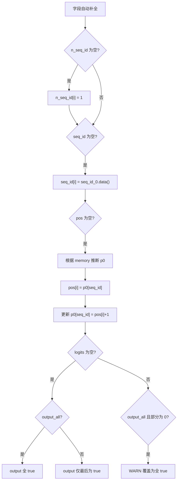

**`init()` 在校验通过后会自动生成缺失字段**。若 `n_seq_id` 为空：默认每个 token 归属于单序列 `{0}`（`seq_id_0`）。若 `seq_id` 为空：同上，每行指向 `seq_id_0.data()`。若 `pos` 为空：根据 `memory->seq_pos_max(s)` 推断每个序列的起始位置。位置推断逻辑：依据 token 的首个 seq_id 取 `p0[seq_id]`，并对所有关联序列更新 `p0` 为 `pos[i]+1`。若 `logits` 为空：根据 `output_all` 决定是「全部输出」还是「仅最后一个 token 输出」。`output_all=true` 但部分 logits 已被设为 0 时：打印 WARN 并强制覆盖为全输出（embeddings 必需场景）。

### 16.6.1 `llama_batch_allocr::init()` 自动补全

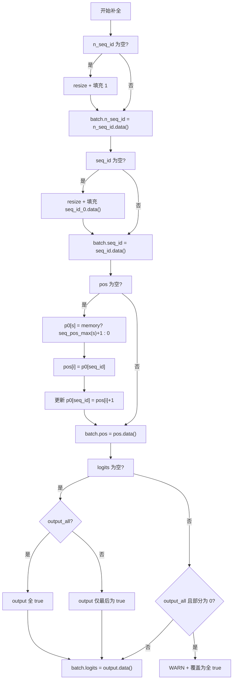

源码路径：`src/llama-batch.cpp` - `llama_batch_allocr::init()` 补全阶段（第 73-127 行）

```cpp
// 逐行注释解释
    // --- 自动补全 n_seq_id ---
    if (!batch.n_seq_id) {
        n_seq_id.resize(batch.n_tokens);
        for (int32_t i = 0; i < batch.n_tokens; i++) {
            n_seq_id[i] = seq_id_0.size();  // 默认每个 token 1 个序列
        }
        batch.n_seq_id = n_seq_id.data();
    }

    // --- 自动补全 seq_id ---
    if (!batch.seq_id) {
        seq_id.resize(batch.n_tokens + 1);  // +1 留哨兵位
        seq_id[batch.n_tokens] = NULL;      // 末尾哨兵，配合 C API 释放
        for (int32_t i = 0; i < batch.n_tokens; i++) {
            seq_id[i] = seq_id_0.data();    // 指向默认序列 {0}
        }
        batch.seq_id = seq_id.data();
    }

    // --- 自动补全 pos（位置） ---
    if (!batch.pos) {
        pos.resize(batch.n_tokens);

        // 根据 KV 缓存中的最大位置推断每个序列的起始位置
        llama_pos p0[LLAMA_MAX_SEQ];
        for (uint32_t s = 0; s < n_seq_max; ++s) {
            if (!memory) {
                p0[s] = 0;  // 无 memory 时从 0 开始
            } else {
                p0[s] = memory->seq_pos_max(s) + 1;  // 续写：KV 缓存末位 + 1
            }
        }

        for (int32_t i = 0; i < batch.n_tokens; i++) {
            const llama_seq_id seq_id = batch.seq_id[i][0];  // 取首个序列作为参考
            pos[i] = p0[seq_id];

            // 更新该 token 关联的所有序列的起始位置
            for (int32_t s = 0; s < batch.n_seq_id[i]; ++s) {
                const llama_seq_id seq_id = batch.seq_id[i][s];
                p0[seq_id] = pos[i] + 1;
            }
        }
        batch.pos = pos.data();
    }

    // --- 自动补全 logits（输出标志） ---
    if (!batch.logits) {
        if (output_all) {
            // 全部输出：embeddings 场景必需
            output.resize(batch.n_tokens, true);
        } else {
            // 仅最后一个 token 输出：普通生成场景
            output.resize(batch.n_tokens, false);
            output[output.size() - 1] = true;
        }
        batch.logits = output.data();
    } else if (output_all) {
        // 用户传了 logits 但要求全输出：检查是否有漏标
        bool warn = false;
        for (int32_t i = 0; i < batch.n_tokens; ++i) {
            if (batch.logits[i] == 0) {
                warn = true;
            }
        }
        if (warn) {
            LLAMA_LOG_WARN("%s: embeddings required but some input tokens were not marked as outputs -> overriding\n", __func__);
            output.resize(batch.n_tokens, true);
            batch.logits = output.data();
        }
    }
```

这段代码实现了字段自动补全：`n_seq_id` 与 `seq_id` 默认指向单序列 `{0}`；`pos` 根据 KV 缓存最大位置续写，并为共享 token 的多序列同步更新起始位置；`logits` 根据 `output_all` 决定全输出或仅最后 token，若用户传了 logits 但要求全输出则强制覆盖并警告。

## 16.7 `llama_batch_allocr::init()` 序列耦合关系统计阶段

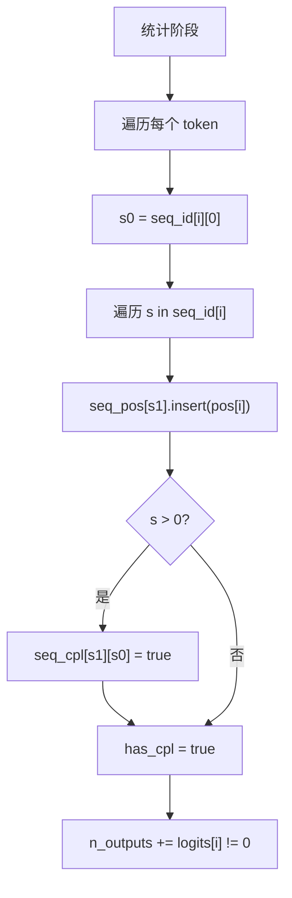

**`init()` 的统计阶段会构建序列间的耦合关系**。`has_cpl` 全局标记：是否有任何序列对存在耦合。`seq_pos[s]`：序列 s 在本批次中出现过的所有位置（用 `std::set` 保证有序且唯一）。`seq_cpl[s0][s1]`：当一个 token 同时归属于 s0、s1 时，标记 s1 耦合到 s0。只需要单向标记 s1→s0，因为后续检查只关心「反向是否一致」。耦合序列必须共享相同的 KV 缓存区间，否则后续 decode 会失败。

### 16.7.1 `llama_batch_allocr::init()` 耦合分析与统计

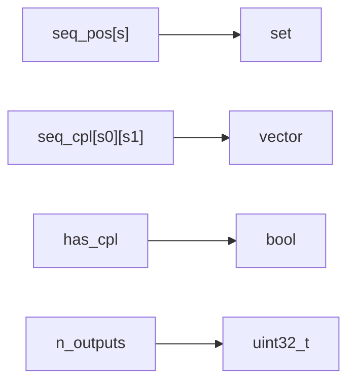

源码路径：`src/llama-batch.cpp` - `llama_batch_allocr::init()` 统计阶段（第 138-158 行）

```cpp
// 逐行注释解释
    // 统计本 batch 中需输出的 token 数
    for (int32_t i = 0; i < batch.n_tokens; ++i) {
        n_outputs += batch.logits[i] != 0;
    }

    has_cpl = false;

    // 确定耦合序列：同一 token 归属多个序列时，这些序列共享 KV 缓存区间
    for (int32_t i = 0; i < batch.n_tokens; ++i) {
        const llama_seq_id s0 = batch.seq_id[i][0];  // 首个序列作为基准

        for (int32_t s = 0; s < batch.n_seq_id[i]; ++s) {
            const llama_seq_id s1 = batch.seq_id[i][s];

            // 记录序列 s1 出现过的位置
            seq_pos[s1].insert(batch.pos[i]);

            if (s > 0) {
                // 标记 s1 耦合到 s0（单向即可，检查时只关心反向一致性）
                seq_cpl[s1][s0] = true;
                has_cpl = true;
            }
        }
    }
```

这段代码统计输出 token 数，遍历每个 token 的序列列表，记录每个序列出现的位置到 `seq_pos`，并为同一 token 下的多序列建立单向耦合关系 `seq_cpl[s1][s0]=true`，置位 `has_cpl` 全局标志。

## 16.8 `llama_batch_allocr::init()` 序列集位图构建阶段

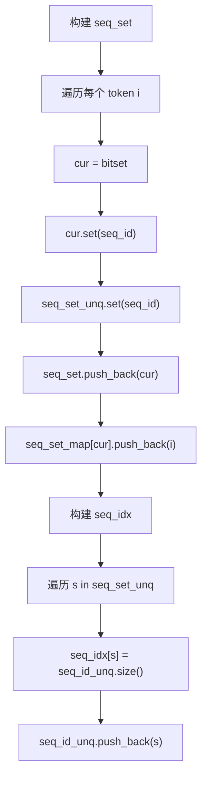

**`seq_set` 与 `seq_set_map` 是按 token 维度组织的高效查找结构**。`seq_set[i]`：用 `std::bitset<LLAMA_MAX_SEQ>` 表示 token i 所属的序列集合。`seq_set_unq`：本批次中所有出现过的序列 ID 的并集。`seq_set_map[bitset]`：每个 bitset 对应的 token 索引列表（用 `unordered_map` 反向索引）。这一设计让 `split_equal` 能 O(1) 判断「两个 token 是否在序列层面有交集」。`seq_idx[s]`：把全局序列 ID 映射为 ubatch 内的紧凑索引，用于 sequence-pooled embeddings 提取。

### 16.8.1 `llama_batch_allocr::init()` 序列集位图与反向索引

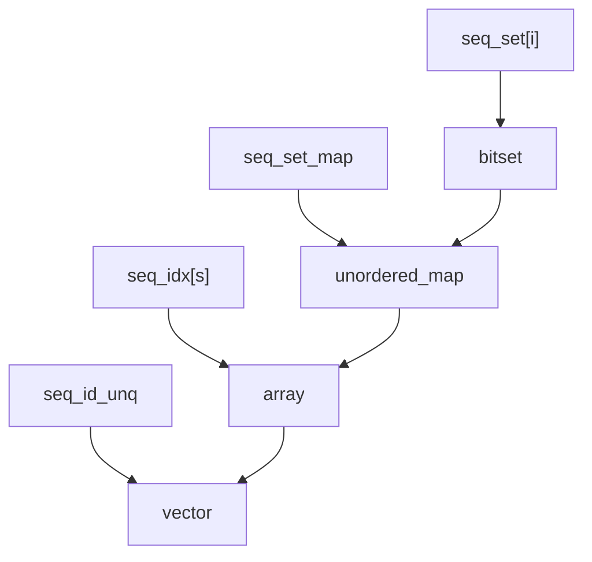

源码路径：`src/llama-batch.cpp` - `llama_batch_allocr::init()` 序列集构建（第 160-181 行）

```cpp
// 逐行注释解释
    // 预计算每个 token 的序列集位图，并建立反向索引
    {
        seq_set_t seq_set_unq;  // 本批次所有序列 ID 的并集位图

        for (int32_t i = 0; i < batch.n_tokens; ++i) {
            seq_set_t cur;
            for (int32_t s = 0; s < batch.n_seq_id[i]; ++s) {
                const llama_seq_id seq_id = batch.seq_id[i][s];
                cur.set(seq_id);           // 置位：token i 属于序列 seq_id
                seq_set_unq.set(seq_id);   // 累积全局并集
            }
            seq_set.push_back(cur);                    // 保存 token i 的序列集
            seq_set_map[cur].push_back(i);             // 反向索引：同一序列集的 token 列表
        }

        // 建立全局序列 ID -> ubatch 内部紧凑索引映射
        for (uint32_t s = 0; s < n_seq_max; ++s) {
            if (seq_set_unq.test(s)) {
                seq_idx[s] = seq_id_unq.size();
                seq_id_unq.push_back(s);
            }
        }
    }
```

这段代码构建序列集位图：为每个 token 生成 `seq_set_t` 位图标记其归属序列，用 `seq_set_map` 将相同序列集的 token 索引归类，最后遍历全局并集位图建立 `seq_idx` 映射，供后续 embeddings 提取使用。

## 16.9 `llama_batch_allocr::init()` 位置连续性校验阶段

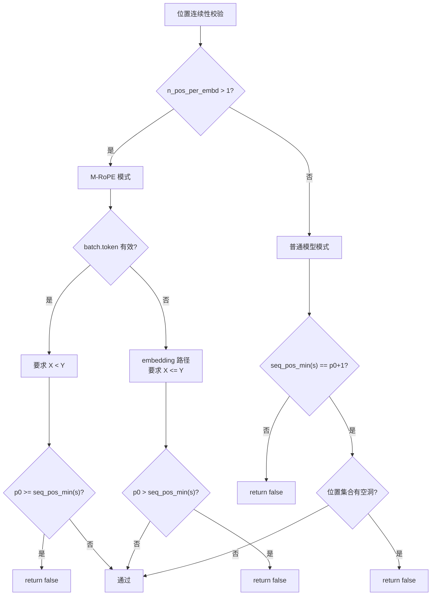

**普通模型（n_pos_per_embd == 1）要求位置严格连续**。序列 s 在本批次的起始位置必须等于 KV 缓存中已有最大位置 + 1。序列 s 的位置集合大小必须等于 `pos_max - pos_min + 1`（无空洞）。不满足时输出详细错误日志，说明 KV 缓存中的 X 与批次中的 Y 应当满足 Y = X + 1。这一约束确保 decode 阶段不会出现「位置错位」的隐蔽 bug。**M-RoPE 模型（n_pos_per_embd > 1）放宽要求**。文本 token 允许位置「向前跳跃」（non-continuous positions allowed），因为图像 token 的位置会插入中间。embedding 输入允许位置重叠（<= 关系），因为图像 patch 可能共享某些位置。两种场景都会打印清晰的位置关系说明，方便用户理解 RoPE 语义。

### 16.9.1 `llama_batch_allocr::init()` 位置连续性校验实现

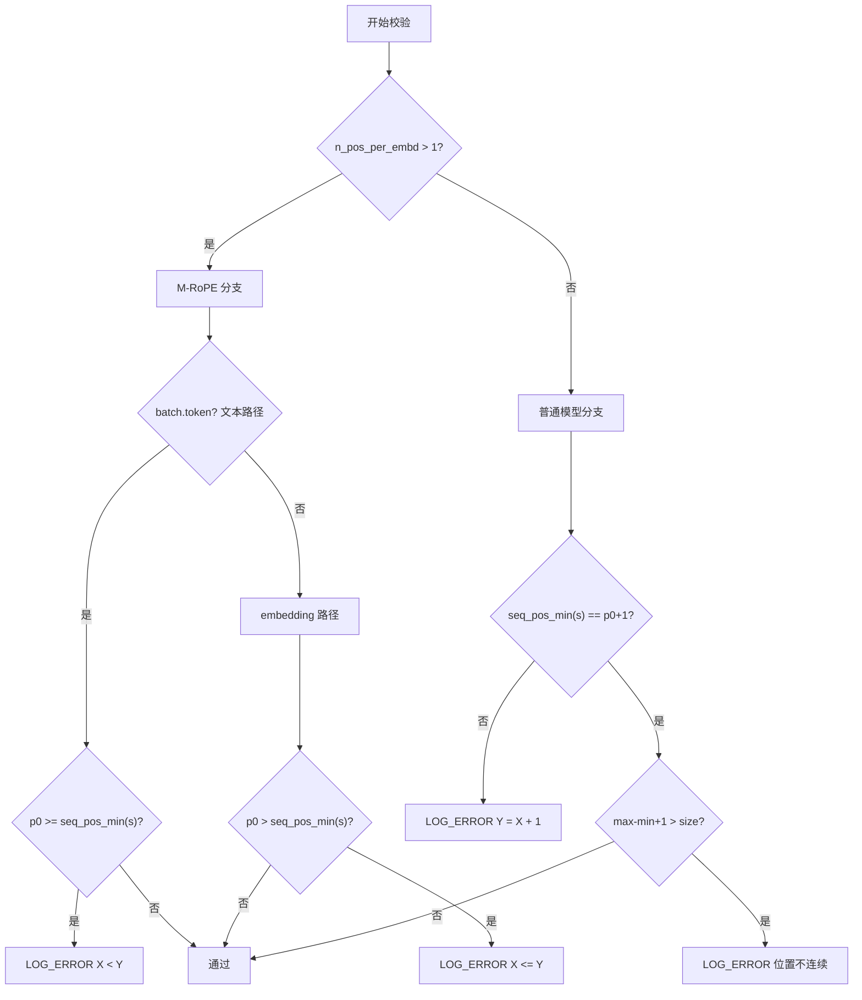

源码路径：`src/llama-batch.cpp` - `llama_batch_allocr::init()` 位置连续性校验（第 212-296 行）

```cpp
// 逐行注释解释
    // --- 一致性检查：位置连续性 ---
    if (n_pos_per_embd > 1) {
        // M-RoPE 模型：允许位置向前跳跃
        for (uint32_t s = 0; s < n_seq_max; ++s) {
            if (seq_pos[s].empty()) continue;

            const llama_pos p0 = memory ? memory->seq_pos_max(s) : -1;

            if (batch.token) {
                // 文本 token：要求 KV 缓存末位 X < 批次起始位 Y（严格前进）
                if (p0 >= 0 && p0 >= seq_pos_min(s)) {
                    LLAMA_LOG_ERROR(
                            "%s: the tokens of sequence %d in the input batch have inconsistent sequence positions:\n"
                            " - the last position stored in the memory module of the context (i.e. the KV cache) for sequence %d is X = %d\n"
                            " - the tokens for sequence %d in the input batch have a starting position of Y = %d\n"
                            " for M-RoPE, it is required that the position satisfies: X < Y\n",
                            __func__, s, s, p0, s, seq_pos_min(s));
                    return false;
                }
            } else {
                // embedding 输入：允许位置重叠（X <= Y）
                if (p0 >= 0 && p0 > seq_pos_min(s)) {
                    LLAMA_LOG_ERROR(
                            "%s: the tokens of sequence %d in the input batch have inconsistent sequence positions:\n"
                            " - the last position stored in the memory module of the context (i.e. the KV cache) for sequence %d is X = %d\n"
                            " - the tokens for sequence %d in the input batch have a starting position of Y = %d\n"
                            " for M-RoPE, it is required that the position satisfies: X <= Y\n",
                            __func__, s, s, p0, s, seq_pos_min(s));
                    return false;
                }
            }
        }
    } else {
        // 普通模型：要求严格连续（Y = X + 1，且无空洞）
        for (uint32_t s = 0; s < n_seq_max; ++s) {
            if (seq_pos[s].empty()) continue;

            const llama_pos p0 = memory ? memory->seq_pos_max(s) : -1;

            if (p0 >= 0) {
                bool ok = true;
                if (seq_pos_min(s) != p0 + 1) {
                    ok = false;
                }
                if (!ok) {
                    LLAMA_LOG_ERROR(
                            "%s: the tokens of sequence %d in the input batch have inconsistent sequence positions:\n"
                            " - the last position stored in the memory module of the context (i.e. the KV cache) for sequence %d is X = %d\n"
                            " - the tokens for sequence %d in the input batch have a starting position of Y = %d\n"
                            " it is required that the sequence positions remain consecutive: Y = X + 1\n",
                            __func__, s, s, p0, s, seq_pos_min(s));
                    return false;
                }
            }
            // 检查位置集合是否有空洞：大小 = max - min + 1
            if (seq_pos_max(s) - seq_pos_min(s) + 1 > (int) seq_pos[s].size()) {
                LLAMA_LOG_ERROR("%s: sequence %d positions are not continuous\n", __func__, s);
                return false;
            }
        }
    }
```

这段代码实现了位置连续性校验：M-RoPE 模式下文本 token 要求 KV 缓存末位 X < 批次起始位 Y（允许跳跃），embedding 允许 X <= Y（允许重叠）；普通模式要求严格连续 Y = X + 1 且位置集合无空洞（大小 = max - min + 1），违规时打印详细错误上下文。

## 16.10 `llama_batch_allocr::init()` 耦合与子集一致性校验阶段

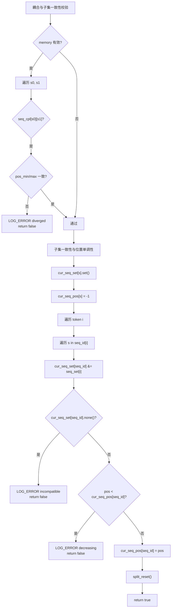

**耦合序列的 KV 缓存区间必须完全一致**。若 `seq_cpl[s0][s1]` 为真，则 `memory->seq_pos_min(s0)` 必须等于 `seq_pos_min(s1)`，`memory->seq_pos_max(s0)` 也必须等于 `seq_pos_max(s1)`。不一致时报告「序列 s0 与 s1 已分歧（have diverged）」。**禁止「序列子集分裂」的不一致用法**。通过 `cur_seq_set[seq_id] &= seq_set[i]` 追踪序列 s 在整个批次中的「序列集轨迹」。一旦某个序列的轨迹集变为空，说明它在某些 token 上使用了不一致的序列归属。**禁止序列位置回退**。通过 `cur_seq_pos[seq_id]` 记录序列 s 此前见过的最大位置。若 `batch.pos[i] < cur_seq_pos[seq_id]`，报告「位置递减」并拒绝该批次。

### 16.10.1 `llama_batch_allocr::init()` 耦合与子集校验实现

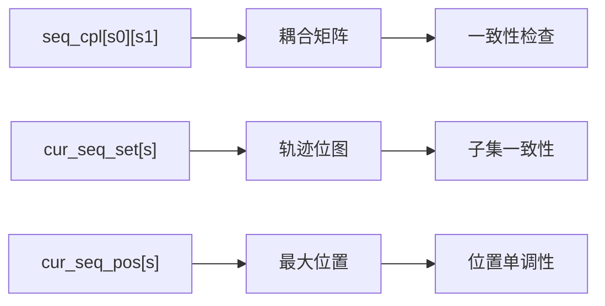

源码路径：`src/llama-batch.cpp` - `llama_batch_allocr::init()` 耦合与子集校验（第 298-350 行）

```cpp
// 逐行注释解释
    // --- 耦合序列 KV 区间一致性检查 ---
    if (memory) {
        for (uint32_t s0 = 0; s0 < n_seq_max; ++s0) {
            for (uint32_t s1 = 0; s1 < n_seq_max; ++s1) {
                if (seq_cpl[s0][s1]) {
                    // 耦合序列在 KV 缓存中的最小/最大位置必须完全一致
                    if (memory->seq_pos_min(s0) != memory->seq_pos_min(s1) ||
                        memory->seq_pos_max(s0) != memory->seq_pos_max(s1)) {
                        LLAMA_LOG_ERROR("%s: sequence %d is coupled to %d in the input batch, but have divereged\n", __func__, s0, s1);
                        return false;
                    }
                }
            }
        }
    }

    // --- 子集一致性与位置单调性检查 ---
    {
        // cur_seq_set[s] 追踪序列 s 在已处理 token 中的「序列集轨迹」
        seq_set_t cur_seq_set[LLAMA_MAX_SEQ];
        for (uint32_t s = 0; s < n_seq_max; ++s) {
            cur_seq_set[s].set();  // 初始全 1（全集）
        }

        // cur_seq_pos[s] 记录序列 s 此前见过的最大位置
        llama_pos cur_seq_pos[LLAMA_MAX_SEQ];
        for (uint32_t s = 0; s < n_seq_max; ++s) {
            cur_seq_pos[s] = -1;
        }

        for (int32_t i = 0; i < batch.n_tokens; ++i) {
            const llama_pos pos = batch.pos[i];

            for (int32_t s = 0; s < batch.n_seq_id[i]; ++s) {
                const llama_seq_id seq_id = batch.seq_id[i][s];

                // 交集运算：轨迹集 &= 当前 token 的序列集
                cur_seq_set[seq_id] &= seq_set[i];

                // 若交集为空，说明该序列在不同 token 上归属了不兼容的序列集
                if (cur_seq_set[seq_id].none()) {
                    LLAMA_LOG_ERROR("%s: sequence %d belongs to incompatible sequence sets (not allowed)\n", __func__, seq_id);
                    return false;
                }

                // 位置单调性：当前位置不能小于历史最大位置
                if (pos < cur_seq_pos[seq_id]) {
                    LLAMA_LOG_ERROR("%s: sequence %d positions are decreasing (not allowed)\n", __func__, seq_id);
                    return false;
                }
            }
        }
    }

    // 重置拆分状态，准备进入 split 阶段
    split_reset();

    return true;
```

这段代码实现了三项深度一致性检查：耦合序列的 KV 缓存区间必须完全一致（同 min/max pos）；序列的「序列集轨迹」交集不能为空（禁止子集分裂）；序列位置必须单调非递减（禁止回退）。全部通过后调用 `split_reset()` 进入拆分阶段。

## 16.11 `llama_batch_allocr::get_n_tokens/get_n_outputs/get_n_used/seq_pos_min/seq_pos_max/get_out_ids/split_reset`

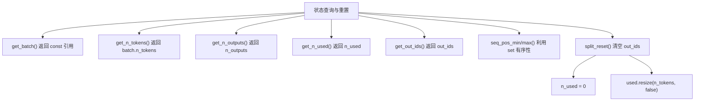

**`get_n_tokens()` / `get_n_outputs()` / `get_n_used()` 是分配器对外暴露的状态查询接口**。`get_n_tokens()` 返回 batch 中总 token 数（`batch.n_tokens`）。`get_n_outputs()` 返回本 batch 中需要输出的 token 数（`n_outputs`）。`get_n_used()` 返回已被消费（已拆分到某个 ubatch）的 token 计数（`n_used`）。**`get_batch()` 让外部直接访问原始 batch 引用（const），用于进一步检查或调试**。**`seq_pos_min(s)` / `seq_pos_max(s)` 返回序列 s 在本批次中的最小/最大位置**。若序列 s 不在本批次中，返回 -1 哨兵值。实现依赖 `seq_pos[s]` 是 `std::set`，`*begin()` 与 `*rbegin()` 即最小与最大元素。**`get_out_ids()` 返回需要采样输出的 token 在原 batch 中的索引列表（`out_ids`）**。外部按此索引在 logits 中取对应位置的采样结果。**`split_reset()` 是所有拆分方法的起点**。清空 `out_ids`（输出 token 索引列表），重置 `n_used = 0`，重建 `used[]` 数组（每个 token 是否已被消费）。

### 16.11.1 查询接口与 split_reset 实现

```mermaid
flowchart LR
    A["get_batch"] --> B["const llama_batch&"]
    C["get_n_tokens"] --> D["uint32_t"]
    E["get_n_outputs"] --> F["uint32_t"]
    G["get_n_used"] --> H["uint32_t"]
    I["get_out_ids"] --> J["vector<int32_t>&"]
    K["seq_pos_min"] --> L["*seq_pos[seq_id].begin()"]
    M["seq_pos_max"] --> N["*seq_pos[seq_id].rbegin()"]
    O["split_reset"] --> P["out_ids.clear()"]
    P --> Q["n_used = 0"]
    Q --> R["used.resize(n_tokens, false)"]
```

源码路径：`src/llama-batch.cpp` - 状态查询与重置方法（第 401-435 行）

```cpp
// 逐行注释解释
const llama_batch & llama_batch_allocr::get_batch() const {
    return batch;  // 返回原始 batch 的 const 引用
}

uint32_t llama_batch_allocr::get_n_tokens() const {
    return batch.n_tokens;  // 总 token 数
}

uint32_t llama_batch_allocr::get_n_outputs() const {
    return n_outputs;  // 需输出的 token 数
}

uint32_t llama_batch_allocr::get_n_used() const {
    return n_used;  // 已消费 token 数
}

std::vector<int32_t> & llama_batch_allocr::get_out_ids() {
    return out_ids;  // 输出 token 在原 batch 中的索引列表
}

llama_pos llama_batch_allocr::seq_pos_min(llama_seq_id seq_id) const {
    return seq_pos[seq_id].empty() ? -1 : *seq_pos[seq_id].begin();  // set 首元素 = 最小位置
}

llama_pos llama_batch_allocr::seq_pos_max(llama_seq_id seq_id) const {
    return seq_pos[seq_id].empty() ? -1 : *seq_pos[seq_id].rbegin();  // set 尾元素 = 最大位置
}

void llama_batch_allocr::split_reset() {
    out_ids.clear();                    // 清空输出索引列表
    n_used = 0;                         // 重置已用计数
    used.clear();
    used.resize(get_n_tokens(), false); // 重建 used[] 数组，全标记为未消费
}
```

这段代码实现了状态查询接口：`get_batch` 返回原始 batch 引用，`get_n_tokens/outputs/used` 返回对应计数，`seq_pos_min/max` 利用 `std::set` 有序特性 O(1) 取最值，`get_out_ids` 返回采样索引列表，`split_reset` 清空 out_ids、归零 n_used、重建 used 数组为全 false。

## 16.12 `llama_batch_allocr::ubatch_reserve`

```mermaid
flowchart TD
    A["ubatch_reserve(n_seq_tokens, n_seqs)"] --> B["clear() + split_reset()"]
    B --> C["n_tokens = n_seq_tokens * n_seqs"]
    C --> D["make_shared<data_t>"]
    D --> E["resize 各字段"]
    E --> F["预填充 seq_idx/seq_id_unq"]
    F --> G["构造 llama_ubatch"]
    G --> H["返回带 data 的 ubatch"]
```

**`ubatch_reserve()` 用于在已知形状时直接构造一个空的 ubatch**。调用 `clear()` 与 `split_reset()` 重置所有内部状态。用 `std::make_shared<data_t>()` 创建独立的 data 容器。按 `n_seq_tokens * n_seqs` 计算总 token 数，按 `n_tokens * n_pos_per_embd` 计算位置总数。预填充 `seq_idx[s] = s` 与 `seq_id_unq.push_back(s)`，假设每行对应一条独立序列。返回的 `llama_ubatch` 中 `data` 字段持有 shared_ptr，调用方负责写入实际数据。这一接口是 `split_*` 之外的另一条 ubatch 创建路径，常用于「解码阶段预留空间」的场景。

### 16.12.1 `llama_batch_allocr::ubatch_reserve` 实现

```mermaid
graph TB
    A["udata: shared_ptr<data_t>"] --> B["token/pos/n_seq_id<br/>seq_id/output vector"]
    A --> C["seq_id_unq vector"]
    A --> D["seq_idx array"]
    B --> E["预分配大小"]
    C --> F["预填充 s=0..n_seqs-1"]
    D --> G["seq_idx[s] = s"]
```

源码路径：`src/llama-batch.cpp` - `llama_batch_allocr::ubatch_reserve()`（第 352-399 行）

```cpp
// 逐行注释解释
llama_ubatch llama_batch_allocr::ubatch_reserve(uint32_t n_seq_tokens, uint32_t n_seqs) {
    const uint32_t n_tokens = n_seq_tokens * n_seqs;

    clear();           // 重置所有内部状态
    split_reset();     // 重置拆分账本

    const int64_t n_pos_all = (int64_t) n_tokens * n_pos_per_embd;

    // 创建独立的数据容器，由 shared_ptr 管理生命周期
    auto udata = std::make_shared<llama_ubatch::data_t>();

    // 按计算出的大小预分配各字段
    udata->token     .resize(n_tokens);
    udata->embd      .clear();           // embedding 由调用方决定是否使用
    udata->pos       .resize(n_pos_all);
    udata->n_seq_id  .resize(n_tokens);
    udata->seq_id    .resize(n_tokens);
    udata->seq_id_unq.resize(0);
    udata->seq_idx   .resize(LLAMA_MAX_SEQ, -1);
    udata->output    .resize(n_tokens);

    // 预填充：假设每个序列集对应一条独立序列
    for (uint32_t s = 0; s < n_seqs; ++s) {
        udata->seq_idx[s] = s;
        udata->seq_id_unq.push_back(s);
    }

    // 构造并返回 ubatch，data 字段持有 shared_ptr
    llama_ubatch res {
        /*.b_equal_seqs =*/ true,
        /*.n_tokens     =*/ n_tokens,
        /*.n_seq_tokens =*/ n_seq_tokens,
        /*.n_seqs       =*/ n_seqs,
        /*.n_seqs_unq   =*/ n_seqs,
        /*.n_pos        =*/ n_pos_per_embd,
        /*.token        =*/ udata->token.data(),
        /*.embd         =*/ nullptr,
        /*.pos          =*/ udata->pos.data(),
        /*.n_seq_id     =*/ udata->n_seq_id.data(),
        /*.seq_id       =*/ udata->seq_id.data(),
        /*.seq_id_unq   =*/ udata->seq_id_unq.data(),
        /*.seq_idx      =*/ udata->seq_idx.data(),
        /*.output       =*/ udata->output.data(),
        /*.data         =*/ std::move(udata),
    };
    return res;
}
```

这段代码实现了 `ubatch_reserve`：重置状态，创建 `shared_ptr<data_t>`，按 `n_seq_tokens * n_seqs` 预分配 token/pos/n_seq_id/seq_id/output 数组，预填充 `seq_idx` 与 `seq_id_unq` 假设每行一序列，返回带有数据所有权的 `llama_ubatch`。

## 16.13 `llama_batch_allocr::split_simple`

```mermaid
flowchart TD
    A["split_simple(n_ubatch)"] --> B["cur_idx = 0"]
    B --> C{"used[cur_idx]?"}
    C -- 是 --> D["cur_idx++"]
    D --> C
    C -- 否 --> E{"cur_idx >= used.size()?"}
    E -- 是 --> F["return {}"]
    E -- 否 --> G["idxs.push_back(cur_idx)"]
    G --> H["used[cur_idx] = true"]
    H --> I["n_used++"]
    I --> J["cur_idx++"]
    J --> K{"cur_idx >= used.size()?"}
    K -- 是 --> L["break"]
    K -- 否 --> M{"idxs.size() >= n_ubatch?"}
    M -- 是 --> L
    M -- 否 --> G
    L --> N["ubatch_add(idxs, idxs.size(), false)"]
```

**`split_simple()` 是最朴素的拆分策略**。从前往后扫描，跳过已被 `used[]` 标记的 token。找到第一个未使用 token 后开始收集，凑够 `n_ubatch` 个或到达末尾即停。收集过程中即时更新 `used[]` 与 `n_used`。通过 `ubatch_add(idxs, idxs.size(), false)` 生成 ubatch：`n_seqs` 等于 token 数（每个 token 独立成一个序列集），`equal_seqs = false`（序列长度不均）。这种策略不会试图优化序列集合并，适合「不关心 KV 复用、只关心尽快推进」的场景。在 `cur_idx >= used.size()` 时返回空 ubatch，作为「消费完毕」的终止信号。

### 16.13.1 `llama_batch_allocr::split_simple` 实现

```mermaid
graph LR
    A["used[]"] --> B["bool 数组"]
    C["n_used"] --> D["uint32_t"]
    E["idxs"] --> F["vector<int32_t>"]
    B --> G["贪心顺序取 token"]
    D --> H["计数"]
    F --> I["传递给 ubatch_add"]
```

源码路径：`src/llama-batch.cpp` - `llama_batch_allocr::split_simple()`（第 437-493 行）

```cpp
// 逐行注释解释
llama_ubatch llama_batch_allocr::split_simple(uint32_t n_ubatch) {
    // ① 找到第一个未使用的 token
    uint32_t cur_idx = 0;
    while (cur_idx < used.size() && used[cur_idx]) {
        ++cur_idx;
    }

    // ② 全部消费完毕，返回空 ubatch
    if (cur_idx >= used.size()) {
        return {};
    }

    std::vector<int32_t> idxs;

    // ③ 贪心收集：顺序取 token，直到凑够 n_ubatch 或到达末尾
    while (true) {
        idxs.push_back(cur_idx);
        used[cur_idx] = true;  // 标记已消费
        ++n_used;

        ++cur_idx;

        if (cur_idx >= used.size()) {
            break;
        }
        if (idxs.size() >= n_ubatch) {
            break;
        }
    }

    // ④ 每个 token 视为独立序列集，equal_seqs=false
    return ubatch_add(idxs, idxs.size(), false);
}
```

这段代码实现了 `split_simple`：跳过已用 token，顺序收集未用 token 直到凑够 `n_ubatch` 或耗尽，即时更新 `used[]` 与 `n_used`，调用 `ubatch_add` 生成 `equal_seqs=false` 的 ubatch（每 token 独立成序列集）。

## 16.14 `llama_batch_allocr::split_equal`

```mermaid
flowchart TD
    A["split_equal(n_ubatch, sequential)"] --> B{"sequential && has_cpl?"}
    B -- 是 --> C["LOG_ERROR return {}"]
    B -- 否 --> D["第一遍：挑选序列集"]
    D --> E{"used[i]?"}
    E -- 是 --> F["continue"]
    E -- 否 --> G{"与已选序列集重叠?"}
    G -- 是 --> H["add = false"]
    G -- 否 --> I{"sequential?<br/>seq_id 递增?"}
    I -- 否 --> J["add = true"]
    I -- 是 --> K{"seq_id[i][0] == last_seq_id+1?"}
    K -- 是 --> J
    K -- 否 --> H
    J --> L["cur_seq_set.push_back(seq_set[i])"]
    L --> M{"cur_seq_set.size() > n_ubatch?"}
    M -- 是 --> N["break"]
    M -- 否 --> F
    N --> O["n_seqs = cur_seq_set.size()"]
    O --> P{"n_seqs == 0?"}
    P -- 是 --> Q["return {}"]
    P -- 否 --> R["第二遍：并行推进游标"]
    R --> S["cur_idx[s] 跳过已用"]
    S --> T{"所有序列集可扩展?"}
    T -- 否 --> U["break"]
    T -- 是 --> V["每序列集取一个 token"]
    V --> W["idxs_per_seq[s].push_back(idx)"]
    W --> X["used[idx] = true"]
    X --> Y["n_used++"]
    Y --> Z["cur_idx[s]++"]
    Z --> AA{"下一轮会超 n_ubatch?"}
    AA -- 是 --> U
    AA -- 否 --> T
    U --> AB["拼接 idxs"]
    AB --> AC["ubatch_add(idxs, n_seqs, true)"]
```

**`split_equal()` 是 prompt processing 阶段的核心策略**。第一遍扫描：按 token 顺序挑出「序列集互不重叠」的前 n_ubatch 个 token。`sequential=true` 时还要求 seq_id 严格递增，禁用耦合序列（打印 -kvu 提示）。第二遍：以每个序列集为单位，并行推进游标 `cur_idx[s]`。每轮把每个序列集的下一个 token 加入 `idxs_per_seq[s]`，直到任何一个集合耗尽。终止条件：`can_expand = false` 或 `(idxs_per_seq[0].size()+1)*n_seqs > n_ubatch`。把各序列集的索引拼接成单一 `idxs` 列表（保证 batch 内 token 顺序一致）。调用 `ubatch_add(idxs, n_seqs, true)`，`equal_seqs = true` 标记所有序列等长。这种「方阵」布局让 MHA 的 batched matmul 达到最优 GEMM 效率。

### 16.14.1 `llama_batch_allocr::split_equal` 实现

```mermaid
graph TB
    A["第一遍<br/>位图 & 检测重叠"] --> B["挑选无重叠序列集"]
    C["第二遍<br/>并行推进游标"] --> D["组装方阵"]
    B --> C
    D --> E["equal_seqs = true"]
    F["seq_set_map"] --> G["反向索引"]
    H["cur_seq_set"] --> I["已选序列集列表"]
```

源码路径：`src/llama-batch.cpp` - `llama_batch_allocr::split_equal()`（第 466-540 行）

```cpp
// 逐行注释解释
llama_ubatch llama_batch_allocr::split_equal(uint32_t n_ubatch, bool sequential) {
    // ① sequential 模式下禁用耦合序列
    if (sequential && has_cpl) {
        LLAMA_LOG_ERROR("%s: sequential split is not supported when there are coupled sequences in the input batch (you may need to use the -kvu flag)\n", __func__);
        return {};
    }

    std::vector<seq_set_t> cur_seq_set;  // 本 ubatch 选中的序列集列表
    llama_seq_id last_seq_id = -1;

    // ② 第一遍：挑选序列集互不重叠的 token
    for (int32_t i = 0; i < batch.n_tokens; ++i) {
        if (used[i]) continue;

        bool add = true;
        // 检查与已选序列集是否有交集（位图 & 操作 O(1)）
        for (uint32_t s = 0; s < cur_seq_set.size(); ++s) {
            if (!(cur_seq_set[s] & seq_set[i]).none()) {
                add = false;
                break;
            }
        }
        // sequential 模式额外要求 seq_id 严格递增
        if (sequential) {
            add = add && (cur_seq_set.empty() || batch.seq_id[i][0] == last_seq_id + 1);
        }

        if (add) {
            cur_seq_set.push_back(seq_set[i]);
            last_seq_id = batch.seq_id[i][0];
            if (cur_seq_set.size() > n_ubatch) break;  // 序列集数量上限
        }
    }

    const uint32_t n_seqs = cur_seq_set.size();
    if (n_seqs == 0) return {};  // 无可用序列集

    // ③ 第二遍：并行推进每个序列集的游标
    std::vector<int32_t> cur_idx(n_seqs, 0);
    for (uint32_t s = 0; s < n_seqs; ++s) {
        while (used[seq_set_map[cur_seq_set[s]][cur_idx[s]]]) {
            ++cur_idx[s];  // 跳过已消费 token
        }
    }

    std::vector<idx_vec_t> idxs_per_seq(n_seqs);  // 每个序列集的 token 索引列表

    while (true) {
        bool can_expand = true;
        // 检查每个序列集是否还有可用 token
        for (uint32_t s = 0; s < n_seqs; ++s) {
            if (cur_idx[s] >= (int32_t) seq_set_map[cur_seq_set[s]].size()) {
                can_expand = false;
                break;
            }
        }
        if (!can_expand) break;

        // 每个序列集各取一个 token，组成一行「方阵」
        for (uint32_t s = 0; s < n_seqs; ++s) {
            const int32_t idx = seq_set_map[cur_seq_set[s]][cur_idx[s]];
            idxs_per_seq[s].push_back(idx);
            used[idx] = true;
            ++n_used;
            ++cur_idx[s];
        }
        // 下一轮若会超 n_ubatch 则停止
        if ((idxs_per_seq[0].size() + 1) * n_seqs > n_ubatch) break;
    }

    // ④ 拼接各序列集索引，生成 equal_seqs=true 的 ubatch
    std::vector<int32_t> idxs;
    for (uint32_t s = 0; s < n_seqs; ++s) {
        idxs.insert(idxs.end(), idxs_per_seq[s].begin(), idxs_per_seq[s].end());
    }
    return ubatch_add(idxs, n_seqs, true);
}
```

这段代码实现了 `split_equal`：第一遍用位图 `&` 操作 O(1) 检测序列集重叠，挑选无重叠序列集；`sequential=true` 额外要求 seq_id 递增并禁用耦合序列；第二遍并行推进各序列集游标，按轮取 token 组装方阵；终止条件为任一序列集耗尽或下一轮超 `n_ubatch`；最后拼接索引调用 `ubatch_add(n_seqs, true)` 生成等长 ubatch。

## 16.15 `llama_batch_allocr::split_seq`

```mermaid
flowchart TD
    A["split_seq(n_ubatch)"] --> B["cur_idx = 0"]
    B --> C{"used[cur_idx]?"}
    C -- 是 --> D["cur_idx++"]
    D --> C
    C -- 否 --> E{"cur_idx >= used.size()?"}
    E -- 是 --> F["return {}"]
    E -- 否 --> G["cur_seq_set = seq_set[cur_idx]"]
    G --> H["idxs.push_back(cur_idx)"]
    H --> I["used[cur_idx] = true"]
    I --> J["n_used++"]
    J --> K{"idxs.size() >= n_ubatch?"}
    K -- 是 --> L["break"]
    K -- 否 --> M["寻找下一个未用 token"]
    M --> N{"cur_seq_set & seq_set[cur_idx]<br/>== seq_set[cur_idx]?"}
    N -- 否 --> O["跳过"]
    N -- 是 --> P["cur_seq_set = seq_set[cur_idx]"]
    P --> Q["idxs.push_back(cur_idx)"]
    Q --> R["used[cur_idx] = true"]
    R --> S["n_used++"]
    S --> T{"idxs.size() >= n_ubatch?"}
    T -- 是 --> L
    T -- 否 --> M
    L --> U["ubatch_add(idxs, 1, true)"]
```

**`split_seq()` 专为 decode 阶段设计，每次只处理一个序列集**。起始：以第一个未使用 token 的序列集 `cur_seq_set` 为基准。只接受「序列集是 `cur_seq_set` 子集」的 token，避免跨集合串扰。每收满 `n_ubatch` 个 token 就停止，本轮结束。找不到满足子集关系的下一个 token 时也停止（`cur_idx == get_n_tokens()`）。调用 `ubatch_add(idxs, 1, true)`，固定 `n_seqs = 1`、`equal_seqs = true`。这种策略保证 decode 阶段每条序列的 KV 缓存写入互不干扰。是生成循环中「单步推进一条序列」的低开销分单方式。

### 16.15.1 `llama_batch_allocr::split_seq` 实现

```mermaid
graph LR
    A["cur_seq_set"] --> B["bitset 基准"]
    C["子集判断"] --> D["(cur_seq_set & seq_set[i]) == seq_set[i]"]
    B --> D
    E["used[]"] --> F["标记已消费"]
    G["n_used"] --> H["计数"]
```

源码路径：`src/llama-batch.cpp` - `llama_batch_allocr::split_seq()`（第 542-574 行）

```cpp
// 逐行注释解释
llama_ubatch llama_batch_allocr::split_seq(uint32_t n_ubatch) {
    // ① 找到第一个未使用 token
    uint32_t cur_idx = 0;
    while (cur_idx < used.size() && used[cur_idx]) {
        ++cur_idx;
    }
    if (cur_idx >= used.size()) return {};  // 全部消费完毕

    // ② 以该 token 的序列集为基准
    auto cur_seq_set = seq_set[cur_idx];

    std::vector<int32_t> idxs;

    while (true) {
        idxs.push_back(cur_idx);
        used[cur_idx] = true;
        ++n_used;

        if (idxs.size() >= n_ubatch) break;

        // ③ 寻找下一个「序列集是 cur_seq_set 子集」的未用 token
        do {
            ++cur_idx;
        } while (cur_idx < get_n_tokens() &&
                 (used[cur_idx] || ((cur_seq_set & seq_set[cur_idx]) != seq_set[cur_idx])));

        if (cur_idx == get_n_tokens()) break;

        // ④ 更新基准序列集（缩小范围）
        cur_seq_set = seq_set[cur_idx];
    }

    // ⑤ 单序列集，equal_seqs=true
    return ubatch_add(idxs, 1, true);
}
```

这段代码实现了 `split_seq`：以首个未用 token 的序列集为基准，只收集序列集为其子集的 token（位图 `&` 判断子集），凑够 `n_ubatch` 或找不到下一个即停止，返回 `n_seqs=1, equal_seqs=true` 的 ubatch，适合 decode 阶段逐序列推进。

## 16.16 `llama_batch_allocr::ubatch_add`

```mermaid
flowchart TD
    A["ubatch_add(idxs, n_seqs, equal_seqs)"] --> B["n_tokens = idxs.size()"]
    B --> C["make_shared<data_t>"]
    C --> D["预分配各字段"]
    D --> E["遍历 idxs"]
    E --> F["token 拷贝"]
    E --> G["embd memcpy"]
    E --> H["pos 处理<br/>M-RoPE 广播"]
    E --> I["n_seq_id / output 拷贝"]
    I --> J["seq_id_data push_back"]
    J --> K["seq_set_unq.set(seq_id)"]
    K --> L{"output[i]?"}
    L -- 是 --> M["out_ids.push_back(idxs[i])"]
    L -- 否 --> N["继续"]
    M --> N
    N --> O["指针算术<br/>seq_id[i] = seq_id_ptr"]
    O --> P["seq_id_ptr += n_seq_id[i]"]
    P --> Q["构建 seq_idx/seq_id_unq"]
    Q --> R["构造 llama_ubatch"]
    R --> S["move(udata)"]
    T["ubatch_print 调试"] --> U["返回 ubatch"]
```

**`ubatch_add()` 把选中的 token 索引列表转换为完整的 `llama_ubatch`**。申请独立的 `data_t` 容器，按 token 数预分配各字段 vector。token 路径：逐个拷贝 `batch.token[idxs[i]]` 到 `udata->token`。embedding 路径：用 `memcpy` 按 `n_embd` 粒度拷贝到 `udata->embd`。位置处理：M-RoPE 模式下文本 token 广播同一位置到所有 RoPE 段，embedding 则按段拷贝。sequence id 扁平化：所有 `seq_id_data` 连续存储，`seq_id[i]` 通过指针算术指向各段。输出索引：把 `output[i] != 0` 的 token 原始索引压入 `out_ids`，供后续采样阶段取 logits。`seq_id_unq` 仅包含本 ubatch 实际出现的序列 ID（用 `seq_set_unq` 去重）。最终的 `llama_ubatch` 持有 `shared_ptr<data_t>`，确保数据生命周期安全。

### 16.16.1 `llama_batch_allocr::ubatch_add` 实现

```mermaid
graph TB
    A["seq_id_data"] --> B["扁平化 vector"]
    C["seq_id[i]"] --> D["指针算术"]
    D --> E["seq_id_ptr += n_seq_id[i]"]
    B --> E
    F["out_ids"] --> G["输出 token 索引"]
    H["shared_ptr<data_t>"] --> I["所有权管理"]
    J["M-RoPE 广播"] --> K["src_off = batch.token ? 0 : j*batch.n_tokens"]
```

源码路径：`src/llama-batch.cpp` - `llama_batch_allocr::ubatch_add()`（第 623-712 行，此处展示关键片段）

```cpp
// 逐行注释解释
llama_ubatch llama_batch_allocr::ubatch_add(const std::vector<int32_t> & idxs, uint32_t n_seqs, bool equal_seqs) {
    const uint32_t n_tokens = idxs.size();
    assert(n_tokens % n_seqs == 0);  // 等长校验

    auto udata = std::make_shared<llama_ubatch::data_t>();

    const int64_t n_embd_all = batch.embd ? (int64_t) n_tokens * n_embd : 0;
    const int64_t n_pos_all  = (int64_t) n_tokens * n_pos_per_embd;

    // ① 预分配所有字段
    udata->token     .resize(n_tokens);
    udata->embd      .resize(n_embd_all);
    udata->pos       .resize(n_pos_all);
    udata->n_seq_id  .resize(n_tokens);
    udata->seq_id    .resize(n_tokens);
    udata->seq_id_unq.resize(0);
    udata->seq_idx   .resize(LLAMA_MAX_SEQ, -1);
    udata->output    .resize(n_tokens);

    udata->seq_id_data.reserve(n_tokens);  // 扁平存储区预留
    seq_set_t seq_set_unq;                 // 本 ubatch 的序列并集位图

    for (size_t i = 0; i < idxs.size(); ++i) {
        // ② token 拷贝
        if (batch.token) {
            udata->token[i] = batch.token[idxs[i]];
        }

        // ③ embedding 拷贝（按 n_embd 粒度 memcpy）
        if (batch.embd) {
            memcpy(udata->embd.data() + i * n_embd,
                   batch.embd + (int64_t) idxs[i] * n_embd,
                   n_embd * sizeof(float));
        }

        // ④ 位置处理：M-RoPE 广播逻辑
        for (size_t j = 0; j < (size_t)n_pos_per_embd; ++j) {
            // 文本 token：src_off = 0，把同一位置广播到所有 RoPE 段
            // embedding：src_off = j * batch.n_tokens，按段拷贝
            size_t src_off = batch.token ? 0 : j * batch.n_tokens;
            udata->pos[j * n_tokens + i] = batch.pos[src_off + idxs[i]];
        }

        // ⑤ 序列 ID 处理
        udata->n_seq_id[i] = batch.n_seq_id[idxs[i]];
        udata->output[i]   = batch.logits[idxs[i]];

        // ⑥ 扁平化存储 seq_id，同时构建序列并集位图
        for (int s = 0; s < udata->n_seq_id[i]; ++s) {
            const llama_seq_id seq_id = batch.seq_id[idxs[i]][s];
            udata->seq_id_data.push_back(seq_id);  // 连续追加
            seq_set_unq.set(seq_id);
        }

        // ⑦ 收集输出索引
        if (udata->output[i]) {
            out_ids.push_back(idxs[i]);
        }
    }

    // ⑧ 指针算术：seq_id[i] 指向扁平存储区对应片段
    llama_seq_id * seq_id_ptr = udata->seq_id_data.data();
    for (size_t i = 0; i < idxs.size(); ++i) {
        udata->seq_id[i] = seq_id_ptr;
        seq_id_ptr += udata->n_seq_id[i];
    }

    // ⑨ 构建 seq_idx 与 seq_id_unq
    for (uint32_t s = 0; s < n_seq_max; ++s) {
        if (seq_set_unq.test(s)) {
            udata->seq_idx[s] = udata->seq_id_unq.size();
            udata->seq_id_unq.push_back(s);
        }
    }

    // ⑩ 构造最终 ubatch，移交 data 所有权
    llama_ubatch res {
        /*.b_equal_seqs =*/ equal_seqs,
        /*.n_tokens     =*/ n_tokens,
        /*.n_seq_tokens =*/ n_tokens / n_seqs,
        /*.n_seqs       =*/ n_seqs,
        /*.n_seqs_unq   =*/ (uint32_t) udata->seq_id_unq.size(),
        /*.n_pos        =*/ n_pos_per_embd,
        /*.token        =*/ batch.token ? udata->token.data() : nullptr,
        /*.embd         =*/ batch.embd ? udata->embd.data() : nullptr,
        /*.pos          =*/ udata->pos.data(),
        /*.n_seq_id     =*/ udata->n_seq_id.data(),
        /*.seq_id       =*/ udata->seq_id.data(),
        /*.seq_id_unq   =*/ udata->seq_id_unq.data(),
        /*.seq_idx      =*/ udata->seq_idx.data(),
        /*.output       =*/ udata->output.data(),
        /*.data         =*/ std::move(udata),
    };
    // ... 调试打印 ...
    return res;
}
```

这段代码实现了 `ubatch_add` 核心内存编排：创建 `shared_ptr<data_t>` 容器，预分配各字段；token 逐个拷贝，embedding 用 `memcpy` 按维度拷贝；位置处理中 M-RoPE 文本 token 广播同一位置到所有段（`src_off=0`），embedding 按段拷贝；序列 ID 扁平化存储到 `seq_id_data`，`seq_id[i]` 通过指针算术指向各段；收集 `output=true` 的 token 索引到 `out_ids`；构建 `seq_idx` 与 `seq_id_unq`；最终 move `udata` 到 `llama_ubatch` 确保所有权安全。

## 16.17 `llama_batch_allocr::ubatch_print`

```mermaid
flowchart TD
    A["ubatch_print(ubatch, debug)"] --> B{"debug > 0?"}
    B -- 是 --> C["打印元数据"]
    C --> D["seq_id_unq 列表"]
    D --> E["seq_idx 可视化"]
    E --> F["指针地址"]
    F --> G{"debug > 1?"}
    G -- 是 --> H["逐 token 打印"]
    H --> I["id/text/pos/seq 位图"]
    H --> J["output 标志"]
    G -- 否 --> K["结束"]
    B -- 否 --> K
```

**`ubatch_print()` 提供两种粒度的可视化**。debug=1：打印 ubatch 的元数据（`equal_seqs`、`n_tokens`、`n_seqs`、`n_seqs_unq`）。格式化输出 `seq_id_unq`（实际序列列表）与 `seq_idx`（可视化槽位映射）。debug=2：额外逐 token 打印 id、文本片段（通过 `vocab.token_to_piece`）、位置、序列归属。用 `seq_id_max` 计算需要展示的列宽，构造序列归属的「位图字符串」（如 `[0.2.1]`）。这一调试通道是排查「为什么 ubatch 行为不符合预期」的关键工具。通过 `LLAMA_BATCH_DEBUG` 环境变量随时启用，无需重新编译。

### 16.17.1 `llama_batch_allocr::ubatch_print` 实现

```mermaid
graph LR
    A["debug=1"] --> B["元数据 + seq_id_unq/seq_idx"]
    C["debug=2"] --> D["逐 token 详情"]
    B --> E["LLAMA_LOG_DEBUG"]
    D --> F["vocab.token_to_piece"]
    F --> G["序列归属位图字符串"]
```

源码路径：`src/llama-batch.cpp` - `llama_batch_allocr::ubatch_print()`（第 714-779 行）

```cpp
// 逐行注释解释
void llama_batch_allocr::ubatch_print(const llama_ubatch & ubatch, int debug) {
    if (debug > 0) {
        // ① 元数据概览
        LLAMA_LOG_DEBUG("%s:   equal_seqs   = %d\n", __func__, ubatch.equal_seqs());
        LLAMA_LOG_DEBUG("%s:   n_tokens     = %d\n", __func__, ubatch.n_tokens);
        LLAMA_LOG_DEBUG("%s:   n_seq_tokens = %d\n", __func__, ubatch.n_seq_tokens);
        LLAMA_LOG_DEBUG("%s:   n_seqs       = %d\n", __func__, ubatch.n_seqs);
        LLAMA_LOG_DEBUG("%s:   n_seqs_unq   = %d\n", __func__, ubatch.n_seqs_unq);

        // ② 序列列表与槽位映射可视化
        std::stringstream ss_seq_id_unq;
        std::stringstream ss_seq_idx;
        ss_seq_id_unq << "[ ";
        ss_seq_idx << "[";
        for (uint32_t s = 0; s < ubatch.n_seqs_unq; ++s) {
            ss_seq_id_unq << ubatch.seq_id_unq[s] << " ";
        }
        for (uint32_t s = 0; s < LLAMA_MAX_SEQ; ++s) {
            if (ubatch.seq_idx[s] >= 0) {
                ss_seq_idx << ubatch.seq_idx[s] % 10;  // 只显示个位数，紧凑显示
            } else {
                ss_seq_idx << ".";
            }
        }
        ss_seq_id_unq << "]";
        ss_seq_idx    << "]";
        LLAMA_LOG_DEBUG("%s:   seq_id_unq = %s\n", __func__, ss_seq_id_unq.str().c_str());
        LLAMA_LOG_DEBUG("%s:   seq_idx    = %s\n", __func__, ss_seq_idx.str().c_str());

        // ③ 指针地址与输出计数
        LLAMA_LOG_DEBUG("%s:   token      = %p\n", __func__, (void *) ubatch.token);
        LLAMA_LOG_DEBUG("%s:   embd       = %p\n", __func__, (void *) ubatch.embd);
        LLAMA_LOG_DEBUG("%s:   pos        = %p\n", __func__, (void *) ubatch.pos);
        LLAMA_LOG_DEBUG("%s:   n_seq_id   = %p\n", __func__, (void *) ubatch.n_seq_id);
        LLAMA_LOG_DEBUG("%s:   seq_id     = %p\n", __func__, (void *) ubatch.seq_id);
        LLAMA_LOG_DEBUG("%s:   output     = %p\n", __func__, (void *) ubatch.output);
        LLAMA_LOG_DEBUG("%s:   n_outputs  = %d\n", __func__, n_outputs);

        // ④ debug=2：逐 token 详细信息
        if (debug > 1) {
            int seq_id_max = 0;
            for (uint32_t i = 0; i < ubatch.n_tokens; ++i) {
                for (int s = 0; s < ubatch.n_seq_id[i]; ++s) {
                    seq_id_max = std::max(seq_id_max, ubatch.seq_id[i][s]);
                }
            }
            ++seq_id_max;

            LLAMA_LOG_DEBUG("%s:   token     = [\n", __func__);
            for (uint32_t i = 0; i < ubatch.n_tokens; ++i) {
                std::vector<int8_t> seq_id(seq_id_max);
                for (int s = 0; s < ubatch.n_seq_id[i]; ++s) {
                    seq_id[ubatch.seq_id[i][s]] = 1;
                }
                std::stringstream ss;
                for (int s = 0; s < seq_id_max; ++s) {
                    ss << (seq_id[s] ? char('0' + s % 10) : '.');
                }
                if (ubatch.token) {
                    LLAMA_LOG_DEBUG("%s:  %4d: id = %6d (%16s), pos = %4d, n_seq_id = %2d, seq_id = [%s], output = %d\n",
                            __func__, i, ubatch.token[i], vocab->token_to_piece(ubatch.token[i]).c_str(),
                            ubatch.pos[i], ubatch.n_seq_id[i], ss.str().c_str(), ubatch.output[i]);
                } else {
                    LLAMA_LOG_DEBUG("%s:  %4d: [embd], pos = %4d, n_seq_id = %2d, seq_id = [%s], output = %d\n",
                            __func__, i, ubatch.pos[i], ubatch.n_seq_id[i], ss.str().c_str(), ubatch.output[i]);
                }
            }
            LLAMA_LOG_DEBUG("%s:   ]\n", __func__);
        }
    }
}
```

这段代码实现了分级调试打印：debug=1 输出元数据、序列列表、槽位映射、指针地址；debug=2 额外逐 token 打印 token ID、文本片段、位置、序列归属位图、输出标志，利用 `vocab->token_to_piece` 反查 token 文本，构造 `[0.2.1]` 形式的序列归属可视化字符串。

## 16.18 `llama_batch_allocr::clear`

```mermaid
flowchart TD
    A["clear()"] --> B["n_outputs = 0"]
    B --> C["batch = {}"]
    C --> D["pos/n_seq_id/seq_id<br/>seq_id_unq/output clear"]
    D --> E["seq_pos 每个 set clear"]
    E --> F["seq_cpl 每行 fill false"]
    F --> G["seq_set clear"]
    G --> H["seq_set_map clear"]
    H --> I["seq_idx fill -1"]
```

**`clear()` 在每次 `init()` 开头被调用，确保分配器状态是「纯净」的**。重置 `n_outputs = 0`。用空对象 `batch = {}` 替换原 batch，避免悬空引用。清空所有补全生成的 vector：`pos`、`n_seq_id`、`seq_id`、`seq_id_unq`、`output`。对 `seq_pos` 中的每个 `std::set` 调用 `clear()`（保留容量，避免后续重复分配）。对 `seq_cpl` 中的每行用 `std::fill` 重置为 false（保留二维结构）。清空 `seq_set` 与 `seq_set_map`，并把 `seq_idx` 全部填回 -1。这一方法保证了分配器可被多次复用，避免多次 init 间状态泄漏。

### 16.18.1 `llama_batch_allocr::clear` 实现

```mermaid
graph TB
    A["seq_pos"] --> B["LLAMA_MAX_SEQ 个 set"]
    C["seq_cpl"] --> D["LLAMA_MAX_SEQ x bool 每行"]
    E["seq_set"] --> F["vector<bitset>"]
    G["seq_set_map"] --> H["unordered_map"]
    I["seq_idx"] --> J["array<int32_t, LLAMA_MAX_SEQ>"]
    B --> K["clear() 保留容量"]
    D --> L["std::fill false"]
    F --> M["clear()"]
    H --> N["clear()"]
    J --> O["fill -1"]
```

源码路径：`src/llama-batch.cpp` - `llama_batch_allocr::clear()`（第 596-621 行）

```cpp
// 逐行注释解释
void llama_batch_allocr::clear() {
    n_outputs = 0;
    batch = {};  // 置空原始 batch，避免悬空引用

    // 清空自动补全生成的 vector
    pos.clear();
    n_seq_id.clear();
    seq_id.clear();
    seq_id_unq.clear();
    output.clear();

    // 清空 seq_pos（保留 set 容量）
    for (auto & cur : seq_pos) {
        cur.clear();
    }

    // 重置 seq_cpl 矩阵为 false（保留二维结构）
    for (auto & cur : seq_cpl) {
        std::fill(cur.begin(), cur.end(), false);
    }

    // 清空序列集位图与反向索引
    seq_set.clear();
    seq_set_map.clear();

    // seq_idx 重置为 -1 哨兵
    std::fill(seq_idx.begin(), seq_idx.end(), -1);
}
```

这段代码实现了 `clear()`：归零计数器、置空 batch、清空补全生成的 vector、清空 `seq_pos` 集合（保留容量）、用 `std::fill` 重置 `seq_cpl` 矩阵（保留二维结构）、清空 `seq_set` 与 `seq_set_map`、将 `seq_idx` 全部填回 -1，确保分配器可复用且无状态泄漏。

## 16.19 `llama_batch_get_one / llama_batch_init / llama_batch_free`

```mermaid
flowchart TD
    A["llama_batch_get_one"] --> B["填 token 指针<br/>其余 nullptr"]
    C["llama_batch_init"] --> D["分配 token/embd"]
    D --> E["分配 pos/n_seq_id/logits"]
    E --> F["分配二维 seq_id<br/>含哨兵 nullptr"]
    F --> G["返回 batch"]
    H["llama_batch_free"] --> I["free token/embd/pos<br/>n_seq_id/logits"]
    I --> J["遍历 seq_id[i] != nullptr<br/>free 每行"]
    J --> K["free seq_id 指针数组"]
```

**`llama_batch_get_one()` 用最小代码构造单序列批**。把 token 指针和数量包成 `llama_batch` 结构，其余字段全置 nullptr。`n_seq_id/seq_id/pos/logits` 都为 nullptr，触发分配器的自动补全逻辑。适合「我就一个 prompt，往里塞就行」的简单场景。**`llama_batch_init()` 是 C API 风格的批分配器**。根据 `embd != 0` 选择 token 或 embedding 分配方式。为 `pos/n_seq_id/logits` 各分配 `n_tokens_alloc` 长度。为 `seq_id` 分配「指针数组 + 每行 n_seq_max 个元素」。末尾 `seq_id[n_tokens_alloc] = nullptr` 作为释放时的终止哨兵。**`llama_batch_free()` 对称释放所有 malloc 出来的内存**。通过 `seq_id[i] != nullptr` 哨兵正确释放二维结构。释放顺序与 `init` 分配顺序对应，确保无内存泄漏。

### 16.19.1 `llama_batch_get_one / llama_batch_init / llama_batch_free` 实现

```mermaid
graph LR
    A["batch_get_one"] --> B["极简构造"]
    C["batch_init"] --> D["malloc 分配"]
    D --> E["token/embd 二选一"]
    D --> F["pos/n_seq_id/logits"]
    D --> G["seq_id 二维数组"]
    G --> H["哨兵 nullptr"]
    I["batch_free"] --> J["free 对应"]
    H --> J
```

源码路径：`src/llama-batch.cpp` - C API 实现（第 781-848 行）

```cpp
// 逐行注释解释
// 单序列快捷构造：仅填 token 指针，其余 nullptr 触发自动补全
struct llama_batch llama_batch_get_one(llama_token * tokens, int32_t n_tokens) {
    return {
        /*n_tokens =*/ n_tokens,
        /*tokens   =*/ tokens,
        /*embd     =*/ nullptr,
        /*pos      =*/ nullptr,
        /*n_seq_id =*/ nullptr,
        /*seq_id   =*/ nullptr,
        /*logits   =*/ nullptr,
    };
}

// C 风格批分配器
struct llama_batch llama_batch_init(int32_t n_tokens_alloc, int32_t embd, int32_t n_seq_max) {
    llama_batch batch = { /* 零初始化 */ };

    // 根据 embd 选择分配 token 或 embedding 数组
    if (embd) {
        batch.embd = (float *) malloc(sizeof(float) * n_tokens_alloc * embd);
    } else {
        batch.token = (llama_token *) malloc(sizeof(llama_token) * n_tokens_alloc);
    }

    // 公共字段分配
    batch.pos      = (llama_pos *)     malloc(sizeof(llama_pos)      * n_tokens_alloc);
    batch.n_seq_id = (int32_t *)       malloc(sizeof(int32_t)        * n_tokens_alloc);
    batch.seq_id   = (llama_seq_id **) malloc(sizeof(llama_seq_id *) * (n_tokens_alloc + 1));
    for (int i = 0; i < n_tokens_alloc; ++i) {
        batch.seq_id[i] = (llama_seq_id *) malloc(sizeof(llama_seq_id) * n_seq_max);
    }
    batch.seq_id[n_tokens_alloc] = nullptr;  // 哨兵：释放时判断终止
    batch.logits   = (int8_t *)        malloc(sizeof(int8_t)         * n_tokens_alloc);

    return batch;
}

// 对称释放：按分配顺序逆序释放
void llama_batch_free(struct llama_batch batch) {
    if (batch.token)    free(batch.token);
    if (batch.embd)     free(batch.embd);
    if (batch.pos)      free(batch.pos);
    if (batch.n_seq_id) free(batch.n_seq_id);
    if (batch.seq_id) {
        for (int i = 0; batch.seq_id[i] != nullptr; ++i) {  // 哨兵终止
            free(batch.seq_id[i]);
        }
        free(batch.seq_id);
    }
    if (batch.logits)   free(batch.logits);
}
```

这段代码实现了三个 C API：`llama_batch_get_one` 极简构造单序列 batch（其余字段 nullptr 触发自动补全）；`llama_batch_init` 分配 token/embd、pos、n_seq_id、二维 seq_id（含哨兵）、logits；`llama_batch_free` 对称释放，通过 `seq_id[i] != nullptr` 哨兵正确遍历释放二维数组。

## 16.20 设计中的取舍

为什么不用 `std::vector<std::vector<llama_seq_id>>` 存储 `seq_id`？

扁平化 `seq_id_data` + 指针算术的设计，避免了每个 token 单独分配小 vector 的碎片化内存开销，且内存连续利于 CPU 缓存命中与 DMA 传输。指针算术 `seq_id_ptr += n_seq_id[i]` 仅是指针偏移，零开销。

为什么 `split_equal` 要做两遍扫描？

第一遍选「互不重叠的序列集」保证 KV 缓存无冲突；第二遍并行推进游标组装「方阵」，保证每个序列集贡献相同数量的 token（`equal_seqs=true`），这是 MHA batched GEMM 高效的前提。若合并为一遍，无法同时满足「无重叠」与「等长」两个约束。

为什么 `seq_set_t` 用 `std::bitset<LLAMA_MAX_SEQ>` 而不是 `std::set` 或 `std::vector<bool>`？

`std::bitset` 编译期定长、位运算（&、|、~、none()、test()）单指令完成，O(1) 判断重叠/子集/并集；`std::set` 需动态分配且查找 O(log n)；`std::vector<bool>` 位压缩但代理引用导致位运算需逐位循环，且不支持直接 `operator&`。`LLAMA_MAX_SEQ=64` 时 `bitset` 仅 8 字节，极其紧凑。

为什么 `sequential=true` 会拒绝耦合序列？

`sequential` 要求序列 ID 严格递增（0,1,2...），但耦合序列在同一 token 上共享位置，天然违反「单 token 单序列」的递增假设。强制 sequential 会破坏耦合序列的 KV 共享语义。提示建议使用 `-kvu` 标志禁用 sequential 模式。

## 16.21 动手练习

为了便于查阅，本节将本章涉及的核心概念及其解释汇总如下表所示。

### 16.21.1 练习 1：追踪一次完整 init 流程

阅读 `src/llama-batch.cpp` 中 `init()` 方法（约 27-431 行），回答以下问题：
1. 当用户传入一个 `n_seq_id=nullptr` 的 `llama_batch` 时，分配器会如何补全这个字段？补全后的默认值对应什么语义？
2. 当用户传入一个 `pos=nullptr` 的 `llama_batch` 且 `memory->seq_pos_max(0)=5` 时，分配器如何为每个 token 推断起始位置？写出第 0、1、2 个 token 的 pos 值（假设它们都归属于序列 0）。
3. 假设用户传入 3 个 token：seq_id 分别为 `{0}`、`{0,1}`、`{1}`，位置都是 0。`seq_cpl` 矩阵会被如何标记？`has_cpl` 是否为 true？为什么？
4. 如果普通模型（n_pos_per_embd=1）要求位置连续，但用户传入的序列 0 在本批次包含位置 `{0, 2}`（缺少 1），会触发什么错误？错误信息提示用户违反了哪条规则？
5. 在 M-RoPE 模型（n_pos_per_embd=3）下，对位置约束有什么放宽？请具体说明 token 路径与 embedding 路径的差异。

### 16.21.2 练习 2：对比三种拆分策略

阅读 `src/llama-batch.cpp` 中 `split_simple`、`split_equal`、`split_seq`（435-572 行），对比它们的拆分行为。假设用户传入以下 batch（n_tokens=6）：

i:    0  1  2  3  4  5
token: 10 11 12 13 14 15
seq_id[i][0]: 0  0  1  1  2  2
seq_id[i][1]: - - - -  0  1   （i=4 属于 {0,2}，i=5 属于 {1,2}）
pos:  0  1  0  1  0  1

回答问题：
1. 调用 `split_simple(n_ubatch=2)` 会得到几个？每个 ubatch 的 idxs 列表是什么？
2. 调用 `split_equal(n_ubatch=4, sequential=false)` 会得到几个？第一个 ubatch 的 idxs 是什么？`n_seqs` 与 `equal_seqs` 各是多少？
3. 调用 `split_seq(n_ubatch=2)` 会得到几个？它为什么只接受「序列集是子集」的 token？
4. `sequential=true` 时为何会拒绝包含耦合序列的批次？尝试预测错误信息内容。
5. 在 prompt processing 与 decode 阶段，分别应该优先选哪种拆分策略？为什么？

### 16.21.3 练习 3：阅读 ubatch_add 的内存编排

阅读 `src/llama-batch.cpp` 中 `ubatch_add()`（623-712 行），重点关注数据拷贝与指针算术，回答：
1. `udata->seq_id_data` 与 `udata->seq_id[i]` 的关系是什么？为何要使用「扁平化存储 + 指针算术」而不是 `vector<vector<llama_seq_id>>`？
2. 在 M-RoPE 场景下，文本 token 的位置处理逻辑（`batch.token ? 0 : j*batch.n_tokens`）如何实现「把同一位置广播到所有 RoPE 段」？
3. `out_ids.push_back(idxs[i])` 的触发条件是什么？这些索引在后续采样阶段的作用是什么？
4. 为何 `llama_ubatch` 持有 `std::shared_ptr<data_t>`？如果改为裸指针会有什么问题？
5. 假如 ubatch 中 token i 同时属于序列 {0,2}，则 `seq_id_data` 中依次追加哪两个值？`seq_id[i]` 指向 `seq_id_data` 中的哪个位置？

### 16.21.4 练习 4：通过调试输出定位问题

使用 `LLAMA_BATCH_DEBUG=2` 环境变量运行一段 llama.cpp 推理代码，使其在 batch 分配器处打印详细日志。
1. 在日志中找到 `ubatch_print` 输出的「逐 token 行」，尝试根据日志反推出原始 batch 的 `seq_id[i]` 数组结构。
2. 找到 `seq_cpl` 矩阵的输出，验证它与你手动计算的耦合关系是否一致。
3. 观察 `seq_idx` 与 `seq_id_unq` 的对应关系：如果 `n_seqs_unq=3`、`seq_id_unq=[0,2,5]`，那么 `seq_idx[0]`、`seq_idx[2]`、`seq_idx[5]` 各是多少？
4. 故意构造一个「位置回退」的非法 batch（如同一序列 pos 从 5 退到 3），观察分配器拒绝的具体错误信息，并解释每条信息指代的约束。
5. 修改 `LLAMA_BATCH_DEBUG=0`、`LLAMA_BATCH_DEBUG=1` 两个值，观察日志详细程度的变化，理解三档调试级别各自的诊断价值。

### 16.21.5 练习 5：梳理类型别名与私有状态

阅读 `src/llama-batch.h` 顶部声明的类型别名（pos_set_t / seq_cpl_t / idx_vec_t / seq_set_t）以及 `llama_batch_allocr` 的私有字段，回答：
1. 这四个类型别名分别解决了什么具体的设计需求？例如 `seq_set_t` 为何选 `std::bitset<LLAMA_MAX_SEQ>` 而非 `std::set<llama_seq_id>` 或 `std::vector<bool>`？
2. `seq_id_0` 用 `std::array<llama_seq_id, 1>` 而非 `std::vector<llama_seq_id>` 或裸数组，原因是什么？
3. `used[]` / `n_used` / `out_ids` 三个状态在拆分阶段如何协同工作？请按 `split_reset() → split_simple() → split_equal() → split_seq()` 的调用顺序追踪它们的变化。
4. `seq_cpl` 是 `LLAMA_MAX_SEQ × LLAMA_MAX_SEQ` 的二维结构，构造函数为何要对每一行 `resize` 而不是统一 `resize`？
5. 假如 LLAMA_MAX_SEQ = 64，`seq_set_t` 占多少字节？这一选择对 `split_equal` 第一遍扫描的性能有什么影响？

## 16.22 本章小结

这一章中我们学习了 llama.cpp 批处理与微批次调度系统的核心实现。首先理解了 `llama_ubatch` 与 `llama_batch` 的语义区别：前者是计算图消费的最小推理单元，后者是用户提交的原始批数据。其次剖析了 `llama_batch_allocr` 作为调度中枢的完整流水线：构造函数预分配容器与读取调试开关，`init()` 经历硬性校验、自动补全、统计分析、一致性检查四大阶段，将不完整的用户输入转化为可消费的内部状态。接着详细对比了三种拆分策略：`split_simple` 贪心顺序取 token，`split_equal` 两遍扫描组装等长方阵（prompt processing 核心），`split_seq` 单序列集子集约束逐序列推进（decode 核心）。然后深入 `ubatch_add` 的内存编排机制：`shared_ptr<data_t>` 管理所有权，`seq_id_data` 扁平化存储配合指针算术实现零开销索引，M-RoPE 位置广播逻辑区分 token 与 embedding 路径。最后介绍了分级调试打印与 C API 便捷接口，以及 `clear()` 保证分配器可复用的状态重置机制。

本章我们一起学习了以下概念：

| 概念 | 解释 |
|------|------|
| llama_ubatch | 推理图真正消费的「最小推理单元」，含 token/embd/pos/seq_id 等扁平字段 |
| llama_batch_allocr | 批处理调度中枢，负责校验、补全、统计、拆分全流程 |
| pos_set_t | std::set<llama_pos> 类型别名，存储每条序列出现过的位置集合 |
| seq_cpl_t | std::vector<bool> 类型别名，存储耦合序列矩阵的每一行 |
| idx_vec_t | std::vector<int32_t> 类型别名，存储序列集对应的 token 索引列表 |
| seq_set_t | std::bitset<LLAMA_MAX_SEQ> 类型别名，用位图表示 token 的序列归属集合 |
| seq_id_0 | std::array<llama_seq_id,1>{{0}}，默认单序列 {0}，自动补全时使用 |
| init() | 四阶段流水线：硬校验 → 自动补全 → 统计耦合 → 一致性检查 |
| 自动补全 | n_seq_id/seq_id/pos/logits 为空时按默认值或 KV 缓存续推位置 |
| seq_cpl / has_cpl | 耦合序列矩阵，标记哪些序列在同一 token 上共享 KV 区间 |
| seq_set / seq_set_map | 每个 token 的序列集位图 + 反向索引，支撑 O(1) 重叠检测 |
| 位置连续性 | 普通模型要求 Y=X+1；M-RoPE 模型允许位置向前跳跃（X<Y）或 embedding 重叠（X<=Y） |
| 耦合序列校验 | coupled 序列在 KV 缓存中的 pos_min/pos_max 必须完全一致 |
| 子集一致性 | 禁止序列在不同 token 上归属于不兼容的序列集（cur_seq_set 交集空则拒） |
| 位置回退检查 | 禁止同一序列的 pos[i] 小于此前见过的最大位置（cur_seq_pos） |
| split_simple | 贪心分单，凑够 n_ubatch 个 token 就停，不保证序列集整齐 |
| split_equal | 方阵拆分：先挑无重叠序列集，再并行推进游标，equal_seqs=true 适合 MHA |
| split_seq | 单序列集拆分：每次只产出一个序列集，n_seqs=1，适合 decode 阶段逐序列处理 |
| split_reset() | 清空 out_ids、n_used、used[]，为新一轮拆分重置状态 |
| ubatch_reserve | 创建带 data 的空 ubatch，预分配字段 vector，常用于 decode 阶段预留空间 |
| ubatch_add | 把 idxs 列表组装成完整 ubatch，token/embd 拷贝、seq_id_data 扁平化、out_ids 收集 |
| shared_ptr<data_t> | ubatch 持有数据所有权，外部数据则不持有，零拷贝共享外部指针 |
| used[] / n_used / out_ids | 拆分阶段的工作台账本：used 标记已用 token、n_used 计数、out_ids 记录需输出位置 |
| M-RoPE 位置广播 | 文本 token 把同一位置复制到所有 RoPE 段；embedding 则按段拷贝 |
| LLAMA_BATCH_DEBUG | 环境变量控制调试日志（0/1/2 三档），无需重新编译 |
| llama_batch_get_one | 单序列快捷构造，把 token 指针包成 batch，其余字段 nullptr |
| llama_batch_init | C 风格分配器，按 n_tokens_alloc+n_seq_max 二维分配 seq_id 数组 |
| llama_batch_free | 通过 seq_id[i] != nullptr 哨兵正确释放二维结构，顺序与 init 对称 |

下一章中，我们将学习上下文与运行时 —— 推理引擎的「驾驶舱」，理解 `llama_context` 如何管理后端调度器、计算图、内存模块、采样器、LoRA 适配器，并对外暴露 encode/decode、状态保存/恢复等核心推理接口。

