# 第18章 统一内存抽象 —— 推理引擎的"记忆管理部"

## 学习目标

- 理解 llama_memory_i / llama_memory_context_i 统一抽象接口的设计哲学与 apply() / next() 状态机
- 掌握 llama_kv_cells 元数据（pos / ext / shift / seq）与 used 集合的高效管理
- 深入 llama_kv_cache 的 find_slot 环形搜索、SWA 掩码复用、K-Shove 与 RoPE 旋转
- 理解 llama_kv_cache_iswa 双缓存协作与 ISWA init_batch 双路降级调度
- 掌握 llama_memory_recurrent 的连续性约束、gather-and-reorder 与 s_copy 状态传递链
- 理解 llama_memory_hybrid 的失败优先策略与 seq_pos 取交集语义
- 掌握 llama_memory_hybrid_iswa 三模块组合与状态序列化的 PARTIAL_ONLY 标志
- 能阅读并修改自定义记忆架构或新增序列操作语义

## 18.1 生活类比

想象 llama.cpp 的内存系统是一座**智能图书馆的记忆管理部**：
- **抽象接口（llama_memory_i）** = 图书馆的**通用借阅规则**：
  - **init_batch** = 图书管理员把大订单（batch）拆分成多个微订单（ubatch）
  - **init_full** = 按最大需求预留仓库货架空间
  - **init_update** = 处理待办事务（借还、搬运、贴标签）
- **llama_memory_context_i** = 一次具体的借阅会话，apply() 是唯一允许改动库存的窗口
- **标准 KV Cache（llama_kv_cache）** = 阅览室的**开放书架**：
  - 每个**格子（cell）** = 书架上的一个位置，记录书名（pos）、借书证编号（seq）、是否被借走（pos==-1）
  - **环形搜索（find_slot）** = 图书管理员从当前指针（head）顺时针找空位
  - **SWA 掩码复用** = 老书（超过借阅期限 n_swa）即使被借走也能被新读者占用
  - **K-Shove（seq_add + update）** = 给所有存书加一个"未来日期"贴纸，并通过反向-正向 RoPE 旋转让旧书名适应新时间
  - **Hadamard 矩阵** = 量化加速魔法：把 K/V 张量先做正交旋转再量化，提升精度
- **ISWA KV Cache（llama_kv_cache_iswa）** = **双层阅览室**：
  - **base 书架** = 主阅览室（长期存放全部书籍）
  - **swa 书架** = 快速阅览室（只放最近 n_swa 本热门书）
  - 每个读者（layer）根据类型被分配到对应阅览室（filter 回调）
  - **双路调度** = 先尝试统一拆分（unified），失败再降级为非统一拆分
- **循环式记忆（llama_memory_recurrent）** = **持续录音机**：
  - **每个 cell** = 录音机的某个声道，记录整个序列的当前状态（R/S）
  - **tail 索引** = 每首歌（seq_id）的当前播放位置
  - **连续性约束** = 录音机只能从当前位置往后录，不能跳回去（否则上下文断裂）
  - **gather and re-order** = 把分散在不同磁道上的歌曲重新整理到连续磁道区间
  - **rs_z 零状态** = 录音机的空白磁带，供新歌的起始段使用
  - **拒绝部分擦除末尾** = 不能删除"这首歌的高潮部分"，否则整首歌就没意义了
- **混合内存（llama_memory_hybrid）** = **双系统协作的图书馆**：
  - **KV 部分** = 负责"理解上下文关联"（像图书管理员记得谁借过什么）
  - **Recurrent 部分** = 负责"持续状态记忆"（像录音机保留氛围）
  - **先 RNN 后 Attention** = 先准备录音机，再分配书架（如果录音机都排不出顺序，书架也不要动了）
  - **seq_pos 取交集** = 两种记忆都覆盖的公共范围，确保不会因某一方缺失导致数据不一致
- **ISWA 混合内存** = **双层阅览室 + 录音机的三体组合**：Jamba、Falcon-H1 等模型的旗舰解决方案
就像图书馆需要协调书架与录音机两套系统以服务不同读者（layer 类型），llama.cpp 的内存系统也需要在同一接口下协调 KV Cache 与循环记忆，确保推理状态的完整性与一致性。

## 18.2 源码地图

```mermaid
graph TD
    A[llama_memory.h/cpp] --> B[llama_memory_i 抽象基类]
    A --> C[llama_memory_context_i 会话接口]
    A --> D[llama_memory_status 状态机]
    E[llama-kv-cells.h] --> F[llama_kv_cell_ext 2D位置]
    E --> G[llama_kv_cells 元数据容器]
    H[llama-kv-cache.cpp] --> I[llama_kv_cache 标准KV Cache]
    H --> J[llama_kv_cache_context 上下文]
    K[llama-kv-cache-iswa.cpp] --> L[llama_kv_cache_iswa 双缓存]
    K --> M[llama_kv_cache_iswa_context 双上下文]
    N[llama-memory-recurrent.cpp] --> O[llama_memory_recurrent 循环记忆]
    N --> P[llama_memory_recurrent_context 状态链]
    Q[llama-memory-hybrid.cpp] --> R[llama_memory_hybrid 混合内存]
    Q --> S[llama_memory_hybrid_context 双ctx]
    T[llama-memory-hybrid-iswa.cpp] --> U[llama_memory_hybrid_iswa 三模块]
    T --> V[llama_memory_hybrid_iswa_context 三ctx]
```



src/llama-memory.h
├── struct llama_memory_params            # 内存构造参数：type_k / type_v / swa_full
├── enum llama_memory_status              # 状态机：SUCCESS / NO_UPDATE / FAILED_PREPARE / FAILED_COMPUTE
├── struct llama_memory_context_i         # 记忆会话接口：next() / apply() / get_ubatch() / get_status()
├── struct llama_memory_i                 # 通用记忆抽象：init_batch / init_full / init_update / seq_* / state_*
│   └── using layer_filter_cb / layer_reuse_cb
└── using llama_memory_ptr / llama_memory_context_ptr
src/llama-memory.cpp
├── llama_memory_status_combine()         # 多模块状态合并（ISWA、Hybrid 用）：FAILED 直接返回，否则 OR 是否有 update
└── llama_memory_status_is_fail()         # 失败状态判定：FAILED_PREPARE / FAILED_COMPUTE 返回 true
src/llama-kv-cells.h
├── struct llama_kv_cell_ext              # 2D 位置扩展（M-RoPE 专用）：x / y + is_2d_gt() / reset()
└── class llama_kv_cells                  # 原子细胞：pos / ext / shift / seq + used 集合 + seq_pos 索引
    ├── reset() / reset_shift() / resize()
    ├── is_empty() / get_used() / used_min() / used_max_p1() / get_has_shift()
    ├── cp(uint32_t,uint32_t) / cp(vector) # 批量状态复制
    ├── set() / rm()                      # 状态恢复 / 单 cell 清除
    ├── seq_rm / seq_keep / seq_add / seq_has / seq_count / seq_get
    ├── pos_set / pos_add / pos_div       # 位置修改与 shift 累积
    ├── pos_get / ext_get / ext_set / get_shift / pos_in
    ├── seq_pos_min / seq_pos_max
    └── seq_pos_inc / seq_pos_dec / seq_pos_rm / seq_pos_add # 内部辅助函数
src/llama-kv-cache.cpp
├── static ggml_is_power_of_2() / ggml_gen_hadamard() / ggml_mul_mat_aux()
├── class llama_kv_cache                  # 标准 KV Cache（Transformer 用）
│   ├── struct slot_info / slot_info_vec_t   # ubatch → cells 映射描述（多 stream 布局）
│   ├── struct stream_copy_info              # 跨 stream buffer 复制请求
│   ├── struct kv_layer                      # 每层 K/V 张量 + 多 stream 视图
│   ├── constructor                       # 多 buft 分组 + 层创建 + map_layer_ids + Hadamard 预计算
│   ├── init_batch() / init_full() / init_update()
│   ├── find_slot()                       # 环形搜索 + SWA 掩码 + cont/non-cont 模式
│   ├── apply_ubatch()                    # 写入 cells + seq_pos_max_rm 不变量维护
│   ├── prepare()                         # 试运行 find_slot + state_t 完整回滚
│   ├── update()                          # 执行跨 stream copy + K-Shove 图 + reset_shift
│   ├── clear()                           # 重置 cells 与 head，可选清零 buffer
│   ├── seq_rm / seq_cp / seq_keep / seq_add / seq_div
│   ├── seq_pos_min / seq_pos_max / memory_breakdown()
│   ├── get_k / get_v / cpy_k / cpy_v     # 图构建接口
│   ├── build_input_k_idxs / build_input_v_idxs / build_input_k_rot / build_input_v_rot
│   ├── set_input_k_idxs / set_input_v_idxs / set_input_k_shift / set_input_kq_mask
│   ├── set_input_pos_bucket / set_input_k_rot / set_input_v_rot
│   ├── set_input_kq_mask_impl 模板特化  # 4 层 (causal × swa × is_2d × alibi)
│   ├── build_rope_shift                  # 反向 RoPE × mul_mat_aux → rope_ext → 正向 RoPE × mul_mat_aux
│   ├── build_graph_shift                 # 构建 llm_graph_input_k_shift 子图（k_shift + k_rot）
│   ├── state_write / state_read          # 序列化（含 M-RoPE ext、contiguous fast path）
│   ├── state_write_meta / state_write_data / state_read_meta / state_read_data
│   ├── get_can_shift / get_has_shift / get_size / get_n_stream / type_k / type_v
│   └── size_k_bytes / size_v_bytes / total_size
├── class llama_kv_cache_context          # KV cache 上下文：4 种构造（error/full/update/batch）
    ├── next() / apply() / get_status() / get_ubatch() / get_n_kv()
    ├── type_k() / type_v()
    ├── get_k / get_v / cpy_k / cpy_v
    └── build_input_* / set_input_* 系列（透传到 kv）
src/llama-kv-cache-iswa.cpp
├── class llama_kv_cache_iswa             # ISWA 双缓存（kv_base + kv_swa）
│   ├── filter_base / filter_swa         # chain filter：上层过滤 + is_swa 判定
│   ├── constructor                       # size_base / size_swa 计算（PAD 256 + swa_full）
│   ├── init_batch() / init_full() / init_update()
│   ├── get_can_shift                     # 要求 base 与 swa 大小一致
│   ├── clear / seq_rm / seq_cp / seq_keep / seq_add / seq_div
│   ├── seq_pos_min / seq_pos_max / memory_breakdown()
│   ├── state_write / state_read          # 支持 PARTIAL_ONLY 标志
│   └── get_base() / get_swa()            # 暴露子缓存供 Hybrid 使用
└── class llama_kv_cache_iswa_context     # 包装 base + swa 两套 ctx 并合并状态
    ├── next() / apply() / get_status() / get_ubatch()
    └── get_base() / get_swa()            # 返回 llama_kv_cache_context 视图
src/llama-memory-recurrent.cpp
├── class llama_memory_recurrent          # 循环式记忆（Mamba/RWKV）
│   ├── struct mem_cell                   # pos / src / src0 / tail / seq_id 集合
│   ├── head / size / used / n / rs_z    # 环形搜索位置 + 零状态 cell 索引
│   ├── r_l / s_l                         # 每层 R / S 张量
│   ├── constructor                       # 按 buft 分组 + R/S 张量创建 + 分配清零
│   ├── init_batch() / init_full() / init_update()
│   ├── prepare()                         # 完整保存 cells/used/head 以支持回滚
│   ├── find_slot()                       # 连续性约束 + gather-and-reorder + rs_z 计算
│   ├── seq_rm / seq_cp / seq_keep / seq_add / seq_div
│   ├── seq_pos_min / seq_pos_max / memory_breakdown()
│   ├── clear()
│   ├── get_can_shift                     # 循环记忆 shift 天然支持
│   ├── state_write / state_read          # 序列化 R/S 张量（连续 + 离散两种）
│   ├── state_write_meta / state_write_data / state_read_meta / state_read_data
│   └── size_r_bytes / size_s_bytes / total_size
└── class llama_memory_recurrent_context  # 提供 s_copy(i) 返回 src0 用于图状态链
    ├── next() / apply() / get_status() / get_ubatch()
    ├── get_n_rs / get_head / get_rs_z / get_size
    └── get_r_l / get_s_l / s_copy
src/llama-memory-hybrid.cpp
├── class llama_memory_hybrid             # Transformer + RNN 混合
│   ├── mem_attn (llama_kv_cache)         # 处理注意力层（filter: !is_recurrent）
│   ├── mem_recr (llama_memory_recurrent) # 处理循环层（filter: is_recurrent）
│   ├── constructor
│   ├── init_batch() / init_full() / init_update()
│   ├── get_can_shift                     # 委托给 mem_attn
│   ├── clear / seq_rm / seq_cp / seq_keep / seq_add / seq_div
│   ├── seq_pos_min / seq_pos_max / memory_breakdown()
│   ├── seq_pos 取交集（max/min）        # attn/recr 公共覆盖区间
│   ├── state_write / state_read          # 支持 PARTIAL_ONLY
│   └── get_mem_attn() / get_mem_recr()
└── class llama_memory_hybrid_context     # 同时包装 attn + recr 两个子 ctx
    ├── constructor (status/full/update/success)
    ├── next() / apply() / get_status() / get_ubatch()
    └── get_attn() / get_recr()
src/llama-memory-hybrid-iswa.cpp
├── class llama_memory_hybrid_iswa        # ISWA + RNN 三模块混合（Jamba / Falcon-H1）
│   ├── mem_attn (llama_kv_cache_iswa)   # base + swa 双缓存
│   ├── mem_recr (llama_memory_recurrent) # 循环部分
│   ├── constructor
│   ├── init_batch() / init_full() / init_update()
│   ├── get_can_shift                     # 委托给 mem_attn
│   ├── clear / seq_rm / seq_cp / seq_keep / seq_add / seq_div
│   ├── seq_pos_min / seq_pos_max / memory_breakdown()
│   ├── state_write / state_read          # 不支持 PARTIAL_ONLY（必须完整序列化）
│   └── get_mem_attn() / get_mem_recr()
└── class llama_memory_hybrid_iswa_context
    ├── constructor (status/full/update/success)
    ├── next() / apply() / get_status() / get_ubatch()
    └── get_attn() / get_recr()

## 18.3 内存抽象接口 —— 推理引擎的"通用记忆契约"

### 18.3.1 llama_memory_i：统一记忆抽象基类

不同模型架构使用截然不同的"记忆"机制：Transformer 依赖键值缓存（KV Cache）存储历史 Token 的 Key/Value；Mamba/RWKV 等循环模型仅需维护固定大小的隐藏状态（R/S 张量）；混合架构（如 Jamba）则两者皆需。为了让上层 `llama_context` 屏蔽这些差异，llama.cpp 提取了统一的抽象接口 `llama_memory_i`。

**源码路径**：`src/llama-memory.h` - `llama_memory_i`（第 40-115 行）

```cpp
// 类型即图纸：统一记忆抽象接口的"设计图纸"
struct llama_memory_i {
    // ① 将输入批次拆分为微批次并验证能否装入缓存
    virtual llama_memory_context_ptr init_batch(
        llama_batch_allocr & balloc,
        uint32_t n_ubatch,
        bool embd_all) = 0;

    // ② 分配最坏情况下的计算缓冲区（完整图构建用）
    virtual llama_memory_context_ptr init_full() = 0;

    // ③ 准备待处理的内存更新（如 K-shift、跨流复制）
    virtual llama_memory_context_ptr init_update(llama_context * lctx, bool optimize) = 0;

    // ④ 查询是否支持位置平移
    virtual bool get_can_shift() const = 0;

    // ⑤ 清除缓存（data=true 同时清零底层 buffer）
    virtual void clear(bool data) = 0;

    // ⑥ 序列操作族：移除/复制/保留/平移/缩放
    virtual bool seq_rm  (llama_seq_id seq_id, llama_pos p0, llama_pos p1) = 0;
    virtual void seq_cp  (llama_seq_id seq_id_src, llama_seq_id seq_id_dst, llama_pos p0, llama_pos p1) = 0;
    virtual void seq_keep(llama_seq_id seq_id) = 0;
    virtual void seq_add (llama_seq_id seq_id, llama_pos p0, llama_pos p1, llama_pos shift) = 0;
    virtual void seq_div (llama_seq_id seq_id, llama_pos p0, llama_pos p1, int d) = 0;

    // ⑦ 查询序列位置范围
    virtual llama_pos seq_pos_min(llama_seq_id seq_id) const = 0;
    virtual llama_pos seq_pos_max(llama_seq_id seq_id) const = 0;

    // ⑧ 内存占用统计
    virtual std::map<ggml_backend_buffer_type_t, size_t> memory_breakdown() const = 0;

    // ⑨ 状态序列化/反序列化
    virtual void state_write(llama_io_write_i & io, llama_seq_id seq_id = -1, llama_state_seq_flags flags = 0) const = 0;
    virtual void state_read (llama_io_read_i  & io, llama_seq_id seq_id = -1, llama_state_seq_flags flags = 0) = 0;

    // 回调类型定义
    using layer_filter_cb = std::function<bool(int32_t il)>;
    using layer_reuse_cb  = std::function<int32_t(int32_t il)>;
};
```

这段代码定义了 `llama_memory_i` 抽象基类，规定了所有记忆实现必须提供的 9 类核心能力：批次初始化（三种模式）、位移支持查询、清除、序列增删改查、位置范围查询、内存统计、状态持久化。通过 `layer_filter_cb` 与 `layer_reuse_cb` 两个回调，上层可动态决定哪些层参与缓存、以及层间 KV 共享策略。

### 18.3.2 llama_memory_context_i：记忆会话状态机

每次推理都会创建一个与具体内存实现绑定的"会话对象" `llama_memory_context_i`，它实现了四件套状态机：`next()` 推进微批次、`apply()` 唯一修改状态入口、`get_ubatch()` 取当前微批次、`get_status()` 读取状态。

**源码路径**：`src/llama-memory.h` - `llama_memory_context_i`（第 20-40 行）

```cpp
// 记忆会话接口：apply() 是唯一允许修改内存状态的窗口
struct llama_memory_context_i {
    virtual ~llama_memory_context_i() = default;
    // 推进到下一个 ubatch，返回 false 表示批次结束
    virtual bool next() = 0;
    // 应用当前 ubatch 的内存变更（写入 cells、执行 K-shift 等）
    virtual bool apply() = 0;
    // 获取当前 ubatch
    virtual const llama_ubatch & get_ubatch() const = 0;
    // 获取状态：SUCCESS / NO_UPDATE / FAILED_PREPARE / FAILED_COMPUTE
    virtual llama_memory_status get_status() const = 0;
};
```

### 18.3.3 状态机与状态合并

`llama_memory_status` 定义了四态状态机。多模块组合（ISWA、Hybrid）时，通过 `llama_memory_status_combine` 合并：任一失败直接短路返回失败；否则若有任一 SUCCESS 则返回 SUCCESS，否则 NO_UPDATE。

**源码路径**：`src/llama-memory.cpp` - `llama_memory_status_combine()` / `llama_memory_status_is_fail()`（第 1-75 行）

```cpp
// 状态合并：失败优先，其次看是否有 SUCCESS
llama_memory_status llama_memory_status_combine(llama_memory_status s0, llama_memory_status s1) {
    bool has_update = false;
    switch (s0) {
        case LLAMA_MEMORY_STATUS_SUCCESS:       has_update = true; break;
        case LLAMA_MEMORY_STATUS_NO_UPDATE:     break;
        case LLAMA_MEMORY_STATUS_FAILED_PREPARE:
        case LLAMA_MEMORY_STATUS_FAILED_COMPUTE: return s0; // 短路
    }
    switch (s1) {
        case LLAMA_MEMORY_STATUS_SUCCESS:       has_update = true; break;
        case LLAMA_MEMORY_STATUS_NO_UPDATE:     break;
        case LLAMA_MEMORY_STATUS_FAILED_PREPARE:
        case LLAMA_MEMORY_STATUS_FAILED_COMPUTE: return s1; // 短路
    }
    return has_update ? LLAMA_MEMORY_STATUS_SUCCESS : LLAMA_MEMORY_STATUS_NO_UPDATE;
}

// 失败判定：仅 FAILED_* 为 true
bool llama_memory_status_is_fail(llama_memory_status status) {
    switch (status) {
        case LLAMA_MEMORY_STATUS_SUCCESS:
        case LLAMA_MEMORY_STATUS_NO_UPDATE:     return false;
        case LLAMA_MEMORY_STATUS_FAILED_PREPARE:
        case LLAMA_MEMORY_STATUS_FAILED_COMPUTE: return true;
    }
    return false;
}
```

这两个函数实现了多模块状态聚合的核心逻辑：
1. **失败优先**：任一子模块返回 `FAILED_PREPARE` 或 `FAILED_COMPUTE`，整体立即失败，不再检查另一模块。
2. **成功次之**：无失败时，只要任一子模块有 `SUCCESS`（即发生了实际内存变更），整体即为 `SUCCESS`，触发后续图计算；否则为 `NO_UPDATE`，跳过计算。

### 18.3.4 构造参数与层回调

`llama_memory_params` 携带 K/V 量化类型与 SWA 完全模式开关；`layer_filter_cb` 决定某层是否纳入缓存；`layer_reuse_cb` 决定某层复用哪层的 KV（-1 表示不复用）。

**源码路径**：`src/llama-memory.h` - `llama_memory_params` / 回调类型（第 10-18 行、第 110-115 行）

```cpp
struct llama_memory_params {
    ggml_type type_k;   // K 张量量化类型
    ggml_type type_v;   // V 张量量化类型
    bool      swa_full; // 是否使用与 base 等大的 SWA 缓存
};

using layer_filter_cb = std::function<bool(int32_t il)>;   // 返回 true 纳入缓存
using layer_reuse_cb  = std::function<int32_t(int32_t il)>; // 返回复用的层索引，<0 表示不复用
```

## 18.4 KV 单元管理 —— Transformer 记忆的"原子细胞"

### 18.4.1 llama_kv_cell_ext：M-RoPE 的 2D 位置扩展

对于 Qwen2-VL 等多模态模型，位置不再是单一标量，而是二维坐标。`llama_kv_cell_ext` 存储 x/y 并提供 `is_2d_gt` 比较，用于 M-RoPE 因果掩码。

**源码路径**：`src/llama-kv-cells.h` - `llama_kv_cell_ext`（第 10-25 行）

```cpp
struct llama_kv_cell_ext {
    llama_pos x; // 水平坐标
    llama_pos y; // 垂直坐标

    // 比较当前 2D 位置是否大于给定位置（先比 y 再比 x）
    bool is_2d_gt(llama_pos ox, llama_pos oy) const {
        return (y > oy) || (y == oy && x > ox);
    }
    // 清零（保证 trivially_copyable）
    void reset() {
        static_assert(std::is_trivially_copyable_v<llama_kv_cell_ext>);
        memset(this, 0, sizeof(*this));
    }
};
```

这段代码定义了 M-RoPE 所需的二维位置扩展。`is_2d_gt` 实现了字典序比较：先比较垂直坐标 y，再比较水平坐标 x，直接支撑多模态注意力掩码的因果性判断。

### 18.4.2 llama_kv_cells：核心元数据容器

`llama_kv_cells` 维护四个并行数组：`pos`（绝对位置）、`ext`（2D 扩展）、`shift`（累积平移量）、`seq`（bitset 记录关联序列）。`used`（`std::set<uint32_t>`）记录非空 cell 索引，加速空位搜索；`seq_pos`（`std::map<llama_pos, int>` per seq）维护序列的位置→计数映射，支持 O(log n) 的 `seq_pos_min/max` 查询。

**源码路径**：`src/llama-kv-cells.h` - `llama_kv_cells` 核心字段与构造/重置（第 30-90 行）

```cpp
class llama_kv_cells {
    std::vector<llama_pos>           pos;       // 绝对位置，-1 表示空
    std::vector<llama_kv_cell_ext>   ext;       // 2D 位置扩展
    std::vector<llama_pos>           shift;     // 累积平移量（K-Shove 用）
    std::vector<std::bitset<LLAMA_MAX_SEQ>> seq; // 序列关联位集
    std::set<uint32_t>               used;      // 非空 cell 索引集合
    std::array<std::map<llama_pos, int>, LLAMA_MAX_SEQ> seq_pos; // 序列位置计数
    bool has_shift = false;                     // 是否有未应用的 shift

    // 重置所有 cell 为空
    void reset() {
        for (uint32_t i = 0; i < pos.size(); ++i) {
            pos[i]   = -1;
            ext[i].reset();
            shift[i] =  0;
            seq[i].reset();
        }
        has_shift = false;
        used.clear();
        for (uint32_t s = 0; s < LLAMA_MAX_SEQ; ++s) seq_pos[s].clear();
    }
    void resize(uint32_t n) { pos.resize(n); ext.resize(n); shift.resize(n); seq.resize(n); reset(); }
    // ... 省略 size/is_empty/get_used/used_min/used_max_p1/get_has_shift
};
```

**为什么用 `std::map` 而非 `std::set` 存 `seq_pos`？**
同一位置可能被多个 cell 占用（cache reuse、vision 重复 pos），`map<pos, count>` 能正确维护计数，`set` 会丢失重复位置信息。

### 18.4.3 核心操作：状态复制、序列管理、位置修改

**批量状态复制/恢复**（用于 `prepare` 试运行回滚、状态保存恢复）：

**源码路径**：`src/llama-kv-cells.h` - `cp()` / `set()` / `rm()`（第 130-235 行）

```cpp
// 按范围复制 cell 状态（shift 必须为 0）
llama_kv_cells cp(uint32_t i, uint32_t n) const {
    assert(i + n <= pos.size());
    llama_kv_cells res; res.resize(n);
    for (uint32_t j = 0; j < n; ++j) {
        res.pos[j] = pos[i+j];
        res.ext[j] = ext[i+j];
        res.seq[j] = seq[i+j];
        assert(shift[i+j] == 0); // 复制时 shift 必须已清零
    }
    return res;
}

// 按索引列表复制（prepare 阶段保存被修改的 cells）
llama_kv_cells cp(const std::vector<uint32_t> & idxs) const { /* ... */ }

// 按范围恢复状态，同步 used 与 seq_pos
void set(uint32_t i, const llama_kv_cells & other) {
    for (uint32_t j = 0; j < other.pos.size(); ++j) {
        if (pos[i+j] == -1 && other.pos[j] != -1) used.insert(i+j);
        if (pos[i+j] != -1 && other.pos[j] == -1) used.erase(i+j);
        if (pos[i+j] != -1) seq_pos_rm(i+j); // 先移除旧位置计数
        pos[i+j] = other.pos[j];
        ext[i+j] = other.ext[j];
        seq[i+j] = other.seq[j];
        if (pos[i+j] != -1) seq_pos_add(i+j); // 再添加新位置计数
        assert(shift[i+j] == 0);
    }
}
```

**序列关联管理**（引用计数语义）：

**源码路径**：`src/llama-kv-cells.h` - `seq_rm` / `seq_keep` / `seq_add` / `seq_has` / `seq_count` / `seq_get`（第 237-320 行）

```cpp
// 从 cell 移除 seq_id，若 cell 变空返回 true（供上层更新 head）
bool seq_rm(uint32_t i, llama_seq_id seq_id) {
    seq[i].reset(seq_id);
    seq_pos_dec(seq_id, pos[i]); // 位置计数 -1
    if (seq[i].none()) {         // 无序列引用 → 标记为空
        pos[i] = -1; ext[i].reset(); shift[i] = 0;
        used.erase(i);
        return true;
    }
    return false;
}

// 仅保留 seq_id，其余清除
bool seq_keep(uint32_t i, llama_seq_id seq_id) {
    if (seq[i].test(seq_id)) {
        seq_pos_rm(i); seq[i].reset(); seq[i].set(seq_id);
        seq_pos_inc(seq_id, pos[i]); return false;
    }
    if (seq[i].any()) { // 有其他序列 → 清空 cell
        seq_pos_rm(i); seq[i].reset(); pos[i] = -1; ext[i].reset(); shift[i] = 0;
        used.erase(i); return true;
    }
    return false; // 原本就空
}

// 添加 seq_id 关联
void seq_add(uint32_t i, llama_seq_id seq_id) {
    seq[i].set(seq_id);
    seq_pos_inc(seq_id, pos[i]);
}
```

**位置修改与 shift 累积**（K-Shove 核心）：

**源码路径**：`src/llama-kv-cells.h` - `pos_set` / `pos_add` / `pos_div` / `pos_get` / `ext_get` / `ext_set` / `get_shift` / `pos_in`（第 322-420 行）

```cpp
// 设置空 cell 的位置
void pos_set(uint32_t i, llama_pos p) {
    assert(pos[i] == -1 && seq[i].none());
    pos[i] = p; used.insert(i);
}

// 增加位置偏移（shift 累积），若变负则清空 cell 并返回 true
bool pos_add(uint32_t i, llama_pos d) {
    assert(pos[i] != -1);
    seq_pos_rm(i);           // 先移除旧位置计数
    pos[i]   += d;
    shift[i] += d;           // 累积 shift，供后续 K-Shove 旋转抵消
    has_shift = true;
    if (pos[i] < 0) {        // 越界 → 清空
        seq[i].reset(); pos[i] = -1; shift[i] = 0; used.erase(i); return true;
    }
    seq_pos_add(i); return false;
}

// 位置除法（用于位置压缩），累积差值到 shift
void pos_div(uint32_t i, int d) {
    const llama_pos p_old = pos[i];
    seq_pos_rm(i);
    pos[i]   /= d;
    shift[i] += p_old - pos[i]; // 差值累积到 shift
    seq_pos_add(i);
    has_shift = true;
}
```

### 18.4.4 内部辅助：seq_pos 计数维护

**源码路径**：`src/llama-kv-cells.h` - `seq_pos_inc` / `seq_pos_dec` / `seq_pos_rm` / `seq_pos_add`（第 450-490 行）

```cpp
void seq_pos_inc(llama_seq_id s, llama_pos p) { seq_pos[s][p]++; }
void seq_pos_dec(llama_seq_id s, llama_pos p) {
    auto it = seq_pos[s].find(p);
    assert(it != seq_pos[s].end());
    if (--it->second == 0) seq_pos[s].erase(it);
}
void seq_pos_rm(uint32_t i) {
    for (int s = 0; s < LLAMA_MAX_SEQ; ++s)
        if (seq[i].test(s)) seq_pos_dec(s, pos[i]);
}
void seq_pos_add(uint32_t i) {
    for (int s = 0; s < LLAMA_MAX_SEQ; ++s)
        if (seq[i].test(s)) seq_pos_inc(s, pos[i]);
}
```
这些私有方法在每次修改 `seq` 或 `pos` 时自动被调用，保证 `seq_pos` 与 `cells` 严格同步。

## 18.5 标准 KV Cache 实现 —— Transformer 的"记忆仓库"

### 18.5.1 核心数据结构与构造

`llama_kv_cache` 为每层分配 K/V 张量，支持多 stream（每序列一路或统一一路）、层复用、Hadamard 旋转加速量化。

**源码路径**：`src/llama-kv-cache.cpp` - 静态辅助函数与构造函数（第 17-199 行）

```cpp
// 1. 2 的幂判断
static bool ggml_is_power_of_2(int n) { return (n & (n - 1)) == 0; }

// 2. 生成 Walsh-Hadamard 正交矩阵（用于量化旋转）
static void ggml_gen_hadamard(ggml_tensor * tensor) {
    assert(tensor->type == GGML_TYPE_F32);
    const int n = tensor->ne[0];
    assert(ggml_is_power_of_2(n));
    float * data = (float *) tensor->data;
    data[0] = 1.0f / sqrtf(n);
    for (int s = 1; s < n; s *= 2) {
        for (int i = 0; i < s; ++i)
            for (int j = 0; j < s; ++j) {
                float val = data[i*n + j];
                data[(i+s)*n + j]     =  val;
                data[i*n + (j+s)]     =  val;
                data[(i+s)*n + (j+s)] = -val;
            }
    }
}

// 3. 矩阵乘辅助：reshape [n, N/n] → mul_mat(rot) → reshape 回原形状
static ggml_tensor * ggml_mul_mat_aux(ggml_context * ctx, ggml_tensor * cur, ggml_tensor * rot) {
    const auto n = rot->ne[0];
    cur = ggml_reshape_2d(ctx, cur, n, ggml_nelements(cur)/n);
    cur = ggml_mul_mat(ctx, rot, cur);
    return ggml_reshape_4d(ctx, cur, cur->ne[0], cur->ne[1], cur->ne[2], cur->ne[3]);
}

// 构造函数：多 buft 分组、层创建、Hadamard 预计算
llama_kv_cache::llama_kv_cache(
        const llama_model & model, ggml_type type_k, ggml_type type_v,
        bool v_trans, bool offload, bool unified,
        uint32_t kv_size, uint32_t n_seq_max, uint32_t n_pad,
        uint32_t n_swa, llama_swa_type swa_type,
        const layer_filter_cb & filter, const layer_reuse_cb & reuse) :
    model(model), hparams(model.hparams), v_trans(v_trans),
    n_seq_max(n_seq_max), n_stream(unified ? 1 : n_seq_max), n_pad(n_pad),
    n_swa(n_swa), swa_type(swa_type) {

    // 1. 按 buffer type 分组创建 ggml_context
    std::map<ggml_backend_buffer_type_t, ggml_context_ptr> ctx_map;
    auto ctx_for_buft = [&](ggml_backend_buffer_type_t buft) -> ggml_context * { /* ... */ };

    // 2. 分配每层 K/V 张量
    for (uint32_t il = 0; il < hparams.n_layer; ++il) {
        if (!hparams.has_kv(il)) continue;
        if (filter && !filter(il)) continue; // 层过滤

        ggml_backend_buffer_type_t buft = offload ? ggml_backend_dev_buffer_type(model.dev_layer(il))
                                                  : ggml_backend_cpu_buffer_type();
        ggml_context * ctx = ctx_for_buft(buft);

        ggml_tensor * k = ggml_new_tensor_3d(ctx, type_k, n_embd_k_gqa, kv_size, n_stream);
        ggml_tensor * v = ggml_new_tensor_3d(ctx, type_v, n_embd_v_gqa, kv_size, n_stream);

        // 每个 stream 切出 view
        std::vector<ggml_tensor *> k_stream, v_stream;
        for (uint32_t s = 0; s < n_stream; ++s) {
            k_stream.push_back(ggml_view_3d(ctx, k, n_embd_k_gqa, kv_size, 1, ..., s));
            v_stream.push_back(ggml_view_3d(ctx, v, n_embd_v_gqa, kv_size, 1, ..., s));
        }
        map_layer_ids[il] = layers.size();
        layers.push_back({il, k, v, k_stream, v_stream});
    }

    // 3. 层复用映射
    if (reuse) for (uint32_t il = 0; il < hparams.n_layer; ++il)
        if (int32_t src = reuse(il); src >= 0) map_layer_ids[il] = map_layer_ids[src];

    // 4. 分配 buffer 并清零
    for (auto & [buft, ctx] : ctx_map) {
        ggml_backend_buffer_t buf = ggml_backend_alloc_ctx_tensors_from_buft(ctx.get(), buft);
        ggml_backend_buffer_clear(buf, 0);
        ctxs_bufs.emplace_back(std::move(ctx), buf);
    }

    // 5. Hadamard 旋转预计算（量化 K/V 加速）
    if (attn_rot_k || attn_rot_v) {
        for (int64_t n = 64; n <= std::max(hparams.n_embd_head_k(), hparams.n_embd_head_v()); n *= 2) {
            attn_rot_hadamard[n] = std::vector<float>(n*n);
            ggml_tensor * tmp = ggml_new_tensor_2d(ctx.get(), GGML_TYPE_F32, n, n);
            tmp->data = attn_rot_hadamard[n].data();
            ggml_gen_hadamard(tmp);
        }
    }
}
```

这段代码完成了 KV Cache 的"建厂"过程：按设备分组内存、为每层创建 K/V 三维张量（`[embd, kv_size, n_stream]`）、建立层索引映射、分配并清零底层缓冲区、预计算不同尺寸的 Walsh-Hadamard 矩阵供量化旋转使用。

### 18.5.2 微批次调度：init_batch 与 prepare

`init_batch` 将 `llama_batch` 拆分为 `llama_ubatch` 序列，调用 `prepare` 试运行每个 ubatch 的 `find_slot`。`prepare` 通过 `state_t` 保存 `cells` 与 `head`，若全部成功则回滚并返回 slot 信息；任一失败则完全回滚返回空。

**源码路径**：`src/llama-kv-cache.cpp` - `init_batch` / `prepare`（第 415-491 行）

```cpp
llama_memory_context_ptr llama_kv_cache::init_batch(llama_batch_allocr & balloc, uint32_t n_ubatch, bool embd_all) {
    do {
        balloc.split_reset();
        std::vector<llama_ubatch> ubatches;
        while (true) {
            // 单 stream 用 simple，多 stream 用 equal(seq=true)
            auto ubatch = n_stream == 1 ? balloc.split_simple(n_ubatch)
                                        : balloc.split_equal(n_ubatch, true);
            if (ubatch.n_tokens == 0) break;
            ubatches.push_back(std::move(ubatch));
        }
        if (balloc.get_n_used() < balloc.get_n_tokens()) break; // 分割失败
        auto sinfos = prepare(ubatches);
        if (sinfos.empty()) break;
        return std::make_unique<llama_kv_cache_context>(this, std::move(sinfos), std::move(ubatches));
    } while (false);
    return std::make_unique<llama_kv_cache_context>(LLAMA_MEMORY_STATUS_FAILED_PREPARE);
}

slot_info_vec_t llama_kv_cache::prepare(const std::vector<llama_ubatch> & ubatches) {
    slot_info_vec_t res;
    struct state_t { slot_info sinfo; std::vector<uint32_t> v_heads_old; std::vector<llama_kv_cells> v_cells; };
    std::vector<state_t> states;
    bool success = true;
    for (const auto & ubatch : ubatches) {
        auto sinfo_new = find_slot(ubatch, false); // 非连续模式
        if (sinfo_new.empty()) { success = false; break; }
        res.push_back(sinfo_new);
        // 保存旧状态
        state_t state = { sinfo_new, v_heads, {} };
        for (uint32_t s = 0; s < sinfo_new.n_stream(); ++s)
            state.v_cells.push_back(v_cells[sinfo_new.strm[s]].cp(sinfo_new.idxs[s]));
        states.push_back(std::move(state));
        // 试运行写入
        apply_ubatch(sinfo_new, ubatch);
    }
    // 反向回滚
    for (auto it = states.rbegin(); it != states.rend(); ++it) {
        const auto & sinfo = it->sinfo;
        for (uint32_t s = 0; s < sinfo.n_stream(); ++s) {
            v_cells[sinfo.strm[s]].set(sinfo.idxs[s], it->v_cells[s]);
            v_heads[sinfo.strm[s]] = it->v_heads_old[s];
        }
    }
    if (!success) return {};
    return res;
}
```

**为什么反向遍历回滚？**
因为后处理的 ubatch 可能覆盖了前面 ubatch 修改的 cells，反向恢复才能保证每个 cell 回到最初状态。

### 18.5.3 find_slot：环形搜索与 SWA 掩码复用

`find_slot` 从当前 `head` 开始顺时针搜索连续或分散空位。若 `head > used + 2*n_tokens` 则重置为 0，避免在尾部空转。SWA 掩码允许复用位置超出 `n_swa` 窗口的 cell（即旧 token 被挤出窗口）。

**源码路径**：`src/llama-kv-cache.cpp` - `find_slot` 核心逻辑（第 551-691 行，节选关键片段）

```cpp
slot_info llama_kv_cache::find_slot(const llama_ubatch & ubatch, bool cont) const {
    uint32_t n_tokens = ubatch.n_tokens;
    uint32_t n_seqs   = 1;
    if (n_stream > 1) { // 多 stream：每序列一路
        n_seqs   = ubatch.n_seqs_unq;
        n_tokens = n_tokens / n_seqs;
    }
    slot_info res; res.resize(n_seqs);

    for (uint32_t s = 0; s < n_seqs; ++s) {
        const auto & cells = v_cells[res.strm[s] = (n_stream > 1 ? s : 0)];
        uint32_t head = v_heads[res.strm[s]];
        uint32_t found = 0;
        uint32_t n_tested = 0;
        uint32_t i = head;

        // 环形搜索
        while (found < n_tokens && n_tested < cells.size()) {
            // SWA 掩码：若 cell 被占用且位置在 SWA 窗口内则不可复用
            bool masked = !cells.is_empty(i) &&
                hparams.is_masked_swa(n_swa, swa_type, cells.pos_get(i), /*...*/);
            if (!masked) {
                res.idxs[s].push_back(i);
                ++found;
            }
            i = (i + 1) % cells.size();
            ++n_tested;
            // 优化：若 head 远离已用区，重置为 0 从头找
            if (head > cells.used_max_p1() + 2 * n_tokens && i == 0) head = 0;
        }
        if (n_tested >= cells.size()) return {}; // 找不到足够空位
        res.s0 = std::min(res.s0, head);
        res.s1 = std::max(res.s1, head + n_tokens - 1);
    }
    return res;
}
```

### 18.5.4 apply_ubatch：写入与位置连续性不变量

`apply_ubatch` 将 ubatch 的 token 位置、序列 ID 写入选定的 cells。关键不变量：每个序列在 cache 中的位置必须形成连续区间 `[seq_pos_min, seq_pos_max]`。通过 `seq_pos_max_rm` 记录被覆盖的最大位置，若新写入范围 `< seq_pos_min`，则清理旧区间以维持连续性。

**源码路径**：`src/llama-kv-cache.cpp` - `apply_ubatch`（第 693-740 行）

```cpp
void llama_kv_cache::apply_ubatch(const slot_info & sinfo, const llama_ubatch & ubatch) {
    llama_seq_id seq_pos_max_rm[LLAMA_MAX_SEQ];
    for (uint32_t s = 0; s < LLAMA_MAX_SEQ; ++s) seq_pos_max_rm[s] = -1;

    for (uint32_t s = 0; s < sinfo.n_stream(); ++s) {
        for (uint32_t ii = 0; ii < sinfo.size(); ++ii) {
            uint32_t i = s*sinfo.size() + ii;
            auto & cells = v_cells[sinfo.strm[s]];
            uint32_t idx = sinfo.idxs[s][ii];

            // 冲突：覆盖旧 cell，记录被覆盖的最大位置
            if (!cells.is_empty(idx)) {
                llama_seq_id seq_id = cells.seq_get(idx);
                llama_pos    pos    = cells.pos_get(idx);
                seq_pos_max_rm[seq_id] = std::max(seq_pos_max_rm[seq_id], pos);
                cells.rm(idx);
            }
            // 写入新位置、2D 扩展、序列 ID
            cells.pos_set(idx, ubatch.pos[i]);
            if (ubatch.is_pos_2d()) {
                cells.ext_set(idx, {ubatch.pos[i + ubatch.n_tokens*2], ubatch.pos[i + ubatch.n_tokens]});
            }
            for (int32_t ss = 0; ss < ubatch.n_seq_id[i]; ++ss)
                cells.seq_add(idx, ubatch.seq_id[i][ss]);
        }
    }
    // 维护连续性：若新写入位置在旧 seq_pos_min 之前，清理 [seq_pos_min, max_rm] 区间
    for (uint32_t s = 0; s < LLAMA_MAX_SEQ; ++s) {
        if (seq_pos_max_rm[s] == -1) continue;
        auto & cells = v_cells[seq_to_stream[s]];
        if (cells.seq_pos_min(s) <= seq_pos_max_rm[s])
            seq_rm(s, cells.seq_pos_min(s), seq_pos_max_rm[s] + 1);
    }
    // 推进 head
    for (uint32_t s = 0; s < sinfo.n_stream(); ++s)
        v_heads[sinfo.strm[s]] = sinfo.idxs[s].back() + 1;
}
```

### 18.5.5 K-Shove 与 RoPE 反向-正向旋转

当调用 `seq_add` 给序列整体加位移时，物理 cell 位置不变，仅累积 `shift`。`update()` 构建计算图，对 K 张量执行：**反向 RoPE 旋转（抵消旧位置）→ ggml_rope_ext（应用新位置）→ 正向 RoPE 旋转**。Hadamard 矩阵用于量化场景的旋转加速。

**源码路径**：`src/llama-kv-cache.cpp` - `update` / `build_graph_shift` / `build_rope_shift`（第 493-549、1701-1790、1664-1699 行）

```cpp
// update：执行跨 stream copy + K-Shove 图计算
bool llama_kv_cache::update(llama_context * lctx, bool do_shift, const stream_copy_info & sc_info) {
    // 1. 跨 stream buffer 复制（seq_cp 跨流时排队到这里）
    if (!sc_info.empty()) { /* ggml_backend_tensor_copy layer.k_stream[ssrc] -> [sdst] */ }

    // 2. K-Shove：构建并执行移位计算图
    if (do_shift) {
        if (!get_can_shift()) GGML_ABORT("KV cache / model config does not support K-shift");
        auto * sched = lctx->get_sched();
        ggml_backend_sched_reset(sched);
        auto * res = lctx->get_gf_res_reserve(); res->reset();
        auto * gf = build_graph_shift(res, lctx); // 构建移位子图
        if (!ggml_backend_sched_alloc_graph(sched, gf)) return false;
        res->set_inputs(nullptr);
        if (lctx->graph_compute(gf, false) != GGML_STATUS_SUCCESS) return false;
        // 3. 执行完毕，清除累积 shift
        for (uint32_t s = 0; s < n_stream; ++s) v_cells[s].reset_shift();
        return true;
    }
    return false;
}

// build_rope_shift：反向旋转 → RoPE 扩展 → 正向旋转
ggml_tensor * llama_kv_cache::build_rope_shift(
        const llama_cparams & cparams, ggml_context * ctx, ggml_tensor * cur,
        ggml_tensor * shift, ggml_tensor * rot, ggml_tensor * factors,
        float freq_base, float freq_scale, uint32_t il) const {

    const auto rope_type = (hparams.rope_type == LLAMA_ROPE_TYPE_MROPE || ...)
                           ? LLAMA_ROPE_TYPE_NEOX : hparams.rope_type;

    if (ggml_is_quantized(cur->type)) {
        // 量化张量：dequant → f32 → 反向旋转 → RoPE → 正向旋转 → quant back
        cur = ggml_cast(ctx, cur, GGML_TYPE_F32);
        cur = ggml_mul_mat_aux(ctx, cur, rot);          // 反向旋转
        cur = ggml_rope_ext(ctx, cur, shift, factors, n_rot, rope_type, ...); // 应用新位置
        cur = ggml_mul_mat_aux(ctx, cur, rot);          // 正向旋转
        return ggml_cpy(ctx, cur, cur);                 // 写回原张量（in-place）
    } else {
        // FP16/BF16：原地 RoPE 扩展
        return ggml_rope_ext_inplace(ctx, cur, shift, factors, n_rot, rope_type, ...);
    }
}
```

**为什么要 反向 → RoPE → 正向？**
`shift` 记录的是物理位置的累积偏移。K 张量原本编码了旧位置的 RoPE。要把它变为新位置的 RoPE，必须先"撤销"旧位置旋转（乘逆矩阵 `rot^T`，即反向旋转），再按新位置（`pos + shift`）重新应用 RoPE。Hadamard 矩阵 `rot` 是正交的，逆矩阵即转置，乘法即可实现反向旋转。

### 18.5.6 KQ 掩码的 4 层模板特化

`set_input_kq_mask` 通过 4 层模板参数 `causal` × `swa` × `is_2d` × `alibi` 生成 16 个特化实例，编译期消除分支。同序列 cell 掩码复制优化通过 `seq_idxs` 追踪。

**源码路径**：`src/llama-kv-cache.cpp` - `set_input_kq_mask_impl`（第 1395-1530 行，概念示意）

```cpp
template <bool causal, bool swa, bool is_2d, bool alibi>
void set_input_kq_mask_impl(const args_set_input_kq_mask & args, float * data) {
    // 遍历 query token i、key token j、stream s
    // 根据四个布尔组合决定 mask 值：
    // - causal: j > i 置 -INF
    // - swa:  j < i - n_swa 置 -INF
    // - is_2d: M-RoPE 2D 因果比较 (y_j > y_i || (y==y && x_j > x_i))
    // - alibi: 写入距离绝对值 |i-j|，非 alibi 写入 0/-INF
    // 优化：同一 seq_id 的 cell 间 mask 相同，仅计算首个再复制
}
```

### 18.5.7 状态序列化：连续/离散双路径

`state_write` 先收集活跃 cell 形成区间（`cell_ranges_t`），再按行写入 K、V 张量。读取时 `sinfo.is_contiguous()` 走 `memcpy` 快速路径，否则 scatter 写入。支持 M-RoPE 扩展坐标（`n_pos_per_embd > 1`）。

**源码路径**：`src/llama-kv-cache.cpp` - `state_write` / `state_read` / `state_write_data` / `state_read_data`（第 1739-2333 行，节选）

```cpp
// 写入：按 range 合并，V 转置时按 embedding 维度分行写
void llama_kv_cache::state_write_data(llama_io_write_i & io, const cell_ranges_t & cr) const {
    // K 部分：每行一个 cell，连续 range 一次 write_tensor
    // V 部分：v_trans=false 同 K；v_trans=true 按 embedding 维度分行（每行一个 head element）
}

// 读取：contiguous fast path
bool llama_kv_cache::state_read_data(llama_io_read_i & io, uint32_t strm, uint32_t cell_count, const slot_info & sinfo) {
    if (sinfo.is_contiguous()) {
        ggml_backend_tensor_set(k, io.read(...), sinfo.head() * k_size_row, cell_count * k_size_row);
    } else { /* scatter 写入 */ }
}
```

## 18.6 KV Cache 上下文 —— 一次推理的"借阅会话"

`llama_kv_cache_context` 四种构造对应四种用途：错误状态、full 模式（图构建预留）、update 模式（K-Shove）、batch 模式（正常推理）。`get_n_kv()` 计算动态填充大小（`max(n_pad, 256)`）保证图形状稳定复用。所有 `build_input_*` / `set_input_*` 透传到底层 `kv`。

**源码路径**：`src/llama-kv-cache.cpp` - `llama_kv_cache_context` 构造与核心方法（第 2338-2494 行）

```cpp
// 1. 错误状态
llama_kv_cache_context(llama_memory_status status) : status(status) {}

// 2. Full 模式：dummy slot_info 容纳全部 stream
llama_kv_cache_context(llama_kv_cache * kv) : status(SUCCESS), kv(kv) {
    n_kv = kv->get_size();
    sinfos.resize(1); sinfos[0].s0=0; sinfos[0].s1=n_stream-1;
    for (s) { sinfos[0].strm.push_back(s); sinfos[0].idxs[s]={0}; }
}

// 3. Update 模式：包装 do_shift 与 sc_info
llama_kv_cache_context(llama_kv_cache * kv, llama_context * lctx, bool do_shift, stream_copy_info sc_info)
    : status(SUCCESS), kv(kv), lctx(lctx), do_shift(do_shift), sc_info(std::move(sc_info)) {
    if (!do_shift && sc_info.empty()) status = NO_UPDATE;
}

// 4. Batch 模式：正常推理
llama_kv_cache_context(llama_kv_cache * kv, slot_info_vec_t sinfos, std::vector<llama_ubatch> ubatches)
    : status(SUCCESS), kv(kv), sinfos(std::move(sinfos)), ubatches(std::move(ubatches)) {}

// 状态机
bool next() { if (++i_cur >= ubatches.size()) return false; return true; }
bool apply() { if (ubatches.empty()) { kv->update(lctx, do_shift, sc_info); return true; }
               kv->apply_ubatch(sinfos[i_cur], ubatches[i_cur]); n_kv = kv->get_n_kv(sinfos[i_cur]); return true; }
```

## 18.7 滑动窗口 KV Cache —— 长上下文的"瘦身方案"

### 18.7.1 双缓存架构与层分发

`llama_kv_cache_iswa` 内部维护 `kv_base`（非 SWA 层）与 `kv_swa`（SWA 层）两个独立 `llama_kv_cache`。`filter_base` / `filter_swa` 回调链：先应用上层 filter，再按 `hparams.is_swa(il)` 分流。

**源码路径**：`src/llama-kv-cache-iswa.cpp` - 构造函数（第 26-77 行）

```cpp
llama_kv_cache_iswa::llama_kv_cache_iswa(
        const llama_model & model, ggml_type type_k, ggml_type type_v,
        bool v_trans, bool offload, bool swa_full, bool unified,
        uint32_t kv_size, uint32_t n_seq_max, uint32_t n_ubatch, uint32_t n_pad,
        const layer_filter_cb & filter, const layer_reuse_cb & reuse) :
    hparams(model.hparams), unified(unified) {

    // chain filters
    const layer_filter_cb filter_base = [&](int32_t il) {
        if (filter && !filter(il)) return false;
        return !model.hparams.is_swa(il); // 非 SWA 层 → base
    };
    const layer_filter_cb filter_swa = [&](int32_t il) {
        if (filter && !filter(il)) return false;
        return model.hparams.is_swa(il);  // SWA 层 → swa
    };

    const uint32_t size_base = kv_size;
    // SWA 缓存大小：min(base, n_swa * (unified?n_seq_max:1) + n_ubatch) 对齐 256
    uint32_t size_swa = GGML_PAD(std::min(size_base, hparams.n_swa*(unified ? n_seq_max : 1) + n_ubatch), 256);
    if (swa_full) { // 全尺寸 SWA 模式
        LLAMA_LOG_WARN("using full-size SWA cache");
        size_swa = size_base;
    }

    kv_base = std::make_unique<llama_kv_cache>(model, type_k, type_v, v_trans, offload, unified,
                                               size_base, n_seq_max, n_pad,
                                               0, LLAMA_SWA_TYPE_NONE, filter_base, reuse);
    kv_swa  = std::make_unique<llama_kv_cache>(model, type_k, type_v, v_trans, offload, unified,
                                               size_swa, n_seq_max, n_pad,
                                               hparams.n_swa, hparams.swa_type, filter_swa, reuse);
}
```

**为什么 padding 到 256？**
Issue #17037 表明对齐到 256 能显著提升某些后端（如 Metal、CUDA）的内存访问效率，避免未对齐访问惩罚。

### 18.7.2 双路调度：init_batch 降级策略

`init_batch` 先尝试 `split_simple`（unified 模式，所有序列同步切分），同步 `prepare` 两个子缓存。失败则降级 `split_equal(!unified)`（非统一切分，允许序列不同步）。两路都失败才返回 `FAILED_PREPARE`。

**源码路径**：`src/llama-kv-cache-iswa.cpp` - `init_batch`（第 131-199 行）

```cpp
llama_memory_context_ptr llama_kv_cache_iswa::init_batch(llama_batch_allocr & balloc, uint32_t n_ubatch, bool embd_all) {
    // 路径 1：simple split (unified)
    if (unified) {
        balloc.split_reset();
        std::vector<llama_ubatch> ubatches;
        while ((ubatch = balloc.split_simple(n_ubatch)).n_tokens > 0) ubatches.push_back(std::move(ubatch));
        if (balloc.get_n_used() == balloc.get_n_tokens()) {
            auto sinfos_base = kv_base->prepare(ubatches);
            auto sinfos_swa  = kv_swa ->prepare(ubatches);
            if (!sinfos_base.empty() && !sinfos_swa.empty())
                return make_unique<llama_kv_cache_iswa_context>(this, std::move(sinfos_base), std::move(sinfos_swa), std::move(ubatches));
        }
    }
    // 路径 2：equal split (非 unified 允许)
    balloc.split_reset();
    std::vector<llama_ubatch> ubatches;
    while ((ubatch = balloc.split_equal(n_ubatch, !unified)).n_tokens > 0) ubatches.push_back(std::move(ubatch));
    if (balloc.get_n_used() == balloc.get_n_tokens()) {
        auto sinfos_base = kv_base->prepare(ubatches);
        auto sinfos_swa  = kv_swa ->prepare(ubatches);
        if (!sinfos_base.empty() && !sinfos_swa.empty())
            return make_unique<llama_kv_cache_iswa_context>(this, std::move(sinfos_base), std::move(sinfos_swa), std::move(ubatches));
    }
    return make_unique<llama_kv_cache_iswa_context>(LLAMA_MEMORY_STATUS_FAILED_PREPARE);
}
```

### 18.7.3 PARTIAL_ONLY 标志与子缓存暴露

`state_write/read` 支持 `LLAMA_STATE_SEQ_FLAGS_PARTIAL_ONLY`：仅序列化 SWA 部分，跳过 base（base 是 superset）。`get_base()/get_swa()` 暴露子缓存指针，供 Hybrid 架构组合使用。

**源码路径**：`src/llama-kv-cache-iswa.cpp` - `state_write` / `get_base` / `get_swa`（第 216-236 行）

```cpp
void llama_kv_cache_iswa::state_write(llama_io_write_i & io, llama_seq_id seq_id, llama_state_seq_flags flags) const {
    if ((flags & LLAMA_STATE_SEQ_FLAGS_PARTIAL_ONLY) == 0)
        kv_base->state_write(io, seq_id, flags);
    kv_swa->state_write(io, seq_id, flags); // SWA 总是写入
}
llama_kv_cache * llama_kv_cache_iswa::get_base() const { return kv_base.get(); }
llama_kv_cache * llama_kv_cache_iswa::get_swa()  const { return kv_swa.get();  }
```

### 18.7.4 ISWA 上下文协同

`llama_kv_cache_iswa_context` 同时持有 `ctx_base` 与 `ctx_swa`，`next()` 同步推进，`apply()` 顺序执行，状态用 `llama_memory_status_combine` 合并。

**源码路径**：`src/llama-kv-cache-iswa.cpp` - `llama_kv_cache_iswa_context`（第 247-315 行）

```cpp
bool llama_kv_cache_iswa_context::next() {
    ctx_base->next(); ctx_swa->next();
    return ++i_next < ubatches.size();
}
bool llama_kv_cache_iswa_context::apply() {
    return ctx_base->apply() & ctx_swa->apply();
}
```

## 18.8 循环式记忆 —— Mamba/RWKV 的"持续状态"

### 18.8.1 为什么不需要 KV Cache？

Mamba/RWKV 无注意力机制，状态以循环形式（R/S 张量）保存，每个 cell 存储整个序列的当前状态，而非每个 token 的 KV 对。内存占用与上下文长度无关，仅与 `n_embd_r * n_embd_s` 有关。

### 18.8.2 mem_cell 与连续性约束

`mem_cell` 包含 `pos`（末尾位置）、`src`/`src0`（状态来源索引，构建 cp 图）、`tail`（序列尾部 cell 索引）、`seq_id` 集合。`find_slot` 强制各序列状态存放在**连续 cell 区间** `[min, max]`，通过 **gather-and-reorder** 阶段将分散的 tail 重排到连续区间，维护 `rs_z` 零状态 cell 供新序列初始化。

**源码路径**：`src/llama-memory-recurrent.cpp` - `find_slot` 核心逻辑（第 367-540 行，节选）

```cpp
bool llama_memory_recurrent::find_slot(const llama_ubatch & ubatch) {
    // 1. 连续性要求：每个序列 token 数必须相同
    GGML_ASSERT(ubatch.equal_seqs());

    // 2. 处理多序列：先清理旧 tail 的 seq_id 引用
    for (s) for (j) {
        seq_id = ubatch.seq_id[i][j];
        if (j > 0) { // 非首 token：旧 tail 释放 seq_id
            auto & seq = cells[seq_id];
            if (seq.tail >= 0) {
                auto & cell = cells[seq.tail];
                cell.seq_id.erase(seq_id);
                seq.tail = -1;
                if (cell.seq_id.empty()) { cell.pos=-1; cell.src=-1; used--; }
            }
        }
    }

    // 3. 寻找空 cell 分配新 tail（环形搜索）
    uint32_t next_empty = head;
    for (s) {
        auto & seq_meta = cells[ubatch.seq_id[i][0]];
        if (!has_cell) { // 无现有 tail
            auto & empty = cells[next_empty];
            if (seq_meta.tail >= 0) { // 从旧 tail 继承 pos/src
                auto & orig = cells[seq_meta.tail];
                empty.pos = orig.pos; empty.src = orig.src;
                orig.seq_id.erase(seq_id);
            }
            empty.seq_id.insert(seq_id);
            seq_meta.tail = next_empty;
            // 寻找下一个空 cell
            while (!cells[next_empty].is_empty()) next_empty = (next_empty+1)%size;
        }
        min = std::min(min, seq_meta.tail);
        max = std::max(max, seq_meta.tail);
    }

    // 4. Gather-and-reorder：将 tail 交换到 [min, max] 连续区间
    for (s) {
        int32_t dst = s + min, src = cells[seq_id].tail;
        if (dst != src) swap(cells[dst], cells[src]); // 交换 pos/src/seq_id
        // 修正所有 tail 指针
        for (j) if (cells[j].tail == src) cells[j].tail = dst;
                     else if (cells[j].tail == dst) cells[j].tail = src;
    }

    // 5. 更新 cell 位置、seq_id、src/src0
    for (s) {
        cell = cells[s+min];
        cell.pos = ubatch.last_pos;
        cell.seq_id = ubatch.seq_ids;
        for (seq_id) cells[seq_id].tail = s+min;
    }

    // 6. 计算 rs_z：在 [min,max] 中找 refcount=0 的 cell 作为零状态源
    refcounts.assign(size, 0);
    for (i) if (cells[i].src >= 0) refcounts[cells[i].src]++;
    for (i=min; i<=max; ++i) if (refcounts[i]==0) { rs_z=i; break; }
    for (i=min; i<=max; ++i) {
        cells[i].src0 = (cells[i].src < 0) ? rs_z : cells[i].src;
        cells[i].src  = i; // 新一轮 src 指向自己
    }
    head = min; n = max-min+1;
    return n >= n_seqs;
}
```

### 18.8.3 seq_rm 拒绝部分擦除末尾

循环记忆状态不可分割：若擦除包含 `tail` 的位置，会破坏状态连续性，导致后续推理错误。因此 `seq_rm` 直接返回 `false` 拒绝。

**源码路径**：`src/llama-memory-recurrent.cpp` - `seq_rm`（第 113-166 行）

```cpp
bool llama_memory_recurrent::seq_rm(llama_seq_id seq_id, llama_pos p0, llama_pos p1) {
    if (seq_id >= (int64_t) size) return false; // seq_id 越界
    if (0 <= seq_id) {
        int32_t & tail_id = cells[seq_id].tail;
        if (tail_id >= 0) {
            const auto & cell = cells[tail_id];
            // 范围包含 tail 位置 → 拒绝
            if (0 < p0 && p0 <= cell.pos && p1 > cell.pos) return false;
            if (p0 <= cell.pos && cell.pos < p1) tail_id = -1;
        }
    } else { // seq_id < 0 (全序列)
        if (p0 != p1 && (p0 != 0 || p1 != max)) return false; // 只允许全清或不清
    }
    // ... 正常清理逻辑
    return true;
}
```

### 18.8.4 s_copy：状态传递链的起点

`get_r_l/get_s_l` 返回每层 R/S 张量。`s_copy(i)` 返回 `cells[i+head].src0`，在图构建时用于创建 `ggml_cpy(src0 → i)` 节点，形成状态传递链：`rs_z`（零源） → 首段 → 次段 → ... → 当前段。

**源码路径**：`src/llama-memory-recurrent.cpp` - `llama_memory_recurrent_context::s_copy`（第 1211-1214 行）

```cpp
int32_t llama_memory_recurrent_context::s_copy(int i) const {
    return mem->cells[i + mem->head].src0; // 返回源 cell 索引
}
```

## 18.9 混合内存 —— Transformer + RNN 的"双脑架构"

### 18.9.1 双模块协作与先 RNN 后 Attention

`llama_memory_hybrid` 组合 `mem_attn`（KV Cache）与 `mem_recr`（Recurrent）。`init_batch` 先 `mem_recr->prepare`，失败则直接返回，**KV Cache 完全不被修改**（原子性保证）。`seq_rm` 同样先尝试 Recurrent，失败则回滚。

**源码路径**：`src/llama-memory-hybrid.cpp` - `init_batch` / `seq_rm`（第 80-135 行）

```cpp
llama_memory_context_ptr llama_memory_hybrid::init_batch(llama_batch_allocr & balloc, uint32_t n_ubatch, bool embd_all) {
    // ... 分割 ubatches ...
    // 1. 先准备 Recurrent（可能因连续性约束失败）
    if (!mem_recr->prepare(ubatches))
        return make_unique<llama_memory_hybrid_context>(FAILED_PREPARE);
    // 2. 再准备 Attention
    auto heads_attn = mem_attn->prepare(ubatches);
    if (heads_attn.empty())
        return make_unique<llama_memory_hybrid_context>(FAILED_PREPARE);
    return make_unique<llama_memory_hybrid_context>(this, std::move(heads_attn), std::move(ubatches));
}

bool llama_memory_hybrid::seq_rm(llama_seq_id seq_id, llama_pos p0, llama_pos p1) {
    // 失败优先：先 Recurrent，失败则 KV 不动
    if (!mem_recr->seq_rm(seq_id, p0, p1)) return false;
    return mem_attn->seq_rm(seq_id, p0, p1);
}
```

### 18.9.2 seq_pos 取交集：公共覆盖区间

`seq_pos_min = max(attn_min, recr_min)`、`seq_pos_max = min(attn_max, recr_max)`。只有两种记忆都覆盖的区间才被视为有效，防止一方缺失导致数据不一致。

**源码路径**：`src/llama-memory-hybrid.cpp` - `seq_pos_min` / `seq_pos_max`（第 161-171 行）

```cpp
llama_pos llama_memory_hybrid::seq_pos_min(llama_seq_id seq_id) const {
    return std::max(mem_attn->seq_pos_min(seq_id), mem_recr->seq_pos_min(seq_id));
}
llama_pos llama_memory_hybrid::seq_pos_max(llama_seq_id seq_id) const {
    return std::min(mem_attn->seq_pos_max(seq_id), mem_recr->seq_pos_max(seq_id));
}
```

### 18.9.3 PARTIAL_ONLY 标志与状态序列化

`PARTIAL_ONLY` 时跳过 `mem_attn`（典型场景：纯 RNN 层状态保存）。读失败时通过 `seq_rm` 或 `clear` 恢复。

**源码路径**：`src/llama-memory-hybrid.cpp` - `state_write` / `state_read`（第 182-198 行）

```cpp
void llama_memory_hybrid::state_write(llama_io_write_i & io, llama_seq_id seq_id, llama_state_seq_flags flags) const {
    if ((flags & LLAMA_STATE_SEQ_FLAGS_PARTIAL_ONLY) == 0)
        mem_attn->state_write(io, seq_id, flags);
    mem_recr->state_write(io, seq_id, flags); // Recurrent 总是写入
}
```

## 18.10 ISWA 混合内存 —— 滑动窗口 + RNN 的"终极组合"

### 18.10.1 三模块架构与三层 prepare 链

`llama_memory_hybrid_iswa` 包含 `mem_attn`（ISWA：base+swa）与 `mem_recr`。`init_batch` 先 `mem_recr->prepare`，再分别 `mem_attn->get_base()->prepare()` 与 `mem_attn->get_swa()->prepare()`。任一失败立即返回。

**源码路径**：`src/llama-memory-hybrid-iswa.cpp` - `init_batch`（第 80-130 行）

```cpp
llama_memory_context_ptr llama_memory_hybrid_iswa::init_batch(llama_batch_allocr & balloc, uint32_t n_ubatch, bool embd_all) {
    // ... 分割 ubatches ...
    if (!mem_recr->prepare(ubatches)) return failed;
    auto sinfos_base = mem_attn->get_base()->prepare(ubatches); if (sinfos_base.empty()) return failed;
    auto sinfos_swa  = mem_attn->get_swa ()->prepare(ubatches); if (sinfos_swa.empty())  return failed;
    return make_unique<llama_memory_hybrid_iswa_context>(this, std::move(sinfos_base), std::move(sinfos_swa), std::move(ubatches));
}
```

### 18.10.2 不支持 PARTIAL_ONLY 的完整序列化

与 Hybrid 不同，`hybrid_iswa` 的 `state_write/read` **必须完整序列化 ISWA（含 base+swa）与 recurrent**，因为 ISWA 的 base 部分也需要跨调用保持一致（base 不是纯只读）。

**源码路径**：`src/llama-memory-hybrid-iswa.cpp` - `state_write` / `state_read`（第 237-248 行）

```cpp
void llama_memory_hybrid_iswa::state_write(llama_io_write_i & io, llama_seq_id seq_id, llama_state_seq_flags flags) const {
    // 无 PARTIAL_ONLY 分支：全部写入
    mem_attn->state_write(io, seq_id, flags); // 内部会写 base + swa
    mem_recr->state_write(io, seq_id, flags);
}
```

### 18.10.3 三层嵌套上下文

`llama_memory_hybrid_iswa_context` 同时持有 `ctx_attn`（`llama_kv_cache_iswa_context`，内部再含 `ctx_base`/`ctx_swa`）与 `ctx_recr`。`get_attn()` 返回 ISWA ctx 可进一步获取 base/swa，`get_recr()` 返回 Recurrent ctx。

**源码路径**：`src/llama-memory-hybrid-iswa.cpp` - `llama_memory_hybrid_iswa_context`（第 270-372 行）

```cpp
const llama_kv_cache_iswa_context * llama_memory_hybrid_iswa_context::get_attn() const {
    return static_cast<const llama_kv_cache_iswa_context *>(ctx_attn.get());
}
const llama_memory_recurrent_context * llama_memory_hybrid_iswa_context::get_recr() const {
    return static_cast<const llama_memory_recurrent_context *>(ctx_recr.get());
}
```

## 18.11 设计中的取舍

**为什么不用统一的 KV Cache 结构支持所有架构？**
Transformer 的 KV Cache 随序列长度线性增长，需动态槽位管理、SWA、K-Shove 等复杂机制；Mamba/RWKV 的循环状态大小固定，需连续性约束、gather-reorder、零状态源 `rs_z`，语义完全不同。强行统一会导致接口膨胀、分支爆炸、性能损耗。分层抽象（`llama_memory_i` + 具体实现）更清晰、可组合。

**为什么 `seq_rm` 返回 `bool` 而其他 `seq_*` 返回 `void`？**
`seq_rm` 可能因语义约束失败（如 Recurrent 拒绝擦除尾部），上层需要知道是否真正执行了移除，以决定是否回滚其他模块（Hybrid 的失败优先策略）。`seq_cp/keep/add/div` 语义上总是可执行的（或断言前置条件），无需失败反馈。

**`llama_memory_status_combine` 为何采用"失败优先、成功次之"的合并语义？**
ISWA/Hybrid 由多个子模块组成，任一子模块准备或计算失败，整体即不可用（短路）。只有当所有子模块都无更新（NO_UPDATE）时，整体才是 NO_UPDATE，避免不必要的图计算触发。

## 18.12 动手练习

### 18.12.1 练习 1：阅读内存抽象接口源码
阅读 `src/llama-memory.h` 完整文件，结合 `src/llama-memory.cpp` 第 1-75 行的辅助函数，回答问题：
1. `llama_memory_i` 定义了哪三类核心方法？它们分别起什么作用？
2. `llama_memory_status_combine` 如何处理 `FAILED_PREPARE` / `FAILED_COMPUTE`？两个状态同时为 SUCCESS/NO_UPDATE 时如何合并？
3. `init_full` 与 `init_update` 在用途上有何区别？为什么需要分开？
4. 为什么 `seq_*` 系列方法中只有 `seq_rm` 返回 `bool` 而其他返回 `void`？
5. `layer_filter_cb` 和 `layer_reuse_cb` 的使用场景有何差异？
6. `llama_memory_params` 的三个字段（type_k / type_v / swa_full）分别控制什么？

### 18.12.2 练习 2：剖析 KV Cells 元数据管理
阅读 `src/llama-kv-cells.h` 完整文件，理解 `llama_kv_cells` 与 `llama_kv_cell_ext` 的设计，回答问题：
1. `pos` / `ext` / `shift` / `seq` 四个数组各自承担什么职责？
2. `used` 集合（`std::set<uint32_t>`）相比直接扫描所有 cells 有什么性能优势？
3. `seq_pos[s][p]` 使用 `std::map<llama_pos, int>` 而不是 `std::set<llama_pos>` 的原因是什么？
4. `pos_add(i, d)` 在 `pos[i] + d < 0` 时为什么要把 cell 标记为空？
5. `cp(uint32_t i, uint32_t n)` 与 `cp(const std::vector<uint32_t>& idxs)` 两种重载分别用于什么场景？
6. `llama_kv_cell_ext::is_2d_gt` 的语义是什么？它如何支持 M-RoPE 因果掩码？
7. `seq_pos_inc` / `seq_pos_dec` / `seq_pos_rm` / `seq_pos_add` 这四个辅助函数是如何被自动调用的？

### 18.12.3 练习 3：追踪 find_slot 与 prepare 的回滚逻辑
阅读 `src/llama-kv-cache.cpp` 中 `find_slot()` 与 `prepare()` 的实现，回答问题：
1. `find_slot` 中 `head_cur` 在什么条件下会被重置为 0？这一优化有什么意义？
2. SWA 掩码判定 `is_masked_swa(n_swa, swa_type, pos_cell, ...)` 允许 cell 被复用的条件是什么？
3. `prepare()` 如何通过 `state_t` 结构实现试运行 + 回滚？为何必须反向遍历恢复？
4. `find_slot` 中 `n_tested >= cells.size()` 时的返回语义是什么？上层如何处理空结果？
5. `apply_ubatch` 中 `seq_pos_max_rm[seq_id]` 数组的作用是什么？它如何维护位置连续性不变量？
6. `apply_ubatch` 末尾的 `seq_rm(s, cells.seq_pos_min(s), seq_pos_max_rm[s] + 1)` 在什么条件下会真正执行？

### 18.12.4 练习 4：理解 K-Shove 与 RoPE 反向-正向旋转
阅读 `src/llama-kv-cache.cpp` 中 `update()`、`build_graph_shift()` 与 `build_rope_shift()` 函数，回答问题：
1. `update()` 中 `do_shift` 与 `sc_info` 分别对应什么场景？
2. `build_rope_shift` 为什么需要先乘 `rot`（反向旋转）再做 `ggml_rope_ext`，再乘 `rot`（正向旋转）？
3. `ggml_mul_mat_aux` 在这里扮演什么功能？为什么需要将 K reshape 为 `[n, N/n]`？
4. `attn_rot_hadamard` 预计算的目标是什么？为何 `n_rot` 必须是 2 的幂？
5. `update()` 最后调用 `reset_shift()` 的作用是什么？它如何与下一次 `seq_add` 协作？
6. `build_input_k_rot` 和 `build_input_v_rot` 选择的旋转矩阵大小策略有何不同？

### 18.12.5 练习 5：对比 ISWA 双缓存与 Hybrid 混合内存
阅读 `src/llama-kv-cache-iswa.cpp` 完整文件与 `src/llama-memory-hybrid.cpp`，对比分析：
1. `llama_kv_cache_iswa` 内部维护的两个 `llama_kv_cache` 通过什么机制分发层？
2. ISWA 的 `size_swa` 计算公式 `GGML_PAD(std::min(size_base, hparams.n_swa*(unified ? n_seq_max : 1) + n_ubatch), 256)` 中各参数含义？为何要 padding 到 256？
3. `get_can_shift` 为什么要求 `kv_base->get_size() == kv_swa->get_size()`？
4. `llama_memory_hybrid::init_batch` 为何要先 prepare `mem_recr` 再 prepare `mem_attn`？颠倒顺序会产生什么问题？
5. `seq_pos_min` 在 hybrid 中取 `max(attn, recr)`、`seq_pos_max` 取 `min(attn, recr)` 的语义解释。
6. ISWA 与 Hybrid_ISWA 在 state_write 的 PARTIAL_ONLY 支持上有何差异？为什么？

### 18.12.6 练习 6：追踪循环记忆的 find_slot 与 s_copy 链路
阅读 `src/llama-memory-recurrent.cpp` 中 `find_slot()` 与 `s_copy()` 的实现，回答问题：
1. 循环记忆的 `find_slot` 为何不支持 `split_simple`，只能 `split_equal(seq=true)` 与 `split_seq`？
2. `gather and re-order` 阶段为何需要把分散 tail 排到 `[min, max]` 连续区间？
3. `rs_z`（零状态 cell）是如何选取的？它对图构建有什么作用？
4. `seq_rm` 拒绝部分擦除末尾的判定逻辑是什么？为什么循环模型不能像 Transformer 那样擦除任意区间？
5. `s_copy(i)` 返回 `cells[i + head].src0`，结合图构建过程，它如何实现循环状态从 `src0 → i` 的链式复制？
6. `get_n_rs()` 在 full 模式与 batch 模式下的返回值差异，以及为什么这样设计？

### 18.12.7 练习 7：剖析 KQ 掩码的 4 层模板特化
阅读 `src/llama-kv-cache.cpp` 中 `set_input_kq_mask_impl` 的 4 层模板（causal × swa × is_2d × alibi），结合 `llama_hparams::is_masked_swa`，回答问题：
1. 4 层模板各自特化了哪些组合？最终编译出多少个实例？
2. 同序列 cell 间的 mask 复制优化通过 `seq_srct` / `seq_idxs` 实现的原理是什么？
3. Alibi 模式下为何要禁用复制优化？
4. `seq_pos_min[seq_id]` 在循环开头的作用是什么？
5. M-RoPE 因果掩码与普通 causal 掩码相比有何差异？
6. `data[idst + j] = -INFINITY` 与 `data[idst + j] = 0.0f` 的语义区别？

## 18.13 本章小结

这一章中我们学习了 llama.cpp 统一内存抽象层的完整设计。首先，我们理解了 `llama_memory_i` 与 `llama_memory_context_i` 如何通过四态状态机（SUCCESS/NO_UPDATE/FAILED_PREPARE/FAILED_COMPUTE）与 `apply/next` 协议，屏蔽 Transformer KV Cache、循环 R/S 状态、混合架构等差异。其次，我们深入剖析了 `llama_kv_cells` 作为原子细胞，如何用 `pos/ext/shift/seq` 四元组加 `used` 集合与 `seq_pos` 索引，高效支撑环形搜索、SWA 掩码复用、K-Shove 位移累积与位置连续性不变量。接着，我们追踪了标准 KV Cache 的 `find_slot` 环形搜索、`prepare` 试运行回滚、`apply_ubatch` 写入、`update` K-Shove 反向-正向 RoPE 旋转全流程，以及 Hadamard 矩阵加速量化旋转的工程细节。随后，我们对比了 ISWA 双缓存的分层分发与双路降级调度、循环记忆的连续性约束与 `s_copy` 状态传递链、Hybrid 混合内存的失败优先策略与 `seq_pos` 交集语义、Hybrid_ISWA 三模块组合的完整序列化要求。最后，我们掌握了状态序列化的连续/离散双路径、M-RoPE 2D 扩展支持、以及层过滤/复用回调的灵活配置机制。

本章我们一起学习了以下概念：

| 概念 | 解释 |
|------|------|
| `llama_memory_i` | 统一记忆抽象接口，Transformer / Mamba / Hybrid 都通过它暴露给上层 |
| `llama_memory_context_i` | 记忆会话对象，唯一允许修改状态的是 apply() 方法 |
| `llama_memory_status` | SUCCESS / NO_UPDATE / FAILED_PREPARE / FAILED_COMPUTE 四态状态机 |
| `llama_memory_status_combine` | 两模块状态合并器（ISWA / Hybrid 用） |
| `llama_memory_status_is_fail` | 失败状态判定函数 |
| `llama_memory_params` | 构造参数：type_k / type_v / swa_full |
| `llama_kv_cells` | KV cache 原子元数据：pos / ext / shift / seq + used 集合 + seq_pos 索引 |
| `llama_kv_cell_ext` | 2D 位置（M-RoPE）扩展，含 x/y 与 is_2d_gt 比较 |
| `llama_kv_cache` | Transformer 标准 KV Cache，支持多 stream、layer reuse、Hadamard 量化反量化加速 |
| `slot_info / slot_info_vec_t` | 描述每个 ubatch 的目标 cells 索引（按 stream 组织） |
| `stream_copy_info` | 跨 stream buffer 复制请求队列，在 update 时执行 |
| `llama_kv_cache::find_slot` | 环形搜索空位，支持 SWA 掩码复用与 cont/non-cont 两种分配模式 |
| `llama_kv_cache::prepare` | 试运行 find_slot 并通过 state_t 完整回滚 cells 状态以保证原子性 |
| `llama_kv_cache::apply_ubatch` | 写入新 cells 并维护 [pos_min, pos_max] 连续性不变量（通过 seq_pos_max_rm） |
| `llama_kv_cache::update` | 执行跨 stream 复制 + K-Shove 图构建 + reset_shift |
| `llama_kv_cache::set_input_kq_mask` | 4 层模板特化生成注意力掩码（causal × swa × is_2d × alibi） |
| `llama_kv_cache::build_graph_shift` | 构建 llm_graph_input_k_shift 子图，应用 RoPE 反向-正向旋转 |
| `llama_kv_cache::build_rope_shift` | 先 mul_mat_aux 反向旋转 → ggml_rope_ext → 再 mul_mat_aux 正向旋转 |
| `llama_kv_cache::Hadamard` | 预计算的 Walsh-Hadamard 矩阵，用于 K/V 量化加速 |
| `K-Shove（seq_add + update）` | 物理位置累加 shift 后通过 RoPE 旋转归一化，实现 KV cache 位移 |
| `llama_kv_cache_context` | KV cache 上下文，4 种构造（error/full/update/batch） |
| `llama_kv_cache_iswa` | ISWA 双缓存（kv_base + kv_swa），按 layer is_swa 过滤 |
| `ISWA init_batch` | 先尝试 split_simple 再降级为 split_equal 的双路调度 |
| `PARTIAL_ONLY` | 状态序列化标志：只写/读 SWA 部分，跳过 base |
| `llama_memory_recurrent` | Mamba/RWKV 循环记忆，内存与上下文长度无关 |
| `mem_cell::src / src0 / tail` | 状态来源与序列尾巴索引，用于构建图复制链 |
| `find_slot gather-and-reorder` | 循环记忆的连续性重排，将分散 tail 排到 [min, max] 连续段 |
| `rs_z` | 零状态 cell 索引，供新序列初始化与图 src0 起点 |
| `s_copy(i)` | 返回 cell i+head 的 src0，用于构建 ggml_cpy 状态传递节点 |
| `llama_memory_recurrent_context` | 提供 get_n_rs / get_head / get_rs_z / get_size / s_copy |
| `llama_memory_hybrid` | Transformer + RNN 混合内存，失败优先策略保证原子性 |
| `seq_pos_max/min 取交集` | Hybrid 返回两种记忆公共覆盖区间的 max/min |
| `llama_memory_hybrid_iswa` | 三模块混合：ISWA（base+swa）+ Recurrent，专为 Jamba / Falcon-H1 |
| `seq_rm 拒绝部分擦除` | 循环记忆不能擦除末尾状态，否则破坏状态连续性 |
| `state_write / state_read` | 完整状态序列化，支持 M-RoPE 扩展、连续/离散 cells 优化路径 |
| `layer_filter_cb / layer_reuse_cb` | 层过滤与层复用回调，决定哪些层使用 KV cache 或与其他层共享 |

下一章中，我们将学习计算图构建的核心：`llama-graph.h/cpp` 中的 `llm_graph_context`、`build_attn_mha`、`build_ffn`、`build_moe_ffn`、`build_norm` 等子图构建函数，理解不同架构如何复用统一的图构建基础设施，生成最终送入 GGML 后端执行的 `ggml_cgraph`。

感谢你读到了这里，恭喜你，你已经完成了 llama.cpp 内存与缓存系统的深度源码解析！

