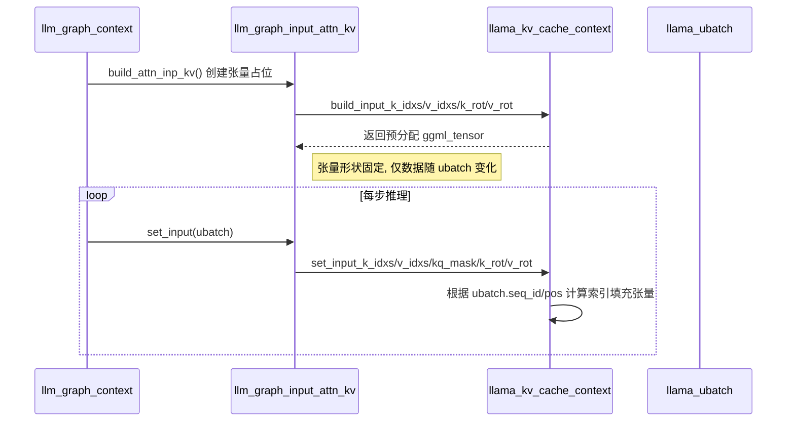
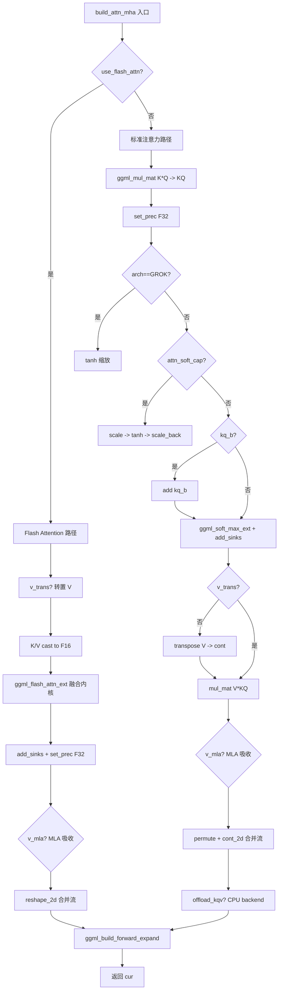
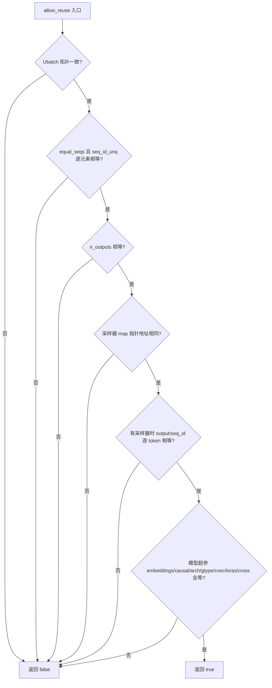

# 第19章 18 图构建总指挥与原料调度站 —— LLM 推理计算图的"建筑工程"隐喻

## 学习目标

- 掌握 `llm_graph_input_i` 抽象接口的设计契约，理解 `set_input` 与 `can_reuse` 的语义与调用时机
- 熟悉嵌入、位置、注意力掩码、KV 缓存、循环状态、交叉注意力、采样等 7 大输入家族的数据流向与张量形态
- 理解 `llm_graph_params::allow_reuse` 如何通过批次拓扑、采样器一致性、模型参数三重校验实现计算图复用
- 掌握 `llm_graph_context` 核心构建方法：`build_inp_embd`、`build_attn_mha`、`build_ffn`、`build_moe_ffn`、`build_pooling`、`build_sampling` 的实现细节
- 了解相对位置桶 `llama_relative_position_bucket` 与注意力软上限 `attn_soft_cap` 的数学原理与工程落地
- 能够分析 Flash Attention、LoRA 适配、专家并行等高级特性在图构建阶段的集成方式

## 19.1 生活类比

如果把 LLM 推理比作一座精密的化工厂，`llm_graph_context` 就是总工程师，手持蓝图（模型架构）指挥施工；`llm_graph_input_i` 及其子类则是一个个原材料调度站——嵌入站输送词向量钢材，位置站标记工序序号，注意力掩码站拉起安全隔离带，KV 缓存站管理半成品仓库，循环状态站维护流水线记忆，采样站把关最终成品质量。`llm_graph_params::allow_reuse` 就像换班检查表：只有当原料批次（`ubatch`）、工艺配方（`cparams`/`hparams`）、质检员（`samplers`）完全一致时，才允许复用上一班次搭建好的管道（计算图），避免拆装损耗。`build_attn_mha` 是核心反应器，将 Query、Key、Value 三股原料在高温高压（矩阵乘法+Softmax）下合成注意力输出；`build_ffn`/`build_moe_ffn` 则是下游精炼塔，通过门控与专家混合提纯特征。整个图构建过程，就是将散落的张量原料，按拓扑顺序铸造成可执行的 `ggml_cgraph` 成品。

## 19.2 源码地图

```
src/llama-graph.h
├── struct llm_graph_input_i                    # 输入张量管理基类（纯虚接口）
│   ├── set_input(ubatch)          pure virtual # 从 ubatch 填充张量数据
│   └── can_reuse(params)          virtual      # 判断张量能否复用
├── struct llm_graph_input_embd                 # Token/向量嵌入输入家族
├── struct llm_graph_input_pos                  # 位置编码输入家族（含 M-RoPE 4D 扩展）
├── struct llm_graph_input_attn_temp            # Attention 温度缩放输入家族
├── struct llm_graph_input_pos_bucket           # 相对位置桶输入家族（T5 风格）
├── struct llm_graph_input_pos_bucket_kv        # KV 缓存位置桶输入家族
├── struct llm_graph_input_out_ids              # 输出 Token 索引输入家族
├── struct llm_graph_input_mean                 # 均值池化权重输入家族
├── struct llm_graph_input_cls                  # CLS/LAST Token 索引输入家族
├── struct llm_graph_input_rs                   # 循环状态拷贝索引输入家族
├── struct llm_graph_input_cross_embd           # 交叉注意力编码器嵌入输入家族
├── struct llm_graph_input_attn_no_cache        # 无 KV 缓存自注意力掩码家族
├── struct llm_graph_input_attn_kv              # 标准 KV 缓存注意力输入家族
├── struct llm_graph_input_attn_k               # 仅 Key 的 KV 缓存注意力输入家族
├── struct llm_graph_input_attn_kv_iswa         # ISWA 滑窗注意力输入家族
├── struct llm_graph_input_attn_cross           # 交叉注意力掩码输入家族
├── struct llm_graph_input_mem_hybrid           # 混合内存（Attention+Recurrent）输入家族
├── struct llm_graph_input_mem_hybrid_k         # 混合内存 Key-only 输入家族
├── struct llm_graph_input_mem_hybrid_iswa      # 混合内存 ISWA 输入家族
├── struct llm_graph_input_sampling             # 采样器后端输入家族
├── struct llm_graph_params                     # 图构建参数聚合体
│   ├── allow_reuse(other)                       # 计算图复用三重校验
│   └── samplers_equal(lhs, rhs)      static    # 采样器映射一致性比较
├── struct llm_graph_result                     # 图构建结果容器
│   ├── reset()                                  # 重置张量与计算上下文
│   ├── set_inputs(ubatch)                       # 批量调用所有输入的 set_input
│   ├── set_outputs()                            # 标记 logits/embd/sampled 为图输出
│   ├── can_reuse(params)                        # 参数兼容性 + 所有输入可复用
│   └── add_input(input)                         # 注册输入管理器
├── class llm_graph_context                     # 图构建上下文（总工程师）
│   ├── build_inp_embd(tok_embd)                 # 构建嵌入选择子图（含 LoRA）
│   ├── build_inp_pos()                          # 构建位置索引张量
│   ├── build_inp_attn_scale()                   # 构建注意力温度缩放张量
│   ├── build_inp_out_ids()                      # 构建输出 ID 张量
│   ├── build_inp_mean()                         # 构建均值池化权重张量
│   ├── build_inp_cls()                          # 构建 CLS/LAST 索引张量
│   ├── build_inp_cross_embd()                   # 构建交叉注意力嵌入张量
│   ├── build_inp_pos_bucket_enc/dec()           # 构建编码器/解码器位置桶
│   ├── build_pos_bias(pos_bucket, attn_rel_b)   # 构建位置偏置张量
│   ├── build_attn_mha(q, k, v, ...)             # 核心多头注意力子图（含 Flash Attention）
│   ├── build_attn_inp_no_cache/kv/k/iswa/cross  # 构建各式注意力输入管理器
│   ├── build_attn(inp, wo, q_cur, k_cur, v_cur, ...) # 统一注意力构建入口（重载）
│   ├── build_ffn(cur, up, gate, down, ...)      # 标准 FFN 子图（Seq/Par 门控）
│   ├── build_moe_ffn(cur, gate_inp, up_exps, ...) # MoE FFN 子图（专家门控+归一化）
│   ├── build_rs(s, state_copy_main, ...)        # 循环状态拷贝与清零子图
│   ├── build_rs_inp()                           # 构建循环状态输入管理器
│   ├── build_rwkv_token_shift_load/store()      # RWKV Token Shift 加载/存储
│   ├── build_inp_mem_hybrid/k/iswa()            # 构建混合内存输入管理器
│   ├── build_pooling(cls, cls_out, ...)         # 池化层（NONE/MEAN/CLS/LAST/RANK）
│   ├── build_dense_out(dense_2, dense_3)        # 密集输出层（嵌入模式）
│   └── build_sampling()                         # 后端采样子图构建
├── class llm_graph_build                       # 高层图构建门面（含上述方法声明）
└── llama_relative_position_bucket(x, y, n_buckets, bidirectional) # 相对位置桶全局函数

src/llama-graph.cpp
├── 所有上述类的方法实现
├── 静态辅助函数：build_attn_inp_kq_mask、can_reuse_kq_mask、ggml_mul_mat_aux、print_mask
└── 静态工厂函数：build_attn_inp_kv_impl、build_attn_inp_k_impl、build_rs_inp_impl
```

## 19.3 源码解析单元1：llm_graph_input_i —— 输入家族的"统一身份证"与生命周期

### 19.3.1 接口定义与调试开关

**源码路径：`src/llama-graph.h` - `llm_graph_input_i`（第 99-117 行）**

```cpp
// 所有图输入的张量管理基类，定义输入设置和复用判断接口，并提供调试开关。
struct llm_graph_input_i {
    int debug = 0;

    llm_graph_input_i() {
        const char * LLAMA_GRAPH_INPUT_DEBUG = getenv("LLAMA_GRAPH_INPUT_DEBUG");
        debug = LLAMA_GRAPH_INPUT_DEBUG ? atoi(LLAMA_GRAPH_INPUT_DEBUG) : 0;
    }

    virtual ~llm_graph_input_i() = default;

    // 纯虚函数：将 ubatch 数据设置到输入张量中
    virtual void set_input(const llama_ubatch * ubatch) = 0;

    // 虚函数：判断当前输入张量是否可复用于给定参数，默认返回 false
    virtual bool can_reuse(const llm_graph_params & params) {
        GGML_UNUSED(params);
        return false;
    }
};
```

**代码作用概述**：  
此代码定义了 `llm_graph_input_i` 基类，它是所有输入家族（嵌入、位置、注意力掩码等）的统一抽象接口。构造函数读取环境变量 `LLAMA_GRAPH_INPUT_DEBUG` 初始化 `debug` 标志，支持运行时无需重编译即可开启逐输入级的调试日志。纯虚函数 `set_input` 强制子类实现从 `llama_ubatch` 拷贝数据到预分配 `ggml_tensor` 的逻辑；虚函数 `can_reuse` 默认返回 `false`，子类可重写以参与计算图复用判定。虚析构函数保证多态删除安全。

### 19.3.2 协作流程图：从推理循环到图复用决策

```mermaid
flowchart TD
    A[推理循环: llama_decode/encode] --> B[llm_graph_result::can_reuse(params)]
    B --> C{params.allow_reuse?}
    C -->|否| D[重建图: reset -> build_*]
    C -->|是| E[遍历 inputs 调用 input->can_reuse(params)]
    E --> F{全部返回 true?}
    F -->|否| D
    F -->|是| G[复用现有 gf, 调用 set_inputs(ubatch)]
    G --> H[遍历 inputs 调用 input->set_input(ubatch)]
    H --> I[ggml_build_forward_expand / 执行图]
    I --> A
```

## 19.4 源码解析单元2：基础输入家族 —— 嵌入、位置、输出 ID

### 19.4.1 llm_graph_input_embd：Token 与向量的双轨制

**源码路径：`src/llama-graph.cpp` - `llm_graph_input_embd::set_input`（第 69-82 行）**

```cpp
// 从 ubatch 拷贝 token 索引或外部嵌入向量到预分配张量
void llm_graph_input_embd::set_input(const llama_ubatch * ubatch) {
    if (ubatch->token) {
        const int64_t n_tokens = ubatch->n_tokens;
        // tokens: [n_tokens] (I32)
        ggml_backend_tensor_set(tokens, ubatch->token, 0, n_tokens * ggml_element_size(tokens));
    }
    if (ubatch->embd) {
        GGML_ASSERT(n_embd == embd->ne[0]);
        const int64_t n_tokens = ubatch->n_tokens;
        // embd: [n_embd, n_tokens] (F32)
        ggml_backend_tensor_set(embd, ubatch->embd, 0, n_tokens * n_embd * ggml_element_size(embd));
    }
}
```

**代码作用概述**：  
此函数实现嵌入输入家族的数据填充。若 `ubatch` 携带 `token` 数组（整型索引），将其拷贝到 `tokens` 张量（形状 `[n_tokens]`, 类型 I32）；若携带 `embd` 数组（外部预计算浮点向量），校验嵌入维度 `n_embd` 后拷贝到 `embd` 张量（形状 `[n_embd, n_tokens]`, 类型 F32）。两者互斥且至少存在一个，支撑标准 Token 查表与外部嵌入直喂两种模式。

**源码路径：`src/llama-graph.cpp` - `llm_graph_input_embd::can_reuse`（第 85-91 行）**

```cpp
bool llm_graph_input_embd::can_reuse(const llm_graph_params & params) {
    bool res = true;
    // token 张量长度需匹配 n_tokens
    res &= (!params.ubatch.token) || (tokens && tokens->ne[0] == params.ubatch.n_tokens);
    // embd 张量第 1 维需匹配 n_tokens
    res &= (!params.ubatch.embd)  || (embd   &&   embd->ne[1] == params.ubatch.n_tokens);
    return res;
}
```

**代码作用概述**：  
此函数判定嵌入输入张量能否复用。核心逻辑：若当前批次提供 `token`，则 `tokens` 张量首维必须等于新批次 `n_tokens`；若提供 `embd`，则 `embd` 张量第二维必须等于新批次 `n_tokens`。若对应输入不存在（指针为空），则跳过该项检查。此设计确保张量形状兼容时复用内存分配。

### 19.4.2 架构解析：build_inp_embd 的选择子图设计

**源码路径：`src/llama-graph.cpp` - `llm_graph_context::build_inp_embd`（第 348-421 行）**

```cpp
ggml_tensor * llm_graph_context::build_inp_embd(ggml_tensor * tok_embd) const {
    const int64_t n_embd_inp = hparams.n_embd_inp();
    const int64_t n_embd     = hparams.n_embd;

    assert(n_embd_inp >= n_embd);

    auto inp = std::make_unique<llm_graph_input_embd>(n_embd_inp);

    inp->tokens = ggml_new_tensor_1d(ctx0, GGML_TYPE_I32, ubatch.n_tokens);
    cb(inp->tokens, "inp_tokens", -1);
    ggml_set_input(inp->tokens);
    res->t_inp_tokens = inp->tokens;

    inp->embd = ggml_new_tensor_2d(ctx0, GGML_TYPE_F32, n_embd_inp, ubatch.n_tokens);
    cb(inp->embd, "inp_embd", -1);
    ggml_set_input(inp->embd);

    // select one of the 2 inputs, based on the batch contents
    // ref: https://github.com/ggml-org/llama.cpp/pull/18550
    std::array<ggml_tensor *, 2> inps;

    // token embeddings path (ubatch.token != nullptr)
    {
        auto & cur = inps[0];

        cur = ggml_get_rows(ctx0, tok_embd, inp->tokens);

        // apply lora for embedding tokens if needed
        for (const auto & lora : *loras) {
            llama_adapter_lora_weight * lw = lora.first->get_weight(tok_embd);
            if (lw == nullptr) {
                continue;
            }

            const float adapter_scale = lora.second;
            const float scale = lw->get_scale(lora.first->alpha, adapter_scale);

            ggml_tensor * inpL_delta = ggml_scale(ctx0, ggml_mul_mat(
                        ctx0, lw->b, // non-transposed lora_b
                        ggml_get_rows(ctx0, lw->a, inp->tokens)
                        ), scale);

            cur = ggml_add(ctx0, cur, inpL_delta);
        }

        if (n_embd_inp != n_embd) {
            cur = ggml_pad(ctx0, cur, hparams.n_embd_inp() - n_embd, 0, 0, 0);
        }
    }

    // vector embeddings path (ubatch.embd != nullptr)
    {
        auto & cur = inps[1];

        cur = inp->embd;
    }

    assert(ggml_are_same_shape (inps[0], inps[1]));
    assert(ggml_are_same_stride(inps[0], inps[1]));

    ggml_tensor * cur = ggml_build_forward_select(gf, inps.data(), inps.size(), ubatch.token ? 0 : 1);

    if (n_embd_inp != n_embd) {
        cur = ggml_view_2d(ctx0, cur, n_embd, n_tokens, cur->nb[1], 0);
    }

    res->t_inp_embd = cur;

    // For Granite architecture
    if (hparams.f_embedding_scale != 0.0f) {
        cur = ggml_scale(ctx0, cur, hparams.f_embedding_scale);
    }

    cb(cur, "embd", -1);

    res->add_input(std::move(inp));

    // make sure the produced embeddings are immediately materialized in the ggml graph
    // ref: https://github.com/ggml-org/llama.cpp/pull/18599
    ggml_build_forward_expand(gf, cur);

    return cur;
}
```

**代码作用概述**：  
此函数构建嵌入层的计算子图，核心是“双分支 + 运行时选择”设计。首先分配 `tokens` (I32, `[n_tokens]`) 与 `embd` (F32, `[n_embd_inp, n_tokens]`) 两个输入张量。分支 0：`ggml_get_rows(tok_embd, tokens)` 查表得到嵌入，随后遍历 LoRA 适配器应用增量（`lw->b @ lw->a @ rows`），若 `n_embd_inp > n_embd` 则 `ggml_pad` 补零。分支 1：直接使用外部传入的 `embd` 张量。最后 `ggml_build_forward_select` 根据 `ubatch->token` 是否存在动态选择分支（0 为 token 模式，1 为嵌入模式）。此设计保证图拓扑固定，仅运行时数据流切换，满足 pipeline 并行对拓扑不变性的要求。输出张量若维度不匹配则切片取前 `n_embd` 维，并可选应用 `embedding_scale` 缩放。

### 19.4.3 llm_graph_input_pos：位置编码与 M-RoPE 4D 扩展

**源码路径：`src/llama-graph.cpp` - `llm_graph_input_pos::set_input`（第 93-118 行）**

```cpp
void llm_graph_input_pos::set_input(const llama_ubatch * ubatch) {
    if (ubatch->pos && pos) {
        const int64_t n_tokens = ubatch->n_tokens;
        if (ubatch->token && n_pos_per_embd == 4) {
            // M-RoPE 场景：将 1D 位置扩展为 4D，前三维相同，第 4 维全 0
            std::vector<llama_pos> pos_data(n_tokens * n_pos_per_embd);
            for (int i = 0; i < n_tokens; ++i) {
                pos_data[               i] = ubatch->pos[i];
                pos_data[    n_tokens + i] = ubatch->pos[i];
                pos_data[2 * n_tokens + i] = ubatch->pos[i];
                pos_data[3 * n_tokens + i] = 0; // 4th dim is 0
            }
            ggml_backend_tensor_set(pos, pos_data.data(), 0, pos_data.size() * ggml_element_size(pos));
        } else {
            // 标准 1D 或多维位置直接拷贝
            ggml_backend_tensor_set(pos, ubatch->pos, 0, n_tokens * n_pos_per_embd * ggml_element_size(pos));
        }
    }
}
```

**代码作用概述**：  
此函数将 `ubatch` 中的位置数据拷贝到位置张量。当检测到 `ubatch->token` 存在且 `n_pos_per_embd == 4`（M-RoPE 模式，如 Llama4、Qwen2-VL）时，在宿主侧将 1D 位置展开为 4D：前三维复制原位置值，第 4 维填 0。否则直接拷贝。宿主侧展开避免了设备端实现复杂广播内核，且仅在 Token 模式下触发（纯嵌入输入无需位置）。

**源码路径：`src/llama-graph.cpp` - `llm_graph_context::build_inp_pos`（第 423-434 行）**

```cpp
ggml_tensor * llm_graph_context::build_inp_pos() const {
    auto inp = std::make_unique<llm_graph_input_pos>(hparams.n_pos_per_embd());
    auto & cur = inp->pos;
    // 形状: [n_tokens * n_pos_per_embd] (I32)
    cur = ggml_new_tensor_1d(ctx0, GGML_TYPE_I32, (int64_t)n_tokens * hparams.n_pos_per_embd());
    ggml_set_input(cur);
    res->add_input(std::move(inp));
    return cur;
}
```

**代码作用概述**：  
此函数创建位置输入张量，形状为 `[n_tokens * n_pos_per_embd]`（I32），`n_pos_per_embd()` 由架构决定：普通模型为 1，启用 M-RoPE 时为 4。张量标记为输入节点并注册到结果容器。

### 19.4.4 llm_graph_input_out_ids：输出 Token 的"取货单"

**源码路径：`src/llama-graph.cpp` - `llm_graph_input_out_ids::set_input`（第 170-193 行）**

```cpp
void llm_graph_input_out_ids::set_input(const llama_ubatch * ubatch) {
    GGML_ASSERT(out_ids);
    const int64_t n_tokens = ubatch->n_tokens;
    GGML_ASSERT(ggml_backend_buffer_is_host(out_ids->buffer)); // 必须在宿主内存
    int32_t * data = (int32_t *) out_ids->data;
    if (n_outputs == n_tokens) {
        // 全 token 输出：直接 0..n_tokens-1
        for (int i = 0; i < n_tokens; ++i) data[i] = i;
        return;
    }
    GGML_ASSERT(ubatch->output);
    int n_outputs = 0;
    for (int i = 0; i < n_tokens; ++i) {
        if (ubatch->output[i]) {
            data[n_outputs++] = i; // 记录需输出的 token 索引
        }
    }
}
```

**代码作用概述**：  
此函数填充输出 ID 张量。张量必须在宿主内存（便于 CPU 直接写入索引）。若 `n_outputs == n_tokens`（全 token 输出），直接写入 `0..n_tokens-1`；否则遍历 `ubatch->output` 标记位，仅记录需输出的 token 索引。此张量供 `ggml_get_rows(logits, out_ids)` 仅抽取需计算损失/采样的 token 行，节省显存与算力。

**源码路径：`src/llama-graph.cpp` - `llm_graph_context::build_inp_out_ids`（第 451-469 行）**

```cpp
ggml_tensor * llm_graph_context::build_inp_out_ids() const {
    // note: when all tokens are output, we could skip this optimization to spare the ggml_get_rows() calls,
    //       but this would make the graph topology depend on the number of output tokens, which can interfere with
    //       features that require constant topology such as pipeline parallelism
    //       ref: https://github.com/ggml-org/llama.cpp/pull/14275#issuecomment-2987424471
    //if (n_outputs < n_tokens) {
    //    return nullptr;
    //}

    auto inp = std::make_unique<llm_graph_input_out_ids>(hparams, cparams, n_outputs);

    auto & cur = inp->out_ids;
    // 形状: [n_outputs] (I32)
    cur = ggml_new_tensor_1d(ctx0, GGML_TYPE_I32, n_outputs);
    ggml_set_input(cur);
    res->add_input(std::move(inp));
    return cur;
}
```

**代码作用概述**：  
此函数创建输出 ID 张量，形状 `[n_outputs]` (I32)。注释明确指出：即使全 token 输出也保留此张量，以维持图拓扑不变，支持 pipeline 并行。

## 19.5 源码解析单元3：注意力输入家族 —— 掩码、KV 索引、位置桶

### 19.5.1 llm_graph_input_attn_no_cache：无缓存自注意力掩码

**源码路径：`src/llama-graph.cpp` - `llm_graph_input_attn_no_cache::set_input`（第 368-430 行）**

```cpp
void llm_graph_input_attn_no_cache::set_input(const llama_ubatch * ubatch) {
    const int64_t n_kv     = ubatch->n_tokens;
    const int64_t n_tokens = ubatch->n_tokens;
    const auto fill_mask = [&](float * data, int n_swa, llama_swa_type swa_type) {
        for (int i1 = 0; i1 < n_tokens; ++i1) {
            const llama_seq_id s1 = ubatch->seq_id[i1][0];
            const llama_pos    p1 = ubatch->pos[i1];
            const uint64_t idst = i1 * n_kv;
            for (int i0 = 0; i0 < n_tokens; ++i0) {
                const llama_seq_id s0 = ubatch->seq_id[i0][0];
                const llama_pos p0    = ubatch->pos[i0];
                // 1. 屏蔽不同序列
                if (s0 != s1) continue;
                // 2. 因果掩码：屏蔽未来 token
                if (cparams.causal_attn && p0 > p1) continue;
                // 3. 滑窗注意力 (SWA)
                if (llama_hparams::is_masked_swa(n_swa, swa_type, p0, p1)) continue;
                // 允许注意：ALiBi 偏置或 0
                data[idst + i0] = hparams.use_alibi ? -std::abs(p0 - p1) : 0.0f;
            }
        }
    };
    // 基础掩码
    GGML_ASSERT(self_kq_mask);
    float * data = (float *) self_kq_mask->data;
    std::fill(data, data + ggml_nelements(self_kq_mask), -INFINITY);
    fill_mask(data, 0, LLAMA_SWA_TYPE_NONE);
    if (debug) print_mask(data, n_tokens, n_kv, 0, LLAMA_SWA_TYPE_NONE);
    // SWA 掩码（若启用）
    if (hparams.swa_type != LLAMA_SWA_TYPE_NONE) {
        GGML_ASSERT(self_kq_mask_swa);
        float * data_swa = (float *) self_kq_mask_swa->data;
        std::fill(data_swa, data_swa + ggml_nelements(self_kq_mask_swa), -INFINITY);
        fill_mask(data_swa, hparams.n_swa, hparams.swa_type);
        if (debug) print_mask(data_swa, n_tokens, n_kv, hparams.n_swa, hparams.swa_type);
    }
}
```

**代码作用概述**：  
此函数在宿主侧构建自注意力掩码矩阵。`fill_mask` Lambda 封装三层过滤：序列隔离（不同 `seq_id` 屏蔽）、因果约束（`p0 > p1` 屏蔽未来）、SWA 窗口（调用 `is_masked_swa` 判定）。通过后写入 ALiBi 偏置（`-abs(p0-p1)`）或 0。基础掩码与 SWA 掩码分别填充，首次全置 `-INFINITY` 再按规则放行。`print_mask` 以 ASCII 艺术打印前 20×20 掩码，`∞` 表示屏蔽，`0` 表示可注意，极利于调试。

**源码路径：`src/llama-graph.cpp` - `llm_graph_context::build_attn_inp_no_cache`（第 655-674 行）**

```cpp
llm_graph_input_attn_no_cache * llm_graph_context::build_attn_inp_no_cache() const {
    auto inp = std::make_unique<llm_graph_input_attn_no_cache>(hparams, cparams);
    // 形状: [n_tokens, n_tokens, 1, 1] (F32)
    inp->self_kq_mask = ggml_new_tensor_4d(ctx0, GGML_TYPE_F32, n_tokens, n_tokens, 1, 1);
    ggml_set_input(inp->self_kq_mask);
    inp->self_kq_mask_cnv = cparams.flash_attn ? ggml_cast(ctx0, inp->self_kq_mask, GGML_TYPE_F16) : inp->self_kq_mask;
    if (hparams.swa_type != LLAMA_SWA_TYPE_NONE) {
        inp->self_kq_mask_swa = ggml_new_tensor_4d(ctx0, GGML_TYPE_F32, n_tokens, n_tokens, 1, 1);
        ggml_set_input(inp->self_kq_mask_swa);
        inp->self_kq_mask_swa_cnv = cparams.flash_attn ? ggml_cast(ctx0, inp->self_kq_mask_swa, GGML_TYPE_F16) : inp->self_kq_mask_swa;
    }
    return (llm_graph_input_attn_no_cache *) res->add_input(std::move(inp));
}
```

**代码作用概述**：  
此函数分配无缓存注意力掩码张量：4D 形状 `[n_kv, n_q, 1, n_stream]` 兼容 `ggml_soft_max_ext` 与 Flash Attention 广播语义。若启用 Flash Attention 则额外创建 F16 转换张量；若启用 SWA 则再分配一套 SWA 掩码张量。

### 19.5.2 模块依赖图：标准 KV 缓存注意力输入家族协作



### 19.5.3 llm_graph_input_attn_kv：标准 KV 缓存注意力输入

**源码路径：`src/llama-graph.h` - `llm_graph_input_attn_kv` 成员（第 317-335 行）**

```cpp
struct llm_graph_input_attn_kv : llm_graph_input_i {
    const llama_hparams & hparams;
    const llama_cparams & cparams;
    const llama_kv_cache_context * mctx;

    ggml_tensor * self_k_idxs = nullptr;      // Key 写入索引
    ggml_tensor * self_v_idxs = nullptr;      // Value 写入索引
    ggml_tensor * self_kq_mask = nullptr;     // 注意力掩码 (F32)
    ggml_tensor * self_kq_mask_cnv = nullptr; // 转换后掩码 (F16/F32)
    ggml_tensor * self_k_rot = nullptr;       // Key 旋转矩阵
    ggml_tensor * self_v_rot = nullptr;       // Value 旋转矩阵

    // 构造、析构、set_input、can_reuse、get_k_idxs/get_v_idxs/get_kq_mask ...
};
```

**源码路径：`src/llama-graph.cpp` - `llm_graph_input_attn_kv::set_input`（第 432-448 行）**

```cpp
void llm_graph_input_attn_kv::set_input(const llama_ubatch * ubatch) {
    mctx->set_input_k_idxs(self_k_idxs, ubatch);
    mctx->set_input_v_idxs(self_v_idxs, ubatch);
    mctx->set_input_kq_mask(self_kq_mask, ubatch, cparams.causal_attn);
    if (self_k_rot) mctx->set_input_k_rot(self_k_rot);
    if (self_v_rot) mctx->set_input_v_rot(self_v_rot);
}
```

**代码作用概述**：  
此函数委托 KV 缓存上下文填充索引、掩码、旋转矩阵张量。`set_input_k_idxs/v_idxs` 计算当前批次 Key/Value 在 KV Cache 中的写入位置；`set_input_kq_mask` 构建包含因果与序列隔离的注意力掩码；`set_input_k_rot/v_rot` 准备 RoPE 旋转矩阵。

**源码路径：`src/llama-graph.cpp` - `build_attn_inp_kv_impl` 工厂函数（第 2067-2092 行）**

```cpp
static std::unique_ptr<llm_graph_input_attn_kv> build_attn_inp_kv_impl(
        ggml_context * ctx0, const llama_ubatch & ubatch,
        const llama_hparams & hparams, const llama_cparams & cparams,
        const llama_kv_cache_context * mctx_cur) {
    auto inp = std::make_unique<llm_graph_input_attn_kv>(hparams, cparams, mctx_cur);
    GGML_ASSERT(hparams.swa_type == LLAMA_SWA_TYPE_NONE && "Use llama_kv_cache_iswa for SWA");
    // 由 KV 缓存上下文构建索引张量
    inp->self_k_idxs = mctx_cur->build_input_k_idxs(ctx0, ubatch);
    inp->self_v_idxs = mctx_cur->build_input_v_idxs(ctx0, ubatch);
    // 掩码张量: [n_kv, n_tokens/n_stream, 1, n_stream]
    inp->self_kq_mask = build_attn_inp_kq_mask(ctx0, mctx_cur, ubatch, cparams);
    inp->self_kq_mask_cnv = cparams.flash_attn ? ggml_cast(ctx0, inp->self_kq_mask, GGML_TYPE_F16) : inp->self_kq_mask;
    // RoPE 旋转矩阵
    inp->self_k_rot = mctx_cur->build_input_k_rot(ctx0);
    inp->self_v_rot = mctx_cur->build_input_v_rot(ctx0);
    return inp;
}
```

**代码作用概述**：  
工厂函数创建标准 KV 注意力输入对象。断言非 SWA 模式。调用 KV Cache 上下文方法构建 `k_idxs`、`v_idxs`（写入索引）、`kq_mask`（注意力掩码，形状 `[n_kv, n_tokens/n_stream, 1, n_stream]`）、`k_rot`/`v_rot`（RoPE 旋转矩阵）。Flash Attention 时掩码转 F16。

### 19.5.4 llama_relative_position_bucket：相对位置桶计算函数

**源码路径：`src/llama-graph.cpp` - `llama_relative_position_bucket`（第 2743-2771 行）**

```cpp
// T5 风格相对位置桶计算：将相对距离映射到离散桶，远距离对数压缩
int32_t llama_relative_position_bucket(llama_pos x, llama_pos y, uint64_t n_buckets, bool bidirectional) {
    const int64_t max_distance = 128;
    if (bidirectional) n_buckets >>= 1; // 双向模式：一半桶给正向，一半给负向
    const int64_t max_exact = n_buckets >> 1; // 近距离精确桶数
    int32_t relative_position = x - y;
    int32_t relative_bucket = 0;
    if (bidirectional) {
        relative_bucket += (relative_position > 0) * n_buckets; // 正向偏移
        relative_position = std::abs(relative_position);
    } else {
        relative_position = -std::min<int32_t>(relative_position, 0); // 单向：仅保留历史
    }
    // 对数分桶：max_exact 以内线性，之外对数压缩至 n_buckets-1
    int32_t relative_position_if_large = floorf(max_exact + logf(1.0 * relative_position / max_exact) *
                                                (n_buckets - max_exact) / log(1.0 * max_distance / max_exact));
    relative_position_if_large = std::min<int32_t>(relative_position_if_large, n_buckets - 1);
    relative_bucket += (relative_position < max_exact ? relative_position : relative_position_if_large);
    return relative_bucket;
}
```

**代码作用概述**：  
此函数实现 T5 风格相对位置桶映射。参数：`x`(Query 位置)、`y`(Key 位置)、`n_buckets`(桶总数)、`bidirectional`(是否双向)。算法：双向模式桶数减半，正负向各占一半；单向模式仅保留历史方向（`relative_position <= 0`）。近距离（`< max_exact`）线性分桶，远距离对数压缩至 `n_buckets-1`，`max_distance=128` 控制压缩曲率。返回离散桶索引，供 `attn_rel_b` 查表得到位置偏置。

**源码路径：`src/llama-graph.cpp` - `llm_graph_input_pos_bucket::set_input`（第 148-161 行）**

```cpp
void llm_graph_input_pos_bucket::set_input(const llama_ubatch * ubatch) {
    if (pos_bucket) {
        const int64_t n_tokens = ubatch->n_tokens;
        GGML_ASSERT(ggml_backend_buffer_is_host(pos_bucket->buffer)); // 必须宿主侧计算
        GGML_ASSERT(!ubatch->equal_seqs()); // TODO: 支持 equal_seqs
        int32_t * data = (int32_t *) pos_bucket->data;
        for (int j = 0; j < n_tokens; ++j) {
            for (int i = 0; i < n_tokens; ++i) {
                // 计算 (i,j) 对的相对位置桶
                data[j * n_tokens + i] = llama_relative_position_bucket(
                    ubatch->pos[i], ubatch->pos[j], hparams.n_rel_attn_bkts, true);
            }
        }
    }
}
```

**代码作用概述**：  
此函数在宿主侧双重循环计算所有 token 对的相对位置桶，填充 `pos_bucket` 张量（形状 `[n_tokens, n_tokens]`, I32）。要求张量在宿主内存，且当前不支持 `equal_seqs` 优化模式。

**源码路径：`src/llama-graph.cpp` - `llm_graph_context::build_pos_bias`（第 549-561 行）**

```cpp
ggml_tensor * llm_graph_context::build_pos_bias(ggml_tensor * pos_bucket, ggml_tensor * attn_rel_b) const {
    // pos_bucket: [n_tokens, n_tokens] (I32) -> reshape -> [n_tokens*n_tokens]
    ggml_tensor * pos_bucket_1d = ggml_reshape_1d(ctx0, pos_bucket, pos_bucket->ne[0] * pos_bucket->ne[1]);
    cb(pos_bucket_1d, "pos_bucket_1d", -1);
    // attn_rel_b: [n_buckets, n_head] -> get_rows -> [n_tokens*n_tokens, n_head]
    ggml_tensor * pos_bias = ggml_get_rows(ctx0, attn_rel_b, pos_bucket_1d);
    // reshape -> [n_head, n_tokens, n_tokens] -> permute -> [n_tokens, n_tokens, n_head]
    pos_bias = ggml_reshape_3d(ctx0, pos_bias, pos_bias->ne[0], pos_bucket->ne[0], pos_bucket->ne[1]);
    pos_bias = ggml_permute(ctx0, pos_bias, 2, 0, 1, 3);
    pos_bias = ggml_cont(ctx0, pos_bias);
    cb(pos_bias, "pos_bias", -1);
    return pos_bias; // 最终形状 [n_tokens, n_tokens, n_head] 可直接加到 KQ 上
}
```

**代码作用概述**：  
此函数将位置桶索引转换为位置偏置张量。步骤：`pos_bucket` 展平为 1D 索引 -> `ggml_get_rows` 从 `attn_rel_b` (`[n_buckets, n_head]`) 取行得到 `[n_tokens*n_tokens, n_head]` -> 重塑为 3D -> `permute(2,0,1,3)` 调整维度顺序为 `[n_tokens, n_tokens, n_head]` -> `cont` 确保内存连续。最终张量可直接加到注意力分数 `KQ` 上。

## 19.6 源码解析单元4：循环与混合内存家族 —— RWKV 与 Hybrid 架构的"记忆磁带"

### 19.6.1 llm_graph_input_rs：循环状态拷贝索引

**源码路径：`src/llama-graph.cpp` - `llm_graph_input_rs::set_input`（第 296-314 行）**

```cpp
void llm_graph_input_rs::set_input(const llama_ubatch * ubatch) {
    GGML_UNUSED(ubatch);
    const int64_t n_rs = mctx->get_n_rs();
    if (s_copy) {
        GGML_ASSERT(ggml_backend_buffer_is_host(s_copy->buffer));
        int32_t * data = (int32_t *) s_copy->data;
        // 拷贝目标假设总在 head 到 head+n 之间
        for (uint32_t i = 0; i < n_rs; ++i) {
            data[i] = mctx->s_copy(i); // 从循环上下文获取拷贝目标索引
        }
    }
}
```

**代码作用概述**：  
此函数填充循环状态拷贝索引张量 `s_copy`。张量必须在宿主内存。遍历所有循环槽位 `n_rs`，调用 `mctx->s_copy(i)` 获取每个槽位的拷贝来源索引写入。设计假设拷贝目标总在 `head` 到 `head+n` 区间。

**源码路径：`src/llama-graph.cpp` - `build_rs_inp_impl` 工厂函数（第 2457-2473 行）**

```cpp
static std::unique_ptr<llm_graph_input_rs> build_rs_inp_impl(
        ggml_context * ctx0, const llama_ubatch & ubatch,
        const llama_memory_recurrent_context * mctx_cur) {
    auto inp = std::make_unique<llm_graph_input_rs>(mctx_cur);
    const int64_t n_rs   = mctx_cur->get_n_rs();
    const int64_t n_seqs = ubatch.n_seqs;
    // s_copy: [n_rs] (I32) 记录每个循环槽位的拷贝来源
    inp->s_copy = ggml_new_tensor_1d(ctx0, GGML_TYPE_I32, n_rs);
    ggml_set_input(inp->s_copy);
    // 主序列视图: 前 n_seqs 个槽位
    inp->s_copy_main  = ggml_view_1d(ctx0, inp->s_copy, n_seqs, 0);
    // 额外槽位视图: 后 n_rs - n_seqs 个槽位
    inp->s_copy_extra = ggml_view_1d(ctx0, inp->s_copy, n_rs - n_seqs, n_seqs * inp->s_copy->nb[0]);
    inp->head = mctx_cur->get_head();
    inp->rs_z = mctx_cur->get_rs_z();
    return inp;
}
```

**代码作用概述**：  
工厂函数构建循环状态输入对象。创建 `s_copy` 张量（`[n_rs]`, I32）并标记为输入。通过 `ggml_view_1d` 切出两个视图：`s_copy_main` 指向前 `n_seqs` 个槽位（主序列），`s_copy_extra` 指向剩余槽位（额外/共享状态）。记录当前 `head` 与 `rs_z` 用于 `can_reuse` 校验。

**源码路径：`src/llama-graph.cpp` - `llm_graph_context::build_rs`（第 2423-2455 行）**

```cpp
ggml_tensor * llm_graph_context::build_rs(
        ggml_tensor * s, ggml_tensor * state_copy_main, ggml_tensor * state_copy_extra,
        int32_t state_size, int32_t n_seqs, uint32_t n_rs, uint32_t rs_head,
        uint32_t rs_size, int32_t rs_zero,
        const llm_graph_get_rows_fn & get_state_rows) const {
    // s: [state_size, rs_size] -> 状态矩阵
    ggml_tensor * states = ggml_reshape_2d(ctx0, s, state_size, rs_size);
    // 1. 清零 rs_zero 槽位 (通常为 0, 表示复位槽)
    ggml_tensor * state_zero = ggml_view_1d(ctx0, states, state_size * (rs_zero >= 0),
                                            rs_zero * states->nb[1] * (rs_zero >= 0));
    ggml_build_forward_expand(gf, ggml_scale_inplace(ctx0, state_zero, 0));
    // 2. 主序列拷贝: get_state_rows 通常为 ggml_get_rows
    ggml_tensor * output_states = get_state_rows(ctx0, states, state_copy_main);
    ggml_build_forward_expand(gf, output_states);
    // 3. 额外槽位拷贝: 从 head+n_seqs 处连续拷贝 n_rs-n_seqs 个槽位
    ggml_tensor * states_extra = ggml_get_rows(ctx0, states, state_copy_extra);
    ggml_build_forward_expand(gf,
        ggml_cpy(ctx0, states_extra,
            ggml_view_1d(ctx0, s, state_size * (n_rs - n_seqs),
                         (rs_head + n_seqs) * state_size * ggml_element_size(s))));
    return output_states;
}
```

**代码作用概述**：  
此函数构建循环状态更新子图，三步走：1) `ggml_view_1d` 定位 `rs_zero` 槽位并 `ggml_scale_inplace(..., 0)` 清零；2) 调用回调 `get_state_rows`（默认 `ggml_get_rows`）按 `state_copy_main` 索引聚集主序列状态，`ggml_build_forward_expand` 立即执行；3) `ggml_get_rows` 取 `state_copy_extra` 对应行，`ggml_cpy` 从 `head+n_seqs` 处连续内存拷贝 `n_rs-n_seqs` 个槽位。此设计实现类环形缓冲区的状态更新，`get_state_rows` 回调允许自定义聚集逻辑。

### 19.6.2 llm_graph_input_mem_hybrid：混合内存输入家族（组合模式）

**源码路径：`src/llama-graph.h` - `llm_graph_input_mem_hybrid`（第 449-469 行）**

```cpp
struct llm_graph_input_mem_hybrid : llm_graph_input_i {
    std::unique_ptr<llm_graph_input_attn_kv> inp_attn; // 标准注意力输入
    std::unique_ptr<llm_graph_input_rs>      inp_rs;   // 循环状态输入
    const llama_cparams & cparams;
    const llama_memory_hybrid_context * mctx;
    // 构造、set_input、can_reuse、get_attn/get_recr
};
```

**源码路径：`src/llama-graph.cpp` - `llm_graph_context::build_inp_mem_hybrid`（第 2529-2540 行）**

```cpp
llm_graph_input_mem_hybrid * llm_graph_context::build_inp_mem_hybrid() const {
    const auto * mctx_cur = static_cast<const llama_memory_hybrid_context *>(mctx);
    // 复用已有工厂函数构建子输入
    auto inp_rs   = build_rs_inp_impl(ctx0, ubatch, mctx_cur->get_recr());
    auto inp_attn = build_attn_inp_kv_impl(ctx0, ubatch, hparams, cparams, mctx_cur->get_attn());
    auto inp = std::make_unique<llm_graph_input_mem_hybrid>(cparams, std::move(inp_attn), std::move(inp_rs), mctx_cur);
    return (llm_graph_input_mem_hybrid *) res->add_input(std::move(inp));
}
```

**代码作用概述**：  
此函数构建混合内存输入对象，采用**组合模式**复用 `attn_kv` 与 `rs` 两个成熟输入家族。`build_rs_inp_impl` 构建循环状态输入，`build_attn_inp_kv_impl` 构建标准注意力输入，二者移动语义移入 `mem_hybrid`。`set_input` 一次性驱动注意力索引/掩码/旋转矩阵与循环拷贝索引更新；`can_reuse` 联合校验两侧张量形状与上下文状态（`head`、`rs_z`），保证混合架构图复用安全。

## 19.7 源码解析单元5：核心算子构建 —— FFN、MoE、Attention MHA

### 19.7.1 llm_graph_context::build_lora_mm：LoRA 增强矩阵乘法

**源码路径：`src/llama-graph.cpp` - `llm_graph_context::build_lora_mm`（第 935-965 行）**

```cpp
ggml_tensor * llm_graph_context::build_lora_mm(
          ggml_tensor * w,
          ggml_tensor * cur,
          ggml_tensor * w_s) const {
    ggml_tensor * res = ggml_mul_mat(ctx0, w, cur);
    for (const auto & lora : *loras) {
        llama_adapter_lora_weight * lw = lora.first->get_weight(w);
        if (lw == nullptr) {
            continue;
        }
        const float adapter_scale = lora.second;
        const float scale = lw->get_scale(lora.first->alpha, adapter_scale);
        ggml_tensor * ab_cur = ggml_mul_mat(
                ctx0, lw->b,
                ggml_mul_mat(ctx0, lw->a, cur)
                );
        ab_cur = ggml_scale(ctx0, ab_cur, scale);
        res = ggml_add(ctx0, res, ab_cur);
    }
    if (w_s) {
        res = ggml_mul(ctx0, res, w_s);
    }
    return res;
}
```

**代码作用概述**：  
此函数实现基础矩阵乘法 `w @ cur` 并融合 LoRA 适配器。遍历所有激活的 LoRA，获取对应权重 `lw`（包含低秩矩阵 `a`、`b`），计算 `scale = alpha * adapter_scale / rank`，构建 `lw->b @ (lw->a @ cur)` 增量，缩放后加到主路径结果上。最后若提供 `w_s` 则逐元素缩放。此函数被 `build_ffn`、`build_attn` 等广泛调用，实现 LoRA 无侵入集成。

### 19.7.2 llm_graph_context::build_ffn：标准 FFN 子图（Seq/Par 门控统一分发）

**源码路径：`src/llama-graph.cpp` - `llm_graph_context::build_ffn`（第 1024-1065 行）**

```cpp
ggml_tensor * llm_graph_context::build_ffn(
        ggml_tensor * cur, ggml_tensor * up, ggml_tensor * up_b, ggml_tensor * up_s,
        ggml_tensor * gate, ggml_tensor * gate_b, ggml_tensor * gate_s,
        ggml_tensor * down, ggml_tensor * down_b, ggml_tensor * down_s,
        ggml_tensor * act_scales, llm_ffn_op_type type_op, llm_ffn_gate_type type_gate, int il) const {
    // 1. UP 投影 + LoRA
    ggml_tensor * tmp = up ? build_lora_mm(up, cur) : cur;
    cb(tmp, "ffn_up", il);
    if (up_b) { tmp = ggml_add(ctx0, tmp, up_b); cb(tmp, "ffn_up_b", il); }
    if (up_s) { tmp = ggml_mul(ctx0, tmp, up_s); cb(tmp, "ffn_up_s", il); }

    // 2. GATE 分支: SEQ(依赖 UP 结果) 或 PAR(并行于 UP)
    if (gate) {
        switch (type_gate) {
            case LLM_FFN_SEQ: cur = build_lora_mm(gate, tmp); break;
            case LLM_FFN_PAR: cur = build_lora_mm(gate, cur); break; // 并行: 输入仍为原 cur
        }
        cb(cur, "ffn_gate", il);
        if (gate_b) { cur = ggml_add(ctx0, cur, gate_b); cb(cur, "ffn_gate_b", il); }
        if (gate_s) { cur = ggml_mul(ctx0, cur, gate_s); cb(cur, "ffn_gate_s", il); }
    }

    // 3. 激活函数统一分发
    switch (type_op) {
        case LLM_FFN_SILU:    cur = ggml_silu(ctx0, cur); break;
        case LLM_FFN_GELU:    cur = ggml_gelu(ctx0, cur); break;
        case LLM_FFN_RELU:    cur = ggml_relu(ctx0, cur); break;
        case LLM_FFN_RELU_SQR:cur = ggml_mul(ctx0, ggml_relu(ctx0, cur), ggml_relu(ctx0, cur)); break;
        case LLM_FFN_SWIGLU:  cur = ggml_mul(ctx0, ggml_silu(ctx0, cur), tmp); break; // SwiGLU: silu(gate) * up
        case LLM_FFN_GEGLU:   cur = ggml_mul(ctx0, ggml_gelu(ctx0, cur), tmp); break;
        case LLM_FFN_REGLU:   cur = ggml_mul(ctx0, ggml_relu(ctx0, cur), tmp); break;
        case LLM_FFN_SWIGLU_OAI_MOE: cur = ggml_mul(ctx0, ggml_silu(ctx0, cur), tmp); break;
    }
    cb(cur, "ffn_act", il);

    // 4. DOWN 投影 + LoRA
    if (down) cur = build_lora_mm(down, cur);
    if (down_b) cur = ggml_add(ctx0, cur, down_b);
    if (down_s) cur = ggml_mul(ctx0, cur, down_s);
    return cur;
}
```

**代码作用概述**：  
此函数构建标准前馈网络子图。流程：1) UP 投影（含 LoRA）、偏置、缩放，结果暂存 `tmp`；2) GATE 分支：`LLM_FFN_SEQ`（Llama/DeepSeek 等）输入 `tmp`，`LLM_FFN_PAR`（Gemma/GLM 等）输入原 `cur`，均含 LoRA/偏置/缩放；3) 激活函数分发：覆盖 SILU、GELU、RELU、SWIGLU 等 8 种变体，SWIGLU 直接 `silu(gate) * up` 复用 `tmp` 避免额外矩阵乘；4) DOWN 投影（含 LoRA）、偏置、缩放。`cb` 回调用于张量命名与调试。

### 19.7.3 llm_graph_context::build_moe_ffn：MoE FFN 子图（专家并行与门控归一化）

**源码路径：`src/llama-graph.cpp` - `llm_graph_context::build_moe_ffn` 重载（第 218-242 行）**

```cpp
ggml_tensor * llm_graph_context::build_moe_ffn(
        ggml_tensor * cur, ggml_tensor * gate_inp, ggml_tensor * up_exps, ggml_tensor * gate_exps,
        ggml_tensor * down_exps, ggml_tensor * exp_probs_b, int64_t n_expert, int64_t n_expert_used,
        llm_ffn_op_type type_op, bool norm_w, float w_scale,
        llama_expert_gating_func_type gating_op, int il,
        ggml_tensor * probs_in, ggml_tensor * gate_up_exps,
        ggml_tensor * up_exps_s, ggml_tensor * gate_exps_s, ggml_tensor * down_exps_s) const {
    // 委托给带偏置版本, 偏置参数传 nullptr
    return build_moe_ffn(cur, gate_inp, nullptr, up_exps, nullptr, gate_exps, nullptr,
                         down_exps, nullptr, exp_probs_b, n_expert, n_expert_used,
                         type_op, norm_w, w_scale, gating_op, il,
                         probs_in, gate_up_exps, up_exps_s, gate_exps_s, down_exps_s);
}
```

**代码作用概述**：  
此重载为无偏置版本提供兼容接口，将偏置参数置 `nullptr` 委托给完整版本（声明见头文件第 923-944 行）。核心流程（实现见上下文续篇）：1) 门控计算 `gate_inp @ cur -> [n_expert, n_tokens]` -> `ggml_soft_max` 得专家概率；2) `gating_op`（如 `top_k`、`top_p`）选出 `n_expert_used` 个专家，生成 `expert_ids` 与 `expert_weights`；3) `ggml_mul_mat_id` 以 `expert_ids` 批量执行专家 `up_exps[expert] @ x` 等；4) `expert_weights` 广播乘专家输出，`ggml_sum` 归约；5) `norm_w=true` 时对专家权重应用 `w_scale / sqrt(n_embd)` 归一化。

### 19.7.4 llm_graph_context::build_attn_mha：核心多头注意力子图（Flash/标准双路径）

**源码路径：`src/llama-graph.cpp` - `llm_graph_context::build_attn_mha`（第 563-653 行，关键片段）**

```cpp
ggml_tensor * llm_graph_context::build_attn_mha(
        ggml_tensor * q, ggml_tensor * k, ggml_tensor * v, ggml_tensor * kq_b,
        ggml_tensor * kq_mask, ggml_tensor * sinks, ggml_tensor * v_mla,
        float kq_scale, int il) const {
    const bool v_trans = v->nb[1] > v->nb[2];
    const auto n_stream = k->ne[3]; // 序列并行流数

    // 1. 维度调整: [head_dim, n_head, n_tokens/n_stream, n_stream] -> permute -> [head_dim, n_tokens/n_stream, n_head, n_stream]
    q = ggml_view_4d(ctx0, q, q->ne[0], q->ne[1], q->ne[2]/n_stream, n_stream, q->nb[1], q->nb[2], q->nb[3], 0);
    q = ggml_permute(ctx0, q, 0, 2, 1, 3);
    k = ggml_permute(ctx0, k, 0, 2, 1, 3);
    v = ggml_permute(ctx0, v, 0, 2, 1, 3);

    ggml_tensor * cur;
    const bool use_flash_attn = cparams.flash_attn && kq_b == nullptr;

    if (use_flash_attn) { // Flash Attention 路径
        GGML_ASSERT(kq_b == nullptr && "Flash attention does not support KQ bias yet");
        if (v_trans) v = ggml_transpose(ctx0, v);
        if (k->type == GGML_TYPE_F32) k = ggml_cast(ctx0, k, GGML_TYPE_F16);
        if (v->type == GGML_TYPE_F32) v = ggml_cast(ctx0, v, GGML_TYPE_F16);
        // 调用 ggml_flash_attn_ext: 融合 KQ+Scale+Mask+Softmax+Sink+AttnOut
        cur = ggml_flash_attn_ext(ctx0, q, k, v, kq_mask, kq_scale,
                                  hparams.f_max_alibi_bias,
                                  hparams.attn_soft_cap ? hparams.f_attn_logit_softcapping : 0.0f);
        cb(cur, LLAMA_TENSOR_NAME_FATTN, il);
        ggml_flash_attn_ext_add_sinks(cur, sinks);
        ggml_flash_attn_ext_set_prec(cur, GGML_PREC_F32);
        if (v_mla) { /* MLA 吸收优化: v_mla @ cur */ }
        cur = ggml_reshape_2d(ctx0, cur, cur->ne[0]*cur->ne[1], cur->ne[2]*cur->ne[3]);
    } else { // 标准注意力路径
        ggml_tensor * kq = ggml_mul_mat(ctx0, k, q); // [n_kv, n_q]
        cb(kq, "kq", il);
        ggml_mul_mat_set_prec(kq, GGML_PREC_F32); // KQ 累加建议 FP32

        // Grok 特有: tanh 缩放
        if (arch == LLM_ARCH_GROK) {
            kq = ggml_tanh(ctx0, ggml_scale(ctx0, kq, hparams.f_attn_out_scale / hparams.f_attn_logit_softcapping));
            kq = ggml_scale(ctx0, kq, hparams.f_attn_logit_softcapping);
        }
        // 通用软上限
        if (hparams.attn_soft_cap) {
            kq = ggml_scale(ctx0, kq, 1.0f / hparams.f_attn_logit_softcapping);
            kq = ggml_tanh(ctx0, kq);
            kq = ggml_scale(ctx0, kq, hparams.f_attn_logit_softcapping);
        }
        if (kq_b) { kq = ggml_add(ctx0, kq, kq_b); cb(kq, "kq_plus_kq_b", il); }

        // Softmax + Sink (吸收注意力汇)
        kq = ggml_soft_max_ext(ctx0, kq, kq_mask, kq_scale, hparams.f_max_alibi_bias);
        ggml_soft_max_add_sinks(kq, sinks);
        cb(kq, "kq_soft_max", il);

        if (!v_trans) { v = ggml_cont(ctx0, ggml_transpose(ctx0, v)); cb(v, "v_cont", il); }
        ggml_tensor * kqv = ggml_mul_mat(ctx0, v, kq); cb(kqv, "kqv", il);
        if (v_mla) { kqv = ggml_mul_mat(ctx0, v_mla, kqv); cb(kqv, "kqv_mla", il); }

        cur = ggml_permute(ctx0, kqv, 0, 2, 1, 3);
        cur = ggml_cont_2d(ctx0, cur, cur->ne[0]*cur->ne[1], cur->ne[2]*cur->ne[3]);
        if (!cparams.offload_kqv) ggml_backend_sched_set_tensor_backend(sched, cur, backend_cpu);
    }
    ggml_build_forward_expand(gf, cur);
    return cur;
}
```

**代码作用概述**：  
此函数构建多头注意力核心子图，支持 Flash Attention 与标准路径双模式。前置统一 `permute` 将 Q/K/V 调整为 `[head_dim, n_tokens/n_stream, n_head, n_stream]`。Flash 路径：`v_trans` 时转置 V，K/V 强制 F16，调用融合算子 `ggml_flash_attn_ext`（内部 FP16 计算、FP32 累加），添加 Sinks、设置输出精度 FP32，可选 MLA 吸收优化（`v_mla @ cur`），最后合并流维度。标准路径：`ggml_mul_mat` 计算 KQ（强制 FP32 累加），Grok 模型专用 `tanh` 缩放，通用 `attn_soft_cap` 通过 `scale -> tanh -> scale_back` 实现 logit 约束，加 KQ bias，`ggml_soft_max_ext` 融合掩码与 ALiBi 并 Softmax，添加 Sinks，V 若非转置则转置并连续化，`mul_mat(V, KQ)` 得输出，可选 MLA 吸收，`permute+cont_2d` 合并流，非 `offload_kqv` 时指定 CPU 后端。最终 `ggml_build_forward_expand` 立即物化。

### 19.7.5 注意力双路径选择流程图



## 19.8 源码解析单元6：池化、采样与密集输出

### 19.8.1 llm_graph_context::build_pooling：池化层（五大策略统一入口）

**源码路径：`src/llama-graph.cpp` - `llm_graph_context::build_pooling`（第 2613-2676 行）**

```cpp
void llm_graph_context::build_pooling(
        ggml_tensor * cls, ggml_tensor * cls_b, ggml_tensor * cls_out,
        ggml_tensor * cls_out_b, ggml_tensor * cls_norm) const {
    if (!cparams.embeddings) return;
    ggml_tensor * inp = res->t_embd; // [n_embd, n_tokens]
    GGML_ASSERT(inp);
    ggml_tensor * cur;
    switch (pooling_type) {
        case LLAMA_POOLING_TYPE_NONE:
            cur = inp; break;
        case LLAMA_POOLING_TYPE_MEAN:
            ggml_tensor * inp_mean = build_inp_mean(); // [n_tokens, n_seqs_unq]
            cur = ggml_mul_mat(ctx0, ggml_cont(ctx0, ggml_transpose(ctx0, inp)), inp_mean);
            break;
        case LLAMA_POOLING_TYPE_CLS:
        case LLAMA_POOLING_TYPE_LAST:
            ggml_tensor * inp_cls = build_inp_cls(); // [n_seqs_unq] 索引
            cur = ggml_get_rows(ctx0, inp, inp_cls);
            break;
        case LLAMA_POOLING_TYPE_RANK:
            if (arch == LLM_ARCH_MODERN_BERT) {
                ggml_tensor * inp_mean = build_inp_mean();
                cur = ggml_mul_mat(ctx0, ggml_cont(ctx0, ggml_transpose(ctx0, inp)), inp_mean);
            } else {
                ggml_tensor * inp_cls = build_inp_cls();
                cur = ggml_get_rows(ctx0, inp, inp_cls);
            }
            // 分类头: cls @ x + cls_b -> tanh/gelu -> cls_norm -> cls_out @ x + cls_out_b
            if (cls) {
                cur = ggml_mul_mat(ctx0, cls, cur);
                if (cls_b) cur = ggml_add(ctx0, cur, cls_b);
                if (arch == LLM_ARCH_MODERN_BERT) cur = ggml_gelu(ctx0, cur);
                else cur = ggml_tanh(ctx0, cur);
                if (cls_norm) cur = build_norm(cur, cls_norm, NULL, LLM_NORM, -1);
            }
            if (cls_out) {
                cur = ggml_mul_mat(ctx0, cls_out, cur);
                if (cls_out_b) cur = ggml_add(ctx0, cur, cls_out_b);
            }
            if (arch == LLM_ARCH_QWEN3 || arch == LLM_ARCH_QWEN3VL) cur = ggml_soft_max(ctx0, cur);
            break;
        default: GGML_ABORT("unknown pooling type");
    }
    cb(cur, "result_embd_pooled", -1);
    res->t_embd_pooled = cur;
    ggml_build_forward_expand(gf, cur);
}
```

**代码作用概述**：  
此函数构建嵌入模式下的池化层。输入 `inp` 为 token 级嵌入 `[n_embd, n_tokens]`。五种策略：NONE 直通；MEAN 用均值权重矩阵 `inp_mean` (`[n_tokens, n_seqs_unq]`) 左乘转置后的嵌入得序列向量；CLS/LAST 用 `inp_cls` 索引取首/尾 token 行；RANK 在 MEAN/CLS 基础上接分类头：`cls @ x + cls_b` -> GELU(ModernBERT) 或 tanh(其他) -> 可选 LayerNorm -> `cls_out @ x + cls_out_b` -> 可选 Softmax(Qwen3)。结果存入 `t_embd_pooled` 并物化。

**池化策略对照表**：

| 池化类型 | 适用架构 | 核心操作 | 典型用途 |
|----------|----------|----------|----------|
| NONE | 无 | 直接返回 token 级嵌入 | Token 分类、逐 token 任务 |
| MEAN | BERT、E5 等 | `mean_weight @ tokens^T` | 句向量、检索 |
| CLS/LAST | BERT、Llama 微调 | `get_rows(cls_token_idx)` | 分类、回归 |
| RANK | ModernBERT、Qwen3 | MEAN/CLS + 分类头 + 可选 Softmax | 重排序、配对分类 |

### 19.8.2 llm_graph_context::build_sampling：后端采样图构建（原生 GPU 采样）

**源码路径：`src/llama-graph.cpp` - `llm_graph_context::build_sampling`（第 2678-2741 行）**

```cpp
void llm_graph_context::build_sampling() const {
    if (samplers.empty() || !res->t_logits) return;
    std::array<ggml_tensor *, 2> outs;
    outs[0] = res->t_logits;

    // 1. 注册采样器输入管理器
    auto inp_sampling = std::make_unique<llm_graph_input_sampling>(samplers);
    res->add_input(std::move(inp_sampling));

    // 2. 建立 seq_id -> logit 行 映射
    std::map<llama_seq_id, int32_t> seq_to_logit_row;
    int32_t logit_row_idx = 0;
    for (uint32_t i = 0; i < ubatch.n_tokens; i++) {
        if (ubatch.output[i]) {
            llama_seq_id seq_id = ubatch.seq_id[i][0];
            seq_to_logit_row[seq_id] = logit_row_idx++;
        }
    }

    // 3. 为每个序列构建采样子图
    GGML_ASSERT(res->t_logits);
    ggml_tensor * logits_t = ggml_pad(ctx0, res->t_logits, 0, 1, 0, 0); // 补一行防越界
    for (const auto & [seq_id, sampler] : samplers) {
        const auto it = seq_to_logit_row.find(seq_id);
        const auto row_idx = it != seq_to_logit_row.end() ? it->second : 0;
        const int i_out    = it != seq_to_logit_row.end() ? 1 : 0; // 是否有输出 token

        // 切片得到该序列的 logits: [n_vocab]
        ggml_tensor * logits_seq = ggml_view_1d(ctx0, logits_t, logits_t->ne[0], row_idx * logits_t->nb[1]);
        ggml_format_name(logits_seq, "logits_seq_%d", seq_id);

        struct llama_sampler_data data = { logits_seq, nullptr, nullptr, nullptr };
        assert(sampler->iface->backend_apply);
        // 委托给采样器后端 (CPU/GPU) 在图中构建采样算子
        sampler->iface->backend_apply(sampler, ctx0, gf, &data);

        // 将采样输出注册为图输出, 通过 ggml_build_forward_select 仅在有输出 token 时计算
        if (data.sampled) { res->t_sampled[seq_id] = data.sampled; outs[1] = data.sampled; ggml_build_forward_select(gf, outs.data(), outs.size(), i_out); }
        if (data.probs)   { res->t_sampled_probs[seq_id] = data.probs;   outs[1] = data.probs;   ggml_build_forward_select(gf, outs.data(), outs.size(), i_out); }
        if (data.logits)  { res->t_sampled_logits[seq_id] = data.logits;  outs[1] = data.logits;  ggml_build_forward_select(gf, outs.data(), outs.size(), i_out); }
        if (data.candidates) { res->t_candidates[seq_id] = data.candidates; outs[1] = data.candidates; ggml_build_forward_select(gf, outs.data(), outs.size(), i_out); }
    }
}
```

**代码作用概述**：  
此函数构建采样计算图。1) 注册 `llm_graph_input_sampling` 管理采样器后端输入；2) 遍历 `ubatch` 建立 `seq_id -> logit行索引` 映射；3) 对每个序列采样器：`ggml_pad(logits, 0, 1, 0, 0)` 补一行防越界，`ggml_view_1d` 切片得 `[n_vocab]` logits，调用 `sampler->iface->backend_apply` 让采样器后端（CPU/GPU）在图中构建 Top-K、Temperature、Mirostat 等采样算子；4) 采样产物（`sampled`/`probs`/`logits`/`candidates`）注册为图输出，`ggml_build_forward_select(gf, outs, 2, i_out)` 仅当 `i_out==1`（该序列当前步有输出 token）时计算采样子图，零开销跳过非输出序列。

### 19.8.3 llm_graph_context::build_dense_out：密集输出层

**源码路径：`src/llama-graph.cpp` - `llm_graph_context::build_dense_out`（第 2588-2611 行）**

```cpp
void llm_graph_context::build_dense_out(
    ggml_tensor * dense_2,
    ggml_tensor * dense_2_b,
    ggml_tensor * dense_3) const {
    if (!cparams.embeddings || !(dense_2 || dense_2_b || dense_3)) {
        return;
    }
    ggml_tensor * cur = res->t_embd_pooled != nullptr ? res->t_embd_pooled : res->t_embd;
    GGML_ASSERT(cur != nullptr && "missing t_embd_pooled/t_embd");

    if (dense_2) {
        cur = ggml_mul_mat(ctx0, dense_2, cur);
    }
    if (dense_2_b) {
        cur = ggml_add(ctx0, cur, dense_2_b);
    }
    if (dense_3) {
        cur = ggml_mul_mat(ctx0, dense_3, cur);
    }
    cb(cur, "result_embd_pooled", -1);
    res->t_embd_pooled = cur;
    ggml_build_forward_expand(gf, cur);
}
```

**代码作用概述**：  
此函数在嵌入模式下对池化结果（或原始嵌入）应用额外的密集层变换：`dense_2 @ x + dense_2_b` -> `dense_3 @ x`。用于某些嵌入模型的输出投影头。

## 19.9 源码解析单元7：计算图复用判定 —— llm_graph_params::allow_reuse

### 19.9.1 完整校验逻辑

**源码路径：`src/llama-graph.h` - `llm_graph_params::allow_reuse`（第 642-692 行）**

```cpp
bool llm_graph_params::allow_reuse(const llm_graph_params & other) const {
    // 1. Ubatch 拓扑一致性
    bool can_reuse_ubatch =
        ubatch.equal_seqs() == other.ubatch.equal_seqs() &&
        ubatch.n_tokens     == other.ubatch.n_tokens &&
        ubatch.n_seq_tokens == other.ubatch.n_seq_tokens &&
        ubatch.n_seqs       == other.ubatch.n_seqs &&
        ubatch.n_seqs_unq   == other.ubatch.n_seqs_unq &&
        ( (!ubatch.token && !other.ubatch.token) || (!ubatch.embd && !other.ubatch.embd) );

    // 2. 序列身份一致性 (equal_seqs 模式下, 流划分依赖具体 seq_id)
    if (can_reuse_ubatch && ubatch.equal_seqs()) {
        if (!ubatch.data) can_reuse_ubatch = false; // 数据不持有, 无法校验
        else for (uint32_t s = 0; s < ubatch.n_seqs_unq; ++s)
            can_reuse_ubatch &= ubatch.seq_id_unq[s] == other.ubatch.seq_id_unq[s];
    }
    if (!can_reuse_ubatch) return false;

    // 3. 输出数量一致
    if (n_outputs != other.n_outputs) return false;

    // 4. 采样器映射一致 (指针地址相同)
    if (!samplers_equal(samplers, other.samplers)) return false;

    // 5. 采样器活跃 token 位置一致
    if (samplers.size() > 0) {
        if (!ubatch.data || !other.ubatch.data) return false;
        for (uint32_t i = 0; i < ubatch.n_tokens; ++i)
            if (ubatch.output[i] != other.ubatch.output[i] ||
                ubatch.seq_id[i][0] != other.ubatch.seq_id[i][0]) return false;
    }

    // 6. 关键模型参数不变
    return cparams.embeddings  == other.cparams.embeddings  &&
           cparams.causal_attn == other.cparams.causal_attn &&
           arch  == other.arch  &&
           gtype == other.gtype &&
           cvec  == other.cvec  &&
           loras == other.loras &&
           cross == other.cross;
}
```

**代码作用概述**：  
此函数实现计算图复用的“换班检查表”，六重校验：1) Ubatch 拓扑（token 数、序列数、equal_seqs 模式、token/embd 互斥）；2) 序列身份（equal_seqs 时逐元素比对 `seq_id_unq`）；3) 输出数量 `n_outputs`；4) 采样器映射指针地址；5) 有采样器时 `output` 与 `seq_id` 逐 token 比对；6) 模型超参（`embeddings`、`causal_attn`、`arch`、`gtype`、`cvec`、`loras`、`cross`）。全通过才允许复用上一轮 `ggml_cgraph`。

### 19.9.2 复用判定决策树



## 19.10 源码解析单元8：归一化与辅助构建块

### 19.10.1 llm_graph_context::build_norm：统一归一化层

**源码路径：`src/llama-graph.cpp` - `llm_graph_context::build_norm`（第 992-1022 行）**

```cpp
ggml_tensor * llm_graph_context::build_norm(
         ggml_tensor * cur,
         ggml_tensor * mw,
         ggml_tensor * mb,
       llm_norm_type   type,
                 int   il) const {
    switch (type) {
        case LLM_NORM:       cur = ggml_norm    (ctx0, cur, hparams.f_norm_eps);     break;
        case LLM_NORM_RMS:   cur = ggml_rms_norm(ctx0, cur, hparams.f_norm_rms_eps); break;
        case LLM_NORM_GROUP:
            {
                cur = ggml_reshape_3d(ctx0, cur, cur->ne[0], 1, cur->ne[1]);
                cur = ggml_group_norm(ctx0, cur, hparams.n_norm_groups, hparams.f_norm_group_eps);
                cur = ggml_reshape_2d(ctx0, cur, cur->ne[0],    cur->ne[2]);
            } break;
    }
    if (mw || mb) {
        cb(cur, "norm", il);
    }
    if (mw) {
        cur = ggml_mul(ctx0, cur, mw);
        if (mb) {
            cb(cur, "norm_w", il);
        }
    }
    if (mb) {
        cur = ggml_add(ctx0, cur, mb);
    }
    return cur;
}
```

**代码作用概述**：  
此函数统一构建三类归一化：LayerNorm (`ggml_norm`)、RMSNorm (`ggml_rms_norm`)、GroupNorm（重塑为 3D -> `ggml_group_norm` -> 重塑回 2D）。归一化后可选应用权重 `mw`（乘法）与偏置 `mb`（加法），中间插入 `cb` 命名便于调试。

### 19.10.2 llm_graph_context::build_cvec：控制向量注入

**源码路径：`src/llama-graph.cpp` - `llm_graph_context::build_cvec`（第 927-933 行）**

```cpp
ggml_tensor * llm_graph_context::build_cvec(
         ggml_tensor * cur,
                 int   il) const {
    return cvec->apply_to(ctx0, cur, il);
}
```

**代码作用概述**：  
此函数委托 `cvec` 对象将控制向量（Control Vector）应用到张量 `cur`，用于推理时的隐空间操控（如风格迁移、安全对齐）。

### 19.10.3 llm_graph_context::build_lora_mm_id：MoE 专家级 LoRA

**源码路径：`src/llama-graph.cpp` - `llm_graph_context::build_lora_mm_id`（第 967-990 行）**

```cpp
ggml_tensor * llm_graph_context::build_lora_mm_id(
          ggml_tensor * w,   // ggml_tensor * as
          ggml_tensor * cur, // ggml_tensor * b
          ggml_tensor * ids) const {
    ggml_tensor * res = ggml_mul_mat_id(ctx0, w, cur, ids);
    for (const auto & lora : *loras) {
        llama_adapter_lora_weight * lw = lora.first->get_weight(w);
        if (lw == nullptr) {
            continue;
        }
        const float alpha = lora.first->alpha;
        const float rank  = (float) lw->b->ne[0];
        const float scale = alpha ? lora.second * alpha / rank : lora.second;
        ggml_tensor * ab_cur = ggml_mul_mat_id(
                ctx0, lw->b,
                ggml_mul_mat_id(ctx0, lw->a, cur, ids),
                ids
                );
        ab_cur = ggml_scale(ctx0, ab_cur, scale);
        res = ggml_add(ctx0, res, ab_cur);
    }
    return res;
}
```

**代码作用概述**：  
此函数为 MoE 专家并行场景定制：`ggml_mul_mat_id` 按 `ids` 选择专家权重行执行矩阵乘法。LoRA 增量同样用 `mul_mat_id` 保持专家索引一致，缩放公式 `scale = alpha * adapter_scale / rank`（无 alpha 时退化为 `adapter_scale`）。

## 19.11 源码解析单元9：RWKV Token Shift 与交叉注意力输入

### 19.11.1 llm_graph_context::build_rwkv_token_shift_load/store

**源码路径：`src/llama-graph.cpp` - `build_rwkv_token_shift_load`（第 2486-2505 行）**

```cpp
ggml_tensor * llm_graph_context::build_rwkv_token_shift_load(
    llm_graph_input_rs * inp,
    const llama_ubatch & ubatch,
                   int   il) const {
    const auto * mctx_cur = static_cast<const llama_memory_recurrent_context *>(mctx);

    const auto token_shift_count = hparams.token_shift_count;

    const int64_t n_seqs  = ubatch.n_seqs;

    ggml_tensor * token_shift_all = mctx_cur->get_r_l(il);

    ggml_tensor * token_shift = build_rs(
            inp, token_shift_all,
            hparams.n_embd_r(), n_seqs);

    token_shift = ggml_reshape_3d(ctx0, token_shift, hparams.n_embd, token_shift_count, n_seqs);

    return token_shift;
}
```

**代码作用概述**：  
从循环状态 `r_l[il]` 加载 Token Shift 数据：`build_rs` 处理状态拷贝/清零，返回主序列状态，再 `ggml_reshape_3d` 整形为 `[n_embd, token_shift_count, n_seqs]`。

**源码路径：`src/llama-graph.cpp` - `build_rwkv_token_shift_store`（第 2507-2527 行）**

```cpp
ggml_tensor * llm_graph_context::build_rwkv_token_shift_store(
         ggml_tensor * token_shift,
  const llama_ubatch & ubatch,
                 int   il) const {
    const auto * mctx_cur = static_cast<const llama_memory_recurrent_context *>(mctx);

    const auto token_shift_count = hparams.token_shift_count;
    const auto n_embd = hparams.n_embd;

    const int64_t n_seqs = ubatch.n_seqs;

    const auto kv_head = mctx_cur->get_head();

    return ggml_cpy(
        ctx0,
        ggml_view_1d(ctx0, token_shift, n_embd * n_seqs * token_shift_count, 0),
        ggml_view_1d(ctx0, mctx_cur->get_r_l(il), hparams.n_embd_r()*n_seqs, hparams.n_embd_r()*kv_head*ggml_element_size(mctx_cur->get_r_l(il)))
    );
}
```

**代码作用概述**：  
将计算更新后的 Token Shift 数据（展平为 1D）拷贝回循环状态 `r_l[il]` 的当前 `head` 位置，完成状态持久化。

### 19.11.2 llm_graph_input_attn_cross：交叉注意力掩码

**源码路径：`src/llama-graph.cpp` - `llm_graph_input_attn_cross::set_input`（第 520-541 行）**

```cpp
void llm_graph_input_attn_cross::set_input(const llama_ubatch * ubatch) {
    GGML_ASSERT(cross_kq_mask);
    const int64_t n_enc    = cross_kq_mask->ne[0];
    const int64_t n_tokens = ubatch->n_tokens;
    GGML_ASSERT(ggml_backend_buffer_is_host(cross_kq_mask->buffer));
    GGML_ASSERT(!ubatch->equal_seqs()); // TODO: use ubatch->n_seqs instead of failing
    float * data = (float *) cross_kq_mask->data;
    for (int i = 0; i < n_tokens; ++i) {
        GGML_ASSERT(!cross->seq_ids_enc.empty() && "llama_encode must be called first");
        for (int j = 0; j < n_enc; ++j) {
            float f = -INFINITY;
            for (int s = 0; s < ubatch->n_seq_id[i]; ++s) {
                const llama_seq_id seq_id = ubatch->seq_id[i][s];
                if (cross->seq_ids_enc[j].find(seq_id) != cross->seq_ids_enc[j].end()) {
                    f = 0.0f;
                }
            }
            data[i*n_enc + j] = f;
        }
    }
}
```

**代码作用概述**：  
构建交叉注意力掩码：`cross_kq_mask` 形状 `[n_enc, n_tokens]`。双重循环遍历解码 token 与编码位置，若解码 token 所属序列 ID 在编码位置 `seq_ids_enc[j]` 集合中，则允许注意（0），否则屏蔽（`-INFINITY`）。要求编码器已先运行（`seq_ids_enc` 非空）。

## 19.12 源码解析单元10：ISWA 与 V-less 变体

### 19.12.1 llm_graph_input_attn_kv_iswa：滑窗注意力双缓存输入

**源码路径：`src/llama-graph.cpp` - `llm_graph_input_attn_kv_iswa::set_input`（第 481-502 行）**

```cpp
void llm_graph_input_attn_kv_iswa::set_input(const llama_ubatch * ubatch) {
    mctx->get_base()->set_input_k_idxs(self_k_idxs, ubatch);
    mctx->get_base()->set_input_v_idxs(self_v_idxs, ubatch);
    mctx->get_base()->set_input_kq_mask(self_kq_mask, ubatch, cparams.causal_attn);
    mctx->get_swa()->set_input_k_idxs(self_k_idxs_swa, ubatch);
    mctx->get_swa()->set_input_v_idxs(self_v_idxs_swa, ubatch);
    mctx->get_swa()->set_input_kq_mask(self_kq_mask_swa, ubatch, cparams.causal_attn);
    if (self_k_rot) {
        mctx->get_base()->set_input_k_rot(self_k_rot);
    }
    if (self_v_rot) {
        mctx->get_base()->set_input_v_rot(self_v_rot);
    }
}
```

**代码作用概述**：  
ISWA（Independent Sliding Window Attention）维护两套独立 KV Cache：`base`（标准全局注意力）与 `swa`（滑窗注意力）。`set_input` 同步驱动两套缓存的 K/V 索引、掩码更新，RoPE 旋转矩阵仅来自 `base` 缓存（共享位置编码）。

### 19.12.2 llm_graph_input_attn_k：V-less 注意力输入

**源码路径：`src/llama-graph.cpp` - `llm_graph_input_attn_k::set_input`（第 463-468 行）**

```cpp
void llm_graph_input_attn_k::set_input(const llama_ubatch * ubatch) {
    mctx->set_input_k_idxs(self_k_idxs, ubatch);
    mctx->set_input_kq_mask(self_kq_mask, ubatch, cparams.causal_attn);
}
```

**代码作用概述**：  
仅设置 Key 索引与掩码，省去 Value 索引与拷贝。适用于不需要 Value 写入 KV Cache 的场景（如部分交叉注意力、稀疏注意力变体），节省带宽与内存。

## 19.13 设计中的取舍

**问：为什么 `llm_graph_input_i` 采用纯虚接口 + 独占指针管理，而不使用 CRTP 或变体？**  
答：运行时多态开销极低（仅一次虚函数调用/帧），换取极大的扩展灵活性——新增输入家族（如多模态投影、推测解码草稿 token）无需修改 `llm_graph_result`，仅需继承接口并注册。CRTP 会导致模板代码膨胀，编译期依赖加重。

**问：`build_inp_embd` 为何用 `ggml_build_forward_select` 而非 `if-else` 分支？**  
答：`ggml_build_forward_select` 在图构建期保留两条分支，**运行时由选择张量决定数据流**，图拓扑固定。这满足 pipeline 并行、图捕获、CUDA Graph 等对拓扑不变性的硬性要求。若用宿主 `if-else`，每步推理图结构可能不同，无法复用 `ggml_cgraph`。

**问：注意力掩码为何在宿主侧逐元素填充而非设备端内核？**  
答：掩码生成涉及不规则序列边界、因果判断、SWA 窗口等复杂逻辑，且仅在 `can_reuse=false` 时重新计算（通常批次形状固定时复用）。宿主侧计算避免启动微小内核的开销，且便于 `print_mask` 调试。对于超长序列（>8k），可考虑移植到设备端并行前缀和算法。

**问：`build_rs` 中为何分 `state_copy_main` 与 `state_copy_extra` 两路拷贝？**  
答：混合架构中，前 `n_seqs` 个循环槽位绑定活跃序列（主拷贝，索引来自 `s_copy_main`），后续槽位为共享/历史状态（额外拷贝，连续内存 `ggml_cpy` 效率更高）。这种分治兼顾灵活性与带宽利用率。

**问：`build_sampling` 中 `ggml_pad(logits, 0, 1, 0, 0)` 增加一行的目的是？**  
答：防止 `row_idx` 越界访问。当序列无输出 token 时 `row_idx` 取 0，但 `logits_t` 原始行数可能为 0（无输出 token），补一行全零行允许 `ggml_view_1d` 安全创建，后续 `i_out=0` 导致采样子图不执行，结果被丢弃，语义正确且无 UB。

**问：Hybrid 类家族为何采用组合而非继承重构？**  
答：`llm_graph_input_mem_hybrid`、`_k`、`_iswa` 均通过 `std::unique_ptr` 持有 `attn_*` 与 `rs` 子输入，**组合复用** 避免了菱形继承或代码复制。若用继承，每新增一种注意力变体（如 Cross、K-only）都需派生新的 Hybrid 子类，组合模式仅需复用现有工厂函数 `build_attn_inp_kv_impl` 等，符合开闭原则。

**问：V-less 设计（`llm_graph_input_attn_k`）的收益与代价？**  
答：收益：某些架构不需要 Value 写入 KV Cache，省去 `v_idxs` 与 `cpy_v` 算子，降低显存带宽与内存占用。代价：引入额外的 `build_attn` 重载与 `llm_graph_input_attn_k` 类，增加代码表面积；且 `can_reuse` 需单独维护。权衡后仅在明确无 Value 需求的场景启用。

**问：`allow_reuse` 校验维度的取舍：为何不校验 `ubatch.pos` 具体数值？**  
答：`pos` 数值仅影响掩码内容与 RoPE 相位，**不改变张量形状、步长、图拓扑**。只要拓扑不变，`set_input` 会用新 `pos` 覆盖掩码/位置张量，复用安全。若校验 `pos` 值，任何位置偏移（如长上下文滑窗）都会触发重建，严重损害复用率。

## 19.14 动手练习

1. **追踪数据流**：在 `llm_graph_context::build_inp_embd` 中打印 `inps[0]` 与 `inps[1]` 的形状、步长、设备，验证 `ggml_build_forward_select` 选择逻辑。  
2. **掩码可视化**：设置 `LLAMA_GRAPH_INPUT_DEBUG=1` 运行嵌入模型，观察 `print_mask` 输出的注意力掩码模式，对比 `causal_attn=true/false` 与 `swa_type` 的差异。  
3. **图复用实验**：连续两次 `llama_encode` 相同 `n_tokens`/`n_seqs` 的批次，通过 `LLAMA_GRAPH_RESULT_DEBUG=1` 确认 `can_reuse=true`；修改 `cparams.causal_attn` 再次编码，观察复用失效日志。  
4. **MoE 门控替换**：将 `llama_expert_gating_func_type` 从 `top_k` 改为自定义 `entropy_gate`（选择熵最高的专家），在 `build_moe_ffn` 注入并对比吞吐。  
5. **Flash Attention 回退**：在支持 Flash Attention 的 GPU 上设置 `cparams.flash_attn=false`，对比 `build_attn_mha` 两条路径的算子数量与执行时间。

## 19.15 本章小结

首先，本章确立了以 `llm_graph_input_i` 为统一身份证的输入家族多态体系，阐述了 `set_input` 与 `can_reuse` 双契约如何支撑张量数据的动态填充与计算图的安全复用。其次，详细剖析了嵌入、位置、输出 ID 等基础输入家族的张量形态与数据流，重点展示了 `build_inp_embd` 通过 `ggml_build_forward_select` 实现的双分支固定拓扑设计。接着，深入解析了注意力输入家族的三大变体：无缓存掩码的宿主侧三层过滤逻辑、标准 KV 缓存输入对 KV Cache 上下文的委托模式、相对位置桶的 T5 风格对数分桶数学原理与 `build_pos_bias` 的张量变换流程。随后，介绍了循环状态与混合内存家族如何通过组合模式复用现有组件，以及 `build_rs` 三阶段状态更新机制。然后，重点拆解了核心算子构建器：`build_lora_mm` 无侵入融合 LoRA、`build_ffn` 统一分发 Seq/Par 门控与 8 种激活、`build_moe_ffn` 专家并行门控聚合流程、`build_attn_mha` Flash/标准双路径融合与软上限/Sink/MLA 吸收等高级特性集成。再然后，覆盖了池化层五大策略统一入口、后端采样图原生化构建（条件执行、多产物）、密集输出层等尾部处理。最后，完整呈现了 `allow_reuse` 六重校验决策树与复用判定矩阵，并通过八问八答形式总结了关键工程取舍。掌握这些机制，即掌握了将模型数学定义转化为可执行计算图的完整工程路径。

| 核心类型/函数 | 角色定位 | 关键特性 |
|---------------|----------|----------|
| `llm_graph_input_i` | 输入家族基类 | `set_input`/`can_reuse` 双契约，调试开关 |
| `llm_graph_input_embd` | Token/向量双轨输入 | `ggml_build_forward_select` 运行时分支 |
| `llm_graph_input_pos` | 位置编码 | M-RoPE 4D 宿主侧展开 |
| `llm_graph_input_attn_no_cache` | 无缓存掩码 | 序列/因果/SWA 三层过滤，ALiBi 集成 |
| `llm_graph_input_attn_kv` | 标准 KV 注意力输入 | 委托 KV Cache 上下文构建索引/掩码/RoPE |
| `llama_relative_position_bucket` | T5 相对位置桶 | 近距线性、远距对数、双向分桶 |
| `llm_graph_input_rs` | 循环状态拷贝 | `s_copy` 索引驱动三阶段状态更新 |
| `llm_graph_input_mem_hybrid` | 混合内存输入 | 组合复用 Attention + Recurrent 子输入 |
| `llm_graph_params::allow_reuse` | 图复用守门员 | 六维校验：拓扑、身份、输出、采样器、活跃位、超参 |
| `llm_graph_context::build_attn_mha` | 核心注意力反应器 | Flash/标准双路径、FP32 KQ、Soft Cap、Sink、MLA 吸收 |
| `llm_graph_context::build_ffn` | 标准 FFN 精炼塔 | SEQ/PAR 门控、7 种激活、LoRA 全链路 |
| `llm_graph_context::build_moe_ffn` | MoE 专家并行 | 门控 Softmax → Top-K → `mul_mat_id` → 加权聚合 |
| `llm_graph_context::build_pooling` | 序列表示提取器 | NONE/MEAN/CLS/LAST/RANK 五模式 |
| `llm_graph_context::build_sampling` | 采样图原生化 | 条件执行、多产物、后端委托 |

下一章，我们将走进 **采样系统**，探索 `llama_sampler_i`、`llama_sampler_chain` 与各类采样策略（Greedy、Top-K/P、Mirostat、Penalties、Logit Bias、Infill）如何在图执行后端或宿主侧协同完成“下一个 Token 的决策”。

