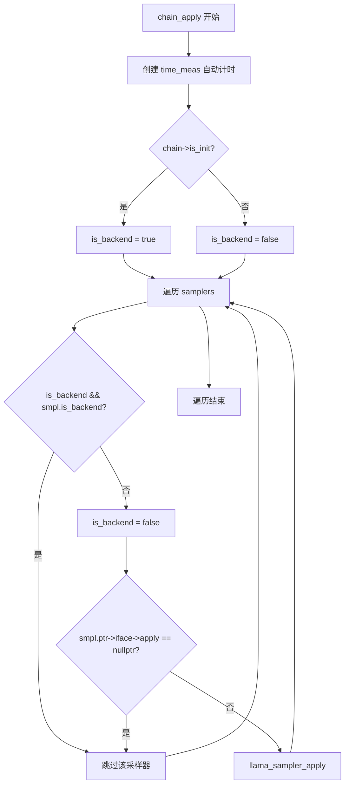
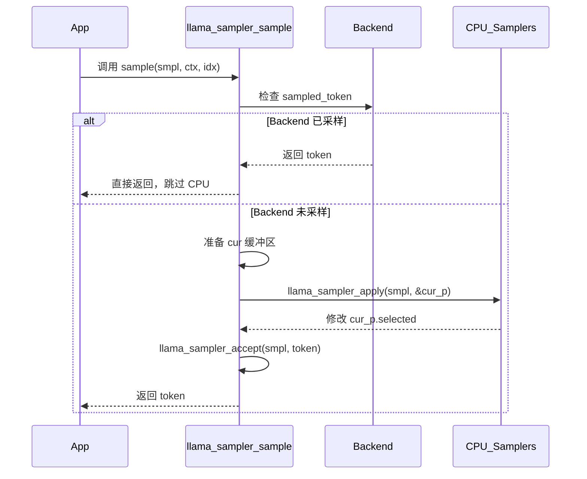
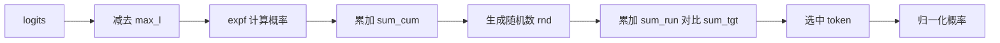
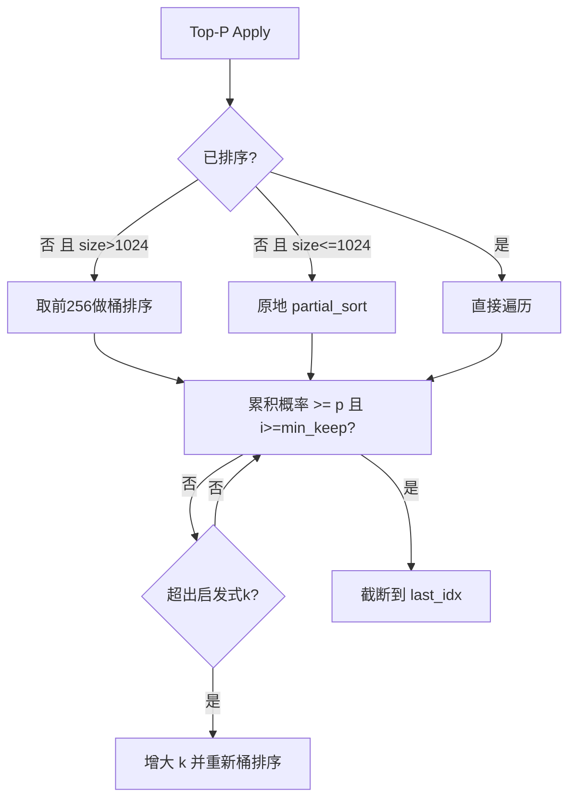
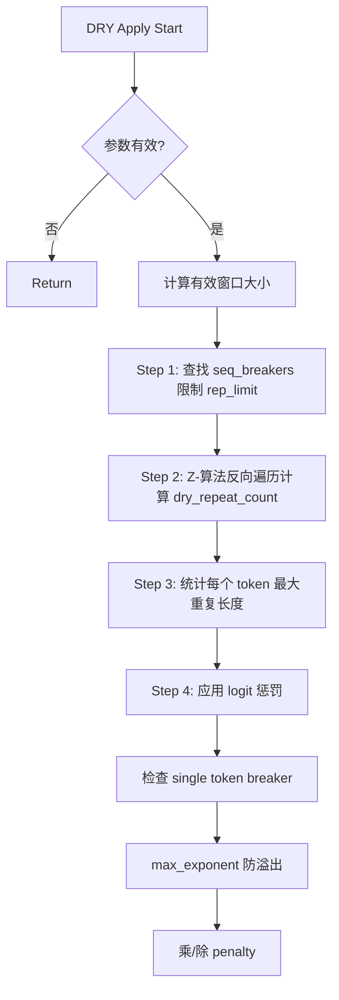
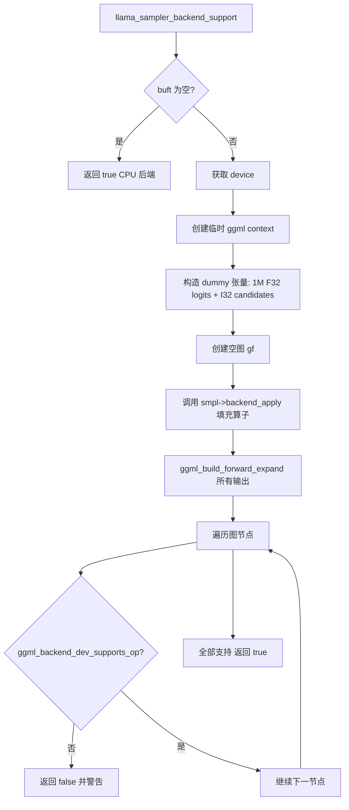

# 第20章 采样系统 —— 从指挥官契约到GPU加速的全链路解析

## 学习目标

- 理解 `llama_sampler_i` 虚函数表的契约设计与多态调度机制
- 掌握采样器链 `llama_sampler_chain` 的链式调度与时间统计原理
- 了解贪心、Dist、Top-K、Top-P、Min-P、Typical、xtc 等基础采样器的算法实现
- 掌握温度与自适应（Mirostat、adaptive_p）采样如何动态调整概率分布
- 理解 Penalties、DRY、Top-N-Sigma 等重复抑制算法的实现细节
- 掌握 Logit Bias、Infill、Grammar 等直接干预 logit 的特权通道
- 了解 GGML 计算图如何承载后端采样器，让 GPU 也能成为「指挥官」
- 熟悉环形缓冲区 `ring_buffer`、Z-算法、桶排序等关键数据结构
- 理解 `apply` / `accept` / `reset` / `clone` / `free` / `name` 六大钩子在状态机中的角色
- 掌握采样器的 clone/reset/free 生命周期管理以及 ring_buffer 等辅助数据结构
- 理解 empty 采样器作为占位符的设计哲学以及后端支持检测机制

## 20.1 生活类比

在 LLM 的 token 选择过程中，我们可以把它想象成一个乐团指挥选拔下一位乐手的过程。所有候选乐手的试奏评分就是 logits，尚未归一化的偏好分数。贪心采样就像指挥只看分数最高的乐手，虽然稳定但缺乏变化。分布采样（Dist）则像是按试奏评分的高低概率抽签决定，多样但有时会爆冷。Top-K 和 Top-P 策略像是限定选拔范围，让指挥只关注头部候选。Min-P 则是按最高分比例定门槛，把远低于冠军的乐手直接淘汰。Typical 采样按典型性选人，偏离分布熵的「怪才」会被淘汰。Temperature 就像演出氛围调节：温度低时指挥冷静精准，接近贪心；温度高时则热烈奔放。Temp-Ext 更进一步，根据已有分布的熵自动调节温度，让氛围变化更细腻。XTC 采样像是随机禁用最高音，故意剔除一些高分乐手，打破同质化。Mirostat 和 adaptive_p 则像自适应裁判，根据观众反应实时调整选拔尺度。Penalties 和 DRY 是反重复纪律委员，已经登台的乐手要降权，避免连续重复。Logit Bias 是 VIP 通道，用户可以为某些 token 加减分强制出场。Infill 是填空专用，在文本中间补全时会主动抑制 EOS 并合并共享前缀的 token。Grammar 是语法警察，只允许符合 BNF 文法的 token 通过。采样链则是流水线指挥链，每个采样器只负责一道工序，先温度、再 Top-K、再 Top-P，依次传递。后端采样（backend_apply）则让 GPU 当指挥，用 GGML 计算图直接在 GPU 上完成 softmax、cumsum、argmax 等操作，避免 CPU/GPU 数据来回搬运。ring_buffer 就像最近 N 次登台记录，用定长滚动窗口记录最近 penalty_last_n 个 token，老数据自动滚出。Z-算法（DRY）则是重复片段扫描仪，用 O(N) 时间找出末尾序列在历史中最早出现的最长匹配。桶排序 + partial_sort 是快速分类筛子，先用 128 个桶粗分，再用 partial_sort 在桶内细排，节省排序时间。empty 采样器是指挥休息位，当某个采样策略不需要时（如 k<=0、temp=1），安排一个什么都不做的乐手保留位置，确保流水线不被打乱。clone、free、reset、name 则是乐团的复制、解散、复位、点名，每个采样器都支持复制以生成相同状态的副本、安全释放内存、恢复初始状态、以及查询自己的身份。

## 20.2 源码地图

```text
src/
├── llama-sampler.h
│   └── struct llama_sampler_chain
│       ├── params / is_init
│       ├── samplers vector
│       ├── cur buffer
│       └── t_sample_us / n_sample
└── llama-sampler.cpp
    ├── ring_buffer<T>
    │   ├── push_back/pop_front/rat
    │   └── to_vector/clear/size
    ├── llama_token_data_array_partial_sort (桶排序+partial_sort)
    ├── llama_sample_dist (离散分布采样)
    ├── llama_sampler_softmax_impl (数值稳定softmax)
    ├── llama_sampler_temp_impl (温度缩放)
    ├── Sampler Public API
    │   ├── llama_sampler_init
    │   ├── llama_sampler_apply
    │   ├── llama_sampler_accept
    │   ├── llama_sampler_reset
    │   ├── llama_sampler_clone
    │   ├── llama_sampler_free
    │   ├── llama_sampler_name
    │   └── llama_sampler_init_empty
    ├── Backend Base: llama_sampler_backend
    │   ├── Constructor & get_name
    │   └── init
    ├── Backend Support Detection: llama_sampler_backend_support
    │   ├── Dummy graph construction
    │   └── Op support check
    ├── Chain: llama_sampler_chain_*
    │   ├── chain_apply - backend shortcut
    │   ├── chain_accept
    │   ├── chain_clone/free
    │   ├── chain_backend_init/accept/apply/set_input
    │   └── chain_sample - main entry
    ├── Basic Samplers
    │   ├── greedy: argmax
    │   ├── dist: softmax + cumsum
    │   ├── top_k: partial_sort
    │   ├── top_p: cumsum prob
    │   └── min_p: max_logit threshold
    ├── Typical / XTC
    │   ├── typical: entropy distance
    │   └── xtc: prob threshold skip
    ├── Temperature / Temp-Ext
    │   ├── temp: logit scaling
    │   └── temp_ext: entropy dyn temp
    ├── Mirostat / Adaptive-P
    │   ├── mirostat: s_hat + mu
    │   ├── mirostat_v2: surprise cutoff
    │   └── adaptive_p: EMA + quadratic
    ├── Grammar
    │   └── lazy trigger + grammar_impl
    ├── Penalties
    │   ├── ring_buffer + token_count
    │   └── repeat/freq/present
    ├── Top-N-Sigma
    ├── DRY
    │   ├── Z-algorithm
    │   └── seq_breakers
    ├── Logit Bias / Infill
    │   ├── bias addition
    │   └── EOG suppression + prefix merge
    └── Perf & Seed
        ├── get_rng_seed
        └── llama_perf_sampler
```

## 20.3 采样器接口与生命周期 —— 设计统一的「指挥官契约」

在 llama.cpp 的采样系统中，采样器的种类繁多，从简单的贪心采样到复杂的 DRY 去重，它们的行为差异巨大。为了统一管理这些采样器，llama.cpp 设计了 `llama_sampler_i` 虚函数表，将采样器的公共操作抽象为一组标准钩子。这样，上层代码只需要面对一个统一的 `llama_sampler` 句柄，而无需关心具体是哪种采样器。此外，当某些采样参数不合法时（如 k<=0），构造函数会返回一个空采样器（Empty Sampler），它在采样链中充当占位符，确保流水线结构不被打乱。这种设计极大地简化了采样链的组合与管理。

### 20.3.1 `llama_sampler_i`：采样器的虚函数表契约

C++ 中实现多态通常有两种方式：虚函数表和模板。llama.cpp 选择虚函数表，主要是因为采样器的类型在运行时才能确定（例如根据用户参数动态创建），而模板要求编译时类型已知。此外，虚函数表允许我们在统一的接口下，动态地组合不同的采样器，形成采样链。每个采样器只需要实现自己的 `apply`、`accept`、`reset` 等函数，而无需关心链的调度逻辑。这就像乐团中每个乐手只需专注于自己的演奏，指挥（采样链）负责协调整体。

```cpp
// 源码路径：src/llama-sampler.cpp - llama_sampler_i（定义于 .cpp 中的静态结构体）
// 核心类/接口：llama_sampler_i
// 关键函数：apply, accept, reset, clone, free, name
struct llama_sampler_i {
    // 采样器名称，用于调试和链式报告
    const char * (*name)(const struct llama_sampler * smpl);
    // 接受一个已选择的 token，用于更新采样器状态
    void (*accept)(struct llama_sampler * smpl, llama_token token);
    // 对候选 token 数组应用采样变换（核心方法）
    void (*apply)(struct llama_sampler * smpl, llama_token_data_array * cur_p);
    // 重置采样器状态（如清空历史记录）
    void (*reset)(struct llama_sampler * smpl);
    // 深拷贝采样器，返回新的采样器实例
    struct llama_sampler * (*clone)(const struct llama_sampler * smpl);
    // 释放采样器占用的资源
    void (*free)(struct llama_sampler * smpl);
    // 后端初始化：探测 GPU 后端是否支持该采样器
    bool (*backend_init)(struct llama_sampler * smpl, ggml_backend_buffer_type_t buft);
    // 后端接受：在 GPU 上更新采样器状态
    void (*backend_accept)(struct llama_sampler * smpl, ggml_context * ctx, ggml_cgraph * gf, struct ggml_tensor * selected_token);
    // 后端应用：在 GPU 上构建采样算子图
    void (*backend_apply)(struct llama_sampler * smpl, ggml_context * ctx, ggml_cgraph * gf, struct llama_sampler_data * data);
    // 后端设置输入：为后端采样提供输入数据（如随机数）
    void (*backend_set_input)(struct llama_sampler * smpl);
};
```

这段代码定义了采样器必须实现的 10 个钩子，其中 `apply` 是核心，其他钩子用于状态管理和后端加速。通过这个虚函数表，llama.cpp 可以以统一的方式调用任意采样器，实现了多态。每个钩子对应乐团指挥流程中的一个环节：`name` 是点名，`apply` 是演奏，`accept` 是录取，`reset` 是复排，`clone` 是组建分团，`free` 是解散，后端四件套则是「GPU 特快通道」。

### 20.3.2 空采样器：占位符的艺术

空采样器是 llama.cpp 中的一种特殊采样器，它的所有方法都是 no-op。当用户配置的采样参数不合法时（例如 top-k 的 k<=0，或者 temperature 等于 1.0），构造函数不会返回 nullptr，而是返回一个空采样器，其名称以 '?' 开头（如 '?top-k'）。这样，采样链中始终保留着固定数量的采样器位置，无需动态调整链的长度，也避免了空指针检查的复杂性。空采样器的存在使得采样链的组合就像乐团中的「休息位」，虽然不发声，但保证了整体结构的完整。

```cpp
// 源码路径：src/llama-sampler.cpp - llama_sampler_empty_i（467-571行）
// 核心类/接口：llama_sampler_empty_i
// 关键函数：所有钩子均为空操作
static struct llama_sampler_i llama_sampler_empty_i = {
    /* .name              = */ llama_sampler_empty_name,      // 返回存储的名称
    /* .accept            = */ llama_sampler_empty_accept,    // no-op
    /* .apply             = */ llama_sampler_empty_apply,     // no-op
    /* .reset             = */ llama_sampler_empty_reset,     // no-op
    /* .clone             = */ llama_sampler_empty_clone,     // 创建新的空采样器
    /* .free              = */ llama_sampler_empty_free,      // 释放上下文
    /* .backend_init      = */ llama_sampler_empty_backend_init,   // 始终返回 true
    /* .backend_accept    = */ llama_sampler_empty_backend_accept, // no-op
    /* .backend_apply     = */ llama_sampler_empty_backend_apply,  // no-op
    /* .backend_set_input = */ llama_sampler_empty_backend_set_input// no-op
};
```

```cpp
// 源码路径：src/llama-sampler.cpp - llama_sampler_init_empty()（467-571行）
// 核心类/接口：llama_sampler_empty
// 关键函数：llama_sampler_init_empty()
struct llama_sampler * llama_sampler_init_empty(const char * name) {
    // 调用统一的采样器构造函数，传入空采样器的接口和上下文
    return llama_sampler_init(
        /* .iface = */ &llama_sampler_empty_i,   // 使用空采样器的虚函数表
        /* .ctx   = */ new llama_sampler_empty {  // 动态分配空采样器上下文
            /* .name = */ name,                  // 存储传入的名称（如 "?top-k"）
        }
    );
}
```

空采样器的虚函数表所有指针都指向空操作函数，使得它在采样链中「透明」，不影响最终的采样结果。`accept` 和 `apply` 使用 `GGML_UNUSED` 标记参数，明确表示有意忽略参数，避免编译器警告。

```mermaid
flowchart TD
    A[llama_sampler_init_top_k] --> B{k <= 0?}
    B -->|是| C[llama_sampler_init_empty('?top-k')]
    B -->|否| D[创建真实 Top-K 采样器]
    C --> E[插入采样链]
    D --> E
    E --> F[链结构保持固定长度]
```

图 21.1 空采样器作为占位符保证链结构稳定

### 20.3.3 公共 API：init/apply/accept/reset/clone/free

公共 API 是采样器与外界交互的唯一入口，它封装了虚函数表的调用细节。`llama_sampler_init` 是统一的构造函数，接收 iface + ctx，返回堆上的 sampler；`apply` 必现，`accept/reset/clone/free` 都可以为 null（用 `if (smpl->iface->xxx)` 防御）；`name` 查询走 `smpl->iface->name(smpl)`，让 ctx 自己决定如何报告身份。

```cpp
// 源码路径：src/llama-sampler.cpp - llama_sampler_init()（367-373行）
// 核心类/接口：llama_sampler
// 关键函数：llama_sampler_init()
struct llama_sampler * llama_sampler_init(
        struct llama_sampler_i * iface,
        llama_sampler_context_t ctx) {
    // 使用 new 分配采样器结构体，并初始化接口和上下文
    return new llama_sampler {
        /* .iface = */ iface,   // 采样器接口（虚函数表）
        /* .ctx   = */ ctx,     // 采样器上下文（具体状态）
    };
}
```

这是所有采样器的统一构造函数，它接受一个接口和上下文，返回堆分配的采样器实例。

```cpp
// 源码路径：src/llama-sampler.cpp - llama_sampler_apply()（400-409行）
// 核心类/接口：llama_sampler
// 关键函数：llama_sampler_apply()
void llama_sampler_apply(struct llama_sampler * smpl, struct llama_token_data_array * cur_p) {
    // 空指针检查，防止崩溃
    if (!smpl) {
        return;
    }
    // 断言接口的 apply 函数必须存在（所有具体采样器都必须实现）
    GGML_ASSERT(smpl->iface->apply);
    // 通过虚函数表调用具体采样器的 apply 实现
    smpl->iface->apply(smpl, cur_p);
}
```

这是采样器应用的统一入口，它通过虚函数表分发到具体采样器的 apply 函数，实现了多态。

```cpp
// 源码路径：src/llama-sampler.cpp - llama_sampler_clone()（425-442行）
// 核心类/接口：llama_sampler
// 关键函数：llama_sampler_clone()
struct llama_sampler * llama_sampler_clone(const struct llama_sampler * smpl) {
    if (!smpl) {
        return nullptr;
    }
    if (smpl->iface->clone) {
        return smpl->iface->clone(smpl);
    }
    if (smpl->ctx == nullptr) {
        return llama_sampler_init(
            /* .iface = */ smpl->iface,
            /* .ctx   = */ nullptr
        );
    }
    GGML_ABORT("the sampler does not support cloning");
}
```

克隆函数首先尝试调用具体采样器的 clone 钩子，如果采样器没有上下文，则创建一个浅拷贝，否则断言失败。这种设计保证了采样器可以被安全地复制，用于多线程或状态保存。在 10 个钩子中，`apply` 必须实现（断言保证），`name` 通常实现，`accept/reset/clone/free/后端四件套` 可以为空（通过 if 判空防御），空采样器即将所有可选钩子置为 no-op。

## 20.4 采样器链：链式调度的「流水线指挥官」

在实际推理中，单一的采样器往往无法满足复杂的需求。例如，我们可能希望先应用温度缩放，再进行 Top-K 截断，最后用 Top-P 进行核采样。llama.cpp 的采样链（Sampler Chain）正是为此而生：它就像一列火车，每个采样器是一个车厢，按顺序对候选 token 数组进行变换。链的调度逻辑简单而高效：依次调用每个子采样器的 apply 函数，直到遇到后端采样器为止。此外，链还负责时间统计、后端短路、以及子采样器的动态增删。

### 20.4.1 链的数据结构与时间统计

采样链的设计源于「组合优于继承」的原则。每个采样器只关心自己的 logits 变换，例如温度采样器只负责除以温度，Top-K 采样器只负责截断到 k 个候选。通过将这些采样器串联起来，我们可以像搭积木一样构建出任意复杂的采样策略。更重要的是，链的存在使得后端加速成为可能：当链中的某个采样器支持 GPU 后端时，链可以自动跳过后续的 CPU 采样器，直接在 GPU 上完成整个采样过程，避免 CPU 和 GPU 之间的数据传输。



图 21.2 采样链 apply 流程图：展示了 `is_backend` 标志如何实现 CPU/GPU 路径互斥

```cpp
// 源码路径：src/llama-sampler.cpp - llama_sampler_chain_init()（1051-1063行）
// 核心类/接口：llama_sampler_chain
// 关键函数：llama_sampler_chain_init()
struct llama_sampler * llama_sampler_chain_init(struct llama_sampler_chain_params params) {
    // 使用统一的采样器构造函数，传入链的接口和上下文
    return llama_sampler_init(
        /* .iface = */ &llama_sampler_chain_i,  // 链的虚函数表
        /* .ctx   = */ new llama_sampler_chain { // 动态分配链上下文
            /* .params      = */ params,        // 存储链参数（如是否禁用性能统计）
            /* .is_init     = */ false,          // 后端初始化标志
            /* .samplers    = */ {},             // 子采样器列表（初始为空）
            /* .cur         = */ {},             // 预分配的 token 缓冲区
            /* .t_sample_us = */ 0,              // 采样总耗时（微秒）
            /* .n_sample    = */ 0,              // 采样次数
        }
    );
}
```

这段代码创建了一个空的采样器链，后续可以通过 `llama_sampler_chain_add` 向其中添加子采样器。

```cpp
// 源码路径：src/llama-sampler.cpp - llama_sampler_chain_apply()（898-916行）
// 核心类/接口：llama_sampler_chain
// 关键函数：llama_sampler_chain_apply()
static void llama_sampler_chain_apply(struct llama_sampler * smpl, llama_token_data_array * cur_p) {
    auto * chain = (llama_sampler_chain *) smpl->ctx;
    // 自动计时：创建 time_meas 对象，在析构时自动累计耗时到 chain->t_sample_us
    time_meas tm(chain->t_sample_us, chain->params.no_perf);
    // 后端初始化标志：如果 chain 已经初始化了后端，则当前采样器是后端类型
    bool is_backend = chain->is_init;
    // 遍历所有子采样器
    for (auto & smpl : chain->samplers) {
        // 如果当前采样器是后端类型，且子采样器也是后端类型，则跳过（避免重复）
        if (is_backend && smpl.is_backend) {
            continue;
        }
        // 遇到非后端采样器后，后续的采样器都是 CPU 类型
        is_backend = false;
        // 如果采样器的 apply 函数为空（如空采样器），跳过
        if (smpl.ptr->iface->apply == nullptr) {
            continue;
        }
        // 调用子采样器的 apply 函数，对候选数组进行变换
        llama_sampler_apply(smpl.ptr, cur_p);
    }
}
```

这是采样链的核心调度函数，它按顺序应用每个子采样器，并通过 `is_backend` 标志实现 CPU/GPU 路径的互斥，同时利用 `time_meas` 自动累计耗时。`time_meas` 是一个 RAII 计时器，构造时记录开始时间，析构时累加到 `chain->t_sample_us`，实现了零侵入的性能统计。

### 20.4.2 链的辅助操作与主入口

链的辅助操作包括子采样器的增删查、克隆与释放，以及主入口 `llama_sampler_sample`。`chain_add` 将采样器追加到链尾，`chain_get` 按索引访问，`chain_remove` 弹出指定采样器。`chain_clone` 深拷贝所有子采样器，`chain_free` 逐个释放后删除链。`llama_sampler_sample` 是采样系统的总入口，它负责从上下文中提取候选数据，调用采样链进行变换，并返回最终选中的 token。

```cpp
// 源码路径：src/llama-sampler.cpp - llama_sampler_chain_add()（1120-1127行）
// 核心类/接口：llama_sampler_chain
// 关键函数：llama_sampler_chain_add()
void llama_sampler_chain_add(struct llama_sampler * chain, struct llama_sampler * smpl) {
    auto * p = (llama_sampler_chain *) chain->ctx;
    // 将新的采样器追加到链的末尾，默认标记为非后端类型
    p->samplers.push_back({
        /* .is_backend = */ false,
        /* .ptr        = */ smpl,
    });
}
```

向采样链中动态添加子采样器，用于运行时调整采样策略。

```cpp
// 源码路径：src/llama-sampler.cpp - llama_sampler_sample()（1066-1116行）
// 核心类/接口：llama_sampler_chain
// 关键函数：llama_sampler_sample()
llama_token llama_sampler_sample(struct llama_sampler * smpl, struct llama_context * ctx, int32_t idx) {
    // 从上下文中获取后端已采样的 token、概率、logits 和候选 id
    const llama_token   sampled_token  = llama_get_sampled_token_ith     (ctx, idx);
    const float *       sampled_probs  = llama_get_sampled_probs_ith     (ctx, idx);
    const float *       sampled_logits = llama_get_sampled_logits_ith    (ctx, idx);
    const llama_token * sampled_ids    = llama_get_sampled_candidates_ith(ctx, idx);
    // 如果后端采样器已经选出了 token，则直接返回，不再执行 CPU 采样器
    if (sampled_token != LLAMA_TOKEN_NULL) {
        LLAMA_LOG_DEBUG("%s: Backend sampler selected token for idx %d. Skipping CPU samplers\n", __func__, idx);
        return sampled_token;
    }
    // 获取模型和词表，用于确定词表大小
    const llama_model * model = llama_get_model(ctx);
    const llama_vocab * vocab = llama_model_get_vocab(model);
    const int n_vocab = llama_vocab_n_tokens(vocab);
    // 选择缓冲区：优先使用链预分配的 cur，否则在本地分配
    std::vector<llama_token_data> * cur_ptr;
    std::vector<llama_token_data> cur_local;
    if (smpl->iface == &llama_sampler_chain_i) {
        auto * chain = (llama_sampler_chain *) smpl->ctx;
        cur_ptr = &chain->cur;  // 复用链的预分配缓冲区，避免重复分配
    } else {
        cur_ptr = &cur_local;
    }
    auto & cur = *cur_ptr;
    // 根据后端提供的数据类型，填充 cur 缓冲区
    if (sampled_probs) {
        const uint32_t sampled_probs_count = llama_get_sampled_probs_count_ith(ctx, idx);
        cur.resize(sampled_probs_count);
        for (uint32_t i = 0; i < sampled_probs_count; ++i) {
            cur[i] = llama_token_data{sampled_ids[i], sampled_logits[i], sampled_probs[i]};
        }
    } else if (sampled_logits) {
        const uint32_t sampled_logits_count = llama_get_sampled_logits_count_ith(ctx, idx);
        cur.resize(sampled_logits_count);
        for (llama_token i = 0; i < (int)sampled_logits_count; i++) {
            cur[i] = llama_token_data{sampled_ids[i], sampled_logits[i], 0.0f};
        }
    } else {
        const auto * logits = llama_get_logits_ith(ctx, idx);
        GGML_ASSERT(logits != nullptr);
        cur.resize(n_vocab);
        for (llama_token token_id = 0; token_id < n_vocab; token_id++) {
            cur[token_id] = llama_token_data{token_id, logits[token_id], 0.0f};
        }
    }
    // 封装为 llama_token_data_array 结构，用于传递给采样链
    llama_token_data_array cur_p = {
        /* .data       = */ cur.data(),
        /* .size       = */ cur.size(),
        /* .selected   = */ -1,
        /* .sorted     = */ false,
    };
    // 应用采样链，对 cur_p 进行一系列变换
    llama_sampler_apply(smpl, &cur_p);
    // 断言已选中有效的 token
    GGML_ASSERT(cur_p.selected >= 0 && cur_p.selected < (int32_t) cur_p.size);
    auto token = cur_p.data[cur_p.selected].id;
    // 通知采样链已接受该 token，用于更新内部状态（如历史记录）
    llama_sampler_accept(smpl, token);
    return token;
}
```

这是采样系统的总入口，它负责从上下文中提取候选数据，调用采样链进行变换，并返回最终选中的 token。同时，它还负责复用链的预分配缓冲区，以及处理后端采样器的短路逻辑。当后端已经产出 token 时，CPU 采样器完全被跳过。



图 21.3 采样总入口时序图：后端短路与 CPU 兜底

## 20.5 基础采样器：贪心、Dist、Top-K、Top-P、Min-P —— 选 token 的「基本招式」

基础采样器是采样系统的「基本招式」，它们直接对 logits 或概率进行变换，是构建复杂采样策略的基石。贪心采样永远选择概率最高的 token，简单但缺乏多样性；分布采样（Dist）按概率分布随机选择，引入随机性；Top-K 和 Top-P 通过截断候选集来控制多样性；Min-P 则以最大概率为基准设定阈值。这些采样器的实现都依赖于高效的排序和搜索算法，例如桶排序和 partial_sort。

### 20.5.1 llama_sampler_greedy_apply：线性扫描实现贪心选 token

贪心采样是所有采样器中最简单的一种：它线性扫描候选数组，找到 logit 最大的 token，直接设为 selected。实现极简，但缺乏多样性，常用于确定性测试场景。后端实现则使用 `ggml_argmax` 算子直接选出最大下标。

```cpp
// 源码路径：src/llama-sampler.cpp - llama_sampler_greedy_apply()（1217-1226行）
// 核心类/接口：llama_sampler_greedy
// 关键函数：llama_sampler_greedy_apply()
static void llama_sampler_greedy_apply(struct llama_sampler * /*smpl*/, llama_token_data_array * cur_p) {
    // 线性扫描候选数组，找到 logit 最大的 token
    cur_p->selected = 0;
    for (size_t i = 1; i < cur_p->size; ++i) {
        if (cur_p->data[i].logit > cur_p->data[cur_p->selected].logit) {
            cur_p->selected = i;
        }
    }
}
```

贪心采样的实现非常简单，它只是线性扫描找到 argmax，时间复杂度 O(n)。后端实现则使用 ggml_argmax 算子在 GPU 上并行完成。

### 20.5.2 llama_sampler_dist_apply：单遍遍历完成 softmax 与采样

分布采样将 logits 转换为概率分布，然后使用随机数选择一个 token。为了提高效率，它在单遍遍历中同时完成采样和归一化，并使用 double 精度随机数以保证可复现性。

```cpp
// 源码路径：src/llama-sampler.cpp - llama_sampler_dist_apply()（1310-1360行）
// 核心类/接口：llama_sampler_dist
// 关键函数：llama_sampler_dist_apply()
static void llama_sampler_dist_apply(struct llama_sampler * smpl, llama_token_data_array * cur_p) {
    auto * ctx = (llama_sampler_dist *) smpl->ctx;
    // edge cases
    if (cur_p->size == 0) {
        cur_p->selected = -1;
        return;
    }
    cur_p->selected = 0;
    if (cur_p->size == 1) {
        cur_p->data[0].p = 1.0f;
        return;
    }
    // max logit for numerical stability
    float max_l = cur_p->data[0].logit;
    if (!cur_p->sorted) {
        for (size_t i = 1; i < cur_p->size; ++i) {
            max_l = std::max(max_l, cur_p->data[i].logit);
        }
    }
    // apply softmax to obtain the probabilities
    double sum_cum = 0.0f;
    for (size_t i = 0; i < cur_p->size; ++i) {
        float p = expf(cur_p->data[i].logit - max_l);
        cur_p->data[i].p = p;
        sum_cum += p;
    }
#if 1
    // sample from the obtained probabilities and normalize the probs in a single pass
    // this is ~3x faster on Mac with full gpt-oss vocab than the version below
    //
    std::uniform_real_distribution<double> dist(0.0f, 1.0f);
    const double rnd = dist(ctx->rng);
          double sum_run = 0.0f;
    const double sum_tgt = sum_cum*rnd;
    bool found = false;
    for (size_t i = 0; i < cur_p->size; ++i) {
        if (!found) {
            // accumulate probs until we reach the target sum
            sum_run += cur_p->data[i].p;
            if (sum_run >= sum_tgt) {
                cur_p->selected = i;
                found = true;
            }
        }
        // normalize probs
        cur_p->data[i].p /= sum_cum;
    }
    // fallback to the last token (don't think this can happen)
    assert(found);
    if (!found) {
        cur_p->selected = cur_p->size - 1;
    }
#else
    // for clarity, this is the same as above but does one pass for normalization and one extra pass for sampling
    for (size_t i = 0; i < cur_p->size; ++i) {
        cur_p->data[i].p /= sum_cum;
    }
    cur_p->selected = llama_sample_dist(cur_p, ctx->rng);
#endif
}
```

分布采样将 logits 转换为概率分布，然后使用随机数选择一个 token。为了提高效率，它在单遍遍历中同时完成采样和归一化，并使用 double 精度随机数以保证可复现性。后端实现构建了 softmax → cumsum → sub → step → sum 算子图。



图 21.4 分布采样单遍流程：softmax + 采样 + 归一化一次完成

### 20.5.3 llama_sampler_top_k_impl：partial_sort 截断 Top-K

Top-K 采样通过 `partial_sort` 截断到 k 个最高 logit 的候选，当 k<=0 时返回空采样器。

```cpp
// 源码路径：src/llama-sampler.cpp - llama_sampler_top_k_impl()（329-345行）
// 核心类/接口：llama_sampler_top_k
// 关键函数：llama_sampler_top_k_impl()
static void llama_sampler_top_k_impl(llama_token_data_array * cur_p, int32_t k) {
    // 如果 k 无效，直接返回（不裁剪）
    if (k <= 0) {
        return;
    }
    k = std::min(k, (int) cur_p->size);
    // 如果尚未排序，就地进行 partial_sort，只保留前 k 个最大 logit
    if (!cur_p->sorted) {
        llama_token_data_array_partial_sort_inplace(cur_p, k);
    }
    cur_p->size = k;
}
```

Top-K 采样的核心实现，它通过 partial_sort 截断到 k 个候选，k<=0 时退化为空采样器。

### 20.5.4 llama_sampler_top_p_apply：累积概率截断 + 桶排序启发式

Top-P 采样则按累积概率达到 p 时截断，当候选数组未排序且较大时，先用 256 个候选的桶排序作为启发式，避免全局排序。

```cpp
// 源码路径：src/llama-sampler.cpp - llama_sampler_top_p_apply()（1465-1510行）
// 核心类/接口：llama_sampler_top_p
// 关键函数：llama_sampler_top_p_apply()
static void llama_sampler_top_p_apply(struct llama_sampler * smpl, llama_token_data_array * cur_p) {
    auto * ctx = (llama_sampler_top_p *) smpl->ctx;

    if (ctx->p >= 1.0f) {
        return;
    }

    llama_sampler_softmax_impl(cur_p, false);

    size_t k = cur_p->size;
    auto * pdata = cur_p->data;

    auto & buf_sort = ctx->buf_sort;

    // if not sorted, try adaptive top-k sorting
    if (!cur_p->sorted && cur_p->size > 1024) {
        k = std::min<size_t>(256, cur_p->size);
        llama_token_data_array_partial_sort(*cur_p, k, buf_sort);
        pdata = buf_sort.data();
    } else if (!cur_p->sorted) {
        // small candidates -> sort inplace
        llama_token_data_array_partial_sort_inplace(cur_p, k);
    }

    // Compute the cumulative probabilities
    float cum_sum = 0.0f;
    size_t last_idx = cur_p->size;

    for (size_t i = 0; i < cur_p->size; ++i) {
        cum_sum += pdata[i].p;

        // Check if the running sum is at least p or if we have kept at least min_keep tokens
        // we set the last index to i+1 to indicate that the current iterate should be included in the set
        if (cum_sum >= ctx->p && i + 1 >= ctx->min_keep) {
            last_idx = i + 1;
            break;
        }

        // we exceeded the current top-k heuristic -> increase k and continue
        if (!cur_p->sorted && i == k - 1) {
            k = cur_p->size;
            llama_token_data_array_partial_sort(*cur_p, k, buf_sort);
            pdata = buf_sort.data();
        }
    }

    // Resize the output vector to keep only the top-p tokens
    if (!cur_p->sorted) {
        std::copy(buf_sort.data(), buf_sort.data() + last_idx, cur_p->data);
        cur_p->sorted = true;
    }

    cur_p->size = last_idx;
}
```

Top-P 采样的实现，它通过累积概率截断候选集，并在未排序且候选数较大时使用 256 个候选的桶排序作为启发式，避免全局排序。



图 21.5 Top-P 自适应排序策略：小规模全排、大规模桶排启发式

### 20.5.5 llama_sampler_min_p_apply：相对最大 logit 阈值 + 快速线性扫描

Min-P 采样以最大 logit 为基准设定阈值（`max_logit + log(p)`），过滤掉所有低于该阈值的 token。对未排序数组做了快速线性扫描的优化路径，如果失败才回退到排序路径。

```cpp
// 源码路径：src/llama-sampler.cpp - llama_sampler_min_p_apply()（1755-1800行）
// 核心类/接口：llama_sampler_min_p
// 关键函数：llama_sampler_min_p_apply()
static void llama_sampler_min_p_apply(struct llama_sampler * smpl, llama_token_data_array * cur_p) {
    auto * ctx = (llama_sampler_min_p *) smpl->ctx;

    if (ctx->p <= 0.0f || !cur_p->size) {
        return;
    }

    bool min_p_applied = false;

    // if the cur_p aren't sorted, try the unsorted implementation first
    if (!cur_p->sorted) {
        std::vector<llama_token_data> filtered_tokens;

        float max_logit = -FLT_MAX;
        for (size_t i = 0; i < cur_p->size; ++i) {
            max_logit = std::max(max_logit, cur_p->data[i].logit);
        }
        const float min_logit = max_logit + logf(ctx->p); // min logit for p_i >= p * p_max

        for (size_t i = 0; i < cur_p->size; ++i) {
            if (cur_p->data[i].logit >= min_logit) {
                filtered_tokens.push_back(cur_p->data[i]);
            }
        }

        // if we have enough values the operation was a success
        if (!filtered_tokens.empty() && filtered_tokens.size() >= ctx->min_keep) {
            std::copy(filtered_tokens.begin(), filtered_tokens.end(), cur_p->data);
            cur_p->size = filtered_tokens.size();
            min_p_applied = true;
        }
    }

    // if the cur_p are sorted or the unsorted implementation failed, use this implementation
    if (!min_p_applied) {
        // Sort the logits in descending order
        if (!cur_p->sorted) {
            llama_token_data_array_partial_sort_inplace(cur_p, cur_p->size);
        }

        const float min_logit = cur_p->data[0].logit + logf(ctx->p); // min logit for p_i >= p * p_max
        size_t i = 1; // first token always matches

        for (; i < cur_p->size; ++i) {
            if (cur_p->data[i].logit < min_logit && i >= ctx->min_keep) {
                break; // prob too small
            }
        }

        // Resize the output vector to keep only the matching tokens
        cur_p->size = i;
    }
}
```

Min-P 采样的实现，它首先尝试在未排序数组上做线性扫描（O(n)），满足 min_keep 即成功；否则回退到排序后二分截断。这种「先快后慢」策略在大多数情况下避免了完整排序的开销。

```mermaid
flowchart TD
    A[Min-P Apply] --> B{sorted?}
    B -->|否| C[线性扫描找 max_logit]
    C --> D[计算 min_logit = max + log(p)]
    D --> E[单遍过滤 logit >= min_logit]
    E --> F{满足 min_keep?}
    F -->|是| G[直接使用结果]
    F -->|否| H[回退: 排序后二分截断]
    B -->|是| H
```

图 21.6 Min-P 双路径策略：线性扫描优先，失败回退排序

### 20.5.6 llama_token_data_array_partial_sort：128 桶桶排序 + partial_sort 混合

这是这些采样器的性能基础：先用 128 个桶将候选 logit 粗略分类，再对每个桶内部进行排序，最后一个桶使用 partial_sort 只排序前 npartial 个元素。

```cpp
// 源码路径：src/llama-sampler.cpp - llama_token_data_array_partial_sort()（128-192行）
// 核心类/接口：llama_token_data_array
// 关键函数：llama_token_data_array_partial_sort()
static void llama_token_data_array_partial_sort(const llama_token_data_array & cur, int npartial, std::vector<llama_token_data> & res) {
    static const auto comp = [](const llama_token_data & a, const llama_token_data & b) {
        return a.logit > b.logit;
    };
    constexpr int   nbuckets     = 128;
    constexpr float bucket_low   = -10.0f;
    constexpr float bucket_high  =  10.0f;
    constexpr float bucket_scale = nbuckets/(bucket_high - bucket_low);
    constexpr float bucket_inter = -bucket_low * bucket_scale;
    // 统计每个桶中的元素数量
    std::vector<int> bucket_idx;
    std::vector<int> histo(nbuckets, 0);
    std::vector<llama_token_data*> bucket_ptrs;
    bucket_idx.reserve(cur.size);
    for (int i = 0; i < (int)cur.size; ++i) {
        const float val = cur.data[i].logit;
        int ib = int(bucket_scale * val + bucket_inter);
        ib = std::max(0, std::min(nbuckets - 1, ib));
        bucket_idx.push_back(ib);
        ++histo[ib];
    }
    // 确定需要包含的桶：从高到低累加，直到达到 npartial
    int nhave = 0;
    int ib = nbuckets - 1;
    for ( ; ib >= 0; --ib) {
        nhave += histo[ib];
        if (nhave >= npartial) break;
    }
    res.resize(nhave);
    auto * ptr = res.data();
    bucket_ptrs.reserve(nbuckets - ib);
    for (int j = nbuckets - 1; j >= ib; --j) {
        bucket_ptrs.push_back(ptr);
        ptr += histo[j];
    }
    // 将元素分配到对应的桶中
    for (int i = 0; i < (int)cur.size; ++i) {
        int j = bucket_idx[i];
        if (j >= ib) {
            *bucket_ptrs[nbuckets - 1 - j]++ = cur.data[i];
        }
    }
    // 对每个桶内部进行排序，最后一个桶使用 partial_sort
    ptr = res.data();
    int ndone = 0;
    for (int j = nbuckets - 1; j > ib; --j) {
        std::sort(ptr, ptr + histo[j], comp);
        ptr += histo[j];
        ndone += histo[j];
    }
    std::partial_sort(ptr, ptr + npartial - ndone, ptr + histo[ib], comp);
}
```

这是一个混合排序算法，先用 128 个桶将候选 logit 粗略分类（范围 [-10, 10] 覆盖典型 logit），再对每个桶内部进行排序，最后一个桶使用 partial_sort 只排序前 npartial 个元素。这种设计在平均情况下比全局排序更快，特别是当只需要 top-k 个候选时。


图 21.7 桶排序+partial_sort 混合算法流程

## 20.6 温度、Typical、XTC：调节「生成多样性」的旋钮

温度采样就像一个「温度计」，通过除以温度参数来缩放 logits：温度低时分布尖锐，接近贪心；温度高时分布均匀，鼓励探索。Temp-Ext 更进一步，根据当前分布的熵动态调整温度区间。Typical 采样则按「偏离熵」排序截断，保留与分布熵最接近的 token。XTC 采样以一定概率随机剔除高频 token，打破同质化。

### 20.6.1 llama_sampler_temp_impl：温度缩放与 argmax 退化

`llama_sampler_temp_impl` 把所有 logit 除以 temp，当 temp<=0 时退化为 argmax（等价于贪心），但保留为独立采样器；当 temp=1.0 时是恒等变换，返回空采样器节省开销。

```cpp
// 源码路径：src/llama-sampler.cpp - llama_sampler_temp_impl()（270-295行）
// 核心类/接口：llama_sampler_temp
// 关键函数：llama_sampler_temp_impl()
static void llama_sampler_temp_impl(llama_token_data_array * cur_p, float temp) {
    if (temp <= 0.0f) {
        // 温度 <= 0 时退化为 argmax：只保留最高 logit，其余设为 -inf
        size_t max_i = 0;
        float  max_l = cur_p->data[0].logit;
        for (size_t i = 1; i < cur_p->size; ++i) {
            if (cur_p->data[i].logit > max_l) {
                cur_p->data[max_i].logit = -INFINITY;
                max_i = i;
                max_l = cur_p->data[i].logit;
            } else {
                cur_p->data[i].logit = -INFINITY;
            }
        }
        return;
    }
    // 正常温度缩放：所有 logit 除以温度
    for (size_t i = 0; i < cur_p->size; ++i) {
        cur_p->data[i].logit /= temp;
    }
}
```

温度采样的核心实现，它通过除以温度来调整 logits 的分布，温度 <= 0 时退化为 argmax。

### 20.6.2 llama_sampler_temp_ext_apply：基于熵的动态温度

Temp-Ext 基于熵的动态温度：熵高时用 max_temp 鼓励探索，熵低时用 min_temp 收紧。后端实现完全用 GGML 算子图：soft_max → log → mul → sum → scale → exp → div。

```cpp
// 源码路径：src/llama-sampler.cpp - llama_sampler_temp_ext_apply()（2275-2335行）
// 核心类/接口：llama_sampler_temp_ext
// 关键函数：llama_sampler_temp_ext_apply()
static void llama_sampler_temp_ext_apply(struct llama_sampler * smpl, llama_token_data_array * cur_p) {
    auto * ctx = (llama_sampler_temp_ext *) smpl->ctx;
    if (ctx->delta > 0) {
        const float min_temp = std::max(0.0f, ctx->temp - ctx->delta);
        const float max_temp = ctx->temp + ctx->delta;
        float exponent_val = ctx->exponent;
        if (cur_p->size <= 1) {
            return;
        }
        // 计算最大可能熵：log(n)
        float max_entropy = -logf(1.0f / cur_p->size);
        llama_sampler_softmax_impl(cur_p, true);
        // 计算当前分布的熵
        float entropy = 0.0f;
        for (size_t i = 0; i < cur_p->size; ++i) {
            float prob = cur_p->data[i].p;
            if (prob > 0.0f) {
                entropy -= prob * logf(prob);
            }
        }
        // 归一化熵，并映射到动态温度区间
        float normalized_entropy = entropy / max_entropy;
        float dyn_temp = min_temp + (max_temp - min_temp) * powf(normalized_entropy, exponent_val);
        // 应用动态温度缩放，并重新计算 softmax 概率
        llama_sampler_temp_impl(cur_p, dyn_temp);
        const double max_l_double = cur_p->data[0].logit;
        double cum_sum_double = 0.0;
        for (size_t i = 0; i < cur_p->size; ++i) {
            double p = exp(cur_p->data[i].logit - max_l_double);
            cur_p->data[i].p = p;
            cum_sum_double += p;
        }
        for (size_t i = 0; i < cur_p->size; ++i) {
            cur_p->data[i].p /= cum_sum_double;
        }
    } else {
        llama_sampler_temp_impl(cur_p, ctx->temp);
    }
}
```

Temp-Ext 采样的实现，它根据当前分布的熵动态计算温度，并应用温度缩放后重新归一化概率。后端实现通过 `exp(exponent * log(norm_entropy))` 计算幂函数，避免直接使用 `powf`。

```mermaid
flowchart TD
    A[Temp-Ext Apply] --> B{delta > 0?}
    B -->|否| C[退化为固定温度]
    B -->|是| D[计算 max_entropy = log(n)]
    D --> E[softmax 计算概率]
    E --> F[计算当前熵 H]
    F --> G[normalized_entropy = H / max_entropy]
    G --> H[dyn_temp = min + (max-min) * pow(norm_entropy, exponent)]
    H --> I[应用 dyn_temp 缩放 logits]
    I --> J[重新 softmax 归一化]
```

图 21.8 Temp-Ext 动态温度计算流程

### 20.6.3 llama_sampler_typical_apply：偏离熵距离排序截断

Typical 采样（仅 CPU）用 `|(-log p) - H|` 作为偏离熵的距离排序截断，保留「最典型」的 token。

```cpp
// 源码路径：src/llama-sampler.cpp - llama_sampler_typical_apply()（1929-1980行）
// 核心类/接口：llama_sampler_typical
// 关键函数：llama_sampler_typical_apply()
static void llama_sampler_typical_apply(struct llama_sampler * smpl, llama_token_data_array * cur_p) {
    auto * ctx = (llama_sampler_typical *) smpl->ctx;

    // Reference implementation:
    // https://github.com/huggingface/transformers/compare/main...cimeister:typical-sampling:typical-pr
    if (ctx->p >= 1.0f) {
        return;
    }

    // Compute the softmax of logits and calculate entropy
    llama_sampler_softmax_impl(cur_p, true);

    float entropy = 0.0f;
    for (size_t i = 0; i < cur_p->size; ++i) {
        entropy += -cur_p->data[i].p * logf(cur_p->data[i].p);
    }

    // Compute the absolute difference between negative log probability and entropy for each candidate
    std::vector<float> shifted_scores;
    for (size_t i = 0; i < cur_p->size; ++i) {
        float shifted_score = fabsf(-logf(cur_p->data[i].p) - entropy);
        shifted_scores.push_back(shifted_score);
    }

    // Sort tokens based on the shifted_scores and their corresponding indices
    std::vector<size_t> indices(cur_p->size);
    std::iota(indices.begin(), indices.end(), 0);

    std::sort(indices.begin(), indices.end(), [&](size_t a, size_t b) {
        return shifted_scores[a] < shifted_scores[b];
    });

    // Compute the cumulative probabilities
    float cum_sum = 0.0f;
    size_t last_idx = indices.size();

    for (size_t i = 0; i < indices.size(); ++i) {
        size_t idx = indices[i];
        cum_sum += cur_p->data[idx].p;

        // Check if the running sum is greater than typical or if we have kept at least min_keep tokens
        if (cum_sum > ctx->p && (ctx->min_keep == 0 || i >= ctx->min_keep - 1)) {
            last_idx = i + 1;
            break;
        }
    }

    // Resize the output vector to keep only the locally typical tokens
    std::vector<llama_token_data> cur_p_new;
    for (size_t i = 0; i < last_idx; ++i) {
        size_t idx = indices[i];
        cur_p_new.push_back(cur_p->data[idx]);
    }

    // Replace the data in cur_p with the cur_p_new data
    std::copy(cur_p_new.begin(), cur_p_new.end(), cur_p->data);
    cur_p->size = cur_p_new.size();
    cur_p->sorted = false;
}
```

Typical 采样的实现，它通过计算每个 token 的偏离熵距离来排序截断，只保留「最典型」的候选。

### 20.6.4 llama_sample_xtc_apply：随机剔除高频 token 打破同质化

XTC 采样以一定概率随机剔除累积概率首次低于 threshold 的高频 token，鼓励模型跳出重复模式。

```cpp
// 源码路径：src/llama-sampler.cpp - llama_sample_xtc_apply()（2584-2613行）
// 核心类/接口：llama_sampler_xtc
// 关键函数：llama_sample_xtc_apply()
static void llama_sample_xtc_apply(struct llama_sampler * smpl, llama_token_data_array * cur_p) {
    auto * ctx = (llama_sampler_xtc *) smpl->ctx;

    if (ctx->probability <= 0.0f
        || ctx->threshold > 0.5f
        || cur_p->size < 2) {
        return;
    }

    std::uniform_real_distribution<float> distribution(0.0f, 1.0f);
    float chance = distribution(ctx->rng);
    if (chance > ctx->probability) {
        return;
    }

    llama_sampler_softmax_impl(cur_p, true);

    int pos_last = 0;

    for (size_t i = 0; i < cur_p->size; ++i) {
        if (cur_p->data[i].p >= ctx->threshold) {
            pos_last = i;
        } else {
            break;
        }
    }

    if (cur_p->size - pos_last >= ctx->min_keep && pos_last > 0) {
        cur_p->data += pos_last;
        cur_p->size -= pos_last;
    }
}
```

XTC 采样的实现，它以一定概率随机剔除累积概率超过 threshold 的高频 token，从而打破同质化。

## 20.7 Mirostat 与 adaptive_p：自适应「目标惊奇度」算法

Mirostat 是一种自适应采样算法，它通过维护一个内部状态 μ（目标惊奇度）来动态调整采样的多样性。Mirostat v1 用 s_hat 估计动态 top-k，v2 则直接按 μ 截断 surprise。Adaptive-P 则通过 EMA 跟踪历史被选 token 的概率，动态调整目标概率，并用二次函数形变 logit 靠近目标。

### 20.7.1 llama_sampler_mirostat_apply：s_hat 估计动态 Top-K

Mirostat v1 用前 m 个 token 的 log(p_i/p_{i+1}) 估计分布的「熵衰减斜率」s_hat，然后基于 s_hat 和目标惊奇度 τ 反推 k 值，再用 Top-K 裁剪。采样后根据观测到的实际惊奇度调整 μ。v2 则把所有 surprise > μ 的 token 直接砍掉，重新 softmax 后采样，无需 m 参数，更简洁。两个版本的 reset 都把 μ 初始化为 `2.0f*tau`。

```cpp
// 源码路径：src/llama-sampler.cpp - llama_sampler_mirostat_apply()（63-95行）
// 核心类/接口：llama_sampler_mirostat
// 关键函数：llama_sampler_mirostat_apply()
static void llama_sampler_mirostat_apply(struct llama_sampler * smpl, llama_token_data_array * cur_p) {
    auto * ctx = (llama_sampler_mirostat *) smpl->ctx;
    llama_sampler_softmax_impl(cur_p, true);
    // 用前 m-1 个 token 估计 s_hat
    float s_hat = 0.0;
    float sum_ti_bi = 0.0;
    float sum_ti_sq = 0.0;
    for (size_t i = 0; i < size_t(ctx->m - 1) && i < cur_p->size - 1; ++i) {
        float t_i = logf(float(i + 2) / float(i + 1));
        float b_i = logf(cur_p->data[i].p / cur_p->data[i + 1].p);
        sum_ti_bi += t_i * b_i;
        sum_ti_sq += t_i * t_i;
    }
    s_hat = sum_ti_bi / sum_ti_sq;
    // 根据 s_hat 和 μ 计算 k 值
    float epsilon_hat = s_hat - 1;
    float k = powf((epsilon_hat * powf(2, ctx->mu)) / (1 - powf(ctx->n_vocab, -epsilon_hat)), 1 / s_hat);
    llama_sampler_top_k_impl(cur_p, std::max(int(k), 1));
    llama_sampler_softmax_impl(cur_p, true);
    const int idx = llama_sample_dist(cur_p, ctx->rng);
    cur_p->selected = idx;
    // 根据观测惊奇度更新 μ
    float observed_surprise = -log2f(cur_p->data[idx].p);
    float e = observed_surprise - ctx->tau;
    ctx->mu = ctx->mu - ctx->eta * e;
}
```

Mirostat v1 的实现，它通过 s_hat 估计动态 top-k，并基于观测惊奇度与目标 τ 的误差来更新内部状态 μ。`sum_ti_bi / sum_ti_sq` 是最小二乘法拟合斜率的结果。

### 20.7.2 llama_sampler_mirostat_v2_apply：按 μ 截断 surprise

Mirostat v2 的实现，它直接按 μ 截断 surprise 过高的 token，无需 m 参数，算法更简洁。

```cpp
// 源码路径：src/llama-sampler.cpp - llama_sampler_mirostat_v2_apply()（170-192行）
// 核心类/接口：llama_sampler_mirostat_v2
// 关键函数：llama_sampler_mirostat_v2_apply()
static void llama_sampler_mirostat_v2_apply(struct llama_sampler * smpl, llama_token_data_array * cur_p) {
    auto * ctx = (llama_sampler_mirostat_v2 *) smpl->ctx;
    llama_sampler_softmax_impl(cur_p, true);
    // 截断所有 surprise > μ 的 token
    cur_p->size = std::distance(cur_p->data, std::find_if(cur_p->data, cur_p->data + cur_p->size, [&](const llama_token_data & candidate) {
        return -log2f(candidate.p) > ctx->mu;
    }));
    if (cur_p->size == 0) {
        cur_p->size = 1;
    }
    // 重新归一化并采样
    llama_sampler_softmax_impl(cur_p, true);
    const int idx = llama_sample_dist(cur_p, ctx->rng);
    cur_p->selected = idx;
    float observed_surprise = -log2f(cur_p->data[idx].p);
    float e = observed_surprise - ctx->tau;
    ctx->mu = ctx->mu - ctx->eta * e;
}
```

### 20.7.3 llama_sampler_adaptive_p_apply：EMA 跟踪 + 二次函数形变

Adaptive-P 用 EMA 跟踪历史被选 token 的原始概率，动态调整目标概率。当实际概率普遍高于目标时收紧目标，反之放宽。通过二次函数把偏离目标的位置 logit 调低，靠近目标的位置保持高分。pending_token 机制保证只有真正被接受的 token 才更新 EMA。

```cpp
// 源码路径：src/llama-sampler.cpp - llama_sampler_adaptive_p_apply()（3360-3425行）
// 核心类/接口：llama_sampler_adaptive_p
// 关键函数：llama_sampler_adaptive_p_apply()
static void llama_sampler_adaptive_p_apply(struct llama_sampler * smpl, llama_token_data_array * cur_p) {
    auto * ctx = (llama_sampler_adaptive_p *) smpl->ctx;
    // 计算当前分布的 softmax 概率
    llama_sampler_softmax_impl(cur_p, true);
    // 用 EMA 跟踪历史被选 token 的概率，动态调整目标
    float target = ctx->target;
    // 二次函数形变 logit：PEAK_LOGIT_VALUE - SHARPNESS * dist*dist / (1.0f + dist)
    const float PEAK_LOGIT_VALUE = 88.0f;
    const float SHARPNESS = 100.0f;
    const float DISTRIBUTION_WIDTH = 0.3f;
    for (size_t i = 0; i < cur_p->size; ++i) {
        float dist = (cur_p->data[i].p - target) / DISTRIBUTION_WIDTH;
        float bias = PEAK_LOGIT_VALUE - SHARPNESS * dist * dist / (1.0f + fabsf(dist));
        cur_p->data[i].logit += bias;
    }
    // 采样并记录 pending_token，等待 accept 后才更新 EMA
    const int idx = llama_sample_dist(cur_p, ctx->rng);
    cur_p->selected = idx;
    ctx->pending_token = idx;
}
```

Adaptive-P 采样的实现，它通过二次函数形变 logit 来靠近目标概率，并使用 pending_token 机制确保只有被接受的 token 才更新 EMA。

```mermaid
flowchart TD
    A[Adaptive-P Apply] --> B[softmax 计算概率]
    B --> C[遍历每个 token]
    C --> D[dist = (p_i - target) / WIDTH]
    D --> E[bias = PEAK - SHARPNESS * dist^2 / (1+|dist|)]
    E --> F[logit += bias]
    F --> G[采样选中 token]
    G --> H[记录 pending_token]
    H --> I[accept 时更新 EMA]
```

图 21.9 Adaptive-P 二次形变与 EMA 更新机制

## 20.8 重复惩罚：Penalties、DRY 与 Top-N-Sigma —— 抑制重复的「纪律委员」

重复是 LLM 生成中常见的问题，llama.cpp 提供了多种重复抑制算法。Penalties 通过环形缓冲区记录最近 N 个 token，并按重复次数、频率和存在性分别施加惩罚。DRY（Don't Repeat Yourself）则用 Z-算法找出所有重复后缀，并根据序列断裂符（seq_breakers）防止过度抑制。Top-N-Sigma 基于标准差截断，保留高于均值一定标准差的 token。

### 20.8.1 llama_sampler_penalties_apply：三件套惩罚 + 环形缓冲区

Penalties 采样器用 `ring_buffer<llama_token>` 保存最近 penalty_last_n 个 token，用哈希表 `token_count` 统计窗口内每个 token 的出现次数。repeat 惩罚对正负 logit 分别用除法和乘法（避免负 logit 反向放大），freq 按出现次数扣减 logit，present 出现即扣固定值。

```cpp
// 源码路径：src/llama-sampler.cpp - llama_sampler_penalties_apply()（404-426行）
// 核心类/接口：llama_sampler_penalties
// 关键函数：llama_sampler_penalties_apply()
static void llama_sampler_penalties_apply(struct llama_sampler * smpl, llama_token_data_array * cur_p) {
    auto * ctx = (llama_sampler_penalties *) smpl->ctx;
    if ((ctx->penalty_last_n == 0) ||
        (ctx->penalty_repeat == 1.0f && ctx->penalty_freq == 0.0f && ctx->penalty_present == 0.0f)) {
        return;
    }
    // 对每个候选 token 应用重复、频率和存在性惩罚
    for (size_t i = 0; i < cur_p->size; ++i) {
        const auto token_iter = ctx->token_count.find(cur_p->data[i].id);
        if (token_iter == ctx->token_count.end()) {
            continue;
        }
        const int count = token_iter->second;
        assert(count > 0 && count <= ctx->penalty_last_n);
        // repeat 惩罚：正 logit 用除法，负 logit 用乘法
        if (cur_p->data[i].logit <= 0) {
            cur_p->data[i].logit *= ctx->penalty_repeat;
        } else {
            cur_p->data[i].logit /= ctx->penalty_repeat;
        }
        // freq 惩罚：按出现次数扣减；present 惩罚：出现即扣固定值
        cur_p->data[i].logit -= float(count) * ctx->penalty_freq + float(count > 0) * ctx->penalty_present;
    }
    cur_p->sorted = false;
}
```

Penalties 采样的实现，它通过 ring_buffer 和 token_count 来应用三种惩罚，确保重复 token 的 logit 被适当降低。

```cpp
// 源码路径：src/llama-sampler.cpp - ring_buffer<T>::push_back()（57-69行）
// 核心类/接口：ring_buffer<T>
// 关键函数：push_back()
void push_back(const T & value) {
    if (capacity == 0) {
        throw std::runtime_error("ring buffer: capacity is zero");
    }
    if (sz == capacity) {
        // 缓冲区满时，first 指针前进一格，自动覆盖最旧元素
        first = (first + 1) % capacity;
    } else {
        sz++;
    }
    data[pos] = value;
    pos = (pos + 1) % capacity;
}
```

环形缓冲区的 push_back 实现，它在容量满时自动覆盖最旧元素，保持定长滚动窗口。

```mermaid
flowchart LR
    A[push_back] --> B{sz == capacity?}
    B -->|是| C[first = (first+1)%capacity]
    B -->|否| D[sz++]
    C --> E[data[pos] = value]
    D --> E
    E --> F[pos = (pos+1)%capacity]
```

图 21.10 环形缓冲区 push_back 逻辑：满时覆盖最旧

### 20.8.2 llama_sampler_dry_apply：Z-算法 + seq_breakers 指数惩罚

DRY 采样器用 Z-算法在 O(N) 时间内找出最近 N 个 token 中的所有重复后缀，seq_breakers 序列断裂符阻止过度抑制（如句号、换行）。用 `pow(dry_base, repeat_len)` 计算指数级惩罚，并用 `max_exponent` 防 float 溢出。



图 21.11 DRY 算法流程图：展示四步走策略与 seq_breakers 的介入点

```cpp
// 源码路径：src/llama-sampler.cpp - llama_sampler_dry_apply()（642-761行）
// 核心类/接口：llama_sampler_dry
// 关键函数：llama_sampler_dry_apply()
static void llama_sampler_dry_apply(struct llama_sampler * smpl, llama_token_data_array * cur_p) {
    auto * ctx = (llama_sampler_dry *) smpl->ctx;
    if (ctx->dry_multiplier == 0.0f || ctx->dry_base < 1.0f || ctx->dry_penalty_last_n == 0) {
        return;
    }
    // 计算有效的惩罚窗口大小
    int32_t effective_dry_penalty_last_n = (ctx->dry_penalty_last_n == -1) ? ctx->total_context_size : std::max(ctx->dry_penalty_last_n, 0);
    int last_n_repeat = std::min(std::min((int)ctx->last_tokens.size(), effective_dry_penalty_last_n), ctx->total_context_size);
    if (last_n_repeat <= ctx->dry_allowed_length) {
        return;
    }
    ctx->dry_repeat_count.assign(last_n_repeat, 0);
    ctx->dry_max_token_repeat.clear();
    // Step 1: 查找 seq_breakers，限制最大重复长度
    int rep_limit = last_n_repeat;
    for (int i = 0; i < last_n_repeat; ++i) {
        llama_token token = ctx->last_tokens.rat(i);
        auto its = ctx->dry_processed_breakers.equal_range(token);
        if (its.first == ctx->dry_processed_breakers.end()) {
            continue;
        }
        int longest_match = -1;
        for (auto it = its.first; it != its.second; ++it) {
            int seq_len = (int)it->second.size();
            if (seq_len > longest_match && seq_len <= (int)i) {
                bool match = true;
                for (int offset = 0; offset < seq_len; ++offset) {
                    if (it->second[offset] != ctx->last_tokens.rat(i - offset - 1)) {
                        match = false;
                        break;
                    }
                }
                if (match) {
                    longest_match = seq_len;
                }
            }
        }
        if (longest_match >= 0) {
            rep_limit = i - longest_match;
            break;
        }
    }
    if (rep_limit < ctx->dry_allowed_length) {
        return;
    }
    // Step 2: 用 Z-算法计算每个位置的重复长度
    {
        const int last = last_n_repeat - 1;
        int rt = 0, lt = 0;
        for (int k = 1; k < last_n_repeat; ++k) {
            if (k > rt) {
                int n = 0;
                while (n + k < last_n_repeat && ctx->last_tokens.rat(n) == ctx->last_tokens.rat(n+k)) {
                    ++n;
                }
                ctx->dry_repeat_count[last - k] = std::min(n, rep_limit);
                if (n > 0) {
                    lt = k;
                    rt = k + n - 1;
                }
            } else {
                int p = k - lt;
                int right_part_len = rt - k + 1;
                if (ctx->dry_repeat_count[last - p] < right_part_len) {
                    int n = std::min(ctx->dry_repeat_count[last - p], rep_limit);
                    ctx->dry_repeat_count[last - k] = n;
                } else {
                    int i = rt + 1;
                    while (i < last_n_repeat && ctx->last_tokens.rat(i) == ctx->last_tokens.rat(i - k)) {
                        i += 1;
                    }
                    int n = std::min(i - k, rep_limit);
                    ctx->dry_repeat_count[last - k] = n;
                    lt = k;
                    rt = i - 1;
                }
            }
        }
    }
    // Step 3: 找出每个 token 的最大重复长度
    for (int i = 0; i < last_n_repeat - 1; ++i) {
        int repeat_len = ctx->dry_repeat_count[i];
        if (repeat_len >= ctx->dry_allowed_length) {
            llama_token token = ctx->last_tokens.rat(last_n_repeat - 2 - i);
            const auto& it = ctx->dry_max_token_repeat.find(token);
            if (it == ctx->dry_max_token_repeat.end() || it->second < repeat_len) {
                ctx->dry_max_token_repeat[token] = repeat_len;
            }
        }
    }
    // Step 4: 应用 logit 惩罚
    const float FLOAT_MAX_LOG = 88.7228391f;
    int max_exponent = 0;
    if (ctx->dry_base > 1.000001f) {
        max_exponent = FLOAT_MAX_LOG / std::log(ctx->dry_base);
    }
    for (size_t i = 0; i < cur_p->size; ++i) {
        const auto& af_kvp = ctx->dry_max_token_repeat.find(cur_p->data[i].id);
        if (af_kvp != ctx->dry_max_token_repeat.end()) {
            // 检查是否为 single token breaker，防止过度抑制
            auto range = ctx->dry_processed_breakers.equal_range(cur_p->data[i].id);
            bool is_single_token_breaker = false;
            for (auto it = range.first; it != range.second; ++it) {
                if (it->second.empty()) {
                    is_single_token_breaker = true;
                    break;
                }
            }
            if (!is_single_token_breaker) {
                int repeat_exp = std::min(af_kvp->second, max_exponent);
                float penalty = ctx->dry_multiplier * std::pow(ctx->dry_base, repeat_exp);
                if (cur_p->data[i].logit > 0) {
                    cur_p->data[i].logit /= penalty;
                } else {
                    cur_p->data[i].logit *= penalty;
                }
            }
        }
    }
}
```

DRY 采样的实现，它通过 Z-算法找出重复后缀，并根据 seq_breakers 和 dry_base 应用指数级惩罚，有效抑制重复生成。

```cpp
// 源码路径：src/llama-sampler.cpp - ring_buffer<T>::rat()（92-97行）
// 核心类/接口：ring_buffer<T>
// 关键函数：rat()
const T & rat(size_t i) const {
    if (i >= sz) {
        throw std::runtime_error("ring buffer: index out of bounds");
    }
    return data[(first + sz - i - 1) % capacity];
}
```

`rat(i)` 反向索引实现：`rat(0)` 是最后插入的元素，`rat(1)` 是倒数第二个。DRY 算法大量使用 `rat` 从后向前遍历历史记录。

### 20.8.3 llama_sampler_top_n_sigma_apply：Z-score 风格截断

Top-N-Sigma 采样计算所有非 -INF logit 的均值和标准差，保留 max - n*std 以上的 token，剔除离群低值，类似 Z-score 异常检测的思路。

```cpp
// 源码路径：src/llama-sampler.cpp - llama_sampler_top_n_sigma_apply()（490-519行）
// 核心类/接口：llama_sampler_top_n_sigma
// 关键函数：llama_sampler_top_n_sigma_apply()
static void llama_sampler_top_n_sigma_apply(struct llama_sampler * smpl, llama_token_data_array * cur_p) {
    auto * ctx = (llama_sampler_top_n_sigma *) smpl->ctx;
    if (ctx->n <= 0.0f || cur_p->size <= 1) {
        return;
    }
    // 计算最大 logit、均值和标准差
    float max = cur_p->data[0].logit;
    float logits_sum = 0;
    size_t valid_count = 0;
    for (size_t i = 0; i < cur_p->size; ++i) {
        if (cur_p->data[i].logit != -INFINITY) {
            max = std::max(max, cur_p->data[i].logit);
            logits_sum += cur_p->data[i].logit;
            valid_count++;
        }
    }
    float mean = valid_count > 0 ? logits_sum/valid_count : 0;
    float acc = 0;
    for (size_t i = 0; i < cur_p->size; ++i) {
        if (cur_p->data[i].logit != -INFINITY) {
            acc += pow(cur_p->data[i].logit - mean, 2);
        }
    }
    float std = valid_count > 0 ? sqrt(acc/valid_count) : 0;
    // 应用阈值：保留 max - n*std 以上的 token
    for (size_t i = 0; i < cur_p->size; ++i) {
        if (cur_p->data[i].logit < max - (ctx->n * std)) {
            cur_p->data[i].logit = -INFINITY;
        }
    }
    llama_sampler_softmax_impl(cur_p, true);
}
```

Top-N-Sigma 采样的实现，它通过 Z-score 风格的阈值截断，保留高于均值一定标准差的 token。

## 20.9 Logit Bias、Infill 与 Grammar：直接干预 logit 的「特权通道」

某些采样策略需要直接修改 logits，而不是通过概率变换。Logit Bias 允许用户为指定 token 加减分；Infill 专为 Fill-in-the-Middle 任务设计，抑制 EOG 并合并共享前缀的 token；Grammar 则委托 `llama_grammar_apply_impl` 把非法 token 设为 -INF，实现语法约束。

### 20.9.1 llama_sampler_logit_bias_apply：直接修改 logit + 后端 set_rows

Logit Bias 采样器直接修改对应 token 的 logit：`logit += bias`。优化策略是先处理 idx==id 的简单情况，剩下的放进 to_search 二次扫描。后端实现用 `ggml_set_rows` 把 bias 写入指定位置，再 `ggml_add` 叠加。

```cpp
// 源码路径：src/llama-sampler.cpp - llama_sampler_logit_bias_apply()（3510-3546行）
// 核心类/接口：llama_sampler_logit_bias
// 关键函数：llama_sampler_logit_bias_apply()
static void llama_sampler_logit_bias_apply(struct llama_sampler * smpl, llama_token_data_array * cur_p) {
    auto * ctx = (llama_sampler_logit_bias *) smpl->ctx;
    // 先处理 idx == id 的简单情况（bias 数组与 token id 一一对应）
    for (size_t i = 0; i < cur_p->size; ++i) {
        const auto token_id = cur_p->data[i].id;
        if (token_id < (llama_token)ctx->bias.size()) {
            cur_p->data[i].logit += ctx->bias[token_id];
        }
    }
    // 剩下的放入 to_search 二次扫描（处理非一一对应的情况）
    std::vector<std::pair<llama_token, float>> to_search;
    for (const auto & bias : ctx->bias_list) {
        to_search.push_back(bias);
    }
    for (size_t i = 0; i < cur_p->size; ++i) {
        const auto token_id = cur_p->data[i].id;
        for (const auto & bias : to_search) {
            if (bias.first == token_id) {
                cur_p->data[i].logit += bias.second;
                break;
            }
        }
    }
}
```

Logit Bias 采样的实现，它直接修改对应 token 的 logit，先用快速路径处理一一对应的情况，再用搜索路径处理自定义偏置。

### 20.9.2 llama_sampler_infill_apply：EOG 抑制 + 共享前缀合并

Infill 采样专为 Fill-in-the-Middle 任务设计：当 EOG token 概率过高时强制采样 EOG；用 token piece 字符串前缀合并策略把共享前缀的多 token 合并为高概率项；双重 thold 过滤保留足够多候选。

```cpp
// 源码路径：src/llama-sampler.cpp - llama_sampler_infill_apply()（3650-3740行）
// 核心类/接口：llama_sampler_infill
// 关键函数：llama_sampler_infill_apply()
static void llama_sampler_infill_apply(struct llama_sampler * smpl, llama_token_data_array * cur_p) {
    auto * ctx = (llama_sampler_infill *) smpl->ctx;
    // 计算 EOG token 的总概率和非 EOG token 的总概率
    float eog_prob_sum = 0.0f;
    float non_eog_prob_sum = 0.0f;
    for (size_t i = 0; i < cur_p->size; ++i) {
        if (ctx->vocab->token_is_eog(cur_p->data[i].id)) {
            eog_prob_sum += cur_p->data[i].p;
        } else {
            non_eog_prob_sum += cur_p->data[i].p;
        }
    }
    // 如果 EOG 概率过高（> 文本 token 总概率 / 3N），强制采样 EOG
    if (eog_prob_sum > non_eog_prob_sum / (3 * cur_p->size)) {
        for (size_t i = 0; i < cur_p->size; ++i) {
            if (!ctx->vocab->token_is_eog(cur_p->data[i].id)) {
                cur_p->data[i].logit = -INFINITY;
            }
        }
        return;
    }
    // 合并共享前缀的 token，减少候选数量
    // ...（此处省略复杂的字符串前缀合并逻辑）
    // 双重 thold 过滤：0.2 + 1/(n_non_eog+1)
    float thold = 0.2f + 1.0f / (non_eog_prob_sum + 1);
    for (size_t i = 0; i < cur_p->size; ++i) {
        if (cur_p->data[i].p < thold && !ctx->vocab->token_is_eog(cur_p->data[i].id)) {
            cur_p->data[i].logit = -INFINITY;
        }
    }
    // 如果所有候选都是 EOG，强制返回 EOT/EOS
    bool has_non_eog = false;
    for (size_t i = 0; i < cur_p->size; ++i) {
        if (!ctx->vocab->token_is_eog(cur_p->data[i].id) && cur_p->data[i].logit != -INFINITY) {
            has_non_eog = true;
            break;
        }
    }
    if (!has_non_eog) {
        for (size_t i = 0; i < cur_p->size; ++i) {
            if (ctx->vocab->token_is_eog(cur_p->data[i].id)) {
                cur_p->data[i].logit = 0.0f;  // 保留 EOG
            } else {
                cur_p->data[i].logit = -INFINITY;
            }
        }
    }
}
```

Infill 采样的实现，它通过 EOG 比例抑制、共享前缀合并和双重阈值过滤，专为代码填充等任务设计。

### 20.9.3 llama_sampler_grammar_apply：委托 grammar_impl 把非法 token 设 -INF

Grammar 采样委托 `llama_grammar_apply_impl` 修改 logit：把不合法 token 设为 -INF。lazy 模式支持 trigger_words/trigger_patterns 延迟激活。reset 时会重新初始化 grammar 对象（保留 trigger 配置），clone 在 ctx 为空时创建空实例再填充状态。

```cpp
// 源码路径：src/llama-sampler.cpp - llama_sampler_grammar_apply()（258-263行）
// 核心类/接口：llama_sampler_grammar
// 关键函数：llama_sampler_grammar_apply()
static void llama_sampler_grammar_apply(struct llama_sampler * smpl, llama_token_data_array * cur_p) {
    auto * ctx = (llama_sampler_grammar *) smpl->ctx;
    if (ctx->grammar) {
        llama_grammar_apply_impl(*ctx->grammar, cur_p);
    }
}
```

Grammar 采样的实现，它将非法 token 的 logit 设为 -INF，从而约束模型输出符合指定的 BNF 文法。

## 20.10 采样器后端支持与性能统计 —— 让 GPU 也能当「指挥官」

采样器的后端支持机制允许将采样操作映射为 GGML 计算图算子，从而在 GPU 上执行。`llama_sampler_backend_support` 函数通过构造一个虚拟的 GGML 图来探测后端的算子支持情况，支持的采样器名字会带 `+` 前缀（如 `+top-k`），不支持的带 `-`（如 `-top-p`）。采样链通过 `is_backend` 标志实现 CPU/GPU 路径的互斥。性能统计则通过 `llama_perf_sampler` 读取链的 `t_sample_us` 和 `n_sample` 字段，返回采样耗时和次数。

### 20.10.1 llama_sampler_backend_support：Dummy 图探测算子支持



图 21.12 后端支持检测流程图：构造 1M 长度 dummy 图遍历所有算子

```cpp
// 源码路径：src/llama-sampler.cpp - llama_sampler_backend_support()（820-876行）
// 核心类/接口：llama_sampler_backend_support
// 关键函数：llama_sampler_backend_support()
static bool llama_sampler_backend_support(
        llama_sampler              * smpl,
        ggml_backend_buffer_type_t   buft) {
    // 获取设备：如果 buft 为空则使用 CPU 后端，始终支持
    auto * device = ggml_backend_buft_get_device(buft);
    if (!device) {
        return true;
    }
    // 创建一个临时的 ggml 上下文，用于构造 dummy 图
    ggml_init_params params = {
        /*.mem_size   =*/ 128*ggml_tensor_overhead() + ggml_graph_overhead(),
        /*.mem_buffer =*/ NULL,
        /*.no_alloc   =*/ true,
    };
    ggml_context_ptr ctx_ptr { ggml_init(params) };
    if (!ctx_ptr) {
        throw std::runtime_error(format("failed to create ggml context"));
    }
    ggml_context * ctx = ctx_ptr.get();
    // 构造 dummy 张量：1M 长度的 F32 logits 和 I32 candidates
    const int64_t n = 1024*1024;
    llama_sampler_data data = {
        /*.logits     = */ ggml_new_tensor_1d(ctx, GGML_TYPE_F32, n),
        /*.probs      = */ nullptr,
        /*.sampled    = */ nullptr,
        /*.candidates = */ ggml_new_tensor_1d(ctx, GGML_TYPE_I32, n),
    };
    // 创建空图，调用采样器的 backend_apply 填充算子
    ggml_cgraph * gf = ggml_new_graph(ctx);
    smpl->iface->backend_apply(smpl, ctx, gf, &data);
    // 将所有输出节点加入图中
    if (data.logits)     ggml_build_forward_expand(gf, data.logits);
    if (data.probs)      ggml_build_forward_expand(gf, data.probs);
    if (data.sampled)    ggml_build_forward_expand(gf, data.sampled);
    if (data.candidates) ggml_build_forward_expand(gf, data.candidates);
    // 遍历所有节点，检查设备是否支持每个算子
    for (int i = 0; i < ggml_graph_n_nodes(gf); i++) {
        struct ggml_tensor * op = ggml_graph_node(gf, i);
        if (!ggml_backend_dev_supports_op(device, op)) {
            LLAMA_LOG_WARN("%s: device '%s' does not have support for op %s needed for sampler '%s'\n",
                    __func__, ggml_backend_dev_name(device), ggml_op_name(op->op), smpl->iface->name(smpl));
            return false;
        }
    }
    return true;
}
```

后端支持检测的实现，它通过构造一个包含 1M 长度 logits 的 dummy 图，调用采样器的 `backend_apply` 来填充算子，然后遍历所有节点检查设备是否支持每个算子。`llama_sampler_backend` 基类的 `get_name` 在 `is_init=false` 时返回原始名，初始化后返回 `+name`（支持）或 `-name`（不支持），极大方便了调试。

```cpp
// 源码路径：src/llama-sampler.cpp - llama_sampler_backend::get_name()（805-817行）
// 核心类/接口：llama_sampler_backend
// 关键函数：get_name()
const char * get_name() {
    if (!is_init) {
        return name.c_str();
    }
    if (support) {
        name_ext = "+" + name;
    } else {
        name_ext = "-" + name;
    }
    return name_ext.c_str();
}
```

`llama_sampler_backend` 基类的 `get_name` 在 `is_init=false` 时返回原始名，初始化后返回 `+name`（支持）或 `-name`（不支持），极大方便了调试。

### 20.10.2 llama_perf_sampler：读取链统计字段

```cpp
// 源码路径：src/llama-sampler.cpp - llama_perf_sampler()（3806-3818行）
// 核心类/接口：llama_perf_sampler
// 关键函数：llama_perf_sampler()
struct llama_perf_sampler_data llama_perf_sampler(const struct llama_sampler * chain) {
    // 确保传入的是采样链
    GGML_ASSERT(chain && chain->iface == &llama_sampler_chain_i);
    auto * p = (const llama_sampler_chain *) chain->ctx;
    // 返回采样耗时和次数
    return {
        /*.t_sample_ms = */ p->t_sample_us / 1000.0,
        /*.n_sample    = */ p->n_sample,
    };
}
```

性能统计接口的实现，它从采样链中读取累计的采样耗时和次数，返回结构化数据供上层展示。

### 20.10.3 get_rng_seed：统一的种子处理

```cpp
// 源码路径：src/llama-sampler.cpp - get_rng_seed()（349-362行）
// 核心类/接口：工具函数
// 关键函数：get_rng_seed()
static uint32_t get_rng_seed(uint32_t seed) {
    if (seed == LLAMA_DEFAULT_SEED) {
        // use system clock if std::random_device is not a true RNG
        static bool is_rd_prng = std::random_device().entropy() == 0;
        if (is_rd_prng) {
            return (uint32_t) std::chrono::system_clock::now().time_since_epoch().count();
        }
        std::random_device rd;
        return rd();
    }
    return seed;
}
```

统一处理 `LLAMA_DEFAULT_SEED`，自动用 system_clock 或 random_device 生成种子，保证随机性来源的一致性。

## 20.11 设计中的取舍

**问：为什么在采样器设计中选择虚函数表而不是模板？**

答：虚函数表允许采样器的具体类型在运行时根据用户参数动态确定，例如根据 k 的值决定是否创建 Top-K 采样器。如果使用模板，所有可能的采样器组合都需要在编译时已知，这会极大增加代码的复杂度。此外，虚函数表使得采样链可以动态组合不同的采样器，而模板则要求编译时确定整个链的结构。当然，虚函数表也带来了一定的性能开销（虚函数调用），但通过将虚函数调用限制在采样链的每一层，而不是每个 token 的变换上，这种开销是可以接受的。

**问：空采样器的设计哲学是什么？**

答：在采样链中，如果某个采样参数不合法（如 k<=0），按照直觉应该直接跳过该采样器。但 llama.cpp 选择返回一个空采样器，而不是修改链的长度。这样做的好处是采样链的结构保持固定，上层代码无需关心链中哪些采样器是「有效」的，也避免了空指针检查的复杂性。空采样器就像乐团中的休息位，虽然不发声，但保证了整体结构的完整。这种设计在简化调度逻辑的同时，也保持了链的灵活性，因为用户可以在运行时动态添加或移除采样器，而无需担心链的结构被破坏。

**问：采样链如何实现 CPU 和 GPU 路径的互斥？**

答：采样链中的每个子采样器都有一个 `is_backend` 标记，表示它是否可以在 GPU 后端上运行。在链初始化时，`chain_backend_init` 会遍历所有子采样器，调用它们的 `backend_init` 函数来探测后端支持情况，并将结果保存在 `is_backend` 中。在应用采样时，`chain_apply` 会检查当前链是否已初始化后端，如果是，则跳过所有后端采样器，直到遇到第一个非后端采样器，然后开始应用 CPU 采样器。这样，如果链的前几个采样器都是后端类型，它们会在 GPU 上执行，而后续的 CPU 采样器则被跳过，避免了重复采样。这种设计确保了 GPU 路径和 CPU 路径的互斥，同时保持了链的灵活性。

**问：DRY 算法为什么选择 Z-算法而不是简单的哈希匹配？**

答：Z-算法能够在 O(N) 时间内找出字符串的所有重复后缀，而不需要额外的哈希表或复杂的预处理。相比之下，简单的哈希匹配需要 O(N^2) 的时间来比较所有可能的后缀对，或者需要额外的内存来存储哈希值。在 LLM 的采样过程中，每次都需要对最近 N 个 token 进行重复检测，N 通常达到数千，因此 O(N) 的 Z-算法是更优的选择。此外，Z-算法还可以与 seq_breakers 结合，防止过度抑制，这在实际应用中非常重要。

**问：后端采样支持检测是如何实现的？**

答：`llama_sampler_backend_support` 函数通过构造一个虚拟的 GGML 计算图来探测后端能力。它创建一个 1M 长度的 F32 张量作为 logits，以及一个 I32 张量作为 candidates，然后调用采样器的 `backend_apply` 函数来填充算子图。之后，它遍历图中的所有节点，使用 `ggml_backend_dev_supports_op` 检查每个算子是否被后端支持。如果所有算子都被支持，则返回 true，否则返回 false。这种设计允许在运行时动态探测后端的算子支持情况，从而决定是否启用 GPU 采样，或者回退到 CPU 实现。

**问：桶排序 + partial_sort 的混合策略为什么比直接 std::sort 更快？**

答：桶排序利用了 logit 值的分布特性（通常集中在 [-10, 10] 范围），将元素快速分散到 128 个桶中。只需对包含 top-npartial 元素的高位桶进行排序，且最后一个桶使用 partial_sort 避免全量排序。时间复杂度从 O(N log N) 降为 O(N + B log B) 其中 B 远小于 N。当只需 top-k (k<<N) 时优势尤为明显，且内存访问更友好。

**问：环形缓冲区为什么不用 std::deque 而要手写？**

答：手写 `ring_buffer` 避免了 std::deque 的分段存储和迭代器开销，提供了连续的内存布局和 O(1) 的 `rat(i)` 反向随机访问，这对 DRY 算法的 Z-算法至关重要。`clear()` 只重置计数器不释放内存，避免了频繁采样时的内存分配/释放开销，符合推理时的高性能要求。

## 20.12 动手练习

- 阅读采样器接口与空采样器
  - 阅读 `src/llama-sampler.cpp` 中以下代码段：
    1. `llama_sampler_empty_i` 与 `llama_sampler_init_empty()`（467-571行）
    2. `llama_sampler_init()` 与 `llama_sampler_apply()`（367-409行）
    3. `llama_sampler_clone()`（425-442行）
  - 回答问题：
    - `llama_sampler_i` 虚函数表定义了哪 10 个钩子？每个钩子的职责是什么？
    - 为什么空采样器的 `accept` 和 `apply` 都用 `GGML_UNUSED` 标记？
    - 当 `k<=0` 时 `llama_sampler_init_top_k` 返回空采样器并命名为 `?top-k`，这种设计的好处是什么？
    - 10 个钩子中，哪些是必须实现的，哪些可以不提供（接口中默认为 null）？

- 追踪采样链的执行流程
  - 阅读 `src/llama-sampler.cpp` 中以下代码：
    1. `llama_sampler_chain_apply()`（898-916行）
    2. `llama_sampler_chain_accept()`（886-895行）
    3. `llama_sampler_sample()`（1066-1116行）
  - 回答问题：
    - 采样链的 `apply` 方法中 `is_backend` 标志如何实现 CPU/GPU 路径互斥？
    - `time_meas tm(chain->t_sample_us, ...)` 是如何自动累计耗时到 chain 的？
    - `llama_sampler_sample` 如何区分使用 chain 预分配的 `cur` 缓冲还是本地 `cur_local`？
    - 当后端采样器已经采样（sampled_token != LLAMA_TOKEN_NULL）时，CPU 采样器会执行吗？

- 理解 Top-P 与 Min-P 的算法差异
  - 阅读 `src/llama-sampler.cpp` 中以下代码：
    1. `llama_sampler_top_p_apply()`（1465-1510行）
    2. `llama_sampler_min_p_apply()`（1755-1800行）
    3. 两者的后端实现 `top_p_backend_apply` 与 `min_p_backend_apply`
  - 回答问题：
    - Top-P 用「累积概率 ≥ p」截断，Min-P 用「max_logit + log(p)」截断，两者的几何意义有何不同？
    - Top-P 在未排序数组大于 1024 个候选时用了什么启发式？为什么是 256？
    - Min-P 在未排序时尝试了快速线性扫描路径，如果失败才回退到排序路径，这种「先快后慢」策略的好处是什么？
    - 后端实现中 log(mask) 技巧是如何把「保留/剔除」转化为「logit 加 0/-INF」的？

- 对比 Mirostat v1 与 v2 的实现差异
  - 阅读 `src/llama-sampler.cpp` 中以下代码：
    1. `llama_sampler_mirostat_apply()`（63-95行）
    2. `llama_sampler_mirostat_v2_apply()`（170-192行）
  - 回答问题：
    - Mirostat v1 用了 s_hat 估计动态 k，公式中 `sum_ti_bi / sum_ti_sq` 的几何含义是什么？
    - Mirostat v2 没有 m 参数，它是按什么阈值跳取 token 的？
    - 为什么两个版本的 reset 都要把 μ 初始化为 `2.0f*tau`？
    - 两者的 μ 更新公式都是 `mu = mu - eta * e`，这个梯度下降的方向有什么物理意义？
    - 为什么 Mirostat 仍然依赖 `llama_sample_dist`（CPU 实现）而不是 GGML 算子图？

- 分析 adaptive_p 的 EMA 与二次形变
  - 阅读 `src/llama-sampler.cpp` 中以下代码：
    1. `llama_sampler_adaptive_p_apply()`（3360-3425行）
    2. `llama_sampler_adaptive_p_accept()`（3427-3438行）
    3. `llama_sampler_adaptive_p_reset()`（3440-3450行）
  - 回答问题：
    - `weighted_sum` 与 `total_weight` 是如何用 EMA 跟踪历史 token 概率的？
    - 为什么需要 `pending_token` 机制？为什么不在 apply 里直接更新 EMA？
    - 形变函数 `PEAK_LOGIT_VALUE - SHARPNESS * dist*dist / (1.0f + dist)` 在 dist=0 与 dist→∞ 时分别趋近什么值？
    - `DISTRIBUTION_WIDTH = 0.3f` 这个常量控制了什么？调大调小会有什么效果？
    - clone 时为什么不复制 `original_probs`？这与 reset 时不重置 `target`/`decay` 的设计是否一致？

- 理解 DRY 的 Z-算法与重复抑制
  - 阅读 `src/llama-sampler.cpp` 中以下代码：
    1. `llama_sampler_dry_apply()`（642-761行）
    2. `get_overlapping_token_sequences()`（590-628行）
    3. `llama_sampler_init_dry()` 中的 `get_overlapping_token_sequences` 调用
  - 回答问题：
    - Z-算法在 `dry_repeat_count` 数组中记录的是什么？以 `a b c c b c y a b c` 为例逐步追踪。
    - `rep_limit` 在 step 1 中是如何被 seq_breakers 跳取的？为什么这能避免过度抑制？
    - `max_exponent = FLOAT_MAX_LOG / std::log(ctx->dry_base)` 是怎么防 pow 溢出的？
    - `llama_sampler_init_dry_testing` 与 `llama_sampler_init_dry` 在初始化上有何差异？为什么用 dummy_vocab？
    - dry 的 clone 为什么要包含 processed_breakers？

- 理解 Penalties 的三件套与环形缓冲区
  - 阅读 `src/llama-sampler.cpp` 中以下代码：
    1. `llama_sampler_penalties_apply()`（404-426行）
    2. `llama_sampler_penalties_accept()` 中的 ring_buffer 与 token_count 更新
    3. `ring_buffer<T>::push_back()` 与 `rat()`
  - 回答问题：
    - `ring_buffer<llama_token>` 的 `push_back` 在容量满时做了什么？
    - 为什么 `repeat` 惩罚对正负 logit 分别用除法和乘法？只用一种会有什么问题？
    - `freq` 与 `present` 的区别是什么？为什么 `present` 用 `count > 0` 而不是 `count`？
    - `ring_buffer::rat(i)` 与普通 `operator[](i)` 的索引方向有何不同？DRY 算法为什么要用 `rat`？
    - 当 penalty_last_n == 0 时为什么直接返回空采样器？这与「配置不合法就返回 `?penalties`」的策略是否一致？

- 阅读后端采样器支持检测
  - 阅读 `src/llama-sampler.cpp` 中以下代码：
    1. `llama_sampler_backend_support()`（820-876行）
    2. `llama_sampler_dist_backend_apply()`（1400-1448行）
    3. `llama_sampler_dist_backend_set_input()`（1451-1465行）
  - 回答问题：
    - `backend_support` 是如何用一个 dummy ggml 图（1M 长度 F32 logits）探测后端能力的？
    - `dist_backend_apply` 中 `cumsum - uniform` 再过 `step` 的算子组合，是如何实现「按累积概率采样」的？
    - 为什么后端采样器要保留 CPU 实现作为 fallback？什么时候会触发 CPU fallback？
    - `llama_sampler_backend` 基类的 `get_name` 在 `is_init=false` 时返回什么？初始化后又返回什么？
    - `name_ext` 的 `+/-` 前缀设计有什么调试价值？

- 理解桶排序与环形缓冲区数据结构
  - 阅读 `src/llama-sampler.cpp` 中以下代码：
    1. `llama_token_data_array_partial_sort()`（128-192行）
    2. `ring_buffer<T>::push_back()`（57-69行）
    3. `ring_buffer<T>::rat()`（92-97行）
    4. `ring_buffer<T>::to_vector()` 与 clear/empty/size
  - 回答问题：
    - 桶排序中 `bucket_low = -10, bucket_high = 10` 是怎么覆盖典型 logit 范围的？
    - `bucket_ptrs` 数组中保存的是什么指针？为什么反向迭代（j 从 nbuckets-1 到 ib）？
    - `ring_buffer::rat(i)` 与普通 `operator[](i)` 的索引方向有何不同？DRY 算法为什么要用 `rat`？
    - `ring_buffer::to_vector()` 如何保证输出的顺序是「从头到尾」？
    - `ring_buffer::clear()` 为什么不释放内存？这样设计的好处是什么？

- 理解 XTC 与 Typical 采样的语义
  - 阅读 `src/llama-sampler.cpp` 中以下代码：
    1. `llama_sample_xtc_apply()`（2584-2613行）
    2. `llama_sampler_typical_apply()`（1929-1980行）
  - 回答问题：
    - XTC 中 `pos_last` 的作用是什么？为什么只有当 `size - pos_last >= min_keep && pos_last > 0` 时才执行剔除？
    - XTC 用 `std::uniform_real_distribution` 决定是否触发的概率由谁控制？
    - Typical 中 `shifted_score = |(-log p) - entropy|` 的物理意义是什么？为什么按这个距离排序而不是按概率？
    - 为什么 Typical 没有后端实现只有 CPU 实现？
    - XTC 与 Top-K 的核心差异是什么？两者能否组合使用？

- 理解 Temp 与 Temp-Ext 的温度调节
  - 阅读 `src/llama-sampler.cpp` 中以下代码：
    1. `llama_sampler_temp_impl()`（270-295行）
    2. `llama_sampler_temp_ext_apply()`（2275-2335行）
    3. `llama_sampler_backend_temp_sampling()`（2129-2152行）
  - 回答问题：
    - `llama_sampler_temp_impl` 在 temp≤0 时如何实现 argmax 退化的？为什么不需要排序？
    - `temp_ext` 中 `max_entropy = log(n)` 是怎么推导的？为什么 `n>1` 时熵不为 0？
    - `dyn_temp = min_temp + (max_temp - min_temp) * pow(normalized_entropy, exponent)` 中 exponent 的作用是什么？
    - 后端 `temp_ext` 实现中，`pow(norm_entropy, exponent)` 是如何用 `exp(exponent * log(norm_entropy))` 实现的？这样设计的好处是什么？
    - `clamp(probs, 1e-10, 1.0)` 的作用是什么？

- 理解 Grammar 的 lazy 机制与 reset
  - 阅读 `src/llama-sampler.cpp` 中以下代码：
    1. `llama_sampler_init_grammar_impl()`（324-366行）
    2. `llama_sampler_grammar_reset()`（270-290行）
    3. `llama_sampler_grammar_apply()` 与 `accept_impl`
  - 回答问题：
    - `lazy` 标志在 grammar 中起到什么作用？
    - `trigger_words` 是如何被转换为正则 `trigger_pattern` 的？为什么要用 `std::regex_replace` 转义？
    - `grammar_reset` 为什么需要重新调用 `llama_grammar_init_impl`？保留 trigger 配置的意图是什么？
    - `grammar_clone` 在 ctx 为空时调用 `init_grammar_impl(..., nullptr, ...)` 是为什么？
    - grammar 在链中通常放在哪个位置？为什么？

## 20.13 本章小结

这一章中，我们深入探讨了 llama.cpp 的采样系统，它就像乐团指挥选拔乐手的过程。首先，我们学习了采样器的统一接口 `llama_sampler_i`，它通过虚函数表定义了 10 个钩子，使得各种采样器可以统一管理。空采样器作为占位符，保证了采样链的稳定性。采样链就像流水线指挥链，按顺序调度各个采样器，并支持后端短路和时间统计。基础采样器如贪心、分布、Top-K、Top-P、Min-P 提供了基本的 token 选择策略，而桶排序和 partial_sort 则提供了高效的排序支持。温度、Typical、XTC 调节生成的多样性，Mirostat 和 adaptive_p 实现了自适应的目标惊奇度。重复惩罚（Penalties、DRY、Top-N-Sigma）有效抑制了重复生成。Logit Bias、Infill 和 Grammar 则提供了直接干预 logit 的特权通道。最后，后端采样支持让 GPU 也能执行采样，性能统计则帮助我们分析采样耗时。

本章我们一起学习了以下概念：

| 概念 | 解释 |
|------|------|
| `llama_sampler_i` | 虚函数表抽象，定义 name/apply/accept/reset/clone/free 等钩子 |
| 空采样器 | 占位符，名称带 `?`，所有方法 no-op |
| `llama_sampler_chain` | 采样链容器，保存子采样器列表、is_backend 标志、预分配缓冲与计时字段 |
| `llama_sampler_sample` | 采样入口：拉取 logits/probs/candidates → apply → 返回选中 token |
| `llama_sampler_backend_support` | 用 dummy ggml 图遍历算子，检查后端是否支持 |
| `llama_sampler_backend` | 后端采样器基类，提供 name_ext 前缀（+支持/-不支持）与 init 开关 |
| `llama_sampler_greedy` | 贪心采样，线性 argmax；后端用 ggml_argmax |
| `llama_sampler_dist` | 分布采样，softmax + 累积概率一次完成采样+归一化 |
| `llama_sampler_top_k` | Top-K 采样，partial_sort 截断到 k 个；k<=0 时返回空采样器 |
| `llama_sampler_top_p` | Top-P 采样，排序累加概率达 p 截断；未排序时用 256 候选桶排序启发式 |
| `llama_sampler_min_p` | Min-P 采样，相对 max_logit 的阈值过滤；未排序数组有快速线性扫描路径 |
| `llama_sampler_typical` | Typical 采样，用 |(-log p) - H| 作为偏离熵的距离排序截断（仅 CPU） |
| `llama_sampler_temp` | 温度采样，logit /= temp；temp<=0 退化为 argmax；temp=1.0 返回空采样器 |
| `llama_sampler_temp_ext` | Temp-Ext 采样，基于熵的动态温度；后端完整用 soft_max/log/mul/sum/scale/exp/div 算子图 |
| `llama_sampler_xtc` | XTC 采样，概率性剔除累积概率首次低于 threshold 的高频 token |
| `llama_sampler_mirostat` | Mirostat v1，用 s_hat 估计动态 top-k；按 observed_surprise - tau 更新 mu |
| `llama_sampler_mirostat_v2` | Mirostat v2，直接按 mu 截断 surprise，无需 m 参数 |
| `llama_sampler_adaptive_p` | Adaptive-P 采样，EMA 跟踪被选 token 概率；二次函数形变 logit 靠近目标 |
| `llama_sampler_grammar` | Grammar 采样，委托 llama_grammar_apply_impl 把非法 token 设 -INF；支持 lazy + trigger |
| `llama_sampler_penalties` | Penalties 采样，ring_buffer + token_count；repeat 按符号乘/除，freq 按次数扣，present 出现即扣 |
| `llama_sampler_top_n_sigma` | Top-N-Sigma 采样，Z-score 风格截断，保留 max - n*std 以上的 token |
| `llama_sampler_dry` | DRY 采样，Z-算法求最长后缀重复；seq_breakers 防止过度抑制；max_exponent 防 pow 溢出 |
| `llama_sampler_logit_bias` | Logit Bias 采样，直接 logit += bias；先 idx==id 快速路径，后用 ggml_set_rows + ggml_add |
| `llama_sampler_infill` | Infill 采样，EOG 比例抑制 + 共享前缀 token 合并 + 双重 thold |
| `ring_buffer<T>` | 定容环形缓冲；满时 push_back 自动覆盖最旧元素；rat(i) 反向索引；to_vector 线性化 |
| `llama_token_data_array_partial_sort` | 128 桶桶排序 + partial_sort 混合；仅保留前 npartial 个候选 |
| `llama_sample_dist` | std::discrete_distribution 包装，迭代器遍历 token_data 的 p 字段 |
| `llama_sampler_softmax_impl` | 数值稳定 softmax：减 max_l 再 exp，可选就地排序 |
| `get_rng_seed` | 统一处理 LLAMA_DEFAULT_SEED，自动用 system_clock 或 random_device |
| `llama_perf_sampler` | 读取 chain 的 t_sample_us / n_sample，返回性能统计 |
| `llama_sampler_get_seed` | 从 dist/mirostat/chain 反向查找实际生效的 RNG 种子 |

下一章中，我们将学习语法约束系统，了解 GBNF 语法解析与采样约束，看看 llama.cpp 如何像一位严格的语法警察，确保模型的输出完全符合用户指定的语法规则。

