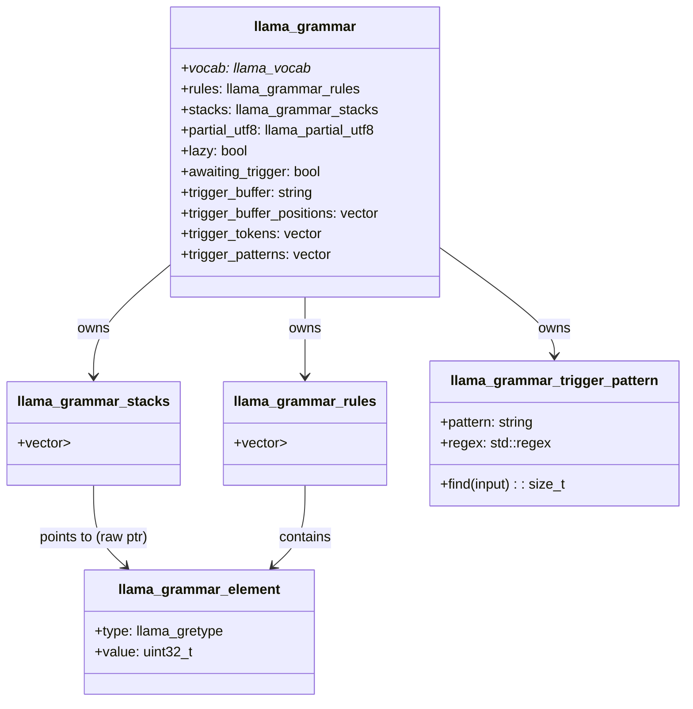
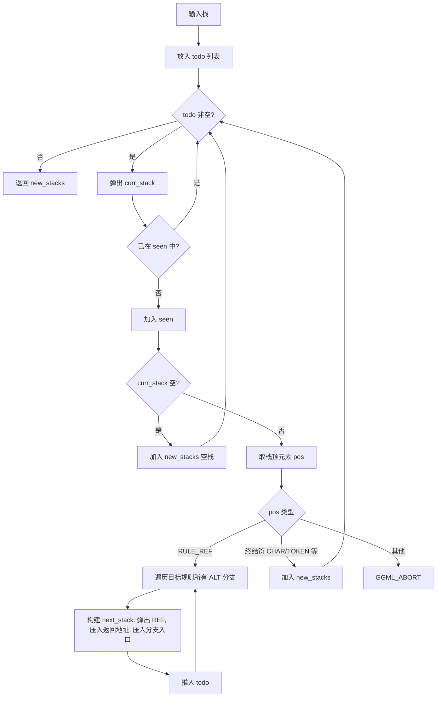
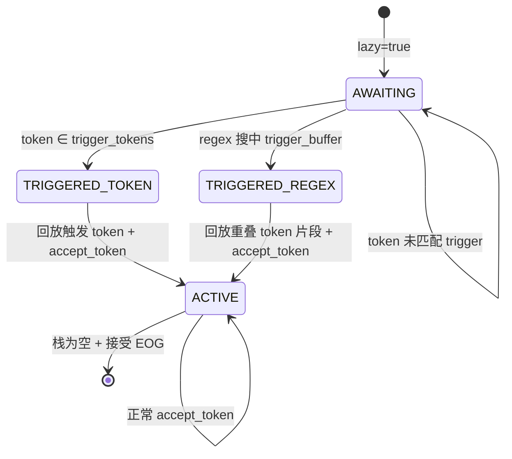

# 第21章 栈推进与触发状态机 —— 高速公路智能收费站视角下的 GBNF 运行时机制

## 学习目标

- 理解 GBNF 语法元素的统一抽象（`llama_gretype` 枚举与 `llama_grammar_element` 二元组结构）
- 掌握 GBNF 解析器从文本到规则数组的完整流水线（`parse_space` → `parse_name` → `parse_token` → `parse_sequence` → `parse_alternates` → `parse_rule`）
- 了解字符范围、token 字面、重复量词（`*`/`+`/?/{m,n}）的解析机制与左递归检测
- 理解下推自动机栈推进模型（`llama_grammar_advance_stack`）的多 ALT 分支展开与去重
- 掌握候选 token 过滤（`llama_grammar_reject_candidates`）如何把语法约束映射到 logits
- 熟悉延迟触发语法（lazy grammar）的 await 状态机、token 与正则触发条件及回放机制
- 能阅读、修改并扩展自定义 GBNF 语法规则

---

## 21.1 生活类比

把 GBNF 语法系统想象成一个**高速公路智能收费站系统**：

token（单词）如同一辆辆驶入的车辆，每辆车携带着乘客（字符/码点）。`llama_gretype` 枚举定义了收费站的几种检查通道类型：ETC 专用道（RULE_REF）、人工收费（CHAR/TOKEN）、特种车道（CHAR_RNG_UPPER/ALT）、绿色通道（CHAR_ANY）、违禁车辆拦截（CHAR_NOT/TOKEN_NOT）、路障关闭（END）、分流岛（ALT）。`llama_grammar_element` 则是每张通行证上的单项标签：{通道类型, 编号/参数}。parse 解析过程相当于把墙上的「车辆通行规则手册」逐条录入收费站中央电脑，生成机器可识别的通行证模板库。重复量词 `*` / `+` / `{m,n}` 给某类车辆批量打印「连续通行 N 次」的临时通行证（印太多就触发防刷限制）。左递归检测检查规则里有没有「请按 A 通道通行，A 通道规则是：请按 A 通道通行」的死循环陷阱。`llama_grammar_advance_stack` 当车辆到达「指向规则名」的虚拟通道时，系统瞬间将其展开为「具体要走的实体检查项」清单。下推栈（stack）是车辆当前手头持有的、尚未通过的检查项序列，通过一项就弹出一项。`match_char` / `match_token` 是真正在岗亭核对车辆/乘客是否符合通行证要求的判断器。`reject_candidates` 把候选车辆逐个过岗亭，不合规的直接贴上「禁止通行（-∞）」标签拦回去。lazy 延迟触发模式下，收费站平时杆子抬起全放行；一旦识别到「触发车牌/特征」，杆子立刻落下开始严格查验。`trigger_buffer` + `trigger_buffer_positions` 是杆子前的缓冲车道，同时记录「车牌快照」和「车辆编号」，触发后按编号精准回放已通过车辆重新查验。整套机制的设计哲学是：先把规则「翻译」成机器可遍历的元素流，再用栈推进模拟推导出所有合法序列，最后在采样阶段把不合法的 token 拒之门外。

---

## 21.2 llama_gretype 与 llama_grammar_element —— 语法元素的统一抽象与最小积木

### 21.2.1 源码路径：`src/llama-grammar.h` - `llama_gretype` 与 `llama_grammar_element`（第 9-36 行）

```cpp
// 语法元素类型枚举：定义了 GBNF 世界里所有可能出现的"通道类型"
enum llama_gretype {
    LLAMA_GRETYPE_END            = 0,  // 路障关闭：规则/序列结束哨兵
    LLAMA_GRETYPE_ALT            = 1,  // 分流岛：选项分隔符 '|'
    LLAMA_GRETYPE_RULE_REF       = 2,  // ETC 虚拟通道：非终结符引用（规则名 -> ID）
    LLAMA_GRETYPE_CHAR           = 3,  // 普通通道：正向字符匹配 [a]
    LLAMA_GRETYPE_CHAR_NOT       = 4,  // 违禁拦截：反向字符匹配 [^a]
    LLAMA_GRETYPE_CHAR_RNG_UPPER = 5,  // 区间上限牌：字符区间 [a-z] 中的 'z'
    LLAMA_GRETYPE_CHAR_ALT       = 6,  // 后续通道：字符集合 [abc] 中的 'b','c'
    LLAMA_GRETYPE_CHAR_ANY       = 7,  // 绿色通道：任意字符 '.'
    LLAMA_GRETYPE_TOKEN          = 8,  // 精确车牌匹配：精确 token 匹配 <token>
    LLAMA_GRETYPE_TOKEN_NOT      = 9,  // 精确车牌拦截：token 取反匹配 !<token>
};

// 最小语法积木：{类型, 值} 二元组，相当于一张标准化的"通行证"
// value 字段根据 type 多态承载：Unicode 码点、规则 ID 或 token ID
struct llama_grammar_element {
    enum llama_gretype type;
    uint32_t           value;
};
```

> **这段代码的作用**：定义了 GBNF 语法系统的**核心数据模型**。`llama_gretype` 是语法元素的"身份证"，涵盖了终结符（字符、token）、非终结符（规则引用）、控制流（END、ALT）等 10 种类型。`llama_grammar_element` 用极简的 `{type, value}` 二元组统一表示所有元素，`value` 根据 `type` 解释为码点、规则索引或 token ID。这种设计让后续的解析、匹配、栈推进都能对统一结构做开关式处理，极大简化了状态机逻辑。

---

## 21.3 llama_grammar —— 运行时语法容器与触发状态机

### 21.3.1 源码路径：`src/llama-grammar.h` - `llama_grammar` 运行时容器（第 112-165 行）

```cpp
// 运行时语法容器：收费站的"中央控制台"，聚合 vocab、rules、stacks 三大核心数据
// 同时维护 partial_utf8、lazy/awaiting_trigger、trigger_buffer 等触发状态
struct llama_grammar {
    const struct llama_vocab * vocab;              // 词表引用，用于 token <-> 文本转换
    llama_grammar_rules        rules;              // 所有规则的存储（vector<vector<element>>）
    llama_grammar_stacks       stacks;             // 当前所有可能的推进路径（栈集合）
    llama_partial_utf8         partial_utf8;       // 跨 token 边界的 UTF-8 续接状态
    bool                       lazy;               // 是否启用延迟触发模式（杆子默认抬起）
    bool                       awaiting_trigger;   // 当前是否处于"等待触发"状态
    std::string                trigger_buffer;     // 触发检测用的文本缓冲（缓冲车道监控画面）
    std::vector<token_pos>     trigger_buffer_positions; // token 位置记录，用于精确回放（车辆编号+位置）
    std::vector<llama_token>   trigger_tokens;     // 精确 token ID 触发列表（特定车牌黑名单）
    std::vector<llama_grammar_trigger_pattern> trigger_patterns; // 正则触发列表（特征识别模型）
};
```

> **这段代码的作用**：`llama_grammar` 是运行时的"大管家"。它持有词表（`vocab`，用于 token 与文本互转）、规则表（`rules`，解析后的扁平化元素数组）、栈集合（`stacks`，所有可能的推进路径）。**关键设计**：栈中存储的是指向 `rules` 内部元素的**裸指针**，因此 `rules` 必须稳定不移动（构造时用 `std::move`）。此外，它完整封装了**延迟触发**状态机所需的字段：`lazy` 开关、触发前缓冲区 `trigger_buffer`、用于精准回放的 `trigger_buffer_positions`、精确 token 触发列表 `trigger_tokens` 和正则触发列表 `trigger_patterns`。

### 21.3.2 架构图：llama_grammar 核心数据结构关系



---

## 21.4 decode_utf8 —— 乘客身份核验站：UTF-8 解码基石

### 21.4.1 源码路径：`src/llama-grammar.cpp` - `decode_utf8` 单字符版（第 15-30 行）

```cpp
// 单字符版：通过查表确定 UTF-8 字节长度并拼接码点
// 类比：单个乘客完整到达，当场核验身份
static std::pair<uint32_t, const char *> decode_utf8(const char * src) {
    static const int lookup[] = { 1, 1, 1, 1, 1, 1, 1, 1, 1, 1, 1, 1, 2, 2, 3, 4 }; // 高4位->字节数
    uint8_t  first_byte = static_cast<uint8_t>(*src);
    uint8_t  highbits   = first_byte >> 4;
    int      len        = lookup[highbits];                    // 1~4 字节
    uint8_t  mask       = (1 << (8 - len)) - 1;                // 有效位掩码
    uint32_t value      = first_byte & mask;                   // 首字节有效位
    const char * end    = src + len;
    const char * pos    = src + 1;
    for ( ; pos < end && *pos; pos++) {
        value = (value << 6) + (static_cast<uint8_t>(*pos) & 0x3F); // 后续字节贡献 6 位
    }
    return std::make_pair(value, pos);
}
```

> **这段代码的作用**：实现**单字符 UTF-8 解码**。通过首字节高 4 位查表得知总字节数 `len`，提取首字节有效位，随后循环合并后续字节的低 6 位。返回 `{码点, 下一字符起始指针}`。此版本用于**解析阶段**处理字面量（如 `"abc"`、`\uXXXX`），假设输入完整。

### 21.4.2 源码路径：`src/llama-grammar.cpp` - `decode_utf8` 字符串版（第 32-73 行）

```cpp
// 字符串版：支持从 partial_utf8 续接，返回码点向量 + 新的 partial_utf8 状态
// 类比：车队到达，第一辆车可能上一批次没拉完人，先补全；再解码新车
static std::pair<std::vector<uint32_t>, llama_partial_utf8> decode_utf8(
        const std::string & src,
        llama_partial_utf8 partial_start) {
    static const int      lookup[] = { 1, 1, 1, 1, 1, 1, 1, 1, 0, 0, 0, 0, 2, 2, 3, 4 }; // 索引 8-11=0 快速拒绝非法首字节
    const char          * pos      = src.c_str();
    std::vector<uint32_t> code_points;
    code_points.reserve(src.size() + 1);
    uint32_t value    = partial_start.value;  // 继承上次未完成的码点高位
    int      n_remain = partial_start.n_remain; // 还需多少个后续字节

    // 1. 先消费 partial_start 残留的后续字节
    while (*pos != 0 && n_remain > 0) {
        uint8_t next_byte = static_cast<uint8_t>(*pos);
        if ((next_byte >> 6) != 2) { // 必须是 10xxxxxx
            code_points.push_back(0); // 错误标记
            return std::make_pair(std::move(code_points), llama_partial_utf8{ 0, -1 });
        }
        value = (value << 6) + (next_byte & 0x3F);
        ++pos;
        --n_remain;
    }
    if (partial_start.n_remain > 0 && n_remain == 0) {
        code_points.push_back(value); // 补全一个完整码点
    }

    // 2. 正常解码新字节
    while (*pos != 0) {
        uint8_t first_byte = static_cast<uint8_t>(*pos);
        uint8_t highbits   = first_byte >> 4;
        n_remain   = lookup[highbits] - 1;
        if (n_remain < 0) { // 非法首字节 (0xF5-0xFF)
            code_points.clear();
            code_points.push_back(0);
            return std::make_pair(std::move(code_points), llama_partial_utf8{ 0, n_remain });
        }
        uint8_t mask  = (1 << (7 - n_remain)) - 1;
        value = first_byte & mask;
        ++pos;
        while (*pos != 0 && n_remain > 0) {
            value = (value << 6) + (static_cast<uint8_t>(*pos) & 0x3F);
            ++pos;
            --n_remain;
        }
        if (n_remain == 0) {
            code_points.push_back(value);
        }
    }
    code_points.push_back(0); // 结尾哨兵 0，供匹配器判断"码点耗尽"
    return std::make_pair(std::move(code_points), llama_partial_utf8{ value, n_remain });
}
```

> **这段代码的作用**：这是**运行时匹配的主力解码器**。它接收上一次遗留的 `partial_utf8`（跨 token 未完成的码点），优先补全它，再解码新字节。`lookup` 表索引 8-11 设为 0，用于快速拒绝非法首字节（0xF0-0xFF 超出 Unicode 范围）。返回向量末尾的哨兵 `0` 至关重要——它让匹配器能区分"码点正好用完"与"还有码点待匹配"。新的 `partial_utf8` 记录最后未完成码点的高位与剩余字节数，供下一个 token 继续解码。

### 21.4.3 架构图：UTF-8 解码与 partial_utf8 续接

```mermaid
flowchart TD
    A[输入: string + partial_utf8] --> B{n_remain > 0?}
    B -- 是 --> C[消费后续字节 补全码点]
    C --> D[校验 10xxxxxx 格式]
    D -- 失败 --> E[返回错误码点 0 + n_remain=-1]
    D -- 成功 --> F[码点入向量 n_remain=0]
    B -- 否 --> G[解码新字节]
    G --> H[查表获取字节数 n_remain]
    H -- n_remain<0 --> E
    H -- 正常 --> I[提取首字节有效位]
    I --> J[循环合并后续字节]
    J --> K{n_remain==0?}
    K -- 是 --> L[码点入向量]
    K -- 否 --> M[保留部分状态]
    L --> N[继续下一字节]
    M --> O[结束循环]
    N --> G
    O --> P[追加哨兵 0]
    P --> Q[返回 {code_points, 新 partial_utf8}]
```

---

## 21.5 词法原语 —— parse_hex/parse_space/parse_name/parse_int/parse_char/parse_token

### 21.5.1 源码路径：`src/llama-grammar.cpp` - `parse_hex` / `parse_space` / `parse_name` / `parse_int` / `parse_char`（第 85-174 行）

```cpp
// parse_hex：解析固定长度的十六进制转义 (\xXX, \uXXXX, \UXXXXXXXX)
// 类比：读懂手册里的"编号格式"如 \u4E2D -> 0x4E2D
static std::pair<uint32_t, const char *> parse_hex(const char * src, int size) {
    const char * pos   = src;
    const char * end   = src + size;
    uint32_t     value = 0;
    for ( ; pos < end && *pos; pos++) {
        value <<= 4;
        char c = *pos;
        if (c >= 'a' && c <= 'f') value += c - 'a' + 10;
        else if (c >= 'A' && c <= 'F') value += c - 'A' + 10;
        else if (c >= '0' && c <= '9') value += c - '0';
        else break;
    }
    if (pos != end) throw std::runtime_error("expecting " + std::to_string(size) + " hex chars at " + src);
    return std::make_pair(value, pos);
}

// parse_space：跳过空白、Tab、注释(#...)，可选换行
// 类比：扫视手册时跳过空行、批注、缩进
static const char * parse_space(const char * src, bool newline_ok) {
    const char * pos = src;
    while (*pos == ' ' || *pos == '\t' || *pos == '#' ||
            (newline_ok && (*pos == '\r' || *pos == '\n'))) {
        if (*pos == '#') while (*pos && *pos != '\r' && *pos != '\n') pos++;
        else pos++;
    }
    return pos;
}

// parse_name / parse_int：识别标识符与整数，至少需 1 字符
// 类比：读取规则名、重复次数等关键字段
static const char * parse_name(const char * src) {
    const char * pos = src;
    while (is_word_char(*pos)) { pos++; }
    if (pos == src) throw std::runtime_error("expecting name at " + std::string(src));
    return pos;
}
static const char * parse_int(const char * src) {
    const char * pos = src;
    while (is_digit_char(*pos)) { pos++; }
    if (pos == src) throw std::runtime_error("expecting integer at " + std::string(src));
    return pos;
}

// parse_char：解析单字符字面量，支持转义序列
// 类比：把手册里的 'a'、'\n'、'\u4E2D' 翻成真实乘客身份码
static std::pair<uint32_t, const char *> parse_char(const char * src) {
    if (*src == '\\') {
        switch (src[1]) {
            case 'x': return parse_hex(src + 2, 2);
            case 'u': return parse_hex(src + 2, 4);
            case 'U': return parse_hex(src + 2, 8);
            case 't': return std::make_pair('\t', src + 2);
            case 'r': return std::make_pair('\r', src + 2);
            case 'n': return std::make_pair('\n', src + 2);
            case '\\': case '"': case '[': case ']': // 字面转义
                      return std::make_pair(src[1], src + 2);
            default: throw std::runtime_error("unknown escape at " + std::string(src));
        }
    } else if (*src) {
        return decode_utf8(src); // 普通 UTF-8 字符
    }
    throw std::runtime_error("unexpected end of input");
}
```

> **这段代码的作用**：构成了**词法分析器的基础原语**。`parse_space` 不仅跳过空白，还支持 `#` 行注释，这使得 GBNF 文件可以包含注释。`parse_char` 是字符级解析的核心，它统一处理了转义序列（`\x`、`\u`、`\U`、控制字符）和普通 UTF-8 字符，底层复用 `decode_utf8`。`parse_hex` 保证定长读取，不足抛异常。这些函数为上层 `parse_sequence` 提供了干净的 token 流。

### 21.5.2 源码路径：`src/llama-grammar.cpp` - `parse_token` 精确车牌识别的双模式（第 176-224 行）

```cpp
// 类比：手册里写 <[123]> 直接给车牌号，或写 <piece> 让系统查词表
static std::pair<uint32_t, const char *> parse_token(const llama_vocab * vocab, const char * src) {
    const char * pos = src;
    if (*pos != '<') throw std::runtime_error("expecting '<' at " + std::string(pos));
    pos++;
    if (*pos == '[') { // 模式 1: <[123]> 直接指定 token ID
        pos++;
        const char * int_end = parse_int(pos);
        uint32_t token_id = std::stoul(std::string(pos, int_end - pos));
        pos = int_end;
        if (*pos != ']') throw std::runtime_error("expecting ']' at " + std::string(pos));
        pos++;
        if (*pos != '>') throw std::runtime_error("expecting '>' at " + std::string(pos));
        pos++;
        return std::make_pair(token_id, pos);
    }
    // 模式 2: <piece> 依赖词表反查
    if (vocab == nullptr) {
        throw std::runtime_error("no vocab to parse token at " + std::string(src));
    }
    while (*pos != 0 && *pos != '>') pos++;
    if (*pos != '>') throw std::runtime_error("expecting '>' at " + std::string(pos));
    pos++;
    llama_token tokens[2];
    int32_t n_tokens = vocab->tokenize(src, static_cast<int32_t>(pos - src), tokens, 2, false, true);
    if (n_tokens != 1) throw std::runtime_error("invalid token '" + std::string(src, pos - src) + "'");
    return std::make_pair(tokens[0], pos);
}
```

> **这段代码的作用**：实现了 **Token 字面量的双模式解析**。`<[123]>` 无需词表即可解析，适合离线构建语法；`<piece>` 则依赖 `vocab->tokenize` 将文本片段编码为单个 token，**要求分词结果恰好为 1 个 token**，否则报错。这种设计既保证了灵活性（支持无词表场景），又防止了歧义（多 token 片段无法唯一映射）。

---

## 21.6 llama_grammar_parser —— 从手册到模板库：规则解析主干

### 21.6.1 源码路径：`src/llama-grammar.h` - `llama_grammar_parser` 骨架与符号管理（第 82-103 行）

```cpp
struct llama_grammar_parser {
    const llama_vocab * vocab = nullptr;                    // 词表引用，用于 <piece> 解析
    std::map<std::string, uint32_t> symbol_ids;             // 规则名 -> ID 映射（规则名索引表）
    llama_grammar_rules rules;                              // ID -> 规则元素向量（模板库）

    uint32_t get_symbol_id(const char * src, size_t len);   // 显式命名 -> ID
    uint32_t generate_symbol_id(const std::string & base_name); // 匿名规则 -> name_N
    void add_rule(uint32_t rule_id, const llama_grammar_rule & rule); // 写入规则
    // ... 解析入口 ...
};
```

> **这段代码的作用**：解析器维护三大核心成员：`vocab` 用于 `<piece>` 解析，`symbol_ids` 完成**规则名到数字 ID 的双向映射**，`rules` 按 ID 索引存储规则体。`get_symbol_id` 用于显式命名规则（如 `root ::= ...`），`generate_symbol_id` 则为分组 `()`、重复量词展开自动生成 `name_N` 形式的匿名规则名。**设计精妙处**：`symbol_ids` 用 `std::map` 保证遍历顺序确定，便于调试与测试。

### 21.6.2 源码路径：`src/llama-grammar.cpp` - `parse_rule` 单条规则录入入口（第 592-614 行）

```cpp
// 类比：录入一条完整规则 "speed_limit ::= '60' | '80' | '100'"
const char * llama_grammar_parser::parse_rule(const char * src) {
    const char * name_end = parse_name(src);                 // 1. 解析规则名
    const char * pos      = parse_space(name_end, false);
    size_t       name_len = name_end - src;
    uint32_t     rule_id  = get_symbol_id(src, name_len);    // 2. 分配/获取 ID
    const std::string name(src, name_len);
    if (!(pos[0] == ':' && pos[1] == ':' && pos[2] == '='))  // 3. 校验 ::=
        throw std::runtime_error("expecting ::= at " + std::string(pos));
    pos = parse_space(pos + 3, true);
    pos = parse_alternates(pos, name, rule_id, false);       // 4. 解析规则体
    // 5. 处理行尾 \r\n / \n
    if (*pos == '\r') pos += pos[1] == '\n' ? 2 : 1;
    else if (*pos == '\n') pos++;
    else if (*pos) throw std::runtime_error("expecting newline or end at " + std::string(pos));
    return parse_space(pos, true);
}
```

> **这段代码的作用**：`parse_rule` 遵循标准的 **BNF 规则定义格式**：`name ::= alternates`。它先提取规则名并获取 ID，校验 `::=` 分隔符，然后委托 `parse_alternates` 处理规则体，最后规范化行尾。每条规则最终会被 `add_rule` 写入 `rules[rule_id]`。

### 21.6.3 源码路径：`src/llama-grammar.cpp` - `parse_alternates` 与 `parse_sequence`（第 378-590 行，节选关键逻辑）

```cpp
// parse_alternates：处理 | 分隔的多个分支
// 类比：规则 "A ::= B | C | D" 拆成三条分支，每条分支各自生成序列
const char * llama_grammar_parser::parse_alternates(
        const char        * src,
        const std::string & rule_name,
        uint32_t            rule_id,
        bool                is_nested) {
    llama_grammar_rule rule;
    const char * pos = parse_sequence(src, rule_name, rule, is_nested); // 解析第一个序列
    while (*pos == '|') {                          // 循环处理后续选项
        rule.push_back({LLAMA_GRETYPE_ALT, 0});    // 插入 ALT 分隔符
        pos = parse_space(pos + 1, true);
        pos = parse_sequence(pos, rule_name, rule, is_nested);
    }
    rule.push_back({LLAMA_GRETYPE_END, 0});        // 规则结束哨兵
    add_rule(rule_id, rule);                       // 写入规则表
    return pos;
}

// parse_sequence：识别序列内的各种元素（字面量、字符集、token、规则引用、分组、量词）
// 类比：把 " 'hello' [a-z]* <token> (group)? " 拆解成一串通行证模板
const char * llama_grammar_parser::parse_sequence(
        const char         * src,
        const std::string  & rule_name,
        llama_grammar_rule & rule,
        bool               is_nested) {
    size_t last_sym_start = rule.size(); // 记录上一个"可重复单元"的起始位置
    const char * pos = src;
    uint64_t n_prev_rules = 1;           // 累积规则数，用于防爆

    // 重复量词展开 lambda：将 S{m,n} 翻译为额外规则
    auto handle_repetitions = [&](uint64_t min_times, uint64_t max_times) { /* 见 22.7 详解 */ };

    while (*pos) {
        if (*pos == '"') { // 双引号字符串字面量
            pos++; last_sym_start = rule.size(); n_prev_rules = 1;
            while (*pos != '"') { rule.push_back({LLAMA_GRETYPE_CHAR, parse_char(pos).first}); pos = parse_char(pos).second; }
            pos = parse_space(pos + 1, is_nested);
        } else if (*pos == '[') { // 字符集合 [abc] / [a-z] / [^...]
            pos++; enum llama_gretype start_type = LLAMA_GRETYPE_CHAR;
            if (*pos == '^') { pos++; start_type = LLAMA_GRETYPE_CHAR_NOT; }
            last_sym_start = rule.size(); n_prev_rules = 1;
            while (*pos != ']') {
                auto char_pair = parse_char(pos); pos = char_pair.second;
                enum llama_gretype type = (last_sym_start < rule.size()) ? LLAMA_GRETYPE_CHAR_ALT : start_type;
                rule.push_back({type, char_pair.first});
                if (pos[0] == '-' && pos[1] != ']') { // 区间 a-z
                    auto endchar_pair = parse_char(pos + 1); pos = endchar_pair.second;
                    rule.push_back({LLAMA_GRETYPE_CHAR_RNG_UPPER, endchar_pair.first});
                }
            }
            pos = parse_space(pos + 1, is_nested);
        } else if (*pos == '<' || *pos == '!') { // Token 引用 <...> / !<...>
            auto type = LLAMA_GRETYPE_TOKEN;
            if (*pos == '!') { type = LLAMA_GRETYPE_TOKEN_NOT; pos++; }
            auto token_pair = parse_token(vocab, pos);
            last_sym_start = rule.size(); n_prev_rules = 1;
            rule.push_back({type, token_pair.first});
            pos = parse_space(token_pair.second, is_nested);
        } else if (is_word_char(*pos)) { // 规则引用
            const char * name_end = parse_name(pos);
            uint32_t ref_rule_id = get_symbol_id(pos, name_end - pos);
            pos = parse_space(name_end, is_nested);
            last_sym_start = rule.size(); n_prev_rules = 1;
            rule.push_back({LLAMA_GRETYPE_RULE_REF, ref_rule_id});
        } else if (*pos == '(') { // 分组 (...)
            pos = parse_space(pos + 1, true);
            uint32_t n_rules_before = symbol_ids.size();
            uint32_t sub_rule_id = generate_symbol_id(rule_name);
            pos = parse_alternates(pos, rule_name, sub_rule_id, true);
            n_prev_rules = std::max(1u, (uint32_t)symbol_ids.size() - n_rules_before);
            last_sym_start = rule.size();
            rule.push_back({LLAMA_GRETYPE_RULE_REF, sub_rule_id});
            if (*pos != ')') throw std::runtime_error("expecting ')' at " + std::string(pos));
            pos = parse_space(pos + 1, is_nested);
        } else if (*pos == '.') { // 任意字符
            last_sym_start = rule.size(); n_prev_rules = 1;
            rule.push_back({LLAMA_GRETYPE_CHAR_ANY, 0});
            pos = parse_space(pos + 1, is_nested);
        } else if (*pos == '*') { pos = parse_space(pos + 1, is_nested); handle_repetitions(0, UINT64_MAX); }
        else if (*pos == '+') { pos = parse_space(pos + 1, is_nested); handle_repetitions(1, UINT64_MAX); }
        else if (*pos == '?') { pos = parse_space(pos + 1, is_nested); handle_repetitions(0, 1); }
        else if (*pos == '{') { /* 解析 {m,n} 细节见 22.7 */ }
        else break;
    }
    return pos;
}
```

> **这段代码的作用**：这两个函数共同实现了 **GBNF 语法的递归下降解析**。`parse_alternates` 处理顶层的 `|` 分支，每个分支调用 `parse_sequence`。`parse_sequence` 是一个巨大的状态机，依次识别：字符串字面量、`[...]` 字符集合、`<...>` token 引用、规则名引用、`(...)` 分组、`.` 任意字符、以及 `* + ? {m,n}` 重复量词。**关键设计**：每个"可重复单元"（字面量、字符集、token、规则引用、分组）解析完毕后，都会更新 `last_sym_start` 和 `n_prev_rules`，为后续可能出现的量词展开做准备。

### 21.6.4 流程图：解析器主流水线

```mermaid
flowchart TD
    A[GBNF 文本] --> B[parse_space 跳过首部空白]
    B --> C{*pos != 0?}
    C -- 是 --> D[parse_rule]
    D --> E[parse_name 取规则名]
    E --> F[get_symbol_id 分配 ID]
    F --> G[校验 ::=]
    G --> H[parse_alternates]
    H --> I[parse_sequence 循环]
    I --> J{识别元素类型}
    J -- 字符串 "..." --> K[逐字符 parse_char -> CHAR]
    J -- 字符集 [...] --> L[parse_char + 区间检测 -> CHAR/CHAR_NOT/CHAR_ALT/CHAR_RNG_UPPER]
    J -- Token <...> --> M[parse_token -> TOKEN/TOKEN_NOT]
    J -- 规则名 --> N[get_symbol_id -> RULE_REF]
    J -- 分组 (...) --> O[generate_symbol_id + parse_alternates -> RULE_REF]
    J -- 任意字符 . --> P[CHAR_ANY]
    J -- 量词 * + ? {m,n} --> Q[handle_repetitions 展开新规则]
    J -- 其他 --> R[结束序列]
    R --> S[push END]
    S --> T[add_rule 入库]
    T --> U[parse_alternates 处理下一个 |]
    U --> I
    C -- 否 --> V[parse 校验所有规则]
    V --> W[左递归检测]
    W --> X[构建初始栈]
    X --> Y[生成 llama_grammar 实例]
```

---

## 21.7 handle_repetitions —— 批量印证机：字符范围与重复量词

### 21.7.1 字符集合与区间的内部表示

在 `[abc]` 或 `[a-z]` 中，解析器生成特定的元素序列：
- 第一个字符：`CHAR` 或 `CHAR_NOT`（取决于 `^`）
- 后续字符：`CHAR_ALT` 链式串联
- 区间上限：`CHAR_RNG_UPPER` 紧跟在区间下限之后

**举例**：
- `[a-c]` 产生：`CHAR('a')`, `CHAR_RNG_UPPER('c')`
- `[abc]` 产生：`CHAR('a')`, `CHAR_ALT('b')`, `CHAR_ALT('c')`
- `[^xyz]` 产生：`CHAR_NOT('x')`, `CHAR_ALT('y')`, `CHAR_ALT('z')`

匹配器 `match_char` 会一次性遍历完整个 `CHAR_ALT`/`CHAR_RNG_UPPER` 链，返回整体匹配结果。

### 21.7.2 源码路径：`src/llama-grammar.cpp` - `handle_repetitions` 量词展开算法（第 497-526 行，嵌入于 `parse_sequence`）

```cpp
// 类比：把 "S{2,4}" 翻译成 "S S (S? (S?))" 的显式规则链
auto handle_repetitions = [&](uint64_t min_times, uint64_t max_times) {
    bool no_max = max_times == UINT64_MAX; // * / + 无上限
    if (last_sym_start == rule.size()) throw std::runtime_error("expecting preceding item to */+/?/{ at " + std::string(pos));
    llama_grammar_rule prev_rule(rule.begin() + last_sym_start, rule.end()); // 取出待重复的子序列
    uint64_t total_rules = 1;
    if (!no_max && max_times > 0) total_rules = max_times;
    else if (min_times > 0) total_rules = min_times;
    // 防爆检查：累积规则数 * 本次展开规则数 < 2000
    if (n_prev_rules * total_rules >= MAX_REPETITION_THRESHOLD)
        throw std::runtime_error("number of rules that are going to be repeated multiplied by the new repetition exceeds sane defaults...");
    if (min_times == 0) {
        rule.resize(last_sym_start); // 0 次：直接移除原单元（留待可选分支处理）
    } else {
        for (uint64_t i = 1; i < min_times; i++) // min_times-1 次：内联展开
            rule.insert(rule.end(), prev_rule.begin(), prev_rule.end());
    }
    uint32_t last_rec_rule_id = 0;
    auto n_opt = no_max ? 1 : max_times - min_times; // 可选额外次数
    llama_grammar_rule rec_rule(prev_rule);          // 递归规则模板
    for (uint64_t i = 0; i < n_opt; i++) {
        rec_rule.resize(prev_rule.size());
        uint32_t rec_rule_id = generate_symbol_id(rule_name); // 生成匿名规则 name_N
        if (i > 0 || no_max) { // 无上限 或 非第一个可选项：追加递归引用
            rec_rule.push_back({LLAMA_GRETYPE_RULE_REF, no_max ? rec_rule_id : last_rec_rule_id});
        }
        rec_rule.push_back({LLAMA_GRETYPE_ALT, 0}); // 可选分支：ALT + 空分支
        rec_rule.push_back({LLAMA_GRETYPE_END, 0});
        add_rule(rec_rule_id, rec_rule);
        last_rec_rule_id = rec_rule_id;
    }
    if (n_opt > 0) rule.push_back({LLAMA_GRETYPE_RULE_REF, last_rec_rule_id}); // 接入可选链
    n_prev_rules *= total_rules;
    GGML_ASSERT(n_prev_rules >= 1);
};
```

> **这段代码的作用**：实现了 **量词到显式规则的静态展开**。
> **算法精髓**：
> 1. **内联最小次数**：`min_times > 0` 时，直接在当前规则中复制 `min_times - 1` 份 `prev_rule`。
> 2. **递归规则处理可选区间**：对于 `max_times - min_times` 次可选重复，每次生成一条新规则 `name_N`，其结构为 `prev_rule (RULE_REF next_name_N | ε)`。无上限 (`*`, `+`) 时递归引用自身（`rec_rule_id`），有上限时链式引用下一条规则。
> 3. **防爆阈值**：`MAX_REPETITION_THRESHOLD = 2000`，`n_prev_rules` 累乘估算总规则数，超限即报错。
>
> **举例**：`S{2,4}` 展开为：
> - 当前规则内联：`S S` (min=2)
> - 可选链：`name_1 ::= S (name_2 | ε)`, `name_2 ::= S (name_3 | ε)`, `name_3 ::= S (ε)`
> - 当前规则末尾追加 `RULE_REF(name_1)`

### 21.7.3 架构图：量词展开示例 `S{2,4}`

```mermaid
graph TD
    A[原规则: ... S{2,4} ...] --> B[内联最小 2 次: S S]
    B --> C[生成可选链规则]
    C --> D[name_1 ::= S (name_2 | ε)]
    D --> E[name_2 ::= S (name_3 | ε)]
    E --> F[name_3 ::= S (ε)]
    F --> G[原规则追加 RULE_REF name_1]
    G --> H[最终规则集合]
```

---

## 21.8 语法校验与导出 —— parse/print/c_rules/print_rule/print_rule_binary/print_grammar_char/is_char_element

### 21.8.1 源码路径：`src/llama-grammar.cpp` - `parse` 顶层入口与全局校验（第 616-652 行）

```cpp
// 类比：全厂巡检，确保每条规则都有内容、每个引用都能找到模板
bool llama_grammar_parser::parse(const char * src) {
    try {
        const char * pos = parse_space(src, true);
        while (*pos) pos = parse_rule(pos); // 循环解析所有规则
        // 全局校验：每条规则非空，且所有 RULE_REF 指向的规则必须存在且非空
        for (const auto & rule : rules) {
            if (rule.empty()) throw std::runtime_error("Undefined rule");
            for (const auto & elem : rule) {
                if (elem.type == LLAMA_GRETYPE_RULE_REF) {
                    if (elem.value >= rules.size() || rules[elem.value].empty()) {
                        for (const auto & kv : symbol_ids)
                            if (kv.second == elem.value)
                                throw std::runtime_error("Undefined rule identifier '" + kv.first + "'");
                    }
                }
            }
        }
    } catch (const std::exception & err) {
        fprintf(stderr, "%s: error parsing grammar: %s\n\n%s\n", __func__, err.what(), src);
        rules.clear();
        return false;
    }
    return true;
}
```

> **这段代码的作用**：实现了**防御性解析**。捕获所有异常并转为错误日志，清空规则表返回 `false`。校验逻辑确保无悬空引用：遍历所有规则元素，遇到 `RULE_REF` 必须指向已存在且非空的规则。这是运行时栈推进不崩溃的前提。

### 21.8.2 源码路径：`src/llama-grammar.cpp` - `print` / `c_rules` / `print_rule` / `print_rule_binary` / `print_grammar_char` / `is_char_element`（第 226-316 行，第 654-678 行）

```cpp
// print：反向建立 ID->名字映射，按 ID 顺序打印人类可读 GBNF
// 类比：把电脑里的模板库反向打印成人类可读的手册，用于核对
void llama_grammar_parser::print(FILE * file) {
    std::map<uint32_t, std::string> symbol_id_names;
    for (const auto & kv : symbol_ids) symbol_id_names[kv.second] = kv.first;
    for (size_t i = 0, end = rules.size(); i < end; i++)
        print_rule(file, uint32_t(i), rules[i], symbol_id_names);
}

// c_rules：转为 C 接口所需的 element* 数组
// 类比：把 C++ vector 打包成 C 风格指针数组，供底层栈推进用
llama_grammar_stack llama_grammar_parser::c_rules() const {
    llama_grammar_stack ret; ret.reserve(rules.size());
    for (const auto & rule : rules) ret.push_back(rule.data());
    return ret;
}

// print_grammar_char：可打印 ASCII 直显 / 中文 <U+XXXX>
// 类比：监控屏幕显示乘客身份，英文直显，外文显示编码
static void print_grammar_char(FILE * file, uint32_t c) {
    if (0x20 <= c && c <= 0x7f) fprintf(file, "%c", static_cast<char>(c));
    else fprintf(file, "<U+%04X>", c);
}

// is_char_element：判断是否为字符类元素
static bool is_char_element(llama_grammar_element elem) {
    return elem.type == LLAMA_GRETYPE_CHAR || elem.type == LLAMA_GRETYPE_CHAR_NOT ||
           elem.type == LLAMA_GRETYPE_CHAR_ALT || elem.type == LLAMA_GRETYPE_CHAR_RNG_UPPER ||
           elem.type == LLAMA_GRETYPE_CHAR_ANY;
}

// print_rule：人类可读 GBNF 还原
static void print_rule(FILE * file, uint32_t rule_id, const llama_grammar_rule & rule,
        const std::map<uint32_t, std::string> & symbol_id_names) {
    fprintf(file, "%s ::= ", symbol_id_names.at(rule_id).c_str());
    for (size_t i = 0, end = rule.size() - 1; i < end; i++) {
        llama_grammar_element elem = rule[i];
        switch (elem.type) {
            case LLAMA_GRETYPE_ALT: fprintf(file, "| "); break;
            case LLAMA_GRETYPE_RULE_REF: fprintf(file, "%s ", symbol_id_names.at(elem.value).c_str()); break;
            case LLAMA_GRETYPE_CHAR: fprintf(file, "["); print_grammar_char(file, elem.value); break;
            case LLAMA_GRETYPE_CHAR_NOT: fprintf(file, "[^"); print_grammar_char(file, elem.value); break;
            case LLAMA_GRETYPE_CHAR_RNG_UPPER: fprintf(file, "-"); print_grammar_char(file, elem.value); break;
            case LLAMA_GRETYPE_CHAR_ALT: print_grammar_char(file, elem.value); break;
            case LLAMA_GRETYPE_CHAR_ANY: fprintf(file, "."); break;
            case LLAMA_GRETYPE_TOKEN: fprintf(file, "<[%u]> ", elem.value); break;
            case LLAMA_GRETYPE_TOKEN_NOT: fprintf(file, "!<[%u]> ", elem.value); break;
        }
        // 字符类元素后自动补 ] （除非下一个还是 CHAR_ALT/RNG_UPPER/ANY）
        if (is_char_element(elem)) {
            switch (rule[i + 1].type) {
                case LLAMA_GRETYPE_CHAR_ALT: case LLAMA_GRETYPE_CHAR_RNG_UPPER: case LLAMA_GRETYPE_CHAR_ANY: break;
                default: fprintf(file, "] ");
            }
        }
    }
    fprintf(file, "\n");
}

// print_rule_binary：类型标签+十六进制值，硬核调试用
static void print_rule_binary(FILE * file, const llama_grammar_rule & rule) { /* ... */ }
```

> **这段代码的作用**：`print_rule` 实现了**完整的 GBNF 文本还原**，正确处理字符集合的 `] ` 收尾、区间 `-`、任意字符 `.`、token 引用 `<[id]>` 等语法糖，是调试语法定义的利器。`c_rules` 将 `vector<vector<element>>` 转为 `vector<element*>`，供 C 接口 `llama_grammar_init_impl` 使用。`print_grammar_char` 统一了字符显示风格，`is_char_element` 判断字符类元素。

---

## 21.9 匹配引擎 —— llama_grammar_match_char/match_partial_char/match_token/is_end_of_sequence

### 21.9.1 源码路径：`src/llama-grammar.cpp` - `llama_grammar_is_end_of_sequence`（第 757-764 行）

```cpp
static bool llama_grammar_is_end_of_sequence(const llama_grammar_element * pos) {
    switch (pos->type) {
        case LLAMA_GRETYPE_END: return true; // 路障
        case LLAMA_GRETYPE_ALT: return true; // 分流岛（分支结束）
        default:                return false;
    }
}
```

> **这段代码的作用**：`END` 标记规则/序列结束，`ALT` 标记选项分支结束。栈推进、匹配器均依赖此函数识别边界。

### 21.9.2 源码路径：`src/llama-grammar.cpp` - `llama_grammar_match_char`（第 766-797 行）

```cpp
// 类比：核验乘客身份证号是否在通行证允许的名单/区间内
static std::pair<bool, const llama_grammar_element *> llama_grammar_match_char(
        const llama_grammar_element * pos, const uint32_t chr) {
    bool found = false;
    bool is_positive_char = pos->type == LLAMA_GRETYPE_CHAR || pos->type == LLAMA_GRETYPE_CHAR_ANY;
    GGML_ASSERT(is_positive_char || pos->type == LLAMA_GRETYPE_CHAR_NOT);
    do {
        if (pos[1].type == LLAMA_GRETYPE_CHAR_RNG_UPPER) { // 区间 [a-z]
            found = found || (pos->value <= chr && chr <= pos[1].value);
            pos += 2;
        } else if (pos->type == LLAMA_GRETYPE_CHAR_ANY) { // 任意字符 .
            found = true; pos += 1;
        } else { // 单字符或 CHAR_ALT 链
            found = found || pos->value == chr;
            pos += 1;
        }
    } while (pos->type == LLAMA_GRETYPE_CHAR_ALT); // 遍历 CHAR_ALT 链
    return std::make_pair(found == is_positive_char, pos); // 正向: found=true 即匹配; 反向: found=false 即匹配
}
```

> **这段代码的作用**：匹配器**一次性消费完整个字符集合/区间链**，返回 `{是否匹配, 下一个待匹配元素指针}`。`CHAR_NOT` 逻辑取反：集合中无匹配则通过。`CHAR_ANY` 直接匹配任意字符。

### 21.9.3 源码路径：`src/llama-grammar.cpp` - `llama_grammar_match_partial_char`（第 799-848 行）

```cpp
// 类比：车辆只露了半个乘客，根据已露部分推断完整身份可能范围，预判是否合规
static bool llama_grammar_match_partial_char(
        const llama_grammar_element * pos,
        const llama_partial_utf8      partial_utf8) {
    // 计算部分码点可能的取值区间 [low, high]
    uint32_t partial_value = partial_utf8.value;
    int      n_remain      = partial_utf8.n_remain;
    if (n_remain < 0 || (n_remain == 1 && partial_value < 2)) return false;
    uint32_t low  = partial_value << (n_remain * 6);
    uint32_t high = low | ((1 << (n_remain * 6)) - 1);
    // 排除 overlong 编码（如 2 字节序列编码 < 0x80 的码点）
    if (low == 0) { if (n_remain == 2) low = 1 << 11; else if (n_remain == 3) low = 1 << 16; }
    // 判断 [low, high] 与字符集合/区间是否有交集
    bool is_positive_char = pos->type == LLAMA_GRETYPE_CHAR || pos->type == LLAMA_GRETYPE_CHAR_ANY;
    do {
        if (pos[1].type == LLAMA_GRETYPE_CHAR_RNG_UPPER) {
            if (pos->value <= high && low <= pos[1].value) return is_positive_char;
            pos += 2;
        } else if (pos->type == LLAMA_GRETYPE_CHAR_ANY) {
            return true;
        } else {
            if (low <= pos->value && pos->value <= high) return is_positive_char;
            pos += 1;
        }
    } while (pos->type == LLAMA_GRETYPE_CHAR_ALT);
    return !is_positive_char; // 反向匹配取反
}
```

> **这段代码的作用**：这是**跨 token 边界匹配的关键**。候选 token 的首字节可能只包含一个码点的高位，我们通过计算该部分字节能补全的码点范围 `[low, high]`，判断它**可能**落入允许的字符集合。若无交集，直接拒绝该 token，无需等待后续字节。同时处理了 UTF-8 overlong 编码攻击防护（如 2 字节编码 ASCII 字符）。

### 21.9.4 源码路径：`src/llama-grammar.cpp` - `llama_grammar_match_token`（第 850-859 行）

```cpp
static bool llama_grammar_match_token(const llama_grammar_element * pos, const llama_token token) {
    GGML_ASSERT(pos->type == LLAMA_GRETYPE_TOKEN || pos->type == LLAMA_GRETYPE_TOKEN_NOT);
    if (pos->type == LLAMA_GRETYPE_TOKEN) return pos->value == static_cast<uint32_t>(token);
    return pos->value != static_cast<uint32_t>(token); // TOKEN_NOT 取反
}
```

> **这段代码的作用**：极简的精确 ID 比较，支持 `!<token>` 取反。

---

## 21.10 llama_grammar_advance_stack —— 分流与展开：下推栈推进

### 21.10.1 源码路径：`src/llama-grammar.cpp` - `llama_grammar_advance_stack`（第 861-925 行）

```cpp
// 类比：把含有虚拟通道的通行证叠，展开成若干只含实体通道的通行证叠
static void llama_grammar_advance_stack(
        const llama_grammar_rules  & rules,
        const llama_grammar_stack  & stack,
        llama_grammar_stacks & new_stacks) {
    std::vector<llama_grammar_stack> todo; todo.push_back(stack);
    // 按指针地址字典序比较，用于去重
    auto stack_cmp = [](const llama_grammar_stack & a, const llama_grammar_stack & b) { /* ... */ };
    std::set<llama_grammar_stack, decltype(stack_cmp)> seen(stack_cmp);

    while (!todo.empty()) {
        llama_grammar_stack curr_stack = std::move(todo.back()); todo.pop_back();
        if (seen.find(curr_stack) != seen.end()) continue; // 去重！
        seen.insert(curr_stack);

        if (curr_stack.empty()) { // 栈为空 = 接受状态（已通过所有检查）
            if (std::find(new_stacks.begin(), new_stacks.end(), curr_stack) == new_stacks.end())
                new_stacks.emplace_back(std::move(curr_stack));
            continue;
        }

        const llama_grammar_element * pos = curr_stack.back();
        switch (pos->type) {
        case LLAMA_GRETYPE_RULE_REF: {
            const size_t rule_id = pos->value;
            const llama_grammar_element * subpos = rules[rule_id].data();
            do { // 遍历该规则的所有 ALT 分支
                llama_grammar_stack next_stack(curr_stack.begin(), curr_stack.end() - 1); // 弹出 RULE_REF
                if (!llama_grammar_is_end_of_sequence(pos + 1)) next_stack.push_back(pos + 1); // 压入返回地址
                if (!llama_grammar_is_end_of_sequence(subpos)) next_stack.push_back(subpos);   // 压入被调用规则入口
                todo.push_back(std::move(next_stack));
                while (!llama_grammar_is_end_of_sequence(subpos)) subpos++; // 扫描到分支末尾
                if (subpos->type == LLAMA_GRETYPE_ALT) subpos++; // 进入下一分支
                else break;
            } while (true);
            break;
        }
        case LLAMA_GRETYPE_CHAR: case LLAMA_GRETYPE_CHAR_NOT: case LLAMA_GRETYPE_CHAR_ANY:
        case LLAMA_GRETYPE_TOKEN: case LLAMA_GRETYPE_TOKEN_NOT:
            if (std::find(new_stacks.begin(), new_stacks.end(), curr_stack) == new_stacks.end())
                new_stacks.emplace_back(std::move(curr_stack)); // 终结符栈，收集结果
            break;
        default: GGML_ABORT("fatal error");
        }
    }
}
```

> **这段代码的作用**：实现了**下推自动机的栈展开核心算法**。
> **核心机制**：
> 1. **工作列表 `todo` + 去重集合 `seen`**：广度/深度优先遍历所有展开路径，`seen` 按**指针地址字典序**去重，防止同一规则被多次引用导致指数级栈爆炸。
> 2. **规则调用语义**：遇到 `RULE_REF`，弹出它，压入**返回地址**（`pos+1`）和**被调规则入口**（`subpos`）。遍历被调规则的所有 `ALT` 分支，每个分支生成一个新栈。
> 3. **终止条件**：栈顶为终结符（字符/token 类型）或栈为空，加入 `new_stacks`。
>
> **去重的关键**：多条路径可能展开到同一个规则入口（指针地址相同），`seen` 集合按指针序列比较，确保同一栈状态只处理一次。

### 21.10.2 流程图：advance_stack 栈展开过程



---

## 21.11 llama_grammar_detect_left_recursion —— 死循环拦截器：左递归检测

### 21.11.1 源码路径：`src/llama-grammar.cpp` - `llama_grammar_detect_left_recursion`（第 927-953 行）

```cpp
// 类比：深度优先巡检每条规则，用三色标记发现"走 A 前必须先走 A"的环路
static bool llama_grammar_detect_left_recursion(
        const llama_grammar_rules & rules, size_t rule_index,
        std::vector<bool> * rules_visited,     // 黑：已完全处理
        std::vector<bool> * rules_in_progress, // 灰：正在递归栈中
        std::vector<bool> * rules_may_be_empty) { // 能否推导出空串
    if ((*rules_in_progress)[rule_index]) return true; // 灰遇灰 = 环 = 左递归
    (*rules_in_progress)[rule_index] = true;

    const llama_grammar_rule & rule = rules[rule_index];

    // 第一遍：判断规则是否可能推导出空串
    bool at_rule_start = true;
    for (size_t i = 0; i < rule.size(); i++) {
        if (llama_grammar_is_end_of_sequence(&rule[i])) {
            if (at_rule_start) { (*rules_may_be_empty)[rule_index] = true; break; }
            at_rule_start = true;
        } else at_rule_start = false;
    }

    // 第二遍：仅递归进入"最左侧非终结符"及其后续可空非终结符
    bool recurse_into_nonterminal = true;
    for (size_t i = 0; i < rule.size(); i++) {
        if (rule[i].type == LLAMA_GRETYPE_RULE_REF && recurse_into_nonterminal) {
            if (llama_grammar_detect_left_recursion(rules, rule[i].value, rules_visited, rules_in_progress, rules_may_be_empty))
                return true;
            if (!(*rules_may_be_empty)[rule[i].value]) recurse_into_nonterminal = false; // 不可空则停止向右递归
        } else if (llama_grammar_is_end_of_sequence(&rule[i])) {
            recurse_into_nonterminal = true; // 新分支重置
        } else recurse_into_nonterminal = false;
    }
    (*rules_in_progress)[rule_index] = false;
    (*rules_visited)[rule_index] = true;
    return false;
}
```

> **这段代码的作用**：实现了**三色标记法 DFS 检测左递归**。
> - **白**：未访问（`!visited && !in_progress`）
> - **灰**：在当前 DFS 递归栈中（`in_progress`）
> - **黑**：已访问完毕（`visited`）
>
> **左递归定义**：规则的**最左侧**（或前面全是可空非终结符）出现对自身的直接/间接引用。算法通过 `recurse_into_nonterminal` 标志精确实现：仅当前面的非终结符都 `may_be_empty` 时，才继续向右探测下一个非终结符。同时顺便计算每条规则 `may_be_empty`，供展开时判断空分支使用。

### 21.11.2 源码路径：`src/llama-grammar.cpp` - 构造时的强制校验（第 1131-1193 / 1196-1289 行，两个 `init_impl`）

两个重载的 `init_impl` **均在构造初期调用 `llama_grammar_detect_left_recursion` 遍历所有规则**。一旦发现左递归，记录 `LLAMA_LOG_ERROR` 并返回 `nullptr`，不抛异常（C API 风格）。这保证了合法的 `llama_grammar` 实例**永不包含左递归**，运行时栈推进必然终止。

---

## 21.12 llama_grammar_init_impl —— 从模板库到中控台：语法对象构造与克隆

### 21.12.1 源码路径：`src/llama-grammar.cpp` - `llama_grammar_init_impl` 数组版（第 1131-1193 行）

```cpp
// 类比：把 C 风格的规则指针数组，拷贝进 C++ 容器，建立初始车队
struct llama_grammar * llama_grammar_init_impl(
        const struct llama_vocab * vocab,
        const llama_grammar_element ** rules, size_t n_rules, size_t start_rule_index) {
    // 1. 将 C 风格 rules[i] (以 END 结尾) 拷贝为 vector<vector<element>> vec_rules
    llama_grammar_rules vec_rules(n_rules);
    for (size_t i = 0; i < n_rules; i++)
        for (pos = rules[i]; pos->type != LLAMA_GRETYPE_END; pos++) vec_rules[i].push_back(*pos),
        vec_rules[i].push_back({LLAMA_GRETYPE_END, 0});
    // 2. 左递归检测 ...
    // 3. 从起始规则的各 ALT 分支构建初始栈
    llama_grammar_stacks stacks;
    pos = vec_rules[start_rule_index].data();
    do {
        llama_grammar_stack stack;
        if (!llama_grammar_is_end_of_sequence(pos)) stack.push_back(pos);
        llama_grammar_advance_stack(vec_rules, stack, stacks);
        while (!llama_grammar_is_end_of_sequence(pos)) pos++;
        if (pos->type == LLAMA_GRETYPE_ALT) pos++; else break;
    } while (true);
    // 4. 关键：std::move(vec_rules) 所有权转移，保证栈内指针指向稳定内存
    return new llama_grammar { vocab, std::move(vec_rules), std::move(stacks), /* ...零初始化触发字段... */ };
}
```

> **这段代码的作用**：从 C 风格规则数组构造运行时实例。**关键点**：`vec_rules` 必须 `std::move` 进 `llama_grammar`，因为 `stacks` 中存储的指针直接指向 `vec_rules` 内部元素。拷贝会导致指针失效（指向旧内存）。

### 21.12.2 源码路径：`src/llama-grammar.cpp` - `llama_grammar_init_impl` 字符串版（第 1196-1289 行）

```cpp
// 类比：从文本手册完整构建收费站系统，含解析、校验、触发器配置
struct llama_grammar * llama_grammar_init_impl(
        const struct llama_vocab * vocab, const char * grammar_str, const char * grammar_root,
        bool lazy, const char ** trigger_patterns, size_t num_trigger_patterns,
        const llama_token * trigger_tokens, size_t num_trigger_tokens) {
    llama_grammar_parser parser(vocab);
    if (!parser.parse(grammar_str) || parser.rules.empty()) return nullptr; // 解析+校验
    if (parser.symbol_ids.find(grammar_root) == parser.symbol_ids.end()) return nullptr; // 根符号必须存在
    // 后续同数组版：复制规则、左递归检测、构建初始栈
    // 额外：构建 trigger_tokens / trigger_patterns 向量
    // lazy=true 时 awaiting_trigger 初始为 true
    return new llama_grammar { vocab, std::move(vec_rules), std::move(stacks),
        {}, lazy, lazy, "", {}, std::move(vec_trigger_tokens), std::move(vec_trigger_patterns) };
}
```

> **这段代码的作用**：**用户最常用的构造入口**。集成了解析器、左递归检测、初始栈构建、触发器配置。`lazy=true` 时 `awaiting_trigger` 初始为 `true`，语法约束暂不生效。

### 21.12.3 源码路径：`src/llama-grammar.cpp` - `llama_grammar_clone_impl`（第 1277-1310 行）

```cpp
// 类比：复制一套收费站系统，但所有通行证叠指向的模板都要指向新复印的模板库
struct llama_grammar * llama_grammar_clone_impl(const struct llama_grammar & grammar) {
    auto * result = new llama_grammar {
        grammar.vocab, grammar.rules, grammar.stacks, grammar.partial_utf8,
        grammar.lazy, grammar.awaiting_trigger, grammar.trigger_buffer,
        grammar.trigger_buffer_positions, grammar.trigger_tokens, grammar.trigger_patterns
    };
    // 四重循环修复指针：栈 x 栈内位置 x 旧规则 x 旧规则内位置
    for (size_t is = 0; is < result->stacks.size(); is++)
        for (size_t ie = 0; ie < result->stacks[is].size(); ie++)
            for (size_t ir0 = 0; ir0 < grammar.rules.size(); ir0++)
                for (size_t ir1 = 0; ir1 < grammar.rules[ir0].size(); ir1++)
                    if (grammar.stacks[is][ie] == &grammar.rules[ir0][ir1])
                        result->stacks[is][ie] = &result->rules[ir0][ir1];
    return result;
}
```

> **这段代码的作用**：实现**深拷贝并修复裸指针**。因为 `stacks` 存的是指向 `rules` 中元素的**裸指针**。深拷贝 `rules` 后，指针地址全变了，必须逐个比对旧指针地址，重定向到新 `rules` 对应位置。这是典型的**指针修复模式**，复杂度 O(stacks × 栈深 × 规则数 × 规则长度)。用于 beam search 等需要分叉语法状态的场景。

### 21.12.4 源码路径：`src/llama-grammar.cpp` - `llama_grammar_free_impl`（第 1291-1298 行）

```cpp
void llama_grammar_free_impl(struct llama_grammar * grammar) {
    if (grammar == nullptr) {
        return;
    }
    delete grammar;
}
```

> **这段代码的作用**：释放语法对象占用的内存资源，所有数据成员均为 RAII 自管。

### 21.12.5 源码路径：`src/llama-grammar.cpp` - `llama_grammar_get_rules` 与 `llama_grammar_get_stacks`（第 1024-1032 行）

```cpp
const llama_grammar_rules & llama_grammar_get_rules(const struct llama_grammar * grammar) {
    return grammar->rules;
}

llama_grammar_stacks & llama_grammar_get_stacks(struct llama_grammar * grammar) {
    return grammar->stacks;
}
```

> **这段代码的作用**：提供对内部规则集合和栈集合的访问接口，供测试等场景使用。

---

## 21.13 栈推进原子操作 —— llama_grammar_accept_chr/accept/accept_str

### 21.13.1 源码路径：`src/llama-grammar.cpp` - `llama_grammar_accept_chr` 与 `llama_grammar_accept`（第 1034-1067 行）

```cpp
// 单栈单字符推进
// 类比：单辆车通过单个实体通道，更新其通行证叠
static void llama_grammar_accept_chr(struct llama_grammar & grammar,
        const llama_grammar_stack & stack, uint32_t chr, llama_grammar_stacks & new_stacks) {
    if (stack.empty()) return;
    const llama_grammar_element * pos = stack.back();
    // 忽略 token 类型栈顶（等待整 token 进入）
    if (pos->type == LLAMA_GRETYPE_TOKEN || pos->type == LLAMA_GRETYPE_TOKEN_NOT) return;

    auto match = llama_grammar_match_char(pos, chr);
    if (match.first) { // 匹配成功
        llama_grammar_stack new_stack(stack.begin(), stack.end() - 1); // 弹出栈顶
        if (!llama_grammar_is_end_of_sequence(match.second))
            new_stack.push_back(match.second); // 压入匹配后的后续元素
        llama_grammar_advance_stack(grammar.rules, new_stack, new_stacks); // 再次展开非终结符
    }
}

// 并行推进所有栈
// 类比：所有车辆同时通过各自通道，更新整个收费站的车队状态
void llama_grammar_accept(struct llama_grammar * grammar, uint32_t chr) {
    llama_grammar_stacks stacks_new; stacks_new.reserve(grammar->stacks.size());
    for (const auto & stack : grammar->stacks)
        llama_grammar_accept_chr(*grammar, stack, chr, stacks_new);
    grammar->stacks = std::move(stacks_new);
}
```

> **这段代码的作用**：`accept_chr` 是**单字符推进的原子操作**：匹配栈顶字符元素，弹出，压入后续元素，再次 `advance_stack` 展开新出现的非终结符。`accept` 并行处理所有当前栈，**栈集合单调不增**（失败的栈直接丢弃）。

### 21.13.2 源码路径：`src/llama-grammar.cpp` - `llama_grammar_accept_str`（第 1388-1413 行）

```cpp
// 类比：一车队车辆批量通过，逐车逐乘客核验
void llama_grammar_accept_str(struct llama_grammar & grammar, const std::string & piece) {
    const auto   decoded     = decode_utf8(piece, grammar.partial_utf8);
    const auto & code_points = decoded.first;
    for (auto it = code_points.begin(), end = code_points.end() - 1; it != end; ++it)
        llama_grammar_accept(&grammar, *it); // 逐码点推进
    grammar.partial_utf8 = decoded.second; // 保留末尾未完成的 partial_utf8
    if (grammar.stacks.empty()) throw std::runtime_error("Unexpected empty grammar stack after accepting piece: " + piece);
}
```

> **这段代码的作用**：用于**非 lazy 模式**或**触发后回放**：将字符串解码为码点流（复用 `partial_utf8` 处理跨边界），逐码点调用 `accept`，最后更新 `partial_utf8` 供下次使用。

---

## 21.14 红绿灯系统 —— 候选 Token 过滤

### 21.14.1 源码路径：`src/llama-grammar.cpp` - `llama_grammar_reject_candidates_for_stack`（第 1069-1126 行）

```cpp
// 类比：对一条具体通行路径，检查每辆候选车是否能通过
llama_grammar_candidates llama_grammar_reject_candidates_for_stack(
        const llama_grammar_rules & rules, const llama_grammar_stack & stack,
        const llama_grammar_candidates & candidates) {
    llama_grammar_candidates rejects;
    // 情况 1：栈为空 = 接受状态。仅拒绝"仍有未消费码点或部分 UTF-8"的 token (防止截断多字节字符)
    if (stack.empty()) {
        for (const auto & tok : candidates)
            if (*tok.code_points != 0 || tok.partial_utf8.n_remain != 0) rejects.push_back(tok);
        return rejects;
    }

    const llama_grammar_element * stack_pos = stack.back();
    // 情况 2：栈顶为 token 规则 -> 直接比较 token ID
    if (stack_pos->type == LLAMA_GRETYPE_TOKEN || stack_pos->type == LLAMA_GRETYPE_TOKEN_NOT) {
        for (const auto & tok : candidates) {
            if (*tok.code_points == 0) { // 字符规则已消费完该 token 所有码点
                if (tok.partial_utf8.n_remain != 0) rejects.push_back(tok); // 但 UTF-8 未完整 -> 拒绝
            } else if (!llama_grammar_match_token(stack_pos, tok.id)) { // 还有码点未消费，按 token ID 匹配
                rejects.push_back(tok);
            }
        }
        return rejects;
    }

    // 情况 3：栈顶为字符规则 -> 逐码点匹配
    llama_grammar_candidates next_candidates;
    for (const auto & tok : candidates) {
        if (*tok.code_points == 0) { // 码点耗尽
            if (tok.partial_utf8.n_remain != 0 && !llama_grammar_match_partial_char(stack_pos, tok.partial_utf8))
                rejects.push_back(tok); // 部分 UTF-8 无法匹配当前字符集 -> 拒绝
        } else if (llama_grammar_match_char(stack_pos, *tok.code_points).first) { // 当前码点匹配
            // 该 token 还可继续匹配后续字符规则：构造"消费了一个码点"的新候选
            next_candidates.push_back({ tok.index, tok.code_points + 1, tok.partial_utf8, tok.id });
        } else rejects.push_back(tok); // 当前码点不匹配 -> 拒绝
    }

    // 递归处理通过当前字符规则的候选：推进栈并继续过滤
    const auto * stack_pos_after = llama_grammar_match_char(stack_pos, 0).second; // 获取匹配后的下一元素
    llama_grammar_stack stack_after(stack.begin(), stack.end() - 1);
    if (!llama_grammar_is_end_of_sequence(stack_pos_after)) stack_after.push_back(stack_pos_after);
    llama_grammar_stacks next_stacks; llama_grammar_advance_stack(rules, stack_after, next_stacks);
    auto next_rejects = llama_grammar_reject_candidates(rules, next_stacks, next_candidates);
    for (const auto & tok : next_rejects)
        rejects.push_back({ tok.index, tok.code_points - 1, tok.partial_utf8, tok.id }); // 恢复指针
    return rejects;
}
```

> **这段代码的作用**：**单栈候选过滤的核心逻辑**。
> **设计精妙处**：
> - 候选 token 被视为**码点流**，字符规则一次消费一个码点。
> - `code_points` 指针前移模拟消费，`partial_utf8` 记录跨 token 边界状态。
> - 递归调用 `reject_candidates` 处理后续栈，最终汇总拒绝列表。
> - 栈为空时仅拒绝“未消费完的 token”，允许 EOG（生成结束）token 通过。

### 21.14.2 源码路径：`src/llama-grammar.cpp` - `llama_grammar_reject_candidates`（第 949-967 行）

```cpp
// 类比：只要有一条路能走通，这车就合法；只有所有路都拦截，才真拦截
static llama_grammar_candidates llama_grammar_reject_candidates(
        const llama_grammar_rules & rules, const llama_grammar_stacks & stacks,
        const llama_grammar_candidates & candidates) {
    GGML_ASSERT(!stacks.empty());
    if (candidates.empty()) return {};
    auto rejects = llama_grammar_reject_candidates_for_stack(rules, stacks.front(), candidates);
    for (size_t i = 1, size = stacks.size(); i < size; ++i)
        rejects = llama_grammar_reject_candidates_for_stack(rules, stacks[i], rejects); // 交集：逐栈裁剪
    return rejects;
}
```

> **这段代码的作用**：**语义正确性**：当前语法状态由多个栈**或**表示（只要有一条路径能通，该前缀就是合法前缀）。因此 token 必须**在所有栈上都被拒绝**才真正非法。交集语义精准对应"存在一条接受路径"。

### 21.14.3 源码路径：`src/llama-grammar.cpp` - `llama_grammar_apply_impl`（第 1327-1364 行）

```cpp
// 类比：把拦截名单贴到采样器的显示屏上，logit = -INFINITY 相当于概率归零
void llama_grammar_apply_impl(const struct llama_grammar & grammar, llama_token_data_array * cur_p) {
    GGML_ASSERT(grammar.vocab != nullptr);
    if (grammar.awaiting_trigger) return; // lazy 模式未触发：完全放行

    bool allow_eog = false;
    for (const auto & stack : grammar.stacks) if (stack.empty()) { allow_eog = true; break; }

    std::vector<std::pair<std::vector<uint32_t>, llama_partial_utf8>> candidates_decoded;
    llama_grammar_candidates candidates_grammar;
    // 1. 解码所有候选 token 的文本片段为码点流
    for (size_t i = 0; i < cur_p->size; ++i) {
        const llama_token id = cur_p->data[i].id;
        const std::string & piece = grammar.vocab->token_to_piece(id);
        if (grammar.vocab->is_eog(id)) { if (!allow_eog) cur_p->data[i].logit = -INFINITY; }
        else if (piece.empty() || piece[0] == 0) cur_p->data[i].logit = -INFINITY; // 空片段拒绝
        else {
            candidates_decoded.push_back(decode_utf8(piece, grammar.partial_utf8));
            candidates_grammar.push_back({ i, candidates_decoded.back().first.data(),
                                           candidates_decoded.back().second, id });
        }
    }
    // 2. 过滤
    const auto rejects = llama_grammar_reject_candidates(grammar.rules, grammar.stacks, candidates_grammar);
    // 3. 将被拒 token 的 logit 置 -INFINITY
    for (const auto & reject : rejects) cur_p->data[reject.index].logit = -INFINITY;
}
```

> **这段代码的作用**：**语法约束与采样器的唯一接口**。`-INFINITY` logit 使得 softmax 概率为 0，采样器自然不会选中这些 token。`awaiting_trigger` 为真时直接返回，实现"触发前完全自由生成"。

---

## 21.15 推理循环齿轮 —— llama_grammar_accept_token 与 llama_grammar_accept_impl

### 21.15.1 源码路径：`src/llama-grammar.cpp` - `llama_grammar_accept_token`（第 1415-1467 行）

```cpp
// 类比：处理一辆确定通过的车，更新所有可能路径的通行证叠
void llama_grammar_accept_token(struct llama_grammar & grammar, llama_token token, const std::string & piece) {
    const auto decoded = decode_utf8(piece, grammar.partial_utf8);
    const auto & code_points = decoded.first;

    llama_grammar_stacks stacks_new;
    for (const auto & stack : grammar.stacks) {
        if (stack.empty()) continue;
        const llama_grammar_element * pos = stack.back();

        if (pos->type == LLAMA_GRETYPE_TOKEN || pos->type == LLAMA_GRETYPE_TOKEN_NOT) {
            // 栈顶期望 token：精确匹配 ID
            if (llama_grammar_match_token(pos, token)) {
                llama_grammar_stack new_stack(stack.begin(), stack.end() - 1);
                if (!llama_grammar_is_end_of_sequence(pos + 1)) new_stack.push_back(pos + 1);
                llama_grammar_advance_stack(grammar.rules, new_stack, stacks_new);
            }
        } else {
            // 栈顶期望字符：逐码点推进
            llama_grammar_stacks current_stacks = {stack};
            for (auto it = code_points.begin(), end = code_points.end() - 1; it != end; ++it) {
                llama_grammar_stacks next_stacks;
                for (const auto & cur_stack : current_stacks)
                    llama_grammar_accept_chr(grammar, cur_stack, *it, next_stacks);
                current_stacks = std::move(next_stacks);
                if (current_stacks.empty()) break; // 该 token 在此路径已无合法延续
            }
            // 合并该 token 所有存活的字符路径
            for (auto & surviving_stack : current_stacks)
                if (std::find(stacks_new.begin(), stacks_new.end(), surviving_stack) == stacks_new.end())
                    stacks_new.emplace_back(surviving_stack);
        }
    }
    grammar.stacks = std::move(stacks_new);
    grammar.partial_utf8 = decoded.second;
    if (grammar.stacks.empty()) throw std::runtime_error("Unexpected empty grammar stack after accepting piece: " + piece + " (" + std::to_string(token) + ")");
}
```

> **这段代码的作用**：**双轨处理**接受 token：
> - **Token 规则栈顶**：整 token 原子匹配，匹配成功则推进。
> - **字符规则栈顶**：将 token 拆解为码点流，逐码点并行推进所有字符栈。
> 最后合并所有存活栈，更新 `partial_utf8`。若所有栈均消亡，抛异常（语法约束过严导致无合法延续）。

### 21.15.2 源码路径：`src/llama-grammar.cpp` - `llama_grammar_accept_impl`（第 1366-1419 行）

```cpp
// 类比：收费站总控制器，决定杆子抬起还是落下
void llama_grammar_accept_impl(struct llama_grammar & grammar, llama_token token) {
    GGML_ASSERT(grammar.vocab != nullptr);
    const auto & piece = grammar.vocab->token_to_piece(token);

    if (grammar.awaiting_trigger) {
        // 1. 精确 token 触发
        if (std::find(grammar.trigger_tokens.begin(), grammar.trigger_tokens.end(), token) != grammar.trigger_tokens.end()) {
            grammar.awaiting_trigger = false; grammar.trigger_buffer.clear();
            llama_grammar_accept_token(grammar, token, piece);
            LLAMA_LOG_DEBUG("Grammar triggered on token %u (`%s`)", token, piece.c_str());
            return;
        }
        // 2. 正则触发：记录位置并检查 buffer
        auto position = std::make_pair(grammar.trigger_buffer.size(), grammar.trigger_buffer.size() + piece.size());
        grammar.trigger_buffer_positions.push_back(std::make_pair(token, position));
        grammar.trigger_buffer += piece;
        for (const auto & trigger_pattern : grammar.trigger_patterns) {
            auto start = trigger_pattern.find(grammar.trigger_buffer);
            if (start != std::string::npos) {
                grammar.awaiting_trigger = false;
                // 回放重叠 token
                for (const auto & [tok, tok_pos] : grammar.trigger_buffer_positions) {
                    auto [tok_start, tok_end] = tok_pos;
                    if (tok_end <= start) continue;
                    size_t piece_start = (tok_start < start) ? start : tok_start;
                    size_t piece_len = tok_end - piece_start;
                    auto tok_piece = grammar.trigger_buffer.substr(piece_start, piece_len);
                    llama_grammar_accept_token(grammar, tok, tok_piece);
                }
                grammar.trigger_buffer = grammar.trigger_buffer.substr(start);
                grammar.trigger_buffer_positions.clear();
                LLAMA_LOG_DEBUG("Grammar triggered on regex: '%s'", grammar.trigger_buffer.c_str());
                return;
            }
        }
        LLAMA_LOG_DEBUG("Grammar still awaiting trigger after token %d (`%s`)", token, piece.c_str());
        return; // 未触发：不推进栈，语法不生效
    }

    // 非 lazy / 已触发：正常处理
    if (grammar.vocab->is_eog(token)) {
        for (const auto & stack : grammar.stacks) if (stack.empty()) return; // 允许 EOG
        GGML_ABORT("fatal error"); // 不允许 EOG 但栈非空 -> 语法未完成却强行结束
    }
    llama_grammar_accept_token(grammar, token, piece);
}
```

> **这段代码的作用**：**Lazy 状态机完整流程**：
> 1. **等待态** (`awaiting_trigger=true`)：每个 token 追加到 `trigger_buffer`，记录 `(token, [start,end))` 到 `trigger_buffer_positions`。
> 2. **触发检测**：优先检查 `trigger_tokens` 精确匹配，再遍历 `trigger_patterns` 正则搜索 `trigger_buffer`。
> 3. **触发瞬间**：`awaiting_trigger=false`，清空 buffer，**回放**所有与触发位置 `[start, end)` 重叠的 token（允许部分 token 片段），将它们喂入 `accept_token` 正式开始约束。
> 4. **触发后**：直接走正常 `accept_token` 流程。

### 21.15.3 状态机图：Lazy Grammar 触发流程



---

## 21.16 llama_grammar_trigger_pattern —— 智能摄像头：触发器模式匹配

### 21.16.1 源码路径：`src/llama-grammar.cpp` - `llama_grammar_trigger_pattern::find`（第 318-352 行）

```cpp
// 类比：摄像头既支持"精确匹配完整车牌"也支持"模糊搜索车牌特征"
size_t llama_grammar_trigger_pattern::find(const std::string & input) const {
    auto find_start_pos = [](const std::smatch & match) {
        size_t start = std::string::npos;
        for (auto i = 1u; i < match.size(); i++) // 优先返回第一个非空捕获组位置
            if (match.length(i) > 0) { start = match.position(i); break; }
        if (start == std::string::npos) start = match.position(0); // 无捕获组则返回整体匹配位置
        return start;
    };
    // 优先尝试 ^...$ 全字符串匹配
    if (!pattern.empty() && pattern.front() == '^' && pattern.back() == '$') {
        std::smatch match; if (std::regex_match(input, match, regex)) return find_start_pos(match);
    }
    // 退化为普通子串搜索
    std::smatch match; if (std::regex_search(input, match, regex)) return find_start_pos(match);
    return std::string::npos;
}
```

> **这段代码的作用**：**双模式匹配**：`^pattern$` 视为全匹配（常用于精确关键词），否则 `regex_search` 子串匹配。返回**第一个非空捕获组的起始位置**，用于精确截断回放。

---

## 21.17 设计中的取舍

为什么不用 ANTLR 等成熟的 Parser Generator，而自研递归下降 + 下推自动机？ANTLR 等工具生成的解析器通常构建 AST，再由解释器遍历。而 llama.cpp 需要极低延迟：每步推理都要过一遍语法约束，不能有虚函数调用、堆分配、AST 遍历开销；需要流式增量：token 逐个到达，需即时更新状态，无法批量解析；需要零依赖：不想引入运行时库。自研下推自动机直接操作扁平化的 element 数组和指针栈，内存局部性极佳，单步推进仅涉及指针移动和简单整数比较，完美契合推理循环的高性能要求。

为什么量词展开生成新规则，而不是在栈推进时动态计数？静态展开换取运行时 O(1) 推进。动态计数需要在栈帧中存储计数器，增加栈元素大小和分支判断。展开为规则后，advance_stack 统一处理 RULE_REF，栈元素保持轻量（仅指针），推进逻辑极其简洁。代价是规则数膨胀，故需 MAX_REPETITION_THRESHOLD=2000 防御。

为什么 clone_impl 用四重循环修复指针，而不重新解析？重新解析需保留原始字符串并再次跑 parser，开销大且需处理 lazy/trigger 状态迁移。指针修复只需遍历现有数据结构，O(N) 完成深拷贝，且完美保留运行时状态（栈位置、partial_utf8、trigger_buffer 等），适合 beam search 等需要分叉语法状态的场景。

为什么 reject_candidates 用"多栈交集"而非"并集"？语义正确性：当前语法状态由多个栈或表示（只要有一条路径能通，该前缀就是合法前缀）。因此 token 必须在所有栈上都被拒绝才真正非法。交集语义精准对应"存在一条接受路径"。若用并集，会错误拒绝合法 token。

partial_utf8 为何要同时记录 value 和 n_remain，且在匹配时计算 [low, high] 区间？value 存已收到的高位，n_remain 存还需几个后续字节。两者结合能精确推算出该部分字节可能补全的所有合法码点范围 [low, high]。匹配器只需判断该区间与允许字符集是否有交集，即可在不等待后续字节的情况下提前拒绝注定非法的 token，极大提升过滤效率。

左递归检测为何要分两遍扫描（先算 may_be_empty，再递归）？因为左递归的定义涉及“前面的非终结符可推导为空”这一条件。若不预先计算 may_be_empty，第二遍扫描时无法判断是否应“穿透”某个非终结符继续向右探测。两遍扫描职责单一：第一遍纯属性计算，第二遍结合属性做 DFS，逻辑清晰且避免重复计算。

advance_stack 中为何用 std::set 按指针地址去重，而不比较语义等价性？性能与正确性的平衡。指针地址字典序比较极快（无需深度比较元素内容），且由于规则数组 vec_rules 在 init_impl 中 std::move 后永不搬家，同一语法元素在内存中唯一且地址固定。因此指针序列相同 ⇔ 语义路径相同。这比结构化比较快得多，且不会误判。

触发回放时为何允许“部分 token 片段”参与约束（piece_start = max(tok_start, start)）？触发关键词可能出现在一个 token 的中间（如 token "JSON:" 触发，但前一个 token 结束于 "JSON"，触发词跨越边界）。若只回放完整 token，会丢失触发点前的上下文，导致约束状态机状态错误。允许部分片段回放，保证语法状态机从精确触发位置开始正确推进。

---

## 21.18 核心概念速查表

本章核心概念速查表如下：

| 概念 | 解释 | 对应源码位置 |
|------|------|--------------|
| llama_gretype | 9 类语法元素枚举，统一字符/token/规则/区间/集合的标签体系 | llama-grammar.h:9-20 |
| llama_grammar_element | {type, value} 二元组，是规则的最小积木 | llama-grammar.h:22-25 |
| struct llama_grammar | 运行时语法实例，聚合 vocab/rules/stacks/触发器等所有状态 | llama-grammar.h:112-165 |
| llama_grammar_trigger_pattern | 正则触发器，封装 pattern + std::regex 编译对象与 find 方法 | llama-grammar.h:120-133 |
| decode_utf8 | 单字符/字符串双版本，支持跨 token 部分 UTF-8 续接 | llama-grammar.cpp:15-73 |
| parse_space / parse_name / parse_int | 词法跳过与命名识别，理解 # 行注释 | llama-grammar.cpp:110-148 |
| parse_char / parse_hex | 处理 \x/\u/\U/\t/\r/\n/\\ 等字面与十六进制转义 | llama-grammar.cpp:85-174 |
| parse_token | 支持 <[id]> 直接 ID 与 <piece> 词表反查两种 token 字面 | llama-grammar.cpp:176-224 |
| llama_grammar_parser | 解析器类，封装 vocab / symbol_ids / rules 与解析入口 | llama-grammar.h:82-116 |
| parse_alternates | 递归下降完成 name ::= seq | seq | ... 的选项组装 | llama-grammar.cpp:378-394 |
| parse_sequence | 序列元素（含字面串、字符集、token、量词、分组）解析主循环 | llama-grammar.cpp:396-590 |
| handle_repetitions | 把 */+/?/{m,n} 量词翻译为多条合成规则（name_N），并设置 2000 阈值防爆 | llama-grammar.cpp:497-526 |
| MAX_REPETITION_THRESHOLD = 2000 | 防止恶意/错误语法生成的规则数爆炸 | llama-grammar.cpp:497 |
| print_rule / print_rule_binary | 人类可读 GBNF 文本 / 类型标签调试输出 | llama-grammar.cpp:248-316 |
| llama_grammar_is_end_of_sequence | 识别 END/ALT 这两个栈推进终止哨兵 | llama-grammar.cpp:757-764 |
| llama_grammar_match_char | 字符级匹配，支持 [a] / [a-z] / [abc] / . 四类语法 | llama-grammar.cpp:766-797 |
| llama_grammar_match_partial_char | 用区间 [low, high] 判断部分 UTF-8 是否能补全为合法字符 | llama-grammar.cpp:799-848 |
| llama_grammar_match_token | token ID 等值匹配，支持 TOKEN_NOT 反向匹配 | llama-grammar.cpp:850-859 |
| llama_grammar_advance_stack | 将 RULE_REF 展开为具体元素序列，按指针地址去重防止指数级栈爆炸 | llama-grammar.cpp:861-925 |
| llama_grammar_detect_left_recursion | 三色 DFS 检测左递归，并顺便计算每条规则是否能推导出空串 | llama-grammar.cpp:927-953 |
| llama_grammar_accept_chr | 单字符驱动单栈推进，忽略 token 类型元素 | llama-grammar.cpp:1034-1055 |
| llama_grammar_accept | 单字符驱动所有栈并行推进 | llama-grammar.cpp:1057-1067 |
| llama_grammar_accept_str | 字符串版本，按码点逐字符 accept 并维护 partial_utf8 | llama-grammar.cpp:1388-1413 |
| llama_grammar_reject_candidates_for_stack | 单栈过滤：遍历候选 token 的码点序列，逐字符判断 | llama-grammar.cpp:1069-1126 |
| llama_grammar_reject_candidates | 多栈交集过滤，多栈都拒绝的 token 才最终拒绝 | llama-grammar.cpp:949-967 |
| llama_grammar_apply_impl | 把被拒绝 token 的 logit 设为 -INFINITY，直接喂给采样器 | llama-grammar.cpp:1327-1364 |
| llama_grammar_init_impl (双版本) | 构造运行时 grammar 实例，把 vec_rules 用 std::move 送进对象以保证栈指针有效 | llama-grammar.cpp:1131-1289 |
| llama_grammar_clone_impl | 四重循环重定向栈中指针到新 rules 内存，完成深拷贝 | llama-grammar.cpp:1277-1310 |
| llama_grammar_free_impl | delete grammar，所有数据成员均为 RAII 自管 | llama-grammar.cpp:1291-1298 |
| llama_grammar_accept_impl | 含 lazy 状态机的 token 接受入口，处理触发与正常两种路径 | llama-grammar.cpp:1366-1419 |
| llama_grammar_accept_token | 单 token 推进所有栈，按栈顶类型分别匹配 token / 字符码点 | llama-grammar.cpp:1415-1477 |
| partial_utf8 | 维护跨 token 边界的 UTF-8 续接状态，避免多字节字符被错误切分 | llama-grammar.h:124 |
| awaiting_trigger 状态机 | lazy 语法的「等待触发」开关 | llama-grammar.h:131 |
| trigger_tokens / trigger_patterns | 触发源：精确 token ID 列表 + 正则表达式列表 | llama-grammar.h:142-144 |
| trigger_buffer / trigger_buffer_positions | 双轨缓冲：文本用于正则匹配，位置用于精确回放 token | llama-grammar.h:135-138 |
| llama_grammar_trigger_pattern::find | ^...$ 全匹配 + 普通 regex_search 子串搜索 | llama-grammar.cpp:318-352 |
| is_eog 处理 | grammar 拒绝 EOG 时触发 GGML_ABORT；允许 EOG 时栈为空即可退出 | llama-grammar.cpp:1400-1406 |

---

## 21.19 本章小结

首先我们从核心数据结构入手，理解了 `llama_gretype` 枚举如何统一定义 10 种语法元素类型，`llama_grammar_element` 如何用 `{type, value}` 二元组作为最小积木，以及 `llama_grammar` 如何聚合运行时所需的词表、规则、栈集合与触发器状态。其次我们深入剖析了递归下降解析器 `llama_grammar_parser`，它通过 `parse_space`、`parse_char`、`parse_token` 等词法原语，将 GBNF 文本转化为内部规则数组，重点揭示了重复量词 `* + ? {m,n}` 如何通过 `handle_repetitions` lambda 翻译为显式规则展开，并由 `MAX_REPETITION_THRESHOLD` 防御规则爆炸。接着我们探讨了语法校验与符号表管理，确保无悬空引用。随后我们详细推演了运行时匹配引擎：`match_char` 处理字符集合与区间，`match_partial_char` 解决跨 token UTF-8 边界匹配，`match_token` 精确比对 token ID。核心算法 `advance_stack` 利用工作列表与指针去重集合，将含非终结符的符号栈展开为纯终结符栈集合，避免指数级爆炸。左递归检测采用三色 DFS 静态拦截无限递归风险。语法对象构造时通过 `std::move` 保证栈指针稳定，克隆时通过四重循环修复裸指针。候选过滤采用"多栈交集"语义，将不合法 token 的 logit 置为 `-INFINITY` 实现采样器零侵入集成。最后我们完整还原了延迟触发语法的状态机：`awaiting_trigger` 门控、双轨缓冲记录文本与 token 位置、正则/token 双触发检测、触发后按位置精准回放重叠 token，实现"先自由生成，再严格约束"的灵活模式。

---

## 21.20 动手练习

1. **最小化语法实验**：编写一个仅接受 JSON 对象键为 `"yes"` 或 `"no"` 的 GBNF 语法，用 `llama_grammar_init_impl` 加载并用 `llama_grammar_apply_impl` 配合采样器验证输出仅包含这两个键。
2. **量词阈值触发**：构造一个 `S{2000}` 的语法规则，观察解析器在 `parse_sequence` 中如何抛出 `MAX_REPETITION_THRESHOLD` 超限异常。
3. **Lazy 触发调试**：开启 `lazy=true`，设置 `trigger_tokens` 为特定 token（如换行符 `\n` 的 ID），在生成过程中打印 `trigger_buffer` 与 `trigger_buffer_positions`，观察触发瞬间的回放逻辑。
4. **左递归陷阱**：故意编写 `expr ::= expr '+' term | term` 左递归规则，验证 `init_impl` 如何在构造期返回 `nullptr` 并记录错误日志。
5. **克隆与 Beam Search**：在 `llama_grammar_clone_impl` 基础上实现一个简单的 beam search 采样循环：每步保留 top-k 语法状态副本，验证指针修复后的独立性。
6. **设计一个延迟触发的 JSON 输出语法**：编写一个 GBNF 语法，要求模型先自由生成自然语言推理过程，遇到 `{"json":` 时触发严格 JSON 约束，输出合法 JSON 对象。
7. **阅读 clone_impl 的指针修复算法**：在调试器中单步跟踪 `llama_grammar_clone_impl` 的四重循环，观察旧指针如何一一映射到新 rules 内存，理解为何必须用地址比对而非索引比对。

---


