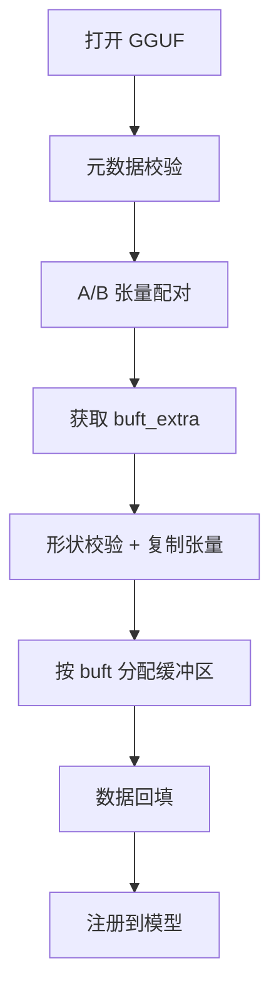
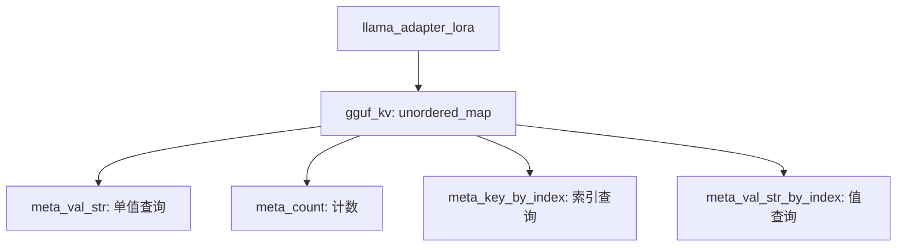
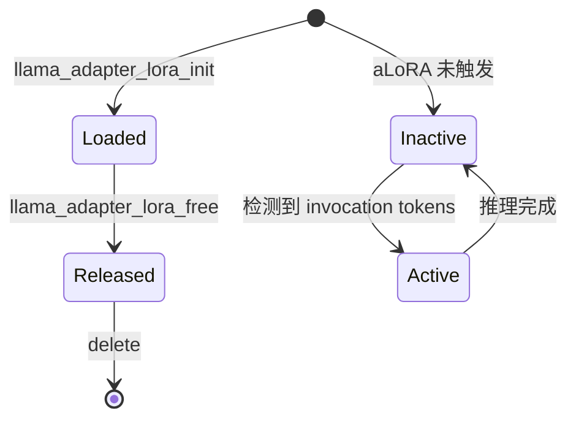
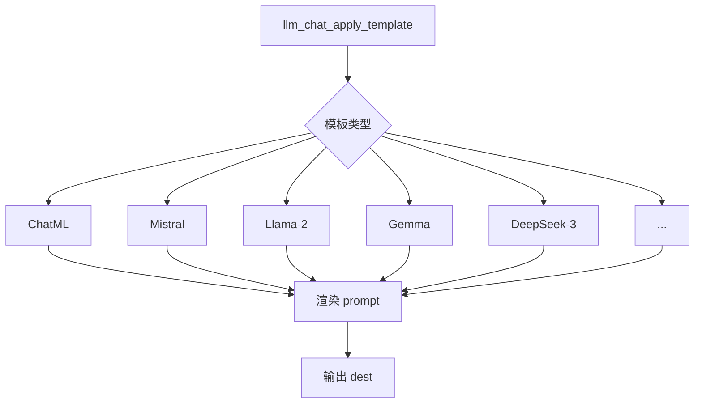
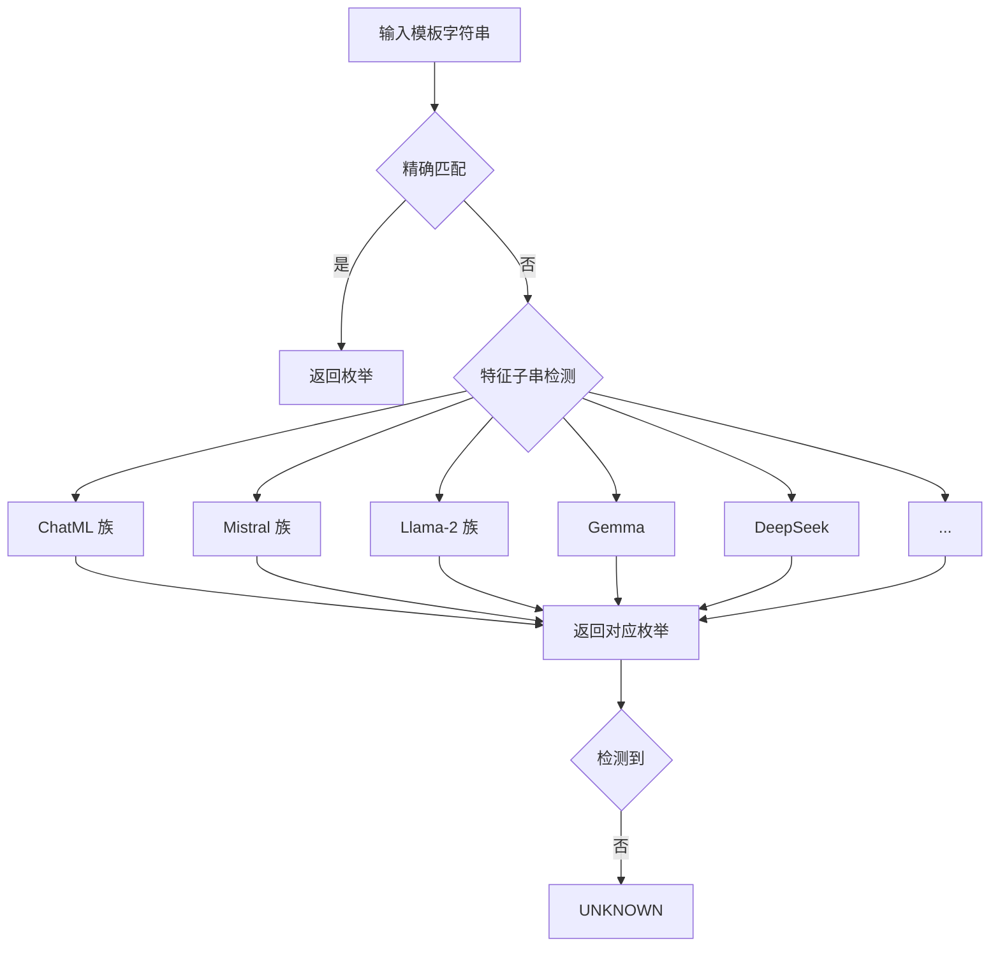
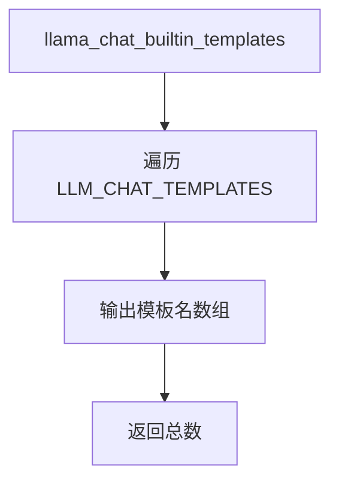

# 第22章 调音师与礼仪教材 —— 模型适配器与聊天模板的双重奏

## 学习目标

- 理解控制向量（cvec）与 LoRA 适配器的数据结构设计及其在 GGML 计算图中的注入方式
- 掌握 `llama_adapter_cvec` 的 init / apply / apply_to 三阶段生命周期管理，包括按后端类型的懒分配策略
- 深入理解 LoRA 适配器的 GGUF 加载流水线、元数据校验、A/B 张量配对与形状校验
- 熟悉 LoRA 适配器的元数据查询接口、释放机制以及 aLoRA 调用 Token 的获取方法
- 掌握 `llm_chat_template` 枚举体系中 50+ 冧模板的分类与命名规范
- 理解 `llm_chat_apply_template` 如何通过手写分支渲染不同模板，避免 Jinja 解析的开销
- 掌握 `llm_chat_detect_template` 基于字符串指纹的启发式检测算法与降级策略
- 能阅读并修改自定义聊天模板与适配器数据流

## 22.1 生活类比

想象你是一位 **乐师**，正在为不同 LLM「调音」：控制向量（cvec）相当于给每根琴弦（每层）单独贴一张「力度标签」，让音色整体偏移；这些标签存放在仓库（`ggml_context`）的某个货架（backend buffer）上，而第 0 层「不允许贴标签」（`tensors[0]=nullptr`）是协议约定的「保护层」；当你需要改变音色时，只需更换标签内容（`apply` 重新写入），无需重买琴弦（重新训练）。LoRA 适配器则像一对可拆卸的「效果器踏板」：A 踏板负责「升维」（`rank × in_dim`），B 踏板负责「降维」（`out_dim × rank`），`alpha/rank` 是效果器上的「强度旋钮」，决定信号放大倍数；多个踏板可以同时踩下（`loras map`），每个力度独立可调（float 缩放）。aLoRA 是「延迟触发踏板」，必须先听到特定乐句（invocation tokens）才激活。GGUF 加载流程就像「拆箱验货」流水线：先检查外箱标签（`general.type=adapter, adapter.type=lora`），再验证物品型号（`adapter.arch == model.arch`），然后把 A、B 两件物品成对摆上对应货架（按 buft 分配缓冲区），最后读出物品清单（metadata）贴到档案柜（`gguf_kv`）。至于聊天模板，则是不同餐厅的「点菜规矩」：通用 API 只接受「前菜/主菜/甜点」（system/user/assistant），而模板负责翻译成特定餐厅的暗语（ChatML / Llama-2 / Mistral 等），`llm_chat_detect_template` 像「侦探」看几眼菜单就猜出餐厅风格。模板自动检测的过程，就是看菜单里有没有「`<|im_start|>`」（ChatML 指纹）、「`【】`」（Mistral 指纹）等关键词。UNKNOWN 模板意味着「这家餐厅太奇怪了，菜单读不懂」，需要提醒上层兜底。

## 22.2 源码地图

```
src/llama-adapter.h
├── struct llama_adapter_cvec                       # 控制向量适配器
│   ├── tensor_for(int il)                          # 按层号获取对应张量
│   ├── apply_to(ctx, cur, il)                      # 在计算图节点上注入残差
│   ├── apply(model, data, len, n_embd, il_start, il_end)  # 写入数据或禁用
│   └── init(model)                                 # 内部初始化：分配 ctx+buf
│       ├── layer_start / layer_end                 # 作用层范围
│       ├── std::vector<ggml_context_ptr> ctxs      # 各后端的 ggml_context
│       ├── std::vector<ggml_backend_buffer_ptr> bufs # 各后端的缓冲区
│       └── std::vector<ggml_tensor *> tensors      # 每层一个张量（[0]=nullptr）
├── using llama_adapter_cvec_ptr = shared_ptr       # 智能指针封装
├── struct llama_adapter_lora_weight                # 单个 LoRA 权重对
│   ├── ggml_tensor * a                             # 升维矩阵 (rank × in_dim)
│   ├── ggml_tensor * b                             # 降维矩阵 (out_dim × rank)
│   ├── get_scale(alpha, adapter_scale)            # 计算真实缩放因子
│   ├── llama_adapter_lora_weight()                 # 默认构造函数
│   └── llama_adapter_lora_weight(a, b)             # 双参构造器
├── struct llama_adapter_lora                       # LoRA 适配器外壳
│   ├── llama_model * model                         # 绑定基础模型
│   ├── unordered_map<string, lora_weight> ab_map   # 张量名→A/B 对
│   ├── vector<ggml_context_ptr> ctxs               # 各后端 context
│   ├── vector<ggml_backend_buffer_ptr> bufs        # 后端 buffer
│   ├── float alpha                                 # LoRA 缩放参数
│   ├── unordered_map<string,string> gguf_kv        # 缓存的 GGUF 元数据
│   ├── vector<llama_token> alora_invocation_tokens # aLoRA 触发序列
│   ├── llama_adapter_lora(model)                   # 构造函数
│   ├── ~llama_adapter_lora()                       # 默认析构函数
│   ├── get_weight(w)                               # 按基础模型张量反查
│   └── get_n_nodes()                               # 估算图节点数（每对 6 个）
├── using llama_adapter_loras                       # unordered_map<lora*, float>
└── using llama_adapter_loras_ptr                    # unique_ptr 封装

src/llama-adapter.cpp
├── llama_adapter_cvec::tensor_for()                # 层号边界检查
├── llama_adapter_cvec::apply_to()                  # 调用 ggml_add 注入方向向量
├── llama_adapter_cvec::init()                      # 初始化
│   ├── std::map<buft, ctx*> ctx_map                # 按后端类型聚合
│   ├── ctx_for_buft lambda                         # 懒分配 ggml_context
│   ├── tensors[0] = nullptr                        # 第 0 层协议约定
│   └── ggml_backend_buffer_clear()                 # 清零初始状态
├── llama_adapter_cvec::apply()                     # 写入数据或禁用
│   ├── data==nullptr 时禁用                        # 设置 layer_start/end=-1
│   ├── n_embd 校验                                 # 与模型维度匹配
│   └── 按 il 写入对应层张量                        # 偏移 n_embd*(il-1)
├── llama_adapter_lora::get_weight()                # 按名查找 A/B 对
├── llama_adapter_lora_init_impl()                  # 加载主流程（七步）
│   ├── gguf_init_from_file()                       # 打开 GGUF
│   ├── 元数据遍历+校验                             # type/arch/alpha/aLoRA
│   ├── A/B 张量配对                                # str_endswith 判定
│   ├── _norm.weight 忽略                           # 暂不支持 LoRA-norm
│   ├── buft_extra 获取                             # 避免 repacking buffer
│   ├── 形状校验                                    # token_embd 翻转
│   ├── ggml_dup_tensor() 复制到目标 ctx
│   ├── 按 buft 分配缓冲区                          # ggml_backend_alloc_ctx_tensors_from_buft
│   └── 数据回填                                    # llama_file + offset
├── llama_adapter_lora_init()                       # 异常安全入口（try/catch）
├── 元数据查询接口                                  # meta_val_str / count / key_by_index
├── llama_adapter_lora_free()                       # 幂等释放
└── aLoRA 调用 Token 接口                           # alora_n_invocation_tokens / alora_invocation_tokens

src/llama-chat.h
├── enum llm_chat_template                          # 50+ 模板枚举
│   ├── LLM_CHAT_TEMPLATE_CHATML                    # 通用 ChatML
│   ├── LLM_CHAT_TEMPLATE_LLAMA_2                   # 原始 Llama-2
│   ├── LLM_CHAT_TEMPLATE_LLAMA_2_SYS / SYS_BOS / SYS_STRIP
│   ├── LLM_CHAT_TEMPLATE_MISTRAL_V1 / V3 / V3_TEKKEN / V7 / V7_TEKKEN
│   ├── LLM_CHAT_TEMPLATE_PHI_3 / PHI_4
│   ├── LLM_CHAT_TEMPLATE_GEMMA
│   ├── LLM_CHAT_TEMPLATE_LLAMA_3 / LLAMA4
│   ├── LLM_CHAT_TEMPLATE_DEEPSEEK / DEEPSEEK_2 / DEEPSEEK_3 / DEEPSEEK_OCR
│   ├── LLM_CHAT_TEMPLATE_EXAONE_3 / EXAONE_4 / EXAONE_MOE
│   ├── LLM_CHAT_TEMPLATE_GRANITE_3_X / GRANITE_4_0
│   ├── LLM_CHAT_TEMPLATE_HUNYUAN_DENSE / HUNYUAN_MOE / HUNYUAN_OCR
│   ├── LLM_CHAT_TEMPLATE_BAILING / BAILING_THINK / BAILING2
│   ├── LLM_CHAT_TEMPLATE_KIMI_K2 / SEED_OSS / GROK_2
│   ├── LLM_CHAT_TEMPLATE_OPENAI_MOE                # GPT-OSS Harmony 风格
│   └── LLM_CHAT_TEMPLATE_UNKNOWN                   # 降级兜底
├── llm_chat_template_from_str(name)               # 字符串转枚举映射
├── llm_chat_detect_template(tmpl)                 # 字符串指纹检测
└── llm_chat_apply_template()                       # 手写渲染入口

src/llama-chat.cpp
├── LU8 宏                                         # C++20 前 UTF-8 兼容
├── trim()                                         # 去除首尾空白
├── LLM_CHAT_TEMPLATES                              # std::map 字符串转枚举
├── llm_chat_template_from_str()                    # O(log n) 查找
├── llm_chat_detect_template()                      # 启发式检测
│   ├── 精确名字匹配优先                            # 失败则降级
│   ├── ChatML 族                                    # <|im_start|> + 分支
│   ├── Mistral 族                                   # 【】/[SYSTEM_PROMPT]/v1-v7
│   ├── Llama-2 族                                   # <<SYS>> / bos+【】 / content.strip()
│   ├── Gemma / ChatGLM / Phi / Zephyr / Monarch 等
│   └── 中文模型（DeepSeek / Hunyuan / MiniCPM）      # 利用 LU8 中文字符
├── llm_chat_apply_template()                        # 50+ 分支渲染器
│   ├── add_ass 决定是否追加 assistant 引导
│   ├── Gemma 无 system 角色 → 合并到首条 user
│   └── UNKNOWN 返回 -1 提示不支持
└── llama_chat_builtin_templates()                  # 暴露模板名清单
```

## 22.3 隐形调音台 —— 控制向量适配器

### 22.3.1 为什么需要 `llama_adapter_cvec`？

在推理阶段，我们想让模型表现得更「温和」、更「专业」或更「创造性」，但又不想重新训练。控制向量（Control Vector，cvec）正是为此设计：在每个 Transformer 层的残差流上加一个**固定方向向量**，相当于给神经网络的每一层施加一个微小的、可控的偏移。

- **每层一个向量**：每个 Transformer 层（除第 0 层）拥有一个长度为 `n_embd` 的 F32 张量
- **按需启用**：`tensor_for()` 通过层号边界检查决定是否激活，是「按需启用」的关键
- **计算图注入**：在 `apply_to` 阶段通过 `ggml_add` 注入到计算图中

### 22.3.2 `llama_adapter_cvec::init()` — 按缓冲区类型分配上下文

源码路径：`src/llama-adapter.cpp` - `llama_adapter_cvec::init()`（第 39-92 行）

```cpp
// 【逐行解析】初始化流程
bool llama_adapter_cvec::init(const llama_model & model) {
    const auto & hparams = model.hparams;                                    // 获取模型超参数引用

    GGML_ASSERT(tensors.empty());                                            // 断言张量列表为空（防止重复初始化）
    GGML_ASSERT(ctxs.empty());                                               // 断言上下文列表为空
    GGML_ASSERT(bufs.empty());                                               // 断言缓冲区列表为空

    // create a context for each buffer type
    std::map<ggml_backend_buffer_type_t, ggml_context *> ctx_map;            // 按缓冲区类型映射上下文，避免重复创建
    auto ctx_for_buft = [&](ggml_backend_buffer_type_t buft) -> ggml_context * { // 懒分配 lambda：按需创建上下文
        auto it = ctx_map.find(buft);                                        // 查找是否已有该类型的上下文
        if (it == ctx_map.end()) {                                           // 未找到，需要新建
            ggml_init_params params = {                                      // 配置 ggml 初始化参数
                /*.mem_size   =*/ hparams.n_layer*ggml_tensor_overhead(),  // 内存大小：按层数估算，仅容纳张量元数据
                /*.mem_buffer =*/ NULL,                                   // 不使用外部预分配内存
                /*.no_alloc   =*/ true,                                   // 推迟到后续 alloc_ctx_tensors_from_buft 阶段
            };

            ggml_context * ctx = ggml_init(params);                          // 创建新的 ggml 上下文
            if (!ctx) { return nullptr; }                                    // 创建失败返回空指针

            ctx_map[buft] = ctx;                                             // 记录到映射表，供后续复用
            ctxs.emplace_back(ctx);                                          // 存入上下文列表（由 shared_ptr 托管生命周期）

            return ctx;                                                      // 返回新建的上下文
        }

        return it->second;                                                   // 已存在则直接返回已有上下文
    };

    // make tensors
    tensors.reserve(hparams.n_layer);                                        // 预留张量向量容量，避免多次重分配
    tensors.push_back(nullptr); // there's never a tensor for layer 0       // 第 0 层永远不分配张量，协议约定保护层
    for (size_t il = 1; il < hparams.n_layer; il++) {                       // 遍历每一层（从 1 开始，跳过第 0 层）
        ggml_backend_buffer_type_t buft = model.select_buft(il);            // 获取该层的后端缓冲区类型
        ggml_context * ctx = ctx_for_buft(buft);                            // 获取或创建对应类型的上下文
        if (!ctx) {                                                         // 上下文获取失败
            LLAMA_LOG_ERROR("%s: failed to allocate context for control vector\n", __func__); // 记录错误日志
            return false;                                                   // 初始化失败
        }
        ggml_tensor * tensor = ggml_new_tensor_1d(ctx, GGML_TYPE_F32, hparams.n_embd); // 创建 F32 向量张量，长度为 n_embd
        tensors.push_back(tensor);                                          // 添加到张量列表
    }

    // allocate tensors / buffers and zero
    bufs.reserve(ctx_map.size());                                           // 预留缓冲区向量容量
    for (auto it : ctx_map) {                                               // 遍历每个上下文映射（按后端类型）
        ggml_backend_buffer_type_t buft = it.first;                         // 获取缓冲区类型
        ggml_context * ctx = it.second;                                     // 获取对应的上下文
        ggml_backend_buffer_t buf = ggml_backend_alloc_ctx_tensors_from_buft(ctx, buft); // 为该上下文中的所有张量分配缓冲区
        if (!buf) {                                                        // 分配失败
            LLAMA_LOG_ERROR("%s: failed to allocate buffer for control vector\n", __func__); // 记录错误日志
            return false;                                                   // 初始化失败
        }
        ggml_backend_buffer_clear(buf, 0);                                 // 清零缓冲区，确保初始状态不改变模型行为
        bufs.emplace_back(buf);                                            // 存入缓冲区列表
    }

    return true;                                                            // 初始化成功
}
```

**这段代码实现了控制向量适配器的延迟初始化机制**。它首先按后端类型聚合上下文，避免重复创建；然后为每层（除第0层）创建 F32 向量张量；最后按后端类型批量分配缓冲区并清零，确保初始状态不改变模型行为。

### 22.3.3 `llama_adapter_cvec::tensor_for()` — 按层号获取张量

源码路径：`src/llama-adapter.cpp` - `llama_adapter_cvec::tensor_for()`（第 17-26 行）

```cpp
// 【逐行解析】按层号获取张量，越界即返回 nullptr
ggml_tensor * llama_adapter_cvec::tensor_for(int il) const {
    if (il < 0 || il < layer_start || il > layer_end || (size_t) il >= tensors.size()) { // 边界检查：层号是否在有效范围内
        return nullptr;                                                    // 越界或未启用，返回空指针
    }
    return tensors[il];                                                    // 返回该层的张量
}
```

**`tensor_for` 通过边界检查实现「按需启用」，越界或未启用时返回空指针。**

### 22.3.4 `llama_adapter_cvec::apply_to()` — 在计算图上注入方向向量

源码路径：`src/llama-adapter.cpp` - `llama_adapter_cvec::apply_to()`（第 28-37 行）

```cpp
// 【逐行解析】计算图注入
ggml_tensor * llama_adapter_cvec::apply_to(ggml_context * ctx, ggml_tensor * cur, int il) const {
    ggml_tensor * layer_dir = tensor_for(il);                               // 获取第 il 层的方向向量
    if (layer_dir != nullptr) {                                            // 如果该层存在方向向量
        cur = ggml_add(ctx, cur, layer_dir);                                // 残差相加：cur = cur + layer_dir，注入到计算图中
    }
    return cur;                                                            // 返回可能修改后的张量
}
```

**`apply_to` 仅在张量存在时调用 `ggml_add` 将方向向量加到残差流上，第 0 层因 `tensors[0]=nullptr` 自动跳过。**

### 22.3.5 `llama_adapter_cvec::apply()` — 传入 nullptr 即禁用

源码路径：`src/llama-adapter.cpp` - `llama_adapter_cvec::apply()`（第 94-132 行）

```cpp
// 【逐行解析】写入控制向量数据或禁用
bool llama_adapter_cvec::apply(
        const llama_model & model,
        const float * data,                                 // nullptr 表示禁用
        size_t len,
        int32_t n_embd,
        int32_t il_start,
        int32_t il_end) {

    const auto & hparams = model.hparams;

    // ① 禁用模式：data == nullptr
    if (data == nullptr) {
        layer_start = -1;                                   // 设置生效起始层为 -1，表示不启用
        layer_end   = -1;                                   // 设置生效结束层为 -1
        return true;                                        // 禁用成功，直接返回
    }

    // ② 维度校验
    if (n_embd != (int) hparams.n_embd) {
        LLAMA_LOG_ERROR("%s: control vector n_embd does not match model\n", __func__); // 记录错误：维度不匹配
        return false;                                       // 校验失败
    }

    // ③ 惰性初始化
    if (tensors.empty()) {
        if (!init(model)) { return false; }                 // 首次调用时初始化张量和缓冲区
    }

    // ④ 设置生效层范围
    layer_start = il_start;                                  // 记录生效起始层
    layer_end   = il_end;                                    // 记录生效结束层

    // ⑤ 按层写入数据：偏移 n_embd * (il - 1)
    for (size_t il = 1; il < hparams.n_layer; il++) {       // 遍历每一层（从 1 开始）
        assert(tensors[il] != nullptr);                      // 断言该层张量已分配

        const size_t off = n_embd * (il - 1);               // buffer 不含第 0 层数据，偏移量为 n_embd*(il-1)
        if (off + n_embd <= len) {                          // 确保数据缓冲区足够长
            ggml_backend_tensor_set(
                tensors[il], data + off, 0, n_embd * ggml_element_size(tensors[il])); // 将数据写入后端张量
        }
    }
    return true;                                            // 写入成功
}
```

**这段代码实现了控制向量的动态启用/禁用与数据写入**。`data == nullptr` 即刻禁用；否则校验维度、惰性初始化、设置层范围，最后按 `n_embd*(il-1)` 偏移将扁平化数据写入各层张量。第 0 层无对应数据是协议层的不对称设计。

### 22.3.6 智能指针封装：`llama_adapter_cvec_ptr`

```cpp
// src/llama-adapter.h（第 34 行）
using llama_adapter_cvec_ptr = std::shared_ptr<llama_adapter_cvec>;  // 使用 shared_ptr 自动管理生命周期，支持多处共享
```

这个类型别名将 `llama_adapter_cvec` 包装在 `std::shared_ptr` 之中，从而利用引用计数实现自动内存管理。与裸指针不同，`shared_ptr` 允许多个模块同时持有同一个控制向量适配器的共享所有权：每当有一个 `shared_ptr` 实例指向该适配器，其引用计数就加 1；当所有 `shared_ptr` 被销毁或重置时，引用计数归零，适配器的析构函数自动触发，释放其占用的 `ctxs`、`bufs` 与 `tensors` 等资源。这种设计带来了两大好处：一是避免了手动 `new/delete` 可能导致的内存泄漏或重复释放问题；二是支持控制向量在不同组件（如模型、推理引擎、外部 API）之间安全传递，而无需担心生命周期的协调。在实际使用中，上层只需通过 `std::make_shared<llama_adapter_cvec>()` 创建实例，并将其赋值给 `llama_adapter_cvec_ptr` 类型的变量，即可享受自动化的资源管理。

### 22.3.7 控制向量适配器架构图

```mermaid
graph TD
    A[llama_adapter_cvec] --> B[ctxs: ggml_context_ptr]
    A --> C[tensors: ggml_tensor*]
    A --> D[bufs: ggml_backend_buffer_ptr]
    B --> E[按后端类型懒分配]
    C --> F[每层一个 F32 向量，tensors[0]=nullptr]
    D --> G[按 buft 批量分配并清零]
    E --> H[init() 阶段]
    F --> I[apply() 阶段]
    G --> I
    I --> J[apply_to() 注入残差流]
```

## 22.4 双人舞 —— LoRA 适配器权重对

### 22.4.1 `llama_adapter_lora_weight`：A 升维 + B 降维

源码路径：`src/llama-adapter.h` - `llama_adapter_lora_weight`（第 42-56 行）

```cpp
// 【逐行解析】LoRA 权重对结构体
struct llama_adapter_lora_weight {
    ggml_tensor * a = nullptr;                              // 升维矩阵 (rank × in_dim)
    ggml_tensor * b = nullptr;                              // 降维矩阵 (out_dim × rank)

    // 计算真实缩放因子：alpha * adapter_scale / rank
    float get_scale(float alpha, float adapter_scale) const {
        const float rank  = (float) b->ne[0];               // b 的第 0 维 = rank
        const float scale = alpha ? adapter_scale * alpha / rank : adapter_scale; // alpha 非零时按公式计算，否则直接使用 adapter_scale
        return scale;                                       // 返回缩放因子
    }

    llama_adapter_lora_weight() = default;                  // 默认构造函数，用于在 ab_map 中先占位
    llama_adapter_lora_weight(ggml_tensor * a, ggml_tensor * b) : a(a), b(b) {} // 双参构造器，直接绑定 A/B 张量
};
```

**这个结构体封装了 LoRA 的核心数学形式 `W' = W + (alpha/rank) * (B @ A)`**。`a` 张量形状 `(rank, in_dim)` 负责升维，`b` 张量形状 `(out_dim, rank)` 负责降维；`get_scale()` 自动推导缩放系数，兼容 `alpha=0` 的老式写法。

### 22.4.2 `llama_adapter_lora`：适配器外壳与模型绑定

源码路径：`src/llama-adapter.h` - `llama_adapter_lora`（第 58-89 行）

```cpp
// 【逐行解析】LoRA 适配器完整结构
struct llama_adapter_lora {
    llama_model * model = nullptr;                          // 绑定的基础模型指针
    std::unordered_map<std::string, llama_adapter_lora_weight> ab_map; // 张量名→A/B 对的哈希表
    std::vector<ggml_context_ptr> ctxs;                     // 后端 context 列表
    std::vector<ggml_backend_buffer_ptr> bufs;              // 后端 buffer 列表
    float alpha = 1.0f;                                     // LoRA 缩放参数
    std::unordered_map<std::string, std::string> gguf_kv;   // 缓存的 GGUF 元数据，供对外查询
    std::vector<llama_token> alora_invocation_tokens;       // aLoRA 触发序列

    explicit llama_adapter_lora(llama_model * model) : model(model) {} // 构造函数：绑定模型，其他成员默认初始化
    ~llama_adapter_lora() = default;                        // 默认析构函数，自动清理 ab_map、ctxs、bufs 等

    // 按基础模型张量指针反查对应的 LoRA A/B 对
    llama_adapter_lora_weight * get_weight(ggml_tensor * w) {
        const std::string name(w->name);                    // 获取张量名作为 key
        const auto pos = ab_map.find(name);                 // 在 ab_map 中查找
        if (pos != ab_map.end()) { return &pos->second; }   // 找到则返回 A/B 对指针
        return nullptr;                                     // 未找到返回空指针
    }

    // 估算图节点数：每个 LoRA 对占 6 个节点（a、b、scale、add、2×mul_mat）
    uint32_t get_n_nodes() const {
        return ab_map.size() * 6u;                          // 为计算图预留做节点数估算
    }
};
```

**这个类是 LoRA 适配器的「外壳」**，持有基础模型指针、`ab_map` 存储所有 A/B 对、多后端 `ctxs/bufs`、缩放 `alpha`、元数据 `gguf_kv` 与 aLoRA 触发序列。`get_weight()` 支持从基础模型张量反查，`get_n_nodes()` 为图预留做节点数估算。

### 22.4.3 类型定义：`llama_adapter_loras` 是带缩放的集合

源码路径：`src/llama-adapter.h` - `using llama_adapter_loras`（第 82-84 行）

```cpp
// 【逐行解析】类型别名定义
using llama_adapter_loras = std::unordered_map<llama_adapter_lora *, float>; // 键为适配器指针，值为该适配器的额外缩放系数
using llama_adapter_loras_ptr = std::unique_ptr<llama_adapter_loras>;          // unique_ptr 封装，自动管理集合生命周期
```

这种设计支持同时叠加多个 LoRA 适配器，且每个适配器的缩放力度独立可调（float 值）。

### 22.4.4 `llama_adapter_lora::get_weight()` — 按名查找 A/B 对

源码路径：`src/llama-adapter.cpp` - `llama_adapter_lora::get_weight()`（第 134-145 行）

```cpp
// 【逐行解析】反查 LoRA 权重对
llama_adapter_lora_weight * llama_adapter_lora::get_weight(ggml_tensor * w) {
    const std::string name(w->name);                        // 从张量名构造字符串 key
    const auto pos = ab_map.find(name);                     // 在 ab_map 中查找
    if (pos != ab_map.end()) {                              // 如果找到
        return &pos->second;                                // 返回 A/B 对的指针
    }
    return nullptr;                                         // 未找到返回空指针
}
```

简单直接：用基础模型张量名在 `ab_map` 中查找，找到返回 A/B 对指针，否则返回 nullptr。

### 22.4.5 LoRA 适配器权重对架构图

```mermaid
graph LR
    A[llama_adapter_lora_weight] --> B[a: rank × in_dim]
    A --> C[b: out_dim × rank]
    B --> D[升维矩阵]
    C --> E[降维矩阵]
    D --> F[前向：B @ A]
    E --> F
    F --> G[W' = W + (alpha/rank) * (B @ A)]
```

## 22.5 拆箱流水线 —— LoRA 加载流程

### 22.5.1 入口：`llama_adapter_lora_init_impl` 的七步流水线

源码路径：`src/llama-adapter.cpp` - `llama_adapter_lora_init_impl()`（第 147-314 行）

```cpp
// 【逐行解析】LoRA 加载主流程（七步）
static void llama_adapter_lora_init_impl(llama_model & model, const char * path_lora, llama_adapter_lora & adapter) {
    LLAMA_LOG_INFO("%s: loading lora adapter from '%s' ...\n", __func__, path_lora); // 记录加载开始日志

    // ── Step 0：打开 GGUF（只读元数据，no_alloc=true）──
    ggml_context * ctx_init;
    gguf_init_params meta_gguf_params = { /* .no_alloc = */ true, /* .ctx = */ &ctx_init }; // 只读元数据，不分配张量内存
    gguf_context_ptr ctx_gguf { gguf_init_from_file(path_lora, meta_gguf_params) }; // 打开 GGUF 文件
    if (!ctx_gguf) { throw std::runtime_error("failed to load lora adapter file from " + std::string(path_lora)); } // 打开失败抛异常
    ggml_context_ptr ctx { ctx_init };                                        // 包装为智能指针

    // ── Step 1：元数据遍历与校验 ──
    {
        const gguf_context * gguf_ctx = ctx_gguf.get();
        LLAMA_LOG_INFO("%s: Dumping metadata keys/values.\n", __func__);     // 记录元数据日志

        auto get_kv_str = [&](const std::string & key) -> std::string {       // 获取字符串元数据
            int id = gguf_find_key(gguf_ctx, key.c_str());
            return id < 0 ? "" : std::string(gguf_get_val_str(gguf_ctx, id));
        };
        auto get_kv_f32 = [&](const std::string & key) -> float {             // 获取 F32 元数据
            int id = gguf_find_key(gguf_ctx, key.c_str());
            return id < 0 ? 0.0f : gguf_get_val_f32(gguf_ctx, id);
        };
        LLM_KV llm_kv = LLM_KV(LLM_ARCH_UNKNOWN);

        auto general_type = get_kv_str(llm_kv(LLM_KV_GENERAL_TYPE));          // 获取 general.type
        if (general_type != "adapter") {                                      // 必须为 adapter 类型
            throw std::runtime_error("expect general.type to be 'adapter', but got: " + general_type);
        }

        auto general_arch_str = get_kv_str(llm_kv(LLM_KV_GENERAL_ARCHITECTURE)); // 获取架构名
        auto general_arch = llm_arch_from_string(general_arch_str);          // 解析为枚举
        if (general_arch != model.arch) {                                    // 必须与基础模型架构匹配
            throw std::runtime_error("model arch and LoRA arch mismatch");
        }

        auto adapter_type = get_kv_str(llm_kv(LLM_KV_ADAPTER_TYPE));          // 获取 adapter.type
        if (adapter_type != "lora") {                                        // 必须为 lora 类型
            throw std::runtime_error("expect adapter.type to be 'lora', but got: " + adapter_type);
        }

        adapter.alpha = get_kv_f32(llm_kv(LLM_KV_ADAPTER_LORA_ALPHA));        // 读取 LoRA 缩放参数 alpha

        // 解析 aLoRA invocation tokens（可选）
        const auto & key = llm_kv(LLM_KV_ADAPTER_ALORA_INVOCATION_TOKENS);    // 获取键名
        const int kid = gguf_find_key(ctx_gguf.get(), key.c_str());          // 查找键
        if (kid >= 0) {                                                      // 如果存在
            if (gguf_get_kv_type(ctx_gguf.get(), kid) != GGUF_TYPE_ARRAY) {  // 必须是数组类型
                throw std::runtime_error("invalid gguf type for " + key);
            }
            const auto arr_type = gguf_get_arr_type(ctx_gguf.get(), kid);   // 数组元素类型
            if (arr_type != GGUF_TYPE_UINT32) {                             // 必须为 uint32
                throw std::runtime_error("invalid gguf element type for " + key);
            }
            const size_t seq_len = gguf_get_arr_n(ctx_gguf.get(), kid);     // 获取序列长度
            const void * data = gguf_get_arr_data(ctx_gguf.get(), kid);     // 获取数组数据指针
            adapter.alora_invocation_tokens.resize(seq_len);                // 调整向量大小
            std::copy(                                                      // 拷贝数据
                (const llama_token *)data,
                (const llama_token *)data + seq_len,
                adapter.alora_invocation_tokens.begin());
        }
    }

    int n_tensors = gguf_get_n_tensors(ctx_gguf.get());                      // 获取张量总数

    // contexts for each buffer type
    std::map<ggml_backend_buffer_type_t, ggml_context *> ctx_map;            // 按缓冲区类型映射上下文
    auto ctx_for_buft = [&](ggml_backend_buffer_type_t buft) -> ggml_context * { // 懒分配 lambda
        auto it = ctx_map.find(buft);
        if (it == ctx_map.end()) {                                           // 未找到则新建
            ggml_init_params params = {                                      // 配置 ggml 初始化参数
                /*.mem_size   =*/ n_tensors*ggml_tensor_overhead(),        // 内存大小按张量数估算
                /*.mem_buffer =*/ NULL,
                /*.no_alloc   =*/ true,                                   // 推迟到分配阶段
            };
            ggml_context * buft_ctx = ggml_init(params);                    // 创建上下文
            if (!buft_ctx) { return nullptr; }
            ctx_map[buft] = buft_ctx;                                       // 记录映射
            adapter.ctxs.emplace_back(buft_ctx);                            // 存入适配器上下文列表
            return buft_ctx;
        };
        return it->second;
    };

    // bundle lora_a and lora_b into pairs
    std::map<std::string, llama_adapter_lora_weight> ab_map;                 // 临时存储 A/B 对
    auto str_endswith = [](const std::string & str, const std::string & suffix) { // 判断字符串后缀
        return str.size() >= suffix.size() && str.compare(str.size()-suffix.size(), suffix.size(), suffix) == 0;
    };

    for (ggml_tensor * cur = ggml_get_first_tensor(ctx.get()); cur; cur = ggml_get_next_tensor(ctx.get(), cur)) { // 遍历所有张量
        std::string name(cur->name);
        if (str_endswith(name, ".lora_a")) {                                 // 处理 A 张量
            replace_all(name, ".lora_a", "");                                // 去掉后缀作为 key
            if (ab_map.find(name) == ab_map.end()) {                         // 未存在则创建新条目
                ab_map[name] = llama_adapter_lora_weight(cur, nullptr);
            } else {
                ab_map[name].a = cur;                                        // 已存在则设置 A 张量
            }
        } else if (str_endswith(name, ".lora_b")) {                          // 处理 B 张量
            replace_all(name, ".lora_b", "");                                // 去掉后缀作为 key
            if (ab_map.find(name) == ab_map.end()) {                         // 未存在则创建新条目
                ab_map[name] = llama_adapter_lora_weight(nullptr, cur);
            } else {
                ab_map[name].b = cur;                                        // 已存在则设置 B 张量
            }
        } else if (str_endswith(name, "_norm.weight")) {                     // 忽略 LoRA-norm 张量
            // TODO: add support for norm vector
            // for now, we don't really care because most adapters still work fine without it
            continue;
        } else {
            throw std::runtime_error("LoRA tensor '" + name + "' has unexpected suffix"); // 未知后缀抛异常
        }
    }

    // get extra buffer types of the CPU
    // TODO: a more general solution for non-CPU extra buft should be implemented in the future
    //       ref: https://github.com/ggml-org/llama.cpp/pull/12593#pullrequestreview-2718659948
    std::vector<ggml_backend_buffer_type_t> buft_extra;                     // 存储额外缓冲区类型
    {
        auto * cpu_dev = ggml_backend_dev_by_type(GGML_BACKEND_DEVICE_TYPE_CPU); // 获取 CPU 后端设备
        if (!cpu_dev) { throw std::runtime_error(format("%s: no CPU backend found", __func__)); }
        auto * cpu_reg = ggml_backend_dev_backend_reg(cpu_dev);              // 获取 CPU 后端注册信息

        auto ggml_backend_dev_get_extra_bufts_fn = (ggml_backend_dev_get_extra_bufts_t) // 获取额外 buft 函数指针
            ggml_backend_reg_get_proc_address(cpu_reg, "ggml_backend_dev_get_extra_bufts");

        if (ggml_backend_dev_get_extra_bufts_fn) {                          // 如果存在
            ggml_backend_buffer_type_t * extra_bufts = ggml_backend_dev_get_extra_bufts_fn(cpu_dev); // 获取额外 buft 列表
            while (extra_bufts && *extra_bufts) {                           // 遍历并存入 buft_extra
                buft_extra.emplace_back(*extra_bufts);
                ++extra_bufts;
            }
        }
    }

    // add tensors
    for (auto & it : ab_map) {                                              // 遍历每个 A/B 对
        const std::string & name = it.first;
        llama_adapter_lora_weight & w = it.second;
        bool is_token_embd = str_endswith(name, "token_embd.weight");       // 判断是否为 token_embd 张量

        if (!w.a || !w.b) {                                                 // A 或 B 缺失
            throw std::runtime_error("LoRA tensor pair for '" + name + "' is missing one component");
        }

        // device buft and device ctx
        const auto * model_tensor = model.get_tensor(name.c_str());         // 反查基础模型中的对应张量
        if (!model_tensor) {                                                // 不存在则抛异常
            throw std::runtime_error("LoRA tensor '" + name + "' does not exist in base model (hint: maybe wrong base model?)");
        }

        auto * buft = ggml_backend_buffer_get_type(model_tensor->buffer);   // 获取基础模型张量的缓冲区类型

        // do not load loras to extra buffer types (i.e. bufts for repacking) -> use the CPU in that case
        for (auto & ex : buft_extra) {                                     // 检查是否为额外 buft（repacking buffer）
            if (ex == buft) {                                              // 如果是，则回退到 CPU
                LLAMA_LOG_WARN("%s: lora for '%s' cannot use buft '%s', fallback to CPU\n", __func__, model_tensor->name, ggml_backend_buft_name(buft));

                auto * cpu_dev = ggml_backend_dev_by_type(GGML_BACKEND_DEVICE_TYPE_CPU); // 获取 CPU 设备
                if (!cpu_dev) { throw std::runtime_error(format("%s: no CPU backend found", __func__)); }
                buft = ggml_backend_dev_buffer_type(cpu_dev);              // 使用 CPU 缓冲区类型
                break;
            }
        }

        LLAMA_LOG_DEBUG("%s: lora for '%s' -> '%s'\n", __func__, model_tensor->name, ggml_backend_buft_name(buft)); // 记录目标 buft

        ggml_context * dev_ctx = ctx_for_buft(buft);                        // 获取或创建目标上下文
        // validate tensor shape
        if (is_token_embd) {                                               // token_embd 特殊校验
            // expect B to be non-transposed, A and B are flipped; see llm_build_inp_embd()
            if (model_tensor->ne[0] != w.b->ne[1] || model_tensor->ne[1] != w.a->ne[1]) { // 维度必须匹配（注意翻转）
                throw std::runtime_error("tensor '" + name + "' has incorrect shape (hint: maybe wrong base model?)");
            }
        } else {                                                           // 其他张量校验
            if (model_tensor->ne[0] != w.a->ne[0] || model_tensor->ne[1] != w.b->ne[1]) { // A 的 ne[0] 与 B 的 ne[1] 匹配模型
                throw std::runtime_error("tensor '" + name + "' has incorrect shape (hint: maybe wrong base model?)");
            }
            if (w.a->ne[1] != w.b->ne[0]) {                                // A 的 ne[1] 必须等于 B 的 ne[0]（rank 一致）
                throw std::runtime_error("lora_a tensor is not transposed (hint: adapter from \"finetune\" example is no longer supported)");
            }
        }

        // save tensor to adapter
        ggml_tensor * tensor_a = ggml_dup_tensor(dev_ctx, w.a);            // 复制 A 张量到目标上下文
        ggml_tensor * tensor_b = ggml_dup_tensor(dev_ctx, w.b);            // 复制 B 张量到目标上下文
        ggml_set_name(tensor_a, w.a->name);                                // 保留原名
        ggml_set_name(tensor_b, w.b->name);                                // 保留原名
        adapter.ab_map[name] = llama_adapter_lora_weight(tensor_a, tensor_b); // 存入适配器的 ab_map
    }

    // allocate tensors / buffers and zero
    {
        adapter.ctxs.reserve(ctx_map.size());                              // 预留容量
        adapter.bufs.reserve(ctx_map.size());
        for (auto & it : ctx_map) {                                       // 按 buft 分配缓冲区
            ggml_backend_buffer_type_t buft = it.first;
            ggml_context * ctx_dev = it.second;
            ggml_backend_buffer_ptr buf { ggml_backend_alloc_ctx_tensors_from_buft(ctx_dev, buft) }; // 分配缓冲区
            if (!buf) { throw std::runtime_error("failed to allocate buffer for lora adapter\n"); }
            LLAMA_LOG_INFO("%s: %10s LoRA buffer size = %8.2f MiB\n", __func__, ggml_backend_buffer_name(buf.get()), ggml_backend_buffer_get_size(buf.get())/1024.0/1024.0);
            adapter.bufs.emplace_back(std::move(buf));                     // 存入缓冲区列表
        }
    }

    // set tensor data
    {
        llama_file gguf_file(path_lora, "rb");                             // 重新打开 GGUF 文件用于读取二进制数据
        std::vector<uint8_t> read_buf;
        auto set_tensor = [&](ggml_tensor * orig, ggml_tensor * dev) {     // 数据回填 lambda
            size_t offs = gguf_get_data_offset(ctx_gguf.get()) + gguf_get_tensor_offset(ctx_gguf.get(), gguf_find_tensor(ctx_gguf.get(), orig->name)); // 计算文件偏移
            size_t size = ggml_nbytes(orig);                               // 张量字节数
            read_buf.resize(size);                                         // 调整读取缓冲区
            gguf_file.seek(offs, SEEK_SET);                                // 定位到张量数据偏移
            gguf_file.read_raw(read_buf.data(), size);                     // 读取原始数据
            ggml_backend_tensor_set(dev, read_buf.data(), 0, size);        // 写入后端张量
        };
        for (auto & it : adapter.ab_map) {                                 // 遍历适配器中的 A/B 对
            auto orig = ab_map[it.first];
            auto dev  = it.second;
            set_tensor(orig.a, dev.a);                                     // 回填 A 张量
            set_tensor(orig.b, dev.b);                                     // 回填 B 张量
        }
    }

    // register adapter with model
    model.loras.insert(&adapter);                                         // 将适配器注册到模型的 loras 集合中

    LLAMA_LOG_INFO("%s: loaded %zu tensors from lora file\n", __func__, adapter.ab_map.size()*2); // 记录加载完成日志
}
```

**这段代码实现了 LoRA 适配器从 GGUF 文件到内存张量的完整「拆箱流水线」**：
1. **只读打开 GGUF**（`no_alloc=true`）拿到元数据与张量元信息
2. **元数据校验**：`general.type=adapter`、`adapter.type=lora`、架构一致、`alpha` 读取、aLoRA token 数组（必须 `uint32`）
3. **A/B 配对**：按 `.lora_a` / `.lora_b` 后缀成对，去掉后缀做 key；`_norm.weight` 暂忽略
4. **设备感知分配**：反查基础模型张量的 `buft`，遇 `buft_extra`（repacking buffer）回退 CPU
5. **形状校验**：`token_embd` 维度相反（因 `llm_build_inp_embd` 转置），其余 A 的 `ne[0]`、B 的 `ne[1]` 与基础模型一致，且 `A.ne[1] == B.ne[0]`
6. **`ggml_dup_tensor`** 复制到目标设备 context，按 `buft` 批量分配缓冲区
7. **数据回填**：`llama_file` + `gguf_get_data_offset` + `gguf_get_tensor_offset` 精确定位文件偏移，`ggml_backend_tensor_set` 写入后端缓冲区
8. **注册**到 `model.loras`

### 22.5.2 入口封装：异常安全的 `llama_adapter_lora_init`

源码路径：`src/llama-adapter.cpp` - `llama_adapter_lora_init()`（第 316-329 行）

```cpp
// 【逐行解析】公开初始化接口：try-catch 兜底
llama_adapter_lora * llama_adapter_lora_init(llama_model * model, const char * path_lora) {
    llama_adapter_lora * adapter = new llama_adapter_lora(model);          // 分配新的适配器对象

    try {
        llama_adapter_lora_init_impl(*model, path_lora, *adapter);        // 调用内部七步加载流程
        return adapter;                                                   // 成功则返回适配器指针
    } catch (const std::exception & err) {                                 // 捕获所有标准异常
        LLAMA_LOG_ERROR("%s: failed to apply lora adapter: %s\n", __func__, err.what()); // 记录错误日志

        delete adapter;                                                   // 释放已分配的适配器对象
    }

    return nullptr;                                                        // 失败返回空指针
}
```

上层只需判断返回值是否为 `nullptr`，异常安全由内部 `try-catch` 保证。

### 22.5.3 LoRA 加载流水线架构图



## 22.6 档案柜 —— LoRA 元数据查询接口

### 22.6.1 单值查询：`llama_adapter_meta_val_str`

源码路径：`src/llama-adapter.cpp` - `llama_adapter_meta_val_str()`（第 331-340 行）

```cpp
// 【逐行解析】按 key 查单值
int32_t llama_adapter_meta_val_str(const llama_adapter_lora * adapter, const char * key, char * buf, size_t buf_size) {
    const auto & it = adapter->gguf_kv.find(key);                         // 在元数据哈希表中查找 key
    if (it == adapter->gguf_kv.end()) {                                   // 未找到
        if (buf_size > 0) { buf[0] = '\0'; }                             // 清空输出缓冲区
        return -1;                                                       // 返回 -1 表示未找到
    }
    return snprintf(buf, buf_size, "%s", it->second.c_str());            // 格式化写入用户缓冲区
}
```

找不到时 `buf[0]='\0'` 返回 `-1`；找到时 `snprintf` 写入用户缓冲区。

### 22.6.2 索引式查询：与 `llama_model_meta_*` 对称设计

源码路径：`src/llama-adapter.cpp` - `llama_adapter_meta_count/key_by_index/val_str_by_index()`（第 342-373 行）

```cpp
// 【逐行解析】枚举式遍历未知元数据
int32_t llama_adapter_meta_count(const llama_adapter_lora * adapter) {
    return (int)adapter->gguf_kv.size();                                  // 返回元数据条目总数
}

int32_t llama_adapter_meta_key_by_index(const llama_adapter_lora * adapter, int i, char * buf, size_t buf_size) {
    if (i < 0 || i >= (int)adapter->gguf_kv.size()) {                     // 索引越界检查
        if (buf_size > 0) { buf[0] = '\0'; }
        return -1;
    }
    auto it = adapter->gguf_kv.begin();
    std::advance(it, i);                                                  // O(n) 跳转到指定索引
    return snprintf(buf, buf_size, "%s", it->first.c_str());              // 写入键名
}

int32_t llama_adapter_meta_val_str_by_index(const llama_adapter_lora * adapter, int32_t i, char * buf, size_t buf_size) {
    if (i < 0 || i >= (int)adapter->gguf_kv.size()) {                     // 索引越界检查
        if (buf_size > 0) { buf[0] = '\0'; }
        return -1;
    }
    auto it = adapter->gguf_kv.begin();
    std::advance(it, i);
    return snprintf(buf, buf_size, "%s", it->second.c_str());             // 写入值
}
```

这种 API 设计允许用户以「枚举」方式遍历未知元数据，与模型元数据查询接口保持对称。

### 22.6.3 元数据查询接口架构图



## 22.7 退出与启动信号 —— LoRA 释放与 aLoRA

### 22.7.1 `llama_adapter_lora_free`：幂等释放

源码路径：`src/llama-adapter.cpp` - `llama_adapter_lora_free()`（第 375-387 行）

```cpp
// 【逐行解析】安全释放
void llama_adapter_lora_free(llama_adapter_lora * adapter) {
    if (adapter == nullptr) { return; }                                   // 幂等：nullptr 直接返回

    if (adapter->model != nullptr) {
        adapter->model->loras.erase(adapter);                             // 先从模型的 loras 集合中擦除，防止悬空指针
        adapter->model = nullptr;
    }

    delete adapter;                                                       // 触发析构函数，清理 ab_map 与 ctxs
}
```

必须先从 `model->loras` 擦除，再 `delete`，避免模型持有悬空指针。

### 22.7.2 `llama_adapter_get_alora_*_tokens()` — aLoRA 调用序列

源码路径：`src/llama-adapter.cpp` - `llama_adapter_get_alora_*_tokens()`（第 389-401 行）

```cpp
// 【逐行解析】获取触发序列长度
uint64_t llama_adapter_get_alora_n_invocation_tokens(const struct llama_adapter_lora * adapter) {
    if (!adapter) { return 0; }                                           // 空适配器返回 0
    return adapter->alora_invocation_tokens.size();                       // 返回序列长度
}

// 【逐行解析】获取触发序列指针
const llama_token * llama_adapter_get_alora_invocation_tokens(const llama_adapter_lora * adapter) {
    GGML_ASSERT(adapter);                                                // 断言非空
    return adapter->alora_invocation_tokens.data();                      // 返回指向 GGUF 内嵌数组的指针
}
```

aLoRA 不是持续生效：只有在检测到这组特定 token 时才把 LoRA 投入推理图。客户端可据此实现「按需激活」。

### 22.7.3 释放与 aLoRA 生命周期图



## 22.8 对话礼仪教材 —— 聊天模板系统

### 22.8.1 为什么需要聊天模板？

每个 LLM 都期望特定格式的输入（特殊 token、角色标签、消息分隔符）。用户层只关心「system/user/assistant」三类消息，模板负责翻译成模型专属 prompt。

### 22.8.2 `llm_chat_template` 枚举：50+ 模板的大家庭

源码路径：`src/llama-chat.h` - `llm_chat_template`（第 7-66 行）

`llm_chat_template` 枚举包含了 50 多种内置模板，覆盖了主流 LLM 的对话格式。这些模板可以分为几大类：通用对话模板如 `LLM_CHAT_TEMPLATE_CHATML` 采用 ChatML 格式，以 `<|im_start|>` 和 `<|im_end|>` 分隔消息；Llama 系列模板如 `LLM_CHAT_TEMPLATE_LLAMA_2`、`LLM_CHAT_TEMPLATE_LLAMA_3` 等分别针对 Llama 2 和 Llama 3 的特殊 token；MistraI 系列包括 `LLM_CHAT_TEMPLATE_MISTRAL_V1`、`V3`、`V7` 等，各自对应不同的版本；中文模型模板如 `LLM_CHAT_TEMPLATE_DEEPSEEK_3` 使用中文特殊 token；此外还有 Gemma、Phi、EXAONE、Granite、Hunyuan、Bailing 等模型专用模板。每个枚举项的具体命名遵循 `LLM_CHAT_TEMPLATE_<MODEL_NAME>` 的规范，便于记忆和查找。完整的枚举定义如下所示：

```cpp
// 【逐行解析】内置模板枚举（完整列表）
enum llm_chat_template {
    LLM_CHAT_TEMPLATE_CHATML,                    // 通用 ChatML，使用 <|im_start|> 和 <|im_end|>
    LLM_CHAT_TEMPLATE_LLAMA_2,                   // 原始 Llama-2，无 system 角色
    LLM_CHAT_TEMPLATE_LLAMA_2_SYS,               // 支持 system 消息，使用 <<SYS>>
    LLM_CHAT_TEMPLATE_LLAMA_2_SYS_BOS,           // history 中加入 BOS token
    LLM_CHAT_TEMPLATE_LLAMA_2_SYS_STRIP,         // strip message 内容
    LLM_CHAT_TEMPLATE_MISTRAL_V1,                // Mistral v1，使用 [INST] 和 [/INST]
    LLM_CHAT_TEMPLATE_MISTRAL_V3,                // Mistral v3
    LLM_CHAT_TEMPLATE_MISTRAL_V3_TEKKEN,         // Tekken tokenizer 版本
    LLM_CHAT_TEMPLATE_MISTRAL_V7,                // Mistral v7，使用 [SYSTEM_PROMPT]
    LLM_CHAT_TEMPLATE_MISTRAL_V7_TEKKEN,         // Mistral v7 Tekken 版本
    LLM_CHAT_TEMPLATE_PHI_3,                     // Phi-3，使用 <|assistant|> 和 <|end|>
    LLM_CHAT_TEMPLATE_PHI_4,                     // Phi-4，使用 <|im_sep|>
    LLM_CHAT_TEMPLATE_GEMMA,                     // Google Gemma，使用 <start_of_turn> 和 <end_of_turn>
    LLM_CHAT_TEMPLATE_LLAMA_3,                   // Llama 3，使用 <|start_header_id|> 和 <|end_header_id|>
    LLM_CHAT_TEMPLATE_LLAMA4,                    // Llama 4，使用 <|header_start|> 和 <|header_end|>
    LLM_CHAT_TEMPLATE_DEEPSEEK,                  // DeepSeek-Coder，使用 ### Instruction: 和 <|EOT|>
    LLM_CHAT_TEMPLATE_DEEPSEEK_2,                // DeepSeek-V2，使用 User: 和 Assistant:
    LLM_CHAT_TEMPLATE_DEEPSEEK_3,                // DeepSeek-V3，使用中文特殊 token <｜User｜> 和 <｜Assistant｜>
    LLM_CHAT_TEMPLATE_DEEPSEEK_OCR,              // DeepSeek-OCR
    LLM_CHAT_TEMPLATE_EXAONE_3,                  // EXAONE-3，使用 [|system|] 和 [|endofturn|]
    LLM_CHAT_TEMPLATE_EXAONE_4,                  // EXAONE-4，支持 tool 角色
    LLM_CHAT_TEMPLATE_EXAONE_MOE,                // EXAONE-MoE
    LLM_CHAT_TEMPLATE_GRANITE_3_X,               // IBM Granite 3.x，使用 <|start_of_role|>
    LLM_CHAT_TEMPLATE_GRANITE_4_0,               // Granite 4.0，支持 tool
    LLM_CHAT_TEMPLATE_HUNYUAN_DENSE,             // 腾讯混元 Dense，使用 <｜hy_Assistant｜>
    LLM_CHAT_TEMPLATE_HUNYUAN_MOE,               // 混元 MoE，使用 <|extra_0|> 和 <|extra_4|>
    LLM_CHAT_TEMPLATE_HUNYUAN_OCR,               // 腾讯混元 OCR
    LLM_CHAT_TEMPLATE_BAILING,                   // Bailing，使用 <role>ASSISTANT</role>
    LLM_CHAT_TEMPLATE_BAILING_THINK,             // Bailing thinking 版本
    LLM_CHAT_TEMPLATE_BAILING2,                  // Bailing 2.0
    LLM_CHAT_TEMPLATE_KIMI_K2,                   // Moonshot Kimi K2，使用 <|im_assistant|>assistant<|im_middle|>
    LLM_CHAT_TEMPLATE_SEED_OSS,                  // Seed-OSS，使用 <seed:bos>
    LLM_CHAT_TEMPLATE_GROK_2,                    // xAI Grok-2，使用 <|separator|>
    LLM_CHAT_TEMPLATE_OPENAI_MOE,                // GPT-OSS Harmony 风格，使用 <|start|> 和 <|channel|>
    LLM_CHAT_TEMPLATE_UNKNOWN,                   // 降级兜底，表示模板无法识别
    LLM_CHAT_TEMPLATE_SMOLVLM,                   // SmolVLM，使用 <|im_start|> 作为 BOS
    LLM_CHAT_TEMPLATE_FALCON_3,                  // Falcon 3，使用 <|assistant|> 和 <|user|>
    LLM_CHAT_TEMPLATE_ZEPHYR,                    // Zephyr，使用 <|user|> 和 <|endoftext|>
    LLM_CHAT_TEMPLATE_MONARCH,                   // Monarch，使用 bos_token + message['role']
    LLM_CHAT_TEMPLATE_ORION,                     // Orion，使用 '\n\nAssistant: ' + eos_token
    LLM_CHAT_TEMPLATE_OPENCHAT,                  // OpenChat，使用 GPT4 Correct 前缀
    LLM_CHAT_TEMPLATE_VICUNA,                    // Vicuna，使用 USER: 和 ASSISTANT:
    LLM_CHAT_TEMPLATE_VICUNA_ORCA,               // Orca-Vicuna，支持 SYSTEM: 前缀
    LLM_CHAT_TEMPLATE_COMMAND_R,                 // Command-R，使用 <|START_OF_TURN_TOKEN|> 和 <|USER_TOKEN|>
    LLM_CHAT_TEMPLATE_CHATGLM_3,                 // ChatGLM-3，使用 [gMASK]sop
    LLM_CHAT_TEMPLATE_CHATGLM_4,                 // ChatGLM-4，使用 [gMASK]<sop>
    LLM_CHAT_TEMPLATE_GLMEDGE,                   // GLMEdge，使用 <|role|> 和 <|begin_of_image|>
    LLM_CHAT_TEMPLATE_MINICPM,                   // MiniCPM，使用中文 <用户> 标签
    LLM_CHAT_TEMPLATE_RWKV_WORLD,                // RWKV-World，使用 User: 和 Assistant:
    LLM_CHAT_TEMPLATE_GIGACHAT,                  // GigaChat，使用 additional_special_tokens
    LLM_CHAT_TEMPLATE_MEGREZ,                    // Megrez，使用 <|role_start|>
    LLM_CHAT_TEMPLATE_YANDEX,                    // Yandex，使用俄语 Ассистент:
    LLM_CHAT_TEMPLATE_DOTS1,                     // DOTS1，使用 <|endofuserprompt|>
    LLM_CHAT_TEMPLATE_PANGU_EMBED,               // Pangu-Embed，使用 [unused9]系统：[unused10]
    LLM_CHAT_TEMPLATE_SOLAR_OPEN,                // Solar-Open，使用 <|begin|> 和 <|end|>
};
```

### 22.8.3 模板名 → 枚举：`llm_chat_template_from_str`

源码路径：`src/llama-chat.cpp` - `llm_chat_template_from_str()`（第 64-66 行）

```cpp
// 【核心数据结构】字符串→枚举映射表
static const std::map<std::string, llm_chat_template> LLM_CHAT_TEMPLATES = {
    {"chatml", LLM_CHAT_TEMPLATE_CHATML},                         // 通用 ChatML
    {"llama-2", LLM_CHAT_TEMPLATE_LLAMA_2},                       // 原始 Llama-2
    {"llama-2-sys", LLM_CHAT_TEMPLATE_LLAMA_2_SYS},               // 支持 system 的 Llama-2
    // ... 50+ 项
};

// 【逐行解析】O(log n) 查找
llm_chat_template llm_chat_template_from_str(const std::string & name) {
    return LLM_CHAT_TEMPLATES.at(name);                          // 未命中抛 out_of_range 异常
}
```

用 `std::map` 而非 `unordered_map`，因数据量小且有序遍历更友好。

### 22.8.4 `llm_chat_apply_template`：手写 50+ 模板渲染器

源码路径：`src/llama-chat.cpp` - `llm_chat_apply_template()`（第 171-640 行，续 784-890 行）

```cpp
// 【逐行解析】模板渲染主入口
int32_t llm_chat_apply_template(
    llm_chat_template tmpl,
    const std::vector<const llama_chat_message *> & chat,
    std::string & dest, bool add_ass) {

    std::stringstream ss;                                          // 使用字符串流拼接 prompt

    // ── ChatML ──
    if (tmpl == LLM_CHAT_TEMPLATE_CHATML) {
        for (auto message : chat) {
            ss << "<|im_start|>" << message->role << "\n" << message->content << "<|im_end|>\n";
        }
        if (add_ass) { ss << "<|im_start|>assistant\n"; }
    }
    // ── Mistral V7 / V7-Tekken ──
    else if (tmpl == LLM_CHAT_TEMPLATE_MISTRAL_V7 || tmpl == LLM_CHAT_TEMPLATE_MISTRAL_V7_TEKKEN) {
        const char * trailing_space = tmpl == LLM_CHAT_TEMPLATE_MISTRAL_V7 ? " " : "";
        for (auto message : chat) {
            std::string role(message->role), content(message->content);
            if (role == "system") {
                ss << "[SYSTEM_PROMPT]" << trailing_space << content << "[/SYSTEM_PROMPT]";
            } else if (role == "user") {
                ss << "[INST]" << trailing_space << content << "[/INST]";
            } else {
                ss << trailing_space << content << "</s>";
            }
        }
    }
    // ── Mistral V1 / V3 / V3-Tekken ──
    else if (tmpl == LLM_CHAT_TEMPLATE_MISTRAL_V1 || tmpl == LLM_CHAT_TEMPLATE_MISTRAL_V3 || tmpl == LLM_CHAT_TEMPLATE_MISTRAL_V3_TEKKEN) {
        std::string leading_space = tmpl == LLM_CHAT_TEMPLATE_MISTRAL_V1 ? " " : "";
        std::string trailing_space = tmpl == LLM_CHAT_TEMPLATE_MISTRAL_V3_TEKKEN ? "" : " ";
        bool trim_assistant_message = tmpl == LLM_CHAT_TEMPLATE_MISTRAL_V3;
        bool is_inside_turn = false;
        for (auto message : chat) {
            if (!is_inside_turn) {
                ss << leading_space << "[INST]" << trailing_space;
                is_inside_turn = true;
            }
            std::string role(message->role), content(message->content);
            if (role == "system") {
                ss << content << "\n\n";
            } else if (role == "user") {
                ss << content << leading_space << "[/INST]";
            } else {
                ss << trailing_space << (trim_assistant_message ? trim(content) : content) << "</s>";
                is_inside_turn = false;
            }
        }
    }
    // ── Llama-2 族（四种变体）──
    else if (tmpl == LLM_CHAT_TEMPLATE_LLAMA_2 || tmpl == LLM_CHAT_TEMPLATE_LLAMA_2_SYS ||
             tmpl == LLM_CHAT_TEMPLATE_LLAMA_2_SYS_BOS || tmpl == LLM_CHAT_TEMPLATE_LLAMA_2_SYS_STRIP) {
        bool support_system_message = tmpl != LLM_CHAT_TEMPLATE_LLAMA_2;
        bool add_bos_inside_history = tmpl == LLM_CHAT_TEMPLATE_LLAMA_2_SYS_BOS;
        bool strip_message = tmpl == LLM_CHAT_TEMPLATE_LLAMA_2_SYS_STRIP;
        bool is_inside_turn = true;
        ss << "[INST] ";
        for (auto message : chat) {
            std::string content = strip_message ? trim(message->content) : message->content;
            std::string role(message->role);
            if (!is_inside_turn) {
                is_inside_turn = true;
                ss << (add_bos_inside_history ? "<s>[INST] " : "[INST] ");
            }
            if (role == "system") {
                if (support_system_message) {
                    ss << "<<SYS>>\n" << content << "\n<</SYS>>\n\n";
                } else {
                    ss << content << "\n";
                }
            } else if (role == "user") {
                ss << content << " [/INST]";
            } else {
                ss << content << " ";
                is_inside_turn = false;
            }
        }
    }
    // ── Gemma（无 system 角色，合并到首条 user）──
    else if (tmpl == LLM_CHAT_TEMPLATE_GEMMA) {
        std::string system_prompt = "";
        for (auto message : chat) {
            std::string role(message->role);
            if (role == "system") {
                system_prompt += trim(message->content);
                continue;
            }
            role = role == "assistant" ? "model" : message->role;
            ss << "<start_of_turn>" << role << "\n";
            if (!system_prompt.empty() && role != "model") {
                ss << system_prompt << "\n\n";
                system_prompt = "";
            }
            ss << trim(message->content) << "<end_of_turn>\n";
        }
        if (add_ass) { ss << "<start_of_turn>model\n"; }
    }
    // ── DeepSeek-V3（中文特殊 token）──
    else if (tmpl == LLM_CHAT_TEMPLATE_DEEPSEEK_3) {
        for (auto message : chat) {
            std::string role(message->role);
            if (role == "system") {
                ss << message->content << "\n\n";
            } else if (role == "user") {
                ss << LU8("<｜User｜>") << message->content;
            } else if (role == "assistant") {
                ss << LU8("<｜Assistant｜>") << message->content << LU8("");
            }
        }
        if (add_ass) { ss << LU8("<｜Assistant｜>"); }
    }
    // 其余分支包括：LLM_CHAT_TEMPLATE_PHI_3、LLM_CHAT_TEMPLATE_PHI_4、LLM_CHAT_TEMPLATE_LLAMA_3、LLM_CHAT_TEMPLATE_LLAMA4、LLM_CHAT_TEMPLATE_DEEPSEEK、LLM_CHAT_TEMPLATE_DEEPSEEK_2、LLM_CHAT_TEMPLATE_DEEPSEEK_OCR、LLM_CHAT_TEMPLATE_EXAONE_3、LLM_CHAT_TEMPLATE_EXAONE_4、LLM_CHAT_TEMPLATE_EXAONE_MOE、LLM_CHAT_TEMPLATE_GRANITE_3_X、LLM_CHAT_TEMPLATE_GRANITE_4_0、LLM_CHAT_TEMPLATE_HUNYUAN_DENSE、LLM_CHAT_TEMPLATE_HUNYUAN_MOE、LLM_CHAT_TEMPLATE_HUNYUAN_OCR、LLM_CHAT_TEMPLATE_BAILING、LLM_CHAT_TEMPLATE_BAILING_THINK、LLM_CHAT_TEMPLATE_BAILING2、LLM_CHAT_TEMPLATE_KIMI_K2、LLM_CHAT_TEMPLATE_SEED_OSS、LLM_CHAT_TEMPLATE_GROK_2、LLM_CHAT_TEMPLATE_OPENAI_MOE、LLM_CHAT_TEMPLATE_SMOLVLM、LLM_CHAT_TEMPLATE_FALCON_3、LLM_CHAT_TEMPLATE_ZEPHYR、LLM_CHAT_TEMPLATE_MONARCH、LLM_CHAT_TEMPLATE_ORION、LLM_CHAT_TEMPLATE_OPENCHAT、LLM_CHAT_TEMPLATE_VICUNA、LLM_CHAT_TEMPLATE_VICUNA_ORCA、LLM_CHAT_TEMPLATE_COMMAND_R、LLM_CHAT_TEMPLATE_CHATGLM_3、LLM_CHAT_TEMPLATE_CHATGLM_4、LLM_CHAT_TEMPLATE_GLMEDGE、LLM_CHAT_TEMPLATE_MINICPM、LLM_CHAT_TEMPLATE_RWKV_WORLD、LLM_CHAT_TEMPLATE_GIGACHAT、LLM_CHAT_TEMPLATE_MEGREZ、LLM_CHAT_TEMPLATE_YANDEX、LLM_CHAT_TEMPLATE_DOTS1、LLM_CHAT_TEMPLATE_PANGU_EMBED、LLM_CHAT_TEMPLATE_SOLAR_OPEN，它们的渲染逻辑与已展示的分支类似。
    else {
        return -1;                                          // UNKNOWN 模板不支持
    }

    dest = ss.str();                                         // 写入目标字符串
    return (int32_t)dest.size();                             // 返回字符串长度
}
```

**这个函数是一个巨大的 `if-else` 分支树**，每个分支手写一个模板的渲染逻辑。不使用 Jinja 解析，换取极高的执行效率，但维护成本也高。`add_ass` 决定是否追加 assistant 引导 token；对没有 system 角色的模型（Gemma），会把 system 合并到第一条 user；`UNKNOWN` 直接返回 `-1` 提示不支持。

### 22.8.5 辅助工具：`trim()` 与 `LU8()`

源码路径：`src/llama-chat.cpp` - `trim()`（第 16-24 行）、`src/llama-chat.h` - `LU8` 宏（第 70-72 行）

```cpp
// 【逐行解析】去除字符串首尾空白字符
static std::string trim(const std::string & str) {
    size_t start = 0;                                          // 起始位置
    size_t end = str.size();                                   // 结束位置
    while (start < end && isspace(static_cast<unsigned char>(str[start]))) { // 跳过前导空白
        start += 1;
    }
    while (end > start && isspace(static_cast<unsigned char>(str[end - 1]))) { // 跳过尾随空白
        end -= 1;
    }
    return str.substr(start, end - start);                     // 返回截取后的子串
}

// 【逐行解析】UTF-8 字符串字面量宏，兼容 C++17
#if __cplusplus >= 202002L
#  define LU8(x) u8##x                                         // C++20 使用 u8 前缀
#else
#  define LU8(x) x                                             // C++17 直接使用字符串
#endif
```

`trim()` 被多个模板调用；`LU8()` 跨 C++ 标准保证 UTF-8 字符串字面量正确。

### 22.8.6 聊天模板系统流程图



## 22.9 指纹侦探 —— 模板自动检测

### 22.9.1 `llm_chat_detect_template`：字符串指纹匹配

源码路径：`src/llama-chat.cpp` - `llm_chat_detect_template()`（第 67-170 行）

```cpp
// 【逐行解析】启发式检测主逻辑
llm_chat_template llm_chat_detect_template(const std::string & tmpl) {
    // ① 先尝试精确名字匹配
    try { return llm_chat_template_from_str(tmpl); }             // 精确匹配成功则直接返回
    catch (const std::out_of_range &) { /* ignore */ }           // 捕获异常，继续启发式检测

    auto tmpl_contains = [&tmpl](const char * haystack) -> bool { // 辅助 lambda：判断子串存在
        return tmpl.find(haystack) != std::string::npos;
    };

    // ② ChatML 系：通过 <|im_start|> 识别，细分 PHI-4（含 <|im_sep|>）与 SmolVLM（含 <end_of_utterance>）
    if (tmpl_contains("<|im_start|>")) {
        return tmpl_contains("<|im_sep|>")
            ? LLM_CHAT_TEMPLATE_PHI_4
            : tmpl_contains("<end_of_utterance>")
                ? LLM_CHAT_TEMPLATE_SMOLVLM
                : LLM_CHAT_TEMPLATE_CHATML;
    }

    // ③ Mistral 系：先判 【】 前缀，再区分 v7（含 [SYSTEM_PROMPT]）、v1（含单引号）、v3-tekken（含双引号）
    else if (tmpl.find("mistral") == 0 || tmpl_contains("[INST]")) {
        if (tmpl_contains("[SYSTEM_PROMPT]")) { return LLM_CHAT_TEMPLATE_MISTRAL_V7; }
        else if (tmpl_contains("' [INST] ' + system_message") || tmpl_contains("[/INST]")) {
            if (tmpl_contains(" [INST]"))       return LLM_CHAT_TEMPLATE_MISTRAL_V1;
            else if (tmpl_contains("\"[INST]\"")) return LLM_CHAT_TEMPLATE_MISTRAL_V3_TEKKEN;
            return LLM_CHAT_TEMPLATE_MISTRAL_V3;
        } else {
            // 退化为 Llama-2 族四种变体
            bool support_system_message = tmpl_contains("<<SYS>>");
            bool add_bos_inside_history = tmpl_contains("bos_token + '[INST]'");
            bool strip_message = tmpl_contains("content.strip()");
            if (strip_message)       return LLM_CHAT_TEMPLATE_LLAMA_2_SYS_STRIP;
            else if (add_bos_inside_history) return LLM_CHAT_TEMPLATE_LLAMA_2_SYS_BOS;
            else if (support_system_message) return LLM_CHAT_TEMPLATE_LLAMA_2_SYS;
            else                     return LLM_CHAT_TEMPLATE_LLAMA_2;
        }
    }

    // ④ Phi-3：<|assistant|> + <|end|>
    else if (tmpl_contains("<|assistant|>") && tmpl_contains("<|end|>")) {
        return LLM_CHAT_TEMPLATE_PHI_3;
    }

    // ⑤ ChatGLM-4：[gMASK]<sop>
    else if (tmpl_contains("[gMASK]<sop>")) {
        return LLM_CHAT_TEMPLATE_CHATGLM_4;
    }

    // ⑥ Falcon-3 / GLMEdge / EXAONE-MoE：<|assistant|> + <|user|> + （tool_declare / 话\")
    else if (tmpl_contains("<|assistant|>") && tmpl_contains("<|user|>")) {
        if (tmpl_contains("<|tool_declare|>")) return LLM_CHAT_TEMPLATE_EXAONE_MOE;
        return tmpl_contains("话\"") ? LLM_CHAT_TEMPLATE_FALCON_3 : LLM_CHAT_TEMPLATE_GLMEDGE;
    }

    // ⑦ GLMEdge（备选）：<|{{ item['role'] }}|> + <|begin_of_image|>
    else if (tmpl_contains("<|{{ item['role'] }}|>") && tmpl_contains("<|begin_of_image|>")) {
        return LLM_CHAT_TEMPLATE_GLMEDGE;
    }

    // ⑧ Zephyr：<|user|> + <|endoftext|>
    else if (tmpl_contains("<|user|>") && tmpl_contains("<|endoftext|>")) {
        return LLM_CHAT_TEMPLATE_ZEPHYR;
    }

    // ⑨ Monarch：bos_token + message['role']
    else if (tmpl_contains("bos_token + message['role']")) {
        return LLM_CHAT_TEMPLATE_MONARCH;
    }

    // ⑩ Gemma：<start_of_turn>
    else if (tmpl_contains("<start_of_turn>")) {
        return LLM_CHAT_TEMPLATE_GEMMA;
    }

    // ⑪ Orion：'\n\nAssistant: ' + eos_token
    else if (tmpl_contains("'\n\nAssistant: ' + eos_token")) {
        return LLM_CHAT_TEMPLATE_ORION;
    }

    // ⑫ OpenChat："GPT4 Correct "
    else if (tmpl_contains("GPT4 Correct ")) {
        return LLM_CHAT_TEMPLATE_OPENCHAT;
    }

    // ⑬ Vicuna / Orca-Vicuna：USER: / ASSISTANT: + （SYSTEM:）
    else if (tmpl_contains("USER: ") && tmpl_contains("ASSISTANT: ")) {
        return tmpl_contains("SYSTEM: ") ? LLM_CHAT_TEMPLATE_VICUNA_ORCA : LLM_CHAT_TEMPLATE_VICUNA;
    }

    // ⑭ DeepSeek-Coder：### Instruction: + <|EOT|>
    else if (tmpl_contains("### Instruction:") && tmpl_contains("<|EOT|>")) {
        return LLM_CHAT_TEMPLATE_DEEPSEEK;
    }

    // ⑮ Command-R：<|START_OF_TURN_TOKEN|> + <|USER_TOKEN|>
    else if (tmpl_contains("<|START_OF_TURN_TOKEN|>") && tmpl_contains("<|USER_TOKEN|>")) {
        return LLM_CHAT_TEMPLATE_COMMAND_R;
    }

    // ⑯ Llama-3：<|start_header_id|> + <|end_header_id|>
    else if (tmpl_contains("<|start_header_id|>") && tmpl_contains("<|end_header_id|>")) {
        return LLM_CHAT_TEMPLATE_LLAMA_3;
    }

    // ⑰ ChatGLM-3：[gMASK]sop
    else if (tmpl_contains("[gMASK]sop")) {
        return LLM_CHAT_TEMPLATE_CHATGLM_3;
    }

    // ⑱ MiniCPM：<用户>（中文）
    else if (tmpl_contains(LU8("<用户>"))) {
        return LLM_CHAT_TEMPLATE_MINICPM;
    }

    // ⑲ DeepSeek-V2：'Assistant: ' + message['content'] + eos_token
    else if (tmpl_contains("'Assistant: ' + message['content'] + eos_token")) {
        return LLM_CHAT_TEMPLATE_DEEPSEEK_2;
    }

    // ⑳ DeepSeek-V3：<｜Assistant｜> + <｜User｜> + <｜end▁of▁sentence｜>
    else if (tmpl_contains(LU8("<｜Assistant｜>")) && tmpl_contains(LU8("<｜User｜>")) && tmpl_contains(LU8("<｜end▁of▁sentence｜>"))) {
        return LLM_CHAT_TEMPLATE_DEEPSEEK_3;
    }

    // ㉑ EXAONE-3 / EXAONE-4 / EXAONE-MoE：[|system|] + [|assistant|] + [|endofturn|] + （[|tool|]）
    else if (tmpl_contains("[|system|]") && tmpl_contains("[|assistant|]") && tmpl_contains("[|endofturn|]")) {
        return tmpl_contains("[|tool|]") ? LLM_CHAT_TEMPLATE_EXAONE_4 : LLM_CHAT_TEMPLATE_EXAONE_3;
    }

    // ㉒ RWKV-World / RWKV 特征
    else if (tmpl_contains("rwkv-world") || tmpl_contains("{{- 'User: ' + message['content']|trim + '\\n\\n' -}}")) {
        return LLM_CHAT_TEMPLATE_RWKV_WORLD;
    }

    // ㉓ Granite 3.x / 4.0：<|start_of_role|> + （工具 / 工具调用）
    else if (tmpl_contains("<|start_of_role|>")) {
        return tmpl_contains("TOOL") || tmpl_contains("<tools>") ? LLM_CHAT_TEMPLATE_GRANITE_4_0 : LLM_CHAT_TEMPLATE_GRANITE_3_X;
    }

    // ㉔ GigaChat：message['role'] + additional_special_tokens[0] + ...
    else if (tmpl_contains("message['role'] + additional_special_tokens[0] + message['content'] + additional_special_tokens[1]")) {
        return LLM_CHAT_TEMPLATE_GIGACHAT;
    }

    // ㉕ Megrez：<|role_start|>
    else if (tmpl_contains("<|role_start|>")) {
        return LLM_CHAT_TEMPLATE_MEGREZ;
    }

    // ㉖ Yandex：Ассистент:（俄语）
    else if (tmpl_contains(" Ассистент:")) {
        return LLM_CHAT_TEMPLATE_YANDEX;
    }

    // ㉗ Bailing 族：<role>ASSISTANT</role> + （HUMAN / "HUMAN" / thinking / <|role_end|>）
    else if (tmpl_contains("<role>ASSISTANT</role>") && tmpl_contains("HUMAN")) {
        return tmpl_contains("thinking") ? LLM_CHAT_TEMPLATE_BAILING_THINK :
               tmpl_contains("<|role_end|>") ? LLM_CHAT_TEMPLATE_BAILING2 : LLM_CHAT_TEMPLATE_BAILING;
    }

    // ㉘ Llama-4：<|header_start|> + <|header_end|>
    else if (tmpl_contains("<|header_start|>") && tmpl_contains("<|header_end|>")) {
        return LLM_CHAT_TEMPLATE_LLAMA4;
    }

    // ㉙ DOTS1：<|endofuserprompt|>
    else if (tmpl_contains("<|endofuserprompt|>")) {
        return LLM_CHAT_TEMPLATE_DOTS1;
    }

    // ㉚ Hunyuan-MoE：<|extra_0|> + <|extra_4|>
    else if (tmpl_contains("<|extra_0|>") && tmpl_contains("<|extra_4|>")) {
        return LLM_CHAT_TEMPLATE_HUNYUAN_MOE;
    }

    // ㉛ OpenAI MoE：<|start|> + <|channel|>
    else if (tmpl_contains("<|start|>") && tmpl_contains("<|channel|>")) {
        return LLM_CHAT_TEMPLATE_OPENAI_MOE;
    }

    // ㉜ Hunyuan-OCR：<｜hy_Assistant｜> + <｜hy_begin▁of▁sentence｜>
    else if (tmpl_contains(LU8("<｜hy_Assistant｜>")) && tmpl_contains(LU8("<｜hy_begin▁of▁sentence｜>"))) {
        return LLM_CHAT_TEMPLATE_HUNYUAN_OCR;
    }

    // ㉝ Hunyuan-Dense：<｜hy_Assistant｜> + <｜hy_place▁holder▁no▁3｜>
    else if (tmpl_contains(LU8("<｜hy_Assistant｜>")) && tmpl_contains(LU8("<｜hy_place▁holder▁no▁3｜>"))) {
        return LLM_CHAT_TEMPLATE_HUNYUAN_DENSE;
    }

    // ㉞ Kimi-K2：<|im_assistant|>assistant<|im_middle|>
    else if (tmpl_contains("<|im_assistant|>assistant<|im_middle|>")) {
        return LLM_CHAT_TEMPLATE_KIMI_K2;
    }

    // ㉟ Seed-OSS：<seed:bos>
    else if (tmpl_contains("<seed:bos>")) {
        return LLM_CHAT_TEMPLATE_SEED_OSS;
    }

    // ㊱ Grok-2：'Assistant: ' + message['content'] + <|separator|>
    else if (tmpl_contains("'Assistant: '  + message['content'] + '<|separator|>")) {
        return LLM_CHAT_TEMPLATE_GROK_2;
    }

    // ㊲ Pangu-Embed：[unused9]系统：[unused10]
    else if (tmpl_contains(LU8("[unused9]系统：[unused10]"))) {
        return LLM_CHAT_TEMPLATE_PANGU_EMBED;
    }

    // ㊳ Solar-Open：<|begin|> + <|end|> + <|content|>
    else if (tmpl_contains("<|begin|>") && tmpl_contains("<|end|>") && tmpl_contains("<|content|>")) {
        return LLM_CHAT_TEMPLATE_SOLAR_OPEN;
    }

    // ㊴ 最后的降级
    return LLM_CHAT_TEMPLATE_UNKNOWN;
}
```

**这是一个典型的「软启发式」实践**：宁可错漏也别阻塞，由上层再做兜底。检测顺序体现了优先级：精确匹配 > 显式特征子串 > 隐式模式。误判（如把 Phi-3 识别成 Falcon-3）会导致渲染出错误 prompt，模型输出乱码或拒答。

### 22.9.2 模板自动检测决策树



## 22.10 目录清单 —— 内置模板清单

### 22.10.1 `llama_chat_builtin_templates`：对外暴露模板名清单

源码路径：`src/llama-chat.cpp` - `llama_chat_builtin_templates()`（第 897-903 行）

```cpp
// 【逐行解析】枚举所有可用模板名
int32_t llama_chat_builtin_templates(const char ** output, size_t len) {
    auto it = LLM_CHAT_TEMPLATES.begin();                     // 获取映射表起始迭代器
    for (size_t i = 0; i < std::min(len, LLM_CHAT_TEMPLATES.size()); i++) { // 遍历，不超过输出数组长度
        output[i] = it->first.c_str();                       // 写入模板名字符串指针
        std::advance(it, 1);                                 // 推进迭代器
    }
    return (int32_t)LLM_CHAT_TEMPLATES.size();                // 返回模板总数
}
```

这个函数的作用是向外部客户端暴露所有内置聊天模板的名称清单。调用方只需传入一个足够大的 `const char *` 数组以及期望填充的最大长度，函数就会遍历内部的 `LLM_CHAT_TEMPLATES` 映射表，依次将每个模板名（如 `"chatml"`、`"llama-2"`、`"mistral-v1"` 等）写入 `output` 数组，并最终返回模板的总数。这种设计允许客户端在运行时动态获取当前 llama.cpp 支持的全部模板，而无需硬编码或猜测模板名字。

典型的客户端调用流程如下：首先，客户端调用 `llama_chat_builtin_templates` 获取所有可用模板名（可以先传入 `nullptr` 和 0 来查询总数，再分配缓冲区进行第二次调用）；接着，将模板名列表展示给用户或由用户配置文件指定；用户选定后，客户端通过 `llm_chat_template_from_str` 将名字字符串转换为内部的 `llm_chat_template` 枚举值；最后，调用 `llm_chat_apply_template` 依据该枚举将消息列表渲染成模型专属的 prompt 字符串。这一流程将「枚举清单」与「名字查找」分离，使得客户端可以缓存模板列表，避免每次推理都遍历映射表，同时也便于在模板集合发生变化时仅更新清单而无需修改调用方代码。

### 22.10.2 内置模板清单映射图



## 22.11 设计中的取舍

**为什么不用统一的 Jinja 模板引擎渲染所有模板？** Jinja 解析器复杂度高、启动慢、依赖运行时解释，适用于「模板频繁变动、用户自定义」的场景。而 llama.cpp 的内置模板固定且性能敏感，手写 50+ 分支渲染器虽维护成本高，但**零解析开销、零依赖、编译期类型安全**，完美契合「极简、高性能、零依赖」的工程哲学。这种设计的 trade-off 在于：新增模板需要手动添加分支并维护，但换来的是推理阶段无可匹敌的执行效率。

**为什么 `llama_adapter_cvec` 的 `tensors[0]` 强制为 `nullptr`？** 第 0 层通常是嵌入层之后的第一个 Transformer 层，注入方向向量会破坏 token 语义的原始表示。协议层约定「第 0 层不应用 cvec」作为保护层，避免用户误用。这种设计的 trade-off 是牺牲了一点灵活性（不能对第 0 层做控制），但换来了语义安全性和实现简单性。

**为什么 LoRA 加载时 `_norm.weight` 被忽略？** LayerNorm 权重量级小、对数值稳定性敏感，给其加 LoRA 收益低且易发散。向下兼容旧模型（早期 finetune 示例不含 norm LoRA）是工程务实的选择。其 trade-off 是放弃了对 LayerNorm 的微调能力，但避免了潜在的训练不稳定问题，保证了主流适配器的兼容性。

**为什么 `buft_extra` 兜底回退到 CPU？** Repacking buffer 是为量化矩阵乘优化的临时布局，不适合直接承载 LoRA 权重。回退 CPU 虽牺牲部分速度，但保证正确性，避免布局冲突导致的静默错误。这种设计的 trade-off 是在特定硬件上可能损失一些性能，但换来了跨后端的鲁棒性，避免了因缓冲区类型不匹配导致的未定义行为。

**为什么 `llama_adapter_lora_free` 要先从 `model->loras` 擦除再 `delete`？** 如果模型仍持有适配器指针，而适配器已被释放，将导致悬空指针访问。先擦除再释放确保了资源清理的有序性。其 trade-off 是多了一次哈希表查找操作，但换来了内存安全，避免了 use-after-free 的风险。

## 22.12 动手练习

- **练习 1：阅读控制向量适配器实现**。阅读 `src/llama-adapter.cpp` 第 1-120 行（`llama_adapter_cvec` 全部实现），理解 `init()` 中的 `ctx_for_buft` lambda 是如何实现「按后端类型懒分配」的，以及为什么 `tensors[0]` 必须是 `nullptr`。同时分析 `apply()` 中传入 `data == nullptr` 的语义，以及第 il 层的张量数据在输入缓冲区中的偏移量公式。请尝试回答以下问题：`ggml_backend_buffer_clear(buf, 0)` 的作用是什么？为什么 `init()` 使用 `no_alloc=true` 而在最后才 `alloc_ctx_tensors_from_buft`？如果模型有 32 层，`ctxs` 和 `bufs` 最多可能有多少个元素？

- **练习 2：追踪 LoRA 加载的七步流水线**。阅读 `src/llama-adapter.cpp` 第 144-330 行（`llama_adapter_lora_init_impl`），按顺序梳理七步流水线的每个阶段：元数据校验阶段检查了哪些键，`general.type`、`adapter.type`、`adapter.lora.alpha` 分别是什么含义；aLoRA 解析阶段 `adapter.alora.invocation_tokens` 的 GGUF 类型约束是什么，数组元素类型是什么；A/B 张量配对阶段使用什么函数判断后缀，`_norm.weight` 为什么被 `continue`；形状校验阶段 `token_embd.weight` 的校验为什么与其他张量相反；buft_extra 兜底阶段什么情况下 LoRA 需要回退到 CPU；缓冲区分配阶段为什么按 buft 分配而不是按张量分配；数据回填阶段 `llama_file` + `gguf_get_data_offset` 是如何精确定位张量数据的。请尝试回答：如果 LoRA 文件中存在未配对的 `.lora_a` 张量，会发生什么？形状校验失败时抛出的错误信息对用户排查问题有什么帮助？

- **练习 3：对比聊天模板分支**。阅读 `src/llama-chat.cpp` 中 `llm_chat_apply_template` 函数（第 247 行起），对比 ChatML / Llama-3 / DeepSeek-3 这三组模板，它们各自用什么 token 包裹 user/assistant 消息。同时分析 Gemma / Orion / MiniCPM 这三个都没有原生 `system` 角色的模型，模板是如何处理 system 消息的。此外，对比 Mistral-V7 / Mistral-V1 / Mistral-V3，它们在 system 消息、turn 结构、尾部 token 上有何差异？请尝试回答：`add_ass` 参数对哪些模板有实际意义，对哪些模板无效？`LLM_CHAT_TEMPLATE_UNKNOWN` 分支为什么返回 -1 而不是空字符串？中文模板（DeepSeek-3 / Hunyuan / MiniCPM）如何利用 `LU8` 宏？

- **练习 4：逆向模板指纹检测**。阅读 `src/llama-chat.cpp` 中 `llm_chat_detect_template` 函数（第 127 行起），理解其检测策略：为什么要先尝试 `llm_chat_template_from_str` 精确匹配，失败后才进入启发式分支；ChatML 家族是如何通过 `<|im_sep|>` 和 `<end_of_utterance>` 区分 Phi-4 与 SmolVLM 的；Mistral 家族的四级分支（v7 / v1 / v3 / v3-tekken）的判定条件是什么；Llama-2 家族的四种变体（LLAMA_2 / SYS / SYS_BOS / SYS_STRIP）的判定顺序如何排列。请尝试回答：如果一个 GGUF 文件的模板字符串是空的，函数会返回什么？启发式检测「宁可错漏也别阻塞」的设计哲学是如何体现的？如果误判了模板（例如把 Phi-3 识别成 Falcon-3），会产生什么后果？

## 22.13 本章小结

这一章中，我们深入探讨了 llama.cpp 中的模型适配器与聊天模板两大核心子系统。首先，我们学习了控制向量适配器（`llama_adapter_cvec`）的设计与实现，理解了它如何通过按后端类型懒分配上下文、为每层注入方向向量来实现对模型行为的微调，以及如何通过 `apply()` 的双模式动态启用或禁用控制。其次，我们剖析了 LoRA 适配器的完整加载流水线，从 GGUF 文件的只读打开、元数据校验、A/B 张量配对，到设备感知的缓冲区分配与数据回填，掌握了 LoRA 适配器的生命周期管理与元数据查询接口。接着，我们研究了聊天模板系统，涵盖了 50+ 内置模板的枚举体系、手写分支渲染器的高效实现，以及基于字符串指纹的启发式模板自动检测算法。最后，我们通过架构图与设计取舍的讨论，理解了这些组件背后的设计哲学与工程权衡。通过本章的学习，我们能够阅读并修改自定义聊天模板与适配器数据流，为深入定制 llama.cpp 奠定了坚实基础。

| 概念 | 解释 |
|------|------|
| `llama_adapter_cvec` | 控制向量，每层一个 F32 张量，通过 `ggml_add` 注入残差流，第 0 层永远为 nullptr |
| `llama_adapter_cvec::init` | 按后端缓冲区类型懒分配 ggml_context，统一清零初始状态 |
| `llama_adapter_cvec::apply` | data==nullptr 即禁用，否则按层号偏移写入方向向量 |
| `llama_adapter_lora_weight` | A 升维 + B 降维，get_scale 自动推导 `alpha*adapter_scale/rank` |
| `llama_adapter_lora::ab_map` | 张量名→A/B 对的哈希表，去除 .lora_a/.lora_b 后缀做 key |
| `llama_adapter_lora::gguf_kv` | 缓存 GGUF 元数据，供对外查询接口读取 |
| `llama_adapter_lora::alora_invocation_tokens` | aLoRA 触发序列，必须是 uint32 token 数组 |
| `llama_adapter_lora_init_impl` | 七步流水线：打开→校验→配对→校验形状→分配→回填→注册 |
| `llama_adapter_lora_init` | 异常安全的入口，try/catch 失败时 delete 返回 nullptr |
| `buft_extra` 兜底 | LoRA 落到 repacking buffer 时回退到 CPU，避免布局冲突 |
| `token_embd` 形状翻转 | 因 `llm_build_inp_embd` 会转置，A/B 维度与基础模型相反 |
| `_norm.weight` 忽略 | LoRA-norm 暂不支持，向下兼容旧模型 |
| `llama_adapter_lora_free` | 先从 model.loras 擦除，再 delete，避免悬空指针 |
| `llama_adapter_meta_*` 接口 | 对称于模型元数据查询：单值 / 按索引 / 计数 |
| `llm_chat_template` 枚举 | 50+ 内置模板，覆盖主流 LLM 的对话格式 |
| `LLM_CHAT_TEMPLATES` map | O(log n) 字符串→枚举查找，未命中抛异常 |
| `llm_chat_apply_template` | 不用 Jinja，手写 50+ 分支渲染器，效率高但维护成本高 |
| `llm_chat_detect_template` | 基于特征子串的启发式检测（ChatML/Mistral/Llama-2/Gemma 等） |
| `LU8` 宏 | 兼容 C++17 的 u8 字面量，保证 UTF-8 字符串字面量 |
| `UNKNOWN` 兜底 | 检测不到时返回 UNKNOWN，应用层再回退到 Jinja 解析 |
| `llama_chat_builtin_templates` | 对外暴露模板名清单，支持客户端枚举可用模板 |

下一章中，我们将学习 llama.cpp 的量化系统，探索模型压缩的「瘦身专家」如何在精度与体积之间精妙平衡。

感谢你读到了这里，恭喜你，你已经完成了模型适配器与聊天模板这两大核心子系统的深度源码解析！

