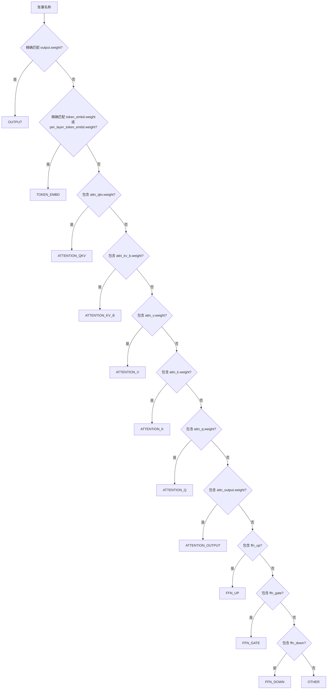
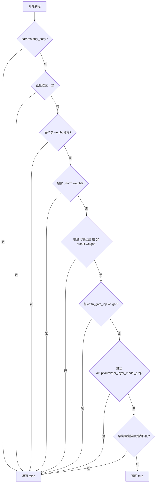
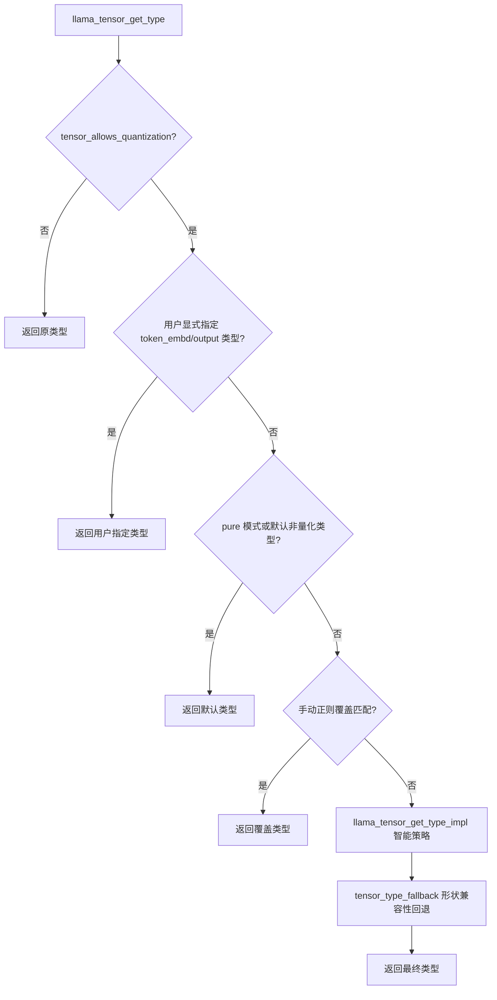
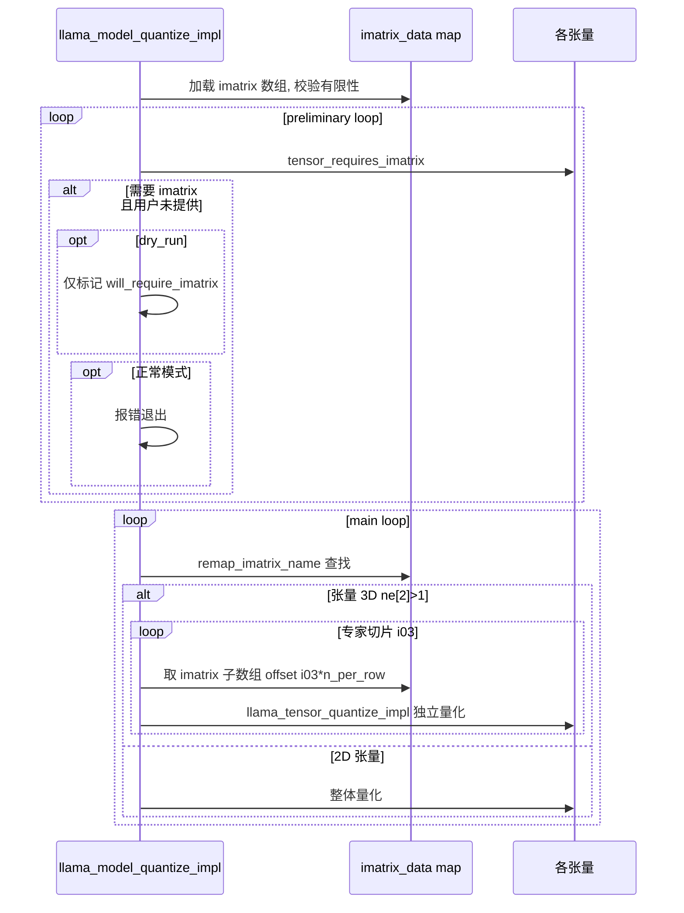
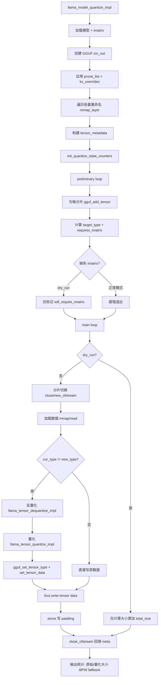
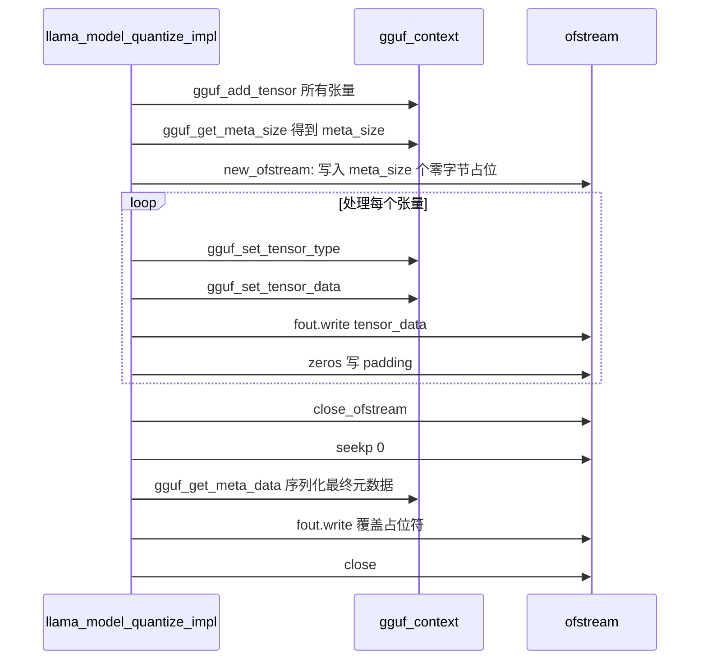
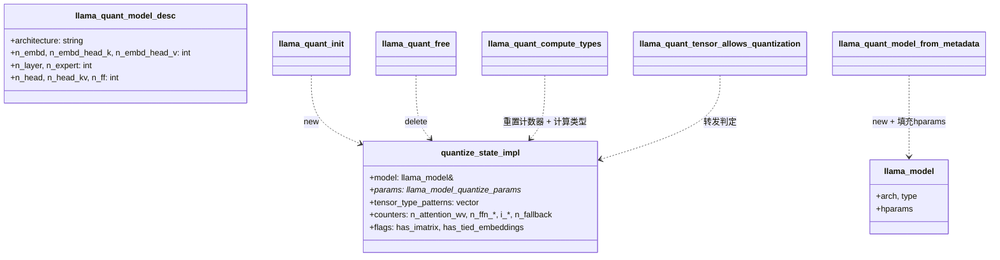

# 第23章 模型量化系统：精度与体积的「瘦身车间」

## 学习目标

- 理解 llama.cpp 量化系统中张量分类（tensor_category）的设计与识别原理
- 掌握 llama_tensor_get_type 如何综合张量类别、层位置、模型架构选择量化类型
- 了解 tensor_allows_quantization 的可量化判定逻辑与特殊保留列表
- 熟悉重要性矩阵（imatrix）在低比特量化中的作用与判定规则
- 掌握 llama_model_quantize_impl 的主流程：加载、分类、量化、写出 GGUF
- 理解 in-place / view 等内存优化技术在量化场景下的应用
- 能够阅读并修改自定义量化策略与张量类型覆盖逻辑
- 了解外部工具接口（llama-ext.h）如何暴露量化能力供第三方使用
- 掌握 quantize_state_impl 的状态管理（计数器、正则模式编译、共享嵌入检测）
- 理解 GGUF 文件占位-回填机制与最终元数据写入的协同

## 23.1 生活类比

想象 llama.cpp 的量化系统是一家**模型改造工厂的「瘦身车间」**。原始模型权重如同刚出炉的钢坯——沉重、笨拙，却蕴含着全部的知识精华。量化的任务就是把这些钢坯「瘦身」成轻便的成品，同时尽可能保留原有的强度（精度）。在这个车间里，**张量分类（tensor_category）** 就是入厂前按品类分拣：Q 类零件、V 类零件、FFN 类零件、装饰件各自走不同的产线。`tensor_name_match_token_embd` 与 `tensor_name_match_output_weight` 是车间门口的「身份证核验机」，精确识别嵌入与输出两类特殊零件，因为它们关乎模型的「嘴巴」与「耳朵」，容不得半点马虎。`tensor_allows_quantization` 则是安检门：太小的零件、特殊材质、稀有型号一律不改造，原样通过。`llama_tensor_get_type` 是工艺工程师：根据零件类型、所在楼层、客户订单（ftype）决定用什么工艺。注意力 V 升级到 Q5_K，就像关键轴承精度不能省，宁可多花点材料也要保住精度。MXFP4_MOE 分流则是 MoE 专家是「大件」，用专用工艺；其他零件走标准线。imatrix 是「零件重要性地图」，告诉工厂哪些角落误差容忍度更低。`tensor_type_fallback` 是紧急预案：原工艺不匹配时切换到备用方案（Q2_K → Q4_0）。layer_info / use_more_bits 是楼层优先级：底层、顶层、每 3 层的关键层要重点打磨。prune_layers + remap_layer 是「楼层拆除施工」，先标记要拆的，再给剩余楼层重新编号。占位 + 回填则是先搭脚手架（meta_size 零字节），施工完成后再补上竣工图纸。quantize_state_impl 构造函数是车间开工准备会：一次性把客户定制规则（正则覆盖）编好，避免每次返工。外部接口（llama_ext）是工厂的「对外接待窗口」：第三方无需进厂（加载真实权重）就能委托加工。就像优秀的工厂经理需要在精度、体积、速度之间精妙平衡，llama.cpp 的量化系统也需要为每张张量找到最合适的精度档位。

## 23.2 源码地图

```
src/llama-quant.cpp
├── 辅助工具（40-100行）
│   ├── remap_layer()          # 层裁剪/重命名（blk.N. 提取与重编号）
│   ├── remap_imatrix()        # imatrix 反向映射（按 mapped 表回查原层号）
│   └── zeros()                # 文件占位符写入（全零字节流）
├── 张量分类（102-150行）
│   ├── tensor_category 枚举   # 11 类张量定义
│   ├── tensor_name_match_token_embd()  # 识别嵌入张量（精确匹配）
│   ├── tensor_name_match_output_weight() # 识别输出张量（精确匹配）
│   ├── tensor_get_category()  # 字符串匹配 → 类别映射
│   └── category_is_attn_v()   # V 类敏感张量判定
├── 量化状态结构（132-180行）
│   ├── quantize_state_impl    # 持有 model + params + 计数器 + 正则模式
│   └── quantize_state_impl.quantize_state_impl()  # 构造函数：编译正则覆盖
├── 反量化（194-260行）
│   └── llama_tensor_dequantize_impl()  # F16/BF16/Quantized → F32 多线程
├── 可量化判定（263-322行）
│   └── tensor_allows_quantization()    # 维度检查 + 名称白名单 + 保留列表
├── 类型回退（343-370行）
│   └── tensor_type_fallback()  # 形状与量化块不兼容时降级到更小块
├── 类型选择核心（373-560行）
│   ├── llama_tensor_get_type_impl()    # 综合 category/层/ftype/arch 的策略表
│   │   ├── 共享嵌入联动：OUTPUT + TOKEN_EMBD 联合提升精度
│   │   ├── MXFP4_MOE 分流：2D → Q8_0，3D → MXFP4
│   │   ├── Attention V 差异化：GQA 共享时升级到 Q4_K/Q5_K
│   │   ├── 70B 专属优化：attn_v 从 Q3_K/Q4_K → Q5_K
│   │   └── FFN_DOWN 层级感知：use_more_bits 选择性提升
│   └── llama_tensor_get_type()  # 外层包装：manual override + fallback
├── 量化执行（601-643行）
│   └── llama_tensor_quantize_impl()  # 多线程按行/专家切分 + 校验
├── imatrix 需求（617-637行）
│   └── tensor_requires_imatrix()  # IQ1/IQ2/IQ3_XXS 必须有 imatrix
├── ftype 默认映射（649-699行）
│   └── llama_ftype_get_default_type()  # LLAMA_FTYPE_MOSTLY_* → ggml_type
├── 计数器初始化（702-719行）
│   └── init_quantize_state_counters()  # 扫描所有张量统计 n_attention_wv/n_ffn_*
├── 主驱动（730-1181行）
│   └── llama_model_quantize_impl()
│       ├── 加载模型 + imatrix
│       ├── 创建 GGUF ctx_out
│       ├── 应用 prune_list + kv_overrides
│       ├── 遍历张量 → tensor_metadata
│       ├── preliminary loop：计算 target_type + requires_imatrix
│       ├── main loop：dry_run 仅算大小 / 否则 dequantize + quantize
│       ├── 专家独立量化（按 ne[2] 切片）
│       └── 写出 GGUF（占位 → 回填 meta + tensor data）
├── 公共接口（1188-1219行）
│   ├── llama_model_quantize_default_params()
│   └── llama_model_quantize()  # 顶层 try/catch 入口
└── 外部工具接口（1231-1303行）
    ├── llama_quant_init/free()   # RAII 风格的 state 暴露
    ├── llama_quant_model_from_metadata()  # 从描述符构造 mock 模型
    ├── llama_quant_tensor_allows_quantization()  # 判定可量化性
    └── llama_quant_compute_types()  # 批量计算张量类型数组
src/llama-quant.h
└── 空头文件（实现全在 .cpp 内）
src/llama-ext.h
├── llama_graph_reserve()        # 计算图预留
├── llama_ftype_get_default_type() # ftype→ggml_type 映射导出
├── llama_quant_init/free()      # 量化状态句柄
├── llama_quant_model_desc       # 测试用 mock 模型描述符
├── llama_quant_model_from_metadata()  # mock 模型构造
├── llama_quant_tensor_allows_quantization() # 可量化判定
└── llama_quant_compute_types()  # 批量类型分配
```

---

## 23.3 源码解析单元1：张量分类与可量化判定 —— 量化策略的「分流闸门」

### 23.3.1 模块依赖图



### 23.3.2 tensor_name_match_token_embd()：识别嵌入张量（精确匹配）

```cpp
// src/llama-quant.cpp (第 109-112 行)
static bool tensor_name_match_token_embd(const char * tensor_name) {
    return std::strcmp(tensor_name, "token_embd.weight") == 0 ||           // 精确匹配标准嵌入权重名
           std::strcmp(tensor_name, "per_layer_token_embd.weight") == 0;   // 精确匹配 Gemma 等模型特有的逐层嵌入名
}
```
这段代码实现了对嵌入层权重张量的精确识别。与后文 `tensor_get_category` 使用 `find` 子串匹配不同，这里必须精确匹配，因为嵌入层名称在不同架构中高度一致，且不应误匹配到其他包含 "token_embd" 子串的张量。在「瘦身车间」里，这是门口的「身份证核验机」，精确识别嵌入这类特殊零件，因为它们关乎模型的「耳朵」，容不得半点马虎。

### 23.3.3 tensor_name_match_output_weight()：识别输出张量（精确匹配）

```cpp
// src/llama-quant.cpp (第 114-116 行)
static bool tensor_name_match_output_weight(const char * tensor_name) {
    return std::strcmp(tensor_name, "output.weight") == 0;  // 精确匹配输出层权重名
}
```
输出层权重往往与嵌入层共享权重（tied embeddings），因此也需要精确识别，以便在量化策略中联动处理。这是车间另一台「身份证核验机」，守护模型的「嘴巴」。

### 23.3.4 tensor_get_category()：字符串匹配 → 类别映射

```cpp
// src/llama-quant.cpp (第 119-145 行)
static tensor_category tensor_get_category(const std::string & tensor_name) {
    if (tensor_name_match_output_weight(tensor_name.c_str())) {                    // 1. 优先检查输出层（精确匹配）
        return tensor_category::OUTPUT;
    }
    if (tensor_name_match_token_embd(tensor_name.c_str())) {                       // 2. 检查嵌入层（精确匹配）
        return tensor_category::TOKEN_EMBD;
    }
    if (tensor_name.find("attn_qkv.weight") != std::string::npos) {                // 3. 注意力 QKV 合并权重（子串匹配，必须在单独 Q/K/V 前）
        return tensor_category::ATTENTION_QKV;
    }
    if (tensor_name.find("attn_kv_b.weight") != std::string::npos) {               // 4. 注意力 KV 偏置（子串匹配）
        return tensor_category::ATTENTION_KV_B;
    }
    if (tensor_name.find("attn_v.weight") != std::string::npos) {                  // 5. 注意力 V 投影
        return tensor_category::ATTENTION_V;
    }
    if (tensor_name.find("attn_k.weight") != std::string::npos) {                  // 6. 注意力 K 投影
        return tensor_category::ATTENTION_K;
    }
    if (tensor_name.find("attn_q.weight") != std::string::npos) {                  // 7. 注意力 Q 投影
        return tensor_category::ATTENTION_Q;
    }
    if (tensor_name.find("attn_output.weight") != std::string::npos) {             // 8. 注意力输出投影
        return tensor_category::ATTENTION_OUTPUT;
    }
    if (tensor_name.find("ffn_up") != std::string::npos) {                         // 9. FFN 上投影
        return tensor_category::FFN_UP;
    }
    if (tensor_name.find("ffn_gate") != std::string::npos) {                       // 10. FFN 门控投影
        return tensor_category::FFN_GATE;
    }
    if (tensor_name.find("ffn_down") != std::string::npos) {                       // 11. FFN 下投影
        return tensor_category::FFN_DOWN;
    }
    return tensor_category::OTHER;                                                 // 12. 兜底：其他张量
}
```
这段代码将张量名称字符串映射为枚举类别，是后续所有量化策略分发的基础。顺序至关重要：`attn_qkv` 与 `attn_kv_b` 必须优先于单独的 Q/K/V 判断，否则组合张量会被错误归类。在「瘦身车间」里，这就是「按品类分拣」的传送带，Q 类、V 类、FFN 类零件各自走向不同的产线。

### 23.3.5 category_is_attn_v()：V 类敏感张量判定

```cpp
// src/llama-quant.cpp (第 147-151 行)
static bool category_is_attn_v(tensor_category cat) {
    return cat == tensor_category::ATTENTION_V     ||   // 单独的 V 投影
           cat == tensor_category::ATTENTION_QKV   ||   // 合并的 QKV
           cat == tensor_category::ATTENTION_KV_B;      // KV 偏置（含 V 分量）
}
```
这段代码定义了一个简单的谓词函数，用于在量化策略中快速识别「高价值」张量。注意力 V 相关张量在量化时对精度最敏感，通常需要保留更多比特或使用更高精度的量化格式。在车间里，这些是「关键轴承」，精度不能省。

### 23.3.6 可量化判定流程图



### 23.3.7 tensor_allows_quantization()：可量化的多条件检查

```cpp
// src/llama-quant.cpp (第 285-335 行)
static bool tensor_allows_quantization(const llama_model_quantize_params * params, llm_arch arch, const ggml_tensor * tensor) {
    if (params->only_copy)       return false;                                  // 快速路径：仅复制模式直接跳过

    if (ggml_n_dims(tensor) < 2) return false;                                  // 仅处理 2D/3D 张量（1D 偏置等不量化）

    const std::string name = ggml_get_name(tensor);                             // 获取张量名

    bool quantize = name.rfind("weight") == name.size() - 6;                    // 初步筛选：名称必须以 'weight' 结尾（避免量化 bias 等）

    quantize &= name.find("_norm.weight") == std::string::npos;                 // 排除归一化层权重，这些对精度极其敏感且参数量极小

    quantize &= params->quantize_output_tensor || name != "output.weight";      // 根据参数决定是否量化输出层

    quantize &= name.find("ffn_gate_inp.weight") == std::string::npos;          // 排除 MoE 专家门控输入权重，它决定路由概率，量化会严重影响专家选择

    quantize &= name.find("altup")  == std::string::npos;                       // 排除 Gemma3n 特有的 AltUp 小矩阵（如 4x4），量化收益微乎其微
    quantize &= name.find("laurel") == std::string::npos;                       // 排除 Laurel 小矩阵

    quantize &= name.find("per_layer_model_proj") == std::string::npos;         // 排除每层模型投影权重

    quantize &= name != LLM_TN(arch)(LLM_TENSOR_POS_EMBD,    "weight");         // 排除位置嵌入（架构相关标准命名）
    quantize &= name != LLM_TN(arch)(LLM_TENSOR_TOKEN_TYPES, "weight");         // 排除 Token Types（BERT）

    quantize &= name.find("ssm_conv1d") == std::string::npos;                   // 排除 Mamba/Kimi 的小卷积权重
    quantize &= name.find("shortconv.conv.weight") == std::string::npos;        // 排除 ShortConv 权重

    quantize &= name.find("time_mix_first.weight") == std::string::npos;        // 排除 RWKV 时间混合小权重（以下同类）
    quantize &= name.find("time_mix_w0.weight") == std::string::npos;
    quantize &= name.find("time_mix_w1.weight") == std::string::npos;
    quantize &= name.find("time_mix_w2.weight") == std::string::npos;
    quantize &= name.find("time_mix_v0.weight") == std::string::npos;
    quantize &= name.find("time_mix_v1.weight") == std::string::npos;
    quantize &= name.find("time_mix_v2.weight") == std::string::npos;
    quantize &= name.find("time_mix_a0.weight") == std::string::npos;
    quantize &= name.find("time_mix_a1.weight") == std::string::npos;
    quantize &= name.find("time_mix_a2.weight") == std::string::npos;
    quantize &= name.find("time_mix_g1.weight") == std::string::npos;
    quantize &= name.find("time_mix_g2.weight") == std::string::npos;
    quantize &= name.find("time_mix_decay_w1.weight") == std::string::npos;
    quantize &= name.find("time_mix_decay_w2.weight") == std::string::npos;
    quantize &= name.find("time_mix_lerp_fused.weight") == std::string::npos;

    quantize &= name.find("attn_rel_b.weight") == std::string::npos;            // 排除 T5 相对位置偏置

    quantize &= name.find(".position_embd") == std::string::npos;               // 排除多模态位置嵌入
    quantize &= name.find("sam.pos_embd")   == std::string::npos;               // 排除 SAM 位置嵌入
    quantize &= name.find("sam.neck.")      == std::string::npos;               // 排除 SAM neck 层
    quantize &= name.find("sam.net_")       == std::string::npos;               // 排除 SAM 网络层
    quantize &= name.find(".rel_pos")       == std::string::npos;               // 排除相对位置编码
    quantize &= name.find(".patch_embd")    == std::string::npos;               // 排除 Patch 嵌入
    quantize &= name.find(".patch_merger")  == std::string::npos;               // 排除 Patch 合并层

    return quantize;                                                            // 返回最终判定结果
}
```
这段代码实现了一个**决策树**：从维度、名称后缀开始，层层剔除不应量化的张量。设计哲学是「宁可不量化，不可错量化」——保留列表覆盖了所有已知敏感或收益极小的张量。在「瘦身车间」里，这是「安检门」：太小的零件（altup/laurel）、特殊材质（norm/位置嵌入）、稀有型号（RWKV time_mix、Mamba conv1d）一律不改造，原样通过。

### 23.3.8 llama_tensor_dequantize_impl()：任意类型→F32 的多线程反量化入口

```cpp
// src/llama-quant.cpp (第 220-281 行)
static void llama_tensor_dequantize_impl(
    ggml_tensor * tensor, std::vector<no_init<float>> & output, std::vector<std::thread> & workers,
    const size_t nelements, const int nthread
) {
    if (output.size() < nelements) {                                            // 确保输出缓冲区足够大
        output.resize(nelements);
    }
    float * f32_output = (float *) output.data();                               // 获取浮点输出指针

    const ggml_type_traits * qtype = ggml_get_type_traits(tensor->type);        // 获取类型元信息
    if (ggml_is_quantized(tensor->type)) {                                      // 检查量化类型是否支持反量化
        if (qtype->to_float == NULL) {
            throw std::runtime_error(format("type %s unsupported for integer quantization: no dequantization available", ggml_type_name(tensor->type)));
        }
    } else if (tensor->type != GGML_TYPE_F16 &&                                 // 非量化类型仅支持 F16/BF16 转 F32
               tensor->type != GGML_TYPE_BF16) {
        throw std::runtime_error(format("cannot dequantize/convert tensor type %s", ggml_type_name(tensor->type)));
    }

    if (nthread < 2) {                                                          // 单线程快速路径
        if (tensor->type == GGML_TYPE_F16) {
            ggml_fp16_to_fp32_row((ggml_fp16_t *)tensor->data, f32_output, nelements);
        } else if (tensor->type == GGML_TYPE_BF16) {
            ggml_bf16_to_fp32_row((ggml_fp16_t *)tensor->data, f32_output, nelements);
        } else if (ggml_is_quantized(tensor->type)) {
            qtype->to_float(tensor->data, f32_output, nelements);
        } else {
            GGML_ABORT("fatal error"); // unreachable
        }
        return;
    }

    size_t block_size;                                                          // 多线程准备：计算块大小
    if (tensor->type == GGML_TYPE_F16 || tensor->type == GGML_TYPE_BF16) {
        block_size = 1;
    } else {
        block_size = (size_t)ggml_blck_size(tensor->type);
    }

    size_t block_size_bytes = ggml_type_size(tensor->type);                     // 块字节数

    GGML_ASSERT(nelements % block_size == 0);
    size_t nblocks = nelements / block_size;                                    // 总块数
    size_t blocks_per_thread = nblocks / nthread;                               // 每线程块数
    size_t spare_blocks = nblocks - (blocks_per_thread * nthread);              // 余数块数

    size_t in_buff_offs = 0;
    size_t out_buff_offs = 0;

    for (int tnum = 0; tnum < nthread; tnum++) {                                // 启动工作线程
        size_t thr_blocks = blocks_per_thread + (tnum == nthread - 1 ? spare_blocks : 0);
        size_t thr_elems = thr_blocks * block_size;
        size_t thr_block_bytes = thr_blocks * block_size_bytes;

        auto compute = [qtype] (ggml_type typ, uint8_t * inbuf, float * outbuf, int nels) {
            if (typ == GGML_TYPE_F16) {
                ggml_fp16_to_fp32_row((ggml_fp16_t *)inbuf, outbuf, nels);
            } else if (typ == GGML_TYPE_BF16) {
                ggml_bf16_to_fp32_row((ggml_fp16_t *)inbuf, outbuf, nels);
            } else {
                qtype->to_float(inbuf, outbuf, nels);
            }
        };
        workers.emplace_back(compute, tensor->type, (uint8_t *) tensor->data + in_buff_offs, f32_output + out_buff_offs, thr_elems);
        in_buff_offs += thr_block_bytes;
        out_buff_offs += thr_elems;
    }
    for (auto & w : workers) { w.join(); }                                      // 等待所有线程完成
    workers.clear();
}
```
这段代码实现了**通用的反量化入口**，支持 F16/BF16 与所有量化格式到 FP32 的转换，并通过块级划分实现多线程并行。`no_init<float>` 避免了不必要的零初始化开销。在车间里，这是「还原熔炉」，把各种压缩格式的零件还原成统一的 FP32 「熔融原料」，方便后续重铸。

### 23.3.9 llama_ftype_get_default_type()：FTYPE 与默认类型映射

```cpp
// src/llama-quant.cpp (第 655-705 行)
ggml_type llama_ftype_get_default_type(llama_ftype ftype) {
    switch (ftype) {
        case LLAMA_FTYPE_ALL_F32:             return GGML_TYPE_F32;
        case LLAMA_FTYPE_MOSTLY_F16:          return GGML_TYPE_F16;
        case LLAMA_FTYPE_MOSTLY_BF16:         return GGML_TYPE_BF16;
        case LLAMA_FTYPE_MOSTLY_Q4_0:         return GGML_TYPE_Q4_0;
        case LLAMA_FTYPE_MOSTLY_Q4_1:         return GGML_TYPE_Q4_1;
        case LLAMA_FTYPE_MOSTLY_Q5_0:         return GGML_TYPE_Q5_0;
        case LLAMA_FTYPE_MOSTLY_Q5_1:         return GGML_TYPE_Q5_1;
        case LLAMA_FTYPE_MOSTLY_Q8_0:         return GGML_TYPE_Q8_0;
        case LLAMA_FTYPE_MOSTLY_Q2_K:         return GGML_TYPE_Q2_K;
        case LLAMA_FTYPE_MOSTLY_Q2_K_S:       return GGML_TYPE_Q2_K;
        case LLAMA_FTYPE_MOSTLY_Q3_K_S:       return GGML_TYPE_Q3_K;
        case LLAMA_FTYPE_MOSTLY_Q3_K_M:       return GGML_TYPE_Q3_K;
        case LLAMA_FTYPE_MOSTLY_Q3_K_L:       return GGML_TYPE_Q3_K;
        case LLAMA_FTYPE_MOSTLY_Q4_K_S:       return GGML_TYPE_Q4_K;
        case LLAMA_FTYPE_MOSTLY_Q4_K_M:       return GGML_TYPE_Q4_K;
        case LLAMA_FTYPE_MOSTLY_Q5_K_S:       return GGML_TYPE_Q5_K;
        case LLAMA_FTYPE_MOSTLY_Q5_K_M:       return GGML_TYPE_Q5_K;
        case LLAMA_FTYPE_MOSTLY_Q6_K:         return GGML_TYPE_Q6_K;
        case LLAMA_FTYPE_MOSTLY_IQ2_XXS:      return GGML_TYPE_IQ2_XXS;
        case LLAMA_FTYPE_MOSTLY_IQ2_XS:       return GGML_TYPE_IQ2_XS;
        case LLAMA_FTYPE_MOSTLY_IQ2_S:        return GGML_TYPE_IQ2_S;
        case LLAMA_FTYPE_MOSTLY_IQ2_M:        return GGML_TYPE_IQ2_M;
        case LLAMA_FTYPE_MOSTLY_IQ1_S:        return GGML_TYPE_IQ1_S;
        case LLAMA_FTYPE_MOSTLY_IQ1_M:        return GGML_TYPE_IQ1_M;
        case LLAMA_FTYPE_MOSTLY_IQ3_XXS:      return GGML_TYPE_IQ3_XXS;
        case LLAMA_FTYPE_MOSTLY_IQ3_XS:       return GGML_TYPE_IQ3_XS;
        case LLAMA_FTYPE_MOSTLY_IQ3_S:        return GGML_TYPE_IQ3_S;
        case LLAMA_FTYPE_MOSTLY_IQ3_M:        return GGML_TYPE_IQ3_M;
        case LLAMA_FTYPE_MOSTLY_IQ4_NL:       return GGML_TYPE_IQ4_NL;
        case LLAMA_FTYPE_MOSTLY_IQ4_XS:       return GGML_TYPE_IQ4_XS;
        case LLAMA_FTYPE_MOSTLY_TQ1_0:        return GGML_TYPE_TQ1_0;
        case LLAMA_FTYPE_MOSTLY_TQ2_0:        return GGML_TYPE_TQ2_0;
        case LLAMA_FTYPE_MOSTLY_MXFP4_MOE:    return GGML_TYPE_MXFP4;
        default:                              return GGML_TYPE_COUNT;
    }
}
```
这段代码建立了**文件级量化配置**到**张量级默认类型**的基础映射表，是后续 `llama_tensor_get_type_impl` 策略表的起点。多个 ftype 可能映射到同一类型（如 Q2_K_S 与 Q2_K 都映射到 Q2_K），区别在于后续策略中会对 Q2_K_S 做特殊处理。在车间里，这是「客户订单基础工艺单」，后续工艺工程师会在此基础上微调。

---

## 23.4 源码解析单元2：核心量化类型选择 —— 智能选择每张量的精度档位

### 23.4.1 策略分发流程图

```mermaid
flowchart TD
    A[llama_tensor_get_type_impl] --> B{OUTPUT 或 共享嵌入?}
    B -- 是 --> C[用户指定 output_tensor_type?]
    C -- 是 --> D[使用用户类型]
    C -- 否 --> E{ftype == MXFP4_MOE?}
    E -- 是 --> F[强制 Q8_0]
    E -- 否 --> G{arch == Falcon 或 shape 不兼容?}
    G -- 是 --> F
    G -- 否 --> H{低比特 IQ 系列?}
    H -- 是 --> I[升级到 Q5_K]
    H -- 否 --> J[升级到 Q6_K]
    B -- 否 --> K{ftype == MXFP4_MOE?}
    K -- 是 --> L{ne[2] > 1 专家权重?}
    L -- 是 --> M[MXFP4]
    L -- 否 --> N[Q8_0]
    K -- 否 --> O{TOKEN_EMBD 单独策略?}
    O -- 是 --> P[低比特下 Q2_K/IQ3_S/Q4_K]
    O -- 否 --> Q{极低比特 IQ 系列特殊处理?}
    Q -- 是 --> R[Attention V 升级 Q4_K, FFN_DOWN 前1/8层保高精度, 8专家模型给 Q5_K/Q8_0]
    Q -- 否 --> S{Attention V 类主策略表}
    S --> T[Q2_K/Q2_K_S/IQ3_XXS/IQ3_XS/S/M/Q3_K_M/L...]
    S --> U[70B 专属: attn_v Q3_K/Q4_K → Q5_K]
    S --> V[8专家模型: attn_v → Q8_0]
    S --> W[FFN_DOWN 层级感知: use_more_bits 关键层升级]
    S --> X[ATTENTION_OUTPUT/QKV/FFN_GATE/UP 各自策略]
```

### 23.4.2 llama_tensor_get_type_impl()：综合策略中枢

```cpp
// src/llama-quant.cpp (第 378-558 行)
static ggml_type llama_tensor_get_type_impl(quantize_state_impl & qs, ggml_type new_type, const ggml_tensor * tensor, llama_ftype ftype, tensor_category category) {
    const std::string name = ggml_get_name(tensor);                             // 获取张量名

    const llm_arch arch = qs.model.arch;                                        // 获取模型架构

    auto use_more_bits = [](int i_layer, int n_layers) -> bool {                // 关键层判定：首尾 1/8 + 每隔 3 层
        return i_layer < n_layers/8 || i_layer >= 7*n_layers/8 || (i_layer - n_layers/8)%3 == 2;
    };
    const int n_expert = std::max(1, (int)qs.model.hparams.n_expert);           // 专家数（至少 1）
    auto layer_info = [n_expert] (int i_layer, int n_layer, const char * name) { // MoE 层号解析：通过张量名提取真实层号
        if (n_expert > 1) {
            if (sscanf(name, "blk.%d.", &i_layer) != 1) {
                throw std::runtime_error(format("Failed to determine layer for tensor %s", name));
            }
            if (i_layer < 0 || i_layer >= n_layer) {
                throw std::runtime_error(format("Bad layer %d for tensor %s. Must be in [0, %d)", i_layer, name, n_layer));
            }
        }
        return std::make_pair(i_layer, n_layer);
    };

    // 共享嵌入联动：OUTPUT + TOKEN_EMBD 联合提升精度
    if (category == tensor_category::OUTPUT || (qs.has_tied_embeddings && category == tensor_category::TOKEN_EMBD)) {
        if (qs.params->output_tensor_type < GGML_TYPE_COUNT) {                  // 用户显式指定输出类型
            new_type = qs.params->output_tensor_type;
        } else {
            const int64_t nx = tensor->ne[0];
            const int64_t qk_k = ggml_blck_size(new_type);

            if (ftype == LLAMA_FTYPE_MOSTLY_MXFP4_MOE) {                        // MXFP4_MOE 模式强制 Q8_0
                new_type = GGML_TYPE_Q8_0;
            }
            else if (arch == LLM_ARCH_FALCON || nx % qk_k != 0) {               // Falcon 或形状不兼容时 Q8_0
                new_type = GGML_TYPE_Q8_0;
            }
            else if (ftype == LLAMA_FTYPE_MOSTLY_IQ2_XXS || ftype == LLAMA_FTYPE_MOSTLY_IQ2_XS || ftype == LLAMA_FTYPE_MOSTLY_IQ3_XXS ||
                     ftype == LLAMA_FTYPE_MOSTLY_IQ1_S   || ftype == LLAMA_FTYPE_MOSTLY_IQ2_S  || ftype == LLAMA_FTYPE_MOSTLY_IQ2_M   ||
                     ftype == LLAMA_FTYPE_MOSTLY_IQ1_M) {                       // 低比特 IQ 系列提升到 Q5_K
                new_type = GGML_TYPE_Q5_K;
            }
            else if (new_type != GGML_TYPE_Q8_0) {                              // 其他情况提升到 Q6_K
                new_type = GGML_TYPE_Q6_K;
            }
        }
    } else if (ftype == LLAMA_FTYPE_MOSTLY_MXFP4_MOE) {                         // MXFP4_MOE 分流
        if (tensor->ne[2] > 1) {                                                // 3D 张量（专家权重）走 MXFP4
            new_type = GGML_TYPE_MXFP4;
        } else {                                                                // 其他张量走 Q8_0
            new_type = GGML_TYPE_Q8_0;
        }
    } else if (category == tensor_category::TOKEN_EMBD) {                       // TOKEN_EMBD 独立策略
        if (qs.params->token_embedding_type < GGML_TYPE_COUNT) {
            new_type = qs.params->token_embedding_type;
        } else {
            if (ftype == LLAMA_FTYPE_MOSTLY_IQ2_XXS || ftype == LLAMA_FTYPE_MOSTLY_IQ2_XS ||
                ftype == LLAMA_FTYPE_MOSTLY_IQ1_S   || ftype == LLAMA_FTYPE_MOSTLY_IQ1_M) {
                new_type = GGML_TYPE_Q2_K;                                      // 极低比特下嵌入层单独降级
            }
            else if (ftype == LLAMA_FTYPE_MOSTLY_IQ2_S || ftype == LLAMA_FTYPE_MOSTLY_IQ2_M) {
                new_type = GGML_TYPE_IQ3_S;
            }
            else if (ftype == LLAMA_FTYPE_MOSTLY_IQ3_XXS) {
                new_type = GGML_TYPE_IQ3_S;
            }
            else if (ftype == LLAMA_FTYPE_MOSTLY_TQ1_0 || ftype == LLAMA_FTYPE_MOSTLY_TQ2_0) {
                new_type = GGML_TYPE_Q4_K;
            }
        }
    } else if (ftype == LLAMA_FTYPE_MOSTLY_IQ2_XXS || ftype == LLAMA_FTYPE_MOSTLY_IQ2_XS || ftype == LLAMA_FTYPE_MOSTLY_IQ1_S ||
               ftype == LLAMA_FTYPE_MOSTLY_IQ2_S || ftype == LLAMA_FTYPE_MOSTLY_IQ2_M    || ftype == LLAMA_FTYPE_MOSTLY_IQ1_M) { // 极低比特 IQ 系列特殊处理
        if (category_is_attn_v(category)) {                                     // Attention V 类在 GQA≥4 或专家数≥4 时强制升级到 Q4_K
            if (qs.model.hparams.n_gqa() >= 4 || qs.model.hparams.n_expert >= 4) new_type = GGML_TYPE_Q4_K;
            else new_type = ftype == LLAMA_FTYPE_MOSTLY_IQ2_S || ftype == LLAMA_FTYPE_MOSTLY_IQ2_M ? GGML_TYPE_IQ3_S : GGML_TYPE_Q2_K;
            ++qs.i_attention_wv;
        }
        else if (qs.model.hparams.n_expert == 8 && category == tensor_category::ATTENTION_K) { // 8 专家模型的 K 类也升 Q4_K
            new_type = GGML_TYPE_Q4_K;
        }
        else if (category == tensor_category::FFN_DOWN) {                       // FFN_DOWN 前 1/8 层保留更高精度
            if (qs.i_ffn_down < qs.n_ffn_down/8) {
                new_type = ftype == LLAMA_FTYPE_MOSTLY_IQ2_S || ftype == LLAMA_FTYPE_MOSTLY_IQ2_M ? GGML_TYPE_IQ3_S : GGML_TYPE_Q2_K;
            }
            ++qs.i_ffn_down;
        }
        else if (category == tensor_category::ATTENTION_OUTPUT) {               // ATTENTION_OUTPUT 在 8 专家模型给 Q5_K
            if (qs.model.hparams.n_expert == 8) {
                new_type = GGML_TYPE_Q5_K;
            } else {
                if (ftype == LLAMA_FTYPE_MOSTLY_IQ1_S || ftype == LLAMA_FTYPE_MOSTLY_IQ1_M) new_type = GGML_TYPE_IQ2_XXS;
                else if (ftype == LLAMA_FTYPE_MOSTLY_IQ2_S || ftype == LLAMA_FTYPE_MOSTLY_IQ2_M) new_type = GGML_TYPE_IQ3_S;
            }
        }
    } else if (category_is_attn_v(category)) {                                  // Attention V 类的主策略表（最复杂分支）
        if      (ftype == LLAMA_FTYPE_MOSTLY_Q2_K) {
            new_type = qs.model.hparams.n_gqa() >= 4 ? GGML_TYPE_Q4_K : GGML_TYPE_Q3_K;
        }
        else if (ftype == LLAMA_FTYPE_MOSTLY_Q2_K_S && qs.model.hparams.n_gqa() >= 4) {
            new_type = GGML_TYPE_Q4_K;
        }
        else if (ftype == LLAMA_FTYPE_MOSTLY_IQ3_XXS) {
            new_type = qs.model.hparams.n_gqa() >= 4 ? GGML_TYPE_Q4_K : !qs.has_imatrix ? GGML_TYPE_IQ3_S : GGML_TYPE_IQ3_XXS;
        }
        else if ((ftype == LLAMA_FTYPE_MOSTLY_IQ3_XS || ftype == LLAMA_FTYPE_MOSTLY_IQ3_S) && qs.model.hparams.n_gqa() >= 4) {
            new_type = GGML_TYPE_Q4_K;
        }
        else if (ftype == LLAMA_FTYPE_MOSTLY_IQ3_M) {
            new_type = GGML_TYPE_Q4_K;
        }
        else if (ftype == LLAMA_FTYPE_MOSTLY_Q3_K_M) {
            new_type = qs.i_attention_wv < 2 ? GGML_TYPE_Q5_K : GGML_TYPE_Q4_K;  // 前 2 个 attn_v 给 Q5_K
        }
        else if (ftype == LLAMA_FTYPE_MOSTLY_Q3_K_L) new_type = GGML_TYPE_Q5_K;
        else if ((ftype == LLAMA_FTYPE_MOSTLY_IQ4_NL || ftype == LLAMA_FTYPE_MOSTLY_IQ4_XS) && qs.model.hparams.n_gqa() >= 4) {
            new_type = GGML_TYPE_Q5_K;
        }
        else if ((ftype == LLAMA_FTYPE_MOSTLY_Q4_K_M || ftype == LLAMA_FTYPE_MOSTLY_Q5_K_M) &&
                use_more_bits(qs.i_attention_wv, qs.n_attention_wv)) new_type = GGML_TYPE_Q6_K; // 关键层升 Q6_K
        else if (ftype == LLAMA_FTYPE_MOSTLY_Q4_K_S && qs.i_attention_wv < 4) new_type = GGML_TYPE_Q5_K; // 前 4 个给 Q5_K
        if (qs.model.type == LLM_TYPE_70B) {                                     // 70B 专属优化：attn_v 从 Q3_K/Q4_K 提升到 Q5_K
            if (new_type == GGML_TYPE_Q3_K || new_type == GGML_TYPE_Q4_K) new_type = GGML_TYPE_Q5_K;
        }
        if (qs.model.hparams.n_expert == 8) {                                   // 8 专家模型直接给 Q8_0
            new_type = GGML_TYPE_Q8_0;
        }
        ++qs.i_attention_wv;
    } else if (category == tensor_category::ATTENTION_K) {                      // ATTENTION_K
        if (qs.model.hparams.n_expert == 8) {
            new_type = GGML_TYPE_Q8_0;
        }
        else if (ftype == LLAMA_FTYPE_MOSTLY_IQ3_XS) {
            new_type = GGML_TYPE_IQ3_XXS;
        }
        else if (ftype == LLAMA_FTYPE_MOSTLY_IQ3_XXS) {
            new_type = GGML_TYPE_IQ2_S;
        }
    } else if (category == tensor_category::ATTENTION_Q) {                      // ATTENTION_Q
        if (ftype == LLAMA_FTYPE_MOSTLY_IQ3_XS) {
            new_type = GGML_TYPE_IQ3_XXS;
        }
        else if (ftype == LLAMA_FTYPE_MOSTLY_IQ3_XXS) {
            new_type = GGML_TYPE_IQ2_S;
        }
    } else if (category == tensor_category::FFN_DOWN) {                         // FFN_DOWN 层级感知策略
        auto info = layer_info(qs.i_ffn_down, qs.n_ffn_down, name.c_str());
        int i_layer = info.first, n_layer = info.second;
        if      (ftype == LLAMA_FTYPE_MOSTLY_Q2_K) new_type = GGML_TYPE_Q3_K;
        else if (ftype == LLAMA_FTYPE_MOSTLY_Q2_K_S) {
            if (i_layer < n_layer/8) new_type = GGML_TYPE_Q4_K;                 // 首 1/8 层给 Q4_K
        }
        else if (ftype == LLAMA_FTYPE_MOSTLY_IQ3_XXS && !qs.has_imatrix) {
            new_type = i_layer < n_layer/8 ? GGML_TYPE_Q4_K : GGML_TYPE_Q3_K;   // 无 imatrix 时首层给 Q4_K
        }
        else if (ftype == LLAMA_FTYPE_MOSTLY_Q3_K_M) {
            new_type = i_layer < n_layer/16 ? GGML_TYPE_Q5_K
                     : arch != LLM_ARCH_FALCON || use_more_bits(i_layer, n_layer) ? GGML_TYPE_Q4_K
                     : GGML_TYPE_Q3_K;
        }
        else if (ftype == LLAMA_FTYPE_MOSTLY_IQ3_M && (i_layer < n_layer/8 ||
                    (qs.model.hparams.n_expert == 8 && use_more_bits(i_layer, n_layer)))) {
            new_type = GGML_TYPE_Q4_K;
        }
        else if (ftype == LLAMA_FTYPE_MOSTLY_Q3_K_L) {
            new_type = arch == LLM_ARCH_FALCON ? GGML_TYPE_Q4_K : GGML_TYPE_Q5_K;
        }
        else if (ftype == LLAMA_FTYPE_MOSTLY_Q4_K_M) {
            if (arch == LLM_ARCH_FALCON) {
                new_type = i_layer < n_layer/16 ? GGML_TYPE_Q6_K :
                           use_more_bits(i_layer, n_layer) ? GGML_TYPE_Q5_K : GGML_TYPE_Q4_K;
            } else {
                if (use_more_bits(i_layer, n_layer)) new_type = GGML_TYPE_Q6_K;  // 关键层升 Q6_K
            }
        }
        else if (i_layer < n_layer/8 && (ftype == LLAMA_FTYPE_MOSTLY_IQ4_NL || ftype == LLAMA_FTYPE_MOSTLY_IQ4_XS) && !qs.has_imatrix) {
            new_type = GGML_TYPE_Q5_K;
        }
        else if (ftype == LLAMA_FTYPE_MOSTLY_Q5_K_M && use_more_bits(i_layer, n_layer)) new_type = GGML_TYPE_Q6_K;
        else if (ftype == LLAMA_FTYPE_MOSTLY_Q4_K_S && arch != LLM_ARCH_FALCON && i_layer < n_layer/8) {
            new_type = GGML_TYPE_Q5_K;
        }
        else if ((ftype == LLAMA_FTYPE_MOSTLY_Q4_0 || ftype == LLAMA_FTYPE_MOSTLY_Q5_0)
                && qs.has_imatrix && i_layer < n_layer/8) {                     // Q4_0/Q5_0 有 imatrix 时首层升 Q4_1/Q5_1（防发散）
            new_type = ftype == LLAMA_FTYPE_MOSTLY_Q4_0 ? GGML_TYPE_Q4_1 : GGML_TYPE_Q5_1;
        }
        ++qs.i_ffn_down;
    } else if (category == tensor_category::ATTENTION_OUTPUT) {                 // ATTENTION_OUTPUT
        if (arch != LLM_ARCH_FALCON) {
            if (qs.model.hparams.n_expert == 8) {                               // 8 专家模型大多给 Q5_K
                if (ftype == LLAMA_FTYPE_MOSTLY_Q2_K   || ftype == LLAMA_FTYPE_MOSTLY_IQ3_XS || ftype == LLAMA_FTYPE_MOSTLY_IQ3_XXS ||
                    ftype == LLAMA_FTYPE_MOSTLY_Q3_K_S || ftype == LLAMA_FTYPE_MOSTLY_Q3_K_M  || ftype == LLAMA_FTYPE_MOSTLY_IQ4_NL  ||
                    ftype == LLAMA_FTYPE_MOSTLY_Q4_K_S || ftype == LLAMA_FTYPE_MOSTLY_Q4_K_M  || ftype == LLAMA_FTYPE_MOSTLY_IQ3_S  ||
                    ftype == LLAMA_FTYPE_MOSTLY_IQ3_M  || ftype == LLAMA_FTYPE_MOSTLY_IQ4_XS) {
                    new_type = GGML_TYPE_Q5_K;
                }
            } else {
                if      (ftype == LLAMA_FTYPE_MOSTLY_Q2_K   ) new_type = GGML_TYPE_Q3_K;
                else if (ftype == LLAMA_FTYPE_MOSTLY_IQ3_XXS) new_type = GGML_TYPE_IQ3_S;
                else if (ftype == LLAMA_FTYPE_MOSTLY_Q3_K_M ) new_type = GGML_TYPE_Q4_K;
                else if (ftype == LLAMA_FTYPE_MOSTLY_Q3_K_L ) new_type = GGML_TYPE_Q5_K;
                else if (ftype == LLAMA_FTYPE_MOSTLY_IQ3_M  ) new_type = GGML_TYPE_Q4_K;
            }
        } else {
            if (ftype == LLAMA_FTYPE_MOSTLY_Q3_K_L) new_type = GGML_TYPE_Q4_K;
        }
    }
    else if (category == tensor_category::ATTENTION_QKV) {                      // ATTENTION_QKV（打包 QKV）
        if (ftype == LLAMA_FTYPE_MOSTLY_Q3_K_M || ftype == LLAMA_FTYPE_MOSTLY_Q3_K_L || ftype == LLAMA_FTYPE_MOSTLY_IQ3_M) {
            new_type = GGML_TYPE_Q4_K;
        }
        else if (ftype == LLAMA_FTYPE_MOSTLY_Q4_K_M) new_type = GGML_TYPE_Q5_K;
        else if (ftype == LLAMA_FTYPE_MOSTLY_Q5_K_M) new_type = GGML_TYPE_Q6_K;
    }
    else if (category == tensor_category::FFN_GATE) {                           // FFN_GATE
        auto info = layer_info(qs.i_ffn_gate, qs.n_ffn_gate, name.c_str());
        int i_layer = info.first, n_layer = info.second;
        if (ftype == LLAMA_FTYPE_MOSTLY_IQ3_XS && (i_layer >= n_layer/8 && i_layer < 7*n_layer/8)) {
            new_type = GGML_TYPE_IQ3_XXS;                                       // 中间层段降级到 IQ3_XXS（省空间）
        }
        ++qs.i_ffn_gate;
    }
    else if (category == tensor_category::FFN_UP) {                             // FFN_UP
        auto info = layer_info(qs.i_ffn_up, qs.n_ffn_up, name.c_str());
        int i_layer = info.first, n_layer = info.second;
        if (ftype == LLAMA_FTYPE_MOSTLY_IQ3_XS && (i_layer >= n_layer/8 && i_layer < 7*n_layer/8)) {
            new_type = GGML_TYPE_IQ3_XXS;
        }
        ++qs.i_ffn_up;
    }

    return new_type;
}
```
这段代码是**量化策略的大脑**，将张量类别、层位置、模型规模（GQA、专家数、70B）、文件类型（ftype）、imatrix 可用性等多维信息融合，输出每个张量的最佳量化类型。设计体现了「差异化、分层感知、架构自适应」三大原则。在「瘦身车间」里，这是「工艺工程师」：根据零件类型、所在楼层、客户订单决定用什么工艺。注意力 V 升级到 Q5_K，就像关键轴承精度不能省；MXFP4_MOE 分流则是 MoE 专家是「大件」，用专用工艺；imatrix 是「零件重要性地图」；layer_info / use_more_bits 是楼层优先级：底层、顶层、每 3 层的关键层要重点打磨。

### 23.4.3 三级决策链流程图



### 23.4.4 llama_tensor_get_type()：外层包装与手动覆盖

```cpp
// src/llama-quant.cpp (第 562-602 行)
static ggml_type llama_tensor_get_type(quantize_state_impl & qs, const llama_model_quantize_params * params, const ggml_tensor * tensor, ggml_type default_type, const tensor_metadata & tm) {
    if (!tensor_allows_quantization(params, qs.model.arch, tensor)) {           // 1. 不可量化张量直接返回原类型
        return tensor->type;
    }
    if (params->token_embedding_type < GGML_TYPE_COUNT && tm.category == tensor_category::TOKEN_EMBD) { // 2. 用户显式指定嵌入类型优先生效
        return params->token_embedding_type;
    }
    if (params->output_tensor_type < GGML_TYPE_COUNT && tm.category == tensor_category::OUTPUT) {       // 3. 用户显式指定输出类型优先生效
        return params->output_tensor_type;
    }

    ggml_type new_type = default_type;

    if (!params->pure && ggml_is_quantized(default_type)) {                     // 4. pure 模式或默认非量化类型时跳过策略计算
        bool manual = false;
        if (!qs.tensor_type_patterns.empty()) {                                 // 5. 手动覆盖（TT_OVERRIDE）：遍历预编译正则
            const std::string tensor_name(tensor->name);
            for (const auto & [pattern, qtype] : qs.tensor_type_patterns) {
                if (std::regex_search(tensor_name, pattern)) {
                    if (qtype != new_type) {
                        LLAMA_LOG_WARN("%s: %-36s - applying manual override: %s -> %s\n",
                                       __func__, tensor_name.c_str(), ggml_type_name(new_type), ggml_type_name(qtype));
                        new_type = qtype;
                        manual = true;
                        break;
                    }
                }
            }
        }

        if (!manual) {                                                          // 6. 无手动覆盖时，调用核心策略函数
            new_type = llama_tensor_get_type_impl(qs, new_type, tensor, params->ftype, tm.category);
        }

        new_type = tensor_type_fallback(qs, tensor, new_type);                  // 7. 类型回退：处理形状不兼容情况
    }

    return new_type;
}
```
这段代码实现了**三级决策链**：不可量化保底 → 用户显式指定 → 手动正则覆盖 → 智能策略 → 形状兼容性回退。正则模式在 `quantize_state_impl` 构造时预编译，避免每张量重复编译开销。在车间里，这是「三级审批」：安检门挡住不改造件 → 客户定制订单优先 → 车间主任特批工艺 → 工艺工程师标准工艺 → 紧急预案兼容形状。

### 23.4.5 tensor_type_fallback()：形状不兼容时的自动降级

```cpp
// src/llama-quant.cpp (第 339-374 行)
static ggml_type tensor_type_fallback(quantize_state_impl & qs, const ggml_tensor * t, const ggml_type target_type) {
    ggml_type return_type = target_type;

    const int64_t ncols = t->ne[0];                                             // 张量首维大小
    const int64_t qk_k = ggml_blck_size(target_type);                           // 目标类型的块大小

    if (ncols % qk_k != 0) {                                                    // 形状不兼容：首维不能被块大小整除
        LLAMA_LOG_WARN("warning: %-36s - ncols %6" PRId64 " not divisible by %3" PRId64 " (required for type %7s) ",
                        t->name, ncols, qk_k, ggml_type_name(target_type));
        ++qs.n_fallback;

        switch (target_type) {                                                  // 分组回退：块大小 256 的 IQ 系列回退到 IQ4_NL（块 32）
            case GGML_TYPE_IQ1_S:
            case GGML_TYPE_IQ1_M:
            case GGML_TYPE_IQ2_XXS:
            case GGML_TYPE_IQ2_XS:
            case GGML_TYPE_IQ2_S:
            case GGML_TYPE_IQ3_XXS:
            case GGML_TYPE_IQ3_S:
            case GGML_TYPE_IQ4_XS:  return_type = GGML_TYPE_IQ4_NL; break;
            case GGML_TYPE_Q2_K:                                                // Q2_K/Q3_K/TQ 系列回退到 Q4_0
            case GGML_TYPE_Q3_K:
            case GGML_TYPE_TQ1_0:
            case GGML_TYPE_TQ2_0:   return_type = GGML_TYPE_Q4_0;   break;
            case GGML_TYPE_Q4_K:    return_type = GGML_TYPE_Q5_0;   break;      // Q4_K→Q5_0
            case GGML_TYPE_Q5_K:    return_type = GGML_TYPE_Q5_1;   break;      // Q5_K→Q5_1
            case GGML_TYPE_Q6_K:    return_type = GGML_TYPE_Q8_0;   break;      // Q6_K→Q8_0
            default:
                throw std::runtime_error(format("no tensor type fallback is defined for type %s",
                                                ggml_type_name(target_type)));
        }
        if (ncols % ggml_blck_size(return_type) != 0) {                         // 二次检查：回退类型若仍不兼容（极罕见）
            LLAMA_LOG_WARN("(WARNING: must use F16 due to unusual shape) ");
            return_type = GGML_TYPE_F16;                                        // 直接回退到 F16
        }
        LLAMA_LOG_WARN("-> falling back to %7s\n", ggml_type_name(return_type));
    }
    return return_type;
}
```
这段代码保证了**量化过程的鲁棒性**：当张量形状（如注意力头数导致的维度）与量化块大小不匹配时，自动寻找兼容的替代类型，而非直接报错中断。在车间里，这是「紧急预案」：原工艺不匹配时切换到备用方案（Q2_K → Q4_0），实在不行就用 F16 保底，保证流程不中断。

---

## 23.5 源码解析单元3：重要性矩阵与 imatrix 需求判定 —— 精度敏感的「温度计」

### 23.5.1 imatrix 校验与切片逻辑时序图



### 23.5.2 tensor_requires_imatrix()：低比特量化的前置条件

```cpp
// src/llama-quant.cpp (第 671-685 行)
static bool tensor_requires_imatrix(const char * tensor_name, const ggml_type dst_type, const llama_ftype ftype) {
    if (tensor_name_match_token_embd(tensor_name) || tensor_name_match_output_weight(tensor_name)) { // 嵌入/输出层豁免
        return false;
    }
    switch (dst_type) {
        case GGML_TYPE_IQ3_XXS:                                                 // 所有 IQ1/IQ2/IQ3_XXS 类型必须有 imatrix
        case GGML_TYPE_IQ2_XXS:
        case GGML_TYPE_IQ2_XS:
        case GGML_TYPE_IQ2_S:
        case GGML_TYPE_IQ1_M:
        case GGML_TYPE_IQ1_S:
            return true;
        case GGML_TYPE_Q2_K:                                                    // Q2_K 仅在 Q2_K_S 文件类型下需要 imatrix
            return ftype == LLAMA_FTYPE_MOSTLY_Q2_K_S;
        default:
            return false;                                                       // K-quant 系列（Q3_K 以上）通常无需 imatrix
    }
}
```
这段代码明确划定了**imatrix 的适用边界**：仅服务于最激进的低比特量化（IQ 系列与 Q2_K_S），避免为常规量化引入额外开销。在车间里，imatrix 是「零件重要性地图」，只有最精密的微雕工艺（IQ 系列）才需要这张地图，普通工艺（K-quant）凭经验即可。

---

## 23.6 源码解析单元4：层裁剪与重映射 —— 灵活重组模型层结构

### 23.6.1 层重命名前后对比图

```mermaid
graph LR
    subgraph 原始模型
        L0[blk.0.attn_q.weight]
        L1[blk.1.attn_q.weight]
        L2[blk.2.attn_q.weight]
        L3[blk.3.attn_q.weight]
        L4[blk.4.attn_q.weight]
        L5[blk.5.attn_q.weight]
    end
    subgraph 裁剪列表 prune={1,3}
        P1[标记裁剪]
        P3[标记裁剪]
    end
    subgraph 重映射后
        L0n[blk.0.attn_q.weight]
        L2n[blk.1.attn_q.weight]
        L4n[blk.2.attn_q.weight]
        L5n[blk.3.attn_q.weight]
    end
    L1 --> P1
    L3 --> P3
    L0 -.-> L0n
    L2 -.-> L2n
    L4 -.-> L4n
    L5 -.-> L5n
```

### 23.6.2 remap_layer()：层号提取与重编号

```cpp
// src/llama-quant.cpp (第 55-82 行)
static std::string remap_layer(const std::string & orig_name, const std::vector<int> & prune, std::map<int, std::string> & mapped, int & next_id) {
    if (prune.empty()) {                                                        // 无裁剪列表直接返回原名
        return orig_name;
    }

    static const std::regex pattern(R"(blk\.(\d+)\.)");                         // 编译正则捕获层号
    if (std::smatch match; std::regex_search(orig_name, match, pattern)) {
        const int blk = std::stoi(match[1]);
        std::string new_name = orig_name;

        if (mapped.count(blk)) {                                                // 已映射：复用
            // Already mapped, do nothing
        } else if (std::find(prune.begin(), prune.end(), blk) != prune.end()) { // 在裁剪列表中：映射为空串（后续主循环会 continue 跳过）
            mapped[blk] = "";
        } else if (blk < prune.front()) {                                       // 小于首个裁剪层：保持原编号
            mapped[blk] = std::to_string(blk);
            next_id = blk + 1;
        } else {                                                                // 其他：分配下一个连续 ID（next_id++），实现层号压缩
            mapped[blk] = std::to_string(next_id);
            ++next_id;
        }

        return mapped[blk].empty() ? mapped[blk] : new_name.replace(match.position(1), match.length(1), mapped[blk]); // 替换层号子串
    }

    return orig_name;                                                           // 无 blk.N. 模式的张量（嵌入、输出、norm）保持原名
}
```
这段代码实现了**层裁剪后的张量重命名**：被裁剪层的张量直接丢弃，剩余层按顺序重新编号为 0,1,2...，保证输出模型层号连续。在车间里，这是「楼层拆除施工」：先标记要拆的楼层（prune_list），再给剩余楼层重新编号。

### 23.6.3 remap_imatrix()：imatrix 反向映射

```cpp
// src/llama-quant.cpp (第 84-105 行)
static std::string remap_imatrix(const std::string & orig_name, const std::map<int, std::string> & mapped) {
    if (mapped.empty()) {
        return orig_name;
    }

    static const std::regex pattern(R"(blk\.(\d+)\.)");
    if (std::smatch match; std::regex_search(orig_name, match, pattern)) {
        const std::string blk(match[1]);
        std::string new_name = orig_name;

        for (const auto & p : mapped) {                                         // 反向查找：找到「新层号 == 当前 imatrix 层号」的原层号
            if (p.second == blk) {
                return new_name.replace(match.position(1), match.length(1), std::to_string(p.first));
            }
        }
        GGML_ABORT("\n%s: imatrix mapping error for %s\n", __func__, orig_name.c_str());
    }

    return orig_name;
}
```
由于 `remap_layer` 是「原层号 → 新层号」，而 imatrix 文件存储的是原层号，量化时需要「imatrix 层号 → 原层号 → 新层号」的反向映射，这段代码正是完成这一转换。在车间里，imatrix 是按旧楼层编号存档的，施工时要按新编号查找对应的旧档案。

---

## 23.7 源码解析单元5：量化执行与多线程调度 —— 大规模权重的「并行瘦身流水线」

### 23.7.1 多线程量化流水线与专家切片并行图

```mermaid
flowchart TD
    A[主线程遍历张量] --> B{tensor ne[2] > 1?}
    B -- 是 3D专家张量 --> C[按 ne[2] 循环专家]
    C --> D[专家 i03: 计算偏移]
    D --> E[f32_data_03 指针]
    D --> F[new_data_03 指针]
    D --> G[imatrix_03 子数组]
    E --> H[llama_tensor_quantize_impl]
    F --> H
    G --> H
    H --> I[多线程行级并行]
    I --> J[互斥锁保护 counter]
    J --> K[动态分配 chunk]
    K --> L[ggml_quantize_chunk]
    L --> M[ggml_validate_row_data]
    M --> N[累加 new_size]
    B -- 否 2D张量 --> H
    H --> O[返回总 new_size]
```

### 23.7.2 llama_tensor_quantize_impl()：多线程量化执行器

```cpp
// src/llama-quant.cpp (第 608-667 行)
static size_t llama_tensor_quantize_impl(enum ggml_type new_type, const float * f32_data, void * new_data, const int64_t chunk_size, int64_t nrows, int64_t n_per_row, const float * imatrix, std::vector<std::thread> & workers, const int nthread) {
    if (nthread < 2) {                                                          // 单线程快速路径
        size_t new_size = ggml_quantize_chunk(new_type, f32_data, new_data, 0, nrows, n_per_row, imatrix);
        if (!ggml_validate_row_data(new_type, new_data, new_size)) {
            throw std::runtime_error("quantized data validation failed");
        }
        return new_size;
    }

    std::mutex mutex;                                                           // 多线程共享状态
    int64_t counter = 0;
    size_t new_size = 0;
    bool valid = true;
    auto compute = [&mutex, &counter, &new_size, &valid, new_type, f32_data, new_data, chunk_size,
            nrows, n_per_row, imatrix]() {
        const int64_t nrows_per_chunk = chunk_size / n_per_row;                 // 每 chunk 行数
        size_t local_size = 0;
        while (true) {
            std::unique_lock<std::mutex> lock(mutex);
            int64_t first_row = counter; counter += nrows_per_chunk;            // 竞争计数器获取任务范围
            if (first_row >= nrows) {
                if (local_size > 0) {
                    new_size += local_size;
                }
                break;
            }
            lock.unlock();
            const int64_t this_nrow = std::min(nrows - first_row, nrows_per_chunk);
            size_t this_size = ggml_quantize_chunk(new_type, f32_data, new_data, first_row * n_per_row, this_nrow, n_per_row, imatrix);
            local_size += this_size;

            const size_t row_size  = ggml_row_size(new_type, n_per_row);        // 校验量化数据
            void * this_data = (char *) new_data + first_row * row_size;
            if (!ggml_validate_row_data(new_type, this_data, this_size)) {
                std::unique_lock<std::mutex> lock(mutex);
                valid = false;
                break;
            }
        }
    };
    for (int it = 0; it < nthread - 1; ++it) {                                  // 启动 nthread-1 个工作线程
        workers.emplace_back(compute);
    }
    compute();                                                                  // 主线程也参与计算
    for (auto & w : workers) { w.join(); }                                      // 等待所有线程
    workers.clear();
    if (!valid) {
        throw std::runtime_error("quantized data validation failed");
    }
    return new_size;
}
```
这段代码实现了**行级并行量化**：以 `chunk_size`（默认 ≥ 32*512 元素）为粒度动态分配任务，避免负载不均。每行量化后立即校验，保证数值正确性。在车间里，这是「并行流水线」：将大零件切成小段，多台机床同时加工，每段加工完即刻质检。

### 23.7.3 专家独立量化与工作缓冲区复用

在主驱动 main loop 中：
```cpp
for (int64_t i03 = 0; i03 < tensor->ne[2]; ++i03) {
    const float * f32_data_03 = f32_data + i03 * nelements_matrix;
    void * new_data_03 = (char *)new_data + ggml_row_size(new_type, n_per_row) * i03 * nrows;
    const float * imatrix_03 = imatrix ? imatrix + i03 * n_per_row : nullptr;
    new_size += llama_tensor_quantize_impl(new_type, f32_data_03, new_data_03, chunk_size, nrows, n_per_row, imatrix_03, workers, nthread_use);
}
```
- **专家切片**：3D 张量（`ne[2]` 专家数）按专家维度循环，每专家独立量化，支持不同 imatrix。
- **缓冲区复用**：`f32_conv_buf`、`work`、`read_data` 通过 `resize` 上界分配，避免每张量重复分配内存。这是典型的 in-place / view 内存优化：复用预分配缓冲区，减少内存分配开销与碎片。
- **完整链路**：原始数据 → `load_data_for` → `llama_tensor_dequantize_impl` (FP32) → `llama_tensor_quantize_impl` → 校验 → `gguf_set_tensor_data` + `fout.write`。

---

## 23.8 源码解析单元6：主量化驱动与 GGUF 输出 —— 量化任务的「总指挥」

### 23.8.1 主流程双循环流程图



### 23.8.2 占位-回填时序图



### 23.8.3 llama_model_quantize_impl()：全流程编排

```cpp
// src/llama-quant.cpp (第 833-1162 行)
static void llama_model_quantize_impl(const std::string & fname_inp, const std::string & fname_out, const llama_model_quantize_params * params) {
    // ... 参数初始化、mmap 策略、模型加载器构造 ...
    llama_model_loader ml(/*metadata*/ nullptr, /*set_tensor_data*/ nullptr, /*set_tensor_data_ud*/ nullptr,
        fname_inp, splits, /*file*/ nullptr, use_mmap, /*use_direct_io*/ false, /*check_tensors*/ true, /*no_alloc*/ false, kv_overrides, nullptr);
    ml.init_mappings(false); // no prefetching
    llama_model model(llama_model_default_params());
    model.load_arch   (ml);
    model.load_hparams(ml);
    model.load_stats  (ml);
    quantize_state_impl qs(model, params);
    // ... imatrix 加载与校验 ...
    // ... GGUF 上下文创建、KV 拷贝、prune_list 处理、张量列表构建与重命名 ...
    // compute tensor metadata once and cache it
    std::vector<tensor_metadata> metadata(tensors.size());
    for (size_t i = 0; i < tensors.size(); ++i) {
        metadata[i].name = ggml_get_name(tensors[i]->tensor);
    }
    // initialize quantization state counters and metadata categories
    init_quantize_state_counters(qs, metadata);
    // ... split 文件准备、preliminary loop ...
    // preliminary iteration over all weights
    for (size_t i = 0; i < tensors.size(); ++i) {
        // gguf_add_tensor, 计算 target_type, requires_imatrix, 校验 imatrix 存在性
    }
    // ... dry_run 或 main loop ...
    // main loop: iterate over all weights
    for (size_t i = 0; i < tensors.size(); ++i) {
        // 加载数据 -> 反量化 -> 量化 -> 校验 -> 更新 GGUF 元数据 -> 写入张量数据 + padding
    }
    // ... 收尾、统计输出 ...
}
```

**关键流程节点**：
1. **模型加载**：`llama_model_loader` 读取 GGUF 元数据与张量映射，`model.load_arch/hparams/stats` 构建内存中模型结构。
2. **量化状态初始化**：`quantize_state_impl qs(model, params)` 预编译正则、初始化计数器。
3. **imatrix 处理**：拷贝到 map、校验有限性、设置 `qs.has_imatrix`。
4. **GGUF 输出上下文**：`gguf_init_empty()` 创建空上下文，拷贝输入 KV、写入量化版本与文件类型、移除分片元数据、应用 `kv_overrides`。
5. **层裁剪与重命名**：遍历 `ml.weights_map`，调用 `remap_layer` 重命名张量，裁剪层跳过，更新 `LLM_KV_BLOCK_COUNT`。
6. **分片排序**：`keep_split` 模式下按 `idx`、`offs` 排序张量，计算 `n_split`。
7. **preliminary loop（预演）**：
   - 为每分片 `gguf_add_tensor` 注册张量元信息。
   - 判定 `allows_quantization`、`target_type`、`requires_imatrix`。
   - 缺失 imatrix 时：dry_run 仅标记，正常模式报错。
8. **main loop（实战）**：
   - 分片切换：`close_ofstream` 回填元数据并关闭，`new_ofstream` 打开新分片并写入零占位。
   - 数据加载：mmap 模式直接用映射指针，否则 `ml.load_data_for` 读入 `read_data`。
   - 量化决策：`cur_type != new_type` 才量化。
   - 反量化：非 F32 且允许重量化时，调用 `llama_tensor_dequantize_impl` 转 FP32。
   - 量化执行：计算 `chunk_size`、线程数，按专家循环调用 `llama_tensor_quantize_impl`。
   - 结果写入：`gguf_set_tensor_type` 更新元数据类型，`gguf_set_tensor_data` 登记数据指针，`fout.write` 写数据，`zeros` 写 padding 对齐。
9. **收尾**：`close_ofstream` 回填最后分片元数据，输出原始/量化大小、BPW、fallback 统计。

### 23.8.4 zeros()：文件占位符写入

```cpp
// src/llama-quant.cpp (第 48-53 行)
static void zeros(std::ofstream & file, size_t n) {
    char zero = 0;
    for (size_t i = 0; i < n; ++i) {
        file.write(&zero, 1);
    }
}
```
逐字节写入 `n` 个零字节。用于在文件开头预留 `meta_size` 字节的占位符，待量化完成后通过 `seekp(0)` 回填实际元数据。单字节写入虽慢，但 `meta_size` 通常仅几百 KB，开销可忽略。在车间里，这是「先搭脚手架（meta_size 零字节），施工完成后再补上竣工图纸」。

### 23.8.5 占位-回填机制

```cpp
// new_ofstream 闭包 (第 1075-1095 行)
auto new_ofstream = [&](int index) {
    cur_split = index;
    // ...
    fout = std::ofstream(fname, std::ios::binary);
    const size_t meta_size = gguf_get_meta_size(ctx_outs[cur_split].get());
    ::zeros(fout, meta_size); // placeholder
};

// close_ofstream 闭包 (第 1065-1074 行)
auto close_ofstream = [&]() {
    if (fout.is_open()) {
        fout.seekp(0);
        std::vector<uint8_t> data(gguf_get_meta_size(ctx_outs[cur_split].get()));
        gguf_get_meta_data(ctx_outs[cur_split].get(), data.data());
        fout.write((const char *) data.data(), data.size());
        fout.close();
    }
};
```
**原理**：GGUF 文件头（元数据）大小在张量全部添加完毕前无法确定。采用「先占位、后回填」：打开文件时写入 `meta_size` 个零字节占位；所有张量处理完毕后，`seekp(0)` 回到文件开头，序列化最终元数据覆盖占位符。这是流式写入大文件的经典模式。

### 23.8.6 init_quantize_state_counters()：计数器初始化

```cpp
// src/llama-quant.cpp (第 809-823 行)
static void init_quantize_state_counters(quantize_state_impl & qs, std::vector<tensor_metadata> & metadata) {
    for (auto & tm : metadata) {
        tensor_category cat = tensor_get_category(tm.name);
        tm.category = cat;
        if (category_is_attn_v(cat)) {
            ++qs.n_attention_wv;                                                // 统计 V/QKV/KV_B 总数
        }
        if (cat == tensor_category::OUTPUT) {
            qs.has_tied_embeddings = false;                                     // 检测是否存在 OUTPUT 张量：若无则嵌入与输出共享
        }
    }
    qs.n_ffn_down = qs.n_ffn_gate = qs.n_ffn_up = (int)qs.model.hparams.n_layer; // FFN 计数器初始化为层数
}
```
遍历所有张量元数据，设置类别，统计 `n_attention_wv`。检测是否存在 OUTPUT 张量：若无 OUTPUT（如某些嵌入模型），`has_tied_embeddings` 保持 true，触发嵌入层与输出层联动量化策略。FFN 计数器初始化为层数（每层一个 up/gate/down），MoE 情况下在 `layer_info` 中通过张量名解析真实层号。在车间里，这是「开工准备会」：清点各类零件总数，确认是否有共享嵌入（无 OUTPUT 则视为共享），初始化楼层计数器。

---

## 23.9 源码解析单元7：外部工具接口 —— 让「第三方」也能调动量化能力

### 23.9.1 外部接口调用关系图



### 23.9.2 quantize_state_impl 构造函数：预编译正则模式

```cpp
// src/llama-quant.cpp (第 197-205 行)
quantize_state_impl(const llama_model & model, const llama_model_quantize_params * params):
    model(model), params(params)
{
    if (params->tt_overrides) {                                                 // 若用户提供 tt_overrides（张量类型覆盖数组）
        for (const auto * p = params->tt_overrides; p->pattern != nullptr; p++) {
            tensor_type_patterns.emplace_back(std::regex(p->pattern), p->type); // 遍历数组将每个正则字符串编译为 std::regex 并存入 vector
        }
    }
}
```
**一次性编译**：避免在 `llama_tensor_get_type` 中为每个张量重复编译正则，显著降低开销。在车间里，这是「开工准备会」：一次性把客户定制规则（正则覆盖）编好，避免每次返工。

### 23.9.3 llama_quant_init() / llama_quant_free()：RAII 句柄

```cpp
// src/llama-quant.cpp (第 1205-1213 行)
quantize_state_impl * llama_quant_init(const llama_model * model, const llama_model_quantize_params * params) {
    return new quantize_state_impl(*model, params);
}

void llama_quant_free(quantize_state_impl * qs) {
    delete qs;
}
```
标准的 C 风格 RAII 接口：`init` 在堆上构造状态对象返回不透明指针，`free` 负责析构。外部工具通过这对接口管理量化状态生命周期。在车间里，这是「对外接待窗口」的开关。

### 23.9.4 llama_quant_model_from_metadata()：Mock 模型构造

```cpp
// src/llama-quant.cpp (第 1215-1234 行)
llama_model * llama_quant_model_from_metadata(const llama_quant_model_desc * desc) {
    struct llama_model_params mparams = llama_model_default_params();
    auto * model = new llama_model(mparams);
    model->arch = llm_arch_from_string(desc->architecture);
    if (model->arch == LLM_ARCH_LLAMA && desc->n_layer == 80 && desc->n_head != desc->n_head_kv) { // 仅推断 LLM_TYPE_70B
        model->type = LLM_TYPE_70B;
    }
    model->hparams.n_embd             = desc->n_embd;
    model->hparams.n_embd_head_k_full = desc->n_embd_head_k;
    model->hparams.n_embd_head_v_full = desc->n_embd_head_v;
    model->hparams.n_layer            = desc->n_layer;
    model->hparams.n_expert           = desc->n_expert;
    for (uint32_t i = 0; i < desc->n_layer; i++) {
        model->hparams.n_head_arr[i]    = desc->n_head;
        model->hparams.n_head_kv_arr[i] = desc->n_head_kv;
        model->hparams.n_ff_arr[i]      = desc->n_ff;
    }
    return model;
}
```
创建默认参数的 `llama_model`，填充架构、超参数。**仅推断 LLM_TYPE_70B**：Llama 80 层且 GQA 判定为 70B 类型，触发 70B 专属量化优化。**无真实权重**：仅用于 `llama_quant_compute_types` 等离线类型计算场景，**不能**用于实际量化。在车间里，这是「根据图纸造的模型」，只能用来试算工艺，不能真正下料加工。

### 23.9.5 llama_quant_tensor_allows_quantization()：可量化判定导出

```cpp
// src/llama-quant.cpp (第 1237-1240 行)
bool llama_quant_tensor_allows_quantization(const quantize_state_impl * qs, const ggml_tensor * tensor) {
    return tensor_allows_quantization(qs->params, qs->model.arch, tensor);
}
```
直接转发内部判定函数，供外部工具在不执行完整量化流程时预判张量是否会被量化。

### 23.9.6 llama_quant_compute_types()：批量类型预计算

```cpp
// src/llama-quant.cpp (第 1243-1278 行)
void llama_quant_compute_types(
        quantize_state_impl * qs,
        llama_ftype ftype,
        ggml_tensor ** tensors,
        ggml_type * result_types,
        size_t n_tensors) {
    qs->n_attention_wv      = 0;                                                // 重置所有计数器与状态标志
    qs->n_ffn_down          = 0;
    qs->n_ffn_gate          = 0;
    qs->n_ffn_up            = 0;
    qs->i_attention_wv      = 0;
    qs->i_ffn_down          = 0;
    qs->i_ffn_gate          = 0;
    qs->i_ffn_up            = 0;
    qs->n_fallback          = 0;
    qs->has_imatrix         = false;
    qs->has_tied_embeddings = true;
    // build metadata from tensor names
    std::vector<tensor_metadata> metadata(n_tensors);
    for (size_t i = 0; i < n_tensors; i++) {
        metadata[i].name = ggml_get_name(tensors[i]);
    }
    // initialize counters and categories
    init_quantize_state_counters(*qs, metadata);
    // use a local copy of params with the requested ftype
    llama_model_quantize_params local_params = *qs->params;
    local_params.ftype = ftype;
    ggml_type default_type = llama_ftype_get_default_type(ftype);
    // compute types
    for (size_t i = 0; i < n_tensors; i++) {
        result_types[i] = llama_tensor_get_type(*qs, &local_params, tensors[i], default_type, metadata[i]);
    }
}
```
**重置计数器**：确保多次调用互不干扰（如对比不同 ftype 的类型分配）。从张量指针数组提取名称构建 metadata，初始化计数器与类别，复制参数并覆盖 ftype，逐张量调用 `llama_tensor_get_type` 计算目标类型。这让外部工具能**在不加载真实权重、不创建 GGUF 文件**的情况下，快速预测给定 ftype 下每个张量的量化类型分配，用于测试、基准对比、策略调优。在车间里，这是「不进厂（加载真实权重）就能委托加工」的接待窗口。

### 23.9.7 llama-ext.h：对外暴露的接口声明

```cpp
// src/llama-ext.h (第 5-60 行)
LLAMA_API struct ggml_cgraph * llama_graph_reserve(struct llama_context * ctx, uint32_t n_tokens, uint32_t n_seqs, uint32_t n_outputs);
LLAMA_API ggml_type llama_ftype_get_default_type(llama_ftype ftype);
LLAMA_API quantize_state_impl * llama_quant_init(const llama_model * model, const llama_model_quantize_params * params);
LLAMA_API void llama_quant_free(quantize_state_impl * qs);
LLAMA_API llama_model * llama_quant_model_from_metadata(const llama_quant_model_desc * desc);
LLAMA_API bool llama_quant_tensor_allows_quantization(const quantize_state_impl * qs, const ggml_tensor * tensor);
LLAMA_API void llama_quant_compute_types(quantize_state_impl * qs, llama_ftype ftype, ggml_tensor ** tensors, ggml_type * result_types, size_t n_tensors);
```
这些声明将核心量化能力以 **C API** 形式导出，供 `tools/quantize/quantize.cpp`、Python 绑定、第三方集成直接调用，无需链接内部 C++ 实现细节。

---

## 23.10 设计中的取舍

为什么不用统一的量化类型，而要按张量类别差异化？统一量化实现简单，但忽略了不同张量对模型精度的贡献差异。注意力 V、输出层、嵌入层对下游任务精度影响巨大，而 FFN 中间层、部分注意力投影容忍度较高。llama.cpp 采用分层差异化策略：关键张量保高精度（Q5_K/Q6_K/Q8_0），非关键张量激进压缩（Q2_K/IQ3_XXS），在同等模型体积下最大化精度保持。这是「精度预算」的最优分配问题。在车间里，关键轴承用高精度钢材，普通支架用普通材料，同等成本下整车性能最优。

为什么要在构造函数中预编译正则，而不是每次匹配时编译？`std::regex` 构造开销极大（涉及状态机构建、内存分配）。量化过程需对数万张量逐一匹配，若每次编译会导致启动时间从秒级飙升到分钟级。预编译是典型的空间换时间：用 `vector<regex>` 存储编译后的状态机，运行时仅做 `regex_search` 匹配。在车间里，开工前把定制规则做成标准工艺卡，流水线上直接对照执行，不再现场翻阅图纸。

为什么采用「占位-回填」而非先算好元数据大小再写文件？GGUF 元数据大小取决于张量数量、名称长度、键值对数量，而这些信息在遍历张量、应用裁剪、重命名、添加张量到上下文的过程中动态变化。要么两遍扫描（先算大小、再写数据），要么占位回填。占位回填只需一次遍历，且元数据通常 < 1MB，零字节写入开销极低，是工程上的最优解。在车间里，先搭脚手架预留位置，完工后再填上准确的竣工图纸，避免两次测量。

tensor_type_fallback 降级到 F16 而非报错的考量？极少数张量（如极小的注意力头、特殊架构）首维可能不是 32/256 的倍数，导致所有量化块都不兼容。直接报错会阻断整模型量化，用户无法获得任何可用产物。降级到 F16 虽然放弃了该张量的压缩，但保证了流程完整，用户仍能得到可用的量化模型，事后可通过日志发现并手动处理异常张量。在车间里，极个别异形零件无法适配任何标准模具，干脆不改造（保留 F16），保证整车交付，事后单独处理。

---

## 23.11 动手练习

### 23.11.1 练习 1：阅读张量分类与可量化判定源码
阅读 `src/llama-quant.cpp` 第 84-150 行与第 266-325 行，理解以下函数：
1. `tensor_name_match_token_embd()` - 精确字符串匹配
2. `tensor_name_match_output_weight()` - 精确字符串匹配
3. `tensor_get_category()` - 11 类张量的字符串匹配逻辑
4. `category_is_attn_v()` - 敏感张量判定
5. `tensor_allows_quantization()` - 可量化的多条件检查

**回答问题**：
- `tensor_name_match_token_embd` 与 `tensor_get_category` 中查找 `token_embd.weight` 的方式有何不同？为什么前者用 `strcmp` 而后者用 `find`？
- `tensor_allows_quantization` 的保留列表中，`altup`/`laurel`/`sam.*` 分别是哪些模型特有的张量？
- 为什么 `ffn_gate_inp.weight` 不参与量化？（提示：它在 MoE 中扮演什么角色？）

### 23.11.2 练习 2：追踪量化类型选择策略
阅读 `src/llama-quant.cpp` 第 376-560 行的 `llama_tensor_get_type_impl()` 函数，理解以下场景：
1. 共享嵌入（OUTPUT + TOKEN_EMBD 联动）的处理逻辑
2. MXFP4_MOE 分流：2D 张量与 3D 张量的不同处理
3. 70B 模型的 attn_v 精度提升策略
4. FFN_DOWN 在 IQ3_XXS 与 Q3_K_M 下的层级感知策略

**回答问题**：
- 当 ftype = IQ2_XXS 且 n_gqa() >= 4 时，attn_v 会被强制升级到什么类型？为什么？
- `use_more_bits(i_layer, n_layers)` 的判定规则是什么？为什么首尾 1/8 的层需要更多比特？
- 70B 模型的 `n_gqa` 通常是多少？将 attn_v 从 Q4_K 升级到 Q5_K 会增加多少模型体积？

### 23.11.3 练习 3：理解 imatrix 校验与缺失处理
阅读 `src/llama-quant.cpp` 第 620-640 行（`tensor_requires_imatrix`）以及第 1000-1060 行的 imatrix 校验逻辑：

**回答问题**：
- 哪些 ggml_type 必须搭配 imatrix 才能使用？为什么 K-quant 系列大多不需要？
- 当 imatrix 张量大小与目标张量 ne[0]*ne[2] 不一致时，`token_embd` 与其他张量的处理策略有何不同？
- 3D 专家张量（ne[2]>1）如何按 ne[2] 切片使用独立的 imatrix 子数组？

### 23.11.4 练习 4：模拟主量化驱动的完整流程
阅读 `src/llama-quant.cpp` 第 733-1184 行的 `llama_model_quantize_impl()` 函数：
1. 画出主循环的流程图（preliminary loop → main loop）
2. 找出 dry_run 模式与正常模式的分叉点
3. 找到「占位 → 回填」的代码位置

**回答问题**：
- preliminary loop 中计算 `target_type` 时，为什么要遍历所有张量一次但仅生成元数据？
- 写出 GGUF 时，`gguf_set_tensor_data` 与 `fout.write` 的顺序是怎样的？为什么必须先设置 tensor data 再写文件？
- `params->keep_split` 模式下，如何处理多文件输出与 n_split 计算？

### 23.11.5 练习 5：设计自定义张量类型覆盖规则
阅读 `src/llama-quant.cpp` 第 565-600 行（`llama_tensor_get_type` 外层包装）以及第 153-175 行（`quantize_state_impl` 构造函数）：

**回答问题**：
- `tensor_type_patterns` 是什么数据结构？它为什么要在构造函数中编译一次？
- 如何通过 `tt_overrides` 参数让所有 `attn_q.weight` 都使用 Q8_0 而忽略默认策略？
- 用户自定义覆盖与 `tensor_type_fallback` 的优先级是怎样的？

**动手建议**：尝试在源码中打印 `tensor_type_patterns` 的内容，观察其与 tensor 名称的匹配过程。

### 23.11.6 练习 6：使用外部工具接口进行测试
阅读 `src/llama-ext.h` 与 `src/llama-quant.cpp` 第 1231-1306 行的外部工具接口：

**回答问题**：
- `llama_quant_model_from_metadata` 构造的 mock 模型与真实加载的模型有何差异？它能用于实际量化吗？
- `llama_quant_compute_types` 与 `llama_model_quantize_impl` 中的类型计算逻辑有何不同？
- 在不加载真实权重的情况下，如何利用这些接口验证某个 ftype 对特定张量的类型分配？
- `llama_quant_compute_types` 为何在内部重置计数器？这一设计有什么好处？

### 23.11.7 练习 7：理解 GGUF 占位-回填机制
阅读 `src/llama-quant.cpp` 第 1075-1095 行的 `new_ofstream()` 与 `close_ofstream()` 闭包函数：

**回答问题**：
- `zeros()` 函数是如何实现文件占位的？为什么使用单字节循环写入而非 `std::vector<char>` 一次性写入？
- `close_ofstream` 中 `fout.seekp(0)` 的作用是什么？为何要重新调用 `gguf_get_meta_size` 与 `gguf_get_meta_data`？
- 如果量化过程在中途抛出异常，已经写出的 GGUF 文件会处于什么状态？是否可恢复？

---

## 23.12 本章小结

这一章中我们深入剖析了 llama.cpp 量化子系统的核心实现。首先我们了解了**张量分类体系**（`tensor_category` 11 类）与**精确识别函数**（`tensor_name_match_token_embd/output_weight`），它们是后续所有策略的基石。其次我们详细阅读了**可量化判定逻辑**（`tensor_allows_quantization`），它通过维度检查、名称后缀匹配、保留列表三重过滤，构建了「宁可不量化，不可错量化」的安全防线。接着我们探索了**核心类型选择引擎**（`llama_tensor_get_type_impl`），它综合张量类别、层位置、模型架构（GQA、专家数、70B）、文件类型、imatrix 可用性等多维信息，实现了差异化、分层感知、架构自适应的精度分配策略。我们还分析了**类型回退机制**（`tensor_type_fallback`）如何处理形状不兼容、**imatrix 需求判定**（`tensor_requires_imatrix`）如何守护低比特量化质量、**层裁剪重映射**（`remap_layer/imatrix`）如何灵活重组模型结构。在执行层面，我们看到了**多线程量化执行器**（`llama_tensor_quantize_impl`）按行分块并行、专家独立量化、校验互锁的工程细节，以及缓冲区复用（in-place/view）带来的内存优化。最后我们追踪了**主驱动流程**（`llama_model_quantize_impl`）从加载、预演、实战到写出的全链路，特别是 GGUF **占位-回填机制**实现了流式大文件写入，并理解了**外部工具接口**（`llama-ext.h`）如何以 RAII 风格暴露量化能力供第三方复用。

本章我们一起学习了以下概念：

| 概念 | 解释 |
|------|------|
| `tensor_category` | 11 类张量分类（TOKEN_EMBD/ATTN_Q/V/K/QKV/KV_B/OUTPUT/FFN_UP/GATE/DOWN/OTHER） |
| `tensor_name_match_token_embd()` | 精确字符串匹配识别 token_embd/per_layer_token_embd 张量 |
| `tensor_name_match_output_weight()` | 精确字符串匹配识别 output.weight 输出张量 |
| `tensor_get_category()` | 字符串匹配识别张量类别，驱动后续策略分发 |
| `category_is_attn_v()` | 判定 V 类敏感张量（V/QKV/KV_B），通常需要更高精度 |
| `quantize_state_impl` | 持有 model + params + 计数器 + 共享嵌入标志 + 编译好的正则覆盖模式 |
| `quantize_state_impl.quantize_state_impl()` | 构造函数：一次性编译 tt_overrides 正则数组，避免每次重复编译 |
| `tensor_allows_quantization()` | 维度+名称白名单+保留列表三重检查，决定张量是否参与量化 |
| `llama_tensor_dequantize_impl()` | 任意类型→F32 的多线程反量化入口 |
| `llama_tensor_get_type_impl()` | 综合类别/层/ftype/arch 的量化类型策略中枢 |
| `tensor_type_fallback()` | 形状不兼容时自动降级到更小块（Q2_K→Q4_0 等） |
| `tensor_requires_imatrix()` | 低比特 IQ1/IQ2/IQ3_XXS 与 Q2_K_S 必须搭配 imatrix |
| `llama_tensor_quantize_impl()` | 多线程按行/专家切分的量化执行器，附 chunk 校验 |
| `llama_model_quantize_impl()` | 主驱动：加载→分类→量化→写出 GGUF 的全流程 |
| `init_quantize_state_counters()` | 扫描张量统计各类型总数（n_attention_wv、n_ffn_*） |
| `remap_layer() / remap_imatrix()` | 层裁剪时同步重命名模型与 imatrix |
| `llama_ftype_get_default_type()` | LLAMA_FTYPE_MOSTLY_* → ggml_type 的全局映射表 |
| `zeros()` | 逐字节写入 0 占位符，实现文件头预分配 |
| `llama_quant_compute_types()` | 外部工具批量预计算张量类型数组（无需真实权重） |
| `llama_quant_model_from_metadata()` | 从描述符构造 mock 模型，专为测试设计 |
| `llama_graph_reserve()` | 外部头文件中暴露的计算图预留接口 |
| `llama_quant_init() / llama_quant_free()` | RAII 风格的量化状态句柄暴露给外部 |

下一章中，我们将学习 **ggml 核心架构：解读「张量世界的乐高积木」**，深入理解 GGML 作为 llama.cpp 底座的张量抽象、计算图、内存管理与多后端调度机制。

感谢你读到了这里，恭喜你已经完成了 llama.cpp 量化系统的深度源码解析！


