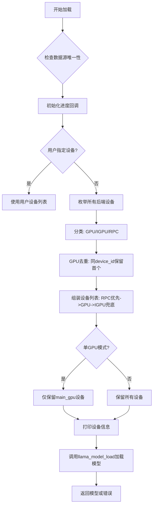
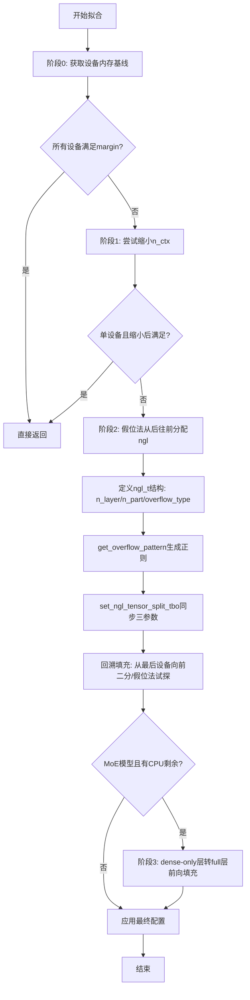

# 第24章 llama.cpp 内部工具与基础设施：精密工厂的「后勤保障部」

## 学习目标

- 理解 llama.cpp 日志系统的实现：宏家族、回调注册、可变参数处理与 format 属性校验
- 掌握 time_meas 作用域计时器的 RAII 设计思路与应用场景
- 了解字符串处理工具集（replace_all、format、llama_format_tensor_shape）的零分配优化策略
- 理解 GGUF 元数据到可读字符串的转换机制（gguf_data_to_str、gguf_kv_to_str）
- 掌握 llama_io_write_i / llama_io_read_i 抽象 I/O 接口的设计哲学与字符串序列化协议
- 了解后端能力探测（llama_supports_mmap/mlock/gpu_offload/rpc）与系统信息汇总（llama_print_system_info）的工作机制
- 掌握 llama_params_fit 自动参数拟合的整体流程与 llama_params_fit_impl 的多设备层分配策略
- 理解 llama_model_load_from_file_impl 的设备选择逻辑（RPC/GPU/IGPU 去重与排序）
- 了解 chat 模板应用接口 llama_chat_apply_template 与模型路径分片工具 llama_split_path / llama_split_prefix 的实现

## 24.1 生活类比

想象 llama.cpp 的内部基础设施是一座**精密工厂的「后勤保障部」**：
- **日志系统** = 工厂的播音室与传声筒
  - LLAMA_LOG_* 宏 = 各色话筒（普通播报、警告、事故警报、调试私密频道、续行补充）
  - llama_log_set = 客户可指定接收频道（默认走 stderr 大喇叭）
  - va_list 栈缓冲 128 字节 + 堆扩容 = 先用小型传声筒，长消息自动切换大功率喇叭
- **作用域计时器** = 工厂的自动秒表
  - 进入车间（构造）自动开始计时，离开车间（析构）自动累加到车间台账 t_acc
  - disable=true = 关闭秒表（某些车间不需要计工时）
- **字符串与格式化工具** = 工厂的「万能翻译机」
  - replace_all = 批量替换铭牌上的旧型号为新型号
  - format = 按指定模板生成报告（先测量纸张大小再裁切，避免浪费）
  - llama_format_tensor_shape = 把张量尺寸 `[4096, 4096, 1, 1]` 翻译成固定宽度的对账单
- **GGUF 元数据解码** = 工厂的「铭牌翻译官」
  - 把 GGUF 文件里的二进制键值（UINT8/INT32/FLOAT/BOOL/STRING/ARRAY）翻成人话
  - STRING 数组需要给引号与反斜杠加转义符（防止误读）
  - 嵌套数组（ARRAY of ARRAY）暂时输出 ??? 占位（防止递归死循环）
- **I/O 抽象接口** = 工厂的「万能插座」
  - llama_io_write_i / llama_io_read_i = 标准化电源接口
  - write_string 先写 4 字节长度再写内容 = 快递包裹的标准格式（先说多重，再装东西）
  - buffer/file/dummy 等不同后端都能插上同一个插座（多态）
- **设备选择与模型加载** = 工厂的「设备调度室」
  - llama_model_load_from_file_impl = 调度室主任，先挑出 RPC/GPU/IGPU 三类设备
  - 同 device_id 的 GPU 去重 = 同一厂牌不能重复登记（避免资源争抢）
  - RPC 放在列表最前 = 远程设备优先排队（减少网络传输）
  - 单 GPU 模式 = 厂长指定主 GPU（main_gpu），其他设备下放
- **自动参数拟合** = 工厂的「智能裁缝」
  - llama_params_fit = 自动量体裁衣，根据显存大小裁剪模型的层数
  - layer_fraction_t = 不同裁剪策略（只裁 FFN、保留 ATTN、保留 GATE/UP、把 MoE 溢出到系统内存）
  - 假位法（false position）= 用二分思想在「刚好放得下」和「明显放不下」之间找最佳裁剪点
  - llama_params_fit_exception = 客户要求太离谱时，裁缝礼貌拒绝并解释原因
- **系统信息汇总** = 工厂的「体检报告打印机」
  - llama_print_system_info = 体检仪，按厂家（Metal/CUDA/Vulkan）扫描并打印能力清单
  - llama_supports_mmap/mlock/gpu_offload/rpc = 给上层 CLI/Server 的「我能干啥」能力声明
- **模型路径与分片** = 工厂的「快递分拣中心」
  - llama_split_path = 给超大型模型生成编号快递单（model-00001-of-00010.gguf）
  - llama_split_prefix = 扫描快递单据，提取发件人信息（路径前缀）

就像后勤保障部不直接生产产品，但缺了它整座工厂就无法有序运转，这些基础设施就是 llama.cpp 的「无名英雄」——它们默默记录每一步操作、统计每一毫秒、翻译每一段元数据、接通每一根数据线，并智能调度每台设备、合理裁剪每件产品。

## 24.2 源码地图


## 24.3 日志系统探微：引擎的「传声筒」与「播报员」

作为底层推理引擎，llama.cpp 需要把内部状态（加载进度、量化信息、内存告警等）暴露给上层 CLI、Server 和工具。日志系统通过宏家族、回调机制、可变参数处理与编译期校验，构建了一套高性能、可扩展的日志基础设施。

### 24.3.1 LLAMA_LOG 宏家族与编译期格式校验

**llama-impl.h:1-31: LLAMA_ATTRIBUTE_FORMAT 与 LLAMA_LOG_* 宏定义**

```cpp
// 编译期格式字符串校验宏
// 在 GCC/Clang 下启用 __attribute__((format(...)))，MSVC 下留空
#ifdef __GNUC__
#    if defined(__MINGW32__) && !defined(__clang__)
#        define LLAMA_ATTRIBUTE_FORMAT(...) __attribute__((format(gnu_printf, __VA_ARGS__)))
#    else
#        define LLAMA_ATTRIBUTE_FORMAT(...) __attribute__((format(printf, __VA_ARGS__)))
#    endif
#else
#    define LLAMA_ATTRIBUTE_FORMAT(...)
#endif

// 日志宏家族：统一调用 llama_log_internal，屏蔽 va_args 与日志级别
#define LLAMA_LOG(...)       llama_log_internal(GGML_LOG_LEVEL_NONE , __VA_ARGS__)
#define LLAMA_LOG_INFO(...)  llama_log_internal(GGML_LOG_LEVEL_INFO , __VA_ARGS__)
#define LLAMA_LOG_WARN(...)  llama_log_internal(GGML_LOG_LEVEL_WARN , __VA_ARGS__)
#define LLAMA_LOG_ERROR(...) llama_log_internal(GGML_LOG_LEVEL_ERROR, __VA_ARGS__)
#define LLAMA_LOG_DEBUG(...) llama_log_internal(GGML_LOG_LEVEL_DEBUG, __VA_ARGS__)
#define LLAMA_LOG_CONT(...)  llama_log_internal(GGML_LOG_LEVEL_CONT , __VA_ARGS__)
```

**代码解释：**
这段代码定义了 llama.cpp 的日志宏体系。`LLAMA_ATTRIBUTE_FORMAT` 利用编译器属性在编译阶段校验 `printf` 格式字符串与参数匹配度，避免运行时崩溃。在 GCC/Clang 下使用 `__attribute__((format(printf, ...)))`，MinGW 特殊情况用 `gnu_printf`，MSVC 等不支持的编译器留空。六个日志宏（`LLAMA_LOG` 到 `LLAMA_LOG_CONT`）分别对应不同严重级别，统一转发给 `llama_log_internal`，实现了「宏定义分发、函数实现处理」的经典模式。

### 24.3.2 llama_logger_state/g_logger_state：日志回调状态的单例存储

**llama-impl.cpp:9-14: 全局日志状态结构体与实例**

```cpp
// 全局代码段：声明日志回调保存结构体与唯一实例
struct llama_logger_state {
    ggml_log_callback log_callback;      // 当前注册的回调函数
    void * log_callback_user_data;       // 用户透传的上下文数据
};

static llama_logger_state g_logger_state;  // 静态全局变量，唯一存储用户回调
```

**代码解释：**
`llama_logger_state` 结构体仅包含两个字段：回调函数指针与用户数据指针。`g_logger_state` 作为静态全局变量，确保进程内仅有一份日志回调状态，构成了「单例模式」的轻量级实现。

### 24.3.3 llama_log_set/llama_log_get：日志回调的对称注册与查询

**llama-impl.cpp:35-46: 回调注册与查询实现**

```cpp
void llama_log_get(ggml_log_callback * log_callback, void ** user_data) {
    ggml_log_get(log_callback, user_data);  // 直接透传到底层 GGML
}

void llama_log_set(ggml_log_callback log_callback, void * user_data) {
    ggml_log_set(log_callback, user_data);  // 同步到底层 GGML
    g_logger_state.log_callback = log_callback ? log_callback : llama_log_callback_default;
    g_logger_state.log_callback_user_data = user_data;
}
```

**代码解释：**
`llama_log_set` 是用户替换日志输出的唯一入口。它同时更新底层 GGML 的日志回调与本地 `g_logger_state`。若用户传入 `nullptr`，自动回退到默认实现 `llama_log_callback_default`，保证「永远有地方输出日志」。`llama_log_get` 提供对称的查询能力，允许上层临时保存、恢复日志回调（例如在测试或特定作用域内静默日志）。

### 24.3.4 llama_log_internal_v：栈缓冲 128 字节 + 堆自动扩容的变长参数处理

**llama-impl.cpp:48-63: 变长参数核心处理逻辑**

```cpp
static void llama_log_internal_v(ggml_log_level level, const char * format, va_list args) {
    va_list args_copy;
    va_copy(args_copy, args);                    // 复制 va_list 以便二次使用
    char buffer[128];                            // 栈上小缓冲（128 字节）
    int len = vsnprintf(buffer, 128, format, args);  // 尝试格式化
    if (len < 128) {
        // 短消息：直接用栈缓冲，零堆分配
        g_logger_state.log_callback(level, buffer, g_logger_state.log_callback_user_data);
    } else {
        // 长消息：堆分配精确大小缓冲，格式化后回调，最后释放
        char * buffer2 = new char[len + 1];
        vsnprintf(buffer2, len + 1, format, args_copy);
        buffer2[len] = 0;
        g_logger_state.log_callback(level, buffer2, g_logger_state.log_callback_user_data);
        delete[] buffer2;
    }
    va_end(args_copy);
}
```

**代码解释：**
这是日志系统的核心实现。`va_copy` 保证 `va_list` 可被两次消费。栈缓冲 `char buffer[128]` 覆盖了绝大多数短日志（如进度点 `.`、单行信息），实现「零堆分配」。超长消息（如完整模型信息打印）自动切换到堆分配，`new char[len + 1]` 精确匹配所需内存，避免浪费。

### 24.3.5 llama_log_internal：va_start/end 包装的公开入口

**llama-impl.cpp:65-71: 公开日志入口封装**

```cpp
void llama_log_internal(ggml_log_level level, const char * format, ...) {
    va_list args;
    va_start(args, format);
    llama_log_internal_v(level, format, args);
    va_end(args);
}
```

**代码解释：**
`llama_log_internal` 是宏展开后的真实调用目标，仅负责 `va_start/end` 包装，将可变参数转为 `va_list` 后转发给 `_v` 版本。

### 24.3.6 llama_log_callback_default：stderr 输出的默认回调实现

**llama-impl.cpp:73-80: 默认日志回调**

```cpp
void llama_log_callback_default(ggml_log_level level, const char * text, void * user_data) {
    (void) level; (void) user_data;  // 显式标记未使用，消除警告
    fputs(text, stderr);
    fflush(stderr);  // 立即刷新，保证实时可见
}
```

**代码解释：**
默认回调将文本直接写入 `stderr` 并强制 `fflush`，确保即使程序崩溃、缓冲区未满也能看到最后的日志。它忽略 `level` 与 `user_data`，体现「简单可靠」的设计哲学。

### 24.3.7 no_init<T>：跳过值初始化的性能包装模板

**llama-impl.h:48-53: no_init 模板定义**

```cpp
template <typename T>
struct no_init {
    T value;
    no_init() = default;  // 默认构造：不初始化 value
};
```

**代码解释：**
`no_init<T>` 是一个极简包装模板，利用 `= default` 禁止编译器生成零初始化代码。在性能敏感路径（如大数组分配、临时缓冲区）可避免不必要的 `memset` 开销。

### 24.3.8 buffer_view<T>：指针长度轻量视图

**llama-impl.h:70-76: buffer_view 结构体定义**

```cpp
template <typename T>
struct buffer_view {
    T * data = nullptr;
    size_t size = 0;

    bool has_data() const {
        return data && size > 0;
    }
};
```

**代码解释：**
`buffer_view<T>` 提供「指针 + 长度」的轻量视图语义，`has_data()` 一行代码完成非空判断，替代繁琐的 `ptr != nullptr && len > 0` 检查。

### 24.3.9 LLAMA_TENSOR_NAME_*：特殊张量名常量定义

**llama-impl.h:90-92: 特殊张量名常量**

```cpp
#define LLAMA_TENSOR_NAME_FATTN   "__fattn__"
#define LLAMA_TENSOR_NAME_FGDN_AR "__fgdn_ar__"
#define LLAMA_TENSOR_NAME_FGDN_CH "__fgdn_ch__"
```

**代码解释：**
三个常量标记特殊计算节点的输出张量名称：Flash Attention（`__fattn__`）、Gated Delta Net 的 AR 与 CH 分支。它们在计算图构建与调试打印时作为「约定俗成」的锚点。

## 24.4 作用域计时器：代码块的「秒表医生」

### 24.4.1 time_meas：RAII 作用域计时器的数据结构定义

**llama-impl.h:55-58: time_meas 类定义**

```cpp
struct time_meas {
    int64_t & t_acc;       // 外部累加器引用：析构时把耗时加到这里
    int64_t t_start_us;    // 起始时间戳（微秒），-1 表示禁用

    time_meas(int64_t & t_acc, bool disable = false);
    ~time_meas();
};
```

**代码解释：**
`time_meas` 采用经典 RAII 模式：构造时捕获「现在」，析构时计算「经过」并累加到外部引用 `t_acc`。`disable` 参数允许运行时关闭计时（如生产环境关闭性能采样），`t_start_us = -1` 作为哨兵值。

### 24.4.2 time_meas::time_meas：构造时记录起始时间或禁用标记

**llama-impl.cpp:27-27: 构造函数实现**

```cpp
time_meas::time_meas(int64_t & t_acc, bool disable)
    : t_start_us(disable ? -1 : ggml_time_us()), t_acc(t_acc) {}
```

**代码解释：**
构造函数通过初始化列表完成两件事：若 `disable` 则 `t_start_us = -1`，否则记录 `ggml_time_us()` 当前微秒时间戳；绑定外部累加器引用 `t_acc`。

### 24.4.3 time_meas::~time_meas：析构时条件累加耗时到外部引用

**llama-impl.cpp:29-34: 析构函数实现**

```cpp
time_meas::~time_meas() {
    if (t_start_us >= 0) {
        t_acc += ggml_time_us() - t_start_us;
    }
}
```

**代码解释：**
析构函数仅在 `t_start_us >= 0` 时累加差值。异常安全由 C++ 保证：栈展开时析构必然执行，因此即使作用域内抛出异常，耗时也会被正确记录。

### 24.4.4 llama_model_load：内嵌 time_meas 实现全流程自动计时

**llama.cpp:866-870: 模型加载自动计时应用**

```cpp
model.t_load_us = 0;
time_meas tm(model.t_load_us);  // 构造：开始计时
model.t_start_us = tm.t_start_us;  // 记录起始时间供外部查询

// ... 完整加载流程：load_arch -> load_hparams -> load_vocab -> load_tensors ...

return 0;  // 析构：自动累加总耗时到 model.t_load_us
```

**代码解释：**
在 `llama_model_load` 入口构造 `time_meas tm(model.t_load_us)`，整个加载流程（架构识别、超参数加载、词表加载、张量加载）的耗时自动累加到 `model.t_load_us`。`model.t_start_us` 保留起始时间戳，供外部诊断「加载何时开始」。

## 24.5 字符串处理与格式化：「瑞士军刀」级文本工具集

### 24.5.1 replace_all：Builder 模式的就地字符串替换

**llama-impl.cpp:82-99: 字符串就地替换实现**

```cpp
void replace_all(std::string & s, const std::string & search, const std::string & replace) {
    if (search.empty()) return;  // 边界保护：空 search 直接返回

    std::string builder;
    builder.reserve(s.length());  // 预留容量，减少扩容

    size_t pos = 0, last_pos = 0;
    while ((pos = s.find(search, last_pos)) != std::string::npos) {
        builder.append(s, last_pos, pos - last_pos);  // 追加未匹配段
        builder.append(replace);                       // 追加替换串
        last_pos = pos + search.length();
    }
    builder.append(s, last_pos, std::string::npos);  // 追加尾部剩余
    s = std::move(builder);  // 移动赋值，避免拷贝
}
```

**代码解释：**
采用「Builder 模式」：预分配 `builder` 容量，逐段拼接未匹配部分与替换串，最后 `move` 回原字符串。空 `search` 边界检查防止无限循环。整个过程仅一次堆分配（`builder`），性能优于多次 `std::string::replace`。

### 24.5.2 format：两次 vsnprintf 精确格式化

**llama-impl.cpp:101-115: printf 风格格式化实现**

```cpp
std::string format(const char * fmt, ...) {
    va_list ap, ap2;
    va_start(ap, fmt);
    va_copy(ap2, ap);
    int size = vsnprintf(NULL, 0, fmt, ap);  // 第一次：仅测量所需长度
    GGML_ASSERT(size >= 0 && size < INT_MAX);
    std::vector<char> buf(size + 1);         // 精确分配
    int size2 = vsnprintf(buf.data(), size + 1, fmt, ap2);  // 第二次：真实填充
    GGML_ASSERT(size2 == size);
    va_end(ap2); va_end(ap);
    return std::string(buf.data(), size);
}
```

**代码解释：**
「两次 `vsnprintf`」是 C 语言格式化的标准范式：第一次传 `NULL, 0` 获取所需字节数，第二次精确分配缓冲并填充。`va_copy` 保证参数列表可二次消费。返回 `std::string` 由移动语义优化，零拷贝。

### 24.5.3 llama_format_tensor_shape：固定宽度的张量形状格式化（双重载）

**llama-impl.cpp:117-133: 张量形状格式化两个重载**

```cpp
std::string llama_format_tensor_shape(const std::vector<int64_t> & ne) {
    char buf[256];  // 栈上固定缓冲，避免堆分配
    snprintf(buf, sizeof(buf), "%6" PRId64, ne.at(0));  // 首维 6 字符宽度
    for (size_t i = 1; i < ne.size(); i++) {
        snprintf(buf + strlen(buf), sizeof(buf) - strlen(buf), ", %6" PRId64, ne.at(i));
    }
    return buf;
}

std::string llama_format_tensor_shape(const struct ggml_tensor * t) {
    char buf[256];
    snprintf(buf, sizeof(buf), "%6" PRId64, t->ne[0]);
    for (int i = 1; i < GGML_MAX_DIMS; i++) {
        snprintf(buf + strlen(buf), sizeof(buf) - strlen(buf), ", %6" PRId64, t->ne[i]);
    }
    return buf;
}
```

**代码解释：**
两个重载分别接受 `vector<int64_t>` 与 `ggml_tensor*`，输出格式统一为 `[xxxxxx, xxxxxx, xxxxxx, xxxxxx]`（每维占 6 字符，右对齐）。栈上 `char buf[256]` 足以容纳最大维度（`GGML_MAX_DIMS=4`）的格式化结果，完全避免堆分配。

## 24.6 GGUF 元数据转字符串：模型信息的「解码翻译官」

### 24.6.1 gguf_data_to_str：基础类型分发

**llama-impl.cpp:135-148: 基础类型字符串化**

```cpp
static std::string gguf_data_to_str(enum gguf_type type, const void * data, int i) {
    switch (type) {
        case GGUF_TYPE_UINT8:   return std::to_string(((const uint8_t  *)data)[i]);
        case GGUF_TYPE_INT8:    return std::to_string(((const int8_t   *)data)[i]);
        case GGUF_TYPE_UINT16:  return std::to_string(((const uint16_t *)data)[i]);
        case GGUF_TYPE_INT16:   return std::to_string(((const int16_t  *)data)[i]);
        case GGUF_TYPE_UINT32:  return std::to_string(((const uint32_t *)data)[i]);
        case GGUF_TYPE_INT32:   return std::to_string(((const int32_t  *)data)[i]);
        case GGUF_TYPE_UINT64:  return std::to_string(((const uint64_t *)data)[i]);
        case GGUF_TYPE_INT64:   return std::to_string(((const int64_t  *)data)[i]);
        case GGUF_TYPE_FLOAT32: return std::to_string(((const float    *)data)[i]);
        case GGUF_TYPE_FLOAT64: return std::to_string(((const double   *)data)[i]);
        case GGUF_TYPE_BOOL:    return ((const int8_t *)data)[i] != 0 ? "true" : "false";
        default:                return format("unknown type %d", type);
    }
}
```

**代码解释：**
通过 `switch-case` 将 GGUF 所有标量类型（UINT8 到 FLOAT64、BOOL）分发到对应的 `std::to_string` 或布尔字面量。指针 `data` 按类型强转后取下标 `i`，支持数组元素逐个转换。未知类型回退到 `format("unknown type %d", type)`，保证不漏处理。

### 24.6.2 gguf_kv_to_str：顶层入口与 ARRAY 特殊处理

**llama-impl.cpp:150-182: GGUF KV 完整字符串化**

```cpp
std::string gguf_kv_to_str(const struct gguf_context * ctx_gguf, int i) {
    const enum gguf_type type = gguf_get_kv_type(ctx_gguf, i);

    switch (type) {
        case GGUF_TYPE_STRING:
            return gguf_get_val_str(ctx_gguf, i);  // 直接返回字符串值

        case GGUF_TYPE_ARRAY: {
            const enum gguf_type arr_type = gguf_get_arr_type(ctx_gguf, i);
            int arr_n = gguf_get_arr_n(ctx_gguf, i);
            const void * data = arr_type == GGUF_TYPE_STRING ? nullptr : gguf_get_arr_data(ctx_gguf, i);
            std::stringstream ss;
            ss << "[";
            for (int j = 0; j < arr_n; j++) {
                if (arr_type == GGUF_TYPE_STRING) {
                    std::string val = gguf_get_arr_str(ctx_gguf, i, j);
                    // 双重转义：先反斜杠，再双引号
                    replace_all(val, "\\", "\\\\");
                    replace_all(val, "\"", "\\\"");
                    ss << '"' << val << '"';
                } else if (arr_type == GGUF_TYPE_ARRAY) {
                    ss << "???";  // 嵌套数组占位，避免递归
                } else {
                    ss << gguf_data_to_str(arr_type, data, j);
                }
                if (j < arr_n - 1) ss << ", ";
            }
            ss << "]";
            return ss.str();
        }

        default:
            return gguf_data_to_str(type, gguf_get_val_data(ctx_gguf, i), 0);
    }
}
```

**代码解释：**
`gguf_kv_to_str` 是 GGUF 键值对字符串化的总入口。三种分支：
- **STRING**：直接调用 `gguf_get_val_str` 返回原始字符串。
- **ARRAY**：遍历元素。STRING 元素需「双重转义」：先 `replace_all(val, "\\", "\\\\")` 再 `replace_all(val, "\"", "\\\"")`，确保 JSON 风格可读性；嵌套 ARRAY 输出 `???` 占位，避免递归复杂度与潜在栈溢出；其他标量类型复用 `gguf_data_to_str`。
- **标量**：调用 `gguf_data_to_str` 处理单值。

## 24.7 I/O 抽象接口：序列化与反序列化的「通用插座」

### 24.7.1 llama_io_write_i：写抽象基类与纯虚契约

**llama-io.h:9-21: 写接口类定义**

```cpp
class llama_io_write_i {
public:
    llama_io_write_i() = default;
    virtual ~llama_io_write_i() = default;

    // 纯虚：写入原始字节块
    virtual void write(const void * src, size_t size) = 0;

    // 纯虚：写入张量数据（支持 offset + size 部分写入）
    virtual void write_tensor(const ggml_tensor * tensor, size_t offset, size_t size) = 0;

    // 纯虚：返回已写入总字节数
    virtual size_t n_bytes() = 0;

    // 便捷实现：字符串序列化协议（长度前缀 + 内容）
    void write_string(const std::string & str) {
        uint32_t str_size = str.size();
        write(&str_size, sizeof(str_size));  // 先写 4 字节长度
        write(str.data(), str_size);         // 再写内容字节
    }
};
```

**代码解释：**
`llama_io_write_i` 定义了三个纯虚函数，子类必须实现：`write`（原始字节）、`write_tensor`（张量数据，支持偏移与长度）、`n_bytes`（进度统计）。`write_string` 提供默认实现：**长度前缀协议**——先写 `uint32_t` 长度，再写字节内容，这是 GGUF 文件格式中字符串存储的标准编码。

### 24.7.2 llama_io_read_i：读抽象基类与对称契约

**llama-io.h:23-38: 读接口类定义**

```cpp
class llama_io_read_i {
public:
    llama_io_read_i() = default;
    virtual ~llama_io_read_i() = default;

    // 纯虚：读取 size 字节，返回内部缓冲指针（零拷贝场景）
    virtual const uint8_t * read(size_t size) = 0;

    // 纯虚：读取 size 字节并拷贝到 dst（外部缓冲场景）
    virtual void read_to(void * dst, size_t size) = 0;

    // 纯虚：返回已读取总字节数
    virtual size_t n_bytes() = 0;

    // 便捷实现：反向操作 read_string
    void read_string(std::string & str) {
        uint32_t str_size;
        read_to(&str_size, sizeof(str_size));  // 先读 4 字节长度
        str.assign((const char *) read(str_size), str_size);  // 再读内容并 assign
    }
};
```

**代码解释：**
`llama_io_read_i` 与写接口对称。`read` 返回内部缓冲指针（适合零拷贝、内存映射场景），`read_to` 拷贝到外部缓冲（适合文件读取、网络流）。`read_string` 严格遵循「长度前缀」协议：先 `read_to` 读取 `uint32_t` 长度，再 `read` 读取内容并 `assign` 到 `std::string`。

### 24.7.3 llama_io_write_i::write_string/llama_io_read_i::read_string：长度前缀序列化协议的默认实现

**llama-io.cpp:3-17: 字符串读写实现**

```cpp
void llama_io_write_i::write_string(const std::string & str) {
    uint32_t str_size = str.size();
    write(&str_size, sizeof(str_size));
    write(str.data(), str_size);
}

void llama_io_read_i::read_string(std::string & str) {
    uint32_t str_size;
    read_to(&str_size, sizeof(str_size));
    str.assign((const char *) read(str_size), str_size);
}
```

**代码解释：**
实现极其简洁，完全遵循头文件中声明的协议。`write` 与 `read` 的对称性保证了序列化/反序列化的无损往返。

## 24.8 系统信息汇总与后端能力探测：「体检报告」生成器

### 24.8.1 llama_supports_mmap/mlock/gpu_offload/rpc：四大能力查询接口的实现

**llama.cpp:831-843: 能力查询函数**

```cpp
bool llama_supports_mmap(void) {
    return llama_mmap::SUPPORTED;
}

bool llama_supports_mlock(void) {
    return llama_mlock::SUPPORTED;
}

bool llama_supports_gpu_offload(void) {
    return ggml_backend_dev_by_type(GGML_BACKEND_DEVICE_TYPE_GPU) != nullptr ||
           ggml_backend_dev_by_type(GGML_BACKEND_DEVICE_TYPE_IGPU) != nullptr ||
           llama_supports_rpc();
}

bool llama_supports_rpc(void) {
    return ggml_backend_reg_by_name("RPC") != nullptr;
}
```

**代码解释：**
四个函数提供标准化的能力声明。`llama_supports_gpu_offload` 综合判定：存在 GPU 设备、或存在 IGPU（集显）、或支持 RPC 远程推理，任一为真即返回 `true`。上层 CLI/Server 可据此决定是否启用 `--n-gpu-layers` 等参数。

### 24.8.2 llama_print_system_info：静态字符串复用与动态特性枚举的体检报告生成

**llama.cpp:1250-1275: 系统信息汇总实现**

```cpp
const char * llama_print_system_info(void) {
    static std::string s;  // 静态字符串跨调用复用
    s.clear();             // 每次调用先清空，防止累积

    for (size_t i = 0; i < ggml_backend_reg_count(); i++) {
        auto * reg = ggml_backend_reg_get(i);
        // 动态获取后端导出的 get_features 函数指针
        auto * get_features_fn = (ggml_backend_get_features_t) 
            ggml_backend_reg_get_proc_address(reg, "ggml_backend_get_features");
        if (get_features_fn) {
            ggml_backend_feature * features = get_features_fn(reg);
            s += ggml_backend_reg_name(reg);
            s += " : ";
            for (; features->name; features++) {
                s += features->name;
                s += " = ";
                s += features->value;
                s += " | ";
            }
        }
    }
    return s.c_str();
}
```

**代码解释：**
`static std::string s` 避免重复分配，`s.clear()` 保证每次调用产生全新报告。核心逻辑遍历所有注册后端（`ggml_backend_reg_count`），通过 `ggml_backend_reg_get_proc_address` **动态加载** `ggml_backend_get_features` 函数指针（而非硬链接），实现「插件化能力发现」。每个后端的特性以 `name = value | ` 格式拼接，最终返回 `Metal : feature1 = value1 | feature2 = value2 | CUDA : ...` 形式的完整报告。

## 24.9 模型加载与设备调度：「智能调度室」的多入口管理

### 24.9.1 llama_model_load：五阶段流水线加载与 RAII 自动计时

**llama.cpp:866-906: 核心加载流水线**

```cpp
static int llama_model_load(struct gguf_context * metadata, ...,
        llama_model & model, llama_model_params & params) {
    model.t_load_us = 0;
    time_meas tm(model.t_load_us);  // RAII 计时：自动累加总耗时
    model.t_start_us = tm.t_start_us;

    try {
        llama_model_loader ml(...);  // 构建加载器
        ml.print_info();

        model.load_arch(ml);      // 1. 加载架构
        model.load_hparams(ml);   // 2. 加载超参数
        model.load_vocab(ml);     // 3. 加载词表
        model.load_stats(ml);     // 4. 加载统计信息

        if (params.vocab_only) return 0;

        if (!model.load_tensors(ml)) return -2;  // 5. 加载张量（可取消）
    } catch (const std::exception & err) {
        LLAMA_LOG_ERROR("%s: error loading model: %s\n", __func__, err.what());
        return -1;
    }
    return 0;
}
```

**代码解释：**
`llama_model_load` 是核心加载流水线，**内部构造 `time_meas tm(model.t_load_us)` 实现自动计时**。五阶段加载：架构 → 超参数 → 词表 → 统计 → 张量。异常捕获统一转为错误码（-1），取消加载返回 -2。`vocab_only` 模式跳过张量加载，用于仅需词表的场景。

### 24.9.2 llama_model_load_from_file_impl：设备分类去重与优先级排序的调度核心

**llama.cpp:906-1100: 模型加载主入口与设备选择逻辑**



```cpp
// 核心设备选择逻辑节选
unsigned cur_percentage = 0;
if (params.progress_callback == NULL) {
    params.progress_callback_user_data = &cur_percentage;
    params.progress_callback = [](float progress, void * ctx) {
        unsigned * cur_percentage_p = (unsigned *) ctx;
        unsigned percentage = (unsigned) (100 * progress);
        while (percentage > *cur_percentage_p) {
            *cur_percentage_p = percentage;
            LLAMA_LOG_CONT(".");  // 使用 CONT 级别输出点
            if (percentage >= 100) LLAMA_LOG_CONT("\n");
        }
        return true;
    };
}

// 枚举设备：分类收集 RPC / GPU / IGPU
std::vector<ggml_backend_dev_t> gpus, igpus, rpc_servers;
for (size_t i = 0; i < ggml_backend_dev_count(); ++i) {
    ggml_backend_dev_t dev = ggml_backend_dev_get(i);
    switch (ggml_backend_dev_type(dev)) {
        case GGML_BACKEND_DEVICE_TYPE_GPU: {
            if (ggml_backend_reg_name(reg) == "RPC") rpc_servers.push_back(dev);
            else {
                // GPU 去重：同 device_id 只保留第一个
                auto it = std::find_if(gpus.begin(), gpus.end(), [&props](ggml_backend_dev_t d) {
                    return strcmp(props.device_id, d_props.device_id) == 0;
                });
                if (it == gpus.end()) gpus.push_back(dev);
            }
            break;
        }
        case GGML_BACKEND_DEVICE_TYPE_IGPU: igpus.push_back(dev); break;
    }
}

// 组装设备列表：RPC 优先 → GPU → IGPU（仅当无其他设备）
model->devices.insert(model->devices.begin(), rpc_servers.begin(), rpc_servers.end());
model->devices.insert(model->devices.end(), gpus.begin(), gpus.end());
if (model->devices.empty()) model->devices.insert(model->devices.end(), igpus.begin(), igpus.end());

// 单 GPU 模式过滤
if (params.split_mode == LLAMA_SPLIT_MODE_NONE) {
    if (params.main_gpu < 0) model->devices.clear();
    else {
        ggml_backend_dev_t main_gpu = model->devices[params.main_gpu];
        model->devices.clear();
        model->devices.push_back(main_gpu);
    }
}
```

**代码解释：**
设备选择遵循「RPC 优先、GPU 去重、IGPU 兜底、单 GPU 强制」四大原则：
1. **进度回调**默认输出 `.` 到 `LLAMA_LOG_CONT`，形成直观进度条。
2. **枚举所有后端设备**，按类型分桶：RPC 服务器、离散 GPU、集成 GPU。
3. **GPU 去重**：同 `device_id` 只保留第一个，避免同一物理设备被多次登记（如驱动层面多次枚举）。
4. **组装顺序**：RPC 放最前（远程优先减少网络跳数）→ 离散 GPU → 仅当完全无设备时才用 IGPU。
5. **单 GPU 模式**（`LLAMA_SPLIT_MODE_NONE`）仅保留 `main_gpu` 指定的设备，其余全部丢弃。

### 24.9.3 llama_model_init_from_user/load_from_file/load_from_splits/load_from_file_ptr：四大公开入口的委托差异

**llama.cpp:1100-1147: 四大公开加载入口**

```cpp
// 从用户元数据初始化（禁用 mmap 与 extra_bufts）
llama_model * llama_model_init_from_user(...) {
    params.use_mmap = false;
    params.use_extra_bufts = false;
    return llama_model_load_from_file_impl(metadata, ..., "", {}, nullptr, params);
}

// 旧版兼容接口
llama_model * llama_load_model_from_file(const char * path, params) {
    return llama_model_load_from_file(path, params);
}

// 从文件路径加载
llama_model * llama_model_load_from_file(const char * path, params) {
    return llama_model_load_from_file_impl(nullptr, ..., path, {}, nullptr, params);
}

// 从多分片加载
llama_model * llama_model_load_from_splits(const char ** paths, size_t n_paths, params) {
    std::vector<std::string> splits(paths, paths + n_paths);
    return llama_model_load_from_file_impl(nullptr, ..., splits.front(), splits, nullptr, params);
}

// 从 FILE* 加载（测试/嵌入式常用）
llama_model * llama_model_load_from_file_ptr(FILE * file, params) {
    return llama_model_load_from_file_impl(nullptr, ..., "", {}, file, params);
}
```

**代码解释：**
四个公开入口统一委托给 `llama_model_load_from_file_impl`，仅在数据源（路径、分片列表、文件指针、用户元数据）与初始参数（`use_mmap` 等）上差异化。

### 24.9.4 llama_model_save_to_file：模型序列化回 GGUF 文件

**llama.cpp:1147-1152: 模型保存实现**

```cpp
void llama_model_save_to_file(const struct llama_model * model, const char * path_model) {
    llama_model_saver ms(model);
    ms.add_kv_from_model();      // 导出所有 KV 元数据
    ms.add_tensors_from_model(); // 导出所有张量
    ms.save(path_model);         // 写入文件
}
```

**代码解释：**
`llama_model_save_to_file` 通过 `llama_model_saver` 将内存模型完整写回 GGUF 文件。

### 24.9.5 实用工具函数集

**llama.cpp:22-37, 1158-1220, 1867-1948: 实用函数**

```cpp
// Flash Attention 枚举转字符串
const char * llama_flash_attn_type_name(enum llama_flash_attn_type t) {
    switch (t) { case AUTO: return "auto"; case DISABLED: return "disabled"; case ENABLED: return "enabled"; }
    GGML_ABORT("fatal error");
}

// 硬编码上限
size_t llama_max_devices(void) { return 16; }
size_t llama_max_tensor_buft_overrides() { return 4096; }

// 采样链默认参数
struct llama_sampler_chain_params llama_sampler_chain_default_params() {
    return { .no_perf = true };
}

// 聊天模板应用
int32_t llama_chat_apply_template(const char * tmpl, const llama_chat_message * chat, size_t n_msg, bool add_ass, char * buf, int32_t length) {
    std::string curr_tmpl(tmpl ? tmpl : "chatml");
    auto detected = llm_chat_detect_template(curr_tmpl);
    if (detected == UNKNOWN) return -1;
    std::string formatted;
    int32_t res = llm_chat_apply_template(detected, chat_vec, formatted, add_ass);
    if (buf && length > 0) strncpy(buf, formatted.c_str(), length);
    return res;
}

// 分片路径生成：model-00001-of-00010.gguf
int32_t llama_split_path(char * split_path, size_t maxlen, const char * prefix, int32_t split_no, int32_t split_count) {
    return snprintf(split_path, maxlen, "%s-%05d-of-%05d.gguf", prefix, split_no + 1, split_count);
}

// 分片前缀提取
int32_t llama_split_prefix(char * split_prefix, size_t maxlen, const char * split_path, int32_t split_no, int32_t split_count) {
    std::string postfix = format("-%05d-of-%05d.gguf", split_no + 1, split_count);
    if (str_split_path.ends_with(postfix)) return snprintf(split_prefix, maxlen, "%.*s", (int)prefix_len, split_path);
    return 0;
}
```

**代码解释：**
这些工具函数覆盖了枚举显示、硬性上限、采样默认值、聊天模板渲染、分片命名与解析等高频需求。

## 24.10 自动参数拟合：给模型「量体裁衣」的智能算法

### 24.10.1 llama_params_fit：异常捕获与状态码映射的公共入口

**llama.cpp:800-820: 参数拟合公共入口**

```cpp
enum llama_params_fit_status llama_params_fit(...) {
    const int64_t t0_us = llama_time_us();
    llama_params_fit_status status = LLAMA_PARAMS_FIT_STATUS_SUCCESS;
    try {
        llama_params_fit_impl(...);
        LLAMA_LOG_INFO("%s: successfully fit params to free device memory\n", __func__);
    } catch (const llama_params_fit_exception & e) {
        LLAMA_LOG_WARN("%s: failed to fit params: %s\n", __func__, e.what());
        status = LLAMA_PARAMS_FIT_STATUS_FAILURE;
    } catch (const std::runtime_error & e) {
        LLAMA_LOG_ERROR("%s: error while fitting: %s\n", __func__, e.what());
        status = LLAMA_PARAMS_FIT_STATUS_ERROR;
    }
    LLAMA_LOG_INFO("%s: fitting took %.2f seconds\n", __func__, (llama_time_us() - t0_us) * 1e-6);
    return status;
}
```

**代码解释：**
`llama_params_fit` 计时调用 `llama_params_fit_impl`，捕获两类异常：`llama_params_fit_exception`（用户参数冲突、缓冲不足等预期内失败）返回 `FAILURE`；`std::runtime_error`（内存不足、后端错误等意外）返回 `ERROR`。成功返回 `SUCCESS`。

### 24.10.2 llama_params_fit_impl：三阶段拟合流程与假位法层分配核心算法

**llama.cpp:87-472: 核心拟合算法实现**



```cpp
static void llama_params_fit_impl(...) {
    // --- 阶段 0：获取设备内存基线 ---
    dmds_t dmds_full = llama_get_device_memory_data(...);  // 加载模型统计内存
    // 计算每设备 projected_free = free - used
    // 若全部满足 margin 直接返回

    // --- 阶段 1：尝试缩小 n_ctx 释放内存 ---
    if (global_surplus < 0 && cparams->n_ctx 可调) {
        减小 n_ctx 直到满足或达 n_ctx_min;
        若单设备且缩小后满足则返回;
    }

    // --- 阶段 2：假位法从后往前分配 ngl ---
    // 定义 ngl_t { n_layer, n_part, overflow_type }
    // overflow_type: ATTN/UP/GATE/MOE 四种溢出策略
    // get_overflow_pattern 生成 tensor_buft_overrides 正则
    // set_ngl_tensor_split_tbo 同时设置 n_gpu_layers / tensor_split / overrides

    // 回溯填充：从最后一台设备向前，二分/假位法试探每层内存占用
    for (int id = nd - 1; id >= 0; id--) {
        // ngl_per_device_high = 全给该设备
        // get_memory_for_layers 试加载测内存
        // 若超 target，假位法插值 step_size 逼近
    }

    // --- 阶段 3：MoE 特殊处理（仅当有剩余 CPU 内存）---
    if (hp_nex > 0 && global_surplus_cpu_moe > 0) {
        // 将 dense-only 层转为 full 层，前向填充
        // 尝试 LAYER_FRACTION_UP/GATE/ATTN 三级溢出到下一设备或系统内存
    }

    set_ngl_tensor_split_tbo(ngl_per_device, overflow_bufts, *mparams);
}
```

**代码解释：**
算法分三阶段：
1. **基线检查**：`llama_get_device_memory_data` 临时加载模型，统计各设备 `model/context/compute` 内存。若 `projected_free >= margin` 全满足，直接返回。
2. **上下文缩减**：若总内存不足且用户未固定 `n_ctx`，按比例缩小 `n_ctx` 释放 KV Cache 内存。
3. **假位法层分配**：从最后一台设备向前，维护 `low`（当前分配）与 `high`（全给该设备）两个边界，通过 `get_memory_for_layers` 试加载测量内存，用线性插值 `step_size = delta * (target - mem_low) / (mem_high - mem_low)` 快速逼近最优层数。`overflow_type` 控制部分层的溢出策略：
   - `LAYER_FRACTION_MOE`：仅 MoE 专家权重溢出到 CPU
   - `LAYER_FRACTION_UP`：gate+up 投影溢出
   - `LAYER_FRACTION_GATE`：仅 gate 投影溢出
   - `LAYER_FRACTION_ATTN`：注意力权重溢出（最激进）

### 24.10.3 llama_get_device_memory_data/llama_device_memory_data：设备内存基线采集与三段式分解结构

**llama.cpp:33-105, 40-44: 内存数据采集与结构定义**

```cpp
struct llama_device_memory_data {
    size_t free = 0;           // 设备空闲内存
    size_t total = 0;          // 设备总内存
    llama_memory_breakdown_data mb;  // model/context/compute 三段分解
};

static std::vector<llama_device_memory_data> llama_get_device_memory_data(...) {
    // 1. 备份日志回调，设置临时级别
    // 2. 构造 no_alloc=true, use_mmap=false 的模型参数
    // 3. 加载模型 + 创建上下文
    // 4. 调用 ctx->memory_breakdown() 获取每 buft 的内存分解
    // 5. 聚合到各设备的 mb.{model,context,compute}
    // 6. 查询 ggml_backend_dev_memory 获取 free/total
    // 7. 返回设备列表、总层数、训练上下文、专家数
}
```

**代码解释：**
`llama_device_memory_data` 将设备内存视图标准化：`free/total` 来自后端查询，`mb` 来自上下文的 `memory_breakdown()`，三段式分解（模型权重、KV Cache 上下文、计算缓冲）让拟合算法能精准知道「哪部分占内存」。

### 24.10.4 layer_fraction_t/get_overflow_pattern：四级溢出策略枚举与正则模式生成

**llama.cpp:139-180: 溢出策略枚举与正则生成**

```cpp
enum layer_fraction_t {
    LAYER_FRACTION_ATTN,  // 保留 attn，溢出 ffn_(gate|up|down)
    LAYER_FRACTION_UP,    // 保留 attn+up，溢出 ffn_(gate|gate_up|down)
    LAYER_FRACTION_GATE,  // 保留 attn+up+gate，溢出 ffn_down
    LAYER_FRACTION_MOE    // 仅溢出 MoE 专家张量 (ffn_*_exps)
};

auto get_overflow_pattern = [&](size_t il, layer_fraction_t lf) -> const char * {
    static std::array<std::string, 1000> patterns[4];  // 缓存正则
    switch (lf) {
        case LAYER_FRACTION_ATTN: pattern = "blk\\\\." + to_string(il) + "\\\\.ffn_(gate|up|gate_up|down).*";
        case LAYER_FRACTION_UP:   pattern = "blk\\\\." + to_string(il) + "\\\\.ffn_(gate|gate_up|down).*";
        case LAYER_FRACTION_GATE: pattern = "blk\\\\." + to_string(il) + "\\\\.ffn_down.*";
        case LAYER_FRACTION_MOE:  pattern = "blk\\\\." + to_string(il) + "\\\\.ffn_(up|down|gate_up|gate)_(ch|)exps";
    }
    return patterns[lf][il].c_str();
};
```

**代码解释：**
`layer_fraction_t` 定义了四级「溢出颗粒度」。`get_overflow_pattern` 生成正则表达式匹配张量名称（如 `blk.12.ffn_gate_exps`），配合 `tensor_buft_overrides` 将匹配张量重定向到 CPU 缓冲区。静态 `array<string,1000>` 缓存避免重复构造正则字符串。

### 24.10.5 set_ngl_tensor_split_tbo/get_memory_for_layers：三参数同步设置与试加载内存测量工具函数

**llama.cpp:180-260: 配置同步与试加载工具**

```cpp
auto set_ngl_tensor_split_tbo = [&](ngl_per_device, overflow_bufts, mparams) {
    mparams.n_gpu_layers = sum(n_layer);
    tensor_split[id] = n_layer;  // 按层数比例分片
    // 为每个部分层生成 overrides：第 1 层用配置的 overflow_type，后续层强制 MOE
    for (il = il0; il < il0 + n_part; il++) {
        tensor_buft_overrides[itbo].pattern = get_overflow_pattern(il, il==il0 ? overflow_type : LAYER_FRACTION_MOE);
        tensor_buft_overrides[itbo].buft = (il==il0) ? overflow_bufts[id] : ggml_backend_cpu_buffer_type();
    }
};

auto get_memory_for_layers = [&](func_name, ngl_per_device, overflow_bufts) -> vector<int64_t> {
    llama_model_params copy = *mparams;
    set_ngl_tensor_split_tbo(ngl_per_device, overflow_bufts, copy);
    dmds_t dmd_nl = llama_get_device_memory_data(path_model, &copy, cparams, ...);
    return { dmd_nl[id].mb.total() for each device };
};
```

**代码解释：**
`set_ngl_tensor_split_tbo` 一次性同步三个输出参数：`n_gpu_layers`（总层数）、`tensor_split`（按层数比例）、`tensor_buft_overrides`（部分层溢出正则）。`get_memory_for_layers` 封装「应用配置 → 试加载 → 读内存」的完整流程，作为假位法迭代的核心子程序。

### 24.10.6 llama_params_fit_impl（MoE 阶段）：global_surplus_cpu_moe 桥梁与 dense-only 层前向填充

**llama.cpp:260-320, 472-715: MoE 特殊处理逻辑**

```cpp
// 预检：把所有 MoE 张量移到 CPU，测量剩余显存
if (hp_nex > 0) {
    tensor_buft_overrides[0] = { "blk\\\\.\\\\d+\\\\.ffn_(up|down|gate_up|gate)_(ch|)exps", cpu_buft };
    tensor_buft_overrides[1] = { nullptr, nullptr };
    mparams->tensor_buft_overrides = tensor_buft_overrides;
    LLAMA_LOG_DEBUG("%s: getting device memory data with all MoE tensors moved to system memory:\n", __func__);
    const dmds_t dmds_cpu_moe = llama_get_device_memory_data(
        path_model, mparams, cparams, devs, hp_ngl, hp_nct, hp_nex, log_level);
    for (size_t id = 0; id < nd; id++) {
        global_surplus_cpu_moe += dmds_cpu_moe[id].free;
        global_surplus_cpu_moe -= int64_t(dmds_cpu_moe[id].mb.total()) + margins[id];
    }
    if (global_surplus_cpu_moe > 0) {
        LLAMA_LOG_INFO("%s: with only dense weights in device memory there is a total surplus of %" PRId64 " MiB\n",
            __func__, global_surplus_cpu_moe/MiB);
    } else {
        LLAMA_LOG_INFO("%s: with only dense weights in device memory there is still a total deficit of %" PRId64 " MiB\n",
            __func__, -global_surplus_cpu_moe/MiB);
    }
    tensor_buft_overrides[0] = { nullptr, nullptr };
    mparams->tensor_buft_overrides = tensor_buft_overrides;
}

// 阶段 4：dense-only 层转 full 层，前向填充
if (hp_nex > 0 && global_surplus_cpu_moe > 0) {
    for (size_t id = 0; id <= id_dense_start && id_dense_start < nd; id++) {
        // 尝试把后续设备的 dense-only 层「升级」为 full 层放到当前设备
        // 依次尝试 UP/GATE/ATTN 三级溢出到下一设备
    }
}
```

**代码解释：**
`global_surplus_cpu_moe` 是关键桥梁：它衡量「把所有 MoE 专家权重卸载到 CPU 后，显存还剩多少」。若为正，说明稠密权重完全可以装进显存，算法进入阶段 4，将原本只放稠密权重的 `dense-only` 层转为 `full` 层（含注意力+FFN），并尝试用 `UP/GATE/ATTN` 三级策略把部分 FFN 子模块溢出到下一设备或系统内存，最大化显存利用率。

## 24.11 设计中的取舍

**为什么日志系统不用 spdlog 等成熟库？**
llama.cpp 追求「零依赖、单文件可运行」。引入 spdlog 会增加构建复杂度、二进制体积与编译时间。自研的 100 行日志系统（宏 + 回调 + 栈缓冲）覆盖了核心需求：分级、可替换回调、编译期格式校验、零分配短路径，且无任何外部依赖。

**为什么 time_meas 不用 std::chrono？**
`ggml_time_us()` 封装了平台相关的高精度计时（Windows `QueryPerformanceCounter`、Linux `clock_gettime`、macOS `mach_absolute_time`）。`time_meas` 直接复用 GGML 的统一时间源，避免引入 `<chrono>` 头文件与类型转换开销，且 `int64_t` 微秒精度足以覆盖所有性能分析场景。

**为什么 I/O 接口不直接用 std::iostream？**
`llama_io_write_i/read_i` 面向「二进制序列化」而非文本流。`std::iostream` 格式化开销大、状态管理复杂、难以支持零拷贝（`read` 返回内部指针）与内存映射。自定义接口仅 4 个纯虚函数，却能统一支撑 `file`（文件）、`buffer`（内存）、`dummy`（测试）、`mmap`（零拷贝）等完全不同的后端。

**为什么 llama_params_fit 用假位法而非二分法？**
假位法利用「内存随层数近似线性增长」的特性，用线性插值直接跳向接近目标的层数，通常 2-3 次迭代即可收敛。二分法每次只能减半搜索空间，需要 log₂(N) 次试加载。对于 80+ 层的大模型，假位法能节省数十次昂贵的「加载模型→测内存」往返。

**为什么 MoE 场景要先把所有专家权重移到 CPU 再测？**
MoE 专家权重（`ffn_*_exps`）体积巨大且稀疏激活。若直接参与假位法迭代，每次试加载都要搬运海量专家张量，极其缓慢。预检阶段一次性将所有 MoE 张量卸载到 CPU，测得「纯稠密权重」的显存占用基线，后续迭代仅操作稠密层，加速度数量级。

## 24.12 动手练习

### 24.12.1 练习 1：阅读 llama.cpp 日志系统的实现
阅读 `src/llama-impl.h` 第 18-31 行与 `src/llama-impl.cpp` 第 30-73 行，理解日志系统：
1. `LLAMA_LOG_INFO` 宏的展开过程
2. `llama_log_internal_v` 中栈缓冲 128 字节的作用
3. `g_logger_state` 全局变量的角色
4. `llama_log_callback_default` 的默认行为

回答问题：
- 为什么日志宏使用 `__attribute__((format))` 而不是手动校验？
- 当格式化后的消息长度超过 128 字节时，代码如何处理？这种设计的优势是什么？
- `llama_log_set` 第二个参数 `user_data` 的作用是什么？
- `llama_log_get` 与 `llama_log_set` 的对称性如何体现？

### 24.12.2 练习 2：分析 time_meas 的 RAII 计时模式
阅读 `src/llama-impl.h` 第 49-58 行与 `src/llama-impl.cpp` 第 21-28 行，理解 time_meas：
1. 构造函数中的 `t_start_us(disable ? -1 : ggml_time_us())` 三元表达式
2. 析构函数中 `if (t_start_us >= 0)` 的条件判断
3. 在 `src/llama.cpp` 中 `llama_model_load` 函数中的 time_meas 应用

回答问题：
- 为什么 `disable=true` 时要把 `t_start_us` 设为 -1 而不是 0？
- 如果在 time_meas 作用域内发生异常，析构函数是否仍会被调用？
- 在 `llama_model_load` 中，`time_meas tm(model.t_load_us)` 这一行的语义是什么？它会把耗时记录到哪个成员变量？
- 为什么需要 `t_start_us` 作为成员变量保存？

### 24.12.3 练习 3：理解 GGUF 元数据的字符串化
阅读 `src/llama-impl.cpp` 第 124-175 行，理解 GGUF 元数据转换：
1. `gguf_data_to_str` 中的 switch-case 分发
2. `gguf_kv_to_str` 对 STRING / ARRAY / 默认类型的三种处理
3. STRING 数组元素中 `replace_all(val, "\\", "\\\\")` 与 `replace_all(val, "\"", "\\\"")` 的双重转义
4. 嵌套 ARRAY 输出 "???" 占位的考量

回答问题：
- 为什么 STRING 元素需要先转义反斜杠 `"\\"` 再转义引号 `"\""`？两者顺序能否颠倒？
- `gguf_get_val_str` 与 `gguf_get_arr_data` 在 STRING 类型上的返回差异是什么？
- 如果未来要支持 ARRAY of ARRAY，代码架构应如何改造（递归 vs 扁平化）？

### 24.12.4 练习 4：I/O 抽象接口的设计分析
阅读 `src/llama-io.h` 第 10-34 行与 `src/llama-io.cpp` 第 1-14 行，理解 llama_io 抽象：
1. `llama_io_write_i` 三个纯虚函数 `write` / `write_tensor` / `n_bytes` 的语义
2. `write_string` 的两步协议：先写 `uint32_t str_size` 再写字节
3. `write_tensor` 相比 `write` 多出 `offset + size` 参数的设计意图
4. `llama_io_read_i` 与 `llama_io_write_i` 的对称关系
5. `read` 与 `read_to` 的语义差异（返回指针 vs 拷贝到 dst）

回答问题：
- 为什么 `write_tensor` 需要 `offset` 与 `size` 参数，而 `write` 不需要？
- `n_bytes()` 返回「已写入/已读取字节数」对上层调用者有什么价值？
- 通过这种抽象，理论上可以支持哪些不同的 I/O 后端（请列出至少 3 种）？
- `read` 与 `read_to` 各适用于什么场景？

### 24.12.5 练习 5：后端能力探测的系统阅读
阅读 `src/llama.cpp` 第 1054-1066 行的能力查询函数与第 1163-1183 行的 `llama_print_system_info`：
1. `llama_supports_gpu_offload` 综合检查三类设备的逻辑
2. `llama_print_system_info` 中 `static std::string s` 的跨调用复用
3. `ggml_backend_reg_get_proc_address` 动态获取 `ggml_backend_get_features` 的作用

回答问题：
- 为什么 `llama_supports_gpu_offload` 要把 RPC 也算作 GPU 卸载支持？
- `llama_print_system_info` 中为什么用 `s.clear()` 而不是每次新声明？
- 如果某个后端没有导出 `ggml_backend_get_features` 函数指针，代码会发生什么？

### 24.12.6 练习 6：设备选择与多入口模型加载
阅读 `src/llama.cpp` 中 `llama_model_load_from_file_impl`（约 1250 行起）的设备选择逻辑：
1. 默认进度回调的实现（progress_callback 的 lambda 闭包）
2. RPC/GPU/IGPU 三类设备的分类与排序
3. 同 device_id 的 GPU 去重逻辑
4. 单 GPU 模式 (LLAMA_SPLIT_MODE_NONE) 下 `main_gpu` 的处理
5. 各加载入口（file / splits / file_ptr / from_user）的差异

回答问题：
- 为什么 RPC 服务器要放在设备列表的最前面？
- 集显 (IGPU) 在什么情况下会被加入设备列表？
- `llama_model_init_from_user` 为什么强制关闭 `use_mmap` 与 `use_extra_bufts`？
- 比较 `llama_model_load_from_file` 与 `llama_model_load_from_splits` 在 splits 处理上的区别。

### 24.12.7 练习 7：llama_params_fit 自动参数拟合算法
阅读 `src/llama.cpp` 中 `llama_params_fit_impl` 的完整实现（约 180-935 行）：
1. `layer_fraction_t` 枚举与四种溢出策略
2. `get_overflow_pattern` 静态模式生成
3. `set_ngl_tensor_split_tbo` 工具函数如何同时设置 n_gpu_layers / tensor_split / overrides
4. 假位法（false position）迭代过程
5. 步骤 4：MoE 场景下的反向稠密层→满层转换

回答问题：
- 为什么第一部分层可以使用 ATTN/UP/GATE 三种溢出策略，而后续层只允许 MOE？
- 当模型是 MoE 时为什么要把所有 MoE 张量先移到系统内存再计算？
- `global_surplus_cpu_moe` 这个全局剩余量代表什么？它在步骤 3 与步骤 4 之间起什么连接作用？
- `ngl_per_device_high[id].overflow_type = LAYER_FRACTION_MOE` 为什么不能用于第一个部分层？

## 24.13 本章小结

这一章中我们学习了 llama.cpp 内部基础设施的核心组件。首先深入剖析了日志系统：从 `LLAMA_ATTRIBUTE_FORMAT` 编译期校验、六大日志宏家族分发、到 `llama_logger_state` 全局单例、`llama_log_set/get` 对称注册查询、以及 `llama_log_internal_v` 栈缓冲 128 字节 + 堆扩容的变长参数优雅处理。其次掌握了 `time_meas` RAII 计时器的构造/析构语义与 `llama_model_load` 自动计时实战。接着探讨了字符串工具集：`replace_all` 的 Builder 模式就地替换、`format` 两次 `vsnprintf` 精确格式化、`llama_format_tensor_shape` 固定宽度张量形状输出。随后解读了 GGUF 元数据字符串化：`gguf_data_to_str` 标量分发、`gguf_kv_to_str` STRING/ARRAY/标量三分支与双重转义机制。然后分析了 I/O 抽象接口：`llama_io_write_i/read_i` 纯虚函数契约、`write_string/read_string` 长度前缀协议、`write_tensor` 的 offset+size 部分写入设计。再然后阅读了后端能力探测与系统信息汇总：四大 `llama_supports_*` 查询、`llama_print_system_info` 静态字符串复用与动态 `get_proc_address` 特性枚举。最后详细拆解了模型加载多入口架构与设备调度策略（RPC 优先、GPU 去重、IGPU 兜底、单 GPU 强制），以及自动参数拟合 `llama_params_fit` 的三阶段流程（基线检查、上下文缩减、假位法层分配）与 MoE 特殊处理（`global_surplus_cpu_moe` 桥梁、dense-only→full 层转换、三级溢出策略）。

本章我们一起学习了以下概念：

| 概念 | 解释 |
|------|------|
| LLAMA_LOG_* 宏家族 | 五个级别的日志宏统一调用 llama_log_internal，屏蔽 va_args |
| LLAMA_ATTRIBUTE_FORMAT | 编译期校验 printf 格式字符串，避免运行时崩溃 |
| llama_logger_state | 全局日志状态保存结构（回调指针 + user_data） |
| g_logger_state | 静态全局实例，唯一存储用户回调 |
| llama_log_set / g_logger_state | 全局日志回调注册，支持用户替换默认 stderr 输出 |
| llama_log_get | 查询当前全局日志回调及用户数据 |
| llama_log_internal_v | 变长参数处理：栈缓冲 128 字节 + 堆自动扩容，长消息不丢失 |
| llama_log_internal | 公开入口，va_start/end 包装并调用 llama_log_internal_v |
| llama_log_callback_default | 默认日志回写：将内容写入 stderr 并立即 fflush |
| time_meas RAII 计时器 | 构造记录 ggml_time_us()，析构累加差值到 t_acc，disable 模式可关闭 |
| time_meas::time_meas | 构造函数，初始化 t_start_us 为 -1（disable）或 ggml_time_us() |
| time_meas::~time_meas | 析构函数，条件累加差值到 t_acc |
| no_init<T> | 跳过值初始化的包装模板，用于性能敏感路径 |
| no_init<T>::no_init | 默认构造，包装裸字段 |
| buffer_view<T> | 持有指针+长度的轻量视图，含 has_data 判空 |
| buffer_view<T>::has_data | 判空辅助：data 非空且 size>0 |
| replace_all | std::string + builder 模式实现就地字符串替换，空 search 边界保护 |
| format | 两次 vsnprintf 精确无浪费格式化，先测长度再分配填充 |
| llama_format_tensor_shape | 两种重载：vector<int64_t> 与 ggml_tensor*，输出 `%6d` 对齐 |
| gguf_data_to_str | switch-case 分发 GGUF 基本类型到 std::to_string 或 "true"/"false" |
| gguf_kv_to_str | 顶层入口：STRING 直读、ARRAY 遍历元素、STRING 元素加引号与反斜杠转义 |
| llama_io_write_i | 抽象基类，三个纯虚函数 + write_string 默认实现 |
| llama_io_write_i::llama_io_write_i | 默认构造 |
| llama_io_write_i::~llama_io_write_i | 虚析构保证子类正确释放 |
| llama_io_write_i::write | 纯虚函数，写入 size 字节原始数据 |
| llama_io_write_i::write_tensor | 纯虚函数，写张量（offset + size 支持部分写入） |
| llama_io_write_i::n_bytes | 纯虚函数，返回已写入字节数 |
| llama_io_write_i::write_string | 便捷实现：先写 uint32_t 长度，再写字节内容 |
| llama_io_read_i | 抽象基类，三个纯虚函数 + read_string 默认实现 |
| llama_io_read_i::llama_io_read_i | 默认构造 |
| llama_io_read_i::~llama_io_read_i | 虚析构保证子类正确释放 |
| llama_io_read_i::read | 纯虚函数，返回 size 字节指针 |
| llama_io_read_i::read_to | 纯虚函数，拷贝 size 字节到 dst |
| llama_io_read_i::n_bytes | 纯虚函数，返回已读取字节数 |
| llama_io_read_i::read_string | 便捷实现：读取 uint32_t + assign 字节 |
| write_string / read_string 协议 | 先 4 字节 uint32_t 长度，再原始字节；read 反向 assign |
| write_tensor 特殊性 | 相比 write 多 offset + size 参数，支持 GGUF 张量数据按需写入 |
| llama_supports_* 系列 | 能力声明接口：mmap/mlock/gpu_offload/rpc，返回布尔 |
| llama_supports_gpu_offload | 综合 GPU + IGPU + RPC 三类设备的可用性判定 |
| llama_print_system_info | 静态 std::string 跨调用复用，动态获取后端 get_features 拼接报告 |
| ggml_backend_reg_get_proc_address | 运行时动态加载后端函数指针，避免硬链接依赖 |
| __main__ (llama-impl.cpp) | 全局代码：声明 llama_logger_state 结构体和 g_logger_state 实例 |
| llama_model_load | 内部包装 time_meas，自动累加加载耗时到 model.t_load_us |
| llama_model_load_from_file_impl | 模型加载总入口：默认进度回调 + RPC/GPU/IGPU 设备分类与去重 + 单 GPU 模式过滤 |
| llama_model_init_from_user | 从已有 GGUF 元数据初始化模型，禁用 mmap 与 extra_bufts |
| llama_load_model_from_file | 旧版兼容接口，包装 llama_model_load_from_file |
| llama_model_load_from_splits | 从多分片路径列表加载 GGUF 模型 |
| llama_model_load_from_file_ptr | 从已打开的 FILE* 句柄加载模型（常用于测试/嵌入式） |
| llama_model_save_to_file | 通过 llama_model_saver 把模型写回 GGUF 文件 |
| llama_flash_attn_type_name | 把 flash attention 枚举映射为字符串（auto/disabled/enabled） |
| llama_max_devices | 硬编码最大设备数 16 |
| llama_max_tensor_buft_overrides | 硬编码最大张量 buffer type 覆盖数 4096 |
| llama_sampler_chain_default_params | 采样链默认参数：no_perf=true（不收集性能统计） |
| llama_chat_apply_template | C 接口：检测 chat 模板并把消息列表渲染成字符串 |
| llama_split_path / llama_split_prefix | 生成分片路径（%s-%05d-of-%05d.gguf）与提取前缀 |
| llama_params_fit | 根据显存自动调整 n_gpu_layers / tensor_split / tensor_buft_overrides 的公共入口 |
| llama_params_fit_impl | 三步走：检查现状 → 缩小上下文 → 用假位法从后往前分配层 |
| llama_get_device_memory_data | 临时加载模型并枚举各设备的 model/context/compute 内存细分 |
| llama_device_memory_data | 设备内存 + 模型/上下文/计算分解结构体 |
| layer_fraction_t | 层分数枚举：ATTN/UP/GATE/MOE，决定溢出到系统内存的张量子集 |
| llama_params_fit_exception | 参数拟合异常类：用户已设置参数或 buffer 不够时抛出 |

下一章中，我们将学习模型对象与计算图构造 —— 推理引擎的"心脏"，深入了解 llama_model 类如何加载超参数、词汇表、权重张量，并在不同后端上构建计算图（GGML graph）。


