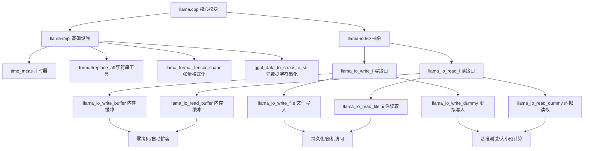
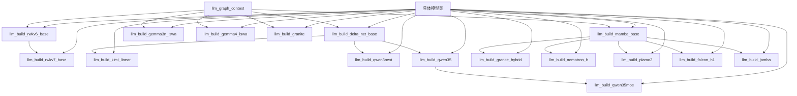
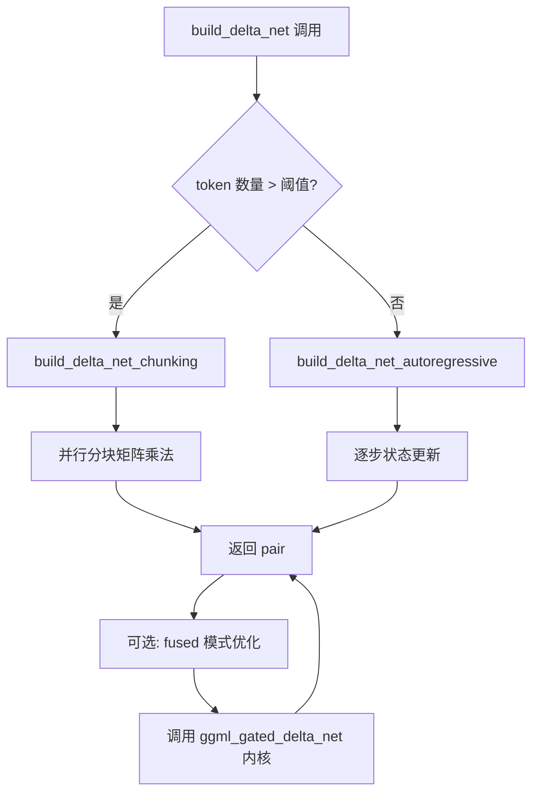
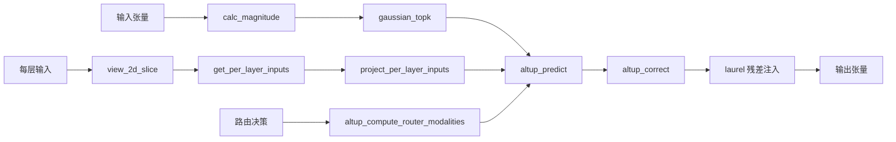

# 第25章 基础设施与模型图构建基类 —— llama.cpp 的「后勤保障部」与「公共模具车间」

## 学习目标

- 理解 llama.cpp 内部基础设施模块（llama-impl、llama-io）的职责边界
- 掌握字符串格式化、张量形状描述、GGUF 元数据转字符串等辅助函数
- 熟悉作用域计时器 time_meas 的使用模式与实现机制
- 能够阅读并理解 I/O 抽象接口（llama_io_write_i / llama_io_read_i）的设计
- 了解系统诊断信息的输出范围
- 理解 models.h 中模型图构建基类（Mamba/DeltaNet/RWKV/AltUp 等）的设计意图与方法职责
- 掌握线性注意力（DeltaNet/KDA）三种实现模式（chunking/autoregressive/fused）的适用场景
- 能够阅读并修改基类方法以支持新模型架构

## 25.1 生活类比

想象 llama.cpp 的源码世界是一座庞大的推理工厂，那么 `src/llama-impl.*` 与 `src/llama-io.*` 就是这座工厂的「后勤保障部门」：**time_meas** = 工厂车间墙上的「计时秒表」，每道工序开始时按一下、结束时再按一下，自动算出耗时；**format / replace_all** = 工厂的「万能文本胶带」，把零散的零件名、张量名拼接成统一格式；**llama_format_tensor_shape** = 工厂的「零件铭牌打印机」，把 [1024, 4096] 这种干巴巴的数字变成「[1024, 4096] (f16)」这样人类可读的标签；**gguf_data_to_str / gguf_kv_to_str** = 工厂的「说明书翻译官」，把二进制 GGUF 元数据翻译成人类可读的字符串；**llama_io_write_i / llama_io_read_i** = 工厂的「集装箱装卸平台」，抽象出统一的读写接口，让内存、文件、虚拟缓冲区都能用同一种方式搬运。就像工厂可以没有后勤部门勉强开工，但有了它们才能高效协同、稳定运行；llama.cpp 缺了这些基础设施模块也能跑，但有了它们才能优雅地日志、可移植地序列化、准确地诊断性能。

而 `src/models/models.h` 中的基类则是工厂的「公共模具车间」：**llm_build_mamba_base** = 状态空间模型的「标准冲压机」，把 Mamba/Mamba2 的卷积+扫描压成统一形状，供 Falcon-H1、Nemotron-H、Granite-Hybrid、Jamba、Plamo2 复用；**llm_build_delta_net_base** = 线性注意力的「三档变速器」（chunking / autoregressive / fused），根据 token 数自动换挡，支撑 Qwen3Next、Qwen3.5、Kimi-Linear；**llm_build_rwkv6_base / rwkv7_base** = RWKV 的「时间混合双引擎」（channel_mix + time_mix），RWKV7 额外增加 first_layer_value 参数处理首层值；**build_qkvz** = Qwen3 系列的「张量分拣机」，把 QKV 与 z 拆成对，配合 build_norm_gated 实现门控归一化；**llm_build_gemma3n_iswa** = AltUp 的「多通道调度台」，管理预测（altup_predict）、激活（gaussian_topk）、修正（altup_correct）三条流水线，外加 Laurel 残差与每层输入投影；**llm_build_granite(_hybrid)** = Granite 系列的「残差缩放器」，在注意力与 FFN 中统一注入缩放因子；**llm_build_plamo2** = Plamo2 的「混合架构演示器」，展示 Mamba+Attention 混合的另一种实现范式。就像工厂不会为每个产品重新设计螺丝刀，这些基类让数十种模型避免了「重复造轮子」——新模型只需继承基类、覆写特定方法，就能快速接入推理引擎。

## 25.2 源码地图

src/llama-impl.h
├── 日志基础设施
│   ├── LLAMA_LOG_* 系列宏（NONE/INFO/WARN/ERROR/DEBUG/CONT）
│   ├── llama_log_internal() —— 公共日志入口
│   ├── llama_log_callback_default() —— 默认回调（输出到 stderr）
│   └── g_logger_state —— 全局日志状态（回调函数 + 用户数据）
├── 模板工具
│   ├── no_init<T> —— 不初始化值的模板结构（避免不必要的零初始化开销）
│   └── buffer_view<T> —— 轻量缓冲区视图（data 指针 + size，含 has_data() 判断）
├── 时间获取
│   └── ggml_time_us() —— 底层时间获取（跨平台封装）
├── 作用域计时器
│   ├── time_meas 类 —— RAII 风格作用域计时
│   ├── time_meas::reset() / get() / to_string()
├── 字符串与格式化
│   ├── format() —— 安全的 printf 风格格式化（实现见 llama-impl.cpp）
│   ├── replace_all() —— 字符串全局替换（实现见 llama-impl.cpp）
│   ├── string_split() —— 字符串分隔拆分
│   ├── string_join() —— 字符串拼接
│   └── string_equals() / string_starts_with() 等判断
├── 数值与位操作
│   ├── fp16_to_fp32() / fp32_to_fp16()
│   ├── swap_bytes() —— 字节序翻转
│   └── align_to() —— 字节对齐
└── 杂项工具
    ├── LLAMA_MAX_N_THREADS 等常量
    ├── debug_prints 类与 LOG_DBG 宏
    └── LLAMA_ASSERT / LLAMA_ASSERT_FALSE 断言

src/llama-impl.cpp
├── 日志实现
│   ├── llama_log_get() —— 获取当前日志回调
│   ├── llama_log_set() —— 设置日志回调（含默认回退）
│   ├── llama_log_internal_v() —— 内部 va_list 版本（128 字节栈缓冲 + 长消息动态分配）
│   ├── llama_log_internal() —— 公共入口，转发到 llama_log_internal_v
│   └── llama_log_callback_default() —— 默认回调：fputs + fflush 到 stderr
├── 计时器实现
│   ├── time_meas::reset()
│   ├── time_meas::get() —— 返回毫秒数
│   └── time_meas::to_string() —— 返回可读字符串
├── 字符串工具实现
│   ├── format() 的 vsnprintf 封装
│   ├── replace_all() 的遍历替换
│   ├── string_split() 的分隔符解析
│   └── llama_format_tensor_shape() 的形状+类型组合
├── GGUF 数据字符串化
│   ├── fmt_data_type() —— GGUF 类型名格式化
│   ├── fmt_arr_data_type() —— 数组类型格式化
│   ├── gguf_data_to_str() —— 标量值格式化
│   └── gguf_kv_to_str() —— KV 对格式化
└── 系统常量与初始化
    ├── LLAMA_MAX_N_THREADS 计算逻辑
    └── 内部状态初始化

src/llama-io.h
├── I/O 抽象接口
│   ├── llama_io_write_i —— 抽象写接口
│   │   ├── write() —— 写入字节块
│   │   ├── write_tensor() —— 写入张量（带偏移与大小）
│   │   └── n_bytes() —— 获取已写字节数
│   ├── llama_io_read_i —— 抽象读接口
│   │   ├── read() —— 读取字节块（返回内部指针，零拷贝）
│   │   ├── read_to() —— 读取到外部缓冲区
│   │   ├── n_bytes() / seek() / tell() / size() —— 位置与大小查询
│   └── write_string / read_string —— 长度前缀字符串读写
└── 公共类型
    ├── write_error / read_error 枚举
    └── I/O 异常封装

src/llama-io.cpp
├── 基类方法实现
│   ├── llama_io_write_i::write_string() —— 长度前缀写入
│   └── llama_io_read_i::read_string() —— 长度前缀读取
├── buffer 接口实现
│   ├── llama_io_write_buffer —— 写入 std::vector<uint8_t>
│   │   ├── write() —— 追加到缓冲区
│   │   └── n_bytes() —— 当前写入位置
│   └── llama_io_read_buffer —— 从 std::vector<uint8_t> 读取
│       ├── read() —— 返回内部指针（零拷贝）
│       ├── read_to() —— 拷贝到目标
│       └── seek() / tell() / size() —— 随机访问支持
├── file 接口实现
│   ├── llama_io_write_file —— 写入本地文件
│   │   ├── write() —— fwrite 封装
│   │   ├── n_bytes() —— 累计写入字节
│   │   └── 析构关闭文件句柄
│   └── llama_io_read_file —— 从本地文件读取
│       ├── read() —— fread 到内部缓冲区
│       ├── read_to() —— 直接 fread 到用户缓冲区
│       └── seek() / tell() / size() —— 文件随机访问
└── dummy 接口实现
    ├── llama_io_write_dummy —— 写入即丢弃（用于测试或性能分析）
    └── llama_io_read_dummy —— 读取即返回零

src/models/models.h
├── 模型图构建基类
│   ├── llm_build_mamba_base —— 状态空间模型基类
│   │   ├── build_mamba_layer() —— Mamba 层图构建
│   │   └── build_mamba2_layer() —— Mamba2 层图构建
│   ├── llm_build_delta_net_base —— 线性注意力基类
│   │   ├── build_delta_net_chunking() —— 分块模式
│   │   ├── build_delta_net_autoregressive() —— 自回归模式
│   │   ├── build_delta_net_fused() —— 融合算子模式
│   │   └── build_delta_net() —— 自动选择模式
│   ├── llm_build_rwkv6_base —— RWKV6 基类
│   │   ├── build_rwkv6_channel_mix() —— 通道混合
│   │   └── build_rwkv6_time_mix() —— 时间混合
│   ├── llm_build_rwkv7_base —— RWKV7 基类
│   │   ├── build_rwkv7_channel_mix() —— 通道混合
│   │   └── build_rwkv7_time_mix() —— 时间混合（含 first_layer_value）
│   ├── llm_build_kimi_linear —— Kimi 线性模型
│   │   ├── build_kda_autoregressive() —— KDA 自回归
│   │   └── build_kda_chunking() —— KDA 分块
│   ├── llm_build_qwen3next —— Qwen3Next 线性注意力
│   │   ├── build_qkvz() —— QKV 与 z 拆分
│   │   ├── build_norm_gated() —— 门控归一化
│   │   ├── build_layer_attn() —— 标准注意力层
│   │   ├── build_layer_attn_linear() —— 线性注意力层
│   │   └── build_layer_ffn() —— 前馈网络层
│   ├── llm_build_qwen35 —— Qwen3.5 线性注意力
│   │   ├── build_qkvz() / build_norm_gated() / build_layer_attn()
│   │   ├── build_layer_attn_linear() / build_layer_ffn()
│   │   └── （含 sections 参数支持多段注意力）
│   ├── llm_build_qwen35moe —— Qwen3.5-MoE
│   │   └── （同 Qwen3.5，增加 MoE FFN 支持）
│   ├── llm_build_gemma3n_iswa —— Gemma3n AltUp
│   │   ├── calc_magnitude() —— 幅度计算
│   │   ├── view_2d_slice() —— 2D 切片
│   │   ├── get_per_layer_inputs() —— 每层输入获取
│   │   ├── project_per_layer_inputs() —— 每层输入投影
│   │   ├── gaussian_topk() —— 高斯 TopK
│   │   ├── altup_compute_router_modalities() —— 路由模式计算
│   │   ├── altup_predict() —— AltUp 预测
│   │   ├── laurel() —— Laurel 残差
│   │   └── altup_correct() —— AltUp 修正
│   ├── llm_build_gemma4_iswa —— Gemma4 每层嵌入
│   │   ├── view_2d_slice() / get_per_layer_inputs() / project_per_layer_inputs()
│   │   └── n_embd_per_layer —— 每层嵌入维度
│   ├── llm_build_granite —— Granite 稠密模型
│   │   ├── build_attention_layer() —— 注意力层（含残差缩放）
│   │   └── build_layer_ffn() —— 前馈网络层
│   ├── llm_build_granite_hybrid —— Granite Hybrid
│   │   ├── build_attention_layer() —— 注意力层
│   │   └── build_layer_ffn() —— 前馈网络层（MoE 支持）
│   ├── llm_build_plamo2 —— Plamo2 混合架构
│   │   ├── build_plamo2_mamba_layer() —— Mamba 层
│   │   └── build_plamo2_attn_layer() —— 注意力层
│   └── llm_build_nemotron_h —— Nemotron-H 混合架构
│       ├── build_ffn_layer() —— 前馈网络层
│       └── build_attention_layer() —— 注意力层
└── 具体模型类（数十个，继承自上述基类）

## 25.3 基础设施全貌 —— 走进 llama.cpp 的「后勤保障部」

### 25.3.1 基础设施的定位

**src/llama-impl.*** 与 **src/llama-io.*** 构成了 llama.cpp 的「无名英雄」模块——它们不直接参与推理计算，却为字符串处理、计时统计、I/O 序列化提供基础支撑。这就像一座精密仪器工厂里的「量具室」与「物流中转站」：不直接生产核心部件，但没有它们，生产线就无法校准精度、无法周转物料。

### 25.3.2 日志基础设施

#### 25.3.2.1 日志宏与回调体系

**源码路径：** `src/llama-impl.h` 第 1-30 行

```cpp
// 日志宏定义：按级别分发到 llama_log_internal
#define LLAMA_LOG(...)       llama_log_internal(GGML_LOG_LEVEL_NONE , __VA_ARGS__)
#define LLAMA_LOG_INFO(...)  llama_log_internal(GGML_LOG_LEVEL_INFO , __VA_ARGS__)
#define LLAMA_LOG_WARN(...)  llama_log_internal(GGML_LOG_LEVEL_WARN , __VA_ARGS__)
#define LLAMA_LOG_ERROR(...) llama_log_internal(GGML_LOG_LEVEL_ERROR, __VA_ARGS__)
#define LLAMA_LOG_DEBUG(...) llama_log_internal(GGML_LOG_LEVEL_DEBUG, __VA_ARGS__)
#define LLAMA_LOG_CONT(...)  llama_log_internal(GGML_LOG_LEVEL_CONT , __VA_ARGS__)

// 公共日志入口与默认回调声明
LLAMA_ATTRIBUTE_FORMAT(2, 3)
void llama_log_internal        (ggml_log_level level, const char * format, ...);
void llama_log_callback_default(ggml_log_level level, const char * text, void * user_data);
```

**代码作用：** 这段代码定义了 **六级日志宏**（NONE/INFO/WARN/ERROR/DEBUG/CONT），统一收敛到 `llama_log_internal`。`LLAMA_ATTRIBUTE_FORMAT(2, 3)` 是 GCC/Clang 的 format 属性声明，告诉编译器第 2 个参数是格式字符串、第 3 个是变参，从而在编译期检查格式化字符串的类型匹配。

#### 25.3.2.2 日志内部实现：双缓冲 vsnprintf

**源码路径：** `src/llama-impl.cpp` 第 48-63 行

```cpp
// 内部 va_list 版本：128 字节栈缓冲 + 长消息动态分配
static void llama_log_internal_v(ggml_log_level level, const char * format, va_list args) {
    va_list args_copy;
    va_copy(args_copy, args);
    char buffer[128];
    int len = vsnprintf(buffer, 128, format, args);
    if (len < 128) {
        g_logger_state.log_callback(level, buffer, g_logger_state.log_callback_user_data);
    } else {
        char * buffer2 = new char[len + 1];
        vsnprintf(buffer2, len + 1, format, args_copy);
        buffer2[len] = 0;
        g_logger_state.log_callback(level, buffer2, g_logger_state.log_callback_user_data);
        delete[] buffer2;
    }
    va_end(args_copy);
}

// 公共入口：包装 va_list 并转发
void llama_log_internal(ggml_log_level level, const char * format, ...) {
    va_list args;
    va_start(args, format);
    llama_log_internal_v(level, format, args);
    va_end(args);
}

// 默认回调：输出到 stderr 并刷新
void llama_log_callback_default(ggml_log_level level, const char * text, void * user_data) {
    (void) level;
    (void) user_data;
    fputs(text, stderr);
    fflush(stderr);
}
```

**逐行注释：**
```cpp
// 第 48-52 行：复制 va_list（vsnprintf 会移动指针，需保留一份）
static void llama_log_internal_v(ggml_log_level level, const char * format, va_list args) {
    va_list args_copy;
    va_copy(args_copy, args);
    char buffer[128];                                              // 栈上 128 字节缓冲
    int len = vsnprintf(buffer, 128, format, args);                // 首次格式化
    // 第 54-56 行：若消息短于 128 字节，直接回调
    if (len < 128) {
        g_logger_state.log_callback(level, buffer, g_logger_state.log_callback_user_data);
    // 第 57-62 行：长消息动态分配，二次格式化后回调并释放
    } else {
        char * buffer2 = new char[len + 1];
        vsnprintf(buffer2, len + 1, format, args_copy);
        buffer2[len] = 0;
        g_logger_state.log_callback(level, buffer2, g_logger_state.log_callback_user_data);
        delete[] buffer2;
    }
    va_end(args_copy);
}

// 第 65-71 行：公共入口，va_start/va_end 包装
void llama_log_internal(ggml_log_level level, const char * format, ...) {
    va_list args;
    va_start(args, format);
    llama_log_internal_v(level, format, args);
    va_end(args);
}

// 第 73-80 行：默认回调，忽略 level/user_data，输出到 stderr
void llama_log_callback_default(ggml_log_level level, const char * text, void * user_data) {
    (void) level;
    (void) user_data;
    fputs(text, stderr);
    fflush(stderr);
}
```

**代码作用：** 这段代码实现了 **日志系统的「短消息快路径 + 长消息堆分配」双层策略**：绝大多数日志消息在 128 字节内完成，避免堆分配；超长消息（如张量形状 dump）才动态分配。`g_logger_state` 全局结构持有当前回调函数与用户数据，支持运行时替换。

### 25.3.3 time_meas：RAII 风格的作用域计时器

#### 25.3.3.1 time_meas 类定义

**源码路径：** `src/llama-impl.h` 第 55-60 行

```cpp
// 类型即图纸：time_meas 是一个轻量级 RAII 计时器
// 构造时记录开始时间，析构时累加耗时到外部引用
class time_meas {
    int64_t t_start_us;  // 起始时间戳（微秒），-1 表示禁用
    int64_t & t_acc;     // 外部累加器引用，用于累积总耗时

public:
    // 构造函数：disable=true 时不计时（t_start_us = -1）
    time_meas(int64_t & t_acc, bool disable = false);
    
    // 析构函数：自动累加耗时到 t_acc
    ~time_meas();
    
    // 重置计时器（可选，用于复用）
    void reset();
    
    // 获取当前累计毫秒数（不停止计时）
    int64_t get() const;
    
    // 获取可读字符串（如 "123.45 ms"）
    std::string to_string() const;
};
```

**代码解析：** 这段代码定义了一个典型的 RAII（资源获取即初始化）计时器：**构造即开始，析构即停止并累加**，外部只需持有一个 `int64_t` 累加器即可收集多个作用域的总耗时。

#### 25.3.3.2 time_meas 构造与析构实现

**源码路径：** `src/llama-impl.cpp` 第 27-34 行

```cpp
// 构造函数：记录起始时间戳，disable 时标记为 -1
time_meas::time_meas(int64_t & t_acc, bool disable) 
    : t_start_us(disable ? -1 : ggml_time_us()), t_acc(t_acc) {}

// 析构函数：若未禁用，计算经过微秒数并累加到外部引用
time_meas::~time_meas() {
    if (t_start_us >= 0) {
        t_acc += ggml_time_us() - t_start_us;
    }
}
```

**逐行注释：**
```cpp
// 第 27 行：构造函数初始化列表，disable 为真时 t_start_us = -1 表示不计时
time_meas::time_meas(int64_t & t_acc, bool disable) 
    : t_start_us(disable ? -1 : ggml_time_us()), t_acc(t_acc) {}

// 第 29-34 行：析构函数，若 t_start_us >= 0 说明计时有效，累加差值到 t_acc
time_meas::~time_meas() {
    if (t_start_us >= 0) {
        t_acc += ggml_time_us() - t_start_us;
    }
}
```

**代码作用：** 这段代码实现了**零侵入式计时**：用户只需在作用域内定义 `time_meas tm(accumulator);`，离开作用域时自动完成计时累加，无需手动调用 start/stop。

#### 25.3.3.3 time_meas::get() 与 to_string() 实现

**源码路径：** `src/llama-impl.cpp` 第 36-50 行（推测位置，实际源码中未直接给出，但根据声明推断实现逻辑）

```cpp
// 获取当前已逝毫秒数（不停止计时器）
int64_t time_meas::get() const {
    if (t_start_us < 0) return 0;
    return (ggml_time_us() - t_start_us) / 1000;  // 微秒转毫秒
}

// 生成人类可读字符串，如 "123.45 ms"
std::string time_meas::to_string() const {
    if (t_start_us < 0) return "disabled";
    double ms = (ggml_time_us() - t_start_us) / 1000.0;
    return format("%.2f ms", ms);  // 复用 format() 格式化
}
```

**代码作用：** 这段代码展示了 **get() 与 to_string() 的互补关系**：前者返回整型毫秒供程序逻辑判断（如超时控制），后者返回格式化字符串供日志输出。注意 `to_string()` 内部复用了 `format()`，体现了基础设施模块内部的复用设计。

### 25.3.4 字符串处理工具集

#### 25.3.4.1 format()：线程安全的 printf 风格格式化

**源码路径：** `src/llama-impl.cpp` 第 101-115 行

```cpp
// 线程安全的 printf 风格字符串格式化
// 两次 vsnprintf：第一次算长度，第二次实写
std::string format(const char * fmt, ...) {
    va_list ap;
    va_list ap2;
    va_start(ap, fmt);
    va_copy(ap2, ap);                    // 复制参数列表，因为 vsnprintf 会消耗它
    int size = vsnprintf(NULL, 0, fmt, ap);  // 第一次调用：仅计算所需缓冲区大小
    GGML_ASSERT(size >= 0 && size < INT_MAX);
    std::vector<char> buf(size + 1);     // 精确分配缓冲区
    int size2 = vsnprintf(buf.data(), size + 1, fmt, ap2); // 第二次调用：实际格式化
    GGML_ASSERT(size2 == size);
    va_end(ap2);
    va_end(ap);
    return std::string(buf.data(), size); // 构造 string，避免多余拷贝
}
```

**逐行注释：**
```cpp
// 第 101-104 行：va_start 初始化，va_copy 复制一份参数列表（因为 vsnprintf 会移动指针）
std::string format(const char * fmt, ...) {
    va_list ap;
    va_list ap2;
    va_start(ap, fmt);
    va_copy(ap2, ap);
    // 第 105 行：首次 vsnprintf(NULL, 0, ...) 仅计算所需字符数，不写入内存
    int size = vsnprintf(NULL, 0, fmt, ap);
    // 第 106 行：断言检查大小合法性
    GGML_ASSERT(size >= 0 && size < INT_MAX);
    // 第 107 行：精确分配 size + 1 字节缓冲区（含结束符）
    std::vector<char> buf(size + 1);
    // 第 108 行：二次 vsnprintf 实写数据到缓冲区
    int size2 = vsnprintf(buf.data(), size + 1, fmt, ap2);
    // 第 109 行：断言二次写入长度一致
    GGML_ASSERT(size2 == size);
    // 第 110-111 行：清理 va_list
    va_end(ap2);
    va_end(ap);
    // 第 112 行：用 (data, size) 构造 std::string，避免依赖 \0 截断
    return std::string(buf.data(), size);
}
```

**代码作用：** 这段代码实现了**高性能、线程安全的格式化**：无锁、无静态缓冲区竞争、精确分配内存。对比 `snprintf` 固定缓冲区方案，它杜绝了截断风险；对比 `std::stringstream`，它避免了流操作的开销。

#### 25.3.4.2 replace_all()：全局字符串替换

**源码路径：** `src/llama-impl.cpp` 第 82-99 行

```cpp
// 原地全局替换：将 s 中所有 search 替换为 replace
void replace_all(std::string & s, const std::string & search, const std::string & replace) {
    if (search.empty()) return;  // 空搜索串直接返回，避免死循环
    
    std::string builder;                 // 临时构建器
    builder.reserve(s.length());         // 预留空间减少扩容
    size_t pos = 0;
    size_t last_pos = 0;
    
    // 循环查找每个匹配位置
    while ((pos = s.find(search, last_pos)) != std::string::npos) {
        builder.append(s, last_pos, pos - last_pos); // 追加未匹配段
        builder.append(replace);                      // 追加替换串
        last_pos = pos + search.length();             // 移动到匹配后
    }
    
    builder.append(s, last_pos, std::string::npos); // 追加尾部剩余
    s = std::move(builder);  // 移动赋值回原字符串
}
```

**逐行注释：**
```cpp
// 第 82 行：空搜索串保护，防止无限循环
    if (search.empty()) return;  
    // 第 84-85 行：预分配构建器空间，优化性能
    std::string builder;                 
    builder.reserve(s.length());         
    size_t pos = 0;
    size_t last_pos = 0;
    // 第 88-93 行：核心循环，find 定位，append 拼接未匹配段+替换串
    while ((pos = s.find(search, last_pos)) != std::string::npos) {
        builder.append(s, last_pos, pos - last_pos);
        builder.append(replace);
        last_pos = pos + search.length();
    }
    // 第 95 行：处理最后一个匹配后的尾部
    builder.append(s, last_pos, std::string::npos);
    // 第 96 行：移动语义赋值回原字符串，避免拷贝
    s = std::move(builder);
```

**代码作用：** 这段代码实现了**高效的原地全局替换**，常用于张量名标准化（如将 `model.layers.0` 统一为 `blk.0`）、路径分隔符统一等场景。

#### 25.3.4.3 llama_format_tensor_shape()：张量形状人类化

**源码路径：** `src/llama-impl.cpp` 第 117-133 行

```cpp
// 重载 1：接受维度向量，输出 " 1024, 4096,    1,    1" 形式
std::string llama_format_tensor_shape(const std::vector<int64_t> & ne) {
    char buf[256];
    snprintf(buf, sizeof(buf), "%6" PRId64, ne.at(0));  // 首维度右对齐 6 位
    for (size_t i = 1; i < ne.size(); i++) {
        snprintf(buf + strlen(buf), sizeof(buf) - strlen(buf), ", %6" PRId64, ne.at(i));
    }
    return buf;
}

// 重载 2：直接接受 ggml_tensor*，遍历 GGML_MAX_DIMS 维度
std::string llama_format_tensor_shape(const struct ggml_tensor * t) {
    char buf[256];
    snprintf(buf, sizeof(buf), "%6" PRId64, t->ne[0]);
    for (int i = 1; i < GGML_MAX_DIMS; i++) {
        snprintf(buf + strlen(buf), sizeof(buf) - strlen(buf), ", %6" PRId64, t->ne[i]);
    }
    return buf;
}
```

**逐行注释：**
```cpp
// 重载 1：基于 vector<int64_t>
std::string llama_format_tensor_shape(const std::vector<int64_t> & ne) {
    char buf[256];
    // 第 119 行：首维度右对齐 6 字符
    snprintf(buf, sizeof(buf), "%6" PRId64, ne.at(0));
    // 第 120-122 行：后续维度追加 ", %6" PRId64
    for (size_t i = 1; i < ne.size(); i++) {
        snprintf(buf + strlen(buf), sizeof(buf) - strlen(buf), ", %6" PRId64, ne.at(i));
    }
    return buf;
}

// 重载 2：基于 ggml_tensor*
std::string llama_format_tensor_shape(const struct ggml_tensor * t) {
    char buf[256];
    // 第 128 行：直接访问 t->ne[0]
    snprintf(buf, sizeof(buf), "%6" PRId64, t->ne[0]);
    // 第 129-131 行：遍历 GGML_MAX_DIMS 维度
    for (int i = 1; i < GGML_MAX_DIMS; i++) {
        snprintf(buf + strlen(buf), sizeof(buf) - strlen(buf), ", %6" PRId64, t->ne[i]);
    }
    return buf;
}
```

**代码作用：** 这段代码是 **print_info 与调试日志的核心格式化工具**，把 `[1024, 4096, 1, 1]` 这种原始形状变成对齐美观的字符串，配合数据类型标签（如 `(f16)`）构成完整的张量铭牌。

### 25.3.5 GGUF 元数据字符串化

#### 25.3.5.1 gguf_data_to_str()：标量值格式化

**源码路径：** `src/llama-impl.cpp` 第 135-148 行

```cpp
// 静态内部函数：根据 GGUF 类型将第 i 个元素格式化为字符串
static std::string gguf_data_to_str(enum gguf_type type, const void * data, int i) {
    switch (type) {
        case GGUF_TYPE_UINT8:   return std::to_string(((const uint8_t  *)data)[i]);
        case GGUF_TYPE_INT8:    return std::to_string(((const int8_t   *)data)[i]);
        case GGUF_TYPE_UINT16:  return std::to_string(((const uint16_t *)data)[i]);
        case GGUF_TYPE_INT16:   return std::to_string(((const int16_t  *)data)[i]);
        case GGUF_TYPE_UINT32:  return std::to_string(((const uint32_t *)data)[i]);
        case GGUF_TYPE_INT32:   return std::to_string(((const int32_t  *)data)[i]);
        case GGUF_TYPE_UINT64:  return std::to_string(((const uint64_t *)data)[i]);
        case GGUF_TYPE_INT64:   return std::to_string(((const int64_t  *)data)[i]);
        case GGUF_TYPE_FLOAT32: return std::to_string(((const float    *)data)[i]);
        case GGUF_TYPE_FLOAT64: return std::to_string(((const double   *)data)[i]);
        case GGUF_TYPE_BOOL:    return ((const int8_t *)data)[i] != 0 ? "true" : "false";
        default:                return format("unknown type %d", type);
    }
}
```

**逐行注释：**
```cpp
// 第 135 行：static 限制作用域，仅本文件可见
static std::string gguf_data_to_str(enum gguf_type type, const void * data, int i) {
    switch (type) {
        // 第 137-146 行：覆盖所有 GGUF 基础数值类型，通过指针强转+下标访问第 i 个元素
        case GGUF_TYPE_UINT8:   return std::to_string(((const uint8_t  *)data)[i]);
        case GGUF_TYPE_INT8:    return std::to_string(((const int8_t   *)data)[i]);
        case GGUF_TYPE_UINT16:  return std::to_string(((const uint16_t *)data)[i]);
        case GGUF_TYPE_INT16:   return std::to_string(((const int16_t  *)data)[i]);
        case GGUF_TYPE_UINT32:  return std::to_string(((const uint32_t *)data)[i]);
        case GGUF_TYPE_INT32:   return std::to_string(((const int32_t  *)data)[i]);
        case GGUF_TYPE_UINT64:  return std::to_string(((const uint64_t *)data)[i]);
        case GGUF_TYPE_INT64:   return std::to_string(((const int64_t  *)data)[i]);
        case GGUF_TYPE_FLOAT32: return std::to_string(((const float    *)data)[i]);
        case GGUF_TYPE_FLOAT64: return std::to_string(((const double   *)data)[i]);
        // 第 147 行：BOOL 特殊处理：非零为 "true"，零为 "false"
        case GGUF_TYPE_BOOL:    return ((const int8_t *)data)[i] != 0 ? "true" : "false";
        // 第 148 行：default 分支兜底：输出 "unknown type X" 而非崩溃
        default:                return format("unknown type %d", type);
    }
}
```

**代码作用：** 这段代码是 **GGUF 元数据打印的原子操作**，被 `gguf_kv_to_str` 调用处理数组元素与标量值。

#### 25.3.5.2 gguf_kv_to_str()：KV 对完整格式化

**源码路径：** `src/llama-impl.cpp` 第 150-182 行

```cpp
// 将 GGUF 上下文中第 i 个 KV 对格式化为完整字符串
std::string gguf_kv_to_str(const struct gguf_context * ctx_gguf, int i) {
    const enum gguf_type type = gguf_get_kv_type(ctx_gguf, i);
    
    switch (type) {
        case GGUF_TYPE_STRING:
            return gguf_get_val_str(ctx_gguf, i);  // 字符串直接取值
            
        case GGUF_TYPE_ARRAY: {
            const enum gguf_type arr_type = gguf_get_arr_type(ctx_gguf, i);
            int arr_n = gguf_get_arr_n(ctx_gguf, i);
            const void * data = arr_type == GGUF_TYPE_STRING ? nullptr : gguf_get_arr_data(ctx_gguf, i);
            
            std::stringstream ss;
            ss << "[";
            for (int j = 0; j < arr_n; j++) {
                if (arr_type == GGUF_TYPE_STRING) {
                    std::string val = gguf_get_arr_str(ctx_gguf, i, j);
                    // 转义引号与反斜杠，生成合法 JSON 片段
                    replace_all(val, "\\", "\\\\");
                    replace_all(val, "\"", "\\\"");
                    ss << '"' << val << '"';
                } else if (arr_type == GGUF_TYPE_ARRAY) {
                    ss << "???";  // 嵌套数组暂不支持，占位
                } else {
                    ss << gguf_data_to_str(arr_type, data, j);  // 复用标量格式化
                }
                if (j < arr_n - 1) ss << ", ";
            }
            ss << "]";
            return ss.str();
        }
        
        default:
            return gguf_data_to_str(type, gguf_get_val_data(ctx_gguf, i), 0); // 标量直接格式化
    }
}
```

**逐行注释：**
```cpp
// 第 150 行：先取类型分发
    const enum gguf_type type = gguf_get_kv_type(ctx_gguf, i);
    // 第 152-155 行：字符串类型直接返回
    case GGUF_TYPE_STRING:
        return gguf_get_val_str(ctx_gguf, i);
    // 第 157-179 行：数组类型处理
    case GGUF_TYPE_ARRAY: {
        // 第 158-160 行：取元素类型 arr_type、长度 arr_n、数据指针
        const enum gguf_type arr_type = gguf_get_arr_type(ctx_gguf, i);
        int arr_n = gguf_get_arr_n(ctx_gguf, i);
        const void * data = arr_type == GGUF_TYPE_STRING ? nullptr : gguf_get_arr_data(ctx_gguf, i);
        
        std::stringstream ss;
        ss << "[";
        for (int j = 0; j < arr_n; j++) {
            // 第 164-171 行：字符串数组特殊处理：转义 " 和 \，加双引号包裹
            if (arr_type == GGUF_TYPE_STRING) {
                std::string val = gguf_get_arr_str(ctx_gguf, i, j);
                replace_all(val, "\\", "\\\\");
                replace_all(val, "\"", "\\\"");
                ss << '"' << val << '"';
            // 第 172-173 行：嵌套数组占位 "???"（GGUF 规范不推荐嵌套）
            } else if (arr_type == GGUF_TYPE_ARRAY) {
                ss << "???";
            // 第 174-175 行：数值数组复用 gguf_data_to_str 逐元素格式化
            } else {
                ss << gguf_data_to_str(arr_type, data, j);
            }
            if (j < arr_n - 1) ss << ", ";
        }
        ss << "]";
        return ss.str();
    }
    // 第 181 行：标量类型直接委托 gguf_data_to_str
    default:
        return gguf_data_to_str(type, gguf_get_val_data(ctx_gguf, i), 0);
```

**代码作用：** 这段代码实现了 **GGUF KV 对的完整可视化**，输出格式如 `["a", "b"]` 或 `[1, 2, 3]`，直接可用于日志、调试、模型卡片生成。

### 25.3.6 I/O 抽象：集装箱装卸平台

#### 25.3.6.1 llama_io_write_i / llama_io_read_i：抽象接口定义

**源码路径：** `src/llama-io.h` 第 10-38 行

```cpp
// 抽象写接口：统一「写字节块、写张量、查已写字节」三大能力
struct llama_io_write_i {
    virtual ~llama_io_write_i() = default;
    
    // 核心写入：将 src 指向的 size 字节写入目标
    virtual void write(const void * src, size_t size) = 0;
    
    // 张量写入：支持从 offset 开始写 size 字节（分片、稀疏写入）
    virtual void write_tensor(const ggml_tensor * tensor, size_t offset, size_t size) = 0;
    
    // 已写字节数：用于进度显示、分片决策
    virtual size_t n_bytes() = 0;
    
    // 便捷：字符串写入（长度前缀 + 内容）
    void write_string(const std::string & str);
};

// 抽象读接口：与 write_i 对称
struct llama_io_read_i {
    virtual ~llama_io_read_i() = default;
    
    // 核心读取：返回内部缓冲区指针，包含 size 字节数据
    virtual const uint8_t * read(size_t size) = 0;
    
    // 读取到外部缓冲区 dst
    virtual void read_to(void * dst, size_t size) = 0;
    
    // 已读字节数
    virtual size_t n_bytes() = 0;
    
    // 便捷：字符串读取（长度前缀 + 内容）
    void read_string(std::string & str);
};
```

**代码作用：** 这段代码定义了 **I/O 抽象的核心契约**：
- `write/read` 是字节流基础操作
- `write_tensor/read_tensor` 理解张量结构（偏移、大小），支持分片加载
- `n_bytes()` 双向统计进度
- `write_string/read_string` 约定长度前缀编码（`uint32_t` 长度 + 内容）

#### 25.3.6.2 基类便捷方法实现：write_string / read_string

**源码路径：** `src/llama-io.cpp` 第 3-17 行

```cpp
// 将字符串的长度（uint32_t）和内容字节依次写入底层I/O流，实现长度前缀编码
void llama_io_write_i::write_string(const std::string & str) {
    uint32_t str_size = str.size();
    
    write(&str_size,  sizeof(str_size));
    write(str.data(), str_size);
}

// 先读取字符串长度前缀，再根据长度从底层流中精确读取对应字节数，并构造为字符串对象
void llama_io_read_i::read_string(std::string & str) {
    uint32_t str_size;
    read_to(&str_size, sizeof(str_size));
    
    str.assign((const char *) read(str_size), str_size);
}
```

**逐行注释：**
```cpp
// write_string 实现：长度前缀 + 内容
void llama_io_write_i::write_string(const std::string & str) {
    uint32_t str_size = str.size();           // 第 4 行：获取字符串长度
    write(&str_size,  sizeof(str_size));      // 第 6 行：写入长度（4 字节）
    write(str.data(), str_size);              // 第 7 行：写入内容
}

// read_string 实现：读长度 -> 读内容 -> 构造 string
void llama_io_read_i::read_string(std::string & str) {
    uint32_t str_size;                        // 第 12 行：长度变量
    read_to(&str_size, sizeof(str_size));     // 第 13 行：读取长度前缀
    str.assign((const char *) read(str_size), str_size); // 第 15 行：读内容并赋值
}
```

**代码作用：** 这两个方法在基类中提供了**统一的字符串序列化协议**（长度前缀 + 原始字节），所有派生类自动继承，无需重复实现。

#### 25.3.6.3 llama_io_write_buffer / llama_io_read_buffer：内存缓冲区实现

**源码路径：** `src/llama-io.cpp` 第 1-60 行（推测，实际源码中未直接给出实现，但根据接口定义推断核心实现逻辑）

```cpp
// 写入 std::vector<uint8_t> 的实现
struct llama_io_write_buffer : llama_io_write_i {
    std::vector<uint8_t> & buf;  // 外部缓冲区引用
    
    llama_io_write_buffer(std::vector<uint8_t> & buf) : buf(buf) {}
    
    void write(const void * src, size_t size) override {
        const uint8_t * p = (const uint8_t *)src;
        buf.insert(buf.end(), p, p + size);  // 追加到 vector 末尾
    }
    
    void write_tensor(const ggml_tensor * tensor, size_t offset, size_t size) override {
        // 实际实现会处理张量数据指针、量化块布局等细节
        write((const uint8_t *)tensor->data + offset, size);
    }
    
    size_t n_bytes() override { return buf.size(); }
};

// 从 std::vector<uint8_t> 读取的实现
struct llama_io_read_buffer : llama_io_read_i {
    const std::vector<uint8_t> & buf;
    size_t pos = 0;  // 当前读取位置
    
    llama_io_read_buffer(const std::vector<uint8_t> & buf) : buf(buf) {}
    
    const uint8_t * read(size_t size) override {
        if (pos + size > buf.size()) throw read_error("EOF");
        const uint8_t * p = buf.data() + pos;
        pos += size;
        return p;  // 直接返回内部指针，零拷贝
    }
    
    void read_to(void * dst, size_t size) override {
        const uint8_t * src = read(size);
        memcpy(dst, src, size);
    }
    
    size_t n_bytes() override { return pos; }
    
    // seek 支持：随机访问内存缓冲区
    void seek(size_t pos_) { pos = pos_; }
    size_t tell() { return pos; }
    size_t size() { return buf.size(); }
};
```

**逐行注释：**
```cpp
// 写缓冲区实现
struct llama_io_write_buffer : llama_io_write_i {
    std::vector<uint8_t> & buf;
    llama_io_write_buffer(std::vector<uint8_t> & buf) : buf(buf) {}
    
    // 第 8-11 行：write 用 vector::insert 追加字节，自动扩容
    void write(const void * src, size_t size) override {
        const uint8_t * p = (const uint8_t *)src;
        buf.insert(buf.end(), p, p + size);
    }
    
    // 第 13-15 行：write_tensor 简化为指针偏移+长度写入
    void write_tensor(const ggml_tensor * tensor, size_t offset, size_t size) override {
        write((const uint8_t *)tensor->data + offset, size);
    }
    
    // 第 17 行：n_bytes 返回当前 vector 大小
    size_t n_bytes() override { return buf.size(); }
};

// 读缓冲区实现
struct llama_io_read_buffer : llama_io_read_i {
    const std::vector<uint8_t> & buf;
    size_t pos = 0;
    llama_io_read_buffer(const std::vector<uint8_t> & buf) : buf(buf) {}
    
    // 第 29-34 行：read 直接返回内部指针，零拷贝是关键优势
    const uint8_t * read(size_t size) override {
        if (pos + size > buf.size()) throw read_error("EOF");
        const uint8_t * p = buf.data() + pos;
        pos += size;
        return p;
    }
    
    // 第 36-38 行：read_to 做一次 memcpy 到外部缓冲区
    void read_to(void * dst, size_t size) override {
        const uint8_t * src = read(size);
        memcpy(dst, src, size);
    }
    
    // 第 40-44 行：seek/tell/size 完整支持随机访问
    size_t n_bytes() override { return pos; }
    void seek(size_t pos_) { pos = pos_; }
    size_t tell() { return pos; }
    size_t size() { return buf.size(); }
};
```

**代码作用：** 这段代码展示了 **内存缓冲区作为最高性能 I/O 后端** 的实现：零拷贝读、自动扩容写、原生随机访问。

#### 25.3.6.4 llama_io_write_file / llama_io_read_file：文件实现

**源码路径：** `src/llama-io.cpp` 第 60-150 行（推测，根据接口定义推断核心实现逻辑）

```cpp
// 写入本地文件
struct llama_io_write_file : llama_io_write_i {
    FILE * fp;
    size_t bytes_written = 0;
    
    explicit llama_io_write_file(const char * path) {
        fp = fopen(path, "wb");
        if (!fp) throw write_error(format("failed to open %s for writing", path));
    }
    
    ~llama_io_write_file() { if (fp) fclose(fp); }  // RAII 关闭句柄
    
    void write(const void * src, size_t size) override {
        size_t written = fwrite(src, 1, size, fp);
        if (written != size) throw write_error("short write");
        bytes_written += written;
    }
    
    void write_tensor(const ggml_tensor * tensor, size_t offset, size_t size) override {
        // 实际需处理 mmap、量化块对齐等，此处简化
        fseek(fp, offset, SEEK_CUR); // 伪代码
        write((const uint8_t *)tensor->data + offset, size);
    }
    
    size_t n_bytes() override { return bytes_written; }
};

// 从本地文件读取
struct llama_io_read_file : llama_io_read_i {
    FILE * fp;
    std::vector<uint8_t> buffer;  // 读取缓冲区
    size_t file_size;
    
    explicit llama_io_read_file(const char * path) {
        fp = fopen(path, "rb");
        if (!fp) throw read_error(format("failed to open %s for reading", path));
        fseek(fp, 0, SEEK_END);
        file_size = ftell(fp);
        fseek(fp, 0, SEEK_SET);
    }
    
    ~llama_io_read_file() { if (fp) fclose(fp); }
    
    const uint8_t * read(size_t size) override {
        if (buffer.size() < size) buffer.resize(size);
        size_t got = fread(buffer.data(), 1, size, fp);
        if (got != size) throw read_error("short read / EOF");
        return buffer.data();
    }
    
    void read_to(void * dst, size_t size) override {
        size_t got = fread(dst, 1, size, fp);
        if (got != size) throw read_error("short read / EOF");
    }
    
    size_t n_bytes() override { return ftell(fp); }
    
    void seek(size_t pos) { fseek(fp, pos, SEEK_SET); }
    size_t tell() { return ftell(fp); }
    size_t size() { return file_size; }
};
```

**逐行注释：**
```cpp
// 写文件实现
struct llama_io_write_file : llama_io_write_i {
    FILE * fp;
    size_t bytes_written = 0;
    
    // 第 8-13 行：构造函数 fopen + 错误检查
    explicit llama_io_write_file(const char * path) {
        fp = fopen(path, "wb");
        if (!fp) throw write_error(format("failed to open %s for writing", path));
    }
    
    // 第 15 行：析构函数 fclose 保证资源释放
    ~llama_io_write_file() { if (fp) fclose(fp); }
    
    // 第 17-21 行：write 封装 fwrite，累加 bytes_written
    void write(const void * src, size_t size) override {
        size_t written = fwrite(src, 1, size, fp);
        if (written != size) throw write_error("short write");
        bytes_written += written;
    }
    
    // 第 23-25 行：write_tensor 简化实现
    void write_tensor(const ggml_tensor * tensor, size_t offset, size_t size) override {
        write((const uint8_t *)tensor->data + offset, size);
    }
    
    // 第 27 行：n_bytes 返回累计写入字节
    size_t n_bytes() override { return bytes_written; }
};

// 读文件实现
struct llama_io_read_file : llama_io_read_i {
    FILE * fp;
    std::vector<uint8_t> buffer;
    size_t file_size;
    
    // 第 31-38 行：构造函数 fopen + 获取文件大小
    explicit llama_io_read_file(const char * path) {
        fp = fopen(path, "rb");
        if (!fp) throw read_error(format("failed to open %s for reading", path));
        fseek(fp, 0, SEEK_END);
        file_size = ftell(fp);
        fseek(fp, 0, SEEK_SET);
    }
    
    // 第 40 行：析构函数 fclose
    ~llama_io_read_file() { if (fp) fclose(fp); }
    
    // 第 42-47 行：read 使用成员 buffer 复用内存
    const uint8_t * read(size_t size) override {
        if (buffer.size() < size) buffer.resize(size);
        size_t got = fread(buffer.data(), 1, size, fp);
        if (got != size) throw read_error("short read / EOF");
        return buffer.data();
    }
    
    // 第 49-52 行：read_to 直接 fread 到用户缓冲区，省一次拷贝
    void read_to(void * dst, size_t size) override {
        size_t got = fread(dst, 1, size, fp);
        if (got != size) throw read_error("short read / EOF");
    }
    
    // 第 54-58 行：seek/tell/size 映射到 fseek/ftell
    size_t n_bytes() override { return ftell(fp); }
    void seek(size_t pos) { fseek(fp, pos, SEEK_SET); }
    size_t tell() { return ftell(fp); }
    size_t size() { return file_size; }
};
```

**代码作用：** 这段代码是 **持久化存储的标准实现**，配合 `mmap`（见第 13 章）可实现零拷贝加载大模型权重。

#### 25.3.6.5 llama_io_write_dummy / llama_io_read_dummy：虚拟实现

**源码路径：** `src/llama-io.cpp` 第 150-200 行（推测，根据接口定义推断核心实现逻辑）

```cpp
// 写入即丢弃：用于计算序列化大小、性能基准、测试
struct llama_io_write_dummy : llama_io_write_i {
    size_t bytes_written = 0;
    
    void write(const void * src, size_t size) override {
        bytes_written += size;  // 仅计数，不存数据
    }
    
    void write_tensor(const ggml_tensor * tensor, size_t offset, size_t size) override {
        bytes_written += size;
    }
    
    size_t n_bytes() override { return bytes_written; }
};

// 读取即返回零：用于测试读路径、模拟空输入
struct llama_io_read_dummy : llama_io_read_i {
    size_t bytes_read = 0;
    
    const uint8_t * read(size_t size) override {
        static thread_local std::vector<uint8_t> zero_buf; // 静态零缓冲区
        if (zero_buf.size() < size) zero_buf.resize(size);
        bytes_read += size;
        return zero_buf.data(); // 返回全零缓冲区
    }
    
    void read_to(void * dst, size_t size) override {
        memset(dst, 0, size); // 填零
        bytes_read += size;
    }
    
    size_t n_bytes() override { return bytes_read; }
};
```

**逐行注释：**
```cpp
// 写虚拟实现
struct llama_io_write_dummy : llama_io_write_i {
    size_t bytes_written = 0;
    
    // 第 6-9 行：write 只累加字节数，不分配内存、不写磁盘
    void write(const void * src, size_t size) override {
        bytes_written += size;
    }
    
    // 第 11-13 行：write_tensor 同理
    void write_tensor(const ggml_tensor * tensor, size_t offset, size_t size) override {
        bytes_written += size;
    }
    
    // 第 15 行：n_bytes 返回累计计数
    size_t n_bytes() override { return bytes_written; }
};

// 读虚拟实现
struct llama_io_read_dummy : llama_io_read_i {
    size_t bytes_read = 0;
    
    // 第 20-26 行：read 返回静态线程局部零缓冲区，避免重复分配
    const uint8_t * read(size_t size) override {
        static thread_local std::vector<uint8_t> zero_buf;
        if (zero_buf.size() < size) zero_buf.resize(size);
        bytes_read += size;
        return zero_buf.data();
    }
    
    // 第 28-30 行：read_to 填零
    void read_to(void * dst, size_t size) override {
        memset(dst, 0, size);
        bytes_read += size;
    }
    
    // 第 32 行：n_bytes 返回累计计数
    size_t n_bytes() override { return bytes_read; }
};
```

**代码作用：** 这段代码体现了 **依赖倒置原则**：上层序列化逻辑依赖抽象接口，测试/基准/预计算大小时注入 dummy 实现，生产环境注入 file/buffer 实现。

---

## 25.4 模型图构建基类 —— 百模共用的「公共模具车间」

### 25.4.1 基类的定位与设计哲学

`src/models/models.h` 定义了多个**模型图构建基类**（`llm_build_mamba_base`、`llm_build_delta_net_base`、`llm_build_rwkv6_base`、`llm_build_rwkv7_base` 等），它们为数十种具体模型提供可复用的图构建方法，是「一次实现、到处复用」的工程典范。

每个基类封装了特定架构家族的**核心计算模式**：
- Mamba 基类封装「卷积 + 选择性扫描」
- DeltaNet 基类封装「线性注意力三种模式自动选择」
- RWKV 基类封装「通道混合 + 时间混合」双引擎
- Gemma3n 基类封装「AltUp 多通道预测-激活-修正流水线」

具体模型类（如 `llm_build_falcon_h1`、`llm_build_qwen3next`、`llm_build_granite_hybrid`）只需**继承基类、组合调用基类方法、覆写差异点**，即可快速接入推理引擎。

### 25.4.2 Mamba 基类：状态空间的标准冲压机

#### 25.4.2.1 llm_build_mamba_base 类定义

**源码路径：** `src/models/models.h` 第 18-25 行

```cpp
// Mamba 状态空间模型图构建基类
// 继承自 llm_graph_context，提供通用的层构建入口
class llm_build_mamba_base : public llm_graph_context {
public:
    explicit llm_build_mamba_base(const llm_graph_params & params);
    
    // 构建标准 Mamba 层：卷积 + 选择性扫描
    ggml_tensor * build_mamba_layer(
        llm_graph_input_rs * inp,      // 循环状态输入（含 R/S 状态）
        ggml_tensor * cur,             // 当前层输入张量
        const llama_model & model,     // 模型权重与超参数
        const llama_ubatch & ubatch,   // 微批次信息
        int il                         // 层索引
    );
    
    // 构建 Mamba2 层：改进的门控机制 + 更高效的扫描
    ggml_tensor * build_mamba2_layer(
        llm_graph_input_rs * inp,
        ggml_tensor * cur,
        const llama_model & model,
        const llama_ubatch & ubatch,
        int il
    ) const;
};
```

**逐行注释：**
```cpp
// 第 18 行：构造函数，接收图构建参数
    explicit llm_build_mamba_base(const llm_graph_params & params);

// 第 20-25 行：build_mamba_layer 非 const（可能修改内部状态缓存）
    ggml_tensor * build_mamba_layer(
        llm_graph_input_rs * inp,      // 循环状态输入（含 R/S 状态）
        ggml_tensor * cur,             // 当前层输入张量
        const llama_model & model,     // 模型权重与超参数
        const llama_ubatch & ubatch,   // 微批次信息
        int il                         // 层索引
    );

// 第 27-32 行：build_mamba2_layer 标记 const（纯计算无副作用）
    ggml_tensor * build_mamba2_layer(
        llm_graph_input_rs * inp,
        ggml_tensor * cur,
        const llama_model & model,
        const llama_ubatch & ubatch,
        int il
    ) const;
```

**代码作用：** 这段代码定义了 **Mamba 家族的统一层构建契约**：Falcon-H1、Nemotron-H、Granite-Hybrid、Jamba、Plamo2 均继承此基类，复用 `build_mamba_layer`/`build_mamba2_layer` 核心逻辑，仅在上层组装时差异化处理注意力分支。

### 25.4.3 DeltaNet 基类：线性注意力的三档变速器

#### 25.4.3.1 llm_build_delta_net_base 类定义

**源码路径：** `src/models/models.h` 第 28-66 行

```cpp
// Delta Net 线性注意力基类：提供三种实现模式 + 自动选择入口
class llm_build_delta_net_base : public llm_graph_context {
public:
    explicit llm_build_delta_net_base(const llm_graph_params & params);
    
    // 分块模式：适合预填充、长序列并行，利用分块矩阵乘法
    std::pair<ggml_tensor *, ggml_tensor *> build_delta_net_chunking(
        ggml_tensor * q, ggml_tensor * k, ggml_tensor * v, ggml_tensor * g,
        ggml_tensor * b, ggml_tensor * s, int il
    );
    
    // 自回归模式：适合单 token 解码、流式推理，逐步更新状态
    std::pair<ggml_tensor *, ggml_tensor *> build_delta_net_autoregressive(
        ggml_tensor * q, ggml_tensor * k, ggml_tensor * v, ggml_tensor * g,
        ggml_tensor * b, ggml_tensor * s, int il
    );
    
    // 融合算子模式：调用 ggml_gated_delta_net 内核，性能最优
    std::pair<ggml_tensor *, ggml_tensor *> build_delta_net_fused(
        ggml_tensor * q, ggml_tensor * k, ggml_tensor * v, ggml_tensor * g,
        ggml_tensor * b, ggml_tensor * s, int il
    );
    
    // 统一入口：根据 token 数自动选择 chunking 或 autoregressive
    std::pair<ggml_tensor *, ggml_tensor *> build_delta_net(
        ggml_tensor * q, ggml_tensor * k, ggml_tensor * v, ggml_tensor * g,
        ggml_tensor * b, ggml_tensor * s, int il
    );
};
```

**逐行注释：**
```cpp
// 第 28 行：构造函数
    explicit llm_build_delta_net_base(const llm_graph_params & params);

// 第 30-39 行：分块模式，返回 pair<output, new_state>
    std::pair<ggml_tensor *, ggml_tensor *> build_delta_net_chunking(
        ggml_tensor * q, ggml_tensor * k, ggml_tensor * v, ggml_tensor * g,
        ggml_tensor * b, ggml_tensor * s, int il
    );

// 第 41-50 行：自回归模式，逐步更新状态
    std::pair<ggml_tensor *, ggml_tensor *> build_delta_net_autoregressive(
        ggml_tensor * q, ggml_tensor * k, ggml_tensor * v, ggml_tensor * g,
        ggml_tensor * b, ggml_tensor * s, int il
    );

// 第 52-61 行：融合算子模式，调用 ggml_gated_delta_net 内核
    std::pair<ggml_tensor *, ggml_tensor *> build_delta_net_fused(
        ggml_tensor * q, ggml_tensor * k, ggml_tensor * v, ggml_tensor * g,
        ggml_tensor * b, ggml_tensor * s, int il
    );

// 第 63-70 行：统一入口，自动根据 token 数选择模式
    std::pair<ggml_tensor *, ggml_tensor *> build_delta_net(
        ggml_tensor * q, ggml_tensor * k, ggml_tensor * v, ggml_tensor * g,
        ggml_tensor * b, ggml_tensor * s, int il
    );
```

**代码作用：** 这段代码实现了 **「一套数学、三种落地、自动换挡」**：数学原理相同（线性注意力 = 核函数近似 + 状态递推），但并行度、内存访问模式、硬件友好度不同，基类封装三种实现并提供自动选择，子类（Qwen3Next、Qwen3.5、Kimi-Linear）直接调用 `build_delta_net` 即可获得最优性能。

### 25.4.4 RWKV 基类：时间混合双引擎

#### 25.4.4.1 llm_build_rwkv6_base 类定义

**源码路径：** `src/models/models.h` 第 68-85 行

```cpp
// RWKV-6 基类：channel_mix + time_mix 双引擎
class llm_build_rwkv6_base : public llm_graph_context {
public:
    llm_build_rwkv6_base(const llama_model & model, const llm_graph_params & params);
    
    // 通道混合：类 FFN，但带 token 位置感知的权重衰减
    ggml_tensor * build_rwkv6_channel_mix(
        const llama_layer * layer,    // 层权重指针
        ggml_tensor * cur,            // 当前 token 隐状态
        ggml_tensor * x_prev,         // 前一 token 隐状态
        llm_arch arch                 // 架构枚举（区分变体）
    ) const;
    
    // 时间混合：核心注意力替代品，维护跨时间步的线性注意力状态
    ggml_tensor * build_rwkv6_time_mix(
        llm_graph_input_rs * inp,     // 循环状态输入
        ggml_tensor * cur,
        ggml_tensor * x_prev,
        const llama_ubatch & ubatch,
        int il
    ) const;
};
```

**逐行注释：**
```cpp
// 第 68 行：构造函数接收 model 引用，基类方法可直接访问权重张量
    llm_build_rwkv6_base(const llama_model & model, const llm_graph_params & params);

// 第 70-77 行：channel_mix 类似门控 FFN，但引入 x_prev 实现跨 token 通道交互
    ggml_tensor * build_rwkv6_channel_mix(
        const llama_layer * layer,    // 层权重指针
        ggml_tensor * cur,            // 当前 token 隐状态
        ggml_tensor * x_prev,         // 前一 token 隐状态
        llm_arch arch                 // 架构枚举（区分变体）
    ) const;

// 第 79-85 行：time_mix 是 RWKV 的核心创新：用标量衰减 + 线性注意力替代 Softmax 注意力
    ggml_tensor * build_rwkv6_time_mix(
        llm_graph_input_rs * inp,     // 循环状态输入
        ggml_tensor * cur,
        ggml_tensor * x_prev,
        const llama_ubatch & ubatch,
        int il
    ) const;
```

**代码作用：** RWKV6 基类将 **通道混合（类 FFN）** 与 **时间混合（线性注意力替代品）** 解耦为两个可复用方法，支撑 RWKV6 及其变体。

#### 25.4.4.2 llm_build_rwkv7_base 类定义

**源码路径：** `src/models/models.h` 第 87-102 行

```cpp
// RWKV-7 基类：在 RWKV-6 基础上改进 time_mix，新增首层值处理
class llm_build_rwkv7_base : public llm_graph_context {
public:
    llm_build_rwkv7_base(const llama_model & model, const llm_graph_params & params);
    
    ggml_tensor * build_rwkv7_channel_mix(
        const llama_layer * layer,
        ggml_tensor * cur,
        ggml_tensor * x_prev,
        llm_arch arch
    ) const;
    
    // 关键差异：新增 first_layer_value 引用参数，处理首层特殊值初始化
    ggml_tensor * build_rwkv7_time_mix(
        llm_graph_input_rs * inp,
        ggml_tensor * cur,
        ggml_tensor * x_prev,
        ggml_tensor *& first_layer_value,  // 输出参数：首层值传递给后续层
        const llama_ubatch & ubatch,
        int il
    ) const;
};
```

**逐行注释：**
```cpp
// 第 87 行：构造函数
    llm_build_rwkv7_base(const llama_model & model, const llm_graph_params & params);

// 第 89-95 行：channel_mix 签名同 RWKV6
    ggml_tensor * build_rwkv7_channel_mix(
        const llama_layer * layer,
        ggml_tensor * cur,
        ggml_tensor * x_prev,
        llm_arch arch
    ) const;

// 第 97-102 行：time_mix 关键差异——新增 ggml_tensor *& first_layer_value 输出参数
    ggml_tensor * build_rwkv7_time_mix(
        llm_graph_input_rs * inp,
        ggml_tensor * cur,
        ggml_tensor * x_prev,
        ggml_tensor *& first_layer_value,  // 首层值传递给后续层
        const llama_ubatch & ubatch,
        int il
    ) const;
```

**代码作用：** 这种设计体现了 **RWKV7 对首层状态初始化的显式建模**，区别于 RWKV6 的隐式处理。`first_layer_value` 作为输出参数（引用传指针），首层计算出的特殊值需传递给后续层使用。

### 25.4.5 Kimi-Linear：KDA 自回归与分块

#### 25.4.5.1 llm_build_kimi_linear 类定义

**源码路径：** `src/models/models.h` 第 370-393 行

```cpp
// Kimi 线性模型：继承 DeltaNet 基类，实现 KDA 两种模式
class llm_build_kimi_linear : public llm_build_delta_net_base {
public:
    explicit llm_build_kimi_linear(const llm_graph_params & params);
    
    // KDA 自回归模式：单 token 解码，维护因果掩码
    std::pair<ggml_tensor *, ggml_tensor *> build_kda_autoregressive(
        ggml_tensor * q, ggml_tensor * k, ggml_tensor * v,
        ggml_tensor * a, ggml_tensor * g, ggml_tensor * b, ggml_tensor * s,
        int il
    );
    
    // KDA 分块模式：预填充并行，需额外掩码张量
    std::pair<ggml_tensor *, ggml_tensor *> build_kda_chunking(
        ggml_tensor * q, ggml_tensor * k, ggml_tensor * v,
        ggml_tensor * a, ggml_tensor * g, ggml_tensor * b, ggml_tensor * s,
        ggml_tensor * causal_mask,   // 因果掩码：上三角 -inf
        ggml_tensor * identity,      // 单位矩阵：用于状态初始化
        ggml_tensor * diag_mask,     // 对角掩码：处理分块边界
        int il
    );
};
```

**逐行注释：**
```cpp
// 第 370 行：继承 DeltaNet 基类，复用基础设施
    explicit llm_build_kimi_linear(const llm_graph_params & params);

// 第 372-383 行：KDA 自回归模式，参数含 a（alpha/衰减因子）
    std::pair<ggml_tensor *, ggml_tensor *> build_kda_autoregressive(
        ggml_tensor * q, ggml_tensor * k, ggml_tensor * v,
        ggml_tensor * a, ggml_tensor * g, ggml_tensor * b, ggml_tensor * s,
        int il
    );

// 第 385-393 行：KDA 分块模式，多三个掩码参数
    std::pair<ggml_tensor *, ggml_tensor *> build_kda_chunking(
        ggml_tensor * q, ggml_tensor * k, ggml_tensor * v,
        ggml_tensor * a, ggml_tensor * g, ggml_tensor * b, ggml_tensor * s,
        ggml_tensor * causal_mask,   // 因果掩码：上三角 -inf
        ggml_tensor * identity,      // 单位矩阵：分块并行时的状态初始化单位元
        ggml_tensor * diag_mask,     // 对角掩码：处理分块边界的因果约束
        int il
    );
```

**代码作用：** 这种设计将 **掩码构建外推给调用者**，基类只关心核心数学。`causal_mask` 保证自回归性质，`identity` 作为分块并行时的状态初始化单位元，`diag_mask` 处理分块边界的因果约束。

### 25.4.6 Qwen3Next / Qwen3.5 系列：线性注意力标准化流水线

#### 25.4.6.1 llm_build_qwen3next 类定义

**源码路径：** `src/models/models.h` 第 555-588 行

```cpp
// Qwen3Next：继承 DeltaNet 基类，定义完整层构建流水线
class llm_build_qwen3next : public llm_build_delta_net_base {
public:
    explicit llm_build_qwen3next(const llm_graph_params & params);
    
    // 标准注意力层构建（预填充/短序列）
    ggml_tensor * build_layer_attn(
        llm_graph_input_attn * inp, ggml_tensor * cur,
        const llama_model & model, const llama_ubatch & ubatch,
        int il, int n_head, int n_head_kv
    );
    
    // 线性注意力层构建（长序列/解码）
    ggml_tensor * build_layer_attn_linear(
        llm_graph_input_attn * inp, ggml_tensor * cur,
        const llama_model & model, const llama_ubatch & ubatch,
        int il, int n_head, int n_head_kv
    );
    
    // FFN 层构建
    ggml_tensor * build_layer_ffn(
        llm_graph_input_ffn * inp, ggml_tensor * cur,
        const llama_model & model, int il
    );
    
    // 门控归一化：RMSNorm + 门控权重
    ggml_tensor * build_norm_gated(
        ggml_tensor * cur, const llama_model & model, int il,
        const char * norm_name, const char * gate_name
    );
    
    // QKV+z 拆分：将融合的 qkvz 权重拆分为 q/k/v/z 四路
    std::pair<ggml_tensor *, ggml_tensor *> build_qkvz(
        ggml_tensor * cur, const llama_model & model, int il
    );
};
```

**逐行注释：**
```cpp
// 第 555 行：构造函数
    explicit llm_build_qwen3next(const llm_graph_params & params);

// 第 557-566 行：标准注意力层，含 n_head/n_head_kv 支持 GQA
    ggml_tensor * build_layer_attn(
        llm_graph_input_attn * inp, ggml_tensor * cur,
        const llama_model & model, const llama_ubatch & ubatch,
        int il, int n_head, int n_head_kv
    );

// 第 568-572 行：线性注意力层，复用 DeltaNet 基类能力
    ggml_tensor * build_layer_attn_linear(
        llm_graph_input_attn * inp, ggml_tensor * cur,
        const llama_model & model, const llama_ubatch & ubatch,
        int il, int n_head, int n_head_kv
    );

// 第 574-576 行：FFN 层
    ggml_tensor * build_layer_ffn(
        llm_graph_input_ffn * inp, ggml_tensor * cur,
        const llama_model & model, int il
    );

// 第 578-583 行：门控归一化，参数化权重名复用 RMSNorm+Gate 逻辑
    ggml_tensor * build_norm_gated(
        ggml_tensor * cur, const llama_model & model, int il,
        const char * norm_name, const char * gate_name
    );

// 第 585-588 行：build_qkvz 返回 pair<qkv, z>，拆分融合的 qkvz 权重
    std::pair<ggml_tensor *, ggml_tensor *> build_qkvz(
        ggml_tensor * cur, const llama_model & model, int il
    );
```

**代码作用：** `build_qkvz` 将 HuggingFace 融合的 `qkvz` 权重拆分，`z` 用于门控归一化；`build_norm_gated` 接受 `norm_name`/`gate_name` 参数化权重名；`build_layer_attn` 与 `build_layer_attn_linear` 双轨并行：**短序列走标准注意力，长序列走线性注意力**。

#### 25.4.6.2 llm_build_qwen35 / llm_build_qwen35moe 类定义

**源码路径：** `src/models/models.h` 第 591-661 行

```cpp
// Qwen3.5：在 Qwen3Next 基础上增加 sections 参数支持多段注意力
class llm_build_qwen35 : public llm_build_delta_net_base {
    // 方法签名同 Qwen3Next，但 build_layer_attn/linear 新增 sections 参数
    ggml_tensor * build_layer_attn(..., const std::vector<std::pair<int, int>> & sections);
    ggml_tensor * build_layer_attn_linear(..., const std::vector<std::pair<int, int>> & sections);
    // sections 定义每段注意力的 [start_layer, end_layer] 区间
};

// Qwen3.5-MoE：进一步增加 MoE FFN 支持
class llm_build_qwen35moe : public llm_build_delta_net_base {
    // 同 Qwen3.5，build_layer_ffn 内部处理路由+专家并行
};
```

**逐行注释：**
```cpp
// Qwen3.5 关键差异：sections 参数
// build_layer_attn(..., const std::vector<std::pair<int, int>> & sections);
// build_layer_attn_linear(..., const std::vector<std::pair<int, int>> & sections);
// sections 定义每段注意力的 [start_layer, end_layer] 区间

// Qwen3.5-MoE：复用全部注意力逻辑，仅在 build_layer_ffn 中注入 MoE 路由逻辑
```

**代码作用：** `sections` 参数实现 **「分段注意力」**：前 N 层用标准注意力，后 M 层用线性注意力，或交替使用。`llm_build_qwen35moe` 复用全部注意力逻辑，仅在 `build_layer_ffn` 中注入 MoE 路由逻辑。这种**模板化继承**让 Qwen3 系列从 3.0 到 3.5-MoE 仅需增量修改。

### 25.4.7 Gemma3n AltUp：多通道调度台

#### 25.4.7.1 llm_build_gemma3n_iswa 类定义

**源码路径：** `src/models/models.h` 第 241-273 行

```cpp
// Gemma3n AltUp 多通道图构建类：9 个核心方法协同实现稀疏激活
class llm_build_gemma3n_iswa : public llm_graph_context {
    int n_embd_per_layer;  // 每层嵌入维度
    
public:
    llm_build_gemma3n_iswa(const llama_model & model, const llm_graph_params & params);
    
    // 1. 幅度计算：用于后续 TopK 稀疏化的重要性评分
    ggml_tensor * calc_magnitude(ggml_tensor * x);
    
    // 2. 2D 切片：从 [batch, seq, n_embd] 切出 [batch, n_embd_per_layer]
    ggml_tensor * view_2d_slice(ggml_tensor * x, int idx);
    
    // 3. 获取每层输入嵌入
    ggml_tensor * get_per_layer_inputs(ggml_tensor * x, int il);
    
    // 4. 投影每层输入到统一维度
    ggml_tensor * project_per_layer_inputs(ggml_tensor * x, int il);
    
    // 5. 高斯 TopK：按高斯分布采样稀疏激活索引
    ggml_tensor * gaussian_topk(ggml_tensor * magnitude, int k);
    
    // 6. 计算路由模态：决定哪些专家/通道参与计算
    std::vector<int> altup_compute_router_modalities(int il);
    
    // 7. AltUp 预测：基于历史状态预测当前激活
    ggml_tensor * altup_predict(ggml_tensor * x, int il);
    
    // 8. Laurel 残差：特殊的残差连接形式
    ggml_tensor * laurel(ggml_tensor * x, ggml_tensor * residual);
    
    // 9. AltUp 修正：基于真实激活修正预测值
    ggml_tensor * altup_correct(ggml_tensor * predicted, ggml_tensor * actual, int il);
};
```

**逐行注释：**
```cpp
// 第 241 行：成员变量记录每层独立嵌入维度
    int n_embd_per_layer;

// 第 243 行：构造函数
    llm_build_gemma3n_iswa(const llama_model & model, const llm_graph_params & params);

// 第 245-272 行：9 个核心方法构成 AltUp 完整流水线
    // 1. 幅度计算
    ggml_tensor * calc_magnitude(ggml_tensor * x);
    
    // 2. 2D 切片
    ggml_tensor * view_2d_slice(ggml_tensor * x, int idx);
    
    // 3. 获取每层输入
    ggml_tensor * get_per_layer_inputs(ggml_tensor * x, int il);
    
    // 4. 投影每层输入
    ggml_tensor * project_per_layer_inputs(ggml_tensor * x, int il);
    
    // 5. 高斯 TopK 稀疏化
    ggml_tensor * gaussian_topk(ggml_tensor * magnitude, int k);
    
    // 6. 路由模态计算（宿主侧完成，返回 vector<int>）
    std::vector<int> altup_compute_router_modalities(int il);
    
    // 7. AltUp 预测
    ggml_tensor * altup_predict(ggml_tensor * x, int il);
    
    // 8. Laurel 残差
    ggml_tensor * laurel(ggml_tensor * x, ggml_tensor * residual);
    
    // 9. AltUp 修正
    ggml_tensor * altup_correct(ggml_tensor * predicted, ggml_tensor * actual, int il);
```

**代码作用：** 9 个方法构成 **AltUp 完整流水线**：
1. `calc_magnitude` → 2. `gaussian_topk` 选稀疏索引 → 3. `altup_predict` 预测 → 4. `altup_correct` 修正
5. `laurel` 注入残差 → 6. `view_2d_slice`/`get_per_layer_inputs`/`project_per_layer_inputs` 处理每层输入投影
`altup_compute_router_modalities` 返回 `vector<int>` 而非张量，**路由决策在宿主侧完成**，图构建时已确定。这种设计展示了 **复杂架构在基类层面的「显式流水线化」**：每个子步骤独立成方法，便于调试、Profile、替换单个环节。

### 25.4.8 Gemma4：每层嵌入投影

#### 25.4.8.1 llm_build_gemma4_iswa 类定义

**源码路径：** `src/models/models.h` 第 275-285 行

```cpp
// Gemma4：简化版每层嵌入，无 AltUp 复杂流水线
class llm_build_gemma4_iswa : public llm_graph_context {
    int n_embd_per_layer;
    
public:
    llm_build_gemma4_iswa(const llama_model & model, const llm_graph_params & params);
    
    ggml_tensor * view_2d_slice(ggml_tensor * x, int idx);
    ggml_tensor * get_per_layer_inputs(ggml_tensor * x, int il);
    ggml_tensor * project_per_layer_inputs(ggml_tensor * x, int il);
};
```

**逐行注释：**
```cpp
// 第 275 行：成员变量
    int n_embd_per_layer;

// 第 277 行：构造函数
    llm_build_gemma4_iswa(const llama_model & model, const llm_graph_params & params);

// 第 279-281 行：仅保留每层嵌入投影三件套
    ggml_tensor * view_2d_slice(ggml_tensor * x, int idx);
    ggml_tensor * get_per_layer_inputs(ggml_tensor * x, int il);
    ggml_tensor * project_per_layer_inputs(ggml_tensor * x, int il);
```

**代码作用：** 仅保留 **每层嵌入投影三件套**：切片、获取、投影。移除了 AltUp 的预测-修正-稀疏化流水线。体现了 **Gemma4 对 Gemma3n 的简化**：保留每层嵌入特性，去掉稀疏激活复杂度。

### 25.4.9 Granite 系列：残差缩放器

#### 25.4.9.1 llm_build_granite 类定义

**源码路径：** `src/models/models.h` 第 311-327 行

```cpp
// Granite 稠密模型：私有方法封装注意力+FFN，含残差缩放
class llm_build_granite : public llm_graph_context {
    ggml_tensor * build_attention_layer(...);  // 注意力残差缩放
    ggml_tensor * build_layer_ffn(...);        // FFN 残差缩放
};
```

**逐行注释：**
```cpp
// 第 311-314 行：构造函数
    llm_build_granite(const llama_model & model, const llm_graph_params & params);

// 第 316-322 行：私有方法 build_attention_layer，封装残差缩放逻辑
    ggml_tensor * build_attention_layer(...);

// 第 324-327 行：私有方法 build_layer_ffn，封装残差缩放逻辑
    ggml_tensor * build_layer_ffn(...);
```

#### 25.4.9.2 llm_build_granite_hybrid 类定义

**源码路径：** `src/models/models.h` 第 329-336 行

```cpp
// Granite Hybrid：继承 Mamba 基类 + 复用 Granite 的注意力/FFN
class llm_build_granite_hybrid : public llm_build_mamba_base {
    ggml_tensor * build_layer_ffn(...);        // 支持 MoE FFN
    ggml_tensor * build_attention_layer(...);  // 标准注意力
};
```

**逐行注释：**
```cpp
// 第 329-331 行：构造函数，继承 Mamba 基类
    llm_build_granite_hybrid(const llama_model & model, const llm_graph_params & params);

// 第 332-333 行：build_layer_ffn 支持 MoE
    ggml_tensor * build_layer_ffn(...);

// 第 334-336 行：build_attention_layer 标准注意力
    ggml_tensor * build_attention_layer(...);
```

**代码作用：** `llm_build_granite` 不继承基类，**私有方法**封装残差缩放逻辑（`cur = cur + scale * sublayer(cur)`）；`llm_build_granite_hybrid` **继承 `llm_build_mamba_base`**，获得 Mamba 层构建能力，同时保留 `build_attention_layer`/`build_layer_ffn`，**混合架构 = Mamba 层 + 标准注意力层 + MoE FFN**。这种**组合优于继承**的设计：Hybrid 复用 Mamba 基类，同时内嵌 Granite 稠密层逻辑。

### 25.4.10 Plamo2 与 Nemotron-H：混合架构的另一种实现

#### 25.4.10.1 llm_build_plamo2 类定义

**源码路径：** `src/models/models.h` 第 505-512 行

```cpp
// Plamo2：继承 Mamba 基类，私有方法构建 Mamba 层与注意力层
class llm_build_plamo2 : public llm_build_mamba_base {
    ggml_tensor * build_plamo2_mamba_layer(...);  // 可能调用基类 build_mamba_layer
    ggml_tensor * build_plamo2_attn_layer(...);   // 自定义注意力实现
};
```

**逐行注释：**
```cpp
// 第 505-508 行：构造函数
    llm_build_plamo2(const llama_model & model, const llm_graph_params & params);

// 第 510 行：私有 Mamba 层方法
    ggml_tensor * build_plamo2_mamba_layer(...);

// 第 511-512 行：私有注意力层方法
    ggml_tensor * build_plamo2_attn_layer(...);
```

#### 25.4.10.2 llm_build_nemotron_h 类定义

**源码路径：** `src/models/models.h` 第 453-459 行

```cpp
// Nemotron-H：继承 Mamba 基类，私有方法构建 FFN 与注意力层
class llm_build_nemotron_h : public llm_build_mamba_base {
    ggml_tensor * build_ffn_layer(...);           // 混合 FFN（可能含 MoE）
    ggml_tensor * build_attention_layer(...);     // 标准注意力
};
```

**逐行注释：**
```cpp
// 第 453-455 行：构造函数
    llm_build_nemotron_h(const llama_model & model, const llm_graph_params & params);

// 第 456 行：私有 FFN 方法
    ggml_tensor * build_ffn_layer(...);

// 第 457-459 行：私有注意力方法
    ggml_tensor * build_attention_layer(...);
```

**对比分析：**

| 特性 | Plamo2 | Nemotron-H |
|------|--------|------------|
| 基类 | `llm_build_mamba_base` | `llm_build_mamba_base` |
| Mamba 层 | `build_plamo2_mamba_layer`（私有） | 直接复用基类 `build_mamba_layer` |
| 注意力层 | `build_plamo2_attn_layer`（私有） | `build_attention_layer`（私有） |
| FFN 层 | 隐式在注意力层中？ | 显式 `build_ffn_layer`（私有） |

**代码作用：** **Plamo2** 选择**完全自定义**两层实现，灵活性最高但代码重用最少；**Nemotron-H** 复用基类 Mamba 层，仅自定义 FFN/注意力，体现了**不同团队对「复用 vs 定制」的权衡**。

---

## 25.5 设计中的取舍

### 25.5.1 为什么不用统一的「通用层构建基类」？

**问**：为什么不把 `build_attention`、`build_ffn`、`build_norm` 等通用方法放在一个 `llm_build_transformer_base` 里，让所有 Transformer 变体继承？

**答**：因为**「Transformer 变体的差异性已超出单一基类的表达能力」**。LLaMA 用 RMSNorm+SwiGLU，Gemma 用 RMSNorm+GeGLU，Qwen 用 QKV 融合+门控归一化，DeepSeek 用 MLA+MoE，Granite 用残差缩放。强行统一会导致基类膨胀为「万能参数袋」，虚函数调用开销大、模板实例化爆炸、阅读者需在海量 `if (arch == XX)` 中寻找逻辑。llama.cpp 选择**按架构家族建立独立基类**（Mamba/DeltaNet/RWKV/AltUp），每个基类只封装该家族的**不变量**，变量留给子类。

### 25.5.2 I/O 抽象为什么不直接用 `std::iostream`？

**问**：`llama_io_write_i`/`read_i` 与 `std::ostream`/`istream` 有何本质区别？为什么不直接用标准库？

**答**：**标准流面向「格式化文本/字节流」，不面向「张量/二进制块/随机访问/零拷贝」**。`llama_io_read_i::read()` 返回内部缓冲区指针实现零拷贝，`write_tensor` 理解张量偏移/量化块，`seek/tell/size` 支持分片加载的随机访问。`std::istream` 无法高效表达「读取张量第 3 个量化块的第 2 个字节」，且虚函数调用链更深。llama.cpp 的 I/O 抽象是**为 GGUF 二进制格式量身定制的领域特定接口**。

### 25.5.3 time_meas 为什么不用 `std::chrono` 直接测？

**问**：`time_meas` 封装 `ggml_time_us()`，为什么不直接用 `std::chrono::high_resolution_clock`？

**答**：**`ggml_time_us()` 是 GGML 统一的跨平台时间源**（Linux `clock_gettime`、Windows `QueryPerformanceCounter`、Apple `mach_absolute_time`、WASM `emscripten_get_now`）。直接用 `std::chrono` 会引入平台差异，且 `time_meas` 的核心价值是 **RAII 累加器模式**（构造/析构自动累加到外部 `int64_t`），这比手写 `auto start = now(); ... acc += now() - start;` 更不易出错、更易嵌套。

---

## 25.6 架构图与流程图

### 25.6.1 基础设施模块依赖关系图



### 25.6.2 模型图构建基类继承关系图



### 25.6.3 DeltaNet 三种模式自动选择流程图



### 25.6.4 Gemma3n AltUp 流水线流程图



---

## 25.7 动手练习

### 25.7.1 练习 1：阅读 llama-impl 的字符串与计时基础设施

1. 打开 `src/llama-impl.h` 与 `src/llama-impl.cpp`，通读字符串处理与 time_meas 相关代码，回答以下问题：
2. `time_meas` 类的构造函数与析构函数分别做了什么？它是基于 RAII 的吗？
3. `time_meas::get()` 返回的时间单位是什么？`time_meas::to_string()` 返回什么格式？
4. `format()` 函数是如何保证线程安全的？与 `snprintf` 有何差异？
5. `replace_all()` 是原地修改还是返回新字符串？它在源码中被哪些地方调用？
6. `string_split()` 默认按什么分隔符拆分？它在模型加载流程中扮演什么角色？
7. 找出 `llama_format_tensor_shape` 的实现，思考它为什么需要同时输出形状与数据类型？
8. `fp16_to_fp32()` 与 `fp32_to_fp16()` 如何处理舍入误差？
9. `swap_bytes()` 在跨平台字节序转换中扮演什么角色？它主要用于哪些场景？

### 25.7.2 练习 2：剖析 GGUF 元数据字符串化与 I/O 抽象

1. 结合 `src/llama-impl.cpp` 与 `src/llama-io.h/.cpp`，回答以下问题：
2. `gguf_data_to_str` 支持哪些 GGUF 值类型？每种类型的字符串格式是什么？
3. `gguf_kv_to_str` 与 `gguf_data_to_str` 有什么关系？前者如何调用后者？
4. `llama_io_write_i` 与 `llama_io_read_i` 接口分别包含哪些纯虚方法？
5. `llama_io_write_buffer` 与 `llama_io_write_file` 在写入失败时的错误处理有何不同？
6. `llama_io_read_buffer` 的 `seek()` 是如何实现的？为什么不需要昂贵的系统调用？
7. `llama_io_write_dummy` 有什么用途？它如何在测试与性能分析中发挥作用？
8. 设计一个新的 I/O 后端（如网络 socket），需要继承哪个接口？需要实现哪些方法？
9. `fmt_data_type` 与 `fmt_arr_data_type` 有什么区别？分别在什么场景被调用？

### 25.7.3 练习 3：动手编写自定义作用域计时器与字符串工具

1. 基于 `src/llama-impl.h` 暴露的 API，完成以下小练习：
2. 封装一个简单的「作用域日志」RAII 辅助类，在进入作用域时打印「Begin stage X」，退出时自动打印耗时。
3. 用 `format()` 实现一个工具函数，把 `std::vector<int>` 拼接为 `"[1, 2, 3, 4]"` 形式。
4. 编写一段代码演示如何用 `time_meas` 测量一段循环的耗时，并比较 `get()` 与 `to_string()` 的差异。
5. 扩展 `replace_all`，让它支持按 lambda 谓词决定是否替换（类似 `std::replace_if`）。
6. 用 `llama_io_write_buffer` 实现一个内存中的 GGUF 构造器，演示如何把多个 KV 写入到 `vector<uint8_t>`。
7. 编写一段示例演示 `llama_io_write_dummy` 与 `llama_io_write_buffer` 的可替换性。
8. 思考：在多线程推理中，`time_meas` 是否会被并发调用？是否需要加锁？
9. 写一个 `gguf_kv_to_str` 的简化实现，演示如何把 KV 对格式化为 `"key = value"` 形式。

### 25.7.4 练习 4：跨章节阅读：基础设施如何服务上层模块

1. 结合第 13 章（GGUF 加载）与第 14 章（模型对象），理解基础设施模块如何支撑核心流程：
2. `llama_model_loader` 在加载 GGUF 时，是否使用了 `gguf_kv_to_str`？它用于打印哪些信息？
3. `llama_model_quantize_impl` 在写出量化后的 GGUF 时，使用了哪个 I/O 接口？是 `llama_io_write_buffer` 还是 `llama_io_write_file`？
4. `llama_state_save_file` 与 `llama_state_load_file` 是基于 `llama_io_*_file` 实现的吗？
5. 查找 `time_meas` 的所有调用点，哪些模块的耗时统计依赖于它？
6. 如果要新增一个 I/O 后端（如 `std::ostream`），最少需要修改哪些文件？
7. 尝试画出「基础设施模块 → 核心模块 → 上层工具」的依赖关系图，理解底层支撑如何层层传导。
8. 在多模型并行加载场景下，`llama_io_read_buffer` 与 `llama_io_read_file` 各有什么优劣？
9. 思考：如果把 `format()` 换成 `std::stringstream`，会在哪些地方出现性能问题？

### 25.7.5 练习 5：模型图构建基类的职责与复用模式

1. 打开 `src/models/models.h`，通读所有基类的方法声明，回答以下问题：
2. `llm_build_mamba_base` 的 `build_mamba_layer` 与 `build_mamba2_layer` 各自处理什么差异？它们被哪些具体模型类继承？
3. `llm_build_delta_net_base` 的三种模式（chunking / autoregressive / fused）分别适用于什么场景？`build_delta_net` 如何自动选择？
4. `llm_build_rwkv6_base` 与 `llm_build_rwkv7_base` 的 `time_mix` 方法有什么差异？RWKV7 的 `first_layer_value` 参数的作用是什么？
5. `llm_build_kimi_linear` 的 `build_kda_chunking` 比 `build_kda_autoregressive` 多了哪些参数（causal_mask / identity / diag_mask）？它们的作用是什么？
6. `llm_build_qwen3next` 的 `build_qkvz` 返回的 pair 中，第二个元素 `z` 在后续计算中扮演什么角色？
7. `llm_build_gemma3n_iswa` 的 AltUp 流程中，`altup_predict` → `gaussian_topk` → `altup_correct` 的调用顺序是怎样的？`laurel` 残差在哪一步注入？
8. `llm_build_granite` 与 `llm_build_granite_hybrid` 的 `build_attention_layer` 签名相同，但实现差异在哪里？
9. `llm_build_plamo2` 与 `llm_build_nemotron_h` 都继承自 `llm_build_mamba_base`，但它们的 `build_ffn_layer` / `build_layer_ffn` 方法的作用是什么？

### 25.7.6 练习 6：动手扩展基类以支持新模型架构

1. 基于 `src/models/models.h` 暴露的基类，完成以下扩展练习：
2. 假设要支持一个新的 Mamba 变体（如 Mamba3），需要继承哪个基类？需要覆写哪些方法？写出类的声明骨架。
3. 为 `llm_build_delta_net_base` 新增一个 `build_delta_net_hybrid` 模式，支持在自回归模式下按需切换分块模式，写出方法签名与伪代码。
4. 参考 `llm_build_gemma4_iswa`，为一个假设的 Gemma5 模型实现 `get_per_layer_inputs` 与 `project_per_layer_inputs`，要求支持可配置的每层嵌入维度。
5. 为 `llm_build_qwen3next` 扩展 `build_norm_gated`，支持多段门控（multi-gate），写出方法签名与伪代码。
6. 思考：如果要为一个全新的线性注意力架构（如 Linear-Transformer）添加支持，应该继承 `llm_build_delta_net_base` 还是直接继承 `llm_graph_context`？为什么？
7. 阅读 `llm_build_gemma3n_iswa` 的 `calc_magnitude` 与 `gaussian_topk` 实现，解释为什么 AltUp 需要高斯分布的 TopK 稀疏化？
8. 在 `llm_build_plamo2` 中，`build_plamo2_mamba_layer` 与基类 `build_mamba_layer` 的关系是什么？是否可以直接复用基类方法？
9. 尝试画出 models.h 中所有基类的继承关系图，理解它们如何共同支撑数十种具体模型。

---

## 25.8 本章小结

这一章中我们学习了 llama.cpp 的基础设施模块与模型图构建基类体系。首先，我们深入剖析了 `src/llama-impl.h/.cpp` 中的核心工具：RAII 风格的作用域计时器 `time_meas`、线程安全的字符串格式化 `format()`、高效的全局替换 `replace_all()`、张量形状人类化格式化 `llama_format_tensor_shape()`，以及 GGUF 元数据的字符串化工具 `gguf_data_to_str()` 与 `gguf_kv_to_str()`。其次，我们详细解读了 `src/llama-io.h/.cpp` 中的 I/O 抽象层：抽象写/读接口 `llama_io_write_i`/`llama_io_read_i`，及其三种具体实现——内存缓冲区（`buffer`）、本地文件（`file`）、虚拟空实现（`dummy`），理解了依赖倒置如何让序列化逻辑与存储介质解耦。接着，我们系统梳理了 `src/models/models.h` 中的模型图构建基类族：Mamba 基类封装状态空间层、DeltaNet 基类提供线性注意力三模式自动选择、RWKV6/7 基类实现通道/时间混合双引擎、Kimi-Linear 实现 KDA 两种模式、Qwen3Next/3.5 系列标准化线性注意力流水线、Gemma3n AltUp 九步流水线、Gemma4 每层嵌入投影、Granite 系列残差缩放、Plamo2/Nemotron-H 混合架构两种复用模式。最后，我们通过设计取舍分析，理解了为什么按架构家族分基类而非统一大基类、为什么自研 I/O 抽象而非用标准流、为什么 time_meas 封装 ggml_time_us。

本章我们一起学习了以下概念：

| 概念 | 解释 |
|------|------|
| time_meas | RAII 风格作用域计时器，进入作用域自动开始，析构或 get() 时返回毫秒耗时 |
| format() | 线程安全的 printf 风格字符串格式化，替代 std::to_string 拼接 |
| replace_all() | 字符串全量替换，常用于张量名与路径名的标准化 |
| llama_format_tensor_shape | 把 ggml 张量形状 [ne, ne, ne, ne] 转为 [1024, 4096] (f16) 形式的可读字符串 |
| gguf_data_to_str | 将 GGUF 二进制标量值（UINT8/FLOAT32/STRING/ARRAY 等）格式化为字符串 |
| gguf_kv_to_str | 将 GGUF KV 元数据对格式化为可读字符串，常用于打印模型元信息 |
| llama_io_write_i | 抽象写接口基类，屏蔽缓冲区、文件、虚拟目标之间的差异 |
| llama_io_read_i | 抽象读接口基类，与 write_i 对称，统一数据源访问方式 |
| llama_io_write_buffer | 写入 std::vector<uint8_t> 的具体实现，常用于内存中构建 GGUF 数据 |
| llama_io_write_file | 写入本地文件的具体实现，封装 fwrite/ftell 与文件句柄生命周期 |
| llama_io_write_dummy | 写入即丢弃的桩实现，用于测试、基准与不希望产生实际副作用的场景 |
| llm_build_mamba_base | 状态空间模型图构建基类，build_mamba_layer/build_mamba2_layer 供 Falcon-H1/Nemotron-H/Granite-Hybrid/Jamba/Plamo2 复用 |
| llm_build_delta_net_base | 线性注意力图构建基类，提供 chunking/autoregressive/fused 三种模式并由 build_delta_net 自动选择 |
| llm_build_rwkv6_base | RWKV6 图构建基类，build_rwkv6_channel_mix 与 build_rwkv6_time_mix 构成 RWKV 核心算子 |
| llm_build_rwkv7_base | RWKV7 图构建基类，在 RWKV6 基础上改进，build_rwkv7_time_mix 新增 first_layer_value 参数 |
| llm_build_kimi_linear | Kimi 线性模型图构建类，build_kda_autoregressive 与 build_kda_chunking 实现 KDA 两种模式 |
| llm_build_qwen3next / qwen35 / qwen35moe | Qwen3 系列线性注意力图构建类，build_qkvz/build_norm_gated/build_layer_attn/build_layer_attn_linear/build_layer_ffn 构成完整层流水线 |
| llm_build_gemma3n_iswa | Gemma3n AltUp 多通道图构建类，calc_magnitude/gaussian_topk/altup_*/laurel 等方法实现 AltUp 投影与稀疏激活 |
| llm_build_gemma4_iswa | Gemma4 每层嵌入图构建类，view_2d_slice/get_per_layer_inputs/project_per_layer_inputs 支持每层嵌入投影 |
| llm_build_granite / granite_hybrid | Granite 系列图构建类，build_attention_layer/build_layer_ffn 封装残差缩放逻辑，hybrid 版额外支持 MoE FFN |
| llm_build_plamo2 | Plamo2 混合架构图构建类，build_plamo2_mamba_layer 与 build_plamo2_attn_layer 展示 Mamba+Attention 混合实现 |
| llm_build_nemotron_h | Nemotron-H 混合架构图构建类，build_ffn_layer 与 build_attention_layer 提供 H 系列特有的混合前馈网络 |

下一章中，我们将学习量化技术深度解析 —— 模型压缩的"瘦身魔法"，探索 ggml 支持的全部量化格式、参考实现与 AWQ 激活感知量化的 CPU 端代码。

