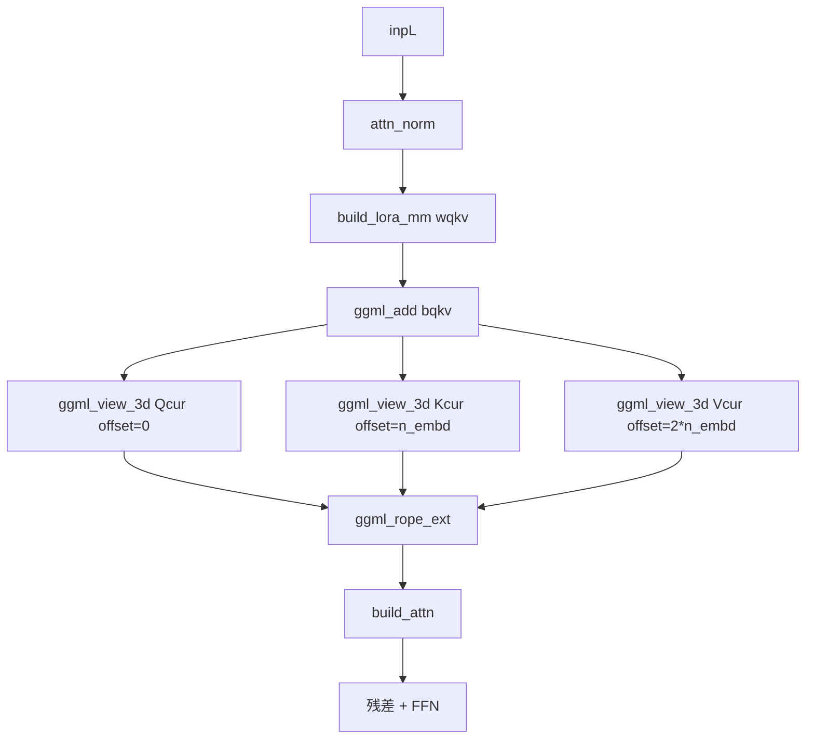
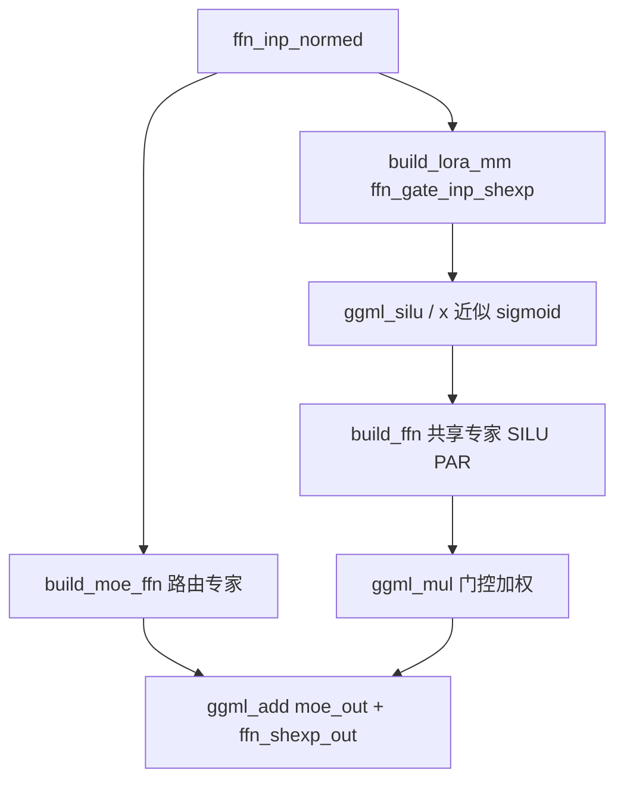
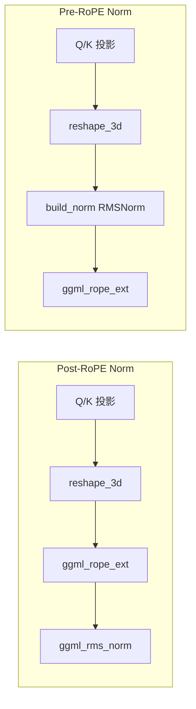
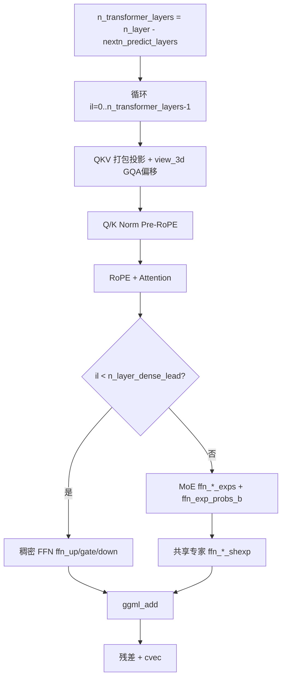
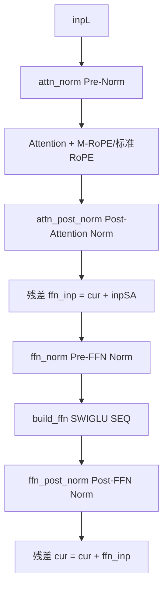
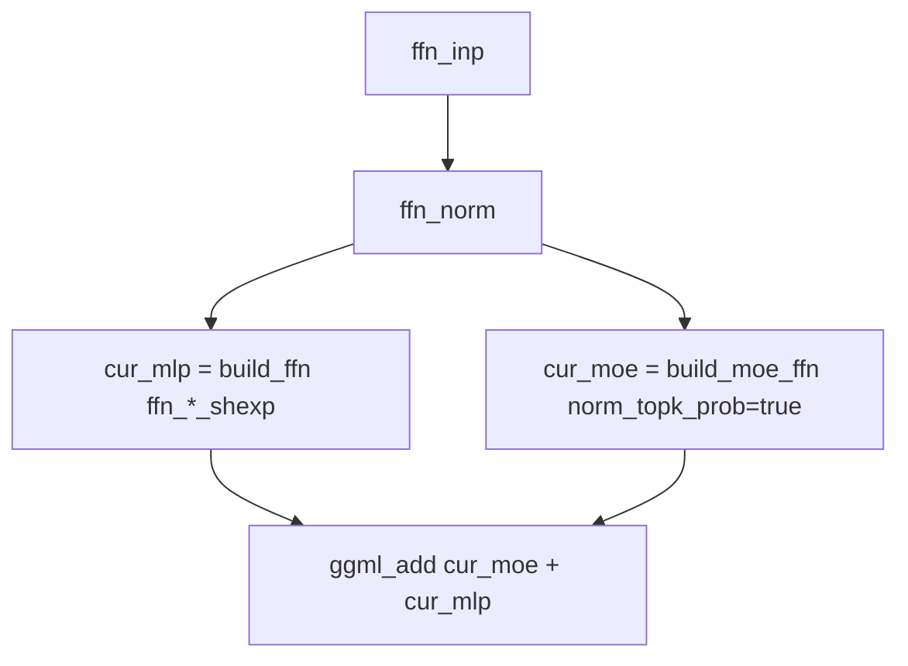
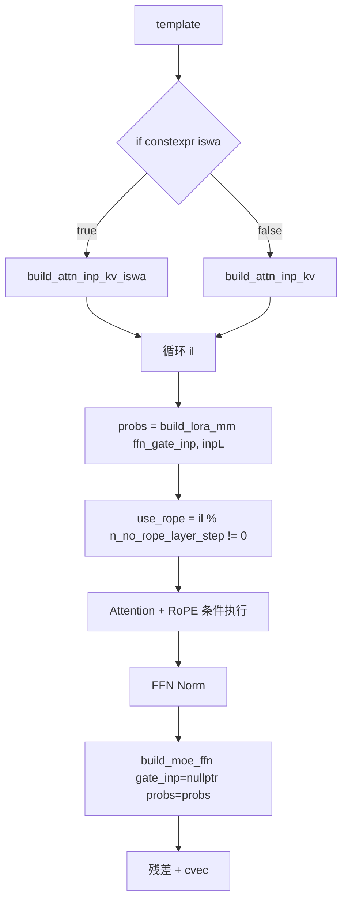

# 第26章 ：GGML 模型构建器全景图谱 —— 从中央厨房到百模大战的架构演进

## 学习目标

- 理解 GGML 计算图构建中各算子的组织方式，掌握 `llm_graph_context` 子类如何将模型架构转换为 GGML 图节点
- 掌握模板参数 `embed` 和 `iswa` 的编译期多态技巧，理解 `if constexpr` 如何生成两条独立实例化
- 深入理解 QKV 视图（`view_3d`）拆分、RoPE 旋转位置编码的应用时序，以及 `use_kq_norm` 与 `rope_factors` 的协同
- 掌握 MoE 路由专家与共享专家的混合策略，理解 `ffn_gate_inp == nullptr` 作为稠密/MoE 判定的工程意义
- 理解 NoPE 步进、滑动窗口注意力（ISWA/SWA）、M-RoPE、Q/K 归一化前置等架构差异如何体现在构图选择上
- 了解 `inp_out_ids`、`rope_factors`、`build_cvec`、`build_lora_mm` 等高层 API 在不同模型变体间的复用模式

## 26.1 生活类比

想象 GGML 的模型构建世界是一家「中央厨房」，每个模型文件都是一份菜谱：`llm_build_*` 厨师团队 = 每个家族模型（如 llama、qwen、mistral）的专属厨师长，负责按菜谱组装一道道工序；`build_norm` = 食材清洗员（RMSNorm / LayerNorm），把上一道工序的产出标准化；`build_lora_mm` = 切配厨师，按照 `wq/wk/wv/up/gate/down` 等矩阵对食材（张量）做线性变换；`ggml_reshape_3d` = 整形刀，把扁平的肉片重新切成 [头维度, 头数, token数] 的三维形状；`ggml_view_3d` = 玻璃窗（零拷贝视图），不搬动食材，只贴标签，让不同厨师从不同角度看同一块肉；`ggml_rope_ext / ggml_rope_multi` = 调料旋钮，按 token 位置给食材「加入时间风味」（位置编码）；`build_attn` = 主厨的秘制炒锅（Flash Attention / 标准注意力），把 QKV 三种食材快速翻炒；`build_ffn / build_moe_ffn` = 二级烹饪工序：稠密 FFN 是单人小炒，MoE 是多位厨师分工的「大锅炒」；`build_cvec` = 风味修正师（控制向量），在菜品出锅前微调风味；`inp_out_ids` = 出菜筛选器，只把最后几道菜（最后 token）呈给顾客；`template <bool embed/iswa>` = 「双模菜谱」，同一份菜谱可以做出两种版本（语言模型 / 嵌入模型，普通 KV / ISWA）；`if constexpr` = 厨房的「炒菜开关」，按下哪一档就启动哪条工序。就像每家餐厅都有专属厨师团队处理招牌菜，llama.cpp 也为每个模型家族安排了专属的 `llm_build_*` 构造函数，把架构差异转化为 GGML 计算图的统一语言。

## 26.2 源码地图

src/models/llama.cpp
├── template <bool embed>
│   └── llm_build_llama<embed>::llm_build_llama()      # 1-101 行：基础 LLaMA，模板类支持 embed/lm 两种模式
│       ├── inp_attn = build_attn_inp_kv() / no_cache()  # 根据 embed 选择注意力输入
│       ├── Q/K/V 投影 + reshape_3d + ggml_rope_ext()
│       ├── hparams.use_kq_norm → ggml_rms_norm()        # Llama4 风格 Q/K L2 归一化
│       ├── ffn_gate_inp == nullptr ? build_ffn : build_moe_ffn
│       └── if constexpr (!embed) → build_lora_mm(model.output) 计算 logits
├── template struct llm_build_llama<false>;               # 显式实例化
└── template struct llm_build_llama<true>;                

src/models/llama-iswa.cpp
└── llm_build_llama_iswa::llm_build_llama_iswa()          # 1-157 行：ISWA 滑动窗口变体
    ├── inp_attn = build_attn_inp_kv_iswa()               # ISWA 注意力输入
    ├── get_rope_freq_base/scale(cparams, il)             # 按层动态调整 RoPE
    ├── use_rope = (il+1) % n_no_rope_layer_step != 0     # NoPE 步进
    ├── inp_attn_scale = build_inp_attn_scale()           # Llama4 温度调谐
    └── LLAMA_EXPERT_GATING_FUNC_TYPE_SIGMOID              # Sigmoid 路由（非 SOFTMAX）

src/models/qwen.cpp
└── llm_build_qwen::llm_build_qwen()                       # 1-86 行：QKV 打包视图拆分
    ├── build_lora_mm(wqkv, cur) + ggml_add(bqkv)
    └── ggml_view_3d 拆分 Q/K/V（offset = 0/1/2 * n_embd）

src/models/qwen2.cpp
└── llm_build_qwen2::llm_build_qwen2()                     # 1-139 行：分离的 wq/wk/wv + 可选 bq/bk/bv
    └── if (model.output_b != nullptr) → ggml_add() 给 lm_head 加偏置

src/models/qwen2moe.cpp
└── llm_build_qwen2moe::llm_build_qwen2moe()               # 1-128 行：MoE + 双门控共享专家
    ├── ffn_gate_inp_shexp 做 sigmoid 门控（silu(x)/x）
    └── moe_out + ffn_shexp_out（共享专家）

src/models/qwen2vl.cpp
└── llm_build_qwen2vl::llm_build_qwen2vl()                 # 1-113 行：多模态 M-RoPE
    └── ggml_rope_multi(..., sections, ...)               # 时间/高度/宽度 4 段

src/models/qwen3.cpp
└── llm_build_qwen3::llm_build_qwen3()                     # 1-87 行：Q/K 归一化前置（RoPE 之前）
    ├── build_norm(Qcur, attn_q_norm) → RoPE
    └── build_norm(Kcur, attn_k_norm) → RoPE

src/models/qwen3moe.cpp
└── llm_build_qwen3moe::llm_build_qwen3moe()               # 1-99 行：MoE + 专家权重缩放
    └── build_moe_ffn(..., ffn_*_exps_s 缩放张量)

src/models/qwen3vl.cpp
└── llm_build_qwen3vl::llm_build_qwen3vl()                 # 1-84 行：DeepStack 多层视觉融合
    └── ggml_view_2d(t_inp_embd, n_embd, n_tokens, nb, (il+1)*n_embd*sizeof)

src/models/qwen3vl-moe.cpp
└── llm_build_qwen3vlmoe::llm_build_qwen3vlmoe()           # 1-437 行：MoE + DeepStack
    └── Q/K 归一化 + ggml_rope_multi + DeepStack 注入

src/models/bailingmoe.cpp
└── llm_build_bailingmoe::llm_build_bailingmoe()           # 1-87 行：标准 MoE + 共享专家
    ├── n_rot 作为 head 维做 reshape_3d
    └── build_moe_ffn + build_ffn(ffn_*_shexp)

src/models/bailingmoe2.cpp
└── llm_build_bailingmoe2::llm_build_bailingmoe2()         # 1-116 行：QKV 打包 + Q/K 归一化
    ├── n_transformer_layers = n_layer - nextn_predict_layers  # 跳过 NextN 层
    ├── il < n_layer_dense_lead ? dense FFN : build_moe_ffn
    └── ffn_exp_probs_b 路由偏置

src/models/chatglm.cpp
└── llm_build_chatglm::llm_build_chatglm()                 # 1-96 行：双模式 QKV
    ├── wqkv == nullptr ? reshape : view_3d
    └── LLM_FFN_SWIGLU + LLM_FFN_SEQ                     # SWIGLU 序列布局

src/models/glm4.cpp
└── llm_build_glm4::llm_build_glm4()                       # 1-139 行：Post-Norm + M-RoPE 二选一
    ├── use_mrope ? ggml_rope_multi : ggml_rope_ext
    ├── attn_post_norm / ffn_post_norm                     # 注意力后与 FFN 后的归一化
    └── ubatch.embd && !use_mrope → GGML_ABORT

src/models/glm4-moe.cpp
└── llm_build_glm4_moe::llm_build_glm4_moe()               # 1-148 行：MoE + Q/K 归一化前置
    ├── n_transformer_layers = n_layer - nextn_predict_layers
    ├── il < n_layer_dense_lead ? dense FFN : build_moe_ffn
    └── if (attn_q_norm/k_norm) → build_norm()

src/models/baichuan.cpp
└── llm_build_baichuan::llm_build_baichuan()               # 1-96 行：7B/13B 分支
    ├── inp_pos = (model.type == LLM_TYPE_7B) ? build_inp_pos() : nullptr
    └── switch (model.type): 7B 走 RoPE，13B 走 ALiBi（不调用 RoPE）

src/models/internlm2.cpp
└── llm_build_internlm2::llm_build_internlm2()             # 1-117 行：标准 Pre-Norm + lm_head 偏置
    └── wq/wk/wv 分离 + 可选 bq/bk/bv

src/models/hunyuan-dense.cpp
└── llm_build_hunyuan_dense::llm_build_hunyuan_dense()     # 1-100 行：Q/K 归一化后置
    └── Q → RoPE, K → RoPE → build_norm(Kcur, attn_k_norm)

src/models/hunyuan-moe.cpp
└── llm_build_hunyuan_moe::llm_build_hunyuan_moe()         # 1-179 行：稠密 + MoE 双轨 FFN
    ├── cur_mlp = build_ffn(ffn_*_shexp, ...)
    ├── cur_moe = build_moe_ffn(..., true /*norm_topk_prob*/, ...)
    └── ffn_out = ggml_add(cur_moe, cur_mlp)

src/models/mistral3.cpp
└── llm_build_mistral3::llm_build_mistral3()               # 1-154 行：注意力温度缩放
    ├── if (f_attn_temp_scale != 0.0f) → inp_attn_scale = build_inp_attn_scale()
    ├── if (inp_attn_scale) → Qcur = ggml_mul(Qcur, inp_attn_scale)
    └── ffn_gate_inp == nullptr ? build_ffn : build_moe_ffn

src/models/arcee.cpp
└── llm_build_arcee::llm_build_arcee()                     # 1-124 行：ReLU² 激活
    └── build_ffn(..., LLM_FFN_RELU_SQR, LLM_FFN_SEQ, ...) # 无 gate，gate 参数为 NULL

src/models/step35-iswa.cpp
└── llm_build_step35_iswa::llm_build_step35_iswa()         # 1-80 行：ISWA + 头级注意力门控
    ├── n_head/n_head_kv 按层读取
    ├── is_swa = hparams.is_swa(il) → rope_factors = nullptr
    ├── n_rot_l = hparams.n_rot(il) 按层旋转维度
    ├── wqkv_gate 投影 → sigmoid → reshape_3d → ggml_mul 头级广播门控
    └── MoE 层：moe_out + sh_out（共享专家）

src/models/smallthinker.cpp
└── template <bool iswa>
    └── llm_build_smallthinker<iswa>::llm_build_smallthinker() # 1-89 行：模板化 ISWA
        ├── if constexpr (iswa) ? build_attn_inp_kv_iswa : build_attn_inp_kv
        ├── probs = build_lora_mm(ffn_gate_inp, inpL)  # 预计算路由概率
        ├── use_rope = il % n_no_rope_layer_step != 0   # NoPE 步进
        └── build_moe_ffn(cur, nullptr, ..., probs)       # probs 作为最后一个参数传入
        template struct llm_build_smallthinker<false>;
        template struct llm_build_smallthinker<true>;

## 26.3 llm_build_llama<embed>::llm_build_llama()：模板类统一构建嵌入与语言模型双模式计算图

LLaMA 是 llama.cpp 的「亲儿子」，也是最基础的 Transformer 解码器实现。`llm_build_llama` 通过 C++ 模板参数 `embed`（`bool` 类型）在编译期分化出两条完全独立的代码路径：`embed=false` 用于普通语言模型（自回归生成，需要 KV 缓存），`embed=true` 用于嵌入模式（编码任务，无需 KV 缓存）。这种设计避免了运行时分支，实现了零开销抽象。

### 26.3.1 核心流程图：LLaMA 主循环数据流

```mermaid
flowchart TD
    A[inpL: Token Embedding] --> B[循环 il=0..n_layer-1]
    B --> C[inpSA = inpL]
    C --> D[attn_norm = build_norm(inpL)]
    D --> E[Q/K/V = build_lora_mm(wq/wk/wv)]
    E --> F[reshape_3d -> [head_dim, n_head, n_tokens]]
    F --> G[RoPE: ggml_rope_ext]
    G --> H{use_kq_norm?}
    H -- 是 --> I[ggml_rms_norm Q/K]
    H -- 否 --> J[build_attn]
    I --> J
    J --> K[attn_out]
    K --> L{最后一层?}
    L -- 是 --> M[ggml_get_rows inp_out_ids]
    L -- 否 --> N[ffn_inp = attn_out + inpSA]
    M --> N
    N --> O[ffn_norm = build_norm]
    O --> P{ffn_gate_inp == nullptr?}
    P -- 是 --> Q[build_ffn SILU PAR]
    P -- 否 --> R[build_moe_ffn]
    Q --> S[ffn_out]
    R --> S
    S --> T[cur = ffn_out + ffn_inp]
    T --> U[build_cvec]
    U --> V[inpL = cur]
    V --> B
    B -- 结束 --> W[output_norm]
    W --> X{t_embed 输出}
    X --> Y{embed=false?}
    Y -- 是 --> Z[build_lora_mm output -> t_logits]
    Y -- 否 --> AA[结束]
```

### 26.3.2 源码实现：`src/models/llama.cpp` - `llm_build_llama<embed>`（第7-101行）

```cpp
llm_build_llama<embed>::llm_build_llama(const llama_model & model, const llm_graph_params & params) : llm_graph_context(params) {
    // 初始化并验证关键维度参数
    inpL = build_inp_embd(model.tok_embd);
    ggml_tensor * inp_pos = build_inp_pos();
    // 根据模式构建注意力输入：embed 模式用 no_cache，LM 模式用标准 KV
    inp_attn_type * inp_attn = nullptr;
    if constexpr (embed) {
        inp_attn = build_attn_inp_no_cache();
    } else {
        inp_attn = build_attn_inp_kv();
    }
    // 主循环：构建每一层 Transformer
    for (int il = 0; il < n_layer; ++il) {
        // 构建 QKV 投影并应用 RoPE
        Qcur = build_lora_mm(model.layers[il].wq, cur, model.layers[il].wq_s);
        Kcur = build_lora_mm(model.layers[il].wk, cur, model.layers[il].wk_s);
        Vcur = build_lora_mm(model.layers[il].wv, cur, model.layers[il].wv_s);
        // 应用旋转位置嵌入
        Qcur = ggml_rope_ext(ctx0, Qcur, inp_pos, rope_factors, n_rot, rope_type, n_ctx_orig, freq_base, freq_scale, ext_factor, attn_factor, beta_fast, beta_slow);
        // 构建注意力输出
        cur = build_attn(inp_attn, model.layers[il].wo, model.layers[il].bo, Qcur, Kcur, Vcur, nullptr, nullptr, nullptr, kq_scale, il);
        // 构建前馈网络（支持标准 FFN 和 MoE）
        if (model.layers[il].ffn_gate_inp == nullptr) {
            cur = build_ffn(cur, model.layers[il].ffn_up, model.layers[il].ffn_up_b, model.layers[il].ffn_up_s, model.layers[il].ffn_gate, model.layers[il].ffn_gate_b, model.layers[il].ffn_gate_s, model.layers[il].ffn_down, model.layers[il].ffn_down_b, model.layers[il].ffn_down_s, NULL, LLM_FFN_SILU, LLM_FFN_PAR, il);
        } else {
            // MoE 分支
            cur = build_moe_ffn(cur, model.layers[il].ffn_gate_inp, model.layers[il].ffn_up_exps, model.layers[il].ffn_gate_exps, model.layers[il].ffn_down_exps, nullptr, n_expert, n_expert_used, LLM_FFN_SILU, true, hparams.expert_weights_scale, LLAMA_EXPERT_GATING_FUNC_TYPE_SOFTMAX, il, nullptr, nullptr, model.layers[il].ffn_up_exps_s, model.layers[il].ffn_gate_exps_s, model.layers[il].ffn_down_exps_s);
        }
        // 残差连接和层输出
        cur = ggml_add(ctx0, cur, ffn_inp);
        inpL = cur;
    }
    // 构建最终输出层
    cur = build_norm(cur, model.output_norm, NULL, LLM_NORM_RMS, -1);
    if constexpr (!embed) {
        cur = build_lora_mm(model.output, cur);
        res->t_logits = cur;
    }
    ggml_build_forward_expand(gf, cur);
}
```

**代码解析：** 这段代码定义了 LLaMA 家族的统一构建入口，通过 `template <bool embed>` 实现「一份代码、两种模式」的编译期分化。核心流程遵循标准的 Pre-Norm Transformer：输入嵌入 → 逐层 - RMSNorm → QKV 投影 → RoPE → Attention → 残差 → RMSNorm → FFN/MoE → 残差 → 输出 RMSNorm →（可选）LM Head。关键设计点包括：(1) `if constexpr (embed)` 编译期选择注意力输入类型，避免运行时分支；(2) `ffn_gate_inp == nullptr` 作为稠密/MoE 的运行时判定，极其简洁；(3) `hparams.use_kq_norm` 控制 Llama4 引入的 Q/K 后置归一化；(4) `inp_out_ids` 实现最后层的 token 级裁剪，节省计算量。

### 26.3.3 显式模板实例化

**源码路径：`src/models/llama.cpp` - 全局作用域（第102-103行）**

```cpp
// 显式实例化：告诉编译器生成这两个具体版本的代码
template struct llm_build_llama<false>;  // 语言模型版本
template struct llm_build_llama<true>;   // 嵌入模型版本
```

**代码解析：** 这段代码展示了 C++ 模板显式实例化的标准用法。如果没有这两行，模板定义在 `.cpp` 文件中将无法被其他编译单元链接到。这种模式在 llama.cpp 中大量存在，是「编译期多态、零运行时开销」的工程落地。

## 26.4 llm_build_llama_iswa::llm_build_llama_iswa()：ISWA 滑动窗口注意力与 NoPE 步进的工程化实现

ISWA (Intermittent Sliding Window Attention) 是 LLaMA 架构的一个重要变体，它引入了滑动窗口注意力机制，并允许某些层跳过 RoPE（NoPE），同时支持按层动态调整 RoPE 频率。这种设计在长上下文场景下能显著降低显存占用。

### 26.4.1 核心流程图：ISWA 逐层动态配置

```mermaid
flowchart TD
    A[输入嵌入 + inp_attn_scale] --> B[循环 il=0..n_layer-1]
    B --> C[每层获取 freq_base_l, freq_scale_l]
    C --> D[use_rope = (il+1) % n_no_rope_layer_step != 0]
    D --> E[Q/K/V 投影 + reshape_3d]
    E --> F{use_rope?}
    F -- 是 --> G[ggml_rope_ext + 可选 kq_norm]
    F -- 否 --> H[inp_attn_scale ? Qcur = Qcur * scale]
    G --> I[build_attn ISWA]
    H --> I
    I --> J[残差 + FFN Norm]
    J --> K{ffn_gate_inp == nullptr?}
    K -- 是 --> L[稠密 FFN SILU PAR]
    K -- 否 --> M[MoE: SIGMOID 门控 + 共享专家]
    M --> N[moe_out + shexp_out]
    L --> O[ffn_out]
    N --> O
    O --> P[残差 + cvec]
    P --> Q[inpL = cur]
    Q --> B
```

### 26.4.2 源码实现：`src/models/llama-iswa.cpp` - `llm_build_llama_iswa`（第1-157行）

```cpp
llm_build_llama_iswa::llm_build_llama_iswa(const llama_model & model, const llm_graph_params & params) : llm_graph_context(params) {
    const int64_t n_embd_head = hparams.n_embd_head_v();
    GGML_ASSERT(n_embd_head == hparams.n_embd_head_k());
    GGML_ASSERT(n_embd_head == n_rot);
    
    ggml_tensor * inpL = build_inp_embd(model.tok_embd);
    ggml_tensor * inp_pos = build_inp_pos();
    
    // ① 温度缩放输入（Llama4 风格，可选）
    ggml_tensor * inp_attn_scale = build_inp_attn_scale();
    
    // ② 关键差异：使用 ISWA 专用注意力输入（支持滑动窗口）
    auto * inp_attn = build_attn_inp_kv_iswa();
    
    const float kq_scale = hparams.f_attention_scale == 0.0f ? 1.0f/sqrtf(float(n_embd_head)) : hparams.f_attention_scale;
    ggml_tensor * inp_out_ids = build_inp_out_ids();

    for (int il = 0; il < n_layer; ++il) {
        // ③ 每层独立的 RoPE 频率基数与缩放（支持 YaRN 等逐层缩放）
        const float freq_base_l  = model.get_rope_freq_base(cparams, il);
        const float freq_scale_l = model.get_rope_freq_scale(cparams, il);
        
        ggml_tensor * inpSA = inpL;
        
        // ④ NoPE 步进：每隔 n_no_rope_layer_step 层跳过 RoPE
        const bool use_rope = hparams.n_no_rope_layer_step > 0 && (il + 1) % hparams.n_no_rope_layer_step != 0;
        
        // 注意力预归一化
        cur = build_norm(inpL, model.layers[il].attn_norm, NULL, LLM_NORM_RMS, il);
        cb(cur, "attn_norm", il);
        
        // Q/K/V 投影（同基础 Llama）
        { 
            ggml_tensor * rope_factors = model.get_rope_factors(cparams, il);
            ggml_tensor * Qcur = build_lora_mm(model.layers[il].wq, cur);
            if (model.layers[il].bq) { Qcur = ggml_add(ctx0, Qcur, model.layers[il].bq); cb(Qcur, "Qcur", il); }
            ggml_tensor * Kcur = build_lora_mm(model.layers[il].wk, cur);
            if (model.layers[il].bk) { Kcur = ggml_add(ctx0, Kcur, model.layers[il].bk); cb(Kcur, "Kcur", il); }
            ggml_tensor * Vcur = build_lora_mm(model.layers[il].wv, cur);
            if (model.layers[il].bv) { Vcur = ggml_add(ctx0, Vcur, model.layers[il].bv); cb(Vcur, "Vcur", il); }
            
            Qcur = ggml_reshape_3d(ctx0, Qcur, n_embd_head, n_head, n_tokens);
            Kcur = ggml_reshape_3d(ctx0, Kcur, n_embd_head, n_head_kv, n_tokens);
            Vcur = ggml_reshape_3d(ctx0, Vcur, n_embd_head, n_head_kv, n_tokens);
            
            // ⑤ 条件 RoPE：use_rope 为 false 时跳过，改用温度缩放
            if (use_rope) {
                Qcur = ggml_rope_ext(ctx0, Qcur, inp_pos, rope_factors, n_rot, rope_type, n_ctx_orig, freq_base_l, freq_scale_l, ext_factor, attn_factor, beta_fast, beta_slow);
                Kcur = ggml_rope_ext(ctx0, Kcur, inp_pos, rope_factors, n_rot, rope_type, n_ctx_orig, freq_base_l, freq_scale_l, ext_factor, attn_factor, beta_fast, beta_slow);
            } else if (inp_attn_scale) {
                // NoPE 层使用注意力温度缩放补偿位置信息缺失
                Qcur = ggml_mul(ctx0, Qcur, inp_attn_scale);
            }
            cb(Qcur, "Qcur", il); cb(Kcur, "Kcur", il); cb(Vcur, "Vcur", il);
            
            // ⑥ 仅在使用 RoPE 且启用 kq_norm 时做归一化（避免对 NoPE 层做多余归一化）
            if (use_rope && hparams.use_kq_norm) {
                Qcur = ggml_rms_norm(ctx0, Qcur, hparams.f_norm_rms_eps);
                Kcur = ggml_rms_norm(ctx0, Kcur, hparams.f_norm_rms_eps);
                cb(Qcur, "Qcur_normed", il); cb(Kcur, "Kcur_normed", il);
            }
            
            cur = build_attn(inp_attn, model.layers[il].wo, model.layers[il].bo, Qcur, Kcur, Vcur, nullptr, nullptr, nullptr, kq_scale, il);
            cb(cur, "attn_out", il);
        }
        
        // 最后层裁剪 + 残差
        if (il == n_layer - 1 && inp_out_ids) {
            cur   = ggml_get_rows(ctx0,   cur, inp_out_ids);
            inpSA = ggml_get_rows(ctx0, inpSA, inp_out_ids);
        }
        
        ggml_tensor * ffn_inp = ggml_add(ctx0, cur, inpSA);
        cb(ffn_inp, "ffn_inp", il);
        
        // ⑦ MoE 分支：ISWA 使用 Sigmoid 门控（与 DeepSeek-V2/V3 一致）
        if (model.layers[il].ffn_gate_inp == nullptr) {
            // 稠密 FFN
            cur = build_norm(ffn_inp, model.layers[il].ffn_norm, NULL, LLM_NORM_RMS, il);
            cb(cur, "ffn_norm", il);
            cur = build_ffn(cur, model.layers[il].ffn_up, model.layers[il].ffn_up_b, NULL,
                           model.layers[il].ffn_gate, model.layers[il].ffn_gate_b, NULL,
                           model.layers[il].ffn_down, model.layers[il].ffn_down_b, NULL,
                           NULL, LLM_FFN_SILU, LLM_FFN_PAR, il);
        } else {
            // MoE 路由专家 + 共享专家双轨并行
            ggml_tensor * ffn_inp_normed = build_norm(ffn_inp, model.layers[il].ffn_norm, NULL, LLM_NORM_RMS, il);
            cb(cur, "ffn_norm", il);
            
            // 路由专家：Sigmoid 门控函数
            ggml_tensor * moe_out = build_moe_ffn(ffn_inp_normed, model.layers[il].ffn_gate_inp,
                                                 model.layers[il].ffn_up_exps, model.layers[il].ffn_gate_exps,
                                                 model.layers[il].ffn_down_exps, nullptr,
                                                 n_expert, n_expert_used,
                                                 LLM_FFN_SILU, false,
                                                 hparams.expert_weights_scale,
                                                 LLAMA_EXPERT_GATING_FUNC_TYPE_SIGMOID, il);
            
            // 共享专家：标准 SILU+PAR
            ggml_tensor * shexp_out = build_ffn(ffn_inp_normed,
                                              model.layers[il].ffn_up_shexp, NULL, NULL,
                                              model.layers[il].ffn_gate_shexp, NULL, NULL,
                                              model.layers[il].ffn_down_shexp, NULL, NULL,
                                              NULL, LLM_FFN_SILU, LLM_FFN_PAR, il);
            cb(shexp_out, "ffn_moe_shexp", il);
            
            // 合并路由专家与共享专家
            cur = ggml_add(ctx0, moe_out, shexp_out);
            cb(cur, "ffn_moe_out_merged", il);
        }
        cur = ggml_add(ctx0, cur, ffn_inp);
        cb(cur, "ffn_out", il);
        
        cur = build_cvec(cur, il);
        cb(cur, "l_out", il);
        inpL = cur;
    }
    
    // 输出层（同基础 Llama）
    cur = inpL;
    cur = build_norm(cur, model.output_norm, NULL, LLM_NORM_RMS, -1);
    cb(cur, "result_norm", -1);
    res->t_embd = cur;
    cur = build_lora_mm(model.output, cur);
    cb(cur, "result_output", -1);
    res->t_logits = cur;
    ggml_build_forward_expand(gf, cur);
}
```

**代码解析：** 这段代码实现了 ISWA 变体的三大核心创新：(1) `build_attn_inp_kv_iswa()` 替换标准 KV 输入，启用滑动窗口注意力机制；(2) `use_rope = (il+1) % n_no_rope_layer_step != 0` 实现 NoPE 步进，让部分层跳过 RoPE 以降低计算量并缓解长序列位置外推问题；(3) MoE 层使用 `LLAMA_EXPERT_GATING_FUNC_TYPE_SIGMOID` 而非 SOFTMAX，这是 DeepSeek-V2/V3 等模型验证过的更稳定路由策略。值得注意的是，NoPE 层通过 `inp_attn_scale` 做温度缩放来补偿位置编码的缺失，这是一个巧妙的工程折中。

### 26.4.3 ISWA 与标准 Llama 的关键差异对比

本章我们对比了 ISWA 变体与基础 Llama 的核心差异：

| 特性 | 标准 Llama (`llama.cpp`) | ISWA 变体 (`llama-iswa.cpp`) |
|------|--------------------------|------------------------------|
| **注意力输入** | `build_attn_inp_kv()` 标准全序列 KV 缓存 | `build_attn_inp_kv_iswa()` 滑动窗口 KV 缓存 |
| **RoPE 频率** | 全模型共享 `freq_base/freq_scale` | `get_rope_freq_base/scale(cparams, il)` 按层动态获取 |
| **位置编码策略** | 所有层均应用 RoPE | `use_rope` 条件跳过（NoPE 步进） |
| **NoPE 层补偿** | 无 | `inp_attn_scale` 温度缩放 |
| **K/Q 归一化时机** | RoPE 后无条件（若启用） | 仅 `use_rope && use_kq_norm` 时 |
| **MoE 门控函数** | `SOFTMAX` (默认) | `SIGMOID` (DeepSeek 风格) |
| **共享专家** | 无（除非模型自带） | 显式构建 `ffn_shexp` 并与 `moe_out` 相加 |

## 26.5 llm_build_qwen::llm_build_qwen()：QKV 打包视图拆分的零拷贝艺术

原始 Qwen 采用 QKV 权重打包存储、单次 GEMM 投影、视图拆分零拷贝的设计，这是「存储换计算」的经典权衡。

### 26.5.1 核心流程图：Qwen 打包 QKV 拆分



### 26.5.2 源码实现：`src/models/qwen.cpp` - `llm_build_qwen`（第7-86行）

```cpp
llm_build_qwen::llm_build_qwen(const llama_model & model, const llm_graph_params & params) : llm_graph_context(params) {
    const int64_t n_embd_head = hparams.n_embd_head_v();
    GGML_ASSERT(n_embd_head == hparams.n_embd_head_k());
    
    ggml_tensor * cur; ggml_tensor * inpL;
    inpL = build_inp_embd(model.tok_embd);
    ggml_tensor * inp_pos = build_inp_pos();
    auto * inp_attn = build_attn_inp_kv();
    ggml_tensor * inp_out_ids = build_inp_out_ids();

    for (int il = 0; il < n_layer; ++il) {
        ggml_tensor * inpSA = inpL;
        cur = build_norm(inpL, model.layers[il].attn_norm, NULL, LLM_NORM_RMS, il);
        cb(cur, "attn_norm", il);
        
        // ① QKV 打包投影：单次矩阵乘法得到拼接的 QKV
        cur = build_lora_mm(model.layers[il].wqkv, cur);
        cb(cur, "wqkv", il);
        
        // ② 偏置加法（打包后的统一偏置）
        cur = ggml_add(ctx0, cur, model.layers[il].bqkv);
        cb(cur, "bqkv", il);
        
        // ③ 零拷贝视图拆分：不复制数据，只改变视图的 stride/offset
        // Q 偏移 0，K 偏移 n_embd，V 偏移 2*n_embd
        ggml_tensor * Qcur = ggml_view_3d(ctx0, cur, n_embd_head, n_head, n_tokens, n_embd_head*sizeof(float), cur->nb[1], 0*sizeof(float)*(n_embd));
        ggml_tensor * Kcur = ggml_view_3d(ctx0, cur, n_embd_head, n_head_kv, n_tokens, n_embd_head*sizeof(float), cur->nb[1], 1*sizeof(float)*(n_embd));
        ggml_tensor * Vcur = ggml_view_3d(ctx0, cur, n_embd_head, n_head_kv, n_tokens, n_embd_head*sizeof(float), cur->nb[1], 2*sizeof(float)*(n_embd));
        
        // ④ 标准 RoPE
        Qcur = ggml_rope_ext(ctx0, Qcur, inp_pos, nullptr, n_rot, rope_type, n_ctx_orig, freq_base, freq_scale, ext_factor, attn_factor, beta_fast, beta_slow);
        Kcur = ggml_rope_ext(ctx0, Kcur, inp_pos, nullptr, n_rot, rope_type, n_ctx_orig, freq_base, freq_scale, ext_factor, attn_factor, beta_fast, beta_slow);
        cb(Qcur, "Qcur", il); cb(Kcur, "Kcur", il); cb(Vcur, "Vcur", il);
        
        cur = build_attn(inp_attn, model.layers[il].wo, NULL, Qcur, Kcur, Vcur, nullptr, nullptr, nullptr, 1.0f/sqrtf(float(n_embd_head)), il);
        
        if (il == n_layer - 1 && inp_out_ids) {
            cur = ggml_get_rows(ctx0, cur, inp_out_ids);
            inpSA = ggml_get_rows(ctx0, inpSA, inp_out_ids);
        }
        
        ggml_tensor * ffn_inp = ggml_add(ctx0, cur, inpSA);
        cb(ffn_inp, "ffn_inp", il);
        
        // 标准 SILU+PAR FFN
        cur = build_norm(ffn_inp, model.layers[il].ffn_norm, NULL, LLM_NORM_RMS, il);
        cb(cur, "ffn_norm", il);
        cur = build_ffn(cur, model.layers[il].ffn_up, NULL, NULL,
                       model.layers[il].ffn_gate, NULL, NULL,
                       model.layers[il].ffn_down, NULL, NULL,
                       NULL, LLM_FFN_SILU, LLM_FFN_PAR, il);
        cb(cur, "ffn_out", il);
        
        cur = ggml_add(ctx0, cur, ffn_inp);
        cur = build_cvec(cur, il);
        cb(cur, "l_out", il);
        inpL = cur;
    }
    
    // 输出层
    cur = inpL;
    cur = build_norm(cur, model.output_norm, NULL, LLM_NORM_RMS, -1);
    cb(cur, "result_norm", -1);
    res->t_embd = cur;
    cur = build_lora_mm(model.output, cur);
    cb(cur, "result_output", -1);
    res->t_logits = cur;
    ggml_build_forward_expand(gf, cur);
}
```

**代码解析：** 这段代码展示了 Qwen 原始版本的核心特征：**QKV 打包存储、视图拆分零拷贝**。`build_lora_mm(wqkv, cur)` 一次性完成 Q/K/V 三个投影的矩阵乘法，然后 `ggml_view_3d` 通过调整内存偏移量（`0/1/2 * n_embd`）将三个头「切」出来，完全避免了数据拷贝。这种设计在模型转换阶段要求将 HuggingFace 的分离 Q/K/V 权重拼接为单一 `wqkv` 张量，是典型的「存储换计算」权衡。

## 26.6 llm_build_qwen2::llm_build_qwen2()：分离投影与输出偏置的标准化回归

Qwen2 回归到标准的分离 Q/K/V 投影设计，并引入可选的 `lm_head` 偏置。

### 26.6.1 源码实现：`src/models/qwen2.cpp` - `llm_build_qwen2`（第13-139行）

```cpp
// 关键差异片段：分离的 Q/K/V 投影
for (int il = 0; il < n_layer; ++il) {
    // ...
    // Qwen2 使用分离的 wq/wk/wv 矩阵（与标准 Llama 一致）
    ggml_tensor * Qcur = build_lora_mm(model.layers[il].wq, cur);
    if (model.layers[il].bq) { Qcur = ggml_add(ctx0, Qcur, model.layers[il].bq); cb(Qcur, "Qcur", il); }
    ggml_tensor * Kcur = build_lora_mm(model.layers[il].wk, cur);
    if (model.layers[il].bk) { Kcur = ggml_add(ctx0, Kcur, model.layers[il].bk); cb(Kcur, "Kcur", il); }
    ggml_tensor * Vcur = build_lora_mm(model.layers[il].wv, cur);
    if (model.layers[il].bv) { Vcur = ggml_add(ctx0, Vcur, model.layers[il].bv); cb(Vcur, "Vcur", il); }
    // ... reshape_3d + rope_ext + attention ...
}

// 输出层：可选的 lm_head 偏置（Qwen2 特有）
cur = build_lora_mm(model.output, cur);
if (model.output_b != nullptr) {  // 只有存在偏置张量时才加
    cur = ggml_add(ctx0, cur, model.output_b);
}
cb(cur, "result_output", -1);
res->t_logits = cur;
```

**代码解析：** Qwen2 回归到标准的分离 Q/K/V 投影设计，这与 HuggingFace 标准格式一致，便于模型转换。此外，它引入了可选的 `output_b` 偏置项，这是某些 Qwen2 变体（如 Code 版本）特有的输出层偏置，体现了 llama.cpp 对模型细微差异的兼容性设计。

## 26.7 llm_build_qwen2moe::llm_build_qwen2moe()：双门控共享专家的 MoE 创新

Qwen2MoE 引入了共享专家的双门控机制：`silu(x)/x` 近似 sigmoid 对共享专家输出做逐元素加权。

### 26.7.1 核心流程图：Qwen2MoE 共享专家门控



### 26.7.2 源码实现：`src/models/qwen2moe.cpp` - `llm_build_qwen2moe`（第4-128行）

```cpp
// MoE 分支核心逻辑
for (int il = 0; il < n_layer; ++il) {
    // ... attention 部分同 Qwen2 ...
    
    cur = build_norm(ffn_inp, model.layers[il].ffn_norm, NULL, LLM_NORM_RMS, il);
    cb(cur, "ffn_norm", il);
    
    // ① 路由专家：标准 MoE
    ggml_tensor * moe_out = build_moe_ffn(cur, model.layers[il].ffn_gate_inp,
                                         model.layers[il].ffn_up_exps, model.layers[il].ffn_gate_exps,
                                         model.layers[il].ffn_down_exps, nullptr,
                                         n_expert, n_expert_used,
                                         LLM_FFN_SILU, false,
                                         hparams.expert_weights_scale,
                                         LLAMA_EXPERT_GATING_FUNC_TYPE_SOFTMAX, il);
    cb(moe_out, "ffn_moe_out", il);
    
    // ② 共享专家：双门控机制
    // 2.1 计算 gate：silu(x)/x 形式（即 sigmoid 近似）
    ggml_tensor * cur_gate_inp = build_lora_mm(model.layers[il].ffn_gate_inp_shexp, cur);
    cb(cur_gate_inp, "ffn_shexp_gate_inp", il);
    ggml_tensor * cur_gate = ggml_div(ctx0, ggml_silu(ctx0, cur_gate_inp), cur_gate_inp);  // silu(x)/x ≈ sigmoid
    cb(cur_gate, "ffn_shexp_gate", il);
    
    // 2.2 共享专家 FFN（标准 SILU+PAR）
    ggml_tensor * cur_ffn = build_ffn(cur, model.layers[il].ffn_up_shexp, NULL, NULL,
                                     model.layers[il].ffn_gate_shexp, NULL, NULL,
                                     model.layers[il].ffn_down_shexp, NULL, NULL,
                                     NULL, LLM_FFN_SILU, LLM_FFN_PAR, il);
    cb(cur_ffn, "ffn_shexp", il);
    
    // 2.3 门控加权：element-wise 乘法
    ggml_tensor * ffn_shexp_out = ggml_mul(ctx0, cur_ffn, cur_gate);
    cb(ffn_shexp_out, "ffn_shexp_out", il);
    
    // ③ 合并：路由专家输出 + 门控后的共享专家输出
    moe_out = ggml_add(ctx0, moe_out, ffn_shexp_out);
    cb(moe_out, "ffn_out", il);
    cur = moe_out;
    // ...
}
```

**代码解析：** Qwen2MoE 的亮点在于**共享专家的双门控设计**：先对输入做 `silu(x)/x` 近似 sigmoid 门控，再与共享专家 FFN 输出做逐元素乘法。这种设计让共享专家的激活更加稀疏，类似于「专家内部的专家」。对比 BailingMoe 的简单相加、`ffn_moe_out_merged = moe_out + ffn_shexp`，Qwen2MoE 多了一层动态门控，增加了模型的表达能力。

## 26.8 llm_build_qwen2vl::llm_build_qwen2vl()：M-RoPE 多模态位置编码的四段式设计

Qwen2-VL 引入 M-RoPE，将旋转维度切分为时间、高度、宽度、文本四段，通过 `ggml_rope_multi` 实现。

### 26.8.1 核心流程图：M-RoPE 四段式位置编码

```mermaid
flowchart TD
    A[rope_sections[4] = {temporal, height, width, remaining}] --> B[Q/K reshape_3d]
    B --> C[ggml_rope_multi sections 参数]
    C --> D[分段应用不同频率的 RoPE]
    D --> E[build_attn]
```

### 26.8.2 源码实现：`src/models/qwen2vl.cpp` - `llm_build_qwen2vl`（第7-113行）

```cpp
// M-RoPE 关键片段
int sections[4];
std::copy(std::begin(hparams.rope_sections), std::begin(hparams.rope_sections) + 4, sections);

// ... attention 循环内 ...
Qcur = ggml_reshape_3d(ctx0, Qcur, n_embd_head, n_head, n_tokens);
Kcur = ggml_reshape_3d(ctx0, Kcur, n_embd_head, n_head_kv, n_tokens);
Vcur = ggml_reshape_3d(ctx0, Vcur, n_embd_head, n_head_kv, n_tokens);

// M-RoPE：ggml_rope_multi 替代 ggml_rope_ext
Qcur = ggml_rope_multi(ctx0, Qcur, inp_pos, nullptr,
                       n_rot, sections, rope_type, n_ctx_orig, freq_base, freq_scale,
                       ext_factor, attn_factor, beta_fast, beta_slow);
Kcur = ggml_rope_multi(ctx0, Kcur, inp_pos, nullptr,
                       n_rot, sections, rope_type, n_ctx_orig, freq_base, freq_scale,
                       ext_factor, attn_factor, beta_fast, beta_slow);
```

**代码解析：** Qwen2-VL 引入 **M-RoPE (Multimodal Rotary Position Embedding)**，通过 `ggml_rope_multi` 与 `sections[4]` 数组实现。`sections` 将旋转维度切分为 4 段：`[temporal, height, width, remaining]`，分别对应视频时间维度、图像高度、宽度和剩余文本维度。这是多模态模型处理时空位置信息的关键创新，单纯的 `ggml_rope_ext` 无法表达这种结构化位置信息。

## 26.9 llm_build_qwen3::llm_build_qwen3()：Q/K 归一化前置的训练稳定性优化

Qwen3 最显著的架构改进是 **Q/K RMSNorm 前置**（Pre-RoPE Normalization），在 `ggml_rope_ext` **之前**对 Q 和 K 分别做 RMSNorm。

### 26.9.1 核心流程图：Qwen3 QK Norm 时序对比



### 26.9.2 源码实现：`src/models/qwen3.cpp` - `llm_build_qwen3`（第1-87行）

```cpp
// 核心差异：Q/K 归一化在 RoPE 之前
for (int il = 0; il < n_layer; ++il) {
    // ... attention norm ...
    {
        ggml_tensor * Qcur = build_lora_mm(model.layers[il].wq, cur, model.layers[il].wq_s);
        ggml_tensor * Kcur = build_lora_mm(model.layers[il].wk, cur, model.layers[il].wk_s);
        ggml_tensor * Vcur = build_lora_mm(model.layers[il].wv, cur, model.layers[il].wv_s);
        
        Qcur = ggml_reshape_3d(ctx0, Qcur, n_embd_head, n_head, n_tokens);
        Kcur = ggml_reshape_3d(ctx0, Kcur, n_embd_head, n_head_kv, n_tokens);
        Vcur = ggml_reshape_3d(ctx0, Vcur, n_embd_head, n_head_kv, n_tokens);
        
        // ① Q 归一化 → RoPE
        Qcur = build_norm(Qcur, model.layers[il].attn_q_norm, NULL, LLM_NORM_RMS, il);
        cb(Qcur, "Qcur_normed", il);
        Qcur = ggml_rope_ext(ctx0, Qcur, inp_pos, nullptr, n_rot, rope_type, n_ctx_orig, freq_base, freq_scale, ext_factor, attn_factor, beta_fast, beta_slow);
        
        // ② K 归一化 → RoPE
        Kcur = build_norm(Kcur, model.layers[il].attn_k_norm, NULL, LLM_NORM_RMS, il);
        cb(Kcur, "Kcur_normed", il);
        Kcur = ggml_rope_ext(ctx0, Kcur, inp_pos, nullptr, n_rot, rope_type, n_ctx_orig, freq_base, freq_scale, ext_factor, attn_factor, beta_fast, beta_slow);
        
        // ... attention ...
    }
}
```

**代码解析：** Qwen3 最显著的架构改进是 **Q/K RMSNorm 前置**（Pre-RoPE Normalization）。对比 Llama/ISWA 的「RoPE 后归一化」（`hparams.use_kq_norm` 控制），Qwen3 在 `ggml_rope_ext` **之前**对 Q 和 K 分别做 RMSNorm。这种设计源自 Qwen2.5 技术报告，旨在稳定 RoPE 的输入分布，特别是在长上下文和大模型训练中防止注意力分数发散。工程上，这要求模型权重中必须包含 `attn_q_norm` 和 `attn_k_norm` 两个归一化层的权重。

## 26.10 llm_build_qwen3moe::llm_build_qwen3moe()：MoE 专家权重缩放的精细化控制

Qwen3MoE 在 Qwen3 的 Q/K 前置归一化基础上引入 MoE，关键点是显式传入专家级缩放张量。

### 26.10.1 源码实现：`src/models/qwen3moe.cpp` - `llm_build_qwen3moe`（第1-99行）

```cpp
// MoE 分支：显式传入专家权重缩放张量
ggml_tensor * moe_out = build_moe_ffn(cur, model.layers[il].ffn_gate_inp,
                                     model.layers[il].ffn_up_exps, model.layers[il].ffn_gate_exps,
                                     model.layers[il].ffn_down_exps, nullptr,
                                     n_expert, n_expert_used,
                                     LLM_FFN_SILU, true,  // norm_topk_prob = true
                                     hparams.expert_weights_scale,
                                     LLAMA_EXPERT_GATING_FUNC_TYPE_SOFTMAX, il,
                                     nullptr, nullptr,
                                     model.layers[il].ffn_up_exps_s,   // 专家 up 缩放
                                     model.layers[il].ffn_gate_exps_s, // 专家 gate 缩放
                                     model.layers[il].ffn_down_exps_s); // 专家 down 缩放
```

**代码解析：** Qwen3MoE 在 Qwen3 的 Q/K 前置归一化基础上引入 MoE，关键点是 `build_moe_ffn` 最后三个参数显式传入了 `ffn_*_exps_s` 缩放张量。这是专家级别的权重缩放机制，允许每个专家有独立的缩放因子，配合 `expert_weights_scale` 全局缩放，实现更精细的专家负载均衡。注意 `norm_topk_prob=true`，表示对 top-k 概率做归一化。

## 26.11 llm_build_qwen3vl::llm_build_qwen3vl()：DeepStack 多层视觉融合的层层递进

Qwen3-VL 独创 DeepStack 机制：视觉特征在前 `n_deepstack_layers` 层逐层注入残差流。

### 26.11.1 核心流程图：DeepStack 视觉特征逐层注入

```mermaid
flowchart TD
    A[t_inp_embd: [n_embd * n_deepstack_layers, n_tokens]] --> B[循环 il=0..n_layer-1]
    B --> C{il < n_deepstack_layers?}
    C -- 是 --> D[ggml_view_2d offset=(il+1)*n_embd]
    D --> E[ggml_add 视觉特征注入]
    C -- 否 --> F[标准流程]
    E --> G[inpL = cur]
    F --> G
    G --> B
```

### 26.11.2 源码实现：`src/models/qwen3vl.cpp` - `llm_build_qwen3vl`（第5-84行）

```cpp
// DeepStack 核心逻辑
const size_t n_deepstack_layers = hparams.n_deepstack_layers;

// ... 主循环 ...
for (int il = 0; il < n_layer; ++il) {
    // ... attention + ffn 标准流程 ...
    cur = build_cvec(cur, il);
    cb(cur, "l_out", il);
    
    // DeepStack 注入：前 n_deepstack_layers 层融合视觉特征
    if (il < (int) n_deepstack_layers) {
        // 从 t_inp_embd 切出第 il 层对应的视觉嵌入切片
        // offset = (il + 1) * n_embd * sizeof(float) —— 逐层递增
        ggml_tensor * ds = ggml_view_2d(ctx0, res->t_inp_embd, n_embd, n_tokens, 
                                        res->t_inp_embd->nb[1], (il + 1) * n_embd * sizeof(float));
        cur = ggml_add(ctx0, cur, ds);  // 残差加入视觉特征
        cb(cur, "deepstack_out", il);
    }
    inpL = cur;
}
```

**代码解析：** **DeepStack** 是 Qwen3-VL 独有的多模态融合机制：视觉编码器输出的 `t_inp_embd` 张量形状为 `[n_embd * n_deepstack_layers, n_tokens]`，通过 `ggml_view_2d` 按层切片（offset 递增 `(il+1)*n_embd`），在前 `n_deepstack_layers` 层的 FFN 之后、残差连接之前，将视觉特征逐层注入。这种「层层递进」的融合方式优于单次早期融合，能让视觉信息在不同抽象层级都参与语言建模。

## 26.12 llm_build_qwen3vlmoe::llm_build_qwen3vlmoe()：MoE + DeepStack 双重增强的终极形态

Qwen3-VL-Moe 将 Qwen3 的三大特性完美融合：Q/K 前置归一化、MoE 专家权重缩放、DeepStack 视觉融合。

### 26.12.1 源码实现：`src/models/qwen3vl-moe.cpp` - `llm_build_qwen3vlmoe`（第12-437行）

```cpp
// 结合 Qwen3MoE 的 Q/K 前置归一化 + MoE 专家缩放 + DeepStack 注入
for (int il = 0; il < n_layer; ++il) {
    // ... Q/K norm → RoPE → Attention ...
    
    // MoE 分支（带专家缩放张量）
    cur = build_norm(ffn_inp, model.layers[il].ffn_norm, NULL, LLM_NORM_RMS, il);
    ggml_tensor * moe_out = build_moe_ffn(cur, model.layers[il].ffn_gate_inp,
                                         model.layers[il].ffn_up_exps, model.layers[il].ffn_gate_exps,
                                         model.layers[il].ffn_down_exps, nullptr,
                                         n_expert, n_expert_used,
                                         LLM_FFN_SILU, true,
                                         hparams.expert_weights_scale,
                                         LLAMA_EXPERT_GATING_FUNC_TYPE_SOFTMAX, il);
    cur = moe_out;
    cur = ggml_add(ctx0, cur, ffn_inp);
    cur = build_cvec(cur, il);
    
    // DeepStack 注入（同 Qwen3-VL）
    if (il < (int) n_deepstack_layers) {
        ggml_tensor * ds = ggml_view_2d(ctx0, res->t_inp_embd, n_embd, n_tokens, 
                                        res->t_inp_embd->nb[1], (il + 1) * n_embd * sizeof(float));
        cur = ggml_add(ctx0, cur, ds);
        cb(cur, "deepstack_out", il);
    }
    inpL = cur;
}
```

**代码解析：** Qwen3-VL-Moe 将 Qwen3 的三大特性完美融合：Q/K 前置归一化、MoE 专家权重缩放、DeepStack 视觉融合。这是目前 Qwen 家族最复杂的架构之一，代码复用度极高——注意力路径完全复用 Qwen3，FFN 路径复用 Qwen3MoE，融合逻辑复用 Qwen3-VL。

## 26.13 llm_build_bailingmoe::llm_build_bailingmoe()：标准 MoE + 共享专家的基线实现

BailingMoe 采用标准的「路由专家 + 共享专家」设计，特点是使用 `n_rot` 作为头维度。

### 26.13.1 源码实现：`src/models/bailingmoe.cpp` - `llm_build_bailingmoe`（第5-87行）

```cpp
// 关键差异：reshape_3d 使用 n_rot 而非 n_embd_head
Qcur = ggml_reshape_3d(ctx0, Qcur, n_rot, n_head, n_tokens);
Kcur = ggml_reshape_3d(ctx0, Kcur, n_rot, n_head_kv, n_tokens);
Vcur = ggml_reshape_3d(ctx0, Vcur, n_rot, n_head_kv, n_tokens);

// ... RoPE + Attention ...

// MoE 分支
ggml_tensor * moe_out = build_moe_ffn(cur, model.layers[il].ffn_gate_inp,
                                     model.layers[il].ffn_up_exps, model.layers[il].ffn_gate_exps,
                                     model.layers[il].ffn_down_exps, nullptr,
                                     n_expert, n_expert_used,
                                     LLM_FFN_SILU, hparams.expert_weights_norm,
                                     hparams.expert_weights_scale,
                                     LLAMA_EXPERT_GATING_FUNC_TYPE_SOFTMAX, il);

// 共享专家：标准 FFN
ggml_tensor * ffn_shexp = build_ffn(cur, model.layers[il].ffn_up_shexp, NULL, NULL,
                                   model.layers[il].ffn_gate_shexp, NULL, NULL,
                                   model.layers[il].ffn_down_shexp, NULL, NULL,
                                   LLM_FFN_SILU, LLM_FFN_PAR, il);

// 简单相加合并
cur = ggml_add(ctx0, moe_out, ffn_shexp);
```

**代码解析：** BailingMoe 的特点是**使用 `n_rot`（旋转维度）而非 `n_embd_head` 做 reshape_3d 的头维度**。这暗示该模型可能使用部分 RoPE（Partial RoPE），即只对头维度的一部分应用旋转位置编码。共享专家采用简单的加法合并，无额外门控，结构清晰直观。

## 26.14 llm_build_bailingmoe2::llm_build_bailingmoe2()：QKV 打包 + 稠密/MoE 分层 + NextN 跳过

BailingMoe2 集成了多项工程化创新：NextN 预测层跳过、稠密/MoE 分层、QKV 打包 GQA 正确偏移、专家路由偏置。

### 26.14.1 核心流程图：BailingMoe2 稠密/MoE 分层与 NextN 跳过



### 26.14.2 源码实现：`src/models/bailingmoe2.cpp` - `llm_build_bailingmoe2`（第4-116行）

```cpp
// 第 1-30 行：NextN 预测层跳过
const int n_transformer_layers = n_layer - hparams.nextn_predict_layers;  // 跳过最后几层

// 第 31-70 行：QKV 打包 + 视图拆分 + Q/K 归一化
for (int il = 0; il < n_transformer_layers; ++il) {
    // QKV 打包投影
    cur = build_lora_mm(model.layers[il].wqkv, cur);
    cb(cur, "wqkv", il);
    
    // 视图拆分：注意 GQA 情况下的 V 偏移计算
    // K 偏移: 1 * n_embd
    // V 偏移: 1 * (n_embd + n_embd_gqa)  -- 因为 K/V 共享头数较少
    ggml_tensor * Qcur = ggml_view_3d(ctx0, cur, n_embd_head, n_head, n_tokens, n_embd_head * sizeof(float), cur->nb[1], 0 * sizeof(float) * (n_embd));
    ggml_tensor * Kcur = ggml_view_3d(ctx0, cur, n_embd_head, n_head_kv, n_tokens, n_embd_head * sizeof(float), cur->nb[1], 1 * sizeof(float) * (n_embd));
    ggml_tensor * Vcur = ggml_view_3d(ctx0, cur, n_embd_head, n_head_kv, n_tokens, n_embd_head * sizeof(float), cur->nb[1], 1 * sizeof(float) * (n_embd + n_embd_gqa));
    
    // Q/K 归一化前置（RoPE 之前）
    Qcur = build_norm(Qcur, model.layers[il].attn_q_norm, NULL, LLM_NORM_RMS, il);
    Kcur = build_norm(Kcur, model.layers[il].attn_k_norm, NULL, LLM_NORM_RMS, il);
    
    // ... RoPE + Attention ...

// 第 71-120 行：稠密/MoE 分层
    if (static_cast<uint32_t>(il) < hparams.n_layer_dense_lead) {
        // 前 n_layer_dense_lead 层使用稠密 FFN
        cur = build_ffn(cur, model.layers[il].ffn_up, NULL, NULL,
                       model.layers[il].ffn_gate, NULL, NULL,
                       model.layers[il].ffn_down, NULL, NULL,
                       NULL, LLM_FFN_SILU, LLM_FFN_PAR, il);
    } else {
        // 后续层使用 MoE
        ggml_tensor * moe_out = build_moe_ffn(cur, model.layers[il].ffn_gate_inp,
                                             model.layers[il].ffn_up_exps, model.layers[il].ffn_gate_exps,
                                             model.layers[il].ffn_down_exps,
                                             model.layers[il].ffn_exp_probs_b,  // 专家路由偏置
                                             n_expert, n_expert_used,
                                             LLM_FFN_SILU, hparams.expert_weights_norm,
                                             hparams.expert_weights_scale,
                                             (llama_expert_gating_func_type) hparams.expert_gating_func, il);
        
        // 共享专家
        ggml_tensor * ffn_shexp = build_ffn(cur, model.layers[il].ffn_up_shexp, NULL, NULL,
                                           model.layers[il].ffn_gate_shexp, NULL, NULL,
                                           model.layers[il].ffn_down_shexp, NULL, NULL,
                                           NULL, LLM_FFN_SILU, LLM_FFN_PAR, il);
        cur = ggml_add(ctx0, moe_out, ffn_shexp);
    }
    // ...
}
```

**代码解析：** BailingMoe2 集成了多项工程化创新：
1. **NextN 预测层跳过**：`n_transformer_layers = n_layer - nextn_predict_layers`，最后几层专门用于多 token 预测（MTP），前向传播时跳过。
2. **稠密/MoE 分层**：`n_layer_dense_lead` 控制前几层为稠密 FFN，后续层切换为 MoE。这种「稠密预热、稀疏深化」策略在训练稳定性与推理效率间取得平衡。
3. **QKV 打包 + GQA 正确偏移**：V 视图偏移 `1 * (n_embd + n_embd_gqa)` 正确处理了 Grouped-Query Attention 下 K/V 头数少于 Q 头数的情况。
4. **专家路由偏置 `ffn_exp_probs_b`**：直接加到路由 logits 上，类似于专家层面的 bias 项，可用于负载均衡调整。
5. **门控函数可配置**：`static_cast<llama_expert_gating_func_type>(hparams.expert_gating_func)` 支持运行时选择 SOFTMAX/SIGMOID 等。

## 26.15 llm_build_chatglm::llm_build_chatglm()：双模式 QKV 与 SWIGLU 序列布局

ChatGLM 通过 `wqkv == nullptr` 判断投影模式，并采用 SWIGLU + SEQ 内存布局。

### 26.15.1 源码实现：`src/models/chatglm.cpp` - `llm_build_chatglm`（第1-96行）

```cpp
// 核心差异：wqkv 存在性决定投影方式
for (int il = 0; il < n_layer; ++il) {
    // ...
    ggml_tensor * Qcur = nullptr, * Kcur = nullptr, * Vcur = nullptr;
    if (model.layers[il].wqkv == nullptr) {
        // 分离投影模式
        Qcur = build_lora_mm(model.layers[il].wq, cur); if (model.layers[il].bq) Qcur = ggml_add(ctx0, Qcur, model.layers[il].bq);
        Kcur = build_lora_mm(model.layers[il].wk, cur); if (model.layers[il].bk) Kcur = ggml_add(ctx0, Kcur, model.layers[il].bk);
        Vcur = build_lora_mm(model.layers[il].wv, cur); if (model.layers[il].bv) Vcur = ggml_add(ctx0, Vcur, model.layers[il].bv);
        Qcur = ggml_reshape_3d(ctx0, Qcur, n_embd_head, n_head, n_tokens);
        Kcur = ggml_reshape_3d(ctx0, Kcur, n_embd_head, n_head_kv, n_tokens);
        Vcur = ggml_reshape_3d(ctx0, Vcur, n_embd_head, n_head_kv, n_tokens);
    } else {
        // 打包投影模式：视图拆分
        cur = build_lora_mm(model.layers[il].wqkv, cur); cb(cur, "wqkv", il);
        if (model.layers[il].bqkv) { cur = ggml_add(ctx0, cur, model.layers[il].bqkv); cb(cur, "bqkv", il); }
        
        // GQA 正确偏移：V 偏移包含 n_embd_gqa
        Qcur = ggml_view_3d(ctx0, cur, n_embd_head, n_head, n_tokens, n_embd_head*sizeof(float), cur->nb[1], 0*sizeof(float)*(n_embd));
        Kcur = ggml_view_3d(ctx0, cur, n_embd_head, n_head_kv, n_tokens, n_embd_head*sizeof(float), cur->nb[1], 1*sizeof(float)*(n_embd));
        Vcur = ggml_view_3d(ctx0, cur, n_embd_head, n_head_kv, n_tokens, n_embd_head*sizeof(float), cur->nb[1], 1*sizeof(float)*(n_embd + n_embd_gqa));
    }
    // ... RoPE + Attention ...
    
    // FFN：SWIGLU + SEQ 布局（gate/up 连续存储）
    cur = build_ffn(cur, model.layers[il].ffn_up, NULL, NULL, NULL, NULL, NULL,
                   model.layers[il].ffn_down, NULL, NULL, NULL,
                   LLM_FFN_SWIGLU, LLM_FFN_SEQ, il);
}
```

**代码解析：** ChatGLM 的两大特色：(1) **双模式 QKV 兼容**：通过 `wqkv == nullptr` 判断是分离投影还是打包投影，同一代码同时支持两种权重布局；(2) **SWIGLU + SEQ 布局**：`LLM_FFN_SWIGLU` 配合 `LLM_FFN_SEQ` 表示 gate 与 up 权重在内存中连续排列（`[gate; up]`），这与标准 Llama 的 `LLM_FFN_SILU + LLM_FFN_PAR`（gate/up 分离存储）形成鲜明对比。SEQ 布局在某些硬件上更利于内存合并访问。

## 26.16 llm_build_glm4::llm_build_glm4()：Post-Norm 架构与 M-RoPE 运行时二选一

GLM4 引入 Post-Norm（注意力后、FFN 后各加归一化），并支持 M-RoPE 与标准 RoPE 运行时切换。

### 26.16.1 核心流程图：GLM4 Post-Norm 数据流



### 26.16.2 源码实现：`src/models/glm4.cpp` - `llm_build_glm4`（第4-139行）

```cpp
// 核心特征 1：M-RoPE 运行时选择
bool use_mrope = hparams.use_mrope();
if (ubatch.embd && !use_mrope) {
    GGML_ABORT("This GGUF does not support multimodal. Please reconvert it.");
}

// 核心特征 2：Post-Norm 设计（注意力后、FFN 后各加一次归一化）
for (int il = 0; il < n_transformer_layers; ++il) {
    // Pre-Attention Norm
    cur = build_norm(inpL, model.layers[il].attn_norm, NULL, LLM_NORM_RMS, il);
    
    // Attention（支持 M-RoPE / 标准 RoPE 切换）
    if (use_mrope) {
        Qcur = ggml_rope_multi(ctx0, Qcur, inp_pos, nullptr, n_rot, sections, rope_type, n_ctx_orig, freq_base, freq_scale, ext_factor, attn_factor, beta_fast, beta_slow);
        Kcur = ggml_rope_multi(ctx0, Kcur, inp_pos, nullptr, n_rot, sections, rope_type, n_ctx_orig, freq_base, freq_scale, ext_factor, attn_factor, beta_fast, beta_slow);
    } else {
        Qcur = ggml_rope_ext(ctx0, Qcur, inp_pos, nullptr, n_rot, rope_type, n_ctx_orig, freq_base, freq_scale, ext_factor, attn_factor, beta_fast, beta_slow);
        Kcur = ggml_rope_ext(ctx0, Kcur, inp_pos, nullptr, n_rot, rope_type, n_ctx_orig, freq_base, freq_scale, ext_factor, attn_factor, beta_fast, beta_slow);
    }
    cur = build_attn(inp_attn, model.layers[il].wo, NULL, Qcur, Kcur, Vcur, nullptr, nullptr, nullptr, 1.0f / sqrtf(float(n_embd_head)), il);
    
    // Post-Attention Norm（GLM4 独有）
    cur = build_norm(cur, model.layers[il].attn_post_norm, NULL, LLM_NORM_RMS, il);
    cb(cur, "post_attn_norm", il);
    
    // FFN
    ggml_tensor * ffn_inp = ggml_add(ctx0, cur, inpSA);
    cur = build_norm(ffn_inp, model.layers[il].ffn_norm, NULL, LLM_NORM_RMS, il);
    cur = build_ffn(cur, model.layers[il].ffn_up, NULL, NULL, NULL, NULL, NULL,
                   model.layers[il].ffn_down, NULL, NULL, NULL,
                   LLM_FFN_SWIGLU, LLM_FFN_SEQ, il);
    
    // Post-FFN Norm（GLM4 独有）
    cur = build_norm(cur, model.layers[il].ffn_post_norm, NULL, LLM_NORM_RMS, il);
    cb(cur, "post_mlp_norm", il);
    
    // 残差连接
    cur = ggml_add(ctx0, cur, ffn_inp);
}
```

**代码解析：** GLM4 引入了 **Post-Norm 架构**：在注意力输出后、FFN 输出后各增加一次 RMSNorm（`attn_post_norm`、`ffn_post_norm`）。这与标准 Pre-Norm（仅在子层输入前归一化）不同，Post-Norm 有助于深层网络的梯度流动稳定性，但会改变残差流的尺度。同时，GLM4 通过 `hparams.use_mrope()` 运行时决定是否使用 M-RoPE，并强制要求多模态输入必须配合 M-RoPE（否则 `GGML_ABORT`），这是类型安全的运行时守卫。

## 26.17 llm_build_glm4_moe::llm_build_glm4_moe()：Post-Norm + MoE + Q/K 前置归一化的大杂烩

GLM4-Moe 同时拥有 Post-Norm、Q/K 前置归一化、M-RoPE 可选、稠密/MoE 分层、共享专家、专家路由偏置、NextN 跳过、门控函数可配置。

### 26.17.1 源码实现：`src/models/glm4-moe.cpp` - `llm_build_glm4_moe`（第8-148行）

```cpp
// 结合 GLM4 Post-Norm + Qwen3 风格 Q/K 前置归一化 + MoE
const int n_transformer_layers = n_layer - hparams.nextn_predict_layers;

for (int il = 0; il < n_transformer_layers; ++il) {
    // Pre-Attention Norm
    cur = build_norm(inpL, model.layers[il].attn_norm, NULL, LLM_NORM_RMS, il);
    
    // Q/K/V 投影
    ggml_tensor * Qcur = build_lora_mm(model.layers[il].wq, cur); if (model.layers[il].bq) Qcur = ggml_add(ctx0, Qcur, model.layers[il].bq);
    ggml_tensor * Kcur = build_lora_mm(model.layers[il].wk, cur); if (model.layers[il].bk) Kcur = ggml_add(ctx0, Kcur, model.layers[il].bk);
    ggml_tensor * Vcur = build_lora_mm(model.layers[il].wv, cur); if (model.layers[il].bv) Vcur = ggml_add(ctx0, Vcur, model.layers[il].bv);
    
    // Q/K 前置归一化（Qwen3 风格，在 RoPE 之前）
    if (model.layers[il].attn_q_norm) {
        Qcur = build_norm(Qcur, model.layers[il].attn_q_norm, NULL, LLM_NORM_RMS, il);
    }
    if (model.layers[il].attn_k_norm) {
        Kcur = build_norm(Kcur, model.layers[il].attn_k_norm, NULL, LLM_NORM_RMS, il);
    }
    
    // RoPE（M-RoPE 或标准）
    if (use_mrope) { /* ggml_rope_multi */ } else { /* ggml_rope_ext */ }
    
    // Attention
    cur = build_attn(inp_attn, model.layers[il].wo, NULL, Qcur, Kcur, Vcur, nullptr, nullptr, nullptr, 1.0f/sqrtf(float(n_embd_head)), il);
    
    // Post-Attention Norm
    if (il == n_transformer_layers - 1 && inp_out_ids) { /* 裁剪 */ }
    cur = build_norm(cur, model.layers[il].attn_post_norm, NULL, LLM_NORM_RMS, il);
    
    // FFN 分支：稠密 vs MoE
    if (static_cast<uint32_t>(il) < hparams.n_layer_dense_lead) {
        // 稠密层
        cur = build_ffn(cur, model.layers[il].ffn_up, NULL, NULL, model.layers[il].ffn_gate, NULL, NULL,
                       model.layers[il].ffn_down, NULL, NULL, NULL,
                       LLM_FFN_SILU, LLM_FFN_PAR, il);
    } else {
        // MoE 路由专家
        ggml_tensor * routed_out = build_moe_ffn(cur, model.layers[il].ffn_gate_inp,
                                                model.layers[il].ffn_up_exps, model.layers[il].ffn_gate_exps,
                                                model.layers[il].ffn_down_exps, model.layers[il].ffn_exp_probs_b,
                                                n_expert, n_expert_used,
                                                LLM_FFN_SILU, hparams.expert_weights_norm,
                                                hparams.expert_weights_scale,
                                                (llama_expert_gating_func_type) hparams.expert_gating_func, il);
        // 共享专家
        ggml_tensor * shared_out = build_ffn(cur, model.layers[il].ffn_up_shexp, NULL, NULL,
                                           model.layers[il].ffn_gate_shexp, NULL, NULL,
                                           model.layers[il].ffn_down_shexp, NULL, NULL,
                                           NULL, LLM_FFN_SILU, LLM_FFN_PAR, il);
        cur = ggml_add(ctx0, routed_out, shared_out);
    }
    // Post-FFN Norm
    cur = build_norm(cur, model.layers[il].ffn_post_norm, NULL, LLM_NORM_RMS, il);
    // 残差 + cvec
}
```

**代码解析：** GLM4-Moe 是架构大杂烩的典范：它同时拥有 **Post-Norm**（attn_post/ffn_post）、**Q/K 前置归一化**（attn_q_norm/attn_k_norm）、**M-RoPE 可选**、**稠密/MoE 分层**（n_layer_dense_lead）、**共享专家**、**专家路由偏置**、**NextN 跳过**、**门控函数可配置**。这种组合展示了 llama.cpp 构建器系统的极致灵活性——每个正交特性都有对应的张量字段和构建逻辑，通过条件判断自由组合。

## 26.18 llm_build_baichuan::llm_build_baichuan()：7B/13B 双分支 RoPE 与 ALiBi 兼容

Baichuan 同一构建器支持 7B（RoPE）与 13B（ALiBi）两种位置编码策略。

### 26.18.1 源码实现：`src/models/baichuan.cpp` - `llm_build_baichuan`（第6-96行）

```cpp
// 核心差异：根据 model.type 选择位置编码策略
ggml_tensor * inp_pos = model.type == LLM_TYPE_7B ? build_inp_pos() : nullptr;

for (int il = 0; il < n_layer; ++il) {
    // ... 标准 Attention 投影 + reshape ...
    
    // switch 语句处理 7B/13B 差异
    switch (model.type) {
        case LLM_TYPE_7B:
            // 7B 使用标准 RoPE
            Qcur = ggml_rope_ext(ctx0, Qcur, inp_pos, nullptr, n_rot, rope_type, n_ctx_orig, freq_base, freq_scale, ext_factor, attn_factor, beta_fast, beta_slow);
            Kcur = ggml_rope_ext(ctx0, Kcur, inp_pos, nullptr, n_rot, rope_type, n_ctx_orig, freq_base, freq_scale, ext_factor, attn_factor, beta_fast, beta_slow);
            break;
        case LLM_TYPE_13B:
        case LLM_TYPE_UNKNOWN:
            // 13B 完全跳过 RoPE → 退化为 ALiBi 风格（无显式位置编码，依赖注意力偏置）
            break;
        default:
            GGML_ABORT("fatal error");
    }
    // ... 后续标准流程 ...
}
```

**代码解析：** Baichuan 7B 与 13B 共用同一构建器，但 **13B 完全移除 RoPE**（`inp_pos = nullptr`，switch 中不调用 `ggml_rope_ext`）。这是 Baichuan 13B 采用 ALiBi (Attention with Linear Biases) 位置编码的体现——ALiBi 不需要显式的位置嵌入，而是在注意力分数上直接加线性偏置。llama.cpp 的注意力内核 `build_attn` 内部会根据 `rope_factors` 与缩放因子隐式处理 ALiBi，这里只需「不调用 RoPE」即可。

## 26.19 llm_build_internlm2::llm_build_internlm2()：标准 Pre-Norm + lm_head 偏置的教科书实现

InternLM2 极其标准，唯一亮点是输出层支持可选偏置 `output_b`。

### 26.19.1 源码实现：`src/models/internlm2.cpp` - `llm_build_internlm2`（第1-117行）

```cpp
// 标准 Pre-Norm 流程，分离 wq/wk/wv + 可选 bias
for (int il = 0; il < n_layer; ++il) {
    // ... 标准投影 + reshape + RoPE + Attention ...
    cur = build_attn(inp_attn, model.layers[il].wo, model.layers[il].bo, Qcur, Kcur, Vcur, nullptr, nullptr, nullptr, 1.0f/sqrtf(float(n_embd_head)), il);
    // ... FFN ...
}

// 输出层：可选 lm_head 偏置（InternLM2 特有）
cur = build_lora_mm(model.output, cur);
if (model.output_b != nullptr) {  // 只有存在时才加
    cur = ggml_add(ctx0, cur, model.output_b);
}
cb(cur, "result_output", -1);
res->t_logits = cur;
```

**代码解析：** InternLM2 极其标准，唯一亮点是输出层支持可选偏置 `output_b`（与 Qwen2 类似）。这种「标准骨架 + 微小差异」的模式是 llama.cpp 支持百余模型的关键：绝大多数代码复用基础设施，仅在关键节点插入差异化逻辑。

## 26.20 llm_build_hunyuan_dense::llm_build_hunyuan_dense()：Q/K 归一化后置的混元稠密版

混元稠密版的 Q/K 归一化发生在 **RoPE 之后**（Post-RoPE），与 Qwen3 的「RoPE 之前」形成对比。

### 26.20.1 源码实现：`src/models/hunyuan-dense.cpp` - `llm_build_hunyuan_dense`（第1-100行）

```cpp
// 关键差异：RoPE 之后做 Q/K 归一化（Post-RoPE Norm）
for (int il = 0; il < n_layer; ++il) {
    // ... Q/K/V 投影 + reshape ...
    
    // 标准 RoPE
    Qcur = ggml_rope_ext(ctx0, Qcur, inp_pos, rope_factors, n_rot, rope_type, n_ctx_orig, freq_base, freq_scale, ext_factor, attn_factor, beta_fast, beta_slow);
    cb(Qcur, "Qcur", il); cb(Kcur, "Kcur", il); cb(Vcur, "Vcur", il);
    
    // K 归一化（RoPE 之后）
    Kcur = ggml_rope_ext(ctx0, Kcur, inp_pos, rope_factors, n_rot, rope_type, n_ctx_orig, freq_base, freq_scale, ext_factor, attn_factor, beta_fast, beta_slow);
    Kcur = build_norm(Kcur, model.layers[il].attn_k_norm, nullptr, LLM_NORM_RMS, il);
    cb(Kcur, "Kcur_norm", il);
    
    // Q 归一化（RoPE 之后）
    Qcur = build_norm(Qcur, model.layers[il].attn_q_norm, nullptr, LLM_NORM_RMS, il);
    cb(Qcur, "Qcur_norm", il);
    
    cur = build_attn(inp_attn, model.layers[il].wo, model.layers[il].bo, Qcur, Kcur, Vcur, nullptr, nullptr, nullptr, kq_scale, il);
    // ...
}
```

**代码解析：** 混元稠密版的 Q/K 归一化发生在 **RoPE 之后**（Post-RoPE），这与 Qwen3 的「RoPE 之前」形成对比。两种时序各有优劣：RoPE 后归一化能校正旋转后的分布偏移；RoPE 前归一化能稳定旋转输入。混元选择前者，可能是基于其特定的训练超参数与初始化方案调优而来。

## 26.21 llm_build_hunyuan_moe::llm_build_hunyuan_moe()：双轨 FFN 并行相加的独特设计

混元 MoE 采用「稠密 FFN + MoE 并行双轨相加」设计，稠密 FFN 使用共享专家权重。

### 26.21.1 核心流程图：Hunyuan MoE 双轨并行



### 26.21.2 源码实现：`src/models/hunyuan-moe.cpp` - `llm_build_hunyuan_moe`（第6-179行）

```cpp
// 独特的双轨 FFN：稠密 + MoE 并行相加
for (int il = 0; il < n_layer; ++il) {
    // ... Attention 标准流程（含 Q/K Post-RoPE Norm）...
    
    cur = build_norm(ffn_inp, model.layers[il].ffn_norm, NULL, LLM_NORM_RMS, il);
    cb(cur, "ffn_norm", il);
    
    // 轨道 1：稠密 FFN（使用 shared expert 权重 ffn_*_shexp）
    ggml_tensor * cur_mlp = build_ffn(cur, model.layers[il].ffn_up_shexp, NULL, NULL,
                                     model.layers[il].ffn_gate_shexp, NULL, NULL,
                                     model.layers[il].ffn_down_shexp, NULL, NULL,
                                     NULL, LLM_FFN_SILU, LLM_FFN_PAR, il);
    cb(cur_mlp, "ffn_mlp", il);
    
    // 轨道 2：MoE 路由专家
    ggml_tensor * cur_moe = build_moe_ffn(cur,
                                         model.layers[il].ffn_gate_inp,
                                         model.layers[il].ffn_up_exps,
                                         model.layers[il].ffn_gate_exps,
                                         model.layers[il].ffn_down_exps,
                                         nullptr,
                                         n_expert, n_expert_used,
                                         LLM_FFN_SILU,
                                         true,  // norm_topk_prob = true
                                         hparams.expert_weights_scale,
                                         LLAMA_EXPERT_GATING_FUNC_TYPE_SOFTMAX,
                                         il);
    cb(cur_moe, "ffn_moe_out", il);
    
    // 直接相加（无门控）
    ggml_tensor * ffn_out = ggml_add(ctx0, cur_moe, cur_mlp);
    cb(ffn_out, "ffn_out", il);
    
    cur = ggml_add(ctx0, ffn_out, ffn_inp);  // 残差
    // ...
}
```

**代码解析：** 混元 MoE 的核心创新是 **稠密 FFN 与 MoE 并行双轨相加** (`ffn_out = cur_moe + cur_mlp`)。注意稠密 FFN 使用的是 `ffn_*_shexp`（共享专家权重），这意味着「共享专家」在这里不是 MoE 的附属品，而是与路由专家平级的并行分支。且 `build_moe_ffn` 传入 `norm_topk_prob=true`，对 top-k 概率做归一化。这种设计保证了每层都有完整的稠密计算能力，MoE 只负责「增量知识」，降低了训练不稳定风险。

## 26.22 llm_build_mistral3::llm_build_mistral3()：注意力温度缩放的 Llama4 风格实现

Mistral3 引入注意力温度缩放 `inp_attn_scale`，RoPE 后对 Q 乘以可学习标量。

### 26.22.1 源码实现：`src/models/mistral3.cpp` - `llm_build_mistral3`（第1-154行）

```cpp
// 温度缩放：Llama4 风格
ggml_tensor * inp_attn_scale = nullptr;
if (hparams.f_attn_temp_scale != 0.0f) {
    inp_attn_scale = build_inp_attn_scale();
}

// ... 在 Attention 循环中 ...
Qcur = ggml_rope_ext(...); Kcur = ggml_rope_ext(...);
if (inp_attn_scale) {
    // RoPE 之后对 Q 缩放（注意力温度）
    Qcur = ggml_mul(ctx0, Qcur, inp_attn_scale);
    cb(Qcur, "Qcur_attn_temp_scaled", il);
}

// 自适应注意力缩放因子
const float kq_scale = hparams.f_attention_scale == 0.0f ? 1.0f/sqrtf(float(n_embd_head)) : hparams.f_attention_scale;
```

**代码解析：** Mistral3 引入两个缩放机制：(1) **注意力温度缩放** `inp_attn_scale`：RoPE 后对 Q 乘以可学习/可配置的标量，等效于调节注意力熵，Llama4 同款技术；(2) **自适应 `kq_scale`**：若 `f_attention_scale=0` 回退到经典 `1/sqrt(d_head)`，否则使用自定义缩放因子。这两个缩放可叠加，为长上下文和大批次训练提供数值稳定性保障。

## 26.23 llm_build_arcee::llm_build_arcee()：ReLU² 无门控 FFN 的极简设计

Arcee 采用 ReLU² 激活函数，完全移除 gate 分支，大幅减少参数量。

### 26.23.1 源码实现：`src/models/arcee.cpp` - `llm_build_arcee`（第1-124行）

```cpp
// 核心差异：ReLU-squared 激活函数，无 gate 分支
cur = build_ffn(cur,
               model.layers[il].ffn_up,   NULL, NULL,
               NULL,                      NULL, NULL,  // gate 参数为 NULL！
               model.layers[il].ffn_down, NULL, NULL,
               NULL,
               LLM_FFN_RELU_SQR, LLM_FFN_SEQ, il);
```

**代码解析：** Arcee 采用 **ReLU² (ReLU-squared) 激活函数**，且 **完全移除 gate 分支**（`build_ffn` 的 gate 相关参数均为 `NULL`）。标准 SwiGLU 是 `silu(gate) * up`，ArCEE 简化为 `relu(up)^2`。这种设计大幅减少参数量（去掉 gate 矩阵）和计算量，且 ReLU² 在某些任务上表现接近 SwiGLU，是「小模型高性能」的一个有力探索。`LLM_FFN_SEQ` 布局下，权重内存布局为 `[up; down]` 连续存储。

## 26.24 llm_build_step35_iswa::llm_build_step35_iswa()：逐层动态配置与头级注意力门控

Step35-ISWA 实现了极致的逐层动态化：每层独立头数、RoPE 频率、旋转维度、SWA 标志，并引入头级注意力门控。

### 26.24.1 核心流程图：Step35-ISWA 头级门控机制

```mermaid
flowchart TD
    A[每层 il] --> B[n_head_l = hparams.n_head(il)]
    B --> C[n_rot_l = hparams.n_rot(il)]
    C --> D[is_swa = hparams.is_swa(il)]
    D --> E[rope_factors = is_swa ? nullptr : get_rope_factors]
    E --> F[Q/K Norm Pre-RoPE]
    F --> G[ggml_rope_ext n_rot_l]
    G --> H[build_attn]
    H --> I{wqkv_gate 存在?}
    I -- 是 --> J[build_lora_mm wqkv_gate]
    J --> K[ggml_sigmoid]
    K --> L[reshape_3d gate -> [1, n_head, n_tokens]]
    L --> M[reshape_3d attn_out -> [head_dim, n_head, n_tokens]]
    M --> N[ggml_mul 逐头广播相乘]
    N --> O[reshape_2d 恢复]
    I -- 否 --> O
    O --> P[build_lora_mm wo]
```

### 26.24.2 源码实现：`src/models/step35-iswa.cpp` - `llm_build_step35_iswa`（第1-80行）

```cpp
for (int il = 0; il < n_layer; ++il) {
    // ① 每层独立的头数配置（GQA 可变）
    const uint32_t n_head_l    = hparams.n_head(il);
    const uint32_t n_head_kv_l = hparams.n_head_kv(il);
    
    // ② 每层独立的 RoPE 频率
    const float freq_base_l  = model.get_rope_freq_base(cparams, il);
    const float freq_scale_l = model.get_rope_freq_scale(cparams, il);
    
    // ③ SWA 标志判定：SWA 层不传 rope_factors
    const bool is_swa = hparams.is_swa(il);
    ggml_tensor * rope_factors = is_swa ? nullptr : model.get_rope_factors(cparams, il);
    
    // ④ 每层独立的旋转维度
    const int64_t n_rot_l = hparams.n_rot(il);
    
    // ... Q/K/V 投影 + reshape（使用每层 n_head_l/n_head_kv_l）...
    
    // ⑤ Q/K RMSNorm（RoPE 之后，Step35 风格）
    if (model.layers[il].attn_q_norm) { Qcur = build_norm(Qcur, model.layers[il].attn_q_norm, nullptr, LLM_NORM_RMS, il); }
    if (model.layers[il].attn_k_norm) { Kcur = build_norm(Kcur, model.layers[il].attn_k_norm, nullptr, LLM_NORM_RMS, il); }
    
    // RoPE（部分旋转维度 n_rot_l）
    Qcur = ggml_rope_ext(ctx0, Qcur, inp_pos, rope_factors, n_rot_l, rope_type, n_ctx_orig, freq_base_l, freq_scale_l, ext_factor, attn_factor, beta_fast, beta_slow);
    Kcur = ggml_rope_ext(ctx0, Kcur, inp_pos, rope_factors, n_rot_l, rope_type, n_ctx_orig, freq_base_l, freq_scale_l, ext_factor, attn_factor, beta_fast, beta_slow);
    
    // Attention（无 wo 投影，直接用 build_lora_mm 做输出投影）
    ggml_tensor * attn_out = build_attn(inp_attn, nullptr, nullptr, Qcur, Kcur, Vcur, nullptr, nullptr, nullptr, kq_scale, il);
    
    // ⑥ 头级注意力门控：wqkv_gate → sigmoid → reshape_3d → 逐头广播相乘
    if (model.layers[il].wqkv_gate) {
        ggml_tensor * gate = build_lora_mm(model.layers[il].wqkv_gate, cur);  // [n_head_l, n_tokens]
        gate = ggml_sigmoid(ctx0, gate);  // sigmoid 门控
        
        // 广播到 [n_embd_head_v, n_head_l, n_tokens] 与注意力输出逐头相乘
        ggml_tensor * attn_3d = ggml_reshape_3d(ctx0, attn_out, n_embd_head_v, n_head_l, n_tokens);
        ggml_tensor * gate_3d = ggml_reshape_3d(ctx0, gate, 1, n_head_l, n_tokens);
        attn_3d = ggml_mul(ctx0, attn_3d, gate_3d);  // 逐头缩放
        attn_out = ggml_reshape_2d(ctx0, attn_3d, n_embd_head_v * n_head_l, n_tokens);
    }
    
    // 输出投影
    cur = build_lora_mm(model.layers[il].wo, attn_out);
    
    // ... FFN 分支 ...
    if (model.layers[il].ffn_gate_inp == nullptr) {
        // 稠密 MLP
    } else {
        // MoE 路由专家
        ggml_tensor * moe_out = build_moe_ffn(cur, model.layers[il].ffn_gate_inp, ...);
        // 共享专家
        ggml_tensor * sh_out = build_ffn(cur, model.layers[il].ffn_up_shexp, ...);
        cur = ggml_add(ctx0, moe_out, sh_out);  // 相加合并
    }
}
```

**代码解析：** Step35-ISWA 的工程亮点：
1. **全维度逐层动态**：`n_head(il)`、`n_head_kv(il)`、`n_rot(il)`、`is_swa(il)`、`freq_base/scale(il)` 均按层获取，极致灵活。
2. **头级注意力门控**：`wqkv_gate` 投影得到 `[n_head, n_tokens]` 的门控 logits，sigmoid 后 reshape 为 `[1, n_head, n_tokens]`，与注意力输出 `[head_dim, n_head, n_tokens]` 做逐头广播相乘。这是细粒度的注意力调制，类似于「每个头独立的 dropout/缩放」。
3. **MoE + 共享专家双轨**：同 BailingMoe，路由专家 + 共享专家简单相加。

## 26.25 llm_build_smallthinker<iswa>::llm_build_smallthinker()：模板化 ISWA 与预计算路由概率

SmallThinker 采用模板参数 `iswa` 统一标准/ISWA 两种模式，并在层开始时预计算 MoE 路由概率。

### 26.25.1 核心流程图：SmallThinker 模板化编译期分支



### 26.25.2 源码实现：`src/models/smallthinker.cpp` - `llm_build_smallthinker<iswa>`（第4-89行）

```cpp
template <bool iswa>
llm_build_smallthinker<iswa>::llm_build_smallthinker(const llama_model & model, const llm_graph_params & params) : llm_graph_context(params){
    const int64_t n_embd_head = hparams.n_embd_head_v();
    GGML_ASSERT(n_embd_head == hparams.n_embd_head_k());
    GGML_ASSERT(n_embd_head == n_rot);
    ggml_tensor * cur;
    ggml_tensor * inpL;
    inpL = build_inp_embd(model.tok_embd);
    ggml_tensor * inp_pos = build_inp_pos();
    using inp_attn_type = std::conditional_t<iswa, llm_graph_input_attn_kv_iswa, llm_graph_input_attn_kv>;
    inp_attn_type * inp_attn = nullptr;
    if constexpr (iswa) {
        inp_attn = build_attn_inp_kv_iswa();
    } else {
        inp_attn = build_attn_inp_kv();
    }
    ggml_tensor * inp_out_ids = build_inp_out_ids();
    for (int il = 0; il < n_layer; ++il) {
        const float freq_base_l  = model.get_rope_freq_base (cparams, il);
        const float freq_scale_l = model.get_rope_freq_scale(cparams, il);
        ggml_tensor * inpSA  = inpL;
        const bool use_rope = hparams.n_no_rope_layer_step == n_layer ||
                              il % hparams.n_no_rope_layer_step != 0;
        ggml_tensor * probs = build_lora_mm(model.layers[il].ffn_gate_inp, inpL);  // [n_expert, n_tokens]
        cb(probs, "ffn_moe_logits", il);
        cur = build_norm(inpL,model.layers[il].attn_norm, NULL, LLM_NORM_RMS, il);
        cb(cur, "attn_norm", il);
        {
            struct ggml_tensor * Qcur = build_lora_mm(model.layers[il].wq, cur);
            cb(Qcur, "Qcur", il);
            struct ggml_tensor * Kcur = build_lora_mm(model.layers[il].wk, cur);
            cb(Kcur, "Kcur", il);
            struct ggml_tensor * Vcur = build_lora_mm(model.layers[il].wv, cur);
            cb(Vcur, "Vcur", il);
            Qcur = ggml_reshape_3d(ctx0, Qcur, n_embd_head, n_head, n_tokens);
            Kcur = ggml_reshape_3d(ctx0, Kcur, n_embd_head, n_head_kv, n_tokens);
            Vcur = ggml_reshape_3d(ctx0, Vcur, n_embd_head, n_head_kv, n_tokens);
            if (use_rope) {
                Qcur = ggml_rope_ext(ctx0, Qcur, inp_pos, nullptr, n_rot, rope_type, n_ctx_orig, freq_base_l, freq_scale_l,
                                    ext_factor, attn_factor, beta_fast, beta_slow);
                Kcur = ggml_rope_ext(ctx0, Kcur, inp_pos, nullptr, n_rot, rope_type, n_ctx_orig, freq_base_l, freq_scale_l,
                                    ext_factor, attn_factor, beta_fast, beta_slow);
            }
            cb(Qcur, "Qcur", il);
            cb(Kcur, "Kcur", il);
            cur = build_attn(inp_attn,
                    model.layers[il].wo, model.layers[il].bo,
                    Qcur, Kcur, Vcur, nullptr, nullptr, nullptr, 1.0f / sqrtf(float(n_embd_head)), il);
        }
        if (il == n_layer - 1 && inp_out_ids) {
            cur = ggml_get_rows(ctx0, cur, inp_out_ids);
            inpSA = ggml_get_rows(ctx0, inpSA, inp_out_ids);
            probs = ggml_get_rows(ctx0, probs, inp_out_ids);
        }
        ggml_tensor * ffn_inp = ggml_add(ctx0, cur, inpSA);
        cb(ffn_inp, "ffn_inp", il);
        cur = build_norm(ffn_inp, model.layers[il].ffn_norm, NULL, LLM_NORM_RMS, il);
        cb(cur, "ffn_norm", il);
        ggml_tensor * ffn_out =
            build_moe_ffn(cur,
                    nullptr,
                    model.layers[il].ffn_up_exps,
                    model.layers[il].ffn_gate_exps,
                    model.layers[il].ffn_down_exps,
                    nullptr,
                    n_expert, n_expert_used,
                    LLM_FFN_RELU, true,
                    hparams.expert_weights_scale,
                    static_cast<llama_expert_gating_func_type>(hparams.expert_gating_func),
                    il, probs);
        cb(ffn_out, "ffn_out", il);
        cur = ffn_out;
        cur = ggml_add(ctx0, cur, ffn_inp);
        cur = build_cvec(cur, il);
        cb(cur, "l_out", il);
        inpL = cur;
    }
    cur = inpL;
    cur = build_norm(cur, model.output_norm, NULL, LLM_NORM_RMS, -1);
    cb(cur, "result_norm", -1);
    res->t_embd = cur;
    cur = build_lora_mm(model.output, cur);
    cb(cur, "result_output", -1);
    res->t_logits = cur;
    ggml_build_forward_expand(gf, cur);
}

// Explicit template instantiations
template struct llm_build_smallthinker<false>;
template struct llm_build_smallthinker<true>;
```

**代码解析：** SmallThinker 的三大创新：
1. **模板化 ISWA**：`template <bool iswa>` + `std::conditional_t` + `if constexpr` 统一标准 KV 与 ISWA 两种内存布局，避免代码重复。
2. **预计算路由概率**：`probs = build_lora_mm(ffn_gate_inp, inpL)` 在层开始时（基于残差流输入 `inpL`）就计算好 MoE 路由概率，而非在 `build_moe_ffn` 内部基于 FFN 输入计算。这允许路由决策提前，且 `probs` 可在最后层裁剪时同步裁剪（`probs = ggml_get_rows(...)`）。
3. **RELU 激活 + 传入 probs**：`build_moe_ffn` 的 `gate_inp` 设为 `nullptr`，激活函数用 `LLM_FFN_RELU` 而非主流 SwiGLU，门控函数从 `hparams.expert_gating_func` 运行时读取。这是为极致推理速度设计的「小模型」取舍。

## 26.26 设计中的取舍

为什么不用运行时多态（虚函数）而用模板类？**模板类**（`template <bool embed>`）编译期展开，零运行时开销，内联优化机会最大，但会增加代码体积（代码膨胀），且要求模板定义在头文件或显式实例化。**虚函数**运行时分发，代码体积小，便于动态加载插件，但有 vtable 查找开销，难以内联优化热点路径。llama.cpp 的选择：核心构建器（`llm_build_llama`、`llm_build_smallthinker`）使用模板参数（`embed`、`iswa`），因为模型构建是「一次性」的离线/启动阶段，代码体积可接受，而推理热点路径（`build_attn`、`build_ffn` 等）已下沉到 GGML 算子层，构建器本身不在推理热路径上。对于模型家族级差异（Llama vs Qwen vs GLM），则使用独立的类（继承 `llm_graph_context`），通过工厂函数 `from_model_architecture` 运行时分发。这是「编译期多态处理模式变体，运行时多态处理架构变体」的分层策略。

QKV 打包（`view_3d` 拆分）vs 分离投影（`wq/wk/wv`）的 trade-off？**QKV 打包**（Qwen 原版、BailingMoe2、ChatGLM 打包模式）：单次 GEMM 完成三投影，利用内存带宽更高效，权重存储紧凑；但模型转换时需拼接权重，LoRA 适配需同时处理三投影，无法独立量化 Q/K/V。**分离投影**（Llama、Qwen2、GLM4、InternLM2、Baichuan、Hunyuan、Mistral3、Arcee、Step35、SmallThinker）：与 HF 标准格式一致，转换简单；支持独立 LoRA/量化/剪枝；代码可读性更强；但三次 GEMM 调用开销，内存访问可能不如打包版连贯。趋势：新架构（Qwen2+、GLM4、Llama3+）均倾向分离投影，工程化收益大于理论峰值性能差异。

MoE 共享专家：门控加权 vs 直接相加？**门控加权**（Qwen2MoE：`silu(x)/x` 近似 sigmoid → 逐元素乘）：动态调节共享专家贡献，输入相关性强时增强，弱时抑制；增加计算量（额外 gate 投影 + silu + div + mul）。**直接相加**（BailingMoe、ISWA、Step35、GLM4-MoE、Hunyuan-MoE、Qwen3-VL-MoE）：无额外参数和计算，共享专家恒定参与；简单、稳定，工程部署友好。选择依据：大模型（>100B）倾向门控加强表达；中小模型（<20B）倾向直接相加降低延迟。llama.cpp 同时支持两种，由模型权重是否包含 `ffn_gate_inp_shexp` 决定。

Q/K 归一化时序：Pre-RoPE vs Post-RoPE 的深度对比？**Pre-RoPE**（Qwen3、BailingMoe2、GLM4-Moe）：`Norm → RoPE → Attention`。归一化作用于未旋转的 Q/K，分布更稳定，RoPE 输入幅度可控，防止长序列外推时注意力分数发散。**Post-RoPE**（Llama4/ISWA、Hunyuan-Dense/Moe）：`RoPE → Norm → Attention`。直接归一化最终参与注意力计算的 Q/K，分布最贴近实际使用场景；但 RoPE 会将位置信息编码到幅度/相位中，归一化可能削弱位置敏感度。工程观察：Qwen3 与 GLM4-Moe 采用 Pre-RoPE，Llama4/ISWA 与 Hunyuan 采用 Post-RoPE。两大阵营分别对应「训练稳定性优先」与「位置信息保真优先」的设计哲学。

GLM4 Post-Norm vs 标准 Pre-Norm 的架构取舍？**Post-Norm**（GLM4/GLM4-Moe）：每个子层输出后接 RMSNorm，残差流经历 `PreNorm → SubLayer → PostNorm → ResidualAdd`。梯度直接流过 PostNorm，缓解深层网络梯度消失；每层输出分布被强制标准化，训练更稳定；但残差流尺度被反复归一化，可能丢失层间信息量差异；推理时多两次归一化开销。**Pre-Norm**（Llama、Qwen、Baichuan 等主流）：仅在子层输入前归一化。残差流保持原始尺度，信息传递更直接；结构简单，推理快；但深层网络梯度易消失，需配合 Warmup、LayerScale 等技巧。GLM4 的工程妥协：既保留 Pre-Attention Norm，又在 Attention/FFN 后各加 Post-Norm，形成「双归一化」结构。这在 100B+ 规模模型中被验证有效，但在小模型上收益边际递减。

## 26.27 动手练习

### 26.27.1 练习 1：对比 Qwen3 与基础 Llama 的 Q/K 归一化顺序

阅读 `src/models/llama.cpp` 与 `src/models/qwen3.cpp`，回答以下问题：
1. Llama 在哪一步调用 `ggml_rms_norm`？是在 `ggml_rope_ext` 之前还是之后？
2. Qwen3 在哪一步调用 `build_norm`（RMSNorm）？时序与 Llama 有何差异？
3. 两者的判断条件分别是什么？Llama 用 `hparams.use_kq_norm`，Qwen3 用了哪些层张量？
4. 这两种顺序差异会对模型训练稳定性产生什么影响？请结合 Llama4TextL2Norm 的设计意图分析。

### 26.27.2 练习 2：追踪 BailingMoe2 的稠密/MoE 切换路径

阅读 `src/models/bailingmoe2.cpp`，回答以下问题：
1. `n_transformer_layers` 与 `n_layer`、`hparams.nextn_predict_layers` 的关系是什么？为什么要跳过最后几层？
2. `il < hparams.n_layer_dense_lead` 这条分支中，稠密 FFN 与 MoE 各用了哪些张量（`ffn_up` / `ffn_up_exps` 等）？
3. `ffn_exp_probs_b` 在 `build_moe_ffn` 调用中扮演什么角色？它和 `LLAMA_EXPERT_GATING_FUNC_TYPE_*` 的关系是什么？
4. QKV 视图中 K 偏移 `1 * sizeof(float) * n_embd`、V 偏移 `1 * sizeof(float) * (n_embd + n_embd_gqa)` 是如何保证 GQA 正确索引的？

### 26.27.3 练习 3：梳理 ISWA 与模板化 ISWA 的差异

阅读 `src/models/llama-iswa.cpp` 与 `src/models/smallthinker.cpp`，回答以下问题：
1. 两者都用 ISWA 注意力输入，但实现方式不同：Llama-ISWA 直接调用 `build_attn_inp_kv_iswa()`，SmallThinker 用 `template <bool iswa>` 包装。两种风格各自的优劣是什么？
2. 两者的 `use_rope` 判定条件有何区别？Llama-ISWA 用 `(il+1) % n_no_rope_layer_step`，SmallThinker 用 `il % n_no_rope_layer_step`，为什么差一？
3. SmallThinker 在循环一开始就计算了 `probs = build_lora_mm(ffn_gate_inp, inpL)`，这个 `probs` 在 MoE 调用中如何被复用？
4. Llama-ISWA 使用 `LLAMA_EXPERT_GATING_FUNC_TYPE_SIGMOID`，SmallThinker 使用 `static_cast<llama_expert_gating_func_type>(hparams.expert_gating_func)`，这两种写法分别表达什么意图？

### 26.27.4 练习 4：解析 DeepStack 多模态融合的张量视图

阅读 `src/models/qwen3vl.cpp`，重点关注 DeepStack 注入逻辑，回答以下问题：
1. `res->t_inp_embd` 是什么张量？它的形状和作用是什么？
2. `ggml_view_2d(ctx0, res->t_inp_embd, n_embd, n_tokens, res->t_inp_embd->nb[1], (il + 1) * n_embd * sizeof(float))` 这五个参数分别代表什么？为什么 offset 是 `(il + 1) * n_embd`？
3. `n_deepstack_layers` 是多少？融合发生在前几层还是所有层？
4. 与 Qwen3-VL-MoE 相比，DeepStack 注入的位置（attn 前 / FFN 后）是否一致？

### 26.27.5 练习 5：动手改造：把一个 LLaMA 变型模式改造为 ISWA

假设你希望把 `src/models/llama.cpp` 中的 `llm_build_llama` 改造为支持 ISWA：
1. 写出需要修改的代码片段（包括头部的注意力输入选择与循环内 `use_rope` 的判定）。
2. 需要新增哪些超参数？（提示：参考 `hparams.n_no_rope_layer_step`、`hparams.is_swa`）
3. 改造后是否需要修改 `models.h` 中的类声明？需要新增 `template struct llm_build_llama_iswa<false>;` 这种显式实例化吗？
4. 这种改造对显存占用与长上下文性能的影响是什么？请从 KV Cache 与 SWA 内存机制的角度分析。

## 26.28 本章小结

这一章中我们学习了 llama.cpp 中主流 Transformer 解码器家族的计算图构建实现。首先深入剖析了作为基准的 `llm_build_llama` 模板类，理解其通过 `embed` 参数统一语言模型与嵌入模式、通过 `ffn_gate_inp` 判定稠密/MoE 分支、通过 `use_kq_norm` 控制 Q/K 后置归一化的核心设计。其次分析了 ISWA 变体如何引入滑动窗口注意力、NoPE 步进、Sigmoid 门控等长上下文优化技术。接着系统梳理了 Qwen 家族从 QKV 打包视图拆分、分离投影、M-RoPE 多模态位置编码、Q/K 前置归一化，到 DeepStack 多层视觉融合、MoE 专家权重缩放的完整演进链条。随后对比了 BailingMoe 两代的标准 MoE 与工程化增强（NextN 跳过、稠密/MoE 分层、专家偏置），GLM/ChatGLM 系列的双模式 QKV、Post-Norm、M-RoPE 组合拳，以及 Baichuan 的 ALiBi 分支、InternLM2 的标准实现、Hunyuan 的双轨 FFN 相加、Mistral3 的温度缩放、Arcee 的 ReLU² 无门控等差异化设计。最后对比了 Step35-ISWA 的逐层动态配置与头级门控，与 SmallThinker 的模板化 ISWA、预计算路由概率、RELU 激活等极致工程化取舍。

本章我们一起学习了以下概念：

| 概念 | 解释 |
|------|------|
| llm_build_llama 模板类 | 用 template <bool embed> 统一支持语言模型与嵌入模式，编译期通过 if constexpr 分支 |
| llm_build_llama_iswa | 在基础 Llama 上叠加 ISWA 注意力输入、NoPE 步进与 Sigmoid 路由的 MoE |
| llm_build_qwen/Qwen2VL | Qwen 原版用 view_3d 拆分打包 QKV，Qwen2VL 用 ggml_rope_multi 注入 M-RoPE |
| llm_build_qwen2 输出偏置 | 通过 if (model.output_b != nullptr) 在 lm_head 后可选加偏置 |
| llm_build_qwen2moe | MoE 路由专家 + 共享专家 + 双门控（sigmoid(silu(x)/x)） |
| llm_build_qwen3/Qwen3moe | Q/K 归一化前置（RoPE 之前），MoE 版额外传入 ffn_*_exps_s 缩放张量 |
| llm_build_qwen3vl | M-RoPE + 前 n_deepstack_layers 层用 ggml_view_2d 注入视觉特征 |
| llm_build_bailingmoe | 标准 MoE + 共享专家，reshape 用 n_rot 而非 n_embd_head |
| llm_build_bailingmoe2 | QKV 打包 + Q/K 归一化 + 稠密/MoE 分层（n_layer_dense_lead） |
| llm_build_chatglm | wqkv 双模（== nullptr 时 reshape，否则 view_3d）+ SWIGLU+SEQ 前馈 |
| llm_build_glm4 | Post-Norm（attn/ffn 后归一化）+ use_mrope 二选一 + ubatch.embd 校验 |
| llm_build_glm4_moe | GLM4 Post-Norm + MoE + Q/K 归一化前置 + 稠密/MoE 分层 |
| llm_build_baichuan | model.type==LLM_TYPE_7B 走 RoPE，13B 完全跳过 RoPE（ALiBi 风格） |
| llm_build_internlm2 | 标准 Pre-Norm + 分离 wq/wk/wv + 可选 bq/bk/bv |
| llm_build_hunyuan_dense | Q/K 归一化后置（RoPE 之后） |
| llm_build_hunyuan_moe | cur_mlp = build_ffn + cur_moe = build_moe_ffn(norm_topk_prob=true) 双轨相加 |
| llm_build_mistral3 | f_attn_temp_scale≠0 时构造 inp_attn_scale，Qcur = ggml_mul(Qcur, inp_attn_scale) |
| llm_build_arcee | 无 gate 的 ReLU² 激活（gate 参数为 NULL） |
| llm_build_step35_iswa | 每层 n_head/n_rot + wqkv_gate 头级 sigmoid 门控 + ISWA |
| llm_build_smallthinker | template <bool iswa> + 预计算路由概率 probs 传入 build_moe_ffn 末尾 |

感谢你读到了这里，恭喜你，你已经完成了 GGML 模型构建器核心架构的全景学习。


