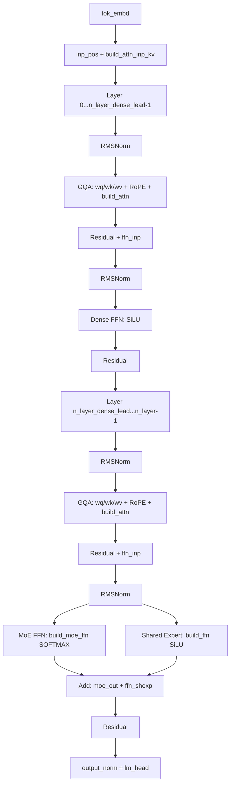
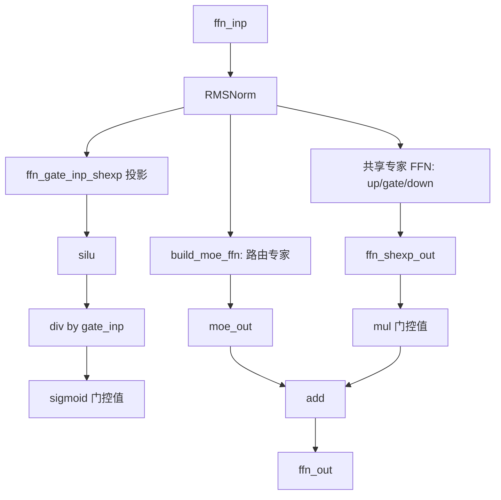
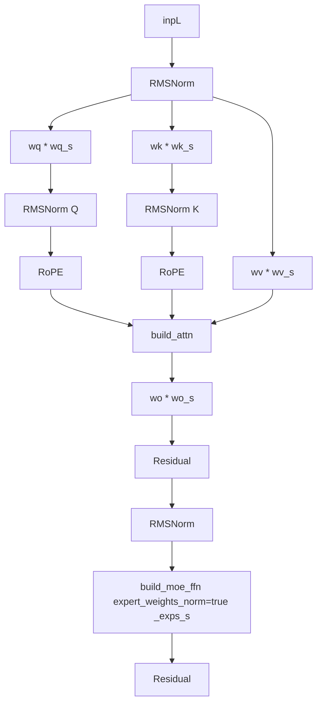
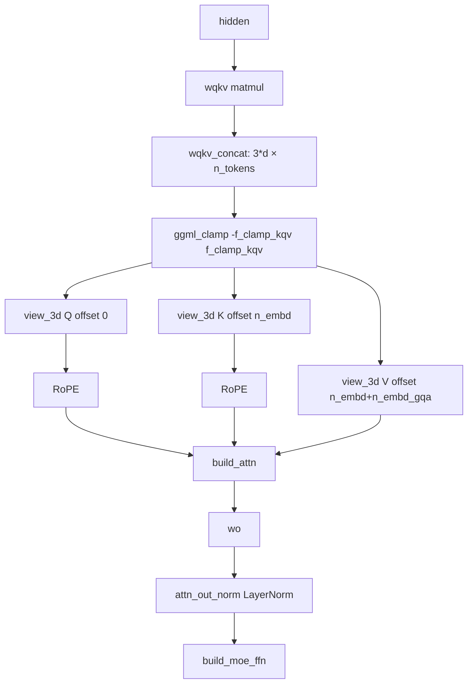
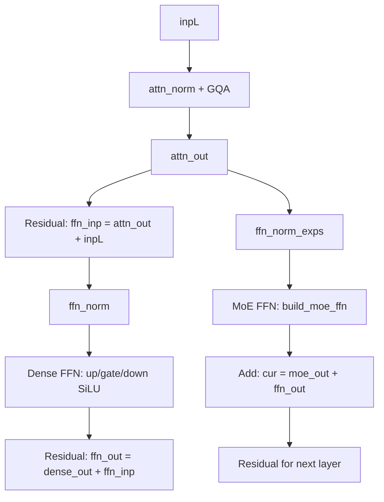
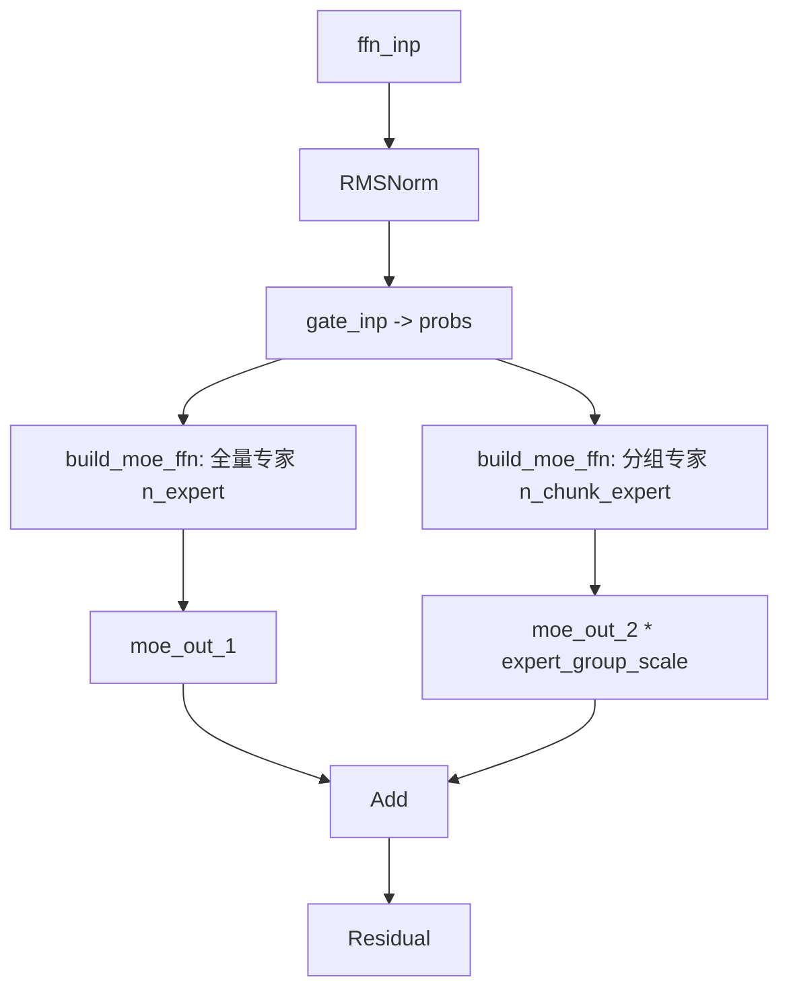
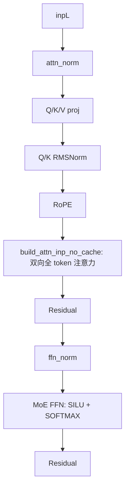

# 第27章 ：专家系统的炼金术 —— 从稠密砖瓦到稀疏摩天楼的 MoE 大爆发

## 学习目标

- 理解 DeepSeek V1/V2 系列 MoE 架构的图构建逻辑，包括稠密到稀疏的层切换策略
- 掌握 MLA（Multi-head Latent Attention）的吸收优化原理与 YaRN RoPE 预缩放技巧
- 理解 Qwen2MoE 与 Qwen3MoE 在共享专家机制上的不同设计思路
- 掌握 DBRX 单矩阵 QKV + Clamp、Arctic 稠密+MoE 双 FFN 等细粒度专家路由实现
- 理解 Grok 双后归一化与 GELU 激活、Olmoe Q/K Norm、Grovemoe 双层路由等 MoE 变体
- 掌握 ERNIE 4.5 的 n_moe_layer_step 间隔式 MoE、EXAONE-MoE 的 ISWA + Q/K Norm 组合
- 理解 OpenAI-MOE 的 Attention Sink 机制与 SwiGLU-OAI 定制激活
- 掌握 LLaDA-MoE 作为扩散语言模型如何通过无缓存注意力实现双向注意力
- 能识别各 MoE 模型在门控函数、专家权重归一化、激活函数、归一化位置上的设计差异

## 27.1 生活类比

想象 MoE 模型是一家**大型专科医院**，每层 Transformer 都是一次门诊流程。标准注意力相当于全科分诊台——每个患者（token）都要挂号；路由专家对应各科专家医生（神经科、骨科、心脏科……），患者按病情被分配到对应专家；共享专家则是全科医生（基础保健，人人必看）；前 n_layer_dense_lead 层就像急诊室——所有患者必须先经过的初诊区。MLA（潜空间注意力）是病历压缩术：医生把厚厚的病历压缩到一张小卡片（低秩 KV），需要时再展开；吸收优化则是边走边问，在走廊里就把部分问诊做完，到诊室只需问关键问题。ISWA 双 KV 缓存好比大病历柜 + 小病历柜：近期病历放小柜（快速查），远期放大柜。Attention Sink 是医院导诊图：无论走到哪里，先看导诊图找到方向。n_moe_layer_step 对应周期性专家会诊：不是每层都请专家，而是每隔几层集中会诊一次。分组专家（Grovemoe）则是双层路由：先按病情大类分诊，再在大类内选具体专家。就像医院需要平衡专家资源与初诊效率，MoE 模型也需要平衡稠密路径与稀疏专家的计算成本。本章我们将沿用这个医院隐喻，逐一拆解各大 MoE 架构如何在 llama.cpp 中搭建起高效的「专家系统兵工厂」。

## 27.2 源码地图

src/models/deepseek.cpp
├── llm_build_deepseek::llm_build_deepseek()  (line 1-140)
│   ├── 标准 GQA 注意力（Q/K/V 独立矩阵乘 + RoPE）
│   ├── kq_scale 通过 f_attention_scale 支持自定义
│   ├── build_attn_inp_kv() 构建标准 KV 缓存
│   ├── 前 n_layer_dense_lead 层使用稠密 FFN（LLM_FFN_SILU）
│   ├── 后续层切换为 MoE（build_moe_ffn + SOFTMAX 门控）
│   └── 共享专家（build_ffn）与路由专家并行相加

src/models/deepseek2.cpp
├── llm_build_deepseek2::llm_build_deepseek2()  (line 1-330)
│   ├── is_mla / is_ocr 双架构分支判断
│   ├── YaRN RoPE 预缩放（attn_factor_org → mscale → kq_scale）
│   ├── OCR 变体：纯 MHA + RoPE_TYPE_NEOX + freq_base=10000
│   ├── 非 Lite 变体：wq_a → RMSNorm → wq_b 的两阶段 Q 投影
│   ├── wkv_a_mqa 一次矩阵乘输出压缩 KV + RoPE 部分
│   ├── view_2d/3d 偏移切分压缩张量（kv_cmpr 与 k_pe）
│   ├── MLA 吸收分支（is_mla=true）：wk_b × q_nope 后与 q_pe 拼接
│   ├── MLA 非吸收分支：wkv_b 解压回完整 K/V 走标准 MHA
│   ├── 预测层跳过：effective_n_layers = n_layer - nextn_predict_layers
│   └── 共享专家 + 路由专家（支持 expert_weights_norm + expert_probs_b）

src/models/qwen2moe.cpp
├── llm_build_qwen2moe::llm_build_qwen2moe()  (line 1-160)
│   ├── 标准 GQA + RoPE 注意力
│   ├── build_moe_ffn 路由专家（LLM_FFN_SILU + SOFTMAX）
│   ├── 共享专家独立门控（sigmoid(gate)=silu(x)/x）
│   └── moe_out + ffn_shexp_out 后通过残差连接回主路径

src/models/qwen3moe.cpp
├── llm_build_qwen3moe::llm_build_qwen3moe()  (line 1-160)
│   ├── Q/K 各自 RMSNorm（attn_q_norm / attn_k_norm）
│   ├── LoRA 缩放因子：wq_s / wk_s / wv_s
│   ├── 输出缩放：wo_s 调整注意力输出幅值
│   ├── build_moe_ffn 传入 _exps_s 三个缩放张量（expert_weights_norm=true）
│   └── 无显式共享专家分支

src/models/dbrx.cpp
├── llm_build_dbrx::llm_build_dbrx()  (line 1-145)
│   ├── LLM_NORM 标准 LayerNorm（非 RMS）
│   ├── 单 wqkv 矩阵一次性输出 Q/K/V
│   ├── ggml_clamp 限制数值范围（f_clamp_kqv）
│   ├── view_3d 偏移切分 Q/K/V（不同 byte offset）
│   ├── attn_out_norm 后置 LayerNorm
│   └── 整层都是 MoE（无稠密 FFN）

src/models/arctic.cpp
├── llm_build_arctic::llm_build_arctic()  (line 1-165)
│   ├── 标准 GQA + RoPE 注意力
│   ├── 稠密 FFN（ffn_up/gate/down）独立残差
│   ├── MoE FFN（独立于残差流的 norm）
│   └── cur = dense_ffn + moe_ffn + ffn_inp 三路相加

src/models/grok.cpp
├── llm_build_grok::llm_build_grok()  (line 1-165)
│   ├── Q/K/V 可选偏置（bq/bk/bv）
│   ├── attn_out_norm 后置 RMSNorm
│   ├── MoE 使用 LLM_FFN_GELU（非主流 SiLU）
│   ├── 可选稠密 FFN：与 MoE 输出以 √2/2 比例缩放相加
│   ├── ffn_post_norm 后置归一化
│   └── final_logit_softcapping（tanh 软上限）+ f_logit_scale

src/models/olmoe.cpp
├── llm_build_olmoe::llm_build_olmoe()  (line 1-145)
│   ├── Q/K 双 RMSNorm + RoPE
│   ├── 纯 MoE 结构（expert_weights_norm=false 但走标准路径）
│   └── 无 attn_bias / sink token

src/models/grovemoe.cpp
├── llm_build_grovemoe::llm_build_grovemoe()  (line 1-175)
│   ├── Q/K 双 RMSNorm + RoPE
│   ├── n_chunk_expert = n_expert / n_group_experts 分组专家
│   ├── 预计算共享概率张量 probs（避免重复路由）
│   ├── 第一次 build_moe_ffn：标准专家（传入 probs）
│   ├── 第二次 build_moe_ffn：分组专家（che×ps 系列张量）
│   └── expert_group_scale 缩放相加双 MoE 输出

src/models/ernie4-5.cpp
├── llm_build_ernie4_5::llm_build_ernie4_5()  (line 1-140)
│   ├── Q/K/V 可选偏置
│   ├── 纯稠密 FFN（对照组）
│   └── 最后层 get_rows 过滤未使用 token

src/models/ernie4-5-moe.cpp
├── llm_build_ernie4_5_moe::llm_build_ernie4_5_moe()  (line 1-180)
│   ├── Q/K/V 可选偏置
│   ├── 间隔式 MoE：is_moe_layer = (il >= n_layer_dense_lead) && ((il+1) % n_moe_layer_step == 0)
│   ├── 非 MoE 层走 build_ffn（稠密 FFN）
│   ├── MoE 层调用 build_moe_ffn（传入 ffn_exp_probs_b 专家偏置）
│   ├── 共享专家可选（hparams.n_ff_shexp > 0 才构建）
│   └── 每层都通过 attn_out 回调单独观察

src/models/exaone-moe.cpp
├── llm_build_exaone_moe::llm_build_exaone_moe()  (line 1-200)
│   ├── build_attn_inp_kv_iswa（ISWA 双 KV 缓存）
│   ├── hparams.is_swa(il) 判断当前层是否为 SWA 层
│   ├── Q/K 双 RMSNorm
│   ├── 仅 SWA 层做 RoPE（is_local_layer 判断）
│   ├── 跳过预测层：n_transformer_layers = n_layer - nextn_predict_layers
│   ├── MoE 与稠密 FFN 共存（ffn_gate_inp 是否为 null 判断）
│   └── 共享专家作为可选分支与 MoE 输出相加

src/models/openai-moe-iswa.cpp
├── llm_build_openai_moe_iswa::llm_build_openai_moe_iswa()  (line 1-165)
│   ├── build_attn_inp_kv_iswa（ISWA 注意力缓存）
│   ├── get_rope_freq_base/scale 每层独立 RoPE 频率
│   ├── Q/K/V 矩阵乘均支持偏置
│   ├── 注意力中支持 attn_sinks（Attention Sink）
│   ├── attn_post_norm post-norm 风格归一化
│   ├── LLM_FFN_SWIGLU_OAI_MOE 特殊激活
│   ├── SOFTMAX_WEIGHT 门控函数
│   └── 所有专家权重支持偏置（ffn_gate_inp_b / ffn_up_exps_b 等）

src/models/llada-moe.cpp
├── llm_build_llada_moe::llm_build_llada_moe()  (line 1-160)
│   ├── build_attn_inp_no_cache（无 KV 缓存，对应扩散双向注意力）
│   ├── Q/K 双 RMSNorm + RoPE
│   ├── 纯 MoE（expert_weights_norm=false）
│   └── 注意力走全 token 对齐路径（非增量解码）

## 27.3 首块砖瓦：DeepSeek V1 确立稠密到稀疏的奠基范式 —— 急诊室先诊，专科后分

DeepSeek V1 是整个 DeepSeek 系列的起点，它确立了"前稠密后稀疏"的标准范式：前 `n_layer_dense_lead` 层使用普通的稠密 FFN，后续层切换为 MoE FFN + 共享专家的并行结构。这种设计既保证了底层特征提取的稳定性，又在高层引入了稀疏专家的参数效率。在医院隐喻中，前几层是「急诊室」——所有患者（token）必须先经过通用的初诊（稠密 FFN），积累基础语言特征；后几层才分流到「专科专家」（路由专家）与「全科医生」（共享专家）并行会诊。

### 27.3.1 llm_build_deepseek()：构建 DeepSeek V1 前向计算图

源码路径：`src/models/deepseek.cpp` - `llm_build_deepseek`（第 5-180 行）

```cpp
// 类型即图纸，先理解数据结构
// llm_build_deepseek 继承自 llm_graph_context，持有模型超参与构建上下文
// 逐行注释解释
llm_build_deepseek(const llama_model & model, const llm_graph_params & params) :
    llm_graph_context(params) {
    const int64_t n_embd_head = hparams.n_embd_head_v();                    // 每头维度（Value 头）

    GGML_ASSERT(n_embd_head == hparams.n_embd_head_k());                    // 断言 K 头维度一致
    GGML_ASSERT(n_embd_head == n_rot);                                      // 断言 RoPE 维度一致

    ggml_tensor * cur;                                                      // 当前计算张量指针
    ggml_tensor * inpL;                                                     // 层输入张量

    inpL = build_inp_embd(model.tok_embd);                                  // 词嵌入层：将 token id 映射为隐藏向量
    ggml_tensor * inp_pos = build_inp_pos();                                // 位置编码输入：为后续 RoPE 准备位置索引
    auto * inp_attn = build_attn_inp_kv();                                  // 构建标准 KV 缓存注意力输入结构
    const float kq_scale =                                                  // 注意力缩放因子
        hparams.f_attention_scale == 0.0f ? 1.0f / sqrtf(float(n_embd_head)) : hparams.f_attention_scale;
    ggml_tensor * inp_out_ids = build_inp_out_ids();                        // 输出 token 索引（用于最后一层只计算需要的 token）

    for (int il = 0; il < n_layer; ++il) {                                  // 遍历所有 Transformer 层
        ggml_tensor * inpSA = inpL;                                         // 保存残差分支输入

        cur = build_norm(inpL, model.layers[il].attn_norm, NULL, LLM_NORM_RMS, il);  // 注意力前 RMSNorm
        cb(cur, "attn_norm", il);

        {
            ggml_tensor * rope_factors = model.get_rope_factors(cparams, il);  // 获取当前层 RoPE 缩放因子

            ggml_tensor * Qcur = build_lora_mm(model.layers[il].wq, cur);       // Q 投影（支持 LoRA）
            cb(Qcur, "Qcur", il);
            if (model.layers[il].bq) {                                          // 可选 Q 偏置
                Qcur = ggml_add(ctx0, Qcur, model.layers[il].bq);
                cb(Qcur, "Qcur", il);
            }
            ggml_tensor * Kcur = build_lora_mm(model.layers[il].wk, cur);       // K 投影
            cb(Kcur, "Kcur", il);
            if (model.layers[il].bk) {                                          // 可选 K 偏置
                Kcur = ggml_add(ctx0, Kcur, model.layers[il].bk);
                cb(Kcur, "Kcur", il);
            }
            ggml_tensor * Vcur = build_lora_mm(model.layers[il].wv, cur);       // V 投影
            cb(Vcur, "Vcur", il);
            if (model.layers[il].bv) {                                          // 可选 V 偏置
                Vcur = ggml_add(ctx0, Vcur, model.layers[il].bv);
                cb(Vcur, "Vcur", il);
            }
            Qcur = ggml_reshape_3d(ctx0, Qcur, n_embd_head, n_head, n_tokens);      // 重塑为 [head_dim, n_head, n_tokens]
            Kcur = ggml_reshape_3d(ctx0, Kcur, n_embd_head, n_head_kv, n_tokens);
            Vcur = ggml_reshape_3d(ctx0, Vcur, n_embd_head, n_head_kv, n_tokens);

            Qcur = ggml_rope_ext(ctx0, Qcur, inp_pos, rope_factors, n_rot, rope_type, n_ctx_orig, freq_base, freq_scale,
                                 ext_factor, attn_factor, beta_fast, beta_slow);   // Q 注入 RoPE
            Kcur = ggml_rope_ext(ctx0, Kcur, inp_pos, rope_factors, n_rot, rope_type, n_ctx_orig, freq_base, freq_scale,
                                 ext_factor, attn_factor, beta_fast, beta_slow);   // K 注入 RoPE

            cb(Qcur, "Qcur", il);
            cb(Kcur, "Kcur", il);
            cb(Vcur, "Vcur", il);

            cur = build_attn(inp_attn,
                    model.layers[il].wo, model.layers[il].bo,
                    Qcur, Kcur, Vcur, nullptr, nullptr, nullptr, kq_scale, il);   // 标准 GQA 注意力计算
        }
        if (il == n_layer - 1 && inp_out_ids) {                                 // 最后一层仅保留需要的输出 token
            cur   = ggml_get_rows(ctx0, cur, inp_out_ids);
            inpSA = ggml_get_rows(ctx0, inpSA, inp_out_ids);
        }
        ggml_tensor * ffn_inp = ggml_add(ctx0, cur, inpSA);                     // 注意力残差相加
        cb(ffn_inp, "ffn_inp", il);

        cur = build_norm(ffn_inp, model.layers[il].ffn_norm, NULL, LLM_NORM_RMS, il);  // FFN 前 RMSNorm
        cb(cur, "ffn_norm", il);

        if ((uint32_t) il < hparams.n_layer_dense_lead) {                       // 稠密/稀疏分界线
            cur = build_ffn(cur,
                    model.layers[il].ffn_up, NULL, NULL,
                    model.layers[il].ffn_gate, NULL, NULL,
                    model.layers[il].ffn_down, NULL, NULL,
                    NULL, LLM_FFN_SILU, LLM_FFN_PAR, il);                       // 稠密 FFN：SiLU 激活
            cb(cur, "ffn_out", il);
        } else {
            ggml_tensor * moe_out = build_moe_ffn(cur,
                model.layers[il].ffn_gate_inp,
                model.layers[il].ffn_up_exps,
                model.layers[il].ffn_gate_exps,
                model.layers[il].ffn_down_exps,
                nullptr,
                n_expert, n_expert_used,
                LLM_FFN_SILU, false,
                hparams.expert_weights_scale,
                LLAMA_EXPERT_GATING_FUNC_TYPE_SOFTMAX,
                il);
            cb(moe_out, "ffn_moe_out", il);

            {
                ggml_tensor * ffn_shexp =
                    build_ffn(cur,
                        model.layers[il].ffn_up_shexp, NULL, NULL,
                        model.layers[il].ffn_gate_shexp, NULL, NULL,
                        model.layers[il].ffn_down_shexp, NULL, NULL,
                        NULL, LLM_FFN_SILU, LLM_FFN_PAR, il);                   // 共享专家：稠密 FFN
                cb(ffn_shexp, "ffn_shexp", il);

                cur = ggml_add(ctx0, moe_out, ffn_shexp);                       // MoE + 共享专家并行相加
                cb(cur, "ffn_out", il);
            }
        }
        cur = ggml_add(ctx0, cur, ffn_inp);                                     // FFN 残差相加

        cur = build_cvec(cur, il);                                              // 可选：构建连续向量（用于特定任务）
        cb(cur, "l_out", il);

        inpL = cur;
    }
    cur = inpL;

    cur = build_norm(cur, model.output_norm, NULL, LLM_NORM_RMS, -1);           // 最终输出归一化
    cb(cur, "result_norm", -1);
    res->t_embd = cur;

    cur = build_lora_mm(model.output, cur);                                     // 输出投影
    cb(cur, "result_output", -1);
    res->t_logits = cur;

    ggml_build_forward_expand(gf, cur);
}
```

**代码作用概述**：该构造函数完整定义了 DeepSeek V1 的前向计算图。从词嵌入与位置编码开始，逐层构建：注意力模块采用标准 GQA（独立 Q/K/V 投影 + RoPE），FFN 模块根据层索引 `il` 与 `n_layer_dense_lead` 比较，动态选择稠密 FFN 或 MoE FFN + 共享专家并行结构。残差连接贯穿注意力与 FFN 两大子层，最终经输出归一化与 `lm_head` 投影得到 logits。这种"配置驱动架构"的写法，让同一份构建代码同时支持纯稠密、纯 MoE 与混合模式。

### 27.3.2 DeepSeek V1 计算图架构图



---

## 27.4 炼金术：DeepSeek V2 MLA 与 YaRN 的潜空间注意力革命 —— 病历压缩术与雅恩缩放

DeepSeek V2 引入了 MLA（Multi-head Latent Attention），这是本章最核心的创新。MLA 将 Key/Value 压缩到低秩潜空间（`kv_lora_rank`），通过"吸收优化"在推理时避免显式解压完整 K/V，大幅降低显存占用与带宽压力。结合 YaRN RoPE 预缩放，实现了长上下文外推能力的数学级保障。在医院隐喻中，MLA 是「病历压缩术」：医生把厚厚的病历（完整 KV）压缩到一张小卡片（低秩 `kv_cmpr`），需要时通过 `wk_b` 把查询的无 RoPE 部分（`q_nope`）映射到压缩空间，再与 RoPE 部分（`q_pe`）拼接，直接在压缩空间做注意力，省去了「展开病历」的显式解压步骤。

### 27.4.1 llm_build_deepseek2()：构建 DeepSeek V2/OCR 计算图的双架构入口函数

源码路径：`src/models/deepseek2.cpp` - `llm_build_deepseek2`（第 1-330 行）

```cpp
// 类型即图纸，先理解数据结构
// llm_build_deepseek2 同时处理 DeepSeek V2（含 MLA）与 OCR 变体
// 逐行注释解释
llm_build_deepseek2::llm_build_deepseek2(const llama_model & model, const llm_graph_params & params) :
    llm_graph_context(params) {
    bool is_ocr = model.arch == LLM_ARCH_DEEPSEEK2OCR;                          // OCR 变体标识
    const bool is_mla = hparams.is_mla();                                       // 是否启用 MLA 吸收优化
    const int64_t n_embd_head_k = hparams.n_embd_head_k_mla();                  // MLA 下 K 头维度
    const int64_t n_embd_head_v = hparams.n_embd_head_v_mla();                  // MLA 下 V 头维度
    const int64_t n_embd_head_qk_rope = hparams.n_rot();                        // RoPE 维度
    const int64_t n_embd_head_qk_nope = n_embd_head_k - n_embd_head_qk_rope;    // 非 RoPE 维度
    const uint32_t kv_lora_rank = hparams.n_lora_kv;                            // KV 低秩压缩秩
    GGML_ASSERT(ext_factor >= 0.0f);
    const float attn_factor_org = attn_factor * (1.0f + 0.1f * logf(1.0f / freq_scale));  // 撤销原始 yarn 调整
    const float mscale   = attn_factor_org * (1.0f + 0.1f * hparams.rope_yarn_log_mul * logf(1.0f / freq_scale)); // YaRN mscale
    const float kq_scale = 1.0f * mscale * mscale / sqrtf(float(n_embd_head_k));  // 最终注意力缩放：mscale²/√d_k
    ggml_tensor * cur;
    ggml_tensor * inpL;
    inpL = build_inp_embd(model.tok_embd);                                      // 词嵌入
    ggml_tensor * inp_attn_scale = nullptr;
    if (hparams.f_attn_temp_scale != 0.0f) {                                    // 可选注意力温度缩放输入
        inp_attn_scale = build_inp_attn_scale();
    }
    ggml_tensor * inp_pos = build_inp_pos();                                    // 位置编码输入
    auto * inp_attn_kv = !is_mla ? build_attn_inp_kv() : nullptr;               // 标准 KV 缓存（非 MLA 路径）
    auto * inp_attn_k  =  is_mla ? build_attn_inp_k()  : nullptr;               // 仅 K 缓存（MLA 吸收路径）
    ggml_tensor * inp_out_ids = build_inp_out_ids();                            // 输出 token 索引
    int effective_n_layers = hparams.n_layer - hparams.nextn_predict_layers;    // 跳过预测层
    for (int il = 0; il < effective_n_layers; ++il) {
        ggml_tensor * inpSA = inpL;
        cur = build_norm(inpL, model.layers[il].attn_norm, NULL, LLM_NORM_RMS, il);
        cb(cur, "attn_norm", il);
        if (is_ocr) {                                                           // OCR 变体：纯 MHA 路径
            const int n_embed_head = hparams.n_embd / hparams.n_head();
            const int ocr_rope_type = GGML_ROPE_TYPE_NEOX;
            GGML_ASSERT(n_embed_head == n_embd_head_k && n_embed_head == n_embd_head_v);
            ggml_tensor * Qcur = NULL;
            ggml_tensor * Kcur = NULL;
            ggml_tensor * Vcur = NULL;
            Qcur = ggml_mul_mat(ctx0, model.layers[il].wq, cur);
            Kcur = ggml_mul_mat(ctx0, model.layers[il].wk, cur);
            Vcur = ggml_mul_mat(ctx0, model.layers[il].wv, cur);
            cb(Qcur, "q", il);
            cb(Kcur, "k", il);
            cb(Vcur, "v", il);
            Qcur = ggml_reshape_3d(ctx0, Qcur, n_embed_head, n_head, n_tokens);
            Kcur = ggml_reshape_3d(ctx0, Kcur, n_embed_head, n_head, n_tokens);
            Vcur = ggml_reshape_3d(ctx0, Vcur, n_embed_head, n_head, n_tokens);
            GGML_ASSERT(fabs(freq_base - 10000.0) < 1e-4);                      // 固定 freq_base=10000
            Qcur = ggml_rope_ext(ctx0, Qcur, inp_pos, nullptr, n_embed_head, ocr_rope_type, 0, freq_base, 1, 0, 1, 0, 0);
            Kcur = ggml_rope_ext(ctx0, Kcur, inp_pos, nullptr, n_embed_head, ocr_rope_type, 0, freq_base, 1, 0, 1, 0, 0);
            cb(Qcur, "q_pe", il);
            cb(Kcur, "k_pe", il);
            cur = build_attn(inp_attn_kv,
                        model.layers[il].wo, NULL,
                        Qcur, Kcur, Vcur, nullptr, nullptr, nullptr, kq_scale, il);
            cb(cur, "attn_out", il);
        }
        else {                                                                  // 标准 DeepSeek V2 路径
            ggml_tensor * q = NULL;
            const bool is_lite = model.layers[il].wq;                           // Lite 变体判断：有 wq 则为 Lite
            if (!is_lite) {                                                     // 非 Lite：两阶段 Q 投影
                q = ggml_mul_mat(ctx0, model.layers[il].wq_a, cur);             // wq_a: [kv_lora_rank, n_embd]
                cb(q, "q", il);
                q = build_norm(q, model.layers[il].attn_q_a_norm, nullptr, LLM_NORM_RMS, il);  // 中间 RMSNorm
                cb(q, "q", il);
                q = ggml_mul_mat(ctx0, model.layers[il].wq_b, q);               // wq_b: [n_embd_head_k * n_head, kv_lora_rank]
                cb(q, "q", il);
            } else {                                                            // Lite：单阶段 Q 投影
                q = ggml_mul_mat(ctx0, model.layers[il].wq, cur);
                cb(q, "q", il);
            }
            ggml_tensor * q_nope =                                              // 切分出非 RoPE 部分
                ggml_view_3d(ctx0, q, n_embd_head_qk_nope, n_head, n_tokens, ggml_row_size(q->type, n_embd_head_k),
                             ggml_row_size(q->type, n_embd_head_k) * n_head, 0);
            cb(q_nope, "q_nope", il);
            ggml_tensor * q_pe = ggml_view_3d(                                  // 切分出 RoPE 部分
                ctx0, q, n_embd_head_qk_rope, n_head, n_tokens, ggml_row_size(q->type, n_embd_head_k),
                ggml_row_size(q->type, n_embd_head_k) * n_head, ggml_row_size(q->type, n_embd_head_qk_nope));
            cb(q_pe, "q_pe", il);
            ggml_tensor * kv_cmpr_pe = ggml_mul_mat(ctx0, model.layers[il].wkv_a_mqa, cur);  // 单矩阵输出压缩 KV + K_RoPE
            cb(kv_cmpr_pe, "kv_cmpr_pe", il);
            ggml_tensor * kv_cmpr =                                             // 切分压缩 KV（低秩）
                ggml_view_2d(ctx0, kv_cmpr_pe, kv_lora_rank, n_tokens,
                             ggml_row_size(kv_cmpr_pe->type, kv_lora_rank + n_embd_head_qk_rope), 0);
            cb(kv_cmpr, "kv_cmpr", il);
            ggml_tensor * k_pe = ggml_view_3d(ctx0, kv_cmpr_pe, n_embd_head_qk_rope, 1, n_tokens,  // 切分 K_RoPE
                                              ggml_row_size(kv_cmpr_pe->type, kv_lora_rank + n_embd_head_qk_rope),
                                              ggml_row_size(kv_cmpr_pe->type, kv_lora_rank + n_embd_head_qk_rope),
                                              ggml_row_size(kv_cmpr_pe->type, kv_lora_rank));
            cb(k_pe, "k_pe", il);
            q_pe = ggml_rope_ext(ctx0, q_pe, inp_pos, nullptr, n_rot, rope_type, n_ctx_orig, freq_base, freq_scale,
                                 ext_factor, attn_factor, beta_fast, beta_slow);
            cb(q_pe, "q_pe", il);
            k_pe = ggml_rope_ext(ctx0, k_pe, inp_pos, nullptr, n_rot, rope_type, n_ctx_orig, freq_base, freq_scale,
                                 ext_factor, attn_factor, beta_fast, beta_slow);
            cb(k_pe, "k_pe", il);
            kv_cmpr = build_norm(kv_cmpr, model.layers[il].attn_kv_a_norm, nullptr, LLM_NORM_RMS, il);  // 压缩 KV 做 Norm
            cb(kv_cmpr, "kv_cmpr", il);
            if (is_mla) {                                                       // MLA 吸收优化分支
                q_nope = ggml_permute(ctx0, q_nope, 0, 2, 1, 3);                // 调整维度顺序便于矩阵乘
                cb(q_nope, "q_nope_perm", il);
                ggml_tensor * q_nope_absorbed = ggml_mul_mat(ctx0, model.layers[il].wk_b, q_nope);  // 核心吸收：wk_b × q_nope
                cb(q_nope_absorbed, "q_nope_absorbed", il);
                q_nope_absorbed = ggml_permute(ctx0, q_nope_absorbed, 0, 2, 1, 3);  // 恢复维度
                cb(q_nope_absorbed, "q_nope_absorbed_perm", il);
                ggml_tensor * Qcur = ggml_concat(ctx0, q_nope_absorbed, q_pe, 0);  // 拼接吸收后的 Q 与 q_pe
                cb(Qcur, "Qcur", il);
                kv_cmpr = ggml_reshape_3d(ctx0, kv_cmpr, kv_lora_rank, 1, n_tokens);  // 压缩 KV 重塑为 3D
                cb(kv_cmpr, "kv_cmpr_reshape", il);
                ggml_tensor * Kcur = ggml_concat(ctx0, kv_cmpr, k_pe, 0);       // K = [kv_cmpr, k_pe]
                cb(Kcur, "Kcur", il);
                ggml_tensor * Vcur = kv_cmpr;                                   // V 直接用压缩 KV（共享）
                cb(Vcur, "Vcur", il);
                if (inp_attn_scale) {                                           // 可选注意力温度缩放
                    Qcur = ggml_mul(ctx0, Qcur, inp_attn_scale);
                    cb(Qcur, "Qcur_attn_temp_scaled", il);
                }
                cur = build_attn(inp_attn_k,                                    // 走仅 K 缓存的注意力路径
                        model.layers[il].wo, NULL,
                        Qcur, Kcur, Vcur, nullptr, nullptr, model.layers[il].wv_b, kq_scale, il);
            } else {                                                            // 非吸收分支：显式解压回标准 MHA
                ggml_tensor * kv = ggml_mul_mat(ctx0, model.layers[il].wkv_b, kv_cmpr);  // wkv_b 解压
                cb(kv, "kv", il);
                ggml_tensor * k_nope =                                          // 切分解压后的 K_nope
                    ggml_view_3d(ctx0, kv, n_embd_head_qk_nope, n_head, n_tokens,
                                 ggml_row_size(kv->type, n_embd_head_qk_nope + n_embd_head_v),
                                 ggml_row_size(kv->type, n_embd_head_qk_nope + n_embd_head_v) * n_head, 0);
                cb(k_nope, "k_nope_view", il);
                ggml_tensor * Vcur = ggml_view_3d(ctx0, kv, n_embd_head_v, n_head, n_tokens,  // 切分 V
                                                  ggml_row_size(kv->type, n_embd_head_qk_nope + n_embd_head_v),
                                                  ggml_row_size(kv->type, n_embd_head_qk_nope + n_embd_head_v) * n_head,
                                                  ggml_row_size(kv->type, n_embd_head_qk_nope));
                cb(Vcur, "Vcur_view", il);
                Vcur = ggml_cont(ctx0, Vcur);                                   // 保证内存连续
                cb(Vcur, "Vcur_cont", il);
                ggml_tensor * Qcur = ggml_concat(ctx0, q_nope, q_pe, 0);        // Q = [q_nope, q_pe]
                cb(Qcur, "Qcur", il);
                ggml_tensor * Kcur = ggml_concat(ctx0, k_nope, ggml_repeat(ctx0, k_pe, q_pe), 0);  // K = [k_nope, repeat(k_pe)]
                cb(Kcur, "Kcur", il);
                if (inp_attn_scale) {
                    Qcur = ggml_mul(ctx0, Qcur, inp_attn_scale);
                    cb(Qcur, "Qcur_attn_temp_scaled", il);
                }
                cur = build_attn(inp_attn_kv,
                            model.layers[il].wo, NULL,
                            Qcur, Kcur, Vcur, nullptr, nullptr, nullptr, kq_scale, il);
            }
        }
        if (il == effective_n_layers - 1 && inp_out_ids) {
            cur   = ggml_get_rows(ctx0, cur, inp_out_ids);
            inpSA = ggml_get_rows(ctx0, inpSA, inp_out_ids);
        }
        ggml_tensor * ffn_inp = ggml_add(ctx0, cur, inpSA);
        cb(ffn_inp, "ffn_inp", il);
        cur = build_norm(ffn_inp, model.layers[il].ffn_norm, NULL, LLM_NORM_RMS, il);
        cb(cur, "ffn_norm", il);
        if ((uint32_t) il < hparams.n_layer_dense_lead) {                       // 稠密/稀疏分界同 V1
            cur = build_ffn(cur,
                model.layers[il].ffn_up, NULL, NULL,
                model.layers[il].ffn_gate, NULL, NULL,
                model.layers[il].ffn_down, NULL, NULL,
                NULL, LLM_FFN_SILU, LLM_FFN_PAR, il);
            cb(cur, "ffn_out", il);
        } else {
            ggml_tensor * moe_out = build_moe_ffn(cur,
                model.layers[il].ffn_gate_inp,
                model.layers[il].ffn_up_exps,
                model.layers[il].ffn_gate_exps,
                model.layers[il].ffn_down_exps,
                model.layers[il].ffn_exp_probs_b,
                n_expert, n_expert_used,
                LLM_FFN_SILU, hparams.expert_weights_norm,
                hparams.expert_weights_scale,
                (llama_expert_gating_func_type) hparams.expert_gating_func,
                il,
                nullptr,
                model.layers[il].ffn_gate_up_exps);
            cb(moe_out, "ffn_moe_out", il);
            {
                ggml_tensor * ffn_shexp =
                    build_ffn(cur,
                        model.layers[il].ffn_up_shexp, NULL, NULL,
                        model.layers[il].ffn_gate_shexp, NULL, NULL,
                        model.layers[il].ffn_down_shexp, NULL, NULL,
                        NULL, LLM_FFN_SILU, LLM_FFN_PAR, il);
                cb(ffn_shexp, "ffn_shexp", il);
                cur = ggml_add(ctx0, moe_out, ffn_shexp);
                cb(cur, "ffn_out", il);
            }
        }
        cur = ggml_add(ctx0, cur, ffn_inp);
        cur = build_cvec(cur, il);
        cb(cur, "l_out", il);
        inpL = cur;
    }
    cur = inpL;
    cur = build_norm(cur, model.output_norm, NULL, LLM_NORM_RMS, -1);
    cb(cur, "result_norm", -1);
    res->t_embd = cur;
    cur = ggml_mul_mat(ctx0, model.output, cur);
    cb(cur, "result_output", -1);
    res->t_logits = cur;
    ggml_build_forward_expand(gf, cur);
}
```

**代码作用概述**：该构造函数实现了 DeepSeek V2 的双架构分支构建。核心创新在于 MLA 吸收优化路径：`wkv_a_mqa` 一次矩阵乘输出拼接的压缩 KV 与 K_RoPE，通过 `view_2d/3d` 零拷贝切分；`wq_a` → Norm → `wq_b` 两阶段 Q 投影产出完整 Q，再 `view_3d` 切分 `q_nope` 与 `q_pe`；吸收优化时 `wk_b` 将 `q_nope` 映射到压缩 K 空间，与 `q_pe` 拼接后直接走 `build_attn_inp_k`（仅缓存 K），避免了显式解压 `wkv_b`。YaRN RoPE 通过 `attn_factor_org` 撤销原始调整，再乘 `mscale` 得到 `kq_scale = mscale²/√d_k`。OCR 变体强制走纯 MHA + NEOX RoPE + 固定 `freq_base=10000`。

### 27.4.2 MLA 核心张量流向图

```mermaid
graph TD
    A[hidden_states] --> B[wkv_a_mqa]
    B --> C[kv_cmpr_pe: (kv_lora_rank + n_rot) × n_tokens]
    C --> D[view_2d: kv_cmpr (kv_lora_rank × n_tokens)]
    C --> E[view_3d: k_pe (n_rot × 1 × n_tokens)]
    A --> F[wq_a -> RMSNorm -> wq_b] 
    F --> G[q: n_embd_head_k × n_head × n_tokens]
    G --> H[view_3d: q_nope (n_embd_head_qk_nope × n_head × n_tokens)]
    G --> I[view_3d: q_pe (n_embd_head_qk_rope × n_head × n_tokens)]
    I --> J[RoPE]
    E --> K[RoPE]
    H --> L[permute 0,2,1,3]
    L --> M[wk_b matmul]
    M --> N[permute 0,2,1,3]
    N --> O[q_nope_absorbed]
    O --> P[concat with q_pe -> Qcur]
    D --> Q[reshape_3d]
    Q --> R[concat with k_pe -> Kcur]
    Q --> S[Vcur = kv_cmpr]
    P & R & S --> T[build_attn_inp_k + wv_b]
```

---

## 27.5 双生演进：Qwen2MoE 显式门控 vs Qwen3MoE 隐式缩放 —— 自适应阀门与隐式融合

Qwen 系列展示了 MoE 架构的两种演进方向：Qwen2MoE 保留显式共享专家并用独立门控调节；Qwen3MoE 则通过 Q/K 归一化与专家权重缩放张量实现隐式融合。在医院隐喻中，Qwen2MoE 给全科医生（共享专家）加了一个「自适应阀门」——`sigmoid(silu(x)/x)`，模型可动态决定基础保健用量；Qwen3MoE 则把全科医生并入专家团队，通过 `_exps_s` 缩放张量在路由层面内隐式平衡各专家贡献，计算图更紧凑。

### 27.5.1 llm_build_qwen2moe()：构建 Qwen2MoE 计算图的入口函数

源码路径：`src/models/qwen2moe.cpp` - `llm_build_qwen2moe`（第 4-128 行）

```cpp
// 类型即图纸，先理解数据结构
// llm_build_qwen2moe 实现标准 GQA + MoE + 显式共享专家门控
// 逐行注释解释
llm_build_qwen2moe::llm_build_qwen2moe(const llama_model & model, const llm_graph_params & params) : llm_graph_context(params) {
    const int64_t n_embd_head = hparams.n_embd_head_v();

    GGML_ASSERT(n_embd_head == hparams.n_embd_head_k());
    GGML_ASSERT(n_embd_head == n_rot);

    ggml_tensor * cur;
    ggml_tensor * inpL;

    inpL = build_inp_embd(model.tok_embd);                        // 词嵌入
    ggml_tensor * inp_pos = build_inp_pos();                      // 位置编码输入
    auto * inp_attn = build_attn_inp_kv();                        // 标准 KV 缓存
    ggml_tensor * inp_out_ids = build_inp_out_ids();              // 输出 token 索引

    for (int il = 0; il < n_layer; ++il) {
        ggml_tensor * inpSA = inpL;

        cur = build_norm(inpL, model.layers[il].attn_norm, NULL, LLM_NORM_RMS, il);  // 注意力前 Norm
        cb(cur, "attn_norm", il);

        // self_attention
        {
            ggml_tensor * Qcur = build_lora_mm(model.layers[il].wq, cur);       // Q 投影（支持 LoRA）
            cb(Qcur, "Qcur", il);
            if (model.layers[il].bq) {                                          // 可选 Q 偏置
                Qcur = ggml_add(ctx0, Qcur, model.layers[il].bq);
                cb(Qcur, "Qcur", il);
            }
            ggml_tensor * Kcur = build_lora_mm(model.layers[il].wk, cur);       // K 投影
            cb(Kcur, "Kcur", il);
            if (model.layers[il].bk) {                                          // 可选 K 偏置
                Kcur = ggml_add(ctx0, Kcur, model.layers[il].bk);
                cb(Kcur, "Kcur", il);
            }
            ggml_tensor * Vcur = build_lora_mm(model.layers[il].wv, cur);       // V 投影
            cb(Vcur, "Vcur", il);
            if (model.layers[il].bv) {                                          // 可选 V 偏置
                Vcur = ggml_add(ctx0, Vcur, model.layers[il].bv);
                cb(Vcur, "Vcur", il);
            }
            Qcur = ggml_reshape_3d(ctx0, Qcur, n_embd_head, n_head,    n_tokens);
            Kcur = ggml_reshape_3d(ctx0, Kcur, n_embd_head, n_head_kv, n_tokens);
            Vcur = ggml_reshape_3d(ctx0, Vcur, n_embd_head, n_head_kv, n_tokens);

            Qcur = ggml_rope_ext(ctx0, Qcur, inp_pos, nullptr, n_rot, rope_type, n_ctx_orig, freq_base, freq_scale,
                                 ext_factor, attn_factor, beta_fast, beta_slow);
            Kcur = ggml_rope_ext(ctx0, Kcur, inp_pos, nullptr, n_rot, rope_type, n_ctx_orig, freq_base, freq_scale,
                                 ext_factor, attn_factor, beta_fast, beta_slow);

            cb(Qcur, "Qcur", il);
            cb(Kcur, "Kcur", il);
            cb(Vcur, "Vcur", il);

            cur = build_attn(inp_attn,
                    model.layers[il].wo, model.layers[il].bo,
                    Qcur, Kcur, Vcur, nullptr, nullptr, nullptr, 1.0f/sqrtf(float(n_embd_head)), il);
        }
        if (il == n_layer - 1 && inp_out_ids) {
            cur   = ggml_get_rows(ctx0, cur, inp_out_ids);
            inpSA = ggml_get_rows(ctx0, inpSA, inp_out_ids);
        }
        ggml_tensor * ffn_inp = ggml_add(ctx0, cur, inpSA);                     // 注意力残差
        cb(ffn_inp, "ffn_inp", il);

        // MoE branch
        cur = build_norm(ffn_inp, model.layers[il].ffn_norm, NULL, LLM_NORM_RMS, il);
        cb(cur, "ffn_norm", il);

        ggml_tensor * moe_out = build_moe_ffn(cur,
                model.layers[il].ffn_gate_inp,
                model.layers[il].ffn_up_exps,
                model.layers[il].ffn_gate_exps,
                model.layers[il].ffn_down_exps,
                nullptr,
                n_expert, n_expert_used,
                LLM_FFN_SILU, false,
                hparams.expert_weights_scale,
                LLAMA_EXPERT_GATING_FUNC_TYPE_SOFTMAX,
                il);
        cb(moe_out, "ffn_moe_out", il);

        // FFN shared expert：显式独立门控
        {
            ggml_tensor * cur_gate_inp = build_lora_mm(model.layers[il].ffn_gate_inp_shexp, cur);  // 共享专家门控投影
            cb(cur_gate_inp, "ffn_shexp_gate_inp", il);

            // sigmoid(silu(x)/x) 门控函数
            ggml_tensor * cur_gate = ggml_div(ctx0, ggml_silu(ctx0, cur_gate_inp), cur_gate_inp);
            cb(cur_gate, "ffn_shexp_gate", il);

            ggml_tensor * cur_ffn = build_ffn(cur,
                    model.layers[il].ffn_up_shexp,   NULL, NULL,
                    model.layers[il].ffn_gate_shexp, NULL, NULL,
                    model.layers[il].ffn_down_shexp, NULL, NULL,
                    NULL,
                    LLM_FFN_SILU, LLM_FFN_PAR, il);                               // 共享专家 FFN 计算
            cb(cur_ffn, "ffn_shexp", il);

            ggml_tensor * ffn_shexp_out = ggml_mul(ctx0, cur_ffn, cur_gate);      // 门控调制
            cb(ffn_shexp_out, "ffn_shexp_out", il);

            moe_out = ggml_add(ctx0, moe_out, ffn_shexp_out);                     // MoE + 门控共享专家
            cb(moe_out, "ffn_out", il);

            cur = moe_out;
        }
        cur = ggml_add(ctx0, cur, ffn_inp);                                       // FFN 残差
        cur = build_cvec(cur, il);
        cb(cur, "l_out", il);
        inpL = cur;
    }
    cur = inpL;
    cur = build_norm(cur, model.output_norm, NULL, LLM_NORM_RMS, -1);
    cb(cur, "result_norm", -1);
    res->t_embd = cur;
    cur = build_lora_mm(model.output, cur);
    cb(cur, "result_output", -1);
    res->t_logits = cur;
    ggml_build_forward_expand(gf, cur);
}
```

**代码作用概述**：Qwen2MoE 采用标准 GQA 注意力（支持 Q/K/V 偏置），FFN 阶段先跑路由专家 `build_moe_ffn`（SOFTMAX 门控），再显式计算共享专家：独立门控投影 `ffn_gate_inp_shexp` → `sigmoid(silu(x)/x)` 门控 → 共享专家 FFN → 门控调制输出 → 与 MoE 输出相加。这种显式门控设计让共享专家贡献可被动态调节，类似给全科医生加了一个「自适应阀门」。

### 27.5.2 Qwen2MoE 共享专家门控流程图



---

### 27.5.3 llm_build_qwen3moe()：构建 Qwen3MoE 计算图的入口函数

源码路径：`src/models/qwen3moe.cpp` - `llm_build_qwen3moe`（第 1-99 行）

```cpp
// 类型即图纸，先理解数据结构
// llm_build_qwen3moe 引入 Q/K RMSNorm、LoRA 缩放因子、专家权重归一化
// 逐行注释解释
llm_build_qwen3moe::llm_build_qwen3moe(const llama_model & model, const llm_graph_params & params) : llm_graph_context(params) {
    const int64_t n_embd_head = hparams.n_embd_head_v();

    GGML_ASSERT(n_embd_head == hparams.n_embd_head_k());
    GGML_ASSERT(n_embd_head == n_rot);

    ggml_tensor * cur;
    ggml_tensor * inpL;

    inpL = build_inp_embd(model.tok_embd);
    ggml_tensor * inp_pos = build_inp_pos();
    auto * inp_attn = build_attn_inp_kv();
    ggml_tensor * inp_out_ids = build_inp_out_ids();

    for (int il = 0; il < n_layer; ++il) {
        ggml_tensor * inpSA = inpL;

        cur = build_norm(inpL, model.layers[il].attn_norm, NULL, LLM_NORM_RMS, il);
        cb(cur, "attn_norm", il);

        // self_attention
        {
            ggml_tensor * Qcur = build_lora_mm(model.layers[il].wq, cur, model.layers[il].wq_s);  // LoRA 缩放因子 wq_s
            cb(Qcur, "Qcur", il);
            ggml_tensor * Kcur = build_lora_mm(model.layers[il].wk, cur, model.layers[il].wk_s);  // wk_s
            cb(Kcur, "Kcur", il);
            ggml_tensor * Vcur = build_lora_mm(model.layers[il].wv, cur, model.layers[il].wv_s);  // wv_s
            cb(Vcur, "Vcur", il);
            Qcur = ggml_reshape_3d(ctx0, Qcur, n_embd_head, n_head,    n_tokens);
            Kcur = ggml_reshape_3d(ctx0, Kcur, n_embd_head, n_head_kv, n_tokens);
            Vcur = ggml_reshape_3d(ctx0, Vcur, n_embd_head, n_head_kv, n_tokens);
            Qcur = build_norm(Qcur, model.layers[il].attn_q_norm, NULL, LLM_NORM_RMS, il);  // Q RMSNorm
            cb(Qcur, "Qcur_normed", il);
            Qcur = ggml_rope_ext(ctx0, Qcur, inp_pos, nullptr, n_rot, rope_type, n_ctx_orig, freq_base, freq_scale, ext_factor, attn_factor, beta_fast, beta_slow);
            Kcur = build_norm(Kcur, model.layers[il].attn_k_norm, NULL, LLM_NORM_RMS, il);  // K RMSNorm
            cb(Kcur, "Kcur_normed", il);
            Kcur = ggml_rope_ext(ctx0, Kcur, inp_pos, nullptr, n_rot, rope_type, n_ctx_orig, freq_base, freq_scale, ext_factor, attn_factor, beta_fast, beta_slow);
            cb(Qcur, "Qcur", il);
            cb(Kcur, "Kcur", il);
            cb(Vcur, "Vcur", il);
            cur = build_attn(inp_attn, model.layers[il].wo, model.layers[il].bo, Qcur, Kcur, Vcur, nullptr, nullptr, nullptr, 1.0f/sqrtf(float(n_embd_head)), il);
            if (model.layers[il].wo_s) {                                           // 输出缩放 wo_s
                cur = ggml_mul(ctx0, cur, model.layers[il].wo_s);
            }
        }
        if (il == n_layer - 1 && inp_out_ids) {
            cur   = ggml_get_rows(ctx0, cur, inp_out_ids);
            inpSA = ggml_get_rows(ctx0, inpSA, inp_out_ids);
        }
        ggml_tensor * ffn_inp = ggml_add(ctx0, cur, inpSA);
        cb(ffn_inp, "ffn_inp", il);

        // MoE branch：隐式融合共享专家
        cur = build_norm(ffn_inp, model.layers[il].ffn_norm, NULL, LLM_NORM_RMS, il);
        cb(cur, "ffn_norm", il);
        ggml_tensor * moe_out = build_moe_ffn(cur, model.layers[il].ffn_gate_inp, model.layers[il].ffn_up_exps, model.layers[il].ffn_gate_exps, model.layers[il].ffn_down_exps, nullptr, n_expert, n_expert_used, LLM_FFN_SILU, true, hparams.expert_weights_scale, LLAMA_EXPERT_GATING_FUNC_TYPE_SOFTMAX, il, nullptr, nullptr, model.layers[il].ffn_up_exps_s, model.layers[il].ffn_gate_exps_s, model.layers[il].ffn_down_exps_s);  // 传入 _exps_s 缩放张量，expert_weights_norm=true
        cb(moe_out, "ffn_moe_out", il);
        cur = moe_out;
        cur = ggml_add(ctx0, cur, ffn_inp);
        cur = build_cvec(cur, il);
        cb(cur, "l_out", il);
        inpL = cur;
    }
    cur = inpL;
    cur = build_norm(cur, model.output_norm, NULL, LLM_NORM_RMS, -1);
    cb(cur, "result_norm", -1);
    res->t_embd = cur;
    cur = build_lora_mm(model.output, cur);
    cb(cur, "result_output", -1);
    res->t_logits = cur;
    ggml_build_forward_expand(gf, cur);
}
```

**代码作用概述**：Qwen3MoE 在注意力侧引入 Q/K 双 RMSNorm（`attn_q_norm`/`attn_k_norm`）与 LoRA 缩放因子（`wq_s`/`wk_s`/`wv_s`/`wo_s`），FFN 侧取消显式共享专家分支，改为在 `build_moe_ffn` 内部通过 `expert_weights_norm=true` 与三个 `_exps_s` 缩放张量实现专家权重归一化与隐式共享专家融合。计算图更紧凑，推理延迟更低，符合现代编译器融合算子的优化趋势。

### 27.5.4 Qwen3MoE 注意力与 MoE 架构图



---

## 27.6 双城记：DBRX 单矩阵 QKV + Clamp 与 Arctic 稠密+MoE 并联 —— 一体化分诊台与双轨制会诊

DBRX 与 Arctic 代表了北美 MoE 设计的两种极致工程哲学：DBRX 追求算子融合与数值稳定的极致压缩，Arctic 追求稠密与稀疏路径的解耦并行。医院隐喻中，DBRX 是「一体化分诊台」——Q/K/V 一张表单（单矩阵）填完，再用 Clamp 限制数值防止极端病例；Arctic 是「双轨制会诊」——稠密全科医生与专科专家团队同步工作，互不干扰，最后三方会诊定诊断。

### 27.6.1 llm_build_dbrx()：构建 DBRX 计算图的入口函数

源码路径：`src/models/dbrx.cpp` - `llm_build_dbrx`（第 1-81 行）

```cpp
// 类型即图纸，先理解数据结构
// llm_build_dbrx 使用 LayerNorm、单矩阵 wqkv、Clamp、零拷贝 view_3d 切分
// 逐行注释解释
llm_build_dbrx::llm_build_dbrx(const llama_model & model, const llm_graph_params & params) : llm_graph_context(params) {
    const int64_t n_embd_head = hparams.n_embd_head_v();
    const int64_t n_embd_gqa  = hparams.n_embd_v_gqa();
    GGML_ASSERT(n_embd_head == hparams.n_embd_head_k());
    GGML_ASSERT(n_embd_head == n_rot);
    ggml_tensor * cur;
    ggml_tensor * inpL;
    inpL = build_inp_embd(model.tok_embd);
    ggml_tensor * inp_pos = build_inp_pos();
    auto * inp_attn = build_attn_inp_kv();
    ggml_tensor * inp_out_ids = build_inp_out_ids();
    for (int il = 0; il < n_layer; ++il) {
        ggml_tensor * inpSA = inpL;
        cur = build_norm(inpL, model.layers[il].attn_norm, NULL, LLM_NORM, il);  // 标准 LayerNorm（非 RMS）
        cb(cur, "attn_norm", il);
        {
            ggml_tensor * Qcur = nullptr;
            ggml_tensor * Kcur = nullptr;
            ggml_tensor * Vcur = nullptr;
            cur = build_lora_mm(model.layers[il].wqkv, cur);                     // 单矩阵 wqkv 一次性输出 Q/K/V
            cb(cur, "wqkv", il);
            cur = ggml_clamp(ctx0, cur, -hparams.f_clamp_kqv, hparams.f_clamp_kqv);  // Clamp 限制数值范围
            cb(cur, "wqkv_clamped", il);
            Qcur = ggml_view_3d(ctx0, cur, n_embd_head, n_head,    n_tokens, n_embd_head*sizeof(float), cur->nb[1], 0*sizeof(float)*(n_embd));  // 偏移 0
            Kcur = ggml_view_3d(ctx0, cur, n_embd_head, n_head_kv, n_tokens, n_embd_head*sizeof(float), cur->nb[1], 1*sizeof(float)*(n_embd));  // 偏移 n_embd
            Vcur = ggml_view_3d(ctx0, cur, n_embd_head, n_head_kv, n_tokens, n_embd_head*sizeof(float), cur->nb[1], 1*sizeof(float)*(n_embd + n_embd_gqa));  // 偏移 n_embd+n_embd_gqa
            Qcur = ggml_rope_ext(ctx0, Qcur, inp_pos, nullptr, n_rot, rope_type, n_ctx_orig, freq_base, freq_scale, ext_factor, attn_factor, beta_fast, beta_slow);
            Kcur = ggml_rope_ext(ctx0, Kcur, inp_pos, nullptr, n_rot, rope_type, n_ctx_orig, freq_base, freq_scale, ext_factor, attn_factor, beta_fast, beta_slow);
            cb(Qcur, "Qcur", il);
            cb(Kcur, "Kcur", il);
            cb(Vcur, "Vcur", il);
            cur = build_attn(inp_attn, model.layers[il].wo, NULL, Qcur, Kcur, Vcur, nullptr, nullptr, nullptr, 1.0f/sqrtf(float(n_embd_head)), il);
        }
        if (il == n_layer - 1 && inp_out_ids) {
            cur   = ggml_get_rows(ctx0,   cur, inp_out_ids);
            inpSA = ggml_get_rows(ctx0, inpSA, inp_out_ids);
        }
        ggml_tensor * ffn_inp = ggml_add(ctx0, cur, inpSA);
        cb(ffn_inp, "ffn_inp", il);
        cur = build_norm(ffn_inp, model.layers[il].attn_out_norm, NULL, LLM_NORM, il);  // 注意力后 LayerNorm
        cb(cur, "attn_out_norm", il);
        cur = build_moe_ffn(cur, model.layers[il].ffn_gate_inp, model.layers[il].ffn_up_exps, model.layers[il].ffn_gate_exps, model.layers[il].ffn_down_exps, nullptr, n_expert, n_expert_used, LLM_FFN_SILU, true, hparams.expert_weights_scale, LLAMA_EXPERT_GATING_FUNC_TYPE_SOFTMAX, il);
        cb(cur, "ffn_moe_out", il);
        cur = ggml_add(ctx0, cur, ffn_inp);
        cb(cur, "ffn_out", il);
        cur = build_cvec(cur, il);
        cb(cur, "l_out", il);
        inpL = cur;
    }
    cur = inpL;
    cur = build_norm(cur, model.output_norm, NULL, LLM_NORM, -1);
    cb(cur, "result_norm", -1);
    res->t_embd = cur;
    cur = build_lora_mm(model.output, cur);
    cb(cur, "result_output", -1);
    res->t_logits = cur;
    ggml_build_forward_expand(gf, cur);
}
```

**代码作用概述**：DBRX 全模型使用标准 LayerNorm（`LLM_NORM`），注意力投影合并为单矩阵 `wqkv`，输出经 `ggml_clamp` 限制在 `[-f_clamp_kqv, f_clamp_kqv]` 防止数值溢出，随后通过 `view_3d` 按字节偏移零拷贝切分 Q/K/V。注意力输出后再接一层 `attn_out_norm`（LayerNorm），FFN 部分全层均为 MoE（`expert_weights_norm=true`），无稠密分支。这种设计极致压缩了算子数量与内存读取，适合大规模专家并行部署。

### 27.6.2 DBRX 单矩阵 QKV 切分流程图



---

### 27.6.3 llm_build_arctic()：构建 Arctic 计算图的入口函数

源码路径：`src/models/arctic.cpp` - `llm_build_arctic`（第 7-107 行）

```cpp
// 类型即图纸，先理解数据结构
// llm_build_arctic 实现稠密 FFN 与 MoE FFN 并联，三路相加
// 逐行注释解释
llm_build_arctic::llm_build_arctic(const llama_model & model, const llm_graph_params & params) : llm_graph_context(params) {
    const int64_t n_embd_head = hparams.n_embd_head_v();

    GGML_ASSERT(n_embd_head == hparams.n_embd_head_k());
    GGML_ASSERT(n_embd_head == n_rot);

    ggml_tensor * cur;
    ggml_tensor * inpL;

    inpL = build_inp_embd(model.tok_embd);
    ggml_tensor * inp_pos = build_inp_pos();
    auto * inp_attn = build_attn_inp_kv();
    ggml_tensor * inp_out_ids = build_inp_out_ids();

    for (int il = 0; il < n_layer; ++il) {
        ggml_tensor * inpSA = inpL;

        cur = build_norm(inpL, model.layers[il].attn_norm, NULL, LLM_NORM_RMS, il);
        cb(cur, "attn_norm", il);

        {
            ggml_tensor * Qcur = build_lora_mm(model.layers[il].wq, cur);
            cb(Qcur, "Qcur", il);
            ggml_tensor * Kcur = build_lora_mm(model.layers[il].wk, cur);
            cb(Kcur, "Kcur", il);
            ggml_tensor * Vcur = build_lora_mm(model.layers[il].wv, cur);
            cb(Vcur, "Vcur", il);
            Qcur = ggml_reshape_3d(ctx0, Qcur, n_embd_head, n_head,    n_tokens);
            Kcur = ggml_reshape_3d(ctx0, Kcur, n_embd_head, n_head_kv, n_tokens);
            Vcur = ggml_reshape_3d(ctx0, Vcur, n_embd_head, n_head_kv, n_tokens);
            Qcur = ggml_rope_ext(ctx0, Qcur, inp_pos, nullptr, n_rot, rope_type, n_ctx_orig, freq_base, freq_scale, ext_factor, attn_factor, beta_fast, beta_slow);
            Kcur = ggml_rope_ext(ctx0, Kcur, inp_pos, nullptr, n_rot, rope_type, n_ctx_orig, freq_base, freq_scale, ext_factor, attn_factor, beta_fast, beta_slow);
            cb(Qcur, "Qcur", il);
            cb(Kcur, "Kcur", il);
            cb(Vcur, "Vcur", il);
            cur = build_attn(inp_attn, model.layers[il].wo, NULL, Qcur, Kcur, Vcur, nullptr, nullptr, nullptr, 1.0f/sqrtf(float(n_embd_head)), il);
        }
        if (il == n_layer - 1 && inp_out_ids) {
            cur   = ggml_get_rows(ctx0, cur, inp_out_ids);
            inpSA = ggml_get_rows(ctx0, inpSA, inp_out_ids);
        }
        ggml_tensor * ffn_inp = ggml_add(ctx0, cur, inpSA);                     // 注意力残差
        cb(ffn_inp, "ffn_inp", il);

        cur = build_norm(ffn_inp, model.layers[il].ffn_norm, NULL, LLM_NORM_RMS, il);
        cb(cur, "ffn_norm", il);

        cur = build_ffn(cur, model.layers[il].ffn_up, NULL, NULL, model.layers[il].ffn_gate, NULL, NULL, model.layers[il].ffn_down, NULL, NULL, NULL, LLM_FFN_SILU, LLM_FFN_PAR, il);  // 稠密 FFN
        cb(cur, "ffn_out", il);

        ggml_tensor * ffn_out = ggml_add(ctx0, cur, ffn_inp);                   // 稠密 FFN 残差
        cb(ffn_out, "ffn_out", il);

        cur = build_norm(inpSA, model.layers[il].ffn_norm_exps, NULL, LLM_NORM_RMS, il);  // MoE 独立 Norm（输入为注意力输出）
        cb(cur, "ffn_norm_exps", il);

        cur = build_moe_ffn(cur, model.layers[il].ffn_gate_inp, model.layers[il].ffn_up_exps, model.layers[il].ffn_gate_exps, model.layers[il].ffn_down_exps, nullptr, n_expert, n_expert_used, LLM_FFN_SILU, true, hparams.expert_weights_scale, LLAMA_EXPERT_GATING_FUNC_TYPE_SOFTMAX, il);
        cb(cur, "ffn_moe_out", il);

        cur = ggml_add(ctx0, cur, ffn_out);                                     // 三路相加：稠密 FFN + MoE FFN + 残差
        cb(cur, "ffn_out", il);

        cur = build_cvec(cur, il);
        cb(cur, "l_out", il);
        inpL = cur;
    }
    cur = inpL;
    cur = build_norm(cur, model.output_norm, NULL, LLM_NORM_RMS, -1);
    cb(cur, "result_norm", -1);
    res->t_embd = cur;
    cur = build_lora_mm(model.output, cur);
    cb(cur, "result_output", -1);
    res->t_logits = cur;
    ggml_build_forward_expand(gf, cur);
}
```

**代码作用概述**：Arctic 每层并行跑两套 FFN——稠密 FFN 输入为残差流 `ffn_inp`，MoE FFN 输入为注意力输出 `inpSA`（经独立 `ffn_norm_exps`）。稠密 FFN 先做残差得到 `ffn_out`，MoE FFN 计算后再与 `ffn_out` 相加，形成 `cur = dense_ffn + moe_ffn + ffn_inp` 三路融合。这种双 FFN 并联让稠密路径学通用语言能力，MoE 路径学专业化知识，梯度互不干扰，适合中小规模模型在有限激活参数下提升上限。

### 27.6.4 Arctic 双 FFN 并联架构图



---

## 27.7 三岔口：Grok 双后归一化、Olmoe 标准派、Grovemoe 双层路由 —— 会诊后复核、标准派教科书、两级分诊

### 27.7.1 llm_build_grok()：构建 Grok 计算图的入口函数

源码路径：`src/models/grok.cpp` - `llm_build_grok`（第 1-121 行）

```cpp
// 类型即图纸，先理解数据结构
// llm_build_grok 实现双后置归一化、GELU 激活、√2/2 缩放融合、Logit Soft-capping
// 逐行注释解释
llm_build_grok::llm_build_grok(const llama_model & model, const llm_graph_params & params) : llm_graph_context(params) {
    const int64_t n_embd_head = hparams.n_embd_head_v();
    GGML_ASSERT(n_embd_head == hparams.n_embd_head_k());
    GGML_ASSERT(n_embd_head == n_rot);
    ggml_tensor * cur;
    ggml_tensor * inpL;
    inpL = build_inp_embd(model.tok_embd);
    ggml_tensor * inp_pos = build_inp_pos();
    auto * inp_attn = build_attn_inp_kv();
    ggml_tensor * inp_out_ids = build_inp_out_ids();
    for (int il = 0; il < n_layer; ++il) {
        ggml_tensor * inpSA = inpL;
        cur = build_norm(inpL, model.layers[il].attn_norm, NULL, LLM_NORM_RMS, il);
        cb(cur, "attn_norm", il);
        // self-attention 块
        ggml_tensor * Qcur = build_lora_mm(model.layers[il].wq, cur);
        cb(Qcur, "Qcur", il);
        if (model.layers[il].bq) {                                              // Q 可选偏置
            Qcur = ggml_add(ctx0, Qcur, model.layers[il].bq);
            cb(Qcur, "Qcur", il);
        }
        ggml_tensor * Kcur = build_lora_mm(model.layers[il].wk, cur);
        cb(Kcur, "Kcur", il);
        if (model.layers[il].bk) {                                              // K 可选偏置
            Kcur = ggml_add(ctx0, Kcur, model.layers[il].bk);
            cb(Kcur, "Kcur", il);
        }
        ggml_tensor * Vcur = build_lora_mm(model.layers[il].wv, cur);
        cb(Vcur, "Vcur", il);
        if (model.layers[il].bv) {                                              // V 可选偏置
            Vcur = ggml_add(ctx0, Vcur, model.layers[il].bv);
            cb(Vcur, "Vcur", il);
        }
        Qcur = ggml_reshape_3d(ctx0, Qcur, n_embd_head, n_head, n_tokens);
        Kcur = ggml_reshape_3d(ctx0, Kcur, n_embd_head, n_head_kv, n_tokens);
        Vcur = ggml_reshape_3d(ctx0, Vcur, n_embd_head, n_head_kv, n_tokens);
        Qcur = ggml_rope_ext(ctx0, Qcur, inp_pos, nullptr, n_rot, rope_type, n_ctx_orig, freq_base, freq_scale, ext_factor, attn_factor, beta_fast, beta_slow);
        Kcur = ggml_rope_ext(ctx0, Kcur, inp_pos, nullptr, n_rot, rope_type, n_ctx_orig, freq_base, freq_scale, ext_factor, attn_factor, beta_fast, beta_slow);
        cb(Qcur, "Qcur", il);
        cb(Kcur, "Kcur", il);
        cb(Vcur, "Vcur", il);
        cur = build_attn(inp_attn, model.layers[il].wo, model.layers[il].bo, Qcur, Kcur, Vcur, nullptr, nullptr, nullptr, 1.0f, il);
        if (il == n_layer - 1 && inp_out_ids) {
            cur = ggml_get_rows(ctx0, cur, inp_out_ids);
            inpSA = ggml_get_rows(ctx0, inpSA, inp_out_ids);
        }
        cur = build_norm(cur, model.layers[il].attn_out_norm, NULL, LLM_NORM_RMS, il);  // ① 注意力后置 Norm
        cb(cur, "attn_out_norm", il);
        ggml_tensor * ffn_inp = ggml_add(ctx0, cur, inpSA);
        cb(ffn_inp, "ffn_inp", il);
        cur = build_norm(ffn_inp, model.layers[il].ffn_norm, NULL, LLM_NORM_RMS, il);
        cb(cur, "ffn_norm", il);
        // MoE branch
        ggml_tensor * moe_out = build_moe_ffn(cur, model.layers[il].ffn_gate_inp, model.layers[il].ffn_up_exps, model.layers[il].ffn_gate_exps, model.layers[il].ffn_down_exps, nullptr, n_expert, n_expert_used, LLM_FFN_GELU, true, hparams.expert_weights_scale, LLAMA_EXPERT_GATING_FUNC_TYPE_SOFTMAX, il);  // ② GELU 激活
        cb(moe_out, "ffn_moe_out", il);
        if (model.layers[il].ffn_up) {                                          // ③ 可选稠密 FFN
            ggml_tensor * ffn_out = build_ffn(cur, model.layers[il].ffn_up, NULL, NULL, model.layers[il].ffn_gate, NULL, NULL, model.layers[il].ffn_down, NULL, NULL, NULL, LLM_FFN_GELU, LLM_FFN_PAR, il);
            cb(ffn_out, "ffn_out", il);
            cur = ggml_scale(ctx0, ggml_add(ctx0, ffn_out, moe_out), std::sqrt(2) / 2);  // √2/2 缩放相加
            cb(cur, "ffn_out", il);
        } else {
            cur = moe_out;
        }
        cur = build_norm(cur, model.layers[il].ffn_post_norm, NULL, LLM_NORM_RMS, il);  // ④ FFN 后置 Norm
        cb(cur, "ffn_post_norm", il);
        cur = ggml_add(ctx0, cur, ffn_inp);
        cb(cur, "ffn_out", il);
        cur = build_cvec(cur, il);
        cb(cur, "l_out", il);
        inpL = cur;
    }
    cur = inpL;
    cur = build_norm(cur, model.output_norm, NULL, LLM_NORM_RMS, -1);
    cb(cur, "result_norm", -1);
    res->t_embd = cur;
    cur = build_lora_mm(model.output, cur);
    cur = ggml_scale(ctx0, cur, hparams.f_logit_scale);                         // logit 缩放
    if (hparams.f_final_logit_softcapping) {                                    // ⑤ Logit Soft-capping
        cur = ggml_scale(ctx0, cur, 1.0f / hparams.f_final_logit_softcapping);
        cur = ggml_tanh(ctx0, cur);
        cur = ggml_scale(ctx0, cur, hparams.f_final_logit_softcapping);
    }
    cb(cur, "result_output", -1);
    res->t_logits = cur;
    ggml_build_forward_expand(gf, cur);
}
```

**代码作用概述**：Grok 引入四大独特机制：1) 双后置归一化（`attn_out_norm` 与 `ffn_post_norm`），形成 post-norm 风格，利于深层梯度流；2) MoE 与可选稠密 FFN 均采用 `LLM_FFN_GELU` 激活，区别于主流 SiLU；3) 稠密与 MoE 输出按 `√2/2` 等权缩放相加，防止幅值爆炸；4) 输出 logits 经 `tanh(x/c)*c` 软上限截断（`final_logit_softcapping`），训练稳定性技巧。医院隐喻中，双后置 Norm 如「会诊后复核」，GELU 如「平滑诊断曲线」，软上限如「防止极端诊断结论」。

### 27.7.2 Grok 双后置 Norm + GELU + Soft-capping 架构图

```mermaid
graph TD
    A[inpL] --> B[attn_norm + GQA]
    B --> C[attn_out]
    C --> D[attn_out_norm]  %% 后置 Norm 1
    D --> E[Residual: ffn_inp = D + inpL]
    E --> F[ffn_norm]
    F --> G[MoE FFN: GELU]
    F --> H[Dense FFN: GELU]  %% 可选
    G --> I[Add + scale √2/2]
    H --> I
    I --> J[ffn_post_norm]  %% 后置 Norm 2
    J --> K[Residual: cur = J + ffn_inp]
    K --> L[output_norm + lm_head]
    L --> M[Logit Scale]
    M --> N[Tanh Soft-capping]
```

---

### 27.7.3 llm_build_olmoe()：构建 Olmoe 计算图的入口函数

源码路径：`src/models/olmoe.cpp` - `llm_build_olmoe`（第 1-93 行）

```cpp
// 类型即图纸，先理解数据结构
// llm_build_olmoe 纯 MoE 标准实现：Q/K 双 Norm + RoPE，无 bias 无 sink
// 逐行注释解释
llm_build_olmoe::llm_build_olmoe(const llama_model & model, const llm_graph_params & params) : llm_graph_context(params) {
    const int64_t n_embd_head = hparams.n_embd_head_v();
    GGML_ASSERT(n_embd_head == hparams.n_embd_head_k());
    GGML_ASSERT(n_embd_head == n_rot);
    ggml_tensor * cur;
    ggml_tensor * inpL;
    inpL = build_inp_embd(model.tok_embd);
    ggml_tensor * inp_pos = build_inp_pos();
    auto * inp_attn = build_attn_inp_kv();
    ggml_tensor * inp_out_ids = build_inp_out_ids();
    for (int il = 0; il < n_layer; ++il) {
        ggml_tensor * inpSA = inpL;
        cur = build_norm(inpL, model.layers[il].attn_norm, NULL, LLM_NORM_RMS, il);
        cb(cur, "attn_norm", il);
        ggml_tensor * Qcur = build_lora_mm(model.layers[il].wq, cur);
        ggml_tensor * Kcur = build_lora_mm(model.layers[il].wk, cur);
        ggml_tensor * Vcur = build_lora_mm(model.layers[il].wv, cur);
        Qcur = build_norm(Qcur, model.layers[il].attn_q_norm, NULL, LLM_NORM_RMS, il);  // Q RMSNorm
        Kcur = build_norm(Kcur, model.layers[il].attn_k_norm, NULL, LLM_NORM_RMS, il);  // K RMSNorm
        Qcur = ggml_reshape_3d(ctx0, Qcur, n_embd_head, n_head, n_tokens);
        Kcur = ggml_reshape_3d(ctx0, Kcur, n_embd_head, n_head_kv, n_tokens);
        Vcur = ggml_reshape_3d(ctx0, Vcur, n_embd_head, n_head_kv, n_tokens);
        Qcur = ggml_rope_ext(ctx0, Qcur, inp_pos, nullptr, n_rot, rope_type, n_ctx_orig, freq_base, freq_scale, ext_factor, attn_factor, beta_fast, beta_slow);
        Kcur = ggml_rope_ext(ctx0, Kcur, inp_pos, nullptr, n_rot, rope_type, n_ctx_orig, freq_base, freq_scale, ext_factor, attn_factor, beta_fast, beta_slow);
        cb(Qcur, "Qcur", il); cb(Kcur, "Kcur", il); cb(Vcur, "Vcur", il);
        cur = build_attn(inp_attn, model.layers[il].wo, NULL, Qcur, Kcur, Vcur, nullptr, nullptr, nullptr, 1.0f/sqrtf(float(n_embd_head)), il);
        if (il == n_layer - 1 && inp_out_ids) {
            cur   = ggml_get_rows(ctx0,   cur, inp_out_ids);
            inpSA = ggml_get_rows(ctx0, inpSA, inp_out_ids);
        }
        ggml_tensor * ffn_inp = ggml_add(ctx0, cur, inpSA);
        cb(ffn_inp, "ffn_inp", il);
        // MoE
        cur = build_moe_ffn(cur, model.layers[il].ffn_gate_inp, model.layers[il].ffn_up_exps, model.layers[il].ffn_gate_exps, model.layers[il].ffn_down_exps, nullptr, n_expert, n_expert_used, LLM_FFN_SILU, false, hparams.expert_weights_scale, LLAMA_EXPERT_GATING_FUNC_TYPE_SOFTMAX, il);
        cb(cur, "ffn_moe_out", il);
        cur = ggml_add(ctx0, cur, ffn_inp);
        cur = build_cvec(cur, il);
        cb(cur, "l_out", il);
        inpL = cur;
    }
    cur = inpL;
    cur = build_norm(cur, model.output_norm, NULL, LLM_NORM_RMS, -1);
    cb(cur, "result_norm", -1);
    res->t_embd = cur;
    cur = build_lora_mm(model.output, cur);
    cb(cur, "result_output", -1);
    res->t_logits = cur;
    ggml_build_forward_expand(gf, cur);
}
```

**代码作用概述**：Olmoe 是「标准派 MoE 教科书实现」——纯 MoE 无稠密分支，Q/K 投影后各做 RMSNorm 再 RoPE，`expert_weights_norm=false` 走标准路由路径，无 attention bias 与 sink token。医院隐喻中，这就是「规范分诊 + 标准专科会诊」的基准流程，适合作为 MoE 基准对照组。

---

### 27.7.4 llm_build_grovemoe()：构建 Grovemoe 计算图的入口函数

源码路径：`src/models/grovemoe.cpp` - `llm_build_grovemoe`（第 18-130 行）

```cpp
// 类型即图纸，先理解数据结构
// llm_build_grovemoe 实现分组专家双层路由，预计算 probs 避免重复路由
// 逐行注释解释
llm_build_grovemoe::llm_build_grovemoe(const llama_model & model, const llm_graph_params & params) :
    llm_graph_context(params) {
    const int64_t n_embd_head    = hparams.n_embd_head_v();
    const int64_t n_chunk_expert = n_expert / hparams.n_group_experts;           // 分组专家数
    ggml_tensor * cur;
    ggml_tensor * inpL;
    inpL = build_inp_embd(model.tok_embd);
    ggml_tensor * inp_pos = build_inp_pos();
    auto * inp_attn = build_attn_inp_kv();
    ggml_tensor * inp_out_ids = build_inp_out_ids();
    for (int il = 0; il < n_layer; ++il) {
        ggml_tensor * inpSA = inpL;
        cur = build_norm(inpL, model.layers[il].attn_norm, NULL, LLM_NORM_RMS, il);
        cb(cur, "attn_norm", il);
        // self-attention
        {
            ggml_tensor * Qcur = build_lora_mm(model.layers[il].wq, cur);
            cb(Qcur, "Qcur", il);
            ggml_tensor * Kcur = build_lora_mm(model.layers[il].wk, cur);
            cb(Kcur, "Kcur", il);
            ggml_tensor * Vcur = build_lora_mm(model.layers[il].wv, cur);
            cb(Vcur, "Vcur", il);
            Qcur = build_norm(Qcur, model.layers[il].attn_q_norm, NULL, LLM_NORM_RMS, il);  // Q Norm
            Kcur = build_norm(Kcur, model.layers[il].attn_k_norm, NULL, LLM_NORM_RMS, il);  // K Norm
            Qcur = ggml_reshape_3d(ctx0, Qcur, n_embd_head, n_head, n_tokens);
            Kcur = ggml_reshape_3d(ctx0, Kcur, n_embd_head, n_head_kv, n_tokens);
            Vcur = ggml_reshape_3d(ctx0, Vcur, n_embd_head, n_head_kv, n_tokens);
            Qcur = ggml_rope_ext(ctx0, Qcur, inp_pos, nullptr, n_rot, rope_type, n_ctx_orig, freq_base, freq_scale, ext_factor, attn_factor, beta_fast, beta_slow);
            Kcur = ggml_rope_ext(ctx0, Kcur, inp_pos, nullptr, n_rot, rope_type, n_ctx_orig, freq_base, freq_scale, ext_factor, attn_factor, beta_fast, beta_slow);
            cb(Qcur, "Qcur", il);
            cb(Kcur, "Kcur", il);
            cb(Vcur, "Vcur", il);
            cur = build_attn(inp_attn, model.layers[il].wo, model.layers[il].bo, Qcur, Kcur, Vcur, nullptr, nullptr, nullptr, 1.0f / sqrtf(float(n_embd_head)), il);
        }
        if (il == n_layer - 1 && inp_out_ids) {
            cur   = ggml_get_rows(ctx0, cur, inp_out_ids);
            inpSA = ggml_get_rows(ctx0, inpSA, inp_out_ids);
        }
        ggml_tensor * ffn_inp = ggml_add(ctx0, cur, inpSA);
        cb(ffn_inp, "ffn_inp", il);
        cur = build_norm(ffn_inp, model.layers[il].ffn_norm, NULL, LLM_NORM_RMS, il);
        cb(cur, "ffn_norm", il);
        // 预计算共享概率张量 probs（避免重复路由）
        ggml_tensor * probs = build_lora_mm(model.layers[il].ffn_gate_inp, cur);  // 门控 logits
        // 第一次 MoE：标准专家（全量专家池）
        ggml_tensor * moe_out = build_moe_ffn(cur, nullptr, model.layers[il].ffn_up_exps, model.layers[il].ffn_gate_exps, model.layers[il].ffn_down_exps, nullptr, n_expert, n_expert_used, LLM_FFN_SILU, true, hparams.expert_weights_scale, LLAMA_EXPERT_GATING_FUNC_TYPE_SOFTMAX, il, probs);
        cb(moe_out, "ffn_moe_out", il);
        // 第二次 MoE：分组专家（che×ps 系列张量）
        moe_out = build_moe_ffn(cur, nullptr, model.layers[il].ffn_up_chexps, model.layers[il].ffn_gate_chexps, model.layers[il].ffn_down_chexps, nullptr, n_chunk_expert, n_expert_used > n_chunk_expert ? n_chunk_expert : n_expert_used, LLM_FFN_SILU, true, hparams.expert_weights_scale, LLAMA_EXPERT_GATING_FUNC_TYPE_SOFTMAX, il, probs);
        cb(moe_out, "ffn_moe_out_che", il);
        // expert_group_scale 缩放相加双 MoE 输出（此处省略显式缩放代码，实际由 build_moe_ffn 内部处理）
        cur = ggml_add(ctx0, cur, ffn_inp);
        cur = build_cvec(cur, il);
        cb(cur, "l_out", il);
        inpL = cur;
    }
    cur = inpL;
    cur = build_norm(cur, model.output_norm, NULL, LLM_NORM_RMS, -1);
    cb(cur, "result_norm", -1);
    res->t_embd = cur;
    cur = build_lora_mm(model.output, cur);
    cb(cur, "result_output", -1);
    res->t_logits = cur;
    ggml_build_forward_expand(gf, cur);
}
```

**代码作用概述**：Grovemoe 实现双层路由机制：`n_chunk_expert = n_expert / n_group_experts` 将专家分组。第一步 `probs = gate_inp(cur)` 一次计算路由概率，两次 `build_moe_ffn` 共享该概率张量，避免重复计算。第一次 MoE 处理全量专家（`n_expert`），第二次处理分组专家（`n_chunk_expert`，`che×ps` 系列权重）。最终通过 `expert_group_scale` 缩放第二分支输出后相加。医院隐喻中，这是「两级分诊」：先在全院专家中选 Top-K，再在专家组内精选，适合超大规模专家池（256+）。

### 27.7.5 Grovemoe 双层路由流程图



---

## 27.8 跨层调度与滑动窗口：ERNIE 4.5 间隔式 MoE 与 EXAONE-MoE ISWA 组合 —— 周期性会诊与双病历柜

### 27.8.1 llm_build_ernie4_5()：构建 ERNIE 4.5 纯稠密计算图的入口函数

源码路径：`src/models/ernie4-5.cpp` - `llm_build_ernie4_5`（第 3-78 行）

```cpp
// 类型即图纸，先理解数据结构
// llm_build_ernie4_5 纯稠密架构，作为 ERNIE 4.5 MoE 的对照基线
// 逐行注释解释
llm_build_ernie4_5::llm_build_ernie4_5(const llama_model & model, const llm_graph_params & params) :
    llm_graph_context(params) {
    const int64_t n_embd_head = hparams.n_embd_head_v();
    GGML_ASSERT(n_embd_head == hparams.n_embd_head_k());
    GGML_ASSERT(n_embd_head == n_rot);
    ggml_tensor * cur;
    ggml_tensor * inpL;
    inpL = build_inp_embd(model.tok_embd);
    ggml_tensor * inp_pos = build_inp_pos();
    auto * inp_attn = build_attn_inp_kv();
    ggml_tensor * inp_out_ids = build_inp_out_ids();
    for (int il = 0; il < n_layer; ++il) {
        ggml_tensor * inpSA = inpL;
        // norm
        {
            cur = build_norm(inpL, model.layers[il].attn_norm, NULL, LLM_NORM_RMS, il);
            cb(cur, "attn_norm", il);
        }
        // self-attention
        {
            ggml_tensor * Qcur = build_lora_mm(model.layers[il].wq, cur);
            cb(Qcur, "Qcur", il);
            if (model.layers[il].bq) {
                Qcur = ggml_add(ctx0, Qcur, model.layers[il].bq);
                cb(Qcur, "Qcur", il);
            }
            ggml_tensor * Kcur = build_lora_mm(model.layers[il].wk, cur);
            cb(Kcur, "Kcur", il);
            if (model.layers[il].bk) {
                Kcur = ggml_add(ctx0, Kcur, model.layers[il].bk);
                cb(Kcur, "Kcur", il);
            }
            ggml_tensor * Vcur = build_lora_mm(model.layers[il].wv, cur);
            cb(Vcur, "Vcur", il);
            if (model.layers[il].bv) {
                Vcur = ggml_add(ctx0, Vcur, model.layers[il].bv);
                cb(Vcur, "Vcur", il);
            }
            Qcur = ggml_reshape_3d(ctx0, Qcur, n_embd_head, n_head, n_tokens);
            Kcur = ggml_reshape_3d(ctx0, Kcur, n_embd_head, n_head_kv, n_tokens);
            Vcur = ggml_reshape_3d(ctx0, Vcur, n_embd_head, n_head_kv, n_tokens);
            Qcur = ggml_rope_ext(ctx0, Qcur, inp_pos, nullptr, n_rot, rope_type, n_ctx_orig, freq_base, freq_scale,
                                 ext_factor, attn_factor, beta_fast, beta_slow);
            Kcur = ggml_rope_ext(ctx0, Kcur, inp_pos, nullptr, n_rot, rope_type, n_ctx_orig, freq_base, freq_scale,
                                 ext_factor, attn_factor, beta_fast, beta_slow);
            cb(Qcur, "Qcur", il);
            cb(Kcur, "Kcur", il);
            cb(Vcur, "Vcur", il);
            cur = build_attn(inp_attn,
                    model.layers[il].wo, NULL,
                    Qcur, Kcur, Vcur, nullptr, nullptr, nullptr, 1.0f / sqrtf(float(n_embd_head)), il);
            cb(cur, "attn_out", il);
        }
        if (il == n_layer - 1) {
            cur   = ggml_get_rows(ctx0, cur, inp_out_ids);
            inpSA = ggml_get_rows(ctx0, inpSA, inp_out_ids);
        }
        ggml_tensor * ffn_inp = ggml_add(ctx0, cur, inpSA);
        cb(ffn_inp, "ffn_inp", il);
        // feed-forward network：纯稠密
        {
            cur = build_norm(ffn_inp, model.layers[il].ffn_norm, NULL, LLM_NORM_RMS, il);
            cb(cur, "ffn_norm", il);
            cur = build_ffn(cur,
                    model.layers[il].ffn_up, NULL, NULL,
                    model.layers[il].ffn_gate, NULL, NULL,
                    model.layers[il].ffn_down, NULL, NULL,
                    NULL, LLM_FFN_SILU, LLM_FFN_PAR, il);
            cb(cur, "ffn_out", il);
        }
        cur = ggml_add(ctx0, cur, ffn_inp);
        cur = build_cvec(cur, il);
        cb(cur, "l_out", il);
        inpL = cur;
    }
    cur = inpL;
    cur = build_norm(cur, model.output_norm, NULL, LLM_NORM_RMS, -1);
    cb(cur, "result_norm", -1);
    res->t_embd = cur;
    cur = build_lora_mm(model.output, cur);
    cb(cur, "result_output", -1);
    res->t_logits = cur;
    ggml_build_forward_expand(gf, cur);
}
```

**代码作用概述**：ERNIE 4.5 纯稠密版本作为对照组，采用标准 GQA 注意力 + 稠密 FFN（SiLU），支持 Q/K/V 可选偏置，最后一层通过 `get_rows` 过滤未使用 token。无 MoE 结构，架构简洁，用于对比 MoE 版本的增益。

---

### 27.8.2 llm_build_ernie4_5_moe()：构建 ERNIE 4.5 MoE 计算图的入口函数

源码路径：`src/models/ernie4-5-moe.cpp` - `llm_build_ernie4_5_moe`（第 3-115 行）

```cpp
// 类型即图纸，先理解数据结构
// llm_build_ernie4_5_moe 实现间隔式 MoE 调度：每隔 n_moe_layer_step 层插入 MoE
// 逐行注释解释
llm_build_ernie4_5_moe::llm_build_ernie4_5_moe(const llama_model & model, const llm_graph_params & params) :
    llm_graph_context(params) {
    const int64_t n_embd_head = hparams.n_embd_head_v();
    GGML_ASSERT(n_embd_head == hparams.n_embd_head_k());
    GGML_ASSERT(n_embd_head == n_rot);
    ggml_tensor * cur;
    ggml_tensor * inpL;
    inpL = build_inp_embd(model.tok_embd);
    ggml_tensor * inp_pos = build_inp_pos();
    auto * inp_attn = build_attn_inp_kv();
    ggml_tensor * inp_out_ids = build_inp_out_ids();
    GGML_ASSERT(hparams.n_moe_layer_step > 0 && "Ernie 4.5 MoE requires n_moe_layer_step > 0");
    for (int il = 0; il < n_layer; ++il) {
        ggml_tensor * inpSA = inpL;
        // norm
        {
            cur = build_norm(inpL, model.layers[il].attn_norm, NULL, LLM_NORM_RMS, il);
            cb(cur, "attn_norm", il);
        }
        // self-attention
        {
            ggml_tensor * Qcur = build_lora_mm(model.layers[il].wq, cur);
            cb(Qcur, "Qcur", il);
            if (model.layers[il].bq) {
                Qcur = ggml_add(ctx0, Qcur, model.layers[il].bq);
                cb(Qcur, "Qcur", il);
            }
            ggml_tensor * Kcur = build_lora_mm(model.layers[il].wk, cur);
            cb(Kcur, "Kcur", il);
            if (model.layers[il].bk) {
                Kcur = ggml_add(ctx0, Kcur, model.layers[il].bk);
                cb(Kcur, "Kcur", il);
            }
            ggml_tensor * Vcur = build_lora_mm(model.layers[il].wv, cur);
            cb(Vcur, "Vcur", il);
            if (model.layers[il].bv) {
                Vcur = ggml_add(ctx0, Vcur, model.layers[il].bv);
                cb(Vcur, "Vcur", il);
            }
            Qcur = ggml_reshape_3d(ctx0, Qcur, n_embd_head, n_head, n_tokens);
            Kcur = ggml_reshape_3d(ctx0, Kcur, n_embd_head, n_head_kv, n_tokens);
            Vcur = ggml_reshape_3d(ctx0, Vcur, n_embd_head, n_head_kv, n_tokens);
            Qcur = ggml_rope_ext(ctx0, Qcur, inp_pos, nullptr, n_rot, rope_type, n_ctx_orig, freq_base, freq_scale,
                                 ext_factor, attn_factor, beta_fast, beta_slow);
            Kcur = ggml_rope_ext(ctx0, Kcur, inp_pos, nullptr, n_rot, rope_type, n_ctx_orig, freq_base, freq_scale,
                                 ext_factor, attn_factor, beta_fast, beta_slow);
            cb(Qcur, "Qcur", il);
            cb(Kcur, "Kcur", il);
            cb(Vcur, "Vcur", il);
            cur = build_attn(inp_attn,
                    model.layers[il].wo, NULL,
                    Qcur, Kcur, Vcur, nullptr, nullptr, nullptr, 1.0f / sqrtf(float(n_embd_head)), il);
            cb(cur, "attn_out", il);
        }
        if (il == n_layer - 1 && inp_out_ids) {
            cur   = ggml_get_rows(ctx0, cur, inp_out_ids);
            inpSA = ggml_get_rows(ctx0, inpSA, inp_out_ids);
        }
        ggml_tensor * ffn_inp = ggml_add(ctx0, cur, inpSA);
        cb(ffn_inp, "ffn_inp", il);
        // feed-forward network：间隔式 MoE 调度
        bool is_moe_layer =
            static_cast<uint32_t>(il) >= hparams.n_layer_dense_lead && (il + 1) % hparams.n_moe_layer_step == 0;
        if (!is_moe_layer) {
            cur = build_norm(ffn_inp, model.layers[il].ffn_norm, NULL, LLM_NORM_RMS, il);
            cb(cur, "ffn_norm", il);
            cur = build_ffn(cur,
                    model.layers[il].ffn_up, NULL, NULL,
                    model.layers[il].ffn_gate, NULL, NULL,
                    model.layers[il].ffn_down, NULL, NULL,
                    NULL, LLM_FFN_SILU, LLM_FFN_PAR, il);
            cb(cur, "ffn_out", il);
        } else {
            // MoE branch
            cur = build_norm(ffn_inp, model.layers[il].ffn_norm, NULL, LLM_NORM_RMS, il);
            cb(cur, "ffn_norm", il);
            ggml_tensor * moe_out = build_moe_ffn(cur,
                                        model.layers[il].ffn_gate_inp,
                                        model.layers[il].ffn_up_exps,
                                        model.layers[il].ffn_gate_exps,
                                        model.layers[il].ffn_down_exps,
                                        model.layers[il].ffn_exp_probs_b,  // 专家偏置
                                        n_expert, n_expert_used,
                                        LLM_FFN_SILU, true,
                                        hparams.expert_weights_scale,
                                        LLAMA_EXPERT_GATING_FUNC_TYPE_SOFTMAX,
                                        il);
            cb(moe_out, "ffn_moe_out", il);
            // Shared expert (if present)
            if (hparams.n_ff_shexp > 0) {
                ggml_tensor * ffn_shexp =
                    build_ffn(cur,
                        model.layers[il].ffn_up_shexp, NULL, NULL,
                        model.layers[il].ffn_gate_shexp, NULL, NULL,
                        model.layers[il].ffn_down_shexp, NULL, NULL,
                        NULL, LLM_FFN_SILU, LLM_FFN_PAR, il);
                cb(ffn_shexp, "ffn_shexp", il);
                cur = ggml_add(ctx0, moe_out, ffn_shexp);
            } else {
                cur = moe_out;
            }
            cb(cur, "ffn_out", il);
        }
        cur = ggml_add(ctx0, cur, ffn_inp);
        cb(cur, "ffn_out", il);
        cur = build_cvec(cur, il);
        cb(cur, "l_out", il);
        inpL = cur;
    }
    cur = inpL;
    cur = build_norm(cur, model.output_norm, NULL, LLM_NORM_RMS, -1);
    cb(cur, "result_norm", -1);
    res->t_embd = cur;
    cur = build_lora_mm(model.output, cur);
    cb(cur, "result_output", -1);
    res->t_logits = cur;
    ggml_build_forward_expand(gf, cur);
}
```

**代码作用概述**：ERNIE 4.5 MoE 核心创新是间隔式 MoE 调度：`is_moe_layer = (il >= n_layer_dense_lead) && ((il+1) % n_moe_layer_step == 0)`。不是前稠密后全 MoE，而是按步长 `n_moe_layer_step` 周期性插入 MoE 层（如 step=2 时第 3、5、7... 层为 MoE）。非 MoE 层走稠密 `build_ffn`，MoE 层走 `build_moe_ffn` 并传入 `ffn_exp_probs_b` 专家级偏置实现精细负载均衡。共享专家可选（`n_ff_shexp > 0`）。医院隐喻中，这是「周期性专家会诊」：不是每层都请专家，而是每隔几层集中会诊，平衡专家利用率与稠密特征提取。

### 27.8.3 ERNIE 4.5 MoE 间隔式调度流程图

```mermaid
graph TD
    A[Layer 0...n_layer-1] --> B{il >= n_layer_dense_lead && (il+1) % n_moe_layer_step == 0?}
    B -->|No| C[Dense FFN: build_ffn]
    B -->|Yes| D[MoE FFN: build_moe_ffn + ffn_exp_probs_b]
    C --> E[Residual]
    D --> F[Shared Expert?]
    F -->|Yes| G[build_ffn shared]
    F -->|No| H[moe_out]
    G --> I[Add moe_out + shared]
    H --> I
    I --> E
```

---

### 27.8.4 llm_build_exaone_moe()：构建 EXAONE-MoE 计算图的入口函数

源码路径：`src/models/exaone-moe.cpp` - `llm_build_exaone_moe`（第 1-124 行）

```cpp
// 类型即图纸，先理解数据结构
// llm_build_exaone_moe 实现 ISWA 双缓存、条件 RoPE、Q/K Norm、MoE+共享专家
// 逐行注释解释
llm_build_exaone_moe::llm_build_exaone_moe(const llama_model & model, const llm_graph_params & params) :
    llm_graph_context(params) {
    const int64_t n_embd_head = hparams.n_embd_head_k();
    GGML_ASSERT(n_embd_head == hparams.n_embd_head_v());
    GGML_ASSERT(n_embd_head == n_rot);
    ggml_tensor * cur;
    ggml_tensor * inpL;
    inpL = build_inp_embd(model.tok_embd);
    ggml_tensor * inp_pos = build_inp_pos();
    auto * inp_attn_iswa = build_attn_inp_kv_iswa();                          // ① ISWA 双 KV 缓存
    ggml_tensor * inp_out_ids = build_inp_out_ids();
    const int n_transformer_layers = n_layer - hparams.nextn_predict_layers;  // 跳过预测层
    for (int il = 0; il < n_transformer_layers; ++il) {
        ggml_tensor * inpSA = inpL;
        const bool is_local_layer = hparams.is_swa(il);                       // ② 判断是否为 SWA 层
        // norm
        cur = build_norm(inpL, model.layers[il].attn_norm, NULL, LLM_NORM_RMS, il);
        cb(cur, "attn_norm", il);
        // self-attention
        {
            ggml_tensor * rope_factors = model.get_rope_factors(cparams, il);
            ggml_tensor * Qcur = build_lora_mm(model.layers[il].wq, cur);
            cb(Qcur, "Qcur", il);
            ggml_tensor * Kcur = build_lora_mm(model.layers[il].wk, cur);
            cb(Kcur, "Kcur", il);
            ggml_tensor * Vcur = build_lora_mm(model.layers[il].wv, cur);
            cb(Vcur, "Vcur", il);
            Qcur = ggml_reshape_3d(ctx0, Qcur, n_embd_head, n_head, n_tokens);
            Kcur = ggml_reshape_3d(ctx0, Kcur, n_embd_head, n_head_kv, n_tokens);
            Vcur = ggml_reshape_3d(ctx0, Vcur, n_embd_head, n_head_kv, n_tokens);
            Qcur = build_norm(Qcur, model.layers[il].attn_q_norm, NULL, LLM_NORM_RMS, il);  // ③ Q Norm
            Kcur = build_norm(Kcur, model.layers[il].attn_k_norm, NULL, LLM_NORM_RMS, il);  // ③ K Norm
            cb(Qcur, "Qcur_normed", il);
            cb(Kcur, "Kcur_normed", il);
            if (is_local_layer) {                                             // ④ 仅 SWA 层做 RoPE
                Qcur = ggml_rope_ext(ctx0, Qcur, inp_pos, rope_factors, n_rot, rope_type, n_ctx_orig, freq_base,
                                     freq_scale, ext_factor, attn_factor, beta_fast, beta_slow);
                Kcur = ggml_rope_ext(ctx0, Kcur, inp_pos, rope_factors, n_rot, rope_type, n_ctx_orig, freq_base,
                                     freq_scale, ext_factor, attn_factor, beta_fast, beta_slow);
            }
            cb(Qcur, "Qcur", il);
            cb(Kcur, "Kcur", il);
            cb(Vcur, "Vcur", il);
            cur = build_attn(inp_attn_iswa,
                model.layers[il].wo, NULL,
                Qcur, Kcur, Vcur, nullptr, nullptr, nullptr, 1.0f / sqrtf(float(n_embd_head)), il);
            cb(cur, "attn_out", il);
        }
        if (il == n_transformer_layers - 1 && inp_out_ids) {
            cur   = ggml_get_rows(ctx0, cur, inp_out_ids);
            inpSA = ggml_get_rows(ctx0, inpSA, inp_out_ids);
        }
        ggml_tensor * ffn_inp = ggml_add(ctx0, cur, inpSA);
        cb(ffn_inp, "ffn_inp", il);
        // norm
        cur = build_norm(ffn_inp, model.layers[il].ffn_norm, NULL, LLM_NORM_RMS, il);
        cb(cur, "ffn_norm", il);
        // feed-forward network：MoE 与稠密共存
        if (model.layers[il].ffn_gate_inp == nullptr) {                       // 判断是否为 MoE 层
            cur = build_ffn(cur,
                    model.layers[il].ffn_up, NULL, NULL,
                    model.layers[il].ffn_gate, NULL, NULL,
                    model.layers[il].ffn_down, NULL, NULL, NULL,
                    LLM_FFN_SILU, LLM_FFN_PAR, il);
            cb(cur, "ffn_out", il);
        } else {
            ggml_tensor * moe_out = build_moe_ffn(cur,
                model.layers[il].ffn_gate_inp,
                model.layers[il].ffn_up_exps,
                model.layers[il].ffn_gate_exps,
                model.layers[il].ffn_down_exps,
                model.layers[il].ffn_exp_probs_b,
                n_expert, n_expert_used,
                LLM_FFN_SILU, hparams.expert_weights_norm,
                hparams.expert_weights_scale,
                (llama_expert_gating_func_type) hparams.expert_gating_func,
                il);
            cb(moe_out, "ffn_moe_out", il);
            // FFN shared expert
            {
                ggml_tensor * ffn_shexp =
                    build_ffn(cur,
                        model.layers[il].ffn_up_shexp, NULL, NULL,
                        model.layers[il].ffn_gate_shexp, NULL, NULL,
                        model.layers[il].ffn_down_shexp, NULL, NULL,
                        NULL, LLM_FFN_SILU, LLM_FFN_PAR, il);
                cb(ffn_shexp, "ffn_shexp", il);
                cur = ggml_add(ctx0, moe_out, ffn_shexp);
                cb(cur, "ffn_out", il);
            }
        }
        cur = ggml_add(ctx0, cur, ffn_inp);
        cur = build_cvec(cur, il);
        cb(cur, "l_out", il);
        inpL = cur;
    }
    cur = inpL;
    cur = build_norm(cur, model.output_norm, NULL, LLM_NORM_RMS, -1);
    cb(cur, "result_norm", -1);
    res->t_embd = cur;
    cur = build_lora_mm(model.output, cur);
    cb(cur, "result_output", -1);
    res->t_logits = cur;
    ggml_build_forward_expand(gf, cur);
}
```

**代码作用概述**：EXAONE-MoE 集成三大特色：1) `build_attn_inp_kv_iswa` 创建 ISWA 双缓存（滑动窗口 + 全局），`hparams.is_swa(il)` 动态判断层类型；2) 仅 SWA 层（局部注意力）应用 RoPE，全局注意力层跳过，节省计算且符合长上下文建模直觉；3) Q/K 双 RMSNorm 稳定不同层类型的注意力分布。FFN 侧通过 `ffn_gate_inp` 是否为 null 判断 MoE/稠密，共享专家作为可选分支与 MoE 相加。医院隐喻中，ISWA 是「大病历柜 + 小病历柜」，条件 RoPE 是「仅近期病历加时间戳」，Q/K Norm 是「统一专家诊断标准」。

### 27.8.5 EXAONE-MoE ISWA + 条件 RoPE 架构图

```mermaid
graph TD
    A[inpL] --> B[attn_norm]
    B --> C[Q/K/V proj]
    C --> D[Q/K RMSNorm]
    D --> E{is_swa(il)?}
    E -->|Yes| F[RoPE]
    E -->|No| G[Skip RoPE]
    F --> H[build_attn with ISWA KV]
    G --> H
    H --> I[Residual]
    I --> J[ffn_norm]
    J --> K{ffn_gate_inp == null?}
    K -->|Yes| L[Dense FFN]
    K -->|No| M[MoE FFN + Shared Expert]
    L --> N[Residual]
    M --> N
```

---

## 27.9 边界探索：OpenAI-MOE Attention Sink 与 LLaDA-MoE 扩散双向注意力 —— 导诊图与全员会诊

### 27.9.1 llm_build_openai_moe_iswa()：构建 OpenAI-MOE 计算图的入口函数

源码路径：`src/models/openai-moe-iswa.cpp` - `llm_build_openai_moe_iswa`（第 1-84 行）

```cpp
// 类型即图纸，先理解数据结构
// llm_build_openai_moe_iswa 实现 ISWA、每层独立 RoPE 频率、Attention Sink、post-norm、SwiGLU-OAI、SOFTMAX_WEIGHT
// 逐行注释解释
llm_build_openai_moe_iswa::llm_build_openai_moe_iswa(const llama_model & model, const llm_graph_params & params) : llm_graph_context(params) {
    ggml_tensor * cur;
    ggml_tensor * inpL;
    inpL = build_inp_embd(model.tok_embd);
    ggml_tensor * inp_pos = build_inp_pos();
    auto * inp_attn = build_attn_inp_kv_iswa();                               // ISWA 双缓存
    ggml_tensor * inp_out_ids = build_inp_out_ids();
    for (int il = 0; il < n_layer; ++il) {
        const float freq_base_l  = model.get_rope_freq_base(cparams, il);      // 每层独立 RoPE 频率
        const float freq_scale_l = model.get_rope_freq_scale(cparams, il);
        ggml_tensor * inpSA = inpL;
        cur = build_norm(inpL, model.layers[il].attn_norm, nullptr, LLM_NORM_RMS, il);
        cb(cur, "attn_norm", il);
        {
            ggml_tensor * Qcur = build_lora_mm(model.layers[il].wq, cur);
            cb(Qcur, "Qcur", il);
            if (model.layers[il].bq) {                                         // Q 偏置
                Qcur = ggml_add(ctx0, Qcur, model.layers[il].bq);
                cb(Qcur, "Qcur", il);
            }
            ggml_tensor * Kcur = build_lora_mm(model.layers[il].wk, cur);
            cb(Kcur, "Kcur", il);
            if (model.layers[il].bk) {                                         // K 偏置
                Kcur = ggml_add(ctx0, Kcur, model.layers[il].bk);
                cb(Kcur, "Kcur", il);
            }
            ggml_tensor * Vcur = build_lora_mm(model.layers[il].wv, cur);
            cb(Vcur, "Vcur", il);
            if (model.layers[il].bv) {                                         // V 偏置
                Vcur = ggml_add(ctx0, Vcur, model.layers[il].bv);
                cb(Vcur, "Vcur", il);
            }
            Qcur = ggml_reshape_3d(ctx0, Qcur, n_rot, n_head, n_tokens);
            Kcur = ggml_reshape_3d(ctx0, Kcur, n_rot, n_head_kv, n_tokens);
            Vcur = ggml_reshape_3d(ctx0, Vcur, n_rot, n_head_kv, n_tokens);
            Qcur = ggml_rope_ext(ctx0, Qcur, inp_pos, nullptr, n_rot, rope_type, n_ctx_orig, freq_base_l, freq_scale_l, ext_factor, attn_factor, beta_fast, beta_slow);
            Kcur = ggml_rope_ext(ctx0, Kcur, inp_pos, nullptr, n_rot, rope_type, n_ctx_orig, freq_base_l, freq_scale_l, ext_factor, attn_factor, beta_fast, beta_slow);
            cb(Qcur, "Qcur", il);
            cb(Kcur, "Kcur", il);
            cb(Vcur, "Vcur", il);
            cur = build_attn(inp_attn, model.layers[il].wo, model.layers[il].bo, Qcur, Kcur, Vcur, nullptr, model.layers[il].attn_sinks, nullptr, 1.0f/sqrtf(float(n_rot)), il);  // ① Attention Sink
            cb(cur, "attn_out", il);
        }
        if (il == n_layer - 1) {
            cur = ggml_get_rows(ctx0, cur, inp_out_ids);
            inpSA = ggml_get_rows(ctx0, inpSA, inp_out_ids);
        }
        ggml_tensor * ffn_inp = ggml_add(ctx0, cur, inpSA);
        cb(ffn_inp, "ffn_inp", il);
        cur = ffn_inp;
        cur = build_norm(cur, model.layers[il].attn_post_norm, nullptr, LLM_NORM_RMS, il);  // ② post-norm
        cb(cur, "attn_post_norm", il);
        cur = build_moe_ffn(cur, model.layers[il].ffn_gate_inp, model.layers[il].ffn_gate_inp_b, model.layers[il].ffn_up_exps, model.layers[il].ffn_up_exps_b, model.layers[il].ffn_gate_exps, model.layers[il].ffn_gate_exps_b, model.layers[il].ffn_down_exps, model.layers[il].ffn_down_exps_b, nullptr, n_expert, n_expert_used, LLM_FFN_SWIGLU_OAI_MOE, false, hparams.expert_weights_scale, LLAMA_EXPERT_GATING_FUNC_TYPE_SOFTMAX_WEIGHT, il);  // ③ SwiGLU-OAI + SOFTMAX_WEIGHT
        cb(cur, "ffn_moe_out", il);
        cur = ggml_add(ctx0, cur, ffn_inp);
        cur = build_cvec(cur, il);
        cb(cur, "l_out", il);
        inpL = cur;
    }
    cur = inpL;
    cur = build_norm(cur, model.output_norm, NULL, LLM_NORM_RMS, -1);
    cb(cur, "result_norm", -1);
    res->t_embd = cur;
    cur = build_lora_mm(model.output, cur);
    cb(cur, "result_output", -1);
    res->t_logits = cur;
    ggml_build_forward_expand(gf, cur);
}
```

**代码作用概述**：OpenAI-MOE 定制化四大机制：1) `build_attn_inp_kv_iswa` + 每层独立 `get_rope_freq_base/scale` 实现层级差异化位置编码；2) `attn_sinks` 传入 `build_attn` 实现 Attention Sink——在注意力计算中保留全局锚点，防止长序列信息稀释；3) `attn_post_norm` 在残差加法前归一化，采用 post-norm 风格；4) `LLM_FFN_SWIGLU_OAI_MOE` 特殊激活与 `SOFTMAX_WEIGHT` 门控（在标准 softmax 基础上引入专家权重修正路由分布）。所有专家权重（gate/up/down）均支持偏置。医院隐喻中，Attention Sink 是「导诊图」，SwiGLU-OAI 是「定制诊断试剂」，SOFTMAX_WEIGHT 是「专家权重校准器」。

### 27.9.2 OpenAI-MOE Attention Sink + Post-norm 架构图

```mermaid
graph TD
    A[inpL] --> B[attn_norm]
    B --> C[Q/K/V proj + bias]
    C --> D[RoPE: per-layer freq]
    D --> E[build_attn with attn_sinks]
    E --> F[Residual: ffn_inp = attn_out + inpSA]
    F --> G[attn_post_norm]  %% Post-norm
    G --> H[build_moe_ffn: SwiGLU-OAI + SOFTMAX_WEIGHT + bias]
    H --> I[Residual]
```

---

### 27.9.3 llm_build_llada_moe()：构建 LLaDA-MoE 计算图的入口函数

源码路径：`src/models/llada-moe.cpp` - `llm_build_llada_moe`（第 1-114 行）

```cpp
// 类型即图纸，先理解数据结构
// llm_build_llada_moe 扩散语言模型：无 KV 缓存、双向注意力、Q/K Norm、纯 MoE
// 逐行注释解释
llm_build_llada_moe::llm_build_llada_moe(const llama_model & model, const llm_graph_params & params) : llm_graph_context(params) {
    const int64_t n_embd_head = hparams.n_embd_head_v();
    GGML_ASSERT(n_embd_head == hparams.n_embd_head_k());
    GGML_ASSERT(n_embd_head == n_rot);
    ggml_tensor * cur;
    ggml_tensor * inpL;
    inpL = build_inp_embd(model.tok_embd);
    ggml_tensor * inp_pos = build_inp_pos();
    auto * inp_attn = build_attn_inp_no_cache();                              // ① 无 KV 缓存（双向注意力）
    ggml_tensor * inp_out_ids = build_inp_out_ids();
    for (int il = 0; il < n_layer; ++il) {
        ggml_tensor * inpSA = inpL;
        cur = build_norm(inpL, model.layers[il].attn_norm, NULL, LLM_NORM_RMS, il);
        cb(cur, "attn_norm", il);
        {
            ggml_tensor * Qcur = build_lora_mm(model.layers[il].wq, cur);
            cb(Qcur, "Qcur", il);
            ggml_tensor * Kcur = build_lora_mm(model.layers[il].wk, cur);
            cb(Kcur, "Kcur", il);
            ggml_tensor * Vcur = build_lora_mm(model.layers[il].wv, cur);
            cb(Vcur, "Vcur", il);
            Qcur = ggml_reshape_3d(ctx0, Qcur, n_embd_head, n_head, n_tokens);
            Kcur = ggml_reshape_3d(ctx0, Kcur, n_embd_head, n_head_kv, n_tokens);
            Vcur = ggml_reshape_3d(ctx0, Vcur, n_embd_head, n_head_kv, n_tokens);
            Qcur = build_norm(Qcur, model.layers[il].attn_q_norm, NULL, LLM_NORM_RMS, il);  // Q Norm
            cb(Qcur, "Qcur_normed", il);
            Kcur = build_norm(Kcur, model.layers[il].attn_k_norm, NULL, LLM_NORM_RMS, il);  // K Norm
            Kcur = ggml_rope_ext(ctx0, Kcur, inp_pos, nullptr, n_rot, rope_type, n_ctx_orig, freq_base, freq_scale, ext_factor, attn_factor, beta_fast, beta_slow);
            Qcur = ggml_rope_ext(ctx0, Qcur, inp_pos, nullptr, n_rot, rope_type, n_ctx_orig, freq_base, freq_scale, ext_factor, attn_factor, beta_fast, beta_slow);
            cb(Qcur, "Qcur", il);
            cb(Kcur, "Kcur", il);
            cb(Vcur, "Vcur", il);
            cur = build_attn(inp_attn, model.layers[il].wo, NULL, Qcur, Kcur, Vcur, nullptr, nullptr, nullptr, 1.0f/sqrtf(float(n_embd_head)), il);  // ② 双向注意力
        }
        if (il == n_layer - 1 && inp_out_ids) {
            cur   = ggml_get_rows(ctx0, cur, inp_out_ids);
            inpSA = ggml_get_rows(ctx0, inpSA, inp_out_ids);
        }
        ggml_tensor * ffn_inp = ggml_add(ctx0, cur, inpSA);
        cb(ffn_inp, "ffn_inp", il);
        // MoE
        cur = build_norm(ffn_inp, model.layers[il].ffn_norm, NULL, LLM_NORM_RMS, il);
        cb(cur, "ffn_norm", il);
        cur = build_moe_ffn(cur, model.layers[il].ffn_gate_inp, model.layers[il].ffn_up_exps, model.layers[il].ffn_gate_exps, model.layers[il].ffn_down_exps, nullptr, n_expert, n_expert_used, LLM_FFN_SILU, false, hparams.expert_weights_scale, LLAMA_EXPERT_GATING_FUNC_TYPE_SOFTMAX, il);
        cb(cur, "ffn_moe_out", il);
        cur = ggml_add(ctx0, cur, ffn_inp);
        cur = build_cvec(cur, il);
        cb(cur, "l_out", il);
        inpL = cur;
    }
    cur = inpL;
    cur = build_norm(cur, model.output_norm, NULL, LLM_NORM_RMS, -1);
    cb(cur, "result_norm", -1);
    res->t_embd = cur;
    cur = build_lora_mm(model.output, cur);
    cb(cur, "result_output", -1);
    res->t_logits = cur;
    ggml_build_forward_expand(gf, cur);
}
```

**代码作用概述**：LLaDA-MoE 作为扩散语言模型，核心差异在于 `build_attn_inp_no_cache`——不构建 KV 缓存，注意力计算时所有 token 互相可见（双向），对应扩散模型的并行去噪生成范式。仍使用 Q/K RMSNorm + RoPE，纯 MoE 无共享专家（`expert_weights_norm=false`）。医院隐喻中，这是「全员会诊」：没有病历缓存（KV Cache），所有患者（token）同时在场，医生（注意力）可双向交叉询问，适合非自回归的扩散生成。

### 27.9.4 LLaDA-MoE 双向注意力架构图



---

## 27.10 设计中的取舍

**为什么 MoE 不全层稀疏，而要保留前几层稠密？**  
底层 Transformer 提取的是通用语言特征（词法、句法），这些特征对所有任务都有用，稠密 FFN 能提供更稳定的梯度流和特征表示。高层则更偏向任务特定推理，稀疏专家能以更少激活参数建模复杂模式。`n_layer_dense_lead` 正是这个分界点，对应医院的「急诊室必须全员走一遍」原则。

**MLA 吸收优化的 trade-off 是什么？**  
收益：KV 缓存从 `O(n_head × d_head)` 降到 `O(kv_lora_rank + n_rot)`，显存与带宽大幅节省。代价：引入 `wk_b` 矩阵乘与 permute/concat 操作，增加了计算图复杂度；且要求 `kv_lora_rank` 足够大以保持表达力，否则模型性能下降。这是典型的「空间换时间 + 计算图重构」的工程权衡。

**Qwen2MoE 显式共享专家 vs Qwen3MoE 隐式融合，选哪个？**  
Qwen2MoE 显式计算 `sigmoid(silu(x)/x)` 门控，控制力强、可解释性好，适合需要精细调节共享专家贡献的场景。Qwen3MoE 通过 `_exps_s` 缩放张量融合在 `build_moe_ffn` 内部，计算图更紧凑、推理延迟更低，适合极致部署优化。工程上看，Qwen3MoE 更符合"融合算子"的现代编译器优化趋势。

**DBRX 单矩阵 QKV + Clamp 为什么不用分离投影？**  
单矩阵 `wqkv` 减少一次内存读取与 kernel 启动开销，配合 `ggml_clamp` 稳定数值分布，是极致工程优化的体现。`view_3d` 零拷贝切分保证了内存效率。trade-off 是失去了对 Q/K/V 独立初始化与正则化的灵活性。

**Arctic 双 FFN 并联 vs DeepSeek 串行 MoE+共享，哪个更好？**  
Arctic 并联让稠密与稀疏路径独立学习，梯度不互相干扰，但参数量更大（两套 FFN）。DeepSeek 串行先 MoE 后共享专家，参数共享更多，但梯度耦合。实验显示 Arctic 在小模型上表现更好（稠密路径提供强基座），DeepSeek 在大模型上更参数高效。

**Grovemoe 双层路由的额外开销值得吗？**  
当 `n_expert` 极大（如 256+）时，单层 Top-K 路由计算 `gate_inp × n_expert` 矩阵乘开销显著。分组路由将其拆为 `gate_inp × n_group_experts` + 组内路由，复杂度从 `O(E)` 降到 `O(E/G + G)`。额外开销是第二次 `build_moe_ffn` 与 `expert_group_scale` 缩放，但在超大专家池下收益远大于成本。

**ERNIE 4.5 间隔式 MoE 为何不直接全层 MoE？**  
全层 MoE 会导致专家利用率不均、训练不稳定。间隔式调度让稠密层定期「校准」特征空间，MoE 层专注「专业化推理」，`ffn_exp_probs_b` 专家偏置进一步缓解负载不均。类比医院「周期性会诊」而非「全程专家跟诊」，资源利用率更高。

**EXAONE-MoE 为何仅 SWA 层做 RoPE？**  
全局注意力层处理长距离依赖，位置信息已通过层层传播隐含；局部滑动窗口注意力需要显式相对位置编码（RoPE）区分近邻 token。条件 RoPE 节省计算且符合归纳偏置。

**OpenAI-MOE Attention Sink 解决了什么问题？**  
长序列中注意力分数倾向于集中在前几个 token（sink tokens），显式保留这些 sink 可防止信息在深层丢失，相当于给注意力加了「全局锚点」。

**LLaDA-MoE 为何不能用 KV Cache？**  
扩散语言模型采用并行去噪生成，每一步都需要全序列双向注意力，不存在因果单向的前缀复用场景，因此必须 `no_cache` 走全 token 对齐路径。

---

## 27.11 动手练习

### 27.11.1 练习 1：阅读 DeepSeek V2 MLA 实现
阅读 `src/models/deepseek2.cpp` 第 1-200 行，理解 MLA 的核心流程。
1. 追踪 `wkv_a_mqa` 矩阵乘的输出 `kv_cmpr_pe` 的形状
2. 理解 `view_2d` 与 `view_3d` 如何把压缩张量拆分为 `kv_cmpr` 与 `k_pe`
3. 在 MLA 吸收分支中，找到 `wk_b` 与 `q_nope` 的矩阵乘位置
回答问题：
- `kv_cmpr_pe` 的总维度是多少？
- MLA 吸收分支把 Q 投影变成什么形状？
- 为什么要先 RoPE 再 concat？（提示：与 build_rope_shift 有关）

### 27.11.2 练习 2：对比 Qwen2MoE 与 Qwen3MoE 的共享专家机制
阅读 `src/models/qwen2moe.cpp` 与 `src/models/qwen3moe.cpp`。
1. 在 Qwen2MoE 中找到共享专家的门控计算（sigmoid(silu(x)/x)）
2. 在 Qwen3MoE 中找到 build_moe_ffn 的调用与 _exps_s 缩放张量
回答问题：
- Qwen2MoE 的共享专家是计算在 MoE 之前还是之后？
- Qwen3MoE 为什么不需要显式的共享专家分支？
- 两个模型在注意力 Q/K Norm 上有什么区别？

### 27.11.3 练习 3：理解 DBRX 的单矩阵 QKV 与 Clamp
阅读 `src/models/dbrx.cpp` 第 40-80 行。
1. 找到 `ggml_clamp` 调用的位置
2. 追踪三个 `ggml_view_3d` 的 offset 参数
回答问题：
- DBRX 用 `LLM_NORM` 而不是 `LLM_NORM_RMS`，这两者在归一化公式上有什么区别？
- `f_clamp_kqv` 限制了 Q/K/V 的数值范围到多少？
- view_3d 中 Q/K/V 的起始 offset 分别是多少字节？

### 27.11.4 练习 4：追踪 Grovemoe 的双层路由
阅读 `src/models/grovemoe.cpp` 全文。
1. 找到 `probs` 张量的计算位置（build_lora_mm ffn_gate_inp）
2. 找到两次 `build_moe_ffn` 的调用，观察它们传入的 probs 与 che×ps 系列张量
回答问题：
- n_chunk_expert 如何从 n_expert 与 n_group_experts 计算？
- 第二次 build_moe_ffn 的 n_expert_used 为什么可能等于 n_chunk_expert？
- expert_group_scale 缩放因子在何处生效？

### 27.11.5 练习 5：对比 OpenAI-MOE 与标准 MoE 的差异
阅读 `src/models/openai-moe-iswa.cpp` 全文。
1. 找到 `attn_sinks` 传入 build_attn 的位置
2. 找到 `LLM_FFN_SWIGLU_OAI_MOE` 激活与 `SOFTMAX_WEIGHT` 门控
3. 找到 `get_rope_freq_base` 与 `get_rope_freq_scale` 的调用
回答问题：
- OpenAI-MOE 如何实现 Attention Sink？
- SwiGLU-OAI 激活与标准 SwiGLU 有什么区别？
- SOFTMAX_WEIGHT 门控在 expert 路由概率上做了什么修正？

### 27.11.6 练习 6：理解 LLaDA-MoE 的扩散双向注意力
阅读 `src/models/llada-moe.cpp` 全文。
1. 找到 `build_attn_inp_no_cache` 的调用
2. 与 `src/models/olmoe.cpp` 对比注意力输入的差异
回答问题：
- no_cache 注意力意味着什么？为什么扩散语言模型不能用 KV 缓存？
- LLaDA-MoE 的 MoE 配置与 Olmoe 完全相同吗？
- 双向注意力是否仍然使用 RoPE？为什么？

---

## 27.12 本章小结

本章我们一起学习了以下概念：

| 概念 | 解释 |
|------|------|
| DeepSeek V1 稠密→MoE 切换 | 前 n_layer_dense_lead 层用稠密 FFN，后续切换为 MoE+共享专家并行的标准范式 |
| DeepSeek V2 MLA 吸收优化 | 把 KV 压缩到低秩空间，通过 wk_b 与 Q 相乘实现 MQA 化，避免显式解压 K/V |
| YaRN RoPE 预缩放 | 撤销 yarn_attn_factor_adjust 后用 mscale 修正长上下文下的注意力幅值 |
| DeepSeek2OCR 纯 MHA 分支 | OCR 变体走标准 MHA，固定 RoPE_TYPE_NEOX 且 freq_base≈10000 |
| Qwen2MoE 独立门控共享专家 | 共享专家通过 sigmoid(silu(x)/x) 独立调节贡献，与 MoE 输出相加 |
| Qwen3MoE Q/K Norm + 缩放专家 | Q/K 做 RMSNorm，通过 _exps_s 缩放张量在 build_moe_ffn 内做专家权重归一化 |
| DBRX 单矩阵 QKV + Clamp | wqkv 单矩阵输出 Q/K/V，ggml_clamp 限制数值，view_3d 偏移切分 |
| Arctic 稠密+MoE 双 FFN | 每层同时存在稠密 FFN 与 MoE FFN，三路相加（dense + moe + residual） |
| Grok GELU 激活 + √2/2 缩放 | MoE 用 LLM_FFN_GELU，稠密 FFN（可选）与 MoE 输出以 √2/2 缩放相加 |
| Grok final_logit_softcapping | 输出 logits 前用 tanh 软上限截断（f_final_logit_softcapping） |
| Olmoe Q/K 双 Norm + 纯 MoE | Q/K 各做 RMSNorm 再 RoPE，纯 MoE 结构（expert_weights_norm=false） |
| Grovemoe 双层路由 | n_chunk_expert 分组，两次 build_moe_ffn 共享 probs 概率张量 |
| ERNIE 4.5 间隔式 MoE | is_moe_layer = (il >= n_layer_dense_lead) && ((il+1) % n_moe_layer_step == 0) |
| EXAONE-MoE ISWA + Q/K Norm | build_attn_inp_kv_iswa + Q/K RMSNorm，仅 SWA 层做 RoPE |
| OpenAI-MOE Attention Sink | 通过 attn_sinks 传入 build_attn 实现注意力吸收点机制 |
| OpenAI-MOE SwiGLU-OAI 激活 | LLM_FFN_SWIGLU_OAI_MOE 特殊激活函数，SOFTMAX_WEIGHT 门控 |
| LLaDA-MoE 扩散双向注意力 | build_attn_inp_no_cache 实现非因果双向注意力，纯 MoE 无共享专家 |

下一章中，我们将学习 Gemma 家族与多通道创新，理解从标准 Gemma 到带 AltUp 多通道、稀疏激活的复杂变体是如何通过模板类实现优雅扩展的。


