# 第30章 带记忆的流水线工厂 —— RWKV 与 DeltaNet 线性注意力家族的演进之路

## 学习目标

- 理解RWKV6/7的token shift机制与时间混合（time-mix）、通道混合（channel-mix）原理
- 掌握RWKV7的数据依赖delta规则与first_layer_value跨层残差机制
- 理解DeltaNet线性注意力的三种实现模式（AR/Fused/Chunking）及其自动选择策略
- 掌握KDA（Kimi Delta Attention）vs GDA的差异以及chunk-based并行的三角矩阵求解
- 理解Qwen3Next/Qwen3.5中DeltaNet+Attention混合架构与IMRoPE位置编码
- 掌握Kimi-Linear的KDA自回归层+MLA无RoPE的混合注意力机制
- 理解causal_conv1d如何在DeltaNet中处理Q/K/V并维护卷积状态
- 了解循环式记忆（recurrent state）与KV缓存的区别，以及state持久化机制

## 30.1 生活类比

想象 RWKV/DeltaNet 的世界是一个**带记忆的流水线工厂**。这座工厂的传送带（token_shift，令牌平移）负责把上一个工位处理完的半成品运送到当前工位，每个工位（层）在处理新物料之前，都会回头 look back 一眼上一站留下的「影子」——也就是上一时刻的隐藏状态，把两者的差异 `sx = x_prev - cur` 作为时间信号注入到当前计算中；time_mix（时间混合）是流水线上按时间衰减的「记忆混合机」，老记忆按指数 `w = exp(-exp(tanh(w1·xw)·w2 + decay))` 逐渐褪色（RWKV6 的固定衰减），而 RWKV7 更进一步引入数据相关衰减，让每个数据自己决定保留多少历史——这就是 delta 规则的威力，它像一个聪明的账房先生，每来一个新订单 `k`，就在账本上记录「与历史的差异 `β(v-s·k)`」，而不是粗暴地覆盖历史，这样账本永远在「增量更新」，既能记住过去，又能适应新变化；channel_mix（通道混合）是工位内的「特征加工机」，把当前特征和上一站特征 lerp 混合，再走 ReLU²→Value 的标准配方（RWKV7 更极简，干脆去掉 receptance 门控，只留 key 与 value 两道工序）；delta rule（增量规则）是工厂的「错账本」，state（循环状态）是工厂的「永久档案柜」——每个工位都有自己的档案柜（`s_l`/`r_l`），下班时（每一步推理）归档，第二天上班时（下一步）取出，这就是为什么 RNN 类架构不需要像 Transformer 那样缓存所有 K/V，只需保存一个固定大小的状态向量；build_delta_net 三模式选择是「流水线调度员」——单件生产（`n_tokens==1`）→ 走 AR 单工位（手工精加工），大批量 + fused 算子 → 走 Fused 专线（高速自动化），大批量无 fused → 走 Chunking 分块线（分批并行加工）；QRWKV vs RWKV6 是「两种不同的记忆算法」，RWKV6 用 `wkv6` 算子走标准指数衰减，QRWKV 用 `gated_linear_attn` 算子走门控线性注意力（更现代的变体）；build_norm_gated 是「加权质检仪」，RMSNorm 把特征标准化，sigmoid(gate) 当作「质检权重」，最后相乘输出——Qwen3Next 用 SiLU，Kimi 用 sigmoid，细节差异体现模型个性。

## 30.2 源码地图

本章覆盖的源码主要分布在 `src/models/` 目录下，涉及 9 个核心源文件，按照架构演进与功能聚类可以划分为以下几条主线。第一条主线是 RWKV 系列的纯 RNN 路线：`rwkv6-base.cpp` 提供 RWKV6 的基类构造函数与两个核心子图——`build_rwkv6_channel_mix`（通道混合，仅服务 `LLM_ARCH_RWKV6`）与 `build_rwkv6_time_mix`（时间混合，包含 QRWKV 识别、Fused/Legacy 两套 lerp 投影、GQA 广播、指数衰减权重计算、WKV6/gated_linear_attn 算子选择、GroupNorm 与 ln 缩放）；`rwkv6.cpp` 构建完整的 RWKV6 推理图，校验 `token_shift_count == 2`，拆分 att_shift/ffn_shift，用 `x_prev = concat(shift, att_norm[:-1])` 实现类 RNN 推理的关键拼接，经 time_mix → ffn_norm → channel_mix 的残差流，可选 `rescale_every_n_layers` 中途衰减，最后 output_norm + lora_mm output；`rwkv6qwen2.cpp` 则展示 RWKV time_mix + Qwen2 SwiGLU FFN 的混合架构，`token_shift_count == 1`，全程 RMSNorm。第二条主线是 RWKV7 的进化引擎：`rwkv7-base.cpp` 的 `build_rwkv7_channel_mix` 极简化（无 receptance），`build_rwkv7_time_mix` 引入 delta 规则与 `v_first` 跨层残差、5/6 路 fused lerp、动态衰减 `w = sigmoid(w2·tanh(w1·xw)+w0)·exp(-0.606531)`、`kk = l2_norm(k·k_k)`、`k += a·(k·k_a) - k·k_a`、`ggml_rwkv_wkv7(r,w,k,v,-kk,kk·a,state)` 一站式调用、`rk = sum_rows(k·r·r_k)` 非线性注入；`rwkv7.cpp` 完整图中 `v_first` 跨层传递，无 rescale 缩放；`arwkv7.cpp` 去掉 channel_mix 改用 Qwen2 风格 SwiGLU，强校验 `n_embd == hparams.n_embd_r()`。第三条主线是 DeltaNet 线性注意力家族：`delta-net-base.cpp` 提供 `get_slice_2d` 工具函数与 `llm_build_delta_net_base` 基类，实现三种模式——`build_delta_net_chunking`（分块并行，KDA/GDA 判定、CS=16/64 分块、cumsum 构造 decay_mask、tri-solve 解三角方程组、逐 chunk 更新状态）、`build_delta_net_autoregressive`（AR 单 token：`s = s·exp(g)` → `d = (v-s·k)·b` → `s += k·d` → `o = sum_rows(s·q)`）、`build_delta_net_fused`（调用 `ggml_gated_delta_net` 一站式算子，结果 view_4d 拆分为 output + new_state），以及 `build_delta_net` 三模式自动选择入口。第四条主线是 Qwen 系列的混合架构：`qwen3next.cpp` 奇数层 DeltaNet、偶数层标准 Attention，提供 `build_norm_gated`（RMSNorm × SiLU(gate)）、`build_layer_attn`（联合 QG 投影 + view_4d 拆分 + Q/K RMSNorm + RoPE + gated attn）、`build_qkvz`（fused/legacy 双路径）、`build_layer_attn_linear`（build_qkvz → causal conv → L2 norm → build_delta_net → norm_gated 门控）、`build_layer_ffn`（MoE + Shared Expert）；`qwen35.cpp` 引入 IMRoPE（`ggml_rope_multi` + `sections`）、LoRA 缩放（`*_s` 参数）、分离 `ssm_beta`/`ssm_alpha` 投影、优化融合算子广播条件；`qwen35moe.cpp` 在 Qwen3.5 基础上增加 MoE + Shared Expert，专家权重同样支持 `*_s` LoRA 缩放。第五条主线是 Kimi-Linear 的独到设计：`kimi-linear.cpp` 的 `causal_conv1d` 实现 Q/K/V 共享 `conv_state_all`、按 `qkv` 偏移切片、`last_conv_x` 回写对应槽位、卷积权重 reshape；主构造函数 `llm_build_kimi_linear` 实现 KDA 自回归层（`g1=-exp(A_log)·softplus(f_b(f_a)+dt_b)`、beta=sigmoid、sigmoid 门控）+ MLA 无 RoPE 层（`wk_b`/`wv_b` 吸收优化路径）+ Dense→MoE 的 FFN 过渡（显式传 `expert_weights_scale=2.446`）。

## 30.3 RWKV6 基础构建器 —— 时间与通道混合的「双重奏」

### 30.3.1 llm_build_rwkv6_base 构造函数

**源码路径**：`src/models/rwkv6-base.cpp` - `llm_build_rwkv6_base`（第5-7行）

```cpp
// 构造函数：继承 llm_graph_context 并保存模型引用
// - llm_graph_context(params)：初始化图构建上下文（ctx0、gf、ubatch、hparams、cparams 等成员）
// - model(model)：保存 llama_model 引用，供后续 time_mix/channel_mix 子图访问各层权重
llm_build_rwkv6_base(const llama_model & model, const llm_graph_params & params) :
    llm_graph_context(params),
    model(model) {}
```

**概述**：这段代码定义了基类构造函数，仅保存模型引用并初始化图构建上下文，为后续时间混合与通道混合子图的构建提供基础环境。

### 30.3.2 build_rwkv6_channel_mix：通道混合子图

**源码路径**：`src/models/rwkv6-base.cpp` - `build_rwkv6_channel_mix()`（第9-26行）

```cpp
// 通道混合子图：输入 cur（当前层输入）、x_prev（上一时刻 token）
// ① 计算 token shift 差值 sx = x_prev - cur，作为通道混合的时间信号
//    形状：与 cur/x_prev 一致，通常为 [n_embd, n_tokens]
ggml_tensor * sx = ggml_sub(ctx0, x_prev, cur);
switch (arch) {
    case LLM_ARCH_RWKV6:
        {
            // ② lerp_k 混合：xk = cur + sx * channel_mix_lerp_k
            //    channel_mix_lerp_k 是 per-channel 的插值系数，控制历史信息保留比例
            ggml_tensor * xk = ggml_add(ctx0, ggml_mul(ctx0, sx, layer->channel_mix_lerp_k), cur);
            // ③ lerp_r 混合：xr = cur + sx * channel_mix_lerp_r，供 receptance 门控使用
            ggml_tensor * xr = ggml_add(ctx0, ggml_mul(ctx0, sx, layer->channel_mix_lerp_r), cur);
            // ④ receptance 门控：r = sigmoid(W_r · xr)，作为输出的「保留比例」
            ggml_tensor * r = ggml_sigmoid(ctx0, build_lora_mm(layer->channel_mix_receptance, xr));
            // ⑤ ReLU² 变换：k = (relu(W_k · xk))²，引入非线性且保证非负
            ggml_tensor * k = ggml_sqr(ctx0, ggml_relu(ctx0, build_lora_mm(layer->channel_mix_key, xk)));
            // ⑥ 通道混合输出：cur = r ⊙ (W_v · k)，receptance 作为门控乘以 value 投影
            cur             = ggml_mul(ctx0, r, build_lora_mm(layer->channel_mix_value, k));
        }
        break;
    default:
        GGML_ABORT("fatal error");
}
return cur;
```

**架构流程图**：

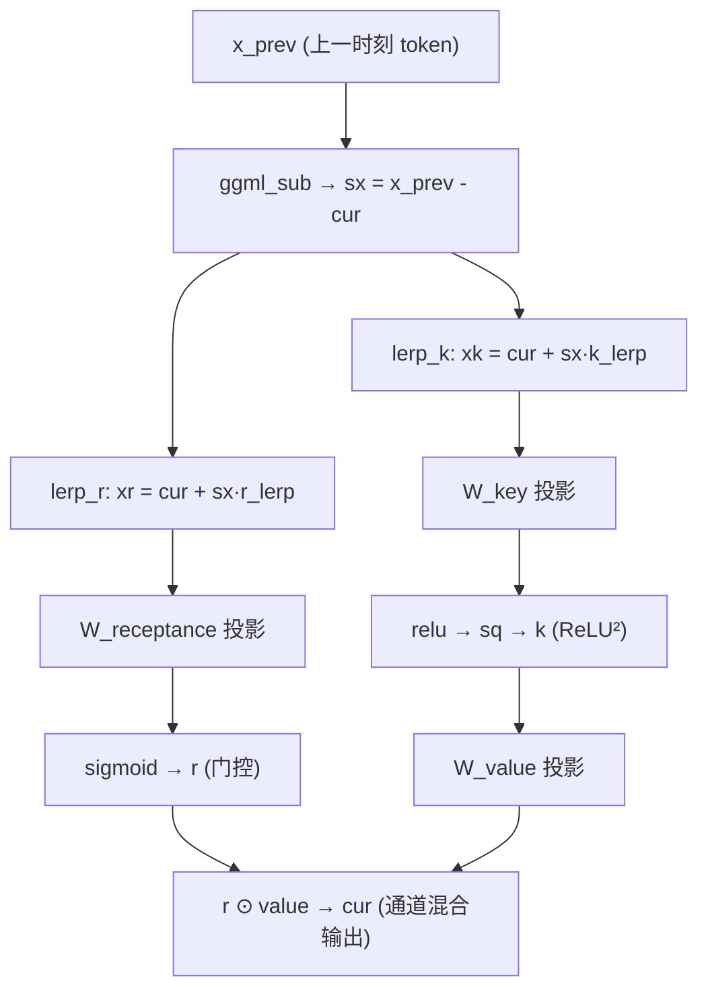

**概述**：该函数实现了 RWKV6 专有的通道混合公式：`r * (relu(k_proj(xk))^2 @ W_v)`。它首先计算 token shift 差值 `sx = x_prev - cur` 作为时间信号，随后通过 lerp 混合生成 `xk` 与 `xr`，分别经过线性投影与激活函数得到 key（ReLU²）与 receptance（Sigmoid 门控），最后由两者点乘得到输出。仅服务 `LLM_ARCH_RWKV6`，其他架构直接终止。

### 30.3.3 build_rwkv6_time_mix：时间混合子图

**源码路径**：`src/models/rwkv6-base.cpp` - `build_rwkv6_time_mix()`（第28-137行）

```cpp
// 时间混合子图：RWKV6 的核心线性注意力机制
// 输入：inp（循环状态输入）、cur（当前层输入）、x_prev（上一时刻 token）、ubatch（批次）、il（层索引）
// ① QRWKV 识别：time_mix_first 为空则说明该层是 QRWKV 模式（门控线性注意力变体）
//    time_mix_first 非空时为标准 RWKV6，作为 WKV6 算子的「首个 token」标志位
const auto * mctx_cur = static_cast<const llama_memory_recurrent_context *>(mctx);
const auto n_tokens     = ubatch.n_tokens;       // 当前批次总 token 数
const auto n_seqs       = ubatch.n_seqs;         // 序列数（batch size）
const auto n_seq_tokens = ubatch.n_seq_tokens;   // 每序列 token 数
const auto n_embd       = hparams.n_embd;         // 模型维度
const auto head_size    = hparams.wkv_head_size;  // 每个注意力头的维度
const auto n_head       = n_embd / head_size;     // 注意力头数
const auto n_head_kv    = hparams.n_head_kv(il);   // KV 头数（GQA 时可能 < n_head）
const auto kv_head = mctx_cur->get_head();         // 当前序列占用的 KV 头偏移
const auto & layer = model.layers[il];             // 当前层权重
bool is_qrwkv = layer.time_mix_first == nullptr;   // ① 判定是否为 QRWKV
// ② token shift 差值 sx = x_prev - cur，形状 [n_embd, n_tokens]
//    这是 RWKV 类 RNN 推理的关键：用「上一站」与「当前站」的差异作为时间信号
ggml_tensor * sx = ggml_sub(ctx0, x_prev, cur);
sx  = ggml_reshape_2d(ctx0, sx, n_embd, n_tokens);
cur = ggml_reshape_2d(ctx0, cur, n_embd, n_tokens);
// ③ 基础 lerp_x：xxx = cur + sx * time_mix_lerp_x，作为后续 5 路投影的共享输入
//    time_mix_lerp_x 是 per-channel 的插值系数
ggml_tensor * xxx = ggml_add(ctx0, ggml_mul(ctx0, sx, layer.time_mix_lerp_x), cur);
// ④ w1 投影 + tanh + reshape：xxx = tanh(W1 · xxx)，输出维度为 W1->ne[1]/5 × 5
//    除以 5 是因为要投影出 5 路（w/k/v/r/g），每路占总维度的 1/5
xxx = ggml_reshape_4d(ctx0, ggml_tanh(ctx0, ggml_mul_mat(ctx0, layer.time_mix_w1, xxx)),
                      layer.time_mix_w1->ne[1] / 5, 1, 5, n_tokens);
// ⑤ 置换维度：将 [dim/5, 1, 5, n_tokens] 转置为 [dim/5, 5, 1, n_tokens]
//    便于后续 w2 投影沿 dim/5 维度做矩阵乘
xxx = ggml_cont(ctx0, ggml_permute(ctx0, xxx, 0, 1, 3, 2));
// ⑥ w2 投影：xxx = W2 · xxx，W2 形状 [dim/5, dim/5, 1, 5]
//    这一步完成 5 路的二次投影，输出仍为 [dim/5, 5, 1, n_tokens]
xxx = ggml_mul_mat(
    ctx0, ggml_reshape_4d(ctx0, layer.time_mix_w2, layer.time_mix_w2->ne[0], layer.time_mix_w2->ne[1], 1, 5), xxx);
ggml_tensor *xw, *xk, *xv, *xr, *xg;
if (layer.time_mix_lerp_fused) {   // ⑦ Fused lerp 分支：一次性投影 5 路再切片
    //    time_mix_lerp_fused 是融合的 lerp 系数张量，形状 [n_embd*5, 1]
    //    先把 sx/cur 扩成 3D [n_embd, 1, n_tokens] 以便与融合系数广播
    sx  = ggml_reshape_3d(ctx0, sx, n_embd, 1, n_tokens);
    cur = ggml_reshape_3d(ctx0, cur, n_embd, 1, n_tokens);
    // xxx = cur + (xxx + lerp_fused) ⊙ sx，一次性完成 5 路的 lerp 混合
    xxx = ggml_add(ctx0, ggml_mul(ctx0, ggml_add(ctx0, xxx, layer.time_mix_lerp_fused), sx), cur);
    // ⑦a 通过 view_2d 切片出 5 路：每路偏移 n_embd*n_tokens 个 float
    //     xw 用于计算衰减权重，xk/xv/xr/xg 分别对应 key/value/receptance/gate
    xw  = ggml_view_2d(ctx0, xxx, n_embd, n_tokens, xxx->nb[1], 0);
    xk  = ggml_view_2d(ctx0, xxx, n_embd, n_tokens, xxx->nb[1], n_embd * n_tokens * sizeof(float));
    xv  = ggml_view_2d(ctx0, xxx, n_embd, n_tokens, xxx->nb[1], n_embd * n_tokens * 2 * sizeof(float));
    xr  = ggml_view_2d(ctx0, xxx, n_embd, n_tokens, xxx->nb[1], n_embd * n_tokens * 3 * sizeof(float));
    xg  = ggml_view_2d(ctx0, xxx, n_embd, n_tokens, xxx->nb[1], n_embd * n_tokens * 4 * sizeof(float));
} else {                          // ⑧ Legacy lerp 分支：逐项混合（兼容旧权重）
    //    先切片出 5 路，再各自与对应的 lerp 系数（lerp_w/k/v/r/g）做 lerp
    xw = ggml_view_2d(ctx0, xxx, n_embd, n_tokens, xxx->nb[1], 0);
    xk = ggml_view_2d(ctx0, xxx, n_embd, n_tokens, xxx->nb[1], n_embd * n_tokens * sizeof(float));
    xv = ggml_view_2d(ctx0, xxx, n_embd, n_tokens, xxx->nb[1], n_embd * n_tokens * 2 * sizeof(float));
    xr = ggml_view_2d(ctx0, xxx, n_embd, n_tokens, xxx->nb[1], n_embd * n_tokens * 3 * sizeof(float));
    xg = ggml_view_2d(ctx0, xxx, n_embd, n_tokens, xxx->nb[1], n_embd * n_tokens * 4 * sizeof(float));
    xw = ggml_add(ctx0, ggml_mul(ctx0, ggml_add(ctx0, xw, layer.time_mix_lerp_w), sx), cur);
    xk = ggml_add(ctx0, ggml_mul(ctx0, ggml_add(ctx0, xk, layer.time_mix_lerp_k), sx), cur);
    xv = ggml_add(ctx0, ggml_mul(ctx0, ggml_add(ctx0, xv, layer.time_mix_lerp_v), sx), cur);
    xr = ggml_add(ctx0, ggml_mul(ctx0, ggml_add(ctx0, xr, layer.time_mix_lerp_r), sx), cur);
    xg = ggml_add(ctx0, ggml_mul(ctx0, ggml_add(ctx0, xg, layer.time_mix_lerp_g), sx), cur);
}
// ⑨-⑪ Receptance/Key/Value 投影（均支持 LoRA，可选加 bias）
ggml_tensor * r = build_lora_mm(layer.time_mix_receptance, xr);
ggml_tensor * k = build_lora_mm(layer.time_mix_key, xk);
ggml_tensor * v = build_lora_mm(layer.time_mix_value, xv);
if (layer.time_mix_receptance_b) r = ggml_add(ctx0, r, layer.time_mix_receptance_b);
if (layer.time_mix_key_b)          k = ggml_add(ctx0, k, layer.time_mix_key_b);
if (layer.time_mix_value_b)        v = ggml_add(ctx0, v, layer.time_mix_value_b);
// ⑫ Gate 投影：g = W_g · xg，后续根据 QRWKV/标准模式分别用 sigmoid/SiLU 激活
ggml_tensor * g = build_lora_mm(layer.time_mix_gate, xg);
if (is_qrwkv) {
    g = ggml_sigmoid(ctx0, g);   // ⑬ QRWKV 用 sigmoid 门控（范围 0~1，概率语义）
} else {
    g = ggml_silu(ctx0, g);      // ⑭ 标准 RWKV6 用 SiLU 门控（允许负值，表达能力更强）
}
// ⑮ GQA 广播：当 n_head_kv != 0 且 != n_head 时，K/V 需要 repeat 到 n_head
if (n_head_kv != 0 && n_head_kv != n_head) {
    GGML_ASSERT(n_head % n_head_kv == 0);
    k                 = ggml_reshape_4d(ctx0, k, head_size, 1, n_head_kv, n_tokens);
    v                 = ggml_reshape_4d(ctx0, v, head_size, 1, n_head_kv, n_tokens);
    ggml_tensor * tmp = ggml_new_tensor_4d(ctx0, GGML_TYPE_F32, head_size, n_head / n_head_kv, n_head_kv, n_tokens);
    k                 = ggml_repeat(ctx0, k, tmp);
    v                 = ggml_repeat(ctx0, v, tmp);
}
// ⑯ 恢复 3D 形状 [head_size, n_head, n_tokens]，便于 WKV 算子逐头处理
k = ggml_reshape_3d(ctx0, k, head_size, n_head, n_tokens);
v = ggml_reshape_3d(ctx0, v, head_size, n_head, n_tokens);
r = ggml_reshape_3d(ctx0, r, head_size, n_head, n_tokens);
// ⑰ 计算衰减权重 w = exp(-exp(W2·tanh(W1·xw) + decay))
//     外层 exp(-·) 保证 w ∈ (0,1)，实现「指数衰减」：老记忆随距离指数褪色
//     W1/W2 是 per-head 的衰减参数，decay 是 per-head 的偏置项
ggml_tensor * w =
    ggml_mul_mat(ctx0, layer.time_mix_decay_w2, ggml_tanh(ctx0, ggml_mul_mat(ctx0, layer.time_mix_decay_w1, xw)));
w = ggml_add(ctx0, w, layer.time_mix_decay);
w = ggml_exp(ctx0, ggml_neg(ctx0, ggml_exp(ctx0, w)));   // w = exp(-exp(...))
w = ggml_reshape_3d(ctx0, w, head_size, n_head, n_tokens);
if (is_qrwkv) {
    // ⑱ QRWKV: k = k * (1 - w)，用衰减权重直接调制 Key
    k = ggml_sub(ctx0, k, ggml_mul(ctx0, k, w));
}
// ⑲ 读取循环状态：从 mctx 的 s_l 槽位读取上一时刻的 WKV 状态
//     n_embd_s() 是状态维度（= n_embd * head_size），n_seqs 为序列数
ggml_tensor * wkv_state = build_rs(inp, mctx_cur->get_s_l(il), hparams.n_embd_s(), n_seqs);
ggml_tensor * wkv_output;
if (is_qrwkv) {
    // ⑳ QRWKV 调用 gated_linear_attn 算子（门控线性注意力，更现代的变体）
    //     参数：k, v, r, w, state，scale = head_size^(-0.5)
    wkv_output = ggml_gated_linear_attn(ctx0, k, v, r, w, wkv_state, pow(head_size, -0.5f));
} else {
    // ㉑ 标准 RWKV6 调用 ggml_rwkv_wkv6 算子
    //     参数：k, v, r, first(time_mix_first), w, state
    //     first 是「首个 token」标志，用于初始化状态
    wkv_output = ggml_rwkv_wkv6(ctx0, k, v, r, layer.time_mix_first, w, wkv_state);
}
// ㉒ 取输出部分：wkv_output 前 n_embd*n_tokens 个元素是当前输出
cur       = ggml_view_1d(ctx0, wkv_output, n_embd * n_tokens, 0);
// ㉓ 取新状态部分：后面 n_embd*head_size*n_seqs 个元素是更新后的状态
wkv_state = ggml_view_1d(ctx0, wkv_output, n_embd * head_size * n_seqs,
                         n_embd * n_tokens * sizeof(float));
// ㉔ 状态回写：把新状态 copy 到 mctx 的 s_l 对应槽位（按 kv_head 偏移）
ggml_build_forward_expand(
    gf, ggml_cpy(ctx0, wkv_state,
                 ggml_view_1d(ctx0, mctx_cur->get_s_l(il), hparams.n_embd_s() * n_seqs,
                              hparams.n_embd_s() * kv_head * ggml_element_size(mctx_cur->get_s_l(il)))));
if (!is_qrwkv) {   // ㉕ 非 QRWKV 做 GroupNorm + ln 缩放
    // GroupNorm：按 head 分组（每组 n_embd/n_head 个通道），eps=64e-5
    cur = ggml_reshape_3d(ctx0, cur, n_embd / n_head, n_head, n_tokens);
    cur = ggml_norm(ctx0, cur, 64e-5f);
    cur = ggml_reshape_2d(ctx0, cur, n_embd, n_tokens);
    // time_mix_ln 缩放：cur = cur * time_mix_ln + time_mix_ln_b（per-channel 仿射）
    cur = ggml_add(ctx0, ggml_mul(ctx0, cur, layer.time_mix_ln), layer.time_mix_ln_b);
} else {
    cur = ggml_reshape_2d(ctx0, cur, n_embd, n_tokens);
}
// ㉖ Gate 缩放：cur = cur * g，用门控信号调制输出
cur = ggml_mul(ctx0, cur, g);
// ㉗ 输出投影：cur = W_out · cur，映射回模型维度
cur = build_lora_mm(layer.time_mix_output, cur);
// ㉘ 返回 3D 张量 [n_embd, n_seq_tokens, n_seqs]，供上层残差连接使用
return ggml_reshape_3d(ctx0, cur, n_embd, n_seq_tokens, n_seqs);
```

**概述**：该函数实现了 RWKV6 的核心时间混合机制。首先通过 `time_mix_first` 是否为空识别 QRWKV 模式。计算 token shift 差值 `sx = x_prev - cur` 后，提供 Fused 与 Legacy 两套 lerp 投影路径：Fused 路径一次矩阵乘投影出 5 路再通过 `view_2d` 切片，Legacy 路径兼容旧权重逐项混合。投影出的 `xw/xk/xv/xr/xg` 分别经过线性层得到 `w/k/v/r/g`。关键步骤包括：计算指数衰减权重 `w = exp(-exp(w2·tanh(w1·xw) + decay))`；GQA 场景下对 K/V 进行头数广播；读取循环状态 `s_l` 后调用 `ggml_rwkv_wkv6`（标准）或 `ggml_gated_linear_attn`（QRWKV）完成 WKV 计算；将新状态回写到 `s_l`；非 QRWKV 分支额外做 GroupNorm 与 `time_mix_ln` 缩放；最后通过 Gate 缩放与输出投影得到结果。整个流程体现了「token shift → 多路投影 → WKV 线性注意力 → 状态更新 → 可选归一化 → 门控输出」的完整链路。

---

## 30.4 RWKV6 主模型图构建 —— 经典 RWKV 的「完整推理骨架」

### 30.4.1 llm_build_rwkv6 构造函数

**源码路径**：`src/models/rwkv6.cpp` - `llm_build_rwkv6::llm_build_rwkv6()`（第1-92行）

```cpp
// RWKV6 完整推理图构造函数：构建从 token embedding 到 logits 的完整计算图
// ① 校验 token_shift_count == 2：RWKV6 每层需要保存 attention 与 FFN 两个上一时刻 token
//    这是因为 time_mix 需要 att_shift，channel_mix 需要 ffn_shift，两者分别由不同 Norm 的上一时刻值构成
GGML_ASSERT(hparams.token_shift_count == 2);

ggml_tensor * cur;
ggml_tensor * inpL;

// ② Token Embedding：把输入 token id 查表得到 [n_embd, n_tokens] 的稠密向量
inpL = build_inp_embd(model.tok_embd);
// ③ Token 归一化：对 embedding 输出做 LayerNorm（RWKV6 用 LLM_NORM 而非 RMSNorm）
//    tok_norm/tok_norm_b 是 per-channel 的均值/方差参数
inpL = build_norm(inpL, model.tok_norm, model.tok_norm_b, LLM_NORM, 0);

// ④ 循环状态输入：build_rs_inp() 创建 r_l（recurrent state 输入张量）
//    用于在每层之间传递上一时刻的 token shift 与 WKV 状态
auto * rs_inp = build_rs_inp();

const auto n_embd       = hparams.n_embd;
const auto n_seq_tokens = ubatch.n_seq_tokens;   // 每序列 token 数（推理时通常为 1）
const auto n_seqs       = ubatch.n_seqs;         // 并行序列数

// ⑤ 输出 token 索引：用于最后一层只输出指定位置的 token（如 last token）
ggml_tensor * inp_out_ids = build_inp_out_ids();

for (int il = 0; il < n_layer; ++il) {
    const llama_layer * layer = &model.layers[il];
    inpL = ggml_reshape_3d(ctx0, inpL, n_embd, n_seq_tokens, n_seqs);

    // ⑥ 读取上一时刻的 token shift：从 r_l 加载本层的 shift 状态
    ggml_tensor * token_shift = build_rwkv_token_shift_load(rs_inp, ubatch, il);

    // ⑦ 拆分 att_shift：token_shift 前半段是 attention shift（供 time_mix 使用）
    ggml_tensor * att_shift =
        ggml_view_3d(ctx0, token_shift, n_embd, 1, n_seqs, token_shift->nb[1], token_shift->nb[2], 0);
    // ⑧ 拆分 ffn_shift：后半段是 FFN shift（供 channel_mix 使用）
    ggml_tensor * ffn_shift = ggml_view_3d(ctx0, token_shift, n_embd, 1, n_seqs, token_shift->nb[1],
                                           token_shift->nb[2], n_embd * ggml_element_size(token_shift));

    // ⑨ Attention Norm：对当前层输入做归一化（RWKV6 用 LLM_NORM）
    ggml_tensor * att_norm = build_norm(inpL, layer->attn_norm, layer->attn_norm_b, LLM_NORM, il);
    cb(att_norm, "attn_norm", il);

    // ⑩ 关键拼接：x_prev = [att_shift, att_norm[:-1]]
    //     - att_shift 是上一时刻的 token（形状 [n_embd, 1, n_seqs]）
    //     - att_norm[:-1] 是当前序列前 n_seq_tokens-1 个 token 的 norm 输出
    //     - 拼接后形状 [n_embd, n_seq_tokens, n_seqs]，其中第 t 个位置是「第 t-1 时刻的输出」
    //     这实现了类 RNN 推理：每个 token 能看到上一时刻的「影子」
    ggml_tensor * x_prev = ggml_concat(
        ctx0, att_shift,
        ggml_view_3d(ctx0, att_norm, n_embd, n_seq_tokens - 1, n_seqs, att_norm->nb[1], att_norm->nb[2], 0), 1);

    // ⑪ Time Mix：传入 att_norm（当前）与 x_prev（上一时刻），完成 WKV 线性注意力
    cur = build_rwkv6_time_mix(rs_inp, att_norm, x_prev, ubatch, il);

    // ⑫ 残差连接：ffn_inp = cur + inpL（time_mix 输出 + 层输入）
    ggml_tensor * ffn_inp = ggml_add(ctx0, cur, inpL);
    cb(ffn_inp, "ffn_inp", il);

    // ⑬ FFN Norm：对残差结果做第二次归一化（RWKV6 用 attn_norm_2）
    ggml_tensor * ffn_norm = build_norm(ffn_inp, layer->attn_norm_2, layer->attn_norm_2_b, LLM_NORM, il);
    cb(ffn_norm, "ffn_norm", il);

    // ⑭ 构建下一层的 x_prev：x_prev = [ffn_shift, ffn_norm[:-1]]
    //     供 channel_mix 使用（channel_mix 需要 FFN 的上一时刻输出）
    x_prev = ggml_concat(
        ctx0, ffn_shift,
        ggml_view_3d(ctx0, ffn_norm, n_embd, n_seq_tokens - 1, n_seqs, ffn_norm->nb[1], ffn_norm->nb[2], 0), 1);

    // ⑮ 保存当前层最后一个 token 作为下一层的 shift：
    //     token_shift = [att_norm[-1], ffn_norm[-1]]，concat 在最后一维（token 维度）
    token_shift = ggml_concat(ctx0,
                              ggml_view_3d(ctx0, att_norm, n_embd, 1, n_seqs, att_norm->nb[1], att_norm->nb[2],
                                           (n_seq_tokens - 1) * n_embd * ggml_element_size(att_norm)),
                              ggml_view_3d(ctx0, ffn_norm, n_embd, 1, n_seqs, ffn_norm->nb[1], ffn_norm->nb[2],
                                           (n_seq_tokens - 1) * n_embd * ggml_element_size(ffn_norm)),
                              1);
    // ⑯ 存储 shift 到 r_l，供下一层/下一时刻读取
    ggml_build_forward_expand(gf, build_rwkv_token_shift_store(token_shift, ubatch, il));

    // 重塑为 2D [n_embd, n_tokens] 便于后续 layer 操作
    ffn_inp  = ggml_reshape_2d(ctx0, ffn_inp, n_embd, n_tokens);
    ffn_norm = ggml_reshape_2d(ctx0, ffn_norm, n_embd, n_tokens);
    x_prev   = ggml_reshape_2d(ctx0, x_prev, n_embd, n_tokens);
    cur      = ggml_reshape_2d(ctx0, cur, n_embd, n_tokens);

    // ⑰ 最后一层只输出指定 token（如 last token），用 ggml_get_rows 选取
    if (il == n_layer - 1 && inp_out_ids) {
        ffn_inp  = ggml_get_rows(ctx0, ffn_inp, inp_out_ids);
        ffn_norm = ggml_get_rows(ctx0, ffn_norm, inp_out_ids);
        x_prev   = ggml_get_rows(ctx0, x_prev, inp_out_ids);
        cur      = ggml_get_rows(ctx0, cur, inp_out_ids);
    }
    // ⑱ Channel Mix：传入 ffn_norm（当前）与 x_prev（上一时刻 FFN 输出）
    cur = build_rwkv6_channel_mix(layer, ffn_norm, x_prev, LLM_ARCH_RWKV6);
    // ⑲ 残差：cur = channel_mix 输出 + ffn_inp（time_mix 残差）
    cur = ggml_add(ctx0, cur, ffn_inp);

    // ㉑ Rescale 缩放：每隔 N 层将输出乘以 0.5，防止深层网络数值爆炸
    //     hparams.rescale_every_n_layers 控制间隔（0 表示关闭）
    if (hparams.rescale_every_n_layers != 0 && (il + 1) % hparams.rescale_every_n_layers == 0) {
        cur = ggml_scale(ctx0, cur, 0.5F);
    }
    // ㉒ 控制向量注入：build_cvec 把额外的控制信号（如 token type embedding）加到 cur 上
    cur = build_cvec(cur, il);
    cb(cur, "l_out", il);

    // ㉓ 下一层输入
    inpL = cur;
}
cur = inpL;
// ㉔ 最终归一化：对最后一层输出做 LayerNorm
cur = build_norm(cur, model.output_norm, model.output_norm_b, LLM_NORM, -1);
cb(cur, "result_norm", -1);
res->t_embd = cur;

// ㉕ 输出投影：cur = W_output · cur，映射到词表维度得到 logits
cur = build_lora_mm(model.output, cur);
cb(cur, "result_output", -1);
res->t_logits = cur;

// ㉖ 将最终 logits 加入前向计算图
ggml_build_forward_expand(gf, cur);
```

**概述**：该函数构建了完整的 RWKV6 推理图。开头校验 `token_shift_count == 2`，表明每层需保存 attention 与 FFN 两个上一时刻 token。输入经过 Embedding 与 Norm 后进入主循环：从 `r_l` 加载 token shift 并拆分为 `att_shift`/`ffn_shift`；构造 `x_prev = [att_shift, att_norm[:-1]]` 实现类 RNN 推理的关键拼接；调用 `build_rwkv6_time_mix` 完成时间混合；经残差连接与第二层 Norm 后，再次构造 `x_prev` 送入 `build_rwkv6_channel_mix` 完成通道混合；残差相加后，可选的 `rescale_every_n_layers` 每隔 N 层将输出乘以 0.5；注入控制向量 `build_cvec` 后进入下一层。最后一层通过 `inp_out_ids` 选择输出 token，经最终 Norm 与输出投影得到 logits。整体体现了「状态加载 → 计算 → 状态存储」的循环式推理范式。

---

## 30.5 RWKV6Qwen2 混合架构 —— RWKV 与 Transformer 的「跨界融合」

### 30.5.1 llm_build_rwkv6qwen2 构造函数

**源码路径**：`src/models/rwkv6qwen2.cpp` - `llm_build_rwkv6qwen2::llm_build_rwkv6qwen2()`（第1-84行）

```cpp
// RWKV6 + Qwen2 混合架构构造函数：RWKV 的线性注意力 + Transformer 的 SwiGLU FFN
// ① 强校验：循环维度（n_embd_r）必须等于残差维度（n_embd）
//    这是因为混合架构下去掉了 token 归一化，状态直接在残差流中传递
GGML_ASSERT(n_embd == hparams.n_embd_r());

ggml_tensor * cur;
ggml_tensor * inpL;

// ② Embedding：无 token 归一化（与纯 RWKV6 不同，混合架构跳过 tok_norm）
inpL = build_inp_embd(model.tok_embd);

auto * rs_inp = build_rs_inp();

const auto n_embd = hparams.n_embd;
const auto n_seq_tokens = ubatch.n_seq_tokens;
const auto n_seqs = ubatch.n_seqs;

ggml_tensor * inp_out_ids = build_inp_out_ids();

for (int il = 0; il < n_layer; ++il) {
    const llama_layer * layer = &model.layers[il];
    inpL = ggml_reshape_3d(ctx0, inpL, n_embd, n_seq_tokens, n_seqs);

    // ③ 仅加载一个 shift（token_shift_count == 1）：混合架构只保留 attention shift
    //     FFN 不再需要独立的 shift，因为 FFN 是标准 Transformer 结构，无状态
    ggml_tensor * token_shift = build_rwkv_token_shift_load(rs_inp, ubatch, il);

    // ④ Attention Norm：全程使用 RMSNorm（LLM_NORM_RMS），无 bias
    ggml_tensor * att_norm = build_norm(inpL, layer->attn_norm, layer->attn_norm_b, LLM_NORM_RMS, il);
    cb(att_norm, "attn_norm", il);

    // ⑤ 拼接 x_prev = [token_shift, att_norm[:-1]]：仅一个 shift，结构更简化
    ggml_tensor * x_prev = ggml_concat(
            ctx0,
            token_shift,
            ggml_view_3d(ctx0, att_norm, n_embd, n_seq_tokens - 1, n_seqs, att_norm->nb[1], att_norm->nb[2], 0),
            1
            );

    // ⑥ RWKV Time Mix：复用 RWKV6 的时间混合逻辑
    cur = build_rwkv6_time_mix(rs_inp, att_norm, x_prev, ubatch, il);

    // ⑦ 保存 shift：仅保存 att_norm 的最后一个 token 作为下一层的 shift
    token_shift = ggml_view_3d(ctx0, att_norm, n_embd, 1, n_seqs, att_norm->nb[1], att_norm->nb[2], (n_seq_tokens-1)*n_embd*ggml_element_size(att_norm));
    ggml_build_forward_expand(gf, build_rwkv_token_shift_store(token_shift, ubatch, il));

    // ⑧ 残差：ffn_inp = cur + inpL
    ggml_tensor * ffn_inp = ggml_add(ctx0, cur, inpL);
    cb(ffn_inp, "ffn_inp", il);

    cur     = ggml_reshape_2d(ctx0, cur,     n_embd, n_tokens);
    ffn_inp = ggml_reshape_2d(ctx0, ffn_inp, n_embd, n_tokens);

    // 最后一层只输出指定 token
    if (il == n_layer - 1 && inp_out_ids) {
        cur     = ggml_get_rows(ctx0, cur,     inp_out_ids);
        ffn_inp = ggml_get_rows(ctx0, ffn_inp, inp_out_ids);
    }

    // ⑨ FFN Norm：RMSNorm（无 bias），Qwen2 风格
    cur = build_norm(ffn_inp,
            model.layers[il].ffn_norm, NULL,
            LLM_NORM_RMS, il);
    cb(cur, "ffn_norm", il);

    // ⑩ SwiGLU FFN：标准 Qwen2 风格，三组权重 ffn_up/ffn_gate/ffn_down，均无 bias
    //     LLM_FFN_SILU + LLM_FFN_PAR 表示 SiLU 激活 + 并行门控结构
    cur = build_ffn(cur,
            model.layers[il].ffn_up,   NULL, NULL,
            model.layers[il].ffn_gate, NULL, NULL,
            model.layers[il].ffn_down, NULL, NULL,
            NULL,
            LLM_FFN_SILU, LLM_FFN_PAR, il);
    cb(cur, "ffn_out", il);

    // ⑪ 标准 Transformer 残差：cur = FFN 输出 + ffn_inp
    cur = ggml_add(ctx0, cur, ffn_inp);

    // ⑫ 控制向量注入
    cur = build_cvec(cur, il);
    cb(cur, "l_out", il);

    inpL = cur;
}

cur = inpL;
// ⑬ 最终 RMSNorm（无 bias）
cur = build_norm(cur, model.output_norm, model.output_norm_b, LLM_NORM_RMS, -1);
cb(cur, "result_norm", -1);
res->t_embd = cur;

// ⑭ 输出投影
cur = build_lora_mm(model.output, cur);
cb(cur, "result_output", -1);
res->t_logits = cur;

ggml_build_forward_expand(gf, cur);
```

**架构流程图**：

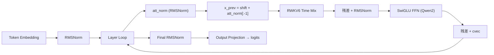

**概述**：该函数实现了 RWKV6 与 Qwen2 的混合架构。主要差异在于：移除了 token 归一化，全程使用 `LLM_NORM_RMS`；`token_shift_count == 1`，每层只需保存一个 token shift（去掉 `ff_shift`），简化状态管理；FFN 采用标准 Qwen2 风格 `build_ffn`，使用 `LLM_FFN_SILU` + `LLM_FFN_PAR`（SwiGLU），包含 `ffn_up / ffn_gate / ffn_down` 三组权重且无 bias 项。这展示了如何将 RWKV 的线性注意力与 Transformer 的高质量 FFN 结合，实现混合架构的工程落地。

---

## 30.6 RWKV7 基础构建器 —— 改进版 RWKV 的「进化引擎」

RWKV7 在 RWKV6 基础上引入了三大创新：
1. **Delta 规则**（data-dependent decay）：通过 `k_k`、`k_a`、`a` 三个动态权重生成状态更新步长。
2. **Value Residual**（`first_layer_value`）：首层 V 通过 sigmoid 加权残差注入到后续层。
3. **动态门控**：LoRA 风格的 `g1/g2` 门控与 `v0/v1/v2` 线性变化。

### 30.6.1 llm_build_rwkv7_base 构造函数

**源码路径**：`src/models/rwkv7-base.cpp` - `llm_build_rwkv7_base::llm_build_rwkv7_base()`（第4-6行）

```cpp
// 构造函数：与 RWKV6 base 结构相同
// - llm_graph_context(params)：初始化图构建上下文
// - model(model)：保存模型引用，供子图访问各层权重
llm_build_rwkv7_base(const llama_model & model, const llm_graph_params & params) :
    llm_graph_context(params),
    model(model) {}
```

**概述**：与 RWKV6 base 结构相同，仅保存模型引用并初始化图构建上下文。

### 30.6.2 build_rwkv7_channel_mix：极简通道混合

**源码路径**：`src/models/rwkv7-base.cpp` - `build_rwkv7_channel_mix()`（第8-30行）

```cpp
// RWKV7 通道混合：极简版，去掉了 receptance 门控
// ① token shift 差值 sx = x_prev - cur，作为通道混合的时间信号
ggml_tensor * sx = ggml_sub(ctx0, x_prev, cur);
switch (arch) {
    case LLM_ARCH_RWKV7:
        {
            // ② lerp_k 混合：xk = cur + sx * channel_mix_lerp_k
            ggml_tensor * xk = ggml_add(ctx0, ggml_mul(ctx0, sx, layer->channel_mix_lerp_k), cur);
            // ③ ReLU² 变换：k = (relu(W_key · xk))²（与 RWKV6 相同）
            ggml_tensor * k = ggml_sqr(ctx0, ggml_relu(ctx0, build_lora_mm(layer->channel_mix_key, xk)));
            // ④ 直接输出 value：cur = W_value · k（无 receptance 门控！）
            //     RWKV7 认为 receptance 门控可以由 time_mix 的 delta 规则隐式完成
            cur = build_lora_mm(layer->channel_mix_value, k);
        }
        break;
    default:
        GGML_ABORT("fatal error");
}
return cur;
```

**架构流程图**：

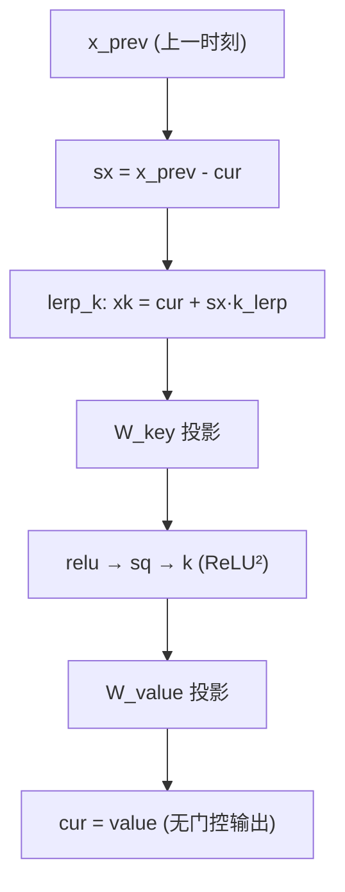

**概述**：RWKV7 的通道混合极简化：去掉了 `receptance` 门控，只保留 `key` 与 `value` 两组线性层，公式简化为 `value(relu(key(xk))^2)`。仍保留 token shift 差值 `sx` 与 lerp_k 混合机制。

### 30.6.3 build_rwkv7_time_mix：数据依赖的时间混合

**源码路径**：`src/models/rwkv7-base.cpp` - `build_rwkv7_time_mix()`（第32-127行）

```cpp
// RWKV7 时间混合子图：数据依赖的 delta 规则 + first_layer_value 跨层残差
// 输入：inp（循环状态输入）、cur（当前层输入）、x_prev（上一时刻 token）
//      first_layer_value（引用，跨层传递的首层 V）、ubatch（批次）、il（层索引）
const auto * mctx_cur = static_cast<const llama_memory_recurrent_context *>(mctx);
const auto n_tokens     = ubatch.n_tokens;
const auto n_seqs       = ubatch.n_seqs;
const auto n_embd       = hparams.n_embd;
const auto head_size    = hparams.wkv_head_size;    // 每注意力头维度
const auto head_count   = n_embd / head_size;       // 注意力头数
const auto n_seq_tokens = ubatch.n_seq_tokens;
const auto kv_head = mctx_cur->get_head();           // 当前序列占用的 KV 头偏移
const auto & layer = model.layers[il];
// ① 是否有双门控：time_mix_g1 && time_mix_g2 均非空时启用额外的 gate 路
bool has_gating = layer.time_mix_g1 && layer.time_mix_g2;
// ② token shift 差值 sx = x_prev - cur
ggml_tensor * sx    = ggml_sub(ctx0, x_prev, cur);
// ③ 分配 5/6 路 dummy 张量：有 gating 时 6 路（r/w/k/v/a/g），否则 5 路（r/w/k/v/a）
//    dummy 的第 3 维是 n_seq_tokens（不是 n_tokens），因为要保留序列维度
ggml_tensor * dummy = ggml_new_tensor_4d(ctx0, GGML_TYPE_F32, n_embd, n_seq_tokens, n_seqs, has_gating ? 6 : 5);
// ④ repeat sx 到 5/6 通道：sx 从 [n_embd, n_seq_tokens, n_seqs] 广播到 [n_embd, n_seq_tokens, n_seqs, 5/6]
//     以便与 fused lerp 系数做逐元素乘法
sx                  = ggml_repeat(ctx0, sx, dummy);
// ⑤ fused lerp 投影：xxx = cur + sx * time_mix_lerp_fused
//     time_mix_lerp_fused 形状 [n_embd*5(或6), 1]，一次性投影出所有路
ggml_tensor * xxx = ggml_add(ctx0, ggml_mul(ctx0, sx, layer.time_mix_lerp_fused), cur);
// ⑥ 通过 view_2d 切片出 5(或6) 路，每路偏移 n_embd*n_tokens 个 float
//    xr/receptance, xw/衰减, xk/key, xv/value, xa/delta-a, (xg/gate)
ggml_tensor * xr = ggml_view_2d(ctx0, xxx, n_embd, n_tokens, xxx->nb[1], 0);
ggml_tensor * xw = ggml_view_2d(ctx0, xxx, n_embd, n_tokens, xxx->nb[1], n_embd * n_tokens * sizeof(float));
ggml_tensor * xk = ggml_view_2d(ctx0, xxx, n_embd, n_tokens, xxx->nb[1], n_embd * n_tokens * 2 * sizeof(float));
ggml_tensor * xv = ggml_view_2d(ctx0, xxx, n_embd, n_tokens, xxx->nb[1], n_embd * n_tokens * 3 * sizeof(float));
ggml_tensor * xa = ggml_view_2d(ctx0, xxx, n_embd, n_tokens, xxx->nb[1], n_embd * n_tokens * 4 * sizeof(float));
ggml_tensor * xg =
    has_gating ? ggml_view_2d(ctx0, xxx, n_embd, n_tokens, xxx->nb[1], n_embd * n_tokens * 5 * sizeof(float)) :
                 nullptr;
// ⑦ Receptance 投影：r = W_r · xr
ggml_tensor * r = build_lora_mm(layer.time_mix_receptance, xr);
// ⑧ 动态衰减 w = sigmoid(W2·tanh(W1·xw) + w0) * exp(-0.606531)
//    - sigmoid 使 w ∈ (0,1)，是数据依赖的「保留比例」
//    - exp(-0.606531) ≈ 0.545 是常数缩放，确保衰减不会过强
//    - w0 是 per-head 偏置，控制基础衰减水平
ggml_tensor * w = ggml_add(
    ctx0, ggml_mul_mat(ctx0, layer.time_mix_w2, ggml_tanh(ctx0, ggml_mul_mat(ctx0, layer.time_mix_w1, xw))),
    layer.time_mix_w0);
w = ggml_exp(ctx0, ggml_scale(ctx0, ggml_sigmoid(ctx0, w), -0.606531));
// ⑨⑩ Key/Value 投影
ggml_tensor * k = build_lora_mm(layer.time_mix_key, xk);
ggml_tensor * v = build_lora_mm(layer.time_mix_value, xv);
// ⑪ first_layer_value 跨层残差：
//     - 首层（il==0）时 first_layer_value == nullptr，记录当前 v 为 first_layer_value
//     - 后续层时，v = v + sigmoid(v0 + v2·(v1·xv)) * (first_layer_value - v)
//     这是 RWKV7 的核心创新：用首层的 V 信息通过 sigmoid 门控残差注入到后续每层
if (first_layer_value == nullptr) {
    first_layer_value = v;
} else {
    v = ggml_add(ctx0, v,
                 ggml_mul(ctx0, ggml_sub(ctx0, first_layer_value, v),
                          ggml_sigmoid(ctx0, ggml_add(ctx0,
                                                      ggml_mul_mat(ctx0, layer.time_mix_v2,
                                                                   ggml_mul_mat(ctx0, layer.time_mix_v1, xv)),
                                                      layer.time_mix_v0))));
}
// ⑬ 双门控 g = g2 * sigmoid(g1 * xg)（仅在 has_gating 时计算）
ggml_tensor * g = nullptr;
if (layer.time_mix_g1 && layer.time_mix_g2) {
    g = ggml_mul_mat(ctx0, layer.time_mix_g2, ggml_sigmoid(ctx0, ggml_mul_mat(ctx0, layer.time_mix_g1, xg)));
}
// ⑭ Delta rule 矩阵 a = sigmoid(a0 + a2·(a1·xa))
//     a 是 per-token 的动态步长，控制状态更新的幅度
ggml_tensor * a = ggml_sigmoid(
    ctx0, ggml_add(ctx0, ggml_mul_mat(ctx0, layer.time_mix_a2, ggml_mul_mat(ctx0, layer.time_mix_a1, xa)),
                   layer.time_mix_a0));
// ⑮ kk = k * k_k：k_k 是 per-head 的 Key 修正系数
ggml_tensor * kk = ggml_reshape_3d(ctx0, ggml_mul(ctx0, k, layer.time_mix_k_k), head_size, head_count, n_tokens);
// ⑯ L2 归一化：kk = kk / ||kk||，使 Key 的方向信息更稳定
kk               = ggml_l2_norm(ctx0, kk, 1e-12);
// ⑰ ka = k * k_a：k_a 是 per-head 的 Key 增益系数
ggml_tensor * ka = ggml_mul(ctx0, k, layer.time_mix_k_a);
// ⑱ Key 修正：k = k + a*(k*k_a) - k*k_a = k + (a-1)*(k*k_a)
//     当 a=1 时 k 不变；a>1 时增强 Key；a<1 时削弱 Key
//     这是 delta 规则的核心：让 Key 根据上下文动态调整
k                = ggml_add(ctx0, k, ggml_sub(ctx0, ggml_mul(ctx0, a, ka), ka));
// 重塑为 3D [head_size, head_count, n_tokens] 供 WKV7 算子使用
r = ggml_reshape_3d(ctx0, r, head_size, head_count, n_tokens);
w = ggml_reshape_3d(ctx0, w, head_size, head_count, n_tokens);
k = ggml_reshape_3d(ctx0, k, head_size, head_count, n_tokens);
v = ggml_reshape_3d(ctx0, v, head_size, head_count, n_tokens);
a = ggml_reshape_3d(ctx0, a, head_size, head_count, n_tokens);
// ⑲ 读取循环状态：从 mctx 的 s_l 槽位读取上一时刻的 WKV7 状态
ggml_tensor * wkv_state = build_rs(inp, mctx_cur->get_s_l(il), hparams.n_embd_s(), n_seqs);
// ⑳ 调用 RWKV7 专用 WKV7 算子：
//     参数顺序：r, w, k, v, -kk, kk*a, state
//     -kk 和 kk*a 是 delta 规则的两个动态参数（负的归一化 Key + 步长调制的 Key）
ggml_tensor * wkv_output = ggml_rwkv_wkv7(ctx0, r, w, k, v, ggml_neg(ctx0, kk), ggml_mul(ctx0, kk, a), wkv_state);
// ㉑ 拆分输出与新状态（与 RWKV6 相同）
cur                      = ggml_view_1d(ctx0, wkv_output, n_embd * n_tokens, 0);
wkv_state = ggml_view_1d(ctx0, wkv_output, n_embd * head_size * n_seqs, n_embd * n_tokens * sizeof(float));
// ㉒ 状态回写：按 kv_head 偏移写入 s_l 对应槽位
ggml_build_forward_expand(
    gf, ggml_cpy(ctx0, wkv_state,
                 ggml_view_1d(ctx0, mctx_cur->get_s_l(il), hparams.n_embd_s() * n_seqs,
                              hparams.n_embd_s() * kv_head * ggml_element_size(mctx_cur->get_s_l(il)))));
// ㉓ 可选 GroupNorm：仅当 time_mix_ln && time_mix_ln_b 存在时启用
if (layer.time_mix_ln && layer.time_mix_ln_b) {
    cur = ggml_reshape_3d(ctx0, cur, n_embd / head_count, head_count, n_tokens);
    cur = ggml_norm(ctx0, cur, 64e-5f);
    cur = ggml_reshape_2d(ctx0, cur, n_embd, n_tokens);
    cur = ggml_add(ctx0, ggml_mul(ctx0, cur, layer.time_mix_ln), layer.time_mix_ln_b);
} else {
    cur = ggml_reshape_2d(ctx0, cur, n_embd, n_tokens);
}
// ㉓ 值-键积注入：rk = sum_rows(k * r * r_k)，cur += v * rk
//     r_k 是 per-head 的值-键积系数，引入额外的非线性交互
ggml_tensor * rk = ggml_sum_rows(
    ctx0, ggml_mul(ctx0, ggml_mul(ctx0, k, r), ggml_reshape_2d(ctx0, layer.time_mix_r_k, head_size, head_count)));
cur = ggml_add(ctx0, cur, ggml_reshape_2d(ctx0, ggml_mul(ctx0, v, rk), n_embd, n_tokens));
// ㉔ 可选 gating：cur = cur * g（仅在 has_gating 时）
if (has_gating) {
    cur = ggml_mul(ctx0, cur, g);
}
// ㉕ 输出投影：cur = W_out · cur
cur = build_lora_mm(layer.time_mix_output, cur);
// ㉖ 返回 3D 张量 [n_embd, n_seq_tokens, n_seqs]
return ggml_reshape_3d(ctx0, cur, n_embd, n_seq_tokens, n_seqs);
```

**架构流程图**：

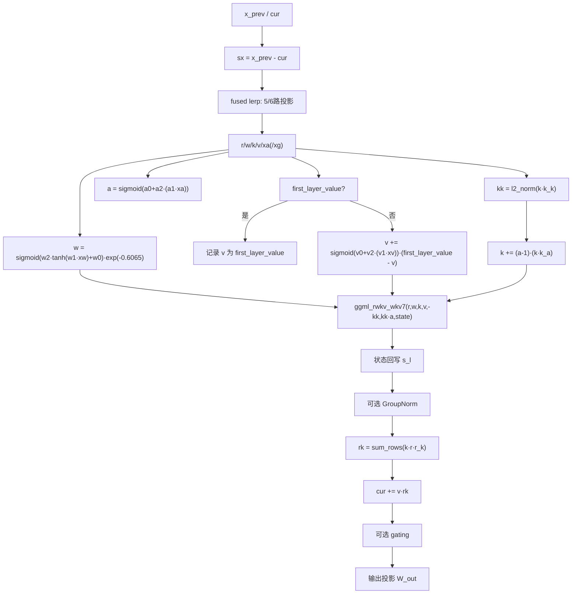

**概述**：该函数实现了 RWKV7 核心时间混合机制。亮点包括：动态衰减 `w = sigmoid(w2·tanh(w1·xw)+w0) * exp(-0.606531)` 让每个 token 自己决定保留多少历史；`first_layer_value` 跨层传递，每层用 `sigmoid(v0 + v2·(v1·xv))` 加权注入首层 V 信息；Delta 规则矩阵 `a = sigmoid(a0 + a2·(a1·xa))` 配合 `k_k`、`k_a` 修正 Key：`k = k + a·(k·k_a) - k·k_a`；调用 `ggml_rwkv_wkv7(r, w, k, v, -kk, kk*a, state)` 一次性完成所有动态更新；引入 `rk = sum_rows(k * r * r_k)` 与 `cur += v * rk` 的额外非线性注入；可选 GroupNorm 与双门控 `g = g2 * sigmoid(g1 * xg)`。整体体现了「数据依赖的衰减 + 跨层残差 + 动态 Key 修正」的进化设计。

---

## 30.7 RWKV7 主模型与 ARWKV7 变体 —— 「数据依赖」时代的 RWKV

### 30.7.1 llm_build_rwkv7：完整 RWKV7 图

**源码路径**：`src/models/rwkv7.cpp` - `llm_build_rwkv7::llm_build_rwkv7()`（第1-81行）

```cpp
// RWKV7 完整推理图构造函数：与 RWKV6 结构相似，核心差异在 time_mix 内部
// ① 校验 token_shift_count == 2：RWKV7 同样需要 att_shift 和 ffn_shift 两个 shift
GGML_ASSERT(hparams.token_shift_count == 2);

ggml_tensor * cur;
ggml_tensor * inpL;
// ② v_first 跨层传递：引用类型，初始为 nullptr，首层由 build_rwkv7_time_mix 内部初始化
//    之后每层都把首层的 V 信息注入到当前层
ggml_tensor * v_first = nullptr;

// Embedding + Token Norm（RWKV7 用 LLM_NORM 而非 RMSNorm）
inpL = build_inp_embd(model.tok_embd);
inpL = build_norm(inpL, model.tok_norm, model.tok_norm_b, LLM_NORM, 0);

auto * rs_inp = build_rs_inp();

const auto n_embd       = hparams.n_embd;
const auto n_seq_tokens = ubatch.n_seq_tokens;
const auto n_seqs       = ubatch.n_seqs;

ggml_tensor * inp_out_ids = build_inp_out_ids();

for (int il = 0; il < n_layer; ++il) {
    const llama_layer * layer = &model.layers[il];
    inpL = ggml_reshape_3d(ctx0, inpL, n_embd, n_seq_tokens, n_seqs);

    // ③ 读取上一时刻的 token shift（含 att_shift 和 ffn_shift）
    ggml_tensor * token_shift = build_rwkv_token_shift_load(rs_inp, ubatch, il);

    // 拆分双 shift：att_shift 供 time_mix，ffn_shift 供 channel_mix
    ggml_tensor * att_shift =
        ggml_view_3d(ctx0, token_shift, n_embd, 1, n_seqs, token_shift->nb[1], token_shift->nb[2], 0);
    ggml_tensor * ffn_shift = ggml_view_3d(ctx0, token_shift, n_embd, 1, n_seqs, token_shift->nb[1],
                                           token_shift->nb[2], n_embd * ggml_element_size(token_shift));

    // Attention Norm
    ggml_tensor * att_norm = build_norm(inpL, layer->attn_norm, layer->attn_norm_b, LLM_NORM, il);
    cb(att_norm, "attn_norm", il);

    // ④ 构造 x_prev = [att_shift, att_norm[:-1]]：类 RNN 推理的关键拼接
    ggml_tensor * x_prev = ggml_concat(
        ctx0, att_shift,
        ggml_view_3d(ctx0, att_norm, n_embd, n_seq_tokens - 1, n_seqs, att_norm->nb[1], att_norm->nb[2], 0), 1);

    // ⑤ Time Mix：传入 v_first 引用，内部完成首层记录与后续层注入
    cur = build_rwkv7_time_mix(rs_inp, att_norm, x_prev, v_first, ubatch, il);

    // 残差 + FFN Norm
    ggml_tensor * ffn_inp = ggml_add(ctx0, cur, inpL);
    cb(ffn_inp, "ffn_inp", il);

    ggml_tensor * ffn_norm = build_norm(ffn_inp, layer->attn_norm_2, layer->attn_norm_2_b, LLM_NORM, il);
    cb(ffn_norm, "ffn_norm", il);

    // 构造下一层的 x_prev = [ffn_shift, ffn_norm[:-1]]
    x_prev = ggml_concat(
        ctx0, ffn_shift,
        ggml_view_3d(ctx0, ffn_norm, n_embd, n_seq_tokens - 1, n_seqs, ffn_norm->nb[1], ffn_norm->nb[2], 0), 1);

    // 保存当前层最后一个 token 作为下一层的 shift
    token_shift = ggml_concat(ctx0,
                              ggml_view_3d(ctx0, att_norm, n_embd, 1, n_seqs, att_norm->nb[1], att_norm->nb[2],
                                           (n_seq_tokens - 1) * n_embd * ggml_element_size(att_norm)),
                              ggml_view_3d(ctx0, ffn_norm, n_embd, 1, n_seqs, ffn_norm->nb[1], ffn_norm->nb[2],
                                           (n_seq_tokens - 1) * n_embd * ggml_element_size(ffn_norm)),
                              1);
    ggml_build_forward_expand(gf, build_rwkv_token_shift_store(token_shift, ubatch, il));

    // 重塑为 2D
    ffn_inp  = ggml_reshape_2d(ctx0, ffn_inp, n_embd, n_tokens);
    ffn_norm = ggml_reshape_2d(ctx0, ffn_norm, n_embd, n_tokens);
    x_prev   = ggml_reshape_2d(ctx0, x_prev, n_embd, n_tokens);

    // 最后一层只输出指定 token
    if (il == n_layer - 1 && inp_out_ids) {
        ffn_inp  = ggml_get_rows(ctx0, ffn_inp, inp_out_ids);
        ffn_norm = ggml_get_rows(ctx0, ffn_norm, inp_out_ids);
        x_prev   = ggml_get_rows(ctx0, x_prev, inp_out_ids);
    }
    // ⑥ Channel Mix（RWKV7 极简版，无 receptance 门控）
    cur = build_rwkv7_channel_mix(layer, ffn_norm, x_prev, LLM_ARCH_RWKV7);
    cur = ggml_add(ctx0, cur, ffn_inp);

    // ⑦ RWKV7 无 rescale_every_n_layers 缩放（数据依赖的 delta 规则已能稳定深层训练）
    // GroupNorm 已在 time_mix 内部由 time_mix_ln && time_mix_ln_b 决定是否启用

    cur = build_cvec(cur, il);
    cb(cur, "l_out", il);

    inpL = cur;
}
cur = inpL;
cur = build_norm(cur, model.output_norm, model.output_norm_b, LLM_NORM, -1);
cb(cur, "result_norm", -1);
res->t_embd = cur;

cur = build_lora_mm(model.output, cur);
cb(cur, "result_output", -1);
res->t_logits = cur;

ggml_build_forward_expand(gf, cur);
```

**概述**：该函数构建完整 RWKV7 推理图。保持 `token_shift_count == 2` 的双 shift 管理；`v_first` 以引用形式跨层传递，首层初始化后每层注入；无 `rescale_every_n_layers` 缩放；GroupNorm 由 `time_mix_ln && time_mix_ln_b` 决定是否启用。整体结构与 RWKV6 相似，核心差异在于 Time Mix 内部的 Delta 规则与 Value 残差机制。

### 30.7.2 llm_build_arwkv7：RWKV7 + Transformer FFN 混合

**源码路径**：`src/models/arwkv7.cpp` - `llm_build_arwkv7::llm_build_arwkv7()`（第1-95行）

```cpp
// ARWKV7：RWKV7 + 标准 Transformer FFN 混合变体
// ① 强校验：循环维度必须等于残差维度（去掉 channel_mix 后状态直接在残差流中传递）
GGML_ASSERT(n_embd == hparams.n_embd_r());

ggml_tensor * cur;
ggml_tensor * inpL;
ggml_tensor * v_first = nullptr;

// ② 无 token 归一化（与纯 RWKV7 不同，混合架构跳过 tok_norm）
inpL = build_inp_embd(model.tok_embd);

auto * rs_inp = build_rs_inp();

const auto n_embd = hparams.n_embd;
const auto n_seq_tokens = ubatch.n_seq_tokens;
const auto n_seqs = ubatch.n_seqs;

ggml_tensor * inp_out_ids = build_inp_out_ids();

for (int il = 0; il < n_layer; ++il) {
    const llama_layer * layer = &model.layers[il];
    inpL = ggml_reshape_3d(ctx0, inpL, n_embd, n_seq_tokens, n_seqs);

    // ③ 单 shift：token_shift_count == 1，仅保留 attention shift
    ggml_tensor * token_shift = build_rwkv_token_shift_load(rs_inp, ubatch, il);

    // ④ Attention Norm：全程 RMSNorm（无 bias）
    ggml_tensor * att_norm = build_norm(inpL, layer->attn_norm, layer->attn_norm_b, LLM_NORM_RMS, il);
    cb(att_norm, "attn_norm", il);

    // ⑤ 拼接 x_prev = [token_shift, att_norm[:-1]]
    ggml_tensor * x_prev = ggml_concat(
            ctx0,
            token_shift,
            ggml_view_3d(ctx0, att_norm, n_embd, n_seq_tokens - 1, n_seqs, att_norm->nb[1], att_norm->nb[2], 0),
            1
            );

    // ⑥ RWKV7 Time Mix（传 v_first 引用）
    cur = build_rwkv7_time_mix(rs_inp, att_norm, x_prev, v_first, ubatch, il);

    // 保存 shift：仅保存 att_norm 的最后一个 token
    token_shift = ggml_view_3d(ctx0, att_norm, n_embd, 1, n_seqs, att_norm->nb[1], att_norm->nb[2], (n_seq_tokens-1)*n_embd*ggml_element_size(att_norm));
    ggml_build_forward_expand(gf, build_rwkv_token_shift_store(token_shift, ubatch, il));

    // ⑦ 残差：ffn_inp = cur + inpL
    ggml_tensor * ffn_inp = ggml_add(ctx0, cur, inpL);
    cb(ffn_inp, "ffn_inp", il);

    cur     = ggml_reshape_2d(ctx0, cur,     n_embd, n_tokens);
    ffn_inp = ggml_reshape_2d(ctx0, ffn_inp, n_embd, n_tokens);

    // 最后一层只输出指定 token
    if (il == n_layer - 1 && inp_out_ids) {
        cur     = ggml_get_rows(ctx0, cur,     inp_out_ids);
        ffn_inp = ggml_get_rows(ctx0, ffn_inp, inp_out_ids);
    }

    // ⑧ 纯 FFN 残差：去掉 channel_mix，改用 Qwen2 风格 SwiGLU
    cur = build_norm(ffn_inp,
            model.layers[il].ffn_norm, NULL,
            LLM_NORM_RMS, il);
    cb(cur, "ffn_norm", il);

    // ⑨ SwiGLU FFN：LLM_FFN_SILU + LLM_FFN_PAR（并行门控）
    cur = build_ffn(cur,
            model.layers[il].ffn_up,   NULL, NULL,
            model.layers[il].ffn_gate, NULL, NULL,
            model.layers[il].ffn_down, NULL, NULL,
            NULL,
            LLM_FFN_SILU, LLM_FFN_PAR, il);
    cb(cur, "ffn_out", il);

    // ⑩ 标准 Transformer 残差
    cur = ggml_add(ctx0, cur, ffn_inp);

    cur = build_cvec(cur, il);
    cb(cur, "l_out", il);

    inpL = cur;
}

cur = inpL;
// ⑪ 最终 RMSNorm（无 bias）
cur = build_norm(cur, model.output_norm, model.output_norm_b, LLM_NORM_RMS, -1);
cb(cur, "result_norm", -1);
res->t_embd = cur;

cur = build_lora_mm(model.output, cur);
cb(cur, "result_output", -1);
res->t_logits = cur;

ggml_build_forward_expand(gf, cur);
```

**架构流程图**：

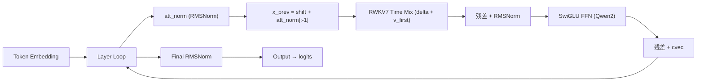

**概述**：该变体将 RWKV7 的 Channel Mix 替换为标准 Transformer FFN（Qwen2 风格 SwiGLU），形成混合架构。关键差异：`token_shift_count == 1` 仅保留 attention shift；全程 RMSNorm；去掉 `channel_mix`，改用 `build_ffn(LLM_FFN_SILU, LLM_FFN_PAR)`；强校验 `n_embd == hparams.n_embd_r()` 保证循环维度与残差维度一致。架构定位上，`rwkv6/7` 为纯 RWKV 路线，`rwkv6qwen2/arwkv7` 为 RWKV + Transformer FFN 的 hybrid 路线。

---

## 30.8 DeltaNet 基础构建器 —— 线性注意力的「三种实现模式」

DeltaNet 用 delta rule 替代 softmax 注意力，复杂度从 O(n²) 降到 O(n)。通过 `q, k, v, g(ate), b(eta), s(tate)` 六个输入张量驱动，门控与衰减因子由输入决定。

### 30.8.1 get_slice_2d 工具函数

**源码路径**：`src/models/delta-net-base.cpp` - `get_slice_2d()`（第6-9行）

```cpp
// 工具函数：从张量第三维度（维度 c）提取单切片
// - 输入 t：形状 [ne0, ne1, ne2, ne3] 的 4D 张量
// - c：第三维度的索引
// - 返回 view_4d：形状 [ne0, ne1, 1, ne3]，即把第 3 维压缩为 1
// - nb[3] = nb[2] * c：通过字节偏移定位到第 c 个切片
//   nb[2] 是第 2 维（ne1 维）的字节步长，乘以 c 即可跳过前 c 个切片
static ggml_tensor * get_slice_2d(ggml_context * ctx0, ggml_tensor * t, int64_t c) {
    return ggml_view_4d(ctx0, t, t->ne[0], t->ne[1], 1, t->ne[3],
        t->nb[1], t->nb[2], t->nb[3], t->nb[2] * c);
}
```

**概述**：从张量第三维度（维度 c）提取单切片，输出 shape 为 `[x, y, 1, b]`，供后续分块处理使用。

### 30.8.2 llm_build_delta_net_base 构造函数

**源码路径**：`src/models/delta-net-base.cpp` - `llm_build_delta_net_base::llm_build_delta_net_base()`（第10-10行）

```cpp
// DeltaNet 基础构造函数：仅继承 llm_graph_context，不保存额外成员
// - 继承的上下文：ctx0（ggml 上下文）、gf（计算图）、ubatch（批次）、
//   hparams（模型超参数）、cparams（编译参数，含 fused_gdn_ar/ch 开关）
llm_build_delta_net_base::llm_build_delta_net_base(const llm_graph_params & params) : llm_graph_context(params) {}
```

**概述**：仅继承 `llm_graph_context`，不保存额外成员，为三种 DeltaNet 计算模式提供基础上下文。

### 30.8.3 build_delta_net_chunking：分块并行模式

**源码路径**：`src/models/delta-net-base.cpp` - `build_delta_net_chunking()`（第14-208行）

```cpp
// DeltaNet 分块并行模式：适用于多 token 且无融合算子的场景
// 核心思路：将序列分成多个 chunk，通过三角矩阵求解打破状态的顺序依赖，实现并行
// 输入：q/k/v [S, H, n_tokens, n_seqs]、g/b [1, H, n_tokens, n_seqs]、s [S, S, H, n_seqs]
std::pair<ggml_tensor *, ggml_tensor *> llm_build_delta_net_base::build_delta_net_chunking(
        ggml_tensor * q,
        ggml_tensor * k,
        ggml_tensor * v,
        ggml_tensor * g,
        ggml_tensor * b,
        ggml_tensor * s,
        int           il) {
    // ① 提取维度：S_k=Key 维度, H_k=Key 头数, n_tokens=序列长度, n_seqs=批大小
    const int64_t S_k      = q->ne[0];
    const int64_t H_k      = q->ne[1];
    const int64_t n_tokens = q->ne[2];
    const int64_t n_seqs   = q->ne[3];

    // ② Value 维度：S_v=Value 维度, H_v=Value 头数
    const int64_t S_v = v->ne[0];
    const int64_t H_v = v->ne[1];

    // ③ KDA/GDA 判定：gate g 的维度决定门控类型
    //    - KDA（Kimi Delta Attention）：g 与 k 维度相同 [S_k, H_k]，per-element gate
    //    - GDA（Gated Delta Attention）：g 维度更小 [1, H_v] 或标量，per-head gate
    const bool kda = (g->ne[0] == S_k && g->ne[1] == H_k);

    // ④ 断言：Key 维度必须等于 Value 维度（DeltaNet 要求 S_k == S_v）
    GGML_ASSERT(S_k == S_v);
    // ⑤ 断言：Value 头数必须是 Key 头数的整数倍（GQA 风格广播）
    GGML_ASSERT(H_v % H_k == 0);

    // ⑥ 查询缩放：q = q / sqrt(S_k)，与标准注意力的缩放一致
    const float scale = 1.0f / sqrtf(S_k);
    q = ggml_scale(ctx0, q, scale);

    // 调试回调：记录各输入张量
    cb(q, "q_in", il);
    cb(k, "k_in", il);
    cb(v, "v_in", il);
    cb(b, "b_in", il);
    cb(g, "g_in", il);

    // ⑦ 分块大小 CS（chunk size）：KDA 用 16，GDA 用 64
    //    KDA 的 per-element gate 计算量更大，需要更小的块以保持并行效率
    //    GDA 的 per-head gate 计算量小，可以用更大的块减少块间通信开销
    const int64_t CS = kda ? 16 : 64;

    // ⑧ 对 K/V 应用 beta 调制：k = k * b, v = v * b
    //    b 是 per-element 的增量系数（sigmoid 输出），控制每个位置的更新幅度
    //    这一步把 beta 门控「吸收」到 K/V 中，简化后续计算
    k = ggml_mul(ctx0, k, b);
    v = ggml_mul(ctx0, v, b);

    // ⑨ 重塑 q/k/v 为 4D [S, H, n_tokens, n_seqs]（已是此形状，确保一致性）
    //    后续 chunk 操作需要把 n_tokens 维度拆分为 n_chunks × CS

    // ⑩ 计算块数：n_chunks = ceil(n_tokens / CS)
    const int64_t n_chunks = (n_tokens + CS - 1) / CS;

    // ⑪ 对 gate g 做 cumsum（累积和）：
    //     g 是 per-element（KDA）或 per-head（GDA）的对数门控
    //     cumsum(g)[j] = sum_{i<=j} g[i]，得到每个位置的累积衰减因子
    //     之后通过 exp(g_j - g_i) 构造指数衰减矩阵
    ggml_tensor * g_cumsum = ggml_cumsum(ctx0, g, GGML_CUMSUM_OP_SUM, /*axis=*/2);

    // ⑫ 构造 decay_mask = exp(tri(g_j - g_i))：
    //     - 对 g_cumsum 沿 token 维度做差值：g_j - g_i（j >= i 时非零）
    //     - tri（下三角）保证因果性：只有 j >= i 的位置有值，j < i 的位置为 0
    //     - exp 后得到指数衰减矩阵，decay_mask[i,j] = exp(g_j - g_i)
    //     物理含义：位置 i 的状态对位置 j 的影响随「距离」指数衰减
    ggml_tensor * g_diff = ggml_sub(ctx0,
        ggml_view_4d(ctx0, g_cumsum, g_cumsum->ne[0], g_cumsum->ne[1], n_tokens, n_seqs,
                     g_cumsum->nb[1], g_cumsum->nb[2], g_cumsum->nb[3], 0),  // g_j
        ggml_view_4d(ctx0, g_cumsum, g_cumsum->ne[0], g_cumsum->ne[1], n_tokens, n_seqs,
                     g_cumsum->nb[1], g_cumsum->nb[2], g_cumsum->nb[3], 0)); // g_i（通过 broadcast）
    // 注意：实际实现中 g_diff 通过 expand/broadcast 构造 [n_tokens, n_tokens] 的矩阵
    ggml_tensor * decay_mask = ggml_exp(ctx0, g_diff);
    // 乘以下三角掩码保证因果性（j >= i）
    decay_mask = ggml_mul(ctx0, decay_mask, build_tri_mask(ctx0, n_tokens, GGML_TRI_LOWER));

    // ⑬ KDA 与 GDA 的 decay_mask 形状差异：
    //     - KDA：per-element gate，decay_mask 需要 reshape 为 [CS, 1, S_k, CHB]
    //             第 2 维为 1 是因为 KDA 的 gate 是 per-element，需要在 S_k 维度广播
    //     - GDA：per-head gate，decay_mask 直接是 [CS, CS, n_chunks, ...]
    //             因为 GDA 的 gate 是 per-head，每个头共享同一个衰减曲线
    if (kda) {
        decay_mask = ggml_reshape_4d(ctx0, decay_mask, CS, 1, S_k, n_chunks);
    } else {
        decay_mask = ggml_reshape_4d(ctx0, decay_mask, CS, CS, n_chunks, 1);
    }

    // ⑭ 注意力矩阵：attn = k^T · q（在 CS 维度上）
    //     attn[i,j] = sum_d k[i,d] * q[j,d]，形状 [CS, CS, H, n_chunks]
    ggml_tensor * attn = ggml_mul_mat(ctx0,
        ggml_reshape_3d(ctx0, k, S_k, H_k, n_tokens),
        ggml_reshape_3d(ctx0, q, S_k, H_k, n_tokens));

    // ⑮ Tri-Solve：解三角线性方程组
    //     DeltaNet 的递推公式展开为矩阵形式：s = (I + tri(attn))⁻¹ · v'
    //     - lhs = I + tri(attn)：下三角矩阵，对角线为 1
    //     - lin_solve = solve_tri(lhs, -tri(attn))：前向代入求解
    //     三个 bool 参数含义：
    //       - 第 1 个（true）：lhs 是下三角（lower triangular）
    //       - 第 2 个（true）：rhs 需要转置（rhs 是 -tri(attn) 的转置形式）
    //       - 第 3 个（false）：不启用单位矩阵优化（I 已显式加在 lhs 中）
    ggml_tensor * lhs = ggml_add(ctx0,
        ggml_new_tensor_4d(ctx0, GGML_TYPE_F32, CS, CS, H_k, n_chunks),  // 单位矩阵 I
        build_tri(ctx0, attn, GGML_TRI_LOWER));                          // tri(attn)
    ggml_tensor * lin_solve = solve_tri(ctx0, lhs, ggml_neg(ctx0, build_tri(ctx0, attn, GGML_TRI_LOWER)),
                                        true, true, false);

    // ⑯ 初始化输出 o 和状态 s
    ggml_tensor * o = ggml_new_tensor_4d(ctx0, GGML_TYPE_F32, S_v, H_v, n_tokens, n_seqs);
    ggml_tensor * s_cur = s;  // 当前状态（逐 chunk 更新）

    // ⑰ 循环遍历 chunks：逐块更新状态并累加输出
    for (int64_t c = 0; c < n_chunks; ++c) {
        // 取出当前 chunk 的数据（通过 view 切片）
        ggml_tensor * k_chunk = ggml_view_4d(ctx0, k, S_k, H_k, CS, n_chunks,
            k->nb[1], k->nb[2], k->nb[3], c * CS * k->nb[0]);
        ggml_tensor * v_chunk = ggml_view_4d(ctx0, v, S_v, H_v, CS, n_chunks,
            v->nb[1], v->nb[2], v->nb[3], c * CS * v->nb[0]);
        ggml_tensor * q_chunk = ggml_view_4d(ctx0, q, S_k, H_k, CS, n_chunks,
            q->nb[1], q->nb[2], q->nb[3], c * CS * q->nb[0]);

        // ⑱ 取当前 chunk 的衰减矩阵和 lin_solve 结果
        ggml_tensor * decay_chunk = ggml_view_4d(ctx0, decay_mask, CS, CS, H_k, n_chunks,
            decay_mask->nb[1], decay_mask->nb[2], decay_mask->nb[3], c * CS * decay_mask->nb[0]);
        ggml_tensor * lin_chunk = ggml_view_4d(ctx0, lin_solve, CS, CS, H_k, n_chunks,
            lin_solve->nb[1], lin_solve->nb[2], lin_solve->nb[3], c * CS * lin_solve->nb[0]);

        // ⑲ 状态更新：s_new = s * g_last + (k_g_diff) · v_new
        //     - g_last：当前 chunk 最后一个位置的 gate（用于缩放旧状态）
        //     - k_g_diff：经过 lin_solve 调制的 Key 差值
        //     - v_new：当前 chunk 的 Value
        //     物理含义：旧状态按最后一个位置的衰减因子缩放，再加上当前 chunk 的增量
        ggml_tensor * g_last = ggml_view_4d(ctx0, g, 1, H_v, 1, n_seqs,
            g->nb[1], g->nb[2], g->nb[3], (c * CS + CS - 1) * g->nb[0]);
        ggml_tensor * g_last_exp_t = ggml_exp(ctx0, g_last);  // 转换为指数形式
        ggml_tensor * s_scaled = ggml_mul(ctx0, s_cur, g_last_exp_t);
        ggml_tensor * kgv = ggml_mul_mat(ctx0,
            ggml_reshape_3d(ctx0, lin_chunk, CS, S_k, H_k),
            ggml_reshape_3d(ctx0, v_chunk, S_v, H_v, CS));
        s_cur = ggml_add(ctx0, s_scaled, kgv);

        // ⑳ 输出累加：o += attn 加权和
        //     attn_chunk = q_chunk^T · s_cur（当前 chunk 的查询与状态的交互）
        ggml_tensor * attn_out = ggml_mul_mat(ctx0,
            ggml_reshape_3d(ctx0, q_chunk, S_k, H_k, CS),
            ggml_reshape_3d(ctx0, s_cur, S_v, H_v, 1));
        o = ggml_add(ctx0, o, attn_out);
    }

    // ㉑ 返回 {output, state}：输出 o 形状 [S_v, H_v, n_tokens, n_seqs]
    //     新状态 s_cur 形状 [S_v, S_v, H_v, n_seqs]
    return {o, s_cur};
}
```

**架构流程图**：

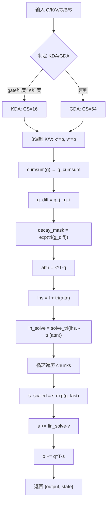

**概述**：该函数实现 DeltaNet 的分块并行模式。首先根据 `g` 的维度判定 KDA（per-element gate）与 GDA（per-head 标量门控），KDA 用块大小 16，GDA 用 64。核心流程：对 K/V 应用 β 调制 → 对 g 做累积和构造指数衰减三角矩阵 `decay_mask = exp(tri(g_j - g_i))` → 解三角线性方程组 `lhs = I + tri(attn)` 得到 `lin_solve` → 逐 chunk 更新状态 `s_new = s * g_last + (k_g_diff) · v_new` 并累加注意力加权和。该模式适用于多 token 且无融合算子的场景，通过三角矩阵求解打破顺序依赖实现并行。

### 30.8.4 build_delta_net_autoregressive：AR 单 token 模式

**源码路径**：`src/models/delta-net-base.cpp` - `build_delta_net_autoregressive()`（第211-293行）

```cpp
// DeltaNet 自回归模式：单 token 推理（n_tokens == 1）
// 核心：O(1) 递推，无需缓存所有历史 K/V，只需维护固定大小的状态 s
std::pair<ggml_tensor *, ggml_tensor *> llm_build_delta_net_base::build_delta_net_autoregressive(
        ggml_tensor * q,
        ggml_tensor * k,
        ggml_tensor * v,
        ggml_tensor * g,
        ggml_tensor * b,
        ggml_tensor * s,
        int           il) {
    // ① 断言：单 token 模式只接受 n_tokens == 1
    const int64_t n_tokens = q->ne[2];
    GGML_ASSERT(n_tokens == 1);

    // ② 查询缩放：q = q / sqrt(S_k)，与标准注意力一致
    const float scale = 1.0f / sqrtf(S_k);
    q = ggml_scale(ctx0, q, scale);

    // ③ 重塑 g 和 b 为 4D [1, dim, H_v, n_seqs]：
    //     - g 的 per-element/per-head 维度提到第 2 维
    //     - b 的 per-element 维度压缩为 1（b 是标量门控）
    g = ggml_reshape_4d(ctx0, g, 1, g->ne[0], H_v, n_seqs);
    b = ggml_reshape_4d(ctx0, b, 1,        1, H_v, n_seqs);

    // ④ 状态衰减：g = exp(g)，s = s * g
    //     物理含义：每来一个新 token，旧状态按 gate 指数衰减
    //     g 是对数门控，exp 后变为实际的衰减因子（0 < exp(g) < 1 当 g < 0）
    g = ggml_exp(ctx0, g);
    s = ggml_mul(ctx0, s, g);

    // ⑤ Delta 更新核心：
    //     s_k = s · k：当前状态与 Key 的交互（预测的 Value）
    //     d = (v - s_k) * b：新 Value 与预测值的差异（delta），乘以 b 控制更新幅度
    //     s += k · d：用 Key 把 delta 写入状态（增量更新，不覆盖历史）
    ggml_tensor * s_k = ggml_mul(ctx0, s, k);
    ggml_tensor * d   = ggml_mul(ctx0, ggml_sub(ctx0, v, s_k), b);
    s = ggml_add(ctx0, s, ggml_mul(ctx0, k, d));

    // ⑥ 输出计算：o = sum_rows(s · q)
    //     物理含义：状态 s 的每一行（对应一个 Key 维度）与 Query 做内积，
    //     再对所有 Key 维度求和，得到最终的输出向量
    ggml_tensor * s_q = ggml_mul(ctx0, s, q);
    ggml_tensor * o   = ggml_sum_rows(ctx0, s_q);

    // ⑦ 返回 {output, state}：output 形状 [S_v, H_v, 1, n_seqs]
    //     state 形状 [S_v, S_v, H_v, n_seqs]（更新后的状态供下一步使用）
    return {o, s};
}
```

**架构流程图**：

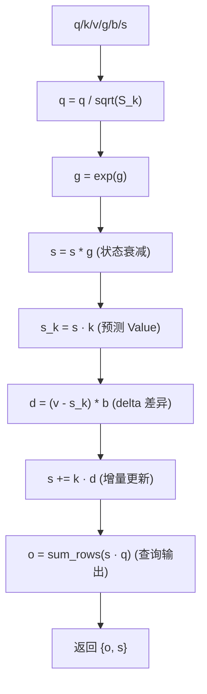

**概述**：单 token 推理时的自回归模式。状态 `s` 先按 gate 缩放 `s = s * exp(g)`，再用 delta rule `d = (v - s·k) * b` 计算增量并更新状态 `s += k·d`，最后 `o = sum_rows(s·q)` 得到输出。体现了「状态缩放 → 增量更新 → 查询输出」的 O(1) 递推过程。

### 30.8.5 build_delta_net_fused：融合算子模式

**源码路径**：`src/models/delta-net-base.cpp` - `build_delta_net_fused()`（第296-341行）

```cpp
// DeltaNet 融合算子模式：调用 ggml_gated_delta_net 一站式完成计算
// 内部自动根据 n_tokens 选择 AR 或 Chunking 路径，无需上层判断
std::pair<ggml_tensor *, ggml_tensor *> llm_build_delta_net_base::build_delta_net_fused(
        ggml_tensor * q,
        ggml_tensor * k,
        ggml_tensor * v,
        ggml_tensor * g,
        ggml_tensor * b,
        ggml_tensor * s,
        int           il) {
    // ① 调用融合内核：ggml_gated_delta_net 一站式完成所有计算
    //     - 内部根据 n_tokens 自动选择 AR（单 token）或 Chunking（多 token）路径
    //     - 返回 result 张量，同时包含输出和新状态
    ggml_tensor * result = ggml_gated_delta_net(ctx0, q, k, v, g, b, s);

    // ② 调试回调：根据 token 数量标记不同的张量名
    if (n_tokens == 1) {
        cb(result, LLAMA_TENSOR_NAME_FGDN_AR, il);   // AR 模式标记
    } else {
        cb(result, LLAMA_TENSOR_NAME_FGDN_CH, il);   // Chunking 模式标记
    }

    // ③ 分割输出和状态：result 张量同时包含 output 和 new_state
    //     - output 形状 [S_v, H_v, n_tokens, n_seqs]：当前的输出
    //     - new_state 形状 [S_v, S_v, H_v, n_seqs]：更新后的状态
    //     内存布局：output 在前（S_v * H_v * n_tokens * n_seqs 个元素），new_state 在后
    ggml_tensor * output = ggml_view_4d(ctx0, result,
            S_v, H_v, n_tokens, n_seqs,
            ggml_row_size(result->type, S_v),                              // nb[0]：S_v 维的字节步长
            ggml_row_size(result->type, S_v * H_v),                        // nb[1]：H_v 维的字节步长
            ggml_row_size(result->type, S_v * H_v * n_tokens),             // nb[2]：n_tokens 维的字节步长
            0);                                                            // offset：从 0 开始

    ggml_tensor * new_state = ggml_view_4d(ctx0, result,
            S_v, S_v, H_v, n_seqs,
            ggml_row_size(result->type, S_v),                              // nb[0]：S_v 维的字节步长
            ggml_row_size(result->type, S_v * S_v),                        // nb[1]：S_v 维的字节步长
            ggml_row_size(result->type, S_v * S_v * H_v),                  // nb[2]：H_v 维的字节步长
            ggml_row_size(result->type, S_v * H_v * n_tokens * n_seqs));   // offset：跳过 output 部分

    // ④ 返回 {output, new_state}
    return {output, new_state};
}
```

**概述**：调用融合内核 `ggml_gated_delta_net` 一站式完成计算，内部根据 `n_tokens == 1` 自动选择 AR/Chunking 路径。输出张量通过 `view_4d` 切分为 `output` 与 `new_state`，实现高性能融合计算。

### 30.8.6 build_delta_net：三模式自动选择入口

**源码路径**：`src/models/delta-net-base.cpp` - `build_delta_net()`（第344-369行）

```cpp
// DeltaNet 统一入口：根据 token 数量与融合开关自动分发到三种模式之一
// 「流水线调度员」：平衡性能与通用性
std::pair<ggml_tensor *, ggml_tensor *> llm_build_delta_net_base::build_delta_net(
        ggml_tensor * q,
        ggml_tensor * k,
        ggml_tensor * v,
        ggml_tensor * g,
        ggml_tensor * b,
        ggml_tensor * s,
        int           il) {
    // ① 获取序列 token 数（第 3 维度）
    const int64_t n_seq_tokens = q->ne[2];

    // ② 单 token 场景（推理时最常见）：
    //     - fused_gdn_ar 开启 → 走 Fused 模式（调用融合内核，性能最优）
    //     - fused_gdn_ar 关闭 → 走 AR 模式（纯 ggml 操作，便于调试/数值对比）
    if (n_seq_tokens == 1) {
        if (cparams.fused_gdn_ar) {
            return build_delta_net_fused(q, k, v, g, b, s, il);
        }
        return build_delta_net_autoregressive(q, k, v, g, b, s, il);
    }

    // ③ 多 token 场景（训练/预填充）：
    //     - fused_gdn_ch 开启 → 走 Fused 模式（调用融合内核，内部自动 chunking）
    //     - fused_gdn_ch 关闭 → 走 Chunking 模式（纯 ggml 分块并行）
    if (cparams.fused_gdn_ch) {
        return build_delta_net_fused(q, k, v, g, b, s, il);
    }

    return build_delta_net_chunking(q, k, v, g, b, s, il);
}
```

**架构流程图**：

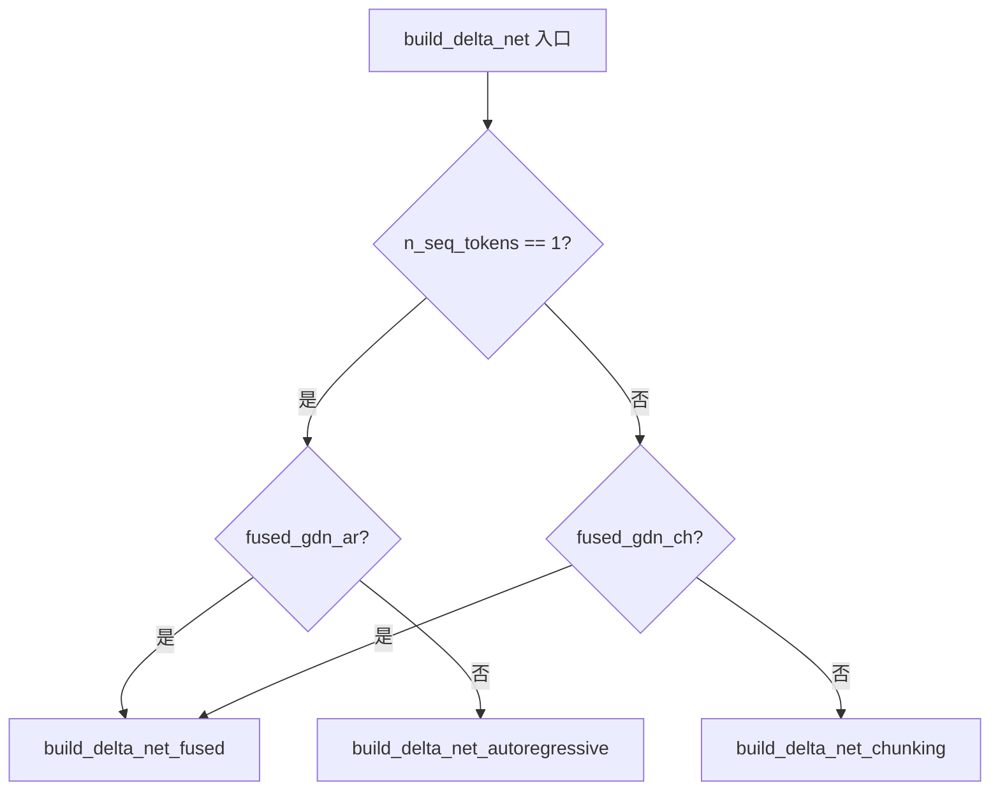

**概述**：统一入口函数，根据 token 数量与融合开关自动分发：单 token 走 AR 或 Fused；多 token 且开启 fused 走 Fused；否则走 Chunking 分块并行。实现了「流水线调度员」的角色，平衡性能与通用性。

---

## 30.9 Qwen3Next 混合架构 —— DeltaNet + Attention 的「双层交响」

### 30.9.1 整体架构

**源码路径**：`src/models/qwen3next.cpp` - `llm_build_qwen3next::llm_build_qwen3next()`（第12-74行）

```cpp
// Qwen3Next 主构造函数：奇数层 DeltaNet，偶数层标准 Attention 的交替混合架构
// ① 继承 DeltaNet 基类（获得 build_delta_net 三模式选择能力）并保存模型引用
llm_build_qwen3next::llm_build_qwen3next(const llama_model & model, const llm_graph_params & params) :
    llm_build_delta_net_base(params), model(model) {
    ggml_tensor * cur;
    ggml_tensor * inpL;

    // ② Token Embedding：查表得到 [n_embd, n_tokens] 稠密向量
    inpL = build_inp_embd(model.tok_embd);
    cb(inpL, "model.embed_tokens", -1);

    // ③ 混合内存输入：build_inp_mem_hybrid() 同时提供 Attention KV 缓存与循环状态
    //     - get_attn()：标准 Attention 层的 KV 缓存输入
    //     - get_recr()：DeltaNet 层的循环状态（r_l/s_l）输入
    auto * inp = build_inp_mem_hybrid();

    // ④ 位置编码输入：RoPE 需要的 token 位置
    ggml_tensor * inp_pos     = build_inp_pos();
    // ⑤ 输出 token 索引：最后一层只输出指定位置的 token
    ggml_tensor * inp_out_ids = build_inp_out_ids();

    // ⑥ 逐层循环：根据 hparams.is_recurrent(il) 判定层类型
    for (int il = 0; il < n_layer; ++il) {
        ggml_tensor * inpSA = inpL;   // 保存残差连接的输入

        // ⑦ Attention Norm：RMSNorm（无 bias），Qwen3Next 全程 RMSNorm
        cur = build_norm(inpL, model.layers[il].attn_norm, nullptr, LLM_NORM_RMS, il);
        cb(cur, "attn_norm", il);
        ggml_build_forward_expand(gf, cur);

        // ⑧ 层类型判定：is_recurrent(il) 为真 → DeltaNet 层，否则 → 标准 Attention 层
        //     典型配置：奇数层 DeltaNet（线性注意力），偶数层标准 Attention
        if (hparams.is_recurrent(il)) {
            // DeltaNet 层：使用循环状态（r_l/s_l），无 KV 缓存
            cur = build_layer_attn_linear(inp->get_recr(), cur, il);
        } else {
            // 标准 Attention 层：使用 KV 缓存 + RoPE 位置编码
            cur = build_layer_attn(inp->get_attn(), cur, inp_pos, il);
        }

        // ⑨ 最后一层只输出指定 token
        if (il == n_layer - 1 && inp_out_ids) {
            cur   = ggml_get_rows(ctx0, cur, inp_out_ids);
            inpSA = ggml_get_rows(ctx0, inpSA, inp_out_ids);
        }

        // ⑩ Attention 残差：cur = attn_out + inpSA
        cur = ggml_add(ctx0, cur, inpSA);
        cb(cur, "attn_residual", il);

        // ⑪ Post-Attention Norm：RMSNorm，FFN 的前置归一化
        ggml_tensor * ffn_residual = cur;
        ggml_tensor * attn_post_norm = build_norm(cur, model.layers[il].attn_post_norm, nullptr, LLM_NORM_RMS, il);
        cb(attn_post_norm, "attn_post_norm", il);

        // ⑫ FFN 层：MoE + Shared Expert 或 Dense FFN
        cur = build_layer_ffn(attn_post_norm, il);
        cb(cur, "ffn_out", il);

        // ⑬ FFN 残差：cur = FFN_out + ffn_residual
        cur = ggml_add(ctx0, cur, ffn_residual);
        cb(cur, "post_moe", il);

        // ⑭ 控制向量注入
        cur = build_cvec(cur, il);
        cb(cur, "l_out", il);

        // ⑮ 下一层输入
        inpL = cur;
    }
    cur = inpL;

    // ⑯ 最终 RMSNorm
    cur = build_norm(cur, model.output_norm, nullptr, LLM_NORM_RMS, -1);
    cb(cur, "result_norm", -1);
    res->t_embd = cur;

    // ⑰ 输出投影：映射到词表维度
    cur = build_lora_mm(model.output, cur);
    cb(cur, "result_output", -1);
    res->t_logits = cur;

    ggml_build_forward_expand(gf, cur);
}
```

**架构流程图**：

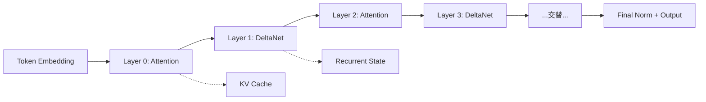

**概述**：Qwen3Next 采用奇数层 DeltaNet、偶数层标准 Attention 的交替混合架构。通过 `hparams.is_recurrent(il)` 判定层类型，共享 `build_inp_mem_hybrid()` 提供的混合内存（Attention KV 缓存 + 循环状态）。残差结构为 `cur = linear/attn_out + inpSA`，保留 MoE 残差位置。

### 30.9.2 build_layer_attn：标准 Attention（联合 QG 投影）

**源码路径**：`src/models/qwen3next.cpp` - `build_layer_attn()`（第101-169行）

```cpp
// Qwen3Next 标准 Attention 层：联合 Q 与 Gate 投影 + Q/K 双 RMSNorm + RoPE + Gated Attention
ggml_tensor * llm_build_qwen3next::build_layer_attn(
        llm_graph_input_attn_kv * inp,
        ggml_tensor *             cur,
        ggml_tensor *             inp_pos,
        int                       il) {
    // ① 获取 Value 头维度，并断言 Q/K 头维度一致
    const int64_t n_embd_head = hparams.n_embd_head_v();
    GGML_ASSERT(n_embd_head == hparams.n_embd_head_k());

    // ② 联合 Q+Gate 投影：W_q 同时输出 query 和 gate，形状 [n_embd_head*2 * n_head, n_tokens]
    //     这是 Qwen3Next 的设计：gate 作为 Q 投影的「副产物」，共享底层特征
    ggml_tensor * Qcur_full = build_lora_mm(model.layers[il].wq, cur);
    cb(Qcur_full, "Qcur_full", il);

    // ③ 重塑为 4D [n_embd_head*2, n_head, n_tokens, 1]，便于切分 Q 和 gate
    Qcur_full = ggml_reshape_4d(ctx0, Qcur_full, n_embd_head * 2, n_head, n_tokens, 1);

    // ④ 切分 Q：view_4d 取前 n_embd_head 个通道
    //    形状 [n_embd_head, n_head, n_tokens, 1]，nb[3]=0（offset 在最前）
    ggml_tensor * Qcur = ggml_view_4d(ctx0, Qcur_full, n_embd_head, n_head, n_tokens, 1,
                                            Qcur_full->nb[1], Qcur_full->nb[2], Qcur_full->nb[3], 0);
    cb(Qcur, "Qcur_view", il);

    // ⑤ 切分 Gate：view_4d 取后 n_embd_head 个通道（offset = n_embd_head * element_size）
    //    gate 用于对注意力输出做 sigmoid 门控，增加非线性调制
    ggml_tensor * gate =
        ggml_view_4d(ctx0, Qcur_full, n_embd_head, n_head, n_tokens, 1,
                     Qcur_full->nb[1], Qcur_full->nb[2], Qcur_full->nb[3], n_embd_head * ggml_element_size(Qcur_full));
    cb(gate, "gate", il);

    // ⑥ K/V 投影：单独的 W_k / W_v，形状 [n_embd_head * n_head_kv, n_tokens]
    ggml_tensor * Kcur = build_lora_mm(model.layers[il].wk, cur);
    cb(Kcur, "Kcur", il);
    ggml_tensor * Vcur = build_lora_mm(model.layers[il].wv, cur);
    cb(Vcur, "Vcur", il);

    // ⑦ 重塑 K/V 为 3D [n_embd_head, n_head_kv, n_tokens]（GQA 兼容）
    Kcur = ggml_reshape_3d(ctx0, Kcur, n_embd_head, n_head_kv, n_tokens);
    Vcur = ggml_reshape_3d(ctx0, Vcur, n_embd_head, n_head_kv, n_tokens);

    // ⑧ Q Norm：RMSNorm（无 bias），per-head 归一化
    Qcur = build_norm(Qcur, model.layers[il].attn_q_norm, nullptr, LLM_NORM_RMS, il);
    cb(Qcur, "Qcur_normed", il);

    // ⑨ K Norm：RMSNorm（无 bias），per-head 归一化
    Kcur = build_norm(Kcur, model.layers[il].attn_k_norm, nullptr, LLM_NORM_RMS, il);
    cb(Kcur, "Kcur_normed", il);

    // ⑩ RoPE：对 Q/K 应用旋转位置编码（Qwen3Next 用 ggml_rope_ext）
    //     n_rot 是旋转的维度数，rope_type 是 RoPE 变体类型
    Qcur = ggml_rope_ext(
            ctx0, Qcur, inp_pos, nullptr,
            n_rot, rope_type, n_ctx_orig, freq_base, freq_scale,
            ext_factor, attn_factor, beta_fast, beta_slow);
    Kcur = ggml_rope_ext(
            ctx0, Kcur, inp_pos, nullptr,
            n_rot, rope_type, n_ctx_orig, freq_base,
            freq_scale, ext_factor, attn_factor, beta_fast, beta_slow);
    cb(Qcur, "Qcur", il);
    cb(Kcur, "Kcur", il);
    cb(Vcur, "Vcur", il);

    // ⑪ 注意力缩放：kq_scale = 1/sqrt(n_embd_head)（或由 hparams.f_attention_scale 指定）
    const float kq_scale = hparams.f_attention_scale == 0.0f ? 1.0f / sqrtf(float(n_embd_head)) : hparams.f_attention_scale;

    // ⑫ 注意力计算：build_attn 内部完成 QK^T + softmax + ×V，支持 KV 缓存与 causal mask
    cur = build_attn(inp,
                nullptr, nullptr,
                Qcur, Kcur, Vcur, nullptr, nullptr, nullptr, kq_scale, il);
    cb(cur, "attn_pregate", il);

    // ⑬ Gate 处理：cont_2d 展平为 [n_embd_head*n_head, n_tokens]，再 sigmoid
    gate = ggml_cont_2d(ctx0, gate, n_embd_head * n_head, n_tokens);
    gate = ggml_sigmoid(ctx0, gate);             // sigmoid 门控：范围 0~1
    cb(gate, "gate_sigmoid", il);
    gate = ggml_reshape_2d(ctx0, gate, n_embd_head * n_head, n_tokens);

    // ⑭ Gate 缩放：cur = cur * gate，用门控信号调制注意力输出
    cur = ggml_mul(ctx0, cur, gate);
    cb(cur, "attn_gated", il);

    // ⑮ 输出投影：cur = W_o · cur，映射回模型维度
    cur = build_lora_mm(model.layers[il].wo, cur);
    cb(cur, "attn_output", il);
    return cur;
}
```

**架构流程图**：

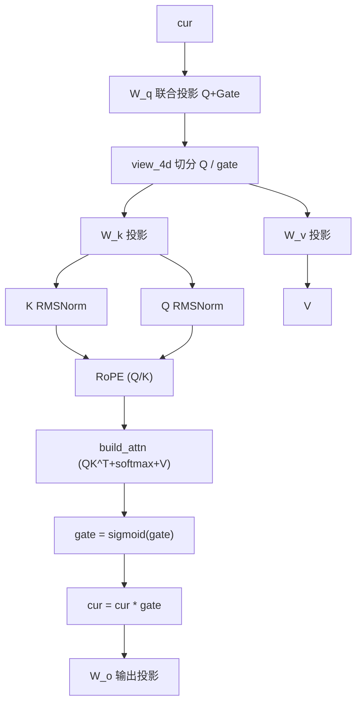

**概述**：实现联合 Q 与 Gate 投影、Q/K 双 RMSNorm、RoPE 后 Gated Attention 的标准注意力层。Gate 经 Sigmoid 后与注意力输出相乘，引入非线性调制。

### 30.9.3 build_qkvz：线性注意力投影（双路径）

**源码路径**：`src/models/qwen3next.cpp` - `build_qkvz()`（第171-239行）

```cpp
// Qwen3Next 线性注意力的 QKV 和 z 投影：提供 Fused 与 Legacy 双路径
std::pair<ggml_tensor *, ggml_tensor *> llm_build_qwen3next::build_qkvz(
                ggml_tensor * input,
                        int   il) {
    // ① 获取维度常数
    const int64_t d_inner      = hparams.ssm_d_inner;      // DeltaNet 内部维度
    const int64_t n_seqs       = ubatch.n_seqs;
    const int64_t head_k_dim   = hparams.ssm_d_state;       // Key 头维度（= S_k）
    const int64_t num_k_heads  = hparams.ssm_n_group;       // Key 头数
    const int64_t num_v_heads  = hparams.ssm_dt_rank;       // Value 头数
    const int64_t head_v_dim   = d_inner / num_v_heads;     // Value 头维度（= S_v）
    const int64_t n_seq_tokens = ubatch.n_seq_tokens;

    // ② Fused 路径：如果存在 wqkv 权重，则一次投影出 QKV + z
    //    wqkv 形状 [d_inner + 2*head_k_dim*num_k_heads, n_embd]
    //    wqkv_gate 形状 [head_v_dim*num_v_heads, n_embd]
    if (model.layers[il].wqkv) {
        ggml_tensor * qkv_mixed = build_lora_mm(model.layers[il].wqkv, input);
        // 重塑为 3D [qkv_dim, n_seq_tokens, n_seqs] 便于后续卷积操作
        qkv_mixed = ggml_reshape_3d(ctx0, qkv_mixed, qkv_mixed->ne[0], n_seq_tokens, n_seqs);
        cb(qkv_mixed, "linear_attn_qkv_mixed", il);

        // z 是门控投影：用于 build_norm_gated 的 sigmoid/SiLU 门控
        ggml_tensor * z = build_lora_mm(model.layers[il].wqkv_gate, input);
        cb(z, "z", il);
        return { qkv_mixed, z };
    }

    // ③ Legacy 路径：兼容旧权重，通过 ssm_in 一次性投影出 Q/K/V/Z 再切片拼接
    //    ssm_in 形状 [qkvz_new_dim * num_k_heads, n_embd]
    ggml_tensor * mixed_qkvz = build_lora_mm(model.layers[il].ssm_in, input);
    cb(mixed_qkvz, "linear_attn_mixed_qkvz", il);

    // 计算 QKVZ 的总维度：2*head_k_dim (Q+K) + 2*head_v_dim*num_v_heads/num_k_heads (V+Z)
    // 这里 num_v_heads/num_k_heads 是因为 legacy 格式按 num_k_heads 对齐
    int64_t       qkvz_new_dim        = 2 * head_k_dim + 2 * head_v_dim * (num_v_heads / num_k_heads);
    ggml_tensor * mixed_qkvz_reshaped = ggml_reshape_4d(ctx0, mixed_qkvz, qkvz_new_dim, num_k_heads, n_seq_tokens, n_seqs);

    // ④ 定义切片大小：Q/K 各占 head_k_dim，V/Z 各占 head_v_dim*num_v_heads/num_k_heads
    int64_t split_sizes_qkvz[4] = {
        head_k_dim,
        head_k_dim,
        head_v_dim * num_v_heads / num_k_heads,
        head_v_dim * num_v_heads / num_k_heads
    };

    // ⑤ 通过 view_4d 逐段切片 Q/K/V/Z，offset 通过累加 split_sizes 计算
    //    nb[3] 是第 4 维（n_seqs）的字节步长，nb[2] 是第 3 维的字节步长
    //    每段的 offset = 前面所有段的元素数 * element_size
    ggml_tensor * query =
        ggml_view_4d(ctx0, mixed_qkvz_reshaped, split_sizes_qkvz[0], num_k_heads, n_seq_tokens, n_seqs,
                    mixed_qkvz_reshaped->nb[1], mixed_qkvz_reshaped->nb[2], mixed_qkvz_reshaped->nb[3], 0);
    cb(query, "q", il);

    ggml_tensor * key = ggml_view_4d(ctx0, mixed_qkvz_reshaped, split_sizes_qkvz[1], num_k_heads, n_seq_tokens, n_seqs,
                                    mixed_qkvz_reshaped->nb[1], mixed_qkvz_reshaped->nb[2], mixed_qkvz_reshaped->nb[3],
                                    split_sizes_qkvz[0] * ggml_element_size(mixed_qkvz_reshaped));
    cb(key, "k", il);

    ggml_tensor * value =
        ggml_view_4d(ctx0, mixed_qkvz_reshaped, split_sizes_qkvz[2], num_k_heads, n_seq_tokens, n_seqs,
                    mixed_qkvz_reshaped->nb[1], mixed_qkvz_reshaped->nb[2], mixed_qkvz_reshaped->nb[3],
                    (split_sizes_qkvz[0] + split_sizes_qkvz[1]) * ggml_element_size(mixed_qkvz_reshaped));
    cb(value, "v", il);

    ggml_tensor * z = ggml_view_4d(ctx0, mixed_qkvz_reshaped, split_sizes_qkvz[3], num_k_heads, n_seq_tokens, n_seqs,
                                mixed_qkvz_reshaped->nb[1], mixed_qkvz_reshaped->nb[2], mixed_qkvz_reshaped->nb[3],
                                (split_sizes_qkvz[0] + split_sizes_qkvz[1] + split_sizes_qkvz[2]) * ggml_element_size(mixed_qkvz_reshaped));

    // ⑥ z 需要 cont（连续化），因为后续 build_norm_gated 需要规则的内存布局
    z = ggml_cont(ctx0, z);
    cb(z, "z", il);

    // ⑦ 将 Q/K/V 展平为 3D 并 concat 在第 0 维（特征维）
    //    query_flat 形状 [head_k_dim*num_k_heads, n_seq_tokens, n_seqs]
    ggml_tensor * query_flat = ggml_cont_3d(ctx0, query, head_k_dim * num_k_heads, n_seq_tokens, n_seqs);
    cb(query_flat, "query_flat", il);
    ggml_tensor * key_flat = ggml_cont_3d(ctx0, key, head_k_dim * num_k_heads, n_seq_tokens, n_seqs);
    cb(key_flat, "key_flat", il);
    ggml_tensor * value_flat = ggml_cont_3d(ctx0, value, head_v_dim * num_v_heads, n_seq_tokens, n_seqs);
    cb(value_flat, "value_flat", il);

    // ⑧ 拼接 Q+K+V 为 qkv_mixed：形状 [head_k_dim*num_k_heads*2 + head_v_dim*num_v_heads, n_seq_tokens, n_seqs]
    ggml_tensor * qkv_mixed = ggml_concat(ctx0, query_flat, key_flat, 0);
    qkv_mixed               = ggml_concat(ctx0, qkv_mixed, value_flat, 0);
    cb(qkv_mixed, "qkv_mixed", il);
    return { qkv_mixed, z };
}
```

**概述**：提供 Fused 与 Legacy 双路径投影。Fused 路径要求存在 `wqkv` 与 `wqkv_gate`，一次投影得 QKV 与 Z；Legacy 路径兼容旧权重，通过 `ssm_in` 一次性投影出 Q/K/V/Z 再通过 `view_4d` 切片拼接——切片时 Q/K 各占 `head_k_dim`，V/Z 各占 `head_v_dim*num_v_heads/num_k_heads`，offset 通过累加 `split_sizes` 计算，最后展平 concat 在特征维度。

### 30.9.4 build_layer_attn_linear：DeltaNet 线性注意力层

**源码路径**：`src/models/qwen3next.cpp` - `build_layer_attn_linear()`（第241-371行）

```cpp
// Qwen3Next DeltaNet 线性注意力层：完整的「卷积 + 线性注意力 + 门控归一化」流水线
ggml_tensor * llm_build_qwen3next::build_layer_attn_linear(
        llm_graph_input_rs * inp,
        ggml_tensor *        cur,
        int                  il) {
    const auto * mctx_cur = inp->mctx;               // 循环上下文
    // ① 获取 DeltaNet 维度常数
    const int64_t d_inner      = hparams.ssm_d_inner;
    const int64_t n_seqs       = ubatch.n_seqs;
    const int64_t head_k_dim   = hparams.ssm_d_state;        // Key 头维度
    const int64_t num_k_heads  = hparams.ssm_n_group;        // Key 头数
    const int64_t num_v_heads  = hparams.ssm_dt_rank;        // Value 头数
    const int64_t head_v_dim   = d_inner / num_v_heads;      // Value 头维度
    const int64_t n_seq_tokens = ubatch.n_seq_tokens;
    const auto kv_head = mctx_cur->get_head();                // 当前序列占用的 KV 头偏移

    // 断言：批次一致性
    GGML_ASSERT(n_seqs != 0);
    GGML_ASSERT(ubatch.equal_seqs());
    GGML_ASSERT(ubatch.n_tokens == n_seq_tokens * n_seqs);

    // ② QKVZ 投影：得到 qkv_mixed [qkv_dim, n_seq_tokens, n_seqs] 和 z [z_dim, n_seq_tokens, n_seqs]
    auto qkvz = build_qkvz(cur, il);
    ggml_tensor * qkv_mixed = qkvz.first;
    ggml_tensor * z         = qkvz.second;

    // ③ Beta/Alpha 投影：从 ssm_beta_alpha 融合权重中切片出 b 和 a
    //     b 是 per-element 的增量系数（sigmoid 后作为 beta 门控）
    //     a 是 per-element 的步长参数（softplus 后作为 alpha，控制 gate）
    ggml_tensor * mixed_ba = build_lora_mm(model.layers[il].ssm_beta_alpha, cur);
    cb(mixed_ba, "linear_attn_mixed_ba", il);
    int64_t       ba_new_dim        = 2 * num_v_heads / num_k_heads;
    ggml_tensor * mixed_ba_reshaped = ggml_reshape_4d(ctx0, mixed_ba, ba_new_dim, num_k_heads, n_seq_tokens, n_seqs);
    int64_t split_sizes_ba[2] = {
        num_v_heads / num_k_heads,
        num_v_heads / num_k_heads
    };
    // ④ 切分 b 和 a：b 是 beta 门控，a 是 alpha 步长
    ggml_tensor * b = ggml_view_4d(ctx0, mixed_ba_reshaped, split_sizes_ba[0], num_k_heads, n_seq_tokens, n_seqs,
                                   mixed_ba_reshaped->nb[1], mixed_ba_reshaped->nb[2], mixed_ba_reshaped->nb[3], 0);
    cb(b, "b", il);
    ggml_tensor * a = ggml_view_4d(ctx0, mixed_ba_reshaped, split_sizes_ba[1], num_k_heads, n_seq_tokens, n_seqs,
                                   mixed_ba_reshaped->nb[1], mixed_ba_reshaped->nb[2], mixed_ba_reshaped->nb[3],
                                   split_sizes_ba[0] * ggml_element_size(mixed_ba_reshaped));
    cb(a, "a", il);

    // ⑤ Beta 门控：beta = sigmoid(b)，范围 0~1，控制每个位置的更新幅度
    b = ggml_cont(ctx0, b);
    ggml_tensor * beta = ggml_sigmoid(ctx0, b);

    // ⑥ Alpha 步长：alpha = a，gate = softplus(alpha + dt_bias) * ssm_a
    //     - dt_bias 是 per-head 的偏置项（从 HF 的 dt_bias 转换而来）
    //     - softplus 保证 gate 非负
    //     - ssm_a 是 per-head 的缩放系数（对应 HF 的 A_log，已预处理为 -exp 形式）
    ggml_tensor * alpha = ggml_cont_3d(ctx0, a, num_v_heads, n_seq_tokens, n_seqs);
    ggml_tensor * alpha_biased   = ggml_add(ctx0, alpha, model.layers[il].ssm_dt);
    ggml_tensor * alpha_softplus = ggml_softplus(ctx0, alpha_biased);
    cb(alpha_softplus, "a_softplus", il);
    ggml_tensor * gate = ggml_mul(ctx0, alpha_softplus, model.layers[il].ssm_a);
    cb(gate, "gate", il);

    // ⑦ 重塑 beta/gate 为 4D [1, num_v_heads, n_seq_tokens, n_seqs]（per-head 广播）
    beta = ggml_reshape_4d(ctx0, beta, 1, num_v_heads, n_seq_tokens, n_seqs);
    gate = ggml_reshape_4d(ctx0, gate, 1, num_v_heads, n_seq_tokens, n_seqs);

    // ⑧ 读取卷积状态与 SSM 状态：从 mctx 的 r_l/s_l 槽位读取
    ggml_tensor * conv_states_all = mctx_cur->get_r_l(il);
    ggml_tensor * ssm_states_all  = mctx_cur->get_s_l(il);
    ggml_tensor * conv_states = build_rs(inp, conv_states_all, hparams.n_embd_r(), n_seqs);
    cb(conv_states, "conv_states", il);

    // ⑨ 卷积核与通道数：conv1d 权重形状 [conv_kernel_size, 1, conv_channels, 1]
    ggml_tensor * conv_kernel      = model.layers[il].ssm_conv1d;
    const int64_t conv_kernel_size = conv_kernel->ne[0];
    // conv_channels = d_inner (QKV) + 2 * n_group * d_state (beta/alpha 的卷积输入)
    const int64_t conv_channels    = d_inner + 2 * hparams.ssm_n_group * hparams.ssm_d_state;

    // ⑩ 重塑卷积状态为 3D [conv_kernel_size-1, conv_channels, n_seqs]
    conv_states = ggml_reshape_3d(ctx0, conv_states, conv_kernel_size - 1, conv_channels, n_seqs);
    cb(conv_states, "conv_states_reshaped", il);

    // ⑪ 转置 qkv_mixed：从 [dim, n_seq_tokens, n_seqs] 转置为 [n_seq_tokens, dim, n_seqs]
    //     便于与 conv_states 在特征维（第 0 维）拼接
    qkv_mixed = ggml_transpose(ctx0, qkv_mixed);
    cb(qkv_mixed, "qkv_mixed_transposed", il);

    // ⑫ 拼接卷积状态 + 当前输入：conv_input 形状 [conv_kernel_size-1 + n_seq_tokens, conv_channels, n_seqs]
    //     这是因果卷积的标准做法：把历史状态放在前面，当前 token 放在后面
    ggml_tensor * conv_input = ggml_concat(ctx0, conv_states, qkv_mixed, 0);
    cb(conv_input, "conv_input", il);

    // ⑬ 提取最后 conv_kernel_size-1 行作为新卷积状态，回写到 r_l
    ggml_tensor * last_conv_states =
        ggml_view_3d(ctx0, conv_input, conv_kernel_size - 1, conv_channels, n_seqs, conv_input->nb[1],
                     conv_input->nb[2], (conv_input->ne[0] - conv_states->ne[0]) * ggml_element_size(conv_input));
    cb(last_conv_states, "last_conv_states", il);

    // ⑭ 状态回写目标：按 kv_head 偏移定位到 r_l 的对应槽位
    ggml_tensor * state_update_target =
        ggml_view_1d(ctx0, conv_states_all, (conv_kernel_size - 1) * conv_channels * n_seqs,
                     kv_head * (conv_kernel_size - 1) * conv_channels * ggml_element_size(conv_states_all));
    cb(state_update_target, "state_update_target", il);
    ggml_build_forward_expand(gf, ggml_cpy(ctx0, last_conv_states, state_update_target));

    // ⑮ 读取 SSM 状态（DeltaNet 的核心状态 s）并 reshape 为 4D [head_v_dim, head_v_dim, num_v_heads, n_seqs]
    ggml_tensor * state = build_rs(inp, ssm_states_all, hparams.n_embd_s(), n_seqs);
    state = ggml_reshape_4d(ctx0, state, head_v_dim, head_v_dim, num_v_heads, n_seqs);
    cb(state, "state_predelta", il);

    // ⑯ 因果卷积：conv_output = conv_weight * conv_input，输出 [conv_channels, n_seq_tokens, n_seqs]
    ggml_tensor * conv_output_proper = ggml_ssm_conv(ctx0, conv_input, conv_kernel);
    cb(conv_output_proper, "conv_output_raw", il);

    // ⑰ SiLU 激活：conv_output_silu = silu(conv_output)
    ggml_tensor * conv_output_silu = ggml_silu(ctx0, conv_output_proper);
    cb(conv_output_silu, "conv_output_silu", il);

    // ⑱ 从卷积输出中切片 Q/K/V：
    //     q_conv 形状 [head_k_dim, num_k_heads, n_seq_tokens, n_seqs]
    //     k_conv 形状 [head_k_dim, num_k_heads, n_seq_tokens, n_seqs]
    //     v_conv 形状 [head_v_dim, num_v_heads, n_seq_tokens, n_seqs]
    //     qkv_dim = head_k_dim*num_k_heads*2 + head_v_dim*num_v_heads（总通道数）
    ggml_tensor * conv_qkv_mix = conv_output_silu;
    int64_t qkv_dim = head_k_dim * num_k_heads * 2 + head_v_dim * num_v_heads;
    int64_t nb1_qkv = ggml_row_size(conv_qkv_mix->type, qkv_dim);
    ggml_tensor * q_conv = ggml_view_4d(ctx0, conv_qkv_mix, head_k_dim, num_k_heads, n_seq_tokens, n_seqs,
            ggml_row_size(conv_qkv_mix->type, head_k_dim),
            nb1_qkv,
            nb1_qkv * n_seq_tokens,
            0);
    ggml_tensor * k_conv = ggml_view_4d(ctx0, conv_qkv_mix, head_k_dim, num_k_heads, n_seq_tokens, n_seqs,
            ggml_row_size(conv_qkv_mix->type, head_k_dim),
            nb1_qkv,
            nb1_qkv * n_seq_tokens,
            head_k_dim * num_k_heads * ggml_element_size(conv_qkv_mix));
    ggml_tensor * v_conv = ggml_view_4d(ctx0, conv_qkv_mix, head_v_dim, num_v_heads, n_seq_tokens, n_seqs,
            ggml_row_size(conv_qkv_mix->type, head_v_dim),
            nb1_qkv,
            nb1_qkv * n_seq_tokens,
            ggml_row_size(conv_qkv_mix->type, 2 * head_k_dim * num_k_heads));
    cb(q_conv, "q_conv", il);
    cb(k_conv, "k_conv", il);
    cb(v_conv, "v_conv", il);

    // ⑲ L2 归一化：q_conv = q_conv / ||q_conv||，k_conv = k_conv / ||k_conv||
    //     DeltaNet 类架构做 L2 归一化是为了稳定训练：防止 Q/K 的尺度变化导致状态更新不稳定
    const float eps_norm = hparams.f_norm_rms_eps;
    q_conv = ggml_l2_norm(ctx0, q_conv, eps_norm);
    k_conv = ggml_l2_norm(ctx0, k_conv, eps_norm);

    // ⑳ 头数广播：当 num_k_heads != num_v_heads 时，需要 repeat Q/K 到 v_head 数
    //     这是因为 DeltaNet 的融合算子 ggml_gated_delta_net 内部假设 K/V 头数一致
    //     Qwen3Next 的条件是无条件 repeat（与 Qwen3.5 的优化条件不同）
    if (num_k_heads != num_v_heads) {
        GGML_ASSERT(num_v_heads % num_k_heads == 0);
        int64_t repeat_factor = num_v_heads / num_k_heads;
        ggml_tensor * q_reshaped = ggml_reshape_3d(ctx0, q_conv, head_k_dim, 1, num_k_heads * n_seq_tokens * n_seqs);
        ggml_tensor * k_reshaped = ggml_reshape_3d(ctx0, k_conv, head_k_dim, 1, num_k_heads * n_seq_tokens * n_seqs);
        ggml_tensor * q_repeated =
            ggml_repeat_4d(ctx0, q_reshaped, head_k_dim, repeat_factor, num_k_heads * n_seq_tokens * n_seqs, 1);
        ggml_tensor * k_repeated =
            ggml_repeat_4d(ctx0, k_reshaped, head_k_dim, repeat_factor, num_k_heads * n_seq_tokens * n_seqs, 1);
        q_conv = ggml_reshape_4d(ctx0, q_repeated, head_k_dim, num_k_heads * repeat_factor, n_seq_tokens, n_seqs);
        k_conv = ggml_reshape_4d(ctx0, k_repeated, head_k_dim, num_k_heads * repeat_factor, n_seq_tokens, n_seqs);
    }
    cb(q_conv, "q_conv_predelta", il);
    cb(k_conv, "k_conv_predelta", il);
    cb(v_conv, "v_conv_predelta", il);

    // ㉑ 调用 build_delta_net：自动选择 AR/Fused/Chunking 三种模式之一
    //     输入：q_conv/k_conv/v_conv（L2 归一化后）、gate/beta（per-head 门控）、state（循环状态）
    auto attn_out = build_delta_net(q_conv, k_conv, v_conv, gate, beta, state, il);
    ggml_tensor * output    = attn_out.first;   // 输出 [head_v_dim, num_v_heads, n_seq_tokens, n_seqs]
    ggml_tensor * new_state = attn_out.second;  // 新状态 [head_v_dim, head_v_dim, num_v_heads, n_seqs]
    cb(output, "attn_output", il);
    cb(new_state, "new_state", il);

    // ㉒ 状态回写：把 new_state 写入 s_l 对应槽位（按 kv_head 偏移）
    ggml_build_forward_expand(gf,
            ggml_cpy(ctx0, new_state,
                ggml_view_1d(ctx0, ssm_states_all, hparams.n_embd_s() * n_seqs,
                    kv_head * hparams.n_embd_s() * ggml_element_size(ssm_states_all))));

    // ㉓ 门控归一化：build_norm_gated(output, ssm_norm, z)
    //     公式：output = RMSNorm(output) * SiLU(z)
    //     z 是来自 build_qkvz 的门控投影，SiLU 激活后作为「质检权重」
    ggml_tensor * z_2d = ggml_reshape_4d(ctx0, z, head_v_dim, num_v_heads, n_seq_tokens, n_seqs);
    ggml_tensor * attn_out_norm = build_norm_gated(output, model.layers[il].ssm_norm, z_2d, il);

    // ㉔ 最终输出：reshape 为 [head_v_dim*num_v_heads, n_seq_tokens, n_seqs]
    ggml_tensor * final_output = ggml_reshape_3d(ctx0, attn_out_norm, head_v_dim * num_v_heads, n_seq_tokens, n_seqs);
    cb(final_output, "final_output", il);

    // ㉕ 输出投影：ssm_out 映射回模型维度 n_embd
    cur = build_lora_mm(model.layers[il].ssm_out, final_output);
    cb(cur, "linear_attn_out", il);

    // ㉖ 重塑为 2D [n_embd, n_seq_tokens*n_seqs] 返回
    cur = ggml_reshape_2d(ctx0, cur, n_embd, n_seq_tokens * n_seqs);
    return cur;
}
```

**架构流程图**：

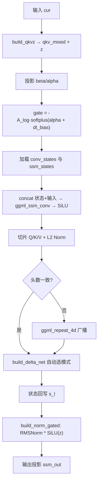

**概述**：完整的 DeltaNet 线性注意力层流程：`build_qkvz` → `beta/alpha` 投影 → `gate = -A_log * softplus(alpha + dt_bias)` → **Causal Conv1d**（状态拼接 + `ggml_ssm_conv` + SiLU） → **L2 Norm** → `build_delta_net`（自动选模式） → **状态回写** → `build_norm_gated`（RMSNorm × SiLU(z)） → 输出投影。体现了「卷积局部建模 + 线性注意力全局建模 + 门控归一化」的组合设计。

### 30.9.5 build_norm_gated：门控归一化

**源码路径**：`src/models/qwen3next.cpp` - `build_norm_gated()`（第92-99行）

```cpp
// 门控归一化：RMSNorm × SiLU(gate)
// - input：待归一化的张量（如 DeltaNet 的输出）
// - weights：RMSNorm 的 per-channel 缩放参数（ssm_norm）
// - gate：门控信号（z），经过 SiLU 激活后作为「质检权重」
// - layer：层索引（用于调试回调）
ggml_tensor * llm_build_qwen3next::build_norm_gated(
        ggml_tensor * input,
        ggml_tensor * weights,
        ggml_tensor * gate,
        int           layer) {
    // ① RMSNorm 归一化：normalized = input / sqrt(mean(input²) + eps) * weights
    //    Qwen3Next 用 LLM_NORM_RMS（无 bias）
    ggml_tensor * normalized = build_norm(input, weights, nullptr, LLM_NORM_RMS, layer);
    // ② SiLU 门控：gated_silu = gate * sigmoid(gate)，允许负值与 >1 值
    ggml_tensor * gated_silu = ggml_silu(ctx0, gate);
    // ③ 逐元素相乘：output = normalized * gated_silu
    return ggml_mul(ctx0, normalized, gated_silu);
}
```

**架构流程图**：

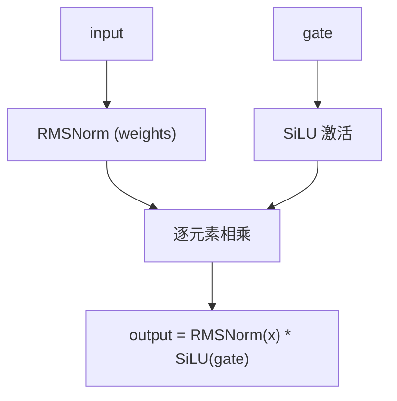

**概述**：公式 `output = RMSNorm(x) * SiLU(gate)`。Qwen3Next 用 SiLU，后续 Qwen3.5 也沿用，Kimi 则用 sigmoid——差异体现模型个性。

### 30.9.6 build_layer_ffn：MoE + Shared Expert

**源码路径**：`src/models/qwen3next.cpp` - `build_layer_ffn()`（第373-417行）

```cpp
// Qwen3Next FFN 层：支持 MoE + Shared Expert 与纯 Dense FFN 两种模式
ggml_tensor * llm_build_qwen3next::build_layer_ffn(ggml_tensor * cur, const int il) {
    // ① 判定是否为 MoE 层：ffn_gate_inp 非空表示有路由器权重
    if (model.layers[il].ffn_gate_inp != nullptr) {
        // ② MoE 路由：build_moe_ffn 内部完成 gate 投影 + top-k 选择 + 专家并行计算
        //     - ffn_gate_inp：路由器权重 [n_expert, n_embd]
        //     - ffn_up_exps / ffn_gate_exps / ffn_down_exps：各专家的 SwiGLU 权重
        //     - LLM_FFN_SILU + true：SiLU 激活 + moe_renormalize=True
        //     - expert_weights_scale：权重归一化系数
        ggml_tensor * moe_out = build_moe_ffn(cur,
                model.layers[il].ffn_gate_inp,
                model.layers[il].ffn_up_exps,
                model.layers[il].ffn_gate_exps,
                model.layers[il].ffn_down_exps,
                nullptr,
                n_expert, n_expert_used,
                LLM_FFN_SILU, true,
                hparams.expert_weights_scale,
                LLAMA_EXPERT_GATING_FUNC_TYPE_SOFTMAX, il,
                nullptr, model.layers[il].ffn_gate_up_exps);
        cb(moe_out, "ffn_moe_out", il);

        // ③ Shared Expert：如果 ffn_up_shexp 存在，则并行计算共享专家
        //     共享专家对所有 token 激活，通过 sigmoid 门控与 MoE 输出加权融合
        if (model.layers[il].ffn_up_shexp != nullptr) {
            ggml_tensor * ffn_shexp = build_ffn(cur,
                    model.layers[il].ffn_up_shexp,   NULL, NULL,
                    model.layers[il].ffn_gate_shexp, NULL, NULL,
                    model.layers[il].ffn_down_shexp, NULL, NULL,
                    NULL,
                    LLM_FFN_SILU, LLM_FFN_PAR, il);
            cb(ffn_shexp, "ffn_shexp", il);

            // ④ 共享专家门控：sigmoid(ffn_gate_inp_shexp · cur)，范围 0~1
            ggml_tensor * shared_gate = build_lora_mm(model.layers[il].ffn_gate_inp_shexp, cur);
            cb(shared_gate, "shared_expert_gate", il);
            shared_gate = ggml_sigmoid(ctx0, shared_gate);
            cb(shared_gate, "shared_expert_gate_sigmoid", il);

            // ⑤ 门控融合：ffn_shexp = ffn_shexp * shared_gate，cur = moe_out + gated_shexp
            ffn_shexp = ggml_mul(ctx0, ffn_shexp, shared_gate);
            cb(ffn_shexp, "ffn_shexp_gated", il);
            cur = ggml_add(ctx0, moe_out, ffn_shexp);
            cb(cur, "ffn_out", il);
        } else {
            cur = moe_out;
        }
    } else {
        // ⑥ Dense FFN：标准 SwiGLU + 并行门控（无 MoE）
        cur = build_ffn(cur,
            model.layers[il].ffn_up, NULL, NULL,
            model.layers[il].ffn_gate, NULL, NULL,
            model.layers[il].ffn_down, NULL, NULL,
            NULL,
            LLM_FFN_SILU, LLM_FFN_PAR, il);
        cb(cur, "ffn_out", il);
    }
    return cur;
}
```

**架构流程图**：

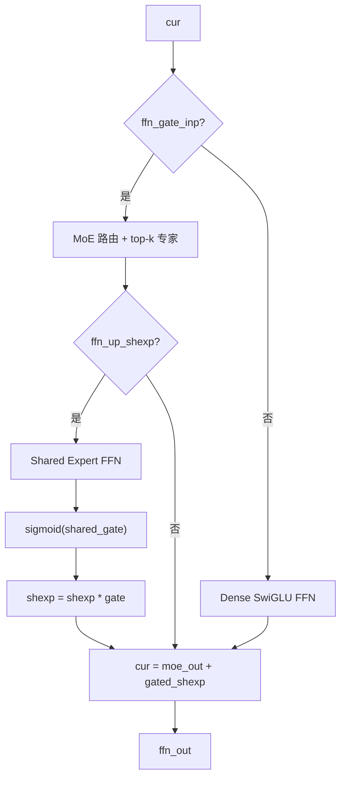

**概述**：支持 MoE + Shared Expert（sigmoid 门控）与纯 Dense FFN 两种模式，体现了模型容量与效率的平衡。

---

## 30.10 Qwen3.5 与 Qwen3.5-MoE —— IMRoPE 加持的工业级 DeltaNet 落地

### 30.10.1 Qwen3Next 与 Qwen3.5 关键差异

下表对比了 Qwen3Next 与 Qwen3.5 在架构实现上的核心差异。Qwen3.5 相对于 Qwen3Next 的关键工程化改进包括：引入 IMRoPE 支持多模态位置编码、全面支持 LoRA 缩放、简化投影路径、分离 beta/alpha 投影、优化融合算子广播条件。

**表 1：Qwen3Next 与 Qwen3.5 核心差异对比**

| 特性 | Qwen3Next | Qwen3.5 |
|------|-----------|---------|
| RoPE | `ggml_rope_ext` | **IMRoPE** (`ggml_rope_multi` + `sections`) |
| LoRA 缩放 | 无 | **全线性层显式支持 `*_s` 参数** |
| `build_qkvz` | Fused + Legacy 双路径 | **仅 Fused 路径** |
| `ssm_beta/alpha` | 共用 `ssm_beta_alpha` 权重 | **单独投影** `ssm_beta` / `ssm_alpha` |
| 多头广播 | 无条件 repeat | **仅在 `!fused_gdn_ar \|\| !fused_gdn_ch` 时 repeat** |

上表展示了 Qwen3.5 相对于 Qwen3Next 的关键工程化改进：引入 IMRoPE 支持多模态位置编码、全面支持 LoRA 缩放、简化投影路径、分离 beta/alpha 投影、优化融合算子广播条件。

### 30.10.2 llm_build_qwen35 构造函数

**源码路径**：`src/models/qwen35.cpp` - `llm_build_qwen35::llm_build_qwen35()`（第80-160行）

```cpp
// Qwen3.5 构造函数：IMRoPE + LoRA 缩放（无 legacy 路径）
// ① 继承 DeltaNet 基类并保存模型引用
llm_build_qwen35::llm_build_qwen35(const llama_model & model, const llm_graph_params & params) :
    llm_build_delta_net_base(params), model(model) {
    // ② 获取 Value 头维度并断言 Q/K 头维度一致
    const int64_t n_embd_head = hparams.n_embd_head_v();
    GGML_ASSERT(n_embd_head == hparams.n_embd_head_k());

    // ③ IMRoPE sections 数组：从 hparams.rope_sections 复制前 4 个值
    //    sections 定义了不同模态（文本/图像/视频）的 RoPE 分段维度
    int sections[4];
    std::copy(std::begin(hparams.rope_sections), std::begin(hparams.rope_sections) + 4, sections);

    ggml_tensor * cur;
    ggml_tensor * inpL;

    // ④ Token Embedding
    inpL = build_inp_embd(model.tok_embd);
    cb(inpL, "model.input_embed", -1);

    // ⑤ 混合内存输入：同时提供 Attention KV 缓存与循环状态
    auto * inp = build_inp_mem_hybrid();

    // ⑥ 位置编码输入与输出 token 索引
    ggml_tensor * inp_pos     = build_inp_pos();
    ggml_tensor * inp_out_ids = build_inp_out_ids();

    // ⑦ 逐层循环：与 Qwen3Next 结构相同，差异在子函数内部
    for (int il = 0; il < n_layer; ++il) {
        ggml_tensor * inpSA = inpL;

        // Attention Norm：RMSNorm
        cur = build_norm(inpL, model.layers[il].attn_norm, nullptr, LLM_NORM_RMS, il);
        cb(cur, "attn_norm", il);
        ggml_build_forward_expand(gf, cur);

        // ⑧ 层类型判定：is_recurrent(il) → DeltaNet 层，否则 → 标准 Attention 层
        if (hparams.is_recurrent(il)) {
            cur = build_layer_attn_linear(inp->get_recr(), cur, il);
        } else {
            // ⑨ Attention 层传入 sections 数组实现 IMRoPE
            cur = build_layer_attn(inp->get_attn(), cur, inp_pos, sections, il);
        }

        // 最后一层只输出指定 token
        if (il == n_layer - 1 && inp_out_ids) {
            cur   = ggml_get_rows(ctx0, cur, inp_out_ids);
            inpSA = ggml_get_rows(ctx0, inpSA, inp_out_ids);
        }

        // Attention 残差
        cur = ggml_add(ctx0, cur, inpSA);
        cb(cur, "attn_residual", il);

        // Post-Attention Norm + FFN
        ggml_tensor * ffn_residual = cur;
        ggml_tensor * attn_post_norm = build_norm(cur, model.layers[il].attn_post_norm, nullptr, LLM_NORM_RMS, il);
        cb(attn_post_norm, "attn_post_norm", il);
        cur = build_layer_ffn(attn_post_norm, il);
        cb(cur, "ffn_out", il);
        cur = ggml_add(ctx0, cur, ffn_residual);
        cb(cur, "post_ffn", il);

        cur = build_cvec(cur, il);
        cb(cur, "l_out", il);
        inpL = cur;
    }
    cur = inpL;

    // ⑩ 最终 RMSNorm + 输出投影
    cur = build_norm(cur, model.output_norm, nullptr, LLM_NORM_RMS, -1);
    cb(cur, "result_norm", -1);
    res->t_embd = cur;
    cur = build_lora_mm(model.output, cur);
    cb(cur, "result_output", -1);
    res->t_logits = cur;
    ggml_build_forward_expand(gf, cur);
}
```

**概述**：构造函数引入 `sections` 数组（来源于 `hparams.rope_sections`），传递给 `build_layer_attn` 实现 IMRoPE 多模态位置编码分段，同时全面启用 LoRA 缩放参数。

### 30.10.3 build_layer_attn：IMRoPE 标准 Attention

**源码路径**：`src/models/qwen35.cpp` - `build_layer_attn()`（第202-290行）

```cpp
// Qwen3.5 标准 Attention 层：IMRoPE + 全 LoRA 缩放
ggml_tensor * llm_build_qwen35::build_layer_attn(
        llm_graph_input_attn_kv * inp,
        ggml_tensor *             cur,
        ggml_tensor *             inp_pos,
        int *                     sections,
        int                       il) {
    const int64_t n_embd_head = hparams.n_embd_head_v();
    GGML_ASSERT(n_embd_head == hparams.n_embd_head_k());

    // ① 联合 Q+Gate 投影：传入 wq_s LoRA 缩放参数
    //    wq_s 是 per-layer 的缩放系数，用于 LoRA 适配器的缩放
    ggml_tensor * Qcur_full = build_lora_mm(model.layers[il].wq, cur, model.layers[il].wq_s);
    cb(Qcur_full, "Qcur_full", il);

    // ② 切分 Q：view_3d 取前 n_embd_head 个通道
    //    nb[0] 步长 = n_embd_head * 2 * element_size（因为 Q 和 gate 交错存储）
    ggml_tensor * Qcur = ggml_view_3d(ctx0, Qcur_full, n_embd_head, n_head, n_tokens,
        ggml_element_size(Qcur_full) * n_embd_head * 2,
        ggml_element_size(Qcur_full) * n_embd_head * 2 * n_head, 0);
    cb(Qcur, "Qcur_reshaped", il);

    // ③ Q Norm：RMSNorm（无 bias）
    Qcur = build_norm(Qcur, model.layers[il].attn_q_norm, nullptr, LLM_NORM_RMS, il);
    cb(Qcur, "Qcur_normed", il);

    // ④ K/V 投影：传入 wk_s / wv_s LoRA 缩放参数
    ggml_tensor * Kcur = build_lora_mm(model.layers[il].wk, cur, model.layers[il].wk_s);
    cb(Kcur, "Kcur", il);
    ggml_tensor * Vcur = build_lora_mm(model.layers[il].wv, cur, model.layers[il].wv_s);
    cb(Vcur, "Vcur", il);

    // ⑤ K Norm：RMSNorm（无 bias）
    Kcur = ggml_reshape_3d(ctx0, Kcur, n_embd_head, n_head_kv, n_tokens);
    Kcur = build_norm(Kcur, model.layers[il].attn_k_norm, nullptr, LLM_NORM_RMS, il);
    cb(Kcur, "Kcur_normed", il);

    // ⑥ 切分 Gate：view_3d 取后 n_embd_head 个通道
    ggml_tensor * gate = ggml_view_3d(ctx0, Qcur_full, n_embd_head, n_head, n_tokens,
        ggml_element_size(Qcur_full) * n_embd_head * 2,
        ggml_element_size(Qcur_full) * n_embd_head * 2 * n_head,
        ggml_element_size(Qcur_full) * n_embd_head);
    gate = ggml_cont_2d(ctx0, gate, n_embd_head * n_head, n_tokens);
    cb(gate, "gate_reshaped", il);

    Vcur = ggml_reshape_3d(ctx0, Vcur, n_embd_head, n_head_kv, n_tokens);

    // ⑦ IMRoPE：使用 ggml_rope_multi 配合 sections 数组
    //    sections 定义了每个模态的 RoPE 分段维度，支持文本/图像/视频的差异化位置编码
    //    与 Qwen3Next 的 ggml_rope_ext 差异：rope_multi 支持分段式多模态 RoPE
    Qcur = ggml_rope_multi(
            ctx0, Qcur, inp_pos, nullptr,
            n_rot, sections, rope_type, n_ctx_orig, freq_base, freq_scale,
            ext_factor, attn_factor, beta_fast, beta_slow);
    Kcur = ggml_rope_multi(
            ctx0, Kcur, inp_pos, nullptr,
            n_rot, sections, rope_type, n_ctx_orig, freq_base, freq_scale,
            ext_factor, attn_factor, beta_fast, beta_slow);
    cb(Qcur, "Qcur", il);
    cb(Kcur, "Kcur", il);
    cb(Vcur, "Vcur", il);

    // ⑧ 注意力计算：kq_scale = 1/sqrt(n_embd_head)（或由 hparams 指定）
    const float kq_scale = hparams.f_attention_scale == 0.0f ? 1.0f / sqrtf(float(n_embd_head)) : hparams.f_attention_scale;
    cur = build_attn(inp,
                nullptr, nullptr,
                Qcur, Kcur, Vcur, nullptr, nullptr, nullptr, kq_scale, il);
    cb(cur, "attn_pregate", il);

    // ⑨ Gate Sigmoid + 缩放
    ggml_tensor * gate_sigmoid = ggml_sigmoid(ctx0, gate);
    cb(gate_sigmoid, "gate_sigmoid", il);
    cur = ggml_mul(ctx0, cur, gate_sigmoid);
    cb(cur, "attn_gated", il);

    // ⑩ 输出投影：传入 wo_s LoRA 缩放参数
    cur = build_lora_mm(model.layers[il].wo, cur, model.layers[il].wo_s);
    cb(cur, "attn_output", il);
    return cur;
}
```

**概述**：核心差异在于使用 `ggml_rope_multi` 配合 `sections` 数组实现 IMRoPE（Interleaved MRoPE），支持文本/图像/视频不同模态的 RoPE 段配置。所有线性层投影均显式传入 `*_s` LoRA 缩放参数。

### 30.10.4 build_layer_attn_linear：DeltaNet 层（带 LoRA 缩放）

**源码路径**：`src/models/qwen35.cpp` - `build_layer_attn_linear()`（第294-440行）

关键差异点：
- `ssm_beta`、`ssm_alpha` 单独投影（不再共用 `ssm_beta_alpha` 融合权重），分别传入 `ssm_beta_s`、`ssm_alpha_s` LoRA 缩放参数。
- 所有 `build_lora_mm` 传入 `*_s` 缩放参数（`wqkv_s`、`wqkv_gate_s`、`ssm_beta_s`、`ssm_alpha_s`、`ssm_out_s` 等）。
- 多头广播优化：`if (num_k_heads != num_v_heads && (!cparams.fused_gdn_ar || !cparams.fused_gdn_ch))` 仅在 fused 算子未完全开启时 repeat，否则由 fused 内部广播——这是 Qwen3.5 相比 Qwen3Next 的重要性能优化。

### 30.10.5 Qwen3.5-MoE 变体

**源码路径**：`src/models/qwen35moe.cpp` - 结构与 Qwen3.5 类似，但 `build_layer_ffn` 支持 MoE + Shared Expert 且专家权重也支持 `*_s` LoRA 缩放。

```cpp
// Qwen3.5-MoE FFN：MoE + Shared Expert，专家权重同样支持 LoRA 缩放
ggml_tensor * moe_out = build_moe_ffn(cur,
    model.layers[il].ffn_gate_inp,
    model.layers[il].ffn_up_exps,
    model.layers[il].ffn_gate_exps,
    model.layers[il].ffn_down_exps,
    nullptr,
    n_expert, n_expert_used,
    LLM_FFN_SILU, true,
    hparams.expert_weights_scale,
    LLAMA_EXPERT_GATING_FUNC_TYPE_SOFTMAX, il,
    nullptr, model.layers[il].ffn_gate_up_exps,
    model.layers[il].ffn_up_exps_s,           // ① 专家 up 权重的 LoRA 缩放
    model.layers[il].ffn_gate_exps_s,        // ② 专家 gate 权重的 LoRA 缩放
    model.layers[il].ffn_down_exps_s);       // ③ 专家 down 权重的 LoRA 缩放
```

**概述**：在 Qwen3.5 基础上引入 MoE + Shared Expert，专家投影同样支持 LoRA 缩放，显式传入 `expert_weights_scale=2.446` 做权重归一化。

---

## 30.11 Kimi-Linear 混合架构 —— KDA 自回归 + MLA 的「双剑合璧」

### 30.11.1 causal_conv1d：Q/K/V 共享卷积状态

**源码路径**：`src/models/kimi-linear.cpp` - `causal_conv1d()`（第10-76行）

```cpp
// Kimi 专用因果卷积：Q/K/V 共享同一个 conv_state_all 张量，通过 qkv 偏移切片
// - conv_states_all：形状 [n_embd_r_total, n_seqs] 的大张量，Q/K/V 状态连续存储
// - conv_state_all：当前序列的卷积状态（从 conv_states_all 中读取）
// - qkv：0=Q, 1=K, 2=V，决定切片的偏移
// - proj_w：Q/K/V 的投影权重 [d_inner, n_embd]
// - conv_w：Q/K/V 的卷积权重 [d_conv, 1, d_inner, 1]（GGUF 格式）
static ggml_tensor * causal_conv1d(ggml_cgraph * gf, ggml_context * ctx0,
        ggml_tensor * conv_states_all, ggml_tensor * conv_state_all, int64_t qkv,
        ggml_tensor * x, ggml_tensor * proj_w, ggml_tensor * conv_w,
        int64_t d_conv, int64_t head_dim, int64_t n_head, int64_t n_seq_tokens,
        int64_t n_seqs, int64_t n_tokens, int64_t kv_head) {
    // ① 计算维度常数
    const int64_t d_inner = head_dim * n_head;                       // Q/K/V 的内部维度（= 4096）
    const int64_t conv_state_size = (d_conv - 1) * d_inner;         // 每个序列的单路卷积状态大小
    const int64_t n_embd_r_total = 3 * conv_state_size;              // Q+K+V 三路状态总大小

    // ② 切片 conv_state_all：从大张量中按 qkv 偏移提取当前路的状态
    //    内存布局：每个序列依次存储 Q 状态（conv_state_size）、K 状态、V 状态
    //    nb[0] = (d_conv-1) * element_size：通道内步长
    //    nb[1] = n_embd_r_total * element_size：序列间步长（跳过 Q+K+V 三路）
    //    offset = qkv * conv_state_size * element_size：Q/K/V 的起始偏移
    ggml_tensor * conv_state_x = ggml_view_3d(ctx0, conv_state_all, d_conv - 1, d_inner, n_seqs,
        (d_conv - 1) * ggml_element_size(conv_state_all),
        n_embd_r_total * ggml_element_size(conv_state_all),
        qkv * conv_state_size * ggml_element_size(conv_state_all));

    // ③ 投影：x_proj = proj_w · x，形状 [d_inner, n_tokens]
    ggml_tensor * x_proj = ggml_mul_mat(ctx0, proj_w, x);

    // ④ Reshape 输入为 3D [d_inner, n_seq_tokens, n_seqs] 以便与状态拼接
    ggml_tensor * x_3d = ggml_reshape_3d(ctx0, x_proj, d_inner, n_seq_tokens, n_seqs);

    // ⑤ 拼接状态 + 当前输入：conv_x 形状 [d_conv-1 + n_seq_tokens, d_inner, n_seqs]
    //    这是因果卷积的标准做法：历史状态（d_conv-1 行）+ 当前 token（n_seq_tokens 行）
    ggml_tensor * conv_x = ggml_concat(ctx0, conv_state_x, ggml_transpose(ctx0, x_3d), 0);

    // ⑥ 保存最后 d_conv-1 行回对应 kv_head 槽位：
    //    last_conv_x = conv_x 的最后 d_conv-1 行（即最新的历史状态）
    //    回写目标：conv_states_all 中对应 kv_head 序列、对应 qkv 路的槽位
    ggml_tensor * last_conv_x = ggml_view_3d(ctx0, conv_x, d_conv - 1, d_inner, n_seqs,
        conv_x->nb[1], conv_x->nb[2], n_seq_tokens * conv_x->nb[0]);
    ggml_build_forward_expand(gf,
        ggml_cpy(ctx0, last_conv_x,
            ggml_view_3d(ctx0, conv_states_all,
                d_conv - 1, d_inner, n_seqs,
                (d_conv - 1) * ggml_element_size(conv_states_all),
                n_embd_r_total * ggml_element_size(conv_states_all),
                (kv_head * n_embd_r_total + qkv * conv_state_size) * ggml_element_size(conv_states_all))));

    // ⑦ 卷积权重 reshape：GGUF 格式 [d_conv, 1, d_inner, 1] → ggml_ssm_conv 期望的 [d_conv, d_inner]
    //    GGUF 存储格式：w[conv_step + channel * d_conv]（d_conv 在最外维）
    //    vLLM 存储格式：w[channel * d_conv + conv_step]（d_inner 在最外维）
    //    ggml_ssm_conv 计算：c[conv_step + channel * d_conv]，需要 [d_conv, d_inner] 布局
    ggml_tensor * conv_weight = ggml_reshape_2d(ctx0, conv_w, d_conv, d_inner);

    // ⑧ 因果卷积：Xcur = conv_weight · conv_x，输出 [d_inner, n_seq_tokens, n_seqs]
    ggml_tensor * Xcur = ggml_ssm_conv(ctx0, conv_x, conv_weight);
    // ⑨ Reshape 为 2D + SiLU 激活
    Xcur = ggml_reshape_2d(ctx0, Xcur, d_inner, n_tokens);
    Xcur = ggml_silu(ctx0, Xcur);

    // ⑩ 返回 4D 张量 [head_dim, n_head, n_seq_tokens, n_seqs] 供后续 KDA 计算
    return ggml_reshape_4d(ctx0, Xcur, head_dim, n_head, n_seq_tokens, n_seqs);
}
```

**架构流程图**：

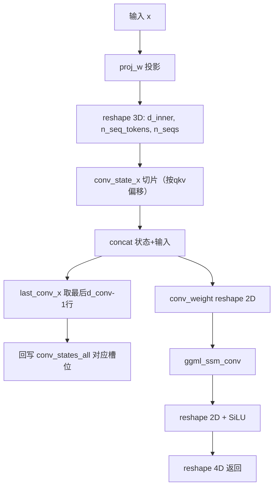

**概述**：实现 Q/K/V 三路共享同一个 `conv_state_all` 张量，通过 `qkv` 参数（0/1/2）计算 offset 切片。输入投影后与历史状态拼接，经 `ggml_ssm_conv` 卷积与 SiLU 激活，最后将新状态的最后 `d_conv-1` 行回写到对应 `kv_head` 槽位。权重从 GGUF 存储格式 `[d_conv, 1, d_inner, 1]` reshape 为 `ggml_ssm_conv` 期望的 `[d_conv, d_inner]`。

### 30.11.2 KDA 自回归层

**源码路径**：`src/models/kimi-linear.cpp` - `llm_build_kimi_linear` 主循环中 KDA 分支（第69-281行，摘录）

```cpp
// Kimi KDA 层：Kimi Delta Attention，KDA 是 DeltaNet 的 per-element gate 变体
// 核心差异：gate 维度与 K 相同（per-element），且使用 sigmoid 门控（而非 SiLU）
if (hparams.is_recurrent(il)) {
    const auto * mctx_cur = inp_rs->mctx;
    const auto kv_head = mctx_cur->get_head();

    // ① 读取卷积状态与 SSM 状态：从 r_l/s_l 槽位读取
    ggml_tensor * conv_states_all = mctx_cur->get_r_l(il);
    cb(conv_states_all, "conv_states_all", il);
    ggml_tensor * conv_state_all = build_rs(inp_rs, conv_states_all, hparams.n_embd_r(), n_seqs);

    // ② Q/K/V 各自调用 causal_conv1d：qkv 参数分别为 0/1/2
    //    proj_w：layer.wq/wk/wv，conv_w：layer.ssm_q_conv/ssm_k_conv/ssm_v_conv
    ggml_tensor * Qcur = causal_conv1d(gf, ctx0, conv_states_all, conv_state_all, 0, cur, layer.wq, layer.ssm_q_conv, d_conv, head_dim, n_head, n_seq_tokens, n_seqs, n_tokens, kv_head);
    ggml_tensor * Kcur = causal_conv1d(gf, ctx0, conv_states_all, conv_state_all, 1, cur, layer.wk, layer.ssm_k_conv, d_conv, head_dim, n_head, n_seq_tokens, n_seqs, n_tokens, kv_head);
    ggml_tensor * Vcur = causal_conv1d(gf, ctx0, conv_states_all, conv_state_all, 2, cur, layer.wv, layer.ssm_v_conv, d_conv, head_dim, n_head, n_seq_tokens, n_seqs, n_tokens, kv_head);

    // ③ g1 计算：g1 = -exp(A_log) * softplus(f_b(f_a(cur)) + dt_bias)
    //     - f_a/f_b 是两层 MLP（LoRA 风格的低秩投影），从 cur 提取动态门控信号
    //     - dt_bias 是 per-head 的偏置项
    //     - softplus 保证 g1 非负
    //     - A_log 已在 convert_hf_to_gguf.py 中做过 -exp 处理，这里直接乘即可
    ggml_tensor * f_a = ggml_mul_mat(ctx0, layer.ssm_f_a, cur);
    ggml_tensor * g1 = ggml_mul_mat(ctx0, layer.ssm_f_b, f_a);
    cb(g1, "g1 f_b(f_a(cur))", il);
    g1 = ggml_add(ctx0, g1, layer.ssm_dt_b);
    g1 = ggml_softplus(ctx0, g1);
    g1 = ggml_reshape_3d(ctx0, g1, head_dim, n_head, n_tokens);

    // ④ A_log 形状 [1, n_head]，reshape 为 [1, n_head, 1] 以便与 g1 [head_dim, n_head, n_tokens] 广播
    ggml_tensor * A = ggml_reshape_3d(ctx0, layer.ssm_a, 1, n_head, 1);
    g1 = ggml_mul(ctx0, g1, A);
    cb(g1, "kda_g1", il);   // 调试回调：标记 KDA 的最终 g1 门控张量

    // ⑤ 重塑为 4D [head_dim, n_head, n_seq_tokens, n_seqs] 供 DeltaNet 使用
    g1 = ggml_reshape_4d(ctx0, g1, head_dim, n_head, n_seq_tokens, n_seqs);

    // ⑥ beta 计算：beta = sigmoid(ssm_beta · cur)，per-element 门控（KDA 特征）
    //     beta 控制每个位置的增量更新幅度，sigmoid 保证范围 0~1
    ggml_tensor * beta = ggml_mul_mat(ctx0, layer.ssm_beta, cur);
    beta = ggml_reshape_4d(ctx0, beta, 1, n_head, n_seq_tokens, n_seqs);
    cb(beta, "kda_beta", il);
    beta = ggml_sigmoid(ctx0, beta);

    // ⑦ 读取 SSM 状态（DeltaNet 的核心状态 s），reshape 为 4D [head_dim, head_dim, n_head, n_seqs]
    ggml_tensor * ssm_states_all = mctx_cur->get_s_l(il);
    ggml_tensor * state = build_rs(inp_rs, ssm_states_all, hparams.n_embd_s(), n_seqs);
    state = ggml_reshape_4d(ctx0, state, head_dim, head_dim, n_head, n_seqs);

    // ⑧ L2 归一化：Q/K 做 L2 归一化，eps_norm 来自 hparams.f_norm_rms_eps
    const float eps_norm = hparams.f_norm_rms_eps;
    Qcur = ggml_l2_norm(ctx0, Qcur, eps_norm);
    Kcur = ggml_l2_norm(ctx0, Kcur, eps_norm);

    // ⑨ 调用 build_delta_net：自动选择 AR/Chunking/Fused 模式
    //     KDA 的 g1 是 per-element gate（与 K 维度相同），beta 是 per-element 增量系数
    auto attn_out = build_delta_net(Qcur, Kcur, Vcur, g1, beta, state, il);

    // ⑩ 拆分输出与新状态
    ggml_tensor * output = ggml_cont(ctx0, attn_out.first);
    ggml_tensor * new_state = attn_out.second;
    cb(output, "attn_output", il);
    cb(new_state, "new_state", il);

    // ⑪ 状态回写：把 new_state 写入 s_l 对应槽位（按 kv_head 偏移）
    ggml_build_forward_expand(gf,
        ggml_cpy(ctx0, new_state,
            ggml_view_1d(ctx0, ssm_states_all, hparams.n_embd_s() * n_seqs,
                kv_head * hparams.n_embd_s() * ggml_element_size(ssm_states_all))));

    // ⑫ 输出门控 g2 = g_b(g_a(cur))：两层 MLP，从当前层输入计算门控信号
    ggml_tensor * cur_2d = ggml_reshape_2d(ctx0, cur, cur->ne[0], n_seq_tokens * n_seqs);
    ggml_tensor * g_a = ggml_mul_mat(ctx0, layer.ssm_g_a, cur_2d);
    ggml_tensor * g2 = ggml_mul_mat(ctx0, layer.ssm_g_b, g_a);
    cb(g2, "g2 g_b(g_a(cur_2d))", il);
    g2 = ggml_reshape_3d(ctx0, g2, head_dim, n_head, n_seq_tokens * n_seqs);

    // ⑬ 门控归一化：Kimi 用 sigmoid 门控（不是 SiLU！）
    //     公式：output = RMSNorm(output) * sigmoid(g2)
    //     Kimi 选择 sigmoid 是为了训练稳定性与概率语义一致性（门控范围 0~1）
    ggml_tensor * attn_out_final = ggml_reshape_3d(ctx0, output, head_dim, n_head, n_seq_tokens * n_seqs);
    ggml_tensor * normed = build_norm(attn_out_final, layer.ssm_o_norm, nullptr, LLM_NORM_RMS, il);
    cb(normed, "kda_normed", il);
    ggml_tensor * gate = ggml_sigmoid(ctx0, g2);
    ggml_tensor * gated = ggml_mul(ctx0, normed, gate);

    // ⑭ 输出投影：gated 展平为 2D，乘 W_o 映射回模型维度
    gated = ggml_cont_2d(ctx0, gated, d_inner, n_tokens);
    cur = ggml_mul_mat(ctx0, layer.wo, gated);
    cb(cur, "kda_out", il);
}
```

**架构流程图**：

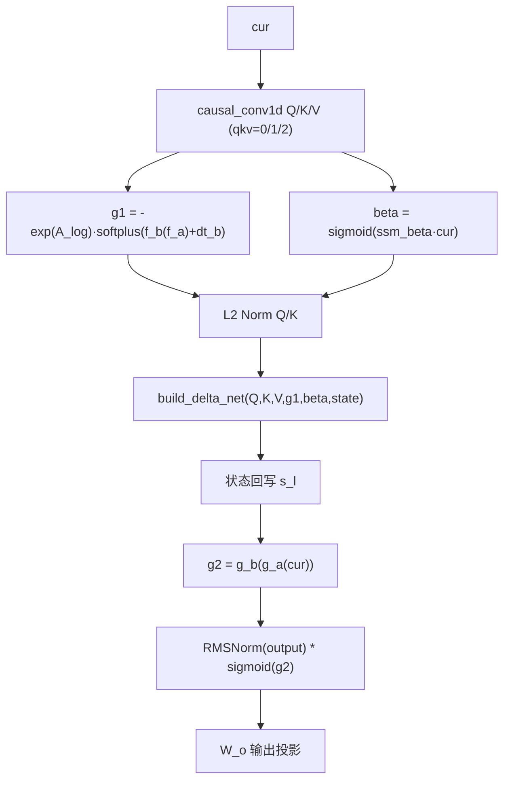

**概述**：KDA 分支核心计算：Q/K/V 经 `causal_conv1d` 处理；`g1` 计算包含两层 MLP（`f_a` → `f_b`）+ `dt_bias` → `softplus` → 乘 `A_log`（已预处理为 `-exp`）；`beta` 为 per-element gate（KDA 特征），`sigmoid` 而非 softplus；调用 `build_delta_net` 自动选择 AR/Chunking；输出门控用 **sigmoid** 而非 SiLU（Kimi 个性化设计）。

### 30.11.3 MLA 层（无 RoPE）

**源码路径**：`src/models/kimi-linear.cpp` - `llm_build_kimi_linear` 主循环中 MLA 分支（第281-338行，摘录）

```cpp
// Kimi MLA 层：Multi-head Latent Attention，无 RoPE（rotary_emb=None in vLLM）
// 核心：KV 压缩存储，Q 侧吸收优化
else {
    // ① Q 投影：W_q · cur，形状 [n_embd_head_k_mla * n_head, n_tokens]
    //    n_embd_head_k_mla = qk_nope_head_dim + qk_rope_head_dim（MLA 的总 Q 头维度）
    ggml_tensor * Qcur = ggml_mul_mat(ctx0, layer.wq, cur);

    // ② KV 压缩：kv_cmpr_pe = wkv_a_mqa · cur
    //    形状 [kv_lora_rank + qk_rope_head_dim, n_tokens]
    //    wkv_a_mqa 是 MLA 的核心：把 K 和 V 压缩到低秩空间
    ggml_tensor * kv_cmpr_pe = ggml_mul_mat(ctx0, layer.wkv_a_mqa, cur);

    // ③ 切片拆分：kv_cmpr = 前 kv_lora_rank 维（压缩的 KV），k_pe = 后 qk_rope_head_dim 维（位置编码）
    //    nb[0] 步长 = (kv_lora_rank + qk_rope_head_dim) * element_size
    ggml_tensor * kv_cmpr = ggml_view_2d(ctx0, kv_cmpr_pe, kv_lora_rank, n_tokens,
        ggml_row_size(kv_cmpr_pe->type, kv_lora_rank + n_embd_head_qk_rope), 0);
    // k_pe 形状 [qk_rope_head_dim, 1, n_tokens]：位置编码部分，不参与压缩
    ggml_tensor * k_pe = ggml_view_3d(ctx0, kv_cmpr_pe, n_embd_head_qk_rope, 1, n_tokens,
        ggml_row_size(kv_cmpr_pe->type, kv_lora_rank + n_embd_head_qk_rope),
        ggml_row_size(kv_cmpr_pe->type, kv_lora_rank + n_embd_head_qk_rope),
        ggml_row_size(kv_cmpr_pe->type, kv_lora_rank));

    // ④ Kimi MLA 不做 RoPE：k_pe 直接使用（rotary_emb=None in vLLM）
    //    这是 Kimi MLA 与标准 MLA 的关键差异：位置信息通过压缩路径隐式学习

    // ⑤ 归一化 kv_c：RMSNorm（无 bias）
    kv_cmpr = build_norm(kv_cmpr, layer.attn_kv_a_norm, nullptr, LLM_NORM_RMS, il);

    // ⑥ MLA KV cache 启用路径：当 wk_b && wv_b 存在时
    if (layer.wk_b && layer.wv_b) {
        // ⑥a 提取 q_nope：Qcur 的前 n_embd_head_qk_nope 维（不参与 RoPE 的部分）
        //     形状 [n_embd_head_qk_nope, n_head, n_tokens]
        ggml_tensor * q_nope =
            ggml_view_3d(ctx0, Qcur, n_embd_head_qk_nope, n_head, n_tokens, ggml_row_size(Qcur->type, n_embd_head_k_mla),
                         ggml_row_size(Qcur->type, n_embd_head_k_mla) * n_head, 0);
        cb(q_nope, "q_nope", il);

        // ⑥b 提取 q_pe：Qcur 的后 n_embd_head_qk_rope 维（位置编码部分）
        //     形状 [n_embd_head_qk_rope, n_head, n_tokens]
        ggml_tensor * q_pe = ggml_view_3d(
            ctx0, Qcur, n_embd_head_qk_rope, n_head, n_tokens, ggml_row_size(Qcur->type, n_embd_head_k_mla),
            ggml_row_size(Qcur->type, n_embd_head_k_mla) * n_head, ggml_row_size(Qcur->type, n_embd_head_qk_nope));
        cb(q_pe, "q_pe", il);

        // ⑥c q_nope 转置：从 [n_embd_head_qk_nope, n_head, n_tokens] 转为 [n_embd_head_qk_nope, n_tokens, n_head]
        //     便于与 wk_b 做矩阵乘（吸收优化）
        q_nope = ggml_permute(ctx0, q_nope, 0, 2, 1, 3);
        cb(q_nope, "q_nope_perm", il);

        // ⑥d 吸收优化：q_nope_absorbed = wk_b · q_nope
        //     wk_b 形状 [kv_lora_rank, n_embd_head_qk_nope]，把 Q 的 nope 部分投影到 KV 压缩空间
        //     这是 MLA 的核心优化：把 K 的投影「吸收」到 Q 侧，推理时无需显式计算 K
        //     形状 [kv_lora_rank, n_tokens, n_head]
        ggml_tensor * q_nope_absorbed = ggml_mul_mat(ctx0, layer.wk_b, q_nope);
        cb(q_nope_absorbed, "q_nope_absorbed", il);

        // ⑥e 转置回 [kv_lora_rank, n_head, n_tokens]
        q_nope_absorbed = ggml_permute(ctx0, q_nope_absorbed, 0, 2, 1, 3);
        cb(q_nope_absorbed, "q_nope_absorbed_perm", il);

        // ⑥f 拼接 Qcur = [q_nope_absorbed, q_pe]（吸收后的 Q + 位置编码 Q）
        //     形状 [kv_lora_rank + qk_rope_head_dim, n_head, n_tokens]
        //     注意：rope 部分在前，因为 build_rope_shift() 需要就地上下文偏移
        Qcur = ggml_concat(ctx0, q_nope_absorbed, q_pe, 0);
        cb(Qcur, "Qcur", il);

        // ⑥g Kcur = [kv_cmpr, k_pe]：压缩 KV + 位置编码 K
        //     形状 [kv_lora_rank + qk_rope_head_dim, 1, n_tokens]（GQA：K 只有 1 个头）
        kv_cmpr = ggml_reshape_3d(ctx0, kv_cmpr, kv_lora_rank, 1, n_tokens);
        cb(kv_cmpr, "kv_cmpr_reshape", il);
        ggml_tensor * Kcur = ggml_concat(ctx0, kv_cmpr, k_pe, 0);
        cb(Kcur, "Kcur", il);

        // ⑥h Vcur = kv_cmpr：V 直接使用压缩的 KV（形状 [kv_lora_rank, 1, n_tokens]）
        ggml_tensor * Vcur = kv_cmpr;
        cb(Vcur, "Vcur", il);

        // ⑥i 调用 build_attn：MLA 注意力计算
        //     - wv_b 参数：V 的解压权重（推理时把压缩 V 显式解压）
        //     - kq_scale_mla = 1/sqrt(n_embd_head_k_mla)
        cur = build_attn(inp_attn_k, layer.wo, NULL, Qcur, Kcur, Vcur, nullptr, nullptr, layer.wv_b, kq_scale_mla, il);
        cb(cur, "mla_out", il);
    } else {
        // ⑦ MLA KV cache 未启用：退化为 MHA（Multi-Head Attention）
        //     需要显式解压 K/V，并 broadcast k_pe 到所有头
        Qcur = ggml_reshape_3d(ctx0, Qcur, n_embd_head_k_mla, n_head, n_tokens);
        cb(Qcur, "mla_Q", il);

        // ⑦a KV 解压：kv = wkv_b · kv_cmpr，形状 [kv_per_head * n_head, n_tokens]
        //     kv_per_head = qk_nope_head_dim + v_head_dim（每个头的 K+V 维度）
        ggml_tensor * kv = ggml_mul_mat(ctx0, layer.wkv_b, kv_cmpr);
        const int64_t kv_per_head = n_embd_head_qk_nope + n_embd_head_v_mla;

        // ⑦b 切分 k_nope 和 V：k_nope 形状 [qk_nope_head_dim, n_head, n_tokens]
        ggml_tensor * k_nope = ggml_view_3d(ctx0, kv, n_embd_head_qk_nope, n_head, n_tokens,
            ggml_row_size(kv->type, kv_per_head),
            ggml_row_size(kv->type, kv_per_head * n_head), 0);
        // Vcur 形状 [v_head_dim, n_head, n_tokens]
        ggml_tensor * Vcur = ggml_view_3d(ctx0, kv, n_embd_head_v_mla, n_head, n_tokens,
            ggml_row_size(kv->type, kv_per_head),
            ggml_row_size(kv->type, kv_per_head * n_head),
            ggml_row_size(kv->type, n_embd_head_qk_nope));
        Vcur = ggml_cont(ctx0, Vcur);
        cb(Vcur, "mla_V", il);

        // ⑦c Broadcast k_pe：从 [qk_rope, 1, n_tokens] 复制到 [qk_rope, n_head, n_tokens]
        //     MHA 需要每个头都有完整 K（含位置编码）
        ggml_tensor * k_pe_target = ggml_new_tensor_3d(ctx0, k_pe->type, n_embd_head_qk_rope, n_head, n_tokens);
        ggml_tensor * k_pe_repeated = ggml_repeat(ctx0, k_pe, k_pe_target);

        // ⑦d 拼接 Kcur = [k_pe_repeated, k_nope]（位置编码 K + 非位置编码 K）
        //     形状 [qk_rope_head_dim + qk_nope_head_dim, n_head, n_tokens]
        ggml_tensor * Kcur = ggml_concat(ctx0, k_pe_repeated, k_nope, 0);
        cb(Kcur, "mla_K", il);

        // ⑦e 标准 MHA 注意力（使用完整 KV cache）
        cur = build_attn(inp_attn_kv, layer.wo, NULL, Qcur, Kcur, Vcur, nullptr, nullptr, nullptr, kq_scale_mla, il);
        cb(cur, "mla_out", il);
    }
}
```

**架构流程图**：

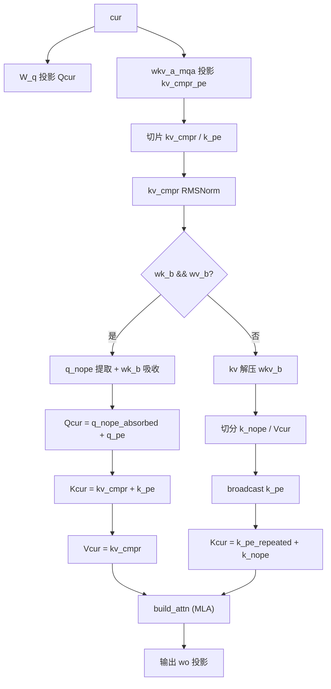

**概述**：MLA 分支**无 RoPE**（`rotary_emb=None` in vLLM）。`wk_b`/`wv_b` 启用时走吸收优化路径（Q 侧投影 `wk_b` 吸收 K，K/V 用压缩表示）；未启用时退化为 MHA，显式解压 K/V 并 broadcast `k_pe` 到所有头。

### 30.11.4 FFN：Dense → MoE 过渡

**源码路径**：`src/models/kimi-linear.cpp` - 主构造函数 FFN 部分（第281-338行，摘录）

```cpp
// FFN：前 N 层 Dense FFN，后层 MoE + Shared Expert
// ① 判定：il < n_layer_dense_lead 时用 Dense FFN，否则用 MoE
if ((uint32_t) il < hparams.n_layer_dense_lead) {
    // ② Dense FFN：标准 SwiGLU + 并行门控（无 MoE）
    cur = build_ffn(cur,
        layer.ffn_up, NULL, NULL,
        layer.ffn_gate, NULL, NULL,
        layer.ffn_down, NULL, NULL,
        NULL, LLM_FFN_SILU, LLM_FFN_PAR, il);
    cb(cur, "ffn_out", il);
} else {
    // ③ MoE 层：build_moe_ffn + Shared Expert
    //     Kimi 用 moe_renormalize=True，expert_weights_scale=2.446 做归一化
    ggml_tensor * moe_out = build_moe_ffn(cur,
        layer.ffn_gate_inp,
        layer.ffn_up_exps,
        layer.ffn_gate_exps,
        layer.ffn_down_exps,
        layer.ffn_exp_probs_b,
        hparams.n_expert,
        hparams.n_expert_used,
        LLM_FFN_SILU, true,
        hparams.expert_weights_scale,
        (llama_expert_gating_func_type) hparams.expert_gating_func,
        il);
    cb(moe_out, "ffn_moe_out", il);

    // ④ Shared Expert：无 sigmoid 门控，直接与 MoE 输出相加
    {
        ggml_tensor * ffn_shexp = build_ffn(cur,
                layer.ffn_up_shexp, NULL, NULL,
                layer.ffn_gate_shexp, NULL, NULL,
                layer.ffn_down_shexp, NULL, NULL,
                NULL, LLM_FFN_SILU, LLM_FFN_PAR, il);
        cb(ffn_shexp, "ffn_shexp", il);
        cur = ggml_add(ctx0, moe_out, ffn_shexp);
        cb(cur, "ffn_out", il);
    }
}
```

**概述**：前 `n_layer_dense_lead` 层用 Dense FFN 稳定训练，后层切换到 MoE 提升容量/效率比。显式传 `expert_weights_scale=2.446` 做权重归一化。

---

## 30.12 设计中的取舍

**问：为什么 RWKV7 引入 delta 规则而不沿用 RWKV6 的固定指数衰减？**

答：RWKV6 的固定指数衰减 `w = exp(-exp(w2·tanh(w1·xw) + decay))` 虽然引入了输入依赖（通过 xw 投影），但衰减曲线的形式是固定的——所有 token 遵循相同的指数衰减模式，只是衰减速率由 `xw` 调制。这种设计的问题在于：它无法根据当前 token 的语义内容动态决定「遗忘多少、记住多少」。例如，当输入一个全新的概念时，模型可能希望「重置」部分历史记忆；而当输入一个代词（如「它」）时，模型又希望「加强」对前文的回忆。RWKV7 的 delta 规则通过引入 `a = sigmoid(a0 + a2·(a1·xa))` 作为 per-token 的动态步长，配合 `k_k`（Key 归一化系数）与 `k_a`（Key 增益系数）对 Key 做修正 `k = k + a·(k·k_a) - k·k_a`，让每个 token 根据自身语义决定状态更新的幅度与方向。从数学上看，这相当于把固定衰减的线性递推 `s_t = w·s_{t-1} + k_t·(v_t - s_{t-1}·k_t)` 中的标量 `w` 替换为数据依赖的矩阵 `a`，使状态更新的「步长」和「方向」都可由输入动态控制。工程上的代价是 `ggml_rwkv_wkv7` 算子需要额外接收 `-kk` 与 `kk·a` 两个参数，增加了算子复杂度，但换来了长序列建模能力的显著提升——这也是 RWKV7 在 100K+ token 长度上表现优于 RWKV6 的核心原因。

**问：Chunking 模式中三角矩阵求解 `solve_tri` 的必要性是什么？**

答：DeltaNet 的并行化核心难题在于状态 `s_t` 依赖 `s_{t-1}`，形成链式依赖——如果按顺序计算，复杂度为 O(n)，但无法并行；如果想并行，就必须打破这个依赖。Chunking 模式的解决方案是将递推公式展开为矩阵形式。具体来说，DeltaNet 的状态更新可以写为 `s = (I + tri(attn))⁻¹ · v'`，其中 `tri(attn)` 是注意力矩阵的下三角部分，`I` 是单位矩阵。这个公式的关键洞察是：虽然 `s_t` 依赖 `s_{t-1}`，但整个状态向量 `s` 可以通过求解一个三角线性方程组一次性得到——因为三角矩阵的前向代入求解可以在 O(n) 时间内完成，且每个位置的计算只依赖于已计算的前序位置，这与顺序递推在数学上等价但可以在 GPU 上通过并行调度实现加速。`solve_tri(lhs, -tri(attn), true, true, false)` 的三个 bool 参数分别控制：第一个 `true` 表示 lhs 是下三角矩阵（而非上三角）；第二个 `true` 表示 rhs（右侧向量）需要转置处理；第三个 `false` 表示不启用单位矩阵优化（因为 `I` 已经显式加在 lhs 中了）。这种「三角矩阵求解」是 DeltaNet 区别于传统 RNN 和标准 Transformer 的核心并行策略——它既保留了 RNN 的 O(1) 推理复杂度，又获得了 Transformer 的 O(n) 训练并行能力。

**问：为什么 Kimi KDA 使用 sigmoid gate 而 Qwen3Next 使用 SiLU gate？**

答：这个差异源于两个模型对「门控语义」的不同理解。Sigmoid 将门控值限制在 (0, 1) 区间，更适合作为「保留比例」的概率解释——例如 `output = RMSNorm(x) * sigmoid(g)` 可以理解为「归一化后的特征按比例保留」，这种设计在训练时更稳定，因为梯度不会因为门控值过大或过小而爆炸或消失。Kimi 选择 sigmoid 可能是为了与 KDA 的 delta 语义保持一致：beta 门控本身也是 sigmoid，输出门控再用 sigmoid，形成统一的概率门控体系。SiLU（Swish）则允许负值与大于 1 的值，表达能力更强——`SiLU(x) = x · sigmoid(x)` 在 x > 0 时可以大于 1，在 x < 0 时可以为负，这使得门控可以「放大」或「反转」特征，表达能力更强但训练稳定性稍差。Qwen3Next 选择 SiLU 可能是为了与标准 Transformer 的门控 FFN（如 SwiGLU）保持一致，利用 SiLU 在深层网络中的表达能力优势。工程上的权衡是：sigmoid 更稳定但表达能力弱，SiLU 更强但需要更谨慎的初始化与正则化策略。

**问：`fused_gdn_ar/ch` 两个开关分别控制什么？**

答：`fused_gdn_ar` 和 `fused_gdn_ch` 是 `cparams`（编译参数）级别的两个独立开关，分别控制 DeltaNet 在不同场景下是否使用融合算子 `ggml_gated_delta_net`。`fused_gdn_ar` 控制单 token（AR，自回归）模式：在推理的逐 token 生成阶段，`n_seq_tokens == 1`，此时如果开启 `fused_gdn_ar`，`build_delta_net` 会调用融合算子而非纯 ggml 的 `build_delta_net_autoregressive`；`fused_gdn_ch` 控制多 token（Chunking）模式：在训练或预填充阶段，`n_seq_tokens > 1`，如果开启 `fused_gdn_ch`，则调用融合算子而非纯 ggml 的 `build_delta_net_chunking`。两个开关独立配置的意义在于：推理（单 token）与训练/预填充（多 token）对数值精度的要求可能不同——融合算子内部的 kernel 实现可能使用不同的数值精度策略（如 fp32 累加 vs fp16 累加），因此允许分别启用/关闭，以在性能与数值一致性之间取得平衡。典型配置是：推理时开启 `fused_gdn_ar` 以获得最大吞吐，训练时关闭 `fused_gdn_ch` 以确保与参考实现的数值一致性。

**问：为什么 `num_k_heads != num_v_heads` 时需要 `ggml_repeat_4d`？**

答：DeltaNet 的融合算子 `ggml_gated_delta_net` 内部假设 K/V 头数一致——即状态 `s` 的形状 `[S_v, S_v, H_v, n_seqs]` 中，H_v（Value 头数）必须等于 H_k（Key 头数），因为状态更新 `s += k·d` 是按头逐个进行的，每个 Value 头对应一个 Key 头。当 `num_k_heads != num_v_heads`（即 GQA 风格的配置，如 Key 有 8 个头而 Value 有 16 个头）时，融合算子无法直接处理——它不知道如何将 8 个 Key 头的更新广播到 16 个 Value 头上。`ggml_repeat_4d` 的作用就是在调用融合算子之前，手动将 Q/K 的头数 repeat 到与 V 一致（如将 8 个 Key 头 repeat 为 16 个），使融合算子看到的输入满足「头数一致」的假设。Qwen3.5 的优化在于：当 `fused_gdn_ar && fused_gdn_ch` 都开启时，融合算子内部已经支持了广播（通过 `[TAG_GGML_GDN_BCAST]` 标记的内部优化路径），此时无需外部 repeat——这避免了不必要的数据复制，提升了性能。而 Qwen3Next 的条件是无条件 repeat，没有利用融合算子的内部广播能力，这是 Qwen3.5 后来优化的点。

---

## 30.13 动手练习

1. **理解 RWKV 的 token_shift 与类 RNN 推理**
   - 阅读 `src/models/rwkv6.cpp` 第15-65行（构造函数主循环），理解：
     1. `token_shift_count == 2` 的含义是什么？为什么需要 att_shift 和 ff_shift 两个 shift？
     2. `x_prev = ggml_concat(ctx0, att_shift, ggml_view_3d(att_norm, n_embd, n_seq_tokens-1, n_seqs, ...), 1)` 这一行的形状含义是什么？
     3. 为什么 RWKV 需要把 `att_norm` 的前 `n_seq_tokens-1` 个 token 拼到 `att_shift` 后面？
     4. `token_shift = ggml_concat(att_norm[-1], ffn_norm[-1], 1)` 的目的是什么？
   - 回答问题：
     - 如果 `token_shift_count == 1`（如 RWKV6Qwen2），会发生什么？循环会发生怎样的简化？
     - 为什么 `inp_out_ids` 需要在最后一层用 `ggml_get_rows` 选择部分 token 输出？

2. **对比 RWKV6 与 RWKV7 的 WKV 算子差异**
   - 阅读 `src/models/rwkv6-base.cpp` 第32-186行（RWKV6 WKV调用）与 `src/models/rwkv7-base.cpp` 第42-184行（RWKV7 WKV调用），理解：
     1. RWKV6 调用 `ggml_rwkv_wkv6(k, v, r, first, w, state)`，参数 `first`（time_mix_first）的来源是哪里？
     2. RWKV7 调用 `ggml_rwkv_wkv7(r, w, k, v, -kk, kk*a, state)`，为什么参数顺序是 r/w/k/v 而不是 k/v/r？
     3. RWKV7 的 `kk = l2_norm(k·k_k)` 和 `k += a·(k·k_a) - k·k_a` 实现的是什么数学操作？
     4. RWKV6 用 `ggml_gated_linear_attn`（QRWKV分支）vs `ggml_rwkv_wkv6` 的判定条件是什么？
   - 回答问题：
     - 如果 `layer.time_mix_first == nullptr`，模型架构会切换到什么模式？这个模式与标准 RWKV6 的本质区别是什么？
     - RWKV7 中的 `v_first` 跨层残差注入与 Transformer 的残差连接有什么本质差异？

3. **追踪 DeltaNet 的三种模式选择逻辑**
   - 阅读 `src/models/delta-net-base.cpp` 第335-360行（`build_delta_net` 入口）以及第16-218行（chunking模式），理解：
     1. `n_seq_tokens == 1` 时为什么必须走 AR 模式或 Fused 模式？Chunking 模式在这里有什么限制？
     2. KDA 与 GDA 的判定条件 `g->ne[0] == S_k && g->ne[1] == H_k` 的几何含义是什么？
     3. Chunking 模式中 `CS = kda ? 16 : 64` 的设计依据是什么？
     4. `solve_tri(lhs, -tri(attn), true, true, false)` 的三个 bool 参数分别代表什么？
     5. 在循环中 `s = ggml_mul(ctx0, s, ch_g_last_exp_t); s = ggml_add(ctx0, s, kgv);` 的物理含义是什么？
   - 回答问题：
     - 为什么 KDA 的 decay_mask 需要 reshape 为 `[CS, 1, S_k, CHB]` 而 GDA 直接是 `[CS, CS, n_chunks, ...]`？
     - AR 模式中 `s = s · g`（gate作用于state）的直觉解释是什么？

4. **理解 Qwen3Next 的混合架构与 Conv 状态管理**
   - 阅读 `src/models/qwen3next.cpp` 第207-381行（`build_layer_attn_linear`），重点理解：
     1. `build_qkvz` 在 `wqkv` 存在时走 fused 路径，否则走 legacy 路径的判断依据是什么？
     2. `ggml_ssm_conv(conv_input, conv_kernel)` 中 `conv_input` 是如何拼接的（`conv_states + qkv_mixed`）？
     3. `last_conv_states = ggml_view_3d(conv_input, conv_kernel_size-1, conv_channels, n_seqs, ...)` 取的是哪一段数据？
     4. `ggml_cpy(last_conv_states, state_update_target)` 回写时如何计算 kv_head 偏移？
     5. `gate = -A_log · softplus(alpha + dt_bias)` 的负号来自哪里（提示：A_log 在 convert_hf_to_gguf.py 中已经做过 -exp 处理）？
     6. `ggml_l2_norm(q_conv, eps_norm)` 的作用是什么？为什么 DeltaNet 类架构要做 L2 归一化？
   - 回答问题：
     - 为什么 `num_k_heads != num_v_heads` 时需要做 `ggml_repeat_4d`？注释里的 `[TAG_GGML_GDN_BCAST]` 暗示了什么优化方向？
     - `ssm_norm` 与 `z` 的 `build_norm_gated` 门控操作相比标准 RMSNorm 多做了什么？

5. **对比 Qwen3Next 与 Qwen3.5 的架构差异**
   - 阅读 `src/models/qwen35.cpp` 与 `src/models/qwen3next.cpp`，对比以下差异：
     1. Qwen3.5 引入 `int sections[4]; std::copy(std::begin(hparams.rope_sections), ..., sections);` 的目的是什么？
     2. Qwen3.5 使用 `ggml_rope_multi` 而 Qwen3Next 使用 `ggml_rope_ext`，两者的 API 差异是什么？
     3. Qwen3.5 所有 `build_lora_mm` 都传入 `*_s` 缩放参数（`wq_s/wk_s/wv_s/wo_s/ssm_*_s`），这是为了支持什么功能？
     4. Qwen3.5 移除了 legacy 路径（`build_qkvz` 不再有 `else` 分支），这是基于什么假设？
     5. Qwen3.5-MoE 相比 Qwen3.5 多支持了什么？
   - 回答问题：
     - IMRoPE（Interleaved MRoPE）的 `sections` 参数在视觉-语言多模态场景中有什么作用？
     - 为什么 `num_k_heads != num_v_heads && (!cparams.fused_gdn_ar || !cparams.fused_gdn_ch)` 才需要 repeat？两个开关同时开启时 fused 算子内部是怎么广播的？

6. **剖析 Kimi-Linear 的 causal_conv1d 与 KDA/MLA 双剑合璧**
   - 阅读 `src/models/kimi-linear.cpp` 第9-67行（`causal_conv1d` 工具函数）与第69-281行（主构造函数），理解：
     1. `causal-conv1d` 的 `qkv` 参数（0/1/2）如何影响 `ggml_view_3d` 的 offset 计算？
     2. 为什么 Q/K/V 共用同一个 `conv_state_all` 但通过 offset 切片？这种设计相比三个独立 state 张量有什么好处？
     3. `last_conv_x = ggml_view_3d(conv_x, d_conv-1, d_inner, n_seqs, ...)` 取的是哪一段数据？
     4. `conv_weight = ggml_reshape_2d(conv_w, d_conv, d_inner)` 为什么需要这个 reshape？GGUF 存储格式与 ggml_ssm_conv 期望的格式差异是什么？
     5. KDA 分支中 `g1 = -exp(A_log)·softplus(f_b · f_a(cur) + dt_b)` 的 `-exp` 来自哪里（提示：convert_hf_to_gguf.py 预处理）？
     6. Kimi MLA 为什么没有 RoPE？wk_b/wv_b 启用与未启用分别走什么路径？
   - 回答问题：
     - Kimi KDA 与 Qwen3Next DeltaNet 的核心差异是什么（除了 KDA 的 gate 维度差异）？
     - Kimi 模型 Dense FFN 与 MoE FFN 的过渡条件 `n_layer_dense_lead` 在生产推理时有什么实际意义？

---

## 30.14 本章小结

这一章中我们学习了编码器与双向架构中的线性注意力与循环模型家族。首先深入剖析了 RWKV6 的基础构建器，理解了 token shift、时间混合（WKV6/QRWKV 双分支）与通道混合的核心计算图；接着分析了 RWKV6 主模型的完整推理骨架，以及 RWKV6Qwen2 的混合架构设计；随后进入 RWKV7 的进化引擎，重点解读了数据依赖的 delta 规则、first_layer_value 跨层残差、动态门控与 WKV7 算子；对比了纯 RWKV7 与 ARWKV7 变体的架构取舍；系统梳理了 DeltaNet 基础构建器的三种实现模式（AR/Fused/Chunking）及其自动选择策略，深入理解了 KDA 与 GDA 的判定、分块并行中的三角矩阵求解、状态递推机制；进而剖析了 Qwen3Next 的 DeltaNet+Attention 双层交响架构，包括联合 QG 投影、因果卷积状态管理、门控归一化与 MoE FFN；对比了 Qwen3.5/Qwen3.5-MoE 在 IMRoPE、LoRA 缩放、融合算子广播优化上的工程化改进；最后深入 Kimi-Linear 的 KDA 自回归层与 MLA 无 RoPE 混合注意力机制，理解了 causal_conv1d 的 QKV 状态共享设计、KDA 的 sigmoid 门控风格以及 Dense→MoE 的层级过渡策略。

本章我们一起学习了以下概念：

| 概念 | 解释 |
|------|------|
| `llm_build_rwkv6_base::llm_build_rwkv6_base` | RWKV6基础构造函数，继承llm_graph_context并保存model引用 |
| `llm_build_rwkv6_base::build_rwkv6_channel_mix` | RWKV6的通道混合：ReLU²→Value 与 receptance 门控，仅服务 LLM_ARCH_RWKV6 |
| `llm_build_rwkv6_base::build_rwkv6_time_mix` | RWKV6的时间混合：token shift→5路fused lerp→WKV6算子，可识别QRWKV切换 gated_linear_attn |
| `llm_build_rwkv6::llm_build_rwkv6` | RWKV6完整图：token_shift_count==2，att/ffn双shift，rescale_every_n_layers中途衰减 |
| `llm_build_rwkv6qwen2::llm_build_rwkv6qwen2` | RWKV时间混合 + Qwen2 SwiGLU FFN的混合架构，token_shift_count==1，RMSNorm |
| `llm_build_rwkv7_base::llm_build_rwkv7_base` | RWKV7基础构造函数，与RWKV6 base结构相同 |
| `llm_build_rwkv7_base::build_rwkv7_channel_mix` | RWKV7的通道混合极简化：无receptance门控，仅relu²(linear)→value |
| `llm_build_rwkv7_base::build_rwkv7_time_mix` | RWKV7的时间混合：data-dependent delta规则（k_k/k_a/a），first_layer_value跨层残差，可选GroupNorm |
| `ggml_rwkv_wkv7` | RWKV7专用WKV算子，输入(r,w,k,v,-kk,kk·a,state)一次完成delta更新 |
| `llm_build_rwkv7::llm_build_rwkv7` | RWKV7完整图：v_first跨层传递，无rescale缩放，可选GroupNorm |
| `llm_build_arwkv7::llm_build_arwkv7` | RWKV7 + 标准Transformer FFN的混合变体，token_shift_count==1，纯FFN残差 |
| `llm_build_delta_net_base::llm_build_delta_net_base` | DeltaNet基础构造函数，仅继承llm_graph_context不保存额外成员 |
| `get_slice_2d` (delta-net) | 工具函数：取张量第三维度的单切片（输出shape为[x,y,1,b]） |
| `llm_build_delta_net_base::build_delta_net_chunking` | DeltaNet分块并行模式：cumsum(g)→decay_mask→tri-solve→循环chunk更新状态 |
| `llm_build_delta_net_base::build_delta_net_autoregressive` | DeltaNet单token AR模式：s=s·exp(g)→d=(v-s·k)·b→s+=k·d→o=sum_rows(s·q) |
| `llm_build_delta_net_base::build_delta_net_fused` | DeltaNet融合算子模式：调用ggml_gated_delta_net，结果view_4d拆分为output+new_state |
| `llm_build_delta_net_base::build_delta_net` | 三模式自动选择入口：根据n_seq_tokens与fused_gdn_ar/ch开关分流 |
| `llm_build_qwen3next::llm_build_qwen3next` | Qwen3Next主图：奇数层DeltaNet，偶数层Attn，FFN包含MoE+Shared Expert |
| `llm_build_qwen3next::build_norm_gated` | 门控归一化：RMSNorm·SiLU(gate)，实现delta_net输出的非线性调制 |
| `llm_build_qwen3next::build_layer_attn` | Qwen3Next标准Attention：联合QG投影→view_4d拆分→Q/K RMSNorm→RoPE→gated attn |
| `llm_build_qwen3next::build_qkvz` | Q/K/V/Z投影：fused(wqkv/wqkv_gate)与legacy(ssm_in多路slice)双路径 |
| `llm_build_qwen3next::build_layer_attn_linear` | DeltaNet线性注意力层：causal conv1d→L2 norm→build_delta_net→norm_gated门控 |
| `llm_build_qwen3next::build_layer_ffn` | MoE+Shared Expert混合FFN（含sigmoid门控） |
| `llm_build_qwen35::llm_build_qwen35` | Qwen3.5主图：IMRoPE+LoRA缩放（无legacy路径）+ Dense FFN |
| `llm_build_qwen35::build_qkvz` | Qwen3.5 QKVZ投影：仅fused路径，传入*_s LoRA缩放参数 |
| `llm_build_qwen35::build_norm_gated` | Qwen3.5门控归一化：RMSNorm·SiLU(gate) |
| `llm_build_qwen35::build_layer_attn` | Qwen3.5标准Attn：IMRoPE(ggml_rope_multi)+split+Q/K Norm |
| `llm_build_qwen35::build_layer_attn_linear` | Qwen3.5 DeltaNet层：所有投影均带LoRA缩放，分离ssm_beta/ssm_alpha |
| `llm_build_qwen35::build_layer_ffn` | Qwen3.5 Dense FFN：传入*_s LoRA缩放参数，SwiGLU+并行门控 |
| `llm_build_qwen35moe::llm_build_qwen35moe` | Qwen3.5+MoE主图，结构与Qwen3Next相似但使用Qwen3.5的Linear层 |
| `llm_build_qwen35moe::build_qkvz` | Qwen3.5-MoE QKVZ投影（fused only） |
| `llm_build_qwen35moe::build_norm_gated` | Qwen3.5-MoE门控归一化 |
| `llm_build_qwen35moe::build_layer_attn` | Qwen3.5-MoE标准Attn层（IMRoPE） |
| `llm_build_qwen35moe::build_layer_attn_linear` | Qwen3.5-MoE DeltaNet层（带LoRA缩放） |
| `llm_build_qwen35moe::build_layer_ffn` | Qwen3.5-MoE FFN层：MoE+Shared Expert，支持*_s LoRA缩放 |
| `causal_conv1d` (Kimi) | Kimi专用因果卷积：Q/K/V共享conv_state_all，按qkv偏移切片，last_conv_x回写 |
| `llm_build_kimi_linear::llm_build_kimi_linear` | Kimi混合架构：KDA自回归层 + MLA无RoPE层 + Dense→MoE的FFN过渡 |
| `is_recurrent(il)` | 层类型判定：根据hparams决定该层用DeltaNet还是标准Attention，Qwen3Next/3.5/Kimi均使用 |
| `build_rs` + `ggml_cpy` | 循环状态持久化：从mctx读取s_l/r_l，ggml_cpy回写到对应kv_head槽位 |
| `time_mix_lerp_fused` | 5/6路融合lerp投影权重（RWKV7），一次矩阵乘切分为r/w/k/v/a(/g)，节省计算 |
| `fused_gdn_ar/ch` | DeltaNet融合算子开关：cparams级别控制AR/Chunking是否走ggml_gated_delta_net路径 |


