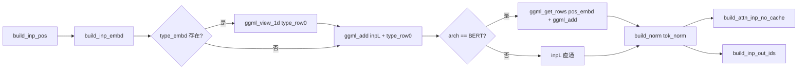
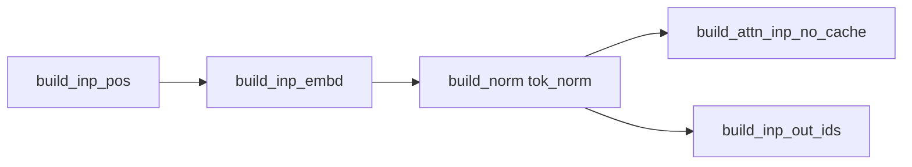
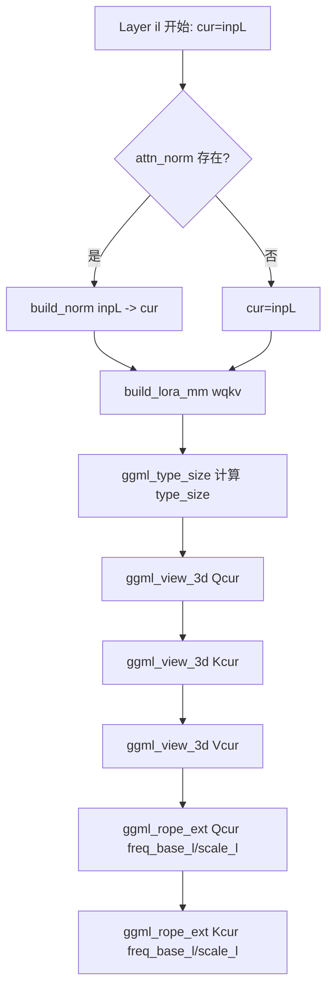
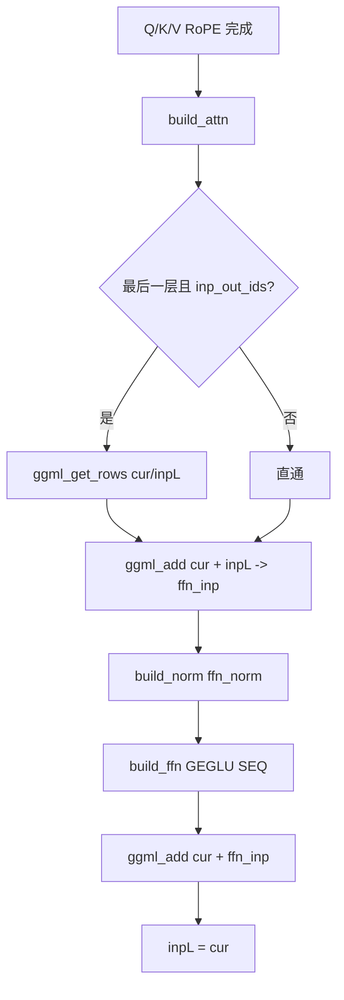
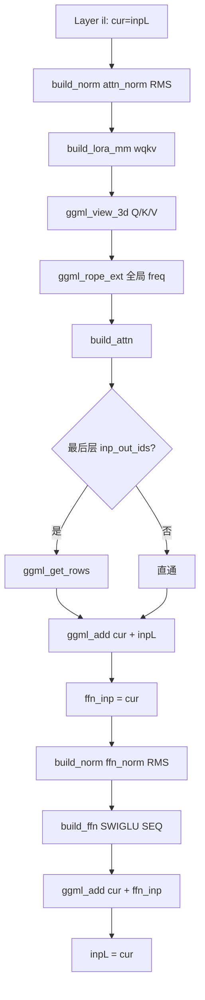
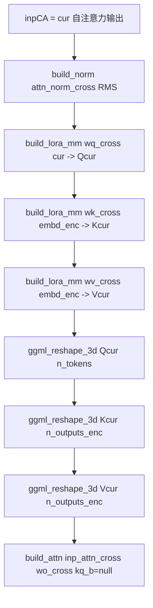
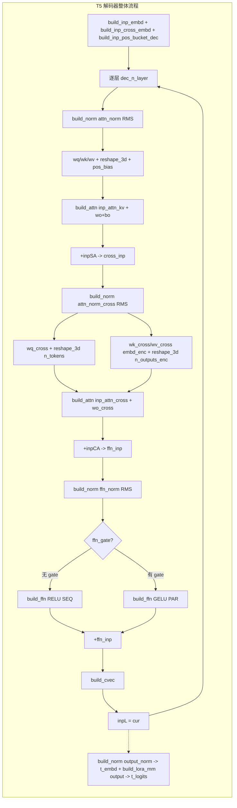
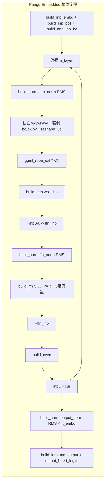

# 第31章 1 编码器与双向架构：BERT 家族的"理解型图谱"之旅

## 学习目标

- 理解 BERT、ModernBERT、NeoBERT、EuroBERT 等编码器家族的图构建差异（Post-Norm vs Pre-Norm、QKV 融合 vs 独立、FFN 激活函数）
- 掌握 T5 编码器-解码器架构中相对位置桶偏置（Relative Position Bias）的实现原理
- 理解 M-RoPE 在 PaddleOCR 中的四段式应用方式（时间/高度/宽度）
- 掌握 Pangu-Embedded 标准 Pre-Norm Transformer 的完整偏置流（Q/K/V + FFN + Output）
- 了解 WavTokenizer 解码器的 ConvNeXt + PosNet 双阶段音频生成流程
- 理解 llm_graph_context 基础设施方法（build_inp_*, build_attn_inp_*, build_attn, build_ffn, build_norm, build_pos_bias, build_cvec）是如何被所有编码器模型复用

## 31.1 生活类比

想象编码器模型家族是一家**各具特色的"理解型餐厅厨房"**：BERT 就像经典老派厨房，坚持 Post-Norm（先炒菜再调味）、可选拼盘（qkv 融合或独立）、主厨特选酱汁（GELU/SiLU/GEGLU 按菜品切换）；ModernBERT 是现代改良厨房，改用 Pre-Norm（先备料再下锅）、只走 QKV 拼盘流水线、按楼层定制火候（per-layer RoPE）；NeoBERT 是精简版快餐厨房，RMSNorm 统一调料、SWIGLU 顺序门控、只产出半成品（t_embd 不算账）；EuroBERT 是全定制私房菜，每道菜独立 Q/K/V 火眼（独立权重）、SiLU 并行双灶台、强调个性化；T5 则是双厅联动餐厅，前台（编码器）接单并记住位置感（相对位置桶），后厨（解码器）边做菜边查菜谱（交叉注意力），同时支持 ReLU 老菜单和 GELU 新菜单（Flan-T5）；PaddleOCR 是 OCR 专窗，与 Qwen2VL 共用骨架但偏置可选（看顾客预算），时间/高度/宽度分段旋转（M-RoPE）；Pangu-Embedded 是昇腾嵌入式厨房，全套带偏置的标准化流程，从切菜到装盘（Q/K/V + FFN + output）一丝不苟；WavTokenizer 则是音频解码糕点店，PosNet 是上裱花机（6 层异构），ConvNeXt 是精修模具（残差 + gamma 缩放），全程要不停翻面（transpose）。就像不同餐厅各有自己的招牌菜，llama.cpp 的每个编码器模型都通过精心组合 Pre-Norm / Post-Norm、QKV 融合方式、FFN 激活、RoPE 策略等"调味料"，形成自己独特的"风味"。

## 31.2 源码地图

```mermaid
graph TD
    subgraph BERT[BERT 家族 (src/models/bert.cpp)]
        direction TB
        BERT_Init[输入: build_inp_embd + type_embd + pos_embd + tok_norm]
        BERT_Layer[逐层循环 n_layer]
        BERT_QKV{QKV 路径}
        BERT_Fused[wqkv 融合 + ggml_view_3d 切分]
        BERT_Sep[独立 wq/wk/wv + ggml_reshape_3d]
        BERT_QKNorm[可选 attn_q_norm / attn_k_norm]
        BERT_RoPE[可选 ggml_rope_ext (Nomic/Jina V3)]
        BERT_Attn[build_attn (kq_b=null)]
        BERT_PostNorm[Post-Norm: +inpL -> attn_out_norm (+ attn_norm_2)]
        BERT_FFN{FFN 分派}
        BERT_MoE[build_moe_ffn]
        BERT_GELU[build_ffn(GELU, SEQ)]
        BERT_GEGLU[build_ffn(GEGLU, PAR)]
        BERT_SILU[build_ffn(SiLU, PAR)]
        BERT_Out[+ffn_inp -> layer_out_norm -> inpL]
        BERT_Final[res->t_embd]
    end

    subgraph ModernBERT[ModernBERT (src/models/modern-bert.cpp)]
        direction TB
        MB_Init[输入: build_inp_embd + tok_norm (无 type/pos_embd)]
        MB_Layer[逐层循环 n_layer]
        MB_PreNorm[build_norm(attn_norm)]
        MB_QKV[强制 wqkv 融合 + ggml_view_3d (量化感知)]
        MB_RoPE[ggml_rope_ext (per-layer freq_base/scale)]
        MB_Attn[build_attn]
        MB_Resid1[+inpL -> ffn_inp]
        MB_FFN_Norm[build_norm(ffn_norm)]
        MB_FFN[build_ffn(GEGLU, SEQ)]
        MB_Resid2[+ffn_inp -> inpL]
        MB_Final[build_norm(output_norm) -> res->t_embd]
    end

    subgraph NeoBERT[NeoBERT (src/models/neo-bert.cpp)]
        direction TB
        NB_Init[输入: build_inp_embd (无 tok_norm)]
        NB_Layer[逐层循环 n_layer]
        NB_PreNorm[build_norm(attn_norm, RMS)]
        NB_QKV[强制 wqkv 融合 + ggml_view_3d]
        NB_RoPE[ggml_rope_ext (全局 freq_base/scale)]
        NB_Attn[build_attn]
        NB_Resid1[+inpL -> ffn_inp]
        NB_FFN_Norm[build_norm(ffn_norm, RMS)]
        NB_FFN[build_ffn(SWIGLU, SEQ)]
        NB_Resid2[+ffn_inp -> inpL]
        NB_Final[build_norm(output_norm_enc, RMS) -> res->t_embd]
    end

    subgraph EuroBERT[EuroBERT (src/models/eurobert.cpp)]
        direction TB
        EB_Init[输入: build_inp_embd]
        EB_Layer[逐层循环 n_layer]
        EB_PreNorm[build_norm(attn_norm, RMS)]
        EB_QKV[独立 wq/wk/wv + ggml_reshape_3d]
        EB_RoPE[ggml_rope_ext (全局)]
        EB_Attn[build_attn]
        EB_Resid1[+inpL -> ffn_inp]
        EB_FFN_Norm[build_norm(ffn_norm, RMS)]
        EB_FFN[build_ffn(SiLU, PAR)]
        EB_Resid2[+ffn_inp -> inpL]
        EB_Final[build_norm(output_norm, RMS) -> res->t_embd]
    end

    subgraph T5Enc[T5 编码器 (src/models/t5-enc.cpp)]
        direction TB
        T5E_Init[输入: build_inp_embd + build_inp_pos_bucket_enc]
        T5E_Layer[逐层循环 n_layer]
        T5E_PreNorm[build_norm(attn_norm_enc, RMS)]
        T5E_QKV[独立 wq_enc/wk_enc/wv_enc]
        T5E_PosBias[build_pos_bias(pos_bucket_enc, attn_rel_b_enc) 共享首层]
        T5E_Attn[build_attn(kq_b=pos_bias)]
        T5E_Resid1[+inpSA -> ffn_inp]
        T5E_FFN_Norm[build_norm(ffn_norm_enc, RMS)]
        T5E_FFN{FFN 模式}
        T5E_ReLU[无 gate: RELU, SEQ]
        T5E_GELU[有 gate: GELU, PAR]
        T5E_Resid2[+ffn_inp]
        T5E_CVec[build_cvec]
        T5E_Final[build_norm(output_norm_enc) -> res->t_embd]
    end

    subgraph T5Dec[T5 解码器 (src/models/t5-dec.cpp)]
        direction TB
        T5D_Init[输入: build_inp_embd + build_inp_cross_embd + build_inp_pos_bucket_dec]
        T5D_Layer[逐层循环 dec_n_layer]
        T5D_SelfAttn[自注意力: wq/wk/wv + pos_bias + build_attn_inp_kv]
        T5D_Resid1[+inpSA]
        T5D_CrossNorm[build_norm(attn_norm_cross)]
        T5D_CrossAttn[交叉注意力: wq_cross + wk_cross/wv_cross(embd_enc) + build_attn_inp_cross]
        T5D_Resid2[+inpCA -> ffn_inp]
        T5D_FFN_Norm[build_norm(ffn_norm)]
        T5D_FFN{FFN 模式 (同编码器)}
        T5D_Resid3[+ffn_inp]
        T5D_CVec[build_cvec]
        T5D_Final[build_norm(output_norm) -> res->t_embd + build_lora_mm(output) -> res->t_logits]
    end

    subgraph PaddleOCR[PaddleOCR (src/models/paddleocr.cpp)]
        direction TB
        PO_Init[输入: build_inp_embd + rope_sections[4]]
        PO_Layer[逐层循环 n_layer]
        PO_PreNorm[build_norm(attn_norm, RMS)]
        PO_QKV{独立 Q/K/V 可选偏置}
        PO_Q[wq*cur + (bq?)]
        PO_K[wk*cur + (bk?)]
        PO_V[wv*cur + (bv?)]
        PO_RoPE[ggml_rope_multi (4 段 sections)]
        PO_Attn[build_attn (wo + bo?)]
        PO_Resid1[+inpSA -> ffn_inp]
        PO_FFN_Norm[build_norm(ffn_norm, RMS)]
        PO_FFN[build_ffn(SiLU, PAR)]
        PO_Resid2[+ffn_inp]
        PO_CVec[build_cvec]
        PO_Final[build_norm(output_norm) -> res->t_embd + build_lora_mm(output) -> res->t_logits]
    end

    subgraph Pangu[Pangu-Embedded (src/models/pangu-embedded.cpp)]
        direction TB
        PG_Init[输入: build_inp_embd + build_inp_pos]
        PG_Layer[逐层循环 n_layer]
        PG_PreNorm[build_norm(attn_norm, RMS)]
        PG_QKV[独立 Q/K/V 全强制偏置]
        PG_Q[wq*cur + bq]
        PG_K[wk*cur + bk]
        PG_V[wv*cur + bv]
        PG_RoPE[ggml_rope_ext (标准)]
        PG_Attn[build_attn (wo + bo)]
        PG_Resid1[+inpSA -> ffn_inp]
        PG_FFN_Norm[build_norm(ffn_norm, RMS)]
        PG_FFN[build_ffn(SiLU, PAR) + 3组偏置]
        PG_Resid2[+ffn_inp]
        PG_CVec[build_cvec]
        PG_Final[build_norm(output_norm) -> res->t_embd + build_lora_mm(output)+output_b -> res->t_logits]
    end

    subgraph WavTok[WavTokenizer-Dec (src/models/wavtokenizer-dec.cpp)]
        direction TB
        WT_Init[输入: build_inp_embd -> transpose -> conv1d_ph]
        WT_PosNet[PosNet 6层异构循环]
        WT_PosNet_Conv[Case 0/1/3/4: GroupNorm -> GLU -> conv1 -> GLU -> conv2 -> +res]
        WT_PosNet_Attn[Case 2: GroupNorm -> conv Q/K/V -> transpose -> K^T Q -> softmax -> conv o -> +res]
        WT_PosNet_Norm[Case 5: GroupNorm only]
        WT_Mid[transpose -> tok_norm -> transpose]
        WT_ConvNext[ConvNeXt 残差块循环]
        WT_CN_DW[dw conv1d]
        WT_CN_Norm[transpose -> LayerNorm]
        WT_CN_FFN[build_ffn(GELU, SEQ)]
        WT_CN_Gamma[gamma 缩放]
        WT_CN_Res[transpose -> +res]
        WT_Final[transpose -> output_norm -> build_lora_mm(output)+output_b -> res->t_embd]
    end

    subgraph Infra[llm_graph_context 基础设施 (复用)]
        build_inp_pos
        build_inp_embd
        build_inp_pos_bucket_enc
        build_inp_pos_bucket_dec
        build_inp_cross_embd
        build_attn_inp_no_cache
        build_attn_inp_kv
        build_attn_inp_cross
        build_inp_out_ids
        build_norm
        build_lora_mm
        build_attn
        build_ffn
        build_pos_bias
        build_cvec
        build_moe_ffn
        ggml_rope_ext
        ggml_rope_multi
    end
```

## 31.3 BERT 主体架构 —— 经典双向编码器的"理解型图谱"

BERT 是经典的双向 Transformer 编码器，擅长文本理解而非生成。与 GPT 类自回归模型相反，BERT 通过完整双向注意力同时看到上下文。本单元聚焦 `llm_build_bert::llm_build_bert()` 的图构建全流程，展示经典 BERT 如何在 llama.cpp 中落地。

### 31.3.1 llm_build_bert::llm_build_bert()：构造函数与输入嵌入构建

BERT 的图构建入口是 `llm_build_bert` 类的构造函数，它继承自 `llm_graph_context` 基类，复用了大量基础设施方法。

源码路径：`src/models/bert.cpp` - `llm_build_bert::llm_build_bert()`（第 1-30 行）

```cpp
llm_build_bert::llm_build_bert(const llama_model & model, const llm_graph_params & params) : llm_graph_context(params) {
    const int64_t n_embd_head = hparams.n_embd_head_v();      // 每个注意力头的维度
    const int64_t n_embd_gqa  = hparams.n_embd_v_gqa();       // GQA 相关维度
    GGML_ASSERT(n_embd_head == hparams.n_embd_head_k());      // 确保 Q/K 头维一致
    ggml_tensor * cur;
    ggml_tensor * inpL;
    ggml_tensor * inp_pos = nullptr;
    if (model.arch != LLM_ARCH_JINA_BERT_V2) {                // Jina V2 不使用绝对位置编码
        inp_pos = build_inp_pos();                            // 构建位置索引输入 [n_tokens]
    }
    inpL = build_inp_embd(model.tok_embd);                    // Token 嵌入查表 -> [n_embd, n_tokens]
    if (model.type_embd) {                                    // 可选的类型嵌入（句子对任务）
        ggml_tensor * type_row0 = ggml_view_1d(ctx0, model.type_embd, n_embd, 0);  // 取第 0 个 type embedding
        inpL                    = ggml_add(ctx0, inpL, type_row0);                   // 广播加到所有 token
    }
    if (model.arch == LLM_ARCH_BERT) {                        // 标准 BERT 使用绝对位置嵌入
        inpL = ggml_add(ctx0, ggml_get_rows(ctx0, model.pos_embd, inp_pos), inpL);  // 绝对位置嵌入查表并相加
    }
    cb(inpL, "inp_embd", -1);                                 // 记录调试节点
    inpL = build_norm(inpL, model.tok_norm, model.tok_norm_b, LLM_NORM, 0);  // 嵌入层 LayerNorm
    cb(inpL, "inp_norm", 0);
    auto * inp_attn = build_attn_inp_no_cache();              // 双向注意力输入（无 KV Cache，编码器专用）
    ggml_tensor * inp_out_ids = build_inp_out_ids();          // 最后层输出 token 选择索引
    // ... 后续逐层构建 ...
}
```

**代码解释：**
该函数完成 BERT 模型的输入预处理流程。首先根据架构类型决定是否构建位置索引（Jina V2 除外），然后通过 `build_inp_embd` 获取 token 嵌入。对于需要句子对任务的模型，额外加上 type embedding；标准 BERT 还会加上绝对位置嵌入。随后经过嵌入层 LayerNorm 归一化，最后准备双向注意力所需的无缓存输入结构和输出 token 选择索引，为后续逐层计算奠定基础。

**流程图：**



### 31.3.2 llm_build_bert::llm_build_bert()：QKV 融合与独立路径的视图切分

BERT 支持两种 Q/K/V 权重布局：融合的 `wqkv` 和独立的 `wq`/`wk`/`wv`，体现了对新旧 checkpoint 的兼容。

源码路径：`src/models/bert.cpp` - `llm_build_bert::llm_build_bert()`（第 30-60 行）

```cpp
for (int il = 0; il < n_layer; ++il) {
    ggml_tensor * cur = inpL;
    {
        ggml_tensor * Qcur;
        ggml_tensor * Kcur;
        ggml_tensor * Vcur;
        if (model.layers[il].wqkv) {                          // 情况 1：QKV 融合权重
            cur = build_lora_mm(model.layers[il].wqkv, cur);  // LoRA 感知矩阵乘: [3*n_embd, n_tokens]
            cb(cur, "wqkv", il);
            if (model.layers[il].bqkv) {                      // 融合偏置
                cur = ggml_add(ctx0, cur, model.layers[il].bqkv);
                cb(cur, "bqkv", il);
            }
            // 通过 ggml_view_3d 在融合张量上按字节偏移切出 Q/K/V 视图
            Qcur = ggml_view_3d(ctx0, cur, n_embd_head, n_head, n_tokens,
                                n_embd_head * sizeof(float), cur->nb[1],
                                0 * sizeof(float) * (n_embd));                           // 偏移 0
            Kcur = ggml_view_3d(ctx0, cur, n_embd_head, n_head_kv, n_tokens,
                                n_embd_head * sizeof(float), cur->nb[1],
                                1 * sizeof(float) * (n_embd));                           // 偏移 n_embd
            Vcur = ggml_view_3d(ctx0, cur, n_embd_head, n_head_kv, n_tokens,
                                n_embd_head * sizeof(float), cur->nb[1],
                                1 * sizeof(float) * (n_embd + n_embd_gqa));              // 偏移 n_embd + n_embd_gqa
        } else {                                              // 情况 2：独立 Q/K/V 权重
            Qcur = ggml_add(ctx0, build_lora_mm(model.layers[il].wq, cur), model.layers[il].bq);
            Kcur = ggml_add(ctx0, build_lora_mm(model.layers[il].wk, cur), model.layers[il].bk);
            Vcur = ggml_add(ctx0, build_lora_mm(model.layers[il].wv, cur), model.layers[il].bv);
            Qcur = ggml_reshape_3d(ctx0, Qcur, n_embd_head, n_head, n_tokens);   // [n_embd_head, n_head, n_tokens]
            Kcur = ggml_reshape_3d(ctx0, Kcur, n_embd_head, n_head_kv, n_tokens);
            Vcur = ggml_reshape_3d(ctx0, Vcur, n_embd_head, n_head_kv, n_tokens);
        }
        // ... RoPE 与注意力后续 ...
    }
}
```

**代码解释：**
这是注意力层的核心投影逻辑。融合路径下，单次 `build_lora_mm` 完成 Q/K/V 三路投影，随后用 `ggml_view_3d` 按字节偏移零拷贝切分出三个头张量（Q 在 offset 0，K 在 offset n_embd，V 在 offset n_embd+n_embd_gqa），极大减少内核启动与显存读取。独立路径下，分别对三个权重矩阵做矩阵乘并加偏置，再用 `ggml_reshape_3d` 调整为 `[head_dim, n_head, n_tokens]` 形状。两种路径最终产出形状一致的 Q/K/V，供后续 RoPE 和注意力计算使用。

**流程图：**

```mermaid
flowchart TD
    A[cur = inpL] --> B{wqkv 存在?}
    B -- 是 --> C[build_lora_mm(wqkv, cur)]
    C --> D{bqkv 存在?}
    D -- 是 --> E[ggml_add + bqkv]
    D -- 否 --> F[cur 直通]
    E --> G[ggml_view_3d Qcur offset=0]
    F --> G
    G --> H[ggml_view_3d Kcur offset=n_embd]
    H --> I[ggml_view_3d Vcur offset=n_embd+n_embd_gqa]
    B -- 否 --> J[build_lora_mm(wq) + bq]
    J --> K[ggml_reshape_3d Qcur]
    J --> L[build_lora_mm(wk) + bk]
    L --> M[ggml_reshape_3d Kcur]
    J --> N[build_lora_mm(wv) + bv]
    N --> O[ggml_reshape_3d Vcur]
    I --> P[后续 Q/K Norm 与 RoPE]
    O --> P
```

### 31.3.3 llm_build_bert::llm_build_bert()：可选 Q/K 归一化与 RoPE 应用

部分 BERT 变体（如 Nomic、Jina V3）引入了 Query/Key 归一化与 RoPE，增强长序列建模能力。

源码路径：`src/models/bert.cpp` - `llm_build_bert::llm_build_bert()`（第 60-80 行）

```cpp
if (model.layers[il].attn_q_norm) {                           // 可选 Query 归一化
    Qcur = ggml_reshape_2d(ctx0, Qcur, n_embd_head * n_head, n_tokens);  // [n_embd, n_tokens]
    Qcur = build_norm(Qcur, model.layers[il].attn_q_norm, model.layers[il].attn_q_norm_b, LLM_NORM, il);
    Qcur = ggml_reshape_3d(ctx0, Qcur, n_embd_head, n_head, n_tokens);  // 恢复 3D
}
if (model.layers[il].attn_k_norm) {                           // 可选 Key 归一化
    Kcur = ggml_reshape_2d(ctx0, Kcur, n_embd_head * n_head_kv, n_tokens);
    Kcur = build_norm(Kcur, model.layers[il].attn_k_norm, model.layers[il].attn_k_norm_b, LLM_NORM, il);
    Kcur = ggml_reshape_3d(ctx0, Kcur, n_embd_head, n_head_kv, n_tokens);
}
if (model.arch == LLM_ARCH_NOMIC_BERT || model.arch == LLM_ARCH_NOMIC_BERT_MOE ||
    model.arch == LLM_ARCH_JINA_BERT_V3) {                    // 特定架构启用 RoPE
    Qcur = ggml_rope_ext(ctx0, Qcur, inp_pos, nullptr, n_rot, rope_type, n_ctx_orig, freq_base, freq_scale,
                         ext_factor, attn_factor, beta_fast, beta_slow);
    Kcur = ggml_rope_ext(ctx0, Kcur, inp_pos, nullptr, n_rot, rope_type, n_ctx_orig, freq_base, freq_scale,
                         ext_factor, attn_factor, beta_fast, beta_slow);
}
cb(Qcur, "Qcur", il);
cb(Kcur, "Kcur", il);
cb(Vcur, "Vcur", il);
cur = build_attn(inp_attn,
        model.layers[il].wo, model.layers[il].bo,
        Qcur, Kcur, Vcur, nullptr, nullptr, nullptr, 1.0f / sqrtf(float(n_embd_head)), il);
cb(cur, "kqv_out", il);
```

**代码解释：**
此段实现了两个可选增强：Q/K 归一化与 RoPE。Q/K 归一化先将 3D 头张量压扁为 2D `[n_embd, n_tokens]` 调用 `build_norm`（LayerNorm），再恢复 3D 形状，稳定注意力分数分布。RoPE 仅在 Nomic BERT、Nomic BERT MoE、Jina BERT V3 三个架构启用，调用 `ggml_rope_ext` 对 Q/K 施加旋转位置编码，支持长上下文外推。最后通过 `build_attn` 完成双向注意力计算，无因果掩码、无位置偏置（kq_b=null），缩放因子为 `1/sqrt(head_dim)`。

**流程图：**

```mermaid
flowchart TD
    A[Qcur/Kcur/Vcur 就绪] --> B{attn_q_norm 存在?}
    B -- 是 --> C[reshape_2d -> build_norm -> reshape_3d]
    B -- 否 --> D[直通]
    C --> E{attn_k_norm 存在?}
    D --> E
    E -- 是 --> F[reshape_2d -> build_norm -> reshape_3d]
    E -- 否 --> G[直通]
    F --> H{arch in [Nomic, Jina V3]?}
    G --> H
    H -- 是 --> I[ggml_rope_ext Qcur]
    I --> J[ggml_rope_ext Kcur]
    H -- 否 --> K[直通]
    J --> L[build_attn kq_b=null]
    K --> L
```

### 31.3.4 llm_build_bert::llm_build_bert()：Post-Norm 双轨与架构感知 FFN 分支

BERT 经典的 Post-Norm 设计：注意力输出先残差再 Norm，且可能有双轨 `attn_norm_2`；FFN 根据架构动态选择激活函数。

源码路径：`src/models/bert.cpp` - `llm_build_bert::llm_build_bert()`（第 80-140 行）

```cpp
if (il == n_layer - 1 && inp_out_ids) {
    cur  = ggml_get_rows(ctx0, cur, inp_out_ids);
    inpL = ggml_get_rows(ctx0, inpL, inp_out_ids);
}
cur = ggml_add(ctx0, cur, inpL);                              // 残差连接
cur = build_norm(cur, model.layers[il].attn_out_norm, model.layers[il].attn_out_norm_b, LLM_NORM, il);  // Post-Norm
if (model.layers[il].attn_norm_2 != nullptr) {                // 可选双轨 Norm
    cur = ggml_add(ctx0, cur, inpL);
    cur = build_norm(cur, model.layers[il].attn_norm_2, model.layers[il].attn_norm_2_b, LLM_NORM, il);
}
ggml_tensor * ffn_inp = cur;
cb(ffn_inp, "ffn_inp", il);
if (hparams.moe_every_n_layers > 0 && il % hparams.moe_every_n_layers == 1) {  // MoE 层
    cur = build_moe_ffn(cur,
            model.layers[il].ffn_gate_inp,
            model.layers[il].ffn_up_exps,
            nullptr,
            model.layers[il].ffn_down_exps,
            nullptr,
            hparams.n_expert, hparams.n_expert_used,
            LLM_FFN_GELU, false,
            hparams.expert_weights_scale,
            LLAMA_EXPERT_GATING_FUNC_TYPE_SOFTMAX,
            il);
    cb(cur, "ffn_moe_out", il);
} else if (model.arch == LLM_ARCH_BERT || model.arch == LLM_ARCH_NOMIC_BERT_MOE ||
           model.arch == LLM_ARCH_JINA_BERT_V3) {             // 标准 BERT / Nomic MoE / Jina V3
    cur = build_ffn(cur,
            model.layers[il].ffn_up, model.layers[il].ffn_up_b, NULL,
            NULL, NULL, NULL,
            model.layers[il].ffn_down, model.layers[il].ffn_down_b, NULL, NULL,
            LLM_FFN_GELU, LLM_FFN_SEQ, il);                   // GELU 顺序模式
    cb(cur, "ffn_out", il);
} else if (model.arch == LLM_ARCH_JINA_BERT_V2) {             // Jina V2 特殊处理
    const bool up_contains_gate = !model.layers[il].ffn_gate && model.layers[il].ffn_up->ne[1] != hparams.n_ff();
    auto type_op = up_contains_gate ? LLM_FFN_GEGLU : LLM_FFN_GELU;
    cur = build_ffn(cur,
            model.layers[il].ffn_up, model.layers[il].ffn_up_b, NULL,
            model.layers[il].ffn_gate, NULL, NULL,
            model.layers[il].ffn_down, model.layers[il].ffn_down_b, NULL, NULL,
            type_op, LLM_FFN_PAR, il);                        // GEGLU/GELU 并行模式
    cb(cur, "ffn_out", il);
} else {                                                      // 其它：SiLU + PAR
    cur = build_ffn(cur,
        model.layers[il].ffn_up, NULL, NULL,
        model.layers[il].ffn_gate, NULL, NULL,
        model.layers[il].ffn_down, NULL, NULL,
        NULL, LLM_FFN_SILU, LLM_FFN_PAR, il);
    cb(cur, "ffn_out", il);
}
cur = ggml_add(ctx0, cur, ffn_inp);                           // FFN 残差
cur = build_norm(cur, model.layers[il].layer_out_norm, model.layers[il].layer_out_norm_b, LLM_NORM, il);  // 最终 LayerNorm
inpL = cur;
```

**代码解释：**
这是经典 BERT 的 Post-Norm 残差范式：注意力输出先与层输入 `inpL` 残相加，再做 `attn_out_norm`；部分模型还有第二轨 `attn_norm_2`（再加一次残差再 Norm）。FFN 分派极其灵活：MoE 层走 `build_moe_ffn`（GELU）；标准 BERT/Nomic/Jina V3 用 GELU 顺序模式（`LLM_FFN_SEQ`，即 up->act->down）；Jina V2 根据权重形状自动判断是 GEGLU 还是 GELU，且用并行模式（`LLM_FFN_PAR`，即 up+gate 并行再 act->down）；其余架构统一用 SiLU 并行模式。FFN 输出再与 `ffn_inp` 残差，最后经 `layer_out_norm` 产出下一层输入。

**流程图：**

```mermaid
flowchart TD
    A[attn_out: cur] --> B{最后一层且 inp_out_ids?}
    B -- 是 --> C[ggml_get_rows cur/inpL]
    B -- 否 --> D[直通]
    C --> E[ggml_add cur + inpL]
    D --> E
    E --> F[build_norm attn_out_norm]
    F --> G{attn_norm_2 存在?}
    G -- 是 --> H[ggml_add + inpL]
    H --> I[build_norm attn_norm_2]
    G -- 否 --> J[ffn_inp = cur]
    I --> J
    J --> K{MoE 层?}
    K -- 是 --> L[build_moe_ffn GELU]
    K -- 否 --> M{arch in [BERT, Nomic, Jina V3]?}
    M -- 是 --> N[build_ffn GELU SEQ]
    M -- 否 --> O{arch == Jina V2?}
    O -- 是 --> P[检测 up_contains_gate -> GEGLU/GELU PAR]
    O -- 否 --> Q[build_ffn SiLU PAR]
    L --> R[ggml_add cur + ffn_inp]
    N --> R
    P --> R
    Q --> R
    R --> S[build_norm layer_out_norm]
    S --> T[inpL = cur]
```

### 31.3.5 llm_build_bert::llm_build_bert()：输出与图构建完成

源码路径：`src/models/bert.cpp` - `llm_build_bert::llm_build_bert()`（第 140-145 行）

```cpp
cur = inpL;
cb(cur, "result_embd", -1);
res->t_embd = cur;                                            // 仅输出 embedding，无 logits
ggml_build_forward_expand(gf, cur);
```

**代码解释：**
循环结束后，最终隐状态赋给 `res->t_embd` 作为模型输出（BERT 类编码器仅产出 embedding，不做语言模型头投影），调用 `ggml_build_forward_expand` 完成计算图的拓扑排序与内存规划，图构建完毕。

---

## 31.4 ModernBERT —— 新派编码器的"Pre-Norm 改良派"

ModernBERT 在 BERT 基础上引入 Pre-Norm、RoPE、SwiGLU 等现代优化。与传统 BERT 的 Post-Norm 相比，Pre-Norm 训练更稳定、收敛更快。

### 31.4.1 llm_build_modern_bert::llm_build_modern_bert()：类定义与输入嵌入流程

源码路径：`src/models/modern-bert.cpp` - `llm_build_modern_bert::llm_build_modern_bert()`（第 3-30 行）

```cpp
llm_build_modern_bert::llm_build_modern_bert(const llama_model & model, const llm_graph_params & params) : llm_graph_context(params) {
    const int64_t n_embd_head = hparams.n_embd_head_v();
    const int64_t n_embd_gqa  = hparams.n_embd_v_gqa();
    GGML_ASSERT(n_embd_head == hparams.n_embd_head_k());
    ggml_tensor * cur;
    ggml_tensor * inpL;
    ggml_tensor * inp_pos = build_inp_pos();                  // 位置索引
    inpL = build_inp_embd(model.tok_embd);                    // Token 嵌入
    cb(inpL, "inp_embd", -1);
    // embed layer norm
    inpL = build_norm(inpL, model.tok_norm, nullptr, LLM_NORM, 0);  // 嵌入层 LayerNorm
    cb(inpL, "inp_norm", 0);
    ggml_tensor * inp_out_ids = build_inp_out_ids();
    auto * inp_attn = build_attn_inp_no_cache();              // 双向注意力输入
    // ... 逐层循环 ...
}
```

**代码解释：**
ModernBERT 输入管线更简洁：无 type_embd、无绝对位置嵌入，仅 token embedding + `tok_norm`（LayerNorm）即进入主干。`inp_attn` 仍用 `build_attn_inp_no_cache`（编码器无 KV Cache），`inp_out_ids` 用于最后一层裁剪无效 token。

**流程图：**



### 31.4.2 llm_build_modern_bert::llm_build_modern_bert()：强制 QKV 融合与 Per-Layer RoPE

ModernBERT 强制使用融合权重 `wqkv`，并引入逐层独立的 RoPE 频率，支持长上下文外推。

源码路径：`src/models/modern-bert.cpp` - `llm_build_modern_bert::llm_build_modern_bert()`（第 30-60 行）

```cpp
for (int il = 0; il < n_layer; ++il) {
    const float freq_base_l  = model.get_rope_freq_base(cparams, il);   // 逐层 base
    const float freq_scale_l = model.get_rope_freq_scale(cparams, il);  // 逐层 scale
    cur = inpL;
    // attention layer norm
    if (model.layers[il].attn_norm) {
        cur = build_norm(inpL,
                model.layers[il].attn_norm, NULL,
                LLM_NORM, il);
        cb(cur, "attn_norm", il);
    }
    // self attention
    cur = build_lora_mm(model.layers[il].wqkv, cur);        // 强制 wqkv 融合
    cb(cur, "wqkv", il);
    const size_t type_size = ggml_type_size(cur->type);     // 动态字节大小（支持量化）
    ggml_tensor * Qcur = ggml_view_3d(ctx0, cur, n_embd_head, n_head,    n_tokens, n_embd_head*type_size, cur->nb[1], 0*type_size*(n_embd));
    ggml_tensor * Kcur = ggml_view_3d(ctx0, cur, n_embd_head, n_head_kv, n_tokens, n_embd_head*type_size, cur->nb[1], 1*type_size*(n_embd));
    ggml_tensor * Vcur = ggml_view_3d(ctx0, cur, n_embd_head, n_head_kv, n_tokens, n_embd_head*type_size, cur->nb[1], 1*type_size*(n_embd + n_embd_gqa));
    // RoPE with per-layer freq
    Qcur = ggml_rope_ext(
            ctx0, Qcur, inp_pos, nullptr,
            n_rot, rope_type, n_ctx_orig, freq_base_l, freq_scale_l,
            ext_factor, attn_factor, beta_fast, beta_slow
            );
    Kcur = ggml_rope_ext(
            ctx0, Kcur, inp_pos, nullptr,
            n_rot, rope_type, n_ctx_orig, freq_base_l, freq_scale_l,
            ext_factor, attn_factor, beta_fast, beta_slow
            );
    // ... 后续注意力计算 ...
}
```

**代码解释：**
逐层循环开始先做 Pre-Norm（`attn_norm`），随后强制融合投影 `wqkv`。关键创新是 `ggml_type_size(cur->type)` 动态获取字节宽度，使 `ggml_view_3d` 的字节偏移计算兼容量化张量（非 FP32）。RoPE 调用 `ggml_rope_ext` 时传入逐层频率 `freq_base_l`/`freq_scale_l`，实现 per-layer RoPE，每层可学习不同旋转频率，增强长序列建模。

**流程图：**



### 31.4.3 llm_build_modern_bert::llm_build_modern_bert()：Pre-Norm + 残差设计与 GEGLU FFN

ModernBERT 采用标准 Pre-Norm：子层前归一化，残差连接在 Norm 之前的输入上。

源码路径：`src/models/modern-bert.cpp` - `llm_build_modern_bert::llm_build_modern_bert()`（第 60-90 行）

```cpp
cur = build_attn(inp_attn,
            model.layers[il].wo, nullptr,
            Qcur, Kcur, Vcur, nullptr, nullptr, nullptr, 1.0f/sqrtf(float(n_embd_head)), il);
cb(cur, "kqv_out", il);
if (il == n_layer - 1 && inp_out_ids) {
    cur  = ggml_get_rows(ctx0,  cur, inp_out_ids);
    inpL = ggml_get_rows(ctx0, inpL, inp_out_ids);
}
// re-add the layer input
ggml_tensor * ffn_inp = ggml_add(ctx0, cur, inpL);          // 残差：attn_out + layer_inp
cb(ffn_inp, "ffn_inp", il);
// attention layer norm (actually ffn_norm)
cur = build_norm(ffn_inp,
        model.layers[il].ffn_norm, NULL,
        LLM_NORM, il);
cb(cur, "ffn_norm", il);
cur = build_ffn(cur,
        model.layers[il].ffn_up,   NULL, NULL,
        NULL,                      NULL, NULL,
        model.layers[il].ffn_down, NULL, NULL,
        NULL,
        LLM_FFN_GEGLU, LLM_FFN_SEQ, il);                    // GEGLU + 顺序模式
// attentions bypass the intermediate layer
cur = ggml_add(ctx0, cur, ffn_inp);                         // FFN 残差
// input for next layer
inpL = cur;
```

**代码解释：**
注意力输出直接与层输入 `inpL` 残差得到 `ffn_inp`，随后做 FFN 前的 Norm（此处复用 `ffn_norm` 权重）。FFN 采用 **GEGLU + 顺序模式**（`LLM_FFN_GEGLU, LLM_FFN_SEQ`）：`ffn_up` 投影出 2x 隐维，前半作门控（GELU），后半作值，逐元素相乘再投影 `ffn_down`。FFN 输出再与 `ffn_inp` 残差，无中间 Norm，直接作为下一层输入。

**流程图：**



### 31.4.4 llm_build_modern_bert::llm_build_modern_bert()：最终输出归一化

源码路径：`src/models/modern-bert.cpp` - `llm_build_modern_bert::llm_build_modern_bert()`（第 90-94 行）

```cpp
cur = inpL;
cur = build_norm(cur,
        model.output_norm, NULL,
        LLM_NORM, -1);
cb(cur, "final_norm_out", -1);
res->t_embd = cur;
ggml_build_forward_expand(gf, cur);
```

**代码解释：**
最后一层输出经过全局 `output_norm`（LayerNorm）后写入 `res->t_embd`，完成图构建。

---

## 31.5 NeoBERT —— RMSNorm 化的"瘦身版 BERT"

NeoBERT 是 BERT 风格的现代精简版，仅保留必要组件：FFN 使用 SwiGLU 而非 GEGLU，全部归一化统一用 `LLM_NORM_RMS`。

### 31.5.1 llm_build_neo_bert::llm_build_neo_bert()：类定义与最简输入嵌入

源码路径：`src/models/neo-bert.cpp` - `llm_build_neo_bert::llm_build_neo_bert()`（第 1-20 行）

```cpp
llm_build_neo_bert::llm_build_neo_bert(const llama_model & model, const llm_graph_params & params) : llm_graph_context(params) {
    const int64_t n_embd_head = hparams.n_embd_head_v();
    const int64_t n_embd_gqa  = hparams.n_embd_v_gqa();
    GGML_ASSERT(n_embd_head == hparams.n_embd_head_k());
    ggml_tensor * cur;
    ggml_tensor * inpL;
    ggml_tensor * inp_pos = build_inp_pos();
    inpL = build_inp_embd(model.tok_embd);
    cb(inpL, "inp_embd", -1);
    auto * inp_attn = build_attn_inp_no_cache();
    ggml_tensor * inp_out_ids = build_inp_out_ids();
    // ... 逐层循环 ...
}
```

**代码解释：**
NeoBERT 输入最简：仅 token embedding，无 `tok_norm`，直接进入逐层循环。

### 31.5.2 llm_build_neo_bert::llm_build_neo_bert()：Pre-Norm + 无中间 Norm + 全局 RoPE

源码路径：`src/models/neo-bert.cpp` - `llm_build_neo_bert::llm_build_neo_bert()`（第 20-55 行）

```cpp
for (int il = 0; il < n_layer; ++il) {
    ggml_tensor * cur = inpL;
    cur = build_norm(inpL, model.layers[il].attn_norm, NULL, LLM_NORM_RMS, il);  // RMSNorm
    {
        ggml_tensor * Qcur; ggml_tensor * Kcur; ggml_tensor * Vcur;
        cur = build_lora_mm(model.layers[il].wqkv, cur);                       // 强制 wqkv
        cb(cur, "wqkv", il);
        Qcur = ggml_view_3d(ctx0, cur, n_embd_head, n_head,    n_tokens, n_embd_head*sizeof(float), cur->nb[1], 0*sizeof(float)*(n_embd));
        Kcur = ggml_view_3d(ctx0, cur, n_embd_head, n_head_kv, n_tokens, n_embd_head*sizeof(float), cur->nb[1], 1*sizeof(float)*(n_embd));
        Vcur = ggml_view_3d(ctx0, cur, n_embd_head, n_head_kv, n_tokens, n_embd_head*sizeof(float), cur->nb[1], 1*sizeof(float)*(n_embd + n_embd_gqa));
        // 全局 RoPE 频率（非 per-layer）
        Qcur = ggml_rope_ext(ctx0, Qcur, inp_pos, nullptr, n_rot, rope_type, n_ctx_orig, freq_base, freq_scale, ext_factor, attn_factor, beta_fast, beta_slow);
        Kcur = ggml_rope_ext(ctx0, Kcur, inp_pos, nullptr, n_rot, rope_type, n_ctx_orig, freq_base, freq_scale, ext_factor, attn_factor, beta_fast, beta_slow);
        cb(Qcur, "Qcur", il); cb(Kcur, "Kcur", il); cb(Vcur, "Vcur", il);
        cur = build_attn(inp_attn, model.layers[il].wo, nullptr, Qcur, Kcur, Vcur, nullptr, nullptr, nullptr, 1.0f/sqrtf(float(n_embd_head)), il);
        cb(cur, "kqv_out", il);
    }
    if (il == n_layer - 1 && inp_out_ids) {
        cur  = ggml_get_rows(ctx0,  cur, inp_out_ids);
        inpL = ggml_get_rows(ctx0, inpL, inp_out_ids);
    }
    cur = ggml_add(ctx0, cur, inpL);                          // 注意力残差
    ggml_tensor * ffn_inp = cur;
    cb(ffn_inp, "ffn_inp", il);
    cur = build_norm(ffn_inp, model.layers[il].ffn_norm, NULL, LLM_NORM_RMS, il);  // FFN 前 RMSNorm
    cb(cur, "ffn_norm", il);
    cur = build_ffn(cur, model.layers[il].ffn_up, NULL, NULL, NULL, NULL, NULL, model.layers[il].ffn_down, NULL, NULL, NULL, LLM_FFN_SWIGLU, LLM_FFN_SEQ, il);  // SWIGLU + SEQ
    cur = ggml_add(ctx0, cur, ffn_inp);                       // FFN 残差
    inpL = cur;
}
```

**代码解释：**
NeoBERT 全流程 RMSNorm（`LLM_NORM_RMS`），注意力与 FFN 前各做一次 Pre-Norm。强制融合 `wqkv` + `view_3d` 切分，RoPE 使用全局统一频率（非 per-layer）。FFN 采用 **SwiGLU + 顺序模式**（`LLM_FFN_SWIGLU, LLM_FFN_SEQ`）：`ffn_up` 输出 2x，前半 SiLU 门控，后半值，相乘后 `ffn_down`。全程无 `attn_out_norm`/`layer_out_norm` 等中间 Norm，结构最精简。

**流程图：**



### 31.5.3 llm_build_neo_bert::llm_build_neo_bert()：编码器专用输出

源码路径：`src/models/neo-bert.cpp` - `llm_build_neo_bert::llm_build_neo_bert()`（第 55-60 行）

```cpp
cur = inpL;
cur = build_norm(cur, model.output_norm_enc, NULL, LLM_NORM_RMS, -1);  // 编码器专用 output_norm_enc
cb(cur, "result_embd", -1);
res->t_embd = cur;
ggml_build_forward_expand(gf, cur);
```

**代码解释：**
最终输出经 `output_norm_enc`（RMSNorm）后仅产出 embedding，无 logits 头。

---

## 31.6 EuroBERT —— 独立 QKV 权重与"SiluFFN"实践

EuroBERT 采用独立 Q/K/V 权重而非融合方案，兼容更广泛的预训练 checkpoint；FFN 使用 SiLU 并行门控。

### 31.6.1 llm_build_eurobert::llm_build_eurobert()：类定义与输入基础设施

源码路径：`src/models/eurobert.cpp` - `llm_build_eurobert::llm_build_eurobert()`（第 1-15 行）

```cpp
llm_build_eurobert::llm_build_eurobert(const llama_model & model, const llm_graph_params & params) : llm_graph_context(params) {
    const int64_t n_embd_head = hparams.n_embd_head_v();
    GGML_ASSERT(n_embd_head == hparams.n_embd_head_k());
    ggml_tensor * cur;
    ggml_tensor * inpL;
    ggml_tensor * inp_pos = build_inp_pos();
    inpL = build_inp_embd(model.tok_embd);
    cb(inpL, "inp_embd", -1);
    auto * inp_attn = build_attn_inp_no_cache();
    ggml_tensor * inp_out_ids = build_inp_out_ids();
    // ... 逐层循环 ...
}
```

**代码解释：**
输入管线同 NeoBERT：token embedding + 位置索引，无额外 Norm。

### 31.6.2 llm_build_eurobert::llm_build_eurobert()：独立 Q/K/V 权重与 RMSNorm 全覆盖

源码路径：`src/models/eurobert.cpp` - `llm_build_eurobert::llm_build_eurobert()`（第 15-40 行）

```cpp
for (int il = 0; il < n_layer; ++il) {
    ggml_tensor * cur = inpL;
    cur = build_norm(inpL, model.layers[il].attn_norm, NULL, LLM_NORM_RMS, il);  // Pre-Norm: attn_norm
    {
        ggml_tensor * Qcur; ggml_tensor * Kcur; ggml_tensor * Vcur;
        Qcur = build_lora_mm(model.layers[il].wq, cur);   // 独立 wq
        Kcur = build_lora_mm(model.layers[il].wk, cur);   // 独立 wk
        Vcur = build_lora_mm(model.layers[il].wv, cur);   // 独立 wv
        Qcur = ggml_reshape_3d(ctx0, Qcur, n_embd_head, n_head, n_tokens);
        Kcur = ggml_reshape_3d(ctx0, Kcur, n_embd_head, n_head_kv, n_tokens);
        Vcur = ggml_reshape_3d(ctx0, Vcur, n_embd_head, n_head_kv, n_tokens);
        Qcur = ggml_rope_ext(ctx0, Qcur, inp_pos, nullptr, n_rot, rope_type, n_ctx_orig, freq_base, freq_scale, ext_factor, attn_factor, beta_fast, beta_slow);
        Kcur = ggml_rope_ext(ctx0, Kcur, inp_pos, nullptr, n_rot, rope_type, n_ctx_orig, freq_base, freq_scale, ext_factor, attn_factor, beta_fast, beta_slow);
        cb(Qcur, "Qcur", il); cb(Kcur, "Kcur", il); cb(Vcur, "Vcur", il);
        cur = build_attn(inp_attn, model.layers[il].wo, nullptr, Qcur, Kcur, Vcur, nullptr, nullptr, nullptr, 1.0f/sqrtf(float(n_embd_head)), il);
        cb(cur, "kqv_out", il);
    }
```

**代码解释：**
Pre-Norm 后分别对三个独立权重做 `build_lora_mm`，再 `ggml_reshape_3d` 调整形状。RoPE 用全局频率。注意力输出投影 `wo` 无偏置。

### 31.6.3 llm_build_eurobert::llm_build_eurobert()：Pre-Norm 残差范式与 SiLU 并行 FFN

源码路径：`src/models/eurobert.cpp` - `llm_build_eurobert::llm_build_eurobert()`（第 40-65 行）

```cpp
    if (il == n_layer - 1 && inp_out_ids) {
        cur  = ggml_get_rows(ctx0,  cur, inp_out_ids);
        inpL = ggml_get_rows(ctx0, inpL, inp_out_ids);
    }
    cur = ggml_add(ctx0, cur, inpL);                          // 注意力残差
    ggml_tensor * ffn_inp = cur;
    cb(ffn_inp, "ffn_inp", il);
    cur = build_norm(ffn_inp, model.layers[il].ffn_norm, NULL, LLM_NORM_RMS, il);  // FFN 前 RMSNorm
    cb(cur, "ffn_norm", il);
    cur = build_ffn(cur, model.layers[il].ffn_up, NULL, NULL, model.layers[il].ffn_gate, NULL, NULL, model.layers[il].ffn_down, NULL, NULL, NULL, LLM_FFN_SILU, LLM_FFN_PAR, il);  // SiLU + PAR
    cb(cur, "ffn_out", il);
    cur = ggml_add(ctx0, cur, ffn_inp);                       // FFN 残差
    inpL = cur;
}
```

**代码解释：**
残差范式同 ModernBERT。FFN 使用 **SiLU + 并行模式**（`LLM_FFN_SILU, LLM_FFN_PAR`）：`ffn_up` 与 `ffn_gate` 并行投影，gate 端 SiLU 激活后与 up 端逐元素相乘，再投影 `ffn_down`。此模式参数量与 GEGLU 相当但激活函数不同。

### 31.6.4 llm_build_eurobert::llm_build_eurobert()：最终输出

源码路径：`src/models/eurobert.cpp` - `llm_build_eurobert::llm_build_eurobert()`（第 65-72 行）

```cpp
cur = inpL;
cur = build_norm(cur, model.output_norm, NULL, LLM_NORM_RMS, -1);  // 最终 RMSNorm
cb(cur, "result_embd", -1);
res->t_embd = cur;
ggml_build_forward_expand(gf, cur);
```

**代码解释：**
最终 `output_norm`（RMSNorm）后输出 embedding。

---

## 31.7 T5 编码器 —— 相对位置桶的"位置偏置大师"

T5 编码器的独特性在于使用**相对位置桶编码**，通过 `build_inp_pos_bucket_enc()` 生成位置桶输入，再由 `build_pos_bias` 构造 Attention Bias。

### 31.7.1 llm_build_t5_enc::llm_build_t5_enc()：类定义与相对位置桶输入

源码路径：`src/models/t5-enc.cpp` - `llm_build_t5_enc::llm_build_t5_enc()`（第 5-20 行）

```cpp
llm_build_t5_enc::llm_build_t5_enc(const llama_model & model, const llm_graph_params & params) : llm_graph_context(params) {
    const int64_t n_embd_head = hparams.n_embd_head_v();
    GGML_ASSERT(n_embd_head == hparams.n_embd_head_k());
    ggml_tensor * cur;
    ggml_tensor * inpL;
    inpL = build_inp_embd(model.tok_embd);                      // Token 嵌入
    ggml_tensor * pos_bucket_enc = build_inp_pos_bucket_enc();  // 相对位置桶输入（核心差异）
    auto * inp_attn = build_attn_inp_no_cache();                // 双向注意力
    ggml_tensor * inp_out_ids = build_inp_out_ids();
    // ... 逐层循环 ...
}
```

**代码解释：**
T5 编码器不使用绝对位置嵌入，而是构建相对位置桶张量 `pos_bucket_enc`（形状 `[n_head, n_tokens, n_tokens]` 或兼容广播形状），编码 token 对的相对距离分桶索引，供后续偏置查表使用。

### 31.7.2 llm_build_t5_enc::llm_build_t5_enc()：位置偏置构建与共享机制

源码路径：`src/models/t5-enc.cpp` - `llm_build_t5_enc::llm_build_t5_enc()`（第 20-45 行）

```cpp
for (int il = 0; il < n_layer; ++il) {
    ggml_tensor * inpSA = inpL;
    cur = build_norm(inpL, model.layers[il].attn_norm_enc, NULL, LLM_NORM_RMS, il);
    cb(cur, "attn_norm", il);
    {
        ggml_tensor * Qcur = build_lora_mm(model.layers[il].wq_enc, cur);
        cb(Qcur, "Qcur", il);
        ggml_tensor * Kcur = build_lora_mm(model.layers[il].wk_enc, cur);
        cb(Kcur, "Kcur", il);
        ggml_tensor * Vcur = build_lora_mm(model.layers[il].wv_enc, cur);
        cb(Vcur, "Vcur", il);
        Qcur = ggml_reshape_3d(ctx0, Qcur, n_embd_head, n_head, n_tokens);
        Kcur = ggml_reshape_3d(ctx0, Kcur, n_embd_head, n_head_kv, n_tokens);
        Vcur = ggml_reshape_3d(ctx0, Vcur, n_embd_head, n_head_kv, n_tokens);
        // 关键：每层共享首层的相对位置偏置张量
        ggml_tensor * attn_rel_b = model.layers[il].attn_rel_b_enc ? model.layers[il].attn_rel_b_enc : model.layers[0].attn_rel_b_enc;
        ggml_tensor * kq_b = build_pos_bias(pos_bucket_enc, attn_rel_b);  // 构造 KQ bias
        cur = build_attn(inp_attn, model.layers[il].wo_enc, nullptr, Qcur, Kcur, Vcur, kq_b, nullptr, nullptr, 1.0f, il);
        cb(cur, "kqv_out", il);
    }
```

**代码解释：**
Pre-Norm 后分别投影 Q/K/V（独立权重 `wq_enc`/`wk_enc`/`wv_enc`），reshape 为 3D。核心是位置偏置构建：`attn_rel_b_enc` 是可学习的相对位置偏置表（形状 `[n_head, n_buckets]`），若当前层无专属表则回退共享第 0 层的表（参数极少）。`build_pos_bias` 将 `pos_bucket_enc` 索引展开为完整 attention bias 张量 `kq_b`（形状兼容 `[n_head, n_tokens, n_tokens]`），传入 `build_attn` 作为 `kq_b` 参数，直接加到注意力分数上。

**流程图：**

```mermaid
flowchart TD
    A[Layer il: inpSA=inpL] --> B[build_norm attn_norm_enc RMS]
    B --> C[build_lora_mm wq_enc/wk_enc/wv_enc]
    C --> D[ggml_reshape_3d Q/K/V]
    D --> E[attn_rel_b_enc 存在?]
    E -- 是 --> F[使用当前层]
    E -- 否 --> G[使用第0层 model.layers[0].attn_rel_b_enc]
    F --> H[build_pos_bias pos_bucket_enc + attn_rel_b -> kq_b]
    G --> H
    H --> I[build_attn kq_b=pos_bias]
```

### 31.7.3 T5 编码器单元级架构图

```mermaid
flowchart TD
    subgraph T5_Encoder[T5 编码器整体流程]
        direction TB
        Init[build_inp_embd + build_inp_pos_bucket_enc]
        Loop[逐层 n_layer]
        LNorm[build_norm attn_norm_enc RMS]
        QKV[独立 wq_enc/wk_enc/wv_enc + reshape_3d]
        PosBias[build_pos_bias(pos_bucket_enc, attn_rel_b_enc) 共享首层]
        Attn[build_attn kq_b=pos_bias]
        Resid1[+inpSA -> ffn_inp]
        FNNorm[build_norm ffn_norm_enc RMS]
        FFN_Dispatch{ffn_gate_enc?}
        ReLU[build_ffn RELU SEQ]
        GELU[build_ffn GELU PAR]
        Resid2[+ffn_inp]
        CVec[build_cvec]
        Next[inpL = cur]
        Final[build_norm output_norm_enc -> res->t_embd]
    end
    Init --> Loop
    Loop --> LNorm --> QKV --> PosBias --> Attn --> Resid1 --> FNNorm --> FFN_Dispatch
    FFN_Dispatch -- 无 gate --> ReLU
    FFN_Dispatch -- 有 gate --> GELU
    ReLU --> Resid2
    GELU --> Resid2
    Resid2 --> CVec --> Next --> Loop
    Next -.-> Final
```

### 31.7.4 llm_build_t5_enc::llm_build_t5_enc()：FFN 双模式：原始 T5 vs Flan-T5

源码路径：`src/models/t5-enc.cpp` - `llm_build_t5_enc::llm_build_t5_enc()`（第 45-70 行）

```cpp
        if (il == n_layer - 1 && inp_out_ids) {
            cur   = ggml_get_rows(ctx0,   cur, inp_out_ids);
            inpSA = ggml_get_rows(ctx0, inpSA, inp_out_ids);
        }
        ggml_tensor * ffn_inp = ggml_add(ctx0, cur, inpSA);
        cb(ffn_inp, "ffn_inp", il);
        {
            cur = build_norm(ffn_inp, model.layers[il].ffn_norm_enc, NULL, LLM_NORM_RMS, il);
            cb(cur, "ffn_norm", il);
            // 根据 ffn_gate_enc 是否存在选择激活模式
            cur = build_ffn(cur, model.layers[il].ffn_up_enc,   NULL, NULL, model.layers[il].ffn_gate_enc, NULL, NULL, model.layers[il].ffn_down_enc, NULL, NULL, NULL, model.layers[il].ffn_gate_enc ? LLM_FFN_GELU : LLM_FFN_RELU, model.layers[il].ffn_gate_enc ? LLM_FFN_PAR  : LLM_FFN_SEQ, il);
            cb(cur, "ffn_out", il);
        }
        cur = ggml_add(ctx0, cur, ffn_inp);
        cb(cur, "ffn_out", il);
        cur = build_cvec(cur, il);                              // 控制向量注入
        cb(cur, "l_out", il);
        inpL = cur;
    }
```

**代码解释：**
FFN 前做 RMSNorm。若存在 `ffn_gate_enc` 权重（Flan-T5 等变体），采用 **GELU + 并行模式**（gate 端 GELU 门控）；否则采用原始 T5 的 **ReLU + 顺序模式**（单路 up->ReLU->down）。FFN 输出残差后调用 `build_cvec` 注入控制向量（可选）。

### 31.7.5 llm_build_t5_enc::llm_build_t5_enc()：编码器专用输出

源码路径：`src/models/t5-enc.cpp` - `llm_build_t5_enc::llm_build_t5_enc()`（第 70-78 行）

```cpp
    cur = inpL;
    cb(cur, "result_embd", -1);
    cur = build_norm(cur, model.output_norm_enc, NULL, LLM_NORM_RMS, -1);
    cb(cur, "result_norm", -1);
    res->t_embd = cur;
    ggml_build_forward_expand(gf, cur);
```

**代码解释：**
最终经 `output_norm_enc`（RMSNorm）输出 embedding，供下游解码器使用。

---

## 31.8 T5 解码器 —— 自注意力与交叉注意力的"双重舞台"

T5 解码器在编码器输出基础上做条件生成，核心是**双注意力流**：自注意力 + 交叉注意力。

### 31.8.1 llm_build_t5_dec::llm_build_t5_dec()：类定义与多模态输入准备

源码路径：`src/models/t5-dec.cpp` - `llm_build_t5_dec::llm_build_t5_dec()`（第 1-20 行）

```cpp
llm_build_t5_dec::llm_build_t5_dec(const llama_model & model, const llm_graph_params & params) : llm_graph_context(params) {
    const int64_t n_embd_head = hparams.n_embd_head_v();
    GGML_ASSERT(n_embd_head == hparams.n_embd_head_k());
    ggml_tensor * cur;
    ggml_tensor * inpL;
    inpL = build_inp_embd(model.tok_embd);                      // Token 嵌入
    ggml_tensor * embd_enc       = build_inp_cross_embd();      // 编码器最终输出作为交叉输入
    ggml_tensor * pos_bucket_dec = build_inp_pos_bucket_dec();  // 解码器位置桶
    const int64_t n_outputs_enc = embd_enc->ne[1];              // 编码器序列长度
    auto * inp_attn_self  = build_attn_inp_kv();                // 自注意力 KV 缓存
    auto * inp_attn_cross = build_attn_inp_cross();             // 交叉注意力输入
    ggml_tensor * inp_out_ids = build_inp_out_ids();
    const int64_t dec_n_layer = hparams.dec_n_layer;
    // ... 逐层循环 ...
```

**代码解释：**
解码器输入包含三大块：token embedding、编码器输出 `embd_enc`（交叉注意力的 K/V 源）、解码器位置桶 `pos_bucket_dec`。自注意力用带 KV Cache 的 `build_attn_inp_kv`，交叉注意力用 `build_attn_inp_cross`（K/V 固定来自编码器，无 Cache）。`n_outputs_enc` 记录编码器序列长度，用于交叉注意力 K/V 的 reshape。

**流程图：**

```mermaid
flowchart TD
    A[build_inp_embd tok_embd] --> B[build_inp_cross_embd embd_enc]
    B --> C[build_inp_pos_bucket_dec pos_bucket_dec]
    C --> D[n_outputs_enc = embd_enc->ne[1]]
    D --> E[build_attn_inp_kv inp_attn_self]
    E --> F[build_attn_inp_cross inp_attn_cross]
    F --> G[build_inp_out_ids]
```

### 31.8.2 llm_build_t5_dec::llm_build_t5_dec()：自注意力：相对位置偏置 + 标准流程

源码路径：`src/models/t5-dec.cpp` - `llm_build_t5_dec::llm_build_t5_dec()`（第 20-50 行）

```cpp
for (int il = 0; il < dec_n_layer; ++il) {
    ggml_tensor * inpSA = inpL;
    cur = build_norm(inpL, model.layers[il].attn_norm, NULL, LLM_NORM_RMS, il);
    cb(cur, "attn_norm", il);
    {
        ggml_tensor * Qcur = build_lora_mm(model.layers[il].wq, cur);
        cb(Qcur, "Qcur", il);
        ggml_tensor * Kcur = build_lora_mm(model.layers[il].wk, cur);
        cb(Kcur, "Kcur", il);
        ggml_tensor * Vcur = build_lora_mm(model.layers[il].wv, cur);
        cb(Vcur, "Vcur", il);
        Qcur = ggml_reshape_3d(ctx0, Qcur, n_embd_head, n_head,    n_tokens);
        Kcur = ggml_reshape_3d(ctx0, Kcur, n_embd_head, n_head_kv, n_tokens);
        Vcur = ggml_reshape_3d(ctx0, Vcur, n_embd_head, n_head_kv, n_tokens);
        ggml_tensor * attn_rel_b = model.layers[il].attn_rel_b ? model.layers[il].attn_rel_b : model.layers[0].attn_rel_b;
        ggml_tensor * kq_b = build_pos_bias(pos_bucket_dec, attn_rel_b);  // 解码器位置偏置
        cur = build_attn(inp_attn_self, model.layers[il].wo, model.layers[il].bo, Qcur, Kcur, Vcur, kq_b, nullptr, nullptr, 1.0f, il);
        cb(cur, "kqv_out", il);
    }
    cur = ggml_add(ctx0, cur, inpSA);                         // 自注意力残差
    cb(cur, "cross_inp", il);
```

**代码解释：**
自注意力流程：Pre-Norm -> 独立 Q/K/V 投影 + reshape -> 构建解码器相对位置偏置 `kq_b`（共享第 0 层偏置表）-> `build_attn`（带 KV Cache、因果掩码、输出偏置 `bo`）。输出与 `inpSA` 残差得到 `cross_inp`。

### 31.8.3 llm_build_t5_dec::llm_build_t5_dec()：交叉注意力：读取编码器记忆

源码路径：`src/models/t5-dec.cpp` - `llm_build_t5_dec::llm_build_t5_dec()`（第 50-80 行）

```cpp
    ggml_tensor * inpCA = cur;
    cur = build_norm(cur, model.layers[il].attn_norm_cross, NULL, LLM_NORM_RMS, il);  // 交叉注意力前 Norm
    cb(cur, "attn_norm_cross", il);
    {
        ggml_tensor * Qcur = build_lora_mm(model.layers[il].wq_cross, cur);  // Q 来自解码器
        cb(Qcur, "Qcur", il);
        ggml_tensor * Kcur = build_lora_mm(model.layers[il].wk_cross, embd_enc);  // K 来自编码器
        cb(Kcur, "Kcur", il);
        ggml_tensor * Vcur = build_lora_mm(model.layers[il].wv_cross, embd_enc);  // V 来自编码器
        cb(Vcur, "Vcur", il);
        Qcur = ggml_reshape_3d(ctx0, Qcur, n_embd_head, n_head,    n_tokens);
        Kcur = ggml_reshape_3d(ctx0, Kcur, n_embd_head, n_head_kv, n_outputs_enc);  // 注意：n_outputs_enc
        Vcur = ggml_reshape_3d(ctx0, Vcur, n_embd_head, n_head_kv, n_outputs_enc);  // 注意：n_outputs_enc
        cur = build_attn(inp_attn_cross, model.layers[il].wo_cross, nullptr, Qcur, Kcur, Vcur, nullptr, nullptr, nullptr, 1.0f, il);
        cb(cur, "kqv_out", il);
    }
```

**代码解释：**
交叉注意力：`inpCA` 先做 Pre-Norm（`attn_norm_cross`）。Q 由解码器当前状态投影（`wq_cross`），K/V 由编码器输出 `embd_enc` 投影（`wk_cross`/`wv_cross`）。关键差异：K/V 的第三维是 `n_outputs_enc`（编码器序列长度），而非 `n_tokens`。`build_attn` 使用 `inp_attn_cross`（无位置偏置、无因果掩码、K/V 无 Cache），输出投影 `wo_cross` 无偏置。

**流程图：**



### 31.8.4 T5 解码器单元级架构图



### 31.8.5 llm_build_t5_dec::llm_build_t5_dec()：FFN 双模式与双输出产物

源码路径：`src/models/t5-dec.cpp` - `llm_build_t5_dec::llm_build_t5_dec()`（第 80-115 行）

```cpp
    if (il == dec_n_layer - 1 && inp_out_ids) {
        cur   = ggml_get_rows(ctx0,   cur, inp_out_ids);
        inpCA = ggml_get_rows(ctx0, inpCA, inp_out_ids);
    }
    ggml_tensor * ffn_inp = ggml_add(ctx0, cur, inpCA);       // 交叉注意力残差
    cb(ffn_inp, "ffn_inp", il);
    {
        cur = build_norm(ffn_inp, model.layers[il].ffn_norm, NULL, LLM_NORM_RMS, il);
        cb(cur, "ffn_norm", il);
        // 同编码器：根据 ffn_gate 选择 ReLU/SEQ 或 GELU/PAR
        cur = build_ffn(cur, model.layers[il].ffn_up,   NULL, NULL, model.layers[il].ffn_gate, NULL, NULL, model.layers[il].ffn_down, NULL, NULL, NULL, model.layers[il].ffn_gate ? LLM_FFN_GELU : LLM_FFN_RELU, model.layers[il].ffn_gate ? LLM_FFN_PAR  : LLM_FFN_SEQ, il);
        cb(cur, "ffn_out", il);
    }
    cur = ggml_add(ctx0, cur, ffn_inp);                       // FFN 残差
    cb(cur, "ffn_out", il);
    cur = build_cvec(cur, il);                                // 控制向量
    cb(cur, "l_out", il);
    inpL = cur;
}
cur = inpL;
cb(cur, "result_embd", -1);
cur = build_norm(cur, model.output_norm, NULL, LLM_NORM_RMS, -1);
cb(cur, "result_norm", -1);
res->t_embd = cur;                                            // 嵌入输出
cur = build_lora_mm(model.output, cur);                       // 语言模型头
cb(cur, "result_output", -1);
res->t_logits = cur;                                          // Logits 输出（生成用）
ggml_build_forward_expand(gf, cur);
```

**代码解释：**
交叉注意力输出与 `inpCA` 残差 -> FFN 前 RMSNorm -> 同编码器的双模式 FFN -> 残差 -> `build_cvec`。最终输出经 `output_norm` 产出 `t_embd`，再经 `model.output` 投影产出 `t_logits`，支持生成任务。

---

## 31.9 PaddleOCR —— 视觉文本识别的"轻量 OCR 解码器"

PaddleOCR 基于 Qwen2VL 的轻量解码器，关键差异在于**所有 Q/K/V/Out 的 bias 都为可选**，并使用四段式 M-RoPE。

### 31.9.1 llm_build_paddleocr::llm_build_paddleocr()：类定义与 M-RoPE 四段配置

源码路径：`src/models/paddleocr.cpp` - `llm_build_paddleocr::llm_build_paddleocr()`（第 1-25 行）

```cpp
llm_build_paddleocr::llm_build_paddleocr(const llama_model & model, const llm_graph_params & params) :
    llm_graph_context(params) {

    const int64_t n_embd_head = hparams.n_embd_head_v();
    GGML_ASSERT(n_embd_head == hparams.n_embd_head_k());
    GGML_ASSERT(n_embd_head == n_rot);

    ggml_tensor * cur;
    ggml_tensor * inpL;

    inpL = build_inp_embd(model.tok_embd);

    int sections[4];
    std::copy(std::begin(hparams.rope_sections), std::begin(hparams.rope_sections) + 4, sections);  // 4 段 RoPE

    ggml_tensor * inp_pos = build_inp_pos();
    auto * inp_attn = build_attn_inp_kv();                      // 带 KV Cache 的自注意力
    ggml_tensor * inp_out_ids = build_inp_out_ids();
    // ... 逐层循环 ...
```

**代码解释：**
从 `hparams.rope_sections` 复制 4 个段长到 `sections` 数组，分别对应 M-RoPE 的时间、高度、宽度三个空间维度及剩余维度。`build_attn_inp_kv` 启用 KV Cache（解码器模式）。

### 31.9.2 llm_build_paddleocr::llm_build_paddleocr()：偏置可选的 QKV 构建与 ggml_rope_multi

源码路径：`src/models/paddleocr.cpp` - `llm_build_paddleocr::llm_build_paddleocr()`（第 25-70 行）

```cpp
for (int il = 0; il < n_layer; ++il) {
    ggml_tensor * inpSA = inpL;
    // norm
    {
        cur = build_norm(inpL, model.layers[il].attn_norm, NULL, LLM_NORM_RMS, il);
        cb(cur, "attn_norm", il);
    }
    // self-attention
    {
        ggml_tensor * Qcur = build_lora_mm(model.layers[il].wq, cur);
        cb(Qcur, "Qcur", il);
        if (model.layers[il].bq) {                            // 可选 Q 偏置
            Qcur = ggml_add(ctx0, Qcur, model.layers[il].bq);
            cb(Qcur, "Qcur", il);
        }
        ggml_tensor * Kcur = build_lora_mm(model.layers[il].wk, cur);
        cb(Kcur, "Kcur", il);
        if (model.layers[il].bk) {                            // 可选 K 偏置
            Kcur = ggml_add(ctx0, Kcur, model.layers[il].bk);
            cb(Kcur, "Kcur", il);
        }
        ggml_tensor * Vcur = build_lora_mm(model.layers[il].wv, cur);
        cb(Vcur, "Vcur", il);
        if (model.layers[il].bv) {                            // 可选 V 偏置
            Vcur = ggml_add(ctx0, Vcur, model.layers[il].bv);
            cb(Vcur, "Vcur", il);
        }
        Qcur = ggml_reshape_3d(ctx0, Qcur, n_embd_head, n_head, n_tokens);
        Kcur = ggml_reshape_3d(ctx0, Kcur, n_embd_head, n_head_kv, n_tokens);
        Vcur = ggml_reshape_3d(ctx0, Vcur, n_embd_head, n_head_kv, n_tokens);

        Qcur = ggml_rope_multi(                               // 多段 RoPE
                ctx0, Qcur, inp_pos, nullptr,
                n_rot, sections, rope_type, n_ctx_orig, freq_base, freq_scale,
                ext_factor, attn_factor, beta_fast, beta_slow
                );
        Kcur = ggml_rope_multi(
                ctx0, Kcur, inp_pos, nullptr,
                n_rot, sections, rope_type, n_ctx_orig, freq_base, freq_scale,
                ext_factor, attn_factor, beta_fast, beta_slow
                );
        cb(Qcur, "Qcur", il); cb(Kcur, "Kcur", il); cb(Vcur, "Vcur", il);

        cur = build_attn(inp_attn,
                model.layers[il].wo, model.layers[il].bo,     // 输出偏置也可选
                Qcur, Kcur, Vcur, nullptr, nullptr, nullptr, 1.0f/sqrtf(float(n_embd_head)), il);
    }
```

**代码解释：**
每层 Pre-Norm（RMS）后，独立投影 Q/K/V。每个投影后用 `if (bq/bk/bv)` 判断是否加偏置，极大兼容无偏置 checkpoint。reshape 后调用 `ggml_rope_multi` 施加四段式 RoPE：`sections` 指定各段在头维度上的长度，函数内部分段应用不同频率/缩放。注意力输出投影 `wo` 同样可选偏置 `bo`。

**流程图：**

```mermaid
flowchart TD
    A[Layer il: inpSA=inpL] --> B[build_norm attn_norm RMS]
    B --> C[build_lora_mm wq -> Qcur]
    C --> D{bq 存在?}
    D -- 是 --> E[ggml_add Qcur + bq]
    D -- 否 --> F[直通]
    E --> G[ggml_reshape_3d Qcur]
    F --> G
    G --> H[build_lora_mm wk -> Kcur]
    H --> I{bk 存在?}
    I -- 是 --> J[ggml_add Kcur + bk]
    I -- 否 --> K[直通]
    J --> L[ggml_reshape_3d Kcur]
    K --> L
    L --> M[build_lora_mm wv -> Vcur]
    M --> N{bv 存在?}
    N -- 是 --> O[ggml_add Vcur + bv]
    N -- 否 --> P[直通]
    O --> Q[ggml_reshape_3d Vcur]
    P --> Q
    Q --> R[ggml_rope_multi Qcur sections[4]]
    R --> S[ggml_rope_multi Kcur sections[4]]
    S --> T[build_attn wo + (bo?)]
```

### 31.9.3 PaddleOCR 单元级架构图

```mermaid
flowchart TD
    subgraph PaddleOCR_Arch[PaddleOCR 整体流程]
        direction TB
        Init[build_inp_embd + rope_sections[4] + build_inp_pos + build_attn_inp_kv]
        Loop[逐层 n_layer]
        Norm[build_norm attn_norm RMS]
        QKV_Opt{独立 Q/K/V + 可选 bias}
        Q_Path[wq -> (bq?) -> reshape_3d]
        K_Path[wk -> (bk?) -> reshape_3d]
        V_Path[wv -> (bv?) -> reshape_3d]
        MRope[ggml_rope_multi Q/K 4段 sections]
        Attn[build_attn wo + (bo?)]
        Resid1[+inpSA -> ffn_inp]
        FFN_Norm[build_norm ffn_norm RMS]
        FFN[build_ffn SiLU PAR]
        Resid2[+ffn_inp]
        CVec[build_cvec]
        Next[inpL = cur]
        Final[build_norm output_norm RMS -> t_embd]
        LMHead[build_lora_mm output -> t_logits]
    end
    Init --> Loop
    Loop --> Norm --> QKV_Opt
    QKV_Opt --> Q_Path --> MRope
    QKV_Opt --> K_Path --> MRope
    QKV_Opt --> V_Path --> Attn
    MRope --> Attn
    Attn --> Resid1 --> FFN_Norm --> FFN --> Resid2 --> CVec --> Next --> Loop
    Next -.-> Final --> LMHead
```

### 31.9.4 llm_build_paddleocr::llm_build_paddleocr()：SwiGLU FFN + 控制向量 + 双输出

源码路径：`src/models/paddleocr.cpp` - `llm_build_paddleocr::llm_build_paddleocr()`（第 70-110 行）

```cpp
    if (il == n_layer - 1) {
        cur   = ggml_get_rows(ctx0, cur, inp_out_ids);
        inpSA = ggml_get_rows(ctx0, inpSA, inp_out_ids);
    }
    ggml_tensor * ffn_inp = ggml_add(ctx0, cur, inpSA);
    cb(ffn_inp, "ffn_inp", il);

    // feed-forward network
    {
        cur = build_norm(ffn_inp, model.layers[il].ffn_norm, NULL, LLM_NORM_RMS, il);
        cb(cur, "ffn_norm", il);

        cur = build_ffn(cur,
                model.layers[il].ffn_up, NULL, NULL,
                model.layers[il].ffn_gate, NULL, NULL,
                model.layers[il].ffn_down, NULL, NULL,
                NULL, LLM_FFN_SILU, LLM_FFN_PAR, il);        // SwiGLU 并行
        cb(cur, "ffn_out", il);
    }
    cur = ggml_add(ctx0, cur, ffn_inp);

    cur = build_cvec(cur, il);                                // 控制向量注入
    cb(cur, "l_out", il);

    inpL = cur;
}
cur = inpL;
cur = build_norm(cur, model.output_norm, NULL, LLM_NORM_RMS, -1);
cb(cur, "result_norm", -1);
res->t_embd = cur;

// lm_head
cur = build_lora_mm(model.output, cur);
cb(cur, "result_output", -1);
res->t_logits = cur;

ggml_build_forward_expand(gf, cur);
```

**代码解释：**
FFN 采用 **SiLU + 并行模式**（SwiGLU 等价）。残差后注入控制向量。最终 `output_norm` 后双产物：`t_embd` 与 `t_logits`（lm_head 投影）。

---

## 31.10 Pangu-Embedded —— 昇腾嵌入模型的"标准 Transformer"

Pangu-Embedded 是标准 Pre-Norm Transformer，**所有 Q/K/V/FFN/Output 都带有偏置项**，类似 BERT 与 ModernBERT 的中间形态。

### 31.10.1 llm_build_pangu_embedded::llm_build_pangu_embedded()：类定义与输入管线

源码路径：`src/models/pangu-embedded.cpp` - `llm_build_pangu_embedded::llm_build_pangu_embedded()`（第 1-15 行）

```cpp
llm_build_pangu_embedded::llm_build_pangu_embedded(const llama_model & model, const llm_graph_params & params) : llm_graph_context(params) {
    const int64_t n_embd_head = hparams.n_embd_head_v();
    GGML_ASSERT(n_embd_head == hparams.n_embd_head_k());
    GGML_ASSERT(n_embd_head == n_rot);
    ggml_tensor * cur;
    ggml_tensor * inpL;
    inpL = build_inp_embd(model.tok_embd);
    ggml_tensor * inp_pos = build_inp_pos();
    auto * inp_attn = build_attn_inp_kv();
    ggml_tensor * inp_out_ids = build_inp_out_ids();
    // ... 逐层循环 ...
```

**代码解释：**
标准输入：token embedding + 位置索引 + 带 KV Cache 的注意力输入。

### 31.10.2 llm_build_pangu_embedded::llm_build_pangu_embedded()：逐层 Pre-Norm + 完整偏置 QKV + 标准 RoPE

源码路径：`src/models/pangu-embedded.cpp` - `llm_build_pangu_embedded::llm_build_pangu_embedded()`（第 15-50 行）

```cpp
for (int il = 0; il < n_layer; ++il) {
    ggml_tensor * inpSA = inpL;
    cur = build_norm(inpL, model.layers[il].attn_norm, NULL, LLM_NORM_RMS, il);
    cb(cur, "attn_norm", il);
    {
        ggml_tensor * Qcur = build_lora_mm(model.layers[il].wq, cur);
        Qcur = ggml_add(ctx0, Qcur, model.layers[il].bq);     // 强制 Q 偏置
        cb(Qcur, "Qcur", il);
        ggml_tensor * Kcur = build_lora_mm(model.layers[il].wk, cur);
        Kcur = ggml_add(ctx0, Kcur, model.layers[il].bk);     // 强制 K 偏置
        cb(Kcur, "Kcur", il);
        ggml_tensor * Vcur = build_lora_mm(model.layers[il].wv, cur);
        Vcur = ggml_add(ctx0, Vcur, model.layers[il].bv);     // 强制 V 偏置
        cb(Vcur, "Vcur", il);
        Qcur = ggml_reshape_3d(ctx0, Qcur, n_embd_head, n_head,    n_tokens);
        Kcur = ggml_reshape_3d(ctx0, Kcur, n_embd_head, n_head_kv, n_tokens);
        Vcur = ggml_reshape_3d(ctx0, Vcur, n_embd_head, n_head_kv, n_tokens);
        Qcur = ggml_rope_ext(ctx0, Qcur, inp_pos, nullptr, n_rot, rope_type, n_ctx_orig, freq_base, freq_scale, ext_factor, attn_factor, beta_fast, beta_slow);
        Kcur = ggml_rope_ext(ctx0, Kcur, inp_pos, nullptr, n_rot, rope_type, n_ctx_orig, freq_base, freq_scale, ext_factor, attn_factor, beta_fast, beta_slow);
        cb(Qcur, "Qcur", il); cb(Kcur, "Kcur", il); cb(Vcur, "Vcur", il);
        cur = build_attn(inp_attn, model.layers[il].wo, model.layers[il].bo, Qcur, Kcur, Vcur, nullptr, nullptr, nullptr, 1.0f/sqrtf(float(n_embd_head)), il);
    }
```

**代码解释：**
Pre-Norm 后独立投影 Q/K/V，**强制加偏置**（无 `if` 判断），reshape 后标准 `ggml_rope_ext`（全局频率），注意力输出投影 `wo` 也强制带偏置 `bo`。体现"全链路带偏置"的标准化设计。

### 31.10.3 Pangu-Embedded 单元级架构图



### 31.10.4 llm_build_pangu_embedded::llm_build_pangu_embedded()：SwiGLU FFN + 三组偏置 + 控制向量

源码路径：`src/models/pangu-embedded.cpp` - `llm_build_pangu_embedded::llm_build_pangu_embedded()`（第 50-80 行）

```cpp
    if (il == n_layer - 1 && inp_out_ids) {
        cur   = ggml_get_rows(ctx0,   cur, inp_out_ids);
        inpSA = ggml_get_rows(ctx0, inpSA, inp_out_ids);
    }
    ggml_tensor * ffn_inp = ggml_add(ctx0, cur, inpSA);
    cb(ffn_inp, "ffn_inp", il);
    cur = build_norm(ffn_inp, model.layers[il].ffn_norm, NULL, LLM_NORM_RMS, il);
    cb(cur, "ffn_norm", il);
    cur = build_ffn(cur, model.layers[il].ffn_up,   model.layers[il].ffn_up_b,   NULL,
                    model.layers[il].ffn_gate, model.layers[il].ffn_gate_b, NULL,
                    model.layers[il].ffn_down, model.layers[il].ffn_down_b, NULL,
                    LLM_FFN_SILU, LLM_FFN_PAR, il);           // SwiGLU + PAR + 三组偏置
    cur = ggml_add(ctx0, cur, ffn_inp);
    cb(cur, "ffn_out", il);
    cur = build_cvec(cur, il);                                // 控制向量
    cb(cur, "l_out", il);
    inpL = cur;
}
```

**代码解释：**
FFN 同样用 **SiLU + 并行模式**，但 `build_ffn` 传入了完整的三组偏置：`ffn_up_b`、`ffn_gate_b`、`ffn_down_b`，体现全链路偏置一致性。

### 31.10.5 llm_build_pangu_embedded::llm_build_pangu_embedded()：输出头也带偏置

源码路径：`src/models/pangu-embedded.cpp` - `llm_build_pangu_embedded::llm_build_pangu_embedded()`（第 80-95 行）

```cpp
cur = inpL;
cur = build_norm(cur, model.output_norm, NULL, LLM_NORM_RMS, -1);
cb(cur, "result_norm", -1);
res->t_embd = cur;
cur = build_lora_mm(model.output, cur);
if (model.output_b != nullptr) {                              // 输出头偏置
    cur = ggml_add(ctx0, cur, model.output_b);
}
cb(cur, "result_output", -1);
res->t_logits = cur;
ggml_build_forward_expand(gf, cur);
```

**代码解释：**
最终 `output_norm` 后输出 `t_embd`，lm_head 投影 `model.output` 同样可选加偏置 `output_b`，产出 `t_logits`。

---

## 31.11 WavTokenizer 解码器 —— 音频生成的"双阶段异构架构"

WavTokenizer 解码器将离散音频 token 转回连续波形，采用 **PosNet（上采样频谱生成）+ ConvNeXt（精修）** 双阶段异构架构。

### 31.11.1 llm_build_wavtokenizer_dec::llm_build_wavtokenizer_dec()：类定义与输入转置适配

源码路径：`src/models/wavtokenizer-dec.cpp` - `llm_build_wavtokenizer_dec::llm_build_wavtokenizer_dec()`（第 5-15 行）

```cpp
llm_build_wavtokenizer_dec::llm_build_wavtokenizer_dec(const llama_model & model, const llm_graph_params & params) : llm_graph_context(params) {
    ggml_tensor * cur;
    ggml_tensor * inpL;
    inpL = build_inp_embd(model.tok_embd);                    // 音频 token 嵌入
    cur = ggml_cont(ctx0, ggml_transpose(ctx0, inpL));        // 转置适配 conv1d: [B, T, C] -> [B, C, T]
    cur = ggml_conv_1d_ph(ctx0, model.conv1d, cur, 1, 1);     // 初始 1x1 卷积上采样
    cur = ggml_add(ctx0, cur, model.conv1d_b);
    // ... PosNet 循环 ...
```

**代码解释：**
音频 token embedding 形状 `[B, T, C]`，`ggml_conv_1d_ph` 要求 channel-first `[B, C, T]`，故先 `transpose` 再 `contiguous` 内存整理。随后 1x1 卷积 `conv1d` 做通道混合/上采样，加偏置进入 PosNet。

**流程图：**

```mermaid
flowchart LR
    A[build_inp_embd tok_embd] --> B[ggml_transpose [B,T,C]->[B,C,T]]
    B --> C[ggml_cont 内存连续化]
    C --> D[ggml_conv_1d_ph conv1d + conv1d_b]
    D --> E[PosNet 6层循环]
```

### 31.11.2 llm_build_wavtokenizer_dec::llm_build_wavtokenizer_dec()：PosNet 六层异构设计

PosNet 由 6 层组成，第 2 层（索引 2）插入自注意力，其余为纯卷积残差块。

源码路径：`src/models/wavtokenizer-dec.cpp` - `llm_build_wavtokenizer_dec::llm_build_wavtokenizer_dec()`（第 15-55 行）

```cpp
// posnet
for (uint32_t il = 0; il < hparams.posnet.n_layer; ++il) {
    const auto & layer = model.layers[il].posnet;
    inpL = cur;
    switch (il) {
        case 0: case 1: case 3: case 4: {                     // 纯卷积残差块
            cur = build_norm(cur, layer.norm1, layer.norm1_b, LLM_NORM_GROUP, 0);  // GroupNorm
            cur = ggml_mul(ctx0, ggml_sigmoid(ctx0, cur), cur);  // GLU: sigmoid(x) * x
            cur = ggml_conv_1d_ph(ctx0, layer.conv1, cur, 1, 1);
            cur = ggml_add(ctx0, cur, layer.conv1_b);
            cur = build_norm(cur, layer.norm2, layer.norm2_b, LLM_NORM_GROUP, 0);
            cur = ggml_mul(ctx0, ggml_sigmoid(ctx0, cur), cur);  // GLU
            cur = ggml_conv_1d_ph(ctx0, layer.conv2, cur, 1, 1);
            cur = ggml_add(ctx0, cur, layer.conv2_b);
            cur = ggml_add(ctx0, cur, inpL);                  // 残差连接
        } break;
        case 2: {                                             // 中间自注意力层
            cur = build_norm(cur, layer.attn_norm, layer.attn_norm_b, LLM_NORM_GROUP, 0);
            ggml_tensor * q; ggml_tensor * k; ggml_tensor * v;
            q = ggml_conv_1d_ph(ctx0, layer.attn_q, cur, 1, 1);
            k = ggml_conv_1d_ph(ctx0, layer.attn_k, cur, 1, 1);
            v = ggml_conv_1d_ph(ctx0, layer.attn_v, cur, 1, 1);
            q = ggml_add(ctx0, q, layer.attn_q_b);
            k = ggml_add(ctx0, k, layer.attn_k_b);
            v = ggml_add(ctx0, v, layer.attn_v_b);
            q = ggml_cont(ctx0, ggml_transpose(ctx0, q));     // 转置: [B, C, T] -> [B, T, C]
            k = ggml_cont(ctx0, ggml_transpose(ctx0, k));
            ggml_tensor * kq = ggml_mul_mat(ctx0, k, q);      // K^T @ Q
            kq = ggml_soft_max_ext(ctx0, kq, nullptr, 1.0f/sqrtf(float(hparams.posnet.n_embd)), 0.0f);
            cur = ggml_mul_mat(ctx0, kq, v);                  // 注意力输出
            cur = ggml_conv_1d_ph(ctx0, layer.attn_o, cur, 1, 1);
            cur = ggml_add(ctx0, cur, layer.attn_o_b);
            cur = ggml_add(ctx0, cur, inpL);                  // 残差
        } break;
        case 5: {                                             // 最后仅归一化
            cur = build_norm(cur, layer.norm, layer.norm_b, LLM_NORM_GROUP, 0);
        } break;
        default: GGML_ABORT("unknown posnet layer");
    };
}
```

**代码解释：**
PosNet 6 层异构：
- **Case 0/1/3/4**：双卷积残差块。`GroupNorm` -> `GLU(sigmoid*x)` -> `conv1` -> `GroupNorm` -> `GLU` -> `conv2` -> 残差。GLU 机制：`sigmoid(x)*x` 等价于门控线性单元，控制信息流。
- **Case 2**：**自注意力层**。GroupNorm 后，用 1x1 卷积生成 Q/K/V（均带偏置），转置为 `[B, T, C]` 做标准注意力（`K^T Q` -> softmax -> `@V`），输出投影 `attn_o` + 残差。这是全网唯一的注意力模块，建模全局时序依赖。
- **Case 5**：仅 GroupNorm，作为 PosNet 末端归一化。

**流程图：**

```mermaid
flowchart TD
    A[PosNet 循环 il=0..5] --> B{il 索引}
    B -- 0,1,3,4 --> C[build_norm GroupNorm norm1]
    C --> D[GLU: sigmoid(x)*x]
    D --> E[ggml_conv_1d_ph conv1 + b]
    E --> F[build_norm GroupNorm norm2]
    F --> G[GLU: sigmoid(x)*x]
    G --> H[ggml_conv_1d_ph conv2 + b]
    H --> I[ggml_add + inpL 残差]
    B -- 2 --> J[build_norm GroupNorm attn_norm]
    J --> K[ggml_conv_1d_ph attn_q/k/v + b]
    K --> L[ggml_transpose [B,C,T]->[B,T,C]]
    L --> M[ggml_mul_mat K^T @ Q]
    M --> N[ggml_soft_max_ext]
    N --> O[ggml_mul_mat attn @ V]
    O --> P[ggml_conv_1d_ph attn_o + b]
    P --> Q[ggml_add + inpL 残差]
    B -- 5 --> R[build_norm GroupNorm norm]
```

### 31.11.3 WavTokenizer 解码器单元级架构图

```mermaid
flowchart TD
    subgraph WavTokenizer_Decoder[WavTokenizer 解码器整体流程]
        direction TB
        Init[build_inp_embd tok_embd -> transpose [B,T,C]->[B,C,T] -> conv1d_ph + b]
        PosNet[PosNet 6层异构循环]
        ConvBlocks[Case 0/1/3/4: GroupNorm -> GLU -> conv1 -> GLU -> conv2 -> +res]
        AttnBlock[Case 2: GroupNorm -> conv Q/K/V -> transpose -> K^T Q -> softmax -> conv o -> +res]
        FinalNorm[Case 5: GroupNorm only]
        MidTranspose[transpose -> tok_norm LayerNorm -> transpose 回 [B,C,T]]
        ConvNext[ConvNeXt 残差块循环]
        DWConv[dw conv1d + b]
        TransLN[transpose -> LayerNorm]
        FFN[build_ffn GELU SEQ pw1/pw2]
        Gamma[ggml_mul gamma 缩放]
        TransRes[transpose -> +res]
        FinalOut[transpose [B,C,T]->[B,T,C] -> output_norm -> build_lora_mm output + output_b -> t_embd]
    end
    Init --> PosNet
    PosNet --> ConvBlocks
    PosNet --> AttnBlock
    PosNet --> FinalNorm
    ConvBlocks --> MidTranspose
    AttnBlock --> MidTranspose
    FinalNorm --> MidTranspose
    MidTranspose --> ConvNext
    ConvNext --> DWConv --> TransLN --> FFN --> Gamma --> TransRes
    TransRes --> ConvNext
    ConvNext -.-> FinalOut
```

### 31.11.4 llm_build_wavtokenizer_dec::llm_build_wavtokenizer_dec()：中间转置与 Token Norm

源码路径：`src/models/wavtokenizer-dec.cpp` - `llm_build_wavtokenizer_dec::llm_build_wavtokenizer_dec()`（第 55-62 行）

```cpp
cur = ggml_cont(ctx0, ggml_transpose(ctx0, cur));             // 转回 [B, T, C]
cur = build_norm(cur, model.tok_norm, model.tok_norm_b, LLM_NORM, 0);  // LayerNorm
cur = ggml_cont(ctx0, ggml_transpose(ctx0, cur));             // 再转回 [B, C, T] 给 ConvNeXt
inpL = cur;
```

**代码解释：**
PosNet 结束后，转置回 `[B, T, C]` 做标准 LayerNorm（`tok_norm`），再转回 `[B, C, T]` 适配后续 ConvNeXt 的 depthwise 卷积。

### 31.11.5 llm_build_wavtokenizer_dec::llm_build_wavtokenizer_dec()：ConvNeXt 残差块 + Gamma 缩放

源码路径：`src/models/wavtokenizer-dec.cpp` - `llm_build_wavtokenizer_dec::llm_build_wavtokenizer_dec()`（第 62-78 行）

```cpp
// convnext
for (uint32_t il = 0; il < hparams.convnext.n_layer; ++il) {
    const auto & layer = model.layers[il].convnext;
    cur = inpL;
    cur = ggml_conv_1d_dw_ph(ctx0, layer.dw, cur, 1, 1);      // Depthwise 卷积
    cur = ggml_add(ctx0, cur, layer.dw_b);
    cur = ggml_cont(ctx0, ggml_transpose(ctx0, cur));         // [B, C, T] -> [B, T, C]
    cur = build_norm(cur, layer.norm, layer.norm_b, LLM_NORM, -1);  // LayerNorm
    cur = build_ffn(cur, layer.pw1, layer.pw1_b, NULL, NULL, NULL, NULL, layer.pw2, layer.pw2_b, NULL, NULL, LLM_FFN_GELU, LLM_FFN_SEQ, il);  // GELU + SEQ
    cur = ggml_mul(ctx0, cur, layer.gamma);                   // Gamma 缩放（可学习）
    cur = ggml_cont(ctx0, ggml_transpose(ctx0, cur));         // [B, T, C] -> [B, C, T]
    inpL = ggml_add(ctx0, cur, inpL);                         // 残差
}
```

**代码解释：**
ConvNeXt 块：Depthwise 卷积（`dw`）提取局部特征 -> 转置 `[B, T, C]` -> LayerNorm -> 逐点 FFN（`pw1`/`pw2`，GELU+SEQ） -> **可学习 Gamma 缩放**（`layer.gamma`，初始化为小值，控制残差贡献） -> 转置回 `[B, C, T]` -> 残差。Gamma 机制源自 ConvNeXt V2，稳定深层训练。

**流程图：**

```mermaid
flowchart TD
    A[ConvNeXt 循环 il] --> B[cur = inpL]
    B --> C[ggml_conv_1d_dw_ph dw + dw_b]
    C --> D[ggml_transpose [B,C,T]->[B,T,C]]
    D --> E[build_norm LayerNorm]
    E --> F[build_ffn GELU SEQ pw1/pw2]
    F --> G[ggml_mul gamma 缩放]
    G --> H[ggml_transpose [B,T,C]->[B,C,T]]
    H --> I[ggml_add cur + inpL 残差]
    I --> J[inpL = cur]
```

### 31.11.6 llm_build_wavtokenizer_dec::llm_build_wavtokenizer_dec()：最终输出头

源码路径：`src/models/wavtokenizer-dec.cpp` - `llm_build_wavtokenizer_dec::llm_build_wavtokenizer_dec()`（第 78-86 行）

```cpp
cur = inpL;
cur = ggml_cont(ctx0, ggml_transpose(ctx0, cur));             // 最后转回 [B, T, C]
cur = build_norm(cur, model.output_norm, model.output_norm_b, LLM_NORM, -1);
cur = build_lora_mm(model.output, cur);                       // 语言模型头
cur = ggml_add(ctx0, cur, model.output_b);                    // 输出偏置
cb(cur, "result_embd", -1);
res->t_embd = cur;
ggml_build_forward_expand(gf, cur);
```

**代码解释：**
最终转置回 `[B, T, C]`，经 `output_norm`（LayerNorm）、lm_head 投影 `model.output`、加偏置 `output_b`，输出重构的音频 embedding 序列 `t_embd`。

---

## 31.12 设计中的取舍

**为什么 BERT 家族要保留 Post-Norm 与 Pre-Norm 两条路线？**
经典 BERT 采用 Post-Norm（残差在 Norm 之后），前向数值稳定但深层梯度易爆炸；ModernBERT/NeoBERT/EuroBERT 改用 Pre-Norm（Norm 在残差之前），梯度可直接流向浅层，预训练极其稳定。llama.cpp 同时支持两者，通过架构标识自动分派，最大化模型兼容性。

**为什么 QKV 要支持融合与独立双模式？**
融合 `wqkv` 单次 GEMM 完成三投影，减少内核启动与显存读取，推理更快；独立 `wq/wk/wv` 兼容原始 HF 格式，转换便利。llama.cpp 在 `bert.cpp` 双路并存，`modern-bert/neo-bert` 强制融合追求性能，`eurobert/paddleocr/pangu` 保留独立兼容性。

**为什么 T5 要用相对位置桶而非 RoPE？**
相对位置桶显式建模 token 对相对距离，通过可学习偏置表直接加到注意力分数，**不依赖旋转**，天然支持双向注意力，且偏置表可跨层共享（参数极少）。RoPE 适合因果单向注意力且难以在交叉注意力直接应用。T5 编码器全双向、解码器自注意力因果、交叉注意力全双向，相对位置桶统一三场景。

**为什么 WavTokenizer 要频繁 Transpose？**
`ggml_conv_1d_ph` 要求 `[B, C, T]` (channel-first)，注意力/Norm/FFN 习惯 `[B, T, C]` (channel-last)。显式 transpose 保证各算子拿到最优布局，避免隐式拷贝；代价是图中插入大量 transpose+contiguous，增加显存带宽压力。这是音频/视频模型混合 CNN+Transformer 的通用工程痛点。

---

## 31.13 动手练习

### 31.13.1 练习 1：对比 BERT 家族三种 Pre-Norm 模式

阅读 `src/models/modern-bert.cpp`、`src/models/neo-bert.cpp`、`src/models/eurobert.cpp`，对比三种 Pre-Norm 编码器的实现差异：
1. ModernBERT 的 per-layer RoPE 与 NeoBERT/EuroBERT 的全局 RoPE 实现区别是什么？
2. 三者中谁的 FFN 调用了 `LLM_FFN_SEQ`，谁调用了 `LLM_FFN_PAR`？为什么？
3. 哪些模型保留了 `attn_out_norm`/`layer_out_norm` 中间层 norm，哪些省略？

### 31.13.2 练习 2：追踪 T5 编解码器的位置偏置流

阅读 `src/models/t5-enc.cpp` 和 `src/models/t5-dec.cpp`，追踪相对位置桶偏置的完整数据流：
1. `build_inp_pos_bucket_enc/dec()` 生成了什么样的张量？其形状含义是什么？
2. `attn_rel_b_enc` 在每层间是如何共享的？
3. `build_pos_bias` 输出的 `kq_b` 张量如何被 `build_attn` 消费？
4. T5 解码器的交叉注意力中，K/V 矩阵的 `n_outputs_enc` 来自哪个张量的哪个维度？

### 31.13.3 练习 3：解码 PaddleOCR 与 Pangu-Embedded 的偏置哲学

阅读 `src/models/paddleocr.cpp` 和 `src/models/pangu-embedded.cpp`，对比两个"带偏置"模型的实现差异：
1. PaddleOCR 中 `bq`/`bk`/`bv` 为可选时，代码如何用 `if` 跳过偏置加法？Pangu-Embedded 为何强制带偏置？
2. PaddleOCR 用 `ggml_rope_multi` 而 Pangu-Embedded 用 `ggml_rope_ext`，两者的根本区别是什么？
3. 两个模型的 FFN 都用了 `LLM_FFN_SILU + LLM_FFN_PAR`，为何它们的偏置参数列表不同？
4. 末尾 `res->t_embd` 和 `res->t_logits` 的设置顺序有什么讲究？

### 31.13.4 练习 4：剖析 WavTokenizer 解码器的异构层结构

阅读 `src/models/wavtokenizer-dec.cpp`，理解 PosNet + ConvNeXt 的混合解码流程：
1. PosNet 第 2 层（case 2）与其他卷积层（case 0/1/3/4）在数据流上有何本质区别？
2. 代码中频繁出现的 `ggml_cont(ggml_transpose(...))` 组合是为了什么？
3. ConvNeXt 中的 `layer.gamma` 张量起什么作用？为何 FFN 输出要乘以它？
4. PosNet 第 5 层（case 5）只做 norm 而不做任何变换，这是何种设计意图？

### 31.13.5 练习 5：手写一个极简 BERT-style 编码器图

基于本章学到的 Pre-Norm + QKV 融合模式，尝试在 `src/models/` 下添加一个新的 `llm_build_myencoder`：
1. 继承 `llm_graph_context`，构造中实现 `build_inp_embd(model.tok_embd)` + `build_inp_pos()` + `tok_norm`
2. 每层：`build_norm(attn_norm)` → `wqkv` 融合 → `view_3d` 切分 → `ggml_rope_ext` → `build_attn` → 残差 → `build_norm(ffn_norm)` → `build_ffn` → 残差
3. 输出端：`output_norm` → `res->t_embd`

---

## 31.14 本章小结

这一章中我们学习了 llama.cpp 中各类编码器与双向架构模型的图构建实现。首先深入剖析了经典 BERT 的 Post-Norm 双轨制、QKV 融合/独立双路径、架构感知的 FFN 分派机制；其次对比了 ModernBERT、NeoBERT、EuroBERT 三种 Pre-Norm 现代变体在 RoPE 策略、FFN 激活、Norm 类型、QKV 权重布局上的差异化设计；接着解读了 T5 编码器-解码器的相对位置桶偏置共享机制、双注意力流（自注意+交叉注意）与 ReLU/GELU 双模式 FFN；然后分析了 PaddleOCR 的可选偏置 QKV 与四段式 M-RoPE、Pangu-Embedded 的全链路强制偏置标准化流程；最后探索了 WavTokenizer 解码器独特的 PosNet 异构六层（含中间注意力）与 ConvNeXt 残差块（Gamma 缩放）双阶段架构，以及频繁 transpose 适配卷积内存布局的工程细节。

以下是本章核心概念速查表：

| 概念 | 解释 |
|------|------|
| `llm_build_bert::llm_build_bert()` | 经典 BERT：Post-Norm、绝对位置嵌入、可选 type_embd、qkv 融合 + 独立双路径、按架构切换 GELU/GEGLU/SiLU |
| `llm_build_modern_bert::llm_build_modern_bert()` | 现代 BERT：Pre-Norm、强制 wqkv 融合、per-layer RoPE、GEGLU + SEQ、末端 output_norm |
| `llm_build_neo_bert::llm_build_neo_bert()` | 精简 BERT：RMSNorm + SWIGLU + 全局 RoPE、无中间层 norm、仅产 embedding |
| `llm_build_eurobert::llm_build_eurobert()` | 独立 QKV 编码器：Pre-Norm + RMSNorm、SiLU + PAR、RMSNorm 统一、逐层调用基础设施 |
| `llm_build_t5_enc::llm_build_t5_enc()` | T5 编码器：相对位置桶偏置、ReLU vs GELU 双 FFN、控制向量 cvec |
| `llm_build_t5_dec::llm_build_t5_dec()` | T5 解码器：自注意 + 交叉注意 + 位置桶、双产物 |
| `llm_build_paddleocr::llm_build_paddleocr()` | Qwen2VL 变体：M-RoPE 四段、Q/K/V/Out 偏置可选、SwiGLU + 控制向量 |
| `llm_build_pangu_embedded::llm_build_pangu_embedded()` | 昇腾嵌入：Pre-Norm + RMSNorm、全 Q/K/V/FFN/Output 偏置、SwiGLU + PAR |
| `llm_build_wavtokenizer_dec::llm_build_wavtokenizer_dec()` | 音频解码：PosNet 6 层异构 + ConvNeXt 残差 |
| `ggml_view_3d` 切分 Q/K/V | wqkv 融合权重按字节偏移取出 Q/K/V，零拷贝视图 |
| `ggml_rope_multi` | 多段 RoPE，支持 M-RoPE 时间/高度/宽度分段频率 |
| `build_attn_inp_no_cache` | 无缓存注意力输入，编码器专用，来自 llm_graph_context 基类 |
| `build_attn_inp_kv` | 带 KV 缓存的自注意力输入，来自 llm_graph_context 基类 |
| `build_attn_inp_cross` | 交叉注意力输入，K/V 来自编码器输出，来自 llm_graph_context 基类 |
| `build_pos_bias` | 构建 T5 相对位置偏置，将位置桶映射到 attention bias，来自 llm_graph_context 基类 |
| `build_cvec` | 在每层 FFN 后注入控制向量以调节模型行为，来自 llm_graph_context 基类 |
| `build_inp_pos / build_inp_embd` | 位置与 token 嵌入输入构建基础设施，被几乎所有模型复用，来自 llm_graph_context 基类 |
| `build_norm` | 通用归一化入口，支持 LLM_NORM / LLM_NORM_RMS / LLM_NORM_GROUP 等类型，来自 llm_graph_context 基类 |
| `build_ffn` | 通用前馈网络入口，支持 SEQ/PAR 模式与多种激活函数，来自 llm_graph_context 基类 |
| `build_attn` | 通用注意力入口，统一调度 KV 缓存、Flash Attention、QKV bias 等，来自 llm_graph_context 基类 |

下一章中，我们将学习多模态与扩散模型 —— 跨模态的"通用接口"，理解视觉 token 注入、DeepStack 特征融合、非因果注意力等高级特性。

感谢你读到了这里，恭喜你，你已经完成了编码器与双向架构的深度源码解析！

