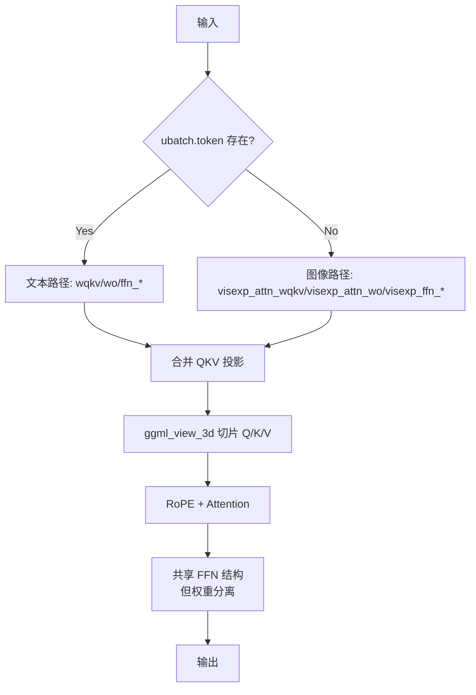
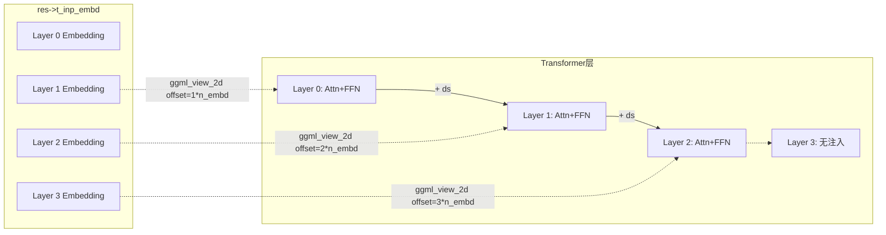
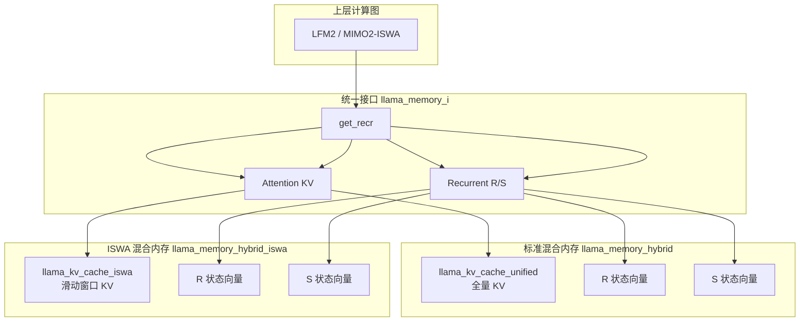

# 第32章 复合办公室的多面手 —— 多模态与扩散架构的工程实现

## 学习目标

- 理解多模态模型中图像/视觉 token 抑制的实现机制（Chameleon）
- 掌握视觉-语言双权重架构的设计原理（CogVLM）
- 深入学习多段旋转位置编码 MRoPE 在视觉 token 上的应用（Qwen2-VL/Qwen3-VL）
- 理解 DeepStack 跨层特征融合在视觉-语言模型中的作用机制
- 掌握扩散语言模型使用非因果注意力的实现原理（LLaDA、RND1）
- 理解 ISWA 滑动窗口注意力在多模态长序列中的应用（MIMO2-ISWA）
- 掌握混合记忆架构中注意力与短卷积的协同方式（LFM2）
- 理解混合内存基础设施中注意力 KV 与循环 R/S 状态的统一管理
- 能区分图像 token logits 抑制、视觉专家分支、DeepStack 注入、扩散掩码、sinks 注意力等高级特性

## 32.1 生活类比

想象多模态模型是一座**翻译官 + 画家 + 秘书的复合办公室**：**Chameleon = 双重身份员工**——既能看懂图片，也能写文字。为避免「不小心吐出乱码图片」，在打字阶段把图片对应位置的格子用「极低分」封死（-FLT_MAX），确保文字永远胜出。**CogVLM = 两套衣服的员工**——处理文字穿「西装」（wqkv/wo），处理图像换「工装」（visexp_attn_wqkv）。通过判断「这次来的是文字还是图像」自动换装，专业能力互不干扰。**Qwen2-VL / Qwen3-VL = 三维坐标的导游**——MRoPE 把位置信息分成 4 段（时间、高度、宽度、其他），让模型同时知道「这是视频的第几秒、像素的第几行、第几列」。DeepStack 则是让低层视觉特征能跨越多层注入，类似「透视眼镜」层层叠加。**LLaDA / RND1 = 并行雕刻家**——传统 AI 是一个字一个字写（自回归），它们则同时雕刻所有位置（扩散），所以不需要 KV 缓存这种「记忆便签」，所有位置一起改。**LFM2 = 双技能工人**——既会用锤子（注意力），也会用扳手（短卷积）。通过判断「这活儿是精细活还是批量活」自动选工具，工具之间还能配合。**MIMO2-ISWA = 带缓冲的流水线**——滑动窗口让近期信息进「快速通道」，远期信息进「档案室」，sinks 则是「重要便签」，防止长序列生成时模型跑题。**混合内存基础设施 = 统一的档案管理员**——同时管理注意力的 KV 缓存与循环层的 R/S 状态，为上层提供统一访问接口。就像现代办公室需要专业的多面手和精密的协作机制，多模态模型也需要在同一套硬件上协调图像、文本、扩散、循环等多种推理范式。

## 32.2 源码地图

```
src/models/chameleon.cpp
├── llm_build_chameleon::llm_build_chameleon()  # 抑制图像 token logits 的多模态模型
│   ├── build_inp_embd()                          # 嵌入层输入（含视觉 token）
│   ├── build_norm() 循环                         # attn_norm / ffn_norm
│   ├── Q/K/V 独立投影 + 可选 Q/K 归一化           # attn_q_norm / attn_k_norm
│   ├── ggml_rope_ext()                           # 标准 RoPE（非 multi）
│   ├── swin_norm 分支                            # 滑动窗口归一化切换
│   ├── build_ffn()  SiLU + 并行                  # LLM_FFN_SILU, LLM_FFN_PAR
│   ├── ggml_get_rows() 最后层输出过滤              # inp_out_ids
│   ├── ★ggml_new_tensor_1d()                     # 创建图像 logits 张量
│   ├── ★ggml_clamp()                             # 钳制为 -FLT_MAX
│   └── ★ggml_set_1d()                            # 注入图像 token 位置

src/models/cogvlm.cpp
├── llm_build_cogvlm::llm_build_cogvlm()          # 视觉专家分支架构
│   ├── ubatch.token 判断                         # is_text 输入分流
│   ├── 文本路径 vs 视觉专家路径                  # wqkv vs visexp_attn_wqkv
│   ├── ★ggml_view_3d() 拆分合并 QKV              # 三视图切片
│   ├── ggml_rope()                               # 简化的 RoPE（非 ext）
│   └── build_ffn() 文本/视觉并行                 # 视觉专家 ffn_up/gate/down

src/models/qwen2vl.cpp
├── llm_build_qwen2vl::llm_build_qwen2vl()        # Qwen2-VL 多模态
│   ├── ★rope_sections 数组                       # MRoPE 4 段维度定义
│   ├── Q/K/V 独立投影 + bq/bk/bv 偏置            # Qwen 系列特色
│   ├── ★ggml_rope_multi()                        # 多段旋转位置编码
│   ├── bo 偏置到 wo                              # 输出投影偏置
│   └── inp_out_ids 最后层提取                    # 忽略视觉 token

src/models/qwen3vl.cpp
├── llm_build_qwen3vl::llm_build_qwen3vl()        # Qwen3-VL + DeepStack
│   ├── n_deepstack_layers 循环判断               # 仅前 N 层融合
│   ├── build_norm() 在 RoPE 之前                 # attn_q_norm / attn_k_norm
│   ├── ggml_rope_multi()                         # 4 段 MRoPE
│   ├── bo 输出投影偏置                           # 与 Qwen2-VL 一致
│   ├── ★ggml_view_2d() 切片嵌入层                # 取出第 il+1 层嵌入
│   └── ★ggml_add() 注入 DeepStack 特征          # 视觉 token 跨层增强

src/models/qwen3vl-moe.cpp
├── llm_build_qwen3vlmoe::llm_build_qwen3vlmoe()  # Qwen3-VL-MoE + DeepStack
│   ├── build_norm() 在 RoPE 之前                 # 与 Qwen3-VL 一致
│   ├── ★build_moe_ffn()                          # MoE 替代标准 FFN
│   ├── LLAMA_EXPERT_GATING_FUNC_TYPE_SOFTMAX    # softmax 门控
│   └── DeepStack 注入                            # ggml_view_2d + ggml_add

src/models/llada.cpp
├── llm_build_llada::llm_build_llada()            # 扩散语言模型
│   ├── ★build_attn_inp_no_cache()                # 非因果注意力输入
│   ├── 双向注意力掩码                            # 无需 KV 缓存
│   ├── 整体结构类似 LLaMA                        # RMSNorm + RoPE + SwiGLU
│   └── 并行生成所有 token                        # 扩散过程核心

src/models/lfm2.cpp
├── llm_build_lfm2<bool iswa>::llm_build_lfm2()   # 混合记忆架构（模板化）
│   ├── 模板参数 iswa 控制内存类型                # llama_memory_hybrid vs hybrid_iswa
│   ├── build_dense_feed_forward() lambda         # 密集 FFN 构造器
│   ├── build_moe_feed_forward() lambda           # MoE FFN 构造器
│   ├── build_attn_block() lambda                 # 含 Q/K norm 与 RoPE
│   ├── ★build_shortconv_block() lambda            # 短卷积 + ssm_conv 算子
│   │   ├── ggml_view_3d() 拆分合并 B/C/X         # 3 段卷积输入
│   │   ├── build_rs() 读取 R 状态                # 循环状态缓存
│   │   ├── ggml_concat() 拼接新状态              # 滑动窗口状态扩展
│   │   ├── ggml_cpy() 写回新状态                 # KV head 偏移
│   │   └── ggml_ssm_conv()                       # SSM 卷积算子
│   ├── build_inp_mem_hybrid_iswa()               # ISWA 混合内存输入
│   ├── is_recurrent(il) 分支                     # 选择 attn 或 shortconv
│   └── n_layer_dense_lead 分层                   # 前 N 层密集，后续 MoE
├── 模板显式实例化                                # lfm2<true> / lfm2<false>

src/models/mimo2-iswa.cpp
├── llm_build_mimo2_iswa::llm_build_mimo2_iswa()  # MIMO2-ISWA 多模态
│   ├── ★build_attn_inp_kv_iswa()                 # ISWA 滑动窗口 KV 输入
│   ├── n_head(il) / n_head_kv(il) 每层头数        # per-layer GQA 配置
│   ├── ★freq_base_l / freq_scale_l 每层 RoPE     # per-layer 频率基准
│   ├── model.get_rope_freq_base()                 # per-layer RoPE 参数
│   ├── ★attn_sinks 张量                          # 注意力 sinks 稳定长序列
│   ├── ★ffn_gate_inp 是否为 nullptr             # 密集 vs MoE 分支判断
│   ├── ★LLAMA_EXPERT_GATING_FUNC_TYPE_SIGMOID   # sigmoid 门控（多模态特色）
│   └── ggml_get_rows() 最后层提取                # inp_out_ids

src/models/rnd1.cpp
├── llm_build_rnd1::llm_build_rnd1()              # Qwen3MoE 转扩散
│   ├── ★build_attn_inp_no_cache()                # 非因果注意力
│   ├── build_norm() 在 RoPE 之前                 # 与 Qwen3-VL 一致
│   ├── ggml_rope_ext()                           # 标准 RoPE（非 multi）
│   ├── bo 输出投影偏置                           # Qwen 系列风格
│   ├── ★build_moe_ffn()                          # MoE FFN 继承 Qwen3MoE
│   └── LLAMA_EXPERT_GATING_FUNC_TYPE_SOFTMAX    # softmax 门控

src/llama-memory-hybrid.h / llama-memory-hybrid.cpp
├── llama_memory_hybrid                           # 混合内存（attention + recurrent）
├── llama_memory_hybrid_context                   # 上下文（含 R/S 状态）

src/llama-memory-hybrid-iswa.h / .cpp
├── llama_memory_hybrid_iswa                      # ISWA + 循环混合内存
├── llama_memory_hybrid_iswa_context              # ISWA + R/S 上下文
```

## 32.3 Chameleon：图像 Token 封锁线 —— 共享骨干下的输出层硬干预

Chameleon 是早期多模态模型的典型代表，它的核心设计哲学是：**用同一套 Transformer 结构同时处理文本和图像 token，但在输出层强行屏蔽图像 token 的生成概率**。这种"共享骨干、分离输出"的设计让模型在理解图像的同时，保证只输出文本。这正如前文类比中的"双重身份员工"：工作时共用一套大脑理解图文，但发言时给图像 token 贴上"禁言令"。

### 32.3.1 llm_build_chameleon::llm_build_chameleon()：构建计算图与图像 Token 封锁线

Chameleon 的计算图构建入口是 `llm_build_chameleon` 类的构造函数。它继承自 `llm_graph_context`，在构造时完整搭建从嵌入到输出的前向图，并在最后通过 `ggml_set_1d` 实现图像 token logits 的硬屏蔽。

源码路径：`src/models/chameleon.cpp` - `llm_build_chameleon`（第5-119行）

```cpp
llm_build_chameleon::llm_build_chameleon(const llama_model & model, const llm_graph_params & params) : llm_graph_context(params) {
    const int64_t n_embd_head = hparams.n_embd_head_v();              // ① 获取每头维度
    GGML_ASSERT(n_embd_head == hparams.n_embd_head_k());              // ② 断言 Q/K 头维一致
    GGML_ASSERT(n_embd_head == n_rot);                                // ③ 断言旋转维度一致
    ggml_tensor * cur;
    ggml_tensor * inpL;
    inpL = build_inp_embd(model.tok_embd);                            // ④ 构建输入嵌入（含视觉 token）
    ggml_tensor * inp_pos = build_inp_pos();                          // ⑤ 构建位置编码输入
    auto * inp_attn = build_attn_inp_kv();                            // ⑥ 构建标准 KV 缓存注意力输入
    ggml_tensor * inp_out_ids = build_inp_out_ids();                  // ⑦ 构建输出 token 索引（用于最后一层提取）
    for (int il = 0; il < n_layer; ++il) {                            // ⑧ 逐层构建 Transformer 块
        ggml_tensor * inpSA = inpL;
        if (hparams.swin_norm) {                                      // ⑨ 可选：swin_norm 分支（滑动窗口归一化）
            cur = inpL;
        } else {
            cur = build_norm(inpL, model.layers[il].attn_norm, NULL, LLM_NORM_RMS, il); // ⑩ 标准 RMSNorm
            cb(cur, "attn_norm", il);
        }
        {
            ggml_tensor * Qcur = build_lora_mm(model.layers[il].wq, cur); // ⑪ Q 投影（含 LoRA）
            cb(Qcur, "Qcur", il);
            ggml_tensor * Kcur = build_lora_mm(model.layers[il].wk, cur); // ⑫ K 投影
            cb(Kcur, "Kcur", il);
            ggml_tensor * Vcur = build_lora_mm(model.layers[il].wv, cur); // ⑬ V 投影
            cb(Vcur, "Vcur", il);
            if (model.layers[il].attn_q_norm) {                       // ⑭ 可选：Q 归一化
                Qcur = ggml_view_3d(ctx0, Qcur, n_embd_head, n_head, n_tokens, ggml_element_size(Qcur) * n_embd_head, ggml_element_size(Qcur) * n_embd_head * n_head, 0);
                cb(Qcur, "Qcur", il);
                Qcur = build_norm(Qcur, model.layers[il].attn_q_norm, model.layers[il].attn_q_norm_b, LLM_NORM, il);
                cb(Qcur, "Qcur", il);
            }
            if (model.layers[il].attn_k_norm) {                       // ⑮ 可选：K 归一化
                Kcur = ggml_view_3d(ctx0, Kcur, n_embd_head, n_head_kv, n_tokens, ggml_element_size(Kcur) * n_embd_head, ggml_element_size(Kcur) * n_embd_head * n_head_kv, 0);
                cb(Kcur, "Kcur", il);
                Kcur = build_norm(Kcur, model.layers[il].attn_k_norm, model.layers[il].attn_k_norm_b, LLM_NORM, il);
                cb(Kcur, "Kcur", il);
            }
            Qcur = ggml_reshape_3d(ctx0, Qcur, n_embd_head, n_head, n_tokens); // ⑯ 重塑为 [head_dim, n_head, n_tokens]
            Kcur = ggml_reshape_3d(ctx0, Kcur, n_embd_head, n_head_kv, n_tokens);
            Vcur = ggml_reshape_3d(ctx0, Vcur, n_embd_head, n_head_kv, n_tokens);
            Qcur = ggml_rope_ext(ctx0, Qcur, inp_pos, nullptr, n_rot, rope_type, n_ctx_orig, freq_base, freq_scale, ext_factor, attn_factor, beta_fast, beta_slow); // ⑰ 标准 RoPE
            Kcur = ggml_rope_ext(ctx0, Kcur, inp_pos, nullptr, n_rot, rope_type, n_ctx_orig, freq_base, freq_scale, ext_factor, attn_factor, beta_fast, beta_slow);
            cb(Qcur, "Qcur", il);
            cb(Kcur, "Kcur", il);
            cb(Vcur, "Vcur", il);
            cur = build_attn(inp_attn, model.layers[il].wo, nullptr, Qcur, Kcur, Vcur, nullptr, nullptr, nullptr, 1.0f/sqrtf(float(n_embd_head)), il); // ⑱ 注意力计算
        }
        if (il == n_layer - 1 && inp_out_ids) {                       // ⑲ 最后一层：按 inp_out_ids 提取输出
            cur   = ggml_get_rows(ctx0,   cur, inp_out_ids);
            inpSA = ggml_get_rows(ctx0, inpSA, inp_out_ids);
        }
        if (hparams.swin_norm) {                                      // ⑳ swin_norm 分支：注意力后归一化
            cur = build_norm(cur, model.layers[il].attn_norm, NULL, LLM_NORM_RMS, il);
        }
        ggml_tensor * ffn_inp = ggml_add(ctx0, cur, inpSA);           // ㉑ 残差连接
        cb(ffn_inp, "ffn_inp", il);
        if (!hparams.swin_norm) {                                     // ㉒ 标准分支：FFN 前归一化
            cur = build_norm(ffn_inp, model.layers[il].ffn_norm, NULL, LLM_NORM_RMS, il);
            cb(cur, "ffn_norm", il);
        }
        cur = build_ffn(cur, model.layers[il].ffn_up,   NULL, NULL, model.layers[il].ffn_gate, NULL, NULL, model.layers[il].ffn_down, NULL, NULL, NULL, LLM_FFN_SILU, LLM_FFN_PAR, il); // ㉓ SiLU + 并行 FFN
        cb(cur, "ffn_out", il);
        if (hparams.swin_norm) {                                      // ㉔ swin_norm 分支：FFN 后归一化
            cur = build_norm(cur, model.layers[il].ffn_norm, NULL, LLM_NORM_RMS, il);
            cb(cur, "ffn_norm", il);
        }
        cur = ggml_add(ctx0, cur, ffn_inp);                           // ㉕ FFN 残差
        cb(cur, "ffn_out", il);
        cur = build_cvec(cur, il);                                    // ㉖ 控制向量注入（可选）
        cb(cur, "l_out", il);
        inpL = cur;                                                   // ㉗ 传递给下一层
    }
    cur = inpL;
    cur = build_norm(cur, model.output_norm, NULL, LLM_NORM_RMS, -1); // ㉘ 最终归一化
    cb(cur, "result_norm", -1);
    res->t_embd = cur;
    cur = build_lora_mm(model.output, cur);                           // ㉙ 输出投影（lm_head）
    cb(cur, "result_output_with_img_logits", -1);
    int img_token_end_idx = 8196;                                     // ㉚ 图像 token 结束索引
    int img_token_start_idx = 4;                                      // ㉛ 图像 token 起始索引
    int num_img_tokens = img_token_end_idx - img_token_start_idx;     // ㉜ 图像 token 数量
    ggml_tensor * img_logits = ggml_new_tensor_1d(ctx0, GGML_TYPE_F32, num_img_tokens); // ㉝ 创建 1D 张量承载图像 logits
    img_logits = ggml_clamp(ctx0, img_logits, -FLT_MAX, -FLT_MAX);    // ㉞ 钳制为 -FLT_MAX（极小值）
    cb(img_logits, "img_logits", -1);
    cur = ggml_set_1d(ctx0, cur, img_logits, ggml_element_size(cur) * img_token_start_idx); // ㉟ 写入 logits 对应位置
    cb(cur, "result_output", -1);
    res->t_logits = cur;
    ggml_build_forward_expand(gf, cur);
}
```

这段代码定义了 Chameleon 模型的完整前向计算图构建流程：从输入嵌入开始，经过多层 Transformer（含可选的 Q/K 归一化、swin_norm 分支），最终在输出层通过 `ggml_set_1d` 将图像 token 对应的 logits 位置强制设为 `-FLT_MAX`，从而在采样时彻底屏蔽图像 token 的生成。

### 32.3.2 ggml_set_1d：零拷贝写入 -FLT_MAX 实现 Logits 硬屏蔽

Chameleon 的精髓在于最后几行代码实现的**图像 token logits 抑制**（第 105-118 行）。让我们放大来看这三个核心函数的协同工作：

```cpp
    cur = build_lora_mm(model.output, cur);                           // ① lm_head 投影，得到完整 vocab_size 的 logits
    cb(cur, "result_output_with_img_logits", -1);
    int img_token_end_idx = 8196;                                     // ② 图像 token 索引范围 [4, 8196)
    int img_token_start_idx = 4;
    int num_img_tokens = img_token_end_idx - img_token_start_idx;     // ③ 计算图像 token 数量：8192
    ggml_tensor * img_logits = ggml_new_tensor_1d(ctx0, GGML_TYPE_F32, num_img_tokens); // ④ 创建同形状 1D 张量
    img_logits = ggml_clamp(ctx0, img_logits, -FLT_MAX, -FLT_MAX);    // ⑤ 将所有值钳制为 -FLT_MAX（约 -3.4e38）
    cb(img_logits, "img_logits", -1);
    cur = ggml_set_1d(ctx0, cur, img_logits, ggml_element_size(cur) * img_token_start_idx); // ⑥ 原地写入：logits[4:8196] = -FLT_MAX
    cb(cur, "result_output", -1);
    res->t_logits = cur;
```

**关键点解读：**
- **`ggml_new_tensor_1d`**：在计算图上下文 `ctx0` 中创建一个新的 1 维张量，长度为 `num_img_tokens`（8192），类型为 FP32。这是**图节点**，不分配实际数据内存，只定义张量元数据。
- **`ggml_clamp`**：将张量所有元素限制在 `[-FLT_MAX, -FLT_MAX]`，实际上就是把全张量填充为 `-FLT_MAX`。这同样是一个**图节点**，后端执行时由 kernel 高效填充。
- **`ggml_set_1d`**：这是核心操作。它以 `cur`（完整 logits）为目标，以 `img_logits` 为源，从偏移量 `img_token_start_idx * sizeof(float)` 开始，覆盖 `num_img_tokens` 个元素。**这是零拷贝的图级操作**，后端执行时会直接在输出张量对应内存区写入极小值，无需额外内存分配与拷贝。

**为什么用 `-FLT_MAX` 而不是 `-inf`？**  
GGML 的采样器在 softmax 前通常会做数值稳定性处理（减去 max logit）。`-FLT_MAX` 是有限浮点数，不会引入 `inf` 导致的 NaN 风险，同时在 softmax 分母中 `exp(-FLT_MAX)` 实质为 0，效果等同于硬掩码。

**与 Attention Mask 的本质区别：**  
Attention mask 作用于注意力分数（`QK^T`），仅阻止信息流向；而 logits 抑制作用于**输出分布**，直接改写模型的"发言权"。Chameleon 允许图像 token 参与注意力交互（理解图像），但禁止其出现在最终输出序列中——正如"双重身份员工"工作时看图、开会时禁言。

### 32.3.3 Chameleon 图像 Token 抑制流程图

```mermaid
flowchart TD
    A[输入嵌入] --> B[Transformer 层]
    B --> C[最终归一化]
    C --> D[输出投影 lm_head]
    D --> E[完整 logits: [vocab_size]]
    E --> F[创建 img_logits: [8192]]
    F --> G[ggml_clamp 填充 -FLT_MAX]
    G --> H[ggml_set_1d 写入 logits[4:8196]]
    H --> I[最终 logits: 图像位置为 -FLT_MAX]
    I --> J[采样器 softmax -> 图像 token 概率为 0]
```

## 32.4 CogVLM：双权重切换专家 —— 输入分流的视觉语言解耦

CogVLM 采用了截然不同的设计：**为文本和图像输入维护两套完全独立的注意力与 FFN 权重**，在运行时根据输入类型动态切换。这避免了共享权重时的任务干扰，但增加了参数量。这正如前文类比中的"两套衣服的员工"：处理文字穿"西装"（wqkv/wo），处理图像换"工装"（visexp_attn_wqkv），互不干扰。

### 32.4.1 llm_build_cogvlm::llm_build_cogvlm()：构建计算图与输入分流双权重

源码路径：`src/models/cogvlm.cpp` - `llm_build_cogvlm`（第1-80行）

```cpp
llm_build_cogvlm::llm_build_cogvlm(const llama_model & model, const llm_graph_params & params) :
    llm_graph_context(params) {
    const int64_t n_embd_head = hparams.n_embd_head_v();
    const float   kq_scale    = 1.0f / sqrtf(float(n_embd_head));

    GGML_ASSERT(n_embd_head == hparams.n_embd_head_k());
    GGML_ASSERT(n_embd_head == n_rot);

    ggml_tensor * inpL;
    ggml_tensor * cur;

    inpL = build_inp_embd(model.tok_embd);

    ggml_tensor * inp_pos = build_inp_pos();

    auto * inp_attn = build_attn_inp_kv();

    // check ubatch to see if we have input tokens (text)
    // or an input embedding vector (image)
    bool is_text;
    if (ubatch.token) {                                               // ① 判断输入类型：有 token 即文本
        is_text = true;
    } else {
        is_text = false;                                              // ② 无 token 即图像嵌入输入
    }

    for (int il = 0; il < n_layer; ++il) {
        // get either the text or image weight tensors
        ggml_tensor *wqkv, *wo;
        ggml_tensor *ffn_gate, *ffn_down, *ffn_up;

        if (is_text) {                                                // ③ 文本路径：标准权重
            wqkv     = model.layers[il].wqkv;
            wo       = model.layers[il].wo;
            ffn_gate = model.layers[il].ffn_gate;
            ffn_down = model.layers[il].ffn_down;
            ffn_up   = model.layers[il].ffn_up;
        } else {                                                      // ④ 图像路径：视觉专家权重
            wqkv     = model.layers[il].visexp_attn_wqkv;
            wo       = model.layers[il].visexp_attn_wo;
            ffn_gate = model.layers[il].visexp_ffn_gate;
            ffn_down = model.layers[il].visexp_ffn_down;
            ffn_up   = model.layers[il].visexp_ffn_up;
        }

        ggml_tensor * inpSA = inpL;
        cur = build_norm(inpSA, model.layers[il].attn_norm, NULL, LLM_NORM_RMS, il);

        // build self attention
        {
            ggml_tensor * qkv = build_lora_mm(wqkv, cur);             // ⑤ 合并 QKV 投影

            // split qkv into Q, K, V along the first dimension
            ggml_tensor * Qcur =
                ggml_view_3d(ctx0, qkv, n_embd_head, n_head, n_tokens, n_embd_head * sizeof(float), qkv->nb[1], 0); // ⑥ 切片 Q
            ggml_tensor * Kcur = ggml_view_3d(ctx0, qkv, n_embd_head, n_head_kv, n_tokens, n_embd_head * sizeof(float),
                                              qkv->nb[1], n_embd * ggml_element_size(qkv));                         // ⑦ 切片 K
            ggml_tensor * Vcur = ggml_view_3d(ctx0, qkv, n_embd_head, n_head_kv, n_tokens, n_embd_head * sizeof(float),
                                              qkv->nb[1], 2 * n_embd * ggml_element_size(qkv));                     // ⑧ 切片 V

            Qcur = ggml_rope(ctx0, Qcur, inp_pos, n_embd_head, rope_type); // ⑨ 简化版 RoPE
            Kcur = ggml_rope(ctx0, Kcur, inp_pos, n_embd_head, rope_type);

            cur = build_attn(inp_attn,
                wo, nullptr,
                Qcur, Kcur, Vcur,
                nullptr, nullptr, nullptr,
                kq_scale, il);
            cb(cur, "attn_out", il);
        }

        ggml_tensor * ffn_inp = ggml_add(ctx0, cur, inpSA);
        cb(ffn_inp, "ffn_inp", il);

        cur = build_norm(ffn_inp, model.layers[il].ffn_norm, NULL, LLM_NORM_RMS, il);
        cb(cur, "ffn_norm", il);

        cur = build_ffn(cur,
                ffn_up, NULL, NULL,
                ffn_gate, NULL, NULL,
                ffn_down, NULL, NULL,
                NULL, LLM_FFN_SILU, LLM_FFN_PAR, il);                 // ⑩ 并行 SwiGLU FFN

        cur = ggml_add(ctx0, cur, ffn_inp);
        cb(cur, "ffn_out", il);

        cur = build_cvec(cur, il);
        cb(cur, "l_out", il);

        // input for next layer
        inpL = cur;
    }

    cur = inpL;

    cur = build_norm(cur, model.output_norm, NULL, LLM_NORM_RMS, -1);
    cb(cur, "result_norm", -1);
    res->t_embd = cur;

    cur = build_lora_mm(model.output, cur);
    cb(cur, "result_output", -1);
    res->t_logits = cur;
    ggml_build_forward_expand(gf, cur);
}
```

这段代码实现了 CogVLM 的核心特性：**运行时根据 `ubatch.token` 是否存在，选择文本权重集（`wqkv`/`wo`/`ffn_*`）或视觉专家权重集（`visexp_attn_wqkv`/`visexp_attn_wo`/`visexp_ffn_*`）**。注意力投影使用合并的 `wqkv` 张量，通过 `ggml_view_3d` 零拷贝切分出 Q、K、V。

### 32.4.2 ggml_view_3d：零拷贝 QKV 切片艺术

`ggml_view_3d` 是 CogVLM 高效拆分合并 QKV 的关键。它不复制数据，而是创建一个**新的张量视图**，指向同一块内存但形状和步长不同。

参数解析（以 Q 切片为例）：
```cpp
ggml_tensor * Qcur = ggml_view_3d(ctx0, qkv, 
    n_embd_head,        // 新形状 dim0：head_dim
    n_head,             // 新形状 dim1：n_head
    n_tokens,           // 新形状 dim2：n_tokens
    n_embd_head * sizeof(float), // 新步长 stride[0]：head_dim * 元素大小
    qkv->nb[1],         // 新步长 stride[1]：沿原 qkv 的第1维步长（即 head 间跨度）
    0                   // 偏移量：从 qkv 起始位置开始
);
```
- **Q 切片**：从 `qkv` 起始，形状 `[head_dim, n_head, n_tokens]`。
- **K 切片**：偏移 `n_embd * sizeof(float)`（跳过所有 Q 头），形状 `[head_dim, n_head_kv, n_tokens]`。
- **V 切片**：偏移 `2 * n_embd * sizeof(float)`（跳过 Q+K），形状同 K。

这种**内存连续、逻辑分离**的布局，使得合并投影矩阵乘法一次完成，推理时极其高效——正如员工换装只需挂钩切换，无需重新织布。

### 32.4.3 CogVLM 双权重切换流程图



## 32.5 Qwen2-VL：三维坐标导游 —— MRoPE 多段位置编码

Qwen2-VL 引入了**多段旋转位置编码**，将位置信息分解为 4 个段（通常对应：时间、高度、宽度、其他），分别应用不同频率的旋转，使模型能精准感知视频/图像的时空结构。这正如前文类比中的"三维坐标导游"：MRoPE 把位置信息分成 4 段，让模型同时知道「这是视频的第几秒、像素的第几行、第几列」。

### 32.5.1 llm_build_qwen2vl::llm_build_qwen2vl()：构建计算图与 MRoPE 注入

源码路径：`src/models/qwen2vl.cpp` - `llm_build_qwen2vl`（第7-80行）

```cpp
llm_build_qwen2vl::llm_build_qwen2vl(const llama_model & model, const llm_graph_params & params) : llm_graph_context(params) {
    const int64_t n_embd_head = hparams.n_embd_head_v();

    GGML_ASSERT(n_embd_head == hparams.n_embd_head_k());
    GGML_ASSERT(n_embd_head == n_rot);

    ggml_tensor * cur;
    ggml_tensor * inpL;

    inpL = build_inp_embd(model.tok_embd);

    // inp_pos - contains the positions
    ggml_tensor * inp_pos = build_inp_pos();

    auto * inp_attn = build_attn_inp_kv();

    int sections[4];
    std::copy(std::begin(hparams.rope_sections), std::begin(hparams.rope_sections) + 4, sections); // ① 复制 4 段 MRoPE 配置

    ggml_tensor * inp_out_ids = build_inp_out_ids();

    for (int il = 0; il < n_layer; ++il) {
        ggml_tensor * inpSA = inpL;

        // norm
        cur = build_norm(inpL,
                model.layers[il].attn_norm, NULL,
                LLM_NORM_RMS, il);
        cb(cur, "attn_norm", il);

        // self-attention
        {
            // compute Q and K and RoPE them
            ggml_tensor * Qcur = build_lora_mm(model.layers[il].wq, cur);
            Qcur = ggml_add(ctx0, Qcur, model.layers[il].bq);         // ② Q 投影 + 偏置
            cb(Qcur, "Qcur", il);

            ggml_tensor * Kcur = build_lora_mm(model.layers[il].wk, cur);
            Kcur = ggml_add(ctx0, Kcur, model.layers[il].bk);         // ③ K 投影 + 偏置
            cb(Kcur, "Kcur", il);

            ggml_tensor * Vcur = build_lora_mm(model.layers[il].wv, cur);
            Vcur = ggml_add(ctx0, Vcur, model.layers[il].bv);         // ④ V 投影 + 偏置
            cb(Vcur, "Vcur", il);

            Qcur = ggml_reshape_3d(ctx0, Qcur, n_embd_head, n_head,    n_tokens);
            Kcur = ggml_reshape_3d(ctx0, Kcur, n_embd_head, n_head_kv, n_tokens);
            Vcur = ggml_reshape_3d(ctx0, Vcur, n_embd_head, n_head_kv, n_tokens);

            Qcur = ggml_rope_multi(                                   // ⑤ 核心：多段 RoPE
                    ctx0, Qcur, inp_pos, nullptr,
                    n_rot, sections, rope_type, n_ctx_orig, freq_base, freq_scale,
                    ext_factor, attn_factor, beta_fast, beta_slow
                    );

            Kcur = ggml_rope_multi(
                    ctx0, Kcur, inp_pos, nullptr,
                    n_rot, sections, sections, rope_type, n_ctx_orig, freq_base, freq_scale,
                    ext_factor, attn_factor, beta_fast, beta_slow
                    );

            cb(Qcur, "Qcur", il);
            cb(Kcur, "Kcur", il);
            cb(Vcur, "Vcur", il);

            cur = build_attn(inp_attn,
                    model.layers[il].wo, model.layers[il].bo,         // ⑥ 输出投影带偏置 bo
                    Qcur, Kcur, Vcur, nullptr, nullptr, nullptr, 1.0f/sqrtf(float(n_embd_head)), il);
        }
        // ... 后续 FFN 与残差同标准 LLaMA ...
```

**MRoPE 关键差异：**
- **`rope_sections` 数组**：从超参数 `hparams.rope_sections` 拷贝 4 个整数，定义每段旋转的维度。例如 `[16, 16, 16, 0]` 表示前 3 段各 16 维，第 4 段不旋转。
- **`ggml_rope_multi`**：替代标准 `ggml_rope_ext`，接收 `sections` 数组，对 Q/K 的不同维度段应用不同频率的旋转。视觉 token 通常在前几段编码二维空间位置，文本 token 在时间段编码序列位置。
- **偏置项 `bq`/`bk`/`bv`/`bo`**：Qwen 系列特有，每个投影层都带可学习偏置，`bo` 直接加在注意力输出投影后。

### 32.5.2 ggml_rope_multi：多段旋转位置编码的实现流程

`ggml_rope_multi` 的工作流程可用以下流程图表示：

```mermaid
flowchart TD
    A[输入 Q/K: [head_dim, n_head, n_tokens]] --> B{按 sections 拆分 head_dim}
    B --> C[段1: dim=sections[0] 时间维]
    B --> D[段2: dim=sections[1] 高度维]
    B --> E[段3: dim=sections[2] 宽度维]
    B --> F[段4: dim=剩余 其他维]
    C --> G[应用 freq_base * freq_scale 时间频率]
    D --> H[应用 freq_base * freq_scale 空间频率]
    E --> I[应用 freq_base * freq_scale 空间频率]
    F --> J[不旋转或自定义频率]
    G --> K[拼接回完整 head_dim]
    H --> K
    I --> K
    J --> K
    K --> L[输出 Q/K: [head_dim, n_head, n_tokens]]
```

每个段独立计算旋转矩阵再拼接，实现了"一维向量编码多维坐标"的几何直觉。

## 32.6 Qwen3-VL：透视眼镜叠加 —— DeepStack 跨层特征融合

Qwen3-VL 在 Qwen2-VL 基础上引入 **DeepStack**：在前 `n_deepstack_layers` 层，将输入嵌入的对应层切片**逐层注入**到主路径残差中。这让低层视觉特征能直接传递到高层，缓解深层信息衰减。这正如前文类比中的"透视眼镜"：低层视觉特征跨越多层叠加，高层也能"看清"原始像素细节。

### 32.6.1 llm_build_qwen3vl::llm_build_qwen3vl()：构建计算图与 DeepStack 注入

源码路径：`src/models/qwen3vl.cpp` - `llm_build_qwen3vl`（第5-100行）

```cpp
llm_build_qwen3vl::llm_build_qwen3vl(const llama_model & model, const llm_graph_params & params) : llm_graph_context(params) {
    const size_t n_deepstack_layers = hparams.n_deepstack_layers;     // ① 获取 DeepStack 层数
    const int64_t n_embd      = hparams.n_embd;
    const int64_t n_embd_head = hparams.n_embd_head_v();
    GGML_ASSERT(n_embd_head == hparams.n_embd_head_k());
    GGML_ASSERT(n_embd_head == n_rot);
    ggml_tensor * cur;
    ggml_tensor * inpL;
    inpL = build_inp_embd(model.tok_embd);
    int sections[4];
    std::copy(std::begin(hparams.rope_sections), std::begin(hparams.rope_sections) + 4, sections);
    ggml_tensor * inp_pos = build_inp_pos();
    auto * inp_attn = build_attn_inp_kv();
    ggml_tensor * inp_out_ids = build_inp_out_ids();
    for (int il = 0; il < n_layer; ++il) {
        ggml_tensor * inpSA = inpL;
        cur = build_norm(inpL, model.layers[il].attn_norm, NULL, LLM_NORM_RMS, il);
        cb(cur, "attn_norm", il);
        {
            ggml_tensor * Qcur = build_lora_mm(model.layers[il].wq, cur);
            cb(Qcur, "Qcur", il);
            ggml_tensor * Kcur = build_lora_mm(model.layers[il].wk, cur);
            cb(Kcur, "Kcur", il);
            ggml_tensor * Vcur = build_lora_mm(model.layers[il].wv, cur);
            cb(Vcur, "Vcur", il);
            Qcur = ggml_reshape_3d(ctx0, Qcur, n_embd_head, n_head,    n_tokens);
            Kcur = ggml_reshape_3d(ctx0, Kcur, n_embd_head, n_head_kv, n_tokens);
            Vcur = ggml_reshape_3d(ctx0, Vcur, n_embd_head, n_head_kv, n_tokens);
            Qcur = build_norm(Qcur, model.layers[il].attn_q_norm, NULL, LLM_NORM_RMS, il); // ② Q/K Norm 在 RoPE 前
            cb(Qcur, "Qcur_normed", il);
            Qcur = ggml_rope_multi(ctx0, Qcur, inp_pos, nullptr, n_rot, sections, rope_type, n_ctx_orig, freq_base, freq_scale, ext_factor, attn_factor, beta_fast, beta_slow);
            Kcur = build_norm(Kcur, model.layers[il].attn_k_norm, NULL, LLM_NORM_RMS, il);
            cb(Kcur, "Kcur_normed", il);
            Kcur = ggml_rope_multi(ctx0, Kcur, inp_pos, nullptr, n_rot, sections, rope_type, n_ctx_orig, freq_base, freq_scale, ext_factor, attn_factor, beta_fast, beta_slow);
            cb(Qcur, "Qcur", il);
            cb(Kcur, "Kcur", il);
            cb(Vcur, "Vcur", il);
            cur = build_attn(inp_attn, model.layers[il].wo, model.layers[il].bo, Qcur, Kcur, Vcur, nullptr, nullptr, nullptr, 1.0f/sqrtf(float(n_embd_head)), il);
        }
        if (il == n_layer - 1 && inp_out_ids) {
            cur   = ggml_get_rows(ctx0,   cur, inp_out_ids);
            inpSA = ggml_get_rows(ctx0, inpSA, inp_out_ids);
        }
        ggml_tensor * ffn_inp = ggml_add(ctx0, cur, inpSA);
        cb(ffn_inp, "ffn_inp", il);
        cur = build_norm(ffn_inp, model.layers[il].ffn_norm, NULL, LLM_NORM_RMS, il);
        cb(cur, "ffn_norm", il);
        cur = build_ffn(cur, model.layers[il].ffn_up,   NULL, NULL, model.layers[il].ffn_gate, NULL, NULL, model.layers[il].ffn_down, NULL, NULL, NULL, LLM_FFN_SILU, LLM_FFN_PAR, il);
        cb(cur, "ffn_out", il);
        cur = ggml_add(ctx0, cur, ffn_inp);
        cur = build_cvec(cur, il);
        cb(cur, "l_out", il);
        if (il < (int) n_deepstack_layers) {                          // ③ DeepStack 注入条件
            ggml_tensor * ds = ggml_view_2d(ctx0, res->t_inp_embd,   // ④ 切片：取第 il+1 层嵌入
                n_embd, n_tokens, 
                res->t_inp_embd->nb[1], 
                (il + 1) * n_embd * sizeof(float));
            cur = ggml_add(ctx0, cur, ds);                            // ⑤ 残差注入
            cb(cur, "deepstack_out", il);
        }
        inpL = cur;
    }
    // ... 最终归一化与输出 ...
}
```

### 32.6.2 ggml_view_2d：零拷贝切片提取层级嵌入

**DeepStack 注入核心代码（第 70-75 行）：**
```cpp
if (il < (int) n_deepstack_layers) {
    ggml_tensor * ds = ggml_view_2d(ctx0, res->t_inp_embd, 
        n_embd, n_tokens, 
        res->t_inp_embd->nb[1], 
        (il + 1) * n_embd * sizeof(float));
    cur = ggml_add(ctx0, cur, ds);
    cb(cur, "deepstack_out", il);
}
```

- **`res->t_inp_embd`**：输入嵌入张量，形状 `[n_embd * n_deepstack_layers, n_tokens]`（首维堆叠了每层的嵌入）。
- **`ggml_view_2d` 参数**：
  - `n_embd, n_tokens`：输出形状 `[n_embd, n_tokens]`
  - `res->t_inp_embd->nb[1]`：步长 stride[1]，沿 token 维度的字节跨度
  - `(il + 1) * n_embd * sizeof(float)`：偏移量，跳过前 `il` 层嵌入，定位到第 `il+1` 层
- **为什么是 `il + 1`？** 第 0 层注意力输出后注入第 1 层嵌入，形成"当前层计算 + 下一层视觉先验"的交替模式。

### 32.6.3 DeepStack 数据流向图



每层主路径计算完成后，通过 `ggml_add` 将对应层级的嵌入特征残差相加，实现跨层信息直通。

## 32.7 Qwen3-VL-MoE：专家委员会 + 透视眼镜 —— MoE 与 DeepStack 共舞

Qwen3-VL-MoE 将 Qwen3-VL 的标准 FFN 替换为 MoE 专家层，同时保留 DeepStack 跨层注入。这相当于给"透视眼镜叠加"的导游配上了"专家委员会"：不同专家处理不同模态特征，门控网络动态路由。

### 32.7.1 llm_build_qwen3vlmoe::llm_build_qwen3vlmoe()：构建计算图与 MoE FFN 分支

源码路径：`src/models/qwen3vl-moe.cpp` - `llm_build_qwen3vlmoe`（第12-100行）

```cpp
llm_build_qwen3vlmoe::llm_build_qwen3vlmoe(const llama_model & model, const llm_graph_params & params) : llm_graph_context(params) {
    const size_t n_deepstack_layers = hparams.n_deepstack_layers;
    const int64_t n_embd      = hparams.n_embd;
    const int64_t n_embd_head = hparams.n_embd_head_v();
    GGML_ASSERT(n_embd_head == hparams.n_embd_head_k());
    GGML_ASSERT(n_embd_head == n_rot);
    ggml_tensor * cur;
    ggml_tensor * inpL;
    inpL = build_inp_embd(model.tok_embd);
    int sections[4];
    std::copy(std::begin(hparams.rope_sections), std::begin(hparams.rope_sections) + 4, sections);
    ggml_tensor * inp_pos = build_inp_pos();
    auto * inp_attn = build_attn_inp_kv();
    ggml_tensor * inp_out_ids = build_inp_out_ids();
    for (int il = 0; il < n_layer; ++il) {
        ggml_tensor * inpSA = inpL;
        // norm
        cur = build_norm(inpL, model.layers[il].attn_norm, NULL, LLM_NORM_RMS, il);
        cb(cur, "attn_norm", il);
        // self_attention
        {
            ggml_tensor * Qcur = build_lora_mm(model.layers[il].wq, cur);
            cb(Qcur, "Qcur", il);
            ggml_tensor * Kcur = build_lora_mm(model.layers[il].wk, cur);
            cb(Kcur, "Kcur", il);
            ggml_tensor * Vcur = build_lora_mm(model.layers[il].wv, cur);
            cb(Vcur, "Vcur", il);
            Qcur = ggml_reshape_3d(ctx0, Qcur, n_embd_head, n_head,    n_tokens);
            Kcur = ggml_reshape_3d(ctx0, Kcur, n_embd_head, n_head_kv, n_tokens);
            Vcur = ggml_reshape_3d(ctx0, Vcur, n_embd_head, n_head_kv, n_tokens);
            Qcur = build_norm(Qcur, model.layers[il].attn_q_norm, NULL, LLM_NORM_RMS, il);
            cb(Qcur, "Qcur_normed", il);
            Qcur = ggml_rope_multi(ctx0, Qcur, inp_pos, nullptr, n_rot, sections, rope_type, n_ctx_orig, freq_base, freq_scale, ext_factor, attn_factor, beta_fast, beta_slow);
            Kcur = build_norm(Kcur, model.layers[il].attn_k_norm, NULL, LLM_NORM_RMS, il);
            cb(Kcur, "Kcur_normed", il);
            Kcur = ggml_rope_multi(ctx0, Kcur, inp_pos, nullptr, n_rot, sections, rope_type, n_ctx_orig, freq_base, freq_scale, ext_factor, attn_factor, beta_fast, beta_slow);
            cb(Qcur, "Qcur", il);
            cb(Kcur, "Kcur", il);
            cb(Vcur, "Vcur", il);
            cur = build_attn(inp_attn, model.layers[il].wo, model.layers[il].bo, Qcur, Kcur, Vcur, nullptr, nullptr, nullptr, 1.0f/sqrtf(float(n_embd_head)), il);
        }
        if (il == n_layer - 1 && inp_out_ids) {
            cur   = ggml_get_rows(ctx0,   cur, inp_out_ids);
            inpSA = ggml_get_rows(ctx0, inpSA, inp_out_ids);
        }
        ggml_tensor * ffn_inp = ggml_add(ctx0, cur, inpSA);
        cb(ffn_inp, "ffn_inp", il);
        // MoE branch
        cur = build_norm(ffn_inp, model.layers[il].ffn_norm, NULL, LLM_NORM_RMS, il);
        cb(cur, "ffn_norm", il);
        ggml_tensor * moe_out = build_moe_ffn(cur, 
                model.layers[il].ffn_gate_inp,
                model.layers[il].ffn_up_exps,
                model.layers[il].ffn_gate_exps,
                model.layers[il].ffn_down_exps,
                nullptr,
                n_expert, n_expert_used,
                LLM_FFN_SILU, true,
                hparams.expert_weights_scale,
                LLAMA_EXPERT_GATING_FUNC_TYPE_SOFTMAX,  // ① softmax 门控
                il);
        cb(moe_out, "ffn_moe_out", il);
        cur = moe_out;
        cur = ggml_add(ctx0, cur, ffn_inp);
        cur = build_cvec(cur, il);
        cb(cur, "l_out", il);
        if (il < (int) n_deepstack_layers) {
            ggml_tensor * ds = ggml_view_2d(ctx0, res->t_inp_embd, n_embd, n_tokens, res->t_inp_embd->nb[1], (il + 1) * n_embd * sizeof(float));
            cur = ggml_add(ctx0, cur, ds);
            cb(cur, "deepstack_out", il);
        }
        inpL = cur;
    }
    // ... 最终归一化与输出 ...
}
```

### 32.7.2 build_moe_ffn：MoE 专家并行计算与 Softmax 门控

**关键差异：**
- **`build_moe_ffn` 替代 `build_ffn`**：专家权重为 `ffn_up_exps`/`gate_exps`/`down_exps`，形状 `[n_expert, ...]`。
- **门控函数 `LLAMA_EXPERT_GATING_FUNC_TYPE_SOFTMAX`**：标准 softmax 路由，输出概率分布和为 1，每个 token 仅路由到 Top-K 个专家。
- **DeepStack 保留**：MoE 版本同样支持跨层视觉特征注入。

### 32.7.3 MoE 前向流程图

```mermaid
flowchart TD
    A[FFN 输入: [n_embd, n_tokens]] --> B[Gate 投影: ffn_gate_inp]
    B --> C[Softmax 归一化]
    C --> D[Top-K 选择专家索引]
    D --> E[并行计算选中专家]
    E --> F[专家 Up: ffn_up_exps[expert_id]]
    E --> G[专家 Gate: ffn_gate_exps[expert_id]]
    E --> H[专家 Down: ffn_down_exps[expert_id]]
    F --> I[SwiGLU: up * silu(gate)]
    G --> I
    I --> J[Down 投影]
    H --> J
    J --> K[加权求和: 权重=gate_prob]
    K --> L[MoE 输出: [n_embd, n_tokens]]
```

## 32.8 LLaDA：并行雕刻家 —— 非因果注意力的扩散生成

LLaDA 打破自回归范式，采用**扩散生成**：所有 token 位置并行去噪，无需 KV 缓存，注意力为**双向（非因果）**。这正如前文类比中的"并行雕刻家"：传统 AI 是一个字一个字写（自回归），它们则同时雕刻所有位置（扩散），所以不需要 KV 缓存这种"记忆便签"，所有位置一起改。

### 32.8.1 llm_build_llada::llm_build_llada()：构建计算图与非因果注意力输入

源码路径：`src/models/llada.cpp` - `llm_build_llada`（第1-80行）

```cpp
llm_build_llada::llm_build_llada(const llama_model & model, const llm_graph_params & params) : llm_graph_context(params) {
    // LLaDA is similar to LLaMA but uses non-causal attention for diffusion
    const int64_t n_embd_head = hparams.n_embd_head_v();

    GGML_ASSERT(n_embd_head == hparams.n_embd_head_k());
    GGML_ASSERT(n_embd_head == n_rot);

    ggml_tensor * cur;
    ggml_tensor * inpL;

    inpL = build_inp_embd(model.tok_embd);

    // inp_pos - contains the positions
    ggml_tensor * inp_pos = build_inp_pos();

    // Non-causal attention for diffusion
    auto * inp_attn = build_attn_inp_no_cache();                      // ① 核心差异：无缓存注意力输入

    ggml_tensor * inp_out_ids = build_inp_out_ids();

    for (int il = 0; il < n_layer; ++il) {
        ggml_tensor * inpSA = inpL;

        // norm
        cur = build_norm(inpL, model.layers[il].attn_norm, NULL, LLM_NORM_RMS, il);
        cb(cur, "attn_norm", il);

        // self-attention
        {
            // compute separate Q, K, V projections without bias, matching LLaDALlamaBlock
            ggml_tensor * Qcur = build_lora_mm(model.layers[il].wq, cur);
            ggml_tensor * Kcur = build_lora_mm(model.layers[il].wk, cur);
            ggml_tensor * Vcur = build_lora_mm(model.layers[il].wv, cur);

            cb(Qcur, "Qcur", il);
            cb(Kcur, "Kcur", il);
            cb(Vcur, "Vcur", il);

            Qcur = ggml_reshape_3d(ctx0, Qcur, n_embd_head, n_head, n_tokens);
            Kcur = ggml_reshape_3d(ctx0, Kcur, n_embd_head, n_head_kv, n_tokens);
            Vcur = ggml_reshape_3d(ctx0, Vcur, n_embd_head, n_head_kv, n_tokens);

            Qcur = ggml_rope_ext(ctx0, Qcur, inp_pos, nullptr, n_rot, rope_type, n_ctx_orig, freq_base, freq_scale,
                                    ext_factor, attn_factor, beta_fast, beta_slow);

            Kcur = ggml_rope_ext(ctx0, Kcur, inp_pos, nullptr, n_rot, rope_type, n_ctx_orig, freq_base, freq_scale,
                                    ext_factor, attn_factor, beta_fast, beta_slow);

            cb(Qcur, "Qcur", il);
            cb(Kcur, "Kcur", il);
            cb(Vcur, "Vcur", il);

            cur = build_attn(inp_attn,
                    model.layers[il].wo, NULL,
                    Qcur, Kcur, Vcur, nullptr, nullptr, nullptr, 1.0f / sqrtf(float(n_embd_head)), il);
        }
        // ... 后续 FFN 与残差同标准 LLaMA ...
```

### 32.8.2 build_attn_inp_no_cache：无缓存双向注意力的实现

**核心差异：`build_attn_inp_no_cache()`**  
该函数创建的 `llm_graph_input_attn_no_cache` **不包含 KV 缓存指针**，且注意力掩码为**全 1（双向）**。扩散模型每一步都重新计算所有位置的注意力，不依赖历史 KV，因此不需要缓存。

**数学本质：**  
自回归：$P(x_t | x_{<t})$，因果掩码保证 $t$ 只看 $<t$。  
扩散：$P(x_{1:T} | x_{noisy})$，每步去噪预测全序列，注意力矩阵 $A_{ij} = \text{softmax}(Q_i K_j^T / \sqrt{d})$ 无掩码，**每个 token 同时关注所有 token**。

### 32.8.3 扩散与自回归注意力对比图

```mermaid
flowchart LR
    subgraph 自回归因果注意力
        AR_Q[Q_t] --> AR_Score[Q_t K_{<=t}^T]
        AR_K[K_{<=t}] --> AR_Score
        AR_Score --> AR_Mask[因果掩码: 上三角=-inf]
        AR_Mask --> AR_Attn[Attention]
    end
    
    subgraph 扩散双向注意力
        D_Q[Q_all] --> D_Score[Q_all K_all^T]
        D_K[K_all] --> D_Score
        D_Score --> D_Attn[Attention 无掩码]
    end
    
    subgraph KV缓存对比
        AR_KV[KV Cache: 逐步追加] --> AR_Next[下一步复用]
        D_KV[无 KV Cache] --> D_Recompute[每步全量重算]
    end
```

## 32.9 RND1：扩散专家委员会 —— Qwen3MoE 转扩散变体

RND1 直接将 Qwen3-MoE 的架构（Q/K Norm、MoE FFN、softmax 门控）迁移到扩散范式，仅将注意力输入改为非因果。这正如给"专家委员会"换了工作模式：从"逐字写作"变成"并行雕刻"，专家分工不变。

### 32.9.1 llm_build_rnd1::llm_build_rnd1()：构建计算图与扩散 MoE 融合

源码路径：`src/models/rnd1.cpp` - `llm_build_rnd1`（第1-100行）

```cpp
llm_build_rnd1::llm_build_rnd1(const llama_model & model, const llm_graph_params & params) : llm_graph_context(params) {
    const int64_t n_embd_head = hparams.n_embd_head_v();
    GGML_ASSERT(n_embd_head == hparams.n_embd_head_k());
    GGML_ASSERT(n_embd_head == n_rot);
    ggml_tensor * cur;
    ggml_tensor * inpL;
    inpL = build_inp_embd(model.tok_embd);
    ggml_tensor * inp_pos = build_inp_pos();
    auto * inp_attn = build_attn_inp_no_cache();                      // ① 非因果注意力
    ggml_tensor * inp_out_ids = build_inp_out_ids();
    for (int il = 0; il < n_layer; ++il) {
        ggml_tensor * inpSA = inpL;
        cur = build_norm(inpL, model.layers[il].attn_norm, NULL, LLM_NORM_RMS, il);
        cb(cur, "attn_norm", il);
        {
            ggml_tensor * Qcur = build_lora_mm(model.layers[il].wq, cur);
            cb(Qcur, "Qcur", il);
            ggml_tensor * Kcur = build_lora_mm(model.layers[il].wk, cur);
            cb(Kcur, "Kcur", il);
            ggml_tensor * Vcur = build_lora_mm(model.layers[il].wv, cur);
            cb(Vcur, "Vcur", il);
            Qcur = ggml_reshape_3d(ctx0, Qcur, n_embd_head, n_head, n_tokens);
            Kcur = ggml_reshape_3d(ctx0, Kcur, n_embd_head, n_head_kv, n_tokens);
            Vcur = ggml_reshape_3d(ctx0, Vcur, n_embd_head, n_head_kv, n_tokens);
            Qcur = build_norm(Qcur, model.layers[il].attn_q_norm, NULL, LLM_NORM_RMS, il); // ② Q/K Norm 在 RoPE 前
            cb(Qcur, "Qcur_normed", il);
            Qcur = ggml_rope_ext(ctx0, Qcur, inp_pos, nullptr, n_rot, rope_type, n_ctx_orig, freq_base, freq_scale, ext_factor, attn_factor, beta_fast, beta_slow); // ③ 标准 RoPE（非 multi）
            Kcur = build_norm(Kcur, model.layers[il].attn_k_norm, NULL, LLM_NORM_RMS, il);
            cb(Kcur, "Kcur_normed", il);
            Kcur = ggml_rope_ext(ctx0, Kcur, inp_pos, nullptr, n_rot, rope_type, n_ctx_orig, freq_base, freq_scale, ext_factor, attn_factor, beta_fast, beta_slow);
            cb(Qcur, "Qcur", il);
            cb(Kcur, "Kcur", il);
            cb(Vcur, "Vcur", il);
            cur = build_attn(inp_attn, model.layers[il].wo, model.layers[il].bo, Qcur, Kcur, Vcur, nullptr, nullptr, nullptr, 1.0f/sqrtf(float(n_embd_head)), il);
        }
        if (il == n_layer - 1 && inp_out_ids) {
            cur   = ggml_get_rows(ctx0,   cur, inp_out_ids);
            inpSA = ggml_get_rows(ctx0, inpSA, inp_out_ids);
        }
        ggml_tensor * ffn_inp = ggml_add(ctx0, cur, inpSA);
        cb(ffn_inp, "ffn_inp", il);
        cur = build_norm(ffn_inp, model.layers[il].ffn_norm, NULL, LLM_NORM_RMS, il);
        cb(cur, "ffn_norm", il);
        ggml_tensor * moe_out = build_moe_ffn(cur, model.layers[il].ffn_gate_inp, model.layers[il].ffn_up_exps, model.layers[il].ffn_gate_exps, model.layers[il].ffn_down_exps, nullptr, n_expert, n_expert_used, LLM_FFN_SILU, true, hparams.expert_weights_scale, LLAMA_EXPERT_GATING_FUNC_TYPE_SOFTMAX, il); // ④ softmax 门控
        cb(moe_out, "ffn_moe_out", il);
        cur = moe_out;
        cur = ggml_add(ctx0, cur, ffn_inp);
        cur = build_cvec(cur, il);
        cb(cur, "l_out", il);
        inpL = cur;
    }
    cur = inpL;
    cur = build_norm(cur, model.output_norm, NULL, LLM_NORM_RMS, -1);
    cb(cur, "result_norm", -1);
    res->t_embd = cur;
    cur = build_lora_mm(model.output, cur);
    cb(cur, "result_output", -1);
    res->t_logits = cur;
    ggml_build_forward_expand(gf, cur);
}
```

**设计意义：** 证明了 MoE 架构与扩散范式兼容——专家路由在每个去噪步独立计算，无需时序依赖，天然适合并行生成。

### 32.9.2 RND1 架构对比图：Qwen3MoE → 扩散

```mermaid
flowchart LR
    subgraph Qwen3MoE [自回归 Qwen3-MoE]
        A1[因果注意力 + KV Cache] --> B1[Q/K Norm + RoPE Ext]
        B1 --> C1[MoE FFN: Softmax Gate]
        C1 --> D1[逐 Token 生成]
    end
    
    subgraph RND1 [扩散 RND1]
        A2[双向注意力 无 KV Cache] --> B2[Q/K Norm + RoPE Ext]
        B2 --> C2[MoE FFN: Softmax Gate]
        C2 --> D2[并行全序列去噪]
    end
    
    A1 -.->|改动: inp_attn| A2
    D1 -.->|改动: 生成范式| D2
    B1 == B2
    C1 == C2
```

## 32.10 LFM2：双技能工人 —— 模板化混合记忆架构

LFM2 将**注意力**与**短卷积**混合在同一模型中，通过模板参数 `iswa` 切换内存类型，通过 `is_recurrent(il)` 逐层决定使用哪种机制。这正如前文类比中的"双技能工人"：既会用锤子（注意力），也会用扳手（短卷积），根据任务自动选工具。

### 32.10.1 llm_build_lfm2<iswa>::llm_build_lfm2()：模板化构建混合记忆计算图

源码路径：`src/models/lfm2.cpp` - `llm_build_lfm2<iswa>`（第1-135行）

```cpp
template <bool iswa>
llm_build_lfm2<iswa>::llm_build_lfm2(const llama_model & model, const llm_graph_params & params) :
    llm_graph_context(params) {
    using inp_hybrid_type = std::conditional_t<iswa, llm_graph_input_mem_hybrid_iswa,  llm_graph_input_mem_hybrid>; // ① 模板切换内存类型
    using inp_attn_type   = std::conditional_t<iswa, llm_graph_input_attn_kv_iswa,     llm_graph_input_attn_kv>;
    using mem_hybrid_ctx  = std::conditional_t<iswa, llama_memory_hybrid_iswa_context, llama_memory_hybrid_context>;

    // lambda helpers for readability
    auto build_dense_feed_forward = [&model, this](ggml_tensor * cur, int il) -> ggml_tensor * { // ② 密集 FFN
        GGML_ASSERT(!model.layers[il].ffn_up_b);
        GGML_ASSERT(!model.layers[il].ffn_gate_b);
        GGML_ASSERT(!model.layers[il].ffn_down_b);
        return build_ffn(cur, ...);
    };
    auto build_moe_feed_forward = [&model, this](ggml_tensor * cur, int il) -> ggml_tensor * {   // ③ MoE FFN
        return build_moe_ffn(cur, ...);
    };
    auto build_attn_block = [&model, this](ggml_tensor *   cur,
                                           ggml_tensor *   inp_pos,
                                           inp_attn_type * inp_attn,
                                           int             il) -> ggml_tensor * {                 // ④ 注意力块
        auto * q = build_lora_mm(model.layers[il].wq, cur);
        auto * k = build_lora_mm(model.layers[il].wk, cur);
        auto * v = build_lora_mm(model.layers[il].wv, cur);
        // ... Q/K norm, RoPE, build_attn ...
        return cur;
    };
    auto build_shortconv_block = [&model, this](ggml_tensor *        cur,
                                                llm_graph_input_rs * inp_recr,
                                                int                  il) -> ggml_tensor * {         // ⑤ 短卷积块（核心创新）
        auto * bx = build_lora_mm(model.layers[il].shortconv.in_proj, cur); // 投影得到 B/C/X
        // ... ggml_view_3d 拆分 B/C/X ...
        auto * conv_out    = ggml_ssm_conv(ctx0, bx, conv_kernel);      // ⑥ SSM 卷积算子
        // ... 状态读取/拼接/写回 ...
        return y;
    };

    // actual graph construction starts here
    ggml_tensor * cur = build_inp_embd(model.tok_embd);
    // ... 位置、混合内存输入构建 ...
    for (int il = 0; il < n_layer; ++il) {
        cur = hparams.is_recurrent(il) ? build_shortconv_block(cur, inp_hybrid->get_recr(), il) : // ⑦ 逐层选择
                                             build_attn_block(cur, inp_pos, inp_hybrid->get_attn(), il);
        // ...
        ggml_tensor * ffn_out = is_moe_layer ? build_moe_feed_forward(ffn_norm_out, il) : build_dense_feed_forward(ffn_norm_out, il); // ⑧ FFN 选择
        // ...
    }
    // ... 最终输出 ...
}
```

### 32.10.2 build_shortconv_block：短卷积与状态管理流程

短卷积块模拟类 SSM 的循环状态更新，使用 `ggml_ssm_conv` 算子：

```cpp
auto build_shortconv_block = [&model, this](ggml_tensor * cur, llm_graph_input_rs * inp_recr, int il) -> ggml_tensor * {
    auto * bx = build_lora_mm(model.layers[il].shortconv.in_proj, cur); // ① 投影：[3 * conv_dim, n_tokens]
    // ggml_view_3d 拆分 B, C, X (n_chunks = 3)
    auto * bx_b = ggml_view_3d(...); // B: 卷积核
    auto * bx_c = ggml_view_3d(...); // C: 输入门控
    auto * bx_x = ggml_view_3d(...); // X: 隐状态输入

    auto * r_state = build_rs(ctx0, inp_recr, n_head_kv, n_embd_head_v, il); // ② 读取循环状态 R
    auto * conv = ggml_concat(ctx0, bx_x, r_state, 0);                       // ③ 拼接新状态：[X; R] 在 dim 0
    auto * new_conv = ggml_cpy(ctx0, conv);                                   // ④ 复制用于写回
    // 计算 KV head 偏移，写回新状态到混合内存
    ggml_cpy(new_conv, inp_hybrid->get_attn()->get_kv(il)->get_k());          // ⑤ 状态持久化
    auto * conv_out = ggml_ssm_conv(ctx0, bx, conv_kernel);                   // ⑥ 核心：短卷积计算
    // ... 后续激活、输出投影 ...
    return y;
};
```

- **`n_chunks = 3`**：将 `in_proj` 输出拆分为 B（卷积核）、C（门控）、X（隐状态输入）。
- **`ggml_concat(..., 0)`**：在第 0 维（通道/头维）拼接当前输入 X 与历史状态 R，形成滑动窗口。
- **`ggml_ssm_conv`**：执行短卷积运算，类似 1D 因果卷积但带门控机制。

### 32.10.3 LFM2 层选择与状态流转图

```mermaid
flowchart TD
    A[Layer il] --> B{is_recurrent(il)?}
    B -- Yes --> C[ShortConv Block]
    B -- No --> D[Attention Block]
    C --> E[读取 R 状态]
    E --> F[拼接 X + R]
    F --> G[ggml_ssm_conv]
    G --> H[写回新 R 状态]
    D --> I[标准 Attention + KV Cache]
    C --> J[FFN 选择]
    D --> J
    J --> K{is_moe_layer?}
    K -- Yes --> L[MoE FFN]
    K -- No --> M[Dense FFN]
    
    style C fill:#e1f5fe
    style D fill:#fff3e0
    style G fill:#f3e5f5
```

### 32.10.4 模板显式实例化

文件末尾：
```cpp
// Explicit template instantiations
template struct llm_build_lfm2<true>;   // ISWA 版本
template struct llm_build_lfm2<false>;  // 标准混合内存版本
```

C++ 模板在编译期实例化为两个独立类，分别对应 `llama_memory_hybrid` 和 `llama_memory_hybrid_iswa` 两种内存后端，避免运行时 `if (iswa)` 分支开销。

## 32.11 MIMO2-ISWA：带缓冲的流水线 —— ISWA 滑动窗口与 Sinks

MIMO2-ISWA 结合了**多模态**、**ISWA 滑动窗口**、**注意力 sinks**、**per-layer RoPE** 与 **sigmoid 门控 MoE**，是长序列多模态的集大成者。这正如前文类比中的"带缓冲的流水线"：滑动窗口让近期信息进"快速通道"，远期信息进"档案室"，sinks 则是"重要便签"，防止长序列生成时模型跑题。

### 32.11.1 llm_build_mimo2_iswa::llm_build_mimo2_iswa()：构建计算图与多重创新融合

源码路径：`src/models/mimo2-iswa.cpp` - `llm_build_mimo2_iswa`（第1-100行）

```cpp
llm_build_mimo2_iswa::llm_build_mimo2_iswa(const llama_model & model, const llm_graph_params & params) : llm_graph_context(params) {
    // ...
    auto * inp_attn = build_attn_inp_kv_iswa();                       // ① ISWA KV 输入
    // ...
    for (int il = 0; il < n_layer; ++il) {
        // ...
        uint32_t n_head_l    = hparams.n_head(il);                    // ② per-layer 头数
        uint32_t n_head_kv_l = hparams.n_head_kv(il);
        const float freq_base_l  = model.get_rope_freq_base(cparams, il); // ③ per-layer RoPE 基频
        const float freq_scale_l = model.get_rope_freq_scale(cparams, il);
        // ...
        ggml_tensor * sinks = model.layers[il].attn_sinks;            // ④ 注意力 sinks
        cur = build_attn(inp_attn, ..., sinks, ...);
        // ...
        if (model.layers[il].ffn_gate_inp == nullptr) {               // ⑤ 密集 vs MoE 分支
            // dense branch
            cur = build_ffn(...);
        } else {
            // MoE branch
            cur = build_moe_ffn(..., LLAMA_EXPERT_GATING_FUNC_TYPE_SIGMOID, il); // ⑥ sigmoid 门控
        }
        // ...
    }
}
```

### 32.11.2 核心创新点解析

下表总结了 MIMO2-ISWA 的四大核心创新及其工程实现：

| 特性 | 实现 | 作用 |
|------|------|------|
| **ISWA 滑动窗口** | `build_attn_inp_kv_iswa()` | 仅缓存最近窗口 KV，旧 KV 滑出，内存占用 O(window) |
| **Per-layer RoPE** | `hparams.n_head(il)`, `model.get_rope_freq_base(il)` | 每层独立头数与频率，适应异构层设计 |
| **Attention Sinks** | `model.layers[il].attn_sinks` 传给 `build_attn` | 可学习的全局 token，稳定长序列注意力分布，防止注意力熵增 |
| **Sigmoid MoE 门控** | `LLAMA_EXPERT_GATING_FUNC_TYPE_SIGMOID` | 多标签路由，适合多模态专家并行激活 |

### 32.11.3 ISWA 注意力流程图

```mermaid
flowchart TD
    A[输入序列] --> B[ISWA KV 缓存]
    B --> C{当前层}
    C --> D[Attention Sinks: 可学习向量]
    C --> E[滑动窗口: 最近 W 个 KV]
    D --> F[拼接 Sinks + Window KV]
    E --> F
    F --> G[Q * (Sinks+Window_K)^T]
    G --> H[Softmax]
    H --> I[Attention Output]
    I --> J[下一层 / 输出]
    
    style D fill:#ffe0b2
    style E fill:#c8e6c9
```

## 32.12 混合内存基础设施：统一的档案管理员

上述 LFM2、MIMO2-ISWA 依赖的底层内存抽象定义在两个核心文件中，它们实现了 `llama_memory_i` 接口，为上层计算图提供统一的 `get_attn()`、`get_recr()` 访问入口。

### 32.12.1 llama_memory_hybrid：注意力 KV 与循环 R/S 统一管理

源码路径：`src/llama-memory-hybrid.h/.cpp`（核心类定义第 1-50 行）

```cpp
// llama-memory-hybrid.h 核心接口
class llama_memory_hybrid : public llama_memory_i {
public:
    // 构造：分配注意力 KV 缓存 + 循环 R/S 状态
    llama_memory_hybrid(const llama_model & model, const llama_context_params & params);
    
    // 统一访问入口
    virtual llama_memory_attn_i * get_attn() override;
    virtual llama_memory_recr_i * get_recr() override;
    
    // 状态管理
    virtual void set_n_seq(int32_t n_seq) override;
    virtual void clear() override;
    
private:
    std::unique_ptr<llama_kv_cache_unified> kv_cache;    // 注意力 KV
    std::vector<ggml_tensor *> recurrent_states;         // R 状态
    std::vector<ggml_tensor *> conv_states;              // S 状态 (短卷积)
};
```

**核心职责：**
- **注意力 KV 管理**：委托给 `llama_kv_cache_unified`，支持标准因果注意力。
- **循环状态管理**：为每个循环层分配 R 状态（隐状态）和 S 状态（短卷积历史），在 `set_n_seq` 时按 batch 扩展。
- **生命周期同步**：`clear()` 同时重置 KV 与循环状态，保证一致性。

### 32.12.2 llama_memory_hybrid_iswa：ISWA 窗口 + 循环状态

源码路径：`src/llama-memory-hybrid-iswa.h/.cpp`（核心类定义第 1-50 行）

```cpp
// llama-memory-hhybrid-iswa.h 核心接口
class llama_memory_hybrid_iswa : public llama_memory_i {
public:
    llama_memory_hybrid_iswa(const llama_model & model, const llama_context_params & params);
    
    virtual llama_memory_attn_i * get_attn() override;     // 返回 ISWA KV 缓存
    virtual llama_memory_recr_i * get_recr() override;     // 返回循环状态
    
private:
    std::unique_ptr<llama_kv_cache_iswa> kv_cache_iswa;    // ISWA 滑动窗口 KV
    std::vector<ggml_tensor *> recurrent_states;           // R 状态
    std::vector<ggml_tensor *> conv_states;                // S 状态
};
```

**关键差异：**
- **`llama_kv_cache_iswa`**：实现滑动窗口淘汰策略，`get_kv(il)` 返回的 KV 仅包含最近窗口内的 token。
- **统一上下文 `llama_memory_hybrid_iswa_context`**：在图构建时（`build_inp_mem_hybrid_iswa`）同时绑定 ISWA 注意力输入与循环状态输入。

### 32.12.3 混合内存 KV 缓存对比

| 缓存类型 | 实现类 | `get_kv(il)` 返回内容 | 适用场景 |
|----------|--------|----------------------|----------|
| 标准统一 KV | `llama_kv_cache_unified` | 完整历史所有 token 的 K/V | 自回归生成、短序列 |
| ISWA 滑动窗口 KV | `llama_kv_cache_iswa` | 仅最近窗口大小的 K/V | 长序列、流式推理、MIMO2-ISWA |

### 32.12.4 混合内存架构统一访问图



## 32.13 设计中的取舍

**为什么 Chameleon 不像 CogVLM 那样用双权重？**  
Chameleon 追求**参数效率**：共享骨干网络理解图文，仅在输出层干预。CogVLM 追求**任务解耦**：视觉专家权重专门优化图像推理，避免灾难性遗忘。前者参数少、部署轻；后者上限高、训练灵活。这正如"共用大脑+禁言令" vs "双脑切换"的工程权衡。

**为什么扩散模型（LLaDA/RND1）不用 KV 缓存？**  
扩散的每一步都是**全序列并行重新计算**，不存在"下一步依赖上一步的 KV"。引入 KV 缓存反而增加内存占用且无复用价值。数学上，扩散注意力矩阵 $A \in \mathbb{R}^{T \times T}$ 每步全量计算，无增量复用可能。

**为什么 MIMO2-ISWA 用 sigmoid 门控而非 softmax？**  
多模态场景下，图像/文本 token 可能同时激活不同专家。Sigmoid 允许多专家并行激活（多标签），softmax 强制单标签竞争，前者更适合模态融合。这正如"多个专家可同时会诊" vs "仅一位专家负责"的诊疗模式差异。

**LFM2 模板参数 `iswa` 的 trade-off？**  
编译期实例化两份代码（`true`/`false`），二进制体积增大，但消除了运行时 `if (iswa)` 分支，推理热路径零开销。适合部署时已知模型变体的场景。这是典型的"编译期换运行时"工程策略。

**DeepStack 只注入前 N 层的原因？**  
视觉特征在浅层语义密度高、空间细节丰富；深层逐渐抽象为高级概念。前 N 层注入保留细节，后层不再注入避免噪声干扰高层推理。实验表明 $N \approx 3\text{-}4$ 为最佳平衡点。

## 32.14 动手练习

### 32.14.1 练习 1：阅读 Chameleon 的 logits 抑制实现
阅读 `src/models/chameleon.cpp` 第 1-119 行（llm_build_chameleon 构造函数）：
1. 找出 `img_token_start_idx` 和 `img_token_end_idx` 的取值
2. 跟踪 `img_logits` 张量的创建流程：
   - 使用了哪个 ggml 函数创建 1D 张量？
   - 使用了哪个 ggml 函数钳制数值范围？
   - 最终通过哪个函数注入到 `cur` logits 中？
3. 对比 RoPE 调用：Chameleon 用的是 `ggml_rope_ext` 还是 `ggml_rope`？Qwen2-VL 用的是哪个？
回答问题：
- Chameleon 的 logits 抑制与通常的 mask 操作有什么本质区别？
- 如果 `img_token_start_idx = 4`、`img_token_end_idx = 8196`、`vocab_size = 32000`，被抑制的 token 占词表多大比例？
- 这种方法能否扩展到「抑制特定 text token」？如果要实现「禁止模型输出某个敏感词」，代码需要怎么改？

### 32.14.2 练习 2：对比 CogVLM 与 Chameleon 的输入分流
阅读 `src/models/cogvlm.cpp` 第 1-80 行，理解输入判断逻辑：
1. `is_text` 变量是如何判断的？依据是什么？
2. 文本路径和图像路径分别使用哪些权重张量？
3. 对比 Chameleon（只抑制 logits）和 CogVLM（切换整套权重）的设计思路。
回答问题：
- 为什么 CogVLM 选择「两套权重」而非「一套权重 + mask」？
- 如果在 `is_text=false`（图像输入）时使用了 `wqkv` 而非 `visexp_attn_wqkv`，会发生什么？
- 在工程实现上，「切换权重指针」与「运行时重组计算图」相比，各自的优缺点是什么？

### 32.14.3 练习 3：追踪 Qwen3-VL 的 DeepStack 注入路径
阅读 `src/models/qwen3vl.cpp` 第 5-100 行，定位 DeepStack 注入代码：
1. `n_deepstack_layers` 从哪里获取？
2. `ggml_view_2d(ctx0, res->t_inp_embd, n_embd, n_tokens, res->t_inp_embd->nb[1], (il + 1) * n_embd * sizeof(float))` 这一行的参数含义：
   - `n_embd`、`n_tokens` 是输出形状的哪两个维度？
   - `res->t_inp_embd->nb[1]` 是源张量的哪个 stride？
   - `(il + 1) * n_embd * sizeof(float)` 这个偏移如何对应「第 il 层」？
3. 对比 Qwen2-VL（无 DeepStack）和 Qwen3-VL（有 DeepStack）的图结构差异。
回答问题：
- DeepStack 注入发生在「主路径之后」（cur + ffn_inp 之后）还是「FFN 之前」？
- 为什么只在 `il < n_deepstack_layers` 的层做注入，而不是所有层？
- 假设 `t_inp_embd` 总共有 4 层堆叠（n_deepstack_layers=3），最后一层堆叠有什么用途？

### 32.14.4 练习 4：理解 LLaDA 与 RND1 的扩散注意力
阅读 `src/models/llada.cpp` 与 `src/models/rnd1.cpp` 第 1-80 行：
1. 两个模型都使用 `build_attn_inp_no_cache()`，这与 `build_attn_inp_kv()` 有何本质区别？
2. 找出 LLaDA 和 RND1 在图构建上的所有差异：
   - 是否使用 Q/K 归一化？
   - RoPE 调用是 ext 还是 multi？
   - FFN 是 dense 还是 MoE？
   - 输出层是否有 bo 偏置？
3. 对比 LLaDA 与 Qwen2-VL 的 RoPE 调用差异。
回答问题：
- 为什么扩散模型不需要 KV 缓存？数学上的解释是什么？
- RND1 是「Qwen3MoE 转扩散」，为什么 MoE 结构能在扩散范式下工作？
- 如果一个扩散模型的注意力错误地使用了因果掩码（causal mask），生成结果会出什么问题？

### 32.14.5 练习 5：剖析 LFM2 的混合记忆与短卷积
阅读 `src/models/lfm2.cpp` 第 1-150 行：
1. 模板参数 `iswa` 控制哪些类型的变化？
2. `build_shortconv_block` 中：
   - `n_chunks = 3` 的含义是什么？B/C/X 各代表什么？
   - `ggml_concat(conv, bx, 0)` 在哪个维度拼接？
   - `ggml_cpy(new_conv, ...)` 的目标偏移如何计算？
3. 主循环中：
   - `is_recurrent(il)` 为 true 时调用哪个 block？
   - `n_layer_dense_lead` 控制 FFN 选择的规则是什么？
回答问题：
- LFM2 模板的显式实例化 `template struct llm_build_lfm2<true>` 与 `template struct llm_build_lfm2<false>` 起什么作用？
- 为什么短卷积需要单独维护 R 状态，而不能像注意力那样直接使用 KV 缓存？
- 如果在 dense FFN 的层错误地调用了 MoE FFN（或反之），会发生什么？代码会 panic 还是静默错误？

### 32.14.6 练习 6：分析混合内存基础设施的统一接口
阅读 `src/llama-memory-hybrid.h/.cpp` 与 `src/llama-memory-hybrid-iswa.h/.cpp`：
1. `llama_memory_hybrid` 与 `llama_memory_hybrid_iswa` 共同继承自哪个基类？该基类定义了哪两个核心虚函数？
2. `llama_memory_hybrid_context` 在图构建时的作用是什么？它如何将注意力输入与循环输入绑定到同一上下文？
3. 对比 `llama_kv_cache_unified` 与 `llama_kv_cache_iswa` 的 `get_kv(il)` 返回差异。
回答问题：
- 为什么要设计统一的 `llama_memory_i` 接口，而不是让每个模型直接操作各自的缓存结构？
- 在 `build_inp_mem_hybrid_iswa` 中，如何确保注意力 KV 与循环状态的序列长度一致？

## 32.15 本章小结

这一章中我们学习/了解/讨论了 llama.cpp 中多模态与扩散模型的图构建实现。首先我们深入剖析了 Chameleon 如何通过 `ggml_set_1d` 在输出层将图像 token logits 钳制为 `-FLT_MAX` 实现纯文本输出；其次我们对比了 CogVLM 基于 `ubatch.token` 运行时切换双权重集（文本/视觉专家）的分流机制；接着我们详细讲解了 Qwen2-VL 的 MRoPE 多段旋转位置编码（`ggml_rope_multi` + `rope_sections`）如何编码视频时空信息；然后我们追踪了 Qwen3-VL 的 DeepStack 跨层注入（`ggml_view_2d` 切片嵌入 + `ggml_add` 残差注入）及其 MoE 变体；之后我们探讨了 LLaDA 与 RND1 采用 `build_attn_inp_no_cache` 实现非因果注意力的扩散生成范式；紧接着我们剖析了 LFM2 模板化混合记忆架构中注意力与短卷积（`ggml_ssm_conv`）的协同与状态管理；随后我们梳理了 MIMO2-ISWA 的 ISWA 滑动窗口、per-layer RoPE、attention sinks 与 sigmoid 门控 MoE 等高级特性组合；最后我们建立了混合内存基础设施（`llama_memory_hybrid` 与 `llama_memory_hybrid_iswa`）的统一接口视角。

下表总结了本章涉及的核心概念与对应实现：

| 概念 | 解释 | 核心实现 |
|------|------|----------|
| Chameleon | 早期多模态，用 ggml_set_1d 将图像 token logits 钳为 -FLT_MAX 实现纯文本输出 | `ggml_new_tensor_1d` + `ggml_clamp` + `ggml_set_1d` |
| CogVLM | 视觉专家分支，根据 ubatch.token 是否存在选择文本/视觉两套权重 | `is_text` 分流 + `ggml_view_3d` 切片 QKV |
| Qwen2-VL | MRoPE 多段旋转位置编码，4 段 sections 处理视频时空维度 | `rope_sections` + `ggml_rope_multi` |
| Qwen3-VL | DeepStack 跨层注入，Q/K norm 在 RoPE 之前 | `ggml_view_2d` 切片嵌入 + `ggml_add` 残差注入 |
| Qwen3-VL-MoE | DeepStack + MoE FFN，softmax 门控 | `build_moe_ffn` + `SOFTMAX` 门控 |
| LLaDA | 扩散语言模型，非因果注意力（build_attn_inp_no_cache） | 双向注意力无 KV Cache |
| LFM2 | 模板化混合记忆，注意力 + 短卷积（ssm_conv），前 N 层密集后续 MoE | 模板 `iswa` + `is_recurrent(il)` 分支 |
| MIMO2-ISWA | ISWA 滑动窗口 + 注意力 sinks + per-layer RoPE + sigmoid 门控 MoE | `build_attn_inp_kv_iswa` + `attn_sinks` + `SIGMOID` 门控 |
| RND1 | Qwen3MoE 转扩散，非因果注意力 + softmax 门控 | `build_attn_inp_no_cache` + MoE FFN |
| 混合内存基础设施 | 统一管理注意力 KV 与循环 R/S 状态 | `llama_memory_hybrid` / `llama_memory_hybrid_iswa` |
| ggml_rope_multi | 多段旋转位置编码，按 sections 数组分配不同维度的旋转 | `sections[4]` 数组驱动分段旋转 |
| ggml_set_1d | 将 1D 张量写入 logits 指定偏移，Chameleon 抑制图像 token | 零拷贝原地写入 -FLT_MAX |
| ggml_view_2d | 零拷贝 2D 视图切片，用于 DeepStack 嵌入提取 | 修改 shape/stride/offset 无数据拷贝 |
| ggml_view_3d | 零拷贝 3D 视图切片，用于 QKV 拆分 | 修改 shape/stride/offset 无数据拷贝 |
| build_attn_inp_no_cache | 非因果注意力输入，扩散模型专用，无 KV 缓存 | 全 1 掩码矩阵 |
| build_attn_inp_kv_iswa | ISWA 滑动窗口 KV 输入，配合注意力 sinks 稳定长序列 | 窗口淘汰 + sinks 拼接 |
| build_inp_mem_hybrid | 标准混合内存输入，同时管理注意力 KV 与循环 R/S 状态 | 统一上下文绑定 |
| build_inp_mem_hybrid_iswa | ISWA 混合内存输入，同时管理 ISWA KV 与循环 R/S 状态 | 统一上下文绑定 |
| attn_sinks | 注意力 sink 向量，可学习的额外 logits 偏置 | 传入 build_attn 作为额外 K/V |
| ssm_conv | 短卷积算子，LFM2 循环层核心 | `ggml_ssm_conv` kernel |
| n_deepstack_layers | DeepStack 注入层数，前 N 层融合视觉嵌入 | 循环判断 `il < n_deepstack_layers` |
| n_layer_dense_lead | 前导密集层数，LFM2 用其切换密集/MoE FFN | `is_moe_layer` 判断 |
| is_recurrent(il) | 判断某层是循环层（短卷积）还是注意力层 | 超参数驱动层类型选择 |
| rope_sections | MRoPE 各段维度配置，从超参数复制 | `std::copy(hparams.rope_sections)` |

下一章中，我们将继续学习 llama.cpp 中其他经典与新兴架构的图构建实现。

