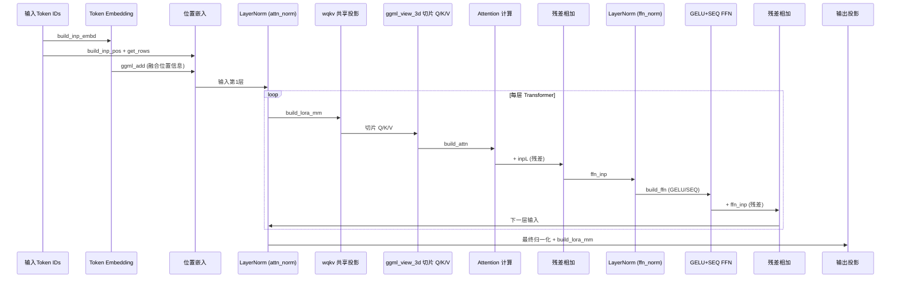
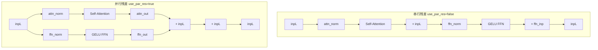
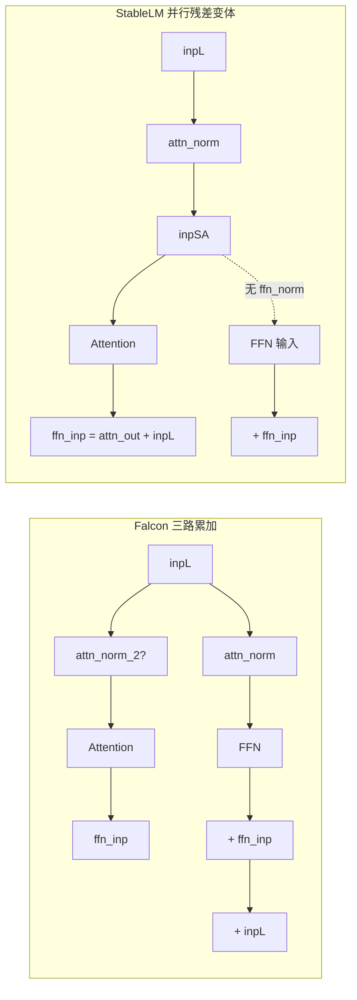
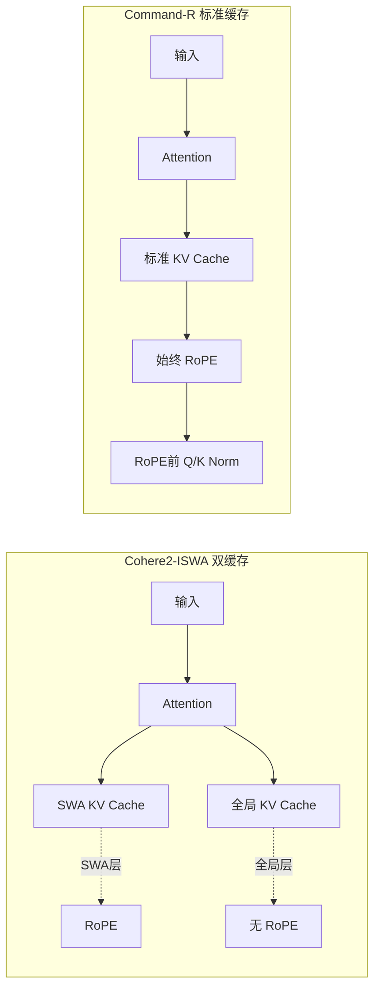
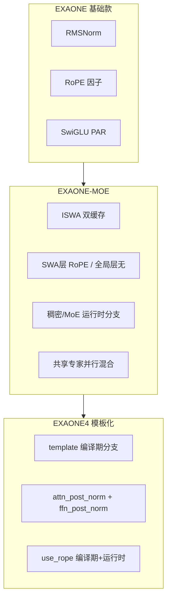
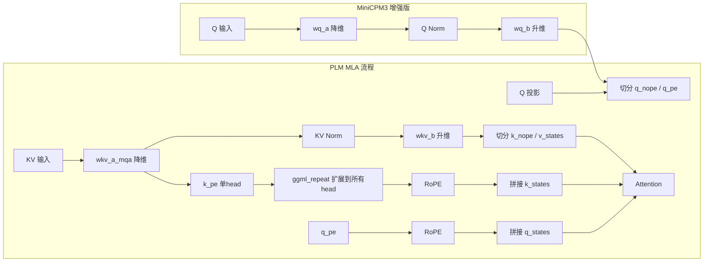
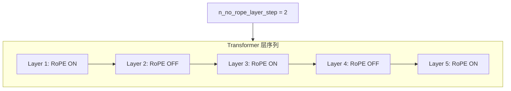

# 第33章 大模型博物馆长尾展厅巡礼 —— 解码器架构的进化化石与实验前沿

## 学习目标

- 理解 GPT-2 / GPT-NeoX / OpenELM 等早期解码器与苹果层级缩放架构的图构建差异
- 掌握 Falcon / StableLM / MPT / Refact 等「非主流开源」模型的归一化分支与残差变体
- 理解 Bloom / CodeShell / Cohere2-ISWA / Command-R 等经典与中型模型的工程实现
- 掌握 EXAONE 系列三代演进的模板化 ISWA 与稠密/MoE 双模式设计
- 理解 Granite 模块化拆分、Nemotron ReLU² 激活与残差缩放的工程技巧
- 掌握 OLMo 无显式归一化、OLMo2 模板化 ISWA、OLMoE Softmax gating 的差异
- 理解 Phi-2 Q 缩放、Phi-3 模板化 ISWA 与 SwiGLU/SwiGLU+ 激活分支
- 掌握 StarCoder v1/v2 位置嵌入到 RoPE 的演进、JAIS/JAIS2 阿拉伯语模型特化
- 理解 PLM 与 MiniCPM3 的 KV/Q 低秩压缩机制（MLA）
- 掌握 SmolLM3 隔层去 RoPE、BitNet 1-bit 缩放、Apertus xIELU 激活等实验前沿
- 理解 AFMoE 双归一化与门控、Dream 扩散双向注意力、Deci 层级自由组合等小众架构
- 掌握 Orion 注释掉的偏置、Xverse 简洁 LLaMA 风、MainCoder post-RoPE 归一化等长尾模型的工程取舍
- 理解 Plamo 三路累加并行残差、Seed-OSS 后置归一化、Minimax-M2 head_dim ≠ n_rot MoE 的特殊处理
- 了解 Dots1 稠密/MoE 分层路由、AFMoE 注意力门控等 MoE 变体的差异化实现

## 33.1 生活类比

走进本章的**大模型博物馆长尾展厅**，你会看到策展人为每件展品挑选了最合适的展台与灯光。入口处停放着两辆**复古老爷车**——GPT-2 用绝对位置嵌入铺就的经典红毯，GPT-NeoX 换装了 NeoX RoPE 与并行残差的双涡轮引擎；靠墙立着苹果出品的**可调节层高书架**——OpenELM 每层 `n_head`/`n_head_kv` 可独立调节，Q/K Norm 做书挡；中厅是**双车道高速公路**——Falcon 的 `attn_norm_2` 与 StableLM 的 `ffn_norm` 缺失并行残差，让注意力与 FFN 双车道并行；旁边摆着**带安全阀的压力容器**——MPT 的 `f_clamp_kqv` 给 QKV 数值加上限，Refact 则是极简 post-norm 的单壳容器；化石区陈列着**博物馆标本**——Bloom 的 token 级 `tok_norm` 前置归一化，CodeShell 在 GPT-2 底盘上装上 RoPE；双层玻璃幕墙后是 **Cohere2-ISWA 与 Command-R**——ISWA 双缓存内外隔热，SWA 层透光不 RoPE，Command-R 标准 KV 始终 RoPE 且 Q/K Norm 前置；LG 的**三代折叠屏手机** EXAONE 系列依次展示基础款、MoE 双模式、模板化 ISWA 双 post-norm；精密仪器区放着 **Granite 与 Nemotron**——模块化拆分、残差缩放、ReLU² 激活是工程师对精度的极致追求；开源实验笔记本 **OLMo 三部曲** 翻开无显式权重、模板化 ISWA、Softmax gating 三页；微软的**精打细算小车** Phi 系列演示 Q 缩放防漂移、双激活分支；代码生成器 **StarCoder v1/v2** 见证位置嵌入到 RoPE 的演进，阿拉伯语翻译机 **JAIS/JAIS2** 专属定制；压缩行李箱 **PLM/MiniCPM3** 亮出 MLA 低秩 KV/Q、多层缩放；会跳绳的舞者 **SmolLM3** 隔层去 RoPE 展示节奏感；实验室原型机 **BitNet 1-bit 量化** 与 **Apertus xIELU** 是数学家的玩具；实验剧场上演 **AFMoE 门控注意力、Dream 扩散双向注意力、Deci 层级自由组合**；长尾展厅深处珍藏 **Orion 注释偏置、Xverse 简洁 LLaMA、MainCoder post-RoPE Norm、Plamo 三路残差、Seed-OSS attn_post_norm、Minimax-M2 head_dim≠n_rot** 等小众藏品。每一件展品背后，都是 llama.cpp 作者精心设计的专属图构建器。

## 33.2 源码地图

```
src/models/gpt2.cpp
├── llm_build_gpt2::llm_build_gpt2()  # 位置嵌入 + wqkv 共享矩阵 + GELU/SEQ FFN
src/models/gptneox.cpp
├── llm_build_gptneox::llm_build_gptneox()  # NeoX RoPE + use_par_res 并行残差分支
src/models/openelm.cpp
├── llm_build_openelm::llm_build_openelm()  # 层级 n_head/n_head_kv + Q/K RMSNorm + SwiGLU/PAR
src/models/falcon.cpp
├── llm_build_falcon::llm_build_falcon()  # attn_norm_2 双归一化分支 + GELU/SEQ + inpL 三路累加
src/models/stablelm.cpp
├── llm_build_stablelm::llm_build_stablelm()  # 分离 QKV + ffn_norm 缺失走并行残差
src/models/mpt.cpp
├── llm_build_mpt::llm_build_mpt()  # 可选 pos_embd + f_clamp_kqv 数值截断 + 可选 Q/K Norm
src/models/refact.cpp
├── llm_build_refact::llm_build_refact()  # 极简 post-norm 模板 + SwiGLU/PAR
src/models/bloom.cpp
├── llm_build_bloom::llm_build_bloom()  # token 级 tok_norm 前置 + GELU/SEQ
src/models/codeshell.cpp
├── llm_build_codeshell::llm_build_codeshell()  # GPT-2 风格 wqkv + RoPE
src/models/cohere2-iswa.cpp
├── llm_build_cohere2_iswa::llm_build_cohere2_iswa()  # 双缓存 ISWA + SWA 层 RoPE + f_logit_scale
src/models/command-r.cpp
├── llm_build_command_r::llm_build_command_r()  # 标准 KV + 始终 RoPE + Q/K Norm + 并行残差
src/models/exaone.cpp
├── llm_build_exaone::llm_build_exaone()  # RMSNorm + RoPE 因子 + SwiGLU/PAR
src/models/exaone-moe.cpp
├── llm_build_exaone_moe::llm_build_exaone_moe()  # ISWA + 稠密/MoE 双分支 + 共享专家
src/models/exaone4.cpp
├── template<bool iswa> llm_build_exaone4<iswa>::llm_build_exaone4()  # 模板化 ISWA + attn/ffn_post_norm
├── explicit instantiations <false>/<true>
src/models/granite.cpp
├── llm_build_granite::llm_build_granite()  # 模块化 + 残差/注意力缩放 + 1/f_logit_scale
├── llm_build_granite::build_attention_layer()  # 注意力子层独立方法
├── llm_build_granite::build_layer_ffn()  # 稠密/MoE 分支独立方法
src/models/nemotron.cpp
├── llm_build_nemotron::llm_build_nemotron()  # 分离 QKV + RoPE + RELU_SQR/SEQ FFN
src/models/olmo.cpp
├── llm_build_olmo::llm_build_olmo()  # 无显式权重归一化 + 可选 ggml_clamp KQV
src/models/olmo2.cpp
├── template<bool iswa> llm_build_olmo2<iswa>::llm_build_olmo2()  # 模板化 ISWA + SWA 无 YaRN + 双 post-norm
├── explicit instantiations <false>/<true>
src/models/olmoe.cpp
├── llm_build_olmoe::llm_build_olmoe()  # MoE + Softmax gating + Q/K Norm
src/models/phi2.cpp
├── llm_build_phi2::llm_build_phi2()  # wqkv 与分离 QKV 自动选择 + Q 缩放 + output_b 可选
src/models/phi3.cpp
├── template<bool iswa> llm_build_phi3<iswa>::llm_build_phi3()  # 模板化 ISWA + Q 缩放 + SwiGLU/SwiGLU+ 双激活分支
├── explicit instantiations <false>/<true>
src/models/starcoder.cpp
├── llm_build_starcoder::llm_build_starcoder()  # 位置嵌入 + wqkv + 无 RoPE + GELU/SEQ
src/models/starcoder2.cpp
├── llm_build_starcoder2::llm_build_starcoder2()  # 分离 QKV + RoPE + 断言 head_dim==n_rot
src/models/jais.cpp
├── llm_build_jais::llm_build_jais()  # wqkv + nb[0] 偏移计算 + 1/float 缩放 + SwiGLU/PAR
src/models/jais2.cpp
├── llm_build_jais2::llm_build_jais2()  # 分离 QKV + RoPE + RELU_SQR/SEQ FFN
src/models/plm.cpp
├── llm_build_plm::llm_build_plm()  # MLA（KV 低秩压缩）+ q_nope/q_pe 拆分 + wkv_a_mqa/b 两阶段
src/models/minicpm3.cpp
├── llm_build_minicpm3::llm_build_minicpm3()  # scale_embd/scale_depth 多层缩放 + q_lora_rank + wkv_a_mqa/b
src/models/smollm3.cpp
├── llm_build_smollm3::llm_build_smollm3()  # 隔层去 RoPE（n_no_rope_layer_step）+ Q/K Norm + kq_scale
src/models/bitnet.cpp
├── llm_build_bitnet::llm_build_bitnet()  # 1-bit *_s 缩放张量 + attn/ffn_sub_norm + lm_head 复用 tok_embd
src/models/apertus.cpp
├── llm_build_apertus::llm_build_apertus()  # xIELU 激活（alpha_n/p/beta/eps）+ 无门控 FFN
src/models/afmoe.cpp
├── llm_build_afmoe::llm_build_afmoe()  # MuP sqrt(n_embd) 缩放 + 双归一化 + wqkv_gate 注意力门控
src/models/dream.cpp
├── llm_build_dream::llm_build_dream()  # 扩散 LLM + build_attn_inp_no_cache 双向注意力
src/models/deci.cpp
├── llm_build_deci::llm_build_deci()  # n_head=0/n_head_kv=0/n_ff=0 层级粒度自由组合
src/models/dots1.cpp
├── llm_build_dots1::llm_build_dots1()  # n_layer_dense_lead 之前稠密之后 MoE + 共享专家
src/models/orion.cpp
├── llm_build_orion::llm_build_orion()  # 注释掉的 bq/bk/bv 兼容旧权重
src/models/xverse.cpp
├── llm_build_xverse::llm_build_xverse()  # 简洁 LLaMA 风：分离 QKV + RMSNorm + SwiGLU/PAR
src/models/maincoder.cpp
├── llm_build_maincoder::llm_build_maincoder()  # post-RoPE Q/K Norm（RoPE 后做 RMSNorm）
src/models/plamo.cpp
├── llm_build_plamo::llm_build_plamo()  # 并行残差（sa_out + cur + inpL 三路累加）
src/models/seed-oss.cpp
├── llm_build_seed_oss::llm_build_seed_oss()  # attn_post_norm 后置归一化
src/models/minimax-m2.cpp
├── llm_build_minimax_m2::llm_build_minimax_m2()  # head_dim(128) ≠ n_rot(64) MoE + Q/K Norm
src/models/models.h
├── struct llm_build_* 声明  # 所有图构建器的基类与成员声明
```

## 33.3 复古老爷车：GPT-2/GPT-NeoX 的位置嵌入与并行残差演进

GPT-2 与 GPT-NeoX 是 Transformer 解码器家族的「复古双打」。GPT-2 沿用了绝对位置嵌入，将 `pos_embd` 在嵌入层之后直接加到 token 嵌入上；而 GPT-NeoX 引入了 NeoX 风格的 RoPE，并通过 `use_par_res` 开关控制 Attention 与 FFN 是否并行计算。二者都使用 `wqkv` 共享矩阵，通过 `ggml_view_3d` 切片出 Q/K/V，且 FFN 均采用 `LLM_FFN_GELU + LLM_FFN_SEQ`（无门控的顺序结构）。

### 33.3.1 llm_build_gpt2：构建位置嵌入与 QKV 共享投影图

源码路径：`src/models/gpt2.cpp` - `llm_build_gpt2` (行 5-68)

```cpp
llm_build_gpt2::llm_build_gpt2(const llama_model & model, const llm_graph_params & params) : llm_graph_context(params) {
    // ① 获取嵌入维度参数并断言 head 维度一致
    const int64_t n_embd_head = hparams.n_embd_head_v();
    const int64_t n_embd_gqa  = hparams.n_embd_v_gqa();
    GGML_ASSERT(n_embd_head == hparams.n_embd_head_k());
    
    // ② 构建输入嵌入
    inpL = build_inp_embd(model.tok_embd);
    
    // ③ 构建位置编码并加到嵌入上
    ggml_tensor * inp_pos = build_inp_pos();
    auto * inp_attn = build_attn_inp_kv();
    pos = ggml_get_rows(ctx0, model.pos_embd, inp_pos);
    inpL = ggml_add(ctx0, inpL, pos);
    
    // ④ 遍历所有Transformer层
    for (int il = 0; il < n_layer; ++il) {
        // 层归一化
        cur = build_norm(inpL, model.layers[il].attn_norm, model.layers[il].attn_norm_b, LLM_NORM, il);
        
        // 自注意力机制：wqkv 共享矩阵
        cur = build_lora_mm(model.layers[il].wqkv, cur);
        cur = ggml_add(ctx0, cur, model.layers[il].bqkv);
        
        // ⑤ 拆分 Q、K、V（使用 ggml_view_3d 切片）
        Qcur = ggml_view_3d(ctx0, cur, n_embd_head, n_head, n_tokens, ...);
        Kcur = ggml_view_3d(ctx0, cur, n_embd_head, n_head_kv, n_tokens, ...);
        Vcur = ggml_view_3d(ctx0, cur, n_embd_head, n_head_kv, n_tokens, ...);
        
        // 执行注意力计算
        cur = build_attn(inp_attn, model.layers[il].wo, model.layers[il].bo, Qcur, Kcur, Vcur, ...);
        
        // 残差连接
        ffn_inp = ggml_add(ctx0, cur, inpL);
        
        // 前馈网络：GELU + 顺序结构
        cur = build_norm(ffn_inp, model.layers[il].ffn_norm, model.layers[il].ffn_norm_b, LLM_NORM, il);
        cur = build_ffn(cur, model.layers[il].ffn_up, ..., model.layers[il].ffn_down, ..., LLM_FFN_GELU, LLM_FFN_SEQ, il);
        
        // 残差连接并处理下一层输入
        cur = ggml_add(ctx0, cur, ffn_inp);
        cur = build_cvec(cur, il);
        inpL = cur;
    }
    
    // ⑥ 最终输出层
    cur = build_norm(inpL, model.output_norm, model.output_norm_b, LLM_NORM, -1);
    res->t_embd = cur;
    cur = build_lora_mm(model.output, cur);
    res->t_logits = cur;
    ggml_build_forward_expand(gf, cur);
}
```

> **代码解析**：该函数实现了 GPT-2 的经典架构：绝对位置嵌入（第 ③ 步）、QKV 共享投影矩阵（第 ⑤ 步 `ggml_view_3d` 切片）、标准 LayerNorm、GELU 激活的顺序 FFN。它是早期大语言模型的标准范式，未使用 RoPE，位置信息仅通过可学习的 `pos_embd` 注入。

#### 33.3.1.1 GPT-2 计算流程时序图



---

### 33.3.2 llm_build_gptneox：实现 NeoX RoPE 与并行残差分支

源码路径：`src/models/gptneox.cpp` - `llm_build_gptneox` (行 1-132)

```cpp
llm_build_gptneox::llm_build_gptneox(const llama_model & model, const llm_graph_params & params) : llm_graph_context(params) {
    const int64_t n_embd_head = hparams.n_embd_head_v();
    const int64_t n_embd_gqa  = hparams.n_embd_v_gqa();
    GGML_ASSERT(n_embd_head == hparams.n_embd_head_k());
    
    ggml_tensor * cur;
    ggml_tensor * inpL;
    inpL = build_inp_embd(model.tok_embd);
    ggml_tensor * inp_pos = build_inp_pos();
    auto * inp_attn = build_attn_inp_kv();
    ggml_tensor * inp_out_ids = build_inp_out_ids();
    
    for (int il = 0; il < n_layer; ++il) {
        cur = build_norm(inpL, model.layers[il].attn_norm, model.layers[il].attn_norm_b, LLM_NORM, il);
        cb(cur, "attn_norm", il);
        
        // self-attention
        {
            cur = build_lora_mm(model.layers[il].wqkv, cur);
            cb(cur, "wqkv", il);
            cur = ggml_add(ctx0, cur, model.layers[il].bqkv);
            cb(cur, "bqkv", il);
            
            ggml_tensor * Qcur = ggml_view_3d(ctx0, cur, n_embd_head, n_head,    n_tokens, n_embd_head*sizeof(float), cur->nb[1], 0*sizeof(float)*(n_embd));
            ggml_tensor * Kcur = ggml_view_3d(ctx0, cur, n_embd_head, n_head_kv, n_tokens, n_embd_head*sizeof(float), cur->nb[1], 1*sizeof(float)*(n_embd));
            ggml_tensor * Vcur = ggml_view_3d(ctx0, cur, n_embd_head, n_head_kv, n_tokens, n_embd_head*sizeof(float), cur->nb[1], 1*sizeof(float)*(n_embd + n_embd_gqa));
            
            // ① NeoX 风格 RoPE
            Qcur = ggml_rope_ext(ctx0, Qcur, inp_pos, nullptr, n_rot, rope_type, n_ctx_orig, freq_base, freq_scale, ext_factor, attn_factor, beta_fast, beta_slow);
            Kcur = ggml_rope_ext(ctx0, Kcur, inp_pos, nullptr, n_rot, rope_type, n_ctx_orig, freq_base, freq_scale, ext_factor, attn_factor, beta_fast, beta_slow);
            
            cb(Qcur, "Qcur", il);
            cb(Kcur, "Kcur", il);
            cb(Vcur, "Vcur", il);
            
            cur = build_attn(inp_attn, model.layers[il].wo, model.layers[il].bo, Qcur, Kcur, Vcur, nullptr, nullptr, nullptr, 1.0f/sqrtf(float(n_embd_head)), il);
        }
        
        if (il == n_layer - 1 && inp_out_ids) {
            cur  = ggml_get_rows(ctx0,  cur, inp_out_ids);
            inpL = ggml_get_rows(ctx0, inpL, inp_out_ids);
        }
        
        // ffn：关键分支在 use_par_res
        if (hparams.use_par_res) {
            // ② 并行残差：attention 和 ffn 同时从 inpL 计算，最后三路相加
            ggml_tensor * attn_out = cur;
            cur = build_norm(inpL, model.layers[il].ffn_norm, model.layers[il].ffn_norm_b, LLM_NORM, il);
            cb(cur, "ffn_norm", il);
            cur = build_ffn(cur, model.layers[il].ffn_up, model.layers[il].ffn_up_b, NULL, NULL, NULL, NULL, model.layers[il].ffn_down, model.layers[il].ffn_down_b, NULL, NULL, LLM_FFN_GELU, LLM_FFN_SEQ, il);
            cb(cur, "ffn_out", il);
            cur = ggml_add(ctx0, cur, inpL);
            cb(cur, "ffn_out", il);
            cur = ggml_add(ctx0, cur, attn_out);
            cur = build_cvec(cur, il);
            cb(cur, "l_out", il);
            inpL = cur;
        } else {
            // 串行残差：标准 Pre-LN 流程
            ggml_tensor * ffn_inp = ggml_add(ctx0, cur, inpL);
            cb(ffn_inp, "ffn_inp", il);
            cur = build_norm(ffn_inp, model.layers[il].ffn_norm, model.layers[il].ffn_norm_b, LLM_NORM, il);
            cb(cur, "ffn_norm", il);
            cur = build_ffn(cur, model.layers[il].ffn_up, model.layers[il].ffn_up_b, NULL, NULL, NULL, NULL, model.layers[il].ffn_down, model.layers[il].ffn_down_b, NULL, NULL, LLM_FFN_GELU, LLM_FFN_SEQ, il);
            cb(cur, "ffn_out", il);
            cur = ggml_add(ctx0, cur, ffn_inp);
            cur = build_cvec(cur, il);
            cb(cur, "l_out", il);
            inpL = cur;
        }
    }
    // ... 输出层省略 ...
}
```

> **代码解析**：此函数实现了 GPT-NeoX 两大创新：① NeoX 风格 RoPE 位置编码（替代绝对位置嵌入）；② `use_par_res` 控制的并行残差分支。当 `use_par_res=true` 时，Attention 与 FFN 并行从 `inpL` 计算，最后与 `inpL` 三路相加（`attn_out + ffn_out + inpL`），这是早期并行残差的经典实现，能减少关键路径深度。

#### 33.3.2.1 GPT-NeoX 并行/串行残差对比流程图



---

## 33.4 可调节层高书架：OpenELM 的层级缩放与 Q/K Norm

OpenELM 的核心创新是**层级缩放**：每层可以拥有不同的 `n_head` 与 `n_head_kv`，通过 `n_head_qkv = 2*n_head_kv + n_head` 显式声明 QKV 拼接尺寸。Q/K 在 RoPE 之前先经过 RMSNorm 归一化（`attn_q_norm`/`attn_k_norm`），FFN 使用 SwiGLU 并行门控，残差采用 post-norm 风格的直接相加。

### 33.4.1 llm_build_openelm：构建层级 n_head 与 Q/K Norm 图

源码路径：`src/models/openelm.cpp` - `llm_build_openelm` (行 1-133)

```cpp
llm_build_openelm(const llama_model & model, const llm_graph_params & params) : llm_graph_context(params) {
    const int64_t n_embd_head = hparams.n_embd_head_v();
    GGML_ASSERT(n_embd_head == hparams.n_embd_head_k());
    ggml_tensor * cur;
    ggml_tensor * inpL;
    inpL = build_inp_embd(model.tok_embd);
    ggml_tensor * inp_pos = build_inp_pos();
    auto * inp_attn = build_attn_inp_kv();
    ggml_tensor * inp_out_ids = build_inp_out_ids();
    
    for (int il = 0; il < n_layer; ++il) {
        const int64_t n_head    = hparams.n_head(il);        // ① 每层独立的 head 数
        const int64_t n_head_kv = hparams.n_head_kv(il);     // ② 每层独立的 KV head 数
        const int64_t n_head_qkv = 2*n_head_kv + n_head;     // ③ QKV 拼接总维度
        
        cur = inpL;
        ggml_tensor * residual = cur;
        
        // norm
        cur = build_norm(inpL, model.layers[il].attn_norm, NULL, LLM_NORM_RMS, il);
        cb(cur, "attn_norm", il);
        
        // self-attention
        {
            cur = build_lora_mm(model.layers[il].wqkv, cur);  // 共享 wqkv
            cb(cur, "wqkv", il);
            cur = ggml_reshape_3d(ctx0, cur, n_embd_head_k, n_head_qkv, n_tokens);
            
            // ④ 切片 Q/K/V（使用 cur->nb[1] 作为步长）
            ggml_tensor * Qcur = ggml_view_3d(ctx0, cur, n_embd_head, n_head,    n_tokens, cur->nb[1], cur->nb[2], 0);
            ggml_tensor * Kcur = ggml_view_3d(ctx0, cur, n_embd_head, n_head_kv, n_tokens, cur->nb[1], cur->nb[2], cur->nb[1]*n_head);
            ggml_tensor * Vcur = ggml_view_3d(ctx0, cur, n_embd_head, n_head_kv, n_tokens, cur->nb[1], cur->nb[2], cur->nb[1]*(n_head+n_head_kv));
            
            // ⑤ Q/K Norm 在 RoPE 之前
            Qcur = build_norm(Qcur, model.layers[il].attn_q_norm, NULL, LLM_NORM_RMS, il);
            Kcur = build_norm(Kcur, model.layers[il].attn_k_norm, NULL, LLM_NORM_RMS, il);
            
            Qcur = ggml_rope_ext(ctx0, Qcur, inp_pos, NULL, n_rot, rope_type, n_ctx_orig, freq_base, freq_scale, ext_factor, attn_factor, beta_fast, beta_slow);
            Kcur = ggml_rope_ext(ctx0, Kcur, inp_pos, NULL, n_rot, rope_type, n_ctx_orig, freq_base, freq_scale, ext_factor, attn_factor, beta_fast, beta_slow);
            
            cur = build_attn(inp_attn, model.layers[il].wo, NULL, Qcur, Kcur, Vcur, nullptr, nullptr, nullptr, 1.0f/sqrtf(float(n_embd_head)), il);
        }
        // ... FFN 与残差省略 ...
    }
}
```

> **代码解析**：该函数体现了 OpenELM 三大特色：① 每层可变的 `n_head`/`n_head_kv`（第 ①② 步）；② Q/K Norm 放在 RoPE 之前（第 ⑤ 步），稳定旋转后的数值分布；③ `n_head_qkv = 2*n_head_kv + n_head` 显式声明拼接维度（第 ③ 步），避免运行时歧义。切片使用 `cur->nb[1]` 作为步长，适配任意内存布局。

#### 33.4.1.1 OpenELM 层级缩放架构图

```mermaid
graph TB
    subgraph Layer_i[第 i 层]
        direction TB
        HeadConfig[n_head(i) / n_head_kv(i) 可变]
        QKVConcat[n_head_qkv = 2*n_head_kv + n_head]
        QKNorm[Q/K RMSNorm → RoPE]
        SwiGLU[SwiGLU PAR FFN]
        Residual[Post-Norm 残差相加]
    end
    
    HeadConfig --> QKVConcat
    QKVConcat --> QKNorm
    QKNorm --> SwiGLU
    SwiGLU --> Residual
    
    style Layer_i fill:#f9f,stroke:#333
```

---

## 33.5 双车道高速公路：Falcon 与 StableLM 的工程变体

Falcon-40B 引入了 `attn_norm_2` 双归一化分支：注意力路径使用第二份归一化结果。FFN 直接使用 `attn_norm` 作为输入而非残差后的张量，节省一次归一化。输出通过 `cur + ffn_inp + inpL` 三路累加。

StableLM 在 `ffn_norm` 缺失时复用 `inpSA` 实现并行残差，支持可选的 `attn_q_norm`/`attn_k_norm`。

### 33.5.1 llm_build_falcon：构建双归一化与三路累加图

源码路径：`src/models/falcon.cpp` - `llm_build_falcon` (行 1-100)

```cpp
llm_build_falcon::llm_build_falcon(const llama_model & model, const llm_graph_params & params) : llm_graph_context(params) {
    // ... 初始化省略 ...
    for (int il = 0; il < n_layer; ++il) {
        ggml_tensor * attn_norm;
        attn_norm = build_norm(inpL, model.layers[il].attn_norm, model.layers[il].attn_norm_b, LLM_NORM, il);
        
        // self-attention
        {
            // ① 双归一化分支：Falcon-40B 使用 attn_norm_2
            if (model.layers[il].attn_norm_2) {
                cur = build_norm(inpL, model.layers[il].attn_norm_2, model.layers[il].attn_norm_2_b, LLM_NORM, il);
                cb(cur, "attn_norm_2", il);
            } else {
                cur = attn_norm;
            }
            cur = build_lora_mm(model.layers[il].wqkv, cur);
            // ... 切片 QKV、RoPE、注意力计算 ...
        }
        
        if (il == n_layer - 1 && inp_out_ids) {
            // ... 裁剪输出 ...
        }
        
        ggml_tensor * ffn_inp = cur;
        
        // feed forward：② 使用 attn_norm 作为 FFN 输入
        {
            cur = build_ffn(attn_norm, model.layers[il].ffn_up, NULL, NULL, NULL, NULL, NULL, model.layers[il].ffn_down, NULL, NULL, NULL, LLM_FFN_GELU, LLM_FFN_SEQ, il);
        }
        
        // ③ 三路累加：cur + ffn_inp + inpL
        cur = ggml_add(ctx0, cur, ffn_inp);
        cur = ggml_add(ctx0, cur, inpL);
        cur = build_cvec(cur, il);
        inpL = cur;
    }
    // ... 输出层省略 ...
}
```

> **代码解析**：Falcon 的设计精髓在于：① `attn_norm_2` 为大模型（如 40B）提供额外的归一化稳定性；② FFN 复用 `attn_norm` 节省一次归一化计算；③ 三路残差（`cur + ffn_inp + inpL`）保留多层信息流，增强梯度传播。

### 33.5.2 llm_build_stablelm：实现并行残差的 inpSA 复用图

源码路径：`src/models/stablelm.cpp` - `llm_build_stablelm` (行 7-81)

```cpp
for (int il = 0; il < n_layer; ++il) {
    cur = build_norm(inpL, model.layers[il].attn_norm, model.layers[il].attn_norm_b, LLM_NORM, il);
    cb(cur, "attn_norm", il);
    ggml_tensor * inpSA = cur;  // ① 保存 attention norm 结果
    
    // self-attention ...
    // ... 计算 Q/K/V、RoPE、注意力 ...
    cur = build_attn(inp_attn, model.layers[il].wo, NULL, Qcur, Kcur, Vcur, nullptr, nullptr, nullptr, 1.0f/sqrtf(float(n_embd_head)), il);
    
    if (il == n_layer - 1 && inp_out_ids) {
        cur = ggml_get_rows(ctx0, cur, inp_out_ids);
        inpL = ggml_get_rows(ctx0, inpL, inp_out_ids);
        inpSA = ggml_get_rows(ctx0, inpSA, inp_out_ids);
    }
    
    ggml_tensor * ffn_inp = ggml_add(ctx0, cur, inpL);
    cb(ffn_inp, "ffn_inp", il);
    
    // feed forward：② ffn_norm 缺失时直接复用 inpSA
    if (model.layers[il].ffn_norm) {
        cur = build_norm(ffn_inp, model.layers[il].ffn_norm, model.layers[il].ffn_norm_b, LLM_NORM, il);
        cb(cur, "ffn_norm", il);
    } else {
        cur = inpSA;  // 并行残差：FFN 直接用 attention norm 结果
    }
    cur = build_ffn(cur, model.layers[il].ffn_up, NULL, NULL, model.layers[il].ffn_gate, NULL, NULL, model.layers[il].ffn_down, NULL, NULL, NULL, LLM_FFN_SILU, LLM_FFN_PAR, il);
    // ...
}
```

> **代码解析**：StableLM 的巧妙之处：当 `ffn_norm` 为空时，直接将 `inpSA`（即 attention 后的归一化结果）作为 FFN 输入，实现了并行残差的变体——Attention 与 FFN 共享同一归一化输入 `inpSA`，再与 `inpL` 汇聚。

#### 33.5.2.1 Falcon vs StableLM 残差拓扑对比



---

## 33.6 带安全阀的压力容器：MPT 与极简样本 Refact

MPT 提供可配置的 KV 数值截断（`f_clamp_kqv`）、可选的绝对位置编码（`pos_embd`）、以及可选的 Q/K 归一化。Refact 则是极致精简的 post-norm 模板：无偏置、无 QKV 共享矩阵、无位置嵌入，直接使用 SwiGLU 并行门控。

### 33.6.1 llm_build_mpt：构建 f_clamp_kqv 与可选 Q/K Norm 图

源码路径：`src/models/mpt.cpp` - `llm_build_mpt` (行 1-112)

```cpp
llm_build_mpt::llm_build_mpt(const llama_model & model, const llm_graph_params & params) : llm_graph_context(params) {
    // ... 初始化 ...
    if (model.pos_embd) {
        ggml_tensor * inp_pos = build_inp_pos();
        pos = ggml_get_rows(ctx0, model.pos_embd, inp_pos);
        inpL = ggml_add(ctx0, inpL, pos);  // ① 可选绝对位置编码
    }
    
    for (int il = 0; il < n_layer; ++il) {
        // ... attention norm ...
        cur = build_lora_mm(model.layers[il].wqkv, cur);
        if (model.layers[il].bqkv) {
            cur = ggml_add(ctx0, cur, model.layers[il].bqkv);
        }
        // ② 数值截断：防止 QKV 数值溢出
        if (hparams.f_clamp_kqv > 0.0f) {
            cur = ggml_clamp(ctx0, cur, -hparams.f_clamp_kqv, hparams.f_clamp_kqv);
            cb(cur, "wqkv_clamped", il);
        }
        
        // ③ 可选 Q/K Norm：需要 reshape 回 2D 复用 build_norm
        if (model.layers[il].attn_q_norm) {
            Qcur = ggml_reshape_2d(ctx0, Qcur, n_embd_head * n_head, n_tokens);
            Kcur = ggml_reshape_2d(ctx0, Kcur, n_embd_head * n_head_kv, n_tokens);
            Qcur = build_norm(Qcur, model.layers[il].attn_q_norm, model.layers[il].attn_q_norm_b, LLM_NORM, il);
            Kcur = build_norm(Kcur, model.layers[il].attn_k_norm, model.layers[il].attn_k_norm_b, LLM_NORM, il);
            Qcur = ggml_reshape_3d(ctx0, Qcur, n_embd_head, n_head, n_tokens);
            Kcur = ggml_reshape_3d(ctx0, Kcur, n_embd_head, n_head_kv, n_tokens);
        }
        // ...
    }
}
```

> **代码解析**：MPT 的工程细节：① 可选绝对位置编码兼容旧权重；② `f_clamp_kqv` 防止数值发散，训练大模型时的安全阀；③ Q/K Norm 需要先 reshape 为 2D 再归一化，再 reshape 回 3D，体现 ggml 张量操作的灵活性。

### 33.6.2 llm_build_refact：构建极简 post-norm 模板图

源码路径：`src/models/refact.cpp` - `llm_build_refact` (行 1-70)

```cpp
llm_build_refact::llm_build_refact(const llama_model & model, const llm_graph_params & params) : llm_graph_context(params) {
    const int64_t n_embd_head = hparams.n_embd_head_v();
    GGML_ASSERT(n_embd_head == hparams.n_embd_head_k());
    
    ggml_tensor * cur;
    ggml_tensor * inpL;
    inpL = build_inp_embd(model.tok_embd);
    auto * inp_attn = build_attn_inp_kv();
    ggml_tensor * inp_out_ids = build_inp_out_ids();
    
    for (int il = 0; il < n_layer; ++il) {
        ggml_tensor * inpSA = inpL;
        cur = build_norm(inpL, model.layers[il].attn_norm, NULL, LLM_NORM_RMS, il);
        cb(cur, "attn_norm", il);
        
        // self-attention：分离 QKV，无共享矩阵
        {
            ggml_tensor * Qcur = build_lora_mm(model.layers[il].wq, cur);
            ggml_tensor * Kcur = build_lora_mm(model.layers[il].wk, cur);
            ggml_tensor * Vcur = build_lora_mm(model.layers[il].wv, cur);
            // ... reshape、注意力计算 ...
        }
        
        if (il == n_layer - 1 && inp_out_ids) {
            cur = ggml_get_rows(ctx0, cur, inp_out_ids);
            inpSA = ggml_get_rows(ctx0, inpSA, inp_out_ids);
        }
        
        ggml_tensor * ffn_inp = ggml_add(ctx0, cur, inpSA);
        // FFN：SwiGLU 并行门控
        cur = build_norm(ffn_inp, model.layers[il].ffn_norm, NULL, LLM_NORM_RMS, il);
        cur = build_ffn(cur, model.layers[il].ffn_up, NULL, NULL, model.layers[il].ffn_gate, NULL, NULL, model.layers[il].ffn_down, NULL, NULL, NULL, LLM_FFN_SILU, LLM_FFN_PAR, il);
        // ...
    }
}
```

> **代码解析**：Refact 体现了"少即是多"：无偏置、无位置嵌入、分离 QKV、SwiGLU PAR，是 LLaMA 风格的极简实现，适合作为教学参考模板。

---

## 33.7 化石标本：Bloom 与 CodeShell 的经典工程化实现

Bloom 采用 token 级前置归一化（`tok_norm` 在嵌入后立即应用），使用 GELU+SEQ 的经典 FFN。CodeShell 基于 GPT-2 风格但加入 RoPE，断言 `n_embd_head == n_rot` 确保 head 维度等于 RoPE 维度。

### 33.7.1 llm_build_bloom：构建 token 级前置归一化图

源码路径：`src/models/bloom.cpp` - `llm_build_bloom` (行 1-84)

```cpp
llm_build_bloom::llm_build_bloom(const llama_model & model, const llm_graph_params & params) : llm_graph_context(params) {
    inpL = build_inp_embd(model.tok_embd);
    auto * inp_attn = build_attn_inp_kv();
    
    // ① token 级前置归一化：在所有层之前统一归一化
    inpL = build_norm(inpL, model.tok_norm, model.tok_norm_b, LLM_NORM, 0);
    cb(inpL, "inp_norm", 0);
    
    for (int il = 0; il < n_layer; ++il) {
        cur = build_norm(inpL, model.layers[il].attn_norm, model.layers[il].attn_norm_b, LLM_NORM, il);
        // wqkv 共享矩阵 + 偏置
        cur = build_lora_mm(model.layers[il].wqkv, cur);
        cur = ggml_add(ctx0, cur, model.layers[il].bqkv);
        // 切片 QKV（偏移量计算）
        ggml_tensor * Qcur = ggml_view_3d(ctx0, cur, n_embd_head, n_head, n_tokens, n_embd_head*sizeof(float), cur->nb[1], 0*sizeof(float)*(n_embd));
        ggml_tensor * Kcur = ggml_view_3d(ctx0, cur, n_embd_head, n_head_kv, n_tokens, n_embd_head*sizeof(float), cur->nb[1], 1*sizeof(float)*(n_embd));
        ggml_tensor * Vcur = ggml_view_3d(ctx0, cur, n_embd_head, n_head_kv, n_tokens, n_embd_head*sizeof(float), cur->nb[1], 1*sizeof(float)*(n_embd + n_embd_gqa));
        // ... 注意力、FFN、残差 ...
    }
}
```

> **代码解析**：Bloom 的 `tok_norm` 是在嵌入层之后、所有 Transformer 层之前应用的全局归一化（第 ① 步），统一了输入分布，这是 BLOOM 架构的标志性设计。

### 33.7.2 llm_build_codeshell：构建代码特化 GPT-2+RoPE 图

源码路径：`src/models/codeshell.cpp` - `llm_build_codeshell` (行 1-94)

```cpp
llm_build_codeshell::llm_build_codeshell(const llama_model & model, const llm_graph_params & params) : llm_graph_context(params) {
    const int64_t n_embd_head = hparams.n_embd_head_v();
    const int64_t n_embd_gqa  = hparams.n_embd_v_gqa();
    GGML_ASSERT(n_embd_head == hparams.n_embd_head_k());
    GGML_ASSERT(n_embd_head == n_rot);  // ① 断言 head_dim == n_rot
    
    inpL = build_inp_embd(model.tok_embd);
    ggml_tensor * inp_pos = build_inp_pos();
    auto * inp_attn = build_attn_inp_kv();
    
    for (int il = 0; il < n_layer; ++il) {
        cur = build_norm(inpL, model.layers[il].attn_norm, model.layers[il].attn_norm_b, LLM_NORM, il);
        cur = build_lora_mm(model.layers[il].wqkv, cur);
        cur = ggml_add(ctx0, cur, model.layers[il].bqkv);
        // 切片 QKV 并应用 RoPE
        ggml_tensor * Qcur = ggml_view_3d(...);
        ggml_tensor * Kcur = ggml_view_3d(...);
        ggml_tensor * Vcur = ggml_view_3d(...);
        Qcur = ggml_rope_ext(ctx0, Qcur, inp_pos, nullptr, n_rot, rope_type, ...);
        Kcur = ggml_rope_ext(ctx0, Kcur, inp_pos, nullptr, n_rot, rope_type, ...);
        // ...
    }
}
```

> **代码解析**：CodeShell 在 GPT-2 基础上引入 RoPE（第 ① 步断言 `head_dim == n_rot` 确保 RoPE 维度匹配），是代码生成模型的工程化选择，保留了 `wqkv` 共享矩阵的紧凑参数形式。

---

## 33.8 双层玻璃幕墙：Cohere2-ISWA 与 Command-R 的双子星架构

Cohere2-ISWA 使用 `build_attn_inp_kv_iswa()` 双缓存，SWA 层（`is_swa(il)`）跳过 RoPE。Command-R 使用标准 KV 缓存但始终应用 RoPE，并在 RoPE 前对 Q/K 做归一化。二者都采用并行残差（三路累加）。

### 33.8.1 llm_build_cohere2_iswa：构建 ISWA 双缓存与 SWA 层无 RoPE 图

源码路径：`src/models/cohere2-iswa.cpp` - `llm_build_cohere2_iswa` (行 3-88)

```cpp
llm_build_cohere2_iswa::llm_build_cohere2_iswa(const llama_model & model, const llm_graph_params & params) : llm_graph_context(params) {
    const int64_t n_embd_head = hparams.n_embd_head_v();
    GGML_ASSERT(n_embd_head == hparams.n_embd_head_k());
    const float f_logit_scale = hparams.f_logit_scale;
    // ... 初始化 ...
    auto * inp_attn = build_attn_inp_kv_iswa();  // ① ISWA 双缓存输入
    
    for (int il = 0; il < n_layer; ++il) {
        const bool is_swa = hparams.is_swa(il);  // ② 判断是否为 SWA 层
        // ... attention norm ...
        
        // self-attention
        {
            // ... 计算 Q/K/V ...
            if (is_swa) {
                // ③ SWA 层应用 RoPE
                Qcur = ggml_rope_ext(ctx0, Qcur, inp_pos, rope_factors, ...);
                Kcur = ggml_rope_ext(ctx0, Kcur, inp_pos, rope_factors, ...);
            }
            // 非 SWA 层跳过 RoPE！
            cur = build_attn(inp_attn, model.layers[il].wo, model.layers[il].bo, Qcur, Kcur, Vcur, ...);
        }
        // ... FFN 与三路累加 ...
        cur = ggml_add(ctx0, cur, inpL);
        cur = ggml_add(ctx0, cur, attn_out);
        // ...
        if (f_logit_scale) {
            cur = ggml_scale(ctx0, cur, f_logit_scale);  // ④ logits 整体缩放
        }
    }
}
```

> **代码解析**：Cohere2-ISWA 核心：① ISWA 双缓存输入（`build_attn_inp_kv_iswa`）；② `is_swa(il)` 判断 SWA 层；③ SWA 层才应用 RoPE，全局注意力层跳过 RoPE；④ logits 输出缩放 `f_logit_scale`。

### 33.8.2 llm_build_command_r：构建标准 KV + 始终 RoPE + Q/K Norm 图

源码路径：`src/models/command-r.cpp` - `llm_build_command_r` (行 9-104)

```cpp
llm_build_command_r::llm_build_command_r(const llama_model & model, const llm_graph_params & params) : llm_graph_context(params) {
    // ... 初始化 ...
    auto * inp_attn = build_attn_inp_kv();  // ① 标准 KV 输入
    
    for (int il = 0; il < n_layer; ++il) {
        // ... attention norm ...
        ggml_tensor * ffn_inp = cur;
        
        // self-attention
        {
            ggml_tensor * Qcur = build_lora_mm(model.layers[il].wq, cur);
            // ... 偏置、reshape ...
            // ② RoPE 之前先 Q/K Norm
            if (model.layers[il].attn_q_norm) {
                Qcur = build_norm(Qcur, model.layers[il].attn_q_norm, NULL, LLM_NORM, il);
            }
            Qcur = ggml_rope_ext(...);  // ③ 始终应用 RoPE
            
            if (model.layers[il].attn_k_norm) {
                Kcur = build_norm(Kcur, model.layers[il].attn_k_norm, NULL, LLM_NORM, il);
            }
            Kcur = ggml_rope_ext(...);  // 始终应用 RoPE
            // ...
        }
        // 三路累加：inpL + attn_out + ffn_out
        cur = ggml_add(ctx0, cur, inpL);
        cur = ggml_add(ctx0, cur, attn_out);
    }
}
```

> **代码解析**：Command-R 与 Cohere2-ISWA 差异：① 标准 KV 缓存；② 始终应用 RoPE；③ RoPE 前 Q/K Norm；④ 相同的并行残差模式（三路累加）。

#### 33.8.2.1 ISWA 双缓存 vs 标准 KV 缓存架构对比



---

## 33.9 三代折叠屏手机：EXAONE 系列的模板化演进

EXAONE 基础款是 post-norm + RoPE 因子 + SwiGLU。EXAONE-MOE 引入 ISWA 与稠密/MoE 双模式，支持共享专家。EXAONE4 使用模板 `<bool iswa>` 编译期决定 KV 输入，引入双 post-norm（`attn_post_norm` + `ffn_post_norm`）。

### 33.9.1 llm_build_exaone_moe：构建稠密/MoE 双分支与共享专家图

源码路径：`src/models/exaone-moe.cpp` - `llm_build_exaone_moe` (行 1-124)

```cpp
llm_build_exaone_moe::llm_build_exaone_moe(const llama_model & model, const llm_graph_params & params) : llm_graph_context(params) {
    // ... 初始化 ...
    auto * inp_attn_iswa = build_attn_inp_kv_iswa();  // ① ISWA 输入
    const int n_transformer_layers = n_layer - hparams.nextn_predict_layers;
    
    for (int il = 0; il < n_transformer_layers; ++il) {
        const bool is_local_layer = hparams.is_swa(il);  // ② SWA 层判断
        
        // ... attention 计算 ...
        if (is_local_layer) {
            // SWA 层应用 RoPE
            Qcur = ggml_rope_ext(...);
            Kcur = ggml_rope_ext(...);
        }
        // 非 SWA 层跳过 RoPE
        
        // ... 裁剪输出 ...
        
        // ③ 稠密/MoE 双分支
        if (model.layers[il].ffn_gate_inp == nullptr) {
            // 稠密分支
            cur = build_ffn(cur, model.layers[il].ffn_up, NULL, NULL, model.layers[il].ffn_gate, NULL, NULL, model.layers[il].ffn_down, NULL, NULL, NULL, LLM_FFN_SILU, LLM_FFN_PAR, il);
        } else {
            // MoE 分支
            ggml_tensor * moe_out = build_moe_ffn(cur, model.layers[il].ffn_gate_inp, model.layers[il].ffn_up_exps, model.layers[il].ffn_gate_exps, model.layers[il].ffn_down_exps, model.layers[il].ffn_exp_probs_b, n_expert, n_expert_used, LLM_FFN_SILU, hparams.expert_weights_norm, hparams.expert_weights_scale, (llama_expert_gating_func_type) hparams.expert_gating_func, il);
            // ④ 共享专家并行混合
            if (hparams.n_expert_shared > 0) {
                ggml_tensor * ffn_shexp = build_ffn(cur, model.layers[il].ffn_up_shexp, NULL, NULL, model.layers[il].ffn_gate_shexp, NULL, NULL, model.layers[il].ffn_down_shexp, NULL, NULL, NULL, LLM_FFN_SILU, LLM_FFN_PAR, il);
                cur = ggml_add(ctx0, moe_out, ffn_shexp);
            } else {
                cur = moe_out;
            }
        }
    }
}
```

> **代码解析**：EXAONE-MOE 亮点：① ISWA 缓存输入；② `is_swa(il)` 判断 SWA 层（仅 SWA 层 RoPE）；③ 运行时分支选择稠密或 MoE FFN；④ 共享专家 `ffn_shexp` 与路由专家 `moe_out` 并行混合（`ggml_add`）。

### 33.9.2 llm_build_exaone4：构建模板化 ISWA 与双 post-norm 图

源码路径：`src/models/exaone4.cpp` - `llm_build_exaone4<iswa>` (行 5-90)

```cpp
template<bool iswa>
llm_build_exaone4<iswa>::llm_build_exaone4(const llama_model & model, const llm_graph_params & params) : llm_graph_context(params) {
    // ① 编译期决定 KV 输入类型
    using inp_attn_type = std::conditional_t<iswa, llm_graph_input_attn_kv_iswa, llm_graph_input_attn_kv>;
    inp_attn_type * inp_attn = nullptr;
    if constexpr (iswa) {
        inp_attn = build_attn_inp_kv_iswa();
    } else {
        inp_attn = build_attn_inp_kv();
    }
    
    for (int il = 0; il < n_layer; ++il) {
        const bool use_rope = hparams.is_swa(il) || hparams.swa_type == LLAMA_SWA_TYPE_NONE;
        
        // self-attention
        // ... 计算 Q/K/V、Q/K Norm ...
        if (use_rope) {
            Qcur = ggml_rope_ext(...);
            Kcur = ggml_rope_ext(...);
        }
        // 非 SWA 模式或非 SWA 层跳过 RoPE
        
        cur = build_attn(inp_attn, ...);
        
        // ② attn_post_norm：注意力后归一化
        cur = build_norm(cur, model.layers[il].attn_post_norm, NULL, LLM_NORM_RMS, il);
        
        ggml_tensor * ffn_inp = ggml_add(ctx0, cur, inpSA);
        
        // FFN
        cur = build_ffn(ffn_inp, ...);
        
        // ③ ffn_post_norm：FFN 后归一化
        cur = build_norm(cur, model.layers[il].ffn_post_norm, NULL, LLM_NORM_RMS, -1);
        
        cur = ggml_add(ctx0, cur, ffn_inp);
    }
}
// ④ 显式实例化
template struct llm_build_exaone4<false>;
template struct llm_build_exaone4<true>;
```

> **代码解析**：EXAONE4 模板技巧：`std::conditional_t<iswa, ...>` 编译期选择 KV 输入类型（第 ① 步），消除运行时分支；双 post-norm（`attn_post_norm` + `ffn_post_norm`，第 ②③ 步）是现代 post-norm 架构的典范；显式实例化（第 ④ 步）保证链接器生成两个版本代码。

#### 33.9.2.1 EXAONE 三代演进架构图



---

## 33.10 精密工业仪器：Granite 模块化拆分与 Nemotron ReLU² 激活

Granite 将注意力与 FFN 抽出为独立方法（`build_attention_layer`、`build_layer_ffn`），支持稠密+MoE 双模式，通过 `f_residual_scale` 控制残差缩放，输出端反向缩放 logits（`1/f_logit_scale`）。Nemotron 使用 ReLU² 激活（`LLM_FFN_RELU_SQR`）。

### 33.10.1 llm_build_granite：构建模块化拆分与双重残差缩放图

源码路径：`src/models/granite.cpp` - `llm_build_granite` 及成员方法 (行 1-154)

```cpp
// 主构造函数：模块化调用
llm_build_granite::llm_build_granite(const llama_model & model, const llm_graph_params & params) : llm_graph_context(params) {
    // ... 初始化 ...
    for (int il = 0; il < n_layer; ++il) {
        ggml_tensor * inpSA = inpL;
        cur = build_norm(inpL, model.layers[il].attn_norm, NULL, LLM_NORM_RMS, il);
        // ① 调用独立的注意力层构建方法
        cur = build_attention_layer(cur, inp_pos, inp_attn, model, n_embd_head, il);
        // ... 裁剪 ...
        // ② 调用独立的 FFN 层构建方法
        cur = build_layer_ffn(cur, inpSA, model, il);
        inpL = cur;
    }
    // ③ 输出端反向缩放 logits
    cur = build_lora_mm(model.output, cur);
    cur = ggml_scale(ctx0, cur, 1.0f / hparams.f_logit_scale);
}

// 注意力层独立方法
ggml_tensor * llm_build_granite::build_attention_layer(ggml_tensor * cur, ggml_tensor * inp_pos, llm_graph_input_attn_kv * inp_attn, const llama_model & model, const int64_t n_embd_head, const int il) {
    // ... Q/K/V 投影、bias、reshape、Q/K Norm、RoPE、注意力计算 ...
    const float kq_scale = hparams.f_attention_scale == 0.0f ? 1.0f/sqrtf(float(n_embd_head)) : hparams.f_attention_scale;  // 可配置注意力缩放
    cur = build_attn(inp_attn, model.layers[il].wo, model.layers[il].bo, Qcur, Kcur, Vcur, nullptr, nullptr, nullptr, kq_scale, il);
    return cur;
}

// FFN 层独立方法
ggml_tensor * llm_build_granite::build_layer_ffn(ggml_tensor * cur, ggml_tensor * inpSA, const llama_model & model, const int il) {
    // ④ 双重残差缩放：FFN 前后各缩放一次
    if (hparams.f_residual_scale) {
        cur = ggml_scale(ctx0, cur, hparams.f_residual_scale);
    }
    ggml_tensor * ffn_inp = ggml_add(ctx0, cur, inpSA);
    // ... norm ...
    if (model.layers[il].ffn_gate_inp == nullptr) {
        // 稠密分支
        cur = build_ffn(...);
    } else {
        // MoE 分支 + 共享专家
        ggml_tensor * moe_out = build_moe_ffn(...);
        if (hparams.n_ff_shexp > 0) {
            ggml_tensor * ffn_shexp = build_ffn(...);
            cur = ggml_add(ctx0, moe_out, ffn_shexp);
        } else {
            cur = moe_out;
        }
    }
    // ⑤ FFN 后再次残差缩放
    if (hparams.f_residual_scale) {
        cur = ggml_scale(ctx0, cur, hparams.f_residual_scale);
    }
    cur = ggml_add(ctx0, cur, ffn_inp);
    return cur;
}
```

> **代码解析**：Granite 工程化设计：① 模块化拆分 `build_attention_layer`/`build_layer_ffn` 便于维护与复用；② 双重残差缩放（FFN 前后各一次 `f_residual_scale`）；③ 可配置注意力缩放 `f_attention_scale` 覆盖默认 `1/sqrt(d)`；④ 输出端反向缩放 logits（`1/f_logit_scale`），与训练时 logits 缩放形成闭环。

### 33.10.2 llm_build_nemotron：构建 ReLU² 激活图

源码路径：`src/models/nemotron.cpp` - `llm_build_nemotron` (行 1-124)

```cpp
llm_build_nemotron::llm_build_nemotron(const llama_model & model, const llm_graph_params & params) : llm_graph_context(params) {
    // ... 初始化 ...
    // GGML_ASSERT(n_embd_head == n_rot);  // 注释掉的断言，灵活处理 head_dim
    
    for (int il = 0; il < n_layer; ++il) {
        // ... attention 计算 ...
        // FFN：使用 RELU_SQR（平方 ReLU）
        cur = build_ffn(cur, model.layers[il].ffn_up, model.layers[il].ffn_up_b, NULL, NULL, NULL, NULL, model.layers[il].ffn_down, model.layers[il].ffn_down_b, NULL, NULL, LLM_FFN_RELU_SQR, LLM_FFN_SEQ, il);
    }
}
```

> **代码解析**：Nemotron 特色：`LLM_FFN_RELU_SQR` 激活函数（ReLU 平方），且注释掉了 `n_embd_head == n_rot` 断言，体现对头部维度的灵活处理。

---

## 33.11 开源科学的实验笔记本：OLMo 系列三连发

OLMo 无显式权重归一化（`build_norm(..., NULL, NULL, ...)` 跳过权重加载），可选 `ggml_clamp` QKV。OLMo2 模板化 ISWA，SWA 层关闭 YaRN（`freq_scale=1.0, ext_factor=0.0`），双 post-norm。OLMoE 使用 Softmax gating（`LLAMA_EXPERT_GATING_FUNC_TYPE_SOFTMAX`）。

### 33.11.1 llm_build_olmo：构建无显式权重归一化图

源码路径：`src/models/olmo.cpp` - `llm_build_olmo` (行 3-88)

```cpp
llm_build_olmo(const llama_model & model, const llm_graph_params & params) : llm_graph_context(params) {
    // ... 初始化 ...
    for (int il = 0; il < n_layer; ++il) {
        ggml_tensor * inpSA = inpL;
        // ① 无显式权重：传入 NULL, NULL
        cur = build_norm(inpL, NULL, NULL, LLM_NORM, il);
        cb(cur, "attn_norm", il);
        
        // 自注意力
        {
            ggml_tensor * Qcur = build_lora_mm(model.layers[il].wq, cur);
            // ② 可选 clamp Q/K/V
            if (hparams.f_clamp_kqv > 0.0f) {
                Qcur = ggml_clamp(ctx0, Qcur, -hparams.f_clamp_kqv, hparams.f_clamp_kqv);
            }
            // ... Kcur、Vcur 同理 ...
            // RoPE、注意力计算
        }
        // FFN：无显式权重归一化
        cur = build_norm(ffn_inp, NULL, NULL, LLM_NORM, il);
        cur = build_ffn(cur, ..., LLM_FFN_SILU, LLM_FFN_PAR, il);
    }
}
```

> **代码解析**：OLMo 激进设计：完全跳过归一化层的权重加载（传 `NULL, NULL`），仅做均值方差归一化；可选 clamp 防止数值溢出，是对"归一化层是否必须有权重"的实验性探索。

### 33.11.2 llm_build_olmo2：构建模板化 ISWA 与双 post-norm 图

源码路径：`src/models/olmo2.cpp` - `llm_build_olmo2<iswa>` (行 4-127)

```cpp
template<bool iswa>
llm_build_olmo2<iswa>::llm_build_olmo2(const llama_model & model, const llm_graph_params & params) : llm_graph_context(params) {
    // ① 模板决定 KV 输入类型
    using inp_attn_type = std::conditional_t<iswa, llm_graph_input_attn_kv_iswa, llm_graph_input_attn_kv>;
    
    for (int il = 0; il < n_layer; ++il) {
        // ... Q/K Norm、reshape ...
        const bool is_swa = hparams.is_swa(il);
        
        if (is_swa) {
            // ② SWA 层关闭 YaRN：freq_scale=1.0, ext_factor=0.0, attn_factor=1.0
            Qcur = ggml_rope_ext(ctx0, Qcur, inp_pos, nullptr, n_rot, rope_type, n_ctx_orig, freq_base, 1.0, 0.0, 1.0, beta_fast, beta_slow);
            Kcur = ggml_rope_ext(ctx0, Kcur, inp_pos, nullptr, n_rot, rope_type, n_ctx_orig, freq_base, 1.0, 0.0, 1.0, beta_fast, beta_slow);
        } else {
            // 标准层使用完整 YaRN
            Qcur = ggml_rope_ext(ctx0, Qcur, inp_pos, nullptr, n_rot, rope_type, n_ctx_orig, freq_base, freq_scale, ext_factor, attn_factor, beta_fast, beta_slow);
            Kcur = ggml_rope_ext(ctx0, Kcur, inp_pos, nullptr, n_rot, rope_type, n_ctx_orig, freq_base, freq_scale, ext_factor, attn_factor, beta_fast, beta_slow);
        }
        // ...
        // ③ attn_post_norm
        cur = build_norm(cur, model.layers[il].attn_post_norm, NULL, LLM_NORM_RMS, il);
        // ... FFN ...
        // ④ ffn_post_norm
        cur = build_norm(cur, model.layers[il].ffn_post_norm, NULL, LLM_NORM_RMS, -1);
    }
}
```

> **代码解析**：OLMo2 与 EXAONE4 同源：模板化 ISWA、SWA 层关闭 YaRN（第 ② 步）、双 post-norm 结构（第 ③④ 步）。

### 33.11.3 llm_build_olmoe：构建 MoE + Softmax gating 图

源码路径：`src/models/olmoe.cpp` - `llm_build_olmoe` (行 1-93)

```cpp
llm_build_olmoe::llm_build_olmoe(const llama_model & model, const llm_graph_params & params) : llm_graph_context(params) {
    // ... 初始化 ...
    // MoE 分支
    cur = build_moe_ffn(cur, model.layers[il].ffn_gate_inp, model.layers[il].ffn_up_exps, model.layers[il].ffn_gate_exps, model.layers[il].ffn_down_exps, nullptr, n_expert, n_expert_used, LLM_FFN_SILU, false, hparams.expert_weights_scale, LLAMA_EXPERT_GATING_FUNC_TYPE_SOFTMAX, il);
    // ...
}
```

> **代码解析**：OLMoE 使用 `LLAMA_EXPERT_GATING_FUNC_TYPE_SOFTMAX` 门控函数，`expert_weights_norm=false` 表示不归一化专家权重，体现 OLMo 系列一贯的"少即是多"哲学。

---

## 33.12 精打细算小车：Phi 系列的 Q 缩放与激活分支

Phi-2 自动兼容 `wqkv` 共享矩阵与分离 QKV，RoPE 后对 Q 做缩放（`1/sqrt(n_embd_head)`）。Phi-3 模板化 ISWA，MoE 分支用 SwiGLU（`LLM_FFN_SILU`），稠密分支用 SwiGLU+（`LLM_FFN_SWIGLU`），支持可选 `output_b` 偏置。

### 33.12.1 llm_build_phi2：构建 Q 缩放与自动路径选择图

源码路径：`src/models/phi2.cpp` - `llm_build_phi2` (行 1-100)

```cpp
llm_build_phi2::llm_build_phi2(const llama_model & model, const llm_graph_params & params) : llm_graph_context(params) {
    // ... 初始化 ...
    for (int il = 0; il < n_layer; ++il) {
        attn_norm_output = build_norm(inpL, model.layers[il].attn_norm, model.layers[il].attn_norm_b, LLM_NORM, il);
        
        // self-attention：① 自动选择 wqkv 或分离 QKV
        if (model.layers[il].wqkv) {
            cur = build_lora_mm(model.layers[il].wqkv, attn_norm_output);
            cur = ggml_add(ctx0, cur, model.layers[il].bqkv);
            Qcur = ggml_view_3d(...);
            Kcur = ggml_view_3d(...);
            Vcur = ggml_view_3d(...);
        } else {
            Qcur = ggml_add(ctx0, build_lora_mm(model.layers[il].wq, attn_norm_output), model.layers[il].bq);
            Kcur = ggml_add(ctx0, build_lora_mm(model.layers[il].wk, attn_norm_output), model.layers[il].bk);
            Vcur = ggml_add(ctx0, build_lora_mm(model.layers[il].wv, attn_norm_output), model.layers[il].bv);
            Qcur = ggml_reshape_3d(ctx0, Qcur, n_embd_head, n_head, n_tokens);
            // ...
        }
        Qcur = ggml_rope_ext(...);
        Kcur = ggml_rope_ext(...);
        // ② RoPE 之后 Q 缩放
        Qcur = ggml_scale(ctx0, Qcur, 1.0f/sqrtf(float(n_embd_head)));
        cur = build_attn(inp_attn, model.layers[il].wo, model.layers[il].bo, Qcur, Kcur, Vcur, nullptr, nullptr, nullptr, 1.0f, il);
        
        // FF：③ 直接用 attn_norm_output 作为 FFN 输入（类似 Falcon）
        ffn_output = build_ffn(attn_norm_output, ..., LLM_FFN_GELU, LLM_FFN_SEQ, il);
        cur = ggml_add(ctx0, cur, ffn_output);
        cur = ggml_add(ctx0, cur, inpL);
        // ...
    }
    // ④ 可选 output_b 偏置
    cur = build_lora_mm(model.output, cur);
    cb(cur, "result_output_no_bias", -1);
    cur = ggml_add(ctx0, cur, model.output_b);
}
```

> **代码解析**：Phi-2 工程细节：① 兼容新旧权重格式（`wqkv` 或分离 QKV）；② RoPE 后 Q 缩放防精度漂移；③ FFN 复用 `attn_norm_output` 输入（类似 Falcon 节省归一化）；④ 可选输出偏置 `output_b`。

### 33.12.2 llm_build_phi3：构建模板化 ISWA 与双激活分支图

源码路径：`src/models/phi3.cpp` - `llm_build_phi3<iswa>` (行 1-112)

```cpp
template<bool iswa>
llm_build_phi3<iswa>::llm_build_phi3(const llama_model & model, const llm_graph_params & params) : llm_graph_context(params) {
    // ① 模板化 KV 输入
    using inp_attn_type = std::conditional_t<iswa, llm_graph_input_attn_kv_iswa, llm_graph_input_attn_kv>;
    
    for (int il = 0; il < n_layer; ++il) {
        // ... attention 计算（含 Q 缩放）...
        cur = ggml_add(ctx0, cur, residual);
        residual = cur;
        
        cur = build_norm(cur, model.layers[il].ffn_norm, model.layers[il].ffn_norm_b, LLM_NORM_RMS, il);
        // ② MoE 与稠密分支使用不同激活
        if (model.layers[il].ffn_gate_inp == nullptr) {
            // 稠密分支：SWIGLU
            cur = build_ffn(cur, model.layers[il].ffn_up, NULL, NULL, NULL, NULL, NULL, model.layers[il].ffn_down, NULL, NULL, NULL, LLM_FFN_SWIGLU, LLM_FFN_SEQ, il);
        } else {
            // MoE 分支：SILU (SwiGLU)
            cur = build_moe_ffn(cur, model.layers[il].ffn_gate_inp, model.layers[il].ffn_up_exps, model.layers[il].ffn_gate_exps, model.layers[il].ffn_down_exps, nullptr, n_expert, n_expert_used, LLM_FFN_SILU, true, hparams.expert_weights_scale, LLAMA_EXPERT_GATING_FUNC_TYPE_SOFTMAX, il);
        }
        cur = ggml_add(ctx0, residual, cur);
        // ③ 可选 output_b
        if (model.output_b != nullptr) {
            cur = ggml_add(ctx0, cur, model.output_b);
        }
    }
}
```

> **代码解析**：Phi-3 设计：① 模板化 ISWA；② 稠密用 `LLM_FFN_SWIGLU`、MoE 用 `LLM_FFN_SILU` 双激活分支；③ 支持输出偏置。

---

## 33.13 演进双雄：StarCoder 系列的位置编码迁移

StarCoder v1 使用绝对位置嵌入（`pos_embd`）且无 RoPE，GPT-2 风格 `wqkv` 共享矩阵。StarCoder2 切换到分离 QKV + RoPE，并断言 `n_embd_head == n_rot`。

### 33.13.1 llm_build_starcoder：构建位置嵌入无 RoPE 图

源码路径：`src/models/starcoder.cpp` - `llm_build_starcoder` (行 1-90)

```cpp
llm_build_starcoder::llm_build_starcoder(const llama_model & model, const llm_graph_params & params) : llm_graph_context(params) {
    inpL = build_inp_embd(model.tok_embd);
    ggml_tensor * inp_pos = build_inp_pos();
    auto * inp_attn = build_attn_inp_kv();
    // ① 位置嵌入直接叠加
    ggml_tensor * pos = ggml_get_rows(ctx0, model.pos_embd, inp_pos);
    inpL = ggml_add(ctx0, inpL, pos);
    
    for (int il = 0; il < n_layer; ++il) {
        cur = build_norm(inpL, model.layers[il].attn_norm, model.layers[il].attn_norm_b, LLM_NORM, il);
        cur = build_lora_mm(model.layers[il].wqkv, cur);  // ② wqkv 共享矩阵
        cur = ggml_add(ctx0, cur, model.layers[il].bqkv);
        // 切片 QKV
        // ③ 无 RoPE 调用！
        cur = build_attn(inp_attn, model.layers[il].wo, model.layers[il].bo, Qcur, Kcur, Vcur, ...);
        // FFN：GELU + SEQ
        cur = build_ffn(cur, ..., LLM_FFN_GELU, LLM_FFN_SEQ, il);
    }
}
```

> **代码解析**：StarCoder v1 保留了 GPT-2 的绝对位置嵌入（第 ① 步），无 RoPE，是早期代码模型的典型架构。

### 33.13.2 llm_build_starcoder2：构建分离 QKV + RoPE + 断言图

源码路径：`src/models/starcoder2.cpp` - `llm_build_starcoder2` (行 1-75)

```cpp
llm_build_starcoder2(const llama_model & model, const llm_graph_params & params) : llm_graph_context(params) {
    const int64_t n_embd_head = hparams.n_embd_head_v();
    GGML_ASSERT(n_embd_head == hparams.n_embd_head_k());
    GGML_ASSERT(n_embd_head == n_rot);  // ① 断言 head_dim == n_rot
    
    inpL = build_inp_embd(model.tok_embd);
    ggml_tensor * inp_pos = build_inp_pos();
    auto * inp_attn = build_attn_inp_kv();
    
    for (int il = 0; il < n_layer; ++il) {
        // ... 分离 QKV 投影 ...
        ggml_tensor * Qcur = build_lora_mm(model.layers[il].wq, cur);
        ggml_tensor * Kcur = build_lora_mm(model.layers[il].wk, cur);
        ggml_tensor * Vcur = build_lora_mm(model.layers[il].wv, cur);
        // ... bias、reshape ...
        // ② 显式 RoPE
        Qcur = ggml_rope_ext(ctx0, Qcur, inp_pos, nullptr, n_rot, rope_type, ...);
        Kcur = ggml_rope_ext(ctx0, Kcur, inp_pos, nullptr, n_rot, rope_type, ...);
        // ...
    }
}
```

> **代码解析**：StarCoder2 完成了到现代 LLaMA 风格的迁移：分离 QKV、RoPE、严格断言 head_dim 与 n_rot 绑定（第 ① 步）。

---

## 33.14 阿拉伯语翻译机：JAIS 与 JAIS2 的特化定制

JAIS v1 使用 `cur->nb[0]` 而非 `sizeof(float)` 做视图偏移计算，兼容量化类型字节宽度。QK 缩放用 `1/float(n_embd_head)` 而非 `1/sqrt`。JAIS2 切换到分离 QKV + RoPE + ReLU² 激活。

### 33.14.1 llm_build_jais：构建 nb[0] 偏移与 1/float 缩放图

源码路径：`src/models/jais.cpp` - `llm_build_jais` (行 3-73)

```cpp
llm_build_jais::llm_build_jais(const llama_model & model, const llm_graph_params & params) : llm_graph_context(params) {
    // ... 初始化 ...
    for (int il = 0; il < n_layer; ++il) {
        // ... attention norm ...
        cur = build_lora_mm(model.layers[il].wqkv, cur);
        cur = ggml_add(ctx0, cur, model.layers[il].bqkv);
        // ① 使用 cur->nb[0] 计算偏移，兼容量化类型
        ggml_tensor * Qcur = ggml_view_3d(ctx0, cur, n_embd_head, n_head,    n_tokens, n_embd_head*sizeof(float), cur->nb[1], 0*cur->nb[0]*(n_embd));
        ggml_tensor * Kcur = ggml_view_3d(ctx0, cur, n_embd_head, n_head_kv, n_tokens, n_embd_head*sizeof(float), cur->nb[1], 1*cur->nb[0]*(n_embd));
        ggml_tensor * Vcur = ggml_view_3d(ctx0, cur, n_embd_head, n_head_kv, n_tokens, n_embd_head*sizeof(float), cur->nb[1], 1*cur->nb[0]*(n_embd + n_embd_gqa));
        // ② 1/float 缩放而非 1/sqrt
        cur = build_attn(inp_attn, model.layers[il].wo, model.layers[il].bo, Qcur, Kcur, Vcur, nullptr, nullptr, nullptr, 1.0f/float(n_embd_head), il);
        // FFN：SILU + PAR
        cur = build_ffn(ffn_inp, ..., LLM_FFN_SILU, LLM_FFN_PAR, il);
    }
}
```

> **代码解析**：JAIS 细节：① `cur->nb[0]` 字节步长适配量化张量；② `1/float(n_embd_head)` 缩放因子；③ SwiGLU 并行门控 FFN。

---

## 33.15 压缩行李箱：PLM 与 MiniCPM3 的 MLA 低秩压缩

PLM 实现 MLA（Multi-head Latent Attention）：`n_lora_kv` 决定 KV 低秩压缩维度，Q 拆分为 `q_nope`/`q_pe`，K/V 通过 `wkv_a_mqa` + `wkv_b` 两阶段投影压缩恢复，K 通过 `ggml_repeat` 复制到所有 head。MiniCPM3 引入多层缩放（`scale_embd`、`scale_depth`、`scale_lmhead`）与 Q 压缩（`q_lora_rank`）。

### 33.15.1 llm_build_plm：构建 MLA 低秩 KV 压缩图

源码路径：`src/models/plm.cpp` - `llm_build_plm` (行 3-100)

```cpp
llm_build_plm(const llama_model & model, const llm_graph_params & params) : llm_graph_context(params) {
    const float kq_scale = 1.0f/sqrtf(float(hparams.n_embd_head_k()));
    const uint32_t n_embd_head_qk_rope = hparams.n_rot();
    const uint32_t n_embd_head_qk_nope = hparams.n_embd_head_k() - hparams.n_rot();
    const uint32_t kv_lora_rank = hparams.n_lora_kv;  // ① KV 低秩维度
    
    for (int il = 0; il < n_layer; ++il) {
        // ... attention norm ...
        {
            // Q 投影
            ggml_tensor * q = ggml_mul_mat(ctx0, model.layers[il].wq, cur);
            // ② 切分 q_nope / q_pe
            ggml_tensor * q_nope = ggml_view_3d(ctx0, q, n_embd_head_qk_nope, n_head, n_tokens, ...);
            ggml_tensor * q_pe = ggml_view_3d(ctx0, q, n_embd_head_qk_rope, n_head, n_tokens, ...);
            
            // ③ KV 压缩：wkv_a_mqa 降维 + wkv_b 升维
            ggml_tensor * kv_pe_compressed = ggml_mul_mat(ctx0, model.layers[il].wkv_a_mqa, cur);
            ggml_tensor * kv_compressed = ggml_view_2d(ctx0, kv_pe_compressed, kv_lora_rank, n_tokens, ...);
            kv_compressed = build_norm(kv_compressed, model.layers[il].attn_kv_a_norm, NULL, LLM_NORM_RMS, il);
            ggml_tensor * kv = ggml_mul_mat(ctx0, model.layers[il].wkv_b, kv_compressed);
            
            // ④ 切分 k_nope、v_states
            ggml_tensor * k_nope = ggml_view_3d(ctx0, kv, n_embd_head_qk_nope, n_head, n_tokens, ...);
            ggml_tensor * v_states = ggml_view_3d(ctx0, kv, hparams.n_embd_head_v(), n_head, n_tokens, ...);
            
            // ⑤ k_pe 共享：从压缩 KV 中取出并 repeat 到所有 head
            ggml_tensor * k_pe = ggml_view_3d(ctx0, kv_pe_compressed, n_embd_head_qk_rope, 1, n_tokens, ...);
            k_pe = ggml_repeat(ctx0, k_pe, q_pe);  // MLA 共享 K 特性
            
            // 合并 Q/K 状态并应用 RoPE
            q_pe = ggml_rope_ext(...);
            k_pe = ggml_rope_ext(...);
            ggml_tensor * q_states = ggml_concat(ctx0, q_nope, q_pe, 0);
            ggml_tensor * k_states = ggml_concat(ctx0, k_nope, ggml_repeat(ctx0, k_pe, q_pe), 0);
            cur = build_attn(inp_attn, model.layers[il].wo, NULL, q_states, k_states, v_states, ..., kq_scale, il);
        }
    }
}
```

> **代码解析**：PLM 完整实现了 MLA：Q 拆 nope/pe、KV 两阶段压缩、共享 K（`ggml_repeat`）、拼接恢复注意力输入。

### 33.15.2 llm_build_minicpm3：构建多层缩放与 Q 压缩图

源码路径：`src/models/minicpm3.cpp` - `llm_build_minicpm3` (行 1-133)

```cpp
llm_build_minicpm3(const llama_model & model, const llm_graph_params & params) : llm_graph_context(params) {
    const int64_t n_embd_base = 256;
    const float scale_embd  = 12.0f;      // ① 嵌入层放大
    const float scale_depth = 1.4f;       // ② 残差层缩放
    const float kq_scale = 1.0f / sqrtf(float(hparams.n_embd_head_k()));
    const uint32_t kv_lora_rank = hparams.n_lora_kv;
    const uint32_t q_lora_rank = model.layers[0].wq_a ? hparams.n_embd_head_k() : 0;  // ③ Q 低秩维度
    
    inpL = build_inp_embd(model.tok_embd);
    inpL = ggml_scale(ctx0, inpL, scale_embd);  // 嵌入放大
    
    for (int il = 0; il < n_layer; ++il) {
        // ... attention norm ...
        {
            if (q_lora_rank > 0) {
                // ④ Q 两阶段压缩：wq_a 降维 -> norm -> wq_b 升维
                ggml_tensor * q = ggml_mul_mat(ctx0, model.layers[il].wq_a, cur);
                q = build_norm(q, model.layers[il].attn_q_a_norm, NULL, LLM_NORM_RMS, il);
                q = ggml_mul_mat(ctx0, model.layers[il].wq_b, q);
                // 切分 q_nope/q_pe 后续同 PLM
            }
            // KV 压缩同 PLM：wkv_a_mqa + wkv_b
            // ...
        }
        // ⑤ 残差缩放：scale_res = scale_depth / sqrt(n_layer)
        const float scale_res = scale_depth/sqrtf(float(n_layer));
        cur = ggml_scale(ctx0, cur, scale_res);
        // FFN
        // ⑥ FFN 后再次残差缩放
        cur = ggml_scale(ctx0, cur, scale_res);
        cur = ggml_add(ctx0, cur, ffn_inp);
    }
    // ⑦ lm_head 缩放：scale_lmhead = n_embd_base / n_embd
    const float scale_lmhead = float(n_embd_base)/float(n_embd);
    cur = ggml_scale(ctx0, cur, scale_lmhead);
}
```

> **代码解析**：MiniCPM3 缩放体系：嵌入放大 12x、残差缩放 `scale_depth/sqrt(n_layer)`、lm_head 缩放 `n_embd_base/n_embd`、Q/KV 双重低秩压缩。

#### 33.15.2.1 MLA 低秩压缩数据流图



---

## 33.16 紧凑模型的层间选择性 RoPE：SmolLM3

SmolLM3 通过 `n_no_rope_layer_step` 控制隔层去 RoPE：`(il + 1) % n_no_rope_layer_step != 0` 的层启用 RoPE。默认启用 Q/K Norm，支持自定义 `kq_scale`。

### 33.16.1 llm_build_smollm3：构建隔层去 RoPE 图

源码路径：`src/models/smollm3.cpp` - `llm_build_smollm3` (行 5-87)

```cpp
llm_build_smollm3::llm_build_smollm3(const llama_model & model, const llm_graph_params & params) : llm_graph_context(params) {
    // ... 初始化 ...
    for (int il = 0; il < n_layer; ++il) {
        ggml_tensor * inpSA = inpL;
        // ① 隔层去 RoPE：步长为 n_no_rope_layer_step
        const bool use_rope = (il + 1) % hparams.n_no_rope_layer_step != 0;
        
        cur = build_norm(inpL, model.layers[il].attn_norm, NULL, LLM_NORM_RMS, il);
        // ... Q/K/V 投影、bias、reshape ...
        
        // ② Q/K Norm 默认启用
        Qcur = build_norm(Qcur, model.layers[il].attn_q_norm, NULL, LLM_NORM_RMS, il);
        Kcur = build_norm(Kcur, model.layers[il].attn_k_norm, NULL, LLM_NORM_RMS, il);
        
        if (use_rope) {
            Qcur = ggml_rope_ext(ctx0, Qcur, inp_pos, nullptr, n_rot, rope_type, n_ctx_orig, freq_base, freq_scale, ext_factor, attn_factor, beta_fast, beta_slow);
            Kcur = ggml_rope_ext(ctx0, Kcur, inp_pos, nullptr, n_rot, rope_type, n_ctx_orig, freq_base, freq_scale, ext_factor, attn_factor, beta_fast, beta_slow);
        }
        // 非 RoPE 层直接跳过位置编码
        // ... 注意力、FFN、残差 ...
    }
}
```

> **代码解析**：SmolLM3 创新：`n_no_rope_layer_step` 超参数控制 RoPE 稀疏应用（第 ① 步），节省计算同时保持性能；Q/K Norm 默认启用（第 ② 步）。

#### 33.16.1.1 SmolLM3 隔层 RoPE 示意图



---

## 33.17 实验室原型机：BitNet 1-bit 量化与 Apertus xIELU 激活

BitNet 1.58-bit 量化：`build_lora_mm` 第三个参数 `*_s` 为缩放因子张量，注意力和 FFN 后都应用子归一化（`attn_sub_norm`/`ffn_sub_norm`），lm_head 复用 `tok_embd`。Apertus 使用 xIELU 激活（`alpha_n`/`alpha_p`/`beta`/`eps` 四超参），FFN 单 up 投影无门控。

### 33.17.1 llm_build_bitnet：构建 1-bit 量化与子归一化图

源码路径：`src/models/bitnet.cpp` - `llm_build_bitnet` (行 4-126)

```cpp
llm_build_bitnet::llm_build_bitnet(const llama_model & model, const llm_graph_params & params) : llm_graph_context(params) {
    // ... 初始化 ...
    for (int il = 0; il < n_layer; ++il) {
        // ... attention norm ...
        // self-attention：① 第三个参数为 *_s 缩放因子
        ggml_tensor * Qcur = build_lora_mm(model.layers[il].wq, cur, model.layers[il].wq_s);
        if (model.layers[il].bq) { Qcur = ggml_add(ctx0, Qcur, model.layers[il].bq); }
        // ... Kcur、Vcur 同理 ...
        // RoPE、注意力计算
        cur = build_attn(inp_attn, NULL, NULL, Qcur, Kcur, Vcur, ..., 1.0f/sqrtf(float(n_embd_head)), il);
        // ② attn_sub_norm：注意力后子归一化
        cur = build_norm(cur, model.layers[il].attn_sub_norm, NULL, LLM_NORM_RMS, il);
        cur = build_lora_mm(model.layers[il].wo, cur, model.layers[il].wo_s);
        // ...
        // FFN
        cur = build_ffn(cur, model.layers[il].ffn_up, NULL, model.layers[il].ffn_up_s, model.layers[il].ffn_gate, NULL, model.layers[il].ffn_gate_s, NULL, NULL, NULL, LLM_FFN_SILU, LLM_FFN_PAR, il);
        // ③ ffn_sub_norm：FFN 后子归一化
        cur = build_norm(cur, model.layers[il].ffn_sub_norm, NULL, LLM_NORM_RMS, il);
        cur = build_lora_mm(model.layers[il].ffn_down, cur, model.layers[il].ffn_down_s);
        // ...
    }
    // ④ lm_head 复用 tok_embd
    cur = build_lora_mm(model.tok_embd, cur);
}
```

> **代码解析**：BitNet 1-bit 特有设计：① 每个权重矩阵配套 `*_s` 缩放张量；② 注意力/FFN 后的子归一化（`attn_sub_norm`/`ffn_sub_norm`）专门针对量化噪声；③ lm_head 权重共享 `tok_embd`。

### 33.17.2 llm_build_apertus：构建 xIELU 激活与无门控 FFN 图

源码路径：`src/models/apertus.cpp` - `llm_build_apertus` (行 1-99)

```cpp
llm_build_apertus::llm_build_apertus(const llama_model & model, const llm_graph_params & params) : llm_graph_context(params) {
    // ... 初始化 ...
    for (int il = 0; il < n_layer; ++il) {
        // ... attention 计算（含 Q/K Norm、RoPE）...
        // FFN：xIELU 激活
        {
            cur = build_norm(ffn_inp, model.layers[il].ffn_norm, nullptr, LLM_NORM_RMS, il);
            ggml_tensor * up = build_lora_mm(model.layers[il].ffn_up, cur);
            // ① 四个按层超参数
            float alpha_n_val = hparams.xielu_alpha_n[il];
            float alpha_p_val = hparams.xielu_alpha_p[il];
            float beta_val    = hparams.xielu_beta[il];
            float eps_val     = hparams.xielu_eps[il];
            // ② ggml_xielu：扩展 IELU 激活
            ggml_tensor * activated = ggml_xielu(ctx0, up, alpha_n_val, alpha_p_val, beta_val, eps_val);
            cb(activated, "ffn_xielu", il);
            cur = build_lora_mm(model.layers[il].ffn_down, activated);
        }
        // 无门控：单 up -> xIELU -> down
    }
}
```

> **代码解析**：Apertus 的 xIELU：`alpha_n`（负斜率）、`alpha_p`（正斜率）、`beta`（平移）、`eps`（数值稳定）四个按层超参（第 ① 步），FFN 无门控单路径（第 ② 步 `ggml_xielu`）。

---

## 33.18 实验剧场：AFMoE、Dream、Deci、Dots1

AFMoE：MuP `sqrt(n_embd)` 嵌入缩放、双归一化（pre/post）、`wqkv_gate` 注意力门控（sigmoid 门控 o_proj）。Dream：扩散 LLM，用 `build_attn_inp_no_cache()` 实现双向注意力。Deci：`n_head=0/ n_head_kv=0/ n_ff=0` 自由组合层结构。Dots1：`n_layer_dense_lead` 前稠密后 MoE + 共享专家。

### 33.18.1 llm_build_afmoe：构建 MuP 缩放、双归一化、注意力门控图

源码路径：`src/models/afmoe.cpp` - `llm_build_afmoe` (行 1-82)

```cpp
llm_build_afmoe::llm_build_afmoe(const llama_model & model, const llm_graph_params & params) : llm_graph_context(params) {
    // ① MuP 缩放：嵌入层 sqrt(n_embd)
    inpL = build_inp_embd(model.tok_embd);
    inpL = ggml_scale(ctx0, inpL, sqrtf(float(n_embd)));
    
    // ② ISWA 输入
    auto * inp_attn = build_attn_inp_kv_iswa();
    const float kq_scale = 1.0f/sqrtf(float(n_embd_head));
    
    for (int il = 0; il < n_layer; ++il) {
        // ... attention norm ...
        {
            // Q/K/V 投影
            ggml_tensor * Qcur = build_lora_mm(model.layers[il].wq, cur);
            ggml_tensor * Kcur = build_lora_mm(model.layers[il].wk, cur);
            ggml_tensor * Vcur = build_lora_mm(model.layers[il].wv, cur);
            // ③ 注意力门控：wqkv_gate 同源输入做 sigmoid
            ggml_tensor * gate = build_lora_mm(model.layers[il].wqkv_gate, attn_inp);
            // Q/K Norm
            Qcur = build_norm(Qcur, model.layers[il].attn_q_norm, NULL, LLM_NORM_RMS, il);
            Kcur = build_norm(Kcur, model.layers[il].attn_k_norm, NULL, LLM_NORM_RMS, il);
            // RoPE
            if (use_rope) { Qcur = ggml_rope_ext(...); Kcur = ggml_rope_ext(...); }
            // 注意力计算
            cur = build_attn(inp_attn, NULL, NULL, Qcur, Kcur, Vcur, ..., kq_scale, il);
            // ④ 门控应用：sigmoid 后与输出相乘
            gate = ggml_sigmoid(ctx0, gate);
            cur = ggml_mul(ctx0, cur, gate);
            cur = build_lora_mm(model.layers[il].wo, cur);
        }
        // ⑤ attn_post_norm：注意力后第二次归一化
        cur = build_norm(cur, model.layers[il].attn_post_norm, NULL, LLM_NORM_RMS, il);
        // ... FFN：MoE + 共享专家 ...
        cur = build_norm(cur, model.layers[il].ffn_post_norm, NULL, LLM_NORM_RMS, il);  // ffn_post_norm
    }
}
```

> **代码解析**：AFMoE 独特机制：① MuP 嵌入缩放 `sqrt(n_embd)`；② 注意力前后双归一化（`attn_norm` + `attn_post_norm`）；③ `wqkv_gate` 基于 attention 输入的 sigmoid 门控（第 ③④ 步），动态调节注意力输出幅度。

### 33.18.2 llm_build_dream：构建扩散双向注意力图

源码路径：`src/models/dream.cpp` - `llm_build_dream` (行 5-95)

```cpp
llm_build_dream::llm_build_dream(const llama_model & model, const llm_graph_params & params) : llm_graph_context(params) {
    // ① 无缓存注意力输入：双向注意力
    auto * inp_attn = build_attn_inp_no_cache();
    
    for (int il = 0; il < n_layer; ++il) {
        // ... 标准 Q/K/V 投影、bias、RoPE ...
        // ② 无 KV 缓存的注意力计算
        cur = build_attn(inp_attn, model.layers[il].wo, model.layers[il].bo, Qcur, Kcur, Vcur, nullptr, nullptr, nullptr, 1.0f/sqrtf(float(n_embd_head)), il);
        // FFN：SwiGLU PAR
        // ...
    }
}
```

> **代码解析**：Dream 使用 `build_attn_inp_no_cache()` 替代 KV 缓存输入（第 ① 步），实现扩散模型的双向注意力（全序列可见，第 ② 步）。

### 33.18.3 llm_build_deci：构建层级自由组合图

源码路径：`src/models/deci.cpp` - `llm_build_deci` (行 1-100)

```cpp
llm_build_deci::llm_build_deci(const llama_model & model, const llm_graph_params & params) : llm_graph_context(params) {
    for (int il = 0; il < n_layer; ++il) {
        const int64_t n_head_kv = hparams.n_head_kv(il);
        const int64_t n_head    = hparams.n_head(il);
        const int64_t n_ff      = hparams.n_ff(il);
        
        // ① n_head=0：跳过注意力，直接传递 inpL
        if (n_head == 0) {
            cur = inpL;
        } else {
            cur = build_norm(inpL, model.layers[il].attn_norm, NULL, LLM_NORM_RMS, il);
            cb(cur, "attn_norm", il);
        }
        
        // ② n_head>0 && n_head_kv=0：线性注意力（直接 wo 投影）
        if (n_head > 0 && n_head_kv == 0) {
            cur = build_lora_mm(model.layers[il].wo, cur);
            cb(cur, "wo", il);
        } 
        // ③ 标准 MHA
        else if (n_head > 0) {
            // ... 完整 Q/K/V、RoPE、注意力 ...
        }
        
        // ④ n_ff=0：跳过 FFN
        if (n_ff == 0) continue;
        
        // FFN 分支
        // ...
    }
}
```

> **代码解析**：Deci 极致灵活：每层 `n_head`/`n_head_kv`/`n_ff` 独立配置（第 ①④ 步），支持纯 FFN、纯注意力、线性注意力（`n_head_kv=0` 直接 `wo` 投影，第 ② 步）等任意组合。

### 33.18.4 llm_build_dots1：构建稠密+MoE 分层路由图

源码路径：`src/models/dots1.cpp` - `llm_build_dots1` (行 1-119)

```cpp
llm_build_dots1::llm_build_dots1(const llama_model & model, const llm_graph_params & params) : llm_graph_context(params) {
    for (int il = 0; il < n_layer; ++il) {
        // ... attention 计算 ...
        // FFN 分支判断
        if ((uint32_t)il < hparams.n_layer_dense_lead) {  // ① 前 N 层稠密
            cur = build_ffn(cur, model.layers[il].ffn_up, NULL, NULL, model.layers[il].ffn_gate, NULL, NULL, model.layers[il].ffn_down, NULL, NULL, NULL, LLM_FFN_SILU, LLM_FFN_PAR, il);
        } else {  // ② 后续层 MoE
            ggml_tensor * moe_out = build_moe_ffn(cur, model.layers[il].ffn_gate_inp, model.layers[il].ffn_up_exps, model.layers[il].ffn_gate_exps, model.layers[il].ffn_down_exps, model.layers[il].ffn_exp_probs_b, n_expert, n_expert_used, LLM_FFN_SILU, hparams.expert_weights_norm, hparams.expert_weights_scale, (llama_expert_gating_func_type) hparams.expert_gating_func, il);
            // ③ 共享专家
            ggml_tensor * ffn_shexp = build_ffn(cur, model.layers[il].ffn_up_shexp, NULL, NULL, model.layers[il].ffn_gate_shexp, NULL, NULL, model.layers[il].ffn_down_shexp, NULL, NULL, NULL, LLM_FFN_SILU, LLM_FFN_PAR, il);
            cur = ggml_add(ctx0, moe_out, ffn_shexp);
        }
    }
}
```

> **代码解析**：Dots1 分层路由：`n_layer_dense_lead` 界限前走稠密 FFN（第 ① 步），之后切换 MoE + 共享专家（第 ②③ 步）。

---

## 33.19 长尾展厅珍藏：Orion、Xverse、MainCoder、Plamo、Seed-OSS、Minimax-M2

Orion 源码注释掉偏置加载（兼容旧权重）。Xverse 简洁 LLaMA 风。MainCoder post-RoPE Q/K Norm（RoPE 后再归一化）。Plamo 三路并行残差（`sa_out + cur + inpL`）。Seed-OSS `attn_post_norm` 在 FFN 前。Minimax-M2 `head_dim=128 ≠ n_rot=64` 注释断言。

### 33.19.1 llm_build_orion：构建注释掉偏置兼容旧权重图

源码路径：`src/models/orion.cpp` - `llm_build_orion` (行 1-137)

```cpp
llm_build_orion::llm_build_orion(const llama_model & model, const llm_graph_params & params) : llm_graph_context(params) {
    for (int il = 0; il < n_layer; ++il) {
        // ... attention norm ...
        ggml_tensor * Qcur = build_lora_mm(model.layers[il].wq, cur);
        // ① 注释掉的偏置加载：兼容无 bias 的旧权重
        // if (model.layers[il].bq) {
        //     Qcur = ggml_add(ctx0, Qcur, model.layers[il].bq);
        //     cb(Qcur, "Qcur", il);
        // }
        // Kcur、Vcur 同理注释
        // ... RoPE、注意力、FFN ...
    }
}
```

> **代码解析**：Orion 通过注释保留偏置加载代码（第 ① 步），体现对旧检查点兼容性的考虑。

### 33.19.2 llm_build_maincoder：构建 post-RoPE Q/K Norm 图

源码路径：`src/models/maincoder.cpp` - `llm_build_maincoder` (行 5-95)

```cpp
llm_build_maincoder::llm_build_maincoder(const llama_model & model, const llm_graph_params & params) : llm_graph_context(params) {
    for (int il = 0; il < n_layer; ++il) {
        // ... Q/K 投影、RoPE ...
        Qcur = ggml_rope_ext(ctx0, Qcur, inp_pos, nullptr, n_rot, rope_type, n_ctx_orig, freq_base, freq_scale, ext_factor, attn_factor, beta_fast, beta_slow);
        Kcur = ggml_rope_ext(ctx0, Kcur, inp_pos, nullptr, n_rot, rope_type, n_ctx_orig, freq_base, freq_scale, ext_factor, attn_factor, beta_fast, beta_slow);
        // ① RoPE 之后再做 Q/K Norm
        Qcur = build_norm(Qcur, model.layers[il].attn_q_norm, NULL, LLM_NORM_RMS, il);
        Kcur = build_norm(Kcur, model.layers[il].attn_k_norm, NULL, LLM_NORM_RMS, il);
        // ... 注意力计算 ...
    }
}
```

> **代码解析**：MainCoder 特殊顺序：RoPE 之后才对 Q/K 做 RMSNorm（第 ① 步），与主流 Pre-RoPE Norm 形成对比。

### 33.19.3 llm_build_plamo：构建三路并行残差图

源码路径：`src/models/plamo.cpp` - `llm_build_plamo` (行 5-73)

```cpp
llm_build_plamo::llm_build_plamo(const llama_model & model, const llm_graph_params & params) : llm_graph_context(params) {
    for (int il = 0; il < n_layer; ++il) {
        cur = build_norm(inpL, model.layers[il].attn_norm, NULL, LLM_NORM_RMS, il);
        ggml_tensor * sa_inp = cur;  // ① 保存 attention norm 输出
        // ... self-attention 计算 ...
        ggml_tensor * sa_out = cur;  // ② 保存 attention 输出
        
        // FFN 直接用 sa_inp（attention norm 结果）
        cur = sa_inp;
        cur = build_ffn(cur, model.layers[il].ffn_up, NULL, NULL, model.layers[il].ffn_gate, NULL, NULL, model.layers[il].ffn_down, NULL, NULL, NULL, LLM_FFN_SILU, LLM_FFN_PAR, il);
        
        // ③ 三路累加：sa_out + ffn_out + inpL
        cur = ggml_add(ctx0, cur, sa_out);
        cur = ggml_add(ctx0, cur, inpL);
        // ...
    }
}
```

> **代码解析**：Plamo 并行残差：`sa_inp` 复用为 FFN 输入，最终 `sa_out + ffn_out + inpL` 三路累加（第 ③ 步），与 Falcon 的 `cur + ffn_inp + inpL` 异曲同工。

### 33.19.4 llm_build_seed_oss：构建 attn_post_norm 后置归一化图

源码路径：`src/models/seed-oss.cpp` - `llm_build_seed_oss` (行 1-101)

```cpp
llm_build_seed_oss::llm_build_seed_oss(const llama_model & model, const llm_graph_params & params) : llm_graph_context(params) {
    for (int il = 0; il < n_layer; ++il) {
        // ... attention 计算 ...
        ggml_tensor * ffn_inp = ggml_add(ctx0, cur, inpSA);
        // ① attn_post_norm 在 FFN 之前
        cur = build_norm(ffn_inp, model.layers[il].attn_post_norm, NULL, LLM_NORM_RMS, il);
        cb(cur, "attn_post_norm", il);
        // FFN
        cur = build_ffn(cur, ..., LLM_FFN_SILU, LLM_FFN_PAR, il);
    }
}
```

> **代码解析**：Seed-OSS 的 `attn_post_norm` 位置独特：在残差相加后、FFN 之前（第 ① 步），区别于 OLMo2/EXAONE4 的双 post-norm。

### 33.19.5 llm_build_minimax_m2：构建 head_dim ≠ n_rot 的 MoE 图

源码路径：`src/models/minimax-m2.cpp` - `llm_build_minimax_m2` (行 1-82)

```cpp
llm_build_minimax_m2::llm_build_minimax_m2(const llama_model & model, const llm_graph_params & params) : llm_graph_context(params) {
    const int64_t n_embd_head = hparams.n_embd_head_v();
    GGML_ASSERT(n_embd_head == hparams.n_embd_head_k());
    // ① 注释掉的断言：head_dim=128, n_rot=64
    // GGML_ASSERT(n_embd_head == n_rot); this is wrong in case of minimax, head_dim = 128, n_rot = 64
    
    for (int il = 0; il < n_layer; ++il) {
        // ... Q/K Norm、reshape ...
        // RoPE 只旋转前 n_rot=64 维，head_dim=128 部分不旋转
        Qcur = ggml_rope_ext(ctx0, Qcur, inp_pos, nullptr, n_rot, rope_type, n_ctx_orig, freq_base, freq_scale, ext_factor, attn_factor, beta_fast, beta_slow);
        Kcur = ggml_rope_ext(ctx0, Kcur, inp_pos, nullptr, n_rot, rope_type, n_ctx_orig, freq_base, freq_scale, ext_factor, attn_factor, beta_fast, beta_slow);
        // ... MoE FFN ...
    }
}
```

> **代码解析**：Minimax-M2 打破了 `head_dim == n_rot` 的惯例（第 ① 步）：head 维度 128，但仅前 64 维应用 RoPE，这是部分旋转注意力的实现。

---

## 33.20 设计中的取舍

**为什么不用统一的基类强制所有模型共享同一套图构建逻辑？**

统一基类虽然能减少代码重复，但会强行把差异塞进条件分支，导致单个构建函数膨胀到数千行，可读性和维护性反而下降。llama.cpp 选择为每个模型家族编写专用构建器，利用 C++ 模板（如 `<bool iswa>`）在编译期消除分支，既保持了代码清晰，又避免了运行时开销。

**`build_attn_inp_kv` / `build_attn_inp_kv_iswa` / `build_attn_inp_no_cache` 三种 KV 输入模式的 trade-off 是什么？**

- `build_attn_inp_kv`：标准单缓存，内存占用最小，适用于标准因果注意力。
- `build_attn_inp_kv_iswa`：双缓存（SWA+全局），内存翻倍，但支持滑动窗口与全局注意力混合，适合长上下文。
- `build_attn_inp_no_cache`：无缓存，每次重算全序列注意力，用于扩散模型（Dream）等双向注意力场景，牺牲推理速度换取建模灵活性。

**为什么 OLMo 选择无显式权重归一化（传 NULL），而大多数模型都用 RMSNorm/LayerNorm？**

OLMo 的设计理念是"少即是多"：去除归一化层的可学习缩放/偏移参数，仅保留均值方差归一化，减少参数量和计算量，同时依靠可选的 `ggml_clamp` 维持数值稳定。这是对"归一化层是否必须有权重"的实验性探索。

**BitNet 的 `attn_sub_norm` / `ffn_sub_norm` 子归一化与传统 pre-norm/post-norm 有何本质不同？**

传统 pre-norm 在残差分支之前归一化，post-norm 在残差之后归一化。BitNet 的子归一化是在注意力/FFN **内部输出**上额外加的一层归一化，专门针对 1-bit 量化权重的数值不稳定性设计，相当于在量化噪声最大的地方做"局部稳定化"。

---

## 33.21 动手练习

### 33.21.1 练习 1：对比 GPT-2 / GPT-NeoX 的残差分支
阅读 `src/models/gpt2.cpp` 和 `src/models/gptneox.cpp`，理解以下关键点：
1. GPT-2 使用什么方式实现位置嵌入？是否使用 RoPE？
2. GPT-NeoX 的 `use_par_res` 为 `true` 与 `false` 时，残差连接的代码路径有何不同？
3. 两者都使用 `LLM_FFN_GELU + LLM_FFN_SEQ`，请画出 GELU/SEQ FFN 的数据流图。
4. 两者在 QKV 切片时使用 `ggml_view_3d` 的偏移量分别是多少？为什么 K/V 共享同一偏移 `1*sizeof(float)*(n_embd + n_embd_gqa)`？

### 33.21.2 练习 2：理解 OpenELM 的层级缩放与 Q/K Norm
阅读 `src/models/openelm.cpp`，回答以下问题：
1. `n_head` / `n_head_kv` / `n_head_qkv = 2*n_head_kv + n_head` 三者的几何含义是什么？
2. 为什么 `Qcur` 在 RoPE 之前要调用 `build_norm(Qcur, ..., LLM_NORM_RMS, il)`？
3. OpenELM 的残差路径是 `residual = inpL`，最终 `ffn_inp = residual + cur`，这与 GPT-NeoX 的并行残差有何区别？
4. 切片 Q/K/V 时使用 `cur->nb[1]` 作为步长，这与 `n_embd_head*sizeof(float)` 作为步长有何不同？

### 33.21.3 练习 3：分析 Falcon 的双归一化分支
阅读 `src/models/falcon.cpp`，理解以下机制：
1. `model.layers[il].attn_norm_2` 存在时，`cur` 用哪一份归一化结果？
2. Falcon 在 FFN 阶段将 `attn_norm` 作为 FFN 输入而非 `ffn_inp`，这样做的好处是什么？
3. Falcon 的输出累加 `cur = ggml_add(ctx0, cur, ffn_inp); cur = ggml_add(ctx0, cur, inpL);` 是什么模式？
4. `GGML_ASSERT(n_embd_head == n_rot)` 在 Falcon 中是否被注释？为什么？

### 33.21.4 练习 4：对比 Cohere2-ISWA 与 Command-R 的 RoPE 策略
阅读 `src/models/cohere2-iswa.cpp` 和 `src/models/command-r.cpp`，回答以下问题：
1. Cohere2-ISWA 中的 `is_swa(il)` 是什么？SWA 层为什么不应用 RoPE？
2. Cohere2-ISWA 使用 `build_attn_inp_kv_iswa()`，Command-R 使用 `build_attn_inp_kv()`，两种 KV 输入的区别是什么？
3. 两者的 `f_logit_scale` 是在哪里应用的？为什么需要在 logits 端做整体缩放？
4. Command-R 在 RoPE 之前对 Q/K 做 `LLM_NORM` 归一化，这与 OpenELM 在 RoPE 之前归一化有何异同？

### 33.21.5 练习 5：理解 EXAONE 三代演进的模板技巧
阅读 `src/models/exaone.cpp`、`src/models/exaone-moe.cpp`、`src/models/exaone4.cpp`，回答以下问题：
1. EXAONE-MOE 中 `ffn_gate_inp == nullptr` 时走稠密分支，否则调用 `build_moe_ffn`，这种分支判断的优势是什么？
2. EXAONE-MOE 的 SWA 层（`is_local_layer`）不应用 RoPE，这与 Cohere2-ISWA 的设计有何异同？
3. EXAONE4 使用模板 `<bool iswa>`，编译期如何决定 KV 输入类型？
4. EXAONE4 引入 `attn_post_norm` + `ffn_post_norm` 双 post-norm，这与 OLMo2 的 post-norm 设计有什么区别？
5. 模板的显式实例化 `template struct llm_build_exaone4<false>;` 等代码有什么作用？

### 33.21.6 练习 6：分析 Granite 模块化拆分与残差缩放
阅读 `src/models/granite.cpp`，理解以下设计：
1. `build_attention_layer` 与 `build_layer_ffn` 是如何将注意力与 FFN 拆分的？
2. `hparams.f_residual_scale` 在 FFN 前后都出现，为什么要缩放两次？
3. `hparams.f_attention_scale` 如何覆盖默认的 `1/sqrt(d)`？
4. 输出端 `ggml_scale(ctx0, cur, 1.0f / hparams.f_logit_scale)` 的反向缩放意义何在？
5. Granite-MoE 分支如何选择 `build_moe_ffn` 或 `build_ffn`？

### 33.21.7 练习 7：理解 OLMo / OLMo2 / OLMoE 的设计哲学差异
阅读 `src/models/olmo.cpp`、`src/models/olmo2.cpp`、`src/models/olmoe.cpp`，回答以下问题：
1. OLMo 通过 `build_norm(inpL, NULL, NULL, LLM_NORM, il)` 跳过权重加载，这意味着什么？
2. OLMo 的可选 `ggml_clamp` Q/K/V 是 OLMo 训练稳定性的什么工程细节？
3. OLMo2 的 SWA 层使用 `freq_scale=1.0, ext_factor=0.0, attn_factor=1.0` 关闭 YaRN，为什么？
4. OLMo2 的 `attn_post_norm` + `ffn_post_norm` 与 OLMo 的设计有何演进？
5. OLMoE 的 `LLAMA_EXPERT_GATING_FUNC_TYPE_SOFTMAX` 与 `expert_weights_norm=false` 意味着什么？

### 33.21.8 练习 8：理解 Phi-2 / Phi-3 的 Q 缩放与激活分支
阅读 `src/models/phi2.cpp` 和 `src/models/phi3.cpp`，回答以下问题：
1. Phi-2 的 `if (model.layers[il].wqkv)` 分支如何自动选择共享矩阵或分离 QKV 路径？
2. Phi-2 在 RoPE 之后调用 `ggml_scale(ctx0, Qcur, 1.0f/sqrtf(...))` 的目的是什么？
3. Phi-2 的 FFN 以 `attn_norm_output` 作为输入而非 `ffn_inp`，这与 Falcon 的设计有何异奇同工？
4. Phi-3 在 `ffn_gate_inp != nullptr` 时调用 `build_moe_ffn` 使用 `LLM_FFN_SILU`，稠密分支使用 `LLM_FFN_SWIGLU`，两者的激活差异是什么？
5. Phi-3 的 `if (model.output_b != nullptr)` 如何处理输出偏置？

### 33.21.9 练习 9：对比 PLM / MiniCPM3 的 MLA 与多层缩放
阅读 `src/models/plm.cpp` 和 `src/models/minicpm3.cpp`，回答以下问题：
1. PLM 的 `q_nope` 与 `q_pe` 是如何通过 `ggml_view_3d` 从单一 `q` 张量中切分出来的？
2. PLM 的 `wkv_a_mqa` 与 `wkv_b` 两阶段投影如何实现 KV 的低秩压缩与恢复？
3. PLM 的 `k_pe = ggml_repeat(ctx0, k_pe, q_pe)` 是 MLA 共享 K 什么特性的实现？
4. MiniCPM3 的 `scale_embd=12.0` 在嵌入层放大、`scale_depth=1.4` 在残差层缩放、`scale_lmhead = n_embd_base/n_embd` 在 lm_head 缩放，三者的设计哲学是什么？
5. MiniCPM3 的 `q_lora_rank` 通过 `wq_a` + `wq_b` 两阶段压缩 Q，这与 PLM 的 KV 压缩有什么异奇同工？

### 33.21.10 练习 10：探索实验前沿：BitNet / Apertus / AFMoE
阅读 `src/models/bitnet.cpp`、`src/models/apertus.cpp`、`src/models/afmoe.cpp`，回答以下问题：
1. BitNet 的 `build_lora_mm(model.layers[il].wq, cur, model.layers[il].wq_s)` 第三个参数 `wq_s` 是什么张量？为什么 1-bit 模型需要它？
2. BitNet 的 `attn_sub_norm` 与 `ffn_sub_norm` 子归一化与传统 pre-norm/post-norm 有何不同？
3. Apertus 的 `ggml_xielu(ctx0, up, alpha_n_val, alpha_p_val, beta_val, eps_val)` 接收四个超参数，xIELU 与 ReLU² 在数学上有什么本质区别？
4. Apertus 的 FFN 是单 up 投影 + xIELU 激活 + down 投影（无门控），为什么不需要门控？
5. AFMoE 的 MuP 缩放在嵌入层应用 `sqrt(n_embd)`，为什么 `mup_enabled=true` 时需要这个缩放？
6. AFMoE 的 `wqkv_gate` 与 `ggml_sigmoid + ggml_mul` 在 o_proj 之前门控，与混合专家 MoE 的门控有何异同？

### 33.21.11 练习 11：探索长尾架构：Dots1 / Deci / Dream / Orion
阅读 `src/models/dots1.cpp`、`src/models/deci.cpp`、`src/models/dream.cpp`、`src/models/orion.cpp`，回答以下问题：
1. Dots1 如何通过 `n_layer_dense_lead` 决定前 N 层稠密、之后切换为 MoE？
2. Deci 中 `n_head=0` / `n_head_kv=0` / `n_ff=0` 各自触发什么变体？
3. Dream 使用 `build_attn_inp_no_cache()` 而非 `build_attn_inp_kv()`，这种无缓存设计如何实现扩散的双向注意力？
4. Orion 源码中 `if (model.layers[il].bq)` 等偏置调用被注释掉，这意味着对旧权重的什么兼容策略？
5. Deci 的 `n_head > 0 && n_head_kv == 0` 分支调用 `build_lora_mm(model.layers[il].wo, cur)` 直接走线性注意力，这与标准 MHA 相比节省哪些计算？

### 33.21.12 练习 12：深入小众架构：Plamo / Seed-OSS / MainCoder / Minimax-M2
阅读 `src/models/plamo.cpp`、`src/models/seed-oss.cpp`、`src/models/maincoder.cpp`、`src/models/minimax-m2.cpp`，回答以下问题：
1. Plamo 的并行残差使用 `sa_out + cur + inpL` 三路累加，这与 Falcon 的 `cur + ffn_inp + inpL` 模式有何异同？
2. Seed-OSS 的 `attn_post_norm` 是在 FFN 之前而非之后，这与 OLMo2 的 `attn_post_norm` 设计有什么本质区别？
3. MainCoder 在 RoPE 之后才对 Q/K 做 RMSNorm，这与其他模型 RoPE 之前归一化的设计相比有什么数值稳定性影响？
4. Minimax-M2 注释掉 `GGML_ASSERT(n_embd_head == n_rot)` 并在注释中说明 `head_dim = 128, n_rot = 64`，这种 head_dim 与 n_rot 不一致的设计对 RoPE 旋转有什么影响？
5. Plamo 的 `sa_inp = cur` 复用意味着 attn_norm 的输出被 FFN 复用，这与 StableLM 的 `inpSA` 设计有何异奇同工？

---

## 33.22 本章小结

本章带领读者完成了一次大模型博物馆长尾展厅的深度巡礼。我们从入口处的**复古老爷车** GPT-2/GPT-NeoX 出发，见证了位置嵌入从绝对到 RoPE、残差从串行到并行的早期演进；攀登**可调节层高书架** OpenELM，领略层级缩放与 Q/K Norm 的精妙；驰骋**双车道高速公路** Falcon/StableLM，体会双归一化分支与 inpSA 复用的工程智慧；检查**带安全阀的压力容器** MPT 与**极简容器** Refact，对比数值截断与极简模板的取舍；凝视**化石标本** Bloom 与 CodeShell，确认前置归一化与代码特化的历史地位；透过**双层玻璃幕墙** Cohere2-ISWA 与 Command-R，剖析 ISWA 双缓存与 RoPE 策略的差异化设计；把玩 LG 的**三代折叠屏** EXAONE 系列，从基础款到模板化 ISWA 双 post-norm 的现代化演进；校准**精密仪器** Granite 与 Nemotron，掌握模块化拆分、残差缩放与 ReLU² 的工程技巧；翻阅**开源实验笔记本** OLMo 三部曲，理解无显式归一化、模板化 ISWA、Softmax gating 的激进探索；试驾微软的**精打细算小车** Phi 系列，学会 Q 缩放防漂移与双激活分支的精细打磨；见证**代码生成器** StarCoder v1/v2 从位置嵌入到 RoPE 的架构迁移，体验**阿拉伯语翻译机** JAIS/JAIS2 的量化兼容与特化；打开**压缩行李箱** PLM/MiniCPM3，深入 MLA 低秩 KV/Q 压缩与多层缩放的内存优化艺术；观赏**会跳绳的舞者** SmolLM3 隔层去 RoPE 的节奏感；走进**实验室**触摸 BitNet 1-bit 量化的子归一化、Apertus xIELU 的四参数激活；在**实验剧场**围观 AFMoE 门控注意力、Dream 扩散双向注意力、Deci 层级自由组合、Dots1 分层路由的前沿探索；最后在**长尾展厅深处**珍藏 Orion 注释偏置、Xverse 简洁 LLaMA、MainCoder post-RoPE Norm、Plamo 三路残差、Seed-OSS attn_post_norm、Minimax-M2 head_dim≠n_rot 等小众藏品的独特工程取舍。

本章核心概念速查表：

| 概念 | 解释 |
|------|------|
| `llm_build_gpt2` | GPT-2 风格的位置嵌入 + wqkv 共享矩阵 + LLM_NORM |
| `llm_build_gptneox` | NeoX RoPE + use_par_res 并行残差分支 |
| `llm_build_openelm` | 层级 n_head/n_head_kv + Q/K RMSNorm + SwiGLU |
| `llm_build_falcon` | attn_norm_2 双归一化分支 + inpL 三路累加 |
| `llm_build_stablelm` | ffn_norm 缺失时走并行残差（inpSA 直复用） |
| `llm_build_mpt` | 可选 pos_embd + f_clamp_kqv 数值截断 |
| `llm_build_refact` | 极简 post-norm 模板 + SwiGLU |
| `llm_build_bloom` | token 级 tok_norm 前置归一化 |
| `llm_build_codeshell` | GPT-2 风格 wqkv + RoPE（代码特化） |
| `llm_build_cohere2_iswa` | ISWA 双缓存 + SWA 层 RoPE + f_logit_scale |
| `llm_build_command_r` | 标准 KV + 始终 RoPE + 并行残差 |
| `llm_build_exaone` | post-norm + RoPE 因子 + SwiGLU |
| `llm_build_exaone_moe` | ISWA + 稠密/MoE 双模式 + 共享专家 |
| `llm_build_exaone4<iswa>` | 模板化 ISWA + attn/ffn_post_norm 双 post-norm |
| `llm_build_granite` | 模块化拆分（build_attention_layer/build_layer_ffn）+ 残差/注意力缩放 |
| `llm_build_granite::build_attention_layer` | Granite 注意力子层独立方法，处理 Q/K/V 投影、RoPE 与可配置 kq_scale |
| `llm_build_granite::build_layer_ffn` | Granite FFN 子层独立方法，支持稠密/MoE + f_residual_scale 双重缩放 + 共享专家 |
| `llm_build_nemotron` | 分离 QKV + RELU_SQR 平方 ReLU 激活 |
| `llm_build_olmo` | 无显式权重归一化 + 可选 KQV 截断 |
| `llm_build_olmo2<iswa>` | 模板化 ISWA + SWA 层关闭 YaRN + 双 post-norm |
| `llm_build_olmoe` | MoE + Softmax gating + Q/K Norm |
| `llm_build_phi2` | wqkv 与分离 QKV 自动选择 + RoPE 后 Q 缩放 |
| `llm_build_phi3<iswa>` | 模板化 ISWA + SwiGLU/SwiGLU+ 双激活分支 |
| `llm_build_starcoder` | 位置嵌入 + wqkv + 无 RoPE（GELU/SEQ） |
| `llm_build_starcoder2` | 分离 QKV + RoPE + 断言 head_dim==n_rot |
| `llm_build_jais` | wqkv + 1/float 缩放 + SwiGLU（阿拉伯语） |
| `llm_build_jais2` | 分离 QKV + RoPE + RELU_SQR |
| `llm_build_plm` | MLA 低秩 KV 压缩 + q_nope/q_pe 拆分 |
| `llm_build_minicpm3` | 多层缩放（scale_embd/scale_depth）+ q_lora_rank Q 压缩 |
| `llm_build_smollm3` | 隔层去 RoPE + Q/K Norm + kq_scale |
| `llm_build_bitnet` | 1-bit *_s 缩放张量 + attn/ffn_sub_norm 子归一化 |
| `llm_build_apertus` | xIELU 激活（4 个超参数）+ 无门控 FFN |
| `llm_build_afmoe` | MuP sqrt(n_embd) 嵌入缩放 + wqkv_gate 注意力门控 + 双归一化 |
| `llm_build_dream` | 扩散 LLM + build_attn_inp_no_cache 双向注意力 |
| `llm_build_deci` | 层级粒度自由组合（n_head/n_head_kv/n_ff 控制结构） |
| `llm_build_dots1` | n_layer_dense_lead 之前稠密之后 MoE + 共享专家 |
| `llm_build_orion` | 注释掉的 bq/bk/bv 兼容旧权重 + SwiGLU |
| `llm_build_xverse` | 简洁 LLaMA 风：分离 QKV + RMSNorm + SwiGLU |
| `llm_build_maincoder` | post-RoPE Q/K Norm（RoPE 后做 RMSNorm） |
| `llm_build_plamo` | 并行残差（sa_out + cur + inpL 三路累加） |
| `llm_build_seed_oss` | attn_post_norm 后置归一化 |
| `llm_build_minimax_m2` | head_dim ≠ n_rot MoE + Q/K Norm |
| `LLM_NORM` / `LLM_NORM_RMS` | LayerNorm 与 RMSNorm 选择，影响数值稳定性 |
| `LLM_FFN_GELU` / `LLM_FFN_SILU` / `LLM_FFN_RELU_SQR` / `LLM_FFN_SWIGLU` | FFN 激活与门控组合，控制非线性 |
| `LLM_FFN_SEQ` / `LLM_FFN_PAR` | FFN up/gate/down 的串行或并行门控排布 |
| `build_attn_inp_kv` / `build_attn_inp_kv_iswa` / `build_attn_inp_no_cache` | 三种 KV 输入模式：标准、ISWA 双缓存、无缓存双向 |
| `f_clamp_kqv` / `f_logit_scale` / `f_attention_scale` / `f_residual_scale` | 四个缩放/截断超参，控制数值行为 |
| `xielu_alpha_n/p` / `xielu_beta` / `xielu_eps` | Apertus xIELU 激活的四个可学习超参（按层存储） |
| `n_lora_kv` / `q_lora_rank` / `kv_lora_rank` | KV/Q 低秩压缩维度，是 MLA 的核心参数 |
| `n_no_rope_layer_step` | SmolLM3 控制隔层去 RoPE 的步长超参 |
| `*_s` 缩放张量 | BitNet 1-bit 量化中每个权重矩阵配套的 per-channel 缩放因子 |
| `wqkv_gate` 注意力门控 | AFMoE 用 Q 矩阵的同源输入做 sigmoid 门控，再与 o_proj 相乘 |
| `n_layer_dense_lead` | Dots1 前 N 层稠密、之后切换为 MoE 的分层路由阈值 |
| `use_par_res` | GPT-NeoX 的并行残差开关：true 时 attn 与 FFN 并行相加 |
| `attn_norm_2` / `attn_post_norm` / `ffn_post_norm` | 三处后置归一化变体：双归一化（Falcon）/ 模板化（OLMo2/EXAONE4）/ 后置（Seed-OSS） |
| `inpSA` 复用 | StableLM/Plamo 模式下将 attn_norm 的输出复用为 FFN 输入的并行残差技巧 |
| `scale_embd` / `scale_depth` / `scale_lmhead` | MiniCPM3 的多层缩放因子：嵌入放大、残差缩放、lm_head 缩放 |
| `scale_res = scale_depth/sqrt(n_layer)` | MiniCPM3 残差缩放因子与层数开方的关系式 |
| `xIELU` | Apertus 的扩展 IELU 激活函数：alpha_n（负斜率）/ alpha_p（正斜率）/ beta（平移）/ eps（数值稳定） |
| `nb[0]` 偏移计算 | JAIS 在视图计算中使用 cur->nb[0] 而非 sizeof(float)，兼容量化类型的字节宽度 |
| `nextn_predict_layers` | EXAONE-MOE 中区分 transformer 层与预测层的层数标记 |
| `mup_enabled` | AFMoE 的 MuP 缩放开关，开启时嵌入按 sqrt(n_embd) 放大 |
| `post_roPE` 归一化 | MainCoder 在 RoPE 之后对 Q/K 再做 RMSNorm 的特殊顺序 |
| `head_dim ≠ n_rot` | Minimax-M2 中 head_dim=128 而 n_rot=64，需要注释掉 n_embd_head==n_rot 断言 |

下一章中，我们将学习 GGML 核心架构 —— 解读"张量世界的乐高积木"，深入理解张量、上下文、计算图、内存分配器与调度器的设计哲学。


