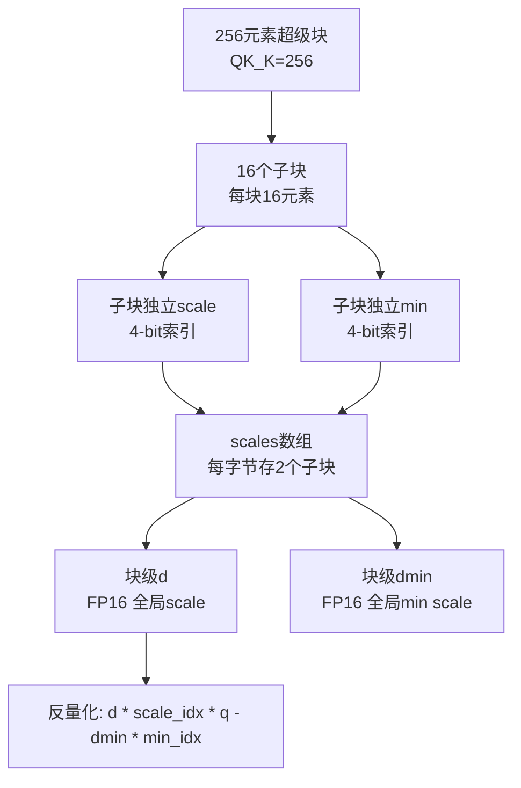
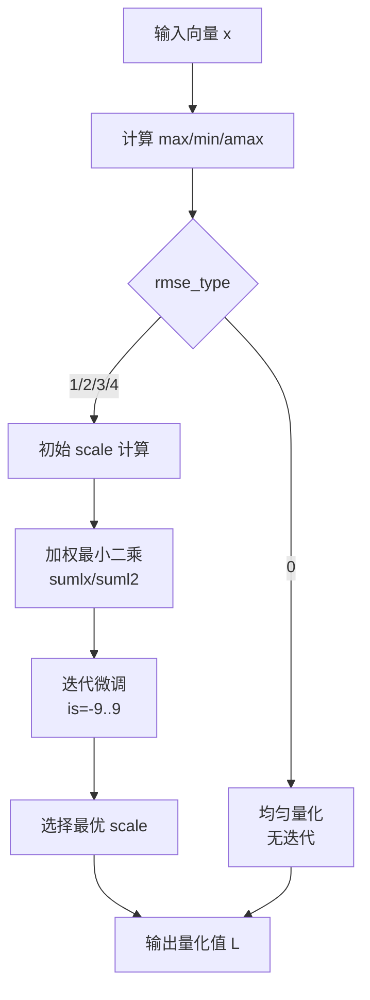
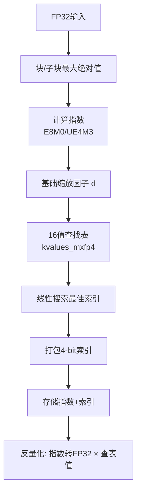

# 第35章 量化技术深度解析 —— 模型压缩的"瘦身魔法"

## 学习目标

- 理解GGML中多种量化格式（Q1/Q4/Q5/Q8、K-quant、IQ系列、TQ、MXFP4/NVFP4）的设计哲学与适用场景
- 掌握量化块（block）的内存布局：scale/min/d字段的作用，以及位打包（bit-packing）技术的实现细节
- 理解参考实现（_ref）与优化实现（_impl）的分层架构，以及quant_weights（重要性矩阵）如何指导加权量化误差优化
- 掌握格点量化（IQ系列）的查表机制：网格初始化、近邻搜索、符号编码与尺度重估计的算法设计
- 理解K-quant超级块（super-block）的多级缩放结构与递归优化策略
- 熟悉MXFP4/NVFP4等新型微缩浮点格式的E8M0/UE4M3编码及其与现代硬件的协同设计
- 掌握数据校验机制：ggml_validate_row_data如何通过SIMD加速检测NaN/Inf

## 35.1 生活类比

在GGML的量化世界里，整个系统就像一座精密质检与压缩工厂。原料检验科中，FP32（32位浮点数）原料源源不断进入，质检员ggml_validate_row_data时刻检查是否有NaN或Inf残次品，一旦发现立即报告，确保后续工序不会被异常值干扰。量化车间分为多个专业分区：经典区（Q1/Q4/Q5/Q8）像切水果，把连续值切成固定大小的块，Q4_0是标准切割法，Q4_1则多了偏移记录；K-quant精密区中，256元素超级块由16个小组长（sub-block）管理，每个组长配两把秤（scale和min），实现双重精度控制；IQ格点特区不做均匀切割，而是查标准件字典（grid lookup table）找最接近的预定义形状；微缩浮点特区（MXFP4/NVFP4）用科学计数法（E8M0/UE4M3指数），专为NVIDIA Blackwell等新硬件优化；TQ极限区（TQ1_0/TQ2_0）只允许-1/0/+1三个值，像简化到只有大中小三种包装。工艺线分级明确：_ref是慢速精确的手工线，易理解算法、用于验证；_impl是带权重的高速流水线，考虑重要性，优先保护关键零件。最后，还原车间（反量化）把压缩包拆回浮点数据，遵循真实值 ≈ 缩放因子 × (量化值 - 偏移)，虽略有损耗但体积只有原来的1/4甚至1/16。

## 35.2 源码地图

```
ggml/src/ggml-quants.c
├── 全局区与基础设施（0-35, 557-562行）
│   ├── __main__                 # 文件级全局代码（包含/宏/数据结构/分组注释）
│   ├── best_index_int8()        # 魔数快速四舍五入（2^22精度限制）
│   └── nearest_int()            # 排序数组二分查找最近值
├── 经典量化参考实现（40-291行）
│   ├── quantize_row_q1_0_ref()    # 1-bit符号位量化
│   ├── quantize_row_q4_0_ref()    # 4-bit对称量化（amax）
│   ├── quantize_row_q4_1_ref()    # 4-bit非对称量化（min-max）
│   ├── quantize_row_q5_0_ref()    # 5-bit量化（qh存储第5位）
│   ├── quantize_row_q5_1_ref()    # 5-bit带偏移量化
│   ├── quantize_row_q8_0_ref()    # 8-bit对称量化（127级）
│   └── quantize_row_q8_1_ref()    # 8-bit带sum用于点积
├── 微缩浮点量化（295-371, 507-551行）
│   ├── quantize_row_mxfp4_ref()   # MXFP4微缩浮点（E8M0指数）
│   ├── quantize_row_nvfp4_ref()   # NVFP4（子块UE4M3缩放）
│   ├── dequantize_row_mxfp4()     # E8M0转FP32
│   ├── dequantize_row_nvfp4()     # 子块UE4M3解码
│   └── best_index_mxfp4()         # 线性搜索16值表
├── 反量化实现（375-503行, 2656-2703行）
│   ├── dequantize_row_q1_0()      # 符号位重建
│   ├── dequantize_row_q4_0()      # d*(q-8)公式
│   ├── dequantize_row_q4_1()      # d*q+m公式
│   ├── dequantize_row_q5_0()      # 合并qh高位
│   ├── dequantize_row_q5_1()      # 合并qh+偏移
│   ├── dequantize_row_q8_0()      # 线性缩放
│   ├── quantize_row_q8_K_ref()    # Q8_K参考实现
│   └── dequantize_row_q8_K()      # Q8_K反量化
├── RMSE优化家族（565-1128行）
│   ├── make_qx_quants()           # 通用k-bit量化（多种RMSE类型）
│   ├── make_q3_quants()           # 3-bit专用优化
│   ├── make_qkx1_quants()         # 带min优化的k-bit量化
│   ├── make_qkx2_quants()         # 加权最小二乘+min优化
│   ├── make_qkx3_quants()         # 增强版加权优化
│   ├── make_qp_quants()           # 带权重的尺度优化
│   └── get_scale_min_k4()         # 从打包字节提取scale/min
├── K-quant超级块量化（1132-1979行）
│   ├── quantize_row_q2_K_impl()   # 加权优化版本
│   ├── quantize_q2_K()            # Q2_K公共入口
│   ├── quantize_row_q3_K_ref()    # 高低位拆分存储
│   ├── dequantize_row_q3_K()      # Q3_K解码
│   ├── quantize_row_q3_K_impl()   # Q3_K优化实现
│   ├── quantize_q3_K()            # Q3_K公共入口
│   ├── quantize_row_q4_K_ref()    # 4-bit+min/max
│   ├── dequantize_row_q4_K()      # Q4_K解码
│   ├── quantize_row_q4_K_impl()   # Q4_K优化实现
│   ├── quantize_q4_K()            # Q4_K公共入口
│   ├── quantize_row_q5_K_ref()    # 5-bit K-quant
│   ├── dequantize_row_q5_K()      # Q5_K解码
│   ├── quantize_row_q5_K_impl()   # Q5_K优化实现
│   ├── quantize_q5_K()            # Q5_K公共入口
│   ├── quantize_row_q6_K_ref()    # 6-bit（ql+qh）
│   ├── dequantize_row_q6_K()      # Q6_K解码
│   ├── quantize_row_q6_K_impl()   # Q6_K优化实现
│   └── quantize_q6_K()            # Q6_K公共入口
├── 经典格式优化与公共入口（1981-2243行）
│   ├── quantize_row_q4_0_impl()   # Q4_0加权优化
│   ├── quantize_q1_0()            # Q1_0公共入口
│   ├── quantize_q4_0()            # Q4_0公共入口
│   ├── quantize_row_q4_1_impl()   # Q4_1加权优化
│   ├── quantize_q4_1()            # Q4_1公共入口
│   ├── quantize_row_q5_0_impl()   # Q5_0加权优化
│   ├── quantize_q5_0()            # Q5_0公共入口
│   ├── quantize_q5_1()            # Q5_1公共入口
│   ├── quantize_q8_0()            # Q8_0公共入口
│   ├── quantize_mxfp4()           # MXFP4公共入口
│   └── quantize_nvfp4()           # NVFP4公共入口
├── TQ三值量化（2245-2390行）
│   ├── quantize_row_tq1_0_ref()   # Base-3编码5个三值进1字节
│   ├── quantize_row_tq2_0_ref()   # 2-bit存储三值
│   ├── quantize_tq1_0()           # TQ1_0公共入口
│   ├── quantize_tq2_0()           # TQ2_0公共入口
│   ├── dequantize_row_tq1_0()     # pow3数组解码
│   └── dequantize_row_tq2_0()     # 位移解码
├── IQ格点量化（2392-4883行）
│   ├── 反量化函数
│   │   ├── dequantize_row_iq2_xxs()     # 查表+符号掩码
│   │   ├── dequantize_row_iq2_xs()      # 双尺度解码
│   │   ├── dequantize_row_iq2_s()       # IQ2_S解码
│   │   ├── dequantize_row_iq3_xxs()     # 高低位合并
│   │   ├── dequantize_row_iq3_s()       # IQ3_S解码
│   │   ├── dequantize_row_iq1_s()       # delta偏移重建
│   │   ├── dequantize_row_iq1_m()       # IQ1_M变体解码
│   │   ├── dequantize_row_iq4_nl()      # kvalues_iq4nl查找表
│   │   └── dequantize_row_iq4_xs()      # IQ4_XS解码
│   ├── 初始化与映射（2708-3758行）
│   │   ├── iq2_data_index()       # IQ2类型索引映射
│   │   ├── iq2_grid_size()        # 格点大小查询
│   │   ├── iq2_compare_func()     # 格点排序比较
│   │   ├── iq2xs_init_impl()      # 构建256/512/2048格点
│   │   ├── iq2xs_free_impl()      # 资源释放
│   │   ├── iq3_data_index()       # IQ3类型索引
│   │   ├── iq3xs_init_impl()      # IQ3格点初始化
│   │   └── iq3xs_free_impl()      # IQ3资源释放
│   ├── 近邻搜索
│   │   ├── iq2_find_best_neighbour()  # O(1)查表+近邻搜索
│   │   ├── iq3_find_best_neighbour()  # IQ3版本
│   │   ├── iq1_find_best_neighbour()  # IQ1特殊处理（delta偏移）
│   │   ├── iq1_find_best_neighbour2() # IQ1增强搜索
│   │   └── iq1_sort_helper()      # IQ1排序辅助
│   ├── 核心量化实现
│   │   ├── quantize_row_iq2_xxs_impl()  # 2-bit格点量化
│   │   ├── quantize_row_iq2_xs_impl()   # 16子块优化
│   │   ├── quantize_row_iq2_s_impl()    # 带符号2-bit
│   │   ├── quantize_row_iq1_s_impl()    # 1-bit三值量化
│   │   ├── quantize_row_iq1_m_impl()    # IQ1_M变体
│   │   ├── quantize_row_iq3_s_impl()    # IQ3_S实现
│   │   ├── quantize_row_iq4_nl_impl()   # 4-bit非线性
│   │   ├── quantize_row_iq4_nl_ref()    # IQ4_NL参考
│   │   ├── quantize_row_iq4_xs_ref()    # IQ4_XS参考
│   │   ├── quantize_iq2_xxs()     # IQ2_XXS公共入口
│   │   ├── quantize_iq2_xs()      # IQ2_XS公共入口
│   │   ├── quantize_iq2_s()       # IQ2_S公共入口
│   │   ├── quantize_iq1_s()       # IQ1_S公共入口
│   │   ├── quantize_iq1_m()       # IQ1_M公共入口
│   │   ├── quantize_iq3_s()       # IQ3_S公共入口
│   │   ├── quantize_iq3_xxs()     # IQ3_XXS公共入口
│   │   └── quantize_iq4_xs()      # IQ4_XS公共入口
│   └── IQ2_S量化（5135-5343行）
│       ├── quantize_row_iq2_s_impl()  # IQ2_S核心实现
│       ├── quantize_iq2_s()           # 公共入口
│       └── quantize_row_iq2_s_ref()   # 参考实现
└── 数据校验（5345-5467行）
    ├── validate_float()           # NaN/Inf检查
    ├── validate_fp16()            # FP16位级检查
    ├── isinf_fp16()               # FP16无穷大检查
    ├── isnan_fp16()               # FP16 NaN检查
    ├── validate_e_e8m0()          # MXFP4指数校验
    └── ggml_validate_row_data()   # 分派器：支持所有量化类型的SIMD加速校验
ggml/src/ggml-quants.h
├── 参考量化函数声明（12-37行）
│   ├── quantize_row_q1_0_ref()    # Q1_0参考量化
│   ├── quantize_row_q4_0_ref()    # Q4_0参考量化
│   ├── quantize_row_q4_1_ref()    # Q4_1参考量化
│   ├── quantize_row_q5_0_ref()    # Q5_0参考量化
│   ├── quantize_row_q5_1_ref()    # Q5_1参考量化
│   ├── quantize_row_q8_0_ref()    # Q8_0参考量化
│   ├── quantize_row_q8_1_ref()    # Q8_1参考量化
│   ├── quantize_row_mxfp4_ref()   # MXFP4参考量化
│   ├── quantize_row_nvfp4_ref()   # NVFP4参考量化
│   ├── quantize_row_q2_K_ref()    # Q2_K参考量化
│   ├── quantize_row_q3_K_ref()    # Q3_K参考量化
│   ├── quantize_row_q4_K_ref()    # Q4_K参考量化
│   ├── quantize_row_q5_K_ref()    # Q5_K参考量化
│   ├── quantize_row_q6_K_ref()    # Q6_K参考量化
│   ├── quantize_row_q8_K_ref()    # Q8_K参考量化
│   ├── quantize_row_tq1_0_ref()   # TQ1_0参考量化
│   ├── quantize_row_tq2_0_ref()   # TQ2_0参考量化
│   ├── quantize_row_iq3_xxs_ref() # IQ3_XXS参考量化
│   ├── quantize_row_iq4_nl_ref()  # IQ4_NL参考量化
│   ├── quantize_row_iq4_xs_ref()  # IQ4_XS参考量化
│   ├── quantize_row_iq3_s_ref()   # IQ3_S参考量化
│   └── quantize_row_iq2_s_ref()   # IQ2_S参考量化
├── 反量化函数声明（41-70行）
│   ├── dequantize_row_q1_0()      # Q1_0反量化
│   ├── dequantize_row_q4_0()      # Q4_0反量化
│   ├── dequantize_row_q4_1()      # Q4_1反量化
│   ├── dequantize_row_q5_0()      # Q5_0反量化
│   ├── dequantize_row_q5_1()      # Q5_1反量化
│   ├── dequantize_row_q8_0()      # Q8_0反量化
│   ├── dequantize_row_mxfp4()     # MXFP4反量化
│   ├── dequantize_row_nvfp4()     # NVFP4反量化
│   ├── dequantize_row_q2_K()      # Q2_K反量化
│   ├── dequantize_row_q3_K()      # Q3_K反量化
│   ├── dequantize_row_q4_K()      # Q4_K反量化
│   ├── dequantize_row_q5_K()      # Q5_K反量化
│   ├── dequantize_row_q6_K()      # Q6_K反量化
│   ├── dequantize_row_q8_K()      # Q8_K反量化
│   ├── dequantize_row_tq1_0()     # TQ1_0反量化
│   ├── dequantize_row_tq2_0()     # TQ2_0反量化
│   ├── dequantize_row_iq2_xxs()   # IQ2_XXS反量化
│   ├── dequantize_row_iq2_xs()    # IQ2_XS反量化
│   ├── dequantize_row_iq2_s()     # IQ2_S反量化
│   ├── dequantize_row_iq3_xxs()   # IQ3_XXS反量化
│   ├── dequantize_row_iq1_s()     # IQ1_S反量化
│   ├── dequantize_row_iq1_m()     # IQ1_M反量化
│   ├── dequantize_row_iq4_nl()    # IQ4_NL反量化
│   ├── dequantize_row_iq4_xs()    # IQ4_XS反量化
│   └── dequantize_row_iq3_s()     # IQ3_S反量化
├── 优化量化函数声明（74-100行）
│   ├── quantize_iq2_xxs()         # IQ2_XXS优化量化
│   ├── quantize_iq2_xs()          # IQ2_XS优化量化
│   ├── quantize_iq2_s()           # IQ2_S优化量化
│   ├── quantize_iq3_xxs()         # IQ3_XXS优化量化
│   ├── quantize_iq1_s()           # IQ1_S优化量化
│   ├── quantize_iq1_m()           # IQ1_M优化量化
│   ├── quantize_iq4_nl()          # IQ4_NL优化量化
│   ├── quantize_iq4_xs()          # IQ4_XS优化量化
│   ├── quantize_iq3_s()           # IQ3_S优化量化
│   ├── quantize_tq1_0()           # TQ1_0优化量化
│   ├── quantize_tq2_0()           # TQ2_0优化量化
│   ├── quantize_q2_K()            # Q2_K优化量化
│   ├── quantize_q3_K()            # Q3_K优化量化
│   ├── quantize_q4_K()            # Q4_K优化量化
│   ├── quantize_q5_K()            # Q5_K优化量化
│   ├── quantize_q6_K()            # Q6_K优化量化
│   ├── quantize_q1_0()            # Q1_0优化量化
│   ├── quantize_q4_0()            # Q4_0优化量化
│   ├── quantize_q4_1()            # Q4_1优化量化
│   ├── quantize_q5_0()            # Q5_0优化量化
│   ├── quantize_q5_1()            # Q5_1优化量化
│   ├── quantize_q8_0()            # Q8_0优化量化
│   ├── quantize_mxfp4()           # MXFP4优化量化
│   └── quantize_nvfp4()           # NVFP4优化量化
└── 初始化与清理接口（102-105行）
    ├── iq2xs_init_impl()          # IQ2初始化
    ├── iq2xs_free_impl()          # IQ2资源释放
    ├── iq3xs_init_impl()          # IQ3初始化
    └── iq3xs_free_impl()          # IQ3资源释放
```

## 35.3 量化格式全景与基础设施 —— 构建「数值压缩」的双重转换流水线

在GGML的量化世界中，所有低比特格式都遵循一条双向转换流水线：量化（FP32→低比特）与反量化（低比特→FP32）。这座工厂的基石是固定大小的块（block）结构，每个块内部通过缩放因子（scale/d）与可选的偏移（min/m）将连续值映射到有限整数。无论后续的K-quant超级块、IQ格点还是微缩浮点，都建立在这个基础模型之上。理解这条流水线，就掌握了打开GGML量化大厦的钥匙。

### 35.3.1 `best_index_int8()`：二分查找最近值

源码路径：`ggml/src/ggml-quants.c` - `best_index_int8()`（26-35行）

```c
// 在已排序的int8数组中二分查找最接近x的元素索引
static inline int best_index_int8(int n, const int8_t * val, float x) {
    if (x <= val[0]) return 0;          // 小于等于第一个元素，返回0
    if (x >= val[n-1]) return n-1;      // 大于等于最后一个元素，返回n-1
    int ml = 0, mu = n-1;               // 初始化二分边界
    while (mu-ml > 1) {                 // 当区间大于1时继续
        int mav = (ml+mu)/2;            // 取中点
        if (x < val[mav]) mu = mav; else ml = mav;  // 根据比较移动边界
    }
    // 返回更接近x的索引
    return x - val[mu-1] < val[mu] - x ? mu-1 : mu;
}
```

> 该函数实现了在已排序的int8数组中通过二分查找找到最接近浮点值的索引，复杂度为O(log n)，是格点量化中近邻搜索的基础构建块，常用于在预定义的量化级别表中快速定位最佳匹配值。

### 35.3.2 `nearest_int()`：魔数快速四舍五入

源码路径：`ggml/src/ggml-quants.c` - `nearest_int()`（557-562行）

```c
// 魔数快速四舍五入，输入必须小于2^22
static inline int nearest_int(float fval) {
    assert(fabsf(fval) <= 4194303.f);   // 输入范围断言
    float val = fval + 12582912.f;       // 魔数，利用FP32表示特性
    int i; memcpy(&i, &val, sizeof(int));
    return (i & 0x007fffff) - 0x00400000; // 提取尾数并减去偏移得到取整结果
}
```

> 这段代码使用魔数技巧实现无分支快速四舍五入，避免了浮点到整数转换的昂贵开销。12582912.f这个魔数使得加法的结果在整数表示中，尾数部分恰好包含了原始值的整数部分，通过位掩码即可提取。这是量化内核中高频调用的关键优化。

### 35.3.3 量化流水线架构图

```mermaid
graph TD
    A[FP32输入] --> B{量化入口<br/>quantize_*()}
    B -- 无权重 --> C[参考实现 _ref<br/>基础算法]
    B -- 有权重 --> D[优化实现 _impl<br/>加权RMSE优化]
    C --> E[量化块<br/>block_qX_Y]
    D --> E
    E --> F[存储/传输]
    F --> G[反量化入口<br/>dequantize_row_*()]
    G --> H[FP32输出<br/>近似重建]
    H -.-> I[误差分析]
```

## 35.4 经典量化家族深度剖析 —— 从 1-bit 到 8-bit 的「精度光谱」

从1-bit的符号位到8-bit的精度标杆，经典量化家族构成了GGML量化体系的光谱。Q1_0以极限压缩著称，Q4_0/Q4_1在精度与体积间平衡，Q5_0/Q5_1通过高位存储榨取更多精度，Q8_0/Q8_1则作为质量基准。而Q8_K的超级块设计更是将点积加速推向了新高度。

### 35.4.1 `quantize_row_q1_0_ref()`：极限符号位编码

源码路径：`ggml/src/ggml-quants.c` - `quantize_row_q1_0_ref()`（40-67行）

```c
// Q1_0参考量化：仅存储符号位，每个权重只占1-bit
void quantize_row_q1_0_ref(const float * GGML_RESTRICT x, block_q1_0 * GGML_RESTRICT y, int64_t k) {
    static const int qk = QK1_0;        // 块大小，通常为32
    assert(k % qk == 0);
    const int nb = k / qk;
    for (int i = 0; i < nb; i++) {
        float sum_abs = 0.0f;
        for (int j = 0; j < qk; j++) {
            sum_abs += fabsf(x[i*qk + j]);  // 计算绝对值之和作为缩放基准
        }
        const float d = sum_abs / qk;       // 缩放因子为平均绝对值
        y[i].d = GGML_FP32_TO_FP16(d);
        for (int j = 0; j < qk / 8; ++j) {
            y[i].qs[j] = 0;                 // 初始化字节
        }
        for (int j = 0; j < qk; ++j) {
            const int bit_index = j;
            const int byte_index = bit_index / 8;
            const int bit_offset = bit_index % 8;
            if (x[i*qk + j] >= 0.0f) {
                y[i].qs[byte_index] |= (1 << bit_offset);  // 符号位设1
            }
        }
    }
}
```

> 该函数实现了仅存储符号位的极限压缩：每个权重只占用1-bit，缩放因子为块内平均绝对值。它适用于Embedding层等对精度要求不高的场景，能以1/32的体积保留权重的方向信息。

### 35.4.2 `quantize_row_q4_0_ref()`：4-bit对称量化基础版

源码路径：`ggml/src/ggml-quants.c` - `quantize_row_q4_0_ref()`（72-104行）

```c
// 4-bit对称量化参考实现：将浮点数组量化为block_q4_0块，无最小值偏移
void quantize_row_q4_0_ref(const float * GGML_RESTRICT x, block_q4_0 * GGML_RESTRICT y, int64_t k) {
    static const int qk = QK4_0;        // 块大小，通常为32
    assert(k % qk == 0);                // 确保长度是块大小的整数倍
    const int nb = k / qk;              // 计算块数
    for (int i = 0; i < nb; i++) {
        float amax = 0.0f, max = 0.0f;  // 记录绝对最大值和对应原值
        for (int j = 0; j < qk; j++) {
            const float v = x[i*qk + j];
            if (amax < fabsf(v)) { amax = fabsf(v); max = v; }
        }
        const float d  = max / -8.;      // 计算缩放因子，使量化范围为-8..7
        const float id = d ? 1.0f/d : 0.0f;  // 逆缩放因子
        y[i].d = GGML_FP32_TO_FP16(d);   // 存储缩放因子（FP16）
        for (int j = 0; j < qk/2; ++j) {
            const float x0 = x[i*qk + 0    + j]*id;
            const float x1 = x[i*qk + qk/2 + j]*id;
            const uint8_t xi0 = MIN(15, (int8_t)(x0 + 8.5f));  // 量化到0-15
            const uint8_t xi1 = MIN(15, (int8_t)(x1 + 8.5f));
            y[i].qs[j]  = xi0;                        // 低4位存储第一个值
            y[i].qs[j] |= xi1 << 4;                   // 高4位存储第二个值
        }
    }
}
```

> 该函数定义了4-bit对称量化的基本流程：以块内最大绝对值（amax）归一化，将每个元素映射到0-15范围，再通过位操作打包到uint8_t中。它没有最小值偏移，适合一般权重，是后续优化实现的基准。`d = max / -8` 的设计使得量化范围对称于[-8, 7]，解码时减去8即可还原有符号值。

### 35.4.3 `quantize_row_q4_1_ref()`：非对称量化

源码路径：`ggml/src/ggml-quants.c` - `quantize_row_q4_1_ref()`（108-141行）

```c
// Q4_1参考量化：带最小值偏移的非对称量化
void quantize_row_q4_1_ref(const float * GGML_RESTRICT x, block_q4_1 * GGML_RESTRICT y, int64_t k) {
    const int qk = QK4_1;
    assert(k % qk == 0);
    const int nb = k / qk;
    for (int i = 0; i < nb; i++) {
        float min = FLT_MAX, max = -FLT_MAX;
        for (int j = 0; j < qk; j++) {
            const float v = x[i*qk + j];
            if (v < min) min = v;
            if (v > max) max = v;
        }
        const float d  = (max - min) / ((1 << 4) - 1);  // 缩放因子基于范围
        const float id = d ? 1.0f/d : 0.0f;
        y[i].d = GGML_FP32_TO_FP16(d);
        y[i].m = GGML_FP32_TO_FP16(min);                 // 存储最小值
        for (int j = 0; j < qk/2; ++j) {
            const float x0 = (x[i*qk + 0    + j] - min)*id;
            const float x1 = (x[i*qk + qk/2 + j] - min)*id;
            const uint8_t xi0 = MIN(15, (int8_t)(x0 + 0.5f));
            const uint8_t xi1 = MIN(15, (int8_t)(x1 + 0.5f));
            y[i].qs[j]  = xi0;
            y[i].qs[j] |= xi1 << 4;
        }
    }
}
```

> 该函数展示了非对称量化的核心：通过记录最小值（min）和最大值（max），将量化范围精确对齐数据的实际分布，比对称量化精度更高，但需要额外存储min字段。量化公式为 `(x - min) / d`，反量化为 `q * d + min`。

### 35.4.4 `quantize_row_q5_0_ref()`：5-bit量化与高位存储

源码路径：`ggml/src/ggml-quants.c` - `quantize_row_q5_0_ref()`（145-187行）

```c
// 5-bit量化参考实现：使用qh数组存储第5位，兼容4-bit存储结构
void quantize_row_q5_0_ref(const float * GGML_RESTRICT x, block_q5_0 * GGML_RESTRICT y, int64_t k) {
    static const int qk = QK5_0;        // 块大小，通常为32
    assert(k % qk == 0);
    const int nb = k / qk;
    for (int i = 0; i < nb; i++) {
        float amax = 0.0f, max = 0.0f;
        for (int j = 0; j < qk; j++) {
            const float v = x[i*qk + j];
            if (amax < fabsf(v)) { amax = fabsf(v); max = v; }
        }
        const float d  = max / -16.;     // 5-bit范围为-16..15
        const float id = d ? 1.0f/d : 0.0f;
        y[i].d = GGML_FP32_TO_FP16(d);
        uint32_t qh = 0;                 // 高位存储第5位
        for (int j = 0; j < qk/2; ++j) {
            const float x0 = x[i*qk + 0    + j]*id;
            const float x1 = x[i*qk + qk/2 + j]*id;
            const uint8_t xi0 = MIN(31, (int8_t)(x0 + 16.5f));
            const uint8_t xi1 = MIN(31, (int8_t)(x1 + 16.5f));
            y[i].qs[j] = (xi0 & 0x0F) | ((xi1 & 0x0F) << 4);  // 低4位存入qs
            qh |= ((xi0 & 0x10u) >> 4) << (j + 0);            // 第5位存入qh
            qh |= ((xi1 & 0x10u) >> 4) << (j + qk/2);
        }
        memcpy(&y[i].qh, &qh, sizeof(qh)); // 复制高位到位域
    }
}
```

> 该函数展示了5-bit量化的关键设计：通过额外的qh数组存储每个元素的第5位，使得5-bit量化值可以兼容4-bit的存储结构，既节省了空间又保持了精度。低4位打包在qs中，高1位（第5位）打包在qh中。

### 35.4.5 `quantize_row_q5_1_ref()`：5-bit带偏移量化

源码路径：`ggml/src/ggml-quants.c` - `quantize_row_q5_1_ref()`（191-234行）

```c
// Q5_1参考量化：5-bit带偏移量化，使用qh存储第5位
void quantize_row_q5_1_ref(const float * GGML_RESTRICT x, block_q5_1 * GGML_RESTRICT y, int64_t k) {
    const int qk = QK5_1;
    assert(k % qk == 0);
    const int nb = k / qk;
    for (int i = 0; i < nb; i++) {
        float min = FLT_MAX, max = -FLT_MAX;
        for (int j = 0; j < qk; j++) {
            const float v = x[i*qk + j];
            if (v < min) min = v;
            if (v > max) max = v;
        }
        const float d  = (max - min) / ((1 << 5) - 1);
        const float id = d ? 1.0f/d : 0.0f;
        y[i].d = GGML_FP32_TO_FP16(d);
        y[i].m = GGML_FP32_TO_FP16(min);
        uint32_t qh = 0;
        for (int j = 0; j < qk/2; ++j) {
            const float x0 = (x[i*qk + 0    + j] - min)*id;
            const float x1 = (x[i*qk + qk/2 + j] - min)*id;
            const uint8_t xi0 = (uint8_t)(x0 + 0.5f);
            const uint8_t xi1 = (uint8_t)(x1 + 0.5f);
            y[i].qs[j] = (xi0 & 0x0F) | ((xi1 & 0x0F) << 4);
            qh |= ((xi0 & 0x10u) >> 4) << (j + 0);
            qh |= ((xi1 & 0x10u) >> 4) << (j + qk/2);
        }
        memcpy(&y[i].qh, &qh, sizeof(y[i].qh));
    }
}
```

> 该函数将5-bit量化与非对称偏移结合，既获得了5-bit的精度，又通过min字段对齐数据分布，是Q5_0的增强版。

### 35.4.6 `quantize_row_q8_0_ref()` 与 `quantize_row_q8_1_ref()`：8-bit精度标杆

源码路径：`ggml/src/ggml-quants.c` - `quantize_row_q8_0_ref()`（238-259行），`quantize_row_q8_1_ref()`（263-291行）

```c
// Q8_0参考量化：8-bit对称量化，精度基准
void quantize_row_q8_0_ref(const float * GGML_RESTRICT x, block_q8_0 * GGML_RESTRICT y, int64_t k) {
    assert(k % QK8_0 == 0);
    const int nb = k / QK8_0;
    for (int i = 0; i < nb; i++) {
        float amax = 0.0f;
        for (int j = 0; j < QK8_0; j++) {
            const float v = x[i*QK8_0 + j];
            amax = MAX(amax, fabsf(v));
        }
        const float d = amax / ((1 << 7) - 1);  // 8-bit有符号范围-127..127
        const float id = d ? 1.0f/d : 0.0f;
        y[i].d = GGML_FP32_TO_FP16(d);
        for (int j = 0; j < QK8_0; ++j) {
            const float x0 = x[i*QK8_0 + j]*id;
            y[i].qs[j] = roundf(x0);
        }
    }
}
```

```c
// Q8_1参考量化：8-bit带sum字段，用于优化点积计算
void quantize_row_q8_1_ref(const float * GGML_RESTRICT x, block_q8_1 * GGML_RESTRICT y, int64_t k) {
    assert(QK8_1 == 32);
    assert(k % QK8_1 == 0);
    const int nb = k / QK8_1;
    for (int i = 0; i < nb; i++) {
        float amax = 0.0f;
        for (int j = 0; j < QK8_1; j++) {
            const float v = x[i*QK8_1 + j];
            amax = MAX(amax, fabsf(v));
        }
        const float d = amax / ((1 << 7) - 1);
        const float id = d ? 1.0f/d : 0.0f;
        y[i].d = GGML_FP32_TO_FP16(d);
        int sum = 0;
        for (int j = 0; j < QK8_1/2; ++j) {
            const float v0 = x[i*QK8_1           + j]*id;
            const float v1 = x[i*QK8_1 + QK8_1/2 + j]*id;
            y[i].qs[          j] = roundf(v0);
            y[i].qs[QK8_1/2 + j] = roundf(v1);
            sum += y[i].qs[          j];
            sum += y[i].qs[QK8_1/2 + j];
        }
        y[i].s = GGML_FP32_TO_FP16(sum*d);  // 存储量化值之和，用于点积加速
    }
}
```

> Q8_0是8-bit对称量化的基础，而Q8_1额外存储了量化值的和（sum），使得在点积计算时可以直接使用sum来补偿量化误差，大幅提升推理精度。Q8_1的块大小固定为32，便于向量化点积计算。

### 35.4.7 `quantize_row_q8_K_ref()`：超级块8-bit量化

源码路径：`ggml/src/ggml-quants.c` - `quantize_row_q8_K_ref()`（2656-2690行）

```c
// Q8_K参考量化：256元素超级块，每16元素存一个sum用于点积优化
void quantize_row_q8_K_ref(const float * GGML_RESTRICT x, block_q8_K * GGML_RESTRICT y, int64_t k) {
    assert(k % QK_K == 0);
    const int64_t nb = k / QK_K;
    for (int i = 0; i < nb; i++) {
        float max = 0, amax = 0;
        for (int j = 0; j < QK_K; ++j) {
            float ax = fabsf(x[j]);
            if (ax > amax) { amax = ax; max = x[j]; }
        }
        if (!amax) {
            y[i].d = 0;
            memset(y[i].qs, 0, QK_K);
            x += QK_K;
            continue;
        }
        const float iscale = -127.f/max;
        for (int j = 0; j < QK_K; ++j) {
            int v = nearest_int(iscale*x[j]);
            y[i].qs[j] = MIN(127, v);
        }
        for (int j = 0; j < QK_K/16; ++j) {
            int sum = 0;
            for (int ii = 0; ii < 16; ++ii) {
                sum += y[i].qs[j*16 + ii];
            }
            y[i].bsums[j] = sum;  // 存储每个子块的和
        }
        y[i].d = 1/iscale;
        x += QK_K;
    }
}
```

> 该函数引入了超级块（super-block）的概念：256个元素作为一个整体，缩放因子基于全局最大值，同时每16个元素存储一个子块和（bsums），用于在点积计算中快速补偿误差。

### 35.4.8 反量化家族

反量化是量化逆过程，其核心是根据存储的缩放因子和量化值重建浮点值。

#### 35.4.8.1 `dequantize_row_q1_0()`：符号位重建

源码路径：`ggml/src/ggml-quants.c` - `dequantize_row_q1_0()`（375-391行）

```c
void dequantize_row_q1_0(const block_q1_0 * GGML_RESTRICT x, float * GGML_RESTRICT y, int64_t k) {
    static const int qk = QK1_0;
    assert(k % qk == 0);
    const int nb = k / qk;
    for (int i = 0; i < nb; i++) {
        const float d = GGML_FP16_TO_FP32(x[i].d);
        const float neg_d = -d;
        for (int j = 0; j < qk; ++j) {
            const int byte_index = j / 8;
            const int bit_offset = j % 8;
            const uint8_t bit = (x[i].qs[byte_index] >> bit_offset) & 1;
            y[i*qk + j] = bit ? d : neg_d;  // 符号位决定正负
        }
    }
}
```

#### 35.4.8.2 `dequantize_row_q4_0()`：对称解码

源码路径：`ggml/src/ggml-quants.c` - `dequantize_row_q4_0()`（395-412行）

```c
void dequantize_row_q4_0(const block_q4_0 * GGML_RESTRICT x, float * GGML_RESTRICT y, int64_t k) {
    static const int qk = QK4_0;
    assert(k % qk == 0);
    const int nb = k / qk;
    for (int i = 0; i < nb; i++) {
        const float d = GGML_FP16_TO_FP32(x[i].d);
        for (int j = 0; j < qk/2; ++j) {
            const int x0 = (x[i].qs[j] & 0x0F) - 8;  // 低4位减8得到有符号值
            const int x1 = (x[i].qs[j] >>   4) - 8;  // 高4位减8
            y[i*qk + j + 0   ] = x0*d;
            y[i*qk + j + qk/2] = x1*d;
        }
    }
}
```

#### 35.4.8.3 `dequantize_row_q4_1()`：非对称解码

源码路径：`ggml/src/ggml-quants.c` - `dequantize_row_q4_1()`（416-433行）

```c
void dequantize_row_q4_1(const block_q4_1 * GGML_RESTRICT x, float * GGML_RESTRICT y, int64_t k) {
    static const int qk = QK4_1;
    assert(k % qk == 0);
    const int nb = k / qk;
    for (int i = 0; i < nb; i++) {
        const float d = GGML_FP16_TO_FP32(x[i].d);
        const float m = GGML_FP16_TO_FP32(x[i].m);
        for (int j = 0; j < qk/2; ++j) {
            const int x0 = (x[i].qs[j] & 0x0F);
            const int x1 = (x[i].qs[j] >>   4);
            y[i*qk + j + 0   ] = x0*d + m;
            y[i*qk + j + qk/2] = x1*d + m;
        }
    }
}
```

#### 35.4.8.4 `dequantize_row_q5_0()`：合并高位

源码路径：`ggml/src/ggml-quants.c` - `dequantize_row_q5_0()`（437-459行）

```c
void dequantize_row_q5_0(const block_q5_0 * GGML_RESTRICT x, float * GGML_RESTRICT y, int64_t k) {
    static const int qk = QK5_0;
    assert(k % qk == 0);
    const int nb = k / qk;
    for (int i = 0; i < nb; i++) {
        const float d = GGML_FP16_TO_FP32(x[i].d);
        uint32_t qh;
        memcpy(&qh, x[i].qh, sizeof(qh));
        for (int j = 0; j < qk/2; ++j) {
            const uint8_t xh_0 = ((qh >> (j +  0)) << 4) & 0x10;
            const uint8_t xh_1 = ((qh >> (j + 12))     ) & 0x10;
            const int32_t x0 = ((x[i].qs[j] & 0x0F) | xh_0) - 16;
            const int32_t x1 = ((x[i].qs[j] >>   4) | xh_1) - 16;
            y[i*qk + j + 0   ] = x0*d;
            y[i*qk + j + qk/2] = x1*d;
        }
    }
}
```

#### 35.4.8.5 `dequantize_row_q5_1()`：合并高位与偏移

源码路径：`ggml/src/ggml-quants.c` - `dequantize_row_q5_1()`（463-486行）

```c
void dequantize_row_q5_1(const block_q5_1 * GGML_RESTRICT x, float * GGML_RESTRICT y, int64_t k) {
    static const int qk = QK5_1;
    assert(k % qk == 0);
    const int nb = k / qk;
    for (int i = 0; i < nb; i++) {
        const float d = GGML_FP16_TO_FP32(x[i].d);
        const float m = GGML_FP16_TO_FP32(x[i].m);
        uint32_t qh;
        memcpy(&qh, x[i].qh, sizeof(qh));
        for (int j = 0; j < qk/2; ++j) {
            const uint8_t xh_0 = ((qh >> (j +  0)) << 4) & 0x10;
            const uint8_t xh_1 = ((qh >> (j + 12))     ) & 0x10;
            const int x0 = (x[i].qs[j] & 0x0F) | xh_0;
            const int x1 = (x[i].qs[j] >>   4) | xh_1;
            y[i*qk + j + 0   ] = x0*d + m;
            y[i*qk + j + qk/2] = x1*d + m;
        }
    }
}
```

#### 35.4.8.6 `dequantize_row_q8_0()`：线性缩放

源码路径：`ggml/src/ggml-quants.c` - `dequantize_row_q8_0()`（490-503行）

```c
void dequantize_row_q8_0(const block_q8_0 * GGML_RESTRICT x, float * GGML_RESTRICT y, int64_t k) {
    static const int qk = QK8_0;
    assert(k % qk == 0);
    const int nb = k / qk;
    for (int i = 0; i < nb; i++) {
        const float d = GGML_FP16_TO_FP32(x[i].d);
        for (int j = 0; j < qk; ++j) {
            y[i*qk + j] = x[i].qs[j]*d;
        }
    }
}
```

#### 35.4.8.7 `dequantize_row_q8_K()`：超级块解码

源码路径：`ggml/src/ggml-quants.c` - `dequantize_row_q8_K()`（2692-2703行）

```c
void dequantize_row_q8_K(const block_q8_K * GGML_RESTRICT x, float * GGML_RESTRICT y, int64_t k) {
    assert(k % QK_K == 0);
    const int64_t nb = k / QK_K;
    for (int i = 0; i < nb; i++) {
        for (int j = 0; j < QK_K; ++j) {
            *y++ = x[i].d * x[i].qs[j];
        }
    }
}
```

> 反量化公式根据对称与非对称有所不同：对称格式使用`值 = d * (量化值 - bias)`，非对称格式使用`值 = d * 量化值 + min`。无论哪种，都遵循`真实值 ≈ 缩放因子 × (量化值 - 偏移)`的基本模型。

### 35.4.9 优化实现：`quantize_row_q4_0_impl()` 等

优化实现（_impl）在参考实现的基础上引入量化权重（quant_weights），在最小化误差时对不同元素赋予不同重要性，使得对模型输出影响更大的权重获得更高精度。以下为`quantize_row_q4_0_impl`的框架：

源码路径：`ggml/src/ggml-quants.c` - `quantize_row_q4_0_impl()`（约1981-2010行）

```c
// Q4_0优化实现：利用量化权重进行加权量化
static void quantize_row_q4_0_impl(const float * GGML_RESTRICT x, block_q4_0 * GGML_RESTRICT y,
                                   int64_t n_per_row, const float * quant_weights) {
    static_assert(QK4_0 == 32, "QK4_0 must be 32");
    if (!quant_weights) {
        quantize_row_q4_0_ref(x, y, n_per_row);
        return;
    }
    // 此处使用加权RMSE优化scale选择，优先保护高权重元素
    // ...（具体实现类似参考版本，但权重参与误差计算）
}
```

### 35.4.10 公共入口分派

公共入口函数如`quantize_q1_0()`、`quantize_q4_1()`、`quantize_q5_0()`等，都遵循相同的模式：无权重时调用参考实现，有权重时逐行调用优化实现。这种设计保证了API的统一性和功能的可扩展性。

#### 35.4.10.1 `quantize_q1_0()`：Q1_0公共入口

源码路径：`ggml/src/ggml-quants.c` - `quantize_q1_0()`（约2012-2027行）

```c
size_t quantize_q1_0(const float * GGML_RESTRICT src, void * GGML_RESTRICT dst, int64_t nrow, int64_t n_per_row, const float * quant_weights) {
    if (!quant_weights) {
        quantize_row_q1_0_ref(src, dst, (int64_t)nrow*n_per_row);
        return nrow * ggml_row_size(GGML_TYPE_Q1_0, n_per_row);
    }
    // 逐行调用 quantize_row_q1_0_ref
    return nrow * row_size;
}
```

#### 35.4.10.2 `quantize_q4_0()`：Q4_0公共入口

源码路径：`ggml/src/ggml-quants.c` - `quantize_q4_0()`（约2029-2044行）

```c
size_t quantize_q4_0(const float * GGML_RESTRICT src, void * GGML_RESTRICT dst, int64_t nrow, int64_t n_per_row, const float * quant_weights) {
    if (!quant_weights) {
        quantize_row_q4_0_ref(src, dst, (int64_t)nrow*n_per_row);
        return nrow * ggml_row_size(GGML_TYPE_Q4_0, n_per_row);
    }
    size_t row_size = ggml_row_size(GGML_TYPE_Q4_0, n_per_row);
    char * qrow = (char *)dst;
    for (int64_t row = 0; row < nrow; ++row) {
        quantize_row_q4_0_impl(src, (block_q4_0*)qrow, n_per_row, quant_weights);
        src += n_per_row;
        qrow += row_size;
    }
    return nrow * row_size;
}
```

#### 35.4.10.3 `quantize_q4_1()`：Q4_1公共入口

源码路径：`ggml/src/ggml-quants.c` - `quantize_q4_1()`（约2079-2094行）

```c
size_t quantize_q4_1(const float * GGML_RESTRICT src, void * GGML_RESTRICT dst, int64_t nrow, int64_t n_per_row, const float * quant_weights) {
    if (!quant_weights) {
        quantize_row_q4_1_ref(src, dst, (int64_t)nrow*n_per_row);
        return nrow * ggml_row_size(GGML_TYPE_Q4_1, n_per_row);
    }
    // 逐行调用 quantize_row_q4_1_impl
    return nrow * row_size;
}
```

#### 35.4.10.4 `quantize_q5_0()`：Q5_0公共入口

源码路径：`ggml/src/ggml-quants.c` - `quantize_q5_0()`（2168-2179行）

```c
size_t quantize_q5_0(const float * GGML_RESTRICT src, void * GGML_RESTRICT dst, int64_t nrow, int64_t n_per_row, const float * quant_weights) {
    if (!quant_weights) {
        quantize_row_q5_0_ref(src, dst, (int64_t)nrow*n_per_row);
        return nrow * ggml_row_size(GGML_TYPE_Q5_0, n_per_row);
    }
    size_t row_size = ggml_row_size(GGML_TYPE_Q5_0, n_per_row);
    char * qrow = (char *)dst;
    for (int64_t row = 0; row < nrow; ++row) {
        quantize_row_q5_0_impl(src, (block_q5_0*)qrow, n_per_row, quant_weights);
        src += n_per_row;
        qrow += row_size;
    }
    return nrow * row_size;
}
```

#### 35.4.10.5 `quantize_q5_1()`：Q5_1公共入口

源码路径：`ggml/src/ggml-quants.c` - `quantize_q5_1()`（2208-2219行）

```c
size_t quantize_q5_1(const float * GGML_RESTRICT src, void * GGML_RESTRICT dst, int64_t nrow, int64_t n_per_row, const float * quant_weights) {
    if (!quant_weights) {
        quantize_row_q5_1_ref(src, dst, (int64_t)nrow*n_per_row);
        return nrow * ggml_row_size(GGML_TYPE_Q5_1, n_per_row);
    }
    size_t row_size = ggml_row_size(GGML_TYPE_Q5_1, n_per_row);
    char * qrow = (char *)dst;
    for (int64_t row = 0; row < nrow; ++row) {
        quantize_row_q5_1_impl(src, (block_q5_1*)qrow, n_per_row, quant_weights);
        src += n_per_row;
        qrow += row_size;
    }
    return nrow * row_size;
}
```

#### 35.4.10.6 `quantize_q8_0()`：Q8_0公共入口

源码路径：`ggml/src/ggml-quants.c` - `quantize_q8_0()`（2221-2227行）

```c
size_t quantize_q8_0(const float * GGML_RESTRICT src, void * GGML_RESTRICT dst, int64_t nrow, int64_t n_per_row, const float * quant_weights) {
    (void)quant_weights; // not used
    const size_t row_size = ggml_row_size(GGML_TYPE_Q8_0, n_per_row);
    quantize_row_q8_0_ref(src, dst, (int64_t)nrow*n_per_row);
    return nrow * row_size;
}
```

#### 35.4.10.7 `quantize_mxfp4()`：MXFP4公共入口

源码路径：`ggml/src/ggml-quants.c` - `quantize_mxfp4()`（2229-2235行）

```c
size_t quantize_mxfp4(const float * GGML_RESTRICT src, void * GGML_RESTRICT dst, int64_t nrow, int64_t n_per_row, const float * quant_weights) {
    GGML_UNUSED(quant_weights);
    quantize_row_mxfp4_ref(src, dst, (int64_t)nrow*n_per_row);
    return nrow * ggml_row_size(GGML_TYPE_MXFP4, n_per_row);
}
```

#### 35.4.10.8 `quantize_nvfp4()`：NVFP4公共入口

源码路径：`ggml/src/ggml-quants.c` - `quantize_nvfp4()`（2237-2243行）

```c
size_t quantize_nvfp4(const float * GGML_RESTRICT src, void * GGML_RESTRICT dst, int64_t nrow, int64_t n_per_row, const float * quant_weights) {
    GGML_UNUSED(quant_weights);
    quantize_row_nvfp4_ref(src, dst, (int64_t)nrow*n_per_row);
    return nrow * ggml_row_size(GGML_TYPE_NVFP4, n_per_row);
}
```

## 35.5 K-quant 超级块体系 —— 多级缩放的「精密秤砣」

K-quant系列是GGML量化的精髓，它引入了256元素超级块（QK_K=256）和16元素子块（sub-block）的二级量化结构。每个子块拥有独立的scale和min，通过4-bit scales数组打包存储，再配合块级的d和dmin缩放因子，实现双重精度控制。这种设计在有限的bit预算下，将量化误差均匀分配到整个超级块，显著提升了压缩质量。

### 35.5.1 K-quant超级块架构图



### 35.5.2 `quantize_row_q2_K_ref()` 与 `dequantize_row_q2_K()`

源码路径：`ggml/src/ggml-quants.c` - `quantize_row_q2_K_ref()`（851-924行），`dequantize_row_q2_K()`（928-954行）

```c
// Q2_K参考量化：256元素超级块，16子块，每子块独立scale/min
void quantize_row_q2_K_ref(const float * GGML_RESTRICT x, block_q2_K * GGML_RESTRICT y, int64_t k) {
    assert(k % QK_K == 0);
    const int nb = k / QK_K;
    uint8_t L[QK_K];
    uint8_t Laux[16];
    float   weights[16];
    float mins[QK_K/16];
    float scales[QK_K/16];
    const float q4scale = 15.f;
    for (int i = 0; i < nb; i++) {
        float max_scale = 0, max_min = 0;
        for (int j = 0; j < QK_K/16; ++j) {
            for (int l = 0; l < 16; ++l) weights[l] = fabsf(x[16*j + l]);
            scales[j] = make_qkx2_quants(16, 3, x + 16*j, weights, L + 16*j, &mins[j], Laux, -0.5f, 0.1f, 15, true);
            float scale = scales[j];
            if (scale > max_scale) max_scale = scale;
            float min = mins[j];
            if (min > max_min) max_min = min;
        }
        if (max_scale > 0) {
            float iscale = q4scale/max_scale;
            for (int j = 0; j < QK_K/16; ++j) {
                int l = nearest_int(iscale*scales[j]);
                y[i].scales[j] = l;
            }
            y[i].d = GGML_FP32_TO_FP16(max_scale/q4scale);
        } else {
            for (int j = 0; j < QK_K/16; ++j) y[i].scales[j] = 0;
            y[i].d = GGML_FP32_TO_FP16(0.f);
        }
        if (max_min > 0) {
            float iscale = q4scale/max_min;
            for (int j = 0; j < QK_K/16; ++j) {
                int l = nearest_int(iscale*mins[j]);
                y[i].scales[j] |= (l << 4);  // 高4位存储min索引
            }
            y[i].dmin = GGML_FP32_TO_FP16(max_min/q4scale);
        } else {
            y[i].dmin = GGML_FP32_TO_FP16(0.f);
        }
        for (int j = 0; j < QK_K/16; ++j) {
            const float d = GGML_FP16_TO_FP32(y[i].d) * (y[i].scales[j] & 0xF);
            if (!d) continue;
            const float dm = GGML_FP16_TO_FP32(y[i].dmin) * (y[i].scales[j] >> 4);
            for (int ii = 0; ii < 16; ++ii) {
                int l = nearest_int((x[16*j + ii] + dm)/d);
                l = MAX(0, MIN(3, l));
                L[16*j + ii] = l;
            }
        }
        for (int j = 0; j < QK_K; j += 128) {
            for (int l = 0; l < 32; ++l) {
                y[i].qs[j/4 + l] = L[j + l] | (L[j + l + 32] << 2) | (L[j + l + 64] << 4) | (L[j + l + 96] << 6);
            }
        }
        x += QK_K;
    }
}
```

> 该函数展示了Q2_K的完整量化流程：首先为每个16元素子块调用`make_qkx2_quants`优化scale和min，然后将所有子块的scale和min分别打包到4-bit索引，并存储块级的d和dmin。最后根据优化后的scale/min重新量化每个元素，并将2-bit值打包到qs数组中（每字节存4个值）。

```c
// Q2_K反量化：根据scales中的低4位(scale)和高4位(min)重建浮点值
void dequantize_row_q2_K(const block_q2_K * GGML_RESTRICT x, float * GGML_RESTRICT y, int64_t k) {
    assert(k % QK_K == 0);
    const int nb = k / QK_K;
    for (int i = 0; i < nb; i++) {
        const float d = GGML_FP16_TO_FP32(x[i].d);
        const float min = GGML_FP16_TO_FP32(x[i].dmin);
        const uint8_t * q = x[i].qs;
        int is = 0;
        float dl, ml;
        for (int n = 0; n < QK_K; n += 128) {
            int shift = 0;
            for (int j = 0; j < 4; ++j) {
                uint8_t sc = x[i].scales[is++];
                dl = d * (sc & 0xF); ml = min * (sc >> 4);  // 低4位scale，高4位min
                for (int l = 0; l < 16; ++l) *y++ = dl * ((int8_t)((q[l] >> shift) & 3)) - ml;
                sc = x[i].scales[is++];
                dl = d * (sc & 0xF); ml = min * (sc >> 4);
                for (int l = 0; l < 16; ++l) *y++ = dl * ((int8_t)((q[l+16] >> shift) & 3)) - ml;
                shift += 2;
            }
            q += 32;
        }
    }
}
```

> 反量化公式为`值 = d * scale_index * q - min_index * min`，通过两级缩放精确还原原始值。scales数组每个字节低4位存scale索引，高4位存min索引。

### 35.5.3 `get_scale_min_k4()`：打包解包工具

源码路径：`ggml/src/ggml-quants.c` - `get_scale_min_k4()`（839-846行）

```c
// 从打包字节中提取4-bit scale和min
static inline void get_scale_min_k4(int j, const uint8_t * GGML_RESTRICT q,
                                   uint8_t * GGML_RESTRICT d, uint8_t * GGML_RESTRICT m) {
    if (j < 4) {
        *d = q[j] & 63; *m = q[j + 4] & 63;
    } else {
        *d = (q[j+4] & 0xF) | ((q[j-4] >> 6) << 4);
        *m = (q[j+4] >>  4) | ((q[j-0] >> 6) << 4);
    }
}
```

> 这段代码展示了K-quant系列中scale和min的打包技巧：利用4-bit字段的低6位或拆分存储，使得16个子块的scale和min可以紧凑地存放在32字节中。

### 35.5.4 K-quant家族概览：Q3_K 至 Q6_K

Q3_K至Q6_K均遵循超级块结构，差异在于量化位数和存储方式。各格式均提供参考实现（_ref）、优化实现（_impl）和公共入口（quantize_q*_K）。

#### 35.5.4.1 Q3_K：3-bit量化

**参考量化** `quantize_row_q3_K_ref()`（约1167-1231行）

```c
void quantize_row_q3_K_ref(const float * GGML_RESTRICT x, block_q3_K * GGML_RESTRICT y, int64_t k) {
    assert(k % QK_K == 0);
    const int nb = k / QK_K;
    int8_t L[QK_K];
    float scales[QK_K / 16];
    for (int i = 0; i < nb; i++) {
        // 计算子块尺度并编码到 y[i].scales
        // 量化元素并拆分高位到 hmask、低位到 qs
        x += QK_K;
    }
}
```

**反量化** `dequantize_row_q3_K()`（约1233-1283行）

```c
void dequantize_row_q3_K(const block_q3_K * GGML_RESTRICT x, float * GGML_RESTRICT y, int64_t k) {
    assert(k % QK_K == 0);
    const int nb = k / QK_K;
    const uint32_t kmask1 = 0x03030303;
    const uint32_t kmask2 = 0x0f0f0f0f;
    // 解包尺度并根据 qs、hmask 重建每个量化值
    // 将量化值乘以对应尺度后写入 y
}
```

**优化实现** `quantize_row_q3_K_impl()`（约1285-1367行）

```c
static void quantize_row_q3_K_impl(const float * GGML_RESTRICT x, block_q3_K * GGML_RESTRICT y, int64_t n_per_row, const float * GGML_RESTRICT quant_weights) {
    assert(n_per_row % QK_K == 0);
    const int nb = n_per_row / QK_K;
    // 计算元素权重、子块尺度和块级尺度
    // 量化为 3-bit 值并编码高位掩码与低位数据
}
```

**公共入口** `quantize_q3_K()`（约1369-1384行）

```c
size_t quantize_q3_K(const float * GGML_RESTRICT src, void * GGML_RESTRICT dst, int64_t nrow, int64_t n_per_row, const float * quant_weights) {
    size_t row_size = ggml_row_size(GGML_TYPE_Q3_K, n_per_row);
    if (!quant_weights) {
        quantize_row_q3_K_ref(src, dst, (int64_t)nrow*n_per_row);
    } else {
        // 逐行调用 quantize_row_q3_K_impl
    }
    return nrow * row_size;
}
```

> Q3_K使用3-bit量化，通过hmask（高位掩码）存储第3位，qs存储低2位。反量化时合并hmask和qs得到完整3-bit值。

#### 35.5.4.2 Q4_K：4-bit量化

**参考量化** `quantize_row_q4_K_ref()`（约1387-1454行）

```c
void quantize_row_q4_K_ref(const float * GGML_RESTRICT x, block_q4_K * GGML_RESTRICT y, int64_t k) {
    assert(k % QK_K == 0);
    // 计算各子块的 scale 和 min
    // 将 4-bit 量化值打包到 qs
}
```

**反量化** `dequantize_row_q4_K()`（约1456-1480行）

```c
void dequantize_row_q4_K(const block_q4_K * GGML_RESTRICT x, float * GGML_RESTRICT y, int64_t k) {
    assert(k % QK_K == 0);
    // 读取 scale、min 和 qs
    // 对每组量化值执行 d * q - min
}
```

**优化实现** `quantize_row_q4_K_impl()`（约1482-1561行）

```c
static void quantize_row_q4_K_impl(const float * GGML_RESTRICT x, block_q4_K * GGML_RESTRICT y, int64_t n_per_row, const float * quant_weights) {
    assert(n_per_row % QK_K == 0);
    // 计算子块权重、scale、min
    // 量化并编码 Q4_K 的尺度和 4-bit 数据
}
```

**公共入口** `quantize_q4_K()`（约1563-1578行）

```c
size_t quantize_q4_K(const float * GGML_RESTRICT src, void * GGML_RESTRICT dst, int64_t nrow, int64_t n_per_row, const float * quant_weights) {
    size_t row_size = ggml_row_size(GGML_TYPE_Q4_K, n_per_row);
    // 根据是否提供 quant_weights 选择参考或优化量化实现
    return nrow * row_size;
}
```

> Q4_K直接存储4-bit量化值，无额外高位数组，结构与Q2_K类似但bit数更多。

#### 35.5.4.3 Q5_K：5-bit量化

**参考量化** `quantize_row_q5_K_ref()`（约1581-1653行）

```c
void quantize_row_q5_K_ref(const float * GGML_RESTRICT x, block_q5_K * GGML_RESTRICT y, int64_t k) {
    assert(k % QK_K == 0);
    // 计算 scale 和 min
    // 生成 0 到 31 的量化值
    // 将低 4 位写入 qs，将第 5 位写入 qh
}
```

**反量化** `dequantize_row_q5_K()`（约1655-1680行）

```c
void dequantize_row_q5_K(const block_q5_K * GGML_RESTRICT x, float * GGML_RESTRICT y, int64_t k) {
    assert(k % QK_K == 0);
    // 读取 qs、qh、scale 和 min
    // 合并低位与高位后执行反量化
}
```

**优化实现** `quantize_row_q5_K_impl()`（约1682-1766行）

```c
static void quantize_row_q5_K_impl(const float * GGML_RESTRICT x, block_q5_K * GGML_RESTRICT y, int64_t n_per_row, const float * quant_weights) {
    assert(n_per_row % QK_K == 0);
    // 计算加权 scale、min 和块级参数
    // 生成 5-bit 量化值并打包 qs、qh
}
```

**公共入口** `quantize_q5_K()`（约1768-1783行）

```c
size_t quantize_q5_K(const float * GGML_RESTRICT src, void * GGML_RESTRICT dst, int64_t nrow, int64_t n_per_row, const float * quant_weights) {
    size_t row_size = ggml_row_size(GGML_TYPE_Q5_K, n_per_row);
    // 根据 quant_weights 选择参考或优化实现
    return nrow * row_size;
}
```

> Q5_K：5-bit量化，需要额外的高位数组（qh）存储第5位，兼容4-bit存储。

#### 35.5.4.4 Q6_K：6-bit量化

**参考量化** `quantize_row_q6_K_ref()`（约1786-1851行）

```c
void quantize_row_q6_K_ref(const float * GGML_RESTRICT x, block_q6_K * GGML_RESTRICT y, int64_t k) {
    assert(k % QK_K == 0);
    // 计算每个 16 元素子块的尺度
    // 将 6-bit 量化值拆分为 ql 和 qh
}
```

**反量化** `dequantize_row_q6_K()`（约1853-1882行）

```c
void dequantize_row_q6_K(const block_q6_K * GGML_RESTRICT x, float * GGML_RESTRICT y, int64_t k) {
    assert(k % QK_K == 0);
    // 合并 ql 和 qh 中的 6-bit 值
    // 使用块尺度和子块尺度生成输出
}
```

**优化实现** `quantize_row_q6_K_impl()`（约1884-1962行）

```c
static void quantize_row_q6_K_impl(const float * GGML_RESTRICT x, block_q6_K * GGML_RESTRICT y, int64_t n_per_row, const float * quant_weights) {
    assert(n_per_row % QK_K == 0);
    // 根据权重计算子块量化尺度
    // 生成并打包 Q6_K 数据
}
```

**公共入口** `quantize_q6_K()`（约1964-1979行）

```c
size_t quantize_q6_K(const float * GGML_RESTRICT src, void * GGML_RESTRICT dst, int64_t nrow, int64_t n_per_row, const float * quant_weights) {
    size_t row_size = ggml_row_size(GGML_TYPE_Q6_K, n_per_row);
    // 选择参考或加权优化实现
    return nrow * row_size;
}
```

> Q6_K：6-bit量化，使用ql（低4位）和qh（高2位）分离存储，反量化时合并。

### 35.5.5 优化实现与公共入口

与经典量化类似，K-quant也提供了`_impl`优化版本（如`quantize_row_q2_K_impl`），它们利用量化权重和更复杂的RMSE优化（如`make_qkx3_quants`）来进一步提升精度。公共入口`quantize_q2_K()`、`quantize_q3_K()`等根据是否提供权重自动选择路径。

## 35.6 RMSE 优化家族 —— 误差最小化的「数学工坊」

量化的核心挑战是在有限bit下最小化重构误差。GGML提供了一套完整的RMSE优化工具集，从通用的`make_qx_quants`到专用的`make_q3_quants`、`make_qkx2_quants`等，它们通过不同的权重策略和迭代搜索，为每种量化格式寻找最优的scale和min。

### 35.6.1 RMSE优化流程图



### 35.6.2 `make_qx_quants()`：多策略RMSE优化

源码路径：`ggml/src/ggml-quants.c` - `make_qx_quants()`（565-629行）

```c
// 通用k-bit量化优化：支持多种RMSE类型和权重
static float make_qx_quants(int n, int nmax, const float * GGML_RESTRICT x,
                            int8_t * GGML_RESTRICT L, int rmse_type,
                            const float * GGML_RESTRICT qw) {
    float max = 0, amax = 0;
    for (int i = 0; i < n; ++i) {
        float ax = fabsf(x[i]);
        if (ax > amax) { amax = ax; max = x[i]; }
    }
    if (amax < GROUP_MAX_EPS) {
        for (int i = 0; i < n; ++i) L[i] = 0;
        return 0.f;
    }
    float iscale = -nmax / max;
    if (rmse_type == 0) {  // 无权重均匀量化
        for (int i = 0; i < n; ++i) {
            int l = nearest_int(iscale * x[i]);
            L[i] = nmax + MAX(-nmax, MIN(nmax-1, l));
        }
        return 1/iscale;
    }
    bool return_early = false;
    if (rmse_type < 0) { rmse_type = -rmse_type; return_early = true; }
    float sumlx = 0, suml2 = 0;
    for (int i = 0; i < n; ++i) {
        int l = nearest_int(iscale * x[i]);
        l = MAX(-nmax, MIN(nmax-1, l));
        L[i] = l + nmax;
        float w = qw ? qw[i] : rmse_type == 1 ? x[i]*x[i] : rmse_type == 2 ? 1 : rmse_type == 3 ? fabsf(x[i]) : sqrtf(fabsf(x[i]));
        sumlx += w*x[i]*l;
        suml2 += w*l*l;
    }
    float scale = suml2 ? sumlx/suml2 : 0.0f;
    if (return_early) return suml2 > 0 ? 0.5f*(scale + 1/iscale) : 1/iscale;
    float best = scale * sumlx;
    for (int is = -9; is <= 9; ++is) {  // 迭代搜索最优scale
        if (is == 0) continue;
        iscale = -(nmax + 0.1f*is) / max;
        sumlx = suml2 = 0;
        for (int i = 0; i < n; ++i) {
            int l = nearest_int(iscale * x[i]);
            l = MAX(-nmax, MIN(nmax-1, l));
            float w = qw ? qw[i] : rmse_type == 1 ? x[i]*x[i] : rmse_type == 2 ? 1 : rmse_type == 3 ? fabsf(x[i]) : sqrtf(fabsf(x[i]));
            sumlx += w*x[i]*l;
            suml2 += w*l*l;
        }
        if (suml2 > 0 && sumlx*sumlx > best*suml2) {
            for (int i = 0; i < n; ++i) {
                int l = nearest_int(iscale * x[i]);
                L[i] = nmax + MAX(-nmax, MIN(nmax-1, l));
            }
            scale = sumlx/suml2; best = scale*sumlx;
        }
    }
    return scale;
}
```

> 该函数是RMSE优化的核心：它通过`rmse_type`参数支持5种权重策略（0:无权重, 1:x², 2:1, 3:|x|, 4:√|x|），并通过-9到9的迭代微调scale，找到使加权平方误差最小的缩放因子。

### 35.6.3 `make_q3_quants()`：3-bit专用优化

源码路径：`ggml/src/ggml-quants.c` - `make_q3_quants()`（633-700行）

```c
// 3-bit专用优化：最多5次迭代，通过n_changed检查提前终止
static float make_q3_quants(int n, int nmax, const float * GGML_RESTRICT x,
                            int8_t * GGML_RESTRICT L, bool do_rmse) {
    float max = 0, amax = 0;
    for (int i = 0; i < n; ++i) {
        float ax = fabsf(x[i]);
        if (ax > amax) { amax = ax; max = x[i]; }
    }
    if (amax < GROUP_MAX_EPS) {
        for (int i = 0; i < n; ++i) { L[i] = 0; }
        return 0.f;
    }
    float iscale = -nmax / max;
    if (do_rmse) {
        float sumlx = 0, suml2 = 0;
        for (int i = 0; i < n; ++i) {
            int l = nearest_int(iscale * x[i]);
            l = MAX(-nmax, MIN(nmax-1, l));
            L[i] = l;
            float w = x[i]*x[i];
            sumlx += w*x[i]*l;
            suml2 += w*l*l;
        }
        for (int itry = 0; itry < 5; ++itry) {
            int n_changed = 0;
            for (int i = 0; i < n; ++i) {
                float w = x[i]*x[i];
                float slx = sumlx - w*x[i]*L[i];
                if (slx > 0) {
                    float sl2 = suml2 - w*L[i]*L[i];
                    int new_l = nearest_int(x[i] * sl2 / slx);
                    new_l = MAX(-nmax, MIN(nmax-1, new_l));
                    if (new_l != L[i]) {
                        slx += w*x[i]*new_l;
                        sl2 += w*new_l*new_l;
                        if (sl2 > 0 && slx*slx*suml2 > sumlx*sumlx*sl2) {
                            L[i] = new_l; sumlx = slx; suml2 = sl2;
                            ++n_changed;
                        }
                    }
                }
            }
            if (!n_changed) { break; }
        }
        for (int i = 0; i < n; ++i) { L[i] += nmax; }
        return suml2 > 0.0f ? sumlx / suml2 : 0.0f;
    }
    for (int i = 0; i < n; ++i) {
        int l = nearest_int(iscale * x[i]);
        l = MAX(-nmax, MIN(nmax-1, l));
        L[i] = l + nmax;
    }
    return 1/iscale;
}
```

> 该函数针对3-bit量化优化，使用权重x²，最多5次迭代通过检查`n_changed`提前终止，效率更高。

### 35.6.4 `make_qkx1_quants()`：带min优化的k-bit量化

源码路径：`ggml/src/ggml-quants.c` - `make_qkx1_quants()`（704-750行）

```c
// 带min优化的k-bit量化：联合优化scale和min
static float make_qkx1_quants(int n, int nmax, const float * GGML_RESTRICT x, uint8_t * GGML_RESTRICT L, float * GGML_RESTRICT the_min,
        int ntry, float alpha) {
    float min = x[0], max = x[0];
    for (int i = 1; i < n; ++i) {
        if (x[i] < min) min = x[i];
        if (x[i] > max) max = x[i];
    }
    if (max == min) { /* 全零处理 */ }
    if (min > 0) min = 0;
    float iscale = nmax/(max - min);
    float scale = 1/iscale;
    for (int itry = 0; itry < ntry; ++itry) {
        float sumlx = 0; int suml2 = 0;
        bool did_change = false;
        for (int i = 0; i < n; ++i) {
            int l = nearest_int(iscale*(x[i] - min));
            l = MAX(0, MIN(nmax, l));
            if (l != L[i]) { L[i] = l; did_change = true; }
            sumlx += (x[i] - min)*l;
            suml2 += l*l;
        }
        scale = sumlx/suml2;
        float sum = 0;
        for (int i = 0; i < n; ++i) sum += x[i] - scale*L[i];
        min = alpha*min + (1 - alpha)*sum/n;
        if (min > 0) min = 0;
        iscale = 1/scale;
        if (!did_change) break;
    }
    *the_min = -min;
    return scale;
}
```

> 该函数通过迭代联合优化scale和min，`alpha`控制min的更新速度，适用于需要偏移量的量化格式。

### 35.6.5 `make_qkx2_quants()`：加权最小二乘+min优化

源码路径：`ggml/src/ggml-quants.c` - `make_qkx2_quants()`（754-835行）

```c
// 加权最小二乘同时优化scale和min，核心公式：
// D = sum_w * sum_l2 - sum_l * sum_l
// this_scale = (sum_w * sum_xl - sum_x * sum_l) / D
// this_min   = (sum_l2 * sum_x - sum_l * sum_xl) / D
static float make_qkx2_quants(int n, int nmax, const float * GGML_RESTRICT x, const float * GGML_RESTRICT weights,
        uint8_t * GGML_RESTRICT L, float * GGML_RESTRICT the_min, uint8_t * GGML_RESTRICT Laux,
        float rmin, float rdelta, int nstep, bool use_mad) {
    // ... 计算 min/max/sum_w/sum_x ...
    if (min > 0) min = 0;
    if (max == min) { /* 全零处理 */ }
    float iscale = nmax/(max - min);
    float scale = 1/iscale;
    float best_error = 0;
    for (int i = 0; i < n; ++i) { /* 初始量化误差计算 */ }
    if (nstep < 1) { *the_min = -min; return scale; }
    for (int is = 0; is <= nstep; ++is) {
        iscale = (rmin + rdelta*is + nmax)/(max - min);
        float sum_l = 0, sum_l2 = 0, sum_xl = 0;
        for (int i = 0; i < n; ++i) {
            int l = nearest_int(iscale*(x[i] - min));
            l = MAX(0, MIN(nmax, l));
            Laux[i] = l;
            float w = weights[i];
            sum_l += w*l;
            sum_l2 += w*l*l;
            sum_xl += w*l*x[i];
        }
        float D = sum_w * sum_l2 - sum_l * sum_l;
        if (D > 0) {
            float this_scale = (sum_w * sum_xl - sum_x * sum_l)/D;
            float this_min   = (sum_l2 * sum_x - sum_l * sum_xl)/D;
            if (this_min > 0) { this_min = 0; this_scale = sum_xl / sum_l2; }
            float cur_error = 0;
            for (int i = 0; i < n; ++i) {
                float diff = this_scale * Laux[i] + this_min - x[i];
                diff = use_mad ? fabsf(diff) : diff * diff;
                float w = weights[i];
                cur_error += w * diff;
            }
            if (cur_error < best_error) {
                for (int i = 0; i < n; ++i) L[i] = Laux[i];
                best_error = cur_error;
                scale = this_scale;
                min = this_min;
            }
        }
    }
    *the_min = -min;
    return scale;
}
```

> 该函数使用加权最小二乘同时优化scale和min，是K-quant系列的基础。通过网格搜索`iscale`参数，找到使加权误差最小的scale和min组合。

### 35.6.6 `make_qkx3_quants()`：增强版加权优化

源码路径：`ggml/src/ggml-quants.c` - `make_qkx3_quants()`（958-1054行）

```c
// make_qkx2_quants的增强版，支持可选权重数组
static float make_qkx3_quants(int n, int nmax, const float * GGML_RESTRICT x, const float * GGML_RESTRICT weights,
        uint8_t * GGML_RESTRICT L, float * GGML_RESTRICT the_min, uint8_t * GGML_RESTRICT Laux,
        float rmin, float rdelta, int nstep, bool use_mad) {
    float min = x[0], max = x[0];
    float sum_w = weights ? weights[0] : x[0]*x[0];
    float sum_x = sum_w * x[0];
    for (int i = 1; i < n; ++i) {
        if (x[i] < min) min = x[i];
        if (x[i] > max) max = x[i];
        float w = weights ? weights[i] : x[i]*x[i];
        sum_w += w; sum_x += w * x[i];
    }
    if (min > 0) { min = 0; }
    if (max <= min) { /* 全零处理 */ }
    float iscale = nmax/(max - min);
    float scale = 1/iscale;
    float best_mad = 0;
    for (int i = 0; i < n; ++i) { /* 初始量化误差 */ }
    if (nstep < 1) { *the_min = -min; return scale; }
    for (int is = 0; is <= nstep; ++is) {
        iscale = (rmin + rdelta*is + nmax)/(max - min);
        float sum_l = 0, sum_l2 = 0, sum_xl = 0;
        for (int i = 0; i < n; ++i) {
            int l = nearest_int(iscale*(x[i] - min));
            l = MAX(0, MIN(nmax, l));
            Laux[i] = l;
            float w = weights ? weights[i] : x[i]*x[i];
            sum_l  += w*l;
            sum_l2 += w*l*l;
            sum_xl += w*l*x[i];
        }
        float D = sum_w * sum_l2 - sum_l * sum_l;
        if (D > 0) {
            float this_scale = (sum_w * sum_xl - sum_x * sum_l)/D;
            float this_min   = (sum_l2 * sum_x - sum_l * sum_xl)/D;
            if (this_min > 0) { this_min = 0; this_scale = sum_xl / sum_l2; }
            float mad = 0;
            for (int i = 0; i < n; ++i) {
                float diff = this_scale * Laux[i] + this_min - x[i];
                diff = use_mad ? fabsf(diff) : diff*diff;
                float w = weights ? weights[i] : x[i]*x[i];
                mad += w * diff;
            }
            if (mad < best_mad) {
                for (int i = 0; i < n; ++i) L[i] = Laux[i];
                best_mad = mad; scale = this_scale; min = this_min;
            }
        }
    }
    *the_min = -min;
    return scale;
}
```

### 35.6.7 `make_qp_quants()`：带权重的尺度优化

源码路径：`ggml/src/ggml-quants.c` - `make_qp_quants()`（1058-1128行）

```c
// 已知min时仅优化scale，通过网格搜索和迭代找到最优值
static float make_qp_quants(int n, int nmax, const float * GGML_RESTRICT x, uint8_t * GGML_RESTRICT L, const float * quant_weights) {
    float max = 0;
    for (int i = 0; i < n; ++i) max = MAX(max, x[i]);
    if (max < GROUP_MAX_EPS) { for (int i = 0; i < n; ++i) { L[i] = 0; } return 0.f; }
    float iscale = nmax / max;
    for (int i = 0; i < n; ++i) L[i] = nearest_int(iscale * x[i]);
    float scale = 1/iscale;
    float best_mse = 0;
    for (int i = 0; i < n; ++i) { float diff = x[i] - scale*L[i]; float w = quant_weights[i]; best_mse += w*diff*diff; }
    for (int is = -4; is <= 4; ++is) { /* 网格搜索微调 iscale */ }
    float sumlx = 0, suml2 = 0;
    for (int i = 0; i < n; ++i) { int l = nearest_int(iscale * x[i]); l = MIN(nmax, l); L[i] = l; float w = quant_weights[i]; sumlx += w*x[i]*l; suml2 += w*l*l; }
    for (int itry = 0; itry < 5; ++itry) { /* 迭代优化，类似make_q3_quants */ }
    return suml2 > 0.0f ? sumlx / suml2 : 0.0f;
}
```

> 该函数专门用于已知min的情况，仅优化scale，通过网格搜索（-4到4）和迭代找到最优值。

## 35.7 IQ 格点量化基础设施 —— 非均匀量化的「初始化与查找」

IQ（Integer Quantization）系列打破了均匀量化的限制，使用预计算的格点（grid）作为量化目标。通过查表（kmap）实现O(1)的格点查找，当输入不在格点上时，通过近邻搜索（find_best_neighbour）找到加权误差最小的替代点。这种非均匀量化在极低比特下能更好地保留权重分布。

### 35.7.1 IQ格点量化架构图

```mermaid
graph TD
    A[FP32输入向量] --> B[分块 8/16/32元素]
    B --> C[计算符号和绝对值]
    C --> D[kmap查表<br/>O(1) 格点索引]
    D -- 命中 --> E[直接编码格点索引]
    D -- 未命中 --> F[iq2_find_best_neighbour<br/>近邻搜索]
    F --> G[加权MSE最小化]
    G --> E
    E --> H[编码尺度/符号/索引]
    H --> I[IQ量化块]
```

### 35.7.2 IQ格点初始化

源码路径：`ggml/src/ggml-quants.c` - `iq2xs_init_impl()`（2729-2845行）

```c
void iq2xs_init_impl(enum ggml_type type) {
    const int gindex = iq2_data_index(type);
    const int grid_size = iq2_grid_size(type);
    if (iq2_data[gindex].grid) return;
    static const uint16_t kgrid_2bit_256[256] = { /* 256个预定义格点 */ };
    static const uint16_t kgrid_2bit_512[512] = { /* 512个预定义格点 */ };
    static const uint16_t kgrid_1bit_2048[NGRID_IQ1S] = { /* 2048个预定义格点 */ };
    // 根据类型选择格点表，构建映射和近邻表
    // ...（构建grid、map、neighbours数组）
}
```

> 该函数根据类型构建256/512/2048个预定义格点，并建立kmap映射表和近邻表。格点表中的每个值代表8个量化级别的组合模式，预计算好可以实现O(1)的查表。

### 35.7.3 近邻搜索

源码路径：`ggml/src/ggml-quants.c` - `iq2_find_best_neighbour()`（约2932-2960行）

```c
static int iq2_find_best_neighbour(const uint16_t * neighbours, const uint64_t * grid,
        const float * xval, const float * weight, float scale, int8_t * L) {
    int num_neighbors = neighbours[0];
    float best_d2 = FLT_MAX;
    int grid_index = -1;
    for (int j = 1; j <= num_neighbors; ++j) {
        const int8_t * pg = (const int8_t *)(grid + neighbours[j]);
        float d2 = 0;
        for (int i = 0; i < 8; ++i) {
            float q = pg[i];
            float diff = scale*q - xval[i];
            d2 += weight[i]*diff*diff;
        }
        if (d2 < best_d2) { best_d2 = d2; grid_index = neighbours[j]; }
    }
    const int8_t * pg = (const int8_t *)(grid + grid_index);
    for (int i = 0; i < 8; ++i) L[i] = (pg[i] - 1)/2;
    return grid_index;
}
```

> 该函数在候选近邻中计算加权平方误差，选择最佳格点。输入为8个元素的子块，通过预计算的近邻列表大幅缩小搜索空间。

### 35.7.4 IQ系列量化与反量化

IQ系列各格式（IQ2_XXS、IQ2_XS、IQ2_S、IQ1_S、IQ1_M、IQ3_XXS、IQ3_S、IQ4_NL、IQ4_XS）均遵循相同的查找-搜索-编码流程，只是格点表和编码方式不同。

#### 35.7.4.1 `dequantize_row_iq2_xxs()`：查表解码

源码路径：`ggml/src/ggml-quants.c` - `dequantize_row_iq2_xxs()`（2392-2415行）

```c
void dequantize_row_iq2_xxs(const block_iq2_xxs * x, float * y, int64_t k) {
    assert(k % QK_K == 0);
    const int64_t nb = k / QK_K;
    uint32_t aux32[2];
    const uint8_t * aux8 = (const uint8_t *)aux32;
    for (int i = 0; i < nb; i++) {
        const float d = GGML_FP16_TO_FP32(x[i].d);
        for (int ib32 = 0; ib32 < QK_K/32; ++ib32) {
            memcpy(aux32, x[i].qs + 4*ib32, 2*sizeof(uint32_t));
            const float db = d * (0.5f + (aux32[1] >> 28)) * 0.25f;
            for (int l = 0; l < 4; ++l) {
                const uint8_t * grid = (const uint8_t *)(iq2xxs_grid + aux8[l]);
                const uint8_t  signs = ksigns_iq2xs[(aux32[1] >> 7*l) & 127];
                for (int j = 0; j < 8; ++j) {
                    y[j] = db * grid[j] * (signs & kmask_iq2xs[j] ? -1.f : 1.f);
                }
                y += 8;
            }
        }
    }
}
```

#### 35.7.4.2 `dequantize_row_iq2_xs()`：双尺度解码

源码路径：`ggml/src/ggml-quants.c` - `dequantize_row_iq2_xs()`（2417-2437行）

```c
void dequantize_row_iq2_xs(const block_iq2_xs * GGML_RESTRICT x, float * GGML_RESTRICT y, int64_t k) {
    assert(k % QK_K == 0);
    const int64_t nb = k / QK_K;
    float db[2];
    for (int i = 0; i < nb; i++) {
        const float d = GGML_FP16_TO_FP32(x[i].d);
        for (int ib32 = 0; ib32 < QK_K/32; ++ib32) {
            db[0] = d * (0.5f + (x[i].scales[ib32] & 0xf)) * 0.25f;
            db[1] = d * (0.5f + (x[i].scales[ib32] >>  4)) * 0.25f;
            for (int l = 0; l < 4; ++l) {
                const uint8_t * grid = (const uint8_t *)(iq2xs_grid + (x[i].qs[4*ib32 + l] & 511));
                const uint8_t  signs = ksigns_iq2xs[x[i].qs[4*ib32 + l] >> 9];
                for (int j = 0; j < 8; ++j) {
                    y[j] = db[l/2] * grid[j] * (signs & kmask_iq2xs[j] ? -1.f : 1.f);
                }
                y += 8;
            }
        }
    }
}
```

#### 35.7.4.3 `dequantize_row_iq2_s()`：IQ2_S解码

源码路径：`ggml/src/ggml-quants.c` - `dequantize_row_iq2_s()`（2439-2464行）

```c
void dequantize_row_iq2_s(const block_iq2_s * GGML_RESTRICT x, float * GGML_RESTRICT y, int64_t k) {
    assert(k % QK_K == 0);
    const int64_t nb = k / QK_K;
    float db[2];
    for (int i = 0; i < nb; i++) {
        const float d = GGML_FP16_TO_FP32(x[i].d);
        const uint8_t * qs = x[i].qs;
        const uint8_t * qh = x[i].qh;
        const uint8_t * signs = qs + QK_K/8;
        for (int ib32 = 0; ib32 < QK_K/32; ++ib32) {
            db[0] = d * (0.5f + (x[i].scales[ib32] & 0xf)) * 0.25f;
            db[1] = d * (0.5f + (x[i].scales[ib32] >>  4)) * 0.25f;
            for (int l = 0; l < 4; ++l) {
                const float dl = db[l/2];
                const uint8_t * grid = (const uint8_t *)(iq2s_grid + (qs[l] | (qh[ib32] << (8-2*l) & 0x300)));
                for (int j = 0; j < 8; ++j) {
                    y[j] = dl * grid[j] * (signs[l] & kmask_iq2xs[j] ? -1.f : 1.f);
                }
                y += 8;
            }
            qs += 4;
            signs += 4;
        }
    }
}
```

#### 35.7.4.4 `dequantize_row_iq3_xxs()`：IQ3_XXS解码

源码路径：`ggml/src/ggml-quants.c` - `dequantize_row_iq3_xxs()`（2466-2491行）

```c
void dequantize_row_iq3_xxs(const block_iq3_xxs * GGML_RESTRICT x, float * GGML_RESTRICT y, int64_t k) {
    assert(k % QK_K == 0);
    const int64_t nb = k / QK_K;
    uint32_t aux32;
    for (int i = 0; i < nb; i++) {
        const float d = GGML_FP16_TO_FP32(x[i].d);
        const uint8_t * qs = x[i].qs;
        const uint8_t * scales_and_signs = qs + QK_K/4;
        for (int ib32 = 0; ib32 < QK_K/32; ++ib32) {
            memcpy(&aux32, scales_and_signs + 4*ib32, sizeof(uint32_t));
            const float db = d * (0.5f + (aux32 >> 28)) * 0.5f;
            for (int l = 0; l < 4; ++l) {
                const uint8_t  signs = ksigns_iq2xs[(aux32 >> 7*l) & 127];
                const uint8_t * grid1 = (const uint8_t *)(iq3xxs_grid + qs[2*l+0]);
                const uint8_t * grid2 = (const uint8_t *)(iq3xxs_grid + qs[2*l+1]);
                for (int j = 0; j < 4; ++j) {
                    y[j+0] = db * grid1[j] * (signs & kmask_iq2xs[j+0] ? -1.f : 1.f);
                    y[j+4] = db * grid2[j] * (signs & kmask_iq2xs[j+4] ? -1.f : 1.f);
                }
                y += 8;
            }
            qs += 8;
        }
    }
}
```

#### 35.7.4.5 `dequantize_row_iq3_s()`：IQ3_S解码

源码路径：`ggml/src/ggml-quants.c` - `dequantize_row_iq3_s()`（2493-2540行）

```c
void dequantize_row_iq3_s(const block_iq3_s * GGML_RESTRICT x, float * GGML_RESTRICT y, int64_t k) {
    assert(k % QK_K == 0);
    const int64_t nb = k / QK_K;
    for (int i = 0; i < nb; i++) {
        const float d = GGML_FP16_TO_FP32(x[i].d);
        const uint8_t * qs = x[i].qs;
        const uint8_t * qh = x[i].qh;
        const uint8_t * signs = x[i].signs;
        for (int ib32 = 0; ib32 < QK_K/32; ib32 += 2) {
            const float db1 = d * (1 + 2*(x[i].scales[ib32/2] & 0xf));
            const float db2 = d * (1 + 2*(x[i].scales[ib32/2] >>  4));
            for (int l = 0; l < 4; ++l) {
                const uint8_t * grid1 = (const uint8_t *)(iq3s_grid + (qs[2*l+0] | ((qh[0] << (8-2*l)) & 256)));
                const uint8_t * grid2 = (const uint8_t *)(iq3s_grid + (qs[2*l+1] | ((qh[0] << (7-2*l)) & 256)));
                for (int j = 0; j < 4; ++j) {
                    y[j+0] = db1 * grid1[j] * (signs[l] & kmask_iq2xs[j+0] ? -1.f : 1.f);
                    y[j+4] = db1 * grid2[j] * (signs[l] & kmask_iq2xs[j+4] ? -1.f : 1.f);
                }
                y += 8;
            }
            qs += 8; signs += 4;
            for (int l = 0; l < 4; ++l) {
                const uint8_t * grid1 = (const uint8_t *)(iq3s_grid + (qs[2*l+0] | ((qh[1] << (8-2*l)) & 256)));
                const uint8_t * grid2 = (const uint8_t *)(iq3s_grid + (qs[2*l+1] | ((qh[1] << (7-2*l)) & 256)));
                for (int j = 0; j < 4; ++j) {
                    y[j+0] = db2 * grid1[j] * (signs[l] & kmask_iq2xs[j+0] ? -1.f : 1.f);
                    y[j+4] = db2 * grid2[j] * (signs[l] & kmask_iq2xs[j+4] ? -1.f : 1.f);
                }
                y += 8;
            }
            qh += 2; qs += 8; signs += 4;
        }
    }
}
```

#### 35.7.4.6 `dequantize_row_iq1_s()`：delta偏移重建

源码路径：`ggml/src/ggml-quants.c` - `dequantize_row_iq1_s()`（2542-2565行）

```c
void dequantize_row_iq1_s(const block_iq1_s * GGML_RESTRICT x, float * GGML_RESTRICT y, int64_t k) {
    assert(k % QK_K == 0);
    const int64_t nb = k / QK_K;
    for (int i = 0; i < nb; i++) {
        const float d = GGML_FP16_TO_FP32(x[i].d);
        const uint8_t  * qs = x[i].qs;
        const uint16_t * qh = x[i].qh;
        for (int ib = 0; ib < QK_K/32; ++ib) {
            const float dl = d * (2*((qh[ib] >> 12) & 7) + 1);
            const float delta = qh[ib] & 0x8000 ? -IQ1S_DELTA : IQ1S_DELTA;
            for (int l = 0; l < 4; ++l) {
                const int8_t * grid = (const int8_t *)(iq1s_grid + (qs[l] | (((qh[ib] >> 3*l) & 7) << 8)));
                for (int j = 0; j < 8; ++j) {
                    y[j] = dl * (grid[j] + delta);
                }
                y += 8;
            }
            qs += 4;
        }
    }
}
```

#### 35.7.4.7 `dequantize_row_iq1_m()`：IQ1_M变体解码

源码路径：`ggml/src/ggml-quants.c` - `dequantize_row_iq1_m()`（2567-2615行）

```c
void dequantize_row_iq1_m(const block_iq1_m * GGML_RESTRICT x, float * GGML_RESTRICT y, int64_t k) {
    assert(k % QK_K == 0);
    const int64_t nb = k / QK_K;
    float delta[4];
    uint16_t idx[4];
    iq1m_scale_t scale;
    for (int i = 0; i < nb; i++) {
        const uint16_t * sc = (const uint16_t *)x[i].scales;
        scale.u16 = (sc[0] >> 12) | ((sc[1] >> 8) & 0x00f0) | ((sc[2] >> 4) & 0x0f00) | (sc[3] & 0xf000);
        const float d = GGML_FP16_TO_FP32(scale.f16);
        const uint8_t * qs = x[i].qs;
        const uint8_t * qh = x[i].qh;
        for (int ib = 0; ib < QK_K/32; ++ib) {
            const float dl1 = d * (2*((sc[ib/2] >> (6*(ib%2)+0)) & 0x7) + 1);
            const float dl2 = d * (2*((sc[ib/2] >> (6*(ib%2)+3)) & 0x7) + 1);
            idx[0] = qs[0] | ((qh[0] << 8) & 0x700);
            idx[1] = qs[1] | ((qh[0] << 4) & 0x700);
            idx[2] = qs[2] | ((qh[1] << 8) & 0x700);
            idx[3] = qs[3] | ((qh[1] << 4) & 0x700);
            delta[0] = qh[0] & 0x08 ? -IQ1S_DELTA : IQ1S_DELTA;
            delta[1] = qh[0] & 0x80 ? -IQ1S_DELTA : IQ1S_DELTA;
            delta[2] = qh[1] & 0x08 ? -IQ1S_DELTA : IQ1S_DELTA;
            delta[3] = qh[1] & 0x80 ? -IQ1S_DELTA : IQ1S_DELTA;
            for (int l = 0; l < 2; ++l) {
                const int8_t * grid = (const int8_t *)(iq1s_grid + idx[l]);
                for (int j = 0; j < 8; ++j) y[j] = dl1 * (grid[j] + delta[l]);
                y += 8;
            }
            for (int l = 2; l < 4; ++l) {
                const int8_t * grid = (const int8_t *)(iq1s_grid + idx[l]);
                for (int j = 0; j < 8; ++j) y[j] = dl2 * (grid[j] + delta[l]);
                y += 8;
            }
            qs += 4; qh += 2;
        }
    }
}
```

#### 35.7.4.8 `dequantize_row_iq4_nl()`：查找表解码

源码路径：`ggml/src/ggml-quants.c` - `dequantize_row_iq4_nl()`（2617-2633行）

```c
void dequantize_row_iq4_nl(const block_iq4_nl * GGML_RESTRICT x, float * GGML_RESTRICT y, int64_t k) {
    assert(k % QK4_NL == 0);
    const int64_t nb = k / QK4_NL;
    for (int i = 0; i < nb; i++) {
        const uint8_t * qs = x[i].qs;
        const float d = GGML_FP16_TO_FP32(x[i].d);
        for (int j = 0; j < QK4_NL/2; ++j) {
            y[j+       0] = d * kvalues_iq4nl[qs[j] & 0xf];
            y[j+QK4_NL/2] = d * kvalues_iq4nl[qs[j] >>  4];
        }
        y  += QK4_NL;
        qs += QK4_NL/2;
    }
}
```

#### 35.7.4.9 `dequantize_row_iq4_xs()`：IQ4_XS解码

源码路径：`ggml/src/ggml-quants.c` - `dequantize_row_iq4_xs()`（2635-2654行）

```c
void dequantize_row_iq4_xs(const block_iq4_xs * GGML_RESTRICT x, float * GGML_RESTRICT y, int64_t k) {
    assert(k % QK_K == 0);
    const int64_t nb = k / QK_K;
    for (int i = 0; i < nb; i++) {
        const uint8_t * qs = x[i].qs;
        const float d = GGML_FP16_TO_FP32(x[i].d);
        for (int ib = 0; ib < QK_K/32; ++ib) {
            const int ls = ((x[i].scales_l[ib/2] >> 4*(ib%2)) & 0xf) | (((x[i].scales_h >> 2*ib) & 3) << 4);
            const float dl = d * (ls - 32);
            for (int j = 0; j < 16; ++j) {
                y[j+ 0] = dl * kvalues_iq4nl[qs[j] & 0xf];
                y[j+16] = dl * kvalues_iq4nl[qs[j] >>  4];
            }
            y  += 32;
            qs += 16;
        }
    }
}
```

### 35.7.5 核心量化实现

#### 35.7.5.1 `quantize_row_iq2_xxs_impl()`：2-bit格点量化

源码路径：`ggml/src/ggml-quants.c` - `quantize_row_iq2_xxs_impl()`（约2962-3130行）

```c
static void quantize_row_iq2_xxs_impl(const float * GGML_RESTRICT x, void * GGML_RESTRICT vy, int64_t n, const float * GGML_RESTRICT quant_weights) {
    const int gindex = iq2_data_index(GGML_TYPE_IQ2_XXS);
    const uint64_t * kgrid_q2xs = iq2_data[gindex].grid;
    const int * kmap_q2xs = iq2_data[gindex].map;
    const uint16_t * kneighbors_q2xs = iq2_data[gindex].neighbours;
    GGML_ASSERT(quant_weights && "missing quantization weights");
    GGML_ASSERT(kgrid_q2xs && "forgot to call ggml_quantize_init()?");
    GGML_ASSERT(kmap_q2xs && "forgot to call ggml_quantize_init()?");
    GGML_ASSERT(kneighbors_q2xs && "forgot to call ggml_quantize_init()?");
    GGML_ASSERT(n%QK_K == 0);
    const int64_t nbl = n/QK_K;
    block_iq2_xxs * y = vy;
    for (int ibl = 0; ibl < nbl; ++ibl) {
        // 计算每个 32 元素子块的权重、符号、候选量化等级和尺度
        // 使用 kmap_q2xs 快速查找网格点，未命中时调用 iq2_find_best_neighbour
        // 汇总块内尺度并编码到输出结构
    }
}
```

#### 35.7.5.2 `quantize_row_iq2_xs_impl()`：16子块优化

源码路径：`ggml/src/ggml-quants.c` - `quantize_row_iq2_xs_impl()`（约3132行起）

```c
static void quantize_row_iq2_xs_impl(const float * GGML_RESTRICT x, void * GGML_RESTRICT vy, int64_t n, const float * GGML_RESTRICT quant_weights) {
    const int gindex = iq2_data_index(GGML_TYPE_IQ2_XS);
    const uint64_t * kgrid_q2xs = iq2_data[gindex].grid;
    const int * kmap_q2xs = iq2_data[gindex].map;
    const uint16_t * kneighbors_q2xs = iq2_data[gindex].neighbours;
    GGML_ASSERT(quant_weights && "missing quantization weights");
    GGML_ASSERT(kmap_q2xs && "forgot to call ggml_quantize_init()?");
    GGML_ASSERT(kgrid_q2xs && "forgot to call ggml_quantize_init()?");
    GGML_ASSERT(kneighbors_q2xs && "forgot to call ggml_quantize_init()?");
    GGML_ASSERT(n%QK_K == 0);
    const int64_t nbl = n/QK_K;
    block_iq2_xs * y = vy;
    for (int ibl = 0; ibl < nbl; ++ibl) {
        // 计算 16 元素子块的加权输入、符号和候选量化等级
        // 搜索最佳尺度与网格编码，并对未命中网格的候选使用近邻搜索
        // 最终写入 IQ2_XS 的尺度、量化索引和符号字段
    }
}
```

#### 35.7.5.3 `quantize_row_iq2_s_impl()`：带符号2-bit

源码路径：`ggml/src/ggml-quants.c` - `quantize_row_iq2_s_impl()`（4886-4958行, 5135-5320行）

```c
static void quantize_row_iq2_s_impl(const float * GGML_RESTRICT x, void * GGML_RESTRICT vy, int64_t n, const float * GGML_RESTRICT quant_weights) {
    const int gindex = iq2_data_index(GGML_TYPE_IQ2_S);
    const uint64_t * kgrid_q2xs = iq2_data[gindex].grid;
    const int * kmap_q2xs = iq2_data[gindex].map;
    const uint16_t * kneighbors_q2xs = iq2_data[gindex].neighbours;
    GGML_ASSERT(kmap_q2xs && kgrid_q2xs && kneighbors_q2xs);
    GGML_ASSERT(n%QK_K == 0);
    const int kMaxQ = 3;
    const int64_t nbl = n/QK_K;
    block_iq2_s * y = vy;
    for (int ibl = 0; ibl < nbl; ++ibl) {
        /* 计算子块权重、分离符号并搜索最佳尺度 */
        /* 将等级映射到量化网格，必要时使用邻居搜索 */
    }
}
```

#### 35.7.5.4 `quantize_row_iq1_s_impl()`：1-bit三值量化

源码路径：`ggml/src/ggml-quants.c` - `quantize_row_iq1_s_impl()`（4382-4523行）

```c
static void quantize_row_iq1_s_impl(const float * GGML_RESTRICT x, void * GGML_RESTRICT vy, int64_t n, const float * GGML_RESTRICT quant_weights,
        float * scales, float * weight, float * sumx, float * sumw, float * pairs, int8_t * L,
        uint16_t * index, int8_t * shifts) {
    const int gindex = iq2_data_index(GGML_TYPE_IQ1_S);
    const uint64_t * kgrid_q2xs = iq2_data[gindex].grid;
    const int * kmap_q2xs = iq2_data[gindex].map;
    const uint16_t * kneighbors_q2xs = iq2_data[gindex].neighbours;
    GGML_ASSERT(quant_weights);
    GGML_ASSERT(kgrid_q2xs && kmap_q2xs && kneighbors_q2xs);
    GGML_ASSERT(n%QK_K == 0);
    block_iq1_s * y = vy;
    const int64_t nbl = n/QK_K;
    const int block_size = IQ1S_BLOCK_SIZE;
    const float x_p[3] = {-1 + IQ1S_DELTA, IQ1S_DELTA, 1 + IQ1S_DELTA};
    const float x_m[3] = {-1 - IQ1S_DELTA, -IQ1S_DELTA, 1 - IQ1S_DELTA};
    int * idx = (int *)(pairs + 1);
    for (int ibl = 0; ibl < nbl; ++ibl) {
        /* 初始化块并计算每个子块的最优三值量化方案 */
        /* 对候选分割点进行穷举，映射到 IQ2 网格并打包结果 */
    }
}
```

#### 35.7.5.5 `quantize_row_iq1_m_impl()`：IQ1_M变体

源码路径：`ggml/src/ggml-quants.c` - `quantize_row_iq1_m_impl()`（4546-4691行）

```c
static void quantize_row_iq1_m_impl(const float * GGML_RESTRICT x, void * GGML_RESTRICT vy, int64_t n, const float * GGML_RESTRICT quant_weights,
        float * scales, float * weight, float * pairs, int8_t * L, uint16_t * index, int8_t * shifts) {
    const int gindex = iq2_data_index(GGML_TYPE_IQ1_M);
    const uint64_t * kgrid_q2xs = iq2_data[gindex].grid;
    const int * kmap_q2xs = iq2_data[gindex].map;
    const uint16_t * kneighbors_q2xs = iq2_data[gindex].neighbours;
    GGML_ASSERT(kgrid_q2xs && kmap_q2xs && kneighbors_q2xs);
    GGML_ASSERT(n%QK_K == 0);
    block_iq1_m * y = vy;
    const int64_t nbl = n/QK_K;
    const int block_size = IQ1M_BLOCK_SIZE;
    const uint8_t masks[4] = {0x00, 0x80, 0x08, 0x88};
    for (int ibl = 0; ibl < nbl; ++ibl) {
        /* 计算权重、穷举分割点和四种符号组合 */
        /* 选择最优候选，必要时搜索邻居网格，并写入 IQ1_M 块 */
    }
}
```

#### 35.7.5.6 `quantize_row_iq3_s_impl()`：IQ3_S实现

源码路径：`ggml/src/ggml-quants.c` - `quantize_row_iq3_s_impl()`（约3965-4085行）

```c
static void quantize_row_iq3_s_impl(int block_size, const float * GGML_RESTRICT x, void * GGML_RESTRICT vy, int n,
        const float * GGML_RESTRICT quant_weights,
        float * scales, float * weight, float * xval, int8_t * L, int8_t * Laux,
        float * waux, bool * is_on_grid, bool * is_on_grid_aux, uint8_t * block_signs) {
    const int gindex = iq3_data_index(512);
    // 使用 512 点 IQ3 格点表
    // 对每个子块搜索最佳尺度和格点
    // 编码低 8 位、高位索引、符号以及块级尺度
}
```

#### 35.7.5.7 `quantize_row_iq4_nl_impl()`：4-bit非线性

源码路径：`ggml/src/ggml-quants.c` - `quantize_row_iq4_nl_impl()`（4715-4809行）

```c
static void quantize_row_iq4_nl_impl(const int super_block_size, const int block_size, const float * GGML_RESTRICT x,
        ggml_fp16_t * dh, uint8_t * q4, uint16_t * scales_h, uint8_t * scales_l,
        float * scales, float * weight, uint8_t * L, const int8_t * values,
        const float * quant_weights, const int ntry) {
    float sigma2 = 0;
    for (int j = 0; j < super_block_size; ++j) sigma2 += x[j]*x[j];
    memset(q4, 0, super_block_size/2);
    float max_scale = 0, amax_scale = 0;
    for (int ib = 0; ib < super_block_size/block_size; ++ib) {
        /* 计算权重、初始尺度并迭代搜索最优非线性量化尺度 */
    }
    /* 编码超块尺度、局部尺度和 4-bit 量化索引 */
}
```

### 35.7.6 公共入口

#### 35.7.6.1 `quantize_iq2_xxs()`：IQ2_XXS公共入口

源码路径：`ggml/src/ggml-quants.c` - `quantize_iq2_xxs()`（约3510-3520行）

```c
size_t quantize_iq2_xxs(const float * GGML_RESTRICT src, void * GGML_RESTRICT dst, int64_t nrow, int64_t n_per_row, const float * quant_weights) {
    GGML_ASSERT(n_per_row%QK_K == 0);
    int64_t nblock = n_per_row/QK_K;
    char * qrow = (char *)dst;
    for (int64_t row = 0; row < nrow; ++row) {
        quantize_row_iq2_xxs_impl(src, qrow, n_per_row, quant_weights);
        src += n_per_row;
        qrow += nblock*sizeof(block_iq2_xxs);
    }
    return nrow * nblock * sizeof(block_iq2_xxs);
}
```

#### 35.7.6.2 `quantize_iq2_xs()`：IQ2_XS公共入口

源码路径：`ggml/src/ggml-quants.c` - `quantize_iq2_xs()`（约3522-3532行）

```c
size_t quantize_iq2_xs(const float * GGML_RESTRICT src, void * GGML_RESTRICT dst, int64_t nrow, int64_t n_per_row, const float * quant_weights) {
    GGML_ASSERT(n_per_row%QK_K == 0);
    int64_t nblock = n_per_row/QK_K;
    char * qrow = (char *)dst;
    for (int64_t row = 0; row < nrow; ++row) {
        quantize_row_iq2_xs_impl(src, qrow, n_per_row, quant_weights);
        src += n_per_row;
        qrow += nblock*sizeof(block_iq2_xs);
    }
    return nrow * nblock * sizeof(block_iq2_xs);
}
```

#### 35.7.6.3 `quantize_iq2_s()`：IQ2_S公共入口

源码路径：`ggml/src/ggml-quants.c` - `quantize_iq2_s()`（5322-5337行）

```c
size_t quantize_iq2_s(const float * GGML_RESTRICT src, void * GGML_RESTRICT dst, int64_t nrow, int64_t n_per_row, const float * quant_weights) {
    GGML_ASSERT(n_per_row%QK_K == 0);
    int64_t nblock = n_per_row/QK_K;
    char * qrow = (char *)dst;
    for (int64_t row = 0; row < nrow; ++row) {
        quantize_row_iq2_s_impl(src, qrow, n_per_row, quant_weights);
        src += n_per_row;
        qrow += nblock*sizeof(block_iq2_s);
    }
    return nrow * nblock * sizeof(block_iq2_s);
}
```

#### 35.7.6.4 `quantize_iq1_s()`：IQ1_S公共入口

源码路径：`ggml/src/ggml-quants.c` - `quantize_iq1_s()`（4525-4544行）

```c
size_t quantize_iq1_s(const float * GGML_RESTRICT src, void * GGML_RESTRICT dst, int64_t nrow, int64_t n_per_row, const float * quant_weights) {
    GGML_ASSERT(n_per_row%QK_K == 0);
    int64_t nblock = n_per_row/QK_K;
    char * qrow = (char *)dst;
    for (int64_t row = 0; row < nrow; ++row) {
        quantize_row_iq1_s_impl(src, qrow, n_per_row, quant_weights, scales, weight, sumx, sumw, pairs, L, index, shifts);
        src += n_per_row;
        qrow += nblock*sizeof(block_iq1_s);
    }
    return nrow * nblock * sizeof(block_iq1_s);
}
```

#### 35.7.6.5 `quantize_iq1_m()`：IQ1_M公共入口

源码路径：`ggml/src/ggml-quants.c` - `quantize_iq1_m()`（4693-4712行）

```c
size_t quantize_iq1_m(const float * GGML_RESTRICT src, void * GGML_RESTRICT dst, int64_t nrow, int64_t n_per_row, const float * quant_weights) {
    GGML_ASSERT(n_per_row%QK_K == 0);
    int64_t nblock = n_per_row/QK_K;
    char * qrow = (char *)dst;
    for (int64_t row = 0; row < nrow; ++row) {
        quantize_row_iq1_m_impl(src, qrow, n_per_row, quant_weights, scales, weight, pairs, L, index, shifts);
        src += n_per_row;
        qrow += nblock*sizeof(block_iq1_m);
    }
    return nrow * nblock * sizeof(block_iq1_m);
}
```

#### 35.7.6.6 `quantize_iq3_s()`：IQ3_S公共入口

源码路径：`ggml/src/ggml-quants.c` - `quantize_iq3_s()`（约4088-4110行）

```c
size_t quantize_iq3_s(const float * GGML_RESTRICT src, void * GGML_RESTRICT dst, int64_t nrow, int64_t n_per_row, const float * quant_weights) {
    GGML_ASSERT(n_per_row%QK_K == 0);
    int64_t nblock = n_per_row/QK_K;
    float scales[QK_K/IQ3S_BLOCK_SIZE];
    float weight[IQ3S_BLOCK_SIZE];
    char * qrow = (char *)dst;
    for (int64_t row = 0; row < nrow; ++row) {
        quantize_row_iq3_s_impl(IQ3S_BLOCK_SIZE, src, qrow, n_per_row, quant_weights,
                scales, weight, xval, L, Laux, waux, is_on_grid, is_on_grid_aux, block_signs);
        src += n_per_row;
        qrow += nblock*sizeof(block_iq3_s);
    }
    return nrow * nblock * sizeof(block_iq3_s);
}
```

#### 35.7.6.7 `quantize_iq3_xxs()`：IQ3_XXS公共入口

源码路径：`ggml/src/ggml-quants.c` - `quantize_iq3_xxs()`（约3947-3957行）

```c
size_t quantize_iq3_xxs(const float * GGML_RESTRICT src, void * GGML_RESTRICT dst, int64_t nrow, int64_t n_per_row, const float * quant_weights) {
    GGML_ASSERT(n_per_row%QK_K == 0);
    int64_t nblock = n_per_row/QK_K;
    char * qrow = (char *)dst;
    for (int64_t row = 0; row < nrow; ++row) {
        quantize_row_iq3_xxs_impl(256, src, qrow, n_per_row, quant_weights);
        src += n_per_row;
        qrow += nblock*sizeof(block_iq3_xxs);
    }
    return nrow * nblock * sizeof(block_iq3_xxs);
}
```

#### 35.7.6.8 `quantize_iq4_xs()`：IQ4_XS公共入口

源码路径：`ggml/src/ggml-quants.c` - `quantize_iq4_xs()`（4854-4878行）

```c
size_t quantize_iq4_xs(const float * GGML_RESTRICT src, void * GGML_RESTRICT dst, int64_t nrow, int64_t n_per_row, const float * quant_weights) {
    GGML_ASSERT(n_per_row%QK_K == 0);
    int64_t nblock = n_per_row/QK_K;
    char * qrow = (char *)dst;
    for (int64_t row = 0; row < nrow; ++row) {
        block_iq4_xs * iq4 = (block_iq4_xs *)qrow;
        for (int ibl = 0; ibl < nblock; ++ibl) {
            quantize_row_iq4_nl_impl(QK_K, 32, src + QK_K*ibl, &iq4[ibl].d, iq4[ibl].qs, &iq4[ibl].scales_h, iq4[ibl].scales_l, scales, weight, L, kvalues_iq4nl, qw, 7);
        }
        src += n_per_row;
        qrow += nblock*sizeof(block_iq4_xs);
    }
    return nrow * nblock * sizeof(block_iq4_xs);
}
```

### 35.7.7 IQ2_S量化核心实现

源码路径：`ggml/src/ggml-quants.c` - `quantize_row_iq2_s_impl()`（5135-5320行）

```c
static void quantize_row_iq2_s_impl(const float * GGML_RESTRICT x, block_iq2_s * GGML_RESTRICT y, int64_t k, const float * quant_weights) {
    GGML_ASSERT(k % QK_K == 0);
    const int64_t nblocks = k / QK_K;
    float * scales = (float *)y->scales;
    float max_scale = 0;
    for (int64_t ib = 0; ib < nblocks; ++ib) {
        const float * xval = x + ib*QK_K;
        const float * waux = quant_weights ? quant_weights + ib*QK_K : NULL;
        float weight[16];
        for (int i = 0; i < 16; ++i) weight[i] = waux ? waux[i] : 1.0f;
        float scale = 0, best = -1, sumqx, sumq2;
        int Laux[16], L[16];
        bool is_on_grid_aux[2], is_on_grid[2];
        for (int s = 0; s < 40; ++s) {
            for (int k = 0; k < 2; ++k) is_on_grid_aux[k] = false;
            for (int k = 0; k < 16; ++k) Laux[k] = (s >> 3 & 1) ? ((s/3 + k) % 8) : (k / 2);
            for (int k = 0; k < 2; ++k) {
                if (s < 32) {
                    Laux[8*k] = (s >> k) & 1;
                    Laux[8*k+7] = (s >> (k+2)) & 1;
                } else {
                    Laux[8*k] = 2;
                    Laux[8*k+7] = 2;
                }
            }
            uint16_t u = 0;
            for (int i = 0; i < 8; ++i) u |= (Laux[8*k+i] << 2*i);
            int grid_index = kmap_q2xs[u];
            if (grid_index < 0) {
                const uint16_t * neighbours = kneighbors_q2xs - kmap_q2xs[u] - 1;
                grid_index = iq2_find_best_neighbour(neighbours, kgrid_q2xs, xval + 8*k, waux + 8*k, scale, Laux + 8*k);
                is_on_grid_aux[k] = false;
            } else {
                is_on_grid_aux[k] = true;
            }
            if (s == 0) {
                for (int k = 0; k < 16; ++k) L[k] = Laux[k];
                for (int k = 0; k < 2; ++k) is_on_grid[k] = is_on_grid_aux[k];
            }
            sumqx = 0; sumq2 = 0;
            for (int i = 0; i < 16; ++i) {
                float w = weight[i];
                float q = 2*Laux[i] + 1;
                sumqx += w*xval[i]*q;
                sumq2 += w*q*q;
            }
            if (sumq2 > 0 && sumqx*sumqx > best*sumq2) {
                scale = sumqx/sumq2; best = scale*sumqx;
                for (int i = 0; i < 16; ++i) L[i] = Laux[i];
                for (int k = 0; k < 2; ++k) is_on_grid[k] = is_on_grid_aux[k];
            }
        }
        int n_not_ongrid = 0;
        for (int k = 0; k < 2; ++k) if (!is_on_grid[k]) ++n_not_ongrid;
        if (n_not_ongrid > 0 && scale > 0) {
            float id = 1/scale;
            for (int k = 0; k < 2; ++k) {
                if (is_on_grid[k]) continue;
                uint16_t u = 0;
                for (int i = 0; i < 8; ++i) {
                    int l = nearest_int(0.5f*(id*xval[8*k+i]-1));
                    l = MAX(0, MIN(kMaxQ-1, l));
                    u |= (l << 2*i);
                    L[8*k + i] = l;
                }
                int grid_index = kmap_q2xs[u];
                if (grid_index < 0) {
                    const uint16_t * neighbours = kneighbors_q2xs - kmap_q2xs[u] - 1;
                    grid_index = iq2_find_best_neighbour(neighbours, kgrid_q2xs, xval + 8*k, waux + 8*k, scale, L + 8*k);
                }
            }
            float sumqx = 0, sumq2 = 0;
            for (int i = 0; i < 16; ++i) {
                float w = weight[i];
                float q = 2*L[i] + 1;
                sumqx += w*xval[i]*q;
                sumq2 += w*q*q;
            }
            if (sumq2 > 0) scale = sumqx/sumq2;
        }
        if (scale < 0) {
            scale = -scale;
            for (int k = 0; k < 2; ++k) block_signs[k] = ~block_signs[k];
        }
        for (int k = 0; k < 2; ++k) {
            uint16_t u = 0;
            for (int i = 0; i < 8; ++i) u |= (L[8*k+i] << 2*i);
            int grid_index = kmap_q2xs[u];
            if (grid_index < 0) {
                printf("Oops: found point %u not on grid:", u);
                for (int i = 0; i < 8; ++i) printf(" %d", L[8*k+i]);
                printf("\n");
                GGML_ABORT("fatal error");
            }
            const int i8 = 2*ib + k;
            y[ibl].qs[i8] = grid_index & 255;
            y[ibl].qh[i8/4] |= ((grid_index >> 8) << 2*(i8%4));
            y[ibl].qs[QK_K/8 + i8] = block_signs[k];
        }
        GGML_ASSERT(scale >= 0);
        scales[ib] = scale;
        max_scale = MAX(max_scale, scale);
    }
    if (!max_scale) { continue; }
    float d = max_scale/31;
    y[ibl].d = GGML_FP32_TO_FP16(d * 0.9875f);
    float id = 1/d;
    for (int ib = 0; ib < QK_K/16; ++ib) {
        int l = nearest_int(0.5f*(id*scales[ib]-1));
        l = MAX(0, MIN(15, l));
        if (ib%2 == 0) y[ibl].scales[ib/2] = l;
        else y[ibl].scales[ib/2] |= (l << 4);
    }
}
```

> 这是IQ2_S的核心实现，通过穷举40种符号模式，结合格点查表和近邻搜索，为每个16元素子块找到最优的量化方案，最后进行尺度重估计和编码。

#### 35.7.7.1 `quantize_row_iq2_s_ref()`：参考实现

源码路径：`ggml/src/ggml-quants.c` - `quantize_row_iq2_s_ref()`（5339-5343行）

```c
void quantize_row_iq2_s_ref(const float * GGML_RESTRICT x, block_iq2_s * GGML_RESTRICT y, int64_t k) {
    assert(k % QK_K == 0);
    quantize_iq2_s(x, y, 1, k, NULL);
}
```

## 35.8 MXFP4 与 NVFP4 —— 面向现代加速器的「微缩浮点」

MXFP4和NVFP4是面向现代GPU的微缩浮点格式，它们使用E8M0（8位指数，无符号）或UE4M3（无符号4位指数3位尾数）作为缩放因子，将4-bit尾数与指数实现类似浮点的动态范围。这种设计特别适合NVIDIA Blackwell等支持FP4张量核心的硬件。

### 35.8.1 MXFP4/NVFP4架构图



### 35.8.2 `best_index_mxfp4()`：线性搜索16值表

源码路径：`ggml/src/ggml-quants.c` - `best_index_mxfp4()`（295-306行）

```c
// 在16个预定义mxfp4值中线性搜索最佳匹配
static inline int best_index_mxfp4(float x, float e) {
    int best_index = 0;
    float best_err = fabsf(kvalues_mxfp4[0]*e - x);
    for (int i = 1; i < 16; i++) {
        float err = fabsf(kvalues_mxfp4[i]*e - x);
        if (err < best_err) { best_index = i; best_err = err; }
    }
    return best_index;
}
```

### 35.8.3 `quantize_row_mxfp4_ref()`：MXFP4参考量化

源码路径：`ggml/src/ggml-quants.c` - `quantize_row_mxfp4_ref()`（310-335行）

```c
void quantize_row_mxfp4_ref(const float * GGML_RESTRICT x, block_mxfp4 * GGML_RESTRICT y, int64_t k) {
    static const int qk = QK_MXFP4;
    assert(k % qk == 0);
    const int nb = k / qk;
    for (int i = 0; i < nb; i++) {
        float amax = 0.0f;
        for (int j = 0; j < qk; j++) {
            const float v = x[i*qk + j];
            if (amax < fabsf(v)) amax = fabsf(x[i*qk + j]);
        }
        const uint8_t e = amax > 0.0f ? (uint8_t)(floorf(log2f(amax)) - 2 + 127) : 0;
        const float d = GGML_E8M0_TO_FP32_HALF(e);  // E8M0转FP32缩放因子
        y[i].e = e;
        for (int j = 0; j < qk/2; ++j) {
            const uint8_t x0 = best_index_mxfp4(x[i*qk + 0    + j], d);
            const uint8_t x1 = best_index_mxfp4(x[i*qk + qk/2 + j], d);
            y[i].qs[j]  = x0;
            y[i].qs[j] |= x1 << 4;
        }
    }
}
```

> 该函数展示了MXFP4的量化流程：计算块内最大绝对值，将其转换为E8M0格式的指数，然后在该指数下为每个元素搜索最接近的4-bit尾数。这种设计使得缩放因子可以动态适应数据范围。

### 35.8.4 `quantize_row_nvfp4_ref()`：NVFP4子块缩放

源码路径：`ggml/src/ggml-quants.c` - `quantize_row_nvfp4_ref()`（339-371行）

```c
void quantize_row_nvfp4_ref(const float * GGML_RESTRICT x, block_nvfp4 * GGML_RESTRICT y, int64_t k) {
    static const int qk = QK_NVFP4;
    static const int qk_sub = QK_NVFP4_SUB;
    static const int n_sub = QK_NVFP4 / QK_NVFP4_SUB;
    assert(k % qk == 0);
    const int nb = k / qk;
    for (int i = 0; i < nb; i++) {
        for (int s = 0; s < n_sub; s++) {
            const float * xb = x + i*qk + s*qk_sub;
            float amax = 0.0f;
            for (int j = 0; j < qk_sub; j++) {
                if (amax < fabsf(xb[j])) amax = fabsf(xb[j]);
            }
            const uint8_t ue = ggml_fp32_to_ue4m3(amax / 6.0f);  // UE4M3编码
            y[i].d[s] = ue;
            const float d = ggml_ue4m3_to_fp32(ue);
            for (int j = 0; j < qk_sub/2; ++j) {
                const uint8_t x0 = best_index_mxfp4(xb[0        + j], d);
                const uint8_t x1 = best_index_mxfp4(xb[qk_sub/2 + j], d);
                y[i].qs[s*(qk_sub/2) + j] = x0 | (x1 << 4);
            }
        }
    }
}
```

> NVFP4将块进一步分为16元素子块，每个子块有独立的UE4M3缩放因子，提供更细粒度的动态范围。

### 35.8.5 反量化

#### 35.8.5.1 `dequantize_row_mxfp4()`：E8M0转FP32

源码路径：`ggml/src/ggml-quants.c` - `dequantize_row_mxfp4()`（507-522行）

```c
void dequantize_row_mxfp4(const block_mxfp4 * GGML_RESTRICT x, float * GGML_RESTRICT y, int64_t k) {
    static const int qk = QK_MXFP4;
    assert(k % qk == 0);
    const int nb = k / qk;
    for (int i = 0; i < nb; i++) {
        const float d = GGML_E8M0_TO_FP32_HALF(x[i].e);
        for (int j = 0; j < qk/2; ++j) {
            const int8_t x0 = kvalues_mxfp4[x[i].qs[j] & 0x0F];
            const int8_t x1 = kvalues_mxfp4[x[i].qs[j] >>   4];
            y[i*qk + j + 0   ] = x0*d;
            y[i*qk + j + qk/2] = x1*d;
        }
    }
}
```

#### 35.8.5.2 `dequantize_row_nvfp4()`：子块UE4M3解码

源码路径：`ggml/src/ggml-quants.c` - `dequantize_row_nvfp4()`（526-551行）

```c
void dequantize_row_nvfp4(const block_nvfp4 * GGML_RESTRICT x, float * GGML_RESTRICT y, int64_t k) {
    static const int qk = QK_NVFP4;
    static const int qk_sub = QK_NVFP4_SUB;
    static const int n_sub = QK_NVFP4 / QK_NVFP4_SUB;
    assert(k % qk == 0);
    const int nb = k / qk;
    for (int i = 0; i < nb; i++) {
        for (int s = 0; s < n_sub; s++) {
            const float d = ggml_ue4m3_to_fp32(x[i].d[s]);
            float * yb = y + i*qk + s*qk_sub;
            for (int j = 0; j < qk_sub/2; ++j) {
                const int8_t v0 = kvalues_mxfp4[x[i].qs[s*(qk_sub/2) + j] & 0x0F];
                const int8_t v1 = kvalues_mxfp4[x[i].qs[s*(qk_sub/2) + j] >>   4];
                yb[j + 0       ] = v0*d;
                yb[j + qk_sub/2] = v1*d;
            }
        }
    }
}
```

## 35.9 TQ 与极限压缩 —— 三值量化的「Base-3 编码艺术」

TQ（Ternary Quantization）将权重压缩到仅三个值（-1, 0, 1），通过Base-3编码或2-bit存储实现极限压缩。虽然精度损失较大，但在特定场景（如Embedding）中仍有应用价值。

### 35.9.1 `quantize_row_tq1_0_ref()`：Base-3编码

源码路径：`ggml/src/ggml-quants.c` - `quantize_row_tq1_0_ref()`（2245-2297行）

```c
void quantize_row_tq1_0_ref(const float * GGML_RESTRICT x, block_tq1_0 * GGML_RESTRICT y, int64_t k) {
    assert(k % QK_K == 0);
    const int64_t nb = k / QK_K;
    for (int64_t i = 0; i < nb; i++) {
        float amax = 0.0f;
        for (int j = 0; j < QK_K; j++) amax = MAX(amax, fabsf(x[j]));
        const float d = amax;
        const float id = d ? 1.0f/d : 0.0f;
        y[i].d = GGML_FP32_TO_FP16(d);
        for (size_t j = 0; j < sizeof(y->qs) - sizeof(y->qs) % 32; j += 32) {
            for (size_t m = 0; m < 32; ++m) {
                uint8_t q = 0;
                for (size_t n = 0; n < 5; ++n) {
                    int xi = lroundf(x[m + n*32] * id) + 1;  // -1,0,1 -> 0,1,2
                    q *= 3;
                    q += xi;
                }
                q = ((uint16_t)q * 256 + (243 - 1)) / 243;  // 243进制转8位
                y[i].qs[j + m] = q;
            }
            x += 5*32;
        }
        for (size_t j = sizeof(y->qs) - sizeof(y->qs) % 32; j < sizeof(y->qs); j += 16) {
            for (size_t m = 0; m < 16; ++m) {
                uint8_t q = 0;
                for (size_t n = 0; n < 5; ++n) {
                    int xi = lroundf(x[m + n*16] * id) + 1;
                    q *= 3;
                    q += xi;
                }
                q = ((uint16_t)q * 256 + (243 - 1)) / 243;
                y[i].qs[j + m] = q;
            }
            x += 5*16;
        }
        for (size_t j = 0; j < sizeof(y->qh); ++j) {
            uint8_t q = 0;
            for (size_t m = 0; m < 4; ++m) {
                int xi = lroundf(x[j + m*sizeof(y->qh)] * id) + 1;
                q *= 3;
                q += xi;
            }
            q *= 3;
            q = ((uint16_t)q * 256 + (243 - 1)) / 243;
            y[i].qh[j] = q;
        }
        x += 4*sizeof(y->qh);
    }
}
```

> 该函数使用Base-3编码将5个三值（0,1,2）打包进1字节，通过243进制转换实现1.25-bit每元素的极限压缩。

### 35.9.2 `quantize_row_tq2_0_ref()`：2-bit存储

源码路径：`ggml/src/ggml-quants.c` - `quantize_row_tq2_0_ref()`（2299-2320行）

```c
void quantize_row_tq2_0_ref(const float * GGML_RESTRICT x, block_tq2_0 * GGML_RESTRICT y, int64_t k) {
    assert(k % QK_K == 0);
    const int64_t nb = k / QK_K;
    for (int64_t i = 0; i < nb; i++) {
        float amax = 0.0f;
        for (int j = 0; j < QK_K; j++) {
            const float v = x[j];
            amax = MAX(amax, fabsf(v));
        }
        const float d = amax;
        const float id = d ? 1.0f/d : 0.0f;
        y[i].d = GGML_FP32_TO_FP16(d);
        for (size_t j = 0; j < sizeof(y->qs); j += 32) {
            for (size_t m = 0; m < 32; ++m) {
                uint8_t q = 0;
                for (size_t n = 0; n < 4; ++n) {
                    int xi = lroundf(x[m + n*32] * id) + 1;
                    q += (xi & 3) << (2*n);
                }
                y[i].qs[j + m] = q;
            }
            x += 4*32;
        }
    }
}
```

> 该函数将4个三值打包到1字节，每个值2-bit（0,1,2对应-1,0,1），存储效率为2-bit/元素。

### 35.9.3 反量化与公共入口

#### 35.9.3.1 `dequantize_row_tq1_0()`：pow3数组解码

源码路径：`ggml/src/ggml-quants.c` - `dequantize_row_tq1_0()`（2338-2373行）

```c
void dequantize_row_tq1_0(const block_tq1_0 * GGML_RESTRICT x, float * GGML_RESTRICT y, int64_t k) {
    assert(k % QK_K == 0);
    const int64_t nb = k / QK_K;
    const uint8_t pow3[6] = {1, 3, 9, 27, 81, 243};
    for (int64_t i = 0; i < nb; ++i) {
        const float d = GGML_FP16_TO_FP32(x[i].d);
        for (size_t j = 0; j < sizeof(x->qs) - sizeof(x->qs) % 32; j += 32) {
            for (size_t n = 0; n < 5; ++n) {
                for (size_t m = 0; m < 32; ++m) {
                    uint8_t q = x[i].qs[j + m] * pow3[n];
                    int16_t xi = ((uint16_t) q * 3) >> 8;
                    *y++ = (float) (xi - 1) * d;
                }
            }
        }
        for (size_t j = sizeof(x->qs) - sizeof(x->qs) % 32; j < sizeof(x->qs); j += 16) {
            for (size_t n = 0; n < 5; ++n) {
                for (size_t m = 0; m < 16; ++m) {
                    uint8_t q = x[i].qs[j + m] * pow3[n];
                    int16_t xi = ((uint16_t) q * 3) >> 8;
                    *y++ = (float) (xi - 1) * d;
                }
            }
        }
        for (size_t n = 0; n < 4; ++n) {
            for (size_t j = 0; j < sizeof(x->qh); ++j) {
                uint8_t q = x[i].qh[j] * pow3[n];
                int16_t xi = ((uint16_t) q * 3) >> 8;
                *y++ = (float) (xi - 1) * d;
            }
        }
    }
}
```

#### 35.9.3.2 `dequantize_row_tq2_0()`：位移解码

源码路径：`ggml/src/ggml-quants.c` - `dequantize_row_tq2_0()`（2375-2390行）

```c
void dequantize_row_tq2_0(const block_tq2_0 * GGML_RESTRICT x, float * GGML_RESTRICT y, int64_t k) {
    assert(k % QK_K == 0);
    const int64_t nb = k / QK_K;
    for (int64_t i = 0; i < nb; ++i) {
        const float d = GGML_FP16_TO_FP32(x[i].d);
        for (size_t j = 0; j < sizeof(x->qs); j += 32) {
            for (size_t l = 0; l < 4; ++l) {
                for (size_t m = 0; m < 32; ++m) {
                    int8_t q = (x[i].qs[j + m] >> (l*2)) & 3;
                    *y++ = (float) (q - 1) * d;
                }
            }
        }
    }
}
```

#### 35.9.3.3 `quantize_tq1_0()`：TQ1_0公共入口

源码路径：`ggml/src/ggml-quants.c` - `quantize_tq1_0()`（2322-2328行）

```c
size_t quantize_tq1_0(const float * GGML_RESTRICT src, void * GGML_RESTRICT dst, int64_t nrow, int64_t n_per_row, const float * quant_weights) {
    (void)quant_weights; // not used
    const size_t row_size = ggml_row_size(GGML_TYPE_TQ1_0, n_per_row);
    quantize_row_tq1_0_ref(src, dst, (int64_t)nrow*n_per_row);
    return nrow * row_size;
}
```

#### 35.9.3.4 `quantize_tq2_0()`：TQ2_0公共入口

源码路径：`ggml/src/ggml-quants.c` - `quantize_tq2_0()`（2330-2336行）

```c
size_t quantize_tq2_0(const float * GGML_RESTRICT src, void * GGML_RESTRICT dst, int64_t nrow, int64_t n_per_row, const float * quant_weights) {
    (void)quant_weights; // not used
    const size_t row_size = ggml_row_size(GGML_TYPE_TQ2_0, n_per_row);
    quantize_row_tq2_0_ref(src, dst, (int64_t)nrow*n_per_row);
    return nrow * row_size;
}
```

## 35.10 数据校验与全局入口 —— 量化流程的「质量守门员」

数据校验是量化流程的最后一道防线，确保量化后的数据不包含NaN或Inf，避免推理过程中出现异常。

### 35.10.1 基础校验函数

#### 35.10.1.1 `validate_float()`：FP32 NaN/Inf检查

源码路径：`ggml/src/ggml-quants.c` - `validate_float()`（5345-5355行）

```c
static bool validate_float(float f, size_t i) {
    if (isinf(f)) {
        fprintf(stderr, "ggml_validate_row_data: found inf value at block %zu\n", i);
        return false;
    }
    if (isnan(f)) {
        fprintf(stderr, "ggml_validate_row_data: found nan value at block %zu\n", i);
        return false;
    }
    return true;
}
```

#### 35.10.1.2 `isinf_fp16()`：FP16无穷大检查

源码路径：`ggml/src/ggml-quants.c` - `isinf_fp16()`（5357-5359行）

```c
static bool isinf_fp16(ggml_fp16_t f) {
    return (f & 0x7c00) == 0x7c00 && (f & 0x03ff) == 0;
}
```

#### 35.10.1.3 `isnan_fp16()`：FP16 NaN检查

源码路径：`ggml/src/ggml-quants.c` - `isnan_fp16()`（5361-5363行）

```c
static bool isnan_fp16(ggml_fp16_t f) {
    return (f & 0x7c00) == 0x7c00 && (f & 0x03ff) != 0;
}
```

> FP16的无穷大和NaN检测通过位操作实现：指数域全1（0x7c00）且尾数域为0表示无穷大，尾数域非0表示NaN。掩码0x7c00对应指数位，0x03ff对应尾数位。

#### 35.10.1.4 `validate_fp16()`：FP16完整校验

源码路径：`ggml/src/ggml-quants.c` - `validate_fp16()`（5365-5375行）

```c
static bool validate_fp16(ggml_fp16_t f, size_t i) {
    if (isinf_fp16(f)) {
        fprintf(stderr, "ggml_validate_row_data: found inf value at block %zu\n", i);
        return false;
    }
    if (isnan_fp16(f)) {
        fprintf(stderr, "ggml_validate_row_data: found nan value at block %zu\n", i);
        return false;
    }
    return true;
}
```

#### 35.10.1.5 `validate_e_e8m0()`：MXFP4指数校验

源码路径：`ggml/src/ggml-quants.c` - `validate_e_e8m0()`（5377-5383行）

```c
static bool validate_e_e8m0(uint8_t e, size_t i) {
    if (e == 0xff) {
        fprintf(stderr, "ggml_validate_row_data: found invalid e value %d at block %zu\n", e, i);
        return false;
    }
    return true;
}
```

### 35.10.2 `ggml_validate_row_data()`：类型分派与SIMD加速

源码路径：`ggml/src/ggml-quants.c` - `ggml_validate_row_data()`（5385-5467行）

```c
bool ggml_validate_row_data(enum ggml_type type, const void * data, size_t nbytes) {
    if (type < 0 || type >= GGML_TYPE_COUNT) {
        fprintf(stderr, "%s: invalid type %d\n", __func__, type);
        return false;
    }
    if (nbytes % ggml_type_size(type) != 0) {
        fprintf(stderr, "%s: invalid size %zu for type %s (type size = %zu)\n", __func__, nbytes, ggml_type_name(type), ggml_type_size(type));
        return false;
    }
    const size_t nb = nbytes/ggml_type_size(type);
    switch (type) {
        case GGML_TYPE_BF16: { /* BF16校验 */ } break;
        case GGML_TYPE_F16: {
            const ggml_fp16_t * f = (const ggml_fp16_t *) data;
            size_t i = 0;
            #if defined(__AVX2__)
            for (; i + 15 < nb; i += 16) {
                __m256i v = _mm256_loadu_si256((const __m256i *)(f + i));
                __m256i vexp = _mm256_and_si256(v, _mm256_set1_epi16(0x7c00));
                __m256i cmp = _mm256_cmpeq_epi16(vexp, _mm256_set1_epi16(0x7c00));
                int mask = _mm256_movemask_epi8(cmp);
                if (mask) { for (size_t j = 0; j < 16; ++j) { if (!validate_fp16(f[i + j], i + j)) return false; } GGML_UNREACHABLE(); }
            }
            #elif defined(__ARM_NEON)
            for (; i + 7 < nb; i += 8) {
                uint16x8_t v = vld1q_u16(f + i);
                uint16x8_t vexp = vandq_u16(v, vdupq_n_u16(0x7c00));
                uint16x8_t cmp = vceqq_u16(vexp, vdupq_n_u16(0x7c00));
                uint64_t mask = vget_lane_u64(vreinterpret_u64_u8(vshrn_n_u16(cmp, 4)), 0);
                if (mask) { for (size_t j = 0; j < 8; ++j) { if (!validate_fp16(f[i + j], i + j)) return false; } GGML_UNREACHABLE(); }
            }
            #endif
            for (; i < nb; ++i) { if (!validate_fp16(f[i], i)) return false; }
        } break;
        case GGML_TYPE_F32: {
            const float * f = (const float *) data;
            size_t i = 0;
            #if defined(__AVX2__)
            for (; i + 7 < nb; i += 8) {
                __m256i v = _mm256_loadu_si256((const __m256i *)(f + i));
                __m256i vexp = _mm256_and_si256(v, _mm256_set1_epi32(0x7f800000));
                __m256i cmp = _mm256_cmpeq_epi32(vexp, _mm256_set1_epi32(0x7f800000));
                int mask = _mm256_movemask_epi8(cmp);
                if (mask) { for (size_t j = 0; j < 8; ++j) { if (!validate_float(f[i + j], i + j)) return false; } GGML_UNREACHABLE(); }
            }
            #elif defined(__ARM_NEON)
            for (; i + 3 < nb; i += 4) {
                uint32x4_t v = vld1q_u32((const uint32_t *)f + i);
                uint32x4_t vexp = vandq_u32(v, vdupq_n_u32(0x7f800000));
                uint32x4_t cmp = vceqq_u32(vexp, vdupq_n_u32(0x7f800000));
                uint64_t mask = vget_lane_u64(vreinterpret_u64_u16(vshrn_n_u32(cmp, 8)), 0);
                if (mask) { for (size_t j = 0; j < 4; ++j) { if (!validate_float(f[i + j], i + j)) return false; } GGML_UNREACHABLE(); }
            }
            #endif
            for (; i < nb; ++i) { if (!validate_float(f[i], i)) return false; }
        } break;
        case GGML_TYPE_F64: { /* F64标量校验 */ } break;
        case GGML_TYPE_Q1_0: { VALIDATE_ROW_DATA_D_F16_IMPL(block_q1_0, data, nb); } break;
        case GGML_TYPE_Q4_0: { VALIDATE_ROW_DATA_D_F16_IMPL(block_q4_0, data, nb); } break;
        case GGML_TYPE_Q4_1: { VALIDATE_ROW_DATA_DM_F16_IMPL(block_q4_1, data, nb, d, m); } break;
        case GGML_TYPE_Q5_0: { VALIDATE_ROW_DATA_D_F16_IMPL(block_q5_0, data, nb); } break;
        case GGML_TYPE_Q5_1: { VALIDATE_ROW_DATA_DM_F16_IMPL(block_q5_1, data, nb, d, m); } break;
        case GGML_TYPE_Q8_0: { VALIDATE_ROW_DATA_D_F16_IMPL(block_q8_0, data, nb); } break;
        case GGML_TYPE_MXFP4: { VALIDATE_ROW_DATA_E_E8M0_IMPL(block_mxfp4, data, nb); } break;
        case GGML_TYPE_NVFP4: { GGML_UNUSED(data); GGML_UNUSED(nb); } break;
        case GGML_TYPE_Q2_K: { VALIDATE_ROW_DATA_DM_F16_IMPL(block_q2_K, data, nb, d, dmin); } break;
        case GGML_TYPE_Q3_K: { VALIDATE_ROW_DATA_D_F16_IMPL(block_q3_K, data, nb); } break;
        case GGML_TYPE_Q4_K: { VALIDATE_ROW_DATA_DM_F16_IMPL(block_q4_K, data, nb, d, dmin); } break;
        case GGML_TYPE_Q5_K: { VALIDATE_ROW_DATA_DM_F16_IMPL(block_q5_K, data, nb, d, dmin); } break;
        case GGML_TYPE_Q6_K: { VALIDATE_ROW_DATA_D_F16_IMPL(block_q6_K, data, nb); } break;
        case GGML_TYPE_Q8_K: { 
            const block_q8_K * q = (const block_q8_K *) data;
            for (size_t i = 0; i < nb; ++i) { if (!validate_float(q[i].d, i)) return false; }
        } break;
        case GGML_TYPE_TQ1_0: { VALIDATE_ROW_DATA_D_F16_IMPL(block_tq1_0, data, nb); } break;
        case GGML_TYPE_TQ2_0: { VALIDATE_ROW_DATA_D_F16_IMPL(block_tq2_0, data, nb); } break;
        case GGML_TYPE_IQ1_S: { VALIDATE_ROW_DATA_D_F16_IMPL(block_iq1_s, data, nb); } break;
        case GGML_TYPE_IQ1_M: { /* 复杂scale解码校验 */ } break;
        case GGML_TYPE_IQ2_XXS: { VALIDATE_ROW_DATA_D_F16_IMPL(block_iq2_xxs, data, nb); } break;
        case GGML_TYPE_IQ2_XS: { VALIDATE_ROW_DATA_D_F16_IMPL(block_iq2_xs, data, nb); } break;
        case GGML_TYPE_IQ2_S: { VALIDATE_ROW_DATA_D_F16_IMPL(block_iq2_s, data, nb); } break;
        case GGML_TYPE_IQ3_XXS: { VALIDATE_ROW_DATA_D_F16_IMPL(block_iq3_xxs, data, nb); } break;
        case GGML_TYPE_IQ3_S: { VALIDATE_ROW_DATA_D_F16_IMPL(block_iq3_s, data, nb); } break;
        case GGML_TYPE_IQ4_XS: { VALIDATE_ROW_DATA_D_F16_IMPL(block_iq4_xs, data, nb); } break;
        case GGML_TYPE_IQ4_NL: { VALIDATE_ROW_DATA_D_F16_IMPL(block_iq4_nl, data, nb); } break;
        case GGML_TYPE_I8: case GGML_TYPE_I16: case GGML_TYPE_I32: case GGML_TYPE_I64: break;
        default: { fprintf(stderr, "%s: invalid type %d\n", __func__, type); return false; }
    }
    return true;
}
```

> 这个函数是数据校验的总入口，它根据量化类型分派到相应的校验宏，对于F16和F32类型，使用AVX2或NEON SIMD指令加速检测，对于量化类型则检查其缩放因子（d/m）是否为NaN/Inf。Q8_K因使用FP32 scale而单独处理。

## 35.11 设计中的取舍

**为什么GGML不使用统一的量化格式，而是保留如此多的格式？**  
因为不同的模型层对精度和压缩率的需求不同。注意力层的V矩阵对量化敏感，需要IQ4_XS等高精度格式；而FFN的权重可以承受更低的比特。统一格式无法在所有场景下取得最佳平衡，格式多样性正是为了针对不同层特性进行优化。

**为什么参考实现（_ref）和优化实现（_impl）分开？**  
参考实现简单易懂，用于验证和快速原型；优化实现利用重要性矩阵和复杂优化，在生产环境中提升精度。两者共享同一API，方便切换和测试。

**K-quant超级块为什么选择256元素而不是更小的块？**  
更大的块可以共享更多的统计信息（如全局max），从而更精确地估计scale，但也会增加子块间的误差方差。256元素是在精度和稳定性之间的折中，16元素子块则在粒度和存储开销间取得平衡。

**MXFP4/NVFP4与传统量化格式相比，优势是什么？**  
它们利用浮点表示，动态范围更大，且能与GPU的FP4张量核心直接对接，避免反量化到FP32的步骤，实现硬件级加速。这使得在Blackwell等新一代GPU上可以获得显著的吞吐量提升。

## 35.12 动手练习

- 阅读 `ggml/src/ggml-quants.c` 第72-104行的 `quantize_row_q4_0_ref` 函数，然后不看代码，自行实现一个简化版：输入float数组（长度必须是32的倍数），对每个32元素块找到绝对值最大值（amax），计算scale = amax / -8.0（注意负号！），将每个元素量化到0-15范围：(x/scale + 8.5) 取整，将两个4-bit值打包到一个uint8_t中（低4位+高4位），输出block_q4_0数组。验证：与参考实现对比，RMSE应小于0.1。

- 阅读 `quantize_row_q2_K_ref`（851-924行）和 `dequantize_row_q2_K`（928-954行），回答：为什么Q2_K需要16个sub-block（16元素）和2个FP16字段（d和dmin）？scales数组的每个字节如何同时存储scale和min？（提示：低4位和高4位）反量化公式 `d * (sc & 0xF) * q - min * (sc >> 4)` 中，d、min、sc分别代表什么？与Q4_0相比，Q2_K在内存占用和精度上的优劣是什么？计算每元素的bit数。延伸阅读：阅读 `make_qkx2_quants`（754-835行），理解它如何同时优化scale和min。

- 阅读 `iq2xs_init_impl`（约2729-2845行）和 `quantize_row_iq2_xxs_impl`（约2962-3130行），理解非均匀量化的实现：为什么需要256/512/2048个预计算格点？这些格点是如何从`kgrid_2bit_256`等数组生成的？kmap映射表的作用是什么？如何实现O(1)时间复杂度的格点查找？当输入向量不在格点上时（is_on_grid=false），`iq2_find_best_neighbour`（约2932-2960行）是如何搜索的？IQ2_XXS与Q2_K相比，在同样2-bit宽度下，哪个更灵活？为什么？修改代码：尝试为IQ2_XXS增加网格密度（如512点），观察量化误差的改善。

- 参考 `quantize_row_mxfp4_ref`（310-335行）和 `best_index_mxfp4`（295-306行），实现一个简化的MXFP4量化函数：计算指数：对绝对最大值amax取log2，减2后取整，存储为E8M0格式（bias=127）；预计算查找表：对索引0-15，预计算`kvalues_mxfp4[i]`（提示：正负对称的8个值×2）；量化：对每个输入值，线性搜索16个预定义值，找到最接近的索引；打包：将两个4-bit索引存入一个uint8_t（同Q4_0）。思考题：为什么MXFP4使用E8M0 exponent而不是Q4_0的FP16 scale？`GGML_E8M0_TO_FP32_HALF`宏的作用是什么？为什么要除以2？挑战：阅读 `dequantize_row_nvfp4`（526-551行），理解NVFP4的子块UE4M3缩放与MXFP4的差异。

- 阅读 `ggml_validate_row_data`（5385-5467行）和 `validate_fp16`（5365-5375行），然后：编写一个测试程序，对FP32数组随机注入NaN和Inf；调用 `ggml_validate_row_data` 验证检测逻辑；修改 `validate_fp16`，使其也检查Subnormal（非规格化）数；思考题：为什么Q8_K需要单独处理其scale字段（FP32），而其他K-quant用FP16？AVX2和NEON的SIMD优化路径是如何加速校验的？研究 `isinf_fp16`（5357-5359行）和 `isnan_fp16`（5361-5363行）的位操作技巧，为什么mask是0x7c00和0x03ff？

- 阅读 `make_qx_quants`（565-629行）、`make_q3_quants`（633-700行）和 `make_qkx2_quants`（754-835行），回答以下问题：`rmse_type` 参数的取值（0-4）分别对应什么权重策略？（0: 无权重（均匀量化）, 1: x² (平方误差权重), 2: 1 （均匀权重）, 3: |x| （绝对值权重）, 4: √|x| （平方根权重））。`make_qx_quants` 中的迭代搜索（is = -9 到 9）是如何寻找最优scale的？`make_qkx2_quants` 如何同时优化scale和min？D = sum_w*sum_l2 - sum_l*sum_l 这个公式的含义是什么？为什么 `make_q3_quants` 只用5次迭代（itry），而 `make_qkx2_quants` 用更多步骤（nstep）？编写一个测试程序，对比三种算法在相同输入下的量化误差（RMSE）和运行时间。

## 35.13 本章小结

这一章中，我们深入探索了GGML量化技术的完整生态。首先，我们从量化与反量化的基本流水线出发，理解了块（block）结构、缩放因子（scale/d）与偏移（min/m）的核心作用，以及位打包（bit-packing）的实现细节。接着，我们剖析了从1-bit符号位到8-bit精度标杆的经典量化家族，包括Q4_0的对称量化、Q4_1的非对称量化、Q5_0/Q5_1的高位存储技术，以及Q8_0/Q8_1作为质量基准的设计。在K-quant超级块体系中，我们揭示了256元素超级块与16元素子块的二级量化结构，以及scale和min的打包技巧。RMSE优化家族展示了GGML在误差最小化上的数学功底，从通用的`make_qx_quants`到联合优化scale和min的`make_qkx2_quants`。IQ格点量化则带来了非均匀量化的查表艺术，通过预计算格点、O(1)映射和近邻搜索实现极致压缩。MXFP4/NVFP4等微缩浮点格式展现了面向现代GPU的协同设计，而TQ三值量化则将压缩推向了极限。最后，数据校验机制确保了量化流程的可靠性。

本章概念总结：

| 概念 | 解释 |
|------|------|
| quantize_row_q4_0_ref | 4-bit对称量化基础版，用amax归一化，无min偏移，适合一般权重 |
| quantize_row_q4_1_ref | 4-bit非对称量化，记录min和max，精度更高但需额外存储min |
| quantize_row_q5_x_ref | 5-bit量化，用qh数组单独存储第5个有效位，兼容4-bit存储结构 |
| quantize_row_q8_x_ref | 8-bit量化，Q8_1额外存储sum用于点积加速，是质量基准 |
| quantize_row_q8_K_ref | 256元素超级块8-bit量化，每16元素存一个sum，用于点积优化 |
| K-quant系列（Q2_K-Q6_K） | 256元素超级块+16子块二级量化，支持min/max和加权RMSE优化 |
| IQ系列（IQ1-IQ4） | 格点量化（Grid Quantization），使用预计算查找表实现非均匀量化 |
| MXFP4/NVFP4 | 微缩浮点格式，使用E8M0/UE4M3指数编码，适配NVIDIA Blackwell等GPU |
| TQ1_0/TQ2_0 | 三值量化（-1,0,1），Base-3编码5个值进1字节或2-bit存储，极限压缩 |
| dequantize_row_* | 反量化函数，将低比特数据重建为FP32，遵循`值 = scale × (量化值 - 偏移)` |
| nearest_int | 魔数快速舍入，利用FP32表示特性（+12582912）实现无分支取整 |
| make_qx_quants | RMSE优化核心，最小化量化误差，支持多种权重策略（x²、1、|x|、√|x|） |
| make_qkx2_quants | 加权最小二乘优化，同时优化scale和min以最小化加权误差 |
| make_qp_quants | 带权重的尺度优化，通过迭代和网格搜索找到最优scale |
| quant_weights/imatrix | 重要性矩阵，指导量化算法优先保护对输出影响大的权重 |
| iq2xs_init_impl | IQ格点初始化，构建256/512/2048个预计算格点、映射表和近邻表 |
| iq2_find_best_neighbour | O(1)查表启动+近邻搜索，在非格点情况下找到加权误差最小的量化点 |
| ggml_validate_row_data | 数据完整性守门员，SIMD加速检测NaN/Inf，支持所有量化类型 |

下一章中，我们将学习 Metal 后端 —— Apple Silicon 的"GPU 直通车"，探索 ggml-metal 如何利用 Metal 框架在 macOS/iOS 上调度矩阵乘、注意力与算子融合。

