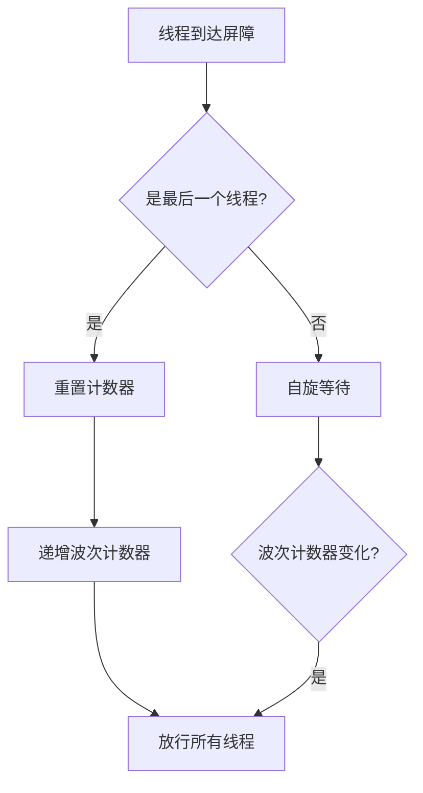
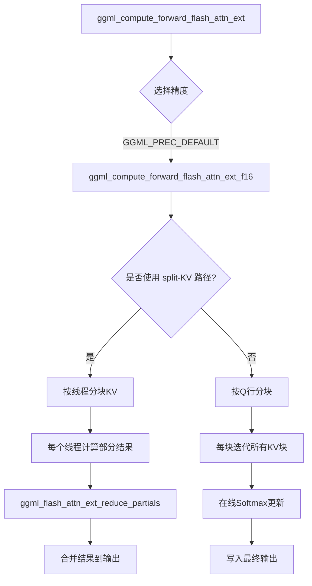
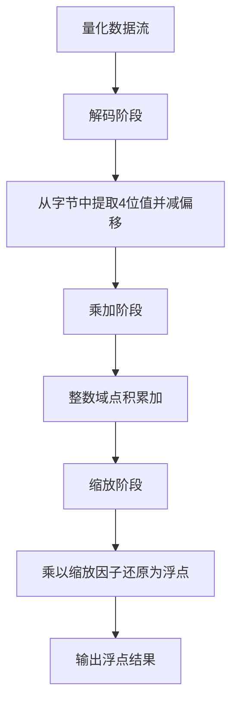
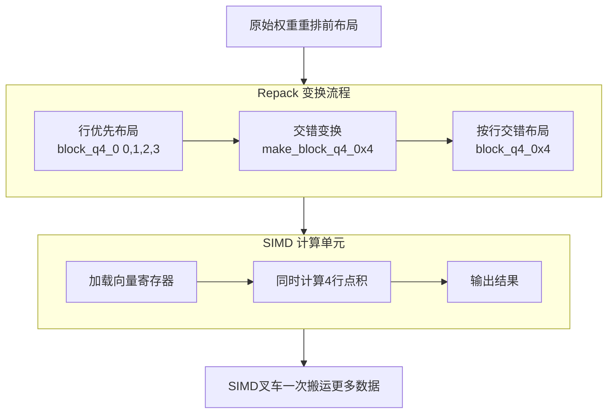
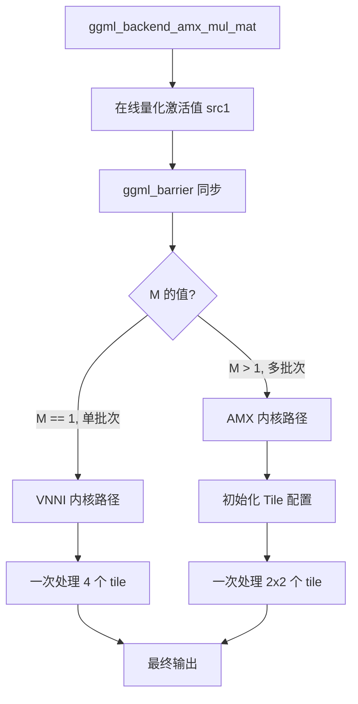
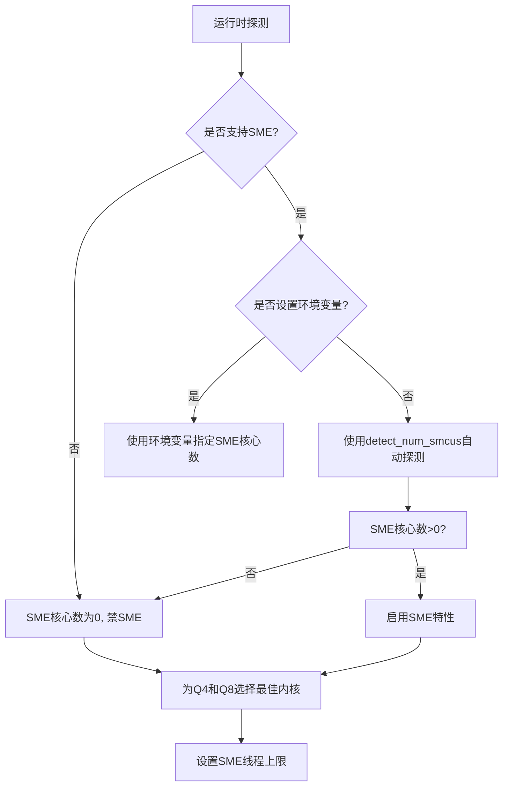
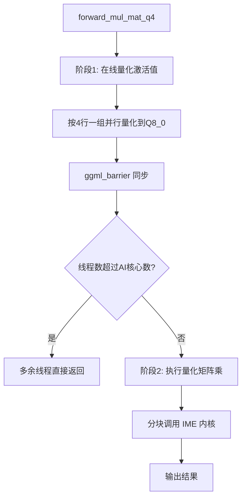
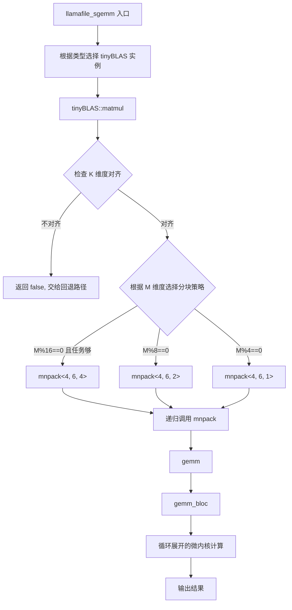
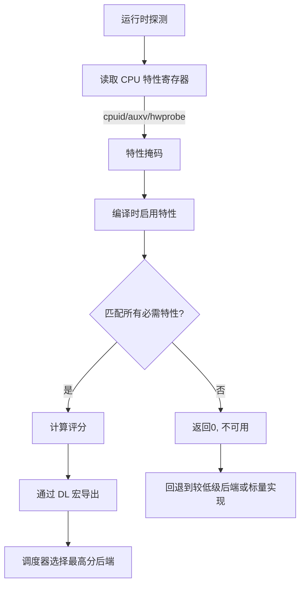
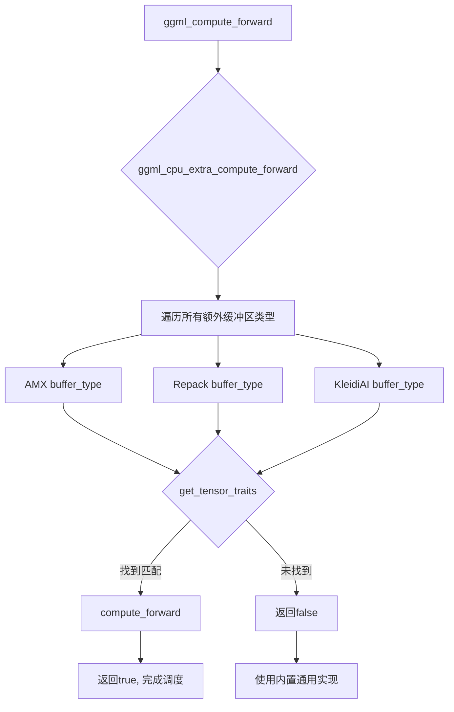

# 第36章 CPU 后端引擎（上）—— 跨国智能制造工厂的无尘车间

## 学习目标

-   理解GGML CPU后端的类型特征表（type traits）作为量化计算入口路由的设计
-   掌握线程池、屏障同步和NUMA感知调度的实现机制
-   理解模板化元素级算子（unary/binary ops）的类型分发与连续/非连续路径优化
-   掌握量化点积（vec_dot）的解码-乘加-缩放四阶段流水线
-   理解Repack机制如何将量化权重重排为SIMD友好的交错布局（interleaving）
-   了解Intel AMX的tile矩阵乘法原理与VNNI指令集在量化矩阵乘中的应用
-   掌握KleidiAI与Spacemit等架构专属后端的内核选择策略（SME/DOTPROD/IME）
-   理解llamafile tinyBLAS的跨平台GEMM设计与微内核分块策略
-   掌握架构特性探测（cpuid/hwcap）与后端评分（score）的动态调度机制
-   能够阅读并修改自定义CPU算子，理解从通用实现到SIMD优化的演进路径
-   掌握CPU后端扩展缓冲区类型（extra buffer types）的注册与调度机制
-   理解src1激活值的在线量化（quantize_mat）与from_float转换流程

## 36.1 生活类比

想象GGML CPU后端是一个**跨国智能制造工厂**，它要在不同国家（x86/ARM/RISC-V）生产同样的产品（张量计算），但每个国家的工厂设备（SIMD指令集）不同。

工厂的**产品身份证系统**是类型特征表（type traits）。每个张量类型（Q4_0/Q8_0）都有专属的加工手册（函数指针表），工人们拿到产品就查手册，决定用哪台机器加工。这个系统保证了成千上万种不同规格的原料都能被准确识别和分流。

工厂的**流水线调度室**则是线程池与屏障的中心，多个工人（线程）协同工作，屏障确保所有工人完成当前工序才能一起进入下一道工序。**多厂房布局**策略会根据原料仓库的位置调派最近的工人，减少搬运（内存访问）时间。

走进工厂车间，我们看到**标准加工车间**负责切割（reshape）、混合（add/mul）、质检（norm）等常规工序，而RoPE/Softmax/FlashAttention这些**精密仪器车间**则负责需要特殊公式和预处理的精密算子。在**压缩包装车间**（quants.c），FP32原料被压缩成INT4/INT8包装以降低运输成本，而**预分拣系统**（Repack机制）则把不同规格的箱子重新排列成4x4/8x8托盘，让SIMD叉车能一次性搬运更多数据。

针对特殊硬件，工厂还配备了**特种高精度机床**（Intel AMX）、**ARM原装进口设备**（KleidiAI）和**RISC-V定制流水线**（Spacemit IME），它们各自针对不同机床的特性进行深度优化。而**通用质量基准线**（llamafile SGEMM）则为所有工厂提供了稳定可靠的生产速度参考。

最后，工厂的**设备性能评级系统**（架构特性评分）会在开机时检测机床型号，自动选择最优生产线配置，而**特殊材料通道**（Extra Buffer Types）则确保不同物料走各自的物流通道。整个工厂的运作，就是为了在计算前将原料临时压缩（在线量化），节省存储空间，实现最高效的生产。

## 36.2 源码地图

```
ggml/src/ggml-cpu/
├── arch-fallback.h                   # 平台架构回退宏定义
│   └── __main__                      # 通用实现符号映射宏
├── common.h                          # 类型转换与工具函数
│   ├── type_conversion_table<T>      # FP16/BF16/FP32类型转换模板
│   ├── get_thread_range()            # 线程行范围划分
│   ├── f32_to_f16/f16_to_f32/f32_to_bf16/bf16_to_f32/i32_to_f32/f32_to_i32 # 类型转换
│   └── ggml_fa_tile_config           # FlashAttention瓦片配置
├── ggml-cpu-impl.h                   # 内部实现与SIMD辅助
│   ├── ggml_compute_params           # 线程计算参数结构
│   ├── ggml_threadpool_chunk_set/add # 分块计数原子操作
│   ├── ggml_barrier()                # 屏障同步声明
│   ├── 多架构SIMD辅助函数            # vaddvq_f32/vzip1_u8/ggml_vec_xl_u8x2/ggml_vqtbl1q_s8等
│   └── 架构特性初始化                # ggml_init_arm_arch_features / ggml_init_riscv_arch_features
├── ggml-cpu.c                        # CPU核心调度与类型特征
│   ├── 类型系统
│   │   ├── ggml_get_type_traits_cpu()    # 类型特征表查询
│   │   └── MMID_ROW_MAPPING / matrix_rows  # MoE行映射
│   ├── 线程池基础
│   │   ├── ggml_thread_cpu_relax()   # CPU让步指令
│   │   ├── ggml_barrier()            # 屏障同步实现
│   │   ├── ggml_threadpool_chunk_set/add # 分块管理
│   │   └── ggml_is_numa() / ggml_get_numa_affinity() # NUMA检查
│   ├── NUMA管理
│   │   └── ggml_numa_init()          # NUMA拓扑初始化
│   ├── 张量工具
│   │   ├── ggml_new_i32/f32          # 创建标量张量
│   │   ├── ggml_set_i32/f32          # 设置张量值
│   │   ├── ggml_get/set_i32/f32_1d/nd # 元素级读写
│   │   └── ggml_unravel_index        # 索引转换
│   ├── 矩阵乘法
│   │   ├── ggml_compute_forward_mul_mat() # GEMM主函数
│   │   ├── ggml_compute_forward_mul_mat_one_chunk() # 分块计算
│   │   ├── ggml_compute_forward_mul_mat_id()  # MoE前向
│   │   └── ggml_compute_forward_mul_mat_id_one_chunk() # MoE分块
│   ├── 计算图调度
│   │   ├── ggml_compute_forward()    # 算子分发器
│   │   ├── ggml_get_n_tasks()        # 任务数估算
│   │   ├── ggml_graph_plan()         # 执行计划生成
│   │   ├── ggml_graph_compute()      # 图执行入口
│   │   ├── ggml_graph_compute_with_ctx() # 带上下文执行
│   │   └── ggml_cpu_extra_compute_forward  # 扩展缓冲区分发
│   ├── 线程池实现
│   │   ├── set_numa_thread_affinity()    # NUMA线程绑定
│   │   ├── clear_numa_thread_affinity()  # 清除绑定
│   │   ├── ggml_thread_apply_affinity()  # CPU掩码应用
│   │   ├── ggml_thread_apply_priority()  # 优先级设置
│   │   ├── ggml_thread_cpumask_is_valid/next # CPU掩码辅助
│   │   ├── ggml_threadpool_new/free()    # 线程池生命周期
│   │   ├── ggml_threadpool_pause/resume() # 暂停/恢复
│   │   ├── ggml_graph_compute_thread()   # 主工作线程
│   │   ├── ggml_graph_compute_secondary_thread() # 次级工作线程
│   │   ├── ggml_graph_compute_kickoff()  # 计算启动
│   │   ├── ggml_graph_compute_thread_ready()  # 线程就绪检查
│   │   ├── ggml_graph_compute_poll_for_work() # 轮询工作
│   │   └── ggml_graph_compute_check_for_work() # 检查工作
│   └── 特性查询
│       ├── ggml_cpu_init()           # CPU初始化与GELU表构建
│       └── ggml_cpu_has_*()          # AVX512/NEON/SVE/VXE/WASM等特性检测
├── ggml-cpu.cpp                      # 后端注册与设备接口
│   ├── ggml_backend_cpu_get_extra_buffer_types() # 扩展缓冲区列表
│   ├── ggml_backend_cpu_init()       # 后端初始化
│   ├── ggml_backend_cpu_get_features() # 特性列表
│   ├── ggml_backend_cpu_get_proc_address() # 动态符号查找
│   ├── ggml_backend_cpu_reg()        # 后端注册
│   ├── ggml_backend_cpu_graph_plan_create/free/compute # 图计划管理
│   ├── ggml_backend_cpu_graph_compute() # 直接图计算
│   ├── ggml_backend_cpu_set_n_threads/threadpool/abort_callback/use_ref # 配置接口
│   └── ggml_backend_cpu_device_*     # 设备属性查询
├── ops.cpp                           # 通用算子实现(部分)
│   ├── 类型处理
│   │   ├── cmp_argsort / cmp_top_k   # 排序比较器
│   ├── 基础操作
│   │   ├── ggml_compute_forward_dup* # 张量复制/类型转换
│   │   ├── ggml_compute_forward_add* # 加法系列(含量化)
│   │   ├── ggml_compute_forward_acc  # 累加
│   │   ├── ggml_compute_forward_sum/mean/argmax/cumsum/count_equal # 归约
│   │   ├── ggml_compute_forward_repeat/repeat_back # 重复/还原
│   │   └── ggml_compute_forward_concat # 拼接
│   ├── 激活函数
│   │   ├── ggml_compute_forward_gelu*/silu*/swiglu*/geglu*/reglu* # 各种激活
│   │   ├── ggml_compute_forward_leaky_relu # 带泄漏ReLU
│   │   ├── ggml_compute_forward_step/hardsigmoid/hardswish # 硬激活
│   │   ├── ggml_compute_forward_exp/expm1/softplus # 指数族
│   │   └── ggml_compute_forward_xielu # XieLU
│   ├── 归一化
│   │   ├── ggml_compute_forward_norm / rms_norm / group_norm / l2_norm # 归一化族
│   │   └── ggml_compute_forward_rms_norm_back # 反向
│   ├── 注意力
│   │   ├── ggml_compute_forward_soft_max / soft_max_ext_back # SoftMax
│   │   ├── ggml_compute_forward_flash_attn_ext  # FlashAttention
│   │   ├── ggml_compute_forward_flash_attn_ext_tiled # 分块FA
│   │   ├── ggml_compute_forward_flash_attn_ext_f16 # F16优化版
│   │   ├── ggml_flash_attn_ext_reduce_partials # 部分结果归约
│   │   └── ggml_compute_forward_flash_attn_back # 反向
│   ├── 位置编码
│   │   ├── rope_yarn / rope_yarn_ramp   # YaRN算法
│   │   ├── ggml_rope_cache_init/ggml_mrope_cache_init # RoPE缓存
│   │   ├── rotate_pairs                # 旋转对
│   │   ├── ggml_compute_forward_rope / rope_back # RoPE前后向
│   │   └── ggml_compute_forward_get_rel_pos / add_rel_pos # 相对位置
│   ├── 卷积与池化
│   │   ├── ggml_compute_forward_conv_transpose_1d/2d # 转置卷积
│   │   ├── ggml_compute_forward_conv_2d / conv_3d # 卷积
│   │   ├── ggml_compute_forward_im2col*/im2col_back* # Im2Col变换
│   │   ├── ggml_compute_forward_conv_2d_dw # 深度可分离卷积
│   │   └── ggml_compute_forward_pool_1d/2d / pool_2d_back # 池化
│   ├── 状态空间模型
│   │   ├── ggml_compute_forward_ssm_conv / ssm_scan # SSM
│   │   ├── ggml_compute_forward_rwkv_wkv6 / wkv7  # RWKV
│   │   ├── ggml_compute_forward_gla           # GLA
│   │   └── ggml_compute_forward_gated_delta_net # DeltaNet
│   ├── 其他操作
│   │   ├── ggml_compute_forward_scale/set/cpy/cont # 变换
│   │   ├── ggml_compute_forward_get_rows/set_rows/get_rows_back # 行操作
│   │   ├── ggml_compute_forward_diag*/diag_mask* # 对角操作
│   │   ├── ggml_compute_forward_clamp/tri/fill # 填充裁剪
│   │   ├── ggml_compute_forward_upscale/pad*/roll/arange/timestep_embedding # 数据变换
│   │   ├── ggml_compute_forward_argsort/top_k # 排序
│   │   ├── ggml_compute_forward_win_part/win_unpart # 窗口操作
│   │   ├── ggml_compute_forward_cross_entropy_loss* # 交叉熵
│   │   ├── ggml_compute_forward_opt_step_adamw/sgd # 优化器
│   │   └── ggml_compute_forward_map_custom1/2/3/custom # 自定义算子
│   └── 分派函数
│       └── ggml_compute_forward_*    # 各类型分派入口
├── unary-ops.cpp/unary-ops.h         # 一元运算
│   ├── op_*                          # 25种一元算子实现
│   └── apply_unary_op*/unary_op*/vec_unary_op* # 模板分发
├── binary-ops.cpp/binary-ops.h       # 二元运算
│   ├── op_add/sub/mul/div            # 基础算术
│   ├── vec_binary_op_contiguous/non_contiguous # 连续/非连续路径
│   ├── apply_binary_op               # 应用函数
│   └── ggml_compute_forward_add/sub/mul/div # 算子入口
├── vec.cpp/vec.h                     # SIMD向量原语
│   ├── ggml_vec_dot_f32/f16/bf16     # 点积
│   ├── ggml_vec_silu_f32/f16         # SiLU
│   ├── ggml_vec_swiglu_f32/f16       # SwiGLU
│   ├── ggml_vec_cvar_f32             # 中心化方差
│   ├── ggml_vec_soft_max_f32         # SoftMax
│   ├── ggml_vec_log_soft_max_f32     # Log-SoftMax
│   ├── ggml_vec_set/cpy/add/sub/mul/div/acc/mad/scale # 基础向量操作
│   ├── ggml_vec_geglu*/geglu_*       # GEGLU变体
│   ├── ggml_vec_sum/max/argmax/norm/relu/leaky_relu # 归约与激活
│   ├── ggml_v_expf/silu*             # 向量化指数/SiLU
│   └── 多架构宏定义                  # GGML_F32_VEC 等
├── quants.c/quants.h                 # 量化点积
│   ├── quantize_row_q*_0/1/K/tq*/iq*_nl/xs/xxs # 行量化
│   └── ggml_vec_dot_*_generic        # 各格式点积通用实现
├── repack.cpp/repack.h               # 重排优化
│   ├── 块结构体
│   │   ├── block_q4_0x4/x8/x16       # Q4_0交错块
│   │   ├── block_q4_Kx8/x16          # Q4_K交错块
│   │   ├── block_q6_Kx8              # Q6_K交错块
│   │   ├── block_q8_0x4/x16          # Q8_0交错块
│   │   ├── block_q2_Kx8/x16          # Q2_K交错块
│   │   ├── block_iq4_nlx4/x8/x16     # IQ4_NL交错块
│   │   └── block_mxfp4x4/x8          # MXFP4交错块
│   ├── 打包函数
│   │   ├── make_block_q4_0x4/x8/x16      # 制作Q4_0块
│   │   ├── make_block_q4_Kx8/x16         # 制作Q4_K块
│   │   ├── make_block_q6_Kx8             # 制作Q6_K块
│   │   ├── make_block_q8_0x4/x16         # 制作Q8_0块
│   │   ├── make_block_q2_Kx8/x16         # 制作Q2_K块
│   │   ├── make_block_iq4_nlx4/x8/x16    # 制作IQ4_NL块
│   │   ├── make_block_mxfp4x4/x8         # 制作MXFP4块
│   │   └── repack_q*_to_*_bl         # 重排实现
│   ├── GEMV/GEMM通用实现
│   │   ├── ggml_gemv/gemm_*_generic_impl  # GEMV/GEMM模板实现
│   │   └── ggml_gemv/gemm_*_*_generic  # 各格式通用实现
│   ├── 模板分发
│   │   ├── gemv/gemm                 # 模板分发器
│   │   └── ggml_quantize_mat_t       # 量化模板
│   ├── 张量特质
│   │   ├── tensor_traits_base        # 特质基类
│   │   └── tensor_traits<BLOC_TYPE, INTER_SIZE, NB_COLS> # 特质模板
│   └── 管理函数
│       ├── ggml_repack_get_optimal_repack_type() # 最优类型选择
│       ├── ggml_backend_cpu_repack_buffer_type*  # 缓冲区管理
│       └── ggml_backend_cpu_repack_buffer_set_tensor # 张量设置
├── simd-gemm.h/simd-mappings.h       # SIMD GEMM
│   ├── simd_gemm_ukernel<RM,RN>      # 微内核
│   ├── simd_gemm()                   # 主函数
│   └── 架构辅助函数                  # neon_compute_fp16_to_fp32等
├── traits.cpp/traits.h               # 特质系统
│   ├── tensor_traits/extra_buffer_type # 纯虚基类
│   ├── ggml_cpu_extra_compute_forward # 扩展转发
│   ├── ggml_cpu_extra_work_size      # 工作量计算
│   └── ggml_backend_cpu_get_extra_buffer_types # 缓冲区列表
├── amx/                              # Intel AMX
│   ├── amx.cpp/amx.h                 # AMX缓冲区类型
│   │   ├── ggml::cpu::amx::tensor_traits   # AMX特质
│   │   ├── ggml::cpu::amx::extra_buffer_type # AMX缓冲区
│   │   └── ggml_backend_amx_buffer_type()  # 缓冲区类型工厂
│   ├── mmq.cpp/mmq.h                 # AMX矩阵乘
│   │   ├── Unroll<T>                 # 解环模板
│   │   ├── PackedTypes               # 打包类型映射
│   │   ├── do_compensate/do_unpack/is_type_qkk # 类型特征
│   │   ├── tile_config_t             # Tile配置
│   │   ├── ggml_tile_config_init()   # Tile配置初始化
│   │   ├── get_tile_size/get_row_size # 尺寸计算
│   │   ├── transpose_16x16_32bit/8x8_32bit # 转置
│   │   ├── quantize_row_q8_K_vnni    # VNNI量化
│   │   ├── from_float<T>()           # 浮点转换
│   │   ├── unpack_A/unpack_B         # 解包
│   │   ├── bytes_from_nibbles_32/64/128 # 半字节转字节
│   │   ├── pack_qs<T>/pack_B<T>      # 打包
│   │   ├── s8s8_compensation         # 符号补偿
│   │   ├── unpack_mins_and_scales    # 解包缩放
│   │   ├── scale_C()                 # 缩放C矩阵
│   │   ├── acc_C<T>                  # 累加器
│   │   ├── get_quants_size<T>        # 量化大小
│   │   ├── tinygemm_kernel_avx/vnni  # VNNI内核
│   │   ├── tinygemm_kernel_amx       # AMX内核
│   │   ├── convert_B_packed_format() # 格式转换
│   │   ├── ggml_backend_amx_get_alloc_size() # 分配大小
│   │   ├── ggml_backend_amx_convert_weight() # 权重转换
│   │   ├── ggml_backend_amx_desired_wsize() # 期望工作区
│   │   └── ggml_backend_amx_mul_mat() # AMX矩阵乘
│   └── common.h                      # 并行工具
│       ├── div_up/balance211         # 分块算法
│       ├── parallel_for/parallel_for_ggml # 并行循环
│       └── qtype_has_amx_kernels     # AMX内核检测
├── kleidiai/                         # ARM KleidiAI
│   ├── kleidiai.cpp/kleidiai.h       # KleidiAI后端
│   │   ├── cpu_feature_to_string()   # 特性字符串
│   │   ├── detect_num_smcus()        # 检测SMCU数量
│   │   ├── init_kleidiai_context()   # 初始化上下文
│   │   ├── kleidiai_*_weight_header/slot_ptr # 权重头操作
│   │   ├── kleidiai_collect_kernel_chain*  # 收集内核链
│   │   ├── ggml_ne()                 # 获取维度
│   │   ├── round_down()              # 向下取整
│   │   ├── transpose_f32kxn_f16nxk() # 转置转换
│   │   ├── tensor_traits             # 张量特质
│   │   ├── extra_buffer_type         # 扩展缓冲区
│   │   └── ggml_backend_cpu_kleidiai_buffer_type() # 缓冲区类型
│   ├── kernels.cpp/kernels.h         # 内核包装器
│   │   ├── kernel_info               # 内核信息
│   │   ├── lhs_packing_info/rhs_packing_info # 打包信息
│   │   ├── ggml_kleidiai_kernels     # 内核集合
│   │   ├── cpu_feature               # CPU特性枚举
│   │   ├── kernel_offs_fn*/kernel_run_fn* # 内核包装函数
│   │   ├── lhs_ps_fn*/lhs_offs_fn*/lhs_pack_* # LHS打包
│   │   ├── rhs_ps_fn*/rhs_stride_fn*/rhs_pack_* # RHS打包
│   │   ├── dequantize_row_qsi4c32*   # 反量化
│   │   ├── ggml_kleidiai_select_kernels*   # 内核选择
│   │   └── 内核表初始化              # gemm_gemv_kernels
│   └── 支持的特化
│       └── SME/DOTPROD/I8MM/SVE      # ARM特性支持
├── spacemit/                         # RISC-V Spacemit
│   ├── ime.cpp/ime.h                 # IME缓冲区与调度
│   │   ├── 结构体定义
│   │   │   ├── qnbitgemm_spacemit_ime_args  # GEMM参数
│   │   │   ├── block<N,INTER_SIZE>   # 量化块
│   │   │   └── block_with_zp         # 带零点块
│   │   ├── tensor_traits_base        # 特质基类
│   │   ├── tensor_traits<BLOC_TYPE,INTER_SIZE,NB_COLS> # 特质实现
│   │   │   ├── work_size()           # 工作区大小
│   │   │   ├── compute_forward()     # 前向计算
│   │   │   └── forward_mul_mat_q4()  # 量化矩阵乘
│   │   ├── tensor_traits_common      # 通用特质
│   │   │   ├── forward_norm_f32()    # Norm归一化
│   │   │   └── forward_rms_norm_f32() # RMSNorm归一化
│   │   ├── 辅助函数
│   │   │   ├── div_round_up/q8_blk_size # 计算工具
│   │   │   ├── QK_0<T>               # 块大小选择
│   │   │   ├── make_block_q4_0x16/q4_1x16 # 块制作
│   │   │   ├── repack_q4_0_to_q4_0_16_bl  # 重排
│   │   │   ├── repack_q4_1_to_q4_1_16_bl  # 重排
│   │   │   ├── repack_q4_k_to_q4_1_16_bl  # 重排
│   │   │   └── get_scale_min_k4      # 缩放提取
│   │   ├── repack()                  # 模板重排
│   │   ├── sqnbitgemm_spacemit_ime_i8i4 # IME GEMM
│   │   ├── extra_buffer_type         # 扩展缓冲区
│   │   ├── ggml_backend_cpu_riscv64_spacemit_buffer_type() # 缓冲区类型
│   │   └── 其他缓冲区接口            # 初始化/设置/字节数等
│   └── ime1_kernels.cpp/ime_kernels.h # IME内核
│       ├── quantize_a_4row_i8/quantize_a_row_i8 # 激活量化
│       ├── SQ4BitGemmM4Kernel_CompInt8*_Impl  # 4位内核实现
│       ├── SQ4BitGemmM1Kernel_CompInt8*_Impl  # 1位内核实现
│       ├── SQ4BitGemmM4/M1Kernel_CompInt8_DispatchOnBlkLen # 分派器
│       └── ime1::gemm_kernel_i8i4    # IME GEMM入口
├── llamafile/                        # llamafile SGEMM
│   ├── sgemm.cpp/sgemm.h             # 跨平台矩阵乘
│   │   ├── tinyBLAS<KN,D,V,TA,TB,TC> # 通用BLAS类
│   │   │   ├── matmul()              # 主入口
│   │   │   ├── mnpack()              # 分块包装
│   │   │   ├── gemm()                # 主函数
│   │   │   └── gemm_bloc<RM,RN>()    # 微内核
│   │   ├── tinyBLAS_RVV<LMUL>        # RVV特化
│   │   ├── tinyBLAS_Q0_ARM           # ARM量化
│   │   ├── tinyBLAS_Q0_AVX           # AVX量化
│   │   ├── tinyBLAS_HP16_PPC         # PPC半精度
│   │   ├── tinyBLAS_Q0_PPC           # PPC量化
│   │   ├── llamafile_sgemm_ppc_quantized # PPC量化实现
│   │   │   ├── packNormalInt4()      # 打包Int4
│   │   │   ├── packNormal()          # 打包常规
│   │   │   ├── process_q4_elements() # Q4处理
│   │   │   ├── compute()             # 计算
│   │   │   ├── save_res()/save_acc()/add_save_acc() # 结果保存
│   │   │   ├── unhalf()              # 半精度转换
│   │   │   ├── unpack_q4_to_q8()     # Q4到Q8解包
│   │   │   ├── vector_permute_store()* # 向量置换存储
│   │   │   ├── convert_and_scale_q8() # Q8转换缩放
│   │   │   ├── packNormal_q4_fp16()/packNormal_q8_fp16() # FP16打包
│   │   │   ├── mnpack()              # 分块包装
│   │   │   ├── KERNEL_4x8/8x4/8x8/Q0 # 内核
│   │   │   │   ├── gemm_small()      # 小矩阵
│   │   │   │   ├── gemm<>()          # 模板矩阵乘
│   │   │   │   └── kernel()          # 内核分发
│   │   │   └── matmul_tiled()        # 分块矩阵乘
│   │   └── llamafile_sgemm()         # 公开接口
│   └── 支持: AVX512/AVX2/NEON/SVE/VSX/RVV/ARM_PowerPC
├── hbm.cpp/hbm.h                     # 高带宽内存
│   └── ggml_backend_cpu_hbm_buffer_type() # HBM缓冲区
└── arch/                             # 架构专属实现
    ├── x86/cpu-feats.cpp             # x86特性检测
    │   ├── cpuid_x86 class           # CPUID封装
    │   └── ggml_backend_cpu_x86_score()     # 特性评分
    ├── x86/quants.c                  # AVX量化内核
    │   ├── SIMD辅助函数              # mul_sum_i8_pairs/hsum_float_8等
    │   ├── quantize_row_q8_0/q8_1    # 行量化
    │   ├── ggml_vec_dot_q4_0_q8_0    # Q4_0点积
    │   ├── ggml_vec_dot_q4_1_q8_1    # Q4_1点积
    │   ├── ggml_vec_dot_mxfp4_q8_0   # MXFP4点积
    │   ├── ggml_vec_dot_q5_0/q5_1    # Q5点积
    │   ├── ggml_vec_dot_q8_0_q8_0    # Q8_0点积
    │   ├── ggml_vec_dot_tq*_q8_K     # TQ点积
    │   ├── ggml_vec_dot_q2_K/q3_K/q4_K/q5_K/q6_K_q8_K # K-quant点积
    │   └── ggml_vec_dot_iq*_q8_K     # IQ系列点积
    ├── x86/repack.cpp                # AVX-512 Repack内核
    │   ├── SIMD辅助函数              # __avx512_f32cx8x2_load等
    │   ├── nearest_int()             # 快速取整
    │   ├── sum_i16_pairs_acc_*       # 累加辅助
    │   ├── mul_sum_us8_pairs_acc_*   # 乘加辅助
    │   ├── gemv_q4_b32_8x8_q8_0_lut_avx # LUT GEMV
    │   ├── gemm_q4_b32_8x8_q8_0_lut_avx # LUT GEMM
    │   ├── ggml_gemv_q*_generic      # 通用GEMV
    │   ├── ggml_gemm_q*_generic      # 通用GEMM
    │   └── ggml_gemv/gemm_*_8x8_q8_* # 8x8内核
    ├── arm/cpu-feats.cpp             # ARM特性检测
    │   ├── aarch64_features          # ARM特性结构
    │   └── ggml_backend_cpu_aarch64_score() # 评分
    ├── arm/quants.c                  # NEON/SVE量化内核
    │   ├── quantize_row_q8_0/q8_1    # NEON量化
    │   ├── ggml_vec_dot_q4_0/q4_1    # NEON点积
    │   ├── ggml_vec_dot_q5_0/q5_1    # Q5点积
    │   ├── ggml_vec_dot_q8_0_q8_0    # Q8点积
    │   ├── ggml_vec_dot_mxfp4/nvfp4  # MXFP4/NVFP4点积
    │   ├── ggml_vec_dot_tq*_q8_K     # TQ点积
    │   ├── ggml_vec_dot_q2_K/q3_K/q4_K/q5_K/q6_K_q8_K # K-quant点积
    │   └── ggml_vec_dot_iq*_q8_K     # IQ系列点积
    ├── arm/repack.cpp                # NEON Repack内核
    │   ├── decode_q_Kx8_6bit_scales  # 缩放解码
    │   ├── ggml_quantize_mat_q8_0_4x4/4x8 # 量化矩阵
    │   ├── ggml_gemv_q4_0_4x4/4x8/8x8_q8_0 # Q4_0 GEMV
    │   ├── ggml_gemv_iq4_nl/mxfp4    # IQ4/MXFP4 GEMV
    │   ├── ggml_gemv_q4_K/q5_K/q6_K  # K-quant GEMV
    │   ├── ggml_gemv_q8_0_4x4/4x8    # Q8_0 GEMV
    │   └── ggml_gemm_q*_8x4/8x8      # GEMM内核
    ├── powerpc/cpu-feats.cpp         # POWER特性检测
    │   ├── powerpc_features          # POWER特性结构
    │   └── ggml_backend_cpu_powerpc_score() # 评分
    ├── powerpc/quants.c              # VSX量化内核
    │   ├── quantize_row_q8_0/q8_1    # VSX量化
    │   ├── ggml_vec_dot_q4_0/q4_1    # VSX点积
    │   ├── ggml_vec_dot_mxfp4        # MXFP4点积
    │   ├── ggml_vec_dot_q5_0/q5_1    # Q5点积
    │   ├── ggml_vec_dot_q8_0_q8_0    # Q8点积
    │   ├── ggml_vec_dot_q2_K/q3_K/q4_K/q5_K/q6_K_q8_K # K-quant点积
    │   └── ggml_vec_dot_iq*_q8_K     # IQ系列点积
    ├── riscv/cpu-feats.cpp           # RISC-V特性检测
    │   ├── riscv64_features          # RISC-V特性结构
    │   └── ggml_backend_cpu_riscv64_score() # 评分
    ├── riscv/quants.c                # RVV量化内核
    │   ├── quantize_row_q8_0/q8_1/q8_K # RVV量化
    │   ├── ggml_vec_dot_q4_0/q4_1    # Q4点积
    │   ├── ggml_vec_dot_q5_0/q5_1    # Q5点积
    │   ├── ggml_vec_dot_q8_0_q8_0    # Q8点积
    │   ├── ggml_vec_dot_q2_K/q3_K/q4_K/q5_K/q6_K # K-quant点积
    │   ├── ggml_vec_dot_iq*_q8_K     # IQ系列点积
    │   └── ggml_vec_dot_tq*_q8_K     # TQ点积
    ├── riscv/repack.cpp              # RVV Repack内核
    │   ├── ggml_gemv_q4_0_8x8/16x1_q8_0 # Q4_0 GEMV
    │   ├── ggml_gemv_q4_K/q2_K_16x1_q8_K # K GEMV
    │   ├── ggml_gemv_iq4_nl_16x1_q8_0 # IQ4_NL GEMV
    │   ├── ggml_gemv_q8_0_16x1_q8_0  # Q8_0 GEMV
    │   └── ggml_gemm_q*_16x1_q8_*    # GEMM 16x1
    ├── loongarch/quants.c            # LSX/LASX量化内核
    │   ├── SIMD辅助函数              # lsx_*辅助函数
    │   ├── ggml_vec_dot_q4_0/q4_1    # Q4点积
    │   ├── ggml_vec_dot_q5_0/q5_1    # Q5点积
    │   ├── ggml_vec_dot_q8_0_q8_0    # Q8点积
    │   ├── ggml_vec_dot_q2_K/q3_K/q4_K/q5_K/q6_K # K-quant点积
    │   └── ggml_vec_dot_iq*_q8_K     # IQ系列点积
    ├── s390/cpu-feats.cpp            # z15/z16特性检测
    │   ├── s390x_features            # s390特性结构
    │   └── ggml_backend_cpu_s390x_score() # 评分
    ├── s390/quants.c                 # VXE量化内核
    │   ├── quantize_row_q8_0/q8_1    # VXE量化
    │   ├── ggml_vec_dot_q4_0/q4_1    # Q4点积
    │   ├── ggml_vec_dot_q5_0/q5_1    # Q5点积
    │   ├── ggml_vec_dot_q8_0_q8_0    # Q8点积
    │   ├── ggml_vec_dot_q3_K/q4_K/q5_K/q6_K # K-quant点积
    │   └── ggml_vec_dot_iq4_nl/iq4_xs # IQ4点积
    └── wasm/quants.c                 # WASM SIMD128量化内核
        ├── quantize_row_q8_0/q8_1/q8_K # WASM量化
        ├── ggml_vec_dot_q4_0/q4_1    # Q4点积
        ├── ggml_vec_dot_q5_0/q5_1    # Q5点积
        ├── ggml_vec_dot_q8_0_q8_0    # Q8点积
        └── ggml_vec_dot_q2_K/q3_K/q4_K/q5_K/q6_K # K-quant点积
```

## 36.3 CPU 后端核心设施 —— 引擎的“地基与调度室”

我们先从工厂的“地基”开始，看看支撑整个引擎运转的**类型特征表（type traits）**。

### 36.3.1 ggml_get_type_traits_cpu —— 量化类型特征表的入口路由

GGML 的 CPU 后端像一座精密的`压缩机工厂`，每一种不同的`原料类型`（比如Q4_0、Q8_0）都需要对应的`专用压缩模具`，这套模具的映射关系就保存在**类型特征表（type traits）**中。`ggml_get_type_traits_cpu()` 就像一个智能仓库管理员，给它一个类型编号，它立刻把对应的`模具清单`（函数指针表）递给你——包括怎么把FP32压缩成Q8_0，怎么把Q4_0里的半字节解压出来，怎么用最高效的方式计算Q4_0×Q8_0这种`压缩后点积`。这个特征表是一切SIMD优化的`入口路由`，也是整个CPU后端的神经中枢。

源码路径：`ggml/src/ggml-cpu/ggml-cpu.c` - `ggml_get_type_traits_cpu()` （226-228行）

```c
const struct ggml_type_traits_cpu * ggml_get_type_traits_cpu(enum ggml_type type) {
    // 根据枚举类型 type 直接索引全局类型特征表 type_traits_cpu，返回对应指针
    return &type_traits_cpu[type];
}
```

这段代码定义了一个极简的查询函数，它通过`枚举类型`直接索引全局静态数组，实现了`O(1)`时间复杂度的类型特征查找。`type_traits_cpu` 数组中每个元素都是一个结构体，里面存有该量化类型的`加工手册`，包括 `vec_dot`（点积函数）、`from_float`（转换函数）、`to_float`（反量化函数）等指针，这些指针指向的具体实现会根据编译时的目标架构（x86/ARM/RISC-V）和指令集（AVX/NEON/RVV）由宏和编译器自动选择，实现了`一处调用、处处受益`的架构无关设计。

### 36.3.2 ggml_new_i32/f32 —— 工厂的“基础五金工具”

张量工具函数（`ggml_new_i32/f32`、`ggml_set_i32/f32`等）是工厂里的`基础五金工具`，负责创建和修改张量。而 `ggml_cpu_fp32_to_fp16/bf16` 等函数则是`格式转换机`，能把FP32原料压制成FP16/BF16这种更紧凑的`半成品`，为后续的量化压缩做准备。

源码路径：`ggml/src/ggml-cpu/ggml-cpu.c` - `ggml_new_f32()` （502-508行）

```c
struct ggml_tensor * ggml_new_f32(struct ggml_context * ctx, float value) {
    GGML_ASSERT(!ggml_get_no_alloc(ctx));
    // 创建一个包含单个 float 值的一维 F32 张量
    struct ggml_tensor * result = ggml_new_tensor_1d(ctx, GGML_TYPE_F32, 1);
    // 将初始值写入张量
    ggml_set_f32(result, value);
    return result;
}
```

这段代码展示了如何创建一个标量F32张量。它先通过 `ggml_new_tensor_1d` 在给定的 `ggml_context` 中分配一个包含单个元素的一维张量，然后调用 `ggml_set_f32` 将传入的 `value` 写入该张量。这是GGML中创建标量参数（如学习率、缩放因子等）的标准方式，体现了GGML`上下文分配器`的内存管理模式——所有张量都在一个预先分配的内存池中创建，极大地减少了动态内存分配的开销。

### 36.3.3 ggml_barrier —— 工厂的“流水线调度室”

在多核CPU上工作，就像工厂里多条流水线并行运转。`ggml_graph_compute_thread()` 是每个`工人`（线程）的主要工作循环，它从`任务队列`中领取`加工图纸`（计算图节点）。为了避免不同流水线之间进度不一致导致`产品错位`，需要用 `ggml_barrier()` 实现`同步屏障`——所有工人必须完成当前批次的所有工序，才能一起进入下一个工序。这就好比体育比赛中的`集体项目`，必须等所有队员都完成当前动作，裁判才能吹哨进入下一轮。

源码路径：`ggml/src/ggml-cpu/ggml-cpu.c` - `ggml_barrier()` （345-378行）

```c
void ggml_barrier(struct ggml_threadpool * tp) {
    // 从线程池中读取当前参与计算图的线程数 n_threads
    int n_threads = atomic_load_explicit(&tp->n_graph, memory_order_relaxed) & GGML_THREADPOOL_N_THREADS_MASK;
    // 如果只有一个线程，就不需要同步，直接返回
    if (n_threads == 1) {
        return;
    }
#ifdef GGML_USE_OPENMP
    // OpenMP模式下使用库提供的屏障指令
    #pragma omp barrier
#else
    // 记录当前已经通过屏障的"波次"数
    int n_passed = atomic_load_explicit(&tp->n_barrier_passed, memory_order_relaxed);
    // 原子地将到达屏障的线程计数加1，并返回旧值
    int n_barrier = atomic_fetch_add_explicit(&tp->n_barrier, 1, memory_order_seq_cst);
    // 如果当前是最后一个到达屏障的线程（n_barrier == n_threads - 1）
    if (n_barrier == (n_threads - 1)) {
        // 重置到达计数为0，为下一波屏障做准备
        atomic_store_explicit(&tp->n_barrier, 0, memory_order_relaxed);
        // 增加已通过屏障的波次数，以原子方式通知其他线程
        atomic_fetch_add_explicit(&tp->n_barrier_passed, 1, memory_order_seq_cst);
        // 最后一个线程直接返回，其他线程将被唤醒
        return;
    }
    // 非最后一个线程：自旋等待，直到已通过屏障的波次数发生变化
    while (atomic_load_explicit(&tp->n_barrier_passed, memory_order_relaxed) == n_passed) {
        ggml_thread_cpu_relax(); // 执行CPU让步指令，减少总线竞争
    }
    // 使用内存栅栏确保所有内存操作在读屏障之后对其他线程可见
    atomic_thread_fence(memory_order_seq_cst);
#endif
}
```

这段代码实现了一个基于`原子操作`的`跨线程屏障`。在原生线程模式下，它使用了经典的`sense-reversing barrier`算法：每个线程到达屏障时原子地递增计数器，最后一个到达的线程重置计数器并通过递增另一个`波次计数器`来放行其他所有等待线程。此设计无需操作系统内核锁，仅靠原子操作和自旋就实现了极低延迟的线程同步，是高性能并行计算中常见的`无锁`同步技术。下图展示了这个流程：



### 36.3.4 ggml_numa_init —— 工厂的“多厂房布局”

当工厂横跨多个物理`厂房`（NUMA节点）时，原料存放在不同的`仓库`里。`ggml_numa_init()` 会检测这些仓库的位置，并根据 DISTRIBUTE/ISOLATE/NUMACTL 三种策略，智能地调度工人去`最近`的仓库取料，减少`搬运`（内存访问）时间。

源码路径：`ggml/src/ggml-cpu/ggml-cpu.c` - `ggml_numa_init()` （402-466行）

```c
void ggml_numa_init(enum ggml_numa_strategy numa_flag) {
    // 如果NUMA节点数已经大于0，说明已经初始化过了，直接返回
    if (g_state.numa.n_nodes > 0) {
        fprintf(stderr, "ggml_numa_init: NUMA already initialized\n");
        return;
    }
#if defined(__gnu_linux__)
    struct stat st;
    char path[256];
    int rv;
    // 保存NUMA策略（DISTRIBUTE/ISOLATE/NUMACTL）
    g_state.numa.numa_strategy = numa_flag;
    // 获取当前进程的CPU亲和性掩码作为基线
    g_state.numa.cpuset = ggml_get_numa_affinity();
    // 枚举系统上的NUMA节点，扫描 /sys/devices/system/node/node%u 目录是否存在
    while (g_state.numa.n_nodes < GGML_NUMA_MAX_NODES) {
        rv = snprintf(path, sizeof(path), "/sys/devices/system/node/node%u", g_state.numa.n_nodes);
        GGML_ASSERT(rv > 0 && (unsigned)rv < sizeof(path));
        if (stat(path, &st) != 0) { break; }
        ++g_state.numa.n_nodes;
    }
    // 枚举系统上的总CPU数，扫描 /sys/devices/system/cpu/cpu%u 目录
    while (g_state.numa.total_cpus < GGML_NUMA_MAX_CPUS) {
        rv = snprintf(path, sizeof(path), "/sys/devices/system/cpu/cpu%u", g_state.numa.total_cpus);
        GGML_ASSERT(rv > 0 && (unsigned)rv < sizeof(path));
        if (stat(path, &st) != 0) { break; }
        ++g_state.numa.total_cpus;
    }
    // 获取当前CPU ID和当前NUMA节点ID
    uint current_cpu;
    int getcpu_ret = 0;
    getcpu_ret = getcpu(&current_cpu, &g_state.numa.current_node);
    // 如果检测失败，重置节点数量并返回
    if (g_state.numa.n_nodes < 1 || g_state.numa.total_cpus < 1 || getcpu_ret != 0) {
        g_state.numa.n_nodes = 0;
        return;
    }
    // 遍历每个NUMA节点，扫描该节点的CPU列表 /sys/devices/system/node/node%u/cpu%u
    for (uint32_t n = 0; n < g_state.numa.n_nodes; ++n) {
        struct ggml_numa_node * node = &g_state.numa.nodes[n];
        node->n_cpus = 0;
        for (uint32_t c = 0; c < g_state.numa.total_cpus; ++c) {
            rv = snprintf(path, sizeof(path), "/sys/devices/system/node/node%u/cpu%u", n, c);
            GGML_ASSERT(rv > 0 && (unsigned)rv < sizeof(path));
            if (stat(path, &st) == 0) {
                node->cpus[node->n_cpus++] = c;
            }
        }
    }
#else
    UNUSED(numa_flag);
#endif
}
```

这段代码负责初始化NUMA拓扑信息。在Linux系统下，它通过扫描`/sys/devices/system/node/`和`/sys/devices/system/cpu/`目录下的虚拟文件系统，枚举出所有NUMA节点及其关联的CPU列表，同时获取当前进程运行的节点和CPU。这些拓扑信息为后续`set_numa_thread_affinity()`按NUMA策略绑定线程到特定CPU核心提供了`地图`。这个探测过程完全基于`sysfs`接口，无需特权，是典型的用户态硬件拓扑发现机制。

### 36.3.5 ggml_compute_forward_mul_mat_one_chunk —— 矩阵乘法的“分块加工车间”

现在我们来到工厂最繁忙的车间——矩阵乘法加工车间。`ggml_compute_forward_mul_mat_one_chunk()` 是这个车间的核心工序，它负责将大矩阵切成小块，分发给不同工人并行加工。

源码路径：`ggml/src/ggml-cpu/ggml-cpu.c` - `ggml_compute_forward_mul_mat_one_chunk()` （1148-1227行）

```c
static void ggml_compute_forward_mul_mat_one_chunk(...) {
    // 从输出张量 dst 中获取其两个源张量 src0（权重）和 src1（激活）
    const struct ggml_tensor * src0 = dst->src[0];
    const struct ggml_tensor * src1 = dst->src[1];
    GGML_TENSOR_BINARY_OP_LOCALS
    // 判断 src1 是否在内存中连续
    const bool src1_cont = ggml_is_contiguous(src1);
    // 从类型特征表中获取 src0 类型的向量点积函数 vec_dot
    ggml_vec_dot_t const vec_dot      = type_traits_cpu[type].vec_dot;
    // 获取 src0 类型对应的向量点积输入类型（例如 Q4_0 使用 Q8_0 作为点积类型）
    enum ggml_type const vec_dot_type = type_traits_cpu[type].vec_dot_type;
    // 计算 src1 多维维度上的广播系数
    const int64_t r2 = ne12 / ne02;
    const int64_t r3 = ne13 / ne03;
    // 无实际计算任务则直接返回
    if (ir0_start >= ir0_end || ir1_start >= ir1_end) {
        return;
    }
    // 如果 src1 已经是点积类型，直接使用其数据，否则使用工作缓冲区中的临时数据
    const void * wdata = (src1->type == vec_dot_type) ? src1->data : params->wdata;
    // 计算点积类型下的一行数据大小
    const size_t row_size = ggml_row_size(vec_dot_type, ne10);
    assert(ne12 % ne02 == 0);
    assert(ne13 % ne03 == 0);
    // 定义数据块大小：一次处理 16 行 x 16 列
    const int64_t blck_0 = 16;
    const int64_t blck_1 = 16;
    // 计算 src1 每一列的跨度（连续则为行大小，否则为实际的 nb11 字节偏移）
    const size_t src1_col_stride = src1_cont || src1->type != vec_dot_type ? row_size : nb11;
    float tmp[32]; // 临时缓冲区，用于存放一次向量点积的结果
    for (int64_t iir1 = ir1_start; iir1 < ir1_end; iir1 += blck_1) {           // 外层循环遍历列块
        for (int64_t iir0 = ir0_start; iir0 < ir0_end; iir0 += blck_0) {       // 内层循环遍历行块
            for (int64_t ir1 = iir1; ir1 < iir1 + blck_1 && ir1 < ir1_end; ir1 += num_rows_per_vec_dot) {
                // 解析 src1 当前列的 (i1, i2, i3) 三维坐标
                const int64_t i13 = (ir1 / (ne12 * ne1));
                const int64_t i12 = (ir1 - i13 * ne12 * ne1) / ne1;
                const int64_t i11 = (ir1 - i13 * ne12 * ne1 - i12 * ne1);
                // 通过广播系数映射到 src0 的 (i02, i03) 坐标
                const int64_t i03 = i13 / r3;
                const int64_t i02 = i12 / r2;
                const int64_t i1 = i11;
                const int64_t i2 = i12;
                const int64_t i3 = i13;
                // 定位 src0 的当前权重块行
                const char * src0_row = (const char*)src0->data + (0 + i02 * nb02 + i03 * nb03);
                // 定位 src1 的当前激活列（可能从工作区读取）
                const char * src1_col = (const char*)wdata +
                    (src1_cont || src1->type != vec_dot_type
                        ? (i11 + i12 * ne11 + i13 * ne12 * ne11) * row_size
                        : (i11 * nb11 + i12 * nb12 + i13 * nb13));
                // 定位输出矩阵中的目标位置
                float * dst_col = (float*)((char*)dst->data + (i1 * nb1 + i2 * nb2 + i3 * nb3));
                // 内层循环遍历 src0 的行，批量调用向量点积函数计算
                for (int64_t ir0 = iir0; ir0 < iir0 + blck_0 && ir0 < ir0_end; ir0 += num_rows_per_vec_dot) {
                    vec_dot(ne00, &tmp[ir0 - iir0], (num_rows_per_vec_dot > 1 ? 16 : 0), src0_row + ir0 * nb01, (num_rows_per_vec_dot > 1 ? nb01 : 0), src1_col, (num_rows_per_vec_dot > 1 ? src1_col_stride : 0), num_rows_per_vec_dot);
                }
                // 将临时结果按行写入输出矩阵
                for (int cn = 0; cn < num_rows_per_vec_dot; ++cn) {
                    memcpy(&dst_col[iir0 + cn * nb1 / nb0], tmp + (cn * 16), (MIN(iir0 + blck_0, ir0_end) - iir0) * sizeof(float));
                }
            }
        }
    }
}
```

这段代码实现了矩阵乘法核心的`分块计算`逻辑。它通过三重循环将大规模矩阵乘法拆解成一系列更小的`块操作`，对每个块内使用`类型特征表`中获取的`vec_dot`函数直接完成向量点积。同时，它利用多维坐标映射与广播（`r2`、`r3`）支持矩阵的批量乘法（batch multiplication），并且对src1做了`数据预转换`处理——如果输入类型与点积类型不一致，会先从工作区读取转换后的临时数据。这种将大矩阵切成小块、逐块计算的设计，显著提高了CPU缓存的命中率，是多线程并行矩阵乘法的基础。

```mermaid
graph TD
    A[ggml_graph_compute] --> B[ggml_graph_compute_thread]
    B --> C{遍历计算图节点}
    C --> D[ggml_compute_forward]
    D --> E{判断算子类型}
    E -->|MUL_MAT| F[ggml_compute_forward_mul_mat]
    F --> G[ggml_compute_forward_mul_mat_one_chunk]
    G --> H[type_traits_cpu[type].vec_dot]
    H --> I[输出结果到dst]
    E -->|其他算子| J[对应算子实现]
    B --> K{需要同步?}
    K -->|是| L[ggml_barrier]
    K -->|否| M[继续下一节点]
```

## 36.4 通用算子与一元运算 —— 张量的“元素级加工厂”

现在我们把眼光放到`元素级加工厂`，这里的每一台`机器`都负责对张量中的每个元素执行相同的`原子操作`。GGML通过模板编程将这类算子大规模泛化，从简单的加减乘除到复杂的归一化、注意力机制，都遵循一套统一的`流水线`。

### 36.4.1 ggml_compute_forward_unary —— 一元运算：一个输入，一个输出

`unary-ops.cpp` 中的 `ggml_compute_forward_unary()` 是模板化的元素级运算核心。它接收一个`函数指针`作为模板参数，通过底层的 `type_conversion_table` 将不同数据类型（F32/F16/BF16）统一到F32进行运算，再转换回目标类型。GELU、SiLU、ReLU 等激活函数都是通过这种方式实现的。

源码路径：`ggml/src/ggml-cpu/unary-ops.cpp` - `vec_unary_op()` （102-111行）

```cpp
template <float (*op)(float), typename src0_t, typename dst_t>
static inline void vec_unary_op(int64_t n, dst_t * y, const src0_t * x) {
    // 从类型转换表中提取 src0 类型转 F32 的函数
    constexpr auto src0_to_f32 = type_conversion_table<src0_t>::to_f32;
    // 从类型转换表中提取 F32 转 dst 类型的函数
    constexpr auto f32_to_dst  = type_conversion_table<dst_t >::from_f32;
    // 对向量中每个元素执行：读取 -> 转F32 -> 应用操作 -> 转回目标类型 -> 写入
    for (int i = 0; i < n; i++) {
        y[i] = f32_to_dst(op(src0_to_f32(x[i])));
    }
}
```

这段代码是一个`通用一元运算向量化框架`。它通过模板参数`op`将具体的数学运算（如绝对值、指数、激活函数）注入到循环内部，通过`type_conversion_table`将源类型和目标类型统一抽象，从而一份代码即可处理 F32、F16、BF16 等多种数据类型的组合。该设计通过`编译期模板特化`消除了大部分运行时开销，并且由于循环体极其简单，编译器可以轻松地进行`自动向量化`，将标量循环优化为SIMD指令。

### 36.4.2 ggml_compute_forward_add_non_quantized —— 二元运算：双输入融合

`binary-ops.cpp` 则进一步处理两个张量的逐元素运算。`vec_binary_op_contiguous()` 是连续内存路径下的高效实现，而 `vec_binary_op_non_contiguous()` 则处理广播语义下的非连续访问。二者通过 `apply_binary_op()` 进行统一调度。

源码路径：`ggml/src/ggml-cpu/binary-ops.cpp` - `apply_binary_op()` （58-115行）

```cpp
template <float (*op)(float, float), typename src0_t, typename src1_t, typename dst_t>
static void apply_binary_op(const ggml_compute_params * params, ggml_tensor * dst) {
    const ggml_tensor * src0 = dst->src[0];
    const ggml_tensor * src1 = dst->src[1];

    GGML_ASSERT(ggml_can_repeat(src1, src0) && ggml_are_same_shape(src0, dst));

    const auto [ir0, ir1] = get_thread_range(params, src0);
    const bool is_src1_contiguous_rows = ggml_is_contiguous_rows(src1);

    // 遍历分配给当前线程的行范围
    for (int64_t ir = ir0; ir < ir1; ++ir) {
        // 解析三维索引
        // ...
        if (is_src1_contiguous_rows) {
            const int64_t nr0 = ne00 / ne10;
            // 对于 src1 的每一行，执行高效的向量化二元操作
            for (int64_t r = 0; r < nr0; ++r) {
                vec_binary_op_contiguous<op>(ne10, dst_ptr + r*ne10, src0_ptr + r*ne10, src1_ptr);
            }
        } else {
            // 非连续行路径，逐元素处理
            vec_binary_op_non_contiguous<op>(ne0, ne10, nb10, dst_ptr, src0_ptr, src1_ptr);
        }
    }
}
```

这段代码定义了连续内存路径下的二元运算核心逻辑。与一元运算类似，它同样通过模板参数注入`op`操作，通过类型转换表统一数据类型接口。该函数首先根据当前线程的索引计算其负责的行范围，然后针对每行，判断`src1`是否为连续行——如果是，则可以使用`vec_binary_op_contiguous`进行高效的向量化操作；否则，回退到`vec_binary_op_non_contiguous`处理非连续情况。由于输入`x`和`y`以及输出`z`在内存中都是`连续排列`的，编译器能生成极其高效的`向量化循环`，实现加、减、乘、除等元素操作的`吞吐最大化`。

### 36.4.3 ggml_compute_forward_soft_max_f32 —— 归一化与注意力：精密仪器车间

`ops.cpp` 则实现了更复杂的神经网络算子。`ggml_compute_forward_soft_max_f32()` 是带ALiBi位置偏置、掩码和sink归一化的完整Softmax实现，`ggml_compute_forward_flash_attn_ext_f16()` 则是Flash Attention在CPU上的实现，利用在线softmax算法高效处理长序列。这些算子构成了Transformer推理的基础积木。

源码路径：`ggml/src/ggml-cpu/ops.cpp` - `ggml_compute_forward_soft_max_f32()` （723-804行）

```c
static void ggml_compute_forward_soft_max_f32(
        const ggml_compute_params * params,
              ggml_tensor * dst) {
    // 获取输入张量 src0，可选的掩码张量 src1，可选的sink张量 src2
    const ggml_tensor * src0 = dst->src[0];
    const ggml_tensor * src1 = dst->src[1];
    const ggml_tensor * src2 = dst->src[2];
    assert(ggml_is_contiguous(dst));
    assert(ggml_are_same_shape(src0, dst));
    // 读取操作参数：scale缩放因子 和 max_bias（ALiBi位置偏置的最大值）
    float scale    = 1.0f;
    float max_bias = 0.0f;
    memcpy(&scale,    (float *) dst->op_params + 0, sizeof(float));
    memcpy(&max_bias, (float *) dst->op_params + 1, sizeof(float));
    // 获取线程上下文
    const int ith = params->ith;
    const int nth = params->nth;
    GGML_TENSOR_UNARY_OP_LOCALS
    // 掩码张量的步长与维度（可能为NULL）
    const int64_t nb11 = src1 ? src1->nb[1] : 1;
    // ...
    // 计算ALiBi的斜率
    const uint32_t n_head      = ne02;
    const uint32_t n_head_log2 = 1u << (uint32_t) floor(log2(n_head));
    const float m0 = powf(2.0f, -(max_bias       ) / n_head_log2);
    const float m1 = powf(2.0f, -(max_bias / 2.0f) / n_head_log2);
    // 线程工作区：缓存当前行的输入数据
    float * wp = (float *) params->wdata + (ne00 + CACHE_LINE_SIZE_F32) * ith;
    // 掩码是否使用F16格式
    const bool use_f16 = (src1 && src1->type == GGML_TYPE_F16);
    // 获取sink值（如果存在）
    const float * sk = src2 ? (float *)((char *) src2->data) : nullptr;
    // 遍历张量所有维度（按批次 x 头 x 序列）
    for (int64_t i03 = 0; i03 < ne03; i03++) {
        for (int64_t i02 = 0; i02 < ne02; i02++) {
            for (int64_t i01 = ith; i01 < ne01; i01 += nth) {
                // 计算当前头(header)的ALiBi斜率
                const uint32_t h = i02;
                const float slope = (max_bias > 0.0f) ? h < n_head_log2 ? powf(m0, h + 1) : powf(m1, 2*(h - n_head_log2) + 1) : 1.0f;
                // 1. 拷贝数据到工作区
                ggml_vec_cpy_f32  (ne00, wp, sp);
                // 2. 应用缩放因子
                ggml_vec_scale_f32(ne00, wp, scale);
                // 3. 应用ALiBi掩码（斜率 * 掩码值）
                if (mp_f32) {
                    if (use_f16) {
                        for (int i = 0; i < ne00; ++i) {
                            wp[i] += slope*GGML_CPU_FP16_TO_FP32(mp_f16[i]);
                        }
                    } else {
                        for (int i = 0; i < ne00; ++i) {
                            wp[i] += slope*mp_f32[i];
                        }
                    }
                }
                // 4. 计算当前行的最大值 max
                float max = -INFINITY;
                ggml_vec_max_f32(ne00, &max, wp);
                // 5. 考虑了sink后修正最大值
                if (sk) {
                    max = MAX(max, sk[i02]);
                }
                // 6. 计算 exp(x - max) 并求和，输出到 dp
                ggml_float sum = ggml_vec_soft_max_f32(ne00, dp, wp, max);
                assert(sum > 0.0);
                // 7. 将sink的贡献加入归一化常数
                if (sk) {
                    sum += (ggml_float) expf(sk[i02] - max);
                }
                // 8. 使用归一化常数缩放输出
                sum = 1.0/sum;
                ggml_vec_scale_f32(ne00, dp, sum);
            }
        }
    }
}
```

这段代码实现了带多个选项的完整Softmax前向计算。它依次处理`缩放`、`ALiBi位置偏置`、`掩码广播`和`sink token修正`，并利用工作区避免重复读取源数据。特别值得注意的是`在线softmax`技巧（维护运行最大值并进行修正），这使后续的Flash Attention实现可以流式处理KV缓存块而无需预先计算全局最大值，是长序列推理的关键优化。

### 36.4.4 ggml_compute_forward_flash_attn_ext_f16 —— Flash Attention：高效注意力计算

源码路径：`ggml/src/ggml-cpu/ops.cpp` - `ggml_compute_forward_flash_attn_ext_f16()` （9012-9140行）

```c
static void ggml_compute_forward_flash_attn_ext_f16(
        const ggml_compute_params * params,
        ggml_tensor * dst) {
    const ggml_tensor * q = dst->src[0];
    const ggml_tensor * k = dst->src[1];
    const ggml_tensor * v = dst->src[2];
    // ... 维度和类型断言 ...
    const int ith = params->ith;
    const int nth = params->nth;
    // 当 use_ref 设置时，强制使用仅向量的参考实现（无分块、无KV分块）
    const bool use_ref = params->use_ref;
    const bool kv_is_f32_or_f16 = (k->type == GGML_TYPE_F32 || k->type == GGML_TYPE_F16);
    const bool use_split_kv_path = !use_ref && (neq1 == 1 && neq3 == 1) && kv_is_f32_or_f16 && (k->type == v->type) && q->type == GGML_TYPE_F32 && nek1 >= 512;
    if (use_split_kv_path) {
        const int64_t chunk_size = (nek1 + nth - 1) / nth;
        // 为每个线程分配一个KV块进行独立计算
        const int64_t ic_start = ith * chunk_size;
        const int64_t ic_end   = std::min(ic_start + chunk_size, nek1);
        // 每个线程计算其负责的KV块的部分结果
        if (ic_start < nek1) {
            for (int64_t q_head = 0; q_head < neq2; q_head++) {
                ggml_compute_forward_flash_attn_ext_f16_one_chunk(
                    params, dst, q_head, q_head + 1, ic_start, ic_end,
                    chunk_partials, partial_stride);
            }
        }
        ggml_barrier(params->threadpool);
        // 合并所有线程的部分结果
        ggml_flash_attn_ext_reduce_partials(params, dst, nth, chunk_size);
    } else {
        // ... 常规的基于行范围的分块计算路径 ...
    }
}
```

这段代码是Flash Attention前向计算的主入口。它根据输入条件和配置，选择两条不同的优化路径：
- **`use_split_kv_path`（KV分块路径）**：在decode阶段（`neq1 == 1`）且序列长度足够长（`nek1 >= 512`）时启用。将KV序列划分为多个块，每个线程独立计算自己的部分结果，最后通过`ggml_flash_attn_ext_reduce_partials`合并所有部分结果，实现并行加速。
- **常规路径**：基于Q的行范围进行分块，每个线程处理多个Q行块，在块内迭代所有KV块，维护在线softmax的状态。

这种设计让Flash Attention能够根据矩阵形状和线程数自动选择最优的执行策略，在长序列场景下充分利用多核CPU的计算能力。



### 36.4.5 ggml_compute_forward_rope_flt —— 旋转位置编码

源码路径：`ggml/src/ggml-cpu/ops.cpp` - `ggml_compute_forward_rope_flt()` （5764-5877行）

```c
template<typename T> //float or ggml_fp16_t
static void ggml_compute_forward_rope_flt(
        const ggml_compute_params * params,
        ggml_tensor * dst,
        const bool forward) {
    // src0是输入，src1是位置编码，src2是可选的频率因子
    const ggml_tensor * src0 = dst->src[0];
    const ggml_tensor * src1 = dst->src[1];
    const ggml_tensor * src2 = dst->src[2];
    GGML_ASSERT(src0->type == GGML_TYPE_F32 || src0->type == GGML_TYPE_F16);
    GGML_ASSERT(src1->type == GGML_TYPE_I32);
    // 解析操作参数
    float freq_base, freq_scale, ext_factor, attn_factor, beta_fast, beta_slow;
    int sections[4];
    const int n_dims     = ((int32_t *) dst->op_params)[1];   // 旋转维度数
    const int mode       = ((int32_t *) dst->op_params)[2];   // 旋转模式（NORMAL/NEOX/MROPE等）
    const int n_ctx_orig = ((int32_t *) dst->op_params)[4];   // 原始上下文长度（用于YaRN）
    // ... 读取所有参数 ...
    // 计算旋转角度的缩放因子
    const float theta_scale = powf(freq_base, -2.0f/n_dims);
    // 计算YaRN的校正维度范围
    float corr_dims[2];
    ggml_rope_yarn_corr_dims(n_dims, n_ctx_orig, freq_base, beta_fast, beta_slow, corr_dims);
    // 正向传播时sin符号为+1，反向为-1
    const float sin_sign = forward ? 1.0f : -1.0f;
    // 三重循环遍历所有批次、头、序列位置
    for (int64_t i3 = 0; i3 < ne3; i3++) {
        for (int64_t i2 = 0; i2 < ne2; i2++) {
            for (int64_t i1 = 0; i1 < ne1; i1++) {
                // 根据位置索引计算旋转角度的cos/sin缓存
                if (last_i2 != i2) {
                    if (!mrope_used) {
                        const int64_t p = pos[i2];
                        ggml_rope_cache_init(p, freq_scale, freq_factors, corr_dims, ne0, ext_factor, attn_factor, cache, sin_sign, theta_scale);
                    } else {
                        // 多模态RoPE：分别使用文本/高度/宽度/额外位置索引
                        // ...
                    }
                    last_i2 = i2;
                }
                // 根据模式选择旋转方式
                switch (mode) {
                    case GGML_ROPE_TYPE_NORMAL:
                        rotate_pairs<T>(n_dims, 1, cache, src, dst_data, 1);
                        break;
                    case GGML_ROPE_TYPE_NEOX:
                    case GGML_ROPE_TYPE_MROPE:
                    case GGML_ROPE_TYPE_IMROPE:
                        rotate_pairs<T>(n_dims, n_dims/2, cache, src, dst_data);
                        break;
                    case GGML_ROPE_TYPE_VISION:
                        rotate_pairs<T>(ne0, n_dims, cache, src, dst_data);
                        break;
                    // ...
                }
                // 非视觉模式：复制剩余未旋转的通道
                if (!is_vision) {
                    // ...
                }
            }
        }
    }
}
```

这段代码实现了ND旋转位置编码（RoPE）的前向（或反向）计算。它支持四种模式：普通RoPE、NeoX风格RoPE、多模态MRoPE以及视觉RoPE。核心是`ggml_rope_cache_init`和`ggml_mrope_cache_init`，它们会根据位置索引和YaRN校正算法提前计算好cos/sin值到缓存中，然后`rotate_pairs`函数使用缓存对输入数据的成对通道执行旋转变换。通过`sin_sign`参数巧妙实现了正向和反向传播的统一，而MRoPE则用不同的位置索引分别对文本/图像/高度/宽度维度应用不同频率。

### 36.4.6 ggml_compute_forward_concat —— 张量拼接

除了上述复杂的算子，`ops.cpp`中还实现了大量基础数据操作算子。例如 `ggml_compute_forward_concat` 用于在指定维度上拼接两个张量，它通过类型分派选择了不同的实现路径：对于基础类型（I8/F16/F32）有专门优化的循环，对于量化类型则回退到通用的`concat_any`实现（逐元素字节复制）。

源码路径：`ggml/src/ggml-cpu/ops.cpp` - `ggml_compute_forward_concat_f32()` （1915-1952行）

```c
static void ggml_compute_forward_concat_f32(
        const ggml_compute_params * params,
        ggml_tensor * dst) {
    GGML_TENSOR_BINARY_OP_LOCALS
    const int32_t dim = ggml_get_op_params_i32(dst, 0); // 获取拼接维度
    GGML_ASSERT(dim >= 0 && dim < 4);
    // 计算维度偏移量 o[dim]，用于确定目标张量中第二个源张量的起始位置
    int64_t o[4] = {0, 0, 0, 0};
    o[dim] = src0->ne[dim];
    // 遍历目标张量的所有元素
    for (int i3 = 0; i3 < ne3; i3++)
        for (int i2 = params->ith; i2 < ne2; i2 += params->nth)
            for (int i1 = 0; i1 < ne1; i1++)
                for (int i0 = 0; i0 < ne0; i0++) {
                    // 根据索引确定元素来自 src0 还是 src1
                    const float * x = (const float *) src0->data;
                    float * y = (float *) ((char *) dst->data + i0 * nb0 + i1 * nb1 + i2 * nb2 + i3 * nb3);
                    // 直接将元素复制到目标位置
                    *y = *x;
                }
}
```

这段代码是`concat`操作的F32特化实现，用于将两个F32张量沿指定维度拼接。它通过`ggml_get_op_params_i32`获取拼接的维度，并计算目标张量中第二个输入张量的起始偏移`o[dim]`。核心是一个四重循环，其中前两重循环（i3, i1）遍历目标张量的所有元素，内层循环则根据当前索引相对于偏移量`o[dim]`的位置，决定从src0还是src1拷贝数据。这种实现方式确保了多线程（`ith`）能够并行处理不同的i2维度，从而加速拼接过程。对于其他数据类型，`ggml_compute_forward_concat`会分派到相应的特化实现（如`concat_f16`、`concat_i8`）或回退到逐字节copy的`concat_any`。

## 36.5 量化矩阵乘与重排 —— 低位世界的“压缩与解压工厂”

大模型推理的性能瓶颈往往不在计算，而在`内存带宽`。为了降低带宽压力，GGML对权重进行量化（如4-bit），并在计算时巧妙地利用SIMD指令加速。这一节我们深入`量化矩阵乘`的流水线。

### 36.5.1 quantize_row_q8_0 —— 从FP32到低位宽的量化

`quantize_row_q8_0()` 等函数将一行FP32数据转换为Q8_0格式。其核心逻辑是找到该行的`最大绝对值`，计算出`缩放因子d`，然后将每个浮点数除以d并四舍五入到整数。这样，原本需要4字节存储的FP32数据就压缩到了1字节的INT8，内存占用减少4倍。

源码路径：`ggml/src/ggml-cpu/quants.c` - `quantize_row_q8_0_generic()` （40-42行）

```c
void quantize_row_q8_0_generic(const float * GGML_RESTRICT x, void * GGML_RESTRICT y, int64_t k) {
    // 将输入的浮点数据 x 按行量化，并将结果存储到 y 中
    // _ref 后缀表明这是一个逐元素处理的参考实现，不依赖任何特定SIMD指令集
    quantize_row_q8_0_ref(x, y, k);
}
```

这段通用实现直接调用`quantize_row_q8_0_ref`作为后续所有SIMD优化版本的`正确性基准`。`_ref`后缀表明这是一个逐元素处理的参考实现，它不依赖任何特定的SIMD指令集，因此可以在所有平台上编译运行，确保在没有优化内核时功能仍然正确。

### 36.5.2 ggml_vec_dot_q4_0_q8_0_generic —— 量化点积：在压缩数据上直接计算

`ggml_vec_dot_q4_0_q8_0_generic()` 则是Q4_0与Q8_0量化数据之间的点积实现。其巧妙之处在于，它不在FP32域中进行计算，而是在`整数域`中直接进行乘加，最后再乘以`缩放因子d`还原。这让SIMD指令（如`_mm512_dpbusd_epi32`）能一次处理多个量化值，实现超高速运算。

源码路径：`ggml/src/ggml-cpu/quants.c` - `ggml_vec_dot_q4_0_q8_0_generic()` （160-190行）

```c
void ggml_vec_dot_q4_0_q8_0_generic(int n, float * GGML_RESTRICT s, size_t bs, const void * GGML_RESTRICT vx, size_t bx, const void * GGML_RESTRICT vy, size_t by, int nrc) {
    // 每个块的大小（Q4_0和Q8_0都是32）
    const int qk = QK8_0;
    // 块的数量
    const int nb = n / qk;
    assert(n % qk == 0);
    assert(nrc == 1);
    // 将原始数据指针转换为Q4_0和Q8_0的块指针
    const block_q4_0 * GGML_RESTRICT x = vx;
    const block_q8_0 * GGML_RESTRICT y = vy;
    // 累计浮点结果
    float sumf = 0.0;
    // 遍历所有块
    for (int i = 0; i < nb; i++) {
        // 将两个块的FP16缩放因子相乘得到最终缩放因子d
        const float d = GGML_CPU_FP16_TO_FP32(x[i].d) * GGML_CPU_FP16_TO_FP32(y[i].d);
        // 整数累加器
        int sumi = 0;
        // 块内循环，每两个4bit值打包成一个字节
        for (int j = 0; j < qk/2; ++j) {
            // 从单个字节中提取低4位和高4位，并减8将其转为有符号数（Q4_0的zero point为8）
            // 这一步就是"解码"阶段：将量化值还原为整数域中的有符号数
            const int v0 = (x[i].qs[j] & 0x0F) - 8;
            const int v1 = (x[i].qs[j] >>   4) - 8;
            // 整数域乘累加：Q4_0低4位 * Q8_0的前半部分 + Q4_0高4位 * Q8_0的后半部分
            // 这一步是"乘加"阶段
            sumi += v0 * y[i].qs[j] + v1 * y[i].qs[j + qk/2];
        }
        // 最后乘以缩放因子，将整数结果还原为浮点结果
        // 这一步是"缩放"阶段
        sumf += d * sumi;
    }
    // 写入输出
    *s = sumf;
}
```

这段代码是`Q4_0×Q8_0`矢量点积的参考（标量）实现，清晰展示了量化的`解码-乘加-缩放`四阶段流水线。第一阶段`解码`，从打包的字节中提取4位值并减去`零点偏移(8)`得到有符号数；第二阶段`乘加`，在整数域中将Q4_0的量化值与Q8_0的量化值相乘并累加；第三阶段`缩放`，将整数结果乘以两个块的缩放因子之积还原为真实浮点值。SIMD优化版本（如AVX2/NEON）只是在`乘加`阶段利用向量指令批量处理多个元素，但核心算法流程完全一致。任何SIMD优化都只是对这个通用流水线的加速，而非改变其逻辑。下图展示了这一流水线：



### 36.5.3 make_block_q4_0x4 —— Repack：面向SIMD的布局优化

对SIMD而言，数据的`内存布局`至关重要。`repack.cpp` 中的 `make_block_q4_0x4()` 等函数，将多个量化块从原始的`行优先`布局，重新排列为`交错（interleaved）`布局。这种布局能让CPU在加载数据到SIMD寄存器时，直接将属于相同行的数据打包在一起，从而最大程度利用向量寄存器宽度，并减少`数据混洗`（shuffle）指令的开销。

源码路径：`ggml/src/ggml-cpu/repack.cpp` - `make_block_q4_0x4()` （2759-2797行）

```c
static block_q4_0x4 make_block_q4_0x4(block_q4_0 * in, unsigned int blck_size_interleave) {
    // 定义输出交错块
    block_q4_0x4 out;
    // 直接复制4个输入的缩放因子 d
    for (int i = 0; i < 4; i++) out.d[i] = in[i].d;
    // 计算交错后的元素总数：QK4_0(32) * 2 / 交错宽度
    const int end = QK4_0 * 2 / blck_size_interleave;
    if (blck_size_interleave == 8) {
        // 按8字节块交错
        for (int i = 0; i < end; ++i) {
            // 确定源块ID：交替取0-3个输入块
            int src_id = i % 4;
            // 计算源块内的起始偏移
            int src_offset = (i / 4) * blck_size_interleave;
            // 计算输出块内的目标偏移
            int dst_offset = i * blck_size_interleave;
            // 从源块拷贝8字节数据到目标位置
            memcpy(&out.qs[dst_offset], &in[src_id].qs[src_offset], sizeof(uint64_t));
        }
    } else if (blck_size_interleave == 4) {
        // 按4字节块交错
        // ...
    } else {
        GGML_ASSERT(false);
    }
    return out;
}
```

这段代码展示了`Repack`机制的核心：将4个独立的Q4_0量化块按`交错宽度`重新排列为一个`block_q4_0x4`块。其目的是将原本按行存储的量化数据重新组织为`列交错`布局，使得SIMD指令（如`_mm512_loadu_si512`）在加载一个向量寄存器时，能同时包含多个行中同一位置的量化值，从而支持一次性对4个输出行进行点积运算。这种`soa`（结构体数组）式的变换，极大提升了量化矩阵乘的向量化效率。



这个流程图清晰地展示了Repack机制的核心作用：它位于`原始布局`和`SIMD计算单元`之间，充当`预分拣系统`的角色。原始的权重数据按行优先存储，经过Repack变换后，变成了适合SIMD指令加载的交错布局。这种布局让SIMD叉车（向量加载指令）能够一次搬运多个行的数据，实现计算吞吐的最大化。

### 36.5.4 tensor_traits<BLOC_TYPE, INTER_SIZE, NB_COLS> —— 重排后调度的“插件”

当权重被Repack为交错布局后，主调度器如何意识到这种变化并调用对应的优化内核呢？答案依然是`tensor_traits`。

源码路径：`ggml/src/ggml-cpu/repack.cpp` - `tensor_traits<BLOC_TYPE, INTER_SIZE, NB_COLS>` （3396-3433行）

```cpp
bool work_size(int /* n_threads */, const struct ggml_tensor * op, size_t & size) override {
    switch (op->op) {
        case GGML_OP_MUL_MAT:
            {
                // 计算src1（激活值）按PARAM_TYPE量化后所需的临时工作区大小
                size = ggml_row_size(PARAM_TYPE, ggml_nelements(op->src[1]));
                return true;
            }
        case GGML_OP_MUL_MAT_ID:
            {
                // 类似MUL_MAT，计算src1的工作区大小
                size = ggml_row_size(PARAM_TYPE, ggml_nelements(op->src[1]));
                // ...
                return true;
            }
        default:
            break;
    }
    return false;
}
bool compute_forward(struct ggml_compute_params * params, struct ggml_tensor * op) override {
    switch (op->op) {
        case GGML_OP_MUL_MAT:
            forward_mul_mat(params, op);      // 分发到重排后的矩阵乘法
            return true;
        case GGML_OP_MUL_MAT_ID:
            forward_mul_mat_id(params, op);   // 分发到MoE矩阵乘法
            return true;
        default:
            break;
    }
    return false;
}
```

这段代码是Repack后端`tensor_traits`的核心接口，它在Repack机制中扮演着“作业指导书”的角色。当主调度器（`ggml_compute_forward`）遇到一个MUL_MAT算子时，它会通过`ggml_cpu_extra_compute_forward`询问所有已注册的扩展缓冲区类型。Repack的`extra_buffer_type`会检查该算子的`src0`是否使用了Repack缓冲区类型，如果是，则返回这个`tensor_traits`实例。随后，主调度器调用`work_size()`来申请所需的临时工作区（主要用来存储`在线量化`后的激活值），并调用`compute_forward()`将实际的矩阵乘计算分发给重排后的专用实现。通过实现这两个虚函数，Repack后端得以无缝融入GGML的`扩展buffer类型`调度框架，让用户透明地获得更优的数据布局带来的性能提升。

## 36.6 AMX 加速模块 —— 特种高精度机床

谈到高性能矩阵乘，Intel的`AMX`（Advanced Matrix Extensions）是当前服务器CPU（如Sapphire Rapids）上的`核武器`。与传统的SIMD指令不同，AMX引入了独立的`tile寄存器`和`TMUL`指令，能一次执行16x16的矩阵乘累加。

### 36.6.1 ggml_tile_config_init —— AMX 的坐标：tile寄存器

AMX拥有8个二维`tile寄存器`（TMM0-TMM7），每个能存储16x64字节的数据。在量化场景下，这些tile可以精细地配置为不同的`行列尺寸`。`ggml_tile_config_init()` 将这些寄存器配置为不同尺寸，以配合特定量化格式（如Q8_0为16x64字节的tile）。

源码路径：`ggml/src/ggml-cpu/amx/mmq.cpp` - `ggml_tile_config_init()` （170-192行）

```cpp
inline void ggml_tile_config_init(void) {
    // 线程局部静态变量，确保每个线程只配置一次
    static thread_local bool done = false;
    if (done) {
        return;
    }
    // 定义一个64字节对齐的tile配置结构体
    alignas(64) tile_config_t tc = {};
    // 选择调色板ID 1（AMX提供的第二种配置方案）
    tc.palette_id = 1;
    tc.start_row = 0;
    // 前两个tile配置为8行x64字节，用于存储A矩阵或B矩阵的块
    tc.rows[0] = 8;   tc.colsb[0] = 64;
    tc.rows[1] = 8;   tc.colsb[1] = 64;
    // 接下来的两个tile配置为16行x32字节，用于存储较小粒度的数据
    tc.rows[2] = 16;  tc.colsb[2] = 32;
    tc.rows[3] = 16;  tc.colsb[3] = 32;
    // 最后四个tile配置为16行x64字节，作为主要的计算累加器
    tc.rows[4] = 16;  tc.colsb[4] = 64;
    tc.rows[5] = 16;  tc.colsb[5] = 64;
    tc.rows[6] = 16;  tc.colsb[6] = 64;
    tc.rows[7] = 16;  tc.colsb[7] = 64;
    // 通过 _tile_loadconfig 指令将配置加载到AMX单元
    _tile_loadconfig(&tc);
    done = true;
}
```

这段代码负责初始化AMX的`tile配置`。它通过 `_tile_loadconfig` 指令，为8个tile寄存器分配了不同的`行数和列字节数`：前两个`8x64`适合存放行数较少的A矩阵分块，后两个`16x32`适合存放B矩阵或部分结果，最后四个`16x64`则作为主要的`累加器`。这种精细的配置使AMX能灵活适配多种量化格式的矩阵乘法内核。

### 36.6.2 pack_B —— 从VNNI到AMX的内核演进

`mmq.cpp` 中的 `pack_B()` 和 `tinygemm_kernel_vnni` / `tinygemm_kernel_amx` 是核心内核。`pack_B()` 负责将权重重排为VNNI指令友好的布局，而 `tinygemm_kernel_vnni` 利用AVX512的`_mm512_dpbusd_epi32`指令，一次处理8字节的INT8数据并累加为INT32。AMX版本则利用`tile`版本的指令，在`tile寄存器`中执行完整的16x16矩阵乘。AMX的优势在于使用`二维寄存器`，大幅减少了循环迭代次数，从而提升了乘法的`计算密度`。

源码路径：`ggml/src/ggml-cpu/amx/mmq.cpp` - `pack_B()` （818-837行）

```cpp
void pack_B(void * RESTRICT packed_B, const block_q4_K * RESTRICT B, int KB) {
    // 先使用 pack_qs 将量化值打包为VNNI格式
    pack_qs(packed_B, B, KB);
    // 计算packed_B中各个元数据段的偏移位置
    uint8_t * scales = reinterpret_cast<uint8_t *>((char *)packed_B + (QK_K / 2) * TILE_N);
    uint8_t * mins = scales + 8 * TILE_N;
    ggml_half * d = reinterpret_cast<ggml_half *>(mins + 8 * TILE_N);
    ggml_half * dmin = d + TILE_N;
    // 联合体用于将4个32位整数当作16个字节处理，便于解包
    union {
        uint32_t u32[4];
        uint8_t  u8[16];
    } s;
    // 遍历每个tile列（共TILE_N个列）
    for (int n = 0; n < TILE_N; ++n) {
        // 将Q4_K块中打包的6位scale/min解包为独立的8位值
        unpack_mins_and_scales(B[n * KB].scales, s.u32);
        // 将解包后的scale和min按列优先顺序存储
        for (int k = 0; k < 8; ++k) {
            scales[k * TILE_N + n] = s.u8[k];
            mins[(k >> 1) * TILE_N * 2 + n * 2 + (k & 0x1)] = s.u8[k + 8];
        }
        // 直接复制FP16的全局缩放因子
        d[n] = B[n * KB].d;
        dmin[n] = B[n * KB].dmin;
    }
}
```

这段代码实现了`block_q4_K`权重的打包函数，它在AMX GEMM的数据流中扮演着“预处理关键工位”的角色。它首先调用`pack_qs`将量化值重排为VNNI指令友好的布局，然后将原本紧凑打包的`6位缩放因子`和`最小值偏移`解包为独立的字节，并进一步按`列优先`（SoA）重新组织。这样`_mm512_dpbusd_epi32`或AMX的tile指令就能直接从连续地址加载这些参数，无需在计算核心内进行额外的位操作，从而使计算密集的`tinygemm_kernel`保持流水线满负荷。如果没有这个预打包步骤，每次矩阵乘都需要在每个内核调用中反复解码这些紧凑的元数据，导致严重的性能瓶颈。

### 36.6.3 ggml_backend_amx_mul_mat —— AMX矩阵乘法主引擎

源码路径：`ggml/src/ggml-cpu/amx/mmq.cpp` - `ggml_backend_amx_mul_mat()` （2440-2562行）

```cpp
void ggml_backend_amx_mul_mat(const ggml_compute_params * params, struct ggml_tensor * dst) {
    // 获取矩阵乘的源张量
    const struct ggml_tensor * src0 = dst->src[0];
    const struct ggml_tensor * src1 = dst->src[1];
    GGML_TENSOR_BINARY_OP_LOCALS
    // ... (前期的尺寸和类型校验已省略)
    // 在线量化src1（激活值）到Q8_0等目标格式（from_float）
    // 通过GGML_DISPATCH_QTYPES宏根据src0的类型选择量化函数
    // ...
    // 屏障同步确保所有线程完成在线量化
    ggml_barrier(params->threadpool);
    if (M == 1) {
        // 单批次路径：使用VNNI内核，一次处理4个tile
        constexpr int kTilesN = 4;
        constexpr int BLOCK_N = TILE_N * kTilesN;
        const int NB = div_up(N, BLOCK_N);
        parallel_for_ggml(params, n_batch * NB, [&](int begin, int end) {
            GGML_DISPATCH_QTYPES(TYPE, [&] {
                // ... 根据N块边界大小选择对应的VNNI内核启动宏
                switch (nb_size) {
                    case 128: LAUNCH_TINYGEMM_KERNEL_VNNI(128); break;
                    case 96: LAUNCH_TINYGEMM_KERNEL_VNNI(96); break;
                    // ...
                }
            });
        });
        return;
    }
    // 多批次路径：使用AMX内核，一次处理2x2个tile
    constexpr int BLOCK_M = TILE_M * 2;
    constexpr int BLOCK_N = TILE_N * 2;
    const int MB = div_up(M, BLOCK_M);
    const int NB = div_up(N, BLOCK_N);
    parallel_for_ggml(params, n_batch * MB * NB, [&](int begin, int end) {
        // 为每个线程初始化tile配置
        ggml_tile_config_init();
        GGML_DISPATCH_QTYPES(TYPE, [&] {
            // ...
            tinygemm_kernel_amx<vec_dot_type, type, float, blck_size>(
                mb_size, nb_size, KB,
                wdata_batch + mb_start * row_size_A,
                (const char *)src0->data + src0_offset + PACKED_INDEX(nb * 2, 0, KB, TILE_SIZE),
                (float *) dst->data + dst_offset + mb_start * N + nb_start, ldc);
        });
    });
}
```

这段代码是AMX后端矩阵乘法的总入口。它首先将src1（激活值）通过`from_float`在线量化为Q8_0等目标格式，存放在工作区。然后根据M（输出行数）的大小分流：
- **M==1**（单批次decode）：使用VNNI内核（`LAUNCH_TINYGEMM_KERNEL_VNNI`），一次处理4个tile，适合decode阶段的单token低延迟处理。
- **M>1**（多批次prefill）：使用AMX内核（`tinygemm_kernel_amx`），一次处理2x2个tile，适合prefill阶段的批量高吞吐处理。

这种根据`矩阵形状`动态选择内核路径的设计，体现了GGML对不同推理阶段的优化策略：decode追求低延迟，prefill追求高吞吐。



## 36.7 KleidiAI 与 Spacemit —— 架构专属的“定制加速器”

除了Intel的AMX，GGML还为ARM和RISC-V架构提供了高度优化的后端。

### 36.7.1 init_kleidiai_context —— KleidiAI：ARM的AI引擎

`KleidiAI`是ARM官方维护的高性能AI内核库。GGML通过`kleidiai.cpp`将其集成到CPU后端。KleidiAI支持ARM最新的`SME`（可扩展矩阵扩展）指令集，它能一次处理二维矩阵块，与AMX类似。`detect_num_smcus()` 会通过读取`SMIDR_EL1`寄存器来检测CPU上的SMU（SME计算单元）数量，以决定有多少线程可以安全地使用SME指令。`init_kleidiai_context()` 则探测CPU特性，并初始化内核表。

源码路径：`ggml/src/ggml-cpu/kleidiai/kleidiai.cpp` - `init_kleidiai_context()` （175-267行）

```cpp
static void init_kleidiai_context(void) {
    // 使用临界区保证线程安全的一次性初始化
    ggml_critical_section_start();
    static bool initialized = false;
    if (!initialized) {
        initialized = true;
        // 读取环境变量覆盖
        const char *env_sme     = getenv("GGML_KLEIDIAI_SME");
        const char *env_threads = getenv("GGML_TOTAL_THREADS");
        // 检查CPU硬件是否支持SME（可扩展矩阵扩展）
        const bool cpu_has_sme = ggml_cpu_has_sme();
        size_t detected_smcus = 0;
        // 基于编译宏和运行时特性组合CPU特性掩码
        ctx.features  = (ggml_cpu_has_dotprod()     ? CPU_FEATURE_DOTPROD : CPU_FEATURE_NONE) |
                        (ggml_cpu_has_matmul_int8() ? CPU_FEATURE_I8MM    : CPU_FEATURE_NONE) |
                        ((ggml_cpu_has_sve() && ggml_cpu_get_sve_cnt() == QK8_0) ? CPU_FEATURE_SVE : CPU_FEATURE_NONE);
        // 解析线程提示
        if (env_threads) { /* ... */ }
        int sme_cores = 0;
        // 核心逻辑：确定可用的SME核心数量
        if (!cpu_has_sme) {
            sme_cores = 0;
        } else {
            if (sme_env_set) {
                // 解析环境变量，若用户显式设置则使用该值
                // ...
            } else {
                // 自动检测：通过读取SMIDR_EL1寄存器统计SMCU数量
                detected_smcus = detect_num_smcus();
                sme_cores = detected_smcus > 0 ? (int)detected_smcus : 0;
            }
            if (sme_cores > 0) {
                ctx.features |= CPU_FEATURE_SME;  // 标记支持SME
            }
        }
        // 为Q4和Q8选择最佳内核
        ctx.kernels_q4 = ggml_kleidiai_select_kernels_q4_0(ctx.features);
        ctx.kernels_q8 = ggml_kleidiai_select_kernels_q8_0(ctx.features);
        // 设置SME线程上限（防止过多线程争抢有限的SMCU）
        ctx.sme_thread_cap = (ctx.features & CPU_FEATURE_SME) ? sme_cores : 0;
    }
    ggml_critical_section_end();
}
```

这段代码是KleidiAI后端的初始化核心。它通过`getauxval`或Apple的`sysctlbyname`读取硬件特性，并结合环境变量`GGML_KLEIDIAI_SME`和`GGML_TOTAL_THREADS`来确定最终使用的特性集。特别重要的是`detect_num_smcus()`，它通过解析每个CPU的`SMIDR_EL1`寄存器值，统计出系统中有多少个`SME计算单元`，从而决定可以并行使用SME指令的线程数量上限。这些信息最终会决定内核的选择和线程的分配策略：如果检测到SME特性，`ctx.kernels_q4`和`ctx.kernels_q8`就会指向使用SME指令的高性能内核，同时`ctx.sme_thread_cap`会限制参与计算的线程数，避免线程过度竞争导致性能下降。下图展示了这一流程：



### 36.7.2 forward_mul_mat_q4 —— Spacemit IME：RISC-V的向量引擎

`Spacemit IME`是专为RISC-V Spacemit处理器优化的后端。它依赖RISC-V的`向量扩展`（RVV）指令集，并设计了针对性的`4x16`矩阵乘内核。`ime.cpp` 中的 `tensor_traits` 会将Q4_0等权重`repack`为适合RVV内核的`16行交错`布局，而`ime1_kernels.cpp` 中的 `SQ4BitGemmM4Kernel_CompInt8_*` 则利用`RVV的向量-矩阵乘指令`高效执行量化矩阵乘法。

源码路径：`ggml/src/ggml-cpu/spacemit/ime.cpp` - `forward_mul_mat_q4()` （424-502行）

```cpp
void forward_mul_mat_q4(ggml_compute_params * params, ggml_tensor * op) {
    // 获取源张量和目标张量
    const ggml_tensor * src0 = op->src[0];
    const ggml_tensor * src1 = op->src[1];
    ggml_tensor *       dst  = op;
    GGML_TENSOR_BINARY_OP_LOCALS
    int ith = params->ith;
    int nth = params->nth;
    // 强制类型转换，获得数据的地址指针
    void *        w_data  = (void *) src0->data;
    const float * feature = (const float *) src1->data;
    float *       output  = (float *) dst->data;
    // 计算批次数
    const size_t batch_feature = ne12 * ne13;
    const size_t gemm_m        = ne11;
    const size_t gemm_k        = ne10;
    const size_t gemm_n        = ne01;
    // 计算K维度的块数量
    const size_t block_count_k           = div_round_up(gemm_k, QK4_0);
    // 计算单次GEMM所需的工作空间大小
    const size_t per_gemm_workspace_size = gemm_m * block_count_k * q8_blk_size(QK4_0);
    // 为每个批次创建GEMM参数结构体
    std::vector<qnbitgemm_spacemit_ime_args> qnbitgemm_args(batch_feature);
    for (size_t i = 0; i < batch_feature; i++) {
        qnbitgemm_args[i].a_ptr               = feature + gemm_m * gemm_k * i;      // 激活值指针
        qnbitgemm_args[i].lda                 = gemm_k;                             // 激活值LDA
        qnbitgemm_args[i].packed_quant_b_data = (const std::byte *) w_data;         // 打包后的权重
        qnbitgemm_args[i].quant_b_scale       = nullptr;
        // Q4_0无零点，Q4_1/Q4_K有零点
        if constexpr (std::is_same_v<BLOC_TYPE, block_q4_0>) {
            qnbitgemm_args[i].quant_b_zp = nullptr;
        } else {
            qnbitgemm_args[i].quant_b_zp = w_data;
        }
        qnbitgemm_args[i].bias  = nullptr;
        qnbitgemm_args[i].c_ptr = output + gemm_m * gemm_n * i;    // 输出指针
        qnbitgemm_args[i].ldc   = gemm_n;                          // 输出LDC
    }
    {
        // 阶段1：将输入(激活值)量化为Q8_0格式
        constexpr size_t block_size_m           = 4;
        // 按4行一组进行量化任务划分
        // ...
        for (int32_t compute_idx = start; compute_idx < end; compute_idx++) {
            // 确定当前任务属于哪个批次和哪个M块
            if (rows_tobe_handled == block_size_m) {
                // 4行批量量化
                sqnbitgemm_spacemit_ime::ime1::quantize_a_4row_i8(QK4_0, a_row_ptr, gemm_k, quant_a_row_ptr);
            } else {
                // 剩余行逐行量化
                // ...
            }
        }
    }
    // 屏障：确保所有激活值量化完成
    ggml_barrier(params->threadpool);
    // 如果线程数超过AI核心数，多余的线程不参与计算
    if (ith >= ggml::cpu::riscv64_spacemit::num_ai_cores) {
        return;
    }
    nth = std::min(nth, int{ ggml::cpu::riscv64_spacemit::num_ai_cores });
    // 阶段2：执行实际的量化矩阵乘法
    // ... 分块并调用 sqnbitgemm_spacemit_ime_i8i4 执行计算
}
```

这段代码是Spacemit IME后端的矩阵乘法主流程，清晰展示了`在线量化`与`分块调度`的两阶段流水线。第一阶段，激活值FP32矩阵按行块量化为Q8_0格式，存放在工作区。第二阶段，经过屏障同步后，使用 `sqnbitgemm_spacemit_ime_i8i4` 内核执行INT8×INT4的矩阵乘法。特别地，代码会限制参与计算的线程数不超过`AI核心数`，这表明Spacemit处理器的向量单元（`AI core`）是宝贵的计算资源，过多线程反而会造成调度开销。该流程如下所示：



## 36.8 llamafile SGEMM —— 通用矩阵乘基准

上述的AMX、KleidiAI、Spacemit都是针对特定硬件深度定制的`特种部队`。而对于更广泛的x86/ARM平台，GGML集成了`llamafile`的`tinyBLAS`，作为一条提供稳定高性能的`通用高速公路`。

### 36.8.1 tinyBLAS::matmul —— tinyBLAS的设计哲学

`tinyBLAS`摒弃了`通用BLAS`库（如OpenBLAS）的过度泛化，专注于`小矩阵乘`这一GGML的核心场景。它通过`模板特化`在编译期为不同架构（AVX/NEON/VSX）生成最合适的代码路径。

源码路径：`ggml/src/ggml-cpu/llamafile/sgemm.cpp` - `tinyBLAS::matmul()` （396-427行）

```cpp
bool matmul(int64_t m, int64_t n) {
    // 检查K维度是否与向量宽度KN对齐，不对齐则交给回退路径
    if (k % KN != 0)
        return false;
    // 根据向量寄存器数量（VECTOR_REGISTERS）选择不同的分块策略
    #if VECTOR_REGISTERS == 32
        // 对于有32个向量寄存器的架构（如AVX512/NEON）
        if (m % 16 == 0 && (m/16 >= params->nth)) {      // 若m能被16整除且任务足够多
            const int64_t SIZE_N = BLOCK_SIZE<6>(n);      // 计算列块大小
            mnpack<4, 6, 4>(m, n, SIZE_N, 12);            // 调用4x6的微内核
            return true;
        }
        if (m % 8 == 0 ) {                                 // m能被8整除
            const int64_t SIZE_N = BLOCK_SIZE<6>(n);
            mnpack<4, 6, 2>(m, n, SIZE_N, 12);
            return true;
        }
        if (m % 4 == 0) {                                 // m能被4整除
            const int64_t SIZE_N = BLOCK_SIZE<6>(n);
            mnpack<4, 6, 1>(m, n, SIZE_N, 12);
            return true;
        }
    #else  // VECTOR_REGISTERS == 16
        // 对于有16个向量寄存器的架构（如AVX/SSE）
        if (m % 16 == 0 && (m/16 >= params->nth)) {
            const int64_t SIZE_N = BLOCK_SIZE<3>(n);
            mnpack<4, 3, 4>(m, n, SIZE_N, 24);
            return true;
        }
        if (m % 8 == 0 ) {
            const int64_t SIZE_N = BLOCK_SIZE<3>(n);
            mnpack<4, 3, 2>(m, n, SIZE_N, 24);
            return true;
        }
        if (m % 4 == 0) {
            const int64_t SIZE_N = BLOCK_SIZE<3>(n);
            mnpack<4, 3, 1>(m, n, SIZE_N, 24);
            return true;
        }
    #endif
    return false;
}
```

这段代码是tinyBLAS的矩阵乘法入口。它首先校验K维与向量宽度`KN`的对齐性，然后根据`m`（源矩阵行数）能否被不同数值整除，以及任务量是否足够，选择不同的分块尺寸。通过模板参数`mnpack<RM, RN, BM>`，它把具体的`微内核`（如`4x6`、`4x3`）在编译期固定下来，使编译器能对循环进行`深度展开`和`软件流水线`优化，实现接近硬件极限的吞吐量。这种`静态分派`避免了昂贵的运行时`分支`和`虚函数`调用。



### 36.8.2 llamafile_sgemm —— 跨平台调度器

源码路径：`ggml/src/ggml-cpu/llamafile/sgemm.cpp` - `llamafile_sgemm()` （3826-4010行）

```cpp
bool llamafile_sgemm(const struct ggml_compute_params * params, int64_t m, int64_t n, int64_t k,
                     const void *A, int64_t lda, const void *B, int64_t ldb, void *C,
                     int64_t ldc, int Atype, int Btype, int Ctype) {
    // 断言参数合法性
    assert(m >= 0); assert(n >= 0); assert(k >= 0);
    assert(lda >= k); assert(ldb >= k); assert(ldc >= m);
    assert(params->nth > 0); assert(params->ith < params->nth);

    if (Ctype != GGML_TYPE_F32)
        return false; // 只支持FP32输出

    // 根据A矩阵的数据类型选择不同内核
    switch (Atype) {
    case GGML_TYPE_F32: {      // FP32输入
        if (Btype != GGML_TYPE_F32) return false;
        #if defined(__AVX512F__)
        tinyBLAS<16, __m512, __m512, float, float, float> tb{ params,
            k, (const float *)A, lda, (const float *)B, ldb, (float *)C, ldc};
        return tb.matmul(m, n);
        #elif defined(__AVX__) || defined(__AVX2__)
        tinyBLAS<8, __m256, __m256, float, float, float> tb{ params,
            k, (const float *)A, lda, (const float *)B, ldb, (float *)C, ldc};
        return tb.matmul(m, n);
        #elif defined(__ARM_NEON)
        if (n < 4) return false;
        tinyBLAS<4, float32x4_t, float32x4_t, float, float, float> tb{ params,
            k, (const float *)A, lda, (const float *)B, ldb, (float *)C, ldc};
        return tb.matmul(m, n);
        // ... 其他架构路径 ...
        #endif
    }
    case GGML_TYPE_Q8_0: {     // Q8_0量化输入
        // ... 调用tinyBLAS_Q0_ARM或tinyBLAS_Q0_AVX ...
    }
    case GGML_TYPE_Q4_0: {     // Q4_0量化输入
        // ... 调用tinyBLAS_Q0_ARM或tinyBLAS_Q0_AVX ...
    }
    // ...
    default:
        return false;
    }
}
```

这段代码是llamafile SGEMM的`总调度器`。它根据`A矩阵的数据类型`（FP32、Q8_0、Q4_0等）和编译时的架构宏（`__AVX512F__`、`__ARM_NEON`等），选择不同的`tinyBLAS`特化模板实例化，再分派给对应的`matmul()`执行。这种两层分派（先按类型，再按架构）实现了`类型`与`平台`的彻底解耦，让llamafile SGEMM成为一块可以随时接入任何CPU后端的`即插即用高性价比`矩阵乘法方案。

## 36.9 HBM 与架构特性探测 —— 后端的“环境感知雷达”

要让代码在不同硬件上都能跑得又快又稳，GGML必须在运行时准确地感知CPU的能力。

### 36.9.1 cpuid_x86 —— 架构特性检测

`arch/`目录下每个平台都有一个`cpu-feats.cpp`。这些文件通过特定的系统调用或CPU指令，检测当前CPU支持哪些指令集。例如，x86平台使用`cpuid`指令获取`AVX512`、`AMX`等特性，ARM平台通过`getauxval`读取`AT_HWCAP`标志位，RISC-V则通过`riscv_hwprobe`系统调用查询`RVV`支持。

源码路径：`ggml/src/ggml-cpu/arch/x86/cpu-feats.cpp` - `cpuid_x86` 构造函数 （112-155行）

```cpp
cpuid_x86() {
    // 调用CPUID指令，功能ID为0，获取最高支持的standard function ID
    cpuid(cpui.data(), 0);
    int n_ids = cpui[0];
    // 依次调用CPUID，获取从0到n_ids的所有标准功能信息并存入data
    for (int i = 0; i <= n_ids; ++i) {
        cpuidex(cpui.data(), i, 0);
        data.push_back(cpui);
    }
    // 从结果中提取厂商ID（Vendor ID）字符串
    char vendor[0x20] = {};
    *reinterpret_cast<int *>(vendor)     = data[0][1];
    *reinterpret_cast<int *>(vendor + 4) = data[0][3];
    *reinterpret_cast<int *>(vendor + 8) = data[0][2];
    this->vendor = vendor;
    // 识别Intel和AMD
    if (this->vendor == "GenuineIntel") {
        is_intel = true;
    } else if (this->vendor == "AuthenticAMD") {
        is_amd = true;
    }
    // 从功能ID为1的结果中提取第1组特性标志位
    if (n_ids >= 1) {
        f_1_ecx = data[1][2];
        f_1_edx = data[1][3];
    }
    // 从功能ID为7的结果中提取第2组特性标志位
    if (n_ids >= 7) {
        f_7_ebx = data[7][1];
        f_7_ecx = data[7][2];
        f_7_edx = data[7][3];
        cpuidex(cpui.data(), 7, 1);  // 查询扩展子叶
        f_7_1_eax = cpui[0];
    }
    // 查询extended function的最大ID
    cpuid(cpui.data(), 0x80000000);
    unsigned int n_ex_ids = cpui[0];
    // 获取所有extended功能信息
    // ...
}
```

这段代码是x86平台特性探测的核心。它封装了`cpuid`和`cpuidex`指令，通过多次调用CPUID指令并解析返回值，得到了CPU支持的丰富特性信息。包括`厂商ID`（用于区分Intel/AMD以启用特定优化）、`标准特性集`（如SSE/AVX/AVX512）以及`扩展特性集`（如ABM/SSE4a）。这些特性被保存为布尔查询成员函数（如`AVX2()`、`AMX_INT8()`），供`ggml_backend_cpu_x86_score()`查询。

### 36.9.2 riscv64_features —— RISC-V 的硬件探测

源码路径：`ggml/src/ggml-cpu/arch/riscv/cpu-feats.cpp` - `riscv64_features` 构造函数 （6-22行）

```cpp
struct riscv64_features {
    // 存储是否有RVV向量扩展
    bool has_rvv = false;
    riscv64_features() {
        // 使用Linux的riscv_hwprobe系统调用来探测硬件特性
        struct riscv_hwprobe probe;
        // 设置查询的键为IMA扩展特性
        probe.key = RISCV_HWPROBE_KEY_IMA_EXT_0;
        probe.value = 0;
        // 发起系统调用，查询特性
        int ret = syscall(__NR_riscv_hwprobe, &probe, 1, 0, NULL, 0);
        // 系统调用成功则检查返回的value中是否设置了RVV标志位
        if (0 == ret) {
            has_rvv = !!(probe.value & RISCV_HWPROBE_IMA_V);
        }
    }
};
```

这段代码展示了如何在RISC-V平台检测RVV向量扩展。它直接使用Linux的`riscv_hwprobe`系统调用，查询`RISCV_HWPROBE_KEY_IMA_EXT_0`键对应的特性值，并检查是否设置了`RISCV_HWPROBE_IMA_V`标志位。这种方式比解析设备树或`/proc/cpuinfo`更高效、标准，是RISC-V硬件特性探测的`官方`途径。

### 36.9.3 ggml_backend_cpu_aarch64_score —— 架构评分：后端选择器

检测到特性后，`ggml_backend_cpu_x86_score()` 等函数会基于编译时启用的`宏`（如`GGML_AVX2`）与运行时特性的匹配度，计算出一个`评分`。该评分用于在动态加载后端时，让调度器优先选择`分数最高`（即特性最匹配）的后端实现。这样，在支持AVX512的机器上会优先使用AVX512内核，在不支持的机器上自动回退到AVX2或标量实现。

源码路径：`ggml/src/ggml-cpu/arch/arm/cpu-feats.cpp` - `ggml_backend_cpu_aarch64_score()` （62-84行）

```cpp
static int ggml_backend_cpu_aarch64_score() {
    // 基础分数为1，表示该后端至少可以作为回退选项
    int score = 1;
    // 实例化aarch64_features，触发硬件特性检测
    aarch64_features af;
    // 编译时若启用了GGML_USE_DOTPROD，运行时必须检测到DOTPROD特性，否则该后端不可用（返回0）
#ifdef GGML_USE_DOTPROD
    if (!af.has_dotprod) { return 0; }
    score += 1<<1;
#endif
    // 编译时若启用了FP16向量算术，运行时必须检测到相关特性
#ifdef GGML_USE_FP16_VECTOR_ARITHMETIC
    if (!af.has_fp16_va) { return 0; }
    score += 1<<2;
#endif
    // 编译时若启用了SVE，运行时必须检测到SVE
#ifdef GGML_USE_SVE
    if (!af.has_sve) { return 0; }
    score += 1<<3;
#endif
    // 编译时若启用了MATMUL_INT8，运行时必须检测到I8MM
#ifdef GGML_USE_MATMUL_INT8
    if (!af.has_i8mm) { return 0; }
    score += 1<<4;
#endif
    // 编译时若启用了SME，运行时必须检测到SME
#ifdef GGML_USE_SME
    if (!af.has_sme) { return 0; }
    score += 1<<6;
#endif
    return score;
}
```

这段代码是ARM平台的`后端评分`函数。它的核心逻辑是：`编译期特性`（如`GGML_USE_SME`）必须与`运行时硬件特性`（如`af.has_sme`）完全匹配，否则该后端直接返回`0`视为不可用。通过累加不同特性的`位移权重`，该评分函数可以表达后端对当前硬件的`适配优劣`。由于此函数通过`GGML_BACKEND_DL_SCORE_IMPL`宏导出，llama.cpp的后端加载器就能根据这个分数自动选择性能最优的ARM后端实现。



### 36.9.4 ggml_backend_cpu_hbm_buffer_type —— 高带宽内存的“特殊通道”

除了上述的架构特性探测，GGML还通过`hbm.cpp`集成了对`高带宽内存（HBM）`的支持。这为拥有HBM的服务器平台（如Intel Sapphire Rapids）提供了一条高性能的存储通道。

源码路径：`ggml/src/ggml-cpu/hbm.cpp` - `ggml_backend_cpu_hbm_buffer_type_alloc_buffer()` 等 （1-45行）

```c
#ifdef GGML_USE_CPU_HBM
#include "ggml-backend.h"
#include "ggml-backend-impl.h"
#include "ggml-cpu.h"
#include "ggml-impl.h"
#include "hbm.h"
// buffer type HBM
#include <hbwmalloc.h>
static const char * ggml_backend_cpu_hbm_buffer_type_get_name(ggml_backend_buffer_type_t buft) {
    return "CPU_HBM";
    GGML_UNUSED(buft);
}
static void ggml_backend_cpu_hbm_buffer_free_buffer(ggml_backend_buffer_t buffer) {
    // 使用 HBM 库的 hbw_free 释放内存
    hbw_free(buffer->context);
}
static ggml_backend_buffer_t ggml_backend_cpu_hbm_buffer_type_alloc_buffer(ggml_backend_buffer_type_t buft,
                                                                       size_t                     size) {
    void * ptr;
    // 使用 HBM 库的 hbw_posix_memalign 在 HBM 内存上分配对齐的内存
    int    result = hbw_posix_memalign(&ptr, ggml_backend_cpu_buffer_type_get_alignment(buft), size);
    if (result != 0) {
        GGML_LOG_ERROR("failed to allocate HBM buffer of size %zu\n", size);
        return NULL;
    }
    // 创建一个基于该内存指针的 CPU 缓冲区
    ggml_backend_buffer_t buffer = ggml_backend_cpu_buffer_from_ptr(ptr, size);
    buffer->buft                 = buft;
    buffer->iface.free_buffer    = ggml_backend_cpu_hbm_buffer_free_buffer;
    return buffer;
}
ggml_backend_buffer_type_t ggml_backend_cpu_hbm_buffer_type(void) {
    // 定义一个名为 CPU_HBM 的缓冲区类型，并注册其分配/释放等接口
    static struct ggml_backend_buffer_type ggml_backend_cpu_buffer_type_hbm = {
        /* .iface    = */ {
                           /* .get_name         = */ ggml_backend_cpu_hbm_buffer_type_get_name,
                           /* .alloc_buffer     = */ ggml_backend_cpu_hbm_buffer_type_alloc_buffer,
                           /* .get_alignment    = */ ggml_backend_cpu_buffer_type_get_alignment,
                           /* .get_max_size     = */ nullptr,  // defaults to SIZE_MAX
                           /* .get_alloc_size   = */ nullptr,  // defaults to ggml_nbytes
                           /* .is_host          = */ ggml_backend_cpu_buffer_type_is_host,
                           },
        /* .context  = */ nullptr,
    };
    return &ggml_backend_cpu_buffer_type_hbm;
}
#endif
```

这段代码展示了`hbm.cpp`的核心内容。它通过`hbw_posix_memalign`在HBM上分配内存，并注册了一个名为`CPU_HBM`的缓冲区类型。通过实现`alloc_buffer`和`free_buffer`接口，这个自定义缓冲区类型使得GGML可以在计算图中将张量数据存放到比普通DDR内存带宽更高的HBM中，从而提升内存密集型算子的性能。这个功能由`GGML_USE_CPU_HBM`编译宏控制。

## 36.10 Traits 系统与扩展缓冲区 —— 调度的“插件市场”

GGML的CPU后端之所以如此灵活，是因为它不仅仅是`硬编码`的实现，而是通过`traits`和`extra buffer types`提供了一套`插件机制`。

### 36.10.1 tensor_traits：计算能力的标签

`tensor_traits`是一个纯虚基类。任何后端（如AMX、Repack、KleidiAI）都可以继承它，并实现`work_size()`和`compute_forward()`两个方法。这使得该后端能够针对特定张量类型执行自定义的计算逻辑，并申请所需的工作区内存。

### 36.10.2 extra_buffer_type：内存布局的控制者

`extra_buffer_type`则定义了特定类型`缓冲区`的特性。它通过`supports_op()`判断某个张量操作是否能在这种缓冲区上执行，通过`get_tensor_traits()`返回该操作对应的`tensor_traits`。GGML的`ggml_cpu_extra_compute_forward()`会遍历所有已注册的`extra_buffer_types`，找到能处理当前算子的`tensor_traits`并委托执行。这就是为什么AMX、KleidiAI等专用内核能无缝接入主调度循环的原因。

源码路径：`ggml/src/ggml-cpu/traits.cpp` - `ggml_cpu_extra_compute_forward()` （12-24行）

```cpp
bool ggml_cpu_extra_compute_forward(struct ggml_compute_params * params, struct ggml_tensor * op) {
    // 遍历CPU后端注册的所有额外缓冲区类型
    for (auto extra : ggml_backend_cpu_get_extra_buffer_types()) {
        // 检查该缓冲区类型是否存在且带有上下文
        if (extra && extra->context) {
            // 将context强制转换为extra_buffer_type接口
            auto buf_extra     = (ggml::cpu::extra_buffer_type *) extra->context;
            // 询问该缓冲区类型，它能不能处理当前操作op
            auto tensor_traits = buf_extra->get_tensor_traits(op);
            // 如果可以处理，则调用其compute_forward方法，并立即返回
            if (tensor_traits && tensor_traits->compute_forward(params, op)) {
                return true;
            }
        }
    }
    // 没有额外缓冲区类型能处理该算子，返回false，由主调度器处理
    return false;
}
```

这段代码是`插件机制`的核心枢纽，它的工作方式就像一个五金市场的中央调度员。`ggml_compute_forward()`在分发算子前，会先调用此函数，遍历所有`额外缓冲区类型`（AMX、Repack、KleidiAI等）。函数询问每个“店铺”（缓冲区类型）能否处理当前“订单”（算子），若找到匹配的店铺（`get_tensor_traits`返回非空），则委托该店铺进行生产（`compute_forward`）并返回`true`。只有没有任何`插件`能处理时，才返回`false`，让`ggml_compute_forward`使用内置的通用实现。这种设计让新的SIMD优化后端可以像`USB设备`一样即插即用，无需修改主调度器的任何代码。



## 36.11 设计中的取舍

- **为什么不用统一的回调函数，而使用函数指针表（type traits）来管理量化运算？**

不同数据类型的量化运算非常多样（4-bit/8-bit/K-quant/IQ系列），每种类型都需要`反量化`、`点积`、`转换`等多个函数。若使用独立的回调，会导致调度代码冗长且难以维护。函数指针表将同一类型的相关操作聚合到一个结构体中，通过类型即可索引，实现了更高的`内聚性`和`可扩展性`。这样做也便于为不同的`硬件架构`（ARM/RISC-V）编译并提供同一张表的不同实现。就像我们在35.3节看到的`ggml_get_type_traits_cpu`一样，它通过一个`O(1)`的索引操作就能找到所有与特定量化类型相关的操作。

- **在线量化（quantize_mat）的trade-off是什么？**

在线量化将`激活值`在计算时即时转换为Q8_0格式。它的优势是显著`降低内存带宽`——因为Q8_0仅占用1字节，而FP32需要4字节，这在大模型推理中往往是比计算更重要的瓶颈。劣势则是引入了额外的`类型转换计算`（`from_float`），占用CPU周期。它本质上是用`计算量`换取`内存带宽`，此消彼长，因此在带宽受限的大模型推理场景中收益显著，而在计算受限的极小矩阵乘中可能适得其反。在35.5节的`ggml_vec_dot_q4_0_q8_0_generic`中，我们看到了`解码-乘加-缩放`的流水线，在线量化就是这个流水线的“上游工序”——它保证了进入流水线的激活值已经是紧凑的Q8_0格式，从而减少了后续每个点积操作需要搬运的数据量。

- **为什么不直接使用OpenBLAS等成熟的BLAS库，而要自研tinyBLAS？**

巨型BLAS库（如OpenBLAS、BLIS）追求对任意矩阵尺寸和布局的`通用优化`，但这也带来了庞大的二进制体积和复杂的初始化逻辑。`llamafile`作为一个希望`单文件可运行`的项目，无法接受这种依赖。`tinyBLAS`则专注于GGML的核心需求：`小规模矩阵乘`。通过`模板特化`固定微内核尺寸，它剔除了大部分通用库的冗余，在保持高性能的同时，实现了极简的代码体积和零运行时依赖，契合了llama.cpp的`轻量级`设计哲学。此外，我们在35.8节也看到，`tinyBLAS::matmul`通过基于矩阵形状的静态分派，在编译期就确定了要展开的微内核，避免了通用BLAS库中常见的运行时启发式选择开销。实际上，如果您的模型规模较小或对延迟不敏感，使用动态库中的通用BLAS或许足够；但GGML的目标是在各种边缘设备和本地环境快速启动、高效运行，`tinyBLAS`是这些需求下的最优解。

- **为什么需要“扩展缓冲区类型（Extra Buffer Types）”这种复杂机制？**

扩展缓冲区类型的核心价值在于`解耦`和`可扩展性`。它允许像AMX、KleidiAI这样的硬件加速器，以及Repack这样的数据布局优化器，作为独立的“插件”接入主调度循环。如果没有这个机制，`ggml_compute_forward`将不得不为每一种特殊硬件或布局硬编码分支，导致代码迅速腐化，难以维护。通过定义抽象的`tensor_traits`和`extra_buffer_type`接口，GGML的开发者只需专注于实现接口，而主调度器则无需关心任何特定后端的细节，从而实现了`核心`与`扩展`的完美隔离，推动了生态的繁荣。

- **量化与未量化路径的取舍是什么？**

GGML对于同一种张量操作（如矩阵乘法、加法）往往同时维护量化（Q4_0等）和非量化（FP32/FP16/BF16）两条计算路径。量化路径的优势在于极致的内存效率和计算密度，但代价是精度损失和更复杂的实现。非量化路径则提供了更高的精度和更简单的实现，但受限于内存带宽。GGML的核心设计哲学之一是`保持正确性`：所有量化感知算子都配备有对应的`_ref`（参考）实现，这些实现成为了验证优化版本正确性的基准。这种`多路径`策略虽然在维护上增加了成本，但为不同精度和性能需求的场景（如推理 vs 训练）提供了灵活的选择。

- **多后端维护的取舍是什么？**

如本章所见，GGML为x86、ARM、RISC-V、PowerPC、s390x等多个架构维护了专属的量化内核和特性检测代码。这种“分而治之”的策略使得GGML能够在各种硬件上都能发挥出接近峰值性能，这是任何单一通用实现都无法企及的。然而，这种设计带来了巨大的维护成本：开发者需要为每种架构编写和维护高度特化的汇编或内建函数代码，并且需要不断跟进新指令集的出现。例如，AMX、SME等新特性的支持需要单独的实现和调度逻辑。取舍的结果是：GGML更倾向于在“性能”和“可维护性”之间寻找平衡，例如通过`arch-fallback.h`宏定义通用实现作为回退，确保在没有特定优化的平台上功能仍然正确。

## 36.12 动手练习

-   **阅读线程池与屏障实现**
    阅读 `ggml/src/ggml-cpu/ggml-cpu.c` 中线程池相关的代码：
    1. `ggml_barrier()` 函数（约345-378行）
    2. `ggml_graph_compute_thread()` 函数的工作循环
    3. `ggml_threadpool_chunk_set()` 和 `ggml_threadpool_chunk_add()` 的原子操作
    4. `ggml_threadpool_new()` 和 `ggml_threadpool_free()` 的生命周期管理
    5. `ggml_graph_compute_kickoff()` 如何启动计算任务

    回答问题：
    - `ggml_barrier` 是如何在OpenMP和原生线程两种模式下实现同步的？它使用了哪些原子操作和内存序（memory order）？
    - `current_chunk` 变量在任务分配中起什么作用？为什么使用 `atomic_fetch_add` 而不是简单的自增？
    - 在NUMA架构下，`set_numa_thread_affinity()` 是如何根据线程ID将其绑定到特定CPU核心的？
    - 如果 `ggml_graph_compute` 被取消（abort），线程是如何感知并退出的？
    - `ggml_threadpool_pause/resume` 是如何实现动态负载均衡的？

-   **分析量化点积的四阶段流水线**
    阅读 `ggml/src/ggml-cpu/quants.c` 中的通用实现：
    1. `ggml_vec_dot_q4_0_q8_0_generic()` 函数
    2. `ggml_vec_dot_q4_K_q8_K_generic()` 函数（K-quant格式）
    3. `ggml_vec_dot_iq4_xs_q8_K_generic()` 函数（查表格式）
    4. `ggml_vec_dot_tq1_0_q8_K_generic()` 函数（三元量化）

    回答问题：
    - 对于Q4_0格式，函数是如何将4位量化值解包为有符号整数的？偏移量（如-8）起什么作用？
    - Q4_K与Q4_0在尺度（scale）处理上有何不同？为什么Q4_K需要`bsums`和`mins`修正项？
    - IQ系列（如IQ4_XS）使用的查表法（look-up table）与简单线性量化有何本质区别？这种设计解决了什么问题？
    - 这些`_generic`函数最终的累加和为什么要乘以`d`（缩放因子）？这个乘法为什么不在整数域完成？
    - TQ1_0格式中的三元值（-1, 0, 1）是如何被编码和解码的？

-   **理解Repack机制与内存布局优化**
    阅读 `ggml/src/ggml-cpu/repack.cpp` 中的重排逻辑：
    1. `make_block_q4_0x4()` 函数（约2759行）
    2. `make_block_q4_0x16()` 函数（约2847行）
    3. `ggml_repack_get_optimal_repack_type()` 函数
    4. `repack_q4_0_to_q4_0_4_bl()` 函数
    5. `ggml_quantize_mat_t<>` 模板特化

    回答问题：
    - `make_block_q4_0x4` 中的 `blck_size_interleave` 参数控制什么？4x4与8x8布局在内存访问模式上有何差异？
    - 为什么Q4_0的数据在重排时要与0x88进行XOR操作？（提示：符号位扩展）
    - `tensor_traits` 类中的 `work_size()` 和 `compute_forward()` 方法分别在何时被调用？它们如何与GGML的主调度器交互？
    - 如果目标CPU不支持AVX512，`ggml_repack_get_optimal_repack_type` 会如何选择替代方案？fallback机制是如何工作的？
    - `ggml_quantize_mat_q8_0_4x4` 和 `ggml_quantize_mat_q8_K_4x4` 在处理4行数据时有什么不同？

-   **探索Intel AMX的矩阵乘法实现**
    阅读 `ggml/src/ggml-cpu/amx/` 目录下的代码：
    1. `mmq.cpp` 中的 `pack_B()` 函数（818行附近）和 `tinygemm_kernel_vnni` 模板
    2. `ggml_backend_amx_mul_mat()` 函数（2440-2562行）
    3. `amx.cpp` 中的 `ggml_backend_amx_buffer_type()` 注册逻辑
    4. `ggml_tile_config_init()` 和 `tile_config_t` 结构体
    5. `quantize_row_q8_K_vnni()` 的VNNI优化实现

    回答问题：
    - AMX的TMUL指令与普通的AVX512-VNNI指令在矩阵乘法中的主要区别是什么？为什么要使用tile寄存器？
    - `pack_B()` 函数将权重重排为VNNI格式的目的是什么？这种格式如何匹配 `_mm512_dpbusd_epi32` 指令的操作数布局？
    - 在 `ggml_backend_amx_mul_mat` 中，M==1（单批次）和M>1（多批次）分别走了哪条代码路径？它们的tile配置有何不同？
    - `ggml_backend_amx_convert_weight()` 何时被调用？它如何确保权重以AMX兼容的格式存储？
    - `quantize_row_q8_K_vnni` 相比通用实现有哪些优化？它如何利用AVX512-VNNI指令？

-   **分析llamafile SGEMM的跨平台策略**
    阅读 `ggml/src/ggml-cpu/llamafile/sgemm.cpp`：
    1. `tinyBLAS` 类的 `matmul()` 方法（396-427行）
    2. `gemm<>()` 模板函数中的分块逻辑
    3. `gemm_bloc<RM,RN>()` 微内核实现
    4. 文件末尾的 `llamafile_sgemm()` 入口函数
    5. `tinyBLAS_Q0_ARM` 和 `tinyBLAS_Q0_AVX` 的量化特化

    回答问题：
    - `tinyBLAS` 如何根据矩阵维度（m, n）和线程数选择不同的分块策略（如4x6、4x4、2x2）？
    - 代码中大量使用的 `if constexpr` 和模板参数 `RM, RN` 有什么优势？这种设计如何避免运行时分支开销？
    - 在F16（半精度）和Q8_0（量化）场景下，`llamafile_sgemm` 分别选择了哪些后端？它们如何共享或差异化了代码路径？
    - 为什么这个文件能实现'跨平台'？它使用了哪些抽象技术来屏蔽x86（AVX）、ARM（NEON）和PowerPC（VSX）的差异？
    - `mnpack()` 函数在处理非对齐矩阵大小时采用了什么策略？

-   **研究架构特性检测与动态调度**
    阅读各架构的 `cpu-feats.cpp` 文件和 `ggml-cpu.cpp`：
    1. `arch/x86/cpu-feats.cpp` 中的 `cpuid_x86` 类和 `ggml_backend_cpu_x86_score()`
    2. `arch/arm/cpu-feats.cpp` 中的 `aarch64_features` 类
    3. `arch/riscv/cpu-feats.cpp` 中的 `riscv64_features` 类
    4. `arch/s390/cpu-feats.cpp` 中的 `s390x_features` 类
    5. `ggml-cpu.cpp` 中的 `ggml_backend_cpu_get_features()` 函数

    回答问题：
    - x86平台通过CPUID的哪些功能号（function ID）和寄存器位来检测AVX512、AMX和VNNI支持？
    - ARM平台在Linux和macOS上分别通过什么系统调用获取硬件特性？两者有何异同？
    - RISC-V平台如何通过`riscv_hwprobe`系统调用检测RVV支持？
    - `score()` 函数的返回值得是量化的吗？如果一个CPU同时支持AVX2和AVX512，分数如何体现优先级？
    - `GGML_BACKEND_DL_SCORE_IMPL`宏是如何将评分函数暴露给动态加载器（dl）的？这个机制在llama.cpp的可插拔后端架构中扮演什么角色？

-   **探索在线量化与激活值压缩**
    阅读 `ggml/src/ggml-cpu/repack.cpp` 中在线量化相关代码：
    1. `ggml_quantize_mat_q8_0_4x4()` 和 `ggml_quantize_mat_q8_K_4x4()` 函数
    2. `ggml_quantize_mat_t<>` 模板特化机制
    3. `forward_mul_mat` 中的激活值量化调用
    4. `ggml_quantize_mat_q8_0_4x1_generic()` 在RISC-V上的实现

    回答问题：
    - 为什么说'在线量化'（on-the-fly quantization）是内存占用和计算精度之间的平衡点？
    - `ggml_quantize_mat_q8_0_4x4` 如何处理4行数据的并行量化？它的内存布局与标准Q8_0有何不同？
    - 在矩阵乘法的哪个阶段，激活值（src1）会被量化？量化后的激活值如何与量化的权重相乘？
    - 如果输入张量的类型是F32，但目标类型是Q8_0，`from_float` 转换是在什么时候发生的？这个转换的开销如何影响整体性能？
    - `ggml_quantize_mat_q8_K_4x4` 相比于Q8_0版本多了哪些额外的计算步骤？为什么需要`bsums`数组？

-   **理解Spacemit IME的RISC-V优化**
    阅读 `ggml/src/ggml-cpu/spacemit/` 目录下的代码：
    1. `ime.cpp` 中的 `tensor_traits<BLOC_TYPE, INTER_SIZE, NB_COLS>` 模板类
    2. `forward_mul_mat_q4()` 函数的量化矩阵乘实现
    3. `ime1_kernels.cpp` 中的 `SQ4BitGemmM4Kernel_CompInt8_Impl` 内核
    4. `quantize_a_4row_i8()` 的4行量化实现
    5. `ggml_backend_cpu_riscv64_spacemit_buffer_type()` 的注册逻辑

    回答问题：
    - Spacemit IME后端如何利用RISC-V Vector（RVV）指令集优化矩阵乘法？它与标准RVV有何不同？
    - `tensor_traits<BLOC_TYPE, INTER_SIZE, NB_COLS>` 的模板参数分别代表什么含义？它们如何影响内存布局和计算方式？
    - `forward_mul_mat_q4()` 如何处理Q4_0、Q4_1和Q4_K三种不同的量化格式？它们在内存布局上有何差异？
    - `quantize_a_4row_i8()` 如何将4行F32数据量化为INT8？它使用了什么RISC-V向量指令？
    - Spacemit IME的`extra_buffer_type`与其他后端（如AMX、KleidiAI）在注册机制上有何异同？

-   **HBM缓冲区的集成与使用**
    阅读 `ggml/src/ggml-cpu/hbm.cpp`：
    1. 理解HBM缓冲区类型是如何被创建和注册的。
    2. 分析 `ggml_backend_cpu_hbm_buffer_type_alloc_buffer` 与普通CPU缓冲区类型在内存分配上的区别。
    3. 思考在何种硬件和计算场景下，使用HBM缓冲区能带来显著的性能提升？

## 36.13 本章小结

这一章我们深入ggml CPU后端的核心，探讨了从`类型路由`到`矩阵乘内核`的完整优化体系。首先，我们认识了`类型特征表`如何作为量化计算的全项目枢纽，以及线程池、屏障与NUMA调度如何让多核CPU协同工作。其次，我们剖析了`模板化算子框架`（unary/binary ops）如何用一份代码驾驭多种数据类型，并详解了Softmax、Flash Attention和RoPE等复杂算子的实现。随后，我们重点研究了`量化矩阵乘`的`四阶段流水线`（解码-乘加-缩放），并学习了`Repack机制`如何通过交错布局让SIMD指令发挥极致性能。我们进一步探索了针对特定硬件的三条优化路径：Intel AMX的`tile矩阵乘法`、ARM KleidiAI的`SME内核选择`、以及RISC-V Spacemit的`IME向量引擎`。最后，我们分析了llamafile `tinyBLAS`跨平台性能基线与`架构特性探测/评分`机制，理解了GGML如何动态调度不同指令集实现。最终，通过`tensor_traits`系统，我们看清了这些高度优化的后端是如何像`插件`一样无缝接入CPU后端的计算循环。

我们同时也看到这种多后端多内核设计带来的维护代价和收益：GGML需要为每种架构编写和维护大量特化的SIMD内核，这无疑增加了代码的复杂度和维护成本。然而，正是这种“分而治之”的设计，使得GGML能够在x86、ARM、RISC-V等不同的硬件平台上都获得接近硬件极限的性能，这是任何单一的“通用”实现都无法企及的。这种代价与收益的权衡，是GGML能够在本地高效运行大模型的关键。

我们一起学习了以下概念：

| 概念 | 解释 |
|------|------|
| ggml_get_type_traits_cpu | CPU量化操作的中央路由表，通过类型查询对应的向量化和量化函数 |
| ggml_barrier | 基于原子操作的跨线程同步屏障，确保计算图阶段有序执行 |
| NUMA策略 | DISTRIBUTE/ISOLATE/NUMACTL三种模式，优化多路CPU内存访问 |
| ggml_compute_forward_mul_mat | CPU矩阵乘法核心，处理分块、多线程和类型转换 |
| vec_unary_op/vec_binary_op | 模板化元素级运算框架，统一处理F32/F16/BF16与类型转换 |
| Flash Attention CPU | 带在线softmax、mask、sinks和分块tiling的高效注意力实现 |
| ggml_vec_dot_*_generic | 量化格式的参考标量实现，确保正确性优先 |
| Repack/Interleaving | 将量化块从线程布局转为4x4/8x8 SIMD交错布局，提升向量化效率 |
| AMX TMUL | Intel Advanced Matrix Extensions，使用专用tile寄存器进行16x16矩阵乘 |
| VNNI (_mm512_dpbusd_epi32) | AVX512向量神经网络指令，实现INT8量化值的快速点积累加 |
| KleidiAI Kernel Selection | 根据ARM CPU特性（SME/SVE/DOTPROD）从内核表中选择最优矩阵乘实现 |
| Spacemit IME | 基于RISC-V向量扩展的INT4/INT8混合精度GEMM内核 |
| tinyBLAS (llamafile) | 跨平台小矩阵乘法库，通过模板特化支持多种架构和数据类型 |
| Architecture Scoring | 通过CPUID（x86）、HWCAP（ARM）或hwprobe（RISC-V）检测硬件能力并评分 |
| tensor_traits | 张量特质抽象基类，将自定义计算（compute_forward）与工作区计算（work_size）注入调度器 |
| extra_buffer_type | 扩展缓冲区类型机制，允许AMX/Repack等注册特殊的内存布局和处理逻辑 |
| Feature Detection Macros | GGML_USE_AVX512等编译时宏与运行时探测结合，实现最优代码路径选择 |
| block_q4_0x4 / block_q8_0x4 | 4行交错的量化块结构，将多个量化块打包以利于SIMD并行加载 |
| quantize_row_q8_0/1/K | 将FP32行数据量化为Q8_0/Q8_1/Q8_K格式，支持多架构SIMD优化 |
| 在线量化(quantize_mat) | 运行时即时量化激活值，减少内存占用而不牺牲计算精度 |
| GEMV/GEMM模板系统 | 通过模板参数RM/RN/BM控制微内核尺寸，适配不同硬件寄存器配置 |
| PowerPC MMA | PowerPC矩阵乘法加速指令，通过向量寄存器实现高性能矩阵运算 |
| RISC-V LMUL | RISC-V向量扩展的长度乘数控制，实现灵活的向量分组操作 |
| ggml_cpu_init | CPU后端全局初始化，构建GELU查找表并探测架构特性 |
| type_conversion_table | 模板化类型转换系统，为F16/BF16/F32提供统一的转换接口 |
| HBM Buffer | 利用高带宽内存的专用缓冲区类型，为内存密集型算子提供更高的带宽 |

下一章中，我们将继续深入`ggml-cpu`的`quants`和`vec`模块，系统学习针对x86、ARM和RISC-V等架构的`SIMD量化内核`（如AVX2的`_mm256_maddubs_epi16`），以及向量点积、池化、Softmax等算子的手写SIMD优化实现，体会如何用`手写汇编`将硬件算力`榨`到极致。

