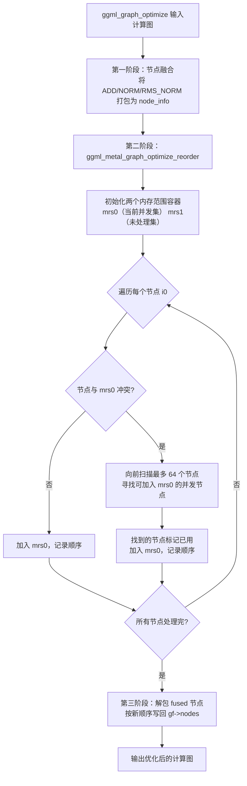
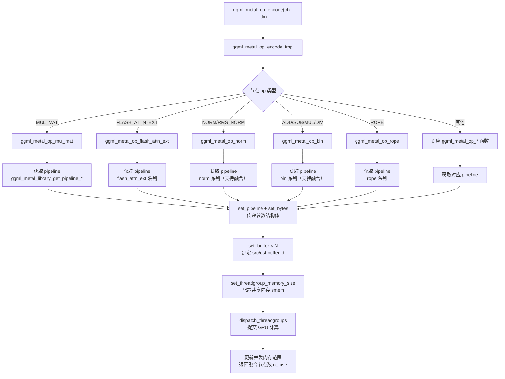
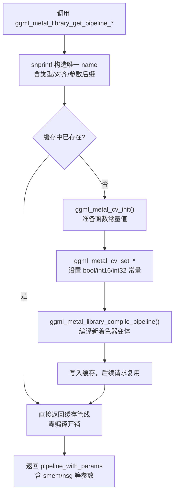
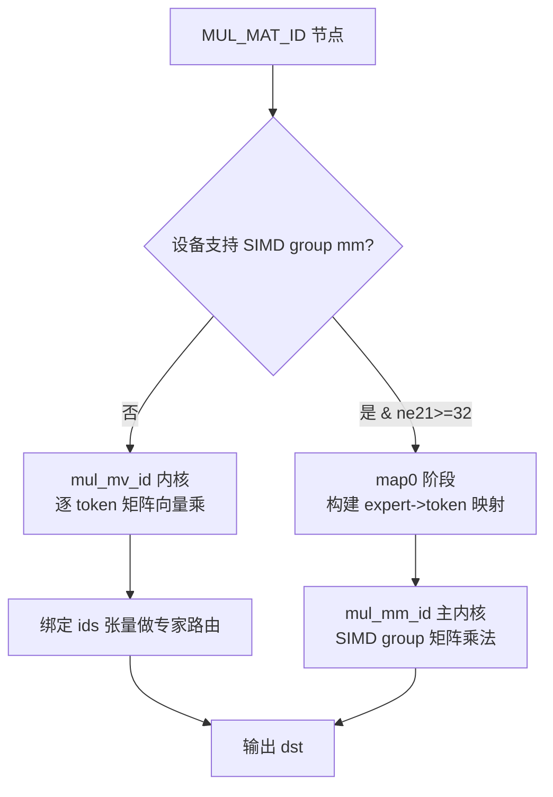
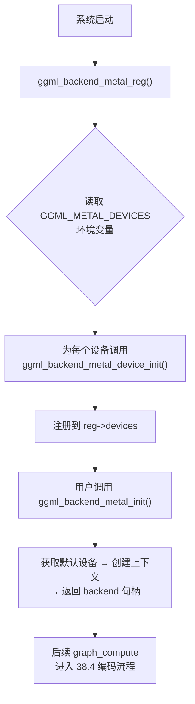

# 第37章 Metal 后端 —— Apple Silicon GPU 的「智能计算厨房」

## 学习目标

- 理解 ggml-metal 后端的整体分层架构与设计思路
- 掌握计算图优化中内存范围跟踪与并发重排序的机制
- 熟悉 Metal 设备、管道、编码器抽象层的 C 接口设计
- 能够阅读并分析 ggml-metal-ops.cpp 的算子分发与编码流程
- 理解后端注册、缓冲区类型与设备管理的实现
- 理解公共入口 API 与上下文生命周期的管理方式
- 掌握设备抽象层中缓冲区创建、映射与释放的完整路径
- 能够分析管线 specialization 机制与 Flash Attention / MoE 算子的特化实现

## 37.1 生活类比

你可以把 Metal 后端想象成一间「智能厨房」。CPU 上的 ggml 计算就像家庭厨房——每次做菜都要自己动手切配、翻炒，顺序一道接一道，灶台利用率很低。而 Metal 后端则是一个配备了专业厨师（GPU）的智能厨房：你把菜单（计算图）交给它，它自动调度多个灶台（线程组）并行烹饪。

关键在于，厨房里有多个灶台，但有些菜不能同时做——比如炖汤的锅还在占用，炒菜的锅就用不了。这就需要一个「智能排菜员」，它在开火前先检查每道菜要用哪些锅、占用哪些内存区间，然后把互不冲突的菜重新排序，让多个灶台同时开工。在 ggml-metal 里，这个排菜员就是 `ggml_graph_optimize`，它依赖的「锅具占用检查表」就是 `ggml_mem_ranges` 内存范围跟踪器。这一章，我们就来拆解这套智能厨房的调度系统与翻译官。

## 37.2 源码地图

```text
ggml/include/ggml-metal.h
├── 公共入口 API
│   ├── ggml_backend_metal_init()            # 初始化 Metal 后端
│   ├── ggml_backend_is_metal()              # 判断是否为 Metal 后端
│   ├── ggml_backend_metal_set_abort_callback() # 设置中止回调
│   ├── ggml_backend_metal_supports_family() # 检查 GPU family 支持
│   ├── ggml_backend_metal_capture_next_compute() # 捕获下一次计算
│   └── ggml_backend_metal_reg()             # 获取 Metal 后端注册表

ggml/src/ggml-metal/
├── 核心实现
│   ├── ggml-metal.cpp                     # 后端注册、缓冲区类型与设备管理
│   ├── ggml-metal-common.cpp              # 内存范围跟踪与图优化
│   ├── ggml-metal-ops.cpp                 # 算子编码与管线分发
│   └── ggml-metal-device.cpp              # 设备管理与 pipeline 获取
├── 对外接口头
│   ├── ggml-metal-common.h                # 内存范围与图优化 C 接口
│   ├── ggml-metal-context.h               # Metal 上下文 C 接口
│   ├── ggml-metal-device.h                # Metal 设备抽象 C 接口
│   ├── ggml-metal-impl.h                  # 内核常量与参数结构体
│   └── ggml-metal-ops.h                   # 算子编码层 C 接口
└── 公共头
    └── ggml-metal.h（include/）            # 用户侧入口 API
```

## 37.3 内存范围跟踪与计算图优化 —— 智能厨房的「排菜员」

在 Metal 后端上执行计算图时，多个算子可能被提交到同一个命令缓冲区中并发执行。为了最大化并发度，同时避免同一块设备内存被两个存在依赖关系的算子同时读写，ggml-metal 在 `ggml-metal-common.cpp` 中实现了一套内存范围跟踪与图重排序机制。它就像智能厨房的排菜员，在开火前先检查每道菜的锅具占用，然后把互不冲突的菜重新排序，让多个灶台同时开工。

### 37.3.1 内存范围的表示与检查

```c
// === ggml_mem_ranges_init：创建并初始化内存范围跟踪器 ===
ggml_mem_ranges_t ggml_mem_ranges_init(int debug) {
    auto * res = new ggml_mem_ranges;          // 在堆上分配跟踪器对象

    res->ranges.reserve(256);                  // 预留 256 个区间容量，避免频繁扩容
    res->debug = debug;                        // 记录调试级别，控制日志输出详细度

    return res;                                // 返回不透明句柄
}
```

```c
// === ggml_mem_range_from_tensor：从张量构造内存范围 ===
// 已分配 buffer 时使用真实设备地址区间；未分配时用张量指针作为唯一标识
static ggml_mem_range ggml_mem_range_from_tensor(const ggml_tensor * tensor, ggml_mem_range_type pt) {
    tensor = tensor->view_src ? tensor->view_src : tensor;  // 始终使用底层基础张量

    GGML_ASSERT(!tensor->view_src);            // 断言：经过解引用后不应再有 view_src

    ggml_mem_range mr;                         // 构造一个内存区间对象

    if (tensor->buffer) {
        // 已分配 buffer：使用真实设备内存地址区间
        mr = {
            /*.pb=*/ (uint64_t) tensor->buffer,                  // buffer 句柄作为唯一标识
            /*.p0=*/ (uint64_t) tensor->data,                     // 起始地址
            /*.p1=*/ (uint64_t) tensor->data +                    // 结束地址 = 起始 + 实际分配大小
                     ggml_backend_buft_get_alloc_size(tensor->buffer->buft, tensor),
            /*.pt=*/ pt,                                         // 区间类型（源/目的）
        };
    } else {
        // 未分配：用张量指针作为唯一 id，填充虚拟区间 [0, 1024)
        mr = {
            /*.pb=*/ (uint64_t) tensor,    // 张量指针作为虚拟 buffer id
            /*.p0=*/ 0,                     // 虚拟起始（不使用）
            /*.p1=*/ 1024,                  // 虚拟结束（不使用）
            /*.pt=*/ pt,
        };
    };

    return mr;                                // 返回构造好的区间
}
```

```c
// === ggml_mem_ranges_check：冲突检测核心 ===
// 不同 buffer 永远不冲突；两个「源」区间允许相交；其余重叠一律冲突
static bool ggml_mem_ranges_check(ggml_mem_ranges_t mrs, ggml_mem_range mr) {
    for (size_t i = 0; i < mrs->ranges.size(); i++) {
        const auto & cmp = mrs->ranges[i];     // 取出已记录的第 i 个区间

        // 两个内存区间若在不同 buffer，永远不冲突（GPU 之间独立）
        if (mr.pb != cmp.pb) {
            continue;
        }

        // 相交的「源」区间是允许的（多个算子可同时只读同一块内存）
        if (mr.pt == MEM_RANGE_TYPE_SRC && cmp.pt == MEM_RANGE_TYPE_SRC) {
            continue;
        }

        // 地址区间重叠即判定冲突
        if (mr.p0 < cmp.p1 && mr.p1 >= cmp.p0) {
            if (mrs->debug > 2) {
                GGML_LOG_DEBUG("%s: the %s range buf=%lld, [%lld, %lld) overlaps with a previous %s range buf=%lld, [%lld, %lld)\n",
                        __func__,
                        mr.pt == MEM_RANGE_TYPE_SRC ? "src" : "dst",   // 当前区间类型
                        mr.pb, mr.p0, mr.p1,
                        cmp.pt == MEM_RANGE_TYPE_SRC ? "src" : "dst",  // 已有区间类型
                        cmp.pb, cmp.p0, cmp.p1);
            }

            return false;               // 冲突，不可并发
        }
    }

    return true;                        // 无冲突，可并发
}
```

### 37.3.2 节点融合与重排序

```c
// === node_info：图优化的中间表示 ===
// 封装一个计算图节点，并收集被融合到当前节点的后续节点
struct node_info {
    ggml_tensor * node;                            // 当前基础节点
    std::vector<ggml_tensor *> fused;              // 被融合进来的后续节点列表

    ggml_op op() const {
        return node->op;                           // 返回基础节点的操作类型
    }

    const ggml_tensor * dst() const {
        return fused.empty() ? node : fused.back(); // 最终输出：无融合时是自身，否则是最后一个融合节点
    }

    bool is_empty() const {
        return ggml_op_is_empty(node->op);         // 空操作不读写内存，可自由插入并发集
    }

    void add_fused(ggml_tensor * t) {
        fused.push_back(t);                        // 追加一个融合节点
    }
};
```

```c
// === ggml_metal_graph_optimize_reorder：基于内存冲突检测的贪心重排序 ===
// 维护 mrs0（当前并发集）与 mrs1（未处理集），向前扫描最多 64 个节点
// 把与已有并发集、且与前方未处理节点都不冲突的节点「提前」加入并发集
static std::vector<int> ggml_metal_graph_optimize_reorder(const std::vector<node_info> & nodes) {
    // helper to add node src and dst ranges
    const auto & h_add = [](ggml_mem_ranges_t mrs, const node_info & node) {
        for (int i = 0; i < GGML_MAX_SRC; i++) {
            if (node.node->src[i]) {
                if (!ggml_mem_ranges_add_src(mrs, node.node->src[i])) {
                    return false;
                }
            }
        }

        // keep track of the sources of the fused nodes as well
        for (const auto * fused : node.fused) {
            for (int i = 0; i < GGML_MAX_SRC; i++) {
                if (fused->src[i]) {
                    if (!ggml_mem_ranges_add_src(mrs, fused->src[i])) {
                        return false;
                    }
                }
            }
        }

        return ggml_mem_ranges_add_dst(mrs, node.dst());
    };

    // helper to check if a node can run concurrently with the existing set of nodes
    const auto & h_check = [](ggml_mem_ranges_t mrs, const node_info & node) {
        for (int i = 0; i < GGML_MAX_SRC; i++) {
            if (node.node->src[i]) {
                if (!ggml_mem_ranges_check_src(mrs, node.node->src[i])) {
                    return false;
                }
            }
        }

        for (const auto * fused : node.fused) {
            for (int i = 0; i < GGML_MAX_SRC; i++) {
                if (fused->src[i]) {
                    if (!ggml_mem_ranges_check_src(mrs, fused->src[i])) {
                        return false;
                    }
                }
            }
        }

        return ggml_mem_ranges_check_dst(mrs, node.dst());
    };

    // perform reorders only across these types of ops
    // can be expanded when needed
    const auto & h_safe = [](ggml_op op) {
        switch (op) {
            case GGML_OP_MUL_MAT:
            case GGML_OP_MUL_MAT_ID:
            case GGML_OP_ROPE:
            case GGML_OP_NORM:
            case GGML_OP_RMS_NORM:
            case GGML_OP_GROUP_NORM:
            case GGML_OP_L2_NORM:
            case GGML_OP_SUM_ROWS:
            case GGML_OP_SSM_CONV:
            case GGML_OP_SSM_SCAN:
            case GGML_OP_CLAMP:
            case GGML_OP_TRI:
            case GGML_OP_DIAG:
            case GGML_OP_MUL:
            case GGML_OP_ADD:
            case GGML_OP_SUB:
            case GGML_OP_DIV:
            case GGML_OP_GLU:
            case GGML_OP_SCALE:
            case GGML_OP_UNARY:
            case GGML_OP_GET_ROWS:
            case GGML_OP_SET_ROWS:
            case GGML_OP_SET:
            case GGML_OP_CPY:
            case GGML_OP_CONT:
            case GGML_OP_REPEAT:
                return true;
            default:
                return ggml_op_is_empty(op);
        }
    };

    const int n = nodes.size();                 // 节点总数

    std::vector<int> res;
    res.reserve(n);                             // 预分配结果向量

    std::vector<bool> used(n, false);           // 标记节点是否已被提前重排

    // the memory ranges for the set of currently concurrent nodes
    ggml_mem_ranges_t mrs0 = ggml_mem_ranges_init(0);

    // the memory ranges for the set of nodes that haven't been processed yet, when looking forward for a node to reorder
    ggml_mem_ranges_t mrs1 = ggml_mem_ranges_init(0);

    for (int i0 = 0; i0 < n; i0++) {
        if (used[i0]) {
            continue;                           // 已被提前加入并发集，跳过
        }

        const auto & node0 = nodes[i0];

        // the node is not concurrent with the existing concurrent set, so we have to "put a barrier" (i.e reset mrs0)
        // but before we do that, look forward for some other nodes that can be added to the concurrent set mrs0
        //
        // note: we can always add empty nodes to the concurrent set as they don't read nor write anything
        if (!node0.is_empty() && !h_check(mrs0, node0)) {
            // this will hold the set of memory ranges from the nodes that haven't been processed yet
            // if a node is not concurrent with this set, we cannot reorder it
            ggml_mem_ranges_reset(mrs1);

            // initialize it with the current node
            h_add(mrs1, node0);

            // that many nodes forward to search for a concurrent node
            constexpr int N_FORWARD = 64;

            for (int i1 = i0 + 1; i1 < i0 + N_FORWARD && i1 < n; i1++) {
                if (used[i1]) {
                    continue;
                }

                const auto & node1 = nodes[i1];

                // disallow reordering of certain ops
                if (!h_safe(node1.op())) {
                    break;
                }

                const bool is_empty = node1.is_empty();

                // to reorder a node and add it to the concurrent set, it has to be:
                //   + empty or concurrent with all nodes in the existing concurrent set (mrs0)
                //   + concurrent with all nodes prior to it that haven't been processed yet (mrs1)
                if ((is_empty || h_check(mrs0, node1)) && h_check(mrs1, node1)) {
                    // add the node to the existing concurrent set (i.e. reorder it for early execution)
                    h_add(mrs0, node1);
                    res.push_back(i1);

                    // mark as used, so we skip re-processing it later
                    used[i1] = true;
                } else {
                    // expand the set of nodes that haven't been processed yet
                    h_add(mrs1, node1);
                }
            }

            // finalize the concurrent set and begin a new one
            ggml_mem_ranges_reset(mrs0);
        }

        // expand the concurrent set with the current node
        {
            h_add(mrs0, node0);
            res.push_back(i0);
        }
    }

    ggml_mem_ranges_free(mrs0);
    ggml_mem_ranges_free(mrs1);

    return res;
}
```



### 37.3.3 图优化主入口

```c
// === ggml_graph_optimize：图优化流程的 orchestrator ===
// 先融合 → 再重排 → 最后解包，确保重排不打乱融合的连续性
void ggml_graph_optimize(ggml_cgraph * gf) {
    constexpr int MAX_FUSE = 16;                 // 单节点最大融合数上限

    const int n = gf->n_nodes;                  // 图中节点总数

    enum ggml_op ops[MAX_FUSE];                 // 临时缓冲区，记录连续节点的操作类型

    std::vector<node_info> nodes;
    nodes.reserve(gf->n_nodes);                 // 预分配与节点数等长的向量

    // fuse nodes:
    // we don't want to make reorders that break fusing, so we first pack all fusable tensors
    //   and perform the reorder over the fused nodes. after the reorder is done, we unfuse
    for (int i = 0; i < n; i++) {
        node_info node = {
            /*.node=*/ gf->nodes[i],           // 基础节点
            /*.fused=*/ {},                    // 融合列表初始为空
        };

        // fuse only ops that start with these operations
        // can be expanded when needed
        if (node.op() == GGML_OP_ADD ||
            node.op() == GGML_OP_NORM ||
            node.op() == GGML_OP_RMS_NORM) {
            ops[0] = node.op();                // 记录首个操作类型

            int f = i + 1;
            while (f < n && f < i + MAX_FUSE) {
                // conservatively allow fusing only these ops
                // can be expanded when needed
                if (gf->nodes[f]->op != GGML_OP_ADD &&
                    gf->nodes[f]->op != GGML_OP_MUL &&
                    gf->nodes[f]->op != GGML_OP_NORM &&
                    gf->nodes[f]->op != GGML_OP_RMS_NORM) {
                    break;
                }
                ops[f - i] = gf->nodes[f]->op; // 记录后续节点操作类型
                f++;
            }

            f -= i;                            // 计算连续可融合节点数
            for (; f > 1; f--) {
                if (ggml_can_fuse(gf, i, ops, f)) {
                    break;                     // 从最长可融合长度开始试探
                }
            }

            // add the fused tensors into the node info so we can unfuse them later
            for (int k = 1; k < f; k++) {
                ++i;                            // 推进主循环索引

                // the .dst() becomes the last fused tensor
                node.add_fused(gf->nodes[i]);   // 收集融合节点
            }
        }

        nodes.push_back(std::move(node));       // 加入优化中间表示列表
    }

#if 1
    // reorder to improve concurrency
    const auto order = ggml_metal_graph_optimize_reorder(nodes);
#else
    std::vector<int> order(nodes.size());
    for (size_t i = 0; i < nodes.size(); i++) {
        order[i] = i;                           // 调试开关：可禁用重排
    }
#endif

    // unfuse
    {
        int j = 0;
        for (const auto i : order) {
            const auto & node = nodes[i];

            gf->nodes[j++] = node.node;          // 写回基础节点

            for (auto * fused : node.fused) {
                gf->nodes[j++] = fused;          // 写回融合节点
            }
        }
    }
}
```

## 37.4 算子编码与管线分发 —— 智能厨房的「菜单翻译官」

计算图优化完成后，接下来需要把每个节点真正翻译成 Metal 命令提交到 GPU。这项工作由 `ggml-metal-ops.cpp` 承担，它就像厨房的菜单翻译官：把每道菜（ggml 算子）翻译成灶台能听懂的指令（Metal 着色器内核调用）。

### 37.4.1 操作上下文与编码入口

```c
// === ggml_metal_op：操作编码器上下文类 ===
// 绑定设备、命令缓冲区、计算图，并初始化 Metal 编码器与内存范围跟踪器
// 同时过滤掉空节点，后续只对有效节点编码
ggml_metal_op(
    ggml_metal_device_t dev,
    ggml_metal_cmd_buf_t cmd_buf,
    ggml_cgraph * gf,
    int  idx_start,
    int  idx_end,
    bool use_fusion,
    bool use_concurrency,
    bool use_capture,
    int  debug_graph,
    int  debug_fusion) {
        this->dev             = dev;                       // 绑定 Metal 设备
        this->lib             = ggml_metal_device_get_library(dev); // 获取设备关联的 Metal 库
        this->enc             = ggml_metal_encoder_init(cmd_buf, use_concurrency); // 初始化编码器
        this->mem_ranges      = ggml_mem_ranges_init(debug_graph); // 初始化内存范围跟踪器
        this->idx_start       = idx_start;                 // 起始节点索引
        this->idx_end         = idx_end;                   // 结束节点索引
        this->use_fusion      = use_fusion;                // 是否启用算子融合
        this->use_concurrency = use_concurrency;           // 是否启用并发编码
        this->use_capture     = use_capture;               // 是否启用调试捕获
        this->debug_graph     = debug_graph;               // 图调试级别
        this->debug_fusion    = debug_fusion;              // 融合调试级别
        this->gf              = gf;                        // 绑定计算图

        idxs.reserve(gf->n_nodes);                 // 预分配有效节点索引向量

        // filter empty nodes
        for (int i = idx_start; i < idx_end; i++) {
            if (!ggml_op_is_empty(gf->nodes[i]->op) && !ggml_is_empty(gf->nodes[i])) {
                idxs.push_back(i);                 // 仅保留非空节点索引
            }
        }
    }
```

### 37.4.2 算子分发

```c
// === ggml_metal_op_encode_impl：编码器核心分发函数 ===
// 前置检查（空节点、设备支持性、compute 标志）后通过巨型 switch 分发到各算子编码函数
static int ggml_metal_op_encode_impl(ggml_metal_op_t ctx, int idx) {
    struct ggml_tensor * node = ctx->node(idx);   // 获取当前节点

    if (ggml_is_empty(node)) {
        return 1;                                 // 空节点无需编码
    }

    switch (node->op) {
        case GGML_OP_NONE:
        case GGML_OP_RESHAPE:
        case GGML_OP_VIEW:
        case GGML_OP_TRANSPOSE:
        case GGML_OP_PERMUTE:
            return 1;                             // 这些算子无实际 GPU 计算
        default:
            break;
    }

    if (!ggml_metal_device_supports_op(ctx->dev, node)) {
        GGML_LOG_ERROR("%s: error: unsupported op '%s'\n", __func__, ggml_op_desc(node));
        GGML_ABORT("unsupported op");              // 设备不支持该算子，终止
    }

    if ((node->flags & GGML_TENSOR_FLAG_COMPUTE) == 0) {
        return 1;                                 // 无 compute 标志，跳过
    }

    int n_fuse = 1;                               // 默认融合节点数

    {
        const bool is_concurrent = ggml_metal_op_concurrency_check(ctx, node);

        if (!is_concurrent) {
            ggml_metal_op_concurrency_reset(ctx); // 冲突则插入内存屏障，重置并发状态
        }
    }

    switch (node->op) {
        case GGML_OP_CONCAT:
            n_fuse = ggml_metal_op_concat(ctx, idx);       break;
        case GGML_OP_ADD:
        case GGML_OP_SUB:
        case GGML_OP_MUL:
        case GGML_OP_DIV:
            n_fuse = ggml_metal_op_bin(ctx, idx);          break;
        case GGML_OP_MUL_MAT:
            n_fuse = ggml_metal_op_mul_mat(ctx, idx);      break;
        case GGML_OP_FLASH_ATTN_EXT:
            n_fuse = ggml_metal_op_flash_attn_ext(ctx, idx); break;
        case GGML_OP_NORM:
        case GGML_OP_RMS_NORM:
            n_fuse = ggml_metal_op_norm(ctx, idx);         break;
        case GGML_OP_ROPE:
            n_fuse = ggml_metal_op_rope(ctx, idx);         break;
        ...
        default:
            GGML_LOG_ERROR("%s: error: node %3d, op = %8s not implemented\n", __func__, idx, ggml_op_name(node->op));
            GGML_ABORT("fatal error");                   // 未知算子，终止
    }

    for (int i = 0; i < n_fuse; ++i) {
        if (!ggml_metal_op_concurrency_add(ctx, ctx->node(idx + i))) {
            ggml_metal_op_concurrency_reset(ctx);     // 融合节点加入后若冲突则重置
        }
    }

    return n_fuse;                                    // 返回融合节点数
}
```



### 37.4.3 单个算子的编码模板

```c
// === ggml_metal_op_concat：concat 算子编码模板 ===
// 从张量提取形状与步长元数据 → 填充参数结构体 → 获取管线 → 绑定 buffer → dispatch
int ggml_metal_op_concat(ggml_metal_op_t ctx, int idx) {
    ggml_tensor * op = ctx->node(idx);               // 获取当前节点

    ggml_metal_library_t lib = ctx->lib;             // Metal 库
    ggml_metal_encoder_t enc = ctx->enc;             // 编码器

    GGML_TENSOR_LOCALS( int32_t, ne0, op->src[0], ne); // 提取 src0 形状
    GGML_TENSOR_LOCALS(uint64_t, nb0, op->src[0], nb); // 提取 src0 步长
    GGML_TENSOR_LOCALS( int32_t, ne1, op->src[1], ne); // 提取 src1 形状
    GGML_TENSOR_LOCALS(uint64_t, nb1, op->src[1], nb); // 提取 src1 步长
    GGML_TENSOR_LOCALS( int32_t, ne,  op,         ne); // 提取输出形状
    GGML_TENSOR_LOCALS(uint64_t, nb,  op,         nb); // 提取输出步长

    const int32_t dim = ((const int32_t *) op->op_params)[0]; // 读取拼接维度参数

    ggml_metal_kargs_concat args = {
        /*.ne00=*/ ne00, ...                         // 填充全部形状/步长元数据
        /*.dim=*/  dim,
    };

    auto pipeline = ggml_metal_library_get_pipeline_base(lib, GGML_OP_CONCAT); // 获取基础管线

    ggml_metal_encoder_set_pipeline(enc, pipeline);   // 设置管线
    ggml_metal_encoder_set_bytes   (enc, &args, sizeof(args), 0); // 传递参数结构体
    ggml_metal_encoder_set_buffer  (enc, ggml_metal_get_buffer_id(op->src[0]), 1); // 绑定 src0
    ggml_metal_encoder_set_buffer  (enc, ggml_metal_get_buffer_id(op->src[1]), 2); // 绑定 src1
    ggml_metal_encoder_set_buffer  (enc, ggml_metal_get_buffer_id(op),         3); // 绑定 dst

    const int nth = std::min(1024, ne0);             // 计算每线程组线程数上限

    ggml_metal_encoder_dispatch_threadgroups(enc, ne1, ne2, ne3, nth, 1, 1); // 提交 GPU 计算

    return 1;                                        // 未融合
}
```

### 37.4.4 管线获取的 specialization 机制

```c
// === ggml_metal_library_get_pipeline_mul_mm：mul_mm 管线 specialization ===
// 按数据类型 + 输入边界对齐（bc_inp）+ 输出边界对齐（bc_out）生成唯一管线名
// 缓存命中直接复用；未命中则用函数常量值编译新着色器变体
ggml_metal_pipeline_with_params ggml_metal_library_get_pipeline_mul_mm(ggml_metal_library_t lib, const ggml_tensor * op) {
    char base[256];
    char name[256];

    const ggml_type tsrc0 = op->src[0]->type;        // 源数据类型
    const ggml_type tsrc1 = op->src[1]->type;        // 权重数据类型

    const bool bc_inp = op->src[0]->ne[0] % 32 != 0; // 输入边界是否不对齐
    const bool bc_out = op->ne[0] % 64 != 0 || op->ne[1] % 32 != 0; // 输出边界是否不对齐

    snprintf(base, 256, "kernel_mul_mm_%s_%s", ggml_type_name(tsrc0), ggml_type_name(tsrc1)); // 基础名
    snprintf(name, 256, "%s_bci=%d_bco=%d", base, bc_inp, bc_out); // 组合 specialization 后缀

    ggml_metal_pipeline_with_params res = ggml_metal_library_get_pipeline(lib, name); // 查缓存
    if (!res.pipeline) {
        ggml_metal_cv_t cv = ggml_metal_cv_init();   // 未命中，准备函数常量值

        ggml_metal_cv_set_bool(cv, bc_inp, FC_MUL_MM + 0); // 编译时常量：输入对齐
        ggml_metal_cv_set_bool(cv, bc_out, FC_MUL_MM + 1); // 编译时常量：输出对齐

        res = ggml_metal_library_compile_pipeline(lib, base, name, cv); // 编译新变体

        ggml_metal_cv_free(cv);
    }

    // when the output size is not multiple of 64x32, we need extra smem to prevent out-of-bounds writes
    res.smem = bc_out ? 8192 : 4096 + 2048;         // 按输出对齐情况配置共享内存

    return res;
}
```

## 37.5 公共入口 API 与上下文生命周期 —— 厨房的「门面」

Metal 后端的对外接口定义在 `ggml-metal.h`，而上下文的生命周期管理实现在 `ggml-metal-context.h` 与 `ggml-metal.cpp` 中。这一层把高性能的 Metal 计算能力封装为稳定的 C API，供上层调用。

### 37.5.1 公共入口 API

```c
// === ggml-metal.h：Metal 后端公共入口 ===
// 定义用户侧 API，将 ggml 计算图从 CPU 执行转移到 Metal GPU 上执行
#pragma once

#include "ggml.h"                          // 包含 ggml 核心定义
#include "ggml-backend.h"                  // 包含后端抽象层定义

#include <stddef.h>
#include <stdbool.h>

struct ggml_tensor;
struct ggml_cgraph;

#ifdef __cplusplus
extern "C" {                                // C++ 兼容链接声明
#endif

//
// backend API
// user-code should use only these functions
//

// TODO: remove in the future
GGML_BACKEND_API ggml_backend_t ggml_backend_metal_init(void); // 初始化 Metal 后端

GGML_BACKEND_API bool ggml_backend_is_metal(ggml_backend_t backend); // 判断是否为 Metal 后端

GGML_BACKEND_API void ggml_backend_metal_set_abort_callback(ggml_backend_t backend, ggml_abort_callback abort_callback, void * user_data); // 设置中止回调

// helper to check if the device supports a specific family
// ideally, the user code should be doing these checks
// ref: https://developer.apple.com/metal/Metal-Feature-Set-Tables.pdf
GGML_BACKEND_API bool ggml_backend_metal_supports_family(ggml_backend_t backend, int family); // 检查 GPU family 支持

// capture all command buffers committed the next time `ggml_backend_graph_compute` is called
GGML_BACKEND_API void ggml_backend_metal_capture_next_compute(ggml_backend_t backend); // 捕获下一次计算

GGML_BACKEND_API ggml_backend_reg_t ggml_backend_metal_reg(void); // 获取 Metal 后端注册表

#ifdef __cplusplus
}
#endif
```

### 37.5.2 上下文生命周期

```c
// === ggml_metal_init / ggml_metal_free：上下文创建与销毁 ===
// 以指定的 Metal 设备指针初始化并创建全局上下文；释放时同步 GPU 后再销毁
ggml_metal_t ggml_metal_init(ggml_metal_device_t dev) {
    // 创建上下文对象并绑定设备、命令队列、库等资源
    ggml_metal_t ctx = new ggml_metal;          // 分配上下文结构体
    ctx->device = dev;                          // 绑定底层 Metal 设备
    ctx->queue = ggml_metal_device_get_queue(dev); // 获取命令队列
    ctx->library = ggml_metal_library_init(dev);    // 初始化着色器库
    ctx->n_cb = 1;                              // 默认命令缓冲区数量
    return ctx;                                 // 返回不透明句柄
}

void ggml_metal_free(ggml_metal_t ctx) {
    ggml_metal_synchronize(ctx);                // 先同步，确保 GPU 完成所有操作
    ggml_metal_library_free(ctx->library);       // 释放着色器库
    delete ctx;                                 // 释放上下文内存
}

// === ggml_metal_graph_compute：核心计算入口 ===
// 在 GPU 上执行给定的计算图，返回操作状态码
enum ggml_status ggml_metal_graph_compute(ggml_metal_t ctx, struct ggml_cgraph * gf) {
    ggml_metal_graph_optimize(ctx, gf);         // 先执行图优化（融合 + 重排）

    // 为每个命令缓冲区创建编码器，遍历图节点并提交 GPU 计算
    for (int i = 0; i < ctx->n_cb; i++) {
        ggml_metal_cmd_buf_t cmd_buf = ggml_metal_cmd_buf_init(ctx, i); // 获取第 i 个命令缓冲区
        ggml_metal_op_t op_ctx = ggml_metal_op_init(ctx->dev, cmd_buf, gf, ...); // 创建操作上下文
        for (int j = 0; j < ggml_metal_op_n_nodes(op_ctx); j++) {
            ggml_metal_op_encode(op_ctx, j);    // 逐节点编码并提交
        }
        ggml_metal_op_free(op_ctx);             // 释放操作上下文
        ggml_metal_cmd_buf_commit(cmd_buf);      // 提交命令缓冲区
    }

    return GGML_STATUS_SUCCESS;
}
```

## 37.6 设备抽象与缓冲区管理 —— 厨房的「设备层」

设备管理层位于 `ggml-metal-device.h` / `ggml-metal-device.cpp`，负责封装 `MTLDevice`、`MTLCommandQueue`、pipeline 缓存、buffer 等底层对象，并向上提供 C 接口。

### 37.6.1 设备单例与属性

```c
// === ggml_metal_device_get：获取指定编号的 Metal 设备单例 ===
// 使用静态向量存储所有初始化的设备，确保每个设备只被初始化一次
ggml_metal_device_t ggml_metal_device_get(int device) {
    static std::vector<ggml_metal_device_ptr> devs;

    devs.emplace_back(ggml_metal_device_init(device)); // 初始化并存入单例向量

    return devs.back().get();                       // 返回设备句柄
}

// === ggml_metal_device_get_props：获取设备属性快照 ===
// 包含名称、描述、内存大小、是否使用共享缓冲区等信息
const struct ggml_metal_device_props * ggml_metal_device_get_props(ggml_metal_device_t dev) {
    return &dev->props;                             // 返回指向属性结构体的指针
}

// === ggml_metal_device_supports_op：检查设备是否支持某操作 ===
// 基于 GPU family 与操作类型进行能力查询
bool ggml_metal_device_supports_op(ggml_metal_device_t dev, const struct ggml_tensor * op) {
    switch (op->op) {
        case GGML_OP_MUL_MAT_ID:
            return dev->props.supports_simdgroup_mm; // 需要 SIMD group 矩阵乘法
        case GGML_OP_FLASH_ATTN_EXT:
            return dev->props.supports_simdgroup_mm; // Flash Attention 同样依赖
        default:
            return true;                             // 大部分操作通用支持
    }
}
```

### 37.6.2 缓冲区创建、映射与释放

```c
// === ggml_metal_buffer_init：创建设备缓冲区 ===
// shared=true 时使用 MTLSharedBuffer，与主机共享内存；否则为私有缓冲区
ggml_metal_buffer_t ggml_metal_buffer_init(ggml_metal_device_t dev, size_t size, bool shared) {
    ggml_metal_buffer_t buf = new ggml_metal_buffer; // 分配缓冲区包装对象
    buf->device = dev;                                // 绑定设备
    buf->size = size;                                 // 记录缓冲区大小
    buf->shared = shared;                             // 记录是否共享
    if (shared) {
        buf->mtl = [ggml_metal_device_get_obj(dev) newSharedBufferWithLength:size options:MTLResourceStorageModeShared]; // 创建共享 buffer
    } else {
        buf->mtl = [ggml_metal_device_get_obj(dev) newBufferWithLength:size options:MTLResourceStorageModeManaged];     // 创建私有 buffer
    }
    return buf;
}

// === ggml_metal_buffer_map：将主机内存映射为设备缓冲区 ===
// 用于零拷贝场景，直接包装用户提供的指针
ggml_metal_buffer_t ggml_metal_buffer_map(ggml_metal_device_t dev, void * ptr, size_t size, size_t max_tensor_size) {
    ggml_metal_buffer_t buf = new ggml_metal_buffer;
    buf->device = dev;
    buf->ptr = ptr;                                // 记录主机指针
    buf->size = size;
    buf->shared = true;                            // 映射缓冲区按共享处理
    buf->max_tensor_size = max_tensor_size;         // 记录最大张量尺寸
    return buf;
}

// === ggml_metal_buffer_get_id：根据张量数据指针找到所属 Metal 缓冲区 ID ===
// 用于 GPU 内核传参，返回 buffer 对象与字节偏移
struct ggml_metal_buffer_id ggml_metal_buffer_get_id(ggml_metal_buffer_t buf, const struct ggml_tensor * t) {
    struct ggml_metal_buffer_id res;
    res.metal = buf->mtl ? buf->mtl : (__MTLBuffer *) buf->ptr; // 底层 Metal buffer 对象
    res.offs = (uint8_t *) t->data - (uint8_t *) ggml_metal_buffer_get_base(buf); // 计算字节偏移
    return res;
}
```

## 37.7 Buffer Type 注册中心 —— 厨房的「餐具登记处」

`ggml-metal.cpp` 中实现了三种 Buffer Type（Shared / Private / Mapped），它们是后端缓冲区的注册中心，向上对接 `ggml_backend_buffer_type_t` 抽象。

```c
// === ggml_backend_metal_buffer_type_get_alloc_size：计算张量所需分配大小 ===
// 针对特定操作类型增加额外内存（MoE id 映射、Flash Attention 临时区、cumsum 双倍等）
static size_t ggml_metal_buffer_type_get_alloc_size(ggml_backend_buffer_type_t buft, const ggml_tensor * tensor) {
    size_t res = ggml_nbytes(tensor);               // 基础张量字节数

    switch (tensor->op) {
        case GGML_OP_MUL_MAT_ID: {
                res += ggml_metal_op_mul_mat_id_extra_tpe(tensor);   // MoE：每个专家的额外 token 数
                res += ggml_metal_op_mul_mat_id_extra_ids(tensor);   // MoE：token→专家完整映射
            } break;
        case GGML_OP_FLASH_ATTN_EXT: {
                res += ggml_metal_op_flash_attn_ext_extra_pad(tensor); // KV 缓存填充对齐
                res += ggml_metal_op_flash_attn_ext_extra_blk(tensor); // mask 块缓冲
                res += ggml_metal_op_flash_attn_ext_extra_tmp(tensor); // 工作组临时缓冲
            } break;
        case GGML_OP_CUMSUM:
        case GGML_OP_ARGSORT: {
                res *= 2;                          // cumsum/argsort 需要双倍临时空间
            } break;
        case GGML_OP_TOP_K: {
                res = 2*sizeof(int32_t)*ggml_nelements(tensor->src[0]); // top_k 仅需索引
            } break;
        default:
            break;
    }

    return res;
    GGML_UNUSED(buft);
}

// === ggml_backend_metal_buffer_type_shared：获取或初始化共享缓冲区类型 ===
// 支持多设备，使用互斥锁保证线程安全；为每个设备创建一个 buft 实例
static ggml_backend_buffer_type_t ggml_backend_metal_buffer_type_shared(int device) {
    static std::mutex mutex;
    std::lock_guard<std::mutex> lock(mutex);
    static std::vector<ggml_backend_buffer_type> bufts;
    static std::vector<ggml_backend_metal_buffer_type_ptr> ctxs;
    static bool initialized = false;

    if (!initialized) {
        bufts.reserve(g_devices);
        ctxs.reserve(g_devices);
        for (int i = 0; i < g_devices; ++i) {
            ggml_backend_metal_buffer_type * raw_ctx = new ggml_backend_metal_buffer_type {
                /* .device = */ i,
                /* .name   = */ GGML_METAL_NAME + std::to_string(i),
            };
            ctxs.emplace_back(raw_ctx);
            ggml_backend_buffer_type buft = {
                /* .iface = */ {
                    /* .get_name         = */ ggml_backend_metal_buffer_type_shared_get_name,
                    /* .alloc_buffer     = */ ggml_backend_metal_buffer_type_shared_alloc_buffer,
                    /* .get_alignment    = */ ggml_backend_metal_buffer_type_shared_get_alignment,
                    /* .get_max_size     = */ ggml_backend_metal_buffer_type_shared_get_max_size,
                    /* .get_alloc_size   = */ ggml_backend_metal_buffer_type_shared_get_alloc_size,
                    /* .is_host          = */ ggml_backend_metal_buffer_type_shared_is_host,
                },
                /* .device  = */ ggml_backend_reg_dev_get(ggml_backend_metal_reg(), i),
                /* .context = */ raw_ctx,
            };
            bufts.emplace_back(buft);
        }
        initialized = true;
    }
    return &bufts[device];
}
```


## 37.8 管线注册与按需编译 —— 厨房的「调料架」

`ggml-metal-device.cpp` 实现了大量 `ggml_metal_library_get_pipeline_*` 函数，构成管线的注册与按需编译体系。其核心模式是：**构造唯一管线名 → 查缓存 → 未命中则编译新变体并缓存**。

### 37.8.1 缓存容器与基础管线

```c
// === ggml_metal_pipelines_init / _free / _add / _get：管线缓存容器 ===
// 内部以字符串为键、ggml_metal_pipeline_t 为值的哈希表
ggml_metal_pipelines_t ggml_metal_pipelines_init(void) {
    ggml_metal_pipelines_t res = new ggml_metal_pipelines(); // 分配缓存容器
    return res;
}

void ggml_metal_pipelines_free(ggml_metal_pipelines_t ppls) {
    if (!ppls) {
        return;
    }

    for (auto it = ppls->data.begin(); it != ppls->data.end(); ++it) {
        ggml_metal_pipeline_free(it->second);          // 逐个释放缓存管线
    }

    delete ppls;                                       // 释放容器本身
}

void ggml_metal_pipelines_add(ggml_metal_pipelines_t ppls, const char * name, ggml_metal_pipeline_t pipeline) {
    ppls->data[name] = pipeline;                       // 以名称注册管线
}

ggml_metal_pipeline_t ggml_metal_pipelines_get(ggml_metal_pipelines_t ppls, const char * name) {
    if (ppls->data.find(name) == ppls->data.end()) {
        return nullptr;                                // 未找到返回空
    }

    return ppls->data[name];                           // 返回缓存管线
}
```

```c
// === ggml_metal_library_get_pipeline_base：基础二进制操作管线 ===
// 为 add_id 和 concat 提供无 specialization 的基础管线
ggml_metal_pipeline_with_params ggml_metal_library_get_pipeline_base(ggml_metal_library_t lib, ggml_op op) {
    char base[256];
    char name[256];

    const char * op_str = "undefined";
    switch (op) {
        case GGML_OP_ADD_ID: op_str = "add_id"; break;  // 操作名映射
        case GGML_OP_CONCAT: op_str = "concat"; break;
        default: GGML_ABORT("fatal error");
    };

    snprintf(base, 256, "kernel_%s", op_str);          // 构造基础内核名
    snprintf(name, 256, "%s", base);                   // 完整管线名

    ggml_metal_pipeline_with_params res = ggml_metal_library_get_pipeline(lib, name); // 查缓存
    if (!res.pipeline) {
        res = ggml_metal_library_compile_pipeline(lib, base, name, nullptr); // 无常量值，直接编译
    }

    return res;
}
```

### 37.8.2 管线 specialization 的通用模板

```c
// === ggml_metal_library_get_pipeline_cpy：数据复制管线 ===
// 按源/目标数据类型动态生成内核名，无额外编译时常量
ggml_metal_pipeline_with_params ggml_metal_library_get_pipeline_cpy(ggml_metal_library_t lib, ggml_type tsrc, ggml_type tdst) {
    char base[256];
    char name[256];

    snprintf(base, 256, "kernel_cpy_%s_%s", ggml_type_name(tsrc), ggml_type_name(tdst)); // 类型组合名
    snprintf(name, 256, "%s", base);

    ggml_metal_pipeline_with_params res = ggml_metal_library_get_pipeline(lib, name); // 查缓存
    if (!res.pipeline) {
        res = ggml_metal_library_compile_pipeline(lib, base, name, nullptr); // 编译并缓存
    }

    return res;
}
```



## 37.9 Flash Attention 与 MoE 特化 —— 厨房的「招牌菜」

两类复杂算子在管线获取与参数结构上都有大量特化：`FLASH_ATTN_EXT` 与 `MUL_MAT_ID`（MoE 矩阵乘法）。

### 37.9.1 Flash Attention 管线族

```c
// === ggml_metal_library_get_pipeline_flash_attn_ext：Flash Attention 主管线 ===
// 按掩码/sink/偏置/scap/kvpad/边界对齐/ns10/ns20/nsg 等参数构造唯一管线名
ggml_metal_pipeline_with_params ggml_metal_library_get_pipeline_flash_attn_ext(
        ggml_metal_library_t lib,
        const ggml_tensor * op,
        bool    has_mask,
        bool    has_sinks,
        bool    has_bias,
        bool    has_scap,
        bool    has_kvpad,
        int32_t nsg) {
    assert(op->op == GGML_OP_FLASH_ATTN_EXT);

    char base[256];
    char name[256];

    const int32_t dk = (int32_t) op->src[1]->ne[0];     // key 头维度
    const int32_t dv = (int32_t) op->src[2]->ne[0];     // value 头维度

    const int32_t ns10 = op->src[1]->nb[1]/op->src[1]->nb[0]; // K 步长比
    const int32_t ns20 = op->src[2]->nb[1]/op->src[2]->nb[0]; // V 步长比

    const bool bc_mask = op->src[3] && (op->src[3]->ne[1] % 8 != 0); // mask 边界对齐

    snprintf(base, 256, "kernel_%s_%s_dk%d_dv%d",
            "flash_attn_ext",
            ggml_type_name(op->src[1]->type),
            dk, dv);                                        // 基础名含类型与维度

    snprintf(name, 256, "%s_mask=%d_sinks=%d_bias=%d_scap=%d_kvpad=%d_bcm=%d_ns10=%d_ns20=%d_nsg=%d",
            base,
            has_mask, has_sinks, has_bias, has_scap, has_kvpad, bc_mask, ns10, ns20, nsg); // 全参数后缀

    ggml_metal_pipeline_with_params res = ggml_metal_library_get_pipeline(lib, name); // 查缓存
    if (!res.pipeline) {
        ggml_metal_cv_t cv = ggml_metal_cv_init();

        ggml_metal_cv_set_bool(cv, has_mask,  FC_FLASH_ATTN_EXT + 0);   // 编译时常量：掩码
        ggml_metal_cv_set_bool(cv, has_sinks, FC_FLASH_ATTN_EXT + 1);   // 编译时常量：sink
        ggml_metal_cv_set_bool(cv, has_bias,  FC_FLASH_ATTN_EXT + 2);   // 编译时常量：偏置
        ggml_metal_cv_set_bool(cv, has_scap,  FC_FLASH_ATTN_EXT + 3);   // 编译时常量：softcap
        ggml_metal_cv_set_bool(cv, has_kvpad, FC_FLASH_ATTN_EXT + 4);   // 编译时常量：KV 填充

        ggml_metal_cv_set_bool(cv, bc_mask, FC_FLASH_ATTN_EXT + 10);   // 编译时常量：mask 边界
        ggml_metal_cv_set_int32(cv, ns10, FC_FLASH_ATTN_EXT + 20);      // 编译时常量：K 步长比
        ggml_metal_cv_set_int32(cv, ns20, FC_FLASH_ATTN_EXT + 21);      // 编译时常量：V 步长比
        ggml_metal_cv_set_int32(cv, nsg,  FC_FLASH_ATTN_EXT + 22);      // 编译时常量：simdgroup 数

        res = ggml_metal_library_compile_pipeline(lib, base, name, cv); // 编译新变体

        ggml_metal_cv_free(cv);
    }

    return res;
}
```

### 37.9.2 MoE 矩阵乘法管线

```c
// === ggml_metal_library_get_pipeline_mul_mm_id：MoE 矩阵乘法管线 ===
// 按数据类型与输入边界对齐（bc_inp）构造管线名
ggml_metal_pipeline_with_params ggml_metal_library_get_pipeline_mul_mm_id(ggml_metal_library_t lib, const ggml_tensor * op) {
    char base[256];
    char name[256];

    const ggml_type tsrc0 = op->src[0]->type;
    const ggml_type tsrc1 = op->src[1]->type;

    const bool bc_inp = op->src[0]->ne[0] % 32 != 0;                // 输入边界对齐

    snprintf(base, 256, "kernel_mul_mm_id_%s_%s", ggml_type_name(tsrc0), ggml_type_name(tsrc1));
    snprintf(name, 256, "%s_bci=%d", base, bc_inp);

    ggml_metal_pipeline_with_params res = ggml_metal_library_get_pipeline(lib, name); // 查缓存
    if (!res.pipeline) {
        ggml_metal_cv_t cv = ggml_metal_cv_init();

        ggml_metal_cv_set_bool(cv, bc_inp, FC_MUL_MM + 0);          // 编译时常量：输入对齐

        res = ggml_metal_library_compile_pipeline(lib, base, name, cv);

        ggml_metal_cv_free(cv);
    }

    res.smem = 8192;                                                 // 固定共享内存大小

    return res;
}

// === ggml_metal_op_mul_mat_id_extra_tpe：MoE 每专家额外 token 缓冲大小 ===
size_t ggml_metal_op_mul_mat_id_extra_tpe(const ggml_tensor * op) {
    assert(op->op == GGML_OP_MUL_MAT_ID);
    const int64_t ne02 = op->src[0]->ne[2]; // n_expert
    return ggml_type_size(GGML_TYPE_I32)*ne02;                      // 每专家一个 int32 token 计数
}

// === ggml_metal_op_mul_mat_id_extra_ids：MoE token→专家映射缓冲大小 ===
size_t ggml_metal_op_mul_mat_id_extra_ids(const ggml_tensor * op) {
    assert(op->op == GGML_OP_MUL_MAT_ID);
    const int64_t ne02 = op->src[0]->ne[2]; // n_expert
    const int64_t ne21 = op->src[2]->ne[1]; // n_token
    return ggml_type_size(GGML_TYPE_I32)*ne02*ne21;                 // 完整 [n_token, n_expert] 映射表
}
```



## 37.10 后端注册与系统探测 —— 厨房的「开业手续」

`ggml-metal.cpp` 完成最后的拼图：向 ggml 后端系统注册 Metal 后端、枚举设备、登记缓冲区类型，并实现 `ggml_backend_metal_reg()` 这一系统探测入口。

### 37.10.1 后端与设备接口

```c
// === ggml_backend_metal_reg：获取 Metal 后端注册表（系统探测入口） ===
// 支持 GGML_METAL_DEVICES 环境变量指定设备数量，使用互斥锁保证单次初始化
ggml_backend_reg_t ggml_backend_metal_reg(void) {
    static ggml_backend_reg reg;
    static bool initialized = false;
    {
        static std::mutex mutex;
        std::lock_guard<std::mutex> lock(mutex);
        const char * env = getenv("GGML_METAL_DEVICES");             // 读取环境变量
        if (env) {
            g_devices = atoi(env);                                   // 覆盖默认设备数
        }
        static std::vector<ggml_backend_device_ptr> devs;
        if (!initialized) {
            static ggml_metal_reg_ptr reg_ctx(ggml_backend_metal_reg_init());
            for (int i = 0; i < g_devices; ++i) {
                auto * dev = ggml_backend_metal_device_init(&reg, i); // 初始化每个设备
                devs.emplace_back(dev);
                reg_ctx->devices.push_back(dev);                       // 注册到注册表
            }
            reg = {
                /* .api_version = */ GGML_BACKEND_API_VERSION,
                /* .iface       = */ ggml_backend_metal_reg_i,
                /* .context     = */ reg_ctx.get(),
            };
        }
        initialized = true;
    }
    return &reg;
}

// === ggml_backend_metal_init：初始化 Metal 后端实例 ===
// 从注册表获取默认设备，创建上下文并返回后端对象
ggml_backend_t ggml_backend_metal_init(void) {
    ggml_backend_dev_t dev = ggml_backend_reg_dev_get(ggml_backend_metal_reg(), 0); // 获取默认设备
    ggml_metal_device_t ctx_dev = (ggml_metal_device_t)dev->context;
    ggml_metal_t ctx = ggml_metal_init(ctx_dev);                    // 创建 Metal 上下文
    if (ctx == NULL) {
        GGML_LOG_ERROR("%s: error: failed to allocate context\n", __func__);
        return NULL;
    }
    ggml_backend_t backend = (ggml_backend_t) malloc(sizeof(ggml_backend));
    *backend = {
        /* .guid      = */ ggml_backend_metal_guid(),
        /* .interface = */ ggml_backend_metal_i,
        /* .device    = */ dev,
        /* .context   = */ ctx,
    };
    ggml_metal_set_n_cb(backend, 1);                               // 默认单命令缓冲区
    return backend;
}

// === ggml_backend_is_metal：判断给定后端是否为 Metal 后端 ===
// 通过 GUID 匹配识别
bool ggml_backend_is_metal(ggml_backend_t backend) {
    return backend != NULL && ggml_guid_matches(backend->guid, ggml_backend_metal_guid());
}
```

### 37.10.2 Buffer Type 与设备能力查询

```c
// === ggml_backend_metal_device_get_buffer_type：获取设备缓冲区类型 ===
// 根据设备属性选择共享或私有缓冲区类型
static ggml_backend_buffer_type_t ggml_backend_metal_device_get_buffer_type(ggml_backend_dev_t dev) {
    ggml_metal_device_t ctx_dev = (ggml_metal_device_t)dev->context;
    const ggml_metal_device_props * props_dev = ggml_metal_device_get_props(ctx_dev);
    return props_dev->use_shared_buffers ? ggml_backend_metal_buffer_type_shared(props_dev->device)
                                         : ggml_backend_metal_buffer_type_private(props_dev->device);
}

// === ggml_backend_metal_device_supports_buft：检查设备是否支持给定缓冲区类型 ===
// 通过比对 get_name 函数指针识别 Metal 专属类型
static bool ggml_backend_metal_device_supports_buft(ggml_backend_dev_t dev, ggml_backend_buffer_type_t buft) {
    return
        buft->device == dev && (
        buft->iface.get_name == ggml_backend_metal_buffer_type_shared_get_name ||
        buft->iface.get_name == ggml_backend_metal_buffer_type_private_get_name ||
        buft->iface.get_name == ggml_backend_metal_buffer_type_mapped_get_name);
}

// === ggml_backend_metal_device_offload_op：判断操作是否应卸载到 Metal ===
// 仅 MUL_MAT / MUL_MAT_ID 且批量大于阈值时卸载
static bool ggml_backend_metal_device_offload_op(ggml_backend_dev_t dev, const ggml_tensor * op) {
    ggml_metal_device_t ctx_dev = (ggml_metal_device_t)dev->context;
    return (op->op == GGML_OP_MUL_MAT ||
            op->op == GGML_OP_MUL_MAT_ID) &&
            get_op_batch_size(op) >= ggml_metal_device_get_props(ctx_dev)->op_offload_min_batch_size;
}
```



## 37.11 设计中的取舍

- 图优化的重排序算法为什么只向前扫描 64 个节点？
  重排序的目的是提升并发度，但扫描过远会带来 O(n²) 的复杂度。限制 `N_FORWARD = 64` 是一个工程上的折中：在绝大多数计算图中，能并行的节点在局部范围内就已经出现，过远的重排收益递减但开销线性增长。

- 内存范围跟踪的「两个源区间允许相交」规则会不会掩盖真实冲突？
  不会。源区间相交意味着多个算子只读同一块内存，这是安全的。真正的冲突只发生在「写」与「读/写」之间，所以规则只放开源-源相交，其余重叠一律判定冲突。

- 管线 specialization 的 trade-off 是什么？
  按参数组合生成大量着色器变体会增加首次编译的开销和内存占用，但换来了每个场景的最优线程配置。由于实际运行中算子种类有限，缓存复用后总体收益远大于成本。

- Buffer Type 为什么区分 Shared / Private / Mapped 三种？
  Shared 用于跨进程/跨上下文共享内存，Private 为纯 GPU 积存，Mapped 用于零拷贝包装主机指针。三者满足不同数据生命周期与性能需求。

- MoE 为什么同时提供 mul_mm_id 与 mul_mv_id 两条路径？
  当 token 数较多时，SIMD group 矩阵乘法的 mul_mm_id 吞吐更高；当 token 数很少时，逐 token 的 mul_mv_id 开销更小。代码以 `ne21_mm_id_min = 32` 为断点自动选择。

## 37.12 动手练习

- 阅读 `ggml-metal-common.cpp` 中的 `ggml_metal_graph_optimize_reorder`，尝试把 `N_FORWARD` 从 64 改为 16，观察对重排序结果的影响。
- 对比 `concat` 和 `mul_mat` 两个算子的编码函数，列出它们在参数结构体、管线获取、线程组调度上的异同。
- 在 `ggml-metal-device.cpp` 中找到 `ggml_metal_library_get_pipeline_mul_mm`，尝试新增一个 `bc_inp` 的第三种边界情况，观察管线名称的变化。
- 在 `ggml-metal.cpp` 中为 Buffer Type 新增第四种类型（如 `HostVisible`），实现其 `get_name` / `alloc_buffer` / `get_alloc_size` 接口，并接入 `supports_buft` 检查。
- 模拟一个包含 MUL_MAT_ID 的小图，追踪 `extra_tpe` / `extra_ids` 临时缓冲区的偏移计算，验证其与 `get_alloc_size` 的一致性。

## 37.13 本章小结

这一章中我们学习了 ggml-metal 后端的完整机制。首先，通过 `ggml-metal-common.cpp` 中的内存范围跟踪与图重排序算法，把计算图中互不冲突的节点聚拢在一起，最大化 GPU 并发度；其次，通过 `ggml-metal-ops.cpp` 的算子分发与编码流程，把每个 ggml 算子翻译成 Metal 着色器调用，并利用管线 specialization 按需编译最优内核变体；再次，通过 `ggml-metal.cpp` 的后端注册、三种 Buffer Type 注册中心与设备管理，构建起完整的后端生态；最后，Flash Attention 与 MoE 算子展示了复杂场景下的多内核协同与特化管线设计。这种设计在保证正确性的前提下，充分释放了 Apple Silicon GPU 的计算潜力。

本章我们一起学习了以下概念：

| 概念 | 解释 |
|------|------|
| `ggml_graph_optimize` | 图优化主入口：先融合 ADD/NORM/RMS_NORM，再重排序，最后解包写回 |
| `ggml_mem_ranges` | 内存范围跟踪器，记录每个算子的源/目的内存区间，用于冲突检测 |
| `ggml_metal_graph_optimize_reorder` | 基于内存冲突检测的贪心重排序算法，最大化并发集 |
| `node_info` | 图优化的中间表示，封装节点及其融合列表，提供 `op()`/`dst()`/`is_empty()` 等便捷访问 |
| `ggml_metal_op_encode_impl` | 算子编码分发函数，按 op 类型调用对应的 `ggml_metal_op_*` 编码函数 |
| 管线 specialization | 根据数据类型、边界对齐等参数生成不同着色器变体，按需编译 + 缓存复用 |
| `GGML_TENSOR_LOCALS` | 从张量提取形状（ne）与步长（nb）宏，用于填充参数结构体 |
| Metal 编码模板 | 设置管线 → 传递参数字节 → 绑定 buffer → 配置共享内存 → dispatch_threadgroups |
| Buffer Type 注册中心 | Shared / Private / Mapped 三种缓冲区类型，对接 `ggml_backend_buffer_type_t` 抽象 |
| `ggml_backend_metal_reg` | 后端注册与系统探测入口，支持环境变量指定设备数量 |
| Flash Attention 特化 | 按 mask/sink/bias/scap/kvpad/维度等参数生成唯一管线名，多内核协同 |
| MoE 特化 | mul_mm_id / mul_mv_id 双路径，按 token 数自动选择 SIMD group 或逐 token 内核 |

下一章中，我们将学习 Vulkan 后端，了解如何在跨厂商的 Vulkan API 上实现高效推理。

