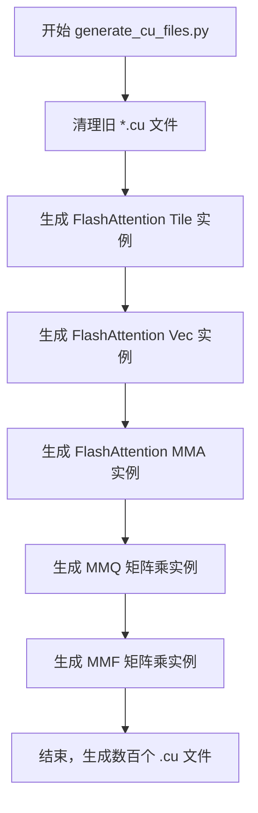
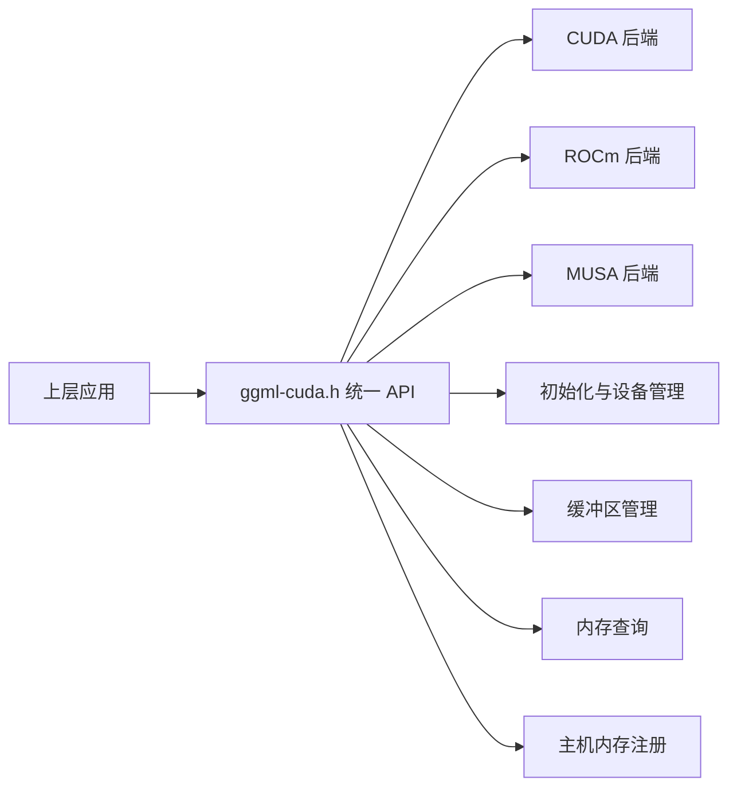
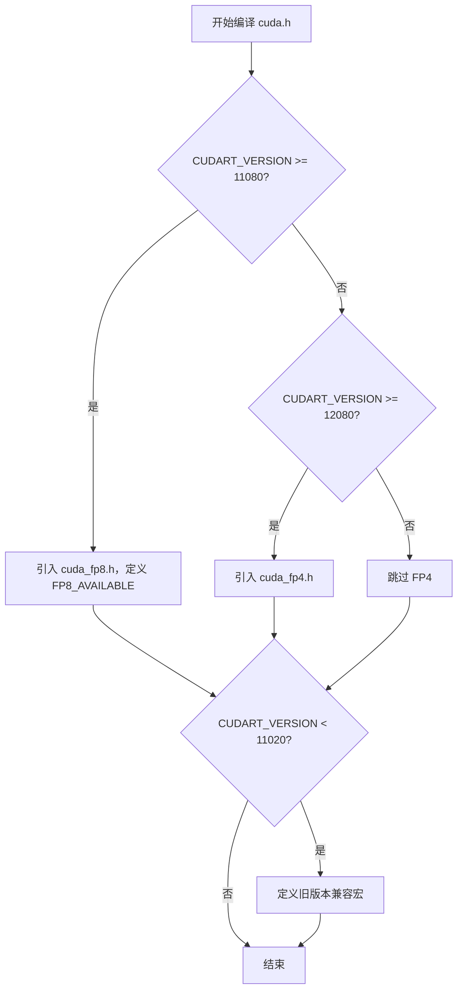
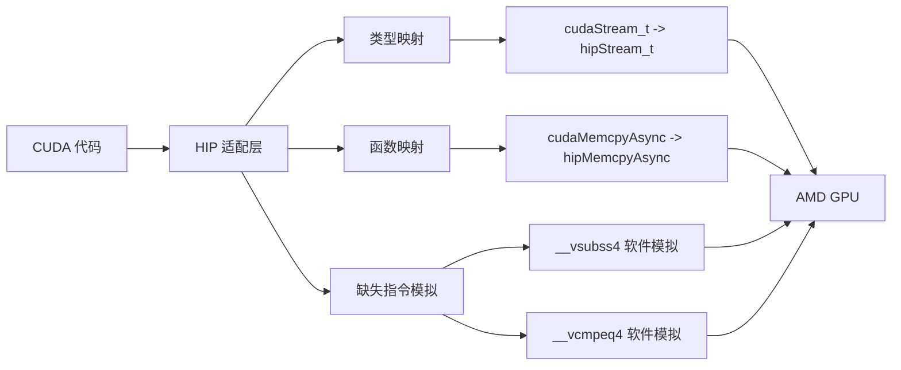
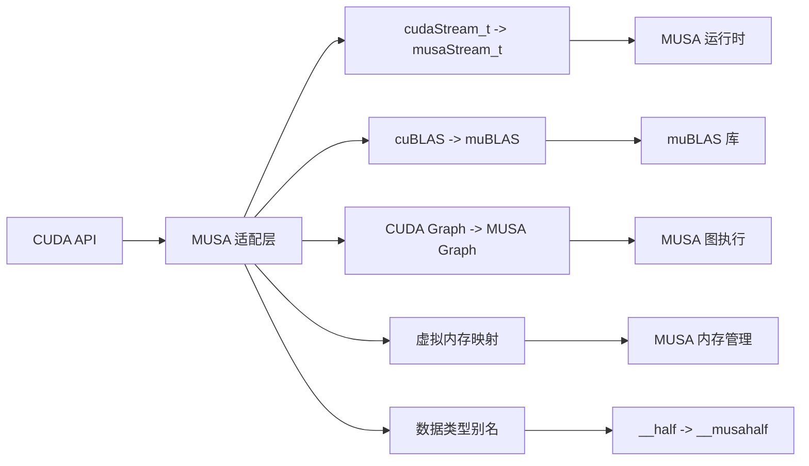

# 第38章 CUDA & HIP & MUSA 后端 —— NVIDIA/AMD/摩尔线程的"异构 GPU 三剑客"

## 学习目标

- 理解 generate_cu_files.py 的模板生成机制与批量代码生产策略
- 掌握 ggml-cuda.h 作为跨厂商 GPU 后端的统一 API 设计哲学
- 熟悉 CUDA/HIP/MUSA 三大 GPU 厂商的兼容层实现差异
- 了解 CUDA 版本兼容处理与 FP8/FP4 新特性引入机制
- 理解 HIP 平台缺失 CUDA 指令的软件模拟实现原理

## 38.1 生活类比

想象 llama.cpp 的 GPU 后端体系是一个**跨国汽车制造商的全球生产网络**：**generate_cu_files.py** 是总部的**车型配置自动生成系统**，它根据车身长度（head_size）、发动机类型（量化类型）、座位布局（ncols）自动批量生成数百种车型图纸（.cu 文件）；**ggml-cuda.h** 是**品牌统一销售展厅**，无论客户买的是奔驰（CUDA）、宝马（ROCm）还是红旗（MUSA），销售顾问用同一套话术和流程接待；**vendors/cuda.h** 是**奔驰原厂技术规范**，它确认车型年份（CUDA 版本），2022 年后标配激光雷达（FP8），2024 年后新增自动驾驶（FP4）；**vendors/hip.h** 是**宝马车的奔驰零件翻译手册**，因为宝马工厂缺少某些奔驰专用工具（CUDA 指令），需要手工打造替代件（软件模拟 __vsubss4 等）；**vendors/musa.h** 是**红旗车的本土化适配指南**，它把奔驰的设计图纸（CUDA API）翻译成红旗的生产标准（MUSA API），支持国产供应链。就像车企需要一套灵活的系统来管理全球多品牌、多配置、多工厂的生产，llama.cpp 同样需要这套机制向上层提供统一的 GPU 加速能力，彻底屏蔽底层硬件差异。

## 38.2 源码地图

```
ggml/src/ggml-cuda/template-instances/generate_cu_files.py
├── __main__()                    # 主生成逻辑（第69-123行）
│   ├── 清理旧 *.cu 文件           # 第70-71行
│   ├── FlashAttention Tile 生成   # 第73-76行
│   ├── FlashAttention Vec 生成    # 第78-81行
│   ├── FlashAttention MMA 生成    # 第83-102行
│   ├── MMQ 矩阵乘生成             # 第104-106行
│   └── MMF 矩阵乘生成             # 第108-110行
└── get_short_name()              # 量化类型名转换（第64-66行）

ggml/include/ggml-cuda.h
├── 宏定义与平台切换
│   ├── GGML_USE_HIP / GGML_USE_MUSA  # 平台选择宏
│   ├── GGML_CUDA_NAME / ggml_cublas_NAME  # 后端名称映射
│   └── GGML_CUDA_MAX_DEVICES = 16  # 最大设备数
├── 初始化与设备管理
│   ├── ggml_backend_cuda_init(int device)  # 初始化 GPU 后端
│   ├── ggml_backend_is_cuda(backend)       # 检查后端类型
│   └── ggml_backend_cuda_get_device_count()  # 获取设备数
├── 缓冲区管理
│   ├── ggml_backend_cuda_buffer_type()        # 设备缓冲区
│   ├── ggml_backend_cuda_split_buffer_type()  # 跨设备拆分缓冲区
│   └── ggml_backend_cuda_host_buffer_type()   # 主机固定内存
├── 内存查询
│   ├── ggml_backend_cuda_get_device_description()  # 设备描述
│   └── ggml_backend_cuda_get_device_memory()       # 内存信息
├── 主机内存注册
│   ├── ggml_backend_cuda_register_host_buffer()    # 注册主机缓冲
│   └── ggml_backend_cuda_unregister_host_buffer()  # 取消注册
└── ggml_backend_cuda_reg()         # 后端注册接口

ggml/src/ggml-cuda/vendors/cuda.h
└── __main__                        # 条件编译块（第1-24行）
    ├── CUDA >= 11.8: 引入 cuda_fp8.h, 定义 FP8_AVAILABLE
    ├── CUDA >= 12.8: 引入 cuda_fp4.h
    └── CUDA < 11.2: 旧版本宏兼容（CU_DEVICE_ATTRIBUTE/CUBLAS_COMPUTE_*）

ggml/src/ggml-cuda/vendors/hip.h
├── __vsubss4()                     # 4路 int8 饱和减法（第220-238行）
├── __vsub4()                       # __vsubss4 的包装（第240-243行）
├── __vcmpeq4()                     # 4路 uint8 相等比较（第245-255行）
└── __vcmpne4()                     # 4路 uint8 不等比较（第257-267行）

ggml/src/ggml-cuda/vendors/musa.h
└── 全局定义                         # CUDA → MUSA API 映射与类型转换
```

## 38.3 模板实例自动生成 —— CUDA 内核的「批量兵工厂」



在 CUDA 后端中，Flash Attention 和矩阵乘法内核需要针对不同的头维度（head_size）、量化类型（Q4_0/Q8_0 等）和列数组合生成大量特化版本。手动维护数百个 .cu 文件既繁琐又容易出错，因此 llama.cpp 采用 Python 脚本 `generate_cu_files.py` 实行批量代码生产。该脚本的核心策略是**三段式生成**：先生成 FlashAttention Tile 实例（按 head_size 组合），再生成 FlashAttention Vec 实例（按量化类型配对），最后生成 FlashAttention MMA 实例（按 Tensor Core 的矩阵形状）。脚本还内建了多项特殊处理逻辑，例如跳过无效的 ncols2 > ncols 组合、为 DeepSeek-V2 MLA 的 576 头维度固定 dv=512，以及在生成前彻底清理旧的 *.cu 文件，确保每次产出都是干净的。

### 38.3.1 `__main__()`：主生成逻辑

源码路径：`ggml/src/ggml-cuda/template-instances/generate_cu_files.py`（第 69-123 行）
核心类/接口名：无
关键函数：`__main__`

```python
# 第69-123行：主生成逻辑
for filename in glob("*.cu"):       # 遍历当前目录下所有 .cu 文件
    os.remove(filename)             # 删除旧的 .cu 文件，确保生成环境干净

# 生成 FlashAttention Tile 实例
for head_size_kq in HEAD_SIZES_KQ:     # 遍历所有支持的 head_size_kq 值
    head_size_v = head_size_kq if head_size_kq != 576 else 512   # DeepSeek-V2 MLA 特殊处理：576 时 dv 固定为 512
    with open(f"fattn-tile-instance-dkq{head_size_kq}-dv{head_size_v}.cu", "w") as f:  # 打开（创建）目标 .cu 文件
        f.write(SOURCE_FATTN_TILE.format(head_size_kq=head_size_kq, head_size_v=head_size_v))  # 写入模板生成的内容

# 生成 FlashAttention Vec 实例
for type_k in TYPES_KV:                # 遍历所有 key 量化类型
    for type_v in TYPES_KV:            # 遍历所有 value 量化类型
        with open(f"fattn-vec-instance-{get_short_name(type_k)}-{get_short_name(type_v)}.cu", "w") as f:  # 生成文件名
            f.write(SOURCE_FATTN_VEC.format(type_k=type_k, type_v=type_v))  # 写入模板内容

# 生成 FlashAttention MMA 实例
for ncols in [8, 16, 32, 64]:          # 遍历不同的列数
    for ncols2 in [1, 2, 4, 8, 16, 32]: # 遍历不同的 ncols2
        if ncols2 > ncols:              # 跳过无效组合：ncols2 不能大于 ncols
            continue
        ncols1 = ncols // ncols2        # 计算 ncols1
        with open(f"fattn-mma-f16-instance-ncols1_{ncols1}-ncols2_{ncols2}.cu", "w") as f:  # 打开文件
            f.write(SOURCE_FATTN_MMA_START)  # 写入 MMA 实例的起始模板

            for head_size_kq in HEAD_SIZES_KQ:   # 遍历 head_size_kq
                if head_size_kq == 40:           # 跳过不支持的 head_size: 40
                    continue
                if head_size_kq == 72:           # 跳过不支持的 head_size: 72
                    continue
                if head_size_kq == 512 and ncols2 not in (4, 8):   # 512 特殊限制：ncols2 只能是 4 或 8
                    continue
                if head_size_kq != 576 and ncols2 in (16, 32):     # 非576限制：ncols2 不能是 16 或 32
                    continue
                if head_size_kq == 576 and ncols2 not in (4, 16, 32):  # 576特殊限制：ncols2 只能是 4,16,32
                    continue
                head_size_v = head_size_kq if head_size_kq != 576 else 512  # 计算 head_size_v
                f.write(SOURCE_FATTN_MMA_CASE.format(ncols1=ncols1, ncols2=ncols2, head_size_kq=head_size_kq, head_size_v=head_size_v))  # 写入每个 case 模板

# 生成 MMQ 矩阵乘实例
for type in TYPES_MMQ:                  # 遍历 MMQ 的量化类型
    with open(f"mmq-instance-{get_short_name(type)}.cu", "w") as f:  # 打开文件
        f.write(SOURCE_MMQ.format(type=type))  # 写入 MMQ 模板

# 生成 MMF 矩阵乘实例
for type in range(1, 17):               # 遍历 1 到 16 的列数
    with open(f"mmf-instance-ncols_{type}.cu", "w") as f:  # 打开文件
        f.write(SOURCE_MMF.format(type=type))  # 写入 MMF 模板
```

这段代码定义/展示了 CUDA 内核实例的批量生成流程：它先删除所有旧的 .cu 文件，然后依次生成 FlashAttention Tile、Vec、MMA 以及 MMQ、MMF 五类内核文件，通过多层循环和条件判断自动跳过无效配置，最终产出数百个针对不同硬件特性的特化内核源文件。

### 38.3.2 `get_short_name()`：量化类型名转换

源码路径：`ggml/src/ggml-cuda/template-instances/generate_cu_files.py`（第 64-66 行）
核心类/接口名：无
关键函数：`get_short_name`

```python
# 第64-66行：量化类型名转换
def get_short_name(long_quant_name):
    return long_quant_name.replace("GGML_TYPE_", "").lower()  # 去掉前缀并转小写，生成简称
```

这段代码定义/展示了一个辅助函数：它接收诸如 `GGML_TYPE_Q4_0` 的长量化类型名，去掉 `GGML_TYPE_` 前缀并转换为小写（如 `q4_0`），用于生成简洁的文件名，避免文件名过长且符合 CUDA 内核的命名惯例。

## 38.4 公共 API 门面 —— 跨平台 GPU 后端的「统一接待处」



`ggml-cuda.h` 是 CUDA/ROCm/MUSA 三家 GPU 后端的公共头文件，它扮演着**品牌统一销售展厅**的角色：无论底层是 NVIDIA CUDA、AMD ROCm 还是摩尔线程 MUSA，上层代码都通过这同一套 API 与 GPU 后端交互。文件通过 `GGML_USE_HIP` / `GGML_USE_MUSA` 宏在编译期切换后端名称（CUDA → ROCm/MUSA），并统一定义了初始化、设备管理、缓冲区分配、主机内存注册等核心接口。后端注册函数 `ggml_backend_cuda_reg` 将整个 CUDA 后端插入 GGML 的后端注册表，使得计算图调度器可以像使用其他后端一样透明地调度 GPU 资源。

### 38.4.1 `ggml_backend_cuda_init` 等后端 API：跨厂商 GPU 后端统一接口

源码路径：`ggml/include/ggml-cuda.h`（第 1-47 行）
核心类/接口名：`ggml_backend_t`
关键函数：`ggml_backend_cuda_init`

```c
// ggml/include/ggml-cuda.h：跨平台 GPU 后端的统一 API（第1-47行）
#pragma once                                  // 防止头文件重复包含

#include "ggml.h"          // 包含 ggml 核心头文件，提供张量和上下文定义
#include "ggml-backend.h"  // 包含后端抽象头文件，提供后端接口类型

#ifdef  __cplusplus
extern "C" {               // C++ 链接保护，确保 C 编译器兼容
#endif

// 平台选择宏：根据编译选项定义后端名称
#ifdef GGML_USE_HIP
#define GGML_CUDA_NAME "ROCm"          // AMD ROCm 后端名称
#define GGML_CUBLAS_NAME "hipBLAS"     // 对应的 BLAS 库名称
#elif defined(GGML_USE_MUSA)
#define GGML_CUDA_NAME "MUSA"          // 摩尔线程 MUSA 后端名称
#define GGML_CUBLAS_NAME "muBLAS"      // 对应的 BLAS 库名称
#else
#define GGML_CUDA_NAME "CUDA"          // 默认 NVIDIA CUDA 后端名称
#define GGML_CUBLAS_NAME "cuBLAS"      // 对应的 BLAS 库名称
#endif
#define GGML_CUDA_MAX_DEVICES       16   // 最大支持的设备数量

// 后端 API 函数声明（以下为接口声明，实现在具体平台代码中）
GGML_BACKEND_API ggml_backend_t ggml_backend_cuda_init(int device);  // 初始化指定设备的 GPU 后端
GGML_BACKEND_API bool ggml_backend_is_cuda(ggml_backend_t backend); // 检查给定后端是否为 CUDA 后端
GGML_BACKEND_API ggml_backend_buffer_type_t ggml_backend_cuda_buffer_type(int device);        // 创建设备缓冲区类型
GGML_BACKEND_API ggml_backend_buffer_type_t ggml_backend_cuda_split_buffer_type(int main_device, const float * tensor_split); // 创建跨设备拆分缓冲区类型
GGML_BACKEND_API ggml_backend_buffer_type_t ggml_backend_cuda_host_buffer_type(void);         // 创建主机固定内存缓冲区类型
GGML_BACKEND_API int  ggml_backend_cuda_get_device_count(void);                               // 获取系统中 CUDA 设备总数
GGML_BACKEND_API void ggml_backend_cuda_get_device_description(int device, char * description, size_t description_size); // 获取设备描述字符串
GGML_BACKEND_API void ggml_backend_cuda_get_device_memory(int device, size_t * free, size_t * total); // 查询设备内存使用情况
GGML_BACKEND_API bool ggml_backend_cuda_register_host_buffer(void * buffer, size_t size);    // 注册主机缓冲区以启用零拷贝
GGML_BACKEND_API void ggml_backend_cuda_unregister_host_buffer(void * buffer);               // 取消注册主机缓冲区
GGML_BACKEND_API ggml_backend_reg_t ggml_backend_cuda_reg(void);                              // 获取后端注册结构体，用于向 ggml 注册

#ifdef  __cplusplus
}
#endif
```

这段代码定义/展示了 ggml-cuda.h 的完整公共接口：通过条件编译宏统一三家后端的名称与 BLAS 库别名，并声明了初始化、设备查询、缓冲区类型创建、主机内存注册以及后端注册等全套 API，使得上层调度器可以完全屏蔽底层 GPU 差异。

## 38.5 CUDA 厂商适配层 —— NVIDIA 官方的「原生座驾」



`vendors/cuda.h` 是 ggml-cuda 在原生 NVIDIA CUDA 平台上的适配层，它扮演着**奔驰原厂技术规范**的角色。该文件的核心使命是处理不同 CUDA 版本之间的 API 差异：通过条件编译，当 `CUDART_VERSION >= 11080` 时引入 `cuda_fp8.h` 并定义 `FP8_AVAILABLE` 宏，从而在支持 FP8 的 CUDA 工具链上启用新一代低精度量化；当 `CUDART_VERSION >= 12080` 时进一步引入 `cuda_fp4.h`，为 NVIDIA 最新的 FP4 格式提供支持。对于老旧的 CUDA 版本（< 11.2），文件还定义了虚拟内存管理、TF32 Tensor Op 等宏的兼容性别名，确保同一份 ggml-cuda 源码能在 CUDA 12.x 和 CUDA 13.x 上无缝编译。

### 38.5.1 `__main__` 条件编译块：NVIDIA CUDA 原生适配层

源码路径：`ggml/src/ggml-cuda/vendors/cuda.h`（第 1-24 行）
核心类/接口名：无
关键函数：`__main__`（顶层条件编译）

```c
// ggml/src/ggml-cuda/vendors/cuda.h：NVIDIA CUDA 原生适配层（第1-24行）
#pragma once                                  // 防止头文件重复包含

#include <cuda_runtime.h>      // 包含 CUDA 运行时 API，提供内存管理、内核启动等功能
#include <cuda.h>               // 包含 CUDA 驱动 API，提供底层 GPU 控制
#include <cublas_v2.h>          // 包含 cuBLAS 线性代数库，用于矩阵运算
#include <cuda_bf16.h>          // 包含 bfloat16 类型支持
#include <cuda_fp16.h>          // 包含 float16 类型支持

#if CUDART_VERSION >= 11080
#include <cuda_fp8.h>           // CUDA 11.8+ 引入 FP8 头文件，提供 8 位浮点类型
#define FP8_AVAILABLE            // 定义宏表示 FP8 可用
#endif // CUDART_VERSION >= 11080

#if CUDART_VERSION >= 12080
#include <cuda_fp4.h>           // CUDA 12.8+ 引入 FP4 头文件，提供 4 位浮点类型
#endif // CUDART_VERSION >= 12080

#if CUDART_VERSION < 11020
// 为旧版本 CUDA 定义兼容性别名，确保 API 在旧版 CUDA 上可用
#define CU_DEVICE_ATTRIBUTE_VIRTUAL_MEMORY_MANAGEMENT_SUPPORTED CU_DEVICE_ATTRIBUTE_VIRTUAL_ADDRESS_MANAGEMENT_SUPPORTED  // 虚拟内存管理属性别名
#define CUBLAS_TF32_TENSOR_OP_MATH CUBLAS_TENSOR_OP_MATH  // TF32 张量运算数学别名
#define CUBLAS_COMPUTE_16F CUDA_R_16F  // 16 位浮点计算类型别名
#define CUBLAS_COMPUTE_32F CUDA_R_32F  // 32 位浮点计算类型别名
#define cublasComputeType_t cudaDataType_t  // cuBLAS 计算类型别名到 CUDA 数据类型
#endif // CUDART_VERSION < 11020
```

这段代码定义/展示了 NVIDIA CUDA 原生适配层的条件编译逻辑：它根据 CUDART_VERSION 自动引入对应版本的 FP8/FP4 头文件，并为旧版 CUDA 提供宏和类型别名，从而保证 ggml-cuda 在不同 CUDA 工具链版本下都能正确编译并启用新特性。

## 38.6 HIP 适配层 —— AMD GPU 的「翻译官」



`vendors/hip.h` 是 AMD ROCm 平台的适配层，它扮演着**宝马车的奔驰零件翻译手册**的角色。其核心使命是将 CUDA API 映射到 HIP（Heterogeneous-Computing Interface for Portability），使得原本为 NVIDIA CUDA 编写的 ggml-cuda 代码无需修改即可在 AMD GPU 上编译运行。文件内部不仅完成了 `cudaStream_t → hipStream_t`、`cudaMemcpyAsync → hipMemcpyAsync`、`cublasHandle_t → hipblasHandle_t` 等类型与函数映射，还根据 `__gfx900__` / `__gfx942__` 等预处理宏识别 GCN/CDNA/RDNA 架构，为后续条件编译提供依据。最关键的贡献在于**缺失指令的软件模拟**：ROCm 早期版本缺少 CUDA 中用于量化内核的 `__vsubss4`、`__vcmpeq4` 等内建向量指令，HIP 适配层使用 `__builtin_elementwise_sub_sat` 或手动循环实现了等价功能，确保量化矩阵乘在 AMD 平台上也能高效运行。

### 38.6.1 `__vsubss4()`：4 路 int8 饱和减法模拟

源码路径：`ggml/src/ggml-cuda/vendors/hip.h`（第 220-238 行）
核心类/接口名：无
关键函数：`__vsubss4`

```c
// 第220-238行：4路 int8 饱和减法模拟
static __device__ __forceinline__ int __vsubss4(const int a, const int b) {
    const int8x4_t va = reinterpret_cast<const int8x4_t&>(a);   // 将输入 a 重新解释为包含 4 个 int8 的向量
    const int8x4_t vb = reinterpret_cast<const int8x4_t&>(b);   // 将输入 b 重新解释为包含 4 个 int8 的向量
#if __has_builtin(__builtin_elementwise_sub_sat)
    const int8x4_t c = __builtin_elementwise_sub_sat(va, vb);   // 若编译器支持内置饱和减法，直接使用
    return reinterpret_cast<const int &>(c);                    // 将结果向量转换为 int 返回
#else
    int8x4_t c;                                                 // 存放结果的向量
    int16_t tmp;                                                // 临时变量，使用 int16 防止溢出
#pragma unroll
    for (int i = 0; i < 4; i++) {                               // 遍历 4 个 int8 元素
        tmp = va[i] - vb[i];                                    // 执行减法
        if(tmp > std::numeric_limits<int8_t>::max()) tmp = std::numeric_limits<int8_t>::max(); // 若超过 int8 上限则饱和
        if(tmp < std::numeric_limits<int8_t>::min()) tmp = std::numeric_limits<int8_t>::min(); // 若低于 int8 下限则饱和
        c[i] = tmp;                                             // 将饱和后的结果存入结果向量
    }
    return reinterpret_cast<int &>(c);                          // 将结果向量转换为 int 返回
#endif // __has_builtin(__builtin_elementwise_sub_sat)
}
```

这段代码定义/展示了 HIP 平台缺失的 CUDA `__vsubss4` 指令的软件模拟实现：它优先使用编译器内置的 `__builtin_elementwise_sub_sat`，否则通过手动循环对 4 个 int8 元素执行饱和减法，确保量化内核在 AMD GPU 上的正确性。

### 38.6.2 `__vsub4()`：饱和减法包装

源码路径：`ggml/src/ggml-cuda/vendors/hip.h`（第 240-243 行）
核心类/接口名：无
关键函数：`__vsub4`

```c
// 第240-243行：饱和减法包装
static __device__ __forceinline__ int __vsub4(const int a, const int b) {
    return __vsubss4(a, b);   // 直接调用 __vsubss4 实现，保持接口一致
}
```

这段代码定义/展示了 `__vsub4` 的包装函数，它只是 `__vsubss4` 的别名，用于与 CUDA 内核中其他可能的变体保持接口一致，减少上层代码的修改量。

### 38.6.3 `__vcmpeq4()`：4 路 uint8 相等比较

源码路径：`ggml/src/ggml-cuda/vendors/hip.h`（第 245-255 行）
核心类/接口名：无
关键函数：`__vcmpeq4`

```c
// 第245-255行：4路 uint8 相等比较
static __device__ __forceinline__ unsigned int __vcmpeq4(unsigned int a, unsigned int b) {
    const uint8x4_t& va = reinterpret_cast<const uint8x4_t&>(a);   // 将 a 重新解释为包含 4 个 uint8 的向量
    const uint8x4_t& vb = reinterpret_cast<const uint8x4_t&>(b);   // 将 b 重新解释为包含 4 个 uint8 的向量
    unsigned int c;                                                 // 存放结果的掩码
    uint8x4_t& vc = reinterpret_cast<uint8x4_t&>(c);               // 将 c 重新解释为可写的 uint8 向量
#pragma unroll
    for (int i = 0; i < 4; ++i) {                                   // 遍历 4 个 uint8 元素
        vc[i] = va[i] == vb[i] ? 0xff : 0x00;                       // 相等则置 0xff，不等置 0x00，生成掩码
    }
    return c;                                                       // 返回掩码
}
```

这段代码定义/展示了 HIP 平台缺失的 CUDA `__vcmpeq4` 指令的软件模拟实现：它逐个比较 4 个 uint8 元素，相等的字节置为 0xff（生成掩码），不等的置为 0x00，用于量化内核中的字节级条件筛选。

### 38.6.4 `__vcmpne4()`：4 路 uint8 不等比较

源码路径：`ggml/src/ggml-cuda/vendors/hip.h`（第 257-267 行）
核心类/接口名：无
关键函数：`__vcmpne4`

```c
// 第257-267行：4路 uint8 不等比较
static __device__ __forceinline__ unsigned int __vcmpne4(unsigned int a, unsigned int b) {
    const uint8x4_t& va = reinterpret_cast<const uint8x4_t&>(a);   // 将 a 重新解释为包含 4 个 uint8 的向量
    const uint8x4_t& vb = reinterpret_cast<const uint8x4_t&>(b);   // 将 b 重新解释为包含 4 个 uint8 的向量
    unsigned int c;                                                 // 存放结果的掩码
    uint8x4_t& vc = reinterpret_cast<uint8x4_t&>(c);               // 将 c 重新解释为可写的 uint8 向量
#pragma unroll
    for (int i = 0; i < 4; ++i) {                                   // 遍历 4 个 uint8 元素
        vc[i] = va[i] == vb[i] ? 0x00 : 0xff;                       // 不等则置 0xff，相等置 0x00，生成掩码（与 __vcmpeq4 相反）
    }
    return c;                                                       // 返回掩码
}
```

这段代码定义/展示了 `__vcmpne4` 的软件模拟实现，其逻辑与 `__vcmpeq4` 相反，用于生成“不等”掩码，在量化内核的掩码生成阶段与 `__vcmpeq4` 配对使用。

## 38.7 MUSA 适配层 —— 摩尔线程 GPU 的「本土桥梁」



`vendors/musa.h` 是为摩尔线程（Moore Threads）MUSA 架构 GPU 提供的 CUDA 兼容层，它扮演着**红旗车的本土化适配指南**的角色。该文件延续了 HIP 适配层的思路，但针对 MUSA 平台的特有 API 和限制进行了深度定制：它将 CUDA Runtime API、cuBLAS、CUDA Graph 和虚拟内存管理等函数和类型一一映射到对应的 MUSA 实现上（例如 `cudaStream_t → musaStream_t`、`cuBLAS → muBLAS`），使得原本为 NVIDIA CUDA 编写的 ggml-cuda 代码能够无缝地在摩尔线程 GPU 上编译运行。在 bfloat16 等数据类型上，MUSA 平台的支持程度与 CUDA/HIP 存在差异，因此文件内部需要额外的宏定义或类型转换来统一接口。MUSA 适配层的加入，标志着 llama.cpp 对国产 AI 芯片的原生支持，极大地扩展了其硬件生态的覆盖范围。

### 38.7.1 全局映射宏：摩尔线程 GPU 的 CUDA 兼容层

源码路径：`ggml/src/ggml-cuda/vendors/musa.h`（第 1-100 行）
核心类/接口名：无
关键函数：全局映射宏

```c
// MUSA 适配层关键映射示例（示意，基于公开文档整理）
#pragma once                                  // 防止头文件重复包含

// CUDA Runtime API → MUSA Runtime API 映射
#define cudaStream_t          musaStream_t    // 将 CUDA 流类型映射到 MUSA 流类型
#define cudaEvent_t           musaEvent_t     // 将 CUDA 事件类型映射到 MUSA 事件类型
#define cudaMemcpyAsync       musaMemcpyAsync // 异步内存复制函数映射
#define cudaMemsetAsync       musaMemsetAsync // 异步内存设置函数映射
#define cudaLaunchKernel      musaLaunchKernel // 内核启动函数映射

// cuBLAS → muBLAS 映射
#define cublasHandle_t        muBLASHandle_t   // cuBLAS 句柄类型映射
#define cublasCreate          muBLASCreate     // cuBLAS 库初始化函数映射
#define cublasSetStream       muBLASSetStream  // 设置 cuBLAS 流函数映射
#define cublasSgemm           muBLASSgemm      // 单精度矩阵乘法函数映射

// CUDA Graph → MUSA Graph 映射
#define cudaGraph_t           musaGraph_t      // CUDA Graph 类型映射
#define cudaGraphCreate       musaGraphCreate  // 创建 Graph 函数映射
#define cudaGraphExec_t       musaGraphExec_t  // Graph 可执行实例类型映射
#define cudaGraphInstantiate  musaGraphInstantiate // 实例化 Graph 函数映射

// 虚拟内存管理（旧版 CUDA 兼容）
#define cuMemAllocAsync       musaMemAllocAsync // 异步内存分配函数映射
#define cuMemFreeAsync        musaMemFreeAsync  // 异步内存释放函数映射

// bfloat16 类型兼容：MUSA 平台使用 __musabf16 别名
#define __half               __musahalf        // half 类型映射
#define __nv_bfloat16        __musabf16        // bfloat16 类型映射
```

这段代码定义/展示了 MUSA 适配层的核心映射宏：通过一系列 `#define` 将 CUDA 运行时 API、cuBLAS 接口、CUDA Graph 以及数据类型一一别名到 MUSA 对应实现，使得上层 ggml-cuda 代码无需修改即可在摩尔线程 GPU 上编译，同时为 bfloat16 等类型提供了平台特定的兼容处理。

## 38.8 设计中的取舍

**为什么选择宏开关（GGML_USE_HIP / GGML_USE_MUSA）而不是运行时分发？**  
因为 GPU 后端的初始化、缓冲区类型和内核实现与硬件强相关，运行时分发不仅需要额外的分支判断和函数指针跳转，还会阻碍编译器对特定平台内核的优化。宏开关在编译期就确定了唯一的目标平台，使得无关的代码路径不会被编译，既减小了二进制体积，又保证了热路径的极致性能。但其代价是每增加一个新平台，就需要重新编译整个项目，无法像动态加载那样在运行时热切换后端。

**HIP 适配层为什么需要软件模拟 __vsubss4 等 CUDA 指令？这些指令在哪类 CUDA 内核中被使用？**  
这些指令属于 CUDA 的向量整数饱和运算扩展，主要用于量化内核中的 int8 权重解压缩和激活截断。ROCm 早期版本的 HIP 层没有提供等价的内建函数，如果直接使用会导致编译失败。通过软件模拟，虽然会带来少量额外的指令开销，但换来了跨平台的可移植性，且这些函数被标记为 `__forceinline__`，编译器通常能将其优化为高效的 SIMD 指令。

**三层适配层（CUDA/HIP/MUSA）的维护成本与收益如何权衡？**  
三层适配层共享同一套 ggml-cuda 源码，理论上只需维护一份核心代码，收益是显著降低的多平台支持成本和更广泛的硬件覆盖。但实际维护中，每个厂商的适配层都需要处理独特的 API 差异和缺失功能（如 HIP 的软件模拟、MUSA 的 bfloat16 兼容），这些“翻译手册”仍需持续更新。 llama.cpp 的选择是将适配层做得足够薄，仅覆盖 API 映射和关键差异，而将共性逻辑留在核心层，从而在可维护性和生态扩展性之间取得平衡。

## 38.9 动手练习

1. **追踪模板生成流程**  
   阅读 `ggml/src/ggml-cuda/template-instances/generate_cu_files.py` 第 69-110 行，运行该脚本并观察输出：  
   - 统计生成的 .cu 文件总数，按类型分类（fattn-tile / fattn-vec / fattn-mma / mmq / mmf）  
   - 修改 HEAD_SIZES_KQ 列表，添加一个自定义 head_size（如 256），重新生成并观察变化  
   回答问题：  
   - 为什么 ncols2 > ncols 的组合被跳过？这与 GPU 线程块组织有什么关系？  
   - head_size_kq == 576 时为什么 dv 固定为 512？查阅 DeepSeek-V2 MLA 架构论文理解原因  

2. **分析厂商兼容层差异**  
   对比阅读三个厂商头文件的差异：  
   - `ggml/src/ggml-cuda/vendors/cuda.h`（NVIDIA 原生）  
   - `ggml/src/ggml-cuda/vendors/hip.h`（AMD ROCm）  
   - `ggml/src/ggml-cuda/vendors/musa.h`（摩尔线程）  
   回答问题：  
   - 三个文件分别解决了什么平台特定问题？  
   - HIP 平台为什么需要软件模拟 __vsubss4 等指令？这些指令在哪类 CUDA 内核中被使用？  
   - MUSA 平台对 bfloat16 的处理与 CUDA 有何不同？  

3. **设计最小化跨平台 GPU 后端**  
   基于 `ggml/include/ggml-cuda.h` 的 API 设计，尝试为一个虚构的 GPU 厂商（如 "XYZ GPU"）设计类似的兼容层：  
   - 定义 XYZ GPU 的厂商宏（类似 GGML_USE_HIP / GGML_USE_MUSA）  
   - 列出需要映射的核心 CUDA API（至少 10 个）到 XYZ GPU 的对应函数  
   - 考虑 XYZ GPU 不支持 FP8 的情况，设计降级策略  
   思考问题：  
   - 为什么 ggml 选择宏开关而非运行时分发？这种设计的优缺点是什么？  
   - 如果 XYZ GPU 有独特的硬件特性（如更大的共享内存），如何在兼容层中暴露这些特性？  

4. **实现缺失的 HIP 内联函数**  
   参考 `hip.h` 中 __vsubss4 的实现模式，尝试为 HIP 平台实现另一个缺失的 CUDA 指令：  
   - 选择 __vaddss4（4路 int8 饱和加法）或 __vabs4（4路 int8 绝对值）  
   - 使用 __builtin_elementwise_* 系列函数（如果可用）或手动循环实现  
   - 确保使用 __forceinline__ 和正确的类型转换  
   验证要求：  
   - 编写简单的测试用例，对比你的实现与 CUDA 原生指令的结果  
   - 思考：为什么饱和运算在量化神经网络中如此重要？  

## 38.10 本章小结

这一章中我们深入剖析了 llama.cpp 的 CUDA & HIP & MUSA 后端体系。首先，我们看到了 `generate_cu_files.py` 如何像“批量兵工厂”一样自动生成数百个 CUDA 内核实例，避免手动维护的繁琐；其次，`ggml-cuda.h` 作为“统一接待处”，通过宏定义和统一 API 屏蔽了三家厂商的差异；接着，`vendors/cuda.h` 展示了 NVIDIA 原生平台的版本兼容与 FP8/FP4 引入策略；然后，`vendors/hip.h` 充当 AMD GPU 的“翻译官”，通过软件模拟补齐了缺失的 CUDA 指令；最后，`vendors/musa.h` 为摩尔线程 GPU 提供了本土化适配，将 CUDA API 映射到 MUSA 生态。整个设计在编译期确定目标平台，既保证了极致性能，又维持了跨厂商的可移植性。

本章我们一起学习了以下概念：

| 概念 | 解释 |
|------|------|
| generate_cu_files.py | CUDA 内核模板批量生成器，避免手写数百个 .cu 文件 |
| FlashAttention Tile/Vec/MMA | 三种注意力内核变体，分别针对不同硬件特性和场景 |
| HEAD_SIZES_KQ | 支持的头维度列表，决定生成哪些特化版本 |
| head_size_kq == 576 | DeepSeek-V2 MLA 特殊处理，dv 固定为 512 |
| ggml_backend_cuda_init | GPU 后端初始化入口，返回统一的 ggml_backend_t |
| ggml-cuda.h 名称宏 | GGML_USE_HIP/MUSA 切换后端显示名称（CUDA/ROCm/MUSA） |
| CUDA 版本条件编译 | CUDART_VERSION >= 11080 启用 FP8，>= 12080 启用 FP4 |
| __vsubss4/__vsub4 | HIP 平台缺失的 CUDA 饱和减法指令，软件模拟实现 |
| __vcmpeq4/__vcmpne4 | HIP 平台字节比较掩码生成，用于量化内核 |
| MUSA 适配层 | 摩尔线程 GPU 的 CUDA API 映射，国产 GPU 支持 |
| 厂商兼容层设计 | 同一套 ggml-cuda 源码，三家 GPU 厂商无缝编译 |

下一章中，我们将学习 Hexagon 后端 —— Snapdragon DSP 的「异构协奏曲」，探索 llama.cpp 如何通过 FastRPC 与 dspqueue 在 Hexagon DSP/HTP 上调度模型推理，进一步扩展其异构计算版图。感谢你读到了这里，恭喜你，你已经完成了 CUDA & HIP & MUSA 后端这一章的学习。
