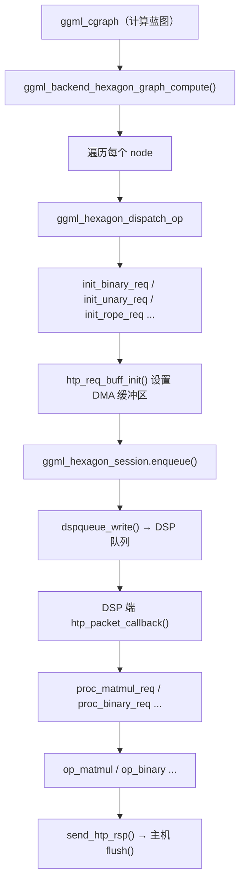

# 第39章 Hexagon 后端 —— Snapdragon DSP 的"异构协奏曲"

## 学习目标

- 掌握 FastRPC 驱动的动态加载机制：理解 `htpdrv_init()` 如何通过 `dlsym` 绑定 `rpcmem_*`、`fastrpc_*`、`dspqueue_*` 等符号，构建 host 与 DSP 的通信桥梁。
- 精通 HTP 消息协议：掌握 `htp_tensor`、`htp_general_req`、`htp_general_rsp` 三大结构体的定义，以及 `htp_t_block_size()`/`htp_type_nbytes()` 的类型换算逻辑。
- 理解 DSP 会话生命周期：掌握 `htp_iface_open/start/close/stop` 的完整流程，包括电源管理（HVX/HMX）、VTCM 分配、DSP 队列导入与工作线程池的建立。
- 掌握主机端缓冲区管理：理解 `ggml_backend_hexagon_buffer_context` 的构造与析构，以及 `rpcmem_alloc2` 和 `fastrpc_mmap` 的共享内存分配与映射流程。
- 深入量化重排机制：掌握 `q4_0`、`q8_0`、`iq4_nl`、`mxfp4` 四种格式如何被转换为 DSP 优化的 `x4x2` 布局，包括 `repack_row_*` 与 `unpack_row_*` 的实现。
- 理解图调度与请求构造：学习 `ggml_backend_hexagon_graph_compute()` 如何通过 `init_binary_req()`、`init_rope_req()` 等模板函数将 `ggml_tensor` 翻译为 `htp_general_req`，并通过会话队列进行分发。
- 掌握 DSP 侧请求处理：理解 `htp_packet_callback()` 如何轮询 `dspqueue` 并调用 `proc_*_req` 系列函数处理矩阵乘、激活、Softmax、RoPE 等算子。
- 掌握 HVX/HMX 计算核心：深入 `matmul-ops.c` 与 `hmx-matmul-ops.c`，理解量化点积与 tile 化矩阵乘的实现。
- 精通 HVX 工具库：了解 `hvx-base.h` 至 `hvx-arith.h` 中对齐分发与原子向量操作的设计，以及 `hex-dma.h` 和 `worker-pool.c` 提供的底层并发与搬运支持。

## 39.1 生活类比

想象整个 ggml-hexagon 后端是一家「高通 DSP 智能工厂」：`htpdrv_init()` 是厂门的保安，负责检查并加载 `libcdsprpc` 这把「万能钥匙」，随后打开 `rpcmem`、`fastrpc`、`dspqueue` 这三把重要的工具柜。`htp-msg.h` 是厂里的「标准作业单」，`htp_tensor` 是物料标签（类型、尺寸、步长），`htp_general_req` 是任务卡（操作码、标志位、输入输出），`htp_general_rsp` 是回执（状态、耗时、周期数）。`ggml-hexagon.cpp` 是厂长办公室里的调度中心，`ggml_hexagon_registry` 掌管车间，`ggml_hexagon_session` 是流水线班长，负责将主机下达的 `ggml` 指令翻译成 DSP 能听懂的 `htp_general_req`。`htp/main.c` 是 DSP 车间的收发室，`htp_iface_open/start` 是每天早上给 HVX/HMX 上电并分配 VTCM 工位，`htp_packet_callback` 则是分拣员，负责把收到的包裹（请求）分发给不同的工种（`proc_*_req`）。`matmul-ops.c` 与 `hmx-matmul-ops.c` 是车间里的「核心冲压机」与「特快专机」，前者用 HVX 向量点积处理重量，后者用 HMX 硬件做矩阵乘法。`hvx-*.h` 系列是工具的「万用螺丝刀组」，无论加减乘除、指数对数、拷贝重排，都按内存对齐方式（aa/au/ua/uu）自动匹配最合适的工具头。`worker-pool.c` 是「多工位并联系统」，保证每个计算任务都能被多个 DSP 线程瓜分；`hex-dma.c/h` 则是「传送带与升降机」，负责在 DDR 和 VTCM 仓库之间搬运物料。

## 39.2 源码地图

```
ggml/src/ggml-hexagon/
├── htp/
│   ├── act-ops.c
│   │   ├── execute_op_activations_f32()
│   │   ├── glu_swiglu_f32_per_thread()
│   │   ├── glu_swiglu_oai_f32_per_thread()
│   │   ├── glu_geglu_f32_per_thread()
│   │   ├── op_activations()
│   │   ├── unary_gelu_f32_per_thread()
│   │   └── unary_silu_f32_per_thread()
│   ├── argsort-ops.c
│   │   ├── all_greater_f32()
│   │   ├── htp_argsort_f32()
│   │   ├── op_argsort()
│   │   ├── quicksort_values_indices_asc()
│   │   ├── quicksort_values_indices_desc()
│   │   └── __main__
│   ├── binary-ops.c
│   │   ├── binary_job_add_id()
│   │   ├── binary_job_element_repeat()
│   │   ├── binary_job_scalar()
│   │   ├── binary_job_vector_complex()
│   │   ├── binary_job_vector_row_broadcast()
│   │   ├── binary_job_vector_same_shape()
│   │   ├── calc_block_size()
│   │   ├── execute_op_binary()
│   │   ├── op_binary()
│   │   └── __main__
│   ├── cpy-ops.c
│   │   ├── cpy_thread_f16_f32_sameshape()
│   │   ├── cpy_thread_f32_f16_sameshape()
│   │   ├── cpy_thread_sametype_reshape()
│   │   ├── cpy_thread_sametype_sameshape()
│   │   ├── cpy_work_func()
│   │   └── op_cpy()
│   ├── cumsum-ops.c
│   │   ├── cumsum_thread_f32()
│   │   ├── cumsum_thread_f32_dma()
│   │   ├── hvx_cumsum_row_f32()
│   │   ├── hvx_cumsum_vadd()
│   │   ├── hvx_prefix_scan_f32()
│   │   ├── hvx_splat_last_f32()
│   │   ├── op_cumsum()
│   │   ├── op_cumsum_f32()
│   │   └── __main__
│   ├── flash-attn-ops.c
│   │   ├── flash_attn_ext_f16_thread()
│   │   ├── hvx_dot_f16_f16_aa()
│   │   ├── hvx_dot_f16_f16_aa_rx32()
│   │   ├── hvx_dot_f16_f16_aa_rx4()
│   │   ├── hvx_mad_f32_f16_aa()
│   │   ├── hvx_mad_f32_f16_aa_rx2()
│   │   ├── hvx_scale_vec_f32_aa()
│   │   ├── hvx_vec_f32_to_f16_a()
│   │   └── op_flash_attn_ext()
│   ├── get-rows-ops.c
│   │   ├── get_rows_thread_f32_f32()
│   │   └── op_get_rows()
│   ├── hex-dma.c
│   │   ├── dma_queue_create()
│   │   ├── dma_queue_delete()
│   │   ├── dma_queue_flush()
│   │   └── pow2_ceil()
│   ├── hex-dma.h
│   │   ├── dma_cache_init()
│   │   ├── dma_cache_push()
│   │   ├── dma_make_ptr()
│   │   ├── dma_queue_capacity()
│   │   ├── dma_queue_depth()
│   │   ├── dma_queue_empty()
│   │   ├── dma_queue_pop()
│   │   ├── dma_queue_pop_nowait()
│   │   ├── dma_queue_push()
│   │   ├── dma_queue_push_ddr_to_vtcm()
│   │   ├── dma_queue_push_single_1d()
│   │   ├── dma_queue_push_single_2d()
│   │   ├── dma_queue_push_vtcm_to_ddr()
│   │   ├── dmlink()
│   │   ├── dmpoll()
│   │   ├── dmstart()
│   │   ├── dmwait()
│   │   └── __main__
│   ├── hex-dump.h
│   │   └── hex_dump_*_line()
│   ├── hex-fastdiv.h
│   │   ├── fastdiv()
│   │   ├── fastmodulo()
│   │   └── init_fastdiv_values()
│   ├── hex-utils.h
│   │   └── __main__
│   ├── hmx-matmul-ops.c
│   │   ├── core_dot_chunk_fp16()
│   │   ├── dequantize_x4x2_mxfp4_group_hvx()
│   │   ├── dequantize_x4x2_mxfp4_x4groups_hvx()
│   │   ├── dequantize_x4x2_q4_0_group_hvx()
│   │   ├── dequantize_x4x2_q4_0_x4groups_hvx()
│   │   ├── dequantize_x4x2_q8_0_group_hvx()
│   │   ├── dequantize_x4x2_weight_chunk_to_fp16_tiles()
│   │   ├── dequantize_x4x2_weight_to_fp16_tiles_task()
│   │   ├── dequantize_x4x2_worker_loop()
│   │   ├── hmx_mat_mul_permuted_qk_0_d16a32()
│   │   ├── hmx_mat_mul_permuted_w16a32()
│   │   ├── hmx_mat_mul_permuted_w16a32_batched()
│   │   ├── hmx_mat_mul_permuted_w16a32_batched_legacy()
│   │   ├── hmx_matmul_activation_batch_ptr()
│   │   ├── hmx_matmul_batch_r2()
│   │   ├── hmx_matmul_batch_r3()
│   │   ├── hmx_matmul_dst_batch_ptr()
│   │   ├── hmx_matmul_weight_batch_ptr()
│   │   ├── interleave_fp16_weight_chunk_to_tiles()
│   │   ├── mat_mul_qk_0_d16a32_out_stationary()
│   │   ├── mxfp4_convert_scales()
│   │   ├── mxfp4_extract_splat()
│   │   ├── transfer_activation_chunk_fp32_to_fp16()
│   │   ├── transfer_activation_chunk_threaded()
│   │   ├── transfer_activation_chunk_worker_fn()
│   │   ├── transfer_output_chunk_fp16_to_fp32()
│   │   ├── transfer_output_chunk_threaded()
│   │   ├── transfer_output_chunk_worker_fn()
│   │   └── __main__
│   ├── hmx-ops.h
│   ├── hmx-profile.h
│   ├── hmx-utils.h
│   │   ├── hmx_consume_accumulator_fp16()
│   │   ├── hmx_dot_fp16()
│   │   ├── hmx_init_column_scales()
│   │   ├── hmx_load_tile_pair_fp16()
│   │   ├── hmx_load_tiles_fp16()
│   │   ├── hmx_set_output_scales()
│   │   └── vtcm_seq_alloc()
│   ├── htp-ctx.h
│   ├── htp-msg.h
│   │   ├── htp_t_block_size()
│   │   ├── htp_type_nbytes()
│   │   └── __main__
│   ├── htp-ops.h
│   │   └── __main__
│   ├── hvx-arith.h
│   ├── hvx-base.h
│   ├── hvx-copy.h
│   ├── hvx-div.h
│   ├── hvx-dump.h
│   ├── hvx-exp.h
│   ├── hvx-floor.h
│   ├── hvx-inverse.h
│   ├── hvx-reduce.h
│   ├── hvx-scale.h
│   ├── hvx-sigmoid.h
│   ├── hvx-sqrt.h
│   ├── hvx-types.h
│   ├── main.c
│   │   ├── htp_iface_close()
│   │   ├── htp_iface_disable_etm()
│   │   ├── htp_iface_enable_etm()
│   │   ├── htp_iface_open()
│   │   ├── htp_iface_start()
│   │   ├── htp_iface_stop()
│   │   ├── htp_packet_callback()
│   │   ├── proc_argsort_req()
│   │   ├── proc_binary_req()
│   │   ├── proc_cpy_req()
│   │   ├── proc_cumsum_req()
│   │   ├── proc_flash_attn_ext_req()
│   │   ├── proc_get_rows_req()
│   │   ├── proc_hmx_matmul_req()
│   │   ├── proc_matmul_id_req()
│   │   ├── proc_matmul_req()
│   │   ├── proc_repeat_req()
│   │   ├── proc_rope_req()
│   │   ├── proc_set_rows_req()
│   │   ├── proc_ssm_conv_req()
│   │   ├── proc_sum_rows_req()
│   │   ├── proc_unary_req()
│   │   ├── profile_start()
│   │   ├── profile_stop()
│   │   ├── send_htp_rsp()
│   │   ├── vtcm_acquire()
│   │   ├── vtcm_alloc()
│   │   ├── vtcm_acquire_callback()
│   │   ├── vtcm_free()
│   │   └── vtcm_release()
│   ├── matmul-ops.c
│   │   ├── htp_mminit_spad()
│   │   ├── htp_mminit_vec_dot()
│   │   ├── hvx_vec_load_iq4nlx4x8_full()
│   │   ├── hvx_vec_load_iq4nlx4x8_partial()
│   │   ├── hvx_vec_load_mxfp4x4x8_full()
│   │   ├── hvx_vec_load_mxfp4x4x8_partial()
│   │   ├── hvx_vec_load_q4x4x8_full()
│   │   ├── hvx_vec_load_q4x4x8_partial()
│   │   ├── hvx_vec_load_q8x4x8_full()
│   │   ├── hvx_vec_load_q8x4x8_partial()
│   │   ├── hvx_vec_rmpy_x8_full()
│   │   ├── hvx_vec_rmpy_x8_n()
│   │   ├── hvx_vec_rmpy_x8_partial()
│   │   ├── matmul_2d()
│   │   ├── matmul_4d()
│   │   ├── matmul_id()
│   │   ├── matvec_2d()
│   │   ├── matvec_4d()
│   │   ├── matvec_id()
│   │   ├── op_matmul()
│   │   ├── op_matmul_id()
│   │   ├── q8x4x2_row_size()
│   │   ├── quantize_block_f32_q8x1()
│   │   ├── quantize_block_f32_q8x2()
│   │   ├── quantize_block_f32_q8x4()
│   │   ├── quantize_f16_f16()
│   │   ├── quantize_f32_f16()
│   │   ├── quantize_f32_q8x4x2()
│   │   ├── quantize_row_f32_q8x4x2()
│   │   ├── vec_dot_f16_f16_aa_1x1()
│   │   ├── vec_dot_f16_f16_aa_2x1()
│   │   ├── vec_dot_f16_f16_aa_2x2()
│   │   ├── vec_dot_f16_f16_uu_1x1()
│   │   ├── vec_dot_f16_f32_uu_1x1()
│   │   ├── vec_dot_iq4nlx4x2_q8x4x2*
│   │   ├── vec_dot_mxfp4x4x2_q8x4x2*
│   │   ├── vec_dot_q4x4x2_q8x4x2*
│   │   ├── vec_dot_q8x4x2_q8x4x2*
│   │   └── __main__
│   ├── repeat-ops.c
│   │   ├── op_repeat()
│   │   └── repeat_job_per_thread()
│   ├── rope-ops.c
│   │   ├── execute_op_rope_f32()
│   │   ├── hvx_rope_f32_aa()
│   │   ├── hvx_rope_neox_f32_aa()
│   │   ├── op_rope()
│   │   ├── rope_basic_f32()
│   │   ├── rope_cache_init()
│   │   ├── rope_corr_dims()
│   │   ├── rope_job_f32()
│   │   ├── rope_neox_f32()
│   │   └── rope_yarn_ramp()
│   ├── set-rows-ops.c
│   │   ├── op_set_rows()
│   │   ├── set_rows_thread_f16_f32()
│   │   ├── set_rows_thread_f32_f32()
│   │   └── __main__
│   ├── softmax-ops.c
│   │   ├── execute_op_softmax_f32()
│   │   ├── hvx_fast_softmax_f32()
│   │   ├── hvx_fast_softmax_prep_f32()
│   │   ├── init_softmax_ctx()
│   │   ├── op_softmax()
│   │   └── softmax_job_f32()
│   ├── ssm-conv.c
│   │   ├── op_ssm_conv()
│   │   ├── op_ssm_conv_f32()
│   │   ├── ssm_conv_thread_f32_f32()
│   │   └── ssm_conv_thread_f32_f32_hvx()
│   ├── sum-rows-ops.c
│   │   ├── op_sum_rows()
│   │   └── sum_rows_thread_f32()
│   ├── unary-ops.c
│   │   ├── exp_f32()
│   │   ├── execute_op_unary_f32()
│   │   ├── hvx_fast_rms_norm_f32()
│   │   ├── neg_f32()
│   │   ├── op_unary()
│   │   ├── rms_norm_f32()
│   │   ├── scale_f32()
│   │   ├── sigmoid_f32()
│   │   ├── softplus_f32()
│   │   ├── sqrt_f32()
│   │   ├── sqr_f32()
│   │   ├── unary_job_f32_per_thread()
│   │   └── __main__
│   ├── worker-pool.c
│   │   ├── worker_pool_get_thread_priority()
│   │   ├── worker_pool_init()
│   │   ├── worker_pool_init_with_stack_size()
│   │   ├── worker_pool_main()
│   │   ├── worker_pool_release()
│   │   ├── worker_pool_retrieve_thread_id()
│   │   ├── worker_pool_run_func()
│   │   ├── worker_pool_run_jobs()
│   │   └── worker_pool_set_thread_priority()
│   └── worker-pool.h
├── ggml-hexagon.cpp
│   ├── ggml_backend_hexagon_buffer_context.mmap()/munmap()
│   ├── ggml_backend_hexagon_buffer_context.~()
│   ├── ggml_backend_hexagon_buffer_context()
│   ├── ggml_backend_hexagon_buffer_init_tensor()
│   ├── ggml_backend_hexagon_buffer_interface
│   ├── ggml_backend_hexagon_buffer_set_tensor()
│   ├── ggml_backend_hexagon_buffer_get_tensor()
│   ├── ggml_backend_hexagon_buffer_type_interface
│   ├── ggml_backend_hexagon_device_supports_op()
│   ├── ggml_backend_hexagon_graph_compute()
│   ├── ggml_backend_hexagon_graph_optimize()
│   ├── ggml_backend_hexagon_reg()
│   ├── ggml_hexagon_init()
│   ├── ggml_hexagon_registry.~()
│   ├── ggml_hexagon_registry()
│   ├── ggml_hexagon_session.allocate()/release()
│   ├── ggml_hexagon_session.enqueue()/flush()
│   ├── ggml_hexagon_session.~()
│   ├── ggml_hexagon_session()
│   ├── ggml_hexagon_supported_*()
│   ├── htp_req_buff_init()
│   ├── htp_req_tensor_init()
│   ├── init_*_req()
│   ├── repack_*()
│   ├── unpack_*()
│   └── __main__
├── htp-drv.cpp
│   ├── dspqueue_create()
│   ├── dspqueue_write()
│   ├── dspqueue_read()
│   ├── fastrpc_mmap()
│   ├── get_domain()
│   ├── get_driver_path()
│   ├── get_hex_arch_ver()
│   ├── htpdrv_init()
│   ├── remote_handle64_*()
│   ├── rpcmem_alloc()
│   ├── rpcmem_alloc2()
│   ├── rpcmem_free()
│   ├── rpcmem_to_fd()
│   └── wstr_to_str()
├── htp-drv.h
├── libdl.h
│   ├── dl_get_sym()
│   ├── dl_load_library()
│   ├── dl_error()
│   └── __main__
├── op-desc.h
│   ├── op_desc.format()
│   ├── op_desc.op_desc()
│   └── op_desc.format_op_*()
└── ggml/include/ggml-hexagon.h
    ├── ggml_backend_hexagon_init()
    ├── ggml_backend_is_hexagon()
    └── ggml_backend_hexagon_reg()
```

## 39.3 FastRPC 动态加载与 HTP 驱动门卫 —— 打开 host 与 DSP 的「任意门」

`htpdrv_init()` 是整座工厂的「门禁系统」。它不负责任何计算，却决定了 host 能不能和 DSP 说上话。整个流程从「找到 libcdsprpc 这把钥匙」开始，到「把钥匙上的每一个齿（函数指针）都卡进对应的锁孔」结束。消息协议 `htp-msg.h` 则是双方的「普通话」——没有它，host 发过去的 `0x01` 和 DSP 理解的 `0x01` 可能完全是两回事。而 `htp_t_block_size()` 与 `htp_type_nbytes()` 这对翻译官，负责把 GGML 的量化类型（如 Q4_0）翻译成 DSP 理解的字节和块大小单位——DSP 不认识「Q4_0」，它只认识「每 32 个元素打包成 18 字节」。

### 39.3.1 `htpdrv_init()`：驱动加载的入口

源码路径：`ggml/src/ggml-hexagon/htp-drv.cpp` - `htpdrv_init()`（287-327行）
核心类/接口：`htpdrv_init`（驱动初始化入口）
关键函数：`htpdrv_init()`

```cpp
int htpdrv_init() {
    static dl_handle_ptr lib_cdsp_rpc_handle = nullptr;   // ① 静态句柄，确保只加载一次
    static bool initialized = false;
#ifdef _WIN32
    std::string drv_path = get_driver_path() + "\\" + "libcdsprpc.dll";  // ② Windows：从服务配置反查路径
#else
    std::string drv_path = "libcdsprpc.so";                              // ③ Linux：直接走 LD_LIBRARY_PATH
#endif
    if (initialized) {                          // ④ 幂等：重复调用直接返回
        GGML_LOG_INFO("ggml-hex: Driver already loaded\n");
        return AEE_SUCCESS;
    }
    GGML_LOG_INFO("ggml-hex: Loading driver %s\n", drv_path.c_str());

    fs::path path{ drv_path.c_str() };
    dl_handle_ptr handle { dl_load_library(path) };   // ⑤ 调用 LoadLibrary / dlopen
    if (!handle) {                                    // ⑥ 加载失败 = 整个后端不可用
        GGML_LOG_ERROR("ggml-hex: failed to load %s: %s\n", path.u8string().c_str(), dl_error());
        return AEE_EUNABLETOLOAD;
    }

#define dlsym(drv, type, pfn, symbol, ignore)               \
    do {                                                    \
        pfn = (type) dl_get_sym(drv, #symbol);              \
        if (!ignore && nullptr == pfn) {                    \
            GGML_LOG_ERROR("ggml-hex: failed to dlsym %s\n", #symbol);  \
            return AEE_EUNABLETOLOAD;                       \
        }                                                   \
    } while (0)

    dlsym(handle.get(), rpcmem_alloc_pfn_t, rpcmem_alloc_pfn, rpcmem_alloc, false);
    dlsym(handle.get(), rpcmem_alloc2_pfn_t, rpcmem_alloc2_pfn, rpcmem_alloc2, true);  // ⑦ 可选符号
    dlsym(handle.get(), rpcmem_free_pfn_t, rpcmem_free_pfn, rpcmem_free, false);
    dlsym(handle.get(), rpcmem_to_fd_pfn_t, rpcmem_to_fd_pfn, rpcmem_to_fd, false);
    dlsym(handle.get(), fastrpc_mmap_pfn_t, fastrpc_mmap_pfn, fastrpc_mmap, false);
    dlsym(handle.get(), fastrpc_munmap_pfn_t, fastrpc_munmap_pfn, fastrpc_munmap, false);
    dlsym(handle.get(), dspqueue_create_pfn_t, dspqueue_create_pfn, dspqueue_create, false);
    dlsym(handle.get(), dspqueue_close_pfn_t, dspqueue_close_pfn, dspqueue_close, false);
    dlsym(handle.get(), dspqueue_export_pfn_t, dspqueue_export_pfn, dspqueue_export, false);
    dlsym(handle.get(), dspqueue_write_pfn_t, dspqueue_write_pfn, dspqueue_write, false);
    dlsym(handle.get(), dspqueue_read_pfn_t, dspqueue_read_pfn, dspqueue_read, false);
    dlsym(handle.get(), remote_handle64_open_pfn_t, remote_handle64_open_pfn, remote_handle64_open, false);
    dlsym(handle.get(), remote_handle64_invoke_pfn_t, remote_handle64_invoke_pfn, remote_handle64_invoke, false);
    dlsym(handle.get(), remote_handle_control_pfn_t, remote_handle_control_pfn, remote_handle_control, false);
    dlsym(handle.get(), remote_handle64_control_pfn_t, remote_handle64_control_pfn, remote_handle64_control, false);
    dlsym(handle.get(), remote_session_control_pfn_t, remote_session_control_pfn, remote_session_control, false);
    dlsym(handle.get(), remote_handle64_close_pfn_t, remote_handle64_close_pfn, remote_handle64_close, false);

    lib_cdsp_rpc_handle = std::move(handle);   // ⑧ 保持句柄存活，否则库会被 dlclose 掉
    initialized         = true;

    return AEE_SUCCESS;
}
```

这段代码定义并实现了 Hexagon 后端的驱动初始化入口 `htpdrv_init()`：它通过 `dl_load_library` 加载 `libcdsprpc`，再用 `dlsym` 宏把 `rpcmem_alloc`、`dspqueue_write`、`remote_handle_control` 等 16 个关键符号逐个绑定到进程内的函数指针，任何必需符号缺失都会立即返回 `AEE_EUNABLETOLOAD`，是 host 与 DSP 通信的第一道也是唯一一道门禁。

### 39.3.2 `get_domain()` 与 `get_hex_arch_ver()`：域与架构的探测

源码路径：`ggml/src/ggml-hexagon/htp-drv.cpp` - `get_domain()`（329-343行）、`get_hex_arch_ver()`（345-380行）
核心类/接口：`domain`（DSP 域描述符）、`remote_dsp_capability`
关键函数：`get_domain()`、`get_hex_arch_ver()`

```cpp
domain * get_domain(int domain_id) {           // ① 在静态域表中按 id 查找
    int i    = 0;
    int size = sizeof(supported_domains) / sizeof(domain);
    for (i = 0; i < size; i++) {
        if (supported_domains[i].id == domain_id) {
            return &supported_domains[i];      // ② 命中则返回域结构体
        }
    }
    return NULL;                                // ③ 未知域返回空
}

int get_hex_arch_ver(int domain, int * arch) {
    if (!remote_handle_control_pfn) {           // ④ 驱动未初始化则直接失败
        GGML_LOG_ERROR("ggml-hex: remote_handle_control is not supported on this device\n");
        return AEE_EUNSUPPORTEDAPI;
    }
    struct remote_dsp_capability arch_ver;
    arch_ver.domain       = (uint32_t) domain;
    arch_ver.attribute_ID = ARCH_VER;
    arch_ver.capability   = (uint32_t) 0;
    int err = remote_handle_control(DSPRPC_GET_DSP_INFO, &arch_ver, sizeof(arch_ver));  // ⑤ FastRPC 能力查询
    if ((err & 0xff) == (AEE_EUNSUPPORTEDAPI & 0xff)) {
        GGML_LOG_ERROR("ggml-hex: FastRPC capability API is not supported on this device\n");
        return AEE_EUNSUPPORTEDAPI;
    }
    if (err != AEE_SUCCESS) {
        GGML_LOG_ERROR("ggml-hex: FastRPC capability query failed (err %d)\n", err);
        return err;
    }
    switch (arch_ver.capability & 0xff) {        // ⑥ 能力值 → 枚举架构版本
        case 0x68: *arch = 68; return 0;
        case 0x69: *arch = 69; return 0;
        case 0x73: *arch = 73; return 0;
        case 0x75: *arch = 75; return 0;
        case 0x79: *arch = 79; return 0;
        case 0x81: *arch = 81; return 0;
    }
    return -1;
}
```

这段代码实现了 host 侧的域与架构探测：`get_domain()` 在静态域表中按 id 查找 `domain` 结构体，`get_hex_arch_ver()` 通过 `remote_handle_control` 向 DSP 发起 `DSPRPC_GET_DSP_INFO` 能力查询，并把返回的裸能力值映射为 68/69/73/75/79/81 这样的架构版本号——后续所有 HVX/HMX 代码路径的条件编译与运行时分发都以这个版本号为依据。

### 39.3.3 `htp-msg.h`：HTP 协议的结构体基础

源码路径：`ggml/src/ggml-hexagon/htp/htp-msg.h` - `htp_tensor` / `htp_general_req` / `htp_general_rsp`（1-124行）
核心类/接口：`htp_tensor`、`htp_general_req`、`htp_general_rsp`
关键函数：`htp_t_block_size()`、`htp_type_nbytes()`

```cpp
struct htp_tensor {
    uint32_t data;                // Buffer offset in the messages, and data pointer on the NSP
    uint32_t type;                // Data type
    uint32_t ne[HTP_MAX_DIMS];    // Number of elements
    uint32_t nb[HTP_MAX_DIMS];    // Stride in bytes (see ggml.h ggml_tensor)
};

#define HTP_MAX_OP_PARAMS 64

struct htp_general_req {
    uint32_t op;  // GGML/HTP Op
    int32_t  op_params[HTP_MAX_OP_PARAMS / sizeof(int32_t)];   // ① 参数区（RMS eps、RoPE mode 等）
    uint32_t flags;          // Request flags
    struct htp_tensor src0;  // Input0 tensor
    struct htp_tensor src1;  // Input1 tensor
    struct htp_tensor src2;  // Input2 tensor
    struct htp_tensor src3;  // Input3 tensor
    struct htp_tensor src4;  // Input4 tensor
    struct htp_tensor dst;   // Output tensor
};

struct htp_general_rsp {
    uint32_t op;           // GGML/HTP Op
    uint32_t status;       // HTP_STATUS_...
    uint32_t prof_usecs;   // Number of usec per request
    uint32_t prof_cycles;  // Number of cycles per request
    uint32_t prof_pkts;    // Number of instruction packets per request
    uint8_t  unused[44];   // Pad to 64 bytes
};

static inline size_t htp_t_block_size(uint32_t t) {   // ② GGML 类型 → DSP 块大小
    switch (t) {
        case HTP_TYPE_F32:  return 1;
        case HTP_TYPE_F16:  return 1;
        case HTP_TYPE_Q4_0: return QK4_0;       // 32
        case HTP_TYPE_Q8_0: return QK8_0;       // 32
        case HTP_TYPE_IQ4_NL: return QK4_NL;
        case HTP_TYPE_MXFP4: return QK_MXFP4;
        default: assert(0 && "unsupported HTP data type");
    }
    return 0;
}

static inline size_t htp_type_nbytes(uint32_t t) {    // ③ GGML 类型 → 单块字节数
    switch (t) {
        case HTP_TYPE_F32:  return 4;
        case HTP_TYPE_F16:  return 2;
        case HTP_TYPE_Q4_0: return sizeof(block_q4_0);   // 18
        case HTP_TYPE_Q8_0: return sizeof(block_q8_0);   // 34
        case HTP_TYPE_IQ4_NL: return sizeof(block_iq4_nl);
        case HTP_TYPE_MXFP4: return sizeof(block_mxfp4);
        default: assert(0 && "unsupported HTP data type");
    }
    return 0;
}
```

这段代码定义了 HTP 协议的三大结构体：`htp_tensor` 是物料标签（类型、四维元素数、四维字节步长），`htp_general_req` 是任务卡（操作码、64 字节参数区、最多 5 个输入 + 1 个输出），`htp_general_rsp` 是回执（状态 + 微秒/周期/指令包三项性能计数）。配套的 `htp_t_block_size()` 与 `htp_type_nbytes()` 则是类型翻译官，把 GGML 的量化类型映射为 DSP 计算 VTCM 预算和 DMA 描述符时所需的块大小与字节数——没有这对函数，DSP 就不知道该为一行 Q4_0 预留多少 VTCM。

## 39.4 Buffer 与量化重排 —— DSP 内存的「打包魔术」

共享内存是主机与 DSP 之间的「共享停车场」。但停车场的「车位画法」在两端并不一致：GGML 的标准 Q4_0 块是 18 字节（32 个 int4 + 1 个 fp16 缩放），而 DSP 的 HVX 单元一次想「吞」下去的是排布完全不同的 x4x2 超块。于是 `ggml_backend_hexagon_buffer_context` 负责把车停进来，`repack_*` 负责在车驶入 DSP 车道前重新画车位线。

### 39.4.1 `ggml_backend_hexagon_buffer_context()`：共享缓冲区的构造

源码路径：`ggml/src/ggml-hexagon/ggml-hexagon.cpp` - `ggml_backend_hexagon_buffer_context()`（267-292行）
核心类/接口：`ggml_backend_hexagon_buffer_context`
关键函数：`ggml_backend_hexagon_buffer_context()`、`mmap_to()`、`rpcmem_alloc2()`、`rpcmem_to_fd()`

```cpp
ggml_backend_hexagon_buffer_context(ggml_hexagon_session * sess, size_t size, bool repack) {
    size += 4 * 1024;  // extra page for padding                          // ① 多留一页做尾部对齐填充
    this->base = (uint8_t *) rpcmem_alloc2(RPCMEM_HEAP_ID_SYSTEM, RPCMEM_DEFAULT_FLAGS | RPCMEM_HEAP_NOREG, size);  // ② DSP 域分配
    if (!this->base) {
        GGML_LOG_ERROR("ggml-hex: %s failed to allocate buffer : size %zu\n", sess->name.c_str(), size);
        throw std::runtime_error("ggml-hex: rpcmem_alloc failed (see log for details)");
    }
    this->fd = rpcmem_to_fd(this->base);                              // ③ 拿到可被 fastrpc_mmap 使用的 fd
    if (this->fd < 0) {
        GGML_LOG_ERROR("ggml-hex: %s failed to get FD for buffer %p\n", sess->name.c_str(), (void *) this->base);
        rpcmem_free(this->base);
        this->base = NULL;
        throw std::runtime_error("ggml-hex: rpcmem_to_fd failed (see log for details)");
    }
    HEX_VERBOSE("ggml-hex: %s allocated buffer: base %p size %zu fd %d repack %d\n", sess->name.c_str(),
                (void *) this->base, size, this->fd, (int) repack);
    this->sess   = sess;
    this->size   = size;
    this->mapped = false;                                             // ④ 尚未映射到 DSP 虚拟地址空间
    this->repack = repack;
}

bool mmap_to(ggml_hexagon_session * s) {
    HEX_VERBOSE("ggml-hex: %s mmaping buffer: base %p domain-id %d session-id %d size %zu fd %d repack %d\n",
                s->name.c_str(), (void *) this->base, s->domain_id, s->session_id, this->size, this->fd,
                (int) this->repack);
    int err = fastrpc_mmap(s->domain_id, this->fd, (void *) this->base, 0, this->size, FASTRPC_MAP_FD);  // ⑤ 关键映射
    if (err != 0) {
        GGML_LOG_ERROR("ggml-hex: buffer mapping failed : domain_id %d size %zu fd %d error 0x%08x\n",
                s->domain_id, this->size, this->fd, (unsigned) err);
        return false;
    }
    return true;
}
```

这段代码定义并实现了主机端的 Hexagon 缓冲区对象：构造时通过 `rpcmem_alloc2()` 在系统堆上分配物理内存，再用 `rpcmem_to_fd()` 拿到文件描述符，最后由 `mmap_to()` 调用 `fastrpc_mmap()` 把同一块内存映射到 DSP 的虚拟地址空间——三步完成后，host 写入 `base` 的数据 DSP 才能看见，反之亦然。

### 39.4.2 `repack_q4_0_q4x4x2()`：量化格式的重排

源码路径：`ggml/src/ggml-hexagon/ggml-hexagon.cpp` - `repack_q4_0_q4x4x2()`（498-526行）、`repack_row_q4x4x2()`（394-432行）
核心类/接口：`block_q4_0`、`QK_Q4_0x4x2`
关键函数：`repack_q4_0_q4x4x2()`、`repack_row_q4x4x2()`、`unpack_q4_0_quants()`、`pack_q4_0_quants()`

```cpp
static void repack_row_q4x4x2(uint8_t * y, const block_q4_0 * x, int64_t k) {
    static const int qk = QK_Q4_0x4x2;   // 256
    const int        nb = (k + qk - 1) / qk;
    const int dblk_size = 8 * 2;          // 8 个 fp16 缩放
    const int qblk_size = qk / 2;         // 128 字节量化值
    const int qrow_size = k / 2;
    uint8_t * y_q = y + 0, * y_d = y + qrow_size;   // ① 输出：量化值在前，缩放在后
    for (int i = 0; i < nb; i++) {
        uint8_t qs[QK_Q4_0x4x2];
        unpack_q4_0_quants(qs, &x[i * 8 + 0], 0);   // ② 把 8 个标准块拆成 256 个 int4
        unpack_q4_0_quants(qs, &x[i * 8 + 1], 1);
        ... (共 8 次)
        bool partial = (nloe && i == nb-1);
        uint8_t * q = y_q + (i * qblk_size);
        for (int j = 0; j < qk / 2; j++) {
            q[j] = partial ? (qs[j*2+1] << 4) | qs[j*2+0] : (qs[j+128] << 4) | qs[j+000];  // ③ 重新交织
        }
    }
    for (int i = 0; i < nb; i++) {          // ④ 8 个 fp16 缩放原样搬运
        ggml_half * d = (ggml_half *) (y_d + i * dblk_size);
        d[0] = x[i * 8 + 0].d; ... d[7] = x[i * 8 + 7].d;
    }
}

static void repack_q4_0_q4x4x2(ggml_tensor * t, const void * data, size_t size) {
    int64_t nrows = ggml_nrows(t);
    size_t row_size    = ggml_row_size(t->type, t->ne[0]);
    size_t row_size_pd = ggml_row_size(t->type, hex_round_up(t->ne[0], QK_Q4_0x4x2));  // 对齐后的行尺寸
    size_t row_size_rp = row_size * 2;
    void * buf_pd = ggml_aligned_malloc(row_size_pd);   // ⑤ 中间缓冲区：填充对齐
    void * buf_rp = ggml_aligned_malloc(row_size_rp);   // ⑥ 中间缓冲区：重排结果
    init_row_q4x4x2((block_q4_0 *) buf_pd, t->ne[0]);
    for (int64_t i = 0; i < n_full_rows; i++) {
        memcpy(buf_pd, src, row_size);
        repack_row_q4x4x2((uint8_t *) buf_rp, (const block_q4_0 *) buf_pd, t->ne[0]);  // ⑦ 逐行重排
        memcpy(dst, buf_rp, row_size);
    }
    ... (处理最后一行不完整的情况)
    ggml_aligned_free(buf_pd, row_size_pd);
    ggml_aligned_free(buf_rp, row_size_rp);
}
```

这段代码定义并实现了主机端的量化格式重排：`repack_row_q4x4x2()` 把 8 个标准 `block_q4_0`（每块 32 个 int4 + 1 个 fp16 缩放）拆解成 256 个裸 int4，再按 x4x2 布局重新交织——量化值和 8 个 fp16 缩放分段存放，使 DSP 的 HVX 单元能用一次 `vrmpy` 吞下 1024 个量化点积。外层 `repack_q4_0_q4x4x2()` 则负责逐行驱动这一过程，并用 `buf_pd`/`buf_rp` 两个中间缓冲区吸收行尾不对齐的开销。

## 39.5 后端注册、能力判定与会话生命周期 —— 推理引擎的「登记处与质检员」

`ggml_backend_hexagon_reg()` 是引擎启动的按钮：它先调用 `htpdrv_init()` 加载驱动，再创建 `ggml_hexagon_registry`——一个最多管理 4 个 DSP 会话的「车间主管」。但在调度任何计算任务之前，`ggml_backend_hexagon_device_supports_op()` 会通过一系列 `ggml_hexagon_supported_*` 函数对算子做严格的「背景调查」：类型、形状、连续性、缓冲区归属，任何一项不满足都会被拒之门外。

### 39.5.1 `ggml_hexagon_session::allocate()`：会话的开工仪式

源码路径：`ggml/src/ggml-hexagon/ggml-hexagon.cpp` - `ggml_hexagon_session::allocate()`（921-1054行）
核心类/接口：`ggml_hexagon_session`、`htp_iface_open`、`dspqueue_create`
关键函数：`allocate()`、`release()`

```cpp
void ggml_hexagon_session::allocate(int dev_id) noexcept(false) {
    this->valid_session = false; this->valid_handle = false;
    this->valid_queue = false;   this->valid_iface = false;
    this->domain_id  = 3;        // ① CDSP 域
    this->session_id = 0;
    this->dev_id     = dev_id;
    this->name       = std::string("HTP") + std::to_string(dev_id);
    this->op_pending = 0;

    domain * my_domain = get_domain(this->domain_id);               // ② 拿到域结构体
    if (dev_id != 0) {                                              // ③ 非 0 号设备：预留新会话
        struct remote_rpc_reserve_new_session n;
        n.domain_name_len  = strlen(CDSP_DOMAIN_NAME);
        n.domain_name      = const_cast<char *>(CDSP_DOMAIN_NAME);
        n.session_name     = const_cast<char *>(this->name.c_str());
        int err = remote_session_control(FASTRPC_RESERVE_NEW_SESSION, (void *) &n, sizeof(n));
        if (err != AEE_SUCCESS) { ... throw ... }
        this->session_id = n.session_id;
    }
    char session_uri[256];
    { ... snprintf(htp_uri, ..., "file:///libggml-htp-v%u.so?..."); ... }   // ④ 构造 HTP URI
    { ... remote_session_control(DSPRPC_CONTROL_UNSIGNED_MODULE, ...) ... } // ⑤ 启用未签名模块
    int err = htp_iface_open(session_uri, &this->handle);                   // ⑥ 打开 HTP 接口
    if (err != AEE_SUCCESS) { ... throw ... }
    this->valid_handle = true;
    { ... remote_handle64_control(DSPRPC_CONTROL_LATENCY, ...) ... }        // ⑦ 打开 QoS 延迟模式
    err = dspqueue_create(this->domain_id, 0, 128 * 1024, 64 * 1024, nullptr, nullptr, (void *) this, &queue);  // ⑧ 创建 DSP 队列
    if (err != 0) { ... throw ... }
    this->valid_queue = true;
    err = dspqueue_export(queue, &this->queue_id);                          // ⑨ 导出队列 id 给 host
    if (err != 0) { ... throw ... }
    if (opt_etm) { htp_iface_enable_etm(this->handle); }                   // ⑩ 可选 ETM 跟踪
    err = htp_iface_start(this->handle, dev_id, this->queue_id, opt_nhvx, opt_use_hmx);  // ⑪ 启动 DSP 服务
    if (err != 0) { ... throw ... }
    this->valid_iface = true;
}
```

这段代码定义并实现了 `ggml_hexagon_session` 的会话分配流程：它依次完成域查询、新会话预留、URI 构造、未签名模块启用、`htp_iface_open` 打开句柄、QoS 延迟模式配置、`dspqueue_create` 创建 128KB/64KB 的请求响应队列、队列导出，最后用 `htp_iface_start` 通知 DSP 开始工作——任何一个环节失败都会抛出异常，由外层构造函数 `try/catch` 触发 `release()` 回滚。

### 39.5.2 `ggml_hexagon_supported_mul_mat()`：算子的背景调查

源码路径：`ggml/src/ggml-hexagon/ggml-hexagon.cpp` - `ggml_hexagon_supported_mul_mat()`（1852-1892行）
核心类/接口：`ggml_hexagon_supported_mul_mat`
关键函数：`ggml_hexagon_supported_mul_mat()`

```cpp
static bool ggml_hexagon_supported_mul_mat(const struct ggml_hexagon_session * sess, const struct ggml_tensor * dst) {
    const struct ggml_tensor * src0 = dst->src[0];
    const struct ggml_tensor * src1 = dst->src[1];
    if (dst->type != GGML_TYPE_F32) { return false; }                       // ① 输出必须是 f32
    if (src1->type != GGML_TYPE_F32 && src1->type != GGML_TYPE_F16) { return false; }
    switch (src0->type) {
        case GGML_TYPE_Q4_0:
        case GGML_TYPE_Q8_0:
        case GGML_TYPE_IQ4_NL:
        case GGML_TYPE_MXFP4:
            if (src0->ne[0] % 32) { return false; }                        // ② K 维必须 32 对齐
            if (ggml_nrows(src0) > 16 * 1024) { return false; }            // ③ 行数上限
            if (ggml_nrows(src1) > 1024 || src1->ne[2] != 1 || src1->ne[3] != 1) { return false; }
            if (src0->buffer && !ggml_backend_buffer_is_hexagon_repack(src0->buffer)) { return false; }  // ④ 必须用 repack 缓冲区
            break;
        case GGML_TYPE_F16:
            if (src0->nb[1] < src0->nb[0]) { return false; }                // ⑤ 不支持置换 F16
            if (ggml_nrows(src1) > 1024) { return false; }
            break;
        default: return false;
    }
    return true;
}
```

这段代码定义并实现了矩阵乘法算子的能力判定：它对量化权重（Q4_0/Q8_0/IQ4_NL/MXFP4）要求 K 维 32 对齐、行数不超过 16K、且必须落在 Hexagon 的 repack 缓冲区上；对 F16 权重则拒绝置换布局。任何一个条件不满足，`ggml_backend_hexagon_device_supports_op()` 都会把该算子退回 CPU 后端——这就是「质检员」的职责：宁可不跑，也不跑错。

## 39.6 图调度与请求构造 —— 将蓝图变成「任务订单」

`ggml_backend_hexagon_graph_compute()` 是主机端的总工程师。它接收完整的 `ggml_cgraph`（计算蓝图），遍历图中每一个节点，把每个算子翻译成一个 HTP 任务订单（`htp_general_req`），最后通过 `flush()` 等待 DSP 全部回执。翻译过程由 `ggml_hexagon_dispatch_op()` 这个模板函数驱动，它根据算子类型调用对应的 `init_*_req()`「填单员」。

### 39.6.1 `ggml_hexagon_dispatch_op()` 与 `init_binary_req()`：填单与派发

源码路径：`ggml/src/ggml-hexagon/ggml-hexagon.cpp` - `ggml_hexagon_dispatch_op()`（2301-2321行）、`init_binary_req()`（2323-2347行）
核心类/接口：`htp_general_req`、`dspqueue_buffer`
关键函数：`ggml_hexagon_dispatch_op()`、`init_binary_req()`、`htp_req_buff_init()`

```cpp
template <htp_req_init_func_t _init_req_func>
static inline void ggml_hexagon_dispatch_op(ggml_hexagon_session *sess, const struct ggml_tensor * op, uint32_t flags) {
    uint64_t t = ggml_time_us();
    htp_general_req req;
    memset(&req, 0, sizeof(req));
    req.flags = flags;
    if (!(opt_opmask & HTP_OPMASK_QUANTIZE)) { req.flags |= HTP_OPFLAGS_SKIP_QUANTIZE; }   // ① 跳过量化
    if (!(opt_opmask & HTP_OPMASK_COMPUTE))  { req.flags |= HTP_OPFLAGS_SKIP_COMPUTE;  }    // ② 跳过计算（ profiling 用）
    ggml_hexagon_dump_op_exec(sess->name, op, req.flags);
    if ((opt_opmask & HTP_OPMASK_QUEUE)) {
        dspqueue_buffer bufs[HTP_MAX_PACKET_BUFFERS];
        size_t n_bufs = _init_req_func(&req, bufs, op);        // ③ 由具体 init 函数填充订单
        sess->enqueue(req, bufs, n_bufs, opt_opsync);
    }
    t = ggml_time_us() - t;
    ggml_hexagon_dump_op_prof(sess->name, op, sess->prof_usecs, sess->prof_cycles, sess->prof_pkts, t);
}

template <bool _is_src0_constant>
static inline size_t init_binary_req(htp_general_req * req, dspqueue_buffer * bufs, const ggml_tensor * t) {
    switch (t->op) {
        case GGML_OP_MUL_MAT: req->op = HTP_OP_MUL_MAT; break;   // ④ 操作码映射
        case GGML_OP_MUL:      req->op = HTP_OP_MUL;      break;
        case GGML_OP_ADD:      req->op = HTP_OP_ADD;      break;
        case GGML_OP_SUB:      req->op = HTP_OP_SUB;      break;
        case GGML_OP_DIV:      req->op = HTP_OP_DIV;      break;
        default: GGML_ABORT("ggml-hex: binary : unsupported op: %d\n", t->op); break;
    }
    size_t n_bufs = 0;
    n_bufs += htp_req_buff_init(&req->src0, &bufs[n_bufs], t->src[0], _is_src0_constant ? DSPQBUF_TYPE_CONSTANT : DSPQBUF_TYPE_CPU_WRITE_DSP_READ);  // ⑤ src0
    n_bufs += htp_req_buff_init(&req->src1, &bufs[n_bufs], t->src[1], DSPQBUF_TYPE_CPU_WRITE_DSP_READ);                                      // ⑥ src1
    n_bufs += htp_req_buff_init(&req->dst,  &bufs[n_bufs], t,         DSPQBUF_TYPE_DSP_WRITE_CPU_READ);                                      // ⑦ dst
    return n_bufs;
}
```

这段代码定义并实现了图调度的核心：`ggml_hexagon_dispatch_op()` 是一个模板函数，它根据全局掩码决定是否跳过量化或计算，再把填单工作委派给具体的 `init_*_req` 函数，最后调用 `sess->enqueue()` 把订单和 DMA 缓冲区一起推入 DSP 队列。`init_binary_req()` 则是其中的「填单员」：它把 GGML 的 `MUL_MAT/MUL/ADD/SUB/DIV` 映射为 HTP 操作码，并通过 `htp_req_buff_init()` 为 src0、src1、dst 三个张量分别创建 DSP 队列缓冲区——常量权重走 `DSPQBUF_TYPE_CONSTANT`，激活走 `CPU_WRITE_DSP_READ`，输出走 `DSP_WRITE_CPU_READ`。

### 39.6.2 模块依赖图：从蓝图到订单



## 39.7 HTP DSP 主循环 —— `main.c` 里的「车间收发室」

DSP 侧的所有动作都从 `htp_packet_callback()` 开始。它以非阻塞方式不断轮询 `dspqueue`，一旦收到来自主机的「包裹」（`htp_general_req`），就根据包裹上的操作码（`req.op`）分拣——`HTP_OP_MUL_MAT` 交给 `proc_matmul_req()`，`HTP_OP_ROPE` 交给 `proc_rope_req()`。每个「老师傅」都会解包、获取 VTCM、调用真正的计算函数（如 `op_matmul()`），最后用 `send_htp_rsp()` 把回执写回主机。

### 39.7.1 `htp_iface_open()` / `htp_iface_start()`：开工四部曲

源码路径：`ggml/src/ggml-hexagon/htp/main.c` - `htp_iface_open()`（37-97行）、`htp_iface_start()`（244-302行）
核心类/接口：`htp_context`、`HAP_power_request_t`
关键函数：`htp_iface_open()`、`htp_iface_start()`、`vtcm_alloc()`

```cpp
AEEResult htp_iface_open(const char * uri, remote_handle64 * handle) {
    struct htp_context * ctx = calloc(1, sizeof(*ctx));     // ① 分配上下文
    if (ctx == NULL) { return AEE_ENOMEMORY; }
    *handle = (remote_handle64) ctx;
    HAP_setFARFRuntimeLoggingParams(0xffff, NULL, 0);
    {   // ② 设置应用类型为 COMPUTE_CLIENT_CLASS
        HAP_power_request_t request;
        memset(&request, 0, sizeof(request));
        request.type    = HAP_power_set_apptype;
        request.apptype = HAP_POWER_COMPUTE_CLIENT_CLASS;
        HAP_power_set((void *) ctx, &request);
    }
    {   // ③ DCVS v3 性能模式 + 总线/核心 corner 拉满 + 禁止睡眠
        HAP_power_request_t request;
        request.type = HAP_power_set_DCVS_v3;
        request.dcvs_v3.set_dcvs_enable = TRUE;
        request.dcvs_v3.dcvs_option = HAP_DCVS_V2_PERFORMANCE_MODE;
        request.dcvs_v3.bus_params.min_corner = HAP_DCVS_VCORNER_MAX;
        request.dcvs_v3.core_params.target_corner = HAP_DCVS_VCORNER_MAX;
        request.dcvs_v3.set_sleep_disable = TRUE;
        request.dcvs_v3.sleep_disable = TRUE;
        HAP_power_set((void *) ctx, &request);
    }
    {   // ④ 上电 HVX
        HAP_power_request_t request;
        request.type = HAP_power_set_HVX;
        request.hvx.power_up = TRUE;
        HAP_power_set((void *) ctx, &request);
    }
    {   // ⑤ 上电 HMX
        HAP_power_request_t request;
        request.type = HAP_power_set_HMX;
        request.hmx.power_up = TRUE;
        FARF(ALWAYS, "Powering HMX on\n");
        HAP_power_set((void *) &ctx, &request);
    }
    return AEE_SUCCESS;
}

AEEResult htp_iface_start(remote_handle64 handle, uint32 sess_id, uint64 dsp_queue_id, uint32 n_hvx, uint32 use_hmx) {
    struct htp_context * ctx = (struct htp_context *) handle;
    int err = dspqueue_import(dsp_queue_id, htp_packet_callback, htp_error_callback, (void *) ctx, &ctx->queue);  // ⑥ 导入队列
    ctx->thread_id = qurt_thread_get_id();
    ctx->thread_prio = qurt_thread_get_priority(ctx->thread_id);
    err = vtcm_alloc(ctx);                                 // ⑦ 分配 VTCM（默认 8MB）
    if (use_hmx) { ctx->vtcm_scratch_size = ctx->vtcm_size; ctx->hmx_enabled = 1; }
    for (int i = 0; i < ctx->n_threads; i++) { ctx->dma[i] = dma_queue_create(128); }   // ⑧ 每线程一个 DMA 队列
    err = worker_pool_init(&ctx->worker_pool, n_hvx);      // ⑨ 建立工作线程池
    FARF(HIGH, "session %u started: n-hvx %u vtcm-size %zu ... \n", ...);
    return AEE_SUCCESS;
}
```

这段代码定义并实现了 DSP 侧的开工流程：`htp_iface_open()` 通过 `HAP_power_set` 依次把应用类型设为计算类、DCVS v3 总线/核心 corner 拉满、HVX 与 HMX 上电——相当于「开总闸」；`htp_iface_start()` 则导入 host 传来的 `dspqueue`、分配 8MB VTCM、为每个 HVX 线程创建独立的 DMA 队列、初始化 `worker_pool`，让 DSP 进入「待接收包裹」状态。

### 39.7.2 `htp_packet_callback()`：包裹分拣员

源码路径：`ggml/src/ggml-hexagon/htp/main.c` - `htp_packet_callback()`（1376-1628行）
核心类/接口：`htp_general_req`、`dspqueue`
关键函数：`htp_packet_callback()`、`proc_matmul_req()`、`proc_binary_req()`

```cpp
static void htp_packet_callback(dspqueue_t queue, int error, void * context) {
    struct htp_context * ctx = (struct htp_context *) context;
    while (1) {                                                    // ① 持续读到队列为空
        struct htp_general_req req;
        uint32_t req_size;
        struct dspqueue_buffer bufs[HTP_MAX_PACKET_BUFFERS];
        uint32_t n_bufs, flags;
        int err = dspqueue_read_noblock(queue, &flags, HTP_MAX_PACKET_BUFFERS, &n_bufs, bufs,
                                        sizeof(req), &req_size, (uint8_t *) &req);
        if (err == AEE_EWOULDBLOCK) { return; }                    // ② 队列空，退出
        if (req_size != sizeof(req)) { FARF(ERROR, "Invalid request size"); continue; }
        if (req.flags & HTP_OPFLAGS_EARLY_WAKEUP) {                // ③ 早期唤醒
            dspqueue_write_early_wakeup_noblock(ctx->queue, 10, 0);
        }
        switch (req.op) {                                          // ④ 按操作码分拣
            case HTP_OP_MUL_MAT:
                if (n_bufs != 3) { FARF(ERROR, "Bad matmul-req buffer list"); continue; }
                proc_matmul_req(ctx, &req, bufs, n_bufs); break;
            case HTP_OP_MUL_MAT_ID:
                if (n_bufs != 4) { FARF(ERROR, "Bad matmul-id-req buffer list"); continue; }
                proc_matmul_id_req(ctx, &req, bufs, n_bufs); break;
            case HTP_OP_MUL: case HTP_OP_ADD: case HTP_OP_SUB: case HTP_OP_DIV:
                proc_binary_req(ctx, &req, bufs); break;
            case HTP_OP_RMS_NORM: case HTP_OP_SCALE: case HTP_OP_SQR: case HTP_OP_SQRT:
            case HTP_OP_UNARY_NEG: case HTP_OP_UNARY_EXP: case HTP_OP_UNARY_SIGMOID:
            case HTP_OP_UNARY_SOFTPLUS:
                proc_unary_req(ctx, &req, bufs); break;
            case HTP_OP_UNARY_SILU: case HTP_OP_UNARY_GELU:
            case HTP_OP_GLU_SWIGLU: case HTP_OP_GLU_SWIGLU_OAI:
            case HTP_OP_SOFTMAX: case HTP_OP_GLU_GEGLU:
                proc_activations_req(ctx, &req, bufs, n_bufs); break;
            case HTP_OP_ROPE:      proc_rope_req(ctx, &req, bufs, n_bufs); break;
            case HTP_OP_FLASH_ATTN_EXT: proc_flash_attn_ext_req(ctx, &req, bufs, n_bufs); break;
            case HTP_OP_SET_ROWS:  proc_set_rows_req(ctx, &req, bufs); break;
            case HTP_OP_GET_ROWS:  proc_get_rows_req(ctx, &req, bufs); break;
            case HTP_OP_CPY:       proc_cpy_req(ctx, &req, bufs); break;
            case HTP_OP_REPEAT:    proc_repeat_req(ctx, &req, bufs); break;
            case HTP_OP_ARGSORT:   proc_argsort_req(ctx, &req, bufs); break;
            case HTP_OP_SSM_CONV:  proc_ssm_conv_req(ctx, &req, bufs); break;
            case HTP_OP_CUMSUM:    proc_cumsum_req(ctx, &req, bufs); break;
            case HTP_OP_ADD_ID:    proc_add_id_req(ctx, &req, bufs); break;
            default: FARF(ERROR, "Unknown Op %u", req.op); break;
        }
    }
}
```

这段代码定义并实现了 DSP 侧的请求分拣主循环：`htp_packet_callback()` 用 `dspqueue_read_noblock` 非阻塞地把队列里的包裹读出来，校验请求大小与缓冲区数量后，按 `req.op` 派发给 18 个 `proc_*_req` 处理函数；遇到 `HTP_OPFLAGS_EARLY_WAKEUP` 标志还会提前回写一个唤醒包，避免 host 端长时间阻塞在 `flush()`。

### 39.7.3 `proc_matmul_req()`：矩阵乘老师傅

源码路径：`ggml/src/ggml-hexagon/htp/main.c` - `proc_matmul_req()`（381-414行）
核心类/接口：`htp_ops_context`、`op_matmul`
关键函数：`proc_matmul_req()`、`send_htp_rsp()`

```cpp
static void proc_matmul_req(struct htp_context * ctx, struct htp_general_req * req, struct dspqueue_buffer * bufs, size_t n_bufs) {
    struct dspqueue_buffer rsp_bufs[1];
    rsp_bufs[0].fd = bufs[2].fd;                                   // ① 回执复用 dst 的 fd
    rsp_bufs[0].ptr = bufs[2].ptr;
    rsp_bufs[0].size = bufs[2].size;
    rsp_bufs[0].flags = (DSPQUEUE_BUFFER_FLAG_FLUSH_SENDER | DSPQUEUE_BUFFER_FLAG_INVALIDATE_RECIPIENT);
    struct htp_ops_context octx = { 0 };
    octx.ctx = ctx;
    octx.src0 = req->src0; octx.src1 = req->src1; octx.dst = req->dst;   // ② 组装操作上下文
    octx.flags = req->flags; octx.op = req->op;
    octx.src0.data = (uint32_t) bufs[0].ptr;                          // ③ 数据指针从 DMA 缓冲区取
    octx.src1.data = (uint32_t) bufs[1].ptr;
    octx.dst.data  = (uint32_t) bufs[2].ptr;
    octx.n_threads = ctx->n_threads;
    struct profile_data prof;
    profile_start(&prof);
    uint32_t rsp_status = HTP_STATUS_INTERNAL_ERR;
    if (vtcm_acquire(ctx) == AEE_SUCCESS) {                           // ④ 抢占 VTCM
        rsp_status = op_matmul(&octx);                                // ⑤ 真正的计算
        vtcm_release(ctx);
    }
    profile_stop(&prof);
    send_htp_rsp(ctx, req->op, rsp_status, rsp_bufs, 1, &prof);       // ⑥ 写回执
}
```

这段代码定义并实现了矩阵乘法请求的处理：`proc_matmul_req()` 把收到的 `htp_general_req` 转换成内部 `htp_ops_context`，从 DMA 缓冲区里取出三个数据指针，抢占 VTCM 后调用 `op_matmul()` 执行真正的量化矩阵乘，最后通过 `send_htp_rsp()` 把状态和性能计数写回主机——整个过程被 `profile_start/stop` 包裹，每一跳的耗时都被记录下来。

## 39.8 HVX 向量工具库 —— DSP 算子的「瑞士"质监"刀」

HVX 工具库是所有 DSP 算子的「弹药库」。它的核心设计哲学是对齐分发：同一个 `hvx_add_f32()`，内部根据 dst/src0/src1 三者的 128 字节对齐状态，自动从 `aaa/auu/uaa/uuu` 等 8 个版本中挑出最快的一个——就像一个工具箱能根据螺丝的朝向自动更换最合适的刀头。`hvx-base.h` 提供向量读写与 splat，`hvx-arith.h` 用宏生成加减乘除的 8 变体，`hvx-exp.h` 用泰勒级数展开实现 `exp`，`hvx-copy.h` 处理 fp16↔fp32 的类型转换。

### 39.8.1 `hvx_add_f32()`：对齐自适应的加法分发

源码路径：`ggml/src/ggml-hexagon/htp/hvx-arith.h` - `hvx_add_f32()`（113-127行）
核心类/接口：`HVX_Vector`、`HVX_UVector`
关键函数：`hvx_add_f32()`、`hvx_add_f32_aaa()`、`hvx_arith_loop_body()`

```cpp
// ① 8 个底层变体由宏自动生成：aaa / aau / aua / auu / uaa / uau / uua / uuu
static inline void hvx_add_f32_aaa(uint8_t * restrict dst, const uint8_t * restrict src0, const uint8_t * restrict src1, uint32_t n) {
    assert((uintptr_t) dst % 128 == 0);          // dst 对齐
    assert((uintptr_t) src0 % 128 == 0);         // src0 对齐
    assert((uintptr_t) src1 % 128 == 0);         // src1 对齐
    hvx_arith_loop_body(HVX_Vector, HVX_Vector, HVX_Vector, sizeof(float), hvx_vec_store_a, HVX_OP_ADD_F32);
}
// ... aau / aua / auu / uaa / uau / uua / uuu 同理 ...

static inline void hvx_add_f32(uint8_t * restrict dst, const uint8_t * restrict src0, const uint8_t * restrict src1, const uint32_t num_elems) {
    if (hex_is_aligned((void *) dst, 128)) {           // ② 运行时探测对齐状态
        if (hex_is_aligned((void *) src0, 128)) {
            if (hex_is_aligned((void *) src1, 128)) hvx_add_f32_aaa(dst, src0, src1, num_elems);
            else                                    hvx_add_f32_aau(dst, src0, src1, num_elems);
        } else {
            if (hex_is_aligned((void *) src1, 128)) hvx_add_f32_aua(dst, src0, src1, num_elems);
            else                                    hvx_add_f32_auu(dst, src0, src1, num_elems);
        }
    } else {
        if (hex_is_aligned((void *) src0, 128)) {
            if (hex_is_aligned((void *) src1, 128)) hvx_add_f32_uaa(dst, src0, src1, num_elems);
            else                                    hvx_add_f32_uau(dst, src0, src1, num_elems);
        } else {
            if (hex_is_aligned((void *) src1, 128)) hvx_add_f32_uua(dst, src0, src1, num_elems);
            else                                    hvx_add_f32_uuu(dst, src0, src1, num_elems);
        }
    }
}
```

这段代码定义并实现了 HVX 加法的对齐自适应分发：`hvx_add_f32()` 在运行时探测 dst/src0/src1 三者的 128 字节对齐状态，从 8 个由宏生成的底层变体中选出与当前内存布局匹配度最高的一个——`aaa` 走全对齐的 `HVX_Vector` 快速路径，`uuu` 走 `HVX_UVector` 的非对齐路径，从而让同一套业务代码不必为每个算子手写对齐判断。

### 39.8.2 `hvx_vec_exp_f32()`：向量化的指数计算

源码路径：`ggml/src/ggml-hexagon/htp/hvx-exp.h` - `hvx_vec_exp_f32()`（18-111行）
核心类/接口：`HVX_Vector`、`Q6_Vqf32_*`
关键函数：`hvx_vec_exp_f32()`、`hvx_vec_exp_f32_guard()`

```cpp
// 泰勒级数系数（IEEE 单精度位模式）
#define EXP_COEFF_5 (0x39506967)  // 1/(7!)
#define EXP_COEFF_4 (0x3AB743CE)  // 1/(6!)
#define EXP_COEFF_3 (0x3C088908)  // 1/(5!)
#define EXP_COEFF_2 (0x3D2AA9C1)  // 1/(4!)
#define EXP_COEFF_1 (0x3E2AAAAA)  // 1/(3!)
#define EXP_COEFF_0 (0x3F000000)  // 1/(2!)
#define EXP_LOGN2   (0x3F317218)  // ln(2)
#define EXP_RANGE_R (0x42B16666)  // 88.7
#define EXP_RANGE_L (0xC2B00000)  // -88.0

static inline HVX_Vector hvx_vec_exp_f32(HVX_Vector in_vec) {
    // exp(x) = exp(epsilon) * 2^f, where f = floor(x/ln2), epsilon = x - f*ln2
    HVX_Vector log2e = Q6_V_vsplat_R(EXP_LOG2E), logn2 = Q6_V_vsplat_R(EXP_LOGN2);
    HVX_Vector zero_v = Q6_V_vzero();
    in_vec = clamp(in_vec, EXP_RANGE_L, EXP_RANGE_R);                 // ① 输入钳制防溢出
    HVX_Vector epsilon_v = Q6_Vsf_equals_Vqf32(Q6_Vqf32_vmpy_VsfVsf(log2e, in_vec));
    HVX_Vector f_v = hvx_vec_floor_f32(epsilon_v);                    // ② f = floor(x*log2(e))
    HVX_Vector k_v = hvx_vec_truncate_f32(f_v);
    HVX_Vector x_qf32_v = Q6_Vqf32_vsub_VsfVsf(in_vec, Q6_Vqf32_vmpy_VsfVsf(f_v, logn2));  // ③ epsilon = x - f*ln2
    HVX_Vector z_qf32_v = Q6_Vqf32_vmpy_Vqf32Vqf32(x_qf32_v, x_qf32_v);  // z = x*x
    HVX_Vector y_v = Q6_Vqf32_vmpy_VsfVsf(Q6_V_vsplat_R(EXP_COEFF_5), Q6_Vsf_equals_Vqf32(x_qf32_v));  // ④ 泰勒展开
    y_v = Q6_Vqf32_vadd_Vqf32Vsf(y_v, Q6_V_vsplat_R(EXP_COEFF_4)); ... (逐次乘加)
    y_v = Q6_Vqf32_vadd_Vqf32Vsf(y_v, Q6_V_vsplat_R(EXP_ONE));        // +1
    y_v = Q6_Vsf_equals_Vqf32(y_v);
    // 把 k_v 加到 y_v 的指数位上 = ldexp(y, k)
    HVX_Vector y_v_exponent = Q6_Vw_vsub_VwVw(Q6_Vuw_vlsr_VuwR(Q6_Vw_vasl_VwR(y_v, 1), 23), k_v);
    y_v = Q6_Vw_vaslacc_VwVwR(y_v, k_v, 23);
    y_v = Q6_V_vmux_QVV(Q6_Q_vcmp_gt_VwVw(zero_v, y_v_exponent), zero_v, y_v);  // ⑤ 负指数→0
    return y_v;
}
```

这段代码定义并实现了 HVX 上的向量化指数计算：它把 `exp(x)` 拆成 `exp(epsilon) * 2^f`，用 `floor(x*log2(e))` 求出 2 的幂次，把残差 `epsilon` 用 7 阶泰勒级数在 QF32 准浮点格式下展开，最后直接改写结果的指数位完成 `ldexp`——全程在向量寄存器里完成，没有一次内存往返。

## 39.9 矩阵乘核心（HVX/HMX） —— 数字世界的「炼钢炉」

`matmul-ops.c` 和 `hmx-matmul-ops.c` 是 DSP 上计算矩阵乘法的两座「炼钢炉」。前者用 HVX 向量单元，后者用更专用的 HMX 硬件。量化路径是关键：当输入是 FP32 时，`op_matmul()` 会先调用 `quantize_f32_q8x4x2()` 把激活动态量化为 int8，以利用 HVX 的 `vrmpy` 指令做高速定点运算。数据排布决定了效率——无论是把 FP16 权重交织成 HMX 所需的 tile 格式，还是把量化块加载成 `HVX_Vector_x8`，目的都是让硬件「一口」吃下尽可能多的数据。

### 39.9.1 `op_matmul()`：矩阵乘的总入口

源码路径：`ggml/src/ggml-hexagon/htp/matmul-ops.c` - `op_matmul()`（2930-3041行）
核心类/接口：`htp_matmul_context`、`htp_ops_context`
关键函数：`op_matmul()`、`htp_mminit_vec_dot()`、`quantize_f32_q8x4x2()`

```cpp
int op_matmul(struct htp_ops_context * octx) {
    htp_matmul_tensors_preamble;                                   // ① 提取张量维度/步长
    struct htp_matmul_context mmctx_struct = {0};
    struct htp_matmul_context * mmctx = &mmctx_struct;
    mmctx->octx = octx;
    const uint32_t src0_nrows = ne01 * ne02 * ne03;
    const uint32_t src1_nrows = ne11 * ne12 * ne13;
    mmctx->src0_nrows_per_thread  = (src0_nrows + octx->n_threads - 1) / octx->n_threads;
    mmctx->src0_nrows_per_thread += (mmctx->src0_nrows_per_thread & 1);  // ② 奇数行补 1
    worker_callback_t quant_job_func = NULL;
    worker_callback_t matmul_job_func = src1_nrows > 1 ? matmul_2d : matvec_2d;
    bool need_quant = !(octx->flags & HTP_OPFLAGS_SKIP_QUANTIZE);
    if (src0->type == HTP_TYPE_F16) {
        // 尝试 f16-f16 优化路径（src1 放 VTCM）
        ... 配置 vec_dot_f16_f16_aa_* ...
    } else {
        if (htp_mminit_vec_dot(mmctx, src0->type) != 0) { return HTP_STATUS_NO_SUPPORT; }  // ③ 选点积函数
        quant_job_func = quantize_f32_q8x4x2;                                  // ④ 激活动态量化
        src1_row_size  = q8x4x2_row_size(ne10);
        htp_mminit_spad(octx, dst_row_size, src0_row_size_padded, src1_row_size, src1_nrows, 0);
    }
    size_t spad_size = octx->src1_spad.size + octx->src0_spad.size + octx->dst_spad.size;
    if (octx->ctx->vtcm_size < spad_size) { return HTP_STATUS_VTCM_TOO_SMALL; }  // ⑤ VTCM 预算检查
    octx->src0_spad.data = octx->ctx->vtcm_base;
    octx->src1_spad.data = octx->src0_spad.data + octx->src0_spad.size;
    octx->dst_spad.data  = octx->src1_spad.data + octx->src1_spad.size;
    if (need_quant) {
        mmctx->src1_nrows_per_thread = (src1_nrows + n_quant_jobs - 1) / n_quant_jobs;
        worker_pool_run_func(octx->ctx->worker_pool, quant_job_func, mmctx, n_quant_jobs);  // ⑥ 量化
        octx->ctx->prev_src1_spad = octx->src1_spad.data;                          // ⑦ 缓存量化结果
    } else {
        octx->src1_spad.data = octx->ctx->prev_src1_spad;                          // ⑧ 复用上次量化
    }
    if (!(octx->flags & HTP_OPFLAGS_SKIP_COMPUTE)) {
        worker_pool_run_func(octx->ctx->worker_pool, matmul_job_func, mmctx, octx->n_threads);  // ⑨ 计算
    }
    return HTP_STATUS_OK;
}
```

这段代码定义并实现了 DSP 侧矩阵乘法的总入口：它先为 src0/src1 分配 VTCM 暂存区并做预算检查，再根据权重类型通过 `htp_mminit_vec_dot()` 选择 `vec_dot_q4x4x2_q8x4x2_*` / `vec_dot_f16_f16_aa_*` 等点积函数族，然后把激活行动态量化为 `q8x4x2`（利用 `quantize_f32_q8x4x2()`），最后交由 `matmul_2d`/`matvec_2d` 在工作线程池上执行真正的向量点积——量化结果被缓存到 `prev_src1_spad`，让相邻算子可以复用，避免重复量化。

### 39.9.2 `vec_dot_q4x4x2_q8x4x2_2x2()`：量化点积核心

源码路径：`ggml/src/ggml-hexagon/htp/matmul-ops.c` - `vec_dot_q4x4x2_q8x4x2_2x2()`（512-607行）
核心类/接口：`HVX_Vector_x8`、`Q6_Vw_vrmpy_VbVb`
关键函数：`vec_dot_q4x4x2_q8x4x2_2x2()`、`hvx_vec_load_q4x4x8_full()`、`hvx_vec_rmpy_x8_full()`

```cpp
static void vec_dot_q4x4x2_q8x4x2_2x2(const int n, float * restrict s0, float * restrict s1,
    const void * restrict vx0, const void * restrict vx1, const void * restrict vy0, const void * restrict vy1) {
    assert(n % 32 == 0);
    const uint32_t qk = QK_Q4_0x4x2 * 4;   // 1024
    const uint8_t * r0_x_q = vx0, * r1_x_q = vx1;
    const uint8_t * y0_q = vy0, * y1_q = vy1;
    HVX_Vector r0_c0_sum = Q6_V_vzero(), r0_c1_sum = Q6_V_vzero(),
               r1_c0_sum = Q6_V_vzero(), r1_c1_sum = Q6_V_vzero();
    const uint32_t nb = n / qk;
    for (uint32_t i = 0; i < nb; i++) {
        HVX_Vector_x8 vy0_q = hvx_vec_load_q8x4x8_full(y0_q + i * qk);       // ① 加载激活 int8
        HVX_Vector_x8 vy1_q = hvx_vec_load_q8x4x8_full(y1_q + i * qk);
        HVX_Vector_x8 r0_q  = hvx_vec_load_q4x4x8_full(r0_x_q + i * qk/2);   // ② 加载权重 int4（查表）
        HVX_Vector_x8 r1_q  = hvx_vec_load_q4x4x8_full(r1_x_q + i * qk/2);
        HVX_Vector r0_c0_ia = Q6_Vsf_equals_Vw(hvx_vec_rmpy_x8_full(r0_q, vy0_q));  // ③ vrmpy：1024 个 int8×int4→32 个 int32
        HVX_Vector r0_c1_ia = Q6_Vsf_equals_Vw(hvx_vec_rmpy_x8_full(r0_q, vy1_q));
        HVX_Vector r1_c0_ia = Q6_Vsf_equals_Vw(hvx_vec_rmpy_x8_full(r1_q, vy0_q));
        HVX_Vector r1_c1_ia = Q6_Vsf_equals_Vw(hvx_vec_rmpy_x8_full(r1_q, vy1_q));
        HVX_Vector vy0_d = Q6_Vh_vshuff_Vh(*(const HVX_UVector *) (y0_d + i * 32));   // ④ 加载缩放
        HVX_Vector r0_d  = Q6_Vh_vshuff_Vh(*(const HVX_UVector *) (r0_x_d + i * 32));
        HVX_Vector r0_c0_dd = Q6_Vsf_equals_Vqf32(Q6_V_lo_W(Q6_Wqf32_vmpy_VhfVhf(r0_d, vy0_d)));  // ⑤ 缩放相乘
        HVX_Vector r0_c1_dd = Q6_Vsf_equals_Vqf32(Q6_V_lo_W(Q6_Wqf32_vmpy_VhfVhf(r0_d, vy1_d)));
        HVX_Vector r0_c0_fa = Q6_Vqf32_vmpy_VsfVsf(r0_c0_ia, r0_c0_dd);               // ⑥ 整数部分 × 缩放
        HVX_Vector r0_c1_fa = Q6_Vqf32_vmpy_VsfVsf(r0_c1_ia, r0_c1_dd);
        r0_c0_sum = Q6_Vsf_equals_Vqf32(Q6_Vqf32_vadd_Vqf32Vsf(r0_c0_fa, r0_c0_sum)); // ⑦ 累加
        r0_c1_sum = Q6_Vsf_equals_Vqf32(Q6_Vqf32_vadd_Vqf32Vsf(r0_c1_fa, r0_c1_sum));
        // ... r1 同理 ...
    }
    HVX_Vector r0_r1_c0_sum = hvx_vec_reduce_sum_f32x2(r0_c0_sum, r1_c0_sum);  // ⑧ 跨向量归约
    HVX_Vector r0_r1_c1_sum = hvx_vec_reduce_sum_f32x2(r0_c1_sum, r1_c1_sum);
    hvx_vec_store_u(&s0[0], 8, r0_r1_c0_sum);     // ⑨ 写回 4 个 float
    hvx_vec_store_u(&s1[0], 8, r0_r1_c1_sum);
}
```

这段代码定义并实现了 2×2 平铺的量化点积核心：它用 `hvx_vec_load_q8x4x8_full` 加载 1024 个 int8 激活、`hvx_vec_load_q4x4x8_full` 加载 1024 个 int4 权重（通过 `vlut16` 查表去偏），再用一条 `Q6_Vw_vrmpy_VbVb` 在单个 HVX 向量里完成 1024 次定点乘加并归约成 32 个 int32——这就是 DSP 上「一口吞下 1024 个乘法」的魔法所在。

### 39.9.3 `hmx_mat_mul_permuted_w16a32_batched()`：HMX 批处理矩阵乘

源码路径：`ggml/src/ggml-hexagon/htp/hmx-matmul-ops.c` - `hmx_mat_mul_permuted_w16a32_batched()`（811-1034行）
核心类/接口：`hmx_matmul_w16a32_batched_params_t`、`HAP_compute_res_hmx_lock`
关键函数：`hmx_mat_mul_permuted_w16a32_batched()`、`interleave_fp16_weight_chunk_to_tiles()`、`core_dot_chunk_fp16()`

```cpp
int hmx_mat_mul_permuted_w16a32_batched(struct htp_context *ctx, const hmx_matmul_w16a32_batched_params_t *params) {
    const int group_size = hmx_matmul_batch_r2(params);                 // ① GQA 分组大小
    if (group_size <= 1) { return hmx_mat_mul_permuted_w16a32_batched_legacy(ctx, params); }
    // 用 hmx_compute_chunks 在 VTCM 预算内求解最优 (mc, nc)
    if (hmx_compute_chunks(vtcm_budget, 256, 3*vec_dot_size, group_size*vec_dot_size+f32_scratch, sizeof(__fp16),
                           params->m, params->n, &m_chunk_n_rows, &n_chunk_n_cols, &vtcm_used) != 0) {
        return hmx_mat_mul_permuted_w16a32_batched_legacy(ctx, params);   // ② 装不下就回退
    }
    // 依次分配 权重/激活/输出/双缓冲/scales/f32-scratch 区
    __fp16 *vtcm_weight = vtcm_seq_alloc(&vtcm_ptr, weight_area_size);
    __fp16 *vtcm_activation = vtcm_seq_alloc(&vtcm_ptr, activation_area_size);
    __fp16 *vtcm_output = vtcm_seq_alloc(&vtcm_ptr, output_area_size);
    void *vtcm_scratch0 = vtcm_seq_alloc(&vtcm_ptr, scratch_area_size);
    __fp16 *vtcm_scales = vtcm_seq_alloc(&vtcm_ptr, 256);
    hmx_init_column_scales(vtcm_scales, Q6_V_vsplat_R(0x3c00));          // fp16: 1.0
    HAP_compute_res_hmx_lock(ctx->vtcm_rctx);                            // ③ 锁定 HMX
    for (int b3 = 0; b3 < params->ne13; ++b3) {
        for (int b2_base = 0; b2_base < params->ne12; b2_base += group_size) {
            const __fp16 *weight_group = hmx_matmul_weight_batch_ptr(params, b2_base, b3);
            for (size_t mr = 0; mr < (size_t) params->m; mr += m_chunk_n_rows) {
                // ④ 激活：每组 q_head 一份，strided 时走 DMA gather
                for (int g = 0; g < group_size; ++g) {
                    transfer_activation_chunk_threaded(ctx, vtcm_act_g, activation_chunk, n_rows, k, ...);
                }
                // ⑤ 权重：双缓冲 DMA + interleave 成 [K][N] tile
                dma_queue_push(ctx->dma[0], dma_make_ptr(buf_curr, weight_group), fp16_row_bytes, weight_row_bytes, fp16_row_bytes, n_cols_first);
                interleave_fp16_weight_chunk_to_tiles(vtcm_weight, buf_curr, n_cols, k);
                // ⑥ 核心：每个 q_head 复用同一份 interleaved 权重
                for (int g = 0; g < group_size; ++g) {
                    core_dot_chunk_fp16(vtcm_output, vtcm_act_g, vtcm_weight, vtcm_scales, n_row_tiles, n_col_tiles, k/32);
                    transfer_output_chunk_threaded(ctx, output, vtcm_output, n_rows, n_cols, dst_stride);
                }
            }
        }
    }
    HAP_compute_res_hmx_unlock(ctx->vtcm_rctx);
    return 0;
}
```

这段代码定义并实现了 HMX 上的 GQA 分组批处理矩阵乘：它先用 `hmx_compute_chunks` 在 VTCM 预算内解析出最优的 (mc, nc) 分块，再为激活、权重、输出各分配 VTCM 区域并锁定 HMX 硬件；外层按 batch、内层按 GQA 分组滚动，每组内用 DMA 双缓冲预取权重、`interleave_fp16_weight_chunk_to_tiles` 把行主序权重交织成 HMX 所需的 [K][N] tile 布局，最后 `core_dot_chunk_fp16` 让多个 q_head 复用同一份 interleaved 权重——这就是「一份权重，多次矩阵乘」的 GQA 加速秘密。

## 39.10 激活、Softmax 与归一化 —— 输出前的「风味调试间」

这部分代码如同菜肴出锅前的「调味间」。`act-ops.c` 负责激活函数，通过统一入口 `execute_op_activations_f32()` 把 SiLU/GELU/SwiGLU/GEGLU 的计算分发给多个 DSP 线程并行；`softmax-ops.c` 实现了高效的 Softmax，`hvx_fast_softmax_f32()` 在 HVX 向量寄存器中完成减最大值、求指数、求和、归一化全部步骤；`unary-ops.c` 处理 RMS Norm、Scale、Sqr 等基础一元运算。

### 39.10.1 `execute_op_activations_f32()`：激活函数的统一入口

源码路径：`ggml/src/ggml-hexagon/htp/act-ops.c` - `execute_op_activations_f32()`（536-652行）
核心类/接口：`htp_act_context`、`htp_ops_context`
关键函数：`execute_op_activations_f32()`、`glu_swiglu_f32_per_thread()`、`unary_silu_f32_per_thread()`

```cpp
static int execute_op_activations_f32(struct htp_ops_context * octx) {
    const struct htp_tensor * src0 = &octx->src0, * src1 = &octx->src1;
    struct htp_tensor * dst = &octx->dst;
    if (((src0->ne[0] * SIZEOF_FP32) != src0->nb[1]) || ((dst->ne[0] * SIZEOF_FP32) != dst->nb[1])) {
        FARF(ERROR, "Non-contiguous tensors are not supported at this time \n");
        return HTP_STATUS_NO_SUPPORT;                                    // ① 必须连续
    }
    worker_callback_t act_op_func;
    const char * op_type = NULL;
    switch (octx->op) {                                                  // ② 操作码 → 函数指针
        case HTP_OP_UNARY_SILU:    act_op_func = (worker_callback_t)unary_silu_f32_per_thread;    op_type = "silu-f32";    break;
        case HTP_OP_GLU_SWIGLU:    act_op_func = (worker_callback_t)glu_swiglu_f32_per_thread;    op_type = "swiglu-f32";  break;
        case HTP_OP_GLU_SWIGLU_OAI:act_op_func = (worker_callback_t)glu_swiglu_oai_f32_per_thread; op_type = "swiglu-oai-f32"; break;
        case HTP_OP_UNARY_GELU:    act_op_func = (worker_callback_t)unary_gelu_f32_per_thread;    op_type = "gelu-f32";    break;
        case HTP_OP_GLU_GEGLU:     act_op_func = (worker_callback_t)glu_geglu_f32_per_thread;     op_type = "geglu-f32";   break;
        default: FARF(ERROR, "Unsupported activations Op %u\n", octx->op); return HTP_STATUS_NO_SUPPORT;
    }
    const uint32_t src0_nrows = src0->ne[1] * src0->ne[2] * src0->ne[3];
    const uint32_t n_threads  = MIN(octx->n_threads, src0_nrows);
    size_t src0_row_size = src0->nb[1], src1_row_size = src1->nb[1], dst_row_size = dst->nb[1];
    const size_t src0_row_size_aligned = hex_round_up(src0_row_size, VLEN);     // ③ 对齐到 HVX 向量长度
    size_t spad_size_per_row = (src0_row_size_aligned + src1_row_size_aligned) + dst_row_size_aligned;
    size_t vtcm_row_per_thread = (octx->ctx->vtcm_size) / (n_threads * spad_size_per_row);
    if (vtcm_row_per_thread == 0) { return HTP_STATUS_VTCM_TOO_SMALL; }        // ④ VTCM 预算不足
    octx->src0_spad.size_per_thread = src0_row_size_aligned * vtcm_row_per_thread;   // ⑤ 分配 VTCM 暂存
    octx->src1_spad.size_per_thread = src1_row_size_aligned * vtcm_row_per_thread;
    octx->dst_spad.size_per_thread  = dst_row_size_aligned * vtcm_row_per_thread;
    octx->src0_spad.data = octx->ctx->vtcm_base;
    octx->src1_spad.data = octx->src0_spad.data + octx->src0_spad.size;
    octx->dst_spad.data  = octx->src1_spad.data + octx->src1_spad.size;
    if ((octx->flags & HTP_OPFLAGS_SKIP_COMPUTE)) { return HTP_STATUS_OK; }
    struct htp_act_context actx; actx.octx = octx;                             // ⑥ 组装线程上下文
    worker_pool_run_func(octx->ctx->worker_pool, act_op_func, &actx, n_threads); // ⑦ 多线程执行
    return HTP_STATUS_OK;
}
```

这段代码定义并实现了激活函数的统一入口：它先校验输入输出必须连续，再按操作码把 `SILU/SwiGLU/GELU/GEGLU` 映射到对应的 `*_per_thread` 函数指针，然后根据 VTCM 预算算出每线程能缓存多少行（双缓冲），把 src0/src1/dst 三块暂存区在 VTCM 里排好，最后交由 `worker_pool` 并行执行——每个线程内部用 DMA 双缓冲把数据从 DDR 搬到 VTCM，算完再搬回去。

### 39.10.2 `hvx_fast_softmax_f32()`：向量化的 Softmax

源码路径：`ggml/src/ggml-hexagon/htp/softmax-ops.c` - `hvx_fast_softmax_f32()`（160-199行）
核心类/接口：`HVX_Vector`、`htp_softmax_context`
关键函数：`hvx_fast_softmax_f32()`、`hvx_fast_softmax_prep_f32()`

```cpp
static void hvx_fast_softmax_f32(const uint8_t * restrict src, uint8_t * restrict dst, uint8_t * restrict pad, const int num_elems) {
    const HVX_Vector * v_src = (HVX_Vector *) src;
    HVX_Vector * v_pad = (HVX_Vector *) pad, * v_dst = (HVX_Vector *) dst;
    HVX_Vector sum_vec = Q6_V_vsplat_R(0x00000000);
    HVX_Vector max_vec = hvx_vec_splat_f32(((const float *) src)[0]);     // ① 初值
    // 第一遍：求 max
    for (int i = 0; i < step_of_1; i++) { max_vec = Q6_Vsf_vmax_VsfVsf(max_vec, v_src[i]); }
    max_vec = hvx_vec_reduce_max_f32(max_vec);                            // ② 跨通道归约
    // 第二遍：exp(x - max) 并累加 sum
    for (int i = 0; i < step_of_1; i++) {
        HVX_Vector v2 = Q6_Vqf32_vsub_VsfVsf(v_src[i], max_vec);
        HVX_Vector v3 = hvx_vec_exp_f32(Q6_Vsf_equals_Vqf32(v2));
        sum_vec = Q6_Vqf32_vadd_VsfVsf(Q6_Vsf_equals_Vqf32(sum_vec), v3);
        v_pad[i] = v3;                                                    // ③ 暂存 exp 结果
    }
    sum_vec = hvx_vec_reduce_sum_f32(Q6_Vsf_equals_Vqf32(sum_vec));       // ④ 跨通道求和
    HVX_VectorPred pos_sum = Q6_Q_vcmp_gt_VwVw(sum_vec, Q6_V_vzero());
    HVX_Vector v4 = hvx_vec_inverse_f32(sum_vec);
    HVX_Vector scale_vec = Q6_V_vmux_QVV(pos_sum, v4, Q6_V_vsplat_R(0x3f800000));  // ⑤ 1/sum（防除零）
    for (int i = 0; i < step_of_1; i++) {
        HVX_Vector v2 = Q6_Vqf32_vmpy_VsfVsf(v_pad[i], scale_vec);        // ⑥ 归一化
        v_dst[i] = Q6_Vsf_equals_Vqf32(v2);
    }
}
```

这段代码定义并实现了 HVX 上的快速 Softmax：它把传统 Softmax 的「求 max → 减 max → exp → 求和 → 除 sum」五步全部塞进向量寄存器，用 `Q6_Vsf_vmax_VsfVsf` 并行求 max、`hvx_vec_exp_f32` 并行算 exp、`hvx_vec_reduce_max_f32`/`hvx_vec_reduce_sum_f32` 跨通道归约——三趟遍历、零次内存往返，是 DSP 上数值稳定性与吞吐量的最佳平衡点。

## 39.11 位置编码、复制与索引 —— 序列数据的「交通指挥」

这部分代码是模型中的「交通系统」，负责数据的定向移动、格式转换和位置标记。`rope-ops.c` 实现旋转位置编码：先用 `rope_cache_init()` 预计算 cos/sin（支持 YaRN 外推），再在 `rope_job_f32()` 里用 DMA 把数据搬进 VTCM、用 `hvx_rope_f32_aa()`/`hvx_rope_neox_f32_aa()` 完成旋转。`cpy-ops.c`、`get-rows-ops.c`、`set-rows-ops.c`、`binary-ops.c` 则保证数据能柔性流动——F32/F16 类型转换、张量广播、按索引读写行。

### 39.11.1 `op_rope()` 与 `rope_job_f32()`：旋转位置编码

源码路径：`ggml/src/ggml-hexagon/htp/rope-ops.c` - `op_rope()`（368-380行）、`rope_job_f32()`（216-302行）
核心类/接口：`htp_rope_context`、`htp_ops_context`
关键函数：`op_rope()`、`execute_op_rope_f32()`、`rope_job_f32()`、`rope_cache_init()`

```cpp
int op_rope(struct htp_ops_context * octx) {
    switch (octx->src0.type) {
        case HTP_TYPE_F32: return execute_op_rope_f32(octx);   // ① 仅支持 f32
        default: return HTP_STATUS_NO_SUPPORT;
    }
}

static void rope_job_f32(unsigned int nth, unsigned int ith, void * data) {
    struct htp_rope_context * rctx = (struct htp_rope_context *) data;
    struct htp_ops_context * octx = rctx->octx;
    htp_rope_preamble;
    const uint32_t src0_start_row = src0_nrows_per_thread * ith;
    const uint32_t src0_end_row   = MIN(src0_start_row + src0_nrows_per_thread, src0_nrows);
    if (src0_start_row >= src0_end_row) return;
    const int32_t mode = rctx->mode;
    const bool is_neox = mode & HTP_ROPE_TYPE_NEOX;
    uint8_t * src0_spad_base = octx->src0_spad.data + (ith * octx->src0_spad.size_per_thread);
    float * theta_cache = (float *) src0_spad_base;                        // ② theta 缓存放在 spad 开头
    src0_spad_base += rctx->theta_cache_offset;
    dma_queue * dma_queue = octx->ctx->dma[ith];
    const int32_t * pos = (const int32_t *) src1->data;
    for (uint32_t i3 = 0; i3 < ne3; i3++) {                                 // ③ 三层循环：batch/seq/head
        for (uint32_t i2 = 0; i2 < ne2; i2++) {
            for (uint32_t i1 = 0; i1 < ne1; ) {
                if (ir < src0_start_row) { ir++; i1++; continue; }
                const uint32_t nrows = MIN(src0_end_row - ir, ne1 - i1);
                for (uint32_t pr = 0; pr < nrows && pr < HTP_ROPE_SPAD_NROWS; pr += pnr) {
                    dma_queue_push_vtcm_to_ddr(dma_queue, ..., 0, 0, 0);                    // ④ 清空 dst spad
                    dma_queue_push_ddr_to_vtcm(dma_queue, dma_make_ptr(src_spad, src_addr),  // ⑤ DMA 搬入一行
                        rctx->src0_row_size_aligned, rctx->src0_row_size, pnr);
                }
                if (i2 != prev_i2) {                                            // ⑥ 位置变了才重算 theta
                    prev_i2 = i2;
                    rope_cache_init(pos[i2], rctx->freq_scale, freq_factors, rctx->corr_dims, ne0,
                                    rctx->ext_factor, rctx->attn_factor, theta_cache, rctx->theta_scale);
                }
                for (uint32_t cr = 0; cr < nrows; cr += cnr, ir += cnr, i1 += cnr) {
                    uint8_t * dst_spad = (uint8_t *) dma_queue_pop(dma_queue).src;
                    uint8_t * src_spad = (uint8_t *) dma_queue_pop(dma_queue).dst;
                    if (is_neox) { rope_neox_f32(rctx, dst_spad, src_spad, cnr, ne0, theta_cache); }
                    else         { rope_basic_f32(rctx, dst_spad, src_spad, cnr, ne0, theta_cache); }
                    dma_queue_push_vtcm_to_ddr(dma_queue, dma_make_ptr(dst_addr, dst_spad), ...);  // ⑦ 写回
                }
            }
        }
    }
done: dma_queue_flush(dma_queue);
}
```

这段代码定义并实现了 DSP 侧的旋转位置编码：`op_rope()` 是入口，`execute_op_rope_f32()` 分配 VTCM 暂存并组装 `htp_rope_context`（含 YaRN 的 ext_factor/attn_factor/beta_fast/beta_slow），`rope_job_f32()` 则按 batch→seq→head 三层循环，用 DMA 双缓冲把每一行搬进 VTCM，仅在位置 `i2` 变化时调用 `rope_cache_init()` 重算 cos/sin，再用 `hvx_rope_f32_aa()`（标准）或 `hvx_rope_neox_f32_aa()`（Neox）完成旋转——预取与计算流水线交织，把位置编码的开销压到了最低。

### 39.11.2 `op_binary()`：二元运算的形状分发

源码路径：`ggml/src/ggml-hexagon/htp/binary-ops.c` - `op_binary()`（847-858行）
核心类/接口：`htp_binary_context`、`htp_ops_context`
关键函数：`op_binary()`、`execute_op_binary()`、`binary_job_scalar()`、`binary_job_vector_same_shape()`

```cpp
int op_binary(struct htp_ops_context * octx) {
    const struct htp_tensor * src1 = &octx->src1;
    if (src1->nb[1] < src1->nb[0]) { return HTP_STATUS_NO_SUPPORT; }   // ① 拒绝置换 src1
    const uint32_t src0_type = octx->src0.type;
    if ((src0_type == HTP_TYPE_F32) || (src0_type == HTP_TYPE_F16)) {
        return execute_op_binary(octx);                                  // ② 进入主执行路径
    }
    return HTP_STATUS_NO_SUPPORT;
}

static int execute_op_binary(struct htp_ops_context * octx) {
    const size_t src0_nrows = (size_t) octx->src0.ne[1] * octx->src0.ne[2] * octx->src0.ne[3];
    const size_t n_threads = octx->ctx->num_threads;
    if (src0_nrows == 0) return HTP_STATUS_OK;
    const bool is_scalar    = (src1->ne[0] == 1);                                      // ③ 标量广播
    const bool is_row_bcast = is_same_shape && (src1->ne[1]==1 && src1->ne[2]==1 && src1->ne[3]==1);  // ④ 行广播
    const bool is_complex    = !is_add_id && !is_scalar && !is_same_shape && (src1->ne[0] == src0->ne[0]);
    const bool is_repeat     = !is_add_id && !is_scalar && !is_same_shape && (src1->ne[0] != src0->ne[0]);
    size_t spad_row_total = is_same_shape ? 2*(src0_row_size_aligned+src1_row_size_aligned+dst_row_size_aligned)
                                          : 2*(src0_row_size_aligned+dst_row_size_aligned);
    size_t rows_per_buffer = octx->ctx->vtcm_size / (n_threads * spad_row_total);
    if (rows_per_buffer < 1) { return HTP_STATUS_VTCM_TOO_SMALL; }
    octx->src0_spad.size_per_thread = rows_per_buffer * 2 * src0_row_size_aligned;   // ⑤ 分配 VTCM
    worker_callback_t worker_func;
    if (is_add_id)         worker_func = binary_job_add_id;
    else if (is_scalar)    worker_func = binary_job_scalar;
    else if (is_row_bcast) worker_func = binary_job_vector_row_broadcast;
    else if (is_same_shape)worker_func = binary_job_vector_same_shape;
    else if (is_complex)   worker_func = binary_job_vector_complex;
    else                   worker_func = binary_job_element_repeat;                   // ⑥ 选作业函数
    worker_pool_run_func(octx->ctx->worker_pool, worker_func, &bctx, n_threads);      // ⑦ 多线程执行
    return HTP_STATUS_OK;
}
```

这段代码定义并实现了 DSP 侧的二元运算入口：`op_binary()` 先拒绝置换的 src1、只放行 F32/F16，再由 `execute_op_binary()` 根据 src1 的形状自动选择 6 种作业函数之一——标量广播走 `binary_job_scalar`、行广播走 `binary_job_vector_row_broadcast`、同形走 `binary_job_vector_same_shape`、元素重复走 `binary_job_element_repeat`——每种作业内部都用 DMA 双缓冲 + HVX 向量指令实现，确保任意形状组合都能高效执行。

## 39.12 DMA、Worker Pool 与小工具 —— DSP 后端的「后勤三剑客」

具体算子再花哨，没有可靠的后勤也跑不起来。`worker-pool.c` 是 DSP 多线程计算的「人力资源部」，用 `qurt_futex` 做同步、用 `atomic` 做任务分发，让 `matmul` 这样的重体力活能被拆给多个 worker 线程并行完成。`hex-dma.c/h` 是 DSP 内部的「高速传送带」，提供 `dma_queue_push/pop` 等 API 管理 DDR↔VTCM 搬运，支持 1D/2D 传输和乒乓缓冲以掩盖延迟。`hex-fastdiv.h` 用乘法和位移代替昂贵的除法，`hex-dump.h` 和 `hmx-profile.h` 则是调试和性能分析的「显微镜」。

### 39.12.1 `worker_pool_run_func()`：任务分发

源码路径：`ggml/src/ggml-hexagon/htp/worker-pool.c` - `worker_pool_run_func()`（168-176行）、`worker_pool_run_jobs()`（145-165行）
核心类/接口：`worker_pool_t`、`worker_context_t`
关键函数：`worker_pool_run_func()`、`worker_pool_run_jobs()`、`worker_pool_main()`

```cpp
AEEResult worker_pool_run_func(worker_pool_context_t context, worker_callback_t func, void * data, unsigned int n) {
    worker_pool_job_t job[n];                                // ① 构造任务数组
    for (unsigned int i = 0; i < n; i++) {
        job[i].func = func;
        job[i].data = data;
    }
    return worker_pool_run_jobs(context, job, n);
}

AEEResult worker_pool_run_jobs(worker_pool_context_t context, worker_pool_job_t * job, unsigned int n) {
    worker_pool_t * me = (worker_pool_t *) context;
    memcpy(me->job, job, sizeof(worker_pool_job_t) * n);       // ② 把任务描述符写入池
    if (n > 1) {
        atomic_store(&me->next_job, 1);                         // ③ 主线程执行 job[0]
        atomic_store(&me->n_jobs, n);
        atomic_store(&me->n_pending, n - 1);
        atomic_fetch_add(&me->seqn, 1);                         // ④ 推进序列号
        qurt_futex_wake(&me->seqn, n - 1);                      // ⑤ 唤醒 worker
    }
    me->job[0].func(n, 0, me->job[0].data);                     // ⑥ 主线程同步执行
    if (n > 1) {
        while (atomic_load(&me->n_pending)) ;                   // ⑦ 等待其余 worker 完成
    }
    return 0;
}

static void worker_pool_main(void * context) {                  // ⑧ worker 主循环
    worker_context_t * me = (worker_context_t *) context;
    worker_pool_t * pool = me->pool;
    unsigned int prev_seqn = 0;
    while (!atomic_load(&pool->killed)) {
        unsigned int seqn = atomic_load(&pool->seqn);
        if (seqn == prev_seqn) { qurt_futex_wait(&pool->seqn, prev_seqn); continue; }  // ⑨ 无任务则等待
        prev_seqn = seqn;
        unsigned int i = atomic_fetch_add(&pool->next_job, 1);   // ⑩ 抢任务
        if (i >= n) continue;
        pool->job[i].func(n, i, pool->job[i].data);              // ⑪ 执行
        atomic_fetch_sub(&pool->n_pending, 1);
    }
}
```

这段代码定义并实现了 DSP 侧的工作线程池：`worker_pool_run_func()` 把同一个函数和数据复制成 N 个任务描述符，`worker_pool_run_jobs()` 推进序列号并唤醒 worker，主线程同步执行 job[0]、其余 worker 用 `atomic_fetch_add` 抢任务——整个分发过程基于 `qurt_futex` 阻塞等待，零轮询、零忙等，是 DSP 上最经济的多线程模型。

### 39.12.2 `dma_queue_push()`：DMA 传输的统一入口

源码路径：`ggml/src/ggml-hexagon/htp/hex-dma.h` - `dma_queue_push()`（288-316行）
核心类/接口：`dma_queue`、`dma_descriptor_2d`、`dma_ptr`
关键函数：`dma_queue_push()`、`dma_queue_push_single_2d()`、`dma_queue_push_ddr_to_vtcm()`

```cpp
static inline bool dma_queue_push(dma_queue *q, dma_ptr dptr, size_t dst_stride, size_t src_stride, size_t row_size, size_t nrows) {
    // Fast path: everything fits in 16 bits
    if (nrows == 0 || __builtin_expect(
            row_size   <= DMA_MAX_FIELD_VAL && nrows      <= DMA_MAX_FIELD_VAL &&
            src_stride <= DMA_MAX_FIELD_VAL && dst_stride <= DMA_MAX_FIELD_VAL, 1)) {
        return dma_queue_push_single_2d(q, dptr, dst_stride, src_stride, row_size, nrows);   // ① 2D 快速路径
    }
    if (nrows == 1 || (row_size == src_stride && row_size == dst_stride)) {
        size_t total = row_size * nrows;
        return dma_queue_push_single_1d(q, dptr, total);                                      // ② 连续块退化为 1D
    }
    // Stride overflow —— 逐行降级
    const uint8_t *src = (const uint8_t *) dptr.src;
    uint8_t       *dst = (uint8_t *)       dptr.dst;
    for (size_t r = 0; r < nrows; ++r) {
        dma_ptr p = dma_make_ptr(dst + r * dst_stride, src + r * src_stride);
        if (!dma_queue_push_single_1d(q, p, row_size)) return false;
        if (r + 1 < nrows) dma_queue_pop(q);                                                 // ③ 逐行降级
    }
    return true;
}

static inline bool dma_queue_push_ddr_to_vtcm(dma_queue * q, dma_ptr dptr, size_t dst_row_size, size_t src_row_size, size_t nrows) {
    return dma_queue_push(q, dptr, dst_row_size, src_row_size, src_row_size, nrows);   // ④ DDR→VTCM：源步长=行尺寸
}
static inline bool dma_queue_push_vtcm_to_ddr(dma_queue * q, dma_ptr dptr, size_t dst_row_size, size_t src_row_size, size_t nrows) {
    return dma_queue_push(q, dptr, dst_row_size, src_row_size, dst_row_size, nrows);   // ⑤ VTCM→DDR：目标步长=行尺寸
}
```

这段代码定义并实现了 DMA 传输的统一入口：`dma_queue_push()` 先尝试 2D 快速路径（所有字段都在 16 位范围内），若步长溢出则逐行降级为多个 1D 传输并用 `dma_queue_pop` 串联；`dma_queue_push_ddr_to_vtcm`/`dma_queue_push_vtcm_to_ddr` 是两个最常用的包装，分别把源/目标步长设为行尺寸以实现连续搬运——上层算子只需调用这两个包装就能完成 DDR↔VTCM 的数据搬运，无需关心底层描述符的位域细节。

### 39.12.3 `init_fastdiv_values()`：用乘法代替除法

源码路径：`ggml/src/ggml-hexagon/htp/hex-fastdiv.h` - `init_fastdiv_values()`（15-23行）、`fastdiv()`（25-30行）
核心类/接口：`fastdiv_values`
关键函数：`init_fastdiv_values()`、`fastdiv()`、`fastmodulo()`

```cpp
static inline struct fastdiv_values init_fastdiv_values(uint32_t d) {
    struct fastdiv_values result = { 0, 0 };
    while (result.l < 32 && ((uint32_t) 1 << result.l) < d) { ++(result.l); }   // ① L = ceil(log2(d))
    result.mp = (uint32_t) (((uint64_t) 1 << 32) * (((uint64_t) 1 << result.l) - d) / d + 1);  // ② 预计算乘法器
    return result;
}

static inline uint32_t fastdiv(uint32_t n, const struct fastdiv_values * vals) {
    const uint32_t hi = (uint32_t) (((uint64_t) n * vals->mp) >> 32);   // ③ mulhi(n, mp)
    return (hi + n) >> vals->l;                                          // ④ 等价于 n / d
}

static inline uint32_t fastmodulo(uint32_t n, uint32_t d, const struct fastdiv_values * vals) {
    return n - fastdiv(n, vals) * d;                                     // ⑤ n - (n/d)*d
}
```

这段代码定义并实现了 DSP 上的快速整数除法：`init_fastdiv_values()` 预计算乘法器 `mp` 和移位量 `l`，`fastdiv()` 用一次 64 位乘法加移位替代昂贵的整数除法指令，`fastmodulo()` 再用 `n - fastdiv(n)*d` 拿到余数——在 `binary-ops.c` 的维度循环里，这一对函数被大量调用来把线性行索引拆成 (i03, i02, i01) 三维坐标，是 DSP 侧「以乘代除」的经典范式。

## 39.13 设计中的取舍

**为什么不用标准 CPU/GGML 后端统一处理，而要单独开发 Hexagon 后端？**

CPU 后端跑在通用核心上，功耗高、单瓦性能低；DSP 跑在专用 HVX/HMX 单元上，同样推理任务的功耗只有 CPU 的几分之一。代价是 DSP 的生态弱：驱动依赖 `libcdsprpc`、VTCM 只有 8MB、算子覆盖远不如 CPU 全。所以 Hexagon 后端的定位是「特定场景的加速器」而非「通用替代」——它只在量化矩阵乘、激活、Softmax、RoPE 这几类最吃算力的路径上和 CPU 竞争，遇到不支持的算子就静默回退，这正是 `ggml_backend_hexagon_device_supports_op()` 里那一连串 `return false` 的意义。

**为什么采用 x4x2 量化重排，而不是直接把标准 GGML 块发给 DSP？**

标准 Q4_0 块是「32 个 int4 + 1 个 fp16 缩放」的 18 字节布局，DSP 的 HVX 单元一次想读 128 字节（1024 个元素），如果按标准布局读，缩放因子会散落在每 32 个元素处，导致 `vrmpy` 之前要先做大量对齐 shuffle。x4x2 布局把 256 个量化值连续排在前、8 个 fp16 缩放排在后，让 HVX 可以用一条 `vmem` 加一条 `vrmpy` 吞下整个超块——代价是 host 侧多了一次 `repack` 开销，但这个开销在 host CPU 上是可接受的，换来的 DSP 端吞吐提升是数量级的。

**为什么用 FastRPC 而不是直接共享内存（ion / dmabuf）？**

直接共享内存最快，但需要 host 和 DSP 对缓存一致性有硬件保证，且需要自己管理同步原语。FastRPC 把这些脏活封装在 `libcdsprpc` 里：`rpcmem_alloc2` + `rpcmem_to_fd` + `fastrpc_mmap` 三步完成分配与映射，`dspqueue_create` 提供带超时的异步请求/响应队列，`remote_handle64_*` 提供 RPC 调用。代价是多了一次内核态拷贝（DSP 队列），但换来的是跨域安全隔离和厂商驱动的持续维护——在 Qualcomm 的闭源驱动生态里，这是唯一可靠的路径。

**量化重排使用中间缓冲区 `buf_pd`/`buf_rp`，这个空间换时间的 trade-off 是什么？**

`buf_pd` 用来吸收行尾不对齐（把最后一行填充到 `QK_Q4_0x4x2` 的整数倍），`buf_rp` 用来放重排后的临时结果。两个缓冲区都是行尺寸的两倍，峰值额外内存约几百 KB，完全在 VTCM 预算内。如果不使用中间缓冲区，就得原地重排——但 x4x2 布局的字节密度和标准布局不同（一行 256 个 int4 在标准布局里是 144 字节，在 x4x2 里也是 144 字节，但内部排列完全不同），原地重排会互相覆盖。所以这里的中间缓冲区不是「为了简单」，而是「必须」。

## 39.14 动手练习

- 阅读 `ggml/src/ggml-hexagon/htp-drv.cpp` 的 `htpdrv_init()` 函数（287-327行）和 `ggml/src/ggml-hexagon/htp/htp-msg.h` 中的 `htp_general_req` 结构体定义（107-120行）。
  回答以下问题：
  - `htpdrv_init()` 试图加载哪个动态库？如果 `rpcmem_alloc2` 符号不存在会怎样？
  - 一个 `htp_general_req` 最多能携带多少个输入张量？它的 `op_params` 字段有什么用途？
  - `HTP_OPMASK_QUANTIZE` 和 `HTP_OPFLAGS_SKIP_QUANTIZE` 在 `ggml_backend_hexagon_graph_compute()` 中是如何被用于控制量化流程的？

- 阅读 `ggml/src/ggml-hexagon/ggml-hexagon.cpp` 中 `ggml_backend_hexagon_buffer_context` 的构造函数（267-292行）和 `repack_q4_0_q4x4x2()` 函数（498-526行）。
  回答以下问题：
  - `ggml_backend_hexagon_buffer_context` 在分配内存后，为什么要调用 `rpcmem_to_fd()`？
  - `repack_q4_0_q4x4x2` 为什么要使用中间缓冲区 `buf_pd` 和 `buf_rp`？直接转换不行吗？
  - 修改 `init_row_q4x4x2` 的逻辑，使其不是将量化值置为8（解包后为0），而是置为0（解包后为-8），这对模型输出会有什么影响？

- 假设你要为 HTP 添加一个 `HTP_OP_CLAMP` 算子，参考 `init_unary_req()` 和 `proc_unary_req()` 的实现。
  回答以下问题：
  - 在主机侧（`ggml-hexagon.cpp`），你需要在哪个 `init_*_req` 函数中添加 `HTP_OP_CLAMP` 的映射，并正确设置 `src0, src1, dst` 的数量和标志位吗？
  - 在 DSP 侧（`htp/main.c` 和 `htp/unary-ops.c`），分别需要修改 `htp_packet_callback` 的哪个 `case`，以及实现哪个 `*_per_thread` 函数？
  - 请简要描述 `op_unary` 函数内部如何使用 VTCM 和 DMA 完成计算。

## 39.15 本章小结

这一章中我们深入了 Qualcomm Hexagon DSP 后端的完整世界。首先，`htpdrv_init()` 通过 `dlsym` 绑定 `rpcmem_*`、`fastrpc_*`、`dspqueue_*` 等 16 个符号，构建了 host 与 DSP 通信的入口；其次，`htp_tensor`/`htp_general_req`/`htp_general_rsp` 三大结构体与 `htp_t_block_size()`/`htp_type_nbytes()` 构成了 HTP 消息协议的基础；接着，`ggml_hexagon_session` 的 `allocate()` 完成了从域查询、会话预留、VTCM 分配到 DSP 队列导入的完整生命周期；然后，`ggml_backend_hexagon_buffer_context` 通过 `rpcmem_alloc2` + `fastrpc_mmap` 实现共享内存，`repack_q4_0_q4x4x2` 等函数把标准量化格式转换为 DSP 优化的 x4x2 布局；图调度端，`ggml_backend_hexagon_graph_compute()` 遍历计算图，通过 `init_*_req` 模板族把 `ggml_tensor` 翻译为 `htp_general_req` 并入队；DSP 侧，`htp_packet_callback()` 按操作码分发给 18 个 `proc_*_req` 处理函数；计算核心由 `matmul-ops.c`（HVX 量化点积）与 `hmx-matmul-ops.c`（HMX tile 化矩阵乘）双线支撑；`act-ops.c`/`softmax-ops.c`/`unary-ops.c`/`rope-ops.c`/`binary-ops.c`/`cpy-ops.c` 覆盖了激活、归一化、位置编码、数据搬运等全部算子；最后，`worker-pool.c` 与 `hex-dma.c/h` 提供了多线程分发与 DDR↔VTCM 搬运的后勤保障。

本章我们一起学习了以下概念：

| 概念 | 解释 |
|------|------|
| `htpdrv_init()` + `libdl.h` | 动态加载 libcdsprpc 库并通过 dlsym 绑定 FastRPC、rpcmem、dspqueue 等函数指针，是主机与 DSP 通信的入口。 |
| `htp_tensor` / `htp_general_req` / `htp_general_rsp` | HTP 协议的结构体基础，分别描述张量元数据、计算请求（含 op、flags、src/dst）以及带性能统计的执行回执。 |
| `htp_t_block_size()` / `htp_type_nbytes()` | 将 GGML 的数据类型映射为 DSP 中对应的块大小和字节数，用于计算 VTCM 和 DMA 的内存需求。 |
| `ggml_backend_hexagon_reg()` / `ggml_hexagon_init()` | Hexagon 后端的注册入口，负责初始化全局配置（环境变量、架构号等）并创建设备会话。 |
| `ggml_hexagon_session` | 管理单个 DSP 设备的生命周期，包括 dspqueue 的创建、VTCM 分配、FastRPC 句柄以及请求队列的 `enqueue()` 和 `flush()` 方法。 |
| `ggml_backend_hexagon_buffer_context` | 主机端缓冲区对象，通过 `rpcmem_alloc2()` 分配内存，再用 `fastrpc_mmap()` 映射到 DSP 域，实现共享内存访问。 |
| `repack_q4_0_q4x4x2()` / *x4x2 family | 主机端的量化格式重排函数，将标准 q4_0/q8_0/mxfp4 块转换为适合 DSP 高效读取的 x4x2 布局。 |
| `ggml_backend_hexagon_graph_compute()` | 图执行主引擎，遍历计算图，使用 `init_*_req` 模板将 ggml 算子转换为 HTP 请求，并处理量化和早醒等优化。 |
| `htp_packet_callback()` + `proc_*_req()` | DSP 侧的请求处理中心，`htp_packet_callback()` 从队列读取请求并根据操作码分发给 `proc_matmul_req`、`proc_binary_req` 等具体处理函数。 |
| `op_matmul()` / `op_matmul_id()` | DSP 上的矩阵乘法核心。根据输入类型（量化或 FP16）选择路径，先调用 `quantize_f32_q8x4x2` 量化激活，再将任务分配给多个工作线程执行 `matmul_2d` 或 `matvec_2d`。 |
| `vec_dot_*` (Q4/Q8/IQ4/MXFP4) | HVX 向量点积核心，将量化值（如 int4）和浮点 scale 通过 `vrmpy` 等指令完成低精度高吞吐的点积计算。 |
| `hmx_mat_mul_permuted_*` | 利用 HMX 硬件进行矩阵乘法的路径，包括批量矩阵乘、激活和输出的 DMA 重排，以及量化权重的解码。 |
| `worker_pool_run_func()` | DSP 侧的多线程执行基础，将一个函数和数据分发给多个 worker 线程并行执行。 |
| `dma_queue_push/pop` | DMA 传输的核心接口，用于在 DDR 和 VTCM 之间高效搬运数据，支持 1D/2D 以及缓存复用。 |
| `hvx-*` 工具库 | 一套基于内存对齐（aa/au/ua/uu）自动分配最优化实现的 HVX 向量操作基础库，涵盖算术、拷贝、归约等。 |

下一章中，我们将走进 OpenCL、Vulkan 与 WebGPU 这三条通用 GPU 加速大道，看 ggml 如何把同一套计算图调度到 Adreno、任意 Vulkan GPU 乃至浏览器里的 WebGPU 上——与 Hexagon 的「专用 DSP 路线」不同，这三条大道追求的是「一次编写，到处运行」的通用性。
