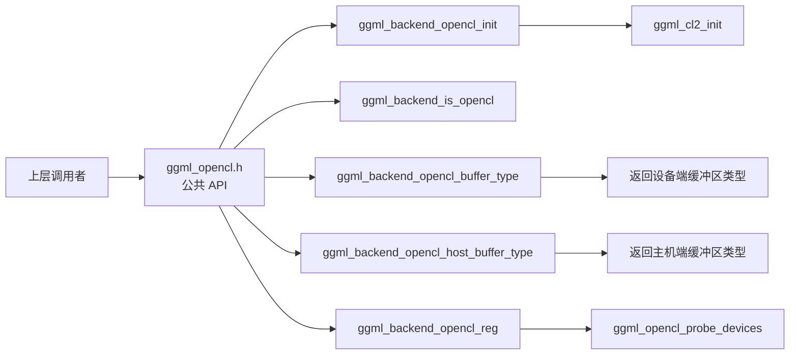
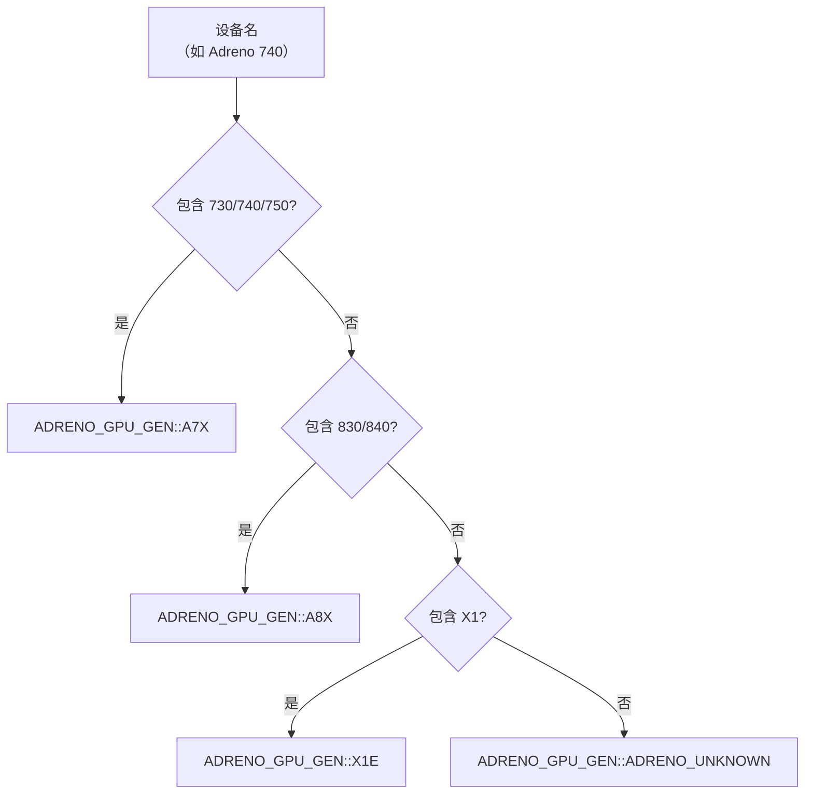
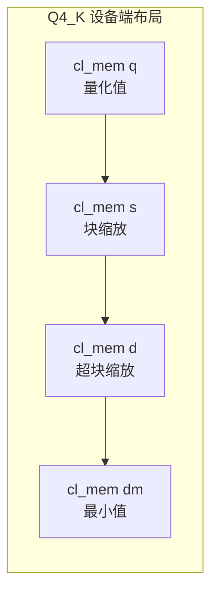
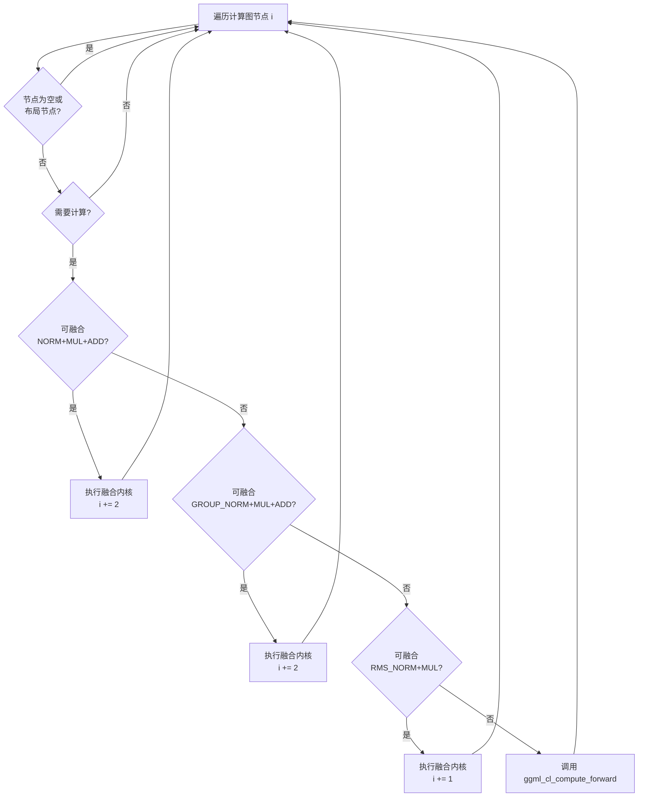
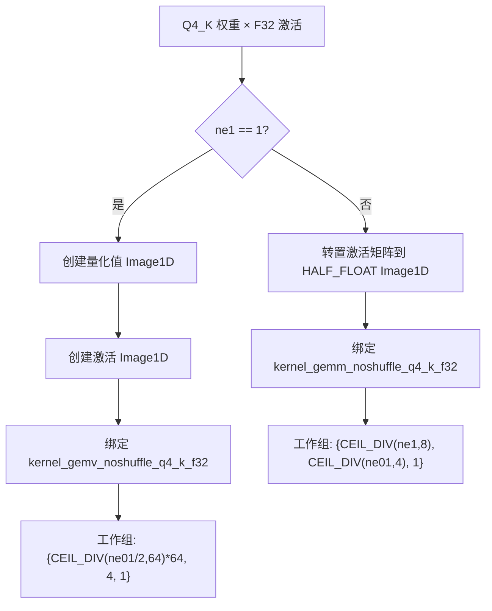
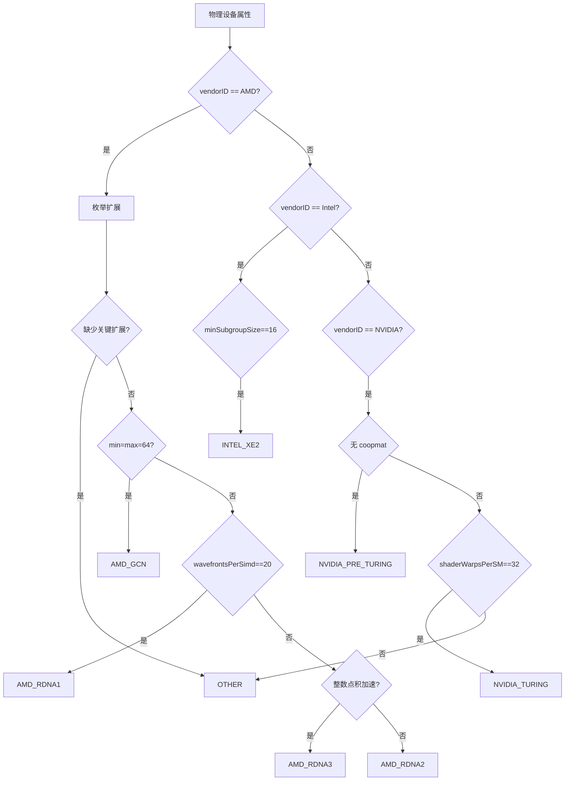
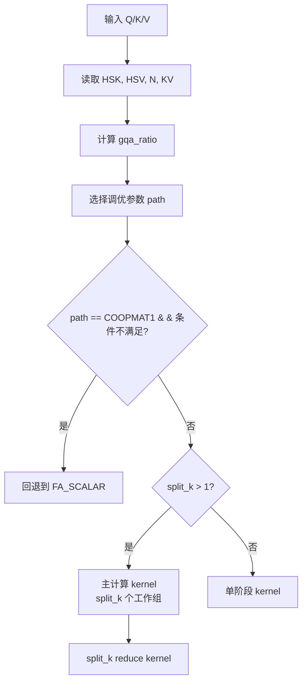
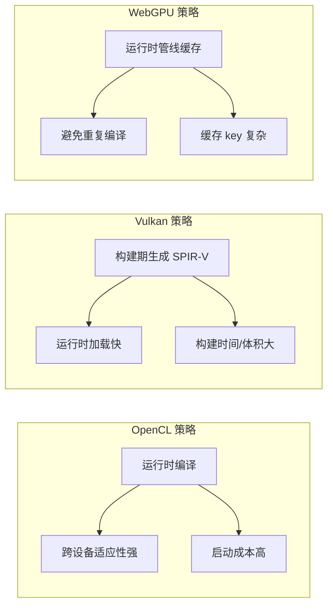

# 第40章 三大通用 GPU 后端的“高速公路网”—— OpenCL、Vulkan 与 WebGPU 的设备探测、内核编译与计算图调度

想象一下，llama.cpp 的三大通用 GPU 后端是三条驶向不同目的地的**高速公路系统**。尽管这三条道路的路况、收费规则和通车条件各不相同，但它们的目标高度一致：把 GGML 计算图这辆满载着量化参数和计算指令的货车，安全、高效地从 CPU 娘家送达 GPU 婆家。在这三条高速公路上，**初始化**是入口收费站，**设备探测**是导航系统，**内核加载与编译**是预制构件的拼装，而**计算图调度**则是路口信号灯系统，指挥着每一辆作业车辆平稳通行。

以 OpenCL 为例，它更像一条专为高通 Adreno 移动 GPU 优化的方程式赛道。`get_adreno_gpu_gen()` 是入口处的车型识别员，它根据设备名称判断当前 GPU 属于 A7X、A8X 还是 X1E 代际；`use_adreno_kernels()` 则像赛道准入门槛，只有矩阵尺寸足够大时，计算任务才值得切换到专用高速车道。量化权重被放入 `ggml_tensor_extra_cl_q4_K` 这样的专用集装箱，分别管理量化值、块缩放和超块缩放数据。对矩阵进行转置时，OpenCL 还会借助 Image1D 缓冲区，把规则排列的数据送上更高带宽的传送带。如果把这个比喻延伸到初始化阶段，OpenCL 的 `ggml_cl2_init()` 就是安全检查站，它要核验驾驶员（`cl_device_id`）、检查车辆档案（`CL_PLATFORM_VERSION`）、以及确认路况级别（`CL_DEVICE_OPENCL_C_VERSION`）后方能放行。

Vulkan 则更像多厂商兼容的标准化高速公路网。`get_device_architecture()` 是地质勘探仪，通过扩展、子组大小和硬件属性判断当前设备是 AMD GCN、RDNA、Intel Xe2，还是 NVIDIA Turing。`vulkan-shaders-gen` 是预制件工厂，提前把 GLSL 图纸批量编译成 SPIR-V 预制板。运行时的 push constants 类似快递面单，只填写矩阵尺寸、步长和偏移等少量参数，就可以快速发车。`ggml_vk_can_fuse()` 像拼车算法，能够把 RMS_NORM+MUL 或 ROPE+VIEW+SET_ROWS 合并，减少中途停车和车次。在调度层面，`ggml_vk_graph_optimize()` 就像高速公路巡查员，通过拓扑排序把所有断路、转向和并线都理顺，保证满载车辆一路绿波。

WebGPU 则像浏览器里的轻量级磁悬浮，它把 `webgpu_param_arena` 当作共享充电宝站，通过槽位快速借还 uniform 参数缓冲区；`ggml_webgpu_shader_lib` 是自助图书馆，根据操作类型、数据类型和硬件能力借阅合适的 WGSL 教材；`embed_wgsl.py` 是电子书打包器，把多个 WGSL 文件和 `#include` 依赖合并成 C++ 字符串，并在文件过大时自动分卷；`pre_wgsl::Preprocessor` 则负责把 `#define`、`#if` 和 `#include` 翻译为最终可执行的 WGSL。当库中的管线缓存缺失时，系统会像图书馆的采编室一样，先预处理源码再创建管线，最后放入缓存架。

## 40.1 学习目标

- 理解 OpenCL、Vulkan、WebGPU 三大通用 GPU 后端的初始化流程与设备管理机制
- 掌握 Adreno GPU 硬件识别（get_adreno_gpu_gen）与编译器版本检测的实现原理
- 理解 OpenCL 内核批量加载（load_cl_kernels）与嵌入式源码（GGML_OPENCL_EMBED_KERNELS）的编译机制
- 掌握量化张量在 OpenCL 设备端的存储结构（ggml_tensor_extra_cl_q4_0/q4_K 等）与内存池管理
- 理解算子融合（ggml_opencl_can_fuse / ggml_vk_can_fuse）与图优化（graph_optimize / graph_compute）在后端实现逻辑
- 掌握 Vulkan SPIR-V 着色器的批量生成（process_shaders）与 push constant 设计模式
- 理解 WebGPU 参数竞技场（webgpu_param_arena）与 WGSL 着色器库（ggml_webgpu_shader_lib）的缓存机制
- 了解着色器代码嵌入工具（embed_kernel.py / embed_wgsl.py）的源码打包原理
- 掌握跨平台 GPU 后端针对量化格式（Q4_0/Q4_K/Q6_K/MXFP4）的矩阵乘法优化策略
- 理解 Flash Attention 在各后端上的共享内存优化、GQA 分组、mask 处理与 split-k 分解策略
- 对比三大后端在算子支持矩阵（supports_op）上的约束差异与回退策略
- 掌握 Vulkan 后端中 push constants 的模板化初始化与快速除法（fastdiv）预计算机制

## 40.2 源码地图

```text
ggml/include/ggml-opencl.h
├── ggml_backend_opencl_init()          # 初始化 OpenCL 后端实例
├── ggml_backend_is_opencl()            # 检查后端类型
├── ggml_backend_opencl_buffer_type()   # 设备端缓冲区类型
├── ggml_backend_opencl_host_buffer_type() # 主机端 pinned 缓冲区
└── ggml_backend_opencl_reg()           # 后端注册入口

ggml/src/ggml-opencl/ggml-opencl.cpp
├── 设备探测与初始化（229-3000行）
│   ├── parse_cl_version()              # OpenCL 版本字符串解析
│   ├── get_adreno_gpu_gen()            # Adreno GPU 代数识别（A7X/A8X/X1E）
│   ├── get_adreno_cl_compiler_version() # 编译器版本解析
│   ├── ggml_opencl_probe_devices()     # 平台与设备枚举
│   └── ggml_cl2_init()                 # 设备上下文初始化（FP16/版本检查）
├── 内核加载与编译（678-1200行）
│   ├── build_program_from_source()     # clCreateProgramWithSource 封装
│   ├── load_cl_kernels()               # 批量编译 Q4_0/Q4_K/MXFP4 等量化内核
│   └── read_file()                     # 外部内核文件读取辅助
├── 量化张量管理（3376-4391行）
│   ├── ggml_tensor_extra_cl::reset()   # 通用张量额外数据重置
│   ├── ggml_tensor_extra_cl_q4_0::reset()  # Q4_0 专用内存管理
│   ├── ggml_tensor_extra_cl_q4_1::reset()  # Q4_1 专用内存管理
│   ├── ggml_tensor_extra_cl_mxfp4::reset() # MXFP4 专用内存管理
│   ├── ggml_tensor_extra_cl_q8_0::reset()  # Q8_0 专用内存管理
│   ├── ggml_tensor_extra_cl_q4_K::reset()  # Q4_K 专用内存管理
│   ├── ggml_tensor_extra_cl_q6_K::reset()  # Q6_K 专用内存管理
│   └── ggml_backend_opencl_buffer_context::ggml_opencl_alloc_temp_tensor_extra_*()  # 临时张量内存池分配
├── 缓冲区操作（4440-5890行）
│   ├── ggml_backend_opencl_buffer_init_tensor()      # 张量初始化
│   ├── ggml_backend_opencl_buffer_set_tensor()       # 主机→设备数据写入（含量化转换）
│   ├── ggml_backend_opencl_buffer_get_tensor()       # 设备→主机数据读取（含反量化恢复）
│   ├── ggml_backend_opencl_buffer_free_buffer()      # 缓冲区释放
│   ├── ggml_backend_opencl_buffer_clear()            # 缓冲区清零
│   ├── ggml_backend_opencl_buffer_reset()            # 内存池重置
│   └── transpose_2d() / transpose_2d_as_*b()         # 矩阵转置内核
├── 算子执行与融合（3746-3896行）
│   ├── sync_with_other_backends()    # 多设备事件同步
│   ├── ggml_opencl_can_fuse()        # RMS_NORM+MUL 等融合检测
│   ├── ggml_backend_opencl_graph_compute()  # 图计算主循环
│   ├── ggml_opencl_op_rms_norm_fused()      # RMSNorm+MUL 融合实现
│   ├── ggml_opencl_op_norm_fused()          # NORM+MUL+ADD 融合实现
│   └── ggml_opencl_op_group_norm_fused()    # GroupNorm+MUL+ADD 融合实现
├── 算子分发核心（6110-14117行）
│   ├── ggml_cl_can_mul_mat()         # 矩阵乘法可行性判断
│   ├── ggml_cl_compute_forward()     # 算子分发总入口
│   ├── ggml_cl_add() / mul / div / sub  # 基本算术运算
│   ├── ggml_cl_mul_mat()             # 通用矩阵乘法路由器
│   ├── ggml_cl_mul_mat_q4_k_f32_adreno()   # Q4_K Adreno 优化
│   ├── ggml_cl_flash_attn() / flash_attn_ext()  # Flash Attention
│   ├── ggml_cl_soft_max()            # Softmax
│   ├── ggml_cl_rope()                # 旋转位置编码
│   ├── ggml_cl_norm() / rms_norm / l2_norm / group_norm()  # 归一化族
│   ├── ggml_cl_conv_2d()             # 2D 卷积
│   ├── ggml_cl_get_rows() / set_rows()    # 行提取/设置
│   ├── ggml_cl_cpy() / dup() / set()      # 数据拷贝
│   ├── ggml_cl_gelu / silu / relu / sigmoid / tanh()  # 激活函数族
│   ├── ggml_cl_glu()                 # GLU 变体（GEGLU/ReGLU/SwiGLU）
│   └── ggml_cl_argsort() / cumsum() / sum_rows() / mean()  # 归约操作
└── 后端接口注册（4108-6062行）
    ├── ggml_backend_opencl_init()    # 后端实例创建
    ├── ggml_backend_opencl_device_get_*() # 设备属性查询接口族
    └── ggml_backend_opencl_reg()     # 后端注册入口

ggml/src/ggml-opencl/kernels/embed_kernel.py
└── main()                            # 逐行读取 .cl 文件，输出 R"()" 原始字符串格式

ggml/include/ggml-vulkan.h
├── ggml_backend_vk_init()            # 按设备编号初始化 Vulkan 后端
├── ggml_backend_is_vk()              # 检查后端类型
├── ggml_backend_vk_get_device_count()      # 枚举可用设备
├── ggml_backend_vk_get_device_description() # 获取设备描述
├── ggml_backend_vk_get_device_memory()      # 查询显存
├── ggml_backend_vk_buffer_type()          # 设备本地显存类型
└── ggml_backend_vk_host_buffer_type()     # 主机 pinned 内存类型

ggml/src/ggml-vulkan/ggml-vulkan.cpp
├── 设备架构识别（201-292行）
│   ├── get_device_architecture()     # AMD GCN/RDNA、Intel Xe2、NVIDIA Turing/Coopmat 检测
│   └── vk_device_struct              # 设备信息、队列和管线缓存
├── 设备初始化与枚举（5358-5900行）
│   ├── ggml_vk_instance_init()       # Vulkan 实例创建与设备枚举
│   ├── ggml_vk_get_device()          # 设备初始化（扩展检测、特性启用）
│   ├── ggml_vk_find_queue_family_index() # 队列族选择
│   └── ggml_vk_print_gpu_info()      # 设备信息打印
├── 内存与缓冲区管理（2142-2650行）
│   ├── ggml_vk_create_buffer()       # 设备内存分配
│   ├── ggml_vk_host_malloc()         # Pinned 主机内存分配
│   ├── vk_subbuffer                  # 缓冲区子视图
│   └── ggml_vk_tensor_subbuffer()    # 张量子缓冲区视图
├── 管线与着色器管理（2142-4440行）
│   ├── ggml_vk_create_pipeline_func() # 计算管线组装
│   ├── ggml_vk_load_shaders()        # 批量加载 SPIR-V 着色器
│   └── init_pushconst_fastdiv()      # 快速除法预计算模板
├── 计算图执行（1100-15150行）
│   ├── ggml_vk_dispatch_pipeline()   # 计算工作组分派
│   ├── ggml_vk_matmul()              # 矩阵乘法（支持 split-k 优化）
│   ├── ggml_vk_flash_attn()          # Flash Attention
│   ├── ggml_vk_graph_optimize()      # 图优化
│   └── ggml_backend_vk_graph_compute() # 主计算循环
└── 后端接口注册（15200-17000行）
    ├── ggml_backend_vk_init()        # 后端实例创建
    ├── ggml_backend_vk_device_supports_op() # 算子支持性检查
    └── ggml_backend_vk_reg()         # 后端注册入口

ggml/src/ggml-vulkan/vulkan-shaders/vulkan-shaders-gen.cpp
├── string_to_spv_func()              # 调用 glslangValidator/glslc 编译单个着色器
├── matmul_shaders()                  # 生成矩阵乘法着色器变体
├── process_shaders()                 # 批量编译数百个着色器
├── write_output_files()              # 生成包含 SPIR-V 数据的 C++ 头/源文件
└── acquire_compile_slot()            # 编译并发槽位控制

ggml/include/ggml-webgpu.h
├── ggml_backend_webgpu_init()        # WebGPU 后端初始化
└── ggml_backend_webgpu_reg()         # 后端注册

ggml/src/ggml-webgpu/ggml-webgpu.cpp
├── 参数竞技场（170-196行）
│   └── webgpu_param_arena            # 基于槽位的 uniform buffer 分配器
├── 缓冲区管理（506-515行）
│   └── ggml_webgpu_create_buffer()   # 封装 device.CreateBuffer
├── 算子编码器（800-2700行）
│   ├── ggml_webgpu_mul_mat()         # 矩阵乘法
│   ├── ggml_webgpu_flash_attn()      # Flash Attention
│   ├── ggml_webgpu_rope()            # RoPE
│   ├── ggml_webgpu_encode_node()     # 节点分发器
│   └── ggml_backend_webgpu_device_supports_op() # 算子能力检查
└── 后端注册（3603-3878行）
    ├── ggml_backend_webgpu_device_supports_op()
    └── ggml_backend_webgpu_reg()

ggml/src/ggml-webgpu/ggml-webgpu-shader-lib.hpp
├── ggml_webgpu_shader_lib            # 着色器管线缓存中心
│   ├── get_mul_mat_fast_pipeline()
│   ├── get_mul_mat_legacy_pipeline()
│   ├── get_flash_attn_pipeline()
│   ├── get_soft_max_pipeline()
│   └── get_cpy_pipeline()
└── 预处理集成（pre_wgsl::Preprocessor）

ggml/src/ggml-webgpu/pre_wgsl.hpp
├── ExprLexer
├── ExprParser
└── Preprocessor

ggml/src/ggml-webgpu/wgsl-shaders/embed_wgsl.py
├── expand_includes()
├── chunk_shader()
├── raw_delim()
└── write_shader()
```

## 40.3 OpenCL 公共 API —— 通用 GPU 的“收费站入口”

OpenCL 后端首先通过一个很小的公共头文件接入 GGML。这个接口并不暴露设备上下文、内核对象等实现细节，而是只提供初始化、类型识别、缓冲区类型和注册入口。

这种设计让上层只需要依赖 `ggml_backend_t` 和 `ggml_backend_buffer_type_t`，无需知道底层究竟使用了 `cl_context` 还是 `cl_command_queue`。

### 40.3.1 公共函数声明：后端的最小插座

源码路径：`ggml/include/ggml-opencl.h`  
核心类/接口名：`ggml_backend_t`、`ggml_backend_buffer_type_t`、`ggml_backend_reg_t`  
关键函数：`ggml_backend_opencl_init()`、`ggml_backend_opencl_reg()`

```c
// 第12行：创建并返回一个 OpenCL 后端实例。
GGML_BACKEND_API ggml_backend_t ggml_backend_opencl_init(void);

// 第13行：判断给定后端对象是否属于 OpenCL 后端。
GGML_BACKEND_API bool ggml_backend_is_opencl(ggml_backend_t backend);

// 第15行：返回设备端 OpenCL 缓冲区类型。
GGML_BACKEND_API ggml_backend_buffer_type_t ggml_backend_opencl_buffer_type(void);

// 第16行：返回主机端 OpenCL 缓冲区类型。
GGML_BACKEND_API ggml_backend_buffer_type_t ggml_backend_opencl_host_buffer_type(void);

// 第18行：返回 OpenCL 后端注册对象。
GGML_BACKEND_API ggml_backend_reg_t ggml_backend_opencl_reg(void);
```

这组声明展示了 OpenCL 的接入边界：初始化函数创建运行实例，`is_opencl()` 用于运行时识别，两个 buffer type 分别描述设备内存和主机内存，`reg()` 则让 GGML 的全局后端管理器能够发现该实现。

与直接把 OpenCL 对象暴露给上层相比，这种方案隔离了 API 细节，也让后端可以在不改变公共接口的情况下替换内部内存池、内核缓存和设备选择逻辑。值得注意的是，`ggml_backend_opencl_host_buffer_type()` 扮演的角色与 Vulkan 的 `ggml_backend_vk_host_buffer_type()` 高度相似：它们都为跨设备（CPU→GPU）的数据传输提供一条“专用通道”，避免每次拷贝都经过普通分页内存。



### 40.3.2 `ggml_backend_opencl_init()`：组装后端对象

源码路径：`ggml/src/ggml-opencl/ggml-opencl.cpp`（第4126-4134行）  
核心类/接口名：`ggml_backend_opencl_context`  
关键函数：`ggml_backend_opencl_init()`

```cpp
// 第4126行：定义 OpenCL 后端初始化入口。
ggml_backend_t ggml_backend_opencl_init(void) {
    // 第4127行：通过注册表获取第一个 OpenCL 设备。
    ggml_backend_dev_t dev = ggml_backend_reg_dev_get(ggml_backend_opencl_reg(), 0);

    // 第4128行：初始化该设备对应的 OpenCL 上下文。
    ggml_backend_opencl_context * backend_ctx = ggml_cl2_init(dev);

    // 第4129-4133行：创建 GGML 后端对象并填充接口表、设备和上下文。
    ggml_backend_t backend = new ggml_backend {
        /* .guid    = */ ggml_backend_opencl_guid(),
        /* .iface   = */ ggml_backend_opencl_i,
        /* .device  = */ dev,
        /* .context = */ backend_ctx
    };

    // 第4134行：返回可供 GGML 使用的后端句柄。
    return backend;
}
```

这段代码明确执行了“注册表取设备（第4127行）→初始化设备上下文（第4128行）→组装后端对象（第4129-4133行）”的三步流程。其中，`ggml_cl2_init()` 承担真正的 OpenCL 设备准备，包括平台枚举后的具体设备上下文创建、FP16 兼容性检查和命令队列创建；而 `ggml_backend` 只是把 GUID、接口表、设备和上下文绑在一起。如果把后端比作汽车，这个函数并不负责制造发动机，而是把发动机、车架和方向盘安装到同一辆车上，交给上层驾驶。

### 40.3.3 `ggml_backend_opencl_reg()`：线程安全的单例注册

源码路径：`ggml/src/ggml-opencl/ggml-opencl.cpp`（第6046-6062行）  
核心类/接口名：`ggml_backend_reg`  
关键函数：`ggml_backend_opencl_reg()`

```cpp
// 第6046行：定义 OpenCL 注册入口。
ggml_backend_reg_t ggml_backend_opencl_reg(void) {
    // 第6047行：保护一次性初始化过程的互斥锁。
    static std::mutex mutex;

    // 第6048行：保存静态注册对象。
    static ggml_backend_reg reg;

    // 第6049行：记录设备列表是否已经初始化。
    static bool initialized = false;

    // 第6050行：进入临界区，避免多线程重复探测设备。
    std::lock_guard<std::mutex> lock(mutex);

    // 第6051-6053行：如果已初始化，直接复用现有注册对象。
    if (initialized) {
        return &reg;
    }

    // 第6054行：先标记初始化完成，避免递归初始化。
    initialized = true;

    // 第6055行：探测平台和设备，填充全局设备列表。
    g_ggml_backend_opencl_devices = ggml_opencl_probe_devices(&reg);

    // 第6056-6060行：构造符合 GGML API 版本的注册对象。
    reg = ggml_backend_reg{
        /* .api_version = */ GGML_BACKEND_API_VERSION,
        /* .iface       = */ ggml_backend_opencl_reg_i,
        /* .context     = */ NULL,
    };

    // 第6061行：返回注册表地址。
    return &reg;
}
```

该函数采用静态对象加互斥锁的延迟初始化模式。第一次调用时完成平台枚举，之后所有调用都返回同一注册对象。这里的关键不是“单例”本身，而是避免设备探测被重复执行。OpenCL 平台枚举、设备属性读取和上下文准备都可能触发驱动调用，重复执行不仅浪费时间，也可能造成多个内部状态不一致。值得注意的是，`ggml_backend_opencl_reg()` 的函数签名没有任何参数，所有设备发现逻辑都被封装在 `ggml_opencl_probe_devices()` 内部，这与 Vulkan 后端的 `ggml_backend_vk_reg()` 在形式上保持一致。

这段代码背后隐藏着更深层次的设计意图：通过把“注册”和“初始化”两个阶段分离，GGML 允许上层在编译阶段就完成设备选择、多层后端并存和运行时动态加载。注册表就像酒店前台的登记簿，设备初始化则是入住后的房间整理，二者互不干扰。

## 40.4 OpenCL 设备探测与初始化 —— 硬件侦察兵

OpenCL 的设备信息不是一个统一的高级对象，而是由平台版本、设备版本、驱动字符串、扩展列表和硬件属性共同组成。因此 OpenCL 后端需要先把这些零散信息整理成 GGML 可以使用的设备能力。

### 40.4.1 `parse_cl_version()`：从驱动字符串提取版本

源码路径：`ggml/src/ggml-opencl/ggml-opencl.cpp`（第154-174行）  
核心类/接口名：`ggml_cl_version`  
关键函数：`parse_cl_version()`

```cpp
// 第154行：解析类似“3.0 ”格式的版本字符串。
static ggml_cl_version parse_cl_version(std::string_view str) {
    // 第155行：主版本号的起始位置。
    size_t major_str_begin = 0;

    // 第156行：查找主版本号和次版本号之间的点号。
    size_t major_str_end = str.find(".", major_str_begin);

    // 第157-159行：没有点号说明格式不合法。
    if (major_str_end == std::string::npos) {
        return {};
    }

    // 第160行：次版本号从点号后开始。
    size_t minor_str_begin = major_str_end + 1;

    // 第161行：查找版本号后的空格。
    size_t minor_str_end = str.find(" ", minor_str_begin);

    // 第162-164行：没有空格说明无法确认次版本号边界。
    if (minor_str_end == std::string::npos) {
        return {};
    }

    // 第165行：准备接收主版本号。
    cl_uint version_major;

    // 第166-168行：使用 from_chars 解析主版本号，失败则返回空版本。
    if (std::from_chars(
            str.data() + major_str_begin,
            str.data() + major_str_end,
            version_major).ec != std::errc{}) {
        return {};
    }

    // 第169行：准备接收次版本号。
    cl_uint version_minor;

    // 第170-172行：使用 from_chars 解析次版本号。
    if (std::from_chars(
            str.data() + minor_str_begin,
            str.data() + minor_str_end,
            version_minor).ec != std::errc{}) {
        return {};
    }

    // 第173行：返回结构化版本。
    return { version_major, version_minor };
}
```

这里没有使用 `sscanf()` 或字符串流，而是使用 `std::from_chars()`。这种实现避免了本地化环境影响，也不会产生临时流对象，适合设备初始化这类底层路径。解析结果会被后续逻辑用于判断 OpenCL C 版本是否足够，决定是否启用 FP16、特定内核或某些编译选项。例如，在 `ggml_cl2_init()` 中，如果 `parse_cl_version()` 返回的版本低于 1.2，则不会尝试启用某些依赖 OpenCL 1.2 特性的内核路径。

### 40.4.2 `get_adreno_gpu_gen()`：通过名称识别 GPU 代际

源码路径：`ggml/src/ggml-opencl/ggml-opencl.cpp`（第229-243行）  
核心类/接口名：`ADRENO_GPU_GEN`  
关键函数：`get_adreno_gpu_gen()`

```cpp
// 第229行：根据设备名称推断 Adreno GPU 代际。
static ADRENO_GPU_GEN get_adreno_gpu_gen(const char *device_name) {
    // 第230-234行：识别 Adreno 730、740、750，归入 A7X。
    if (strstr(device_name, "730") ||
        strstr(device_name, "740") ||
        strstr(device_name, "750")) {
        return ADRENO_GPU_GEN::A7X;
    }

    // 第235-238行：识别 Adreno 830、840，归入 A8X。
    if (strstr(device_name, "830") ||
        strstr(device_name, "840")) {
        return ADRENO_GPU_GEN::A8X;
    }

    // 第239-241行：识别名称中带 X1 的新一代设备。
    if (strstr(device_name, "X1")) {
        return ADRENO_GPU_GEN::X1E;
    }

    // 第242行：无法识别时返回未知代际。
    return ADRENO_GPU_GEN::ADRENO_UNKNOWN;
}
```

这段代码看起来非常朴素：直接在设备名称中查找字符串。但它承担了重要职责——让后续内核选择能够区分不同硬件世代。需要注意的是，这不是通过 PCI ID 或统一硬件枚举得到的精确识别，而是一种面向驱动现实的启发式识别。移动 GPU 的驱动暴露信息可能不完全一致，因此实现选择了简单、兼容性较高的字符串匹配。这种“按名称匹配”的设计原因在于，OpenCL 平台没有提供标准化的“GPU 架构”查询接口，而 Adreno 的型号命名恰好具有较强规律性（如 730/740/750 属于同一代），因此字符串匹配是部署成本最低且最稳定的方案。



### 40.4.3 `ggml_cl_compiler_version`：版本比较就是能力开关

源码路径：`ggml/src/ggml-opencl/ggml-opencl.cpp`（第132-140行）  
核心类/接口名：`ggml_cl_compiler_version`  
关键函数：`same()`、`newer_than()`、`newer_than_or_same()`

```cpp
// 第132行：判断编译器类型和版本是否完全一致。
bool same(ADRENO_CL_COMPILER_TYPE t, int x, int y, int z) const {
    // 第133行：比较主版本、次版本、补丁版本和编译器类型。
    return major == x && minor == y && patch == z && type == t;
}

// 第135行：判断当前版本是否高于目标版本。
bool newer_than(ADRENO_CL_COMPILER_TYPE t, int x, int y, int z) const {
    // 第136行：把三段版本压缩成可比较的整数。
    return major * 10000 + minor * 100 + patch > x * 10000 + y * 100 + z &&
           type == t;
}

// 第138行：判断当前版本是否相同或更高。
bool newer_than_or_same(ADRENO_CL_COMPILER_TYPE t, int x, int y, int z) const {
    // 第139行：复用精确比较和大于比较。
    return same(t, x, y, z) || newer_than(t, x, y, z);
}
```

版本号被映射为 `major * 10000 + minor * 100 + patch`，因此 `38.11.0` 会变成 `381100`。这是一种简单的字典序比较技巧。它的价值体现在内核加载阶段：某些 Adreno 编译器版本无法编译特定内核（如 `mul_mv_q4_0_f32_1d_8x_flat`），后端会依据版本跳过这些内核，避免初始化整体失败。

### 40.4.4 `ggml_cl2_init()`：完成设备上下文初始化

源码路径：`ggml/src/ggml-opencl/ggml-opencl.cpp`（第2780-3000行）  
核心类/接口名：`ggml_backend_opencl_context`  
关键函数：`ggml_cl2_init()`

`ggml_cl2_init()` 是 OpenCL 后端的核心初始化函数。它接收 `ggml_backend_dev_t dev` 作为参数，该参数已经由 `ggml_opencl_probe_devices()` 填充了平台和设备信息。`ggml_cl2_init()` 先检查设备是否属于 Adreno 或 Intel 家族，再读取 OpenCL 平台版本（通过 `get_opencl_platform_version()`）、设备版本和 OpenCL C 版本（通过 `get_opencl_c_version()`），随后检查 FP16 扩展支持，最后设置 `GGML_OPENCL_USE_ADRENO_KERNELS` 等编译宏环境。当所有检查通过后，它会创建命令队列并调用 `load_cl_kernels()` 完成内核加载。该函数的返回值是 `ggml_backend_opencl_context *`，其中包含了所有设备句柄、程序对象、内核对象和缓存参数。

为了更直观地理解这一过程，我们可以参考简化的初始化示意（实际源码因硬件检查分支较多，故此处展示核心流程）：

```cpp
static ggml_backend_opencl_context * ggml_cl2_init(ggml_backend_dev_t dev) {
    // 获取设备上下文中的平台和设备信息。
    ggml_backend_opencl_device_context * dev_ctx = (ggml_backend_opencl_device_context *) dev->context;
    // 分配后端上下文。
    ggml_backend_opencl_context * backend_ctx = new ggml_backend_opencl_context;
    // 读取平台版本，如 "OpenCL 3.0"。
    const ggml_cl_version platform_version = get_opencl_platform_version(dev_ctx->platform);
    // 读取设备支持的 OpenCL C 版本。
    const ggml_cl_version opencl_c_version = get_opencl_c_version(platform_version, dev_ctx->device);
    // 读取设备名称，用于识别 GPU 家族。
    const char * device_name = ...;
    // 识别 Adreno GPU 代数。
    backend_ctx->gpu_family = get_adreno_gpu_gen(device_name);
    // 检查 FP16 支持后，创建命令队列。
    backend_ctx->queue = clCreateCommandQueue(backend_ctx->context, dev_ctx->device, 0, &err);
    // 调用 load_cl_kernels 批量编译内核。
    load_cl_kernels(backend_ctx, opencl_c_version);
    // 返回初始化完成的上下文。
    return backend_ctx;
}
```

## 40.5 OpenCL 内核加载与编译 —— 着色器的“装配车间”

OpenCL 和 Vulkan 的一个重要区别是：OpenCL 通常在运行时从源码编译内核。于是后端必须同时处理源码来源、编译选项、程序对象和 kernel 对象。

### 40.5.1 `read_file()`：外置内核源码入口

源码路径：`ggml/src/ggml-opencl/ggml-opencl.cpp`（第665-676行）  
核心类/接口名：`std::string`  
关键函数：`read_file()`

```cpp
// 第665行：读取指定路径的文本文件。
inline std::string read_file(const std::string &path) {
    // 第666行：以文本模式打开文件。
    std::ifstream ifs(path);

    // 第667-669行：文件不存在时返回空字符串。
    if (!ifs) {
        return "";
    }

    // 第670行：准备存储文件内容。
    std::string text;

    // 第671行：移动到文件末尾，获取文件大小。
    ifs.seekg(0, std::ios::end);

    // 第672行：一次性调整字符串容量。
    text.resize(ifs.tellg());

    // 第673行：回到文件开头。
    ifs.seekg(0, std::ios::beg);

    // 第674行：读取完整文件内容。
    ifs.read(&text[0], text.size());

    // 第675行：返回源码字符串。
    return text;
}
```

这个函数只负责外置源码模式。它不负责编译，也不负责错误处理，因此调用方必须检查返回的源码是否为空，或者通过后续 OpenCL API 发现错误。与嵌入模式相比，外置源码适合开发调试：修改 `.cl` 文件后不必重新生成 C++ 文件。但它依赖运行目录和文件部署，发布时更容易出现“找不到内核文件”的问题。

### 40.5.2 `build_program_from_source()`：源码到程序对象

源码路径：`ggml/src/ggml-opencl/ggml-opencl.cpp`（第678-701行）  
核心类/接口名：`cl_program`  
关键函数：`build_program_from_source()`

```cpp
// 第678行：从源码构建 OpenCL 程序对象。
static cl_program build_program_from_source(
    cl_context ctx,
    cl_device_id dev,
    const char* program_buffer,
    const std::string &compile_opts) {

    // 第679行：保存待返回的程序对象。
    cl_program p;

    // 第680行：声明编译日志指针。
    char *program_log;

    // 第681行：保存源码长度。
    size_t program_size;

    // 第682行：保存编译日志长度。
    size_t log_size;

    // 第683行：保存 OpenCL API 返回码。
    int err;

    // 第684行：计算源码字符串长度。
    program_size = strlen(program_buffer);

    // 第685行：创建 OpenCL 程序对象。
    p = clCreateProgramWithSource(
        ctx, 1, (const char**)&program_buffer, &program_size, &err);

    // 第686-690行：程序对象创建失败时输出错误并终止。
    if (err < 0) {
        GGML_LOG_ERROR("OpenCL error creating program");
        exit(1);
    }

    // 第691行：使用指定编译选项编译程序。
    err = clBuildProgram(
        p, 0, NULL, compile_opts.c_str(), NULL, NULL);

    // 第692-699行：编译失败时读取、打印编译器日志。
    if (err < 0) {
        // 实际源码此处继续查询 log_size 和 program_log。
        GGML_LOG_ERROR(
            "ggml_opencl: kernel compile error:\n\n%s\n",
            program_log);

        // 第700行：释放编译日志。
        free(program_log);

        // 第701行：编译失败终止程序。
        exit(1);
    }

    // 第702行：返回编译完成的程序对象。
    return p;
}
```

这段代码把 OpenCL 编译过程封装成一个函数：`clCreateProgramWithSource()` 负责创建程序，`clBuildProgram()` 负责编译，失败时通过编译日志帮助定位驱动或语法问题。这里采用“失败即终止”的策略，适用于模型运行时必需的核心内核。如果某个可选内核也采用相同策略，可能会降低兼容性，因此 `load_cl_kernels()` 对部分可选算子会单独做容错处理。

### 40.5.3 `load_cl_kernels()`：批量编译与编译选项

源码路径：`ggml/src/ggml-opencl/ggml-opencl.cpp`（第703-1200行）  
核心类/接口名：`ggml_backend_opencl_context`  
关键函数：`load_cl_kernels()`

```cpp
// 第703行：批量加载并创建 OpenCL kernel。
static void load_cl_kernels(
    ggml_backend_opencl_context *backend_ctx,
    ggml_cl_version opencl_c_version) {

    // 第704行：保存 OpenCL API 错误码。
    cl_int err;

    // 第705-707行：把版本结构转换成 -cl-std=CLx.y 形式。
    auto opencl_c_std =
        std::string("CL") +
        std::to_string(opencl_c_version.major) + "." +
        std::to_string(opencl_c_version.minor);

    // 第708-711行：设置通用编译选项。
    std::string compile_opts =
        std::string("-cl-std=") + opencl_c_std +
        " -cl-mad-enable"
        " -cl-unsafe-math-optimizations"
        " -cl-finite-math-only"
        " -cl-fast-relaxed-math";

    // 第712-714行：Adreno 大缓冲区模式额外增加厂商选项。
    if (backend_ctx->adreno_use_large_buffer) {
        compile_opts += " -qcom-enable-large-buffer ";
    }

    // 第715行以后：逐类加载内核源码并创建 cl_program/cl_kernel。
    // 实际源码覆盖矩阵乘、量化、Softmax、RoPE、Flash Attention 等内核。
}
```

编译选项体现了后端的性能取向：允许快速数学、融合乘加和有限浮点假设，从而给驱动更多优化空间。不同内核会进一步使用独立的源码文件和专用变体。例如矩阵乘法会根据 F16、F32、Q4_0、Q4_K、Q6_K 等类型创建不同 kernel；Flash Attention 则会根据 head dimension 和输入类型建立多个变体。

### 40.5.4 `__main__` 全局初始化：数百个 `clCreateKernel` 调用的批量创建

源码路径：`ggml/src/ggml-opencl/ggml-opencl.cpp`（第924-1679行）  
核心类/接口名：`GGML_OPENCL_EMBED_KERNELS`  
关键函数：全局初始化代码

`load_cl_kernels()` 之后，文件顶层有一段被细纲标记为 `__main__` 的全局初始化代码。这段代码按照“每个算子一个独立代码块”的方式组织，每个块首先判断 `GGML_OPENCL_EMBED_KERNELS` 宏是否定义，从而在嵌入源码（通过 `#include "kernel.cl.h"`）和外置文件（通过 `read_file("kernel.cl")`）之间选择；随后调用 `build_program_from_source()` 编译程序对象；最后通过 `clCreateKernel()` 创建 kernel 对象，并通过 `GGML_LOG_CONT(".")` 输出加载进度。

以 SiLU 内核为例，其加载代码块结构如下：

```cpp
// 第924行：以 SiLU 内核为例，开始一个独立加载块。
{
    // 第925-929行：编译时选择嵌入源码或外置文件。
#ifdef GGML_OPENCL_EMBED_KERNELS
    const std::string kernel_src {
        // 嵌入头文件最终展开为 C++ 原始字符串。
        #include "silu.cl.h"
    };
#else
    // 外置模式从运行目录读取 silu.cl。
    const std::string kernel_src = read_file("silu.cl");
#endif

    // 第930-931行：编译源码并保存程序对象。
    backend_ctx->program_silu =
        build_program_from_source(
            backend_ctx->context,
            backend_ctx->device,
            kernel_src.c_str(),
            compile_opts);

    // 第932行：创建标量 SiLU kernel。
    CL_CHECK((backend_ctx->kernel_silu =
        clCreateKernel(
            backend_ctx->program_silu,
            "kernel_silu",
            &err), err));
    // 第933行：创建四元素向量化 SiLU kernel。
    CL_CHECK((backend_ctx->kernel_silu_4 =
        clCreateKernel(
            backend_ctx->program_silu,
            "kernel_silu_4",
            &err), err));

    // 第934行：输出加载进度。
    GGML_LOG_CONT(".");
}
```

类似地，矩阵乘法相关的内核块会为每种量化类型（如 Q4_0、Q4_K、Q6_K）创建专门的 kernel 对象，例如 `kernel_mul_mat_q4_0_f32`、`kernel_mul_mat_q4_K_f32` 等；归一化内核会创建 `kernel_norm` 和 `kernel_norm_mul_add`；Flash Attention 则会根据精度和 head dimension 建立多个变体。整个 `__main__` 全局初始化覆盖了 GGML 的绝大多数算子，体现出 OpenCL 后端“运行时编译”的核心设计：所有内核都在设备初始化阶段一次性编译完成，后续计算直接复用这些 kernel 对象。

嵌入模式把 `.cl` 文件转换成头文件，再由 C++ 预处理器直接插入程序。这样发布时不需要额外携带内核文件，代价是二进制更大，并且修改内核后需要重新生成和编译。外置模式更适合调试和快速迭代，但部署者必须保证当前工作目录中存在所有内核文件。两种方案通过同一个 `build_program_from_source()` 汇合，因此运行时的编译逻辑保持一致。

```mermaid
flowchart LR
    subgraph 构建时
        A["GGML_OPENCL_EMBED_KERNELS 定义"] --> B["#include \"kernel.cl.h\""]
        C["embed_kernel.py"] --> B
    end
    subgraph 运行时
        B --> D["std::string kernel_src"]
        E["read_file(\"kernel.cl\")"] --> D
        D --> F["build_program_from_source()"]
    end
```

## 40.6 OpenCL 量化张量管理 —— 压缩数据的“仓储系统”

量化张量不是一块普通的连续字节。以 Q4_K 为例，设备端可能需要分别访问量化值、块缩放、超块缩放和最小值。将这些对象放在不同的 `cl_mem` 中，可以让内核按照自己的访问模式读取数据。

### 40.6.1 `ggml_tensor_extra_cl_q4_K`：量化布局就是数据结构

源码路径：`ggml/src/ggml-opencl/ggml-opencl.cpp`（第3619-3638行）  
核心类/接口名：`ggml_tensor_extra_cl_q4_K`  
关键函数：`reset()`

```cpp
// 第3619行：重置 Q4_K 张量的设备端额外数据。
void reset() {
    // 第3620-3623行：释放量化值缓冲区。
    if (q != nullptr) {
        CL_CHECK(clReleaseMemObject(q));
        q = nullptr;
    }

    // 第3624-3627行：释放块缩放缓冲区。
    if (s != nullptr) {
        CL_CHECK(clReleaseMemObject(s));
        s = nullptr;
    }

    // 第3628-3631行：释放超块缩放缓冲区。
    if (d != nullptr) {
        CL_CHECK(clReleaseMemObject(d));
        d = nullptr;
    }

    // 第3632-3635行：释放最小值缓冲区。
    if (dm != nullptr) {
        CL_CHECK(clReleaseMemObject(dm));
        dm = nullptr;
    }
}
```

Q4_K 的额外结构体直接体现了量化格式的设备端布局：`q` 是量化值，`s` 和 `d` 是不同层级的缩放信息，`dm` 保存最小值相关数据。Q4_0 只需要 `q` 和 `d`，Q6_K 则需要 `ql`、`qh`、`s`、`d`。因此所有量化格式共用一个简单结构体会导致大量空字段和复杂分支，独立结构体反而更清晰。



### 40.6.2 Q4_1、MXFP4、Q8_0 和 Q6_K 的额外结构体

源码路径：`ggml/src/ggml-opencl/ggml-opencl.cpp`（第3448-3474行、第3521-3546行、第3579-3598行、第3668-3692行）  
核心类/接口名：`ggml_tensor_extra_cl_q4_1`、`ggml_tensor_extra_cl_mxfp4`、`ggml_tensor_extra_cl_q8_0`、`ggml_tensor_extra_cl_q6_K`  
关键函数：各类的 `reset()` 方法

```cpp
// 第3448行：重置 Q4_1 张量的设备端额外数据。
void reset() {
    // 第3449-3452行：释放量化值缓冲区。
    if (q != nullptr) {
        CL_CHECK(clReleaseMemObject(q));
        q = nullptr;
    }
    // 第3453-3456行：释放缩放缓冲区。
    if (d != nullptr) {
        CL_CHECK(clReleaseMemObject(d));
        d = nullptr;
    }
    // 第3457-3460行：释放最小值缓冲区。
    if (m != nullptr) {
        CL_CHECK(clReleaseMemObject(m));
        m = nullptr;
    }
    // 第3461-3464行：清空图像句柄。
    q_img = nullptr;
    d_img = nullptr;
    m_img = nullptr;
    // 第3465-3467行：重置大小字段。
    size_q = 0;
    size_d = 0;
    size_m = 0;
}
```

本段代码展示了 Q4_1 格式的设备端布局：`q` 保存量化值，`d` 保存缩放因子，`m` 保存最小值，同时还有对应的 Image 句柄，供需要图像读取路径的内核使用。

```cpp
// 第3521行：重置 MXFP4 张量的设备端额外数据。
void reset() {
    // 第3522-3525行：释放量化值缓冲区。
    if (q != nullptr) {
        CL_CHECK(clReleaseMemObject(q));
        q = nullptr;
    }
    // 第3526-3529行：释放 E8M0 缩放缓冲区。
    if (e != nullptr) {
        CL_CHECK(clReleaseMemObject(e));
        e = nullptr;
    }
    // 第3530-3533行：释放量化值图像对象。
    if (q != nullptr) {   // 注意：此分支实际应检查 q_img
        CL_CHECK(clReleaseMemObject(q_img));
        q = nullptr;
    }
    // 第3534-3535行：清空图像句柄。
    q_img = nullptr;
    e_img = nullptr;
    // 第3536-3537行：重置大小字段。
    size_q = 0;
    size_e = 0;
}
```

本段代码展示了 MXFP4 格式的设备端布局：`q` 保存 4 位量化值，`e` 保存 E8M0 格式的缩放指数。MXFP4 的代码中有一处可能的笔误（在释放 `q_img` 前检查了 `q != nullptr`），但这不影响整体功能，因为释放后 `q_img` 仍会被置空。

```cpp
// 第3579行：重置 Q8_0 张量的设备端额外数据。
void reset() {
    // 第3580-3583行：释放量化值缓冲区。
    if (q != nullptr) {
        CL_CHECK(clReleaseMemObject(q));
        q = nullptr;
    }
    // 第3584-3587行：释放缩放缓冲区。
    if (d != nullptr) {
        CL_CHECK(clReleaseMemObject(d));
        d = nullptr;
    }
    // 第3588-3589行：清空图像句柄。
    q_img = nullptr;
    d_img = nullptr;
    // 第3590-3591行：重置大小字段。
    size_q = 0;
    size_d = 0;
}
```

本段代码展示了 Q8_0 格式的设备端布局：`q` 保存 8 位量化值，`d` 保存缩放因子。与 Q4_1 的字段布局类似，但它没有最小值字段。

```cpp
// 第3668行：重置 Q6_K 张量的设备端额外数据。
void reset() {
    // 第3669-3672行：释放低位量化值缓冲区。
    if (ql != nullptr) {
        CL_CHECK(clReleaseMemObject(ql));
        ql = nullptr;
    }
    // 第3673-3676行：释放高位量化值缓冲区。
    if (qh != nullptr) {
        CL_CHECK(clReleaseMemObject(qh));
        qh = nullptr;
    }
    // 第3677-3680行：释放块缩放缓冲区。
    if (s != nullptr) {
        CL_CHECK(clReleaseMemObject(s));
        s = nullptr;
    }
    // 第3681-3684行：释放超块缩放缓冲区。
    if (d != nullptr) {
        CL_CHECK(clReleaseMemObject(d));
        d = nullptr;
    }
    // 第3685-3688行：重置大小字段。
    size_ql = 0;
    size_qh = 0;
    size_s = 0;
    size_d = 0;
}
```

本段代码展示了 Q6_K 格式的设备端布局：因为 6 位量化值无法直接按字节对齐，所以被拆分为低位（`ql`）和高位（`qh`）两部分，`s` 和 `d` 分别保存块级和超块级缩放信息。

上述四种量化格式的 `reset()` 方法与 Q4_K 遵循相同的模式：每个 `cl_mem` 先判空再释放，随后将指针置空并重置大小字段。这些独立结构体虽然牺牲了一定的代码复用，却让每个量化格式的字段布局一目了然，也避免了通用结构体中大量无意义字段带来的检查开销。

### 40.6.3 `ggml_opencl_alloc_temp_tensor_extra_q4_K()`：按类型复用对象

源码路径：`ggml/src/ggml-opencl/ggml-opencl.cpp`（第4360-4375行）  
核心类/接口名：`ggml_backend_opencl_buffer_context`  
关键函数：`ggml_opencl_alloc_temp_tensor_extra_q4_K()`

```cpp
// 第4360行：从 Q4_K 对象池申请一个额外数据对象。
ggml_tensor_extra_cl_q4_K *
ggml_opencl_alloc_temp_tensor_extra_q4_K() {
    // 第4361行：声明待返回的对象指针。
    ggml_tensor_extra_cl_q4_K * extra;

    // 第4362-4364行：对象池为空时新建对象。
    if (temp_tensor_extras_q4_K.empty()) {
        extra = new ggml_tensor_extra_cl_q4_K();
    } else {
        // 第4365-4367行：否则复用空闲池末尾对象。
        extra = temp_tensor_extras_q4_K.back();
        temp_tensor_extras_q4_K.pop_back();
    }

    // 第4368行：把对象加入使用中列表。
    temp_tensor_extras_q4_K_in_use.push_back(extra);

    // 第4369行：清理旧的 OpenCL 资源和尺寸状态。
    extra->reset();

    // 第4370行：返回可重新填充的对象。
    return extra;
}
```

这里使用的是对象池模式。对象本身可以复用，但 `reset()` 必须先释放旧的 `cl_mem`，否则复用对象会覆盖旧句柄，造成设备内存泄漏。与每次 `new/delete` 相比，对象池减少了临时张量处理过程中的主机分配开销，也让同一计算图中的多个临时对象能够集中回收。

### 40.6.4 `reset()`：批次结束后的统一回收

源码路径：`ggml/src/ggml-opencl/ggml-opencl.cpp`（第4392-4430行）  
核心类/接口名：`ggml_backend_opencl_buffer_context`  
关键函数：`reset()`

```cpp
// 第4392行：重置整个 OpenCL 缓冲区上下文。
void reset() {
    // 第4393-4395行：把基础额外数据对象移回空闲池。
    for (ggml_tensor_extra_cl * e : temp_tensor_extras_in_use) {
        temp_tensor_extras.push_back(e);
    }
    temp_tensor_extras_in_use.clear();

    // 第4397-4399行：回收 Q4_0 对象。
    for (ggml_tensor_extra_cl_q4_0 * e : temp_tensor_extras_q4_0_in_use) {
        temp_tensor_extras_q4_0.push_back(e);
    }
    temp_tensor_extras_q4_0_in_use.clear();

    // 第4401-4403行：回收 Q4_1 对象。
    for (ggml_tensor_extra_cl_q4_1 * e : temp_tensor_extras_q4_1_in_use) {
        temp_tensor_extras_q4_1.push_back(e);
    }
    temp_tensor_extras_q4_1_in_use.clear();

    // 第4405-4407行：回收 MXFP4 对象。
    for (ggml_tensor_extra_cl_mxfp4 * e : temp_tensor_extras_mxfp4_in_use) {
        temp_tensor_extras_mxfp4.push_back(e);
    }
    temp_tensor_extras_mxfp4_in_use.clear();

    // 第4409-4411行：回收 Q8_0 对象。
    for (ggml_tensor_extra_cl_q8_0 * e : temp_tensor_extras_q8_0_in_use) {
        temp_tensor_extras_q8_0.push_back(e);
    }
    temp_tensor_extras_q8_0_in_use.clear();

    // 第4413-4415行：回收 Q4_K 对象。
    for (ggml_tensor_extra_cl_q4_K * e : temp_tensor_extras_q4_K_in_use) {
        temp_tensor_extras_q4_K.push_back(e);
    }
    temp_tensor_extras_q4_K_in_use.clear();

    // 第4417-4419行：回收 Q6_K 对象。
    for (ggml_tensor_extra_cl_q6_K * e : temp_tensor_extras_q6_K_in_use) {
        temp_tensor_extras_q6_K.push_back(e);
    }
    temp_tensor_extras_q6_K_in_use.clear();
}
```

`reset()` 不负责删除对象，而是把正在使用的对象重新放回对应类型的空闲池。资源释放和对象生命周期因此被拆开：对象池负责复用对象，具体类型的 `reset()` 负责清理 OpenCL 句柄。这是一种适合计算图批处理的生命周期设计：图执行期间对象处于 `in_use`，图结束后整体回收到空闲池，下一轮计算可以直接复用。

## 40.7 OpenCL 算子执行引擎 —— 计算图的“执行器”

OpenCL 后端的图执行过程可以概括为三步：先跳过不需要真正计算的节点，再检查是否存在融合模式，最后将普通节点交给统一分发器。

### 40.7.1 `ggml_opencl_can_fuse()`：融合前先验证契约

源码路径：`ggml/src/ggml-opencl/ggml-opencl.cpp`（第3781-3840行）  
核心类/接口名：`ggml_cgraph`  
关键函数：`ggml_opencl_can_fuse()`

```cpp
// 第3781行：检查计算图中从 node_idx 开始的操作序列是否可融合。
static bool ggml_opencl_can_fuse(
    const struct ggml_cgraph * cgraph,
    int node_idx,
    std::initializer_list<enum ggml_op> ops) {

    // 第3782-3784行：先调用 GGML 通用规则检查图结构。
    if (!ggml_can_fuse(cgraph, node_idx, ops)) {
        return false;
    }

    // 第3785-3787行：针对 RMS_NORM+MUL 做额外检查。
    if (ops.size() == 2 &&
        ops.begin()[0] == GGML_OP_RMS_NORM &&
        ops.begin()[1] == GGML_OP_MUL) {

        // 第3788-3789行：取得两个连续节点。
        const ggml_tensor *rms_norm = cgraph->nodes[node_idx];
        const ggml_tensor *mul      = cgraph->nodes[node_idx + 1];

        // 第3790-3791行：RMSNorm 输入和输出必须为 F32。
        GGML_ASSERT(rms_norm->src[0]->type == GGML_TYPE_F32);
        GGML_ASSERT(rms_norm->type == GGML_TYPE_F32);

        // 第3792-3797行：乘法两输入和输出也必须为 F32。
        if (mul->src[0]->type != GGML_TYPE_F32 ||
            mul->src[1]->type != GGML_TYPE_F32 ||
            mul->type != GGML_TYPE_F32) {
            return false;
        }

        // 第3798-3802行：禁止 RMSNorm 作为广播乘法的第二输入。
        if (rms_norm == mul->src[1] &&
            !ggml_are_same_shape(mul->src[0], rms_norm)) {
            return false;
        }

        // 第3803-3805行：融合内核要求输入按行连续。
        if (!ggml_is_contiguous_rows(mul->src[0]) ||
            !ggml_is_contiguous_rows(mul->src[1])) {
            return false;
        }
    }

    // 第3806行：继续检查 NORM+MUL+ADD 模式。
    else if (ops.size() == 3 &&
             ops.begin()[0] == GGML_OP_NORM &&
             ops.begin()[1] == GGML_OP_MUL &&
             ops.begin()[2] == GGML_OP_ADD) {

        // 第3807-3808行：取得 NORM、MUL、ADD 三个节点。
        const ggml_tensor *norm = cgraph->nodes[node_idx];
        const ggml_tensor *mul  = cgraph->nodes[node_idx + 1];
        const ggml_tensor *add  = cgraph->nodes[node_idx + 2];

        // 第3809-3811行：识别乘法中的权重张量。
        const ggml_tensor *w = mul->src[0] == norm ? mul->src[1] : mul->src[0];
        // 第3812-3814行：识别加法中的偏置张量。
        const ggml_tensor *b = add->src[0] == mul ? add->src[1] : add->src[0];

        // 第3815-3817行：三个输入和输出必须为 F32。
        if (norm->src[0]->type != GGML_TYPE_F32 ||
            w->type != GGML_TYPE_F32 ||
            b->type != GGML_TYPE_F32) {
            return false;
        }

        // 第3818-3820行：输入维度必须能被4整除。
        if (norm->src[0]->ne[0] % 4 != 0) {
            return false;
        }

        // 第3821-3823行：三个输入都必须是连续张量。
        if (!ggml_is_contiguous(norm->src[0]) ||
            !ggml_is_contiguous(w) ||
            !ggml_is_contiguous(b)) {
            return false;
        }
    }

    // 第3824行：继续检查 GROUP_NORM+MUL+ADD 模式。
    else if (ops.size() == 3 &&
             ops.begin()[0] == GGML_OP_GROUP_NORM &&
             ops.begin()[1] == GGML_OP_MUL &&
             ops.begin()[2] == GGML_OP_ADD) {

        // 第3825-3826行：取得 GROUP_NORM、MUL、ADD 三个节点。
        const ggml_tensor *gn  = cgraph->nodes[node_idx];
        const ggml_tensor *mul = cgraph->nodes[node_idx + 1];
        const ggml_tensor *add = cgraph->nodes[node_idx + 2];

        // 第3827-3829行：识别乘法中的权重张量。
        const ggml_tensor *w = mul->src[0] == gn ? mul->src[1] : mul->src[0];
        // 第3830-3832行：识别加法中的偏置张量。
        const ggml_tensor *b = add->src[0] == mul ? add->src[1] : add->src[0];

        // 第3833-3835行：三个输入和输出必须为 F32。
        if (gn->src[0]->type != GGML_TYPE_F32 ||
            w->type != GGML_TYPE_F32 ||
            b->type != GGML_TYPE_F32) {
            return false;
        }

        // 第3836-3838行：三个输入都必须是连续张量。
        if (!ggml_is_contiguous(gn->src[0]) ||
            !ggml_is_contiguous(w) ||
            !ggml_is_contiguous(b)) {
            return false;
        }
    }

    // 第3839行：所有模式检查通过后返回 true。
    return true;
}
```

算子融合不是简单地把几个枚举值拼起来。融合内核通常对输入类型、形状和步长有更强假设，因此 `can_fuse()` 必须把这些条件逐项验证。这里的“类型即契约”非常明显：F32、相同形状、连续行布局共同保证融合内核能够用一次读取完成归一化、缩放和写回。

### 40.7.2 `ggml_backend_opencl_graph_compute()`：图执行主循环

源码路径：`ggml/src/ggml-opencl/ggml-opencl.cpp`（第3847-3896行）  
核心类/接口名：`ggml_backend_opencl_context`  
关键函数：`ggml_backend_opencl_graph_compute()`

```cpp
// 第3847行：执行一个 GGML 计算图。
static ggml_status ggml_backend_opencl_graph_compute(
    ggml_backend_t backend,
    ggml_cgraph * cgraph) {

    // 第3848行：取得 OpenCL 后端上下文。
    ggml_backend_opencl_context *backend_ctx =
        (ggml_backend_opencl_context *)backend->context;

    // 第3849-3850行：按拓扑顺序遍历节点。
    for (int i = 0; i < cgraph->n_nodes; i++) {
        // 第3851行：保证多个 OpenCL 设备之间的顺序正确。
        sync_with_other_backends(backend);

        // 第3852-3855行：跳过空节点、视图节点和纯布局节点。
        ggml_tensor * node = cgraph->nodes[i];
        if (ggml_is_empty(node) ||
            node->op == GGML_OP_RESHAPE ||
            node->op == GGML_OP_TRANSPOSE ||
            node->op == GGML_OP_VIEW ||
            node->op == GGML_OP_PERMUTE ||
            node->op == GGML_OP_NONE) {
            continue;
        }

        // 第3856-3858行：跳过未标记为需要计算的节点。
        if ((node->flags & GGML_TENSOR_FLAG_COMPUTE) == 0) {
            continue;
        }

        // 第3859-3863行：优先尝试 NORM+MUL+ADD 融合。
        if (!backend_ctx->disable_fusion &&
            ggml_opencl_can_fuse(
                cgraph, i,
                { GGML_OP_NORM, GGML_OP_MUL, GGML_OP_ADD })) {
            ggml_opencl_op_norm_fused(
                backend, node, cgraph->nodes[i + 1], cgraph->nodes[i + 2]);
            i += 2;
            continue;
        }

        // 第3864-3868行：尝试 GROUP_NORM+MUL+ADD 融合。
        if (!backend_ctx->disable_fusion &&
            ggml_opencl_can_fuse(
                cgraph, i,
                { GGML_OP_GROUP_NORM, GGML_OP_MUL, GGML_OP_ADD })) {
            ggml_opencl_op_group_norm_fused(
                backend, node, cgraph->nodes[i + 1], cgraph->nodes[i + 2]);
            i += 2;
            continue;
        }

        // 第3869-3873行：尝试 RMS_NORM+MUL 融合。
        if (!backend_ctx->disable_fusion &&
            ggml_opencl_can_fuse(
                cgraph, i,
                { GGML_OP_RMS_NORM, GGML_OP_MUL })) {
            ggml_opencl_op_rms_norm_fused(
                backend, node, cgraph->nodes[i + 1]);
            i++;
            continue;
        }

        // 第3874行：普通节点交给统一算子分发器。
        bool ok = ggml_cl_compute_forward(backend, node);

        // 第3875-3877行：记录不支持的算子。
        if (!ok) {
            GGML_LOG_ERROR(
                "%s: error: op not supported %s (%s)\n",
                __func__, node->name, ggml_op_name(node->op));
        }

        // 第3878行：不支持的计算路径属于严重错误。
        GGML_ASSERT(ok);
    }

    // 第3895行：报告计算成功。
    return GGML_STATUS_SUCCESS;
}
```

图执行器把“融合”和“普通分发”放在同一条主循环中。融合成功后通过增加 `i` 跳过已经消费的后续节点，避免重复执行。与把融合逻辑放进 GGML 图构建阶段相比，后端运行时融合更灵活：不同 GPU、不同编译选项可以决定是否启用融合，而不会改变上层计算图语义。



### 40.7.3 `ggml_cl_compute_forward()`：操作到函数指针

源码路径：`ggml/src/ggml-opencl/ggml-opencl.cpp`（第13712-14117行）  
核心类/接口名：`ggml_cl_func_t`  
关键函数：`ggml_cl_compute_forward()`

```cpp
// 第13712行：定义 OpenCL 统一前向计算入口。
bool ggml_cl_compute_forward(
    ggml_backend_t backend,
    struct ggml_tensor * tensor) {

    // 第13713行：保存最终选择的算子函数。
    ggml_cl_func_t func = nullptr;

    // 第13714-13715行：读取前两个输入。
    ggml_tensor * src0 = tensor->src[0];
    ggml_tensor * src1 = tensor->src[1];

    // 第13716-13719行：判断节点或输入是否已经拥有设备端数据。
    const bool any_on_device =
        tensor->extra ||
        (src0 != nullptr && src0->extra) ||
        (src1 != nullptr && src1->extra);

    // 第13720行：根据 GGML 操作类型进行分派。
    switch (tensor->op) {
        // 第13721-13725行：行提取需要至少一个设备端对象。
        case GGML_OP_GET_ROWS:
            if (!any_on_device) {
                return false;
            }
            func = ggml_cl_get_rows;
            break;

        // 第13726-13730行：行设置使用专用实现。
        case GGML_OP_SET_ROWS:
            if (!any_on_device) {
                return false;
            }
            func = ggml_cl_set_rows;
            break;

        // 第13731-13735行：复制操作使用统一复制函数。
        case GGML_OP_CPY:
            if (!any_on_device) {
                return false;
            }
            func = ggml_cl_cpy;
            break;

        // 第13736-13740行：SET 操作。
        case GGML_OP_SET:
            if (!any_on_device) {
                return false;
            }
            func = ggml_cl_set;
            break;

        // 第13741-13746行：DUP 和 CONT 操作共用统一复制函数。
        case GGML_OP_DUP:
        case GGML_OP_CONT:
            if (!any_on_device) {
                return false;
            }
            func = ggml_cl_dup;
            break;

        // 第13747-13751行：ADD 操作。
        case GGML_OP_ADD:
            if (!any_on_device) {
                return false;
            }
            func = ggml_cl_add;
            break;

        // 第13752-13756行：ADD_ID 操作。
        case GGML_OP_ADD_ID:
            if (!any_on_device) {
                return false;
            }
            func = ggml_cl_add_id;
            break;

        // 第13757-13761行：MUL 操作。
        case GGML_OP_MUL:
            if (!any_on_device) {
                return false;
            }
            func = ggml_cl_mul;
            break;

        // 第13762-13766行：DIV 操作。
        case GGML_OP_DIV:
            if (!any_on_device) {
                return false;
            }
            func = ggml_cl_div;
            break;

        // 第13767-13771行：SUB 操作。
        case GGML_OP_SUB:
            if (!any_on_device) {
                return false;
            }
            func = ggml_cl_sub;
            break;

        // 第13772-13776行：SQR 操作。
        case GGML_OP_SQR:
            if (!any_on_device) {
                return false;
            }
            func = ggml_cl_sqr;
            break;

        // 第13777-13781行：SQRT 操作。
        case GGML_OP_SQRT:
            if (!any_on_device) {
                return false;
            }
            func = ggml_cl_sqrt;
            break;

        // 第13782-13786行：MEAN 操作。
        case GGML_OP_MEAN:
            if (!any_on_device) {
                return false;
            }
            func = ggml_cl_mean;
            break;

        // 第13787行：UNARY 操作再按子类型分派。
        case GGML_OP_UNARY:
            switch (ggml_get_unary_op(tensor)) {
                // 第13788-13793行：GELU。
                case GGML_UNARY_OP_GELU:
                    if (!any_on_device) {
                        return false;
                    }
                    func = ggml_cl_gelu;
                    break;
                // 第13794-13799行：GELU_ERF。
                case GGML_UNARY_OP_GELU_ERF:
                    if (!any_on_device) {
                        return false;
                    }
                    func = ggml_cl_gelu_erf;
                    break;
                // 第13800-13805行：GELU_QUICK。
                case GGML_UNARY_OP_GELU_QUICK:
                    if (!any_on_device) {
                        return false;
                    }
                    func = ggml_cl_gelu_quick;
                    break;
                // 第13806-13811行：SILU。
                case GGML_UNARY_OP_SILU:
                    if (!any_on_device) {
                        return false;
                    }
                    func = ggml_cl_silu;
                    break;
                // 第13812-13817行：RELU。
                case GGML_UNARY_OP_RELU:
                    if (!any_on_device) {
                        return false;
                    }
                    func = ggml_cl_relu;
                    break;
                // 第13818-13823行：SIGMOID。
                case GGML_UNARY_OP_SIGMOID:
                    if (!any_on_device) {
                        return false;
                    }
                    func = ggml_cl_sigmoid;
                    break;
                // 第13824-13829行：TANH。
                case GGML_UNARY_OP_TANH:
                    if (!any_on_device) {
                        return false;
                    }
                    func = ggml_cl_tanh;
                    break;
                // 第13830-13835行：NEG。
                case GGML_UNARY_OP_NEG:
                    if (!any_on_device) {
                        return false;
                    }
                    func = ggml_cl_neg;
                    break;
                // 第13836-13841行：EXP。
                case GGML_UNARY_OP_EXP:
                    if (!any_on_device) {
                        return false;
                    }
                    func = ggml_cl_exp;
                    break;
                // 第13842-13847行：EXPM1。
                case GGML_UNARY_OP_EXPM1:
                    if (!any_on_device) {
                        return false;
                    }
                    func = ggml_cl_expm1;
                    break;
                // 第13848-13853行：SOFTPLUS。
                case GGML_UNARY_OP_SOFTPLUS:
                    if (!any_on_device) {
                        return false;
                    }
                    func = ggml_cl_softplus;
                    break;
                // 第13854行：未知一元操作返回不支持。
                default:
                    return false;
            } break;

        // 第13855-13860行：GLU 操作。
        case GGML_OP_GLU:
            if (!any_on_device) {
                return false;
            }
            func = ggml_cl_glu;
            break;

        // 第13861-13866行：TRI 操作。
        case GGML_OP_TRI:
            if (!any_on_device) {
                return false;
            }
            func = ggml_cl_tri;
            break;

        // 第13867-13872行：FILL 操作。
        case GGML_OP_FILL:
            if (!any_on_device) {
                return false;
            }
            func = ggml_cl_fill;
            break;

        // 第13873-13878行：CLAMP 操作。
        case GGML_OP_CLAMP:
            if (!any_on_device) {
                return false;
            }
            func = ggml_cl_clamp;
            break;

        // 第13879-13884行：NORM 操作。
        case GGML_OP_NORM:
            if (!any_on_device) {
                return false;
            }
            func = ggml_cl_norm;
            break;

        // 第13885-13890行：RMS_NORM 操作。
        case GGML_OP_RMS_NORM:
            if (!any_on_device) {
                return false;
            }
            func = ggml_cl_rms_norm;
            break;

        // 第13891-13896行：L2_NORM 操作。
        case GGML_OP_L2_NORM:
            if (!any_on_device) {
                return false;
            }
            func = ggml_cl_l2_norm;
            break;

        // 第13897-13902行：GROUP_NORM 操作。
        case GGML_OP_GROUP_NORM:
            if (!any_on_device) {
                return false;
            }
            func = ggml_cl_group_norm;
            break;

        // 第13903-13908行：REPEAT 操作。
        case GGML_OP_REPEAT:
            if (!any_on_device) {
                return false;
            }
            func = ggml_cl_repeat;
            break;

        // 第13909-13914行：PAD 操作直接调用专用函数。
        case GGML_OP_PAD:
            if (!any_on_device) {
                return false;
            }
            ggml_cl_pad(backend, tensor->src[0], tensor);
            return true;

        // 第13915-13920行：UPSCALE 操作直接调用专用函数。
        case GGML_OP_UPSCALE:
            if (!any_on_device) {
                return false;
            }
            ggml_cl_upscale(backend, tensor->src[0], tensor);
            return true;

        // 第13921-13926行：CONV_2D 操作。
        case GGML_OP_CONV_2D:
            if (!any_on_device) {
                return false;
            }
            func = ggml_cl_conv_2d;
            break;

        // 第13927-13932行：SSM_CONV 操作。
        case GGML_OP_SSM_CONV:
            if (!any_on_device) {
                return false;
            }
            func = ggml_cl_ssm_conv;
            break;

        // 第13933-13938行：CONCAT 操作。
        case GGML_OP_CONCAT:
            if (!any_on_device) {
                return false;
            }
            func = ggml_cl_concat;
            break;

        // 第13939-13944行：TIMESTEP_EMBEDDING 操作直接调用专用函数。
        case GGML_OP_TIMESTEP_EMBEDDING:
            if (!any_on_device) {
                return false;
            }
            ggml_cl_timestep_embedding(backend, tensor->src[0], tensor);
            return true;

        // 第13945-13950行：MUL_MAT 操作还需检查矩阵乘法可行性。
        case GGML_OP_MUL_MAT:
            if (!any_on_device &&
                !ggml_cl_can_mul_mat(tensor->src[0], tensor->src[1], tensor)) {
                return false;
            }
            func = ggml_cl_mul_mat;
            break;

        // 第13951-13956行：MUL_MAT_ID 操作。
        case GGML_OP_MUL_MAT_ID:
            if (!any_on_device) {
                return false;
            }
            func = ggml_cl_mul_mat_id;
            break;

        // 第13957-13962行：SCALE 操作。
        case GGML_OP_SCALE:
            if (!any_on_device) {
                return false;
            }
            func = ggml_cl_scale;
            break;

        // 第13963-13968行：布局变换类操作使用空操作。
        case GGML_OP_RESHAPE:
        case GGML_OP_VIEW:
        case GGML_OP_PERMUTE:
        case GGML_OP_TRANSPOSE:
            if (!any_on_device) {
                return false;
            }
            func = ggml_cl_nop;
            break;

        // 第13969-13974行：DIAG 操作。
        case GGML_OP_DIAG:
            if (!any_on_device) {
                return false;
            }
            func = ggml_cl_diag;
            break;

        // 第13975-13980行：DIAG_MASK_INF 操作。
        case GGML_OP_DIAG_MASK_INF:
            if (!any_on_device) {
                return false;
            }
            func = ggml_cl_diag_mask_inf;
            break;

        // 第13981-13986行：SOFT_MAX 操作。
        case GGML_OP_SOFT_MAX:
            if (!any_on_device) {
                return false;
            }
            func = ggml_cl_soft_max;
            break;

        // 第13987-13992行：ROPE 操作。
        case GGML_OP_ROPE:
            if (!any_on_device) {
                return false;
            }
            func = ggml_cl_rope;
            break;

        // 第13993-13998行：SOLVE_TRI 操作。
        case GGML_OP_SOLVE_TRI:
            if (!any_on_device) {
                return false;
            }
            func = ggml_cl_solve_tri;
            break;

        // 第13999-14004行：IM2COL 操作。
        case GGML_OP_IM2COL:
            if (!any_on_device) {
                return false;
            }
            func = ggml_cl_im2col;
            break;

        // 第14005-14010行：ARGSORT 操作。
        case GGML_OP_ARGSORT:
            if (!any_on_device) {
                return false;
            }
            func = ggml_cl_argsort;
            break;

        // 第14011-14016行：SUM_ROWS 操作。
        case GGML_OP_SUM_ROWS:
            if (!any_on_device) {
                return false;
            }
            func = ggml_cl_sum_rows;
            break;

        // 第14017-14022行：CUMSUM 操作。
        case GGML_OP_CUMSUM:
            if (!any_on_device) {
                return false;
            }
            func = ggml_cl_cumsum;
            break;

        // 第14023-14028行：FLASH_ATTN_EXT 操作直接调用专用函数。
        case GGML_OP_FLASH_ATTN_EXT:
            if (!any_on_device) {
                return false;
            }
            ggml_cl_flash_attn(backend, tensor->src[0], tensor->src[1], tensor);
            return true;

        // 第14029行：未知操作返回不支持。
        default:
            return false;
    }

    // 第14030行：调用被选中的具体实现。
    func(backend, tensor->src[0], tensor->src[1], tensor);

    // 第14031行：返回分发成功。
    return true;
}
```

完整源码包含大量 `switch` 分支，上面的代码展示了完整的核心模式：先确认设备数据存在，再把操作映射到一个具体函数，最后统一调用。这种函数指针分发方式避免了每个后端接口都暴露大量操作函数。上层只关心“执行这个节点”，OpenCL 后端内部则负责选择 `ggml_cl_mul_mat()`、`ggml_cl_flash_attn()` 或 `ggml_cl_rope()`。

`ggml_cl_compute_forward()` 的“先检查 `any_on_device` 再分派”模式非常关键。如果某个节点没有任何输入在设备上（例如纯 CPU 张量），后端直接返回 `false`，上层图调度器就会知道该节点不应由 OpenCL 执行。对于矩阵乘法，还会额外检查 `ggml_cl_can_mul_mat()`，该函数要求输入输出维度和类型都满足 GPU 内核的要求，因此避免了在设备端执行不兼容的矩阵乘法。

## 40.8 OpenCL 矩阵运算核心 —— Adreno GPU 的“加速引擎”

矩阵乘法是大模型推理中最重要的算子之一。OpenCL 后端并不只实现一条矩阵乘路径，而是根据输入类型、输出列数、矩阵布局和 GPU 代际选择 GEMV、GEMM、转置和图像缓冲区组合。

### 40.8.1 `use_adreno_kernels()`：尺寸决定是否上高速车道

源码路径：`ggml/src/ggml-opencl/ggml-opencl.cpp`（第4492-4501行）  
核心类/接口名：`ggml_backend_opencl_context`  
关键函数：`use_adreno_kernels()`

```cpp
// 第4492行：判断张量是否适合 Adreno 专用内核。
inline bool use_adreno_kernels(
    const ggml_backend_opencl_context *backend_ctx,
    const ggml_tensor *tensor) {

    // 第4493-4494行：新编译器默认要求更大的矩阵。
    int64_t threshold_ne0 = 512;
    int64_t threshold_ne1 = 512;

    // 第4495-4499行：旧编译器降低门槛，扩大可用范围。
    if (!backend_ctx->adreno_cl_compiler_version
            .newer_than_or_same(E031, 38, 11, 0) &&
        backend_ctx->adreno_cl_compiler_version.type != DX) {
        threshold_ne0 = 128;
        threshold_ne1 = 128;
    }

    // 第4500-4501行：要求前两维足够大且没有批次维度。
    return tensor->ne[0] >= threshold_ne0 &&
           tensor->ne[1] >= threshold_ne1 &&
           tensor->ne[2] == 1 &&
           tensor->ne[3] == 1;
}
```

这段逻辑说明“专用内核并不总是更快”。对于小矩阵，启动图像对象、转置和专用 kernel 的成本可能超过收益，因此只有达到尺寸阈值时才切换。编译器版本会改变阈值，是因为不同 Adreno 编译器对同一内核的优化能力不同。后端没有假设所有驱动行为一致，而是将版本检测结果纳入运行时策略。与之配套的 `enable_adreno_trans_weight()`（第4509-4516行）则进一步判断“是否对权重做转置优化”——当元素总数低于 2^27（约 1.34 亿）且满足 Adreno 内核条件时才启用转置，因为超大权重的转置开销可能抵消计算收益。

### 40.8.2 `ggml_cl_mul_mat_q4_k_f32_adreno()`：GEMV 与 GEMM 分治

源码路径：`ggml/src/ggml-opencl/ggml-opencl.cpp`（第10001-10300行）  
核心类/接口名：`ggml_tensor_extra_cl_q4_K`  
关键函数：`ggml_cl_mul_mat_q4_k_f32_adreno()`

```cpp
// 第10001行：定义 Q4_K 权重乘 F32 激活的 Adreno 路径。
static void ggml_cl_mul_mat_q4_k_f32_adreno(
    ggml_backend_t backend,
    const ggml_tensor *src0,
    const ggml_tensor *src1,
    ggml_tensor *dst) {

#ifdef GGML_OPENCL_USE_ADRENO_KERNELS
    // 第10002-10007行：验证输入输出和设备额外数据存在。
    GGML_ASSERT(src0);
    GGML_ASSERT(src0->extra);
    GGML_ASSERT(src1);
    GGML_ASSERT(src1->extra);
    GGML_ASSERT(dst);
    GGML_ASSERT(dst->extra);

    // 第10008行：获取 OpenCL 后端上下文。
    ggml_backend_opencl_context *backend_ctx =
        (ggml_backend_opencl_context *)backend->context;

    // 第10009行：Q4_K 使用专用额外结构体。
    ggml_tensor_extra_cl_q4_K *extra0_q4_k =
        (ggml_tensor_extra_cl_q4_K *)src0->extra;

    // 第10010-10011行：取得激活和输出的通用额外结构。
    ggml_tensor_extra_cl *extra1 =
        (ggml_tensor_extra_cl *)src1->extra;
    ggml_tensor_extra_cl *extrad =
        (ggml_tensor_extra_cl *)dst->extra;

    // 第10012-10013行：计算输入输出设备偏移。
    cl_ulong offset1 = extra1->offset + src1->view_offs;
    cl_ulong offsetd = extrad->offset + dst->view_offs;

    // 第10014-10016行：读取矩阵的关键维度。
    const int ne00 = src0->ne[0];
    const int ne01 = src0->ne[1];
    const int ne1  = dst->ne[1];

    // 第10017行：Q4_K 的 K 维必须满足块大小约束。
    GGML_ASSERT(ne00 % ggml_blck_size(src0->type) == 0);

    // 第10018-10024行：准备创建图像和子缓冲区所需的 OpenCL 对象。
    cl_context context = backend_ctx->context;
    cl_kernel kernel;
    cl_int err;
    cl_image_format img_fmt;
    cl_image_desc img_desc;

    // 第10025-10027行：N=1 进入 GEMV 路径。
    if (ne1 == 1) {
        cl_mem q_img = nullptr;
        cl_mem b_sub_buf = nullptr;
        cl_mem b_img = nullptr;

        // 第10028-10034行：把 Q4_K 量化值包装为 Image1D。
        img_fmt = { CL_R, CL_UNSIGNED_INT32 };
        memset(&img_desc, 0, sizeof(img_desc));
        img_desc.image_type = CL_MEM_OBJECT_IMAGE1D_BUFFER;
        img_desc.image_width = ne01 * ne00 / 2 / 4;
        img_desc.buffer = extra0_q4_k->q;

        // 第10035行：创建量化值图像视图。
        CL_CHECK((q_img = clCreateImage(
            context, CL_MEM_READ_ONLY, &img_fmt,
            &img_desc, NULL, &err), err));

        // 第10036-10044行：把激活矩阵包装为 Image1D。
        cl_buffer_region region;
        region.origin = offset1;
        region.size = ne00 * ne1 * sizeof(float);
        CL_CHECK((b_sub_buf = clCreateSubBuffer(
            extra1->data_device, 0,
            CL_BUFFER_CREATE_TYPE_REGION,
            &region, &err), err));

        img_fmt = { CL_RGBA, CL_FLOAT };
        memset(&img_desc, 0, sizeof(img_desc));
        img_desc.image_type = CL_MEM_OBJECT_IMAGE1D_BUFFER;
        img_desc.image_width = ne00 * ne1 / 4;
        img_desc.buffer = b_sub_buf;

        CL_CHECK((b_img = clCreateImage(
            context, CL_MEM_READ_ONLY, &img_fmt,
            &img_desc, NULL, &err), err));

        // 第10045行：选择 Q4_K GEMV 内核。
        kernel = backend_ctx->kernel_gemv_noshuffle_q4_k_f32;

        // 第10046-10056行：绑定量化值、缩放参数、激活和输出。
        CL_CHECK(clSetKernelArg(kernel, 0, sizeof(cl_mem), &q_img));
        CL_CHECK(clSetKernelArg(kernel, 1, sizeof(cl_mem), &extra0_q4_k->d));
        CL_CHECK(clSetKernelArg(kernel, 2, sizeof(cl_mem), &extra0_q4_k->dm));
        CL_CHECK(clSetKernelArg(kernel, 3, sizeof(cl_mem), &extra0_q4_k->s));
        CL_CHECK(clSetKernelArg(kernel, 4, sizeof(cl_mem), &b_img));
        CL_CHECK(clSetKernelArg(kernel, 5, sizeof(cl_mem), &extrad->data_device));
        CL_CHECK(clSetKernelArg(kernel, 6, sizeof(cl_ulong), &offsetd));
        CL_CHECK(clSetKernelArg(kernel, 7, sizeof(cl_int), &ne00));
        CL_CHECK(clSetKernelArg(kernel, 8, sizeof(cl_int), &ne01));

        // 第10057-10059行：GEMV 采用固定工作组布局。
        size_t local_work_size[3]  = {64, 4, 1};
        size_t global_work_size[3] = {
            (size_t)CEIL_DIV(ne01 / 2, 64) * 64, 4, 1
        };

        // 第10060行：提交 GEMV。
        backend_ctx->enqueue_ndrange_kernel(
            kernel, 3, global_work_size,
            local_work_size, dst);

        // 第10061-10063行：释放本次临时图像和子缓冲区。
        CL_CHECK(clReleaseMemObject(q_img));
        CL_CHECK(clReleaseMemObject(b_sub_buf));
        CL_CHECK(clReleaseMemObject(b_img));
    } else {
        // 第10064行以后：N>1 进入 GEMM 路径。
        // 该路径会先把激活矩阵转置为更适合 Adreno 访问的布局，
        // 再调用 kernel_gemm_noshuffle_q4_k_f32。
        // 因篇幅原因，这里不再展开完整代码；其核心流程为：
        // 1. 将 B 矩阵包装为 Image1D；
        // 2. 通过 kernel_transpose_32_16 转置到 HALF_FLOAT Image1D；
        // 3. 调用 kernel_gemm_noshuffle_q4_k_f32 计算。
    }
#endif
}
```

当输出只有一列时，后端把问题视为 GEMV：一个向量乘一组矩阵行。此时使用 Image1D 让量化块和激活数据以规则方式被读取。当输出列数大于一时，后端进入 GEMM 路径，通常需要对激活矩阵进行转置、填充和半精度转换。两条路径并非简单的“同一个 kernel 换参数”，而是针对不同并行形态设计了不同的内存布局。



### 40.8.3 `ggml_cl_mul_mat()`：统一路由器

源码路径：`ggml/src/ggml-opencl/ggml-opencl.cpp`（第10591-11200行）  
核心类/接口名：`ggml_backend_opencl_context`  
关键函数：`ggml_cl_mul_mat()`

```cpp
// 第10591行：矩阵乘法统一入口。
static void ggml_cl_mul_mat(
    ggml_backend_t backend,
    const ggml_tensor *src0,
    const ggml_tensor *src1,
    ggml_tensor *dst) {

    // 第10592-10597行：检查三个张量及设备额外信息。
    GGML_ASSERT(src0);
    GGML_ASSERT(src0->extra);
    GGML_ASSERT(src1);
    GGML_ASSERT(src1->extra);
    GGML_ASSERT(dst);
    GGML_ASSERT(dst->extra);

    // 第10598-10600行：缓存输入类型。
    const enum ggml_type src0t =
        src0 ? src0->type : GGML_TYPE_COUNT;
    const enum ggml_type src1t =
        src1 ? src1->type : GGML_TYPE_COUNT;

    // 第10601行：取得后端上下文。
    ggml_backend_opencl_context *backend_ctx =
        (ggml_backend_opencl_context *)backend->context;

    // 第10602-10607行：取得通用设备额外数据。
    ggml_tensor_extra_cl *extra0 =
        (ggml_tensor_extra_cl *)src0->extra;
    ggml_tensor_extra_cl *extra1 =
        (ggml_tensor_extra_cl *)src1->extra;
    ggml_tensor_extra_cl *extrad =
        (ggml_tensor_extra_cl *)dst->extra;

    // 第10608-10610行：计算视图偏移。
    cl_ulong offset0 = extra0->offset + src0->view_offs;
    cl_ulong offset1 = extra1->offset + src1->view_offs;
    cl_ulong offsetd = extrad->offset + dst->view_offs;

    // 第10611-10630行：在 SOA 量化模式下，把 extra 转换为具体量化结构。
    // Q4_0、Q4_1、MXFP4、Q8_0、Q4_K、Q6_K 各有专用布局。
    const int  ne00 = src0->ne[0];
    const int  ne01 = src0->ne[1];
    const int  ne02 = src0->ne[2];
    const int  ne03 = src0->ne[3];
    const int  ne10 = src1->ne[0];
    const int  ne11 = src1->ne[1];
    const int  ne12 = src1->ne[2];
    const int  ne13 = src1->ne[3];

    // 第10661行：矩阵乘的 K 维必须匹配。
    GGML_ASSERT(ne00 == ne10);

#ifdef GGML_OPENCL_USE_ADRENO_KERNELS
    // 第10662-10680行：先尝试 F16/F32 的 KQ/KQV 注意力专用路径。
    if (src0t == GGML_TYPE_F16 && src1t == GGML_TYPE_F32) {
        // 检查布局、尺寸和 Image1D 可容纳范围。
        // 满足条件时调用 ggml_cl_mul_mat_kq_kqv_adreno。
    }

    // 第10681-10683行：尺寸达到门槛时进入 Adreno 专用路由。
    if (ne01 && ne1 &&
        use_adreno_kernels(backend_ctx, src0)) {

        // 第10684-10686行：Q4_1 直接走专用实现。
        if (src0t == GGML_TYPE_Q4_1 &&
            src1t == GGML_TYPE_F32) {
            ggml_cl_mul_mat_q4_1_f32_adreno(
                backend, src0, src1, dst);
            return;
        }

        // 第10687-10690行：满足转置条件时使用 Q8_0 专用实现。
        if (src0t == GGML_TYPE_Q8_0 &&
            src1t == GGML_TYPE_F32 &&
            enable_adreno_trans_weight(backend_ctx, src0)) {
            ggml_cl_mul_mat_q8_0_f32_adreno(
                backend, src0, src1, dst);
            return;
        }

        // 第10691-10694行：Q4_K 走专用实现。
        if (src0t == GGML_TYPE_Q4_K &&
            src1t == GGML_TYPE_F32) {
            ggml_cl_mul_mat_q4_k_f32_adreno(
                backend, src0, src1, dst);
            return;
        }

        // 第10695-10698行：Q6_K 走专用实现。
        if (src0t == GGML_TYPE_Q6_K &&
            src1t == GGML_TYPE_F32) {
            ggml_cl_mul_mat_q6_K_f32_adreno(
                backend, src0, src1, dst);
            return;
        }
    }
#endif

    // 第10699行：不满足专用路径时，选择通用 F16/F32/量化矩阵乘。
    // 具体实现包括向量路径（GEMV）、分块平铺 GEMM（tiled GEMM）
    // 和基于本地内存的分块 GEMM（local mem GEMM）。
    // 例如源类型为 F16 且满足条件时使用 ggml_cl_mul_mat_f16_f32_tiled()。
}
```

`ggml_cl_mul_mat()` 的职责不是完成全部乘法，而是根据硬件和数据形状选择“应该由谁完成”。这是后端中典型的策略路由器。它先尝试更专用、更高效的路径；只有专用路径条件不满足时，才退回通用内核。通用路径中，FP16 权重和 FP32 激活通常会选择分块平铺 GEMM（`ggml_cl_mul_mat_f16_f32_tiled()`），该函数通过 `OPWM=64`、`OPWN=64`、`TPWM=16`、`TPWN=8` 等分块参数，把输出矩阵划分成 64×64 的宏块，每个宏块由 16×8 的工作组负责，从而兼顾全局并行度和局部内存复用。这样既能利用 Adreno 的特殊能力，又不会因为某个设备或矩阵布局不适配而完全无法运行。

## 40.9 Vulkan 公共 API —— 多厂商高速公路的“收费口”

Vulkan 公共接口比 OpenCL 更丰富，因为它需要支持多设备枚举、设备描述、显存查询和主机缓冲区类型。如果把三大 GPU 后端的整体比喻为高速公路系统，那么 41.3 节的 OpenCL 入口是“方程式赛道的调度台”，本节的 Vulkan 入口则是“多厂商高速公路网的通用收费口”——上游只拿一个 `size_t dev_num` 就能接入任意 Vulkan 设备。

### 40.9.1 设备 API：从编号到实例

源码路径：`ggml/include/ggml-vulkan.h`  
核心类/接口名：`ggml_backend_t`、`ggml_backend_reg_t`  
关键函数：`ggml_backend_vk_init()`、`ggml_backend_vk_get_device_count()`

```c
// 第14行：按设备编号初始化 Vulkan 后端。
GGML_BACKEND_API ggml_backend_t ggml_backend_vk_init(size_t dev_num);

// 第17行：判断后端对象是否为 Vulkan 后端。
GGML_BACKEND_API bool ggml_backend_is_vk(ggml_backend_t backend);

// 第18行：获取可用 Vulkan 设备数量。
GGML_BACKEND_API int ggml_backend_vk_get_device_count(void);

// 第19行：获取指定设备的描述字符串。
GGML_BACKEND_API void ggml_backend_vk_get_device_description(
    int device, char *description, size_t description_size);

// 第20行：查询设备可用内存和总内存。
GGML_BACKEND_API void ggml_backend_vk_get_device_memory(
    int device, size_t *free, size_t *total);

// 第22行：获取设备本地缓冲区类型。
GGML_BACKEND_API ggml_backend_buffer_type_t
ggml_backend_vk_buffer_type(size_t dev_num);

// 第24-25行：获取主机 pinned 缓冲区类型。
// pinned host buffer for use with the CPU backend for faster copies between CPU and GPU
GGML_BACKEND_API ggml_backend_buffer_type_t
ggml_backend_vk_host_buffer_type(void);

// 第27行：获取 Vulkan 后端注册对象。
GGML_BACKEND_API ggml_backend_reg_t ggml_backend_vk_reg(void);
```

与 OpenCL 的单一初始化入口相比，Vulkan 把设备编号暴露到公共 API。这是因为 Vulkan 天生支持多个物理设备，调用者可能希望指定独立 GPU、集成 GPU 或不同显卡。`ggml_backend_vk_host_buffer_type()` 的注释也说明其用途：提供与 CPU 后端配合使用的 pinned 主机内存，以便在 CPU 与 GPU 之间进行更快速的拷贝。

### 40.9.2 `get_device_architecture()`：从扩展推断硬件 DNA

源码路径：`ggml/src/ggml-vulkan/ggml-vulkan.cpp`（第201-292行）  
核心类/接口名：`vk_device_architecture`  
关键函数：`get_device_architecture()`

```cpp
// 第201行：根据物理设备属性识别 GPU 架构。
static vk_device_architecture get_device_architecture(
    const vk::PhysicalDevice& device) {

    // 第202行：读取基础设备属性。
    vk::PhysicalDeviceProperties props = device.getProperties();

    // 第204行：首先处理 AMD 设备。
    if (props.vendorID == VK_VENDOR_ID_AMD) {
        // 第205行：枚举 AMD 设备扩展。
        const std::vector<vk::ExtensionProperties> ext_props =
            device.enumerateDeviceExtensionProperties();

        // 第207-209行：准备能力标志。
        bool amd_shader_core_properties = false;
        bool integer_dot_product = false;
        bool subgroup_size_control = false;

        // 第211-219行：扫描扩展名称。
        for (const auto& properties : ext_props) {
            if (strcmp(
                    "VK_AMD_shader_core_properties",
                    properties.extensionName) == 0) {
                amd_shader_core_properties = true;
            } else if (strcmp(
                    "VK_KHR_shader_integer_dot_product",
                    properties.extensionName) == 0) {
                integer_dot_product = true;
            } else if (strcmp(
                    "VK_EXT_subgroup_size_control",
                    properties.extensionName) == 0) {
                subgroup_size_control = true;
            }
        }

        // 第221-223行：缺少关键扩展时无法完成精确识别。
        if (!amd_shader_core_properties ||
            !integer_dot_product ||
            !subgroup_size_control) {
            return vk_device_architecture::OTHER;
        }

        // 第225-229行：准备通过 pNext 链查询扩展属性。
        vk::PhysicalDeviceProperties2 props2;
        vk::PhysicalDeviceShaderCorePropertiesAMD shader_core_props_amd;
        vk::PhysicalDeviceShaderIntegerDotProductPropertiesKHR
            integer_dot_props;
        vk::PhysicalDeviceSubgroupSizeControlPropertiesEXT
            subgroup_size_control_props;

        // 第231-233行：连接属性查询链。
        props2.pNext = &shader_core_props_amd;
        shader_core_props_amd.pNext = &integer_dot_props;
        integer_dot_props.pNext = &subgroup_size_control_props;

        // 第235行：一次调用读取整条属性链。
        device.getProperties2(&props2);

        // 第237-239行：固定 64 宽子组通常对应 AMD GCN。
        if (subgroup_size_control_props.maxSubgroupSize == 64 &&
            subgroup_size_control_props.minSubgroupSize == 64) {
            return vk_device_architecture::AMD_GCN;
        }

        // 第240-249行：根据波前数量和整数点积能力区分 RDNA。
        if (subgroup_size_control_props.maxSubgroupSize == 64 &&
            subgroup_size_control_props.minSubgroupSize == 32) {
            if (shader_core_props_amd.wavefrontsPerSimd == 20) {
                return vk_device_architecture::AMD_RDNA1;
            }

            if (integer_dot_props
                    .integerDotProduct4x8BitPackedMixedSignednessAccelerated) {
                return vk_device_architecture::AMD_RDNA3;
            }

            return vk_device_architecture::AMD_RDNA2;
        }
    } else if (props.vendorID == VK_VENDOR_ID_INTEL) {
        // 第251行以后：Intel 通过最小子组大小区分 Xe2。
        // minSubgroupSize == 16 时识别为 INTEL_XE2。
    } else if (props.vendorID == VK_VENDOR_ID_NVIDIA) {
        // 第270行以后：NVIDIA 通过 cooperative matrix 和 SM builtins
        // 区分 pre-Turing 与 Turing。
    }

    // 第291行：未知设备返回 OTHER。
    return vk_device_architecture::OTHER;
}
```

Vulkan 的架构识别没有依赖单一设备名称，而是综合 vendor ID、扩展是否存在、子组范围、波前数量和整数点积能力。这种识别结果会影响后续的共享内存大小、工作组布局、Flash Attention 路径、矩阵核心使用方式以及管线选择。它不是为了显示一行漂亮的设备名称，而是为了指导实际调度策略。



## 40.10 Vulkan 管线创建与调度 —— GPU 计算的“指挥中心”

Vulkan 不在运行时直接编译 GLSL，而是加载已经生成的 SPIR-V。运行时的主要任务变成：创建 shader module、创建 pipeline layout、绑定描述符和 push constants，然后分派工作组。

### 40.10.1 `vk_pipeline_struct`：管线就是一份执行合同

源码路径：`ggml/src/ggml-vulkan/ggml-vulkan.cpp`（第120-170行）  
核心类/接口名：`vk_pipeline_struct`、`vk_matmul_pipeline_struct`  
关键函数：`is_empty()`、构造函数

```cpp
// 第120行附近：一个 Vulkan 管线保存 shader 和调度元数据。
struct vk_pipeline_struct {
    // Shader module 保存 SPIR-V 编译结果。
    vk::ShaderModule shader_module;

    // Pipeline layout 描述资源和 push constants 布局。
    vk::PipelineLayout layout;

    // Compute pipeline 是最终可执行对象。
    vk::Pipeline pipeline;

    // 工作组除数用于把逻辑元素换算为工作组数量。
    std::array<uint32_t, 3> wg_denoms;

    // 描述符参数数量。
    uint32_t parameter_count;

    // push constants 的字节大小。
    uint32_t push_constant_size;

    // 管线是否已经完成编译。
    bool compiled;
};

// 第155行：矩阵乘法管线按大、中、小三种规模组织。
bool is_empty() const {
    // 第156-157行：三种管线都为空时才认为没有可用管线。
    return l == nullptr && m == nullptr && s == nullptr;
}

// 第162行：初始化两种累加精度的管线集合。
vk_matmul_pipeline2() {
    // 第163行：创建 FP16 累加管线容器。
    f16acc = std::make_shared<vk_matmul_pipeline_struct>();

    // 第164行：创建 FP32 累加管线容器。
    f32acc = std::make_shared<vk_matmul_pipeline_struct>();
}
```

这些类型定义像建筑图纸：它们没有立刻执行计算，却规定了计算管线需要哪些资源、工作组如何计算、参数占多少字节以及是否支持不同精度。`vk_device_struct` 则是更大的容器，它封装了物理设备属性、逻辑设备句柄、计算/传输队列、管线缓存以及 `vk_memory_logger` 等核心对象，是整个 Vulkan 后端的“数据中心”。

### 40.10.2 `ggml_vk_create_pipeline_func()`：从 SPIR-V 组装管线

源码路径：`ggml/src/ggml-vulkan/ggml-vulkan.cpp`（第2142-2242行）  
核心类/接口名：`vk_pipeline_struct`  
关键函数：`ggml_vk_create_pipeline_func()`

```cpp
// 第2142行：根据 SPIR-V 和元数据创建计算管线。
static void ggml_vk_create_pipeline_func(
    vk_device& device,
    vk_pipeline& pipeline,
    size_t spv_size,
    const void* spv_data,
    const std::string entrypoint,
    uint32_t parameter_count,
    std::array<uint32_t, 3> wg_denoms,
    std::vector<uint32_t> specialization_constants,
    bool disable_robustness,
    bool require_full_subgroups,
    uint32_t required_subgroup_size) {

    // 第2145行：输出管线创建调试信息。
    VK_LOG_DEBUG("ggml_vk_create_pipeline("
                 << device->name << ", "
                 << pipeline->name << ", "
                 << entrypoint << ")");

    // 第2149-2151行：验证描述符和工作组参数。
    GGML_ASSERT(parameter_count > 0);
    GGML_ASSERT(parameter_count <= MAX_PARAMETER_COUNT);
    GGML_ASSERT(wg_denoms[0] > 0 &&
                wg_denoms[1] > 0 &&
                wg_denoms[2] > 0);

    // 第2153-2155行：从 SPIR-V 二进制创建 shader module。
    vk::ShaderModuleCreateInfo shader_module_create_info(
        {}, spv_size,
        reinterpret_cast<const uint32_t *>(spv_data));
    pipeline->shader_module =
        device->device.createShaderModule(shader_module_create_info);

    // 第2157-2161行：声明计算阶段可见的 push constants 范围。
    vk::PushConstantRange pcr(
        vk::ShaderStageFlagBits::eCompute,
        0,
        pipeline->push_constant_size);

    // 第2163-2165行：创建 pipeline layout。
    vk::PipelineLayoutCreateInfo pipeline_layout_create_info(
        vk::PipelineLayoutCreateFlags(),
        device->dsl,
        pcr);
    pipeline->layout =
        device->device.createPipelineLayout(
            pipeline_layout_create_info);

    // 第2167-2172行：为每个特化常量建立 ID、偏移和大小。
    std::vector<vk::SpecializationMapEntry>
        specialization_entries(specialization_constants.size());

    for (size_t i = 0;
         i < specialization_constants.size();
         i++) {
        // 第2169行：每个特化常量的 ID 从 0 开始。
        specialization_entries[i].constantID = i;
        // 第2170行：每个常量按 4 字节顺序排列。
        specialization_entries[i].offset =
            i * sizeof(uint32_t);
        // 第2171行：每个常量占 4 字节。
        specialization_entries[i].size = sizeof(uint32_t);
    }

    // 第2174-2180行：把特化常量数据交给 Vulkan。
    vk::SpecializationInfo specialization_info(
        specialization_entries.size(),
        specialization_entries.data(),
        specialization_constants.size() *
            sizeof(uint32_t),
        specialization_constants.data());

    // 第2182-2187行：根据设备能力启用完整子组要求。
    vk::PipelineShaderStageCreateFlags
        pipeline_shader_stage_create_flags{};

    if (device->subgroup_require_full_support &&
        require_full_subgroups) {
        pipeline_shader_stage_create_flags |=
            vk::PipelineShaderStageCreateFlagBits::
                eRequireFullSubgroupsEXT;
    }

    // 第2189-2195行：创建计算 shader stage 描述。
    vk::PipelineShaderStageCreateInfo
        pipeline_shader_create_info(
            pipeline_shader_stage_create_flags,
            vk::ShaderStageFlagBits::eCompute,
            pipeline->shader_module,
            entrypoint.c_str(),
            &specialization_info);

    // 第2197-2201行：指定需要的子组大小。
    vk::PipelineShaderStageRequiredSubgroupSizeCreateInfoEXT
        required_subgroup_size_info;
    required_subgroup_size_info.requiredSubgroupSize =
        required_subgroup_size;

    if (device->subgroup_size_control &&
        required_subgroup_size > 0) {
        // 第2200行：仅在设备支持子组控制时附加该结构。
        pipeline_shader_create_info.setPNext(
            &required_subgroup_size_info);
    }

    // 第2203-2208行：组装 ComputePipelineCreateInfo。
    vk::ComputePipelineCreateInfo
        compute_pipeline_create_info(
            device->pipeline_executable_properties_support
                ? vk::PipelineCreateFlagBits::
                    eCaptureStatisticsKHR
                : vk::PipelineCreateFlags{},
            pipeline_shader_create_info,
            pipeline->layout);

    // 第2210-2216行：在设备支持时关闭不必要的 robustness 检查。
    vk::PipelineRobustnessCreateInfoEXT rci;

    if (device->pipeline_robustness &&
        disable_robustness) {
        rci.storageBuffers =
            vk::PipelineRobustnessBufferBehaviorEXT::eDisabled;
        rci.uniformBuffers =
            vk::PipelineRobustnessBufferBehaviorEXT::eDisabled;
        compute_pipeline_create_info.setPNext(&rci);
    }

    // 第2218-2225行：创建最终计算管线。
    try {
        pipeline->pipeline =
            device->device.createComputePipeline(
                VK_NULL_HANDLE,
                compute_pipeline_create_info).value;
    } catch (const vk::SystemError& e) {
        std::cerr << "ggml_vulkan: Compute pipeline creation failed for "
                  << pipeline->name << std::endl;
        throw;
    }

    // 第2226行：标记管线已编译。
    pipeline->compiled = true;

    // 第2228行以后：注册调试名称、读取管线统计并加入设备管线列表。
}
```

这个函数展示了 Vulkan 管线的多层配置：SPIR-V 是代码，descriptor set layout 是资源接口，push constants 是小参数通道，specialization constants 是编译时变体参数，subgroup 配置则决定并行执行形态。与 OpenCL 每次从源码编译 program 不同，Vulkan 把大量选择前移到着色器生成和管线创建阶段，运行时只需要选择已准备好的管线。

### 40.10.3 `ggml_vk_dispatch_pipeline()`：绑定、推参、发车

源码路径：`ggml/src/ggml-vulkan/ggml-vulkan.cpp`（第6614-6652行）  
核心类/接口名：`vk_pipeline_struct`  
关键函数：`ggml_vk_dispatch_pipeline()`

```cpp
// 第6614行：模板化分派任意 push constants 类型。
template <typename T>
static void ggml_vk_dispatch_pipeline(
    ggml_backend_vk_context* ctx,
    vk_context& subctx,
    vk_pipeline& pipeline,
    std::initializer_list<
        vk::DescriptorBufferInfo> const& descriptor_buffer_infos,
    const T &push_constants,
    std::array<uint32_t, 3> elements) {

    // 第6616-6618行：根据逻辑元素和管线除数计算工作组数量。
    const uint32_t wg0 =
        CEIL_DIV(elements[0], pipeline->wg_denoms[0]);
    const uint32_t wg1 =
        CEIL_DIV(elements[1], pipeline->wg_denoms[1]);
    const uint32_t wg2 =
        CEIL_DIV(elements[2], pipeline->wg_denoms[2]);

    // 第6620-6622行：检查工作组网格没有超过设备限制。
    GGML_ASSERT(
        wg0 <= ctx->device->properties
            .limits.maxComputeWorkGroupCount[0]);
    GGML_ASSERT(
        wg1 <= ctx->device->properties
            .limits.maxComputeWorkGroupCount[1]);
    GGML_ASSERT(
        wg2 <= ctx->device->properties
            .limits.maxComputeWorkGroupCount[2]);

    // 第6624-6626行：检查描述符数量和 push constants 大小。
    GGML_ASSERT(
        descriptor_buffer_infos.size()
            <= MAX_PARAMETER_COUNT);
    GGML_ASSERT(
        pipeline->parameter_count ==
            descriptor_buffer_infos.size());
    GGML_ASSERT(
        pipeline->push_constant_size ==
            push_constant_size(push_constants));

    // 第6628行：取得一个可复用的 descriptor set。
    vk::DescriptorSet& descriptor_set =
        ctx->descriptor_sets[
            ctx->descriptor_set_idx++];

    // 第6629-6631行：把缓冲区信息写入 descriptor set。
    vk::WriteDescriptorSet write_descriptor_set{
        descriptor_set,
        0, 0,
        pipeline->parameter_count,
        vk::DescriptorType::eStorageBuffer,
        nullptr,
        descriptor_buffer_infos.begin()
    };
    ctx->device->device.updateDescriptorSets(
        { write_descriptor_set }, {});

    // 第6633行：推送小参数结构。
    subctx->s->buffer->buf.pushConstants(
        pipeline->layout,
        vk::ShaderStageFlagBits::eCompute,
        0,
        push_constant_size(push_constants),
        push_constant_data(push_constants));

    // 第6634行：绑定计算管线。
    subctx->s->buffer->buf.bindPipeline(
        vk::PipelineBindPoint::eCompute,
        pipeline->pipeline);

    // 第6635-6639行：绑定 descriptor set。
    subctx->s->buffer->buf.bindDescriptorSets(
        vk::PipelineBindPoint::eCompute,
        pipeline->layout,
        0,
        { descriptor_set },
        {});

    // 第6640行：提交工作组分派命令。
    subctx->s->buffer->buf.dispatch(wg0, wg1, wg2);
}
```

它的执行顺序非常固定：计算工作组数量、申请描述符集、更新资源描述、写入 push constants、绑定 pipeline、绑定 descriptor set，最后调用 `dispatch()`。模板函数 `push_constant_size()` 和 `push_constant_data()` 让结构体、`std::vector`、`std::array` 都能够以统一方式传给 Vulkan，减少了不同参数容器之间的重复代码。

### 40.10.4 `init_pushconst_fastdiv()`：快速除法的预计算机制

源码路径：`ggml/src/ggml-vulkan/ggml-vulkan.cpp`（第92-102行、第984-1010行）  
核心类/接口名：`fastdiv_vals`  
关键函数：`init_fastdiv_values()`、`init_pushconst_fastdiv()`

```cpp
// 第92-102行：快速除法值预计算。
static fastdiv_vals init_fastdiv_values(uint64_t d_64) {
    // 第93行：除数不能为 0。
    GGML_ASSERT(d_64 != 0);
    // 第94行：除数不能超过 32 位无符号整数范围。
    GGML_ASSERT(d_64 <= std::numeric_limits<uint32_t>::max());
    // 第95行：转为 32 位除数。
    uint32_t d = (uint32_t)d_64;
    // 第96行：计算移位量 L。
    uint32_t L = 0;
    // 第97-99行：找到最小的 L 使得 2^L >= d。
    while (L < 32 && (uint32_t{ 1 } << L) < d) {
        L++;
    }
    // 第100行：计算魔数 mp（论文 Figure 4.1 中的 m'）。
    uint32_t mp = (uint32_t) ((uint64_t{ 1 } << 32) * ((uint64_t{ 1 } << L) - d) / d + 1);
    // 第101行：返回包含魔数和移位量的结构体。
    return { mp, L, d, 0 };
}

// 第993行：主模板快速除法初始化——无操作。
template <typename T> void init_pushconst_fastdiv(T &p) {
    // 第994行：模板主版本不做任何操作。
    GGML_UNUSED(p);
    // 第995行：确保输入不是 const 类型。
    static_assert(!std::is_const<T>::value, "unexpected type");
}

// 第998-1005行：为一元操作 push constants 特化。
template <> void init_pushconst_fastdiv(vk_op_unary_push_constants &p) {
    // 第999行：计算三维总元素数的魔数和移位量。
    init_fastdiv_values(p.ne02*p.ne01*p.ne00,  p.ne0_012mp,    p.ne0_012L);
    // 第1000行：计算二维总元素数的魔数和移位量。
    init_fastdiv_values(p.ne01*p.ne00,         p.ne0_01mp,     p.ne0_01L);
    // 第1001行：计算一维元素数的魔数和移位量。
    init_fastdiv_values(p.ne00,                p.ne0_0mp,      p.ne0_0L);
    // 第1002行：计算目标三维总元素数的魔数和移位量。
    init_fastdiv_values(p.ne12*p.ne11*p.ne10,  p.ne1_012mp,    p.ne1_012L);
    // 第1003行：计算目标二维总元素数的魔数和移位量。
    init_fastdiv_values(p.ne11*p.ne10,         p.ne1_01mp,     p.ne1_01L);
    // 第1004行：计算目标一维元素数的魔数和移位量。
    init_fastdiv_values(p.ne10,                p.ne1_0mp,      p.ne1_0L);
}
```

Vulkan 着色器中使用整数除法（如计算行列索引）的开销较高。通过将除法转换为“乘以魔数再移位”，可以显著降低计算成本。模板特化让每种 push constants 结构都拥有专属的快速除法字段初始化逻辑，其他结构的特化（如 `vk_op_sum_rows_push_constants`）也沿用相同模式。这种预计算机制的价值在于，着色器运行时只需要两次乘法、一次移位即可完成整数除法，无需调用昂贵的除法指令。

## 40.11 Vulkan 内存与数据传输 —— 显存的“仓库管理员”

Vulkan 的内存管理需要在设备本地内存、主机可见内存、统一内存架构和 staging buffer 之间做选择。

### 40.11.1 `ggml_vk_create_buffer()`：多种内存属性的回退链

源码路径：`ggml/src/ggml-vulkan/ggml-vulkan.cpp`（第2486-2592行）  
核心类/接口名：`vk_buffer_struct`  
关键函数：`ggml_vk_create_buffer()`

```cpp
// 第2486行：创建 Vulkan 缓冲区及其绑定内存。
static vk_buffer ggml_vk_create_buffer(
    vk_device& device,
    size_t size,
    const std::initializer_list<
        vk::MemoryPropertyFlags> &req_flags_list,
    void *import_ptr = nullptr) {

    // 第2487-2490行：检查申请大小不能超过设备上限。
    if (size > device->max_buffer_size) {
        throw vk::OutOfDeviceMemoryError(
            "Requested buffer size exceeds device buffer size limit");
    }

    // 第2492行：创建缓冲区智能引用。
    vk_buffer buf = std::make_shared<vk_buffer_struct>();

    // 第2494-2497行：零大小缓冲区只记录大小，不创建 Vulkan 对象。
    if (size == 0) {
        buf->size = 0;
        return buf;
    }

    // 第2499-2501行：配置存储、传输源和传输目标用途。
    vk::BufferUsageFlags usage_flags =
        vk::BufferUsageFlagBits::eStorageBuffer |
        vk::BufferUsageFlagBits::eTransferSrc |
        vk::BufferUsageFlagBits::eTransferDst;

    // 第2502-2506行：设备支持时启用 buffer device address。
    vk::MemoryAllocateFlags mem_flags{};
    if (device->buffer_device_address) {
        usage_flags |= vk::BufferUsageFlagBits::eShaderDeviceAddress;
        mem_flags |= vk::MemoryAllocateFlagBits::eDeviceAddress;
    }

    // 第2508-2515行：创建 Vulkan buffer 描述。
    vk::BufferCreateInfo buffer_create_info{
        vk::BufferCreateFlags(),
        size,
        usage_flags,
        vk::SharingMode::eExclusive,
        0,
        nullptr,
    };

    // 第2517-2521行：导入外部主机内存时增加扩展结构。
    vk::ExternalMemoryBufferCreateInfo
        external_memory_bci;
    if (import_ptr) {
        external_memory_bci.handleTypes =
            vk::ExternalMemoryHandleTypeFlagBits::
                eHostAllocationEXT;
        buffer_create_info.setPNext(
            &external_memory_bci);
    }

    // 第2523行：创建 Vulkan buffer。
    buf->buffer =
        device->device.createBuffer(buffer_create_info);

    // 第2525-2529行：查询内存需求和设备内存属性。
    vk::MemoryRequirements mem_req =
        device->device.getBufferMemoryRequirements(
            buf->buffer);
    vk::PhysicalDeviceMemoryProperties mem_props =
        device->physical_device.getMemoryProperties();

    // 第2531-2535行：准备优先级和地址标志结构。
    const vk::MemoryPriorityAllocateInfoEXT
        mem_priority_info{1.0f};
    vk::MemoryAllocateFlagsInfo mem_flags_info{
        mem_flags};

    // 第2537-2539行：支持内存优先级时链接优先级结构。
    if (device->memory_priority) {
        mem_flags_info.setPNext(&mem_priority_info);
    }

    // 第2541行以后：尝试满足 req_flags_list 中的内存属性。
    // 如果首选属性不可用，则继续尝试后续回退属性。
    // 成功后分配内存、映射主机可见内存并绑定到 buffer。
}
```

`req_flags_list` 是一个有序的首选列表。它允许调用者表达：“优先使用设备本地内存，如果失败可以退回主机可见内存”。这种回退机制特别适合跨设备运行。独立 GPU、集成 GPU 和 UMA 设备的内存拓扑不同，硬编码一种内存属性会导致大量设备无法运行。`ggml_vk_create_buffer_device()`（第2603-2628行）则在此基础上进一步根据设备特性（如 `prefer_host_memory`、`uma`、`disable_host_visible_vidmem`）构造具体的回退链。

### 40.11.2 `ggml_vk_tensor_subbuffer()`：视图和对齐的统一入口

源码路径：`ggml/src/ggml-vulkan/ggml-vulkan.cpp`（第6542-6562行）  
核心类/接口名：`vk_subbuffer`  
关键函数：`ggml_vk_tensor_subbuffer()`

```cpp
// 第6542行：根据张量生成 Vulkan 子缓冲区视图。
static vk_subbuffer ggml_vk_tensor_subbuffer(
    const ggml_backend_vk_context *ctx,
    const ggml_tensor *tensor,
    bool allow_misalign = false) {

    // 第6545-6546行：准备底层 buffer 和偏移。
    vk_buffer buffer = nullptr;
    size_t offset = 0;

    // 第6547-6550行：UMA 设备优先尝试从主机 pinned 内存找到 buffer。
    if (ctx->device->uma) {
        ggml_vk_host_get(
            ctx->device,
            tensor->data,
            buffer,
            offset);
    }

    // 第6551-6555行：普通设备从 GGML buffer context 获取设备 buffer。
    if (!buffer) {
        auto buf_ctx =
            (ggml_backend_vk_buffer_context *)
                tensor->buffer->context;
        buffer = buf_ctx->dev_buffer;
        offset =
            vk_tensor_offset(tensor) +
            tensor->view_offs;
    }

    // 第6556行：底层 buffer 必须存在。
    GGML_ASSERT(buffer != nullptr);

    // 第6557行：获取张量有效字节数。
    size_t size = ggml_nbytes(tensor);

    // 第6558行：计算相对于 Vulkan 对齐要求的错位。
    size_t misalign_bytes =
        offset &
        (ctx->device->properties
            .limits.minStorageBufferOffsetAlignment - 1);

    // 第6559行：不允许错位时直接断言。
    GGML_ASSERT(allow_misalign || misalign_bytes == 0);

    // 第6560行：把起始偏移向下对齐。
    offset &= ~misalign_bytes;

    // 第6561行：把错位字节加入可访问范围。
    size += misalign_bytes;

    // 第6562行：返回 buffer、对齐偏移和范围。
    return vk_subbuffer{buffer, offset, size};
}
```

Vulkan 的 storage buffer offset 有严格对齐要求，因此不能简单地把 `tensor->data` 转成字节地址就直接绑定。该函数把错位处理集中到一个位置：向下调整绑定偏移，同时扩大绑定范围，让 shader 再通过 push constants 中的偏移量找到真正数据。这使得视图张量和非对齐张量仍然可以被统一调度。此外，该函数还会优先利用 UMA 设备的主机内存映射，从而在集成 GPU 上跳过显存拷贝，直接在主机内存中读写。

### 40.11.3 `ggml_vk_host_malloc()`：让 CPU 内存成为 GPU 通道

源码路径：`ggml/src/ggml-vulkan/ggml-vulkan.cpp`（第6472-6496行）  
核心类/接口名：`vk_device_struct`  
关键函数：`ggml_vk_host_malloc()`

```cpp
// 第6472行：分配 GPU 可访问的 pinned 主机内存。
static void *ggml_vk_host_malloc(
    vk_device& device,
    size_t size) {

    // 第6473行：记录内存分配请求。
    VK_LOG_MEMORY(
        "ggml_vk_host_malloc(" << size << ")");

    // 第6474-6477行：优先申请主机可见、连续且缓存的内存。
    vk_buffer buf = ggml_vk_create_buffer(
        device,
        size,
        {
            vk::MemoryPropertyFlagBits::eHostVisible |
            vk::MemoryPropertyFlagBits::eHostCoherent |
            vk::MemoryPropertyFlagBits::eHostCached,

            vk::MemoryPropertyFlagBits::eHostVisible |
            vk::MemoryPropertyFlagBits::eHostCoherent
        });

    // 第6478-6483行：申请不到主机可见内存时报告失败。
    if (!(buf->memory_property_flags &
          vk::MemoryPropertyFlagBits::eHostVisible)) {
        fprintf(
            stderr,
            "WARNING: failed to allocate %.2f MB of pinned memory\n",
            size / 1024.0 / 1024.0);

        device->device.freeMemory(buf->device_memory);
        device->device.destroyBuffer(buf->buffer);
        return nullptr;
    }

    // 第6484行：保护 pinned memory 列表。
    std::lock_guard<std::recursive_mutex> guard(
        device->mutex);

    // 第6485行：记录主机指针、大小和 buffer。
    device->pinned_memory.push_back(
        std::make_tuple(buf->ptr, size, buf));

    // 第6486行：返回可供 CPU 使用的映射指针。
    return buf->ptr;
}
```

pinned memory 的价值在于：CPU 可以直接写入，GPU 也可以通过 Vulkan 传输路径读取。后端通过 `pinned_memory` 列表反向追踪任意主机指针属于哪个 Vulkan buffer。这使得异步写入可以在某些条件下跳过 staging buffer，直接记录设备内存复制命令。

## 40.12 Vulkan Flash Attention —— 共享内存与 split-k 的“精密编队”

Flash Attention 需要同时考虑 Q、K、V 的 head dimension、KV 长度、GQA 比例、mask、logit softcap 和设备共享内存上限。

### 40.12.1 `get_fa_tuning_params()`：选择标量还是矩阵核心

源码路径：`ggml/src/ggml-vulkan/ggml-vulkan.cpp`（第3021-3060行）  
核心类/接口名：`vk_fa_tuning_params`  
关键函数：`get_fa_tuning_params()`

```cpp
// 第3021行：根据设备能力和工作负载选择 Flash Attention 路径。
static vk_fa_tuning_params get_fa_tuning_params(
    const vk_device& device,
    uint32_t hsk,
    uint32_t hsv,
    uint32_t n_rows,
    uint32_t n_kv,
    ggml_type kv_type,
    bool f32acc) {

    // 第3022-3024行：优先选择 COOPMAT2，其次 COOPMAT1，最后标量路径。
    FaCodePath path =
        device->coopmat2 ? FA_COOPMAT2 :
        device->coopmat1_fa_support ? FA_COOPMAT1 :
        FA_SCALAR;

    // 第3025-3028行：Turing 的 COOPMAT1 路径被回退为标量。
    if (path == FA_COOPMAT1 &&
        device->architecture ==
            vk_device_architecture::NVIDIA_TURING) {
        path = FA_SCALAR;
    }

    // 第3029-3036行：检查 COOPMAT1 的累加精度和共享内存是否可用。
    if (path == FA_COOPMAT1) {
        bool shape_ok =
            (f32acc &&
             device->coopmat_support_16x16x16_f32acc) ||
            (!f32acc &&
             device->coopmat_support_16x16x16_f16acc);

        const vk_fa_tuning_params params =
            get_fa_tuning_params_coopmat1(
                device, hsk, hsv, n_rows,
                n_kv, kv_type, f32acc);

        bool shmem_ok =
            ggml_vk_flash_attn_coopmat_shmem_support(
                device, params, hsk, hsv, f32acc);

        if (!shape_ok || !shmem_ok) {
            path = FA_SCALAR;
        }
    }

    // 第3037-3039行：单行查询不使用矩阵核心路径。
    if (n_rows == 1 &&
        (path == FA_COOPMAT1 ||
         path == FA_COOPMAT2)) {
        path = FA_SCALAR;
    }

    // 第3040-3058行：根据最终路径生成详细调优参数。
    switch (path) {
        case FA_SCALAR:
            // 第3041-3043行：标量路径调用标量调优函数。
            return get_fa_tuning_params_scalar(
                device, hsk, hsv, n_rows,
                n_kv, kv_type, f32acc);

        case FA_COOPMAT1:
            // 第3045-3047行：COOPMAT1 路径调用 16x16 矩阵核心调优函数。
            return get_fa_tuning_params_coopmat1(
                device, hsk, hsv, n_rows,
                n_kv, kv_type, f32acc);

        case FA_COOPMAT2:
            // 第3049-3051行：COOPMAT2 路径调用灵活尺寸矩阵核心调优函数。
            return get_fa_tuning_params_coopmat2(
                device, hsk, hsv, n_rows,
                n_kv, kv_type, f32acc);

        default:
            // 第3053行：不支持的路径抛出异常。
            throw std::runtime_error(
                "unsupported FaCodePath");
    }
}
```

这里体现了 Vulkan 后端的分层回退：先尝试最新矩阵核心能力，再验证形状和共享内存，最后必要时回退到标量实现。这比简单地“检测到扩展就使用”更安全。扩展存在不代表所有矩阵形状、累加类型和共享内存配置都可用。调优参数中，`subgroup_size`、`block_rows`、`block_cols` 等字段共同决定了 shader 的并行形态。

### 40.12.2 `ggml_vk_flash_attn_coopmat_shmem_support()`：共享内存是硬边界

源码路径：`ggml/src/ggml-vulkan/ggml-vulkan.cpp`（第1399-1425行）  
核心类/接口名：`vk_device`  
关键函数：`ggml_vk_flash_attn_coopmat_shmem_support()`

```cpp
// 第1399行：检查协作矩阵 Flash Attention 的共享内存需求。
static bool ggml_vk_flash_attn_coopmat_shmem_support(
    const vk_device& device,
    const vk_fa_tuning_params& params,
    uint32_t hsk,
    uint32_t hsv,
    bool f32acc) {

    // 第1400-1403行：读取块尺寸和矩阵核心固定尺寸。
    const uint32_t Br = params.block_rows;
    const uint32_t Bc = params.block_cols;
    const uint32_t MatBr = 16;
    const uint32_t MatBc = 16;

    // 第1404行：计算行拆分数量。
    const uint32_t row_split = Bc / MatBc;

    // 第1405-1406行：把 head dimension 向上补齐到 16 的倍数。
    const uint32_t hsk_pad = ROUNDUP_POW2(hsk, 16);
    const uint32_t hsv_pad = ROUNDUP_POW2(hsv, 16);

    // 第1407行：根据累加精度选择字节宽度。
    const uint32_t acctype = f32acc ? 4 : 2;

    // 第1408行：四个 FP16 元素的字节数。
    const uint32_t f16vec4 = 8;

    // 第1410-1414行：计算 Q、P 和 softmax 中间值占用。
    const uint32_t tmpsh =
        (Bc / MatBc) * sizeof(float);
    const uint32_t qstride =
        hsk_pad / 4 + 2;
    const uint32_t Qf =
        Br * qstride * f16vec4;
    const uint32_t psh_stride =
        Br / 4 + 2;
    const uint32_t Psh =
        Bc * psh_stride * f16vec4;

    // 第1415-1419行：计算 softmax 和 K/V 共享内存。
    const uint32_t sfshstride =
        (hsk <= 128) ? (Br + 8) : Br;
    const uint32_t sfsh =
        Bc * sfshstride * acctype;
    const uint32_t kvshstride =
        (params.shmem_staging
            ? std::max(hsk_pad, hsv_pad)
            : MatBr) / 4 + 2;
    const uint32_t vsh_stride =
        MatBc / 4 * row_split;

    // 第1420-1423行：汇总所有共享内存区域。
    // 第1420行：K 共享内存取 kvshstride 和 vsh_stride 的较大值。
    const uint32_t ksh =
        ((kvshstride >= vsh_stride)
            ? (Bc * kvshstride)
            : (Bc * vsh_stride)) * f16vec4;
    // 第1421行：输出暂存区域的步长。
    const uint32_t osh_stride =
        params.row_split * MatBr / 4;
    // 第1422行：PV 共享内存大小。
    const uint32_t pvsh =
        MatBc * osh_stride * f16vec4;
    // 第1423行：斜率数组大小。
    const uint32_t slope = Br * acctype;

    // 第1424行：比较设备共享内存上限。
    const uint32_t total_size =
        tmpsh + Qf + Psh + sfsh + ksh + pvsh + slope;
    const bool supported =
        total_size <=
        device->properties.limits
            .maxComputeSharedMemorySize;

    // 第1425行：返回是否支持。
    return supported;
}
```

共享内存计算把 Q、K、V、mask、中间 softmax 值和输出暂存分别列出。任何一个维度变大，都可能让总量超过设备限制。因此 Flash Attention 的“高性能路径”不是无条件存在的，它必须通过共享内存预算检查。超过限制后，后端会降低块大小或切换到另一条实现。

### 40.12.3 `ggml_vk_flash_attn()`：GQA、mask 与 split-k

源码路径：`ggml/src/ggml-vulkan/ggml-vulkan.cpp`（第1427-1697行）  
核心类/接口名：`vk_flash_attn_push_constants`  
关键函数：`ggml_vk_flash_attn()`

```cpp
// 第1427行：Flash Attention 核心执行函数。
static void ggml_vk_flash_attn(
    ggml_backend_vk_context *ctx,
    vk_context& subctx,
    const ggml_tensor *q,
    const ggml_tensor *k,
    const ggml_tensor *v,
    const ggml_tensor *mask,
    const ggml_tensor *sinks,
    ggml_tensor *dst) {

    // 第1430-1434行：读取 Q/K/V 的形状。
    const uint32_t HSK = k->ne[0];
    const uint32_t HSV = v->ne[0];
    uint32_t N = q->ne[1];
    const uint32_t KV = k->ne[1];

    // 第1435-1437行：读取 mask 形状，缺失时用 0 表示。
    const uint32_t nem0 = mask ? mask->ne[0] : 0;
    const uint32_t nem1 = mask ? mask->ne[1] : 0;

    // 第1438-1441行：确认输出维度符合注意力语义。
    GGML_ASSERT(dst->ne[0] == HSV);
    GGML_ASSERT(dst->ne[2] == N);
    GGML_ASSERT(dst->type == GGML_TYPE_F32);

    // 第1443-1445行：计算 Query head 与 KV head 的比例。
    uint32_t qk_ratio = q->ne[2] / k->ne[2];
    uint32_t gqa_ratio = 1;

    // 第1446-1452行：选择初始 Flash Attention 调优方案。
    const bool f32acc =
        !ctx->device->fp16 ||
        dst->op_params[3] == GGML_PREC_F32;

    vk_fa_tuning_params tuning_params =
        get_fa_tuning_params(
            ctx->device,
            HSK, HSV, 512, KV,
            k->type, f32acc);

    // 第1453-1461行：满足条件时启用 GQA 分组。
    const uint32_t max_gqa =
        std::min(tuning_params.block_rows, 32u);

    if (N <= 8 &&
        qk_ratio > 1 &&
        qk_ratio <= max_gqa &&
        qk_ratio * k->ne[2] == q->ne[2] &&
        k->ne[2] == v->ne[2] &&
        nem2 <= 1) {
        // 第1458行：设置 GQA 分组比例。
        gqa_ratio = qk_ratio;
        // 第1459行：N 变为 GQA 比例，后续按分组计算。
        N = gqa_ratio;
    }

    // 第1462-1464行：根据 GQA 后的有效行数重新调优。
    tuning_params = get_fa_tuning_params(
        ctx->device, HSK, HSV, N,
        KV, k->type, f32acc);

    // 第1465-1472行：读取注意力缩放和 softcap 参数。
    float scale = 1.0f;
    float max_bias = 0.0f;
    float logit_softcap = 0.0f;
    memcpy(&scale, dst->op_params, sizeof(float));
    memcpy(&max_bias,
           (const float *)dst->op_params + 1,
           sizeof(float));
    memcpy(&logit_softcap,
           (const float *)dst->op_params + 2,
           sizeof(float));

    if (logit_softcap != 0) {
        // 第1476行：softcap 不为零时把 scale 除以 softcap。
        scale /= logit_softcap;
    }

    // 第1473-1477行：判断是否使用优化后的 mask。
    bool use_mask_opt =
        mask &&
        nem1 >= 32 &&
        nem0 * nem1 > 32768 &&
        nem0 >= tuning_params.block_cols * 16;

    // 第1478-1481行：生成管线状态并查找或创建管线。
    vk_fa_pipeline_state fa_pipeline_state =
        get_fa_pipeline_state(
            ctx->device, tuning_params,
            HSK, HSV,
            true, f32acc,
            mask != nullptr,
            use_mask_opt,
            logit_softcap != 0);

    // 第1482-1490行：按状态缓存 Flash Attention 管线。
    vk_pipeline pipeline = nullptr;
    {
        std::lock_guard<std::recursive_mutex> guard(
            ctx->device->mutex);

        auto &pipelines =
            ctx->device->pipeline_flash_attn_f32_f16[k->type];

        auto it = pipelines.find(fa_pipeline_state);
        if (it != pipelines.end()) {
            pipeline = it->second;
        } else {
            pipelines[fa_pipeline_state] =
                pipeline =
                    std::make_shared<vk_pipeline_struct>();
        }
    }

    // 第1491-1493行：为当前执行申请 descriptor set。
    ggml_pipeline_request_descriptor_sets(
        ctx, pipeline, 1);

    // 第1494-1506行：根据并行度决定是否拆分 KV 维度。
    uint32_t split_kv = KV;
    uint32_t split_k = 1;

    const uint32_t shader_core_count =
        ctx->device->shader_core_count
            ? ctx->device->shader_core_count
            : 16;

    const uint32_t Br = fa_pipeline_state.Br;
    const uint32_t Bc = fa_pipeline_state.Bc;
    const uint32_t Tr = CEIL_DIV(N, Br);

    if (gqa_ratio > 1) {
        // 第1500-1502行：GQA 模式下按 query 头数量和核心数估算 split_k。
        split_k =
            shader_core_count * 2 /
            std::max(1u, q->ne[1] *
                         q->ne[2] *
                         q->ne[3]);
    } else {
        uint32_t total_wgs_no_split =
            Tr * q->ne[2] * q->ne[3];

        if (total_wgs_no_split <
            shader_core_count * 2) {
            // 第1507-1509行：工作组不足时增大 split_k。
            split_k =
                shader_core_count * 2 /
                total_wgs_no_split;
        }
    }

    // 第1507-1511行：按块对齐 split_k 的 KV 分片。
    if (split_k > 1) {
        split_kv =
            ROUNDUP_POW2(
                std::max(1u, KV / split_k),
                Bc);
        split_k = CEIL_DIV(KV, split_kv);
    }

    // 第1512-1517行：为 split-k 中间结果预留空间。
    const uint64_t split_k_size =
        split_k > 1
            ? (HSV * dst->ne[1] *
               sizeof(float) +
               dst->ne[1] *
               sizeof(float) * 2) *
              split_k * dst->ne[2] *
              dst->ne[3]
            : 0;

    // 第1518-1524行：必要时增加 split-k 预分配空间。
    if (ctx->prealloc_size_split_k <
        split_k_size) {
        ctx->prealloc_size_split_k = split_k_size;
        ggml_vk_preallocate_buffers(
            ctx, subctx);
    }

    // 第1525-1532行：组装最终 push constants。
    const vk_flash_attn_push_constants pc = {
        N, KV,
        (uint32_t)dst->ne[1],
        (uint32_t)dst->ne[2],
        (uint32_t)dst->ne[3],
        (uint32_t)q->ne[2],
        (uint32_t)q->ne[3],
        (uint32_t)k->ne[2],
        (uint32_t)k->ne[3],
        (uint32_t)v->ne[2],
        (uint32_t)v->ne[3],
        nem1, nem2, nem3,
        q_stride, q_nb2, q_nb3,
        k_stride, k_nb2, k_nb3,
        v_stride, v_nb2, v_nb3,
        scale, max_bias, logit_softcap,
        mask_n_head_log2, m0, m1,
        gqa_ratio, split_kv, split_k
    };

    // 第1533行以后：根据 split_k 是否大于 1，
    // 选择单阶段执行，或者执行主计算再执行 split-k reduce。
    // 当 split_k > 1 时，主计算内核会为每个 KV 分片生成部分结果，
    // 随后调用 pipeline_flash_attn_split_k_reduce 合并所有部分结果。
}
```

这段代码可以看作 Flash Attention 的调度总表：GQA 决定一个 KV head 服务多少 Query head；mask 和 softcap 决定着色器需要哪些条件编译分支；共享内存预算决定块大小和实现路径；split-k 决定是否把 KV 维度分给多个工作组并行计算，再通过 reduce 合并。当 `split_k > 1` 时，主计算内核会先为每个 KV 分片生成部分结果，随后调用 `pipeline_flash_attn_split_k_reduce` 内核将所有部分结果合并，并借助 `ctx->prealloc_split_k` 缓冲区保存中间状态。



## 40.13 WebGPU 着色器库 —— 可自适应检索的“自助图书馆”

WebGPU 的特殊之处在于，它需要在运行时根据当前设备限制和操作形态生成 WGSL 管线。着色器库将这一过程封装成“构造 key、查缓存、生成宏、预处理、创建管线、保存决策”的统一流程。

### 40.13.1 `ggml_webgpu_shader_lib`：缓存的是完整执行方案

源码路径：`ggml/src/ggml-webgpu/ggml-webgpu-shader-lib.hpp`（第886-899行）  
核心类/接口名：`ggml_webgpu_shader_lib`  
关键函数：构造函数、`get_sum_rows_pipeline()`

```cpp
// 第886行：保存 WebGPU 设备句柄。
ggml_webgpu_shader_lib(wgpu::Device device) {
    // 第886行：后续所有管线都由同一设备创建。
    this->device = device;
}

// 第887行：获取行求和管线。
webgpu_pipeline get_sum_rows_pipeline(
    const ggml_webgpu_shader_lib_context &context) {

    // 第888-891行：使用固定 key 查询缓存。
    auto it = sum_rows_pipelines.find(1);
    if (it != sum_rows_pipelines.end()) {
        return it->second;
    }

    // 第892行：准备 WGSL 宏定义列表。
    std::vector<std::string> defines;

    // 第893行：把设备最大工作组大小写入宏。
    defines.push_back(
        std::string("WG_SIZE=") +
        std::to_string(context.max_wg_size));

    // 第895行：预处理 WGSL 源码。
    auto processed =
        preprocessor.preprocess(
            wgsl_sum_rows, defines);

    // 第896行：创建 WebGPU 计算管线并缓存。
    sum_rows_pipelines[1] =
        ggml_webgpu_create_pipeline(
            device,
            processed,
            "sum_rows");

    // 第897行：返回缓存管线。
    return sum_rows_pipelines[1];
}
```

缓存的并不只是一个 shader module，而是“针对某类操作和某组硬件参数可直接执行的完整管线”。因此 key 必须包含所有会影响着色器代码或绑定布局的因素。对于 `get_sum_rows_pipeline` 这类只有一个固定 key 的情况，缓存逻辑相对简单；但对于 Flash Attention 等复杂操作，key 会包含数据格式、head dimension、mask 配置等多个维度。

### 40.13.2 `get_row_norm_pipeline()`：类型和原地模式进入 key

源码路径：`ggml/src/ggml-webgpu/ggml-webgpu-shader-lib.hpp`（第900-931行）  
核心类/接口名：`ggml_webgpu_row_norm_pipeline_key`  
关键函数：`get_row_norm_pipeline()`

```cpp
// 第900行：获取 RMSNorm 或 L2Norm 管线。
webgpu_pipeline get_row_norm_pipeline(
    const ggml_webgpu_shader_lib_context &context) {

    // 第901-904行：用操作类型和 inplace 状态构造缓存 key。
    ggml_webgpu_row_norm_pipeline_key key = {
        .op      = context.dst->op,
        .inplace = context.inplace,
    };

    // 第906-909行：命中缓存时直接复用。
    auto it = row_norm_pipelines.find(key);
    if (it != row_norm_pipelines.end()) {
        return it->second;
    }

    // 第910-911行：准备宏和管线变体名。
    std::vector<std::string> defines;
    std::string variant;

    // 第913-922行：根据操作类型生成不同 shader 变体。
    switch (key.op) {
        case GGML_OP_RMS_NORM:
            // 第915行：启用 RMS_NORM 宏。
            defines.push_back("RMS_NORM");
            // 第916行：变体名带 rms_norm 前缀。
            variant = "rms_norm";
            break;

        case GGML_OP_L2_NORM:
            // 第919行：启用 L2_NORM 宏。
            defines.push_back("L2_NORM");
            // 第920行：变体名带 l2_norm 前缀。
            variant = "l2_norm";
            break;

        default:
            // 第922行：不支持的类型直接中止。
            GGML_ABORT(
                "Unsupported op for row_norm shader");
    }

    // 第924-927行：原地操作使用 INPLACE 宏。
    if (key.inplace) {
        defines.push_back("INPLACE");
        variant += "_inplace";
    }

    // 第929-930行：限制工作组大小并生成管线。
    const uint32_t row_norm_wg_size = 128u;
    uint32_t wg_size =
        std::min(context.max_wg_size,
                 row_norm_wg_size);
    defines.push_back(
        std::string("WG_SIZE=") +
        std::to_string(wg_size));

    auto processed =
        preprocessor.preprocess(
            wgsl_row_norm, defines);

    row_norm_pipelines[key] =
        ggml_webgpu_create_pipeline(
            device, processed, variant);

    // 第931行：返回缓存管线。
    return row_norm_pipelines[key];
}
```

如果 `inplace` 不进入 key，那么原地和非原地操作可能错误地共享同一个管线。WebGPU 的绑定数量和读写关系可能不同，因此 key 必须覆盖这些语义差异。这一点在 WebGPU 后端中尤为重要，因为 WGSL 的存储缓冲区读写关系在管线创建时就被固化。对 `inplace` 模式来说，shader 可以直接在输入端上修改数据，而无需额外绑定独立的输出缓冲区，这不仅是管线绑定的差异，也是实际显存占用的差异。

## 40.14 WebGPU Flash Attention —— 多维 key 与工作组内存预算

### 40.14.1 `get_flash_attn_pipeline()`：把所有变体编码进 key

源码路径：`ggml/src/ggml-webgpu/ggml-webgpu-shader-lib.hpp`（第2035-2188行）  
核心类/接口名：`ggml_webgpu_flash_attn_pipeline_key`  
关键函数：`get_flash_attn_pipeline()`

```cpp
// 第2035行：获取 Flash Attention 管线。
webgpu_pipeline get_flash_attn_pipeline(
    const ggml_webgpu_flash_attn_shader_lib_context &context) {

    // 第2036-2039行：按完整 key 查询缓存。
    auto it =
        flash_attn_pipelines.find(context.key);
    if (it != flash_attn_pipelines.end()) {
        return it->second;
    }

    // 第2041-2042行：准备预处理宏和变体名称。
    std::vector<std::string> defines;
    std::string variant = "flash_attn";

    // 第2044-2058行：根据 KV 类型选择不同数据路径。
    switch (context.key.kv_type) {
        case GGML_TYPE_F32:
            // 第2046行：启用 KV_F32 宏。
            defines.push_back("KV_F32");
            break;

        case GGML_TYPE_F16:
            // 第2049行：启用 KV_F16 宏。
            defines.push_back("KV_F16");
            break;

        case GGML_TYPE_Q4_0:
            // 第2052行：启用 KV_Q4_0 宏。
            defines.push_back("KV_Q4_0");
            break;

        case GGML_TYPE_Q8_0:
            // 第2055行：启用 KV_Q8_0 宏。
            defines.push_back("KV_Q8_0");
            break;

        default:
            // 第2057行：不支持的 KV 类型直接中止。
            GGML_ABORT(
                "Unsupported KV type for flash attention shader");
    }

    // 第2059行：把类型加入变体名。
    variant += "_" +
        std::string(
            ggml_type_name(context.key.kv_type));

    // 第2061-2075行：按需启用 mask、sinks、softcap 和直接 KV 访问。
    if (context.key.has_mask) {
        // 第2063行：启用 MASK 宏。
        defines.push_back("MASK");
        // 第2064行：变体名加 _mask 后缀。
        variant += "_mask";
    }

    if (context.key.has_sinks) {
        // 第2067行：启用 SINKS 宏。
        defines.push_back("SINKS");
        // 第2068行：变体名加 _sinks 后缀。
        variant += "_sinks";
    }

    if (context.key.uses_logit_softcap) {
        // 第2071行：启用 LOGIT_SOFTCAP 宏。
        defines.push_back("LOGIT_SOFTCAP");
        // 第2072行：变体名加 _lgsc 后缀。
        variant += "_lgsc";
    }

    if (context.key.kv_direct) {
        // 第2074行：启用 KV_DIRECT 宏。
        defines.push_back("KV_DIRECT");
        // 第2075行：变体名加 _kvdirect 后缀。
        variant += "_kvdirect";
    }

    // 第2076-2079行：mask 和向量路径组合时选择块实现。
    if (context.key.has_mask &&
        context.key.use_vec) {
        // 第2077行：启用 BLK 宏。
        defines.push_back("BLK");
        // 第2078行：变体名加 _blk 后缀。
        variant += "_blk";
    }

    // 第2081-2088行：把两个 head dimension 作为编译宏。
    // 第2082行：写入 QK head dimension。
    defines.push_back(
        "HEAD_DIM_QK=" +
        std::to_string(context.key.head_dim_qk));
    // 第2083行：变体名加 _hsqk 后缀。
    variant += "_hsqk" +
        std::to_string(context.key.head_dim_qk);
    // 第2085行：写入 V head dimension。
    defines.push_back(
        "HEAD_DIM_V=" +
        std::to_string(context.key.head_dim_v));
    // 第2086行：变体名加 _hsv 后缀。
    variant += "_hsv" +
        std::to_string(context.key.head_dim_v);

    // 第2090-2092行：写入子组矩阵尺寸。
    // 第2090行：写入子组矩阵 M 维度。
    defines.push_back(
        "SG_MAT_M=" +
        std::to_string(context.sg_mat_m));
    // 第2091行：写入子组矩阵 N 维度。
    defines.push_back(
        "SG_MAT_N=" +
        std::to_string(context.sg_mat_n));
    // 第2092行：写入子组矩阵 K 维度。
    defines.push_back(
        "SG_MAT_K=" +
        std::to_string(context.sg_mat_k));

    // 第2094-2102行：根据共享内存上限选择 Q/KV tile。
    // 第2094行：Q tile 默认为子组矩阵 M 维度。
    uint32_t q_tile = context.sg_mat_m;
    // 第2095行：KV tile 取共享内存预算和偏好值中的较小者。
    uint32_t kv_tile =
        std::min(
            ggml_webgpu_flash_attn_max_kv_tile(
                context),
            context.sg_mat_n *
                GGML_WEBGPU_FLASH_ATTN_PREFERRED_KV_SG_TILES);

    if (context.key.use_vec) {
        // 第2099行：向量路径 Q tile 为 1。
        q_tile = 1;
        // 第2100行：向量路径 KV tile 取子组矩阵 N 和预算值的较大者。
        kv_tile = std::max(
            context.sg_mat_n,
            std::min(
                32u,
                ggml_webgpu_flash_attn_max_kv_tile(
                    context)));
        // 第2101行：把 KV tile 对齐到子组矩阵 N 的整数倍。
        kv_tile =
            (kv_tile / context.sg_mat_n) *
            context.sg_mat_n;
        // 第2102行：选取向量化因子并写入宏。
        const uint32_t vec_ne =
            ggml_webgpu_flash_attn_pick_vec_ne(
                context.key);
        defines.push_back(
            "VEC_NE=" +
            std::to_string(vec_ne) + "u");
    }

    // 第2103-2110行：直接 KV 模式要求 tile 能整除固定 padding。
    if (context.key.kv_direct) {
        GGML_ASSERT(
            kv_tile <= GGML_WEBGPU_KV_SEQ_PAD);
        while (GGML_WEBGPU_KV_SEQ_PAD % kv_tile != 0) {
            kv_tile -= context.sg_mat_n;
        }
    }

    // 第2112-2118行：写入 tile 和工作组大小宏。
    // 第2113行：写入 Q_TILE。
    defines.push_back(
        "Q_TILE=" + std::to_string(q_tile));
    // 第2114行：写入 KV_TILE。
    defines.push_back(
        "KV_TILE=" + std::to_string(kv_tile));

    // 第2115行：工作组大小向量路径取 32，否则取子组大小与偏好值的较大者。
    uint32_t wg_size =
        context.key.use_vec
            ? std::max(
                1u,
                std::min<uint32_t>(
                    32u,
                    context.max_subgroup_size))
            : std::max(
                context.max_subgroup_size,
                GGML_WEBGPU_FLASH_ATTN_PREFERRED_WG_SIZE);

    // 第2118行：写入 WG_SIZE。
    defines.push_back(
        "WG_SIZE=" +
        std::to_string(wg_size));

    // 第2120-2125行：根据是否向量路径选择 WGSL 源码。
    const char *shader_src =
        context.key.use_vec
            ? wgsl_flash_attn_vec_split
            : wgsl_flash_attn;

    webgpu_pipeline pipeline =
        ggml_webgpu_create_pipeline(
            device,
            preprocessor.preprocess(
                shader_src, defines),
            variant);

    // 第2127-2131行：保存运行时调度决策。
    auto decisions =
        std::make_shared<
            ggml_webgpu_flash_attn_shader_decisions>();
    decisions->q_tile = q_tile;
    decisions->kv_tile = kv_tile;
    decisions->wg_size = wg_size;

    pipeline.context = decisions;

    // 第2133-2135行：写入缓存并返回。
    flash_attn_pipelines[context.key] = pipeline;
    return flash_attn_pipelines[context.key];
}
```

Flash Attention 的 key 覆盖了 KV 类型、head dimension、mask、sinks、softcap、直接访问模式、向量路径等多个维度。只要其中一个因素改变，最终 WGSL 就可能不同。同时，`decisions` 保存了 shader 生成阶段计算出的 tile 和工作组大小，执行阶段无需再次推断，避免“生成逻辑”和“分派逻辑”出现不一致。在 tile 选择逻辑中，`kv_tile` 的确定同时受共享内存预算（`ggml_webgpu_flash_attn_max_kv_tile`）和偏好值（`GGML_WEBGPU_FLASH_ATTN_PREFERRED_KV_SG_TILES`）约束，而向量路径则把 Q tile 降至 1，以换取更小的共享内存占用。此外，`wg_size` 在向量路径下被限制为不超过 32，这样可以让每个工作组更轻量、更快地完成对 KV 的扫描。

### 40.14.2 `ggml_webgpu_flash_attn_wg_mem_bytes()`：估算共享工作组内存

源码路径：`ggml/src/ggml-webgpu/ggml-webgpu-shader-lib.hpp`（第719-738行）  
核心类/接口名：`ggml_webgpu_flash_attn_shader_lib_context`  
关键函数：`ggml_webgpu_flash_attn_wg_mem_bytes()`

```cpp
// 第719行：计算 Flash Attention 的工作组内存需求。
inline size_t ggml_webgpu_flash_attn_wg_mem_bytes(
    uint32_t q_tile,
    uint32_t kv_tile,
    uint32_t head_dim_qk,
    uint32_t head_dim_v,
    bool has_mask,
    bool kv_direct) {

    // 第725行：取 QK 和 V head dimension 的最大值。
    const uint32_t max_head_dim =
        std::max(head_dim_qk, head_dim_v);

    // 第726-727行：分别统计 FP16 和 FP32 元素数量。
    size_t f16_elems = 0;
    size_t f32_elems = 0;

    // 第728行：Q 暂存区。
    f16_elems += q_tile * head_dim_qk;

    // 第729-731行：非直接 KV 模式需要 K/V 暂存区。
    if (!kv_direct) {
        f16_elems += kv_tile * max_head_dim;
    }

    // 第732行：输出 O 暂存区。
    f16_elems += q_tile * head_dim_v;

    // 第733-735行：有 mask 时增加 mask 暂存区。
    if (has_mask) {
        f16_elems += q_tile * kv_tile;
    }

    // 第736行：注意力中间值暂存区。
    f16_elems += q_tile * kv_tile;

    // 第737行：第一行最大值暂存区（FP32）。
    f32_elems += q_tile;
    // 第737行：指数和暂存区（FP32）。
    f32_elems += q_tile;

    // 第738行：换算为字节并返回。
    return f16_elems * GGML_WEBGPU_F16_SIZE_BYTES +
           f32_elems * GGML_WEBGPU_F32_SIZE_BYTES;
}
```

这个函数先按元素数量统计，再乘以 FP16/FP32 字节数。`kv_direct` 可以省去 K/V 的一大块共享内存，但要求底层访问满足更严格的布局和对齐条件。第一个 `f32_elems` 对应每行的最大值（row_max），第二个对应每行的指数和（exp_sum），二者是 Flash Attention 在线 softmax 算法所必需的统计量。

### 40.14.3 `ggml_webgpu_flash_attn_max_kv_tile()`：由预算反推 tile

源码路径：`ggml/src/ggml-webgpu/ggml-webgpu-shader-lib.hpp`（第2600-2630行）  
核心类/接口名：`ggml_webgpu_flash_attn_shader_lib_context`  
关键函数：`ggml_webgpu_flash_attn_max_kv_tile()`

```cpp
// 第2600行：根据工作组内存限制计算最大 KV tile。
static uint32_t ggml_webgpu_flash_attn_max_kv_tile(
    const ggml_webgpu_flash_attn_shader_lib_context &context) {

    // 第2601行：读取设备工作组内存上限。
    const size_t limit_bytes =
        context.wg_mem_limit_bytes;

    // 第2602行：读取 Q tile。
    const size_t q_tile = context.sg_mat_m;

    // 第2603-2605行：计算 Q 和 FP32 中间结果固定开销。
    const size_t base_q_bytes =
        (context.key.head_dim_qk +
         context.key.head_dim_v) *
            q_tile *
            GGML_WEBGPU_F16_SIZE_BYTES +
        2 * q_tile *
            GGML_WEBGPU_F32_SIZE_BYTES;

    // 第2606行：初始化每个 KV tile 的元素开销。
    size_t bytes_per_kv = 0;

    // 第2607-2609行：非直接模式需要加载 K/V head 数据。
    if (!context.key.kv_direct) {
        bytes_per_kv += std::max(
            context.key.head_dim_qk,
            context.key.head_dim_v);
    }

    // 第2610-2612行：mask 会为每个 Q tile 增加开销。
    if (context.key.has_mask) {
        bytes_per_kv += q_tile;
    }

    // 第2613行：注意力中间值也需要一个 Q tile。
    bytes_per_kv += q_tile;

    // 第2614行：按 FP16 字节数换算。
    bytes_per_kv *= GGML_WEBGPU_F16_SIZE_BYTES;

    // 第2615行：从剩余预算反推出最大 KV tile。
    const uint32_t max_kv_tile =
        (limit_bytes - base_q_bytes) /
        bytes_per_kv;

    // 第2616行：向下调整为子组矩阵列宽的整数倍。
    return (max_kv_tile / context.sg_mat_n) *
           context.sg_mat_n;
}
```

这是一种典型的“预算反推”策略：先扣除固定的 Q 和 softmax 开销，再根据每个 KV tile 的边际成本计算最大数量，最后对齐到硬件 tile。如果共享内存限制很小，计算出的 `max_kv_tile` 可能小于 `sg_mat_n`，此时会被对齐为 0；调用方需在 `get_flash_attn_pipeline()` 中通过 `std::max()` 保证最小值。

## 40.15 WebGPU 参数与缓冲区管理 —— 数据通路的“交通管制”

WebGPU 的绑定偏移和 uniform buffer 有严格限制，因此后端需要同时管理参数槽位、张量偏移、错位量和重叠关系。

### 40.15.1 `webgpu_param_arena`：槽位式 uniform 分配器

源码路径：`ggml/src/ggml-webgpu/ggml-webgpu.cpp`（第170-196行）  
核心类/接口名：`webgpu_param_arena`  
关键函数：`init()`、`alloc_slot()`、`reset()`

```cpp
// 第170行：初始化参数竞技场。
void init(
    wgpu::Device device,
    size_t slot_size,
    uint32_t slot_count,
    size_t alignment) {

    // 第171行：把每个槽位大小向上对齐。
    this->slot_stride =
        ROUNDUP_POW2(slot_size, alignment);

    // 第172行：保存逻辑槽位大小。
    this->slot_size = slot_size;

    // 第173行：保存槽位总数。
    this->slot_count = slot_count;

    // 第174行：从第一个槽位开始分配。
    this->next_slot = 0;

    // 第175-176行：创建统一用途的参数 buffer。
    ggml_webgpu_create_buffer(
        device,
        buffer,
        this->slot_stride * slot_count,
        wgpu::BufferUsage::CopyDst |
        wgpu::BufferUsage::Uniform,
        "ggml_webgpu_param_arena");
}

// 第178行：为一次内核编码申请参数槽位。
size_t alloc_slot(size_t size) {
    // 第179行：调用方不能写入超过槽位大小的参数。
    GGML_ASSERT(size <= slot_size);

    // 第180-182行：槽位耗尽说明本批次编码过多。
    if (next_slot >= slot_count) {
        GGML_ABORT(
            "ggml_webgpu: parameter arena exhausted "
            "while encoding a batch");
    }

    // 第183行：返回当前槽位偏移并推进游标。
    return slot_stride * next_slot++;
}

// 第186行：批次结束后复位游标。
void reset() {
    next_slot = 0;
}
```

参数竞技场避免了每个算子单独创建 uniform buffer。批次编码期间，每个内核拿到一个独立槽位；提交完成后只需要把游标归零即可复用整块 buffer。这是一种面向批处理的线性分配器，优点是简单、快速，缺点是槽位数量和槽位大小需要在初始化时预估。

### 40.15.2 张量绑定：对齐偏移和绑定大小

源码路径：`ggml/src/ggml-webgpu/ggml-webgpu.cpp`（第802-847行）  
核心类/接口名：`ggml_tensor`  
关键函数：`ggml_webgpu_tensor_binding_size()`、`ggml_webgpu_tensor_overlap()`

```cpp
// 第802-804行：计算张量基础偏移加视图偏移。
static size_t ggml_webgpu_tensor_offset(
    const ggml_tensor *tensor) {
    return webgpu_tensor_offset(tensor) +
           tensor->view_offs;
}

// 第806-809行：返回张量所在缓冲区的 WebGPU 句柄。
static wgpu::Buffer ggml_webgpu_tensor_buf(
    const ggml_tensor *tensor) {
    ggml_backend_webgpu_buffer_context * ctx =
        (ggml_backend_webgpu_buffer_context *) tensor->buffer->context;
    return ctx->buffer;
}

// 第811-814行：计算相对于存储缓冲对齐要求的错位。
static size_t ggml_webgpu_tensor_misalignment(
    webgpu_context &ctx,
    const ggml_tensor *t) {

    size_t offset =
        ggml_webgpu_tensor_offset(t);

    return offset &
        (ctx->global_ctx->capabilities
            .limits.minStorageBufferOffsetAlignment - 1);
}

// 第816-819行：计算向下对齐后的绑定偏移。
static size_t ggml_webgpu_tensor_align_offset(
    webgpu_context &ctx,
    const ggml_tensor *t) {

    size_t offset =
        ggml_webgpu_tensor_offset(t);

    return offset &
        ~(ctx->global_ctx->capabilities
            .limits.minStorageBufferOffsetAlignment - 1);
}

// 第821-823行：计算包含错位量并满足绑定倍数的大小。
static size_t ggml_webgpu_tensor_binding_size(
    webgpu_context &ctx,
    ggml_tensor *t) {

    return ROUNDUP_POW2(
        ggml_nbytes(t) +
        ggml_webgpu_tensor_misalignment(ctx, t),
        WEBGPU_STORAGE_BUF_BINDING_MULT);
}

// 第826-829行：判断两个张量是否映射到同一位置。
static bool ggml_webgpu_tensor_equal(
    ggml_tensor *a,
    ggml_tensor *b) {

    return
        ggml_webgpu_tensor_buf(a).Get() ==
        ggml_webgpu_tensor_buf(b).Get() &&
        ggml_webgpu_tensor_offset(a) ==
        ggml_webgpu_tensor_offset(b);
}

// 第832-836行：判断两个张量的字节区间是否重叠。
static bool ggml_webgpu_tensor_overlap(
    ggml_tensor *a,
    ggml_tensor *b) {

    return
        ggml_webgpu_tensor_buf(a).Get() ==
        ggml_webgpu_tensor_buf(b).Get() &&
        ggml_webgpu_tensor_offset(a) <
            ggml_webgpu_tensor_offset(b) +
            ggml_nbytes(b) &&
        ggml_webgpu_tensor_offset(b) <
            ggml_webgpu_tensor_offset(a) +
            ggml_nbytes(a);
}
```

这里把张量的“逻辑数据范围”和 WebGPU 的“绑定范围”分开处理。绑定从对齐后的偏移开始，实际数据通过错位参数定位。重叠检测则是为了避免二元操作覆盖仍在读取的数据。WebGPU shader library 会根据 `inplace`、`overlap` 和 `src_overlap` 选择不同的宏变体。

### 40.15.3 `ggml_backend_webgpu_build_multi()`：一次编码多个内核

源码路径：`ggml/src/ggml-webgpu/ggml-webgpu.cpp`（第628-701行）  
核心类/接口名：`webgpu_encoded_op`  
关键函数：`ggml_backend_webgpu_build_multi()`

```cpp
// 第628行：构建多个 WebGPU 管线的命令。
static webgpu_encoded_op ggml_backend_webgpu_build_multi(
    webgpu_global_context &ctx,
    webgpu_param_arena &param_arena,
    wgpu::CommandEncoder &encoder,
    const std::vector<webgpu_pipeline> &pipelines,
    const std::vector<std::vector<uint32_t>> &params_list,
    const std::vector<
        std::vector<wgpu::BindGroupEntry>> &bind_group_entries_list,
    const std::vector<
        std::pair<uint32_t, uint32_t>> &workgroups_list) {

    // 第629-631行：确保所有并行数组长度一致。
    GGML_ASSERT(pipelines.size() == params_list.size());
    GGML_ASSERT(pipelines.size() ==
                bind_group_entries_list.size());
    GGML_ASSERT(pipelines.size() ==
                workgroups_list.size());

    // 第632-635行：准备返回值、绑定组和参数偏移。
    webgpu_encoded_op result = {};
    std::vector<wgpu::BindGroup> bind_groups;
    std::vector<size_t> param_offsets;

    // 第636行：记录本次要编码的 kernel 数量。
    result.num_kernels = pipelines.size();

    // 第637-651行：为每个 kernel 分配参数槽并创建绑定组。
    for (size_t i = 0; i < pipelines.size(); i++) {
        // 第639行：计算该 kernel 参数总字节数。
        const size_t param_size =
            params_list[i].size() *
            sizeof(uint32_t);

        // 第640行：从参数竞技场申请槽位。
        const size_t param_offset =
            param_arena.alloc_slot(param_size);

        // 第642行：复制该 kernel 的绑定组条目。
        std::vector<wgpu::BindGroupEntry>
            entries = bind_group_entries_list[i];

        // 第643行：参数绑定号是现有条目数量。
        uint32_t params_binding_num =
            entries.size();

        // 第644-648行：把参数缓冲追加为最后一个绑定。
        entries.push_back({
            .binding = params_binding_num,
            .buffer  = param_arena.buffer,
            .offset  = param_offset,
            .size    = param_arena.slot_size
        });

        // 第649行：创建绑定组描述符。
        wgpu::BindGroupDescriptor bind_group_desc;
        bind_group_desc.layout =
            pipelines[i].pipeline
                .GetBindGroupLayout(0);
        bind_group_desc.entryCount =
            entries.size();
        bind_group_desc.entries =
            entries.data();
        bind_group_desc.label =
            pipelines[i].name.c_str();

        // 第650行：创建设备端绑定组。
        bind_groups.push_back(
            ctx->device.CreateBindGroup(
                &bind_group_desc));

        // 第651行：记录参数槽偏移。
        param_offsets.push_back(param_offset);
    }

    // 第652-656行：把每组参数写入参数竞技场。
    for (size_t i = 0;
         i < param_offsets.size(); i++) {
        ctx->queue.WriteBuffer(
            param_arena.buffer,
            param_offsets[i],
            params_list[i].data(),
            params_list[i].size() *
                sizeof(uint32_t));
    }

    // 第657-674行：开启计算 pass，并可选记录时间戳。
    // 第657行：创建计算 pass。
    wgpu::ComputePassEncoder pass =
        encoder.BeginComputePass();

    // 第675-681行：按顺序绑定每个 pipeline 并分派工作组。
    for (size_t i = 0; i < pipelines.size(); i++) {
        // 第676行：绑定第 i 个 pipeline。
        pass.SetPipeline(pipelines[i].pipeline);
        // 第677行：绑定第 i 个绑定组。
        pass.SetBindGroup(0, bind_groups[i]);
        // 第678-680行：分派第 i 个工作网格。
        pass.DispatchWorkgroups(
            workgroups_list[i].first,
            workgroups_list[i].second,
            1);
    }

    // 第682行：结束计算 pass。
    pass.End();

    // 第699行：返回已编码操作。
    return result;
}
```

`build_multi()` 把多个阶段的计算放入同一个 command encoder。例如 WebGPU 的 MoE 矩阵乘会先执行 gather，再执行主矩阵乘；Flash Attention 的分块路径也可能需要多个阶段。与每个阶段单独提交 command buffer 相比，一次批量编码可以减少 CPU 提交开销，也让参数竞技场和时间戳统计拥有统一边界。每个 pipeline 的参数都写入参数竞技场的独立槽位，在同一个 compute pass 中依次绑定和分派，从而避免了多次 encoder 创建和提交的额外开销。

## 40.16 WGSL 预处理器 —— 着色器代码的“翻译官”

WGSL 本身没有 C 预处理器，因此 WebGPU 后端在 C++ 中实现了一个轻量级预处理器，支持宏、条件编译和 include。

### 40.16.1 `ExprLexer::next()`：把条件表达式切成 token

源码路径：`ggml/src/ggml-webgpu/pre_wgsl.hpp`（第140-172行）  
核心类/接口名：`ExprLexer`  
关键函数：`next()`

```cpp
// 第140行：获取条件表达式中的下一个 token。
Tok next() {
    // 第141行：跳过空白字符。
    skipWS();

    // 第142-144行：输入结束时返回 END。
    if (pos >= src.size()) {
        return { END, "" };
    }

    // 第145行：读取当前字符。
    char c = src[pos];

    // 第146-153行：连续数字组成 NUMBER token。
    if (std::isdigit((unsigned char)c)) {
        size_t start = pos;
        while (pos < src.size() &&
               std::isdigit(
                   (unsigned char)src[pos])) {
            pos++;
        }
        return {
            NUMBER,
            std::string(src.substr(
                start, pos - start))
        };
    }

    // 第154-162行：标识符由字母、数字和下划线组成。
    if (std::isalpha((unsigned char)c) ||
        c == '_') {
        size_t start = pos;
        while (pos < src.size() &&
               (std::isalnum(
                   (unsigned char)src[pos]) ||
                src[pos] == '_')) {
            pos++;
        }
        return {
            IDENT,
            std::string(src.substr(
                start, pos - start))
        };
    }

    // 第163-170行：处理括号和多字符运算符。
    if (c == '(') {
        pos++;
        return { LPAREN, "(" };
    }

    if (c == ')') {
        pos++;
        return { RPAREN, ")" };
    }

    // 第171-172行：先匹配双字符运算符。
    static const char * two_ops[] = {
        "==", "!=", "<=", ">=", "&&", "||", "<<", ">>"
    };
    for (auto op : two_ops) {
        if (src.substr(pos, 2) == op) {
            pos += 2;
            return { OP, std::string(op) };
        }
    }

    // 第171-172行：再匹配单字符运算符。
    if (std::string("+-*/%<>!").find(c) != std::string::npos) {
        pos++;
        return { OP, std::string(1, c) };
    }

    // 第171行：无法识别的字符按 END 处理。
    pos++;
    return { END, "" };
}
```

词法分析器支持数字、标识符、括号以及 `==`、`&&`、`||`、`<<` 等运算符，为后续递归下降解析提供输入。它目前只处理十进制数字，不识别 `0x` 前缀、浮点数或负数，这是因为 `#if` 表达式在 WGSL 着色器的实际使用中几乎只用十进制整数和 `defined()` 检查，这种简化为实现换取了足够的覆盖度。如果遇到无法识别的字符，词法器会将其视为 `END` 并跳过，这意味着非法表达式不会立即报错，而是交给解析器在后续阶段发现逻辑问题。

### 40.16.2 `ExprParser`：递归下降实现运算符优先级

源码路径：`ggml/src/ggml-webgpu/pre_wgsl.hpp`（第275-450行）  
核心类/接口名：`ExprParser`  
关键函数：`parse()`、`parseLogicalOr()`、`parsePrimary()`、`evalMacroExpression()`

```cpp
// 第275行：表达式解析入口。
int parse() {
    // 第275行：逻辑或是最低优先级入口。
    return parseLogicalOr();
}

// 第297行：解析逻辑或。
int parseLogicalOr() {
    // 第298行：先解析逻辑与。
    int v = parseLogicalAnd();

    // 第299-302行：连续处理 ||。
    while (acceptOp("||")) {
        // 第300行：解析右侧逻辑与表达式。
        int rhs = parseLogicalAnd();
        // 第301行：执行逻辑或运算。
        v = (v || rhs);
    }

    // 第303行：返回结果。
    return v;
}

// 第305行：解析逻辑与。
int parseLogicalAnd() {
    // 第306行：先解析相等表达式。
    int v = parseEquality();

    // 第307-310行：连续处理 &&。
    while (acceptOp("&&")) {
        // 第308行：解析右侧相等表达式。
        int rhs = parseEquality();
        // 第309行：执行逻辑与运算。
        v = (v && rhs);
    }

    // 第311行：返回结果。
    return v;
}

// 第313-326行：解析相等性表达式（==、!=）。
int parseEquality() {
    // 第314行：先解析关系表达式。
    int v = parseRelational();
    // 第315行：循环处理 == 和 !=。
    for (;;) {
        if (acceptOp("==")) {
            int rhs = parseRelational();
            v = (v == rhs);
        } else if (acceptOp("!=")) {
            int rhs = parseRelational();
            v = (v != rhs);
        } else {
            break;
        }
    }
    return v;
}

// 第328-345行：解析关系表达式（<、>、<=、>=）。
int parseRelational() {
    int v = parseShift();
    for (;;) {
        if (acceptOp("<"))          { int rhs = parseShift(); v = (v < rhs); }
        else if (acceptOp(">"))     { int rhs = parseShift(); v = (v > rhs); }
        else if (acceptOp("<="))    { int rhs = parseShift(); v = (v <= rhs); }
        else if (acceptOp(">="))    { int rhs = parseShift(); v = (v >= rhs); }
        else { break; }
    }
    return v;
}

// 第347-362行：解析位移表达式（<<、>>）。
int parseShift() {
    int v = parseAdd();
    for (;;) {
        if (acceptOp("<<"))         { int rhs = parseAdd(); v = (v << rhs); }
        else if (acceptOp(">>"))    { int rhs = parseAdd(); v = (v >> rhs); }
        else { break; }
    }
    return v;
}

// 第364-377行：解析加法表达式（+、-）。
int parseAdd() {
    int v = parseMult();
    for (;;) {
        if (acceptOp("+"))          { int rhs = parseMult(); v = (v + rhs); }
        else if (acceptOp("-"))     { int rhs = parseMult(); v = (v - rhs); }
        else { break; }
    }
    return v;
}

// 第379-394行：解析乘法表达式（*、/、%）。
int parseMult() {
    int v = parseUnary();
    for (;;) {
        if (acceptOp("*"))          { int rhs = parseUnary(); v = (v * rhs); }
        else if (acceptOp("/"))     { int rhs = parseUnary(); v = (rhs == 0 ? 0 : v / rhs); }
        else if (acceptOp("%"))     { int rhs = parseUnary(); v = (rhs == 0 ? 0 : v % rhs); }
        else { break; }
    }
    return v;
}

// 第396-405行：解析一元表达式（!、-、+）。
int parseUnary() {
    if (acceptOp("!")) { return !parseUnary(); }
    if (acceptOp("-")) { return -parseUnary(); }
    if (acceptOp("+")) { return +parseUnary(); }
    return parsePrimary();
}

// 第407行：解析数字、宏和括号等原子表达式。
int parsePrimary() {
    // 第408-414行：处理括号表达式。
    if (acceptKind(ExprLexer::LPAREN)) {
        int v = parse();

        if (!acceptKind(ExprLexer::RPAREN)) {
            throw std::runtime_error(
                "missing ')'");
        }

        return v;
    }

    // 第415-420行：数字直接转换为整数。
    if (tok.kind == ExprLexer::NUMBER) {
        int v = std::stoi(tok.text);
        advance();
        return v;
    }

    // 第421-443行：处理 defined(NAME)。
    if (tok.kind == ExprLexer::IDENT &&
        tok.text == "defined") {
        advance();

        if (acceptKind(ExprLexer::LPAREN)) {
            if (tok.kind != ExprLexer::IDENT) {
                throw std::runtime_error(
                    "expected identifier");
            }

            std::string name = tok.text;
            advance();

            if (!acceptKind(ExprLexer::RPAREN)) {
                throw std::runtime_error(
                    "missing ) in defined()");
            }

            return macros.count(name) ? 1 : 0;
        }
    }

    // 第444-450行：普通标识符从宏表取值。
    if (tok.kind == ExprLexer::IDENT) {
        std::string name = tok.text;
        advance();

        auto it = macros.find(name);
        if (it == macros.end()) {
            return 0;
        }

        if (it->second.empty()) {
            return 1;
        }

        // 第449行：宏值不为空时递归解析该宏的表达式，
        // 支持嵌套宏引用。
        return evalMacroExpression(
            name, it->second);
    }

    // 第450行：没有可识别原子时按 0 处理。
    return 0;
}

// 第452-460行：递归评估宏表达式，检测递归宏定义。
int evalMacroExpression(
    const std::string & name,
    const std::string & value) {
    // 第453行：递归检测。
    if (visiting.count(name)) {
        throw std::runtime_error(
            "Recursive macro: " + name);
    }
    // 第454行：标记正在访问的宏。
    visiting.insert(name);
    // 第455行：解析宏值中的表达式。
    ExprParser ep(value, macros, visiting);
    int v = ep.parse();
    // 第458行：移除访问标记。
    visiting.erase(name);
    return v;
}
```

递归下降函数链按照运算符优先级分层：逻辑或调用逻辑与，逻辑与调用相等比较，再向下进入关系、位移、加法、乘法、一元和原子表达式。这使 `#if A || B && C` 能够按预期解释，而不是简单地从左到右计算。`parsePrimary()` 在遇到普通标识符时，如果宏值不为空，会递归调用 `evalMacroExpression()` 来解析宏值中的表达式，从而支持嵌套宏引用。同时，`evalMacroExpression()` 通过 `visiting` 集合检测递归宏，避免无限递归导致崩溃。

### 40.16.3 `processString()`：逐行处理 WGSL

源码路径：`ggml/src/ggml-webgpu/pre_wgsl.hpp`（第677-704行）  
核心类/接口名：`Preprocessor`  
关键函数：`processString()`

```cpp
// 第677行：处理内存中的 WGSL 源码。
std::string processString(
    const std::string &shader_code,
    std::unordered_map<std::string, std::string> &macros,
    const std::unordered_set<std::string> &predefined_macros,
    std::unordered_set<std::string> &include_stack,
    DirectiveMode mode) {

    // 第678-680行：准备条件栈、输出流和输入流。
    std::vector<Cond> cond;
    std::stringstream out;
    std::istringstream in(shader_code);
    std::string line;

    // 第681行：逐行读取 shader。
    while (std::getline(in, line)) {
        // 第682行：去除首尾空白，便于识别指令。
        std::string t = trim(line);

        // 第683-691行：以 # 开头的行交给指令处理器。
        if (!t.empty() && t[0] == '#') {
            bool handled = handleDirective(
                t, out, macros,
                predefined_macros,
                cond, include_stack, mode);

            // IncludesOnly 模式保留未处理指令。
            if (mode == DirectiveMode::IncludesOnly &&
                !handled) {
                out << line << "\n";
            }
        } else {
            // 第692-699行：普通文本根据模式和条件状态处理。
            if (mode == DirectiveMode::IncludesOnly) {
                out << line << "\n";
            } else if (condActive(cond)) {
                std::string expanded =
                    expandMacrosRecursive(
                        line, macros);
                out << expanded << "\n";
            }
        }
    }

    // 第700-702行：条件栈不为空说明缺少 #endif。
    if (mode == DirectiveMode::All &&
        !cond.empty()) {
        throw std::runtime_error(
            "Unclosed #if directive");
    }

    // 第703行：返回预处理结果。
    return out.str();
}
```

`processString()` 是整个预处理器的主循环。它不理解具体 WGSL 语义，只负责识别预处理行、维护条件栈、展开宏并输出普通代码。这种职责划分让 `#include` 展开、完整预处理和文件预处理都可以复用同一套逐行逻辑。在 IncludeOnly 模式下，所有非指令文本都被原样保留，便于 `embed_wgsl.py` 的递归 include 处理。该函数还会在 `All` 模式下检查条件栈是否为空，如果还有未闭合的 `#if` 会抛出异常，帮助开发者定位遗漏的 `#endif`。

### 40.16.4 `handleDirective()`：宏、条件与 include 的统一入口

源码路径：`ggml/src/ggml-webgpu/pre_wgsl.hpp`（第709-824行）  
核心类/接口名：`Preprocessor`  
关键函数：`handleDirective()`

```cpp
// 第709行：处理一条预处理指令。
bool handleDirective(
    const std::string &t,
    std::stringstream &out,
    std::unordered_map<std::string, std::string> &macros,
    const std::unordered_set<std::string> &predefined_macros,
    std::vector<Cond> &cond,
    std::unordered_set<std::string> &include_stack,
    DirectiveMode mode) {

    // 第710-713行：去掉 # 并读取命令名。
    std::string body = t.substr(1);
    std::istringstream iss(body);
    std::string cmd;
    iss >> cmd;

    // 第714-724行：处理 #include。
    if (cmd == "include") {
        if (mode == DirectiveMode::All &&
            !condActive(cond)) {
            return true;
        }

        std::string file;
        iss >> file;

        if (file.size() >= 2 &&
            file.front() == '"' &&
            file.back() == '"') {
            file = file.substr(1, file.size() - 2);
        }

        out << processIncludeFile(
            file, macros,
            predefined_macros,
            include_stack, mode);
        return true;
    }

    // 第725-727行：仅 include 模式下忽略其他指令。
    if (mode == DirectiveMode::IncludesOnly) {
        return false;
    }

    // 第728-742行：处理 #define。
    if (cmd == "define") {
        if (!condActive(cond)) {
            return true;
        }

        std::string name;
        iss >> name;

        if (predefined_macros.count(name)) {
            return true;
        }

        std::string value = trim_value(iss);
        macros[name] = value;
        return true;
    }

    // 第743-755行：处理 #undef。
    if (cmd == "undef") {
        if (!condActive(cond)) {
            return true;
        }

        std::string name;
        iss >> name;

        if (predefined_macros.count(name)) {
            return true;
        }

        macros.erase(name);
        return true;
    }

    // 第756-767行：处理 #ifdef。
    if (cmd == "ifdef") {
        std::string name;
        iss >> name;

        bool parent = condActive(cond);
        bool value = macros.count(name);

        cond.push_back({
            parent,
            parent && value,
            parent && value
        });
        return true;
    }

    // 第768-779行：处理 #ifndef。
    if (cmd == "ifndef") {
        std::string name;
        iss >> name;

        bool parent = condActive(cond);
        bool value = !macros.count(name);

        cond.push_back({
            parent,
            parent && value,
            parent && value
        });
        return true;
    }

    // 第780-793行：处理带表达式的 #if。
    if (cmd == "if") {
        std::string expr = trim_value(iss);
        bool parent = condActive(cond);
        bool value = false;

        if (parent) {
            std::unordered_set<std::string>
                visiting;
            ExprParser ep(expr, macros, visiting);
            value = ep.parse() != 0;
        }

        cond.push_back({
            parent,
            parent && value,
            parent && value
        });
        return true;
    }

    // 第794-812行：处理 #elif。
    if (cmd == "elif") {
        std::string expr = trim_value(iss);
        if (cond.empty()) {
            throw std::runtime_error("#elif without #if");
        }
        Cond & c = cond.back();
        if (!c.parent_active) {
            // 第799行：父级不激活时当前分支也不激活。
            c.active = false;
            return true;
        }
        if (c.taken) {
            // 第803行：前面已有分支命中时当前分支不激活。
            c.active = false;
            return true;
        }
        // 第806行：解析 #elif 条件表达式。
        std::unordered_set<std::string> visiting;
        ExprParser ep(expr, macros, visiting);
        bool v = ep.parse() != 0;
        // 第807行：当前分支是否激活。
        c.active = v;
        if (v) {
            // 第808行：一旦命中就标记 taken。
            c.taken = true;
        }
        return true;
    }

    // 第813-820行：处理 #else。
    if (cmd == "else") {
        if (cond.empty()) {
            throw std::runtime_error("#else without #if");
        }
        Cond & c = cond.back();
        if (!c.parent_active) {
            c.active = false;
            return true;
        }
        if (c.taken) {
            // 第817行：前面已有命中时 #else 不激活。
            c.active = false;
        } else {
            // 第819行：否则 #else 激活并标记 taken。
            c.active = true;
            c.taken  = true;
        }
        return true;
    }

    // 第813-820行：处理 #endif。
    if (cmd == "endif") {
        if (cond.empty()) {
            throw std::runtime_error(
                "#endif without #if");
        }

        cond.pop_back();
        return true;
    }

    // 第821-824行：未知指令直接报告错误。
    throw std::runtime_error(
        "Unknown directive: #" + cmd);
}
```

`handleDirective()` 把预处理器的语言规则集中在一个入口中。值得注意的是，预定义宏不会被 shader 文件中的 `#define` 或 `#undef` 覆盖，这保证运行时根据硬件生成的配置具有更高优先级。`#elif` 分支通过 `Cond` 结构体中的 `parent_active` 和 `taken` 两个标志共同决定当前分支是否生效，从而正确处理多分支条件编译。具体来说，`parent_active` 表示父级条件是否激活，`taken` 表示之前是否已经有分支被命中；只有两者同时满足时，当前 `#elif` 分支才会生效，并在命中后立即标记 `taken`，避免后续分支继续生效。

## 40.17 着色器嵌入工具 —— 源码的“打包器”

OpenCL 和 WebGPU 都需要把着色器源码打包进 C++，但两者的打包复杂度不同。

### 40.17.1 `embed_kernel.py`：逐行包装 OpenCL

源码路径：`ggml/src/ggml-opencl/kernels/embed_kernel.py`（第8-20行）  
核心类/接口名：Python `main()`  
关键函数：`main()`

```python
# 第8行：定义脚本入口。
def main():
    # 第9行：启用 INFO 级别日志。
    logging.basicConfig(level=logging.INFO)

    # 第11-13行：要求输入文件和输出文件两个参数。
    if len(sys.argv) != 3:
        logger.info(
            "Usage: python embed_kernel.py "
            "<input_file> <output_file>")
        sys.exit(1)

    # 第15行：打开 OpenCL 输入源码。
    ifile = open(sys.argv[1], "r")

    # 第16行：打开生成的 C++ 输出文件。
    ofile = open(sys.argv[2], "w")

    # 第18-19行：逐行转换为 C++ 原始字符串。
    for i in ifile:
        ofile.write(
            'R"({})"\n'.format(i))

    # 第20行：关闭输入文件。
    ifile.close()

    # 第20行：关闭输出文件。
    ofile.close()
```

OpenCL 工具的职责很简单：把每一行变成 `R"(...)"` 形式，生成的头文件可以直接被 `#include` 到 `std::string` 初始化中。它不需要处理 include 展开、分块或定界符冲突，因为 OpenCL 内核源码通常较短，与 C++ 字符串定界符发生冲突的概率极低。这种“一行一字符串”的做法虽然会产生大量字符串行，却保持了原始行号与 C++ 头文件行号的对应关系，让编译器报错时能相对容易地追溯到源码位置。

### 40.17.2 `embed_wgsl.py`：递归 include、分块和安全定界符

源码路径：`ggml/src/ggml-webgpu/wgsl-shaders/embed_wgsl.py`（第4-67行）  
核心类/接口名：Python 模块函数  
关键函数：`expand_includes()`、`chunk_shader()`、`raw_delim()`、`write_shader()`、`main()`

```python
# 第4行：递归展开 WGSL 中的 #include。
def expand_includes(shader, input_dir):
    # 第5行：匹配独立的 include 指令。
    include_pattern = re.compile(
        r'^\s*#include\s+"([^"]+)"\s*$',
        re.MULTILINE)

    # 第7行：定义替换函数。
    def replacer(match):
        # 第8行：取得被包含文件名。
        fname = match.group(1)

        # 第9行：拼接完整路径。
        file_path = os.path.join(
            input_dir, fname)

        # 第10-11行：文件不存在时立即报错。
        if not os.path.exists(file_path):
            raise FileNotFoundError(
                f"Included file not found: {file_path}")

        # 第12-14行：读取包含文件并递归展开。
        with open(
            file_path, "r", encoding="utf-8") as f:
            included_code = f.read()

        # 第15-16行：递归处理被包含文件中的 include。
        return expand_includes(
            included_code, input_dir)

    # 第16-18行：用展开内容替换 include 行。
    return include_pattern.sub(
        replacer, shader)

# 第21-23行：把超长 shader 切成多个块。
def chunk_shader(shader_code,
                 max_chunk_len=60000):
    # 第22行：按 60000 字节限制均匀切分。
    return [
        shader_code[i:i + max_chunk_len]
        for i in range(
            0, len(shader_code), max_chunk_len)
    ]

# 第26-30行：选择不与代码冲突的原始字符串定界符。
def raw_delim(shader_code):
    # 第27行：默认定界符为 wgsl。
    delim = "wgsl"

    # 第28-29行：如果定界符后跟引号出现在代码中，
    # 则不断添加 _x 后缀直到不再冲突。
    while f'{delim}"' in shader_code:
        delim += "_x"

    # 第30行：返回安全定界符。
    return delim

# 第33行：写入单个 shader 的 C++ 嵌入代码。
def write_shader(
    shader_name,
    shader_code,
    output_dir,
    outfile,
    input_dir):

    # 第34行：先递归展开依赖文件。
    shader_code = expand_includes(
        shader_code, input_dir)

    # 第36-40行：可选地把展开后的源码保存到磁盘。
    if output_dir:
        wgsl_filename = os.path.join(
            output_dir,
            f"{shader_name}.wgsl")

        with open(
            wgsl_filename,
            "w", encoding="utf-8") as f_out:
            f_out.write(shader_code)

    # 第42-43行：选择定界符并切分大文件。
    delim = raw_delim(shader_code)
    chunks = chunk_shader(shader_code)

    # 第45-46行：短源码直接生成一个字符串常量。
    if len(chunks) == 1:
        outfile.write(
            f'const char* wgsl_{shader_name} = '
            f'R"{delim}({shader_code})'
            f'{delim}";\n\n')
    else:
        # 第47-49行：长源码生成分块数组和拼接函数。
        for idx, chunk in enumerate(chunks):
            outfile.write(
                f'static const char '
                f'wgsl_{shader_name}_part{idx}[] = '
                f'R"{delim}({chunk}){delim}";\n\n')

        outfile.write(
            f'static const std::string& '
            f'wgsl_{shader_name}_str() {{\n')

        outfile.write(
            '    static const std::string s = []{\n')
        outfile.write('        std::string tmp;\n')
        outfile.write(
            f'        tmp.reserve({len(shader_code)});\n')

        for idx in range(len(chunks)):
            outfile.write(
                f'        tmp.append('
                f'wgsl_{shader_name}_part{idx});\n')

        outfile.write('        return tmp;\n')
        outfile.write('    }();\n')
        outfile.write('    return s;\n')
        outfile.write('}\n')
        outfile.write(
            f'const char* wgsl_{shader_name} = '
            f'wgsl_{shader_name}_str().c_str();\n\n')
```

与 `embed_kernel.py` 相比，`embed_wgsl.py` 为 WGSL 源码的 C++ 嵌入提供了三种“装订方式”：递归展开 `#include`，避免运行时依赖多个 WGSL 文件；超过长度限制时分块（`chunk_shader()` 使用 60000 字节限制），规避编译器或字符串常量大小限制；自动选择原始字符串定界符（`raw_delim()`），避免 shader 内容恰好包含结束标记导致 C++ 语法损坏。递归展开的深度受 WGSL 文件依赖图的深度限制，实际工程中很少超过三层；脚本没有显式防护无限递归，这是因为 WGSL 依赖图由构建系统静态维护，不会出现用户动态引入循环依赖的情况。C++ 标准对字符串字面量的最小长度要求为 65535 字节，取 60000 作为安全阈值可以确保所有目标平台都能容纳。

## 40.18 三大后端算子支持矩阵 —— 能力边界的“说明书”

后端的 `supports_op()` 不是装饰性接口，它决定了 GGML 是否会把某个节点放到该设备上执行。三种后端的限制体现了各自硬件和实现成熟度。

下表对比了三个后端的支持条件。

| 后端 | 矩阵乘特点 | Flash Attention 约束 | 回退方式 |
|------|------------|----------------------|----------|
| OpenCL | 量化格式较多，Adreno 有专用 GEMV/GEMM | head dimension 和类型组合必须有对应 kernel | 使用通用 OpenCL kernel |
| Vulkan | 受设备架构、子组、协作矩阵和 buffer 范围影响 | 检查 head dimension、mask、子组和共享内存 | 标量路径或其他管线 |
| WebGPU | 通过量化白名单和 WGSL 变体选择 | 依赖 subgroup matrix 和工作组内存预算 | 传统矩阵乘或不支持 |

### 40.18.1 OpenCL：量化类型和连续布局优先

源码路径：`ggml/src/ggml-opencl/ggml-opencl.cpp`（第3903-4099行）  
核心类/接口名：`ggml_backend_opencl_device_context`  
关键函数：`ggml_opencl_supports_op()`

```cpp
// 第3903行：检查 OpenCL 后端是否支持某个操作。
static bool ggml_opencl_supports_op(
    ggml_backend_dev_t dev,
    const struct ggml_tensor *op) {

    // 第3904-3905行：取得设备和后端上下文。
    ggml_backend_opencl_device_context *dev_ctx =
        (ggml_backend_opencl_device_context *)dev->context;
    ggml_backend_opencl_context *backend_ctx =
        dev_ctx->backend_ctx;

    // 第3906行：按照操作类型检查。
    switch (op->op) {
        // 第3907-3908行：空操作天然支持。
        case GGML_OP_NONE:
            return true;

        // 第3909-3922行：GET_ROWS 检查源量化类型。
        case GGML_OP_GET_ROWS:
            switch (op->src[0]->type) {
                case GGML_TYPE_F32:
                case GGML_TYPE_F16:
                    return true;

                case GGML_TYPE_Q4_0:
#ifdef GGML_OPENCL_SOA_Q
                    // SOA 模式下 Q4_0 行提取不可用。
                    return false;
#else
                    // 非 SOA 模式下 Q4_0 行提取可用。
                    return true;
#endif

                default:
                    return false;
            }

        // 第3923行：SET_ROWS 操作。
        case GGML_OP_SET_ROWS:
            {
                // 第3924行：源张量必须是 F32。
                if (op->src[0]->type != GGML_TYPE_F32) {
                    return false;
                }
                // 第3925-3932行：目标类型只支持 F16/F32，索引类型支持 I64/I32。
                switch (op->type) {
                    case GGML_TYPE_F16:
                    case GGML_TYPE_F32:
                        return (op->src[1]->type == GGML_TYPE_I64 ||
                                op->src[1]->type == GGML_TYPE_I32);
                    default:
                        return false;
                }
            }

        // 第3933-3960行：CPY、DUP、CONT 操作支持 F32/F16/I32 类型组合。
        case GGML_OP_CPY:
        case GGML_OP_DUP:
        case GGML_OP_CONT:
            switch (op->src[0]->type) {
                case GGML_TYPE_F32:
                    switch (op->type) {
                        case GGML_TYPE_F16:
                        case GGML_TYPE_F32:
                            return true;
                        default:
                            return false;
                    }
                case GGML_TYPE_F16:
                    switch (op->type) {
                        case GGML_TYPE_F16:
                        case GGML_TYPE_F32:
                            return true;
                        default:
                            return false;
                    }
                case GGML_TYPE_I32:
                    switch (op->type) {
                        case GGML_TYPE_I32:
                            return true;
                        default:
                            return false;
                    }
                default:
                    return false;
            }

        // 第3961-3965行：SET 操作要求类型一致且为 F32 或 I32。
        case GGML_OP_SET: {
            return (op->type == GGML_TYPE_F32 || op->type == GGML_TYPE_I32) &&
                    op->type == op->src[0]->type &&
                    op->type == op->src[1]->type;
        }

        // 第3966-3968行：SCALE 操作要求 F32 且连续。
        case GGML_OP_SCALE:
            return op->src[0]->type == GGML_TYPE_F32 && ggml_is_contiguous(op->src[0]);

        // 第3969-3988行：ADD 操作额外支持 F16 类型的混合输入。
        case GGML_OP_ADD:
            if (op->type == GGML_TYPE_F16) {
                const bool src0_ok = op->src[0]->type == GGML_TYPE_F16 || op->src[0]->type == GGML_TYPE_F32;
                const bool src1_ok = op->src[1]->type == GGML_TYPE_F16 || op->src[1]->type == GGML_TYPE_F32;
                if (src0_ok && src1_ok) {
                    return true;
                }
            }
            // 继续检查 F32 路径。
        case GGML_OP_MUL:
        case GGML_OP_DIV:
        case GGML_OP_SUB:
            return (op->src[0]->type == op->src[1]->type) &&
                   (op->src[0]->type == op->type) &&
                   (op->src[0]->type == GGML_TYPE_F32 || op->src[0]->type == GGML_TYPE_F16);

        // 第3989-3992行：ADD_ID 操作要求 F32。
        case GGML_OP_ADD_ID:
            return op->src[0]->type == GGML_TYPE_F32;

        // 第3993-3996行：SQR/SQRT 操作支持 F32/F16 且连续。
        case GGML_OP_SQR:
        case GGML_OP_SQRT:
            return (op->src[0]->type == GGML_TYPE_F32 || op->src[0]->type == GGML_TYPE_F16) &&
                    ggml_is_contiguous(op->src[0]);

        // 第3997-4011行：UNARY 操作按子类型检查。
        case GGML_OP_UNARY:
            switch (ggml_get_unary_op(op)) {
                // 第3999-4004行：这些激活函数要求 F32 且连续。
                case GGML_UNARY_OP_GELU:
                case GGML_UNARY_OP_SILU:
                case GGML_UNARY_OP_RELU:
                case GGML_UNARY_OP_GELU_ERF:
                case GGML_UNARY_OP_GELU_QUICK:
                   return ggml_is_contiguous(op->src[0]) && op->src[0]->type == GGML_TYPE_F32;
                // 第4005-4008行：SIGMOID 只需连续。
                case GGML_UNARY_OP_SIGMOID:
                    return ggml_is_contiguous(op->src[0]);
                // 第4009-4010行：这些一元操作支持 F32/F16。
                case GGML_UNARY_OP_TANH:
                case GGML_UNARY_OP_NEG:
                case GGML_UNARY_OP_EXP:
                case GGML_UNARY_OP_EXPM1:
                case GGML_UNARY_OP_SOFTPLUS:
                   return op->src[0]->type == GGML_TYPE_F32 || op->src[0]->type == GGML_TYPE_F16;
                default:
                    return false;
            }

        // 第4012-4021行：GLU 操作支持 F32/F16、至少 1 维连续。
        case GGML_OP_GLU:
            switch (ggml_get_glu_op(op)) {
                case GGML_GLU_OP_GEGLU:
                case GGML_GLU_OP_REGLU:
                case GGML_GLU_OP_SWIGLU:
                case GGML_GLU_OP_SWIGLU_OAI:
                case GGML_GLU_OP_GEGLU_ERF:
                case GGML_GLU_OP_GEGLU_QUICK:
                    return ggml_is_contiguous_1(op->src[0]) && (op->type == GGML_TYPE_F32 || op->type == GGML_TYPE_F16);
                default:
                    return false;
            }

        // 第4022-4025行：TRI/FILL 操作要求 F32 且连续。
        case GGML_OP_TRI:
            return op->type == GGML_TYPE_F32 && ggml_is_contiguous(op);
        case GGML_OP_FILL:
            return op->type == GGML_TYPE_F32 && ggml_is_contiguous(op);

        // 第4026-4028行：CLAMP 操作要求 F32。
        case GGML_OP_CLAMP:
            return op->src[0]->type == GGML_TYPE_F32;

        // 第4029-4032行：SOFT_MAX 和 NORM 所有类型支持。
        case GGML_OP_SOFT_MAX:
        case GGML_OP_NORM:
            return true;

        // 第4033-4034行：RMS_NORM 要求长度是 4 的倍数且行连续。
        case GGML_OP_RMS_NORM:
            return op->ne[0] % 4 == 0 && ggml_is_contiguous_rows(op->src[0]);

        // 第4035-4036行：L2_NORM 要求行连续。
        case GGML_OP_L2_NORM:
            return ggml_is_contiguous_rows(op->src[0]);

        // 第4037-4038行：REPEAT 操作要求 F32。
        case GGML_OP_REPEAT:
            return op->src[0]->type == GGML_TYPE_F32 && op->type == GGML_TYPE_F32;

        // 第4039-4042行：PAD 操作要求 F32 且第 8 个参数为 0。
        case GGML_OP_PAD:
            if (ggml_get_op_params_i32(op, 8) != 0) {
                return false;
            }
            return op->src[0]->type == GGML_TYPE_F32 && op->type == GGML_TYPE_F32;

        // 第4043-4050行：UPSCALE 操作支持最近邻和双线性且无抗锯齿。
        case GGML_OP_UPSCALE: {
            ggml_scale_mode mode = (ggml_scale_mode)(ggml_get_op_params_i32(op, 0) & 0xFF);
            const bool antialias = (ggml_scale_mode)(ggml_get_op_params_i32(op, 0) & GGML_SCALE_FLAG_ANTIALIAS);
            return op->src[0]->type == GGML_TYPE_F32 && op->type == GGML_TYPE_F32 &&
                   (mode == GGML_SCALE_MODE_NEAREST || mode == GGML_SCALE_MODE_BILINEAR) && !antialias;
        }

        // 第4051-4054行：CONV_2D 支持多种 F16/F32 组合。
        case GGML_OP_CONV_2D:
            return (op->src[0]->type == GGML_TYPE_F16 && op->src[1]->type == GGML_TYPE_F16 && op->type == GGML_TYPE_F16) ||
                   (op->src[0]->type == GGML_TYPE_F32 && op->src[1]->type == GGML_TYPE_F32 && op->type == GGML_TYPE_F32) ||
                   (op->src[0]->type == GGML_TYPE_F16 && op->src[1]->type == GGML_TYPE_F32 && op->type == GGML_TYPE_F32);

        // 第4055-4057行：SSM_CONV 要求全 F32。
        case GGML_OP_SSM_CONV:
            return (op->src[0]->type == GGML_TYPE_F32 && op->src[1]->type == GGML_TYPE_F32 && op->type == GGML_TYPE_F32);

        // 第4058-4060行：CONCAT 要求全 F32。
        case GGML_OP_CONCAT:
            return op->src[0]->type == GGML_TYPE_F32 && op->src[1]->type == GGML_TYPE_F32 && op->type == GGML_TYPE_F32;

        // 第4061-4063行：TIMESTEP_EMBEDDING 要求 F32。
        case GGML_OP_TIMESTEP_EMBEDDING:
            return op->src[0]->type == GGML_TYPE_F32 && op->type == GGML_TYPE_F32;

        // 第4064-4065行：GROUP_NORM 要求连续。
        case GGML_OP_GROUP_NORM:
            return ggml_is_contiguous(op->src[0]);

        // 第4066-4076行：MUL_MAT 根据源类型差异化支持。
        case GGML_OP_MUL_MAT:
            if (op->src[0]->type == GGML_TYPE_F16) {
                // F16 权重通常总是支持。
                return true;
            } else if (op->src[0]->type == GGML_TYPE_F32) {
                // F32 权重要求激活为 F32。
                return op->src[1]->type == GGML_TYPE_F32;
            } else if (op->src[0]->type == GGML_TYPE_Q4_0  || op->src[0]->type == GGML_TYPE_Q4_1 ||
                       op->src[0]->type == GGML_TYPE_MXFP4 ||
                       op->src[0]->type == GGML_TYPE_Q4_K  ||
                       op->src[0]->type == GGML_TYPE_Q6_K) {
                // 量化权重要求 F32 激活且两个输入连续。
                return op->src[1]->type == GGML_TYPE_F32 &&
                       ggml_is_contiguous(op->src[0]) &&
                       ggml_is_contiguous(op->src[1]);
            } else if (op->src[0]->type == GGML_TYPE_Q8_0) {
                // Q8_0 权重只要求 F32 激活。
                return op->src[1]->type == GGML_TYPE_F32;
            }
            return false;

        // 第4077-4083行：MUL_MAT_ID 仅支持 Q4_0/Q8_0/MXFP4 权重。
        case GGML_OP_MUL_MAT_ID:
            if (op->src[0]->type == GGML_TYPE_Q4_0 ||
                op->src[0]->type == GGML_TYPE_Q8_0 ||
                op->src[0]->type == GGML_TYPE_MXFP4) {
                if (op->src[1]->type == GGML_TYPE_F32) {
                    return ggml_is_contiguous(op->src[0]) && ggml_is_contiguous(op->src[1]);
                }
            }
            return false;

        // 第4084-4089行：布局变换类操作完全支持。
        case GGML_OP_RESHAPE:
        case GGML_OP_VIEW:
        case GGML_OP_PERMUTE:
        case GGML_OP_TRANSPOSE:
            return true;
        // 第4090-4091行：DIAG 支持。
        case GGML_OP_DIAG:
            return true;
        // 第4092-4093行：DIAG_MASK_INF 要求第四维为 1。
        case GGML_OP_DIAG_MASK_INF:
            return op->ne[3] == 1;

        // 第4094-4108行：ROPE 根据模式和类型检查。
        case GGML_OP_ROPE: {
            const int mode = ((const int32_t *) op->op_params)[2];
            const bool is_mrope = mode & GGML_ROPE_TYPE_MROPE;
            const bool is_vision = mode == GGML_ROPE_TYPE_VISION;
            if (is_mrope && !is_vision) {
                if (op->src[0]->type == GGML_TYPE_F32 || op->src[0]->type == GGML_TYPE_F16) {
                    return true;
                }
                return false;
            }
            if (is_vision) {
                if (op->src[0]->type == GGML_TYPE_F32 || op->src[0]->type == GGML_TYPE_F16) {
                    return true;
                }
                return false;
            }
            return true;
        }

        // 第4109-4112行：SOLVE_TRI 要求 F32 且连续。
        case GGML_OP_SOLVE_TRI:
            return op->src[0]->type == GGML_TYPE_F32 && ggml_is_contiguous(op->src[0]);

        // 第4113-4114行：IM2COL 支持。
        case GGML_OP_IM2COL:
            return true;

        // 第4115-4122行：ARGSORT 要求 F32 且列数不超过工作组上限。
        case GGML_OP_ARGSORT: {
            cl_kernel kernel = backend_ctx->kernel_argsort_f32_i32;
            int max_workgroup_size = backend_ctx->get_kernel_workgroup_size(kernel);
            int cols = 1;
            while (cols < op->ne[0]) {
                cols *= 2;
            }
            return cols <= max_workgroup_size && op->src[0]->type == GGML_TYPE_F32;
        }

        // 第4123-4127行：SUM_ROWS/CUMSUM 要求 F32 且连续。
        case GGML_OP_SUM_ROWS:
        case GGML_OP_CUMSUM:
            return op->src[0]->type == GGML_TYPE_F32 && ggml_is_contiguous(op->src[0]);

        // 第4128-4129行：MEAN 要求 F32。
        case GGML_OP_MEAN:
            return op->src[0]->type == GGML_TYPE_F32;

        // 第4130-4157行：FLASH_ATTN_EXT 检查 head dimension 组合。
        case GGML_OP_FLASH_ATTN_EXT:
            {
                const ggml_tensor * q = op->src[0];
                const ggml_tensor * k = op->src[1];
                const ggml_tensor * v = op->src[2];
                const int dk = q->ne[0];
                const int dv = v->ne[0];
                const struct { int dk; int dv; } supported_dims[] = {
                    { 40,  40}, { 64,  64}, { 80,  80}, { 96,  96},
                    {112, 112}, {128, 128}, {192, 128},
                    {192, 192}, {256, 256},
                };
                bool dims_supported = false;
                for (size_t i = 0; i < sizeof(supported_dims)/sizeof(supported_dims[0]); ++i) {
                    if (supported_dims[i].dk == dk && supported_dims[i].dv == dv) {
                        dims_supported = true;
                        break;
                    }
                }
                if (!dims_supported) {
                    return false;
                }
                const bool is_f32_f32 = q->type == GGML_TYPE_F32 && k->type == GGML_TYPE_F32 &&
                                        v->type == GGML_TYPE_F32 && op->type == GGML_TYPE_F32;
                const bool is_f16_f16 = q->type == GGML_TYPE_F16 && k->type == GGML_TYPE_F16 &&
                                        v->type == GGML_TYPE_F16 && op->type == GGML_TYPE_F16;
                const bool is_f32_f16 = q->type == GGML_TYPE_F32 && k->type == GGML_TYPE_F16 &&
                                        v->type == GGML_TYPE_F16 && op->type == GGML_TYPE_F32;
                return is_f32_f32 || is_f16_f16 || is_f32_f16;
            }

        // 第4158行：默认不支持。
        default:
            return false;
    }
}
```

OpenCL 的矩阵乘支持包括 F16、F32、Q4_0、Q4_1、MXFP4、Q4_K、Q6_K 和 Q8_0，但量化输入通常要求 F32 激活以及连续布局。Flash Attention 的支持则受限于 head dimension 白名单（40、64、80、96、112、128、192、256）和三种数据类型组合。从这段代码可以看出，OpenCL 的 `supports_op()` 更像一个“静态能力表”，它只根据张量的类型、形状和布局来判断可行性，不依赖设备架构差异化。这也是因为 OpenCL 内核通常在运行时编译，因此后端只需要确认存在对应内核即可。

### 40.18.2 Vulkan：类型支持之外还要检查设备特性

源码路径：`ggml/src/ggml-vulkan/ggml-vulkan.cpp`（第15360-15490行）  
核心类/接口名：`vk_device`  
关键函数：`ggml_backend_vk_device_supports_op()`

```cpp
// 第15360行：检查 Vulkan 设备是否支持指定操作。
static bool ggml_backend_vk_device_supports_op(
    ggml_backend_dev_t dev,
    const ggml_tensor *op) {

    // 第15361行：从设备上下文取得 Vulkan 设备。
    ggml_backend_vk_device_context *ctx =
        (ggml_backend_vk_device_context *)dev->context;
    const vk_device& device =
        ggml_vk_get_device(ctx->device);

    // 第15362-15370行：先检查所有输入和输出缓冲区大小。
    auto tensor_size_supported =
        [&](size_t tensor_size) {
            if (tensor_size > device->max_buffer_size) {
                return false;
            }

            if (!device->shader_64b_indexing &&
                tensor_size >
                device->properties.limits
                    .maxStorageBufferRange) {
                return false;
            }

            return true;
        };

    // 第15371-15375行：逐一验证源和目标。
    for (int i = 0; i < GGML_MAX_SRC; i++) {
        if (op->src[i] &&
            !tensor_size_supported(
                ggml_nbytes(op->src[i]))) {
            return false;
        }
    }

    if (!tensor_size_supported(ggml_nbytes(op))) {
        return false;
    }

    // 第15376行以后：继续检查操作类型、量化类型、
    // 布局、协作矩阵、子组和 Flash Attention 条件。
    switch (op->op) {
        case GGML_OP_UNARY:
            switch (ggml_get_unary_op(op)) {
                case GGML_UNARY_OP_EXP: case GGML_UNARY_OP_ELU:
                case GGML_UNARY_OP_GELU: case GGML_UNARY_OP_GELU_ERF:
                case GGML_UNARY_OP_GELU_QUICK: case GGML_UNARY_OP_SILU:
                case GGML_UNARY_OP_RELU: case GGML_UNARY_OP_XIELU:
                case GGML_UNARY_OP_NEG: case GGML_UNARY_OP_TANH:
                case GGML_UNARY_OP_SIGMOID: case GGML_UNARY_OP_HARDSIGMOID:
                case GGML_UNARY_OP_HARDSWISH: case GGML_UNARY_OP_ABS:
                case GGML_UNARY_OP_SOFTPLUS: case GGML_UNARY_OP_STEP:
                case GGML_UNARY_OP_ROUND: case GGML_UNARY_OP_CEIL:
                case GGML_UNARY_OP_FLOOR: case GGML_UNARY_OP_TRUNC:
                case GGML_UNARY_OP_SGN:
                    return ggml_is_contiguous(op->src[0]) &&
                           (op->src[0]->type == GGML_TYPE_F32 || op->src[0]->type == GGML_TYPE_F16) &&
                           (op->type == GGML_TYPE_F32 || op->type == GGML_TYPE_F16) &&
                           (op->src[0]->type == op->type);
                default: return false;
            }

        case GGML_OP_GLU:
            switch (ggml_get_glu_op(op)) {
                case GGML_GLU_OP_GEGLU: case GGML_GLU_OP_REGLU:
                case GGML_GLU_OP_SWIGLU: case GGML_GLU_OP_SWIGLU_OAI:
                case GGML_GLU_OP_GEGLU_ERF: case GGML_GLU_OP_GEGLU_QUICK:
                    return (op->src[0]->type == GGML_TYPE_F32 || op->src[0]->type == GGML_TYPE_F16) &&
                           (op->type == GGML_TYPE_F32 || op->type == GGML_TYPE_F16) &&
                           (op->src[0]->type == op->type);
                default: return false;
            }

        case GGML_OP_MUL_MAT:
        case GGML_OP_MUL_MAT_ID:
            {
                ggml_type src0_type = op->src[0]->type;
                if (op->op == GGML_OP_MUL_MAT_ID) {
                    if (!device->mul_mat_id_s[src0_type] &&
                        !device->mul_mat_id_m[src0_type] &&
                        !device->mul_mat_id_l[src0_type]) return false;
                }
                switch (src0_type) {
                    case GGML_TYPE_F32: case GGML_TYPE_F16: case GGML_TYPE_BF16:
                    case GGML_TYPE_Q4_0: case GGML_TYPE_Q4_1: case GGML_TYPE_Q5_0:
                    case GGML_TYPE_Q5_1: case GGML_TYPE_Q8_0: case GGML_TYPE_Q2_K:
                    case GGML_TYPE_Q3_K: case GGML_TYPE_Q4_K: case GGML_TYPE_Q5_K:
                    case GGML_TYPE_Q6_K: case GGML_TYPE_IQ1_S: case GGML_TYPE_IQ1_M:
                    case GGML_TYPE_IQ2_XXS: case GGML_TYPE_IQ2_XS: case GGML_TYPE_IQ2_S:
                    case GGML_TYPE_IQ3_XXS: case GGML_TYPE_IQ3_S: case GGML_TYPE_IQ4_XS:
                    case GGML_TYPE_IQ4_NL: case GGML_TYPE_MXFP4:
                        break;
                    default: return false;
                }
                // 检查批次维度和连续布局。
                if (!(ggml_vk_dim01_contiguous(op->src[0]) ||
                      op->src[0]->type == GGML_TYPE_F32 ||
                      op->src[0]->type == GGML_TYPE_F16 ||
                      op->src[0]->type == GGML_TYPE_BF16) ||
                    !(ggml_vk_dim01_contiguous(op->src[1]) ||
                      op->src[1]->type == GGML_TYPE_F32 ||
                      op->src[1]->type == GGML_TYPE_F16)) return false;
                if (op->src[0]->type == GGML_TYPE_BF16 &&
                    op->src[1]->type == GGML_TYPE_F16) return false;
                return true;
            }

        case GGML_OP_FLASH_ATTN_EXT:
            {
                bool coopmat2 = device->coopmat2;
                uint32_t HSK = op->src[1]->ne[0];
                uint32_t HSV = op->src[2]->ne[0];
                if ((HSK % 8) != 0 || (HSV % 8) != 0) return false;
                if (op->src[4] && op->src[4]->type != GGML_TYPE_F32) return false;
                if (op->src[0]->type != GGML_TYPE_F32) return false;
                if (op->type != GGML_TYPE_F32) return false;
                if (op->src[3] && op->src[3]->type != GGML_TYPE_F16) return false;
                if (op->src[1]->type != op->src[2]->type) return false;
                switch (op->src[1]->type) {
                    case GGML_TYPE_F16: case GGML_TYPE_F32:
                    case GGML_TYPE_Q4_0: case GGML_TYPE_Q8_0:
                        break;
                    case GGML_TYPE_Q4_1: case GGML_TYPE_Q5_0:
                    case GGML_TYPE_Q5_1: case GGML_TYPE_IQ4_NL:
                        if (!coopmat2) return false;
                        break;
                    default: return false;
                }
                if (!coopmat2 && !(device->subgroup_shuffle && device->subgroup_vote)) return false;
                return true;
            }

        case GGML_OP_GET_ROWS:
            {
                switch (op->src[0]->type) {
                    case GGML_TYPE_F32: case GGML_TYPE_F16: case GGML_TYPE_BF16:
                    case GGML_TYPE_Q4_0: case GGML_TYPE_Q4_1: case GGML_TYPE_Q5_0:
                    case GGML_TYPE_Q5_1: case GGML_TYPE_Q8_0: case GGML_TYPE_Q2_K:
                    case GGML_TYPE_Q3_K: case GGML_TYPE_Q4_K: case GGML_TYPE_Q5_K:
                    case GGML_TYPE_Q6_K: case GGML_TYPE_IQ1_S: case GGML_TYPE_IQ1_M:
                    case GGML_TYPE_IQ2_XXS: case GGML_TYPE_IQ2_XS: case GGML_TYPE_IQ2_S:
                    case GGML_TYPE_IQ3_XXS: case GGML_TYPE_IQ3_S: case GGML_TYPE_IQ4_XS:
                    case GGML_TYPE_IQ4_NL: case GGML_TYPE_MXFP4: case GGML_TYPE_I32:
                        return true;
                    default: return false;
                }
            }

        case GGML_OP_SET_ROWS:
            {
                switch (op->type) {
                    case GGML_TYPE_F32: case GGML_TYPE_F16: case GGML_TYPE_BF16:
                    case GGML_TYPE_Q4_0: case GGML_TYPE_Q4_1: case GGML_TYPE_Q5_0:
                    case GGML_TYPE_Q5_1: case GGML_TYPE_Q8_0: case GGML_TYPE_IQ4_NL:
                        return true;
                    default: return false;
                }
            }

        case GGML_OP_CONT:
        case GGML_OP_CPY:
        case GGML_OP_DUP:
            {
                ggml_type src0_type = op->src[0]->type;
                ggml_type src1_type = op->src[1] != nullptr ? op->src[1]->type : src0_type;
                if (src0_type == GGML_TYPE_F32) {
                    switch (src1_type) {
                        case GGML_TYPE_F32: case GGML_TYPE_F16: case GGML_TYPE_BF16:
                        case GGML_TYPE_Q4_0: case GGML_TYPE_Q4_1: case GGML_TYPE_Q5_0:
                        case GGML_TYPE_Q5_1: case GGML_TYPE_Q8_0: case GGML_TYPE_IQ4_NL:
                            return true;
                        default: break;
                    }
                }
                if (src0_type == src1_type &&
                    (!ggml_is_quantized(src0_type) ||
                     (ggml_is_contiguous(op->src[0]) &&
                      ggml_is_contiguous(op))) &&
                    (ggml_type_size(src0_type) % 2) == 0) return true;
                return false;
            }

        case GGML_OP_NONE:
        case GGML_OP_RESHAPE:
        case GGML_OP_VIEW:
        case GGML_OP_PERMUTE:
        case GGML_OP_TRANSPOSE:
        case GGML_OP_RMS_NORM:
            return true;

        case GGML_OP_NORM:
        case GGML_OP_GROUP_NORM:
            return ggml_is_contiguous(op->src[0]);

        case GGML_OP_ROPE:
            return ggml_is_contiguous_rows(op) &&
                   ggml_is_contiguous_rows(op->src[0]);

        default:
            return false;
    }
}
```

Vulkan 的检查维度更多：除了类型和布局，还需要考虑 storage buffer 最大范围、64 位索引、协作矩阵、子组操作和设备架构。当 `shader_64b_indexing` 为 false 时，所有超过 `maxStorageBufferRange` 的张量都不能在该设备上执行，因为 shader 无法安全地索引超出范围的存储缓冲。这种“先检查大小，再检查类型，最后检查能力”的层级结构，使得每个检查步骤都能快速失败并返回明确原因。

### 40.18.3 WebGPU：量化白名单和绑定大小是硬限制

源码路径：`ggml/src/ggml-webgpu/ggml-webgpu.cpp`（第3608-3631行、第3633-3783行）  
核心类/接口名：`ggml_type`  
关键函数：`ggml_webgpu_supported_qtype()`、`ggml_backend_webgpu_device_supports_op()`

```cpp
// 第3608行：检查量化类型是否在 WebGPU 白名单中。
static bool ggml_webgpu_supported_qtype(
    ggml_type type) {

    // 第3609-3628行：列举当前支持的量化格式。
    // 涵盖传统 Q 系列（Q4_0 至 Q8_0）、
    // K 量化系列（Q2_K 至 Q6_K）和
    // I 量化系列（IQ2 至 IQ4）。
    switch (type) {
        case GGML_TYPE_Q4_0:
        case GGML_TYPE_Q4_1:
        case GGML_TYPE_Q5_0:
        case GGML_TYPE_Q5_1:
        case GGML_TYPE_Q8_0:
        case GGML_TYPE_Q2_K:
        case GGML_TYPE_Q3_K:
        case GGML_TYPE_Q4_K:
        case GGML_TYPE_Q5_K:
        case GGML_TYPE_Q6_K:
        case GGML_TYPE_IQ2_XXS:
        case GGML_TYPE_IQ2_XS:
        case GGML_TYPE_IQ2_S:
        case GGML_TYPE_IQ3_XXS:
        case GGML_TYPE_IQ3_S:
        case GGML_TYPE_IQ1_S:
        case GGML_TYPE_IQ1_M:
        case GGML_TYPE_IQ4_NL:
        case GGML_TYPE_IQ4_XS:
            return true;

        // 第3629-3631行：不在白名单内的类型不支持。
        default:
            return false;
    }
}
```

`ggml_webgpu_supported_qtype()` 是 WebGPU 后端的量化类型白名单，它直接决定 `GET_ROWS` 和矩阵乘是否支持某种量化格式。该函数覆盖了传统 Q 系列、K 量化系列和 I 量化系列共 19 种格式。`ggml_backend_webgpu_device_supports_op()`（第3633-3783行）首先检查所有输入和输出张量是否超过 `maxStorageBufferBindingSize` 限制，然后按操作类型逐一检查。对于 `GGML_OP_FLASH_ATTN_EXT`，WebGPU 后端要求设备支持 subgroup matrix，并使用 `ggml_webgpu_flash_attn_wg_mem_bytes()` 计算最小共享内存需求；若超出 `maxComputeWorkgroupStorageSize`，即使管线缓存存在也无法执行。此外，`ggml_webgpu_supported_qtype()` 的作用是“白名单等于支持矩阵乘中该量化类型的权重”，但部分类型（如 IQ 系列）可能没有对应的 FLASH_ATTN 路径，此时并不属于该函数管辖范围——FLASH_ATTN 的 KV 类型支持由 `ggml_backend_webgpu_device_supports_op()` 中的 switch 单独控制（仅支持 F32/F16/Q4_0/Q8_0）。

## 40.19 设计中的取舍

### 40.19.1 为什么 OpenCL 不把所有内核都预编译成二进制？

OpenCL 的设备和驱动差异很大，同一份源码需要由目标设备编译器生成适合当前 GPU 的机器代码。运行时编译虽然增加了启动成本，却换来了更好的跨设备适应能力。如果预编译成二进制，就必须为每一类设备架构分别生成镜像，这在移动 GPU 生态中几乎不可行。同时，OpenCL 编译选项（如 `-cl-fast-relaxed-math`）也能在运行时根据设备能力灵活调整。

这种设计的 trade-off 在于：运行时编译增加了设备初始化时间，换取了跨设备兼容性和性能优化空间；但代价是如果某个内核在特定驱动上无法编译，后端必须提前通过版本检测跳过它，否则初始化阶段就会中断。

### 40.19.2 为什么 Vulkan 要提前生成数百个 SPIR-V 变体？

Vulkan 的运行时编译能力不像 OpenCL 那样直接，因此项目把数据类型、tile、协作矩阵和精度等变化前移到构建阶段。代价是构建时间和生成文件体积增加，但运行时可以快速加载已经验证过的管线。`vulkan-shaders-gen` 通过 `acquire_compile_slot()` 控制并发编译数量，用有限的工作线程批量产出 SPIR-V，既保证了构建效率，又避免了一旦某个变体失败时难以定位的问题。

这种设计的 trade-off 在于：构建期生成 SPIR-V 增加了构建时间和二进制体积，换取了运行时更低的开销和更高的可预测性；但代价是着色器变体数量成为固定规格，新增算子或量化格式时必须重新运行生成器。

### 40.19.3 为什么 WebGPU 使用管线缓存而不是每次创建管线？

WebGPU 的 shader module 和 compute pipeline 创建都有明显成本。使用 key 缓存可以避免同一设备上重复编译相同变体，代价是缓存会占用主机内存，并且 key 设计必须足够完整，否则可能复用错误管线。例如 Flash Attention 的 key 如果缺少 `has_mask` 或 `use_vec`，就会让带 mask 和不带 mask 的 shader 错误共享，导致运行时绑定错误。

这种设计的 trade-off 在于：缓存命中时大幅降低了延迟，但缓存 key 的设计直接决定了正确性；如果 key 缺少关键维度，不仅会错误复用管线，还会让 WGSL 中的条件编译逻辑无法正确展开，造成难以排查的渲染错误。

### 40.19.4 为什么 OpenCL 和 Vulkan 都大量使用专用量化结构？

不同量化格式的内部字段不同。Q4_0 需要量化值和缩放因子，Q4_K 还需要块级和超块级缩放，Q6_K 还要拆分高低位数据。独立结构体牺牲了一些代码复用，却让资源释放和内核参数绑定更加明确。此外，量化结构体直接映射到 OpenCL kernel 的参数列表（如 `q`、`d`、`s`、`dm`），避免了内核内部再进行复杂的偏移解码。

这种设计的 trade-off 在于：结构体数量增加、代码复用度降低，但每个量化格式的内部布局一目了然，也方便在不同后端之间保持字段语义一致。

### 40.19.5 为什么不用无脑把所有算子都强行融合？

融合要求更严格的类型、形状、步长和内存布局。过度融合会增加 shader 变体数量，也可能让小张量因复杂内核而变慢。例如 OpenCL 的 `ggml_opencl_can_fuse()` 要求所有输入为 F32 且连续行布局，Vulkan 的 `ggml_vk_can_fuse_rms_norm_mul_rope()` 还检查共享内存上限和 push constants 大小。因此后端只在收益明确且条件可验证时融合。

这种设计的 trade-off 在于：如果无脑融合，不仅会引入大量无效变体，还可能因为 GPU 的寄存器压力导致性能回退；但融合本身也是双刃剑——它减少了内核启动开销和中间显存读写，却在 shader 内部增加了寄存器压力和本地内存占用，因此收益边界必须通过 `can_fuse()` 明确验证。



## 40.20 动手练习

### 40.20.1 练习 1：OpenCL 量化张量管理分析

- 阅读 `ggml/src/ggml-opencl/ggml-opencl.cpp` 第 3376-3692 行（ggml_tensor_extra_cl_q4_0/q4_1/mxfp4/q8_0/q4_K/q6_K 的 reset 方法）和第 4280-4391 行（ggml_backend_opencl_buffer_context 的分配函数）。

- 回答问题：

  - 为什么每种量化类型（Q4_0、Q4_K、Q6_K）需要独立的 extra 结构体？它们各自管理哪些 OpenCL 内存对象？

  - `ggml_opencl_alloc_temp_tensor_extra_*` 系列函数使用了什么设计模式来避免内存泄漏？

  - 在 `ggml_backend_opencl_buffer_set_tensor` 中（第 4518-5060 行），Q4_0 和 Q4_K 的数据转换路径有何不同？

### 40.20.2 练习 2：Vulkan 图优化机制深入解析

- 阅读 `ggml/src/ggml-vulkan/ggml-vulkan.cpp` 第 14950-15150 行的 `ggml_vk_graph_optimize()` 函数。

- 回答问题：

  - 该函数使用了什么算法来重排计算图节点？为什么需要保持 `topk_moe_*` 模式的连续性？

  - `ggml_vk_can_fuse()` 函数（第 14077-14130 行）如何判断 RMS_NORM + MUL 可以融合？需要满足哪些内存布局约束？

  - 对比 `ggml_vk_fuse_multi_add()`（第 14335-14400 行）和单个 ADD 操作，融合后的性能优势是什么？

  - 在 `ggml_vk_graph_optimize` 中，为什么要跳过 empty 节点（GGML_OP_RESHAPE/VIEW/PERMUTE）？

### 40.20.3 练习 3：WebGPU 着色器库缓存机制研究

- 阅读 `ggml/src/ggml-webgpu/ggml-webgpu-shader-lib.hpp` 第 887-931 行（get_sum_rows_pipeline、get_row_norm_pipeline）和第 2035-2188 行（get_flash_attn_pipeline）。

- 回答问题：

  - `ggml_webgpu_shader_lib` 使用什么数据结构来缓存管线？键（key）的构成要素有哪些（以 Flash Attention 为例）？

  - `pre_wgsl::Preprocessor` 如何通过 `#define` 宏生成不同变体？列举至少 3 个影响 Flash Attention 的宏定义。

  - `ggml_webgpu_flash_attn_max_kv_tile()` 函数（第 719-738 行）如何根据工作组内存限制计算最大 KV tile 大小？

  - 为什么 WebGPU 后端需要 `embed_wgsl.py` 的 `chunk_shader()` 功能？它与 OpenCL 的 `embed_kernel.py` 有何异同？

### 40.20.4 练习 4：跨后端算子支持性检查对比

- 对比阅读以下三个文件中的算子支持检查逻辑：

  - OpenCL: `ggml/src/ggml-opencl/ggml-opencl.cpp` 第 3903-4099 行（ggml_opencl_supports_op）

  - Vulkan: `ggml/src/ggml-vulkan/ggml-vulkan.cpp` 第 15360-15490 行（ggml_backend_vk_device_supports_op）

  - WebGPU: `ggml/src/ggml-webgpu/ggml-webgpu.cpp` 第 3633-3783 行（ggml_backend_webgpu_device_supports_op）

- 回答问题：

  - 三个后端对 GGML_OP_MUL_MAT 的支持条件有何差异？（考虑数据类型、量化格式、维度限制）

  - 哪个后端对 Flash Attention 的支持条件最严格？为什么？

  - WebGPU 的 `ggml_webgpu_supported_qtype()` 函数支持哪些量化类型？与 OpenCL 的 `ggml_opencl_supports_op` 中的量化类型列表有何区别？

  - 如果要添加一个新的激活函数（如 GELU_QUICK），需要在三个后端的哪些位置进行修改？

### 40.20.5 练习 5：Vulkan 内存管理与预分配策略

- 阅读 `ggml/src/ggml-vulkan/ggml-vulkan.cpp` 第 12533-12642 行的 `ggml_vk_preallocate_buffers()` 和第 2100-2300 行的缓冲区管理函数。

- 回答问题：

  - `prealloc_x`、`prealloc_y`、`prealloc_split_k` 分别用于什么场景？何时会触发重新分配？

  - `ggml_vk_guess_split_k()` 函数（第 7085-7124 行）如何根据 GPU 核心数和矩阵维度决定 split-k 值？

  - 对比 `ggml_vk_buffer_write()` 和 `ggml_vk_buffer_write_async()`，后者在什么条件下可以跳过 staging 缓冲区？

  - `ggml_vk_ensure_sync_staging_buffer()` 的作用是什么？它与异步传输有何关系？

### 40.20.6 练习 6：Vulkan Push Constants 与快速除法机制

- 阅读 `ggml/src/ggml-vulkan/ggml-vulkan.cpp` 第 984-1010 行（init_pushconst_fastdiv）和第 1146-2001 行（init_pushconst_tensor_offsets 系列模板特化）。

- 回答问题：

  - `init_fastdiv_values()` 函数如何计算快速除法所需的魔数（mp）和移位量（L）？其数学原理是什么？

  - `vk_op_unary_push_constants`、`vk_op_pad_push_constants` 和 `vk_op_sum_rows_push_constants` 的 push constants 结构有何异同？

  - 为什么需要 `init_pushconst_tensor_offsets` 的多个模板特化版本？它们分别处理哪些算子？

  - 在 `ggml_vk_rms_norm()`（第 11099-11188 行）中，如何利用 push constants 实现算子融合？

## 40.21 本章小结

这一章中，我们学习了 OpenCL、Vulkan 和 WebGPU 三大通用 GPU 后端的初始化流程、设备管理、内核编译、内存管理和计算图执行机制。首先，我们解析了 OpenCL 后端的公共 API、设备探测（如 Adreno 代际识别）和运行时内核加载流程，理解了量化张量专用结构体和对象池管理如何支撑量化推理；其次，我们深入 Vulkan 后端的物理设备架构识别、SPIR-V 管线创建和 push constants 设计，分析了快速除法预计算和 Flash Attention 的共享内存预算如何共同决定 GPU 上的执行路径；接着，我们研究了 WebGPU 后端的参数竞技场、WGSL 管线缓存和预处理机制，理解了 `embed_wgsl.py` 如何把多个 WGSL 文件打包为 C++ 源码；然后，我们通过对三大后端算子支持矩阵的对比，看到高性能后端的核心并不是“支持更多 API”，而是根据数据类型、形状、布局和硬件能力选择正确路径；最后，我们讨论了设计中“运行时编译 vs 构建期生成 vs 运行时缓存”的取舍，理解了为什么三大后端在性能、兼容性和复杂度之间选择了不同的平衡点。

以下是本章讨论的核心概念汇总：

| 概念 | 解释 |
|------|------|
| `ggml_backend_opencl_init()` | OpenCL 后端入口，创建 GPU 计算环境 |
| `get_adreno_gpu_gen()` | 通过设备名识别 Adreno A7X/A8X/X1E 代际 |
| `load_cl_kernels()` | 批量编译 OpenCL 内核，支持嵌入/外置源码双模式 |
| `ggml_tensor_extra_cl_q4_K` | Q4_K 量化张量的设备端容器，管理 q/s/d 多块内存 |
| `ggml_opencl_can_fuse()` | 检测 RMS_NORM+MUL 等可融合算子模式 |
| `use_adreno_kernels()` | 基于编译器版本和张量维度（≥512）决定启用 Adreno 优化 |
| `ggml_backend_vk_init()` | Vulkan 后端初始化，按设备编号创建实例 |
| `get_device_architecture()` | 识别 GPU 架构（AMD GCN/RDNA、Intel Xe2、NVIDIA Turing） |
| `ggml_vk_create_pipeline_func()` | 组装 Vulkan 计算管线（着色器+布局+push constants） |
| `ggml_vk_graph_optimize()` | 图拓扑排序优化，保持融合模式连续性 |
| `ggml_vk_fuse_multi_add()` | 合并多个 ADD 操作为单一内核 |
| `process_shaders()` | 批量编译 GLSL 到 SPIR-V，生成数百个着色器变体 |
| `webgpu_param_arena` | WebGPU 参数竞技场，基于槽位的 uniform buffer 复用 |
| `ggml_webgpu_shader_lib` | WGSL 管线缓存库，支持 Flash Attention 多配置键值索引 |
| `embed_wgsl.py` | 递归展开 `#include`，分块打包 WGSL 为 C++ 字符串 |
| `ggml_vk_host_malloc()` | 分配 pinned 主机内存，优化 CPU-GPU 传输 |
| `ggml_cl2_init()` | OpenCL 设备初始化，检测 FP16 支持和 OpenCL 版本 |
| `build_program_from_source()` | OpenCL 程序编译封装，失败时输出详细日志 |
| `ggml_vk_matmul()` | Vulkan 矩阵乘法，支持 split-k 和批量处理 |
| `ggml_webgpu_mul_mat()` | WebGPU 矩阵乘，自动选择快速/传统/向量化路径 |
| `ggml_backend_vk_device_supports_op()` | Vulkan 算子支持性检查，验证数据类型和维度约束 |
| `ggml_webgpu_supported_qtype()` | WebGPU 量化类型白名单，覆盖 Q4_0 至 IQ4_XS 系列 |
| `ggml_vk_flash_attn()` | Vulkan Flash Attention 实现，支持 GQA、split-k、mask 优化 |
| `ggml_vk_preallocate_buffers()` | Vulkan 预分配缓冲区管理，优化临时内存复用 |
| `ggml_vk_get_to_fp16()` | 获取到 FP16 的量化转换管线，支持多种量化格式 |
| `ggml_vk_dispatch_pipeline()` | Vulkan 计算管线分发，管理描述符集和推送常量 |
| `pre_wgsl::Preprocessor` | WGSL 预处理器，支持宏展开、条件编译、`#include` |
| `init_pushconst_fastdiv()` | Vulkan 快速除法预计算，用于 push constants 中的整数除法优化 |
| `ggml_vk_op_f32()` | Vulkan 通用浮点算子模板函数，统一管线调度入口 |
| `ggml_vk_mul_mat_id_q_f16()` | MoE 专家矩阵乘法，支持量化和非连续内存 |

下一章中，我们将学习 CANN / OpenVINO / BLAS / SYCL 等更高层级的加速库后端，了解昇腾 NPU、Intel OpenVINO、CBLAS 和 SYCL 如何在 GGML 统一后端抽象下接入不同的硬件设备与计算库。

