# 第41章 跨网络与专有硬件的「边界扩展」：RPC / VirtGPU / zDNN / ZenDNN —— 从远程快递到专用厨房的算力外包

## 学习目标

- 理解 RPC 后端的架构设计：如何通过「命令字节 + 长度 + 数据」协议将 GGML 计算图跨网络传输到远程服务器执行
- 掌握 RPC 客户端/服务端的握手协议（HELLO 版本检查）、Socket 连接管理、缓冲区管理和张量序列化/反序列化机制
- 理解 graph_cache 缓存优化：如何通过节点比对实现「图重计算」快进模式，避免重复传输计算图
- 掌握 VirtGPU API Remoting 的实现原理：如何通过共享内存、APIR 协议和代码生成实现 Guest → Host 的透明远程调用
- 理解 VirtGPU 前后端分离架构：前端序列化（apir_cs_ggml-rpc-front）与后端反序列化（apir_cs_ggml-rpc-back）的对称设计
- 掌握 VirtGPU 编码器/解码器的内存安全机制：apir_encoder/apir_decoder 如何防止缓冲区溢出和整数溢出
- 理解 VirtGPU 代码自动生成机制：从 YAML 配置到三份协议头文件的自动化生成流程（RemotingCodebaseGenerator）
- 理解 zDNN 后端如何利用 IBM Z NNPA 加速器执行矩阵乘法：张量描述符、zTensor 转换和专用缓冲区管理
- 掌握 ZenDNN 后端的 AMD CPU 优化路径：matmul_direct 调度、BF16/FP32 混合支持与 MoE 专家分组策略
- 理解 ZenDNN 上下文管理与行映射机制：ggml_backend_zendnn_context 的工作缓冲区生命周期与 mmid_row_mapping 的 MoE 行追踪
- 能阅读并分析四种后端的设备注册、缓冲区类型定义、算子支持检查、图计算入口等关键接口

## 41.1 生活类比

想象 GGML 的四种「边界后端」是四家风格迥异的**跨国物流与加工服务**。RPC 后端 = 顺丰国际快递：把计算任务「打包快递」到远程仓库，对方签收后拆包执行，再把结果寄回来。`serialize_tensor()` 是打包员把货物装入标准集装箱，`set_tensor_hash()` 让之前寄过的大宗货物直接走「电子签收」，不用拆箱检查，`graph_cache` 是老客户复购清单，同样订单直接发货不用重新打包。VirtGPU = 虚拟办公室里的同层协作文档：即使你在子公司的虚拟办公室（Guest），也能通过共享白板（共享内存）直接在母公司（Host）的资源库上操作，就像在同一张桌子上工作。`apir_serialize_graph()` 把工作计划书整理成投屏格式，`virtgpu_shmem_create()` 申请一块共享白板区域，`backend_dispatch_initialize()` 接通母公司内部资源系统，`apir_encoder/apir_decoder` 是双向翻译官，确保 Guest 和 Host 说的「语言」完全一致，`RemotingCodebaseGenerator` 是行政秘书，定期按模板（YAML）自动生成最新通讯录（头文件），确保两个办公室的电话号码完全同步。zDNN 后端 = IBM 专属「矩阵快餐店」：只接受标准盒子（zTensor）装好的食材，只能做特定套餐（MUL_MAT），但出餐速度极快。`ggml_backend_zdnn_buffer_init_tensor()` 把散装食材装进标准盒，`zdnn_transform_ztensor()` 是后厨预处理（切割、腌制），`ggml_zdnn_mul_mat_f()` 按下「矩阵套餐」按钮，NNPA 加速器出餐。ZenDNN 后端 = AMD 厨房专用的「高效炉灶」：专为 AMD CPU 优化，擅长大锅菜（MUL_MAT）和分锅小炒（MUL_MAT_ID MoE）。`ggml_zendnn_matmul()` 调用 ZenDNN 炉灶的标准菜谱，`ggml_zendnn_compute_forward_mul_mat_id()` 把不同顾客的订单按口味分组，分别下锅再合并上菜，`ggml_backend_zendnn_context` 是厨师的工作台，放着随时取用的临时食材（工作缓冲区），`mmid_row_mapping` 是每道菜的分工单，记录这道菜原本属于哪桌客人（专家 ID、批次位置）。四者共同印证一个道理：**不是所有计算都要在本地完成，有时是网络传输更划算，有时是虚拟化穿透更高效，有时是专用硬件更省电，有时是 CPU 优化库更懂你的数据类型。**

## 41.2 源码地图

```
ggml/include/ggml-rpc.h
├── ggml_backend_rpc_init()           # RPC 后端初始化
├── ggml_backend_is_rpc()             # RPC 后端类型检查
├── ggml_backend_rpc_buffer_type()    # 获取 RPC 缓冲区类型
├── ggml_backend_rpc_get_device_memory()  # 查询远程设备内存
├── ggml_backend_rpc_start_server()   # 启动 RPC 服务器
├── ggml_backend_rpc_reg()            # 获取 RPC 后端注册表
└── ggml_backend_rpc_add_server()     # 添加 RPC 服务器端点

ggml/src/ggml-rpc/ggml-rpc.cpp
├── 协议定义与核心结构（1-250 行）
│   ├── struct rpc_tensor              # 张量网络传输格式
│   ├── enum rpc_cmd                   # 15 种 RPC 命令枚举
│   ├── 各种 rpc_msg_*_req/rsp         # 请求/响应消息结构
│   └── 三个核心接口表                  # buffer_type_i, buffer_i, backend_i
├── Socket 工具函数（250-540 行）
│   ├── fnv_hash()                     # FNV-1a 哈希计算
│   ├── make_socket()                  # 根据 fd 创建 socket 对象
│   ├── set_no_delay()                 # 设置 TCP_NODELAY
│   ├── set_reuse_addr()               # 设置 SO_REUSEADDR
│   ├── socket_connect()               # 客户端 Socket 连接
│   ├── socket_accept()                # 服务器接受连接
│   ├── create_server_socket()         # 服务器 Socket 创建
│   ├── send_data() / recv_data()      # 数据收发（支持 >1GiB 分块）
│   ├── send_msg() / recv_msg()        # 消息封装收发
│   ├── parse_endpoint()               # 解析 host:port
│   ├── send_rpc_cmd()                 # RPC 命令发送（无响应/有响应两个重载）
│   ├── check_server_version()         # HELLO 版本握手
│   └── get_socket()                   # 获取/创建 socket（带缓存）
├── 张量序列化（540-850 行）
│   ├── serialize_tensor()             # 张量 → 网络格式
│   ├── add_tensor()                   # 递归收集依赖
│   └── serialize_graph()              # 计算图序列化
├── 客户端 RPC 调用（540-950 行）
│   ├── ggml_backend_rpc_buffer_type_alloc_buffer()  # 远程缓冲区分配
│   ├── ggml_backend_rpc_buffer_set_tensor()         # 远程张量写入
│   ├── ggml_backend_rpc_buffer_get_tensor()         # 远程张量读取
│   ├── ggml_backend_rpc_buffer_cpy_tensor()         # 远程张量复制
│   ├── ggml_backend_rpc_graph_compute()             # 远程图计算
│   ├── ggml_backend_rpc_get_device_memory()         # 查询远程内存
│   └── ggml_backend_rpc_add_server()                # 注册远程服务器
├── 服务端 RPC 处理（950-1500 行）
│   ├── rpc_serve_client()             # 客户端请求循环
│   ├── rpc_server::rpc_server()       # 服务端构造函数
│   ├── rpc_server::hello()            # 握手响应
│   ├── rpc_server::alloc_buffer()     # 服务端缓冲区分配
│   ├── rpc_server::get_alloc_size()   # 远程查询分配大小
│   ├── rpc_server::get_alignment()    # 查询对齐要求
│   ├── rpc_server::get_max_size()     # 查询最大缓冲区大小
│   ├── rpc_server::buffer_get_base()  # 获取缓冲区基地址
│   ├── rpc_server::set_tensor()       # 服务端张量设置
│   ├── rpc_server::set_tensor_hash()  # 哈希缓存优化
│   ├── rpc_server::get_tensor()       # 服务端张量读取
│   ├── rpc_server::copy_tensor()      # 服务端张量复制
│   ├── rpc_server::init_tensor()      # 服务端张量初始化
│   ├── rpc_server::free_buffer()      # 释放缓冲区
│   ├── rpc_server::buffer_clear()     # 清空缓冲区
│   ├── rpc_server::graph_compute()    # 服务端图执行
│   ├── rpc_server::graph_recompute()  # 图重计算快进
│   ├── rpc_server::create_node()      # 递归创建计算图节点
│   ├── rpc_server::get_device_memory() # 查询设备内存
│   ├── rpc_server::get_cached_file()  # 缓存文件读取
│   └── rpc_server::~rpc_server()     # 析构函数
└── 注册表接口（1500-2100 行）
    ├── ggml_backend_rpc_device_*      # 设备名称/描述/类型/内存/算子支持
    ├── ggml_backend_rpc_reg_*         # 注册表接口
    └── ggml_backend_rpc_reg()         # 注册表入口

ggml/include/ggml-virtgpu.h
└── ggml_backend_virtgpu_reg()          # VirtGPU 后端注册

ggml/src/ggml-virtgpu/
├── 前端序列化与转发
│   ├── apir_cs_ggml-rpc-front.cpp
│   │   ├── apir_serialize_tensor()     # 张量序列化（转句柄）
│   │   ├── apir_add_tensor()           # 递归收集依赖
│   │   └── apir_serialize_graph()      # 计算图序列化
│   └── virtgpu-forward-*.cpp           # 前向调用封装
│       ├── virtgpu-forward-device.cpp  # 设备查询转发
│       ├── virtgpu-forward-buffer-type.cpp
│       ├── virtgpu-forward-buffer.cpp
│       └── virtgpu-forward-backend.cpp
│           ├── current_time_ms()           # 纳秒级时间戳
│           └── apir_backend_graph_compute() # 图计算远程调用
├── 后端反序列化与执行
│   ├── backend/apir_cs_ggml-rpc-back.cpp
│   │   ├── apir_deserialize_tensor()   # 张量反序列化
│   │   ├── apir_create_node()          # 递归创建节点
│   │   ├── apir_deserialize_graph()    # 图重建
│   │   ├── apir_track_backend_buffer() # 缓冲区跟踪
│   │   └── apir_untrack_backend_buffer()
│   ├── backend/backend.cpp
│   │   ├── apir_backend_initialize()   # 后端库加载初始化
│   │   ├── apir_backend_dispatcher()   # 命令分发入口
│   │   └── apir_backend_deinit()       # 资源清理
│   ├── backend/backend-dispatched-*.cpp
│   │   ├── backend-dispatched-device.cpp    # 设备查询处理
│   │   ├── backend-dispatched-buffer-type.cpp # 缓冲区类型处理
│   │   ├── backend-dispatched-buffer.cpp     # 缓冲区操作处理
│   │   ├── backend-dispatched-backend.cpp    # 图计算执行
│   │   └── backend-dispatched.gen.h          # 自动生成的分发表（25 个命令处理函数声明）
│   └── backend/backend-dispatched.cpp
│       └── backend_dispatch_initialize()  # 后端加载初始化
├── 共享内存与工具
│   ├── virtgpu-shm.cpp/h
│   │   ├── virtgpu_shmem_create()      # 创建共享内存（blob）
│   │   └── virtgpu_shmem_destroy()     # 销毁共享内存
│   ├── virtgpu.cpp
│   │   ├── create_virtgpu()            # 创建 virtgpu 对象
│   │   ├── virtgpu_handshake()         # APIR 协议握手
│   │   ├── virtgpu_load_library()      # 远程加载后端库
│   │   ├── remote_call_prepare()       # 远程调用准备
│   │   ├── remote_call()               # 执行远程调用
│   │   └── remote_call_finish()        # 远程调用清理
│   └── virtgpu-utils.cpp/h
│       └── util_sparse_array           # 稀疏数组（管理共享内存）
├── 编码器/解码器与协议
│   ├── backend/shared/apir_cs.h
│   │   ├── struct apir_encoder/apir_decoder  # 编码器/解码器结构
│   │   ├── apir_encoder::apir_new_encoder() / apir_encoder_write() / apir_encoder_set_fatal() 等
│   │   ├── apir_decoder::apir_new_decoder() / apir_decoder_read() / apir_decoder_peek() / apir_decoder_use_inplace() 等
│   │   └── 基础类型编码函数族
│   │       ├── apir_encode_uint32_t() / apir_decode_uint32_t()
│   │       ├── apir_encode_uint64_t() / apir_decode_uint64_t()
│   │       ├── apir_encode_size_t() / apir_decode_size_t()
│   │       ├── apir_encode_bool_t() / apir_decode_bool_t()
│   │       ├── apir_encode_char_array() / apir_decode_char_array()
│   │       ├── apir_encode_blob_array() / apir_decode_blob_array()
│   │       ├── apir_encode_simple_pointer() / apir_decode_simple_pointer()
│   │       ├── apir_encode_apir_buffer_type_host_handle_t() / apir_decode()
│   │       ├── apir_encode_apir_buffer_host_handle_t() / apir_decode()
│   │       ├── apir_encode_uintptr_t() / apir_decode_uintptr_t()
│   │       ├── apir_encode_array_size() / apir_decode_array_size()
│   │       └── 各种数组编码函数（uint32_t_array、size_t_array 等）
│   ├── backend/shared/apir_cs_ggml.h
│   │   ├── apir_encode_ggml_tensor()   # 张量编码
│   │   ├── apir_decode_ggml_tensor()   # 张量解码
│   │   ├── apir_encode_ggml_cgraph()   # 计算图编码
│   │   ├── apir_decode_ggml_cgraph()   # 计算图解码
│   │   ├── apir_encode_ggml_buffer()   # 缓冲区句柄编码
│   │   ├── apir_decode_ggml_buffer()   # 缓冲区句柄解码（带安全校验）
│   │   ├── apir_encode_ggml_tensor_inline()  # 内联张量编码
│   │   └── apir_decode_ggml_tensor_inplace() # 内联张量解码
│   ├── backend/shared/api_remoting.h
│   │   ├── ApirCommandType / ApirLoadLibraryReturnCode / ApirForwardReturnCode
│   │   ├── apir_command_name()         # 命令名转字符串
│   │   ├── apir_load_library_error()   # 加载错误转字符串
│   │   └── apir_forward_error()        # 前向调用错误转字符串
│   └── backend/backend-convert.h
│       ├── ggml_buffer_to_apir_handle()  # 缓冲区句柄转换
│       └── ggml_buffer_type_to_apir_handle()
├── 核心头文件与注册
│   ├── virtgpu.h / virtgpu-apir.h      # virtgpu 结构体与 API 定义
│   ├── include/apir_hw.h               # virgl_renderer_capset_apir 结构定义
│   ├── ggml-remoting.h                 # 远程后端接口
│   └── ggml-backend-reg.cpp
│       ├── apir_initialize()           # virtgpu 初始化
│       ├── virtgpu::cleanup()          # 资源清理
│       ├── ggml_backend_remoting_reg_get_device_count()
│       └── ggml_backend_remoting_reg_init_devices()
└── 代码自动生成
    └── regenerate_remoting.py
        ├── RemotingCodebaseGenerator.__init__()       # 生成器初始化（加载 YAML）
        ├── RemotingCodebaseGenerator.regenerate_codebase()  # 自动生成头文件
        └── main()                       # 脚本入口（创建生成器并执行）

ggml/src/ggml-zdnn/
├── ggml-zdnn.cpp
│   ├── 缓冲区管理
│   │   ├── ggml_backend_zdnn_buffer_type_alloc_buffer()  # 分配缓冲区
│   │   ├── ggml_backend_zdnn_buffer_init_tensor()        # 初始化张量
│   │   ├── ggml_backend_zdnn_buffer_set_tensor()         # 写入张量（含 ztensor 转换）
│   │   ├── ggml_backend_zdnn_buffer_get_tensor()         # 读取张量
│   │   ├── ggml_backend_zdnn_buffer_clear()              # 清空缓冲区
│   │   └── ggml_backend_zdnn_buffer_free_buffer()        # 释放缓冲区
│   ├── 计算执行
│   │   ├── ggml_zdnn_compute_forward()       # 算子分发
│   │   ├── ggml_zdnn_compute_forward_mul_mat() # MUL_MAT 前向
│   │   └── ggml_zdnn_graph_compute()         # 图计算遍历（跳过空节点）
│   ├── 设备与注册
│   │   ├── ggml_backend_zdnn_device_acq()    # 设备获取（引用计数）
│   │   ├── ggml_backend_zdnn_device_rel()    # 设备释放
│   │   ├── ggml_backend_zdnn_reg()           # 后端注册
│   │   └── ggml_backend_zdnn_reg_device_count() # 设备计数（运行时检测）
│   ├── 算子支持检查
│   │   └── ggml_zdnn_supports_op()           # 检查 MUL_MAT 支持
│   └── 其他接口
│       ├── ggml_backend_zdnn_get_features()  # 功能特性查询
│       └── ggml_backend_is_zdnn()            # 后端类型检查
├── mmf.cpp
│   └── ggml_zdnn_mul_mat_f()                 # 矩阵乘法实现（zdnn_matmul_transpose_op）
├── utils.cpp
│   ├── ggml_zdnn_type_mapping()              # 类型映射（F32/F16/BF16 → zDNN）
│   ├── ggml_zdnn_create_tensor()             # 创建 zTensor 描述符
│   ├── ggml_zdnn_load_tensor()               # 加载张量（zdnn_transform_ztensor）
│   └── ggml_zdnn_init_tensor()               # 初始化张量描述
└── common.hpp
    ├── struct ggml_backend_zdnn_buffer        # ZDNN 缓冲区结构
    └── struct ggml_backend_zdnn_buffer_context # 缓冲区分组管理

ggml/src/ggml-zendnn/
└── ggml-zendnn.cpp
    ├── 上下文结构
    │   └── struct ggml_backend_zendnn_context  # ZenDNN 上下文（线程数+工作缓冲区，隐式构造/析构）
    ├── 核心矩阵乘
    │   ├── ggml_zendnn_matmul<>()              # 模板化矩阵乘（F32/BF16）
    │   ├── ggml_zendnn_sgemm()                 # 类型分发（F32/BF16 组合）
    │   ├── ggml_zendnn_compute_forward_mul_mat()    # MUL_MAT 前向
    │   └── ggml_zendnn_compute_forward_mul_mat_id() # MUL_MAT_ID 前向（MoE）
    ├── MoE 辅助
    │   └── struct mmid_row_mapping             # 行映射结构（i1+i2，隐式定义）
    ├── 后端接口
    │   ├── ggml_backend_zendnn_init()          # 后端初始化
    │   ├── ggml_backend_zendnn_graph_compute() # 图计算入口
    │   ├── ggml_backend_zendnn_set_n_threads() # 线程数设置
    │   └── ggml_backend_zendnn_free()          # 资源释放
    └── 设备与注册
        ├── ggml_backend_zendnn_device_*        # 设备名称/类型/内存/属性
        ├── ggml_backend_zendnn_device_supports_op()   # 算子支持
        ├── ggml_backend_zendnn_device_supports_buft() # 缓冲区支持
        └── ggml_backend_zendnn_reg()                  # 后端注册
```

## 41.3 RPC 后端 —— 跨网络的「算力传送门」

RPC 后端把 GGML 计算图通过网络分发到远程服务器执行，让单机算力不足时可以透明地使用远端 GPU 或更大内存的机器。它的核心设计是一个「命令字节 + 长度 + 数据」的统一序列化协议，覆盖缓冲区分配、张量读写、图执行、设备查询等 15 类操作，客户端和服务端通过 HELLO 握手校验协议版本，保证兼容性。

### 41.3.1 `serialize_tensor()`：张量序列化与网络传输格式

源码路径：`ggml/src/ggml-rpc/ggml-rpc.cpp` - `serialize_tensor()`（597-629 行）

```cpp
static rpc_tensor serialize_tensor(const ggml_tensor * tensor) {
    rpc_tensor result;
    if (!tensor) {
        memset(&result, 0, sizeof(result));
        return result;
    }
    result.id = reinterpret_cast<uint64_t>(tensor);          // ① 用指针做唯一 ID
    result.type = tensor->type;                              // ② 存储张量数据类型
    if (tensor->buffer && ggml_backend_buffer_is_rpc(tensor->buffer)) {
        // ③ 如果张量所在的 buffer 本身就是 RPC buffer，记录远程指针
        ggml_backend_buffer_t buffer = tensor->buffer;
        ggml_backend_rpc_buffer_context * ctx = (ggml_backend_rpc_buffer_context *)buffer->context;
        result.buffer = ctx != nullptr ? ctx->remote_ptr : 0;
        result.data = reinterpret_cast<uint64_t>(tensor->data);
    } else {
        result.buffer = 0;
        result.data   = 0;
    }
    for (uint32_t i = 0; i < GGML_MAX_DIMS; i++) {
        result.ne[i] = tensor->ne[i];                         // ④ 序列化维度
        result.nb[i] = tensor->nb[i];                         // ⑤ 序列化步长
    }
    result.op = tensor->op;                                   // ⑥ 记录算子类型
    for (uint32_t i = 0; i < GGML_MAX_OP_PARAMS / sizeof(int32_t); i++) {
        result.op_params[i] = tensor->op_params[i];           // ⑦ 算子参数
    }
    result.flags = tensor->flags;                             // ⑧ 张量标志
    for (uint32_t i = 0; i < GGML_MAX_SRC; i++) {
        result.src[i] = reinterpret_cast<uint64_t>(tensor->src[i]);  // ⑨ 源张量指针
    }
    result.view_src = reinterpret_cast<uint64_t>(tensor->view_src);  // ⑩ 视图源
    result.view_offs = tensor->view_offs;
    memset(result.name, 0, sizeof(result.name));
    memset(result.padding, 0, sizeof(result.padding));
    snprintf(result.name, GGML_MAX_NAME, "%s", tensor->name);       // ⑪ 张量名
    return result;
}
```

这段代码定义了 GGML 张量到网络传输格式 `rpc_tensor` 的转换规则。它把每个张量的维度、步长、算子、参数、源张量指针、视图信息全部拍平成一个紧凑的结构体，服务端拿到后可以完整重建出一个语义等价的 ggml_tensor，而无需感知原始内存布局。

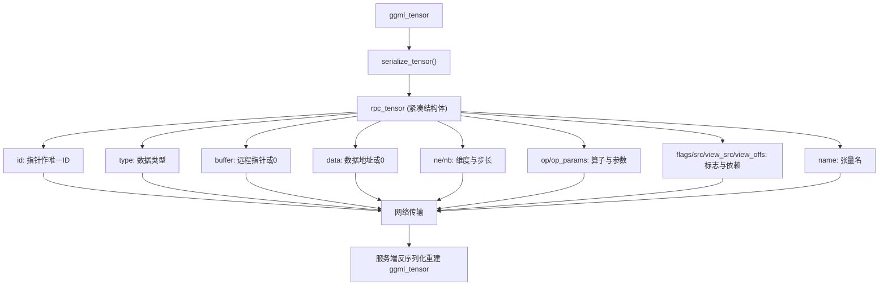

### 41.3.2 `ggml_backend_rpc_graph_compute()`：图缓存与快进模式

源码路径：`ggml/src/ggml-rpc/ggml-rpc.cpp` - `ggml_backend_rpc_graph_compute()`（880-900 行）

```cpp
static enum ggml_status ggml_backend_rpc_graph_compute(ggml_backend_t backend, ggml_cgraph * cgraph) {
    ggml_backend_rpc_context * rpc_ctx = (ggml_backend_rpc_context *)backend->context;
    GGML_ASSERT(cgraph->n_nodes > 0);
    bool reuse = rpc_ctx->gc.is_cached(cgraph);              // ① 检查图是否与上次完全一致
    if (reuse) {
        rpc_msg_graph_recompute_req request;
        request.device = rpc_ctx->device;
        auto sock = get_socket(rpc_ctx->endpoint);
        bool status = send_rpc_cmd(sock, RPC_CMD_GRAPH_RECOMPUTE, &request, sizeof(request));  // ② 走快进重算
        RPC_STATUS_ASSERT(status);
    } else {
        rpc_ctx->gc.add(cgraph);                             // ③ 未命中则缓存当前图
        std::vector<uint8_t> input;
        serialize_graph(rpc_ctx->device, cgraph, input);     // ④ 序列化整张图
        auto sock = get_socket(rpc_ctx->endpoint);
        bool status = send_rpc_cmd(sock, RPC_CMD_GRAPH_COMPUTE, input.data(), input.size());  // ⑤ 发送完整图
        RPC_STATUS_ASSERT(status);
    }
    return GGML_STATUS_SUCCESS;
}
```

这段代码实现了 RPC 图计算的「快进模式」。`graph_cache` 通过逐节点比较 `ggml_tensor` 的二进制内容判断两次调用是否完全一致；若命中则只发 `GRAPH_RECOMPUTE` 命令，服务端直接复用已存储的图重算，跳过序列化与重建开销；否则才序列化整张图走 `GRAPH_COMPUTE`。这是对重复推理场景（如同一 prompt 多次采样）的关键优化。

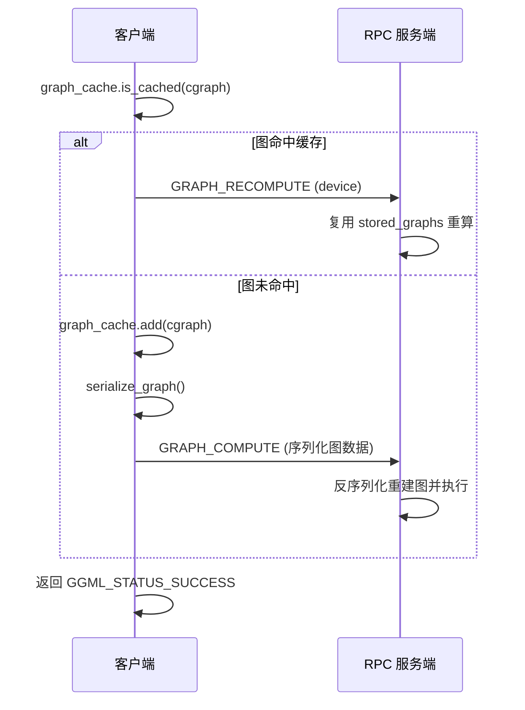

### 41.3.3 `rpc_server::graph_compute()`：服务端图执行与内存管理

源码路径：`ggml/src/ggml-rpc/ggml-rpc.cpp` - `rpc_server::graph_compute()`（554-631 行）

```cpp
bool rpc_server::graph_compute(const std::vector<uint8_t> & input) {
    // serialization format:
    // | device (4 bytes) | n_nodes (4 bytes) | nodes (n_nodes * sizeof(uint64_t) | n_tensors (4 bytes) | tensors (n_tensors * sizeof(rpc_tensor)) |
    // ① 校验输入长度：至少需要 device + n_nodes 两个 uint32
    if (input.size() < 2*sizeof(uint32_t)) {
        return false;
    }
    const uint8_t * src = input.data();
    // ② 读取 device 号并校验是否越界
    uint32_t device;
    memcpy(&device, src, sizeof(device));
    src += sizeof(device);
    if (device >= backends.size()) {
        return false;
    }
    // ③ 读取节点数量 n_nodes
    uint32_t n_nodes;
    memcpy(&n_nodes, src, sizeof(n_nodes));
    src += sizeof(n_nodes);
    // ④ 校验后续字段长度是否足够
    if (input.size() < 2*sizeof(uint32_t) + n_nodes*sizeof(uint64_t) + sizeof(uint32_t)) {
        return false;
    }
    // ⑤ 读取节点 ID 数组（每个节点对应一个 uint64_t 指针）
    const uint64_t * nodes = (const uint64_t *)src;
    src += n_nodes*sizeof(uint64_t);
    // ⑥ 读取张量数量 n_tensors
    uint32_t n_tensors;
    memcpy(&n_tensors, src, sizeof(n_tensors));
    src += sizeof(n_tensors);
    // ⑦ 校验张量数组长度
    if (input.size() < 2*sizeof(uint32_t) + n_nodes*sizeof(uint64_t) + sizeof(uint32_t) + n_tensors*sizeof(rpc_tensor)) {
        return false;
    }
    // ⑧ 张量数组指针
    const rpc_tensor * tensors = (const rpc_tensor *)src;
    LOG_DBG("[%s] device: %u, n_nodes: %u, n_tensors: %u\n", __func__, device, n_nodes, n_tensors);
    // ⑨ 计算所需 ggml 上下文内存大小，并按需预分配
    size_t buf_size = ggml_tensor_overhead()*(n_nodes + n_tensors) + ggml_graph_overhead_custom(n_nodes, false);
    if (stored_graphs[device].buffer.size() < buf_size) {
        stored_graphs[device].buffer.resize(buf_size);
    }
    // ⑩ 用预分配缓冲区构造 ggml 上下文（no_alloc=true 避免重复分配）
    struct ggml_init_params params = {
        /*.mem_size   =*/ buf_size,
        /*.mem_buffer =*/ stored_graphs[device].buffer.data(),
        /*.no_alloc   =*/ true,
    };
    ggml_context_ptr ctx_ptr { ggml_init(params) };
    GGML_ASSERT(ctx_ptr != nullptr);
    ggml_context * ctx = ctx_ptr.get();
    // ⑪ 创建自定义图（不分配张量内存）
    struct ggml_cgraph * graph = ggml_new_graph_custom(ctx, n_nodes, false);
    graph->n_nodes = n_nodes;
    // ⑫ 构建张量 ID → rpc_tensor 映射，便于递归创建节点
    std::unordered_map<uint64_t, const rpc_tensor*> tensor_ptrs;
    tensor_ptrs.reserve(n_tensors);
    for (uint32_t i = 0; i < n_tensors; i++) {
        tensor_ptrs.emplace(tensors[i].id, &tensors[i]);
    }
    // ⑬ 递归创建每个节点（通过 create_node 重建依赖链）
    std::unordered_map<uint64_t, ggml_tensor*> tensor_map;
    tensor_map.reserve(n_nodes);
    for (uint32_t i = 0; i < n_nodes; i++) {
        int64_t id;
        memcpy(&id, &nodes[i], sizeof(id));
        graph->nodes[i] = create_node(id, ctx, tensor_ptrs, tensor_map);
        // 若节点 ID 非零且创建失败，记录错误并返回
        if (graph->nodes[i] == nullptr && id != 0) {
            GGML_LOG_ERROR("[%s] failed to create graph node %d (id=%" PRId64 ")\n", __func__, i, id);
            return false;
        }
    }
    // ⑭ 在指定后端上执行图计算
    ggml_status status = ggml_backend_graph_compute(backends[device], graph);
    GGML_ASSERT(status == GGML_STATUS_SUCCESS && "Unsuccessful graph computations are not supported with RPC");
    // ⑮ 存储图对象，供后续 GRAPH_RECOMPUTE 复用
    stored_graphs[device].graph = graph;
    return true;
}
```

这段代码是服务端图计算的核心。它从字节流中解析出设备号、节点 ID 列表和张量列表，然后在预分配的 `stored_graphs[device].buffer` 上下文内存中重建 `ggml_cgraph`，最后调用本地后端的 `graph_compute` 执行。预分配上下文内存是为了避免每次图重建都重新分配 ggml 上下文，从而提升重复图场景的性能。

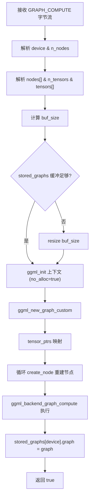

### 41.3.4 RPC Socket 工具函数族：连接、收发与握手

RPC 后端的稳定运行依赖一套完整的 Socket 工具层，这些函数封装了网络通信的细节，向上提供统一的命令收发接口。

#### 41.3.4.1 `fnv_hash()`：FNV-1a 哈希计算

```cpp
static uint64_t fnv_hash(const uint8_t * data, size_t len) {
    const uint64_t fnv_prime = 0x100000001b3ULL;
    uint64_t hash = 0xcbf29ce484222325ULL;
    for (size_t i = 0; i < len; ++i) {
        hash ^= data[i];
        hash *= fnv_prime;
    }
    return hash;
}
```

用于大张量（>10MB）的哈希缓存优化，客户端计算 FNV 哈希后发送 `SET_TENSOR_HASH` 查询服务端是否已持有相同数据。

#### 41.3.4.2 `make_socket()` / `set_no_delay()` / `set_reuse_addr()`

```cpp
static std::shared_ptr<socket_t> make_socket(sockfd_t fd) {
    if (fd == INVALID_SOCKET) return nullptr;
    return std::make_shared<socket_t>(fd);
}

static bool set_no_delay(sockfd_t sockfd) {
    int flag = 1;
    int ret = setsockopt(sockfd, IPPROTO_TCP, TCP_NODELAY, (char *)&flag, sizeof(int));
    return ret == 0;
}

static bool set_reuse_addr(sockfd_t sockfd) {
    int flag = 1;
    int ret = setsockopt(sockfd, SOL_SOCKET, SO_REUSEADDR, (char *)&flag, sizeof(int));
    return ret == 0;
}
```

`make_socket` 将文件描述符包装为 `shared_ptr<socket_t>`，析构时自动关闭；`set_no_delay` 禁用 Nagle 算法以降低延迟；`set_reuse_addr` 允许地址重用，避免服务器重启时端口冲突。

#### 41.3.4.3 `socket_connect()` / `socket_accept()` / `create_server_socket()`

```cpp
static std::shared_ptr<socket_t> socket_connect(const char * host, int port) {
    struct sockaddr_in addr;
    auto sockfd = socket(AF_INET, SOCK_STREAM, 0);
    auto sock_ptr = make_socket(sockfd);
    if (sock_ptr == nullptr) return nullptr;
    if (!set_no_delay(sockfd)) {
        GGML_LOG_ERROR("Failed to set TCP_NODELAY\n");
        return nullptr;
    }
    addr.sin_family = AF_INET;
    addr.sin_port = htons(port);
    struct hostent * server = gethostbyname(host);
    if (server == NULL) {
        GGML_LOG_ERROR("Cannot resolve host '%s'\n", host);
        return nullptr;
    }
    memcpy(&addr.sin_addr.s_addr, server->h_addr, server->h_length);
    if (connect(sock_ptr->fd, (struct sockaddr *)&addr, sizeof(addr)) < 0) {
        return nullptr;
    }
    return sock_ptr;
}

static std::shared_ptr<socket_t> socket_accept(sockfd_t srv_sockfd) {
    auto client_socket_fd = accept(srv_sockfd, NULL, NULL);
    auto client_socket = make_socket(client_socket_fd);
    if (client_socket == nullptr) return nullptr;
    if (!set_no_delay(client_socket_fd)) {
        GGML_LOG_ERROR("Failed to set TCP_NODELAY\n");
        return nullptr;
    }
    return client_socket;
}

static std::shared_ptr<socket_t> create_server_socket(const char * host, int port) {
    auto sockfd = socket(AF_INET, SOCK_STREAM, 0);
    auto sock = make_socket(sockfd);
    if (sock == nullptr) return nullptr;
    if (!set_reuse_addr(sockfd)) {
        GGML_LOG_ERROR("Failed to set SO_REUSEADDR\n");
        return nullptr;
    }
    if (inet_addr(host) == INADDR_NONE) {
        GGML_LOG_ERROR("Invalid host address: %s\n", host);
        return nullptr;
    }
    struct sockaddr_in serv_addr;
    serv_addr.sin_family = AF_INET;
    serv_addr.sin_addr.s_addr = inet_addr(host);
    serv_addr.sin_port = htons(port);
    if (bind(sockfd, (struct sockaddr *) &serv_addr, sizeof(serv_addr)) < 0) {
        return nullptr;
    }
    if (listen(sockfd, 1) < 0) {
        return nullptr;
    }
    return sock;
}
```

`socket_connect` 创建客户端 TCP 连接，`socket_accept` 接受客户端连接，`create_server_socket` 创建并监听服务器 socket。

#### 41.3.4.4 `send_data()` / `recv_data()`：分块收发（支持 >1GiB）

```cpp
static bool send_data(sockfd_t sockfd, const void * data, size_t size) {
    size_t bytes_sent = 0;
    while (bytes_sent < size) {
        size_t size_to_send = std::min(size - bytes_sent, MAX_CHUNK_SIZE);
        ssize_t n = send(sockfd, (const char *)data + bytes_sent, size_to_send, 0);
        if (n < 0) {
            GGML_LOG_ERROR("send failed (bytes_sent=%zu, size_to_send=%zu)\n", bytes_sent, size_to_send);
            return false;
        }
        bytes_sent += (size_t)n;
    }
    return true;
}

static bool recv_data(sockfd_t sockfd, void * data, size_t size) {
    size_t bytes_recv = 0;
    while (bytes_recv < size) {
        size_t size_to_recv = std::min(size - bytes_recv, MAX_CHUNK_SIZE);
        ssize_t n = recv(sockfd, (char *)data + bytes_recv, size_to_recv, 0);
        if (n < 0) {
            GGML_LOG_ERROR("recv failed (bytes_recv=%zu, size_to_recv=%zu)\n", bytes_recv, size_to_recv);
            return false;
        }
        if (n == 0) {
            LOG_DBG("recv returned 0 (peer closed?)\n");
            return false;
        }
        bytes_recv += (size_t)n;
    }
    return true;
}
```

`MAX_CHUNK_SIZE` 定义为 1 GiB，确保单次 `send`/`recv` 调用不会因为缓冲区限制而失败。

#### 41.3.4.5 `send_msg()` / `recv_msg()`：消息封装

```cpp
static bool send_msg(sockfd_t sockfd, const void * msg, size_t msg_size) {
    if (!send_data(sockfd, &msg_size, sizeof(msg_size))) return false;
    return send_data(sockfd, msg, msg_size);
}

static bool recv_msg(sockfd_t sockfd, void * msg, size_t msg_size) {
    uint64_t size;
    if (!recv_data(sockfd, &size, sizeof(size))) return false;
    if (size != msg_size) return false;
    return recv_data(sockfd, msg, msg_size);
}

static bool recv_msg(sockfd_t sockfd, std::vector<uint8_t> & input) {
    uint64_t size;
    if (!recv_data(sockfd, &size, sizeof(size))) return false;
    try {
        input.resize(size);
    } catch (const std::bad_alloc & e) {
        GGML_LOG_ERROR("Failed to allocate input buffer of size %" PRIu64 "\n", size);
        return false;
    }
    return recv_data(sockfd, input.data(), size);
}
```

`send_msg` 先发送消息长度再发送消息体；`recv_msg` 有两个重载，分别用于固定大小消息和动态大小消息（存入 vector）。

#### 41.3.4.6 `parse_endpoint()` / `send_rpc_cmd()` / `check_server_version()`

```cpp
static bool parse_endpoint(const std::string & endpoint, std::string & host, int & port) {
    size_t pos = endpoint.find(':');
    if (pos == std::string::npos) return false;
    host = endpoint.substr(0, pos);
    port = std::stoi(endpoint.substr(pos + 1));
    return true;
}

static bool send_rpc_cmd(const std::shared_ptr<socket_t> & sock, enum rpc_cmd cmd, const void * input, size_t input_size) {
    uint8_t cmd_byte = cmd;
    if (!send_data(sock->fd, &cmd_byte, sizeof(cmd_byte))) return false;
    if (!send_data(sock->fd, &input_size, sizeof(input_size))) return false;
    if (!send_data(sock->fd, input, input_size)) return false;
    return true;
}

static bool send_rpc_cmd(const std::shared_ptr<socket_t> & sock, enum rpc_cmd cmd, const void * input, size_t input_size, void * output, size_t output_size) {
    if (!send_rpc_cmd(sock, cmd, input, input_size)) return false;
    uint64_t out_size;
    if (!recv_data(sock->fd, &out_size, sizeof(out_size))) return false;
    if (out_size != output_size) return false;
    if (!recv_data(sock->fd, output, output_size)) return false;
    return true;
}

static bool check_server_version(const std::shared_ptr<socket_t> & sock) {
    rpc_msg_hello_rsp response;
    bool status = send_rpc_cmd(sock, RPC_CMD_HELLO, nullptr, 0, &response, sizeof(response));
    RPC_STATUS_ASSERT(status);
    if (response.major != RPC_PROTO_MAJOR_VERSION || response.minor > RPC_PROTO_MINOR_VERSION) {
        GGML_LOG_ERROR("RPC server version mismatch: %d.%d.%d\n", response.major, response.minor, response.patch);
        return false;
    }
    if (response.minor != RPC_PROTO_MINOR_VERSION || response.patch != RPC_PROTO_PATCH_VERSION) {
        GGML_LOG_INFO("WARNING: RPC server version mismatch: %d.%d.%d\n", response.major, response.minor, response.patch);
    }
    return true;
}
```

`send_rpc_cmd` 有两个重载：无响应版本发送「命令字节 + 请求长度 + 请求数据」；有响应版本在发送请求后再接收「响应长度 + 响应数据」。`check_server_version` 发送 HELLO 命令并比较协议版本号，确保客户端与服务端兼容。

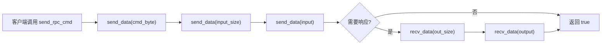

### 41.3.5 `get_socket()`：Socket 连接缓存与版本握手

源码路径：`ggml/src/ggml-rpc/ggml-rpc.cpp` - `get_socket()`（538-567 行）

```cpp
static std::shared_ptr<socket_t> get_socket(const std::string & endpoint) {
    static std::mutex mutex;
    std::lock_guard<std::mutex> lock(mutex);
    static std::unordered_map<std::string, std::weak_ptr<socket_t>> sockets;
    static bool initialized = false;
    auto it = sockets.find(endpoint);
    if (it != sockets.end()) {
        if (auto sock = it->second.lock()) {                  // ① 弱指针缓存命中
            return sock;
        }
    }
    std::string host;
    int port;
    if (!parse_endpoint(endpoint, host, port)) {
        GGML_LOG_ERROR("Failed to parse endpoint: %s\n", endpoint.c_str());
        return nullptr;
    }
    // ... WSAStartup (Windows) ...
    auto sock = socket_connect(host.c_str(), port);           // ② 建立新连接
    if (sock == nullptr) {
        return nullptr;
    }
    if (!check_server_version(sock)) {                        // ③ HELLO 版本握手
        return nullptr;
    }
    LOG_DBG("[%s] connected to %s, sockfd=%d\n", __func__, endpoint.c_str(), sock->fd);
    sockets[endpoint] = sock;                                 // ④ 存入缓存
    return sock;
}
```

这段代码实现了 RPC 客户端的 Socket 连接缓存。它用 `weak_ptr` 避免重复连接同一 endpoint，同时允许连接在所有引用释放后自动关闭。每次新连接建立后都会执行 `check_server_version()` 握手，确保客户端与服务端的协议版本兼容，防止因版本不匹配导致的协议解析错误。

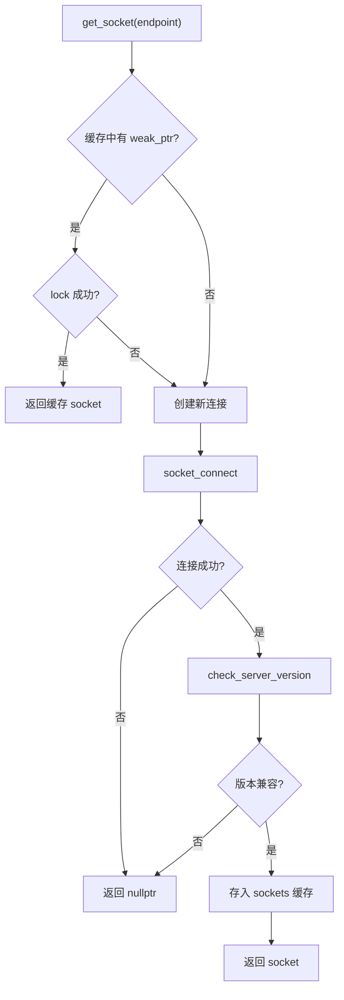

### 41.3.6 `ggml_backend_rpc_buffer_set_tensor()`：大权重哈希缓存优化

源码路径：`ggml/src/ggml-rpc/ggml-rpc.cpp` - `ggml_backend_rpc_buffer_set_tensor()`（645-669 行）

```cpp
static void ggml_backend_rpc_buffer_set_tensor(ggml_backend_buffer_t buffer, ggml_tensor * tensor, const void * data, size_t offset, size_t size) {
    ggml_backend_rpc_buffer_context * ctx = (ggml_backend_rpc_buffer_context *)buffer->context;
    rpc_tensor rpc_tensor = serialize_tensor(tensor);
    if (size > HASH_THRESHOLD) {                              // ① 超过 10MB 触发哈希优化
        rpc_msg_set_tensor_hash_req request;
        request.tensor = rpc_tensor;
        request.offset = offset;
        request.hash = fnv_hash((const uint8_t*)data, size); // ② 计算 FNV 哈希
        rpc_msg_set_tensor_hash_rsp response;
        bool status = send_rpc_cmd(ctx->sock, RPC_CMD_SET_TENSOR_HASH, &request, sizeof(request), &response, sizeof(response));
        RPC_STATUS_ASSERT(status);
        if (response.result) {                                 // ③ 服务端命中缓存则直接返回
            return;
        }
    }
    size_t input_size = sizeof(rpc_tensor) + sizeof(uint64_t) + size;
    std::vector<uint8_t> input(input_size, 0);
    memcpy(input.data(), &rpc_tensor, sizeof(rpc_tensor));
    memcpy(input.data() + sizeof(rpc_tensor), &offset, sizeof(offset));
    memcpy(input.data() + sizeof(rpc_tensor) + sizeof(offset), data, size);
    bool status = send_rpc_cmd(ctx->sock, RPC_CMD_SET_TENSOR, input.data(), input.size());  // ④ 否则发送完整数据
    RPC_STATUS_ASSERT(status);
}
```

这段代码是 RPC 客户端写入张量的核心逻辑。它对超过 `HASH_THRESHOLD`（10MB）的大张量先发送 `SET_TENSOR_HASH` 命令查询服务端缓存，命中则免传输；否则才序列化完整数据走 `SET_TENSOR`。这是大模型权重加载场景的关键优化，牺牲一次哈希计算换取数 GB 数据的网络传输省略。

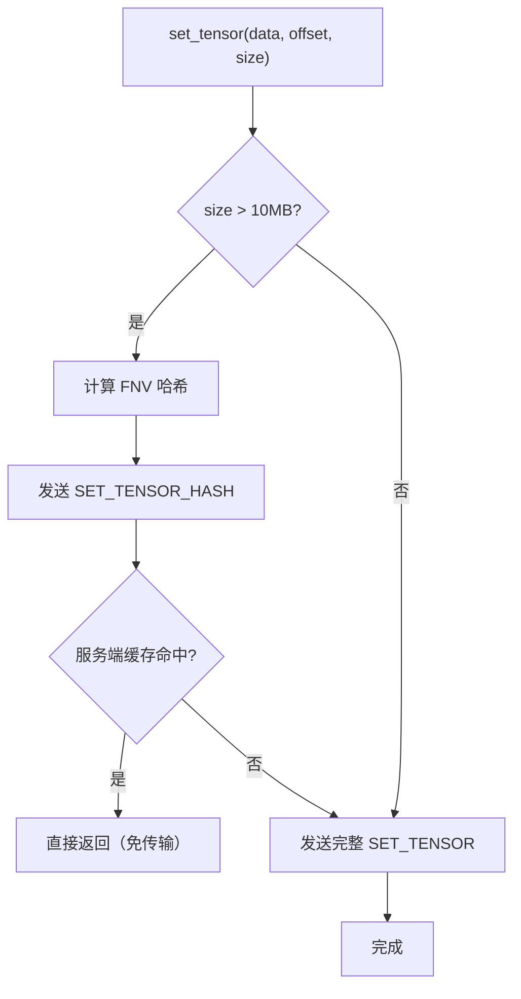

### 41.3.7 `ggml_backend_rpc_buffer_type_alloc_buffer()`：远程缓冲区分配

源码路径：`ggml/src/ggml-rpc/ggml-rpc.cpp` - `ggml_backend_rpc_buffer_type_alloc_buffer()`（732-749 行）

```cpp
static ggml_backend_buffer_t ggml_backend_rpc_buffer_type_alloc_buffer(ggml_backend_buffer_type_t buft, size_t size) {
    ggml_backend_rpc_buffer_type_context * buft_ctx = (ggml_backend_rpc_buffer_type_context *)buft->context;
    rpc_msg_alloc_buffer_req request = {buft_ctx->device, size};
    rpc_msg_alloc_buffer_rsp response;
    auto sock = get_socket(buft_ctx->endpoint);
    bool status = send_rpc_cmd(sock, RPC_CMD_ALLOC_BUFFER, &request, sizeof(request), &response, sizeof(response));
    RPC_STATUS_ASSERT(status);
    if (response.remote_ptr != 0) {
        ggml_backend_buffer_t buffer = ggml_backend_buffer_init(buft,
            ggml_backend_rpc_buffer_interface,
            new ggml_backend_rpc_buffer_context{sock, nullptr, response.remote_ptr},
            response.remote_size);
        return buffer;
    } else {
        return nullptr;
    }
}
```

这段代码展示了 RPC 客户端如何在远程服务器上分配缓冲区。它向服务端发送 `ALLOC_BUFFER` 命令，获取远程指针和大小，然后在本地创建一个 `ggml_backend_buffer` 对象，将远程指针保存在上下文中，后续的张量读写都通过该上下文转发到服务端。

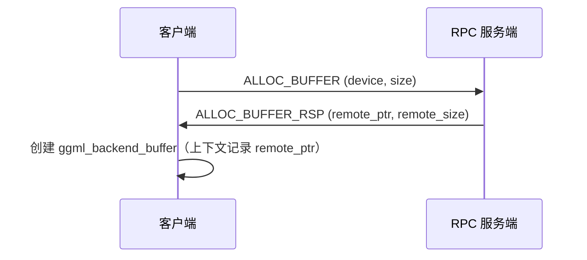

### 41.3.8 `rpc_serve_client()`：服务端请求循环

源码路径：`ggml/src/ggml-rpc/ggml-rpc.cpp` - `rpc_serve_client()`（666-818 行，节选关键分支）

```cpp
static void rpc_serve_client(const std::vector<ggml_backend_t> & backends, const char * cache_dir,
                             sockfd_t sockfd) {
    rpc_server server(backends, cache_dir);
    uint8_t cmd;
    if (!recv_data(sockfd, &cmd, 1)) {
        return;
    }
    // the first command sent by the client must be HELLO
    if (cmd != RPC_CMD_HELLO) {
        GGML_LOG_ERROR("Expected HELLO command, update client\n");
        return;
    }
    // ... 握手响应 ...
    while (true) {
        if (!recv_data(sockfd, &cmd, 1)) {
            break;
        }
        if (cmd >= RPC_CMD_COUNT) {
            GGML_LOG_ERROR("Unknown command: %d\n", cmd);
            break;
        }
        switch (cmd) {
            case RPC_CMD_ALLOC_BUFFER: {
                rpc_msg_alloc_buffer_req request;
                if (!recv_msg(sockfd, &request, sizeof(request))) { return; }
                rpc_msg_alloc_buffer_rsp response;
                if (!server.alloc_buffer(request, response)) { return; }
                if (!send_msg(sockfd, &response, sizeof(response))) { return; }
                break;
            }
            case RPC_CMD_SET_TENSOR: {
                std::vector<uint8_t> input;
                if (!recv_msg(sockfd, input)) { return; }
                if (!server.set_tensor(input)) { return; }
                break;
            }
            case RPC_CMD_GRAPH_COMPUTE: {
                std::vector<uint8_t> input;
                if (!recv_msg(sockfd, input)) { return; }
                if (!server.graph_compute(input)) { return; }
                break;
            }
            // ... 其他命令分支（GET_ALIGNMENT、GET_MAX_SIZE、BUFFER_GET_BASE、FREE_BUFFER、BUFFER_CLEAR、SET_TENSOR_HASH、INIT_TENSOR、GET_TENSOR、COPY_TENSOR、GRAPH_RECOMPUTE、GET_DEVICE_MEMORY、DEVICE_COUNT 等）...
            default: {
                GGML_LOG_ERROR("Unknown command: %d\n", cmd);
                return;
            }
        }
    }
}
```

这段代码是 RPC 服务端的请求处理循环。它首先校验首个命令必须是 `HELLO`，然后进入无限循环，根据命令字节分发到 `rpc_server` 的对应成员函数（如 `alloc_buffer`、`set_tensor`、`graph_compute` 等）。每个命令的处理都遵循「接收请求 → 调用处理函数 → 发送响应」的模式，确保协议的严格有序。

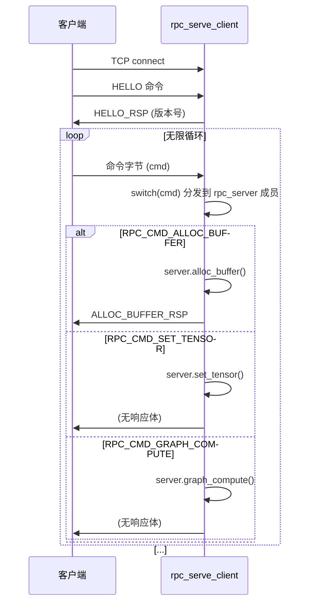

### 41.3.9 `rpc_server` 类核心成员函数全览

除了正文中已解析的 `graph_compute`、`create_node`、`deserialize_tensor` 外，`rpc_server` 还实现了以下关键成员函数，它们与客户端调用一一对应：

- **`rpc_server::hello()`**：响应 HELLO 请求，填充 `RPC_PROTO_MAJOR/MINOR/PATCH_VERSION`。
- **`rpc_server::alloc_buffer()`**：在指定后端设备上分配缓冲区，返回 `remote_ptr` 和 `remote_size`，并将 buffer 指针插入 `buffers` 集合。
- **`rpc_server::get_alloc_size()`**：构造临时张量并调用 `ggml_backend_buft_get_alloc_size()`，返回分配大小。
- **`rpc_server::get_alignment()`**：调用 `ggml_backend_buft_get_alignment()` 返回对齐要求。
- **`rpc_server::get_max_size()`**：调用 `ggml_backend_buft_get_max_size()` 返回最大缓冲区大小。
- **`rpc_server::buffer_get_base()`**：根据 `remote_ptr` 查找缓冲区并返回 `ggml_backend_buffer_get_base()` 结果。
- **`rpc_server::free_buffer()`**：查找缓冲区、调用 `ggml_backend_buffer_free()` 并从 `buffers` 集合移除。
- **`rpc_server::buffer_clear()`**：查找缓冲区并调用 `ggml_backend_buffer_clear(buffer, value)`。
- **`rpc_server::set_tensor()`**：反序列化张量、校验数据区域是否越界、可选缓存到 `cache_dir`、调用 `ggml_backend_tensor_set()` 写入数据。
- **`rpc_server::set_tensor_hash()`**：根据哈希从 `cache_dir` 读取缓存文件，校验边界后调用 `ggml_backend_tensor_set()` 写入。
- **`rpc_server::get_cached_file()`**：根据哈希从 `cache_dir` 读取文件到 vector。
- **`rpc_server::get_tensor()`**：校验读取区域合法性后，调用 `ggml_backend_tensor_get()` 将数据拷贝到响应 vector。
- **`rpc_server::copy_tensor()`**：校验目标缓冲区写入范围后调用 `ggml_backend_buffer_copy_tensor()`。
- **`rpc_server::init_tensor()`**：调用 `buffer->iface.init_tensor(buffer, tensor)` 触发后端初始化逻辑。
- **`rpc_server::graph_recompute()`**：取出 `stored_graphs[device].graph` 并调用 `ggml_backend_graph_compute()` 重新执行。
- **`rpc_server::get_device_memory()`**：通过 `ggml_backend_dev_memory()` 获取空闲和总内存。
- **`rpc_server::~rpc_server()`**：析构时遍历 `buffers` 集合，逐个释放缓冲区。

### 41.3.10 RPC 客户端-服务端交互时序

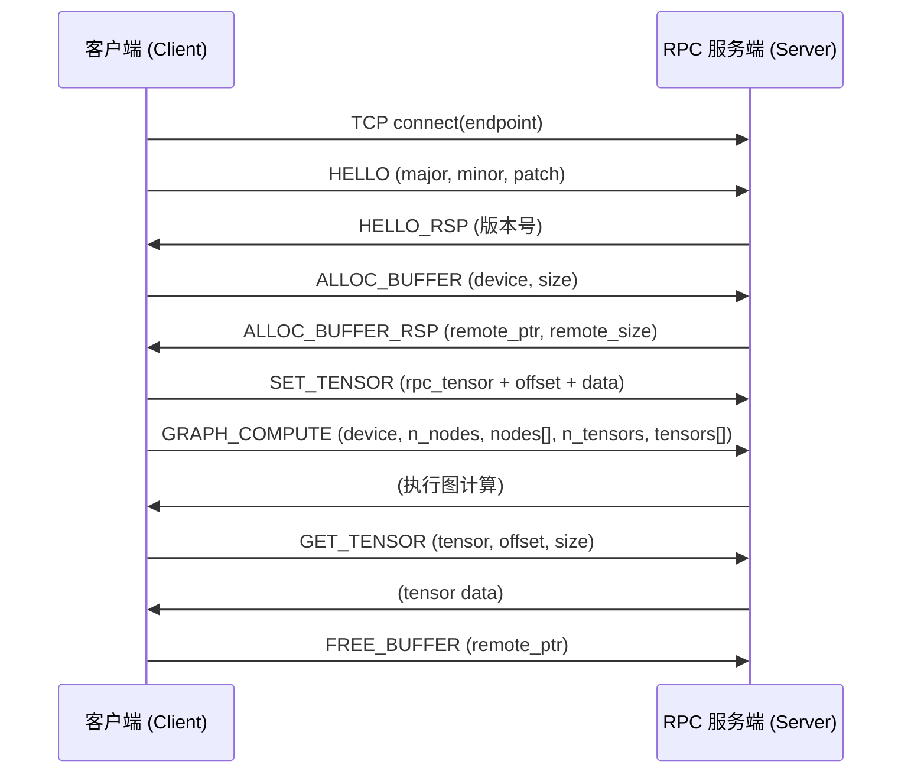

### 41.3.11 `rpc_server::deserialize_tensor()` 与 `create_node()`：服务端张量重建

服务端的张量反序列化与客户端序列化严格对称。`rpc_server::deserialize_tensor()`（234-276 行）从 `rpc_tensor` 结构重建 `ggml_tensor`，额外做了三项安全检查：校验 `type` 是否在 `GGML_TYPE_COUNT` 范围内、检查 `ggml_blck_size()` 是否为零（防止除零）、验证张量数据区域是否完全落在缓冲区边界内。`rpc_server::create_node()`（495-552 行）则递归重建计算图：先用 `tensor_map` 检查是否已创建过该 ID 的节点（避免重复创建），再按 ID 从 `tensor_ptrs` 映射中取出 `rpc_tensor`，反序列化后递归创建所有 `src[i]` 和 `view_src`，最终返回完整的节点指针。这种递归重建保证了计算图的拓扑结构在跨网络传输后完全一致。

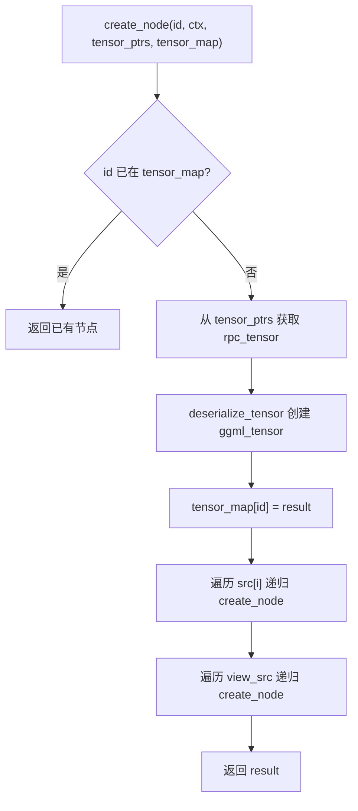

### 41.3.12 `ggml_backend_rpc_add_server()`：远程服务器注册

源码路径：`ggml/src/ggml-rpc/ggml-rpc.cpp` - `ggml_backend_rpc_add_server()`（1950-2100 行，节选核心逻辑）

```cpp
ggml_backend_reg_t ggml_backend_rpc_add_server(const char * endpoint) {
    static std::unordered_map<std::string, ggml_backend_reg_t> reg_map;
    static std::mutex mutex;
    static uint32_t dev_id = 0;
    std::lock_guard<std::mutex> lock(mutex);
    if (reg_map.find(endpoint) != reg_map.end()) {
        return reg_map[endpoint];                              // ① 进程级缓存避免重复注册
    }
    uint32_t dev_count = ggml_backend_rpc_get_device_count(endpoint);
    if (dev_count == 0) {
        return nullptr;
    }
    ggml_backend_rpc_reg_context * ctx = new ggml_backend_rpc_reg_context;
    ctx->name = "RPC[" + std::string(endpoint) + "]";
    for (uint32_t ind = 0; ind < dev_count; ind++) {
        std::string dev_name = "RPC" + std::to_string(dev_id);
        std::string dev_desc = std::string(endpoint);
        ggml_backend_rpc_device_context * dev_ctx = new ggml_backend_rpc_device_context {
            /* .endpoint    = */ endpoint,
            /* .device      = */ ind,
            /* .name        = */ dev_name,
            /* .description = */ dev_desc
        };
        ggml_backend_dev_t dev = new ggml_backend_device {
            /* .iface   = */ ggml_backend_rpc_device_i,
            /* .reg     = */ ggml_backend_rpc_reg(),
            /* .context = */ dev_ctx,
        };
        ctx->devices.push_back(dev);
        dev_id++;
    }
    ggml_backend_reg_t reg = new ggml_backend_reg {
        /* .api_version = */ GGML_BACKEND_API_VERSION,
        /* .iface       = */ ggml_backend_rpc_reg_interface,
        /* .context     = */ ctx
    };
    reg_map[endpoint] = reg;                                   // ② 存入缓存
    return reg;
}
```

这段代码实现了 RPC 远程服务器的注册逻辑。它使用进程级 `reg_map` 缓存已注册的服务器，避免重复创建设备列表；每次注册时通过 `DEVICE_COUNT` 命令查询远端设备数量，为每个设备创建 `ggml_backend_device` 对象，最终返回一个 `ggml_backend_reg_t` 注册表，供上层调度器使用。

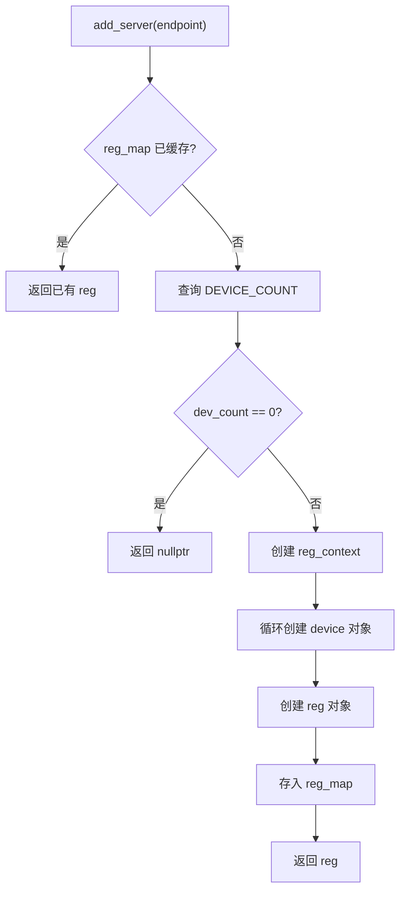

## 41.4 VirtGPU API Remoting —— 虚拟化里的「隐形传送带」

VirtGPU 后端面向虚拟化环境，让 Guest 能够透明地使用 Host 上的真实 GPU 执行 GGML 计算。它通过 virtio-GPU 把后端 API 「远程化」，就像在本地调用一样。核心是前后端分离：前端（Guest）序列化张量和计算图，通过共享内存或临时缓冲区送往 Host，后端反序列化后在真实后端（如 CUDA、Metal）上执行，再把结果编码返回。

### 41.4.1 `apir_serialize_tensor()`：前端张量序列化与句柄转换

源码路径：`ggml/src/ggml-virtgpu/apir_cs_ggml-rpc-front.cpp` - `apir_serialize_tensor()`（14-53 行）

```cpp
apir_rpc_tensor apir_serialize_tensor(const ggml_tensor * tensor) {
    apir_rpc_tensor result;
    result.id   = reinterpret_cast<uint64_t>(tensor);
    result.type = tensor->type;
    if (tensor->buffer) {
        ggml_backend_buffer_t buffer = tensor->buffer;
        result.buffer = BUFFER_TO_HOST_HANDLE(buffer);          // ① 缓冲区指针转 host 句柄
    } else {
        result.buffer = 0;
    }
    for (uint32_t i = 0; i < GGML_MAX_DIMS; i++) {
        result.ne[i] = tensor->ne[i];
        result.nb[i] = tensor->nb[i];
    }
    result.op = tensor->op;
    for (uint32_t i = 0; i < GGML_MAX_OP_PARAMS / sizeof(int32_t); i++) {
        result.op_params[i] = tensor->op_params[i];
    }
    result.flags = tensor->flags;
    for (uint32_t i = 0; i < GGML_MAX_SRC; i++) {
        result.src[i] = reinterpret_cast<uint64_t>(tensor->src[i]);
    }
    result.view_src  = reinterpret_cast<uint64_t>(tensor->view_src);
    result.view_offs = tensor->view_offs;
    result.data      = reinterpret_cast<uint64_t>(tensor->data);
    if (tensor->data) {
        if (!tensor->buffer) {
            GGML_ABORT("%s: tensor has data but buffer", __func__);
        }
        // tensor->data is serialized as an offset to the buffer base address
        result.data -= reinterpret_cast<uint64_t>(BUFFER_TO_GGML_CONTEXT(tensor->buffer)->base);  // ② 转相对偏移
    }
    snprintf(result.name, GGML_MAX_NAME, "%s", tensor->name);
    return result;
}
```

这段代码是 VirtGPU 前端序列化的核心。它与 RPC 的 `serialize_tensor()` 类似，但关键区别在于 `buffer` 字段：它通过 `BUFFER_TO_HOST_HANDLE()` 宏将本地缓冲区指针转换为 Host 可识别的句柄，避免直接传递 Guest 物理地址；同时 `data` 字段被转换为相对于缓冲区基址的偏移量，确保 Host 侧能正确还原数据位置。

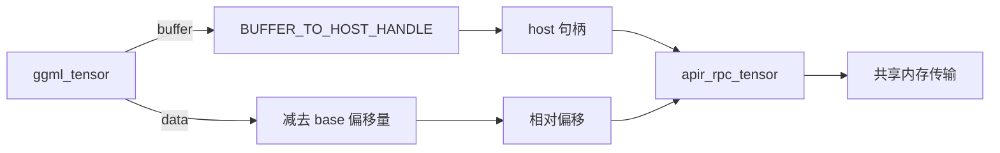

### 41.4.2 `apir_deserialize_tensor()`：后端张量反序列化与安全校验

源码路径：`ggml/src/ggml-virtgpu/backend/apir_cs_ggml-rpc-back.cpp` - `apir_deserialize_tensor()`（33-62 行）

```cpp
ggml_tensor * apir_deserialize_tensor(ggml_context * ctx, const apir_rpc_tensor * tensor) {
    ggml_tensor * result =
        ggml_new_tensor_4d(ctx, (ggml_type) tensor->type, tensor->ne[0], tensor->ne[1], tensor->ne[2], tensor->ne[3]);
    for (uint32_t i = 0; i < GGML_MAX_DIMS; i++) {
        result->nb[i] = tensor->nb[i];
    }
    result->buffer = reinterpret_cast<ggml_backend_buffer_t>(tensor->buffer);
    if (result->buffer && backend_buffers.find(result->buffer) == backend_buffers.end()) {
        printf("WARNING: HOST BUFFER NOT FOUND | %p\n", (void *) result->buffer);
        result->buffer = nullptr;                                // ① 句柄校验失败则清空
    }
    uint64_t tensor_data = tensor->data;
    if (result->buffer) {
        uint64_t tensor_size  = (uint64_t) ggml_nbytes(result);
        uint64_t buffer_start = (uint64_t) ggml_backend_buffer_get_base(result->buffer);
        uint64_t buffer_size  = (uint64_t) ggml_backend_buffer_get_size(result->buffer);
        tensor_data += buffer_start;                             // ② 相对偏移 → 绝对地址
        GGML_ASSERT(tensor_data + tensor_size >= tensor_data);  // ③ 溢出检查
        GGML_ASSERT(tensor_data >= buffer_start && tensor_data + tensor_size <= buffer_start + buffer_size);
    }
    result->op = (ggml_op) tensor->op;
    for (uint32_t i = 0; i < GGML_MAX_OP_PARAMS / sizeof(int32_t); i++) {
        result->op_params[i] = tensor->op_params[i];
    }
    result->flags = tensor->flags;
    result->data  = reinterpret_cast<void *>(tensor_data);
    ggml_set_name(result, tensor->name);
    return result;
}
```

这段代码是 VirtGPU 后端反序列化的核心。它在重建 ggml_tensor 时做了两件关键的安全检查：一是验证 `buffer` 句柄是否在 Host 侧已跟踪的 `backend_buffers` 集合中，防止 Guest 传入伪造指针；二是将序列化时的相对偏移加回缓冲区基址，并断言数据区域不越界，避免恶意 Guest 导致 Host 崩溃。

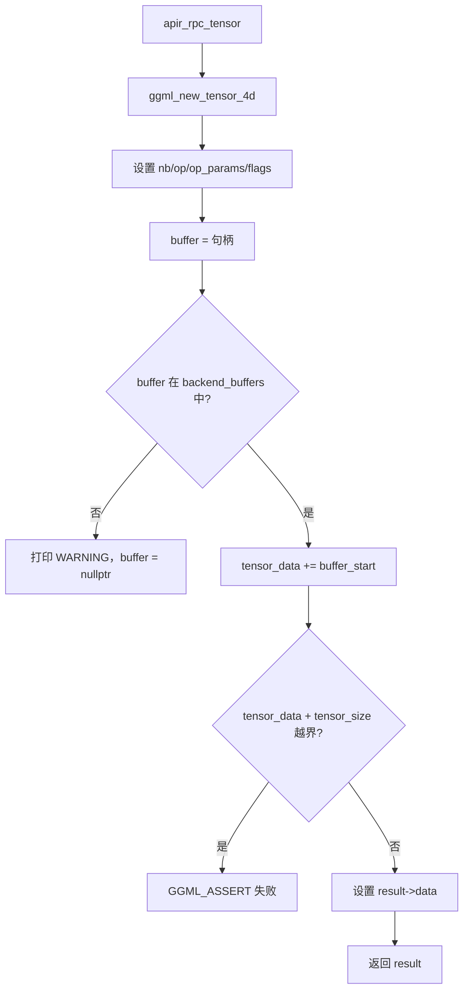

### 41.4.3 `apir_backend_graph_compute()`：共享内存图计算与远程调用

源码路径：`ggml/src/ggml-virtgpu/virtgpu-forward-backend.cpp` - `apir_backend_graph_compute()`（8-53 行）

```cpp
ggml_status apir_backend_graph_compute(virtgpu * gpu, ggml_cgraph * cgraph) {
    apir_encoder *        encoder;
    apir_decoder *        decoder;
    ApirForwardReturnCode ret;

    REMOTE_CALL_PREPARE(gpu, encoder, APIR_COMMAND_TYPE_BACKEND_GRAPH_COMPUTE);

    std::vector<uint8_t> cgraph_data;
    size_t               cgraph_size = apir_serialize_ggml_cgraph(cgraph, cgraph_data);

    virtgpu_shmem   temp_shmem;  // Local storage for large buffers
    virtgpu_shmem * shmem              = &temp_shmem;
    bool            using_shared_shmem = false;

    if (cgraph_size <= gpu->data_shmem.mmap_size) {
        // Lock mutex before using shared data_shmem buffer
        if (mtx_lock(&gpu->data_shmem_mutex) != thrd_success) {
            GGML_ABORT(GGML_VIRTGPU "%s: Failed to lock data_shmem mutex", __func__);
        }
        using_shared_shmem = true;
        shmem              = &gpu->data_shmem;                   // ① 小图走预置共享内存
    } else if (virtgpu_shmem_create(gpu, cgraph_size, shmem)) {
        GGML_ABORT(GGML_VIRTGPU "%s: Couldn't allocate the guest-host shared buffer", __func__);
    }

    apir_encode_virtgpu_shmem_res_id(encoder, shmem->res_id);    // ② 编码共享内存资源 ID

    apir_encode_size_t(encoder, &cgraph_size);

    char *       shmem_data    = (char *) shmem->mmap_ptr;
    apir_encoder secondary_enc = apir_new_encoder(shmem_data, cgraph_size);

    apir_encode_cgraph_data(&secondary_enc, cgraph_data);        // ③ 在共享内存中编码图数据

    REMOTE_CALL(gpu, encoder, decoder, ret);                      // ④ 触发远程调用

    ggml_status status = GGML_STATUS_ABORTED;
    apir_decode_ggml_status(decoder, &status);                   // ⑤ 解码执行状态

    remote_call_finish(gpu, encoder, decoder);

    if (using_shared_shmem) {
        mtx_unlock(&gpu->data_shmem_mutex);                       // ⑥ 释放互斥锁
    } else {
        virtgpu_shmem_destroy(gpu, shmem);                        // ⑦ 销毁临时共享内存
    }

    return status;
}
```

这段代码是 VirtGPU 图计算的前端入口。它根据图的大小选择两种传输路径：小图使用预分配的 `data_shmem` 共享内存（加互斥锁保证线程安全），大图则通过 `virtgpu_shmem_create()` 动态创建临时共享内存。图数据被编码到共享内存中，然后通过 `REMOTE_CALL` 宏触发 hypercall，Host 侧从共享内存读取图数据并执行，最后将状态编码返回。

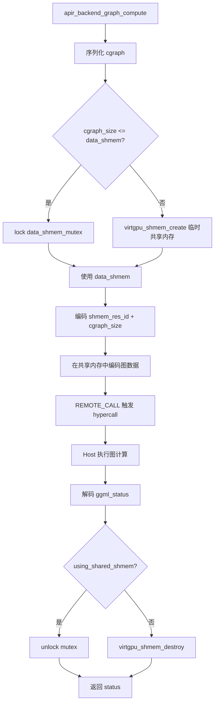

### 41.4.4 VirtGPU 前后端分离架构图

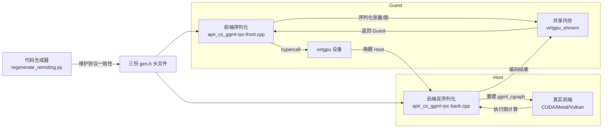

### 41.4.5 `RemotingCodebaseGenerator`：代码自动生成

源码路径：`ggml/src/ggml-virtgpu/regenerate_remoting.py` - `RemotingCodebaseGenerator.__init__()`（29-45 行）

```python
def __init__(self, yaml_path: str = "ggmlremoting_functions.yaml"):
    """Initialize the generator with the YAML configuration."""
    self.yaml_path = yaml_path

    if not Path(yaml_path).exists():
        raise FileNotFoundError(f"Configuration file {yaml_path} not found")

    with open(yaml_path, 'r') as f:
        self.config = yaml.safe_load(f)

    self.functions = self.config['functions']
    self.naming_patterns = self.config['naming_patterns']
    self.config_data = self.config['config']

    # Check if clang-format is available
    self.clang_format_available = self._check_clang_format_available()
```

这段代码是 VirtGPU 代码生成器的初始化入口。它从 YAML 配置文件中读取所有启用的函数列表、命名模式和路径配置，并检查系统中是否存在 clang-format 以决定是否自动格式化生成的头文件。这样，当前端/后端协议需要新增命令时，只需修改 YAML 配置，再运行 `regenerate_remoting.py`，就能自动生成 `apir_backend.gen.h`、`backend-dispatched.gen.h` 和 `virtgpu-forward.gen.h` 三份协议头文件，保证两端索引完全一致。

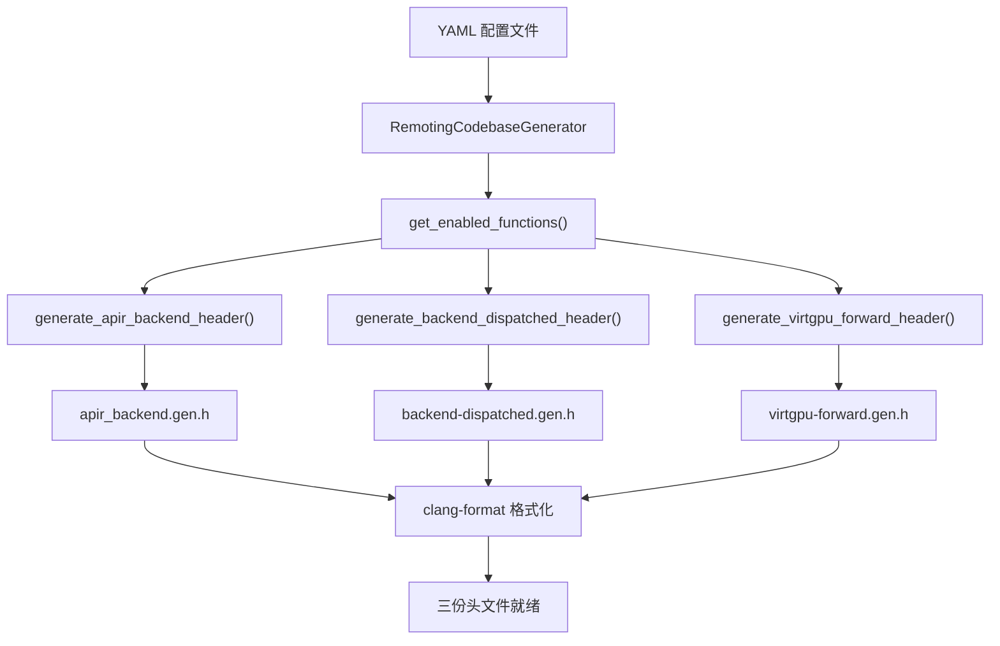

### 41.4.6 `virtgpu_handshake()`：APIR 协议握手

源码路径：`ggml/src/ggml-virtgpu/virtgpu.cpp` - `virtgpu_handshake()`（29-82 行）

```cpp
static int virtgpu_handshake(virtgpu * gpu) {
    apir_encoder * encoder;
    apir_decoder * decoder;
    encoder = remote_call_prepare(gpu, APIR_COMMAND_TYPE_HANDSHAKE, 0);
    if (!encoder) {
        GGML_ABORT(GGML_VIRTGPU "%s: failed to prepare the remote call encoder", __func__);
        return 1;
    }
    uint32_t guest_major = APIR_PROTOCOL_MAJOR;                  // ① 编码 Guest 协议版本
    uint32_t guest_minor = APIR_PROTOCOL_MINOR;
    apir_encode_uint32_t(encoder, &guest_major);
    apir_encode_uint32_t(encoder, &guest_minor);
    uint32_t  ret_magic;
    long long call_duration_ns;
    ret_magic = remote_call(gpu, encoder, &decoder, APIR_HANDSHAKE_MAX_WAIT_MS, &call_duration_ns);
    log_call_duration(call_duration_ns, "API Remoting handshake");
    if (!decoder) {
        GGML_ABORT(GGML_VIRTGPU "%s: failed to initiate the communication with the virglrenderer library. "
                   "Most likely, the wrong virglrenderer library was loaded in the hypervisor.", __func__);
        return 1;
    }
    uint32_t host_major, host_minor;
    if (ret_magic != APIR_HANDSHAKE_MAGIC) {                      // ② 校验握手魔数
        GGML_ABORT(GGML_VIRTGPU "%s: handshake with the virglrenderer failed (code=%d | %s)", __func__, ret_magic,
                   apir_backend_initialize_error(ret_magic));
    } else {
        apir_decode_uint32_t(decoder, &host_major);              // ③ 解码 Host 版本
        apir_decode_uint32_t(decoder, &host_minor);
    }
    remote_call_finish(gpu, encoder, decoder);
    if (ret_magic != APIR_HANDSHAKE_MAGIC) {
        return 1;
    }
    GGML_LOG_INFO(GGML_VIRTGPU "%s: Guest is running with %u.%u\n", __func__, guest_major, guest_minor);
    GGML_LOG_INFO(GGML_VIRTGPU "%s: Host is running with %u.%u\n", __func__, host_major, host_minor);
    if (guest_major != host_major) {
        GGML_LOG_ERROR(GGML_VIRTGPU "Host major (%d) and guest major (%d) version differ\n", host_major, guest_major);
    } else if (guest_minor != host_minor) {
        GGML_LOG_WARN(GGML_VIRTGPU "Host minor (%d) and guest minor (%d) version differ\n", host_minor, guest_minor);
    }
    return 0;
}
```

这段代码是 VirtGPU 握手阶段的完整实现。Guest 侧编码自己的协议版本（major/minor）并触发 hypercall，Host 返回握手魔数和版本号。若魔数不匹配则立即中止，防止后续通信使用错误的协议；版本号比对允许主版本不同直接报错，次版本不同仅警告，确保兼容性。

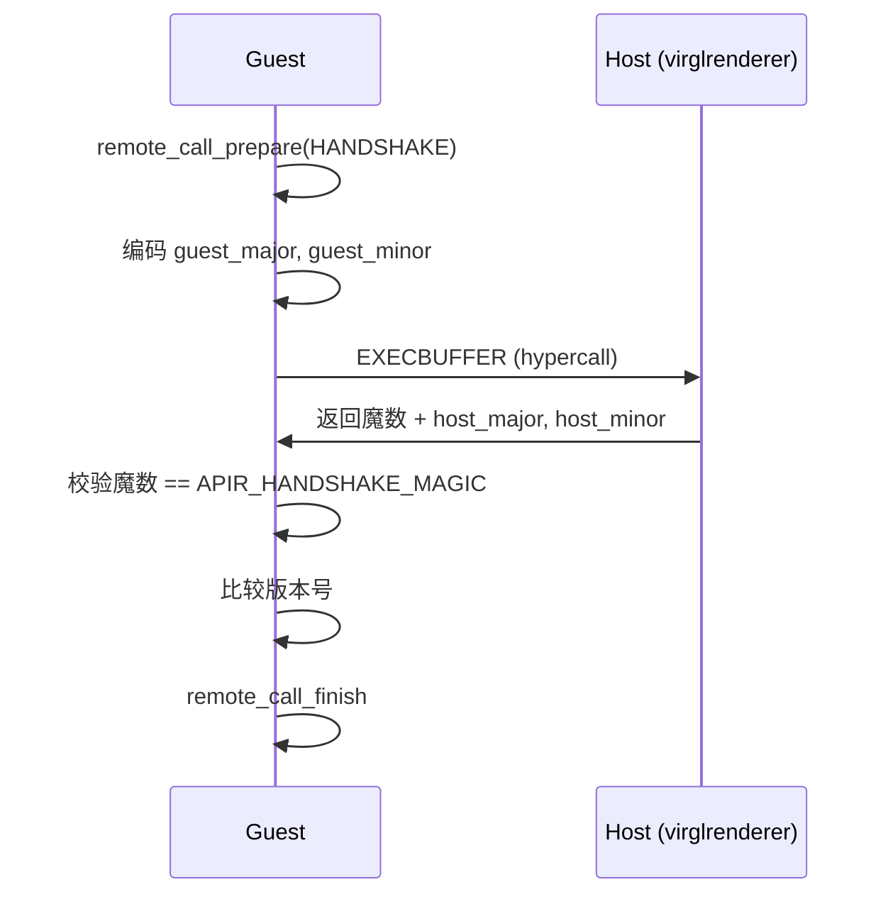

### 41.4.7 `apir_device_get_count()`：设备查询转发

源码路径：`ggml/src/ggml-virtgpu/virtgpu-forward-device.cpp` - `apir_device_get_count()`（7-23 行）

```cpp
int apir_device_get_count(virtgpu * gpu) {
    apir_encoder *        encoder;
    apir_decoder *        decoder;
    ApirForwardReturnCode ret;

    REMOTE_CALL_PREPARE(gpu, encoder, APIR_COMMAND_TYPE_DEVICE_GET_COUNT);
    REMOTE_CALL(gpu, encoder, decoder, ret);

    int32_t dev_count = -1;
    apir_decode_int32_t(decoder, &dev_count);                   // ① 解码设备数量

    remote_call_finish(gpu, encoder, decoder);

    return dev_count;
}
```

这段代码是 VirtGPU 前端查询设备数量的封装。它通过 `REMOTE_CALL_PREPARE` 准备编码器，触发远程调用后从解码器中读取 int32 类型的设备数量。这种设计让 Guest 侧的调用与本地 API 无异，底层细节全部由 virtgpu 层封装。

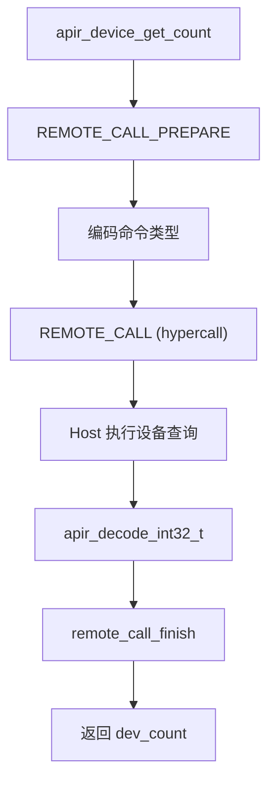

### 41.4.8 `backend_device_get_name()`：后端设备名称获取

源码路径：`ggml/src/ggml-virtgpu/backend/backend-dispatched-device.cpp` - `backend_device_get_name()`（32-43 行）

```cpp
uint32_t backend_device_get_name(apir_encoder * enc, apir_decoder * dec, virgl_apir_context * ctx) {
    GGML_UNUSED(ctx);
    GGML_UNUSED(dec);

    const char * string = dev->iface.get_name(dev);              // ① 调用真实后端设备接口

    const size_t string_size = strlen(string) + 1;
    apir_encode_array_size(enc, string_size);
    apir_encode_char_array(enc, string, string_size);            // ② 编码字符串返回

    return 0;
}
```

这段代码是 Host 侧处理设备名称查询的后端函数。它从全局 `dev` 对象（真实后端设备）获取名称，然后编码到输出流中。这种对称设计确保前端 `apir_device_get_name()` 和后端 `backend_device_get_name()` 使用相同的编码格式，无需手动协调。

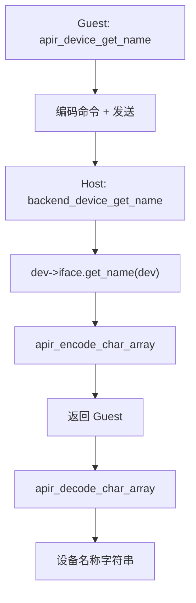

### 41.4.9 `virtgpu_shmem_create()`：共享内存创建

源码路径：`ggml/src/ggml-virtgpu/virtgpu-shm.cpp` - `virtgpu_shmem_create()`（81-103 行）

```cpp
int virtgpu_shmem_create(virtgpu * gpu, size_t size, virtgpu_shmem * shmem) {
    size = align64(size, 16384);                                 // ① 按 16KB 对齐

    uint32_t res_id;
    uint32_t gem_handle = virtgpu_ioctl_resource_create_blob(gpu, VIRTGPU_BLOB_MEM_HOST3D,
                                                             VIRTGPU_BLOB_FLAG_USE_MAPPABLE, size, 0, &res_id);
    if (!gem_handle) {
        return 1;
    }

    void * ptr = virtgpu_ioctl_map(gpu, gem_handle, size);        // ② mmap 到用户空间
    if (!ptr) {
        virtgpu_ioctl_gem_close(gpu, gem_handle);
        GGML_LOG_ERROR(GGML_VIRTGPU "%s: virtgpu_ioctl_map failed\n", __func__);
        return 1;
    }

    shmem->res_id     = res_id;                                   // ③ 填充共享内存结构
    shmem->mmap_size  = size;
    shmem->mmap_ptr   = ptr;
    shmem->gem_handle = gem_handle;

    return 0;
}
```

这段代码是 VirtGPU 共享内存的创建核心。它通过 DRM ioctl 创建 blob 资源、获取 gem 句柄，再 mmap 到用户空间，最终返回一个 `virtgpu_shmem` 结构供 Guest 和 Host 双向访问。对齐到 16KB 是为了满足 GPU 页面要求，避免后续绑定失败。

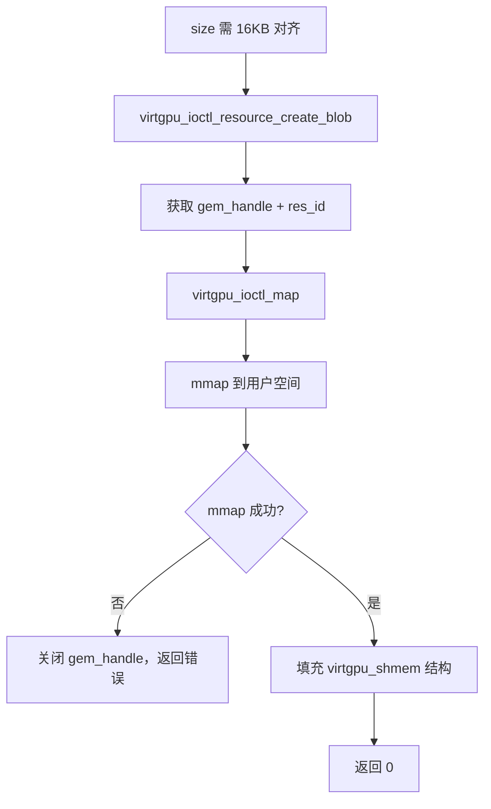

### 41.4.10 VirtGPU 远程调用的三次握手与命令分发

VirtGPU 后端的初始化涉及多次跨进程通信：

1. `virtgpu_handshake()` 交换协议版本，确保 Guest/Host 兼容
2. `virtgpu_load_library()` 通过 `LOADLIBRARY` 命令通知 Host 加载真实后端库
3. `apir_backend_dispatcher()` 根据 `cmd_type` 索引 `apir_backend_dispatch_table[]` 分发到具体处理函数

`apir_backend_dispatch_table[]` 中的函数指针顺序由 `regenerate_remoting.py` 自动生成，与前端 `virtgpu-forward.gen.h` 中的声明一一对应，确保两端索引一致。

```mermaid
sequenceDiagram
    participant G as Guest
    participant H as Host
    G->>H: HANDSHAKE (major, minor)
    H->>G: HANDSHAKE_RSP (magic, host_major, host_minor)
    G->>H: LOADLIBRARY (库路径, 注册符号)
    H->>H: dlopen + dlsym + backend_dispatch_initialize
    H->>G: LOADLIBRARY_RSP (返回码)
    loop 命令调用
        G->>H: FORWARD (cmd_type, 编码数据)
        H->>H: apir_backend_dispatcher 查表分发
        H->>G: FORWARD_RSP (编码结果)
    end
```

### 41.4.11 VirtGPU 缓冲区跟踪与安全校验族

VirtGPU 后端维护一个全局的 `backend_buffers` 集合，用于跟踪 Host 侧分配的所有缓冲区，防止 Guest 传入伪造指针。这一机制由三个函数协同完成。

**`apir_track_backend_buffer()`**（`apir_cs_ggml-rpc-back.cpp` 13-15 行）：将一个后端缓冲区插入到 `backend_buffers` 集合中。在 `backend_buffer_type_alloc_buffer()` 中，每当 Host 侧通过 `buft->iface.alloc_buffer()` 成功分配一个缓冲区后，立即调用此函数将其登记到跟踪集合中，为后续的句柄校验建立白名单。

**`apir_untrack_backend_buffer()`**（17-25 行）：从 `backend_buffers` 集合中移除一个缓冲区。在 `backend_buffer_free_buffer()` 中，Host 侧在释放缓冲区前先调用此函数将其从跟踪集合中移除。若缓冲区未被跟踪（即不在集合中），则返回 `false` 并记录警告，防止重复释放或释放未知缓冲区。

**`apir_get_track_backend_buffers()`**（27-29 行）：返回当前 `backend_buffers` 集合的副本。这个函数在 `apir_backend_deinit()` 中被用于遍历所有已跟踪的缓冲区并逐个释放，确保后端反初始化时不会遗漏任何 Host 侧资源。

这三个函数与 `apir_decode_ggml_buffer()` 中的句柄校验逻辑共同构成了 VirtGPU 的安全防线：Guest 每次传递缓冲区句柄时，Host 侧都会在 `backend_buffers` 中查找，找不到则立即设置 `apir_decoder_set_fatal(dec)` 并返回 `NULL`，防止恶意 Guest 通过伪造句针访问或破坏 Host 内存。

```mermaid
flowchart TD
    A["Guest 传递 buffer 句柄"] --> B["apir_decode_ggml_buffer"]
    B --> C{"buffer 在 backend_buffers 中?"}
    C -- 否 --> D["apir_decoder_set_fatal"]
    D --> E["返回 NULL"]
    C -- 是 --> F["返回 buffer 指针"]
    F --> G["Host 正常使用"]
```

### 41.4.12 `apir_create_node()` 与 `apir_deserialize_graph()`：图重建的递归引擎

`apir_create_node()`（`apir_cs_ggml-rpc-back.cpp` 64-88 行）是 VirtGPU 后端重建计算图的核心递归函数。它接收一个张量 ID、ggml 上下文、张量指针映射表和已创建张量映射表四个参数，按以下流程工作：首先检查 `tensor_map` 中是否已存在该 ID 的张量（避免重复创建），然后从 `tensor_ptrs` 映射中取出对应的 `apir_rpc_tensor` 并调用 `apir_deserialize_tensor()` 重建张量本体，接着递归创建所有 `src[i]` 和 `view_src`，最终返回完整的张量指针。这种递归策略保证了计算图的有向无环图（DAG）拓扑在反序列化后完全一致。

`apir_deserialize_graph()`（90-116 行）则是图重建的顶层入口。它接收节点数量、张量数量、张量数组和节点 ID 数组，先计算所需的 ggml 上下文内存大小（`ggml_tensor_overhead()*(n_nodes + n_tensors) + ggml_graph_overhead_custom(n_nodes, false)`），然后分配上下文、创建 `ggml_cgraph`，再通过 `apir_create_node()` 逐个重建每个节点。与 RPC 服务端的 `graph_compute()` 不同，VirtGPU 后端的图重建不绑定特定设备，而是将重建后的 `ggml_cgraph` 交由 `bck->iface.graph_compute(bck, cgraph)` 在真实后端上执行。

```mermaid
flowchart TD
    A["apir_deserialize_graph"] --> B["计算 buf_size"]
    B --> C["ggml_init 上下文"]
    C --> D["ggml_new_graph_custom"]
    D --> E["tensor_ptrs 映射"]
    E --> F["遍历 nodes[]"]
    F --> G["apir_create_node(id)"]
    G --> H{"id 已创建?"}
    H -- 是 --> I["返回已有节点"]
    H -- 否 --> J["deserialize_tensor"]
    J --> K["递归创建 src[i]"]
    K --> L["递归创建 view_src"]
    L --> M["返回新节点"]
    M --> N["graph->nodes[i] = node"]
```

### 41.4.13 `apir_backend_initialize()` / `apir_backend_dispatcher()` / `apir_backend_deinit()`：后端生命周期

这三个函数构成了 VirtGPU 后端的完整生命周期。`apir_backend_initialize()`（`backend.cpp` 63-112 行）是初始化入口：首先根据环境变量 `APIR_LLAMA_CPP_LOG_TO_FILE` 决定是否开启文件日志，然后从 VirGL 回调接口中获取后端库路径和注册符号名，通过 `dlopen()` 动态加载真实后端库（如 CUDA、Metal 后端），用 `dlsym()` 查找 `ggml_backend_init` 或用户指定的注册函数，最后调用 `backend_dispatch_initialize()` 完成后端注册、设备获取和后端实例创建。若任一环节失败，返回对应的 `ApirLoadLibraryReturnCode` 错误码。

`apir_backend_dispatcher()`（114-147 行）是命令分发入口。它接收 VirGL 上下文 ID、回调接口、命令类型、解码缓冲区范围、编码缓冲区范围和编码后位置指针，内部构造 `apir_encoder` 和 `apir_decoder` 以及 `virgl_apir_context`，然后检查 `cmd_type` 是否越界，从 `apir_backend_dispatch_table[cmd_type]` 中取出对应的处理函数并调用，最后将编码器当前位置写入 `*enc_cur_after` 返回。这个函数是 Host 侧所有 RPC 命令的总入口，所有设备查询、缓冲区操作、图计算最终都通过它分发到具体的 `backend_*` 处理函数。

`apir_backend_deinit()`（40-59 行）是反初始化入口。它遍历 `backend_buffers` 集合中的所有缓冲区，逐个调用 `apir_untrack_backend_buffer()` 和 `buffer->iface.free_buffer()` 释放资源，然后通过 `dlclose()` 卸载动态加载的后端库，最后关闭日志文件。这个函数确保 Host 侧在 Guest 退出时不会泄漏任何资源。

```mermaid
flowchart TD
    A["apir_backend_initialize"] --> B["设置日志"]
    B --> C["获取库路径/注册符号"]
    C --> D["dlopen 后端库"]
    D --> E["dlsym 注册函数"]
    E --> F["backend_dispatch_initialize"]
    F --> G["创建 reg/dev/bck"]
    G --> H["返回加载结果码"]
    
    I["apir_backend_dispatcher"] --> J["构造 enc/dec/ctx"]
    J --> K{"cmd_type 越界?"}
    K -- 是 --> L["返回 APIR_BACKEND_FORWARD_INDEX_INVALID"]
    K -- 否 --> M["查 apir_backend_dispatch_table"]
    M --> N["调用处理函数"]
    N --> O["更新 *enc_cur_after"]
    O --> P["返回状态码"]
    
    Q["apir_backend_deinit"] --> R["遍历 backend_buffers"]
    R --> S["释放每个缓冲区"]
    S --> T["dlclose 后端库"]
    T --> U["关闭日志文件"]
```

### 41.4.14 `backend_dispatch_initialize()`：后端加载初始化

源码路径：`ggml/src/ggml-virtgpu/backend/backend-dispatched.cpp` - `backend_dispatch_initialize()`（18-56 行）

```cpp
uint32_t backend_dispatch_initialize(void * ggml_backend_reg_fct_p) {
    if (reg != NULL) {
        GGML_LOG_WARN(GGML_VIRTGPU_BCK "%s: already initialized\n", __func__);
        return APIR_BACKEND_INITIALIZE_ALREADY_INITED;
    }
    ggml_backend_reg_t (*ggml_backend_reg_fct)(void) = (ggml_backend_reg_t (*)()) ggml_backend_reg_fct_p;

    reg = ggml_backend_reg_fct();
    if (reg == NULL) {
        GGML_LOG_ERROR(GGML_VIRTGPU_BCK "%s: backend registration failed\n", __func__);
        return APIR_BACKEND_INITIALIZE_BACKEND_REG_FAILED;
    }

    size_t device_count = reg->iface.get_device_count(reg);
    if (!device_count) {
        GGML_LOG_ERROR(GGML_VIRTGPU_BCK "%s: no device found\n", __func__);
        return APIR_BACKEND_INITIALIZE_NO_DEVICE;
    }

    dev = reg->iface.get_device(reg, 0);

    if (!dev) {
        GGML_LOG_ERROR(GGML_VIRTGPU_BCK "%s: failed to get device\n", __func__);
        return APIR_BACKEND_INITIALIZE_NO_DEVICE;
    }

    bck = dev->iface.init_backend(dev, NULL);
    if (!bck) {
        GGML_LOG_ERROR(GGML_VIRTGPU_BCK "%s: backend initialization failed\n", __func__);
        return APIR_BACKEND_INITIALIZE_BACKEND_INIT_FAILED;
    }

    return APIR_BACKEND_INITIALIZE_SUCCESS;
}
```

这段代码是 Host 侧后端加载的初始化函数。它接收一个函数指针（由 Guest 通过 `LOADLIBRARY` 命令传入），依次执行：调用注册函数获取 `ggml_backend_reg_t` 注册表、查询设备数量、获取第一个设备、调用 `init_backend` 创建后端实例。整个过程的结果通过返回码传递，若成功则将 `reg`、`dev`、`bck` 三个全局指针赋值，供后续命令分发使用。函数内部使用静态全局变量存储这些指针，确保在整个 Host 进程生命周期内唯一。

```mermaid
flowchart TD
    A["backend_dispatch_initialize"] --> B{"reg 已初始化?"}
    B -- 是 --> C["返回 ALREADY_INITED"]
    B -- 否 --> D["调用注册函数获取 reg"]
    D --> E{"reg == NULL?"}
    E -- 是 --> F["返回 BACKEND_REG_FAILED"]
    E -- 否 --> G["获取 device_count"]
    G --> H{"device_count == 0?"}
    H -- 是 --> I["返回 NO_DEVICE"]
    H -- 否 --> J["获取第一个设备"]
    J --> K{"dev == NULL?"}
    K -- 是 --> I
    K -- 否 --> L["init_backend 创建 bck"]
    L --> M{"bck == NULL?"}
    M -- 是 --> N["返回 BACKEND_INIT_FAILED"]
    M -- 否 --> O["返回 SUCCESS"]
```

### 41.4.15 VirtGPU 编码器/解码器的内存安全机制

VirtGPU 的 `apir_encoder` 和 `apir_decoder` 提供了内存安全的序列化接口。`apir_encoder` 维护 `cur`、`start`、`end` 三个指针和一个 `fatal` 标志，`apir_encoder_write()` 在写入前会断言剩余空间足够，`apir_encoder_set_fatal()` 用于标记错误状态。`apir_decoder` 同样维护 `cur`、`end` 和 `fatal` 标志，`apir_decoder_peek_internal()` 在读取前检查 `size > (dec->end - dec->cur)`，若越界则设置 `fatal` 标志、清零输出缓冲区并返回 `false`；`apir_decoder_use_inplace()` 用于原地访问，同样会检查越界并返回 `NULL`。`apir_decoder_set_fatal()` 在检测到越界读取或不一致状态时被调用，确保恶意 Guest 构造的畸形数据不会导致 Host 崩溃，而是被安全地拒绝。

`apir_decode_ggml_buffer()` 是缓冲区句柄解码的关键安全函数。它从解码器中读取缓冲区句柄后，会调用 `apir_decoder_set_fatal(dec)` 并返回 `NULL` 如果该句柄不在 `backend_buffers` 跟踪集合中。这个设计在安全防护中扮演着核心角色：Guest 无法直接传递 Host 的物理指针，只能传递由 Host 分配并登记过的句柄，任何伪造句柄都会被立即拦截，防止 Guest 直接访问或破坏 Host 内存。

```mermaid
flowchart TD
    A["apir_decode_ggml_buffer"] --> B["读取 buffer 句柄"]
    B --> C{"buffer 在 backend_buffers 中?"}
    C -- 否 --> D["apir_decoder_set_fatal"]
    D --> E["记录警告日志"]
    E --> F["返回 NULL"]
    C -- 是 --> G["返回 buffer 指针"]
    F --> H["上层检测 fatal 标志"]
    G --> H
    H -- fatal=true --> I["拒绝执行命令"]
    H -- fatal=false --> J["正常执行"]
```

## 41.5 zDNN 后端 —— IBM Z 的「矩阵加速器」

zDNN 后端面向 IBM Z 系列 NNPA 加速器，只接受特定布局的张量，支持 F32/F16/BF16 的矩阵乘法。它不支持的算子会被拒绝，由其他后端处理。其核心是把 ggml 张量转换为 zDNN 的 zTensor 描述符，然后调用 NNPA 硬件的 `zdnn_matmul_transpose_op()` 完成计算。

### 41.5.1 `ggml_zdnn_compute_forward_mul_mat()`：矩阵乘前向计算

源码路径：`ggml/src/ggml-zdnn/ggml-zdnn.cpp` - `ggml_zdnn_compute_forward_mul_mat()`（17-29 行）

```cpp
static void ggml_zdnn_compute_forward_mul_mat(
    const ggml_backend_zdnn_context * ctx,
          ggml_tensor * dst) {

    const ggml_tensor * src0 = dst->src[0];  // weights
    const ggml_tensor * src1 = dst->src[1];  // inputs

    // TODO: implement support for quantized types
    // we currently only support f32, f16, and bf16
    ggml_zdnn_mul_mat_f(ctx, src0, src1, dst);               // ① 调用底层矩阵乘实现
}
```

这段代码是 zDNN 后端 MUL_MAT 算子的前向计算入口。它从目标张量 `dst` 中取出权重和输入两个源张量，然后调用 `ggml_zdnn_mul_mat_f()` 执行实际的 NNPA 矩阵乘法。当前版本仅支持 F32/F16/BF16 三种数据类型，量化类型尚未支持。

```mermaid
graph TD
    A["MUL_MAT 节点"] --> B["取出 src0 (weights)"]
    A --> C["取出 src1 (inputs)"]
    B --> D["ggml_zdnn_mul_mat_f"]
    C --> D
    D --> E["NNPA 硬件执行矩阵乘"]
    E --> F["结果写入 dst"]
```

### 41.5.2 `ggml_backend_zdnn_buffer_init_tensor()`：张量描述符初始化

源码路径：`ggml/src/ggml-zdnn/ggml-zdnn.cpp` - `ggml_backend_zdnn_buffer_init_tensor()`（232-277 行）

```cpp
static enum ggml_status ggml_backend_zdnn_buffer_init_tensor(ggml_backend_buffer_t buffer, ggml_tensor * tensor) {
    if (tensor->view_src != NULL) {
        assert(tensor->view_src->buffer->buft == buffer->buft);
        return GGML_STATUS_SUCCESS;                              // ① 视图张量无需重复初始化
    }

    ggml_backend_zdnn_buffer_context * ctx = (ggml_backend_zdnn_buffer_context *)buffer->context;

    const int64_t tsize = ggml_nbytes(tensor);
    int buffer_idx = ctx->n_buffers;

    std::unique_ptr<ggml_backend_zdnn_buffer> zdnn_buffer = std::make_unique<ggml_backend_zdnn_buffer>();
    zdnn_buffer->data = tensor->data;
    zdnn_buffer->size = tsize;
    zdnn_buffer->extra = nullptr;
    snprintf(zdnn_buffer->name, GGML_MAX_NAME, "%s", tensor->name);

    ggml_zdnn_init_tensor(zdnn_buffer.get(), tensor);            // ② 创建 zTensor 描述符
    tensor->extra = zdnn_buffer.get();                           // ③ 将 zDNN 缓冲区挂到 tensor->extra

    switch (tensor->op) {
        case GGML_OP_MUL_MAT:
            {
                std::unique_ptr<ggml_backend_zdnn_buffer> zdnn_bias_buffer = std::make_unique<ggml_backend_zdnn_buffer>();
                zdnn_bias_buffer->data = (void *)calloc(tensor->ne[0], ggml_element_size(tensor));
                zdnn_bias_buffer->size = ggml_element_size(tensor) * tensor->ne[0];
                snprintf(zdnn_bias_buffer->name, GGML_MAX_NAME, "%.*s (bias)",
                         GGML_MAX_NAME - (int)sizeof(" (bias)"), tensor->name);

                const int64_t bias_dim[GGML_MAX_DIMS] = { 1, 1, 1, tensor->ne[0] };
                ggml_zdnn_create_tensor(zdnn_bias_buffer->pre_tfm_desc,
                                        zdnn_bias_buffer->tfm_desc,
                                        zdnn_bias_buffer->ztensor,
                                        tensor, bias_dim, ZDNN_1D);

                ggml_zdnn_load_tensor(zdnn_bias_buffer->ztensor, zdnn_bias_buffer->data);
                zdnn_buffer->extra = zdnn_bias_buffer.get();      // ④ MUL_MAT 额外分配 bias 缓冲区

                ctx->buffers.push_back(std::move(zdnn_bias_buffer));
                ctx->n_buffers++;
            } break;
        default:
            break;
    }

    ctx->buffers.push_back(std::move(zdnn_buffer));
    ctx->n_buffers++;
    return GGML_STATUS_SUCCESS;
}
```

这段代码是 zDNN 缓冲区张量初始化的核心。它为每个张量创建 `ggml_backend_zdnn_buffer` 结构体，调用 `ggml_zdnn_init_tensor()` 生成 zDNN 的 `pre_tfm_desc`、`tfm_desc` 和 `ztensor` 描述符，并将缓冲区指针存入 `tensor->extra` 供后续计算使用。对于 MUL_MAT 操作，它还会额外分配一个 bias 缓冲区，并通过 `ggml_zdnn_create_tensor()` 创建对应的 1D zTensor，确保 NNPA 矩阵乘法的偏置加法有地方存放。

```mermaid
graph TD
    A["buffer_init_tensor"] --> B{"view_src != NULL?"}
    B -- 是 --> C["直接返回 SUCCESS"]
    B -- 否 --> D["创建 zdnn_buffer"]
    D --> E["ggml_zdnn_init_tensor"]
    E --> F["tensor->extra = zdnn_buffer"]
    F --> G{"op == MUL_MAT?"}
    G -- 是 --> H["创建 bias_buffer"]
    H --> I["ggml_zdnn_create_tensor (1D)"]
    I --> J["ggml_zdnn_load_tensor"]
    J --> K["zdnn_buffer->extra = bias_buffer"]
    K --> L["buffers.push_back(bias_buffer)"]
    G -- 否 --> M
    L --> N["buffers.push_back(zdnn_buffer)"]
    M --> N
    N --> O["返回 SUCCESS"]
```

### 41.5.3 zDNN 张量转换链路

```mermaid
graph TD
    A[ggml_tensor] -->|tensor->data| B[原始数据缓冲区]
    A -->|tensor->op, ne[]| C[ggml_zdnn_init_tensor]
    C --> D[pre_tfm_desc<br/>预变换描述符]
    C --> E[tfm_desc<br/>变换后描述符]
    C --> F[ztensor<br/>zDNN 张量]
    D -->|zdnn_generate_transformed_desc| E
    E -->|zdnn_init_ztensor_with_malloc| F
    B -->|zdnn_transform_ztensor| F
    F --> G[zdnn_matmul_transpose_op<br/>NNPA 硬件执行]
```

### 41.5.4 `ggml_zdnn_supports_op()`：算子支持检查

源码路径：`ggml/src/ggml-zdnn/ggml-zdnn.cpp` - `ggml_zdnn_supports_op()`（81-116 行）

```cpp
static bool ggml_zdnn_supports_op(const ggml_backend_zdnn_device_context * ctx_dev, const ggml_tensor * op) {
    switch (op->op) {
        case GGML_OP_NONE:
        case GGML_OP_RESHAPE:
        case GGML_OP_VIEW:
        case GGML_OP_TRANSPOSE:
        case GGML_OP_PERMUTE:
            return true;

        case GGML_OP_MUL_MAT:
            {
                const ggml_tensor * weights = op->src[0];
                const ggml_tensor * inputs  = op->src[1];

                const int64_t ne10 = inputs->ne[0];
                const int64_t ne0  = op->ne[0];
                const int64_t ne1  = op->ne[1];

                const int64_t max_batch = ctx_dev->max_size;

                if (!ggml_is_matrix(weights) || !ggml_is_matrix(inputs) ||
                    !ggml_is_contiguous(weights) || !ggml_is_contiguous(inputs) ||
                    weights->view_src != nullptr || inputs->view_src != nullptr ||
                    ne0 > max_batch || ne1 > max_batch || ne10 > max_batch) {
                        return false;
                }

                switch (weights->type) {
                    case GGML_TYPE_F32:
                    case GGML_TYPE_F16:
                    case GGML_TYPE_BF16:
                        return true;
                    default:
                        return false;
                }
            } break;

        default:
            return false;
    }
}
```

这段代码是 zDNN 后端的算子支持检查逻辑。它不仅检查操作类型是否为 `MUL_MAT`，还严格校验权重和输入必须是矩阵、连续布局、无视图，且维度不超过 NNPA 硬件支持的最大批次。这种严格的前置条件确保 NNPA 加速器只接收到它能高效处理的张量，避免回退到 CPU 路径。

```mermaid
flowchart TD
    A["supports_op(op)"] --> B{"op == MUL_MAT?"}
    B -- 否 --> C{"op 是重排/视图类?"}
    C -- 是 --> D["返回 true"]
    C -- 否 --> E["返回 false"]
    B -- 是 --> F["weights/inputs 是矩阵?"]
    F --> G["是连续布局?"]
    G --> H["无 view_src?"]
    H --> I{"维度 <= max_batch?"}
    I --> J{"weights type 是 F32/F16/BF16?"}
    J -- 是 --> K["返回 true"]
    J -- 否 --> L["返回 false"]
```

### 41.5.5 `ggml_zdnn_type_mapping()`：类型映射

源码路径：`ggml/src/ggml-zdnn/utils.cpp` - `ggml_zdnn_type_mapping()`（5-18 行）

```cpp
zdnn_data_types ggml_zdnn_type_mapping(ggml_type type) {
    switch (type) {
        case GGML_TYPE_F32:
            return FP32;
        case GGML_TYPE_F16:
            return FP16;
        case GGML_TYPE_BF16:
            return BFLOAT;
        case GGML_TYPE_Q8_0:
            return INT8;
        case GGML_TYPE_I8:
            return INT8;
        case GGML_TYPE_I32:
            return INT32;
        default:
            GGML_ABORT("%s: fatal: unable to determine zTensor data type",
                       __func__);
            break;
    }
}
```

这段代码是 ggml 类型到 zDNN 类型的映射表。它将 F32/F16/BF16 分别映射为 FP32/FP16/BFLOAT，量化类型映射为 INT8/INT32。对于不支持的类型，直接触发 `GGML_ABORT`，确保 NNPA 不会接收到无法处理的张量。

```mermaid
graph LR
    A["GGML_TYPE_F32"] --> B["FP32"]
    C["GGML_TYPE_F16"] --> D["FP16"]
    E["GGML_TYPE_BF16"] --> F["BFLOAT"]
    G["GGML_TYPE_Q8_0/I8"] --> H["INT8"]
    I["GGML_TYPE_I32"] --> J["INT32"]
    K["其他类型"] --> L["GGML_ABORT"]
```

### 41.5.6 `ggml_zdnn_mul_mat_f()`：NNPA 矩阵乘实现

源码路径：`ggml/src/ggml-zdnn/mmf.cpp` - `ggml_zdnn_mul_mat_f()`（1-65 行）

```cpp
void ggml_zdnn_mul_mat_f(
    const ggml_backend_zdnn_context * ctx,
    const               ggml_tensor * src0,
    const               ggml_tensor * src1,
                        ggml_tensor * dst) {
    GGML_TENSOR_BINARY_OP_LOCALS;

    const enum ggml_type type = src0->type;

    GGML_ASSERT(ne0 == ne01);
    GGML_ASSERT(ne1 == ne11);
    GGML_ASSERT(ne2 == ne12);
    GGML_ASSERT(ne3 == ne13);

    // we don't support permuted src0 or src1
    GGML_ASSERT(nb00 == ggml_type_size(type));
    GGML_ASSERT(nb10 == ggml_type_size(src1->type));

    // dst cannot be transposed or permuted
    GGML_ASSERT(nb0 == sizeof(float));
    GGML_ASSERT(nb0 <= nb1);
    GGML_ASSERT(nb1 <= nb2);
    GGML_ASSERT(nb2 <= nb3);

    const ggml_tensor * weights = src0;
    const ggml_tensor * inputs  = src1;
          ggml_tensor * output  = dst;

    ggml_backend_zdnn_buffer * weights_extra = (ggml_backend_zdnn_buffer *)weights->extra;
    ggml_backend_zdnn_buffer * inputs_extra  = (ggml_backend_zdnn_buffer *)inputs->extra;
    ggml_backend_zdnn_buffer * output_extra  = (ggml_backend_zdnn_buffer *)output->extra;
    ggml_backend_zdnn_buffer * bias_extra    = (ggml_backend_zdnn_buffer *)output_extra->extra;

    const int64_t weights_rows = ne01;
    const int64_t weights_cols = ne00;
    const int64_t inputs_rows  = ne11;
    const int64_t inputs_cols  = ne10;

    assert(inputs_cols == weights_cols);

    const int64_t output_rows = ne1;
    const int64_t output_cols = ne0;

    GGML_ASSERT(weights_extra->pre_tfm_desc.dim1 == weights->ne[0] && "weights_extra->pre_tfm_desc.dim1 must match weights->ne[0]");
    GGML_ASSERT(weights_extra->pre_tfm_desc.dim2 == weights->ne[1] && "weights_extra->pre_tfm_desc.dim2 must match weights->ne[1]");
    GGML_ASSERT(inputs_extra->pre_tfm_desc.dim1  == inputs->ne[0]  && "inputs_extra->pre_tfm_desc.dim1 must match inputs->ne[0]");
    GGML_ASSERT(inputs_extra->pre_tfm_desc.dim2  == inputs->ne[1]  && "inputs_extra->pre_tfm_desc.dim2 must match inputs->ne[1]");

    ZDNN_CHECK(zdnn_matmul_transpose_op(&inputs_extra->ztensor, &weights_extra->ztensor, &bias_extra->ztensor,
                                        false, true, MATMUL_OP_ADDITION, &output_extra->ztensor));
    // TODO: Remove in the future as we are currently DLF16 -> FP32 then in the next op, FP32 -> DLF16 again. Inefficient.
    ZDNN_CHECK(zdnn_transform_origtensor(&output_extra->ztensor, output->data));

    GGML_UNUSED(ctx);
    GGML_UNUSED(weights_rows);
    GGML_UNUSED(weights_cols);
    GGML_UNUSED(inputs_rows);
    GGML_UNUSED(inputs_cols);
    GGML_UNUSED(output_rows);
    GGML_UNUSED(output_cols);
}
```

这段代码是 zDNN 矩阵乘法的底层实现。它从 `tensor->extra` 中取出预先创建的 zTensor 描述符，校验维度一致性后直接调用 NNPA 硬件的 `zdnn_matmul_transpose_op()` 完成计算。最后通过 `zdnn_transform_origtensor()` 将结果从 zDNN 内部格式转换回标准 FP32 布局，供后续算子消费。

```mermaid
flowchart TD
    A["weights->extra / inputs->extra / output->extra"] --> B["提取 ztensor 描述符"]
    B --> C["校验维度一致性"]
    C --> D["zdnn_matmul_transpose_op"]
    D --> E["NNPA 硬件执行矩阵乘加"]
    E --> F["zdnn_transform_origtensor"]
    F --> G["结果写入 output->data"]
```

### 41.5.7 `ggml_zdnn_compute_forward()` 与 `ggml_zdnn_graph_compute()`：算子分发与图遍历

`ggml_zdnn_compute_forward()`（31-48 行）是 zDNN 后端的算子分发入口。它接收后端上下文和目标张量 `dst`，根据 `dst->op` 的值分发到对应的前向计算函数。当前只处理 `GGML_OP_MUL_MAT`，调用 `ggml_zdnn_compute_forward_mul_mat()`；遇到其他操作类型则返回 `false`，由上层调度器转发到其他后端。

`ggml_zdnn_graph_compute()`（50-79 行）是图计算的遍历入口。它遍历 `cgraph->n_nodes` 个节点，跳过空节点、`GGML_OP_NONE`、`GGML_OP_RESHAPE`、`GGML_OP_VIEW`、`GGML_OP_PERMUTE`、`GGML_OP_TRANSPOSE` 等非计算节点以及未标记 `COMPUTE` 标志的节点，对剩余节点调用 `ggml_zdnn_compute_forward()`。若某个节点不被支持，函数会记录错误日志并触发 `GGML_ASSERT(ok)` 中止程序，确保 zDNN 后端不会静默跳过不支持的算子。

```mermaid
flowchart TD
    A["graph_compute"] --> B["遍历 cgraph->nodes"]
    B --> C{"节点为空/重排/视图/transpose?"}
    C -- 是 --> D["跳过"]
    C -- 否 --> E{"节点有 COMPUTE 标志?"}
    E -- 否 --> D
    E -- 是 --> F["ggml_zdnn_compute_forward"]
    F --> G{"op == MUL_MAT?"}
    G -- 是 --> H["调用 mul_mat 前向"]
    G -- 否 --> I["返回 false"]
    H --> J["记录日志"]
    I --> K["GGML_ASSERT(ok)"]
    J --> L["继续遍历"]
    L --> B
    K --> M["返回 SUCCESS"]
```

### 41.5.8 zDNN 设备引用计数与注册

zDNN 后端的设备管理采用引用计数机制，与 ZenDNN 的单例初始化形成对比。`ggml_backend_zdnn_device_acq()`（132-146 行）是设备获取函数：首次调用时将 `zdnn_device` 设为 1，通过 `zdnn_is_nnpa_parmblk_fmt_installed()` 检测 NNPA 参数块格式支持情况，调用 `zdnn_get_nnpa_max_dim_idx_size()` 获取最大批次尺寸，然后递增 `zdnn_device_ref_count` 引用计数。`ggml_backend_zdnn_device_rel()`（148-157 行）是设备释放函数：递减引用计数，当计数归零时将 `zdnn_device` 重置为 0，释放 NNPA 设备资源。这种引用计数机制是因为 IBM Z NNPA 加速器是物理硬件，多个上下文可能共享同一设备，需要确保设备在所有使用者释放后才关闭。

`ggml_backend_zdnn_reg()`（635-657 行）是 zDNN 后端的注册入口。它调用 `ggml_backend_zdnn_device_acq()` 获取设备，通过 `atexit(ggml_zdnn_cleanup)` 注册进程退出时的清理回调，然后构造静态的 `ggml_backend_reg` 和 `ggml_backend_device` 对象返回。`ggml_backend_zdnn_reg_device_count()`（585-592 行）在运行时通过 `zdnn_is_nnpa_installed()` 检测 NNPA 硬件是否安装：若已安装返回 1，否则返回 0，实现设备数量的动态检测。

`ggml_backend_zdnn_get_features()`（608-613 行）返回 zDNN 后端支持的功能特性列表，当前指向一个静态的 `g_ggml_backend_zdnn_features` 数组，供上层查询 zDNN 后端的能力边界。`ggml_backend_is_zdnn()`（460-465 行）通过比较后端 GUID（`"IBM-ZDNN-ACCELER"`）检查给定后端是否为 zDNN 类型，用于上层快速分发。

```mermaid
flowchart TD
    A["zDNN 设备注册/初始化"] --> B["device_acq"]
    B --> C["检测 NNPA 参数块格式"]
    C --> D["获取 max_batch"]
    D --> E["ref_count++"]
    E --> F["reg() 创建静态 reg/dev"]
    F --> G["atexit 注册清理"]
    G --> H["返回 reg"]
    
    I["reg_device_count"] --> J["zdnn_is_nnpa_installed"]
    J --> K{"已安装?"}
    K -- 是 --> L["返回 1"]
    K -- 否 --> M["返回 0"]
```

## 41.6 ZenDNN 后端 —— AMD CPU 的「矩阵发动机」

ZenDNN 后端专为 AMD CPU 优化，主要聚焦 `MUL_MAT` 与 `MUL_MAT_ID`（MoE）两大算子。它通过 ZenDNN 库的 `matmul_direct` 接口直接调用底层优化 kernel，支持 F32 与 BF16 的组合。对于 MoE 场景，它采用「先按专家分组，再按行收集，最后结果散回」的三段式策略，高效处理专家路由计算。

### 41.6.1 `ggml_zendnn_compute_forward_mul_mat_id()`：MoE 分组矩阵乘

源码路径：`ggml/src/ggml-zendnn/ggml-zendnn.cpp` - `ggml_zendnn_compute_forward_mul_mat_id()`（267-379 行）

```cpp
static void ggml_zendnn_compute_forward_mul_mat_id(
    ggml_backend_zendnn_context * ctx,
    ggml_tensor * dst) {
    const ggml_tensor * src0 = dst->src[0];   // weights (expert weights)
    const ggml_tensor * src1 = dst->src[1];   // inputs
    const ggml_tensor * ids  = dst->src[2];   // expert IDs per token
    // ... 维度断言与初始化 ...

    const int n_ids = ids->ne[0];
    const int n_as  = ne02;   // number of experts
    std::vector<int64_t> matrix_row_counts(n_as, 0);
    std::vector<std::vector<mmid_row_mapping>> matrix_rows(n_as);
    int64_t max_rows = 0;
    for (int64_t iid1 = 0; iid1 < ids->ne[1]; ++iid1) {
        for (int id = 0; id < n_ids; ++id) {
            const int32_t i02 = *(const int32_t *)((const char *)ids->data + iid1*ids->nb[1] + id*ids->nb[0]);
            GGML_ASSERT(i02 >= 0 && i02 < n_as);
            matrix_rows[i02].push_back({id, iid1});              // ① 按专家 ID 分组
            matrix_row_counts[i02]++;
            if (matrix_row_counts[i02] > max_rows) {
                max_rows = matrix_row_counts[i02];
            }
        }
    }
    // ... 计算所需工作缓冲区大小并按需扩展 ...
    char * work_data = ctx->work_data.get();
    char * wdata_cur = work_data + src1_conv_size;
    char * dst_cur = wdata_cur + wdata_cur_size;

    // ... 如果需要，将输入从 FP32 转换为 BF16 ...

    const void * wdata = src1->type == vec_dot_type ? src1->data : work_data;
    for (int64_t cur_a = 0; cur_a < n_as; ++cur_a) {
        const int64_t cne1 = matrix_row_counts[cur_a];
        if (cne1 == 0) { continue; }
        const char * src0_cur = (const char *) src0->data + cur_a*nb02;
        #pragma omp parallel for num_threads(ctx->n_threads) schedule(static)
        for (int64_t ir1 = 0; ir1 < cne1; ++ir1) {
            const mmid_row_mapping & row_mapping = matrix_rows[cur_a][ir1];
            const int64_t id = row_mapping.i1;
            const int64_t i11 = id % ne11;
            const int64_t i12 = row_mapping.i2;
            std::memcpy(
                wdata_cur + ir1 * row_size,
                (const char *) wdata + (i11 + i12*ne11) * row_size,
                row_size);                                        // ② 收集当前专家的输入行
        }
        if (!ggml_zendnn_sgemm(ctx,
                              ne01,
                              cne1,
                              ne10,
                              src0_cur,
                              ne00,
                              wdata_cur,
                              ne10,
                              dst_cur,
                              ne00,
                              src0->type,
                              vec_dot_type,
                              dst->type)) {
            GGML_ABORT("%s: ZenDNN sgemm failed\n", __func__);
        }
        #pragma omp parallel for num_threads(ctx->n_threads) schedule(static)
        for (int64_t ir1 = 0; ir1 < cne1; ++ir1) {
            const mmid_row_mapping & row_mapping = matrix_rows[cur_a][ir1];
            const int64_t id = row_mapping.i1;
            const int64_t i1 = id;
            const int64_t i2 = row_mapping.i2;
            std::memcpy(
                (char *) dst->data + i1*nb1 + i2*nb2,
                dst_cur + ir1 * ggml_row_size(dst->type, ne01),
                ggml_row_size(dst->type, ne01));                  // ③ 将结果散回原始位置
        }
    }
}
```

这段代码是 ZenDNN 后端 MoE 矩阵乘法的核心实现。它首先根据 `ids` 张量将所有 token 按选中的专家 ID 分组，记录每个 token 在原始批次中的位置（`mmid_row_mapping`），然后对每个专家独立执行矩阵乘法，最后按映射关系将结果散回原始位置。这种「gather → batched matmul → scatter」的三段式策略避免了为每个 token 单独调用矩阵乘，显著提升了 MoE 场景的吞吐量。

```mermaid
graph TD
    A["输入张量<br/>多 token × d_model"] --> B["按专家 ID 分组<br/>matrix_rows[]"]
    B --> C["gather 到 wdata_cur<br/>每个专家的输入行"]
    C --> D["分组矩阵乘<br/>sgemm × n_experts"]
    D --> E["scatter 到 dst<br/>按 mmid_row_mapping 还原顺序"]
    E --> F["输出张量"]
```

### 41.6.2 `ggml_backend_zendnn_context`：工作缓冲区管理

源码路径：`ggml/src/ggml-zendnn/ggml-zendnn.cpp` - `ggml_backend_zendnn_context`（15-19 行）

```cpp
struct ggml_backend_zendnn_context {
    int n_threads = GGML_DEFAULT_N_THREADS;
    std::unique_ptr<char[]> work_data_;
    size_t work_size = 0;
};
```

这段代码定义了 ZenDNN 后端的上下文结构体。它存储线程数配置和一个可增长的工作缓冲区 `work_data_`，用于在矩阵乘法中存放类型转换后的输入、分组后的临时矩阵和结果。`work_size` 记录当前容量，在需要时通过 `reset(new char[desired_size])` 按需扩展，避免每次分配固定大小的缓冲区。

```mermaid
flowchart TD
    A["矩阵乘请求"] --> B{"work_size < desired_size?"}
    B -- 是 --> C["reset(new char[desired_size])"]
    B -- 否 --> D["使用现有 work_data"]
    C --> D
    D --> E["work_data 用于类型转换/分组/结果"]
```

### 41.6.3 `mmid_row_mapping`：MoE 行映射

源码路径：`ggml/src/ggml-zendnn/ggml-zendnn.cpp` - `mmid_row_mapping`（262-265 行）

```cpp
struct mmid_row_mapping {
    int32_t i1;   // 输入批次索引（token 位置）
    int32_t i2;   // 专家/样本索引
};
```

这段代码定义了 MoE 行映射结构体。`i1` 记录当前行在原始输入中的批次索引（即 token 序号），`i2` 记录该 token 选中的专家 ID 或样本索引。在 MoE 分组矩阵乘法中，它用于在 gather 阶段记录每个输入行的来源，在 scatter 阶段将计算结果正确地写回原始位置，保证输出张量中 token 顺序与输入一致。

```mermaid
graph LR
    A["matrix_rows[expert_id]"] --> B["mmid_row_mapping 数组"]
    B --> C["i1: token 在批次中的位置"]
    B --> D["i2: 专家/样本索引"]
    C --> E["gather 阶段：记录来源"]
    D --> E
    E --> F["scatter 阶段：按映射写回"]
```

### 41.6.4 ZenDNN MoE 分组数据流

```mermaid
graph TD
    A[输入张量<br/>多 token × d_model] --> B[按专家 ID 分组<br/>matrix_rows[]]
    B --> C[gather 到 wdata_cur<br/>每个专家的输入行]
    C --> D[分组矩阵乘<br/>sgemm × n_experts]
    D --> E[scatter 到 dst<br/>按 mmid_row_mapping 还原顺序]
    E --> F[输出张量]
```

### 41.6.5 `ggml_zendnn_matmul()`：模板化矩阵乘

源码路径：`ggml/src/ggml-zendnn/ggml-zendnn.cpp` - `ggml_zendnn_matmul()`（37-66 行）

```cpp
template <typename TA, typename TB, typename TC>
static bool ggml_zendnn_matmul(ggml_backend_zendnn_context * ctx, int64_t m, int64_t n, int64_t k,
                               const TA * A, int64_t lda, const TB * B, int64_t ldb, TC * C,
                               int64_t ldc) {
    zendnnl::lowoha::matmul::matmul_params params;
    params.dtypes.src = ggml_to_zendnn_type<TB>();               // ① 设置源数据类型
    params.dtypes.wei = ggml_to_zendnn_type<TA>();
    params.dtypes.dst = ggml_to_zendnn_type<TC>();
    params.num_threads = ctx->n_threads;                         // ② 传入线程数
    zendnnl::error_handling::status_t status = zendnnl::lowoha::matmul::matmul_direct(
        'r', false, true,
        n,
        m,
        k,
        1.0f,
        B, ldb,
        A, lda,
        nullptr,
        0.0f,
        C, ldc,
        true,
        {},
        params
    );
    if (status != zendnnl::error_handling::status_t::success) {
        GGML_LOG_ERROR("%s, ZenDNN matmul failed: status=%d\n", __func__, static_cast<int>(status));
        return false;
    }
    return true;
}
```

这段代码是 ZenDNN 矩阵乘法的模板封装。它根据模板参数自动推导数据类型（float/bf16），调用 ZenDNN 库的 `matmul_direct` 接口执行 C = α·(op(B)·op(A)) + β·C 的 GEMM 操作。通过模板化，同一份代码可以同时支持 FP32 和 BF16 路径，无需运行时类型判断。

```mermaid
flowchart TD
    A["ggml_zendnn_matmul<TA,TB,TC>"] --> B["设置 dtypes.src/wei/dst"]
    B --> C["设置 num_threads"]
    C --> D["matmul_direct"]
    D --> E{"status == success?"}
    E -- 是 --> F["返回 true"]
    E -- 否 --> G["记录错误日志"]
    G --> H["返回 false"]
```

### 41.6.6 `ggml_zendnn_sgemm()`：类型分发

源码路径：`ggml/src/ggml-zendnn/ggml-zendnn.cpp` - `ggml_zendnn_sgemm()`（68-97 行）

```cpp
static bool ggml_zendnn_sgemm(ggml_backend_zendnn_context * ctx, int64_t m, int64_t n, int64_t k,
                              const void * A, int64_t lda, const void * B, int64_t ldb, void * C,
                              int64_t ldc, int Atype, int Btype, int Ctype) {
    assert(m >= 0);
    assert(n >= 0);
    assert(k >= 0);
    assert(lda >= k);
    assert(ldb >= k);
    assert(ldc >= m);
    switch (Atype) {
        case GGML_TYPE_F32:
            if (Btype != GGML_TYPE_F32 || Ctype != GGML_TYPE_F32)
                return false;
            return ggml_zendnn_matmul<float, float, float>(
                ctx, m, n, k,
                (const float *)A, lda,
                (const float *)B, ldb,
                (float *)C, ldc);
        case GGML_TYPE_BF16:
            if (Btype != GGML_TYPE_BF16)
                return false;
            if (Ctype == GGML_TYPE_BF16)
                return ggml_zendnn_matmul<ggml_bf16_t, ggml_bf16_t, ggml_bf16_t>(
                    ctx, m, n, k,
                    (const ggml_bf16_t *)A, lda,
                    (const ggml_bf16_t *)B, ldb,
                    (ggml_bf16_t *)C, ldc);
            if (Ctype == GGML_TYPE_F32)
                return ggml_zendnn_matmul<ggml_bf16_t, ggml_bf16_t, float>(
                    ctx, m, n, k,
                    (const ggml_bf16_t *)A, lda,
                    (const ggml_bf16_t *)B, ldb,
                    (float *)C, ldc);
            return false;
        default:
            return false;
    }
}
```

这段代码是 ZenDNN 矩阵乘法的类型分发入口。它根据 A、B、C 三种数据类型的组合，选择正确的模板实例化（float-float-float 或 bf16-bf16-bf16 或 bf16-bf16-float），确保 ZenDNN 库始终接收到它支持的数据路径，避免运行时类型转换开销。

```mermaid
flowchart TD
    A["sgemm(Atype, Btype, Ctype)"] --> B{"Atype == F32?"}
    B -- 是 --> C{"Btype/Ctype == F32?"}
    C -- 是 --> D["matmul<float,float,float>"]
    C -- 否 --> E["返回 false"]
    B -- 否 --> F{"Atype == BF16?"}
    F -- 是 --> G{"Btype == BF16?"}
    G -- 否 --> E
    G -- 是 --> H{"Ctype == BF16?"}
    H -- 是 --> I["matmul<bf16,bf16,bf16>"]
    H -- 否 --> J{"Ctype == F32?"}
    J -- 是 --> K["matmul<bf16,bf16,float>"]
    J -- 否 --> E
    F -- 否 --> L["返回 false"]
```

### 41.6.7 `ggml_backend_zendnn_device_supports_op()`：算子支持检查

源码路径：`ggml/src/ggml-zendnn/ggml-zendnn.cpp` - `ggml_backend_zendnn_device_supports_op()`（537-585 行）

```cpp
static bool ggml_backend_zendnn_device_supports_op(ggml_backend_dev_t dev, const struct ggml_tensor * op) {
    switch (op->op) {
        case GGML_OP_NONE:
        case GGML_OP_RESHAPE:
        case GGML_OP_VIEW:
        case GGML_OP_PERMUTE:
        case GGML_OP_TRANSPOSE:
            return true;
        case GGML_OP_MUL_MAT:
        case GGML_OP_MUL_MAT_ID:
        {
            const ggml_tensor * weights = op->src[0];
            const ggml_tensor * inputs = op->src[1];
            const int64_t ne10 = inputs->ne[0];
            const int64_t ne0 = op->ne[0];
            const int64_t ne1 = op->ne[1];
            const int64_t min_batch = 1;
            if (!ggml_is_contiguous(weights) || !ggml_is_contiguous(inputs) ||
                ne0 < min_batch || ne1 < min_batch || ne10 < min_batch) {
                return false;
            }
            if (op->op == GGML_OP_MUL_MAT_ID) {
                const int64_t n_experts = weights->ne[2];
                const int64_t max_experts = 32;
                if (n_experts > max_experts) {
                    return false;
                }
            }
            switch (weights->type) {
                case GGML_TYPE_F32:
                case GGML_TYPE_BF16:
                    return true;
                default:
                    return false;
            }
        }
        default:
            return false;
    }
    GGML_UNUSED(dev);
}
```

这段代码是 ZenDNN 后端的算子支持检查。它对 `MUL_MAT` 和 `MUL_MAT_ID` 施加了严格的约束：权重和输入必须连续，且 `MUL_MAT_ID` 的专家数不能超过 32。这个上限可能源于 ZenDNN 库内部缓冲区大小或 AMD CPU 的 L2 缓存容量，确保分组矩阵乘的性能收益始终大于开销。

```mermaid
flowchart TD
    A["supports_op(op)"] --> B{"op 是重排/视图类?"}
    B -- 是 --> C["返回 true"]
    B -- 否 --> D{"op == MUL_MAT(_ID)?"}
    D -- 否 --> E["返回 false"]
    D -- 是 --> F["weights/inputs 连续?"]
    F --> G{"维度 >= 1?"}
    G -- 否 --> E
    G -- 是 --> H{"op == MUL_MAT_ID 且专家数 > 32?"}
    H -- 是 --> E
    H -- 否 --> I{"weights type F32/BF16?"}
    I -- 是 --> J["返回 true"]
    I -- 否 --> E
```

### 41.6.8 `ggml_zendnn_compute_forward_mul_mat()`：标准矩阵乘前向

`ggml_zendnn_compute_forward_mul_mat()`（100-181 行）是标准 MUL_MAT 算子的前向计算入口。它从目标张量中取出权重和输入，处理输入数据的类型转换（若输入为 FP32 但权重为 BF16，则将输入从 FP32 转换为 BF16 存入工作缓冲区），然后按批次维度循环调用 `ggml_zendnn_sgemm()` 执行矩阵乘法。类型转换使用 `ggml_get_type_traits(vec_dot_type)->from_float_ref()` 获取的向量化转换函数，并通过 OpenMP 并行循环加速。

```mermaid
flowchart TD
    A["compute_forward_mul_mat"] --> B["取出 src0/src1"]
    B --> C{"src1->type != vec_dot_type?"}
    C -- 是 --> D["分配/扩展 work_data"]
    D --> E["OpenMP 并行转换 FP32→BF16"]
    E --> F["wdata = work_data"]
    C -- 否 --> G["wdata = src1->data"]
    F --> H["循环批次维度"]
    G --> H
    H --> I["调用 sgemm"]
    I --> J["结果写入 dst"]
```

### 41.6.9 ZenDNN 后端生命周期与设备注册

`ggml_backend_zendnn_init()`（442-451 行）是后端初始化入口。它创建 `ggml_backend_zendnn_context`（含默认线程数和空工作缓冲区），通过 `ggml_backend_zendnn_reg()` 获取注册表并取得第一个设备，构造 `ggml_backend` 对象返回。`ggml_backend_zendnn_free()`（389-393 行）释放后端上下文和后端对象。`ggml_backend_zendnn_graph_compute()`（395-424 行）是图计算入口，遍历所有节点，对 `MUL_MAT` 和 `MUL_MAT_ID` 分别调用对应的前向计算函数，遇到其他操作类型则触发 `GGML_ABORT` 中止程序。

`ggml_backend_zendnn_set_n_threads()`（458-464 行）允许用户设置后端内部线程数，更新 `ctx->n_threads`，该值在 `ggml_zendnn_matmul()` 中通过 `params.num_threads` 传递给 ZenDNN 库，并在 OpenMP 并行循环中通过 `num_threads(ctx->n_threads)` 控制并行度。若线程数设置过多（超过物理核心数），ZenDNN 库会自动调整，但过多的线程可能导致上下文切换开销增加，反而降低性能。

ZenDNN 的设备注册采用单例模式，与 zDNN 的引用计数形成对比。`ggml_backend_zendnn_reg()`（649-657 行）返回一个静态的 `ggml_backend_reg` 对象，`ggml_backend_zendnn_reg_get_device_count()` 始终返回 1，`ggml_backend_zendnn_reg_get_device()` 返回一个静态的 `ggml_backend_device` 对象。设备接口 `ggml_backend_zendnn_device_i` 包含 `get_name`（返回 `"ZenDNN"`）、`get_description`、`get_type`（返回 `GGML_BACKEND_DEVICE_TYPE_ACCEL`）、`get_memory`（返回零值）、`get_props`（`async=false`、`host_buffer=false`、`buffer_from_host_ptr=true`、`events=false`）、`init_backend`、`get_buffer_type`（返回 CPU 缓冲区类型）、`buffer_from_host_ptr`、`supports_op`、`supports_buft`（通过 `ggml_backend_buft_is_host()` 判断）等。`ggml_backend_zendnn_device_supports_buft()`（587-590 行）仅支持主机缓冲区，因为 ZenDNN 后端的数据路径完全在 CPU 内存中，通过 `ggml_backend_cpu_buffer_type()` 获取缓冲区类型。

```mermaid
flowchart TD
    A["zendnn_init"] --> B["创建 context (n_threads, work_data)"]
    B --> C["获取 reg/dev"]
    C --> D["创建 backend 对象"]
    D --> E["返回 backend"]
    
    F["graph_compute"] --> G["遍历 cgraph->nodes"]
    G --> H{"op == MUL_MAT?"}
    H -- 是 --> I["compute_forward_mul_mat"]
    H -- 否 --> J{"op == MUL_MAT_ID?"}
    J -- 是 --> K["compute_forward_mul_mat_id"]
    J -- 否 --> L{"op 是重排/视图类?"}
    L -- 是 --> M["跳过"]
    L -- 否 --> N["GGML_ABORT"]
    I --> O["返回 SUCCESS"]
    K --> O
    M --> O
```

## 41.7 设计中的取舍

**为什么 RPC 使用 FNV 哈希缓存大权重，而不是每次都完整传输？**

RPC 客户端在 `set_tensor()` 中判断张量大小是否超过 `HASH_THRESHOLD`（10MB）。若超过，先计算 FNV 哈希并发送 `SET_TENSOR_HASH` 命令查询服务端缓存；命中则直接返回，避免重复传输大权重。这个设计的 trade-off 是：牺牲一次哈希计算的 CPU 开销，换取大模型权重加载场景下数 GB 数据的网络传输省略，对于频繁复用同一模型的推理场景（如 server 模式）收益极大。

**为什么 zDNN 只支持 MUL_MAT，不支持其他算子？**

zDNN 面向 IBM Z NNPA 加速器，硬件只对矩阵乘法有专用电路。如果让 zDNN 支持 ADD、SOFTMAX 等算子，要么在 CPU 上软实现（失去加速意义），要么等待硬件未来支持。因此 zDNN 选择「只做一件事，做到极致」，通过 `supports_op()` 明确拒绝不支持的算子，由 GGML 的多后端调度器将这些算子分发到 CPU 后端执行。这种设计简化了 zDNN 的实现复杂度，也符合专用加速器的定位。

**为什么 ZenDNN 的 MoE 采用「先分组再计算」而不是逐 token 调用矩阵乘？**

如果每个 token 独立调用 `matmul_direct`，需要为每个 token 重复传递权重矩阵，导致 ZenDNN 库的函数调用开销和数据搬运开销随 token 数线性增长。通过先按专家分组，将同一专家的 token 输入行连续收集到 `wdata_cur`，然后一次调用 `sgemm` 处理整个专家的所有 token，可以充分利用矩阵乘的 BLAS 级优化，将调用开销分摊到多个 token 上，同时提高缓存命中率。`mmid_row_mapping` 记录的原始位置信息则保证了结果可以正确散回。

**为什么 VirtGPU 采用「前端序列化 + 后端反序列化」的对称设计，而不是直接传递指针？**

在虚拟化环境中，Guest 和 Host 有独立的地址空间，直接传递指针毫无意义。对称的编码器/解码器设计将张量元数据和缓冲区句柄序列化为字节流，通过共享内存传输，Host 侧再重建为本地 gg 对象。这样做的好处是：第一，Guest 无需感知 Host 的内存布局；第二，`apir_decode_ggml_buffer()` 中的句柄校验机制可以防止恶意 Guest 传入伪造指针导致 Host 崩溃；第三，代码生成器维护的协议头文件保证了前端和后端的字段布局始终一致，降低了手工维护成本。

## 41.8 动手练习

- **追踪一次完整的 RPC 图执行**：假设你有一个包含 3 个节点的计算图（MUL → ADD → SILU），需要发送到远程 RPC 后端执行。
  1. 阅读 `ggml_backend_rpc_graph_compute()` 函数（880-900 行），画出客户端的执行流程图，标注 `graph_cache.is_cached()` 的判断分支
  2. 追踪 `serialize_graph()` 生成的字节流结构，写出其内存布局（device | n_nodes | nodes[] | n_tensors | tensors[] 各占多少字节）
  3. 回答：如果两次调用传入完全相同数量、相同形状的节点（仅数据不同），会走哪个命令？为什么这是合理的优化？
  4. 思考题：`rpc_server::graph_compute()` 中使用 `stored_graphs[device].buffer` 做什么？为什么需要预分配上下文内存？

- **对比 VirtGPU 前端序列化与后端反序列化的对称性**：VirtGPU 后端采用编码器/解码器对称设计。请完成以下分析：
  1. 打开 `apir_cs_ggml-rpc-front.cpp` 的 `apir_serialize_tensor()` 和 `backend/apir_cs_ggml-rpc-back.cpp` 的 `apir_deserialize_tensor()`，逐行对比两者处理的字段：type、ne[]、nb[]、op、src[]、view_src 等
  2. 特别观察 `data` 字段：前端为什么将 `tensor->data` 转换为「相对于缓冲区基址的偏移量」？后端又是如何还原的？
  3. 思考问题：为什么要用 `BUFFER_TO_HOST_HANDLE()` 宏转换缓冲区指针？如果不在 Guest/Host 之间使用句柄映射，直接传指针会有什么问题？
  4. 阅读 `apir_create_node()` 函数，解释它为什么要先用 `tensor_map.find(id)` 检查，再递归创建子节点？这解决了图中的什么拓扑问题？

- **分析 VirtGPU 远程调用的三次握手与命令分发**：VirtGPU 后端的初始化过程涉及多次跨进程通信。请回答：
  1. 阅读 `virtgpu.cpp` 中的 `virtgpu_handshake()` 函数，说明握手阶段交换了哪些信息？为什么要检查 `APIR_PROTOCOL_MAJOR/MINOR` 版本号？
  2. 阅读 `virtgpu_load_library()` 和 `backend_dispatch_initialize()`，描述从「Guest 发起 LOADLIBRARY 命令」到「Host 侧 dlopen 后端库并返回设备数」的完整流程
  3. 阅读 `backend.cpp` 中的 `apir_backend_dispatcher()`，说明它如何根据 `cmd_type` 索引 `apir_backend_dispatch_table[]` 并调用对应的处理函数
  4. 思考题：`apir_backend_dispatch_table[]` 中的函数指针顺序是如何保证与前端 `virtgpu-forward.gen.h` 中的声明一一对应的？为什么要用代码生成器维护这个映射？

- **分析 VirtGPU 编码器/解码器的内存安全机制**：VirtGPU 的 `apir_encoder` 和 `apir_decoder` 提供了内存安全的序列化接口。请分析：
  1. 阅读 `backend/shared/apir_cs.h`，解释 `apir_decoder_use_inplace()` 和 `apir_decoder_peek()` 的区别：前者何时使用？后者何时使用？
  2. 说明 `apir_decoder_set_fatal()` 的作用：当解码器检测到越界读取或不一致状态时，会发生什么？如何避免恶意 Guest 构造畸形数据导致 Host 崩溃？
  3. 阅读 `backend/shared/apir_cs_ggml.h` 中的 `apir_decode_ggml_buffer()`，解释为什么要调用 `apir_decoder_set_fatal(dec)` 并返回 NULL？这在安全防护中扮演什么角色？
  4. 思考题：`apir_encode_ggml_tensor_inline()` 为什么不支持带有 `tensor->extra` 的张量？如果要支持，需要在前端/后端之间传递哪些额外信息？
  5. 进阶：阅读 `apir_encode_uint32_t()` / `apir_decode_uint32_t()`、`apir_encode_size_t()` / `apir_decode_size_t()`、`apir_encode_bool_t()` / `apir_decode_bool_t()` 的实现，理解为什么需要对基本类型做对齐和尺寸断言？

- **分析 VirtGPU 代码自动生成器的完整流程**：VirtGPU 使用 `regenerate_remoting.py` 自动生成三份协议头文件。请分析该流程：
  1. 阅读 `RemotingCodebaseGenerator.__init__()`，说明它如何加载 YAML 配置文件并检查 clang-format 可用性
  2. 阅读 `regenerate_codebase()`，描述从读取配置到生成 `apir_backend.gen.h`、`backend-dispatched.gen.h`、`virtgpu-forward.gen.h` 的完整步骤
  3. 阅读 `generate_apir_backend_header()`，解释如何为每个函数生成枚举值并分配命令索引
  4. 思考题：`main()` 函数作为脚本入口，如何捕获异常并退出？如果在生成过程中某个头文件写入失败，会发生什么？

- **分析 zDNN 的「惰性初始化」与类型限制**：zDNN 后端代表了高度专业化的硬件加速器接入方式。
  1. 阅读 `ggml_backend_zdnn_device_acq()` 和 `ggml_backend_zdnn_reg_device_count()`，说明设备数量是如何在运行时决定的，为什么需要 `zdnn_is_nnpa_installed()` 检查？
  2. 阅读 `ggml_backend_zdnn_buffer_init_tensor()`，画出从 `ggml_tensor` 到 `zdnn_buffer` 再到 `ztensor` 的创建链路，指出 `tensor->extra` 指针的作用
  3. 问题：`ggml_zdnn_supports_op()` 为什么对 weights 和 inputs 都要求「连续布局」（`ggml_is_contiguous()`）？如果传入 permute 后的非连续张量会发生什么？
  4. 思考 zDNN 的「只支持 MUL_MAT」对其他算子（如 ADD、SOFTMAX）意味着什么？在 llama.cpp 的多后端调度中，这些不支持的算子会被调度到哪里去？

- **推导 ZenDNN 的 MoE 分组逻辑**：ZenDNN 后端的 `MUL_MAT_ID` 实现了高效的专家路由计算。
  1. 阅读 `ggml_zendnn_compute_forward_mul_mat_id()`（267-379 行），用纸笔画出「输入张量 → 按专家分组 → 分组矩阵乘 → 散回输出」的数据流
  2. 计算：假设有 8 个专家、批次大小 16、每个 token 选 2 个专家，矩阵维度 d_model=1024。`matrix_row_counts` 数组的最大可能值是多少？`ggml_zendnn_sgemm()` 会被调用多少次？
  3. 为什么 ZenDNN 选择「先按专家分组，再按行收集到 `wdata_cur`，最后结果散回」这个三段式策略，而不是直接在原输入上按行计算多次？
  4. 思考题：`ggml_backend_zendnn_device_supports_op()` 中对 `MUL_MAT_ID` 的专家数限制 `max_experts = 32` 可能来源于什么硬件约束或性能考虑？

- **分析 ZenDNN 的上下文与工作缓冲区管理**：ZenDNN 的 `ggml_backend_zendnn_context` 承载了关键的运行时状态。请分析：
  1. 阅读 `ggml_backend_zendnn_context` 结构体定义（15-19 行），说明 `n_threads` 和 `work_data` / `work_size` 的作用
  2. 阅读 `ggml_zendnn_compute_forward_mul_mat_id()` 中 `if (ctx->work_size < total_size)` 这段逻辑，解释为什么要按需扩展工作缓冲区，而不是每次分配固定大小？
  3. 阅读 `mmid_row_mapping` 结构体（262-265 行），说明 `i1` 和 `i2` 分别代表什么含义，它们如何帮助在 MoE 分组后恢复原始的 token 顺序？
  4. 思考题：`ggml_backend_zendnn_set_n_threads()` 更新的线程数，在 `ggml_zendnn_matmul()` 的 OpenMP 并行循环中如何生效？如果线程数设置过多会发生什么？

- **对比四种后端的设备注册与算子支持策略**：四种后端（RPC、VirtGPU、zDNN、ZenDNN）都实现了 `ggml_backend_reg_t` 接口，但注册时机和设备模型各不相同。
  1. 列出每个后端的 `ggml_backend_*_reg()` 或 `ggml_backend_*_init()` 函数，标注：何时被调用？返回的是动态创建还是静态变量？
  2. 分析 RPC 后端的 `ggml_backend_rpc_add_server()` 为什么使用 `static std::unordered_map<std::string, ggml_backend_reg_t> reg_map` 做进程级缓存？这在多线程场景下有什么风险和保护机制？
  3. 对比 zDNN 的「引用计数设备管理」（`acq/rel`）与 ZenDNN 的「单例初始化」：为什么 IBM NNPA 需要引用计数，而 AMD CPU 优化库不需要？
  4. 思考题：如果让你为某种新的「远程 TPU」设计后端，你会选择 RPC 的「显式服务器」模式，还是 VirtGPU 的「共享内存+前端转发」模式？各有什么权衡？

## 41.9 本章小结

这一章中我们深入剖析了 GGML 四种「边界后端」的设计与实现。首先，RPC 后端通过统一的序列化协议和 graph_cache 快进模式，将计算图透明地分发到远程服务器执行，适合跨主机算力调度。其次，VirtGPU 后端利用 API Remoting 协议和共享内存，在虚拟化环境中实现 Guest → Host 的透明远程调用，通过前后端对称的编码器/解码器设计和代码自动生成机制，保证了协议的安全性和可维护性。接着，zDNN 后端展示了专用硬件加速器的接入方式，通过 zTensor 描述符和 NNPA 硬件接口，为 IBM Z 平台提供极致的矩阵乘性能。最后，ZenDNN 后端针对 AMD CPU 优化，通过模板化矩阵乘和 MoE 三段式分组策略，在 CPU 上实现了高效的专家路由计算。

本章我们一起学习了以下概念：

| 概念 | 解释 |
|------|------|
| `ggml_backend_rpc_init/start_server/add_server` | RPC 后端三大入口：客户端初始化、服务端启动、注册远程设备，用于跨网络分发计算任务 |
| `struct rpc_tensor` / `serialize_tensor()` / `rpc_server::deserialize_tensor()` | RPC 张量传输协议：将本地 ggml_tensor 转换为网络字节流格式（包含 ID、形状、缓冲区间接引用），在服务端反序列化重建 |
| `graph_cache.is_cached()` / `ggml_backend_rpc_graph_compute()` | RPC 图缓存优化：客户端记录已执行的计算图节点哈希，若本次调用与上次完全一致则发送 `GRAPH_RECOMPUTE` 命令跳过序列化与重建 |
| `set_tensor_hash()` / `HASH_THRESHOLD` | RPC 大权重传输优化：超过 10MB 的张量先计算 FNV 哈希并查询服务端缓存，命中则免传输 |
| `get_socket()` / `send_rpc_cmd()` / `recv_msg()` | RPC Socket 管理：连接缓存（weak_ptr）、命令封装发送、消息大小校验接收 |
| `rpc_server::rpc_server()` / `rpc_server::hello()` / `rpc_server::alloc_buffer()` / `rpc_server::set_tensor()` / `rpc_server::graph_compute()` / `rpc_server::graph_recompute()` | RPC 服务端核心处理：构造初始化、hello 握手、alloc_buffer、set/get_tensor、graph_compute、graph_recompute 等 |
| `rpc_server::buffer_get_base()` / `rpc_server::get_alignment()` / `rpc_server::get_max_size()` / `rpc_server::get_alloc_size()` | RPC 设备属性查询服务：基地址、对齐、最大尺寸、分配大小的远程获取 |
| `ggml_backend_rpc_device_*` / `ggml_backend_rpc_reg_*` | RPC 设备与注册表接口：设备名称/描述/内存/算子支持、注册表名称/设备计数/进程地址获取 |
| `apir_serialize_tensor()` / `apir_add_tensor()` / `apir_serialize_graph()` | VirtGPU 前端序列化：将 GGML 张量/计算图编码为 APIR 协议所需的字节流，通过共享内存或临时缓冲区送往 Host |
| `apir_deserialize_tensor()` / `apir_create_node()` / `apir_deserialize_graph()` | VirtGPU 后端反序列化：在 Host 侧重建 ggml 上下文和计算图，准备执行 |
| `apir_track_backend_buffer()` / `apir_decode_ggml_buffer()` | VirtGPU 缓冲区句柄安全校验：跟踪已分配的 Host 缓冲区，防止 Guest 传入伪造指针 |
| `apir_backend_initialize()` / `apir_backend_dispatcher()` / `apir_backend_deinit()` | VirtGPU 后端生命周期：动态加载真实后端库、按命令索引分发表、卸载资源 |
| `apir_encoder` / `apir_decoder` | VirtGPU 编解码基础设施：内存安全的读写指针、fatal 错误标志、多种基本类型（uint32_t/size_t/bool/指针/数组）的编解码 |
| `apir_encoder::apir_new_encoder()` / `apir_encoder_write()` / `apir_encoder_set_fatal()` / `apir_decoder::apir_new_decoder()` / `apir_decoder_read()` / `apir_decoder_peek()` / `apir_decoder_use_inplace()` | VirtGPU 编码器/解码器核心方法：构造、写入、错误标记、读取、预读、原地访问等内存安全操作 |
| `apir_encode_uint32_t()` / `apir_encode_size_t()` / `apir_encode_bool_t()` / `apir_encode_char_array()` / `apir_encode_blob_array()` 及对应 decode 函数 | VirtGPU 基础类型编解码函数族：支持 uint32/uint64/size_t/bool/char*/blob 等类型的双向转换 |
| `REMOTE_CALL_PREPARE` / `REMOTE_CALL` / `remote_call_finish()` | VirtGPU 远程调用三步曲：准备编码器 → 执行 hypercall → 解码响应 |
| `virtgpu_shmem_create()` / `virtgpu_shmem_destroy()` | VirtGPU 共享内存管理：通过 DRM ioctl 创建 Host/Guest 共享的 blob 资源并映射到用户空间，实现零拷贝数据传输 |
| `RemotingCodebaseGenerator.__init__()` / `RemotingCodebaseGenerator.regenerate_codebase()` / `main()` | VirtGPU 代码自动化：生成器初始化（加载 YAML 配置）、从配置读取函数列表自动生成 `apir_backend.gen.h`、`backend-dispatched.gen.h`、`virtgpu-forward.gen.h` 三份协议头文件的核心方法；`main()` 是脚本入口，负责创建生成器并执行代码库重生成 |
| `current_time_ms()` | VirtGPU 计时工具：获取纳秒级时间戳，用于性能统计 |
| `backend-dispatched.gen.h` 中的 25 个命令处理函数声明 | VirtGPU 自动生成的命令分发表：device/buffer-type/buffer/backend 四类命令的函数指针映射 |
| `virtgpu::cleanup()` | VirtGPU 资源清理：释放设备名称、描述、缓冲区名称并销毁互斥锁 |
| `include/apir_hw.h` 中的 `virgl_renderer_capset_apir` | VirtGPU 硬件能力集结构：定义 APIR 版本与 blob 资源支持 |
| `ggml_backend_zdnn_buffer_init_tensor()` / `ggml_zdnn_load_tensor()` | zDNN 缓冲区初始化：为 IBM Z NNPA 创建标准 zTensor 描述符，并通过 `zdnn_transform_ztensor()` 完成格式转换 |
| `ggml_zdnn_compute_forward()` / `ggml_zdnn_mul_mat_f()` | zDNN 计算入口：只处理 `GGML_OP_MUL_MAT`，调用 NNPA 硬件的 `zdnn_matmul_transpose_op()` 完成矩阵乘加 |
| `ggml_zdnn_supports_op()` | zDNN 算子支持检查：仅接受 F32/F16/BF16 类型、矩阵形状、连续布局的 MUL_MAT 操作，且有批次上限 |
| `ggml_backend_zdnn_device_acq()` / `rel()` | zDNN 设备引用计数：acq 增加引用并初始化 NNPA 参数块格式，rel 减少引用，归零时清理 |
| `ggml_zendnn_matmul<>()` / `zendnnl::lowoha::matmul::matmul_direct()` | ZenDNN 核心矩阵乘：模板函数封装 ZenDNN 库的 matmul_direct API，支持 FP32 和 BF16 数据路径 |
| `ggml_zendnn_compute_forward_mul_mat()` | ZenDNN MUL_MAT 前向：处理批量维度循环，必要时将 FP32 输入先转换为 BF16 再执行 |
| `ggml_zendnn_compute_forward_mul_mat_id()` / `mmid_row_mapping` | ZenDNN MoE 分组策略：按专家 ID 将输入行分组（mmid_row_mapping 记录原始位置），每组独立调用矩阵乘，最后将结果按原始位置散回 |
| `ggml_backend_zendnn_context` | ZenDNN 上下文：存储线程数配置和工作缓冲区（std::unique_ptr<char[]>），用于 MoE 场景的输入类型转换与临时矩阵存储 |
| `ggml_backend_zendnn_device_supports_op()` | ZenDNN 算子过滤：仅支持 MUL_MAT 和 MUL_MAT_ID（且专家数 ≤ 32），以及基础形状重排操作 |
| `ggml_backend_zendnn_set_n_threads()` | ZenDNN 线程控制：允许用户设置后端内部线程数，影响 OpenMP 并行度 |

下一章中，我们将学习 llama.cpp 的测试体系与质量保障，探索如何通过单元测试、后端算子测试、量化测试、PEG 解析器测试等多层测试框架，确保推理引擎的正确性、性能和跨平台兼容性。
