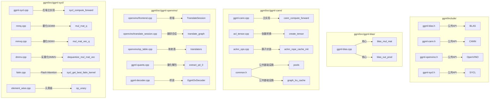
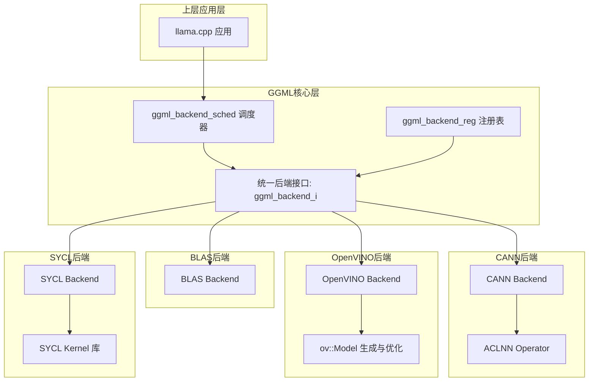
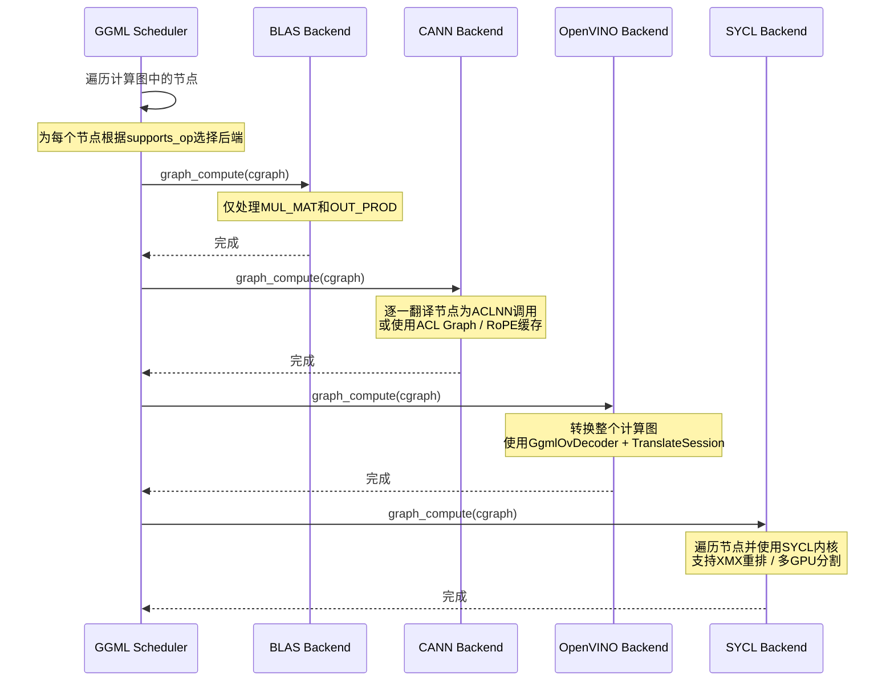

# 第42章 硬件加速的百变军团——GGML多后端集成实战

## 学习目标

- 理解BLAS后端作为『CPU外援』的角色定位：只加速矩阵乘法和外积，不管理内存，并掌握其基于线程数的性能调优机制
- 掌握CANN后端将GGML算子翻译为ACLNN调用的完整流程，包括张量格式转换（ND/NZ）、广播处理、RoPE缓存管理和ACL图捕获优化
- 深入理解OpenVINO后端的『整图转换』策略，掌握GgmlOvDecoder如何充当GGML与OpenVINO之间的桥梁，以及动/静态图在CPU/GPU/NPU上的执行差异
- 熟悉SYCL后端的庞大算子库，掌握针对Intel GPU的各种优化技术：XMX检测、权重重排（reorder）、Flash Attention内核选择（Tile vs Vec）、多设备分割（split buffer）
- 掌握多后端集成到GGML框架的统一接口模式（ggml_backend_i, ggml_backend_device_i, ggml_backend_reg_i）以及各后端能力边界的描述方式（supports_op）
- 了解不同后端在量化权重处理上的差异策略：BLAS的反量化、CANN的NZ格式转换、SYCL的reorder优化、OpenVINO的量化解包
- 理解OpenVINO对动态形状（CPU/GPU）和静态形状（NPU）的差异化处理策略，包括分块预填充（chunk processing）和状态化管理
- 掌握各后端算子级别的实现细节：RoPE的多种变体（普通、NeoX、M-RoPE、Vision）、Flash Attention的优化路径、GLU系列的融合算子

## 42.1 生活类比

想象GGML的多后端系统是一个**国际物流中心网络**，在这个网络中，不同的后端扮演着各自独特的角色，共同确保货物（计算任务）能够高效、准确地送达目的地。

首先，**BLAS后端**就像是**本地快递站的『最后一公里』配送员**。它专门负责处理最常见的标准包裹——即FP32类型的大型矩阵乘法。它深知如何利用现有的城市道路（CPU缓存）实现快速配送，却并不过问仓储和库存管理（即不管理内存）。这位配送员精明得很，它清楚什么时候上门取件（调用BLAS库）是划算的，什么时候会因小失大——正如源码中的`ggml_backend_blas_device_supports_op()`函数所体现的那样，它通过设置`min_batch`阈值来确保只有足够大的矩阵才值得呼叫BLAS这个『外援』，从而避免为小件包裹（小矩阵）支付高昂的调度成本。在后续源码解析中，你会看到这个函数如何像分拣员一样，明确告知调度器哪些算子适合自己处理。

接着，**CANN后端**扮演的是**华为昇腾的『海关清关中心』**。它的核心工作是将国际标准包裹（GGML张量）翻译成华为ACLNN能理解的『报关单』格式。这里有一个专门的『保税仓库』（内存池）来管理NPU显存，支持优先级和虚拟内存管理。货物进入前，可能需要重新打包——例如`transform_q4_0()`函数就会把标准的量化格式转换成昇腾设备偏好的NZ布局。这个清关中心的『报关单翻译官』就是`ggml_cann_create_tensor()`，它细致地负责将GGML张量的维度、步长、偏移等描述信息，转换成ACL张量对象，确保每一个算子调用都能被NPU正确理解。

再看**OpenVINO后端**，它好比是**Intel AI PC的『智能翻译局』**。与CANN后端逐个文件翻译的方式不同，OpenVINO后端会把整个『项目计划书』（计算图）整体编译优化，追求的是全局最优而非局部最优。它就像一个专业的翻译团队：`GgmlOvDecoder`负责读懂GGML的『源语言』，而`TranslateSession`则生成OpenVINO的『目标语言』。团队中还配备了专门的『校对编辑』（图优化Pass），如`EliminateZeroPoints`来消除冗余的零点减法，以及`FuseToSDPA`来融合注意力算子。这个翻译局最厉害的地方在于，它能识别整个句子的上下文（整图优化），从而做出更精准、更高效的翻译，而不是进行孤立的词对词直译。

最后，**SYCL后端**则像**Intel GPU的『全能军工厂』**，它不满足于简单翻译，而是要从底层『锻造』出针对Intel GPU优化的专用武器。这个军工厂拥有几十种专用工具：比如处理量化GEMM的`mmq.cpp`、处理反量化乘法的`dmmv.cpp`，以及提供Tile和Vec两种内核的Flash Attention。它会智能地选择最优『工艺』：通过检测XMX硬件扩展，决定是否启动权重重排（reorder）优化。它还支持『多工厂协同』（split buffer）模式，将大工件（权重）分割到多个GPU上并行处理，以突破单卡显存限制。

就像物流中心经理需要根据包裹类型（张量类型）、目的地（硬件平台）和时效要求（性能需求）来选择不同的配送方式一样，GGML的多后端框架也根据算子特性、硬件能力和内存布局，动态地选择最优的执行路径，从而构建出一个灵活、高效的硬件加速生态系统。

## 42.2 源码地图



## 42.3 BLAS 计算后端 —— CPU上的『矩阵计算专家』

BLAS后端是GGML中一个轻量级但高效的组件，它利用底层BLAS库（如OpenBLAS、MKL）来加速CPU上的核心矩阵运算。你不需要为它配备复杂的GPU，它就像你手边随时可用的一个强力计算工具，专注于性能关键的矩阵乘法（MUL_MAT）和外积（OUT_PROD）操作。

它的设计哲学是“专而精”：不直接管理内存，而是使用已有的CPU缓冲区；不试图覆盖所有算子，而是将精力集中在能最大利用BLAS库优势的两种操作上。这种克制，使得BLAS后端代码精简，并且能够成为无法使用GPU时提升CPU性能的有效手段。

### 42.3.1 BLAS后端的完整生命周期

**`ggml_backend_blas_init()`：初始化与配置**

源码路径：`ggml/src/ggml-blas/ggml-blas.cpp` - `ggml_backend_blas_init`（250-268行）

```cpp
ggml_backend_t ggml_backend_blas_init(void) {
    // 创建BLAS后端上下文，存储线程数、工作数据缓冲区等信息
    ggml_backend_blas_context * ctx = new ggml_backend_blas_context;

    // 创建后端对象，绑定GUID、接口、设备和上下文
    ggml_backend_t backend = new ggml_backend {
        /* .guid    = */ ggml_backend_blas_guid(),
        /* .iface   = */ blas_backend_i,
        /* .device  = */ ggml_backend_reg_dev_get(ggml_backend_blas_reg(), 0),
        /* .context = */ ctx,
    };

#if defined(GGML_BLAS_USE_OPENBLAS) && defined(GGML_USE_OPENMP)
    // 检查OpenBLAS和ggml是否都使用OpenMP，若不一致则打印警告
    if (openblas_get_parallel() != OPENBLAS_OPENMP) {
        GGML_LOG_DEBUG("%s: warning: ggml is using OpenMP, but OpenBLAS was compiled without OpenMP support\n", __func__);
    }
#endif

    // 类似地检查BLIS库的OpenMP兼容性
#if defined(BLIS_ENABLE_CBLAS) && defined(GGML_USE_OPENMP) && !defined(BLIS_ENABLE_OPENMP)
    GGML_LOG_DEBUG("%s: warning: ggml is using OpenMP, but BLIS was compiled without OpenMP support\n", __func__);
#endif

    // 返回初始化完成的后端实例
    return backend;
}
```

这段代码是BLAS后端的“出生证明”。它创建了一个`ggml_backend_blas_context`上下文对象，其中保存了后端运行时的关键状态：线程数（`n_threads`）、工作区缓冲区（`work_data`）和异步任务列表（`tasks`）。初始化过程的亮点在于**库兼容性检查**：代码专门检查了编译时使用的BLAS库（如OpenBLAS）是否与ggml的线程模型（OpenMP）一致。如果检测到不一致（例如ggml使用OpenMP但OpenBLAS是串行编译的），它会打印警告，避免后续多线程调用时出现死锁或性能退化。

**`ggml_backend_blas_graph_compute()`：图执行入口**

源码路径：`ggml/src/ggml-blas/ggml-blas.cpp` - `ggml_backend_blas_graph_compute`（207-238行）

```cpp
static enum ggml_status ggml_backend_blas_graph_compute(ggml_backend_t backend, struct ggml_cgraph * cgraph) {
    ggml_backend_blas_context * ctx = (ggml_backend_blas_context *)backend->context;

    // 遍历计算图中的所有节点
    for (int i = 0; i < cgraph->n_nodes; i++) {
        struct ggml_tensor * node = cgraph->nodes[i];

        // 仅处理需要真正计算的节点
        if ((node->flags & GGML_TENSOR_FLAG_COMPUTE) == 0) {
            continue;
        }

        // 根据算子类型分派到具体的计算函数
        switch (node->op) {
            case GGML_OP_MUL_MAT:
                ggml_backend_blas_mul_mat(ctx, node);
                break;

            case GGML_OP_OUT_PROD:
                ggml_backend_blas_out_prod(ctx, node);
                break;

            case GGML_OP_NONE:      // 空操作和形状变换算子
            case GGML_OP_RESHAPE:   // 不实际计算，跳过即可
            case GGML_OP_VIEW:
            case GGML_OP_PERMUTE:
            case GGML_OP_TRANSPOSE:
                break;

            default:
                // 遇到不支持的算子直接终止，防止静默错误
                GGML_ABORT("%s: unsupported op %s\n", __func__, ggml_op_desc(node));
        }
    }

    return GGML_STATUS_SUCCESS;

    GGML_UNUSED(backend);
}
```

这个函数是BLAS后端的“执行控制器”。它接收GGML调度器传入的计算图（`cgraph`），然后按顺序遍历图中的每个节点，根据节点操作类型（`node->op`）分派到对应的计算函数。关键设计是**“选择性处理”**：对于形状变换类操作（RESHAPE、VIEW、PERMUTE等），它直接跳过——因为这些操作不涉及实际数据计算；对于不支持的算子，它使用`GGML_ABORT`立即终止程序，而不是选择性地静默忽略，这样能尽早发现后端能力不匹配的问题。

**`ggml_backend_blas_reg()`：后端注册**

源码路径：`ggml/src/ggml-blas/ggml-blas.cpp` - `ggml_backend_blas_reg`（454-462行）

```cpp
ggml_backend_reg_t ggml_backend_blas_reg(void) {
    // 静态注册对象，只需初始化一次
    static struct ggml_backend_reg ggml_backend_blas_reg = {
        /* .api_version = */ GGML_BACKEND_API_VERSION,
        /* .iface       = */ ggml_backend_blas_reg_i,   // 注册接口：get_name、get_device_count等
        /* .context     = */ NULL,
    };

    return &ggml_backend_blas_reg;
}
```

注册函数采用**单例模式**：创建一个静态的`ggml_backend_reg`结构体，其中定义了注册接口（`ggml_backend_blas_reg_i`），包括`get_name`返回"BLAS"、`get_device_count`返回1、`get_device`返回设备0。这个注册机制是GGML多后端调度框架的核心——通过统一的注册接口，上层调度器可以枚举和识别所有可用的后端。

### 42.3.2 `ggml_backend_blas_mul_mat()`：核心矩阵乘法

源码路径：`ggml/src/ggml-blas/ggml-blas.cpp` - `ggml_backend_blas_mul_mat`（28-131行）

```cpp
static void ggml_backend_blas_mul_mat(ggml_backend_blas_context * ctx, struct ggml_tensor * dst) {
    // 获取参与计算的两个源张量
    const struct ggml_tensor * src0 = dst->src[0];
    const struct ggml_tensor * src1 = dst->src[1];

    // 定义张量各维度的形状（ne）和步长（nb）宏
    GGML_TENSOR_BINARY_OP_LOCALS

    // 源张量0的数据类型，通常是权重
    const enum ggml_type type = src0->type;

    // 一系列断言，确保矩阵乘法维度正确
    GGML_ASSERT(ne0 == ne01);
    GGML_ASSERT(ne1 == ne11);
    GGML_ASSERT(ne2 == ne12);
    GGML_ASSERT(ne3 == ne13);

    // 我们不支持src0或src1的转置
    GGML_ASSERT(nb00 == ggml_type_size(type));
    GGML_ASSERT(nb10 == ggml_type_size(src1->type));

    // dst不能是转置或重排列的
    GGML_ASSERT(nb0 == sizeof(float));
    GGML_ASSERT(nb0 <= nb1);
    GGML_ASSERT(nb1 <= nb2);
    GGML_ASSERT(nb2 <= nb3);

    // 计算广播因子，用于批量矩阵乘法
    const int64_t r2 = ne12/ne02;
    const int64_t r3 = ne13/ne03;

    // 计算每个“平面”的元素数量和所需的工作区大小
    const int64_t ne_plane      = ne01*ne00;
    const size_t  desired_wsize = type == GGML_TYPE_F32 ? 0 : ne03*ne02*ne_plane*sizeof(float);

    // 如果需要更大的工作区，则重新分配
    if (ctx->work_size < desired_wsize) {
        ctx->work_data.reset(new char[desired_wsize]);
        ctx->work_size = desired_wsize;
    }
    // 获取工作区指针，用于存储转换后的数据
    void * wdata = ctx->work_data.get();

    // 如果src0不是F32类型，需要先转换为F32以调用cblas_sgemm
    if (type != GGML_TYPE_F32) {
        // 获取类型转换函数指针
        const auto * type_traits = ggml_get_type_traits(type);
        ggml_to_float_t const to_float = type_traits->to_float;

        // 遍历所有批次和通道
        for (int64_t i03 = 0; i03 < ne03; i03++) {
            for (int64_t i02 = 0; i02 < ne02; i02++) {
                // 定位源数据行
                const void  *       x      = (char *)  src0->data + i02*nb02          + i03*nb03;
                // 定位工作区中转换后数据的行
                      float * const wplane = (float *) wdata      + i02*ne_plane      + i03*ne02*ne_plane;

                // 计算并行转换所需的最优线程数
                const int min_cols_per_thread = 4096;
                const int min_rows_per_thread = std::max((int)(min_cols_per_thread/ne00), 1);
                const int n_threads = std::max(std::min(ctx->n_threads, (int)(ne01/min_rows_per_thread)), 1);

#ifdef GGML_USE_OPENMP
                // 如果使用OpenMP，则用其并行化转换循环
                #pragma omp parallel for num_threads(n_threads)
                for (int64_t i01 = 0; i01 < ne01; i01++) {
                    to_float((const char *) x + i01*nb01, wplane + i01*ne00, ne00);
                }
#else
                // 如果不使用OpenMP，则使用std::async创建异步任务并行转换
                for (int i = 1; i < n_threads; i++) {
                    const int64_t start =       i*ne01/n_threads;
                    const int64_t end   = (i + 1)*ne01/n_threads;
                    if (start < end) {
                        ctx->tasks.push_back(std::async(std::launch::async, [=]() {
                            for (int64_t i01 = start; i01 < end; i01++) {
                                to_float((const char *) x + i01*nb01, wplane + i01*ne00, ne00);
                            }
                        }));
                    }
                }
                {
                    // 当前线程也参与转换第一部分
                    const int64_t start = 0;
                    const int64_t end   = ne01/n_threads;
                    for (int64_t i01 = start; i01 < end; i01++) {
                        to_float((const char *) x + i01*nb01, wplane + i01*ne00, ne00);
                    }
                }
#endif
            }
        }

#ifndef GGML_USE_OPENMP
        // 等待所有异步任务完成
        for (auto & task : ctx->tasks) {
            task.get();
        }
        ctx->tasks.clear();
#endif
    }

    // 通知底层BLAS库使用指定的线程数，以获得最佳性能
#if defined(GGML_BLAS_USE_OPENBLAS)
    openblas_set_num_threads(ctx->n_threads);
#elif defined(GGML_BLAS_USE_BLIS)
    bli_thread_set_num_threads(ctx->n_threads);
#elif defined(GGML_BLAS_USE_NVPL)
    nvpl_blas_set_num_threads(ctx->n_threads);
#elif defined(GGML_BLAS_USE_MKL)
    mkl_set_num_threads(ctx->n_threads);
#endif

    // 外层循环遍历批量维度，执行实际的矩阵乘法
    for (int64_t i13 = 0; i13 < ne13; i13++) {
        for (int64_t i12 = 0; i12 < ne12; i12++) {
            // 计算src0中对应的批次索引
            const int64_t i03 = i13/r3;
            const int64_t i02 = i12/r2;

            // 分别获取src0、src1和dst的数据指针
            const float * x = (float *) ((char *) src0->data + i02*nb02 + i03*nb03);
            const float * y = (float *) ((char *) src1->data + i12*nb12 + i13*nb13);
                  float * d = (float *) ((char *)  dst->data + i12*nb2  + i13*nb3);

            // 如果src0经过了转换，则使用工作区中的F32数据
            if (type != GGML_TYPE_F32) {
                x = (float *) wdata + i02*ne_plane + i03*ne02*ne_plane;
            }

            // 调用cblas_sgemm执行核心矩阵乘法
            // 注意这里src0是转置的（CblasTrans），符合GGML的约定
            cblas_sgemm(CblasRowMajor, CblasNoTrans, CblasTrans,
                        ne1, ne01, ne10,
                        1.0f,   y, ne10,
                                x, ne00,
                        0.0f,   d, ne01);
        }
    }
}
```

这段代码是BLAS后端性能的核心。它**首先处理类型转换**：由于底层`cblas_sgemm`只接受FP32数据，当`src0`（通常是权重）是其他类型（如FP16或量化类型）时，需要一个工作区（`work_data`）暂存转换后的结果。为了加速这个转换过程，代码会根据线程数和矩阵大小自动选择合适的并行策略（OpenMP或`std::async`）。

**性能调优**是另一个关键点。代码在调用`cblas_sgemm`之前，会根据编译时选择的BLAS库（`GGML_BLAS_USE_OPENBLAS`等），调用对应的线程数设置函数（如`openblas_set_num_threads`），确保底层库能充分利用多核资源。这种编译时选择、运行时配置的方式，是BLAS后端能够适应不同硬件环境的关键。

### 42.3.3 `ggml_backend_blas_out_prod()`：外积计算

源码路径：`ggml/src/ggml-blas/ggml-blas.cpp` - `ggml_backend_blas_out_prod`（133-190行）

```cpp
static void ggml_backend_blas_out_prod(ggml_backend_blas_context * ctx, struct ggml_tensor * dst) {
    const struct ggml_tensor * src0 = dst->src[0];
    const struct ggml_tensor * src1 = dst->src[1];

    GGML_TENSOR_BINARY_OP_LOCALS

    // 维度断言
    GGML_ASSERT(ne0  == ne00);
    GGML_ASSERT(ne1  == ne10);
    GGML_ASSERT(ne2  == ne02);
    GGML_ASSERT(ne02 == ne12);
    GGML_ASSERT(ne3  == ne13);
    GGML_ASSERT(ne03 == ne13);

    // 不支持转置的src0或src1
    GGML_ASSERT(nb00 == sizeof(float));

    // dst不能是转置或重排列的
    GGML_ASSERT(nb0 == sizeof(float));

    // 外积参数（以major,minor表示）：
    // src0: (k,n)
    // src1: (k,m)
    // dst:  (m,n)
    //
    // sgemm参数（也以major,minor表示）：
    // a: (m,k)：即src1转置
    // b: (k,n)：即src0
    // c: (m,n)

    int n = src0->ne[0];
    int k = src0->ne[1];
    int m = src1->ne[0];

    CBLAS_TRANSPOSE transposeA;
    int lda;

    if (!ggml_is_transposed(src1)) {
        transposeA = CblasTrans;
        lda = m;
    } else {
        transposeA = CblasNoTrans;
        lda = k;
    }

    float * a = (float *) ((char *) src1->data);
    float * b = (float *) ((char *) src0->data);
    float * c = (float *) ((char *) dst->data);

    cblas_sgemm(CblasRowMajor, transposeA, CblasNoTrans, m, n, k, 1.0, a, lda, b, n, 0.0, c, n);

    GGML_UNUSED(ctx);
}
```

外积（OUT_PROD）是矩阵乘法的“反向”操作：对于形状为`(k,n)`的`src0`和`(k,m)`的`src1`，输出形状为`(m,n)`的`dst`。这段代码展示了如何巧妙地将外积映射到标准GEMM调用上：通过计算合适的转置标志（`transposeA`）和leading dimension（`lda`），将外积表达为一次`sgemm`调用。这也是BLAS后端“专而精”理念的体现——用最少的代码覆盖最核心的计算模式。

### 42.3.4 `ggml_backend_blas_device_supports_op()`：能力边界

源码路径：`ggml/src/ggml-blas/ggml-blas.cpp` - `ggml_backend_blas_device_supports_op`（359-398行）

```cpp
static bool ggml_backend_blas_device_supports_op(ggml_backend_dev_t dev, const struct ggml_tensor * op) {
    // 获取输入
    const struct ggml_tensor * src0 = op->src[0];
    const struct ggml_tensor * src1 = op->src[1];

    switch (op->op) {
        // 形状变换操作总是支持的
        case GGML_OP_NONE:
        case GGML_OP_RESHAPE:
        case GGML_OP_VIEW:
        case GGML_OP_PERMUTE:
        case GGML_OP_TRANSPOSE:
            return true;

        case GGML_OP_MUL_MAT:
        {
            // BLAS通常只在矩阵足够大时才有性能优势
            const struct ggml_tensor * src0 = op->src[0];
            const struct ggml_tensor * src1 = op->src[1];

            const int64_t ne10 = src1->ne[0];

            const int64_t ne0 = op->ne[0];
            const int64_t ne1 = op->ne[1];

            // TODO: 找到最优值
            const int64_t min_batch = 32;

            // 要求src0和src1都是连续的，src1是F32，
            // 并且矩阵的每个维度都达到最小批量（32）阈值
            return ggml_is_contiguous(src0) &&
                   ggml_is_contiguous(src1) &&
                   src1->type == GGML_TYPE_F32 &&
                   (ne0 >= min_batch && ne1 >= min_batch && ne10 >= min_batch) &&
                   (src0->type == GGML_TYPE_F32 || ggml_get_type_traits(src0->type)->to_float != NULL);
        }

        case GGML_OP_OUT_PROD:
            // 外积要求输入都是F32或可转换类型，且连续或转置
            return op->src[0]->type == GGML_TYPE_F32 &&
                   op->src[1]->type == GGML_TYPE_F32 &&
                   ggml_is_matrix(src0) &&
                   ggml_is_matrix(src1) &&
                   ggml_is_contiguous(src0) &&
                   (ggml_is_contiguous(src1) || ggml_is_transposed(src1)) &&
                   (src0->type == GGML_TYPE_F32 || ggml_get_type_traits(src0->type)->to_float != NULL);

        default:
            return false;
    }
    GGML_UNUSED(dev);
}
```

这个函数定义了BLAS后端的能力边界，是GGML框架进行算子调度时的关键依据。它的核心逻辑是**明确告诉调度器哪些操作可以安全、高效地下放给BLAS**。对于矩阵乘法，它设定了严格的限制：不仅要求输入张量内存连续、`src1`为FP32类型，还要求矩阵的各维度不小于 `min_batch=32`。这个阈值避免了调用BLAS库处理小矩阵所产生的固定开销，确保只有“大型”计算才能从BLAS的优化中获益。

## 42.4 CANN NPU 后端 —— 华为昇腾的『算子翻译官』

CANN后端扮演着GGML框架与华为昇腾NPU之间的“翻译官”角色。它的核心任务是将GGML的计算图操作逐一“翻译”成昇腾AI处理器能高效执行的ACLNN算子调用。这不仅仅是简单的函数映射，还涉及张量数据在内存中的重新布局（比如转换为NZ格式以利用硬件加速）、内存池的高效管理等关键环节。

### 42.4.1 CANN后端的调度中枢

**`ggml_cann_compute_forward()`：算子分派**

源码路径：`ggml/src/ggml-cann/ggml-cann.cpp` - `ggml_cann_compute_forward`（1715-1819行）

```cpp
static bool ggml_cann_compute_forward(ggml_backend_cann_context & ctx, struct ggml_tensor * dst) {
    // 根据张量操作类型选择相应的CANN操作并执行计算
    switch (dst->op) {
        case GGML_OP_REPEAT:
            ggml_cann_repeat(ctx, dst);
            break;
        case GGML_OP_GET_ROWS:
            ggml_cann_get_rows(ctx, dst);
            break;
        case GGML_OP_SET_ROWS:
            ggml_cann_set_rows(ctx, dst);
            break;
        case GGML_OP_DUP:
            ggml_cann_dup(ctx, dst);
            break;
        case GGML_OP_ADD:
        case GGML_OP_ADD1:
            ggml_cann_binary_op<aclnn_add>(ctx, dst);
            break;
        case GGML_OP_SUB:
            ggml_cann_binary_op<aclnn_sub>(ctx, dst);
            break;
        case GGML_OP_ACC:
            ggml_cann_acc(ctx, dst);
            break;
        case GGML_OP_MUL:
            ggml_cann_binary_op<aclnn_mul>(ctx, dst);
            break;
        case GGML_OP_DIV:
            ggml_cann_binary_op<aclnn_div>(ctx, dst);
            break;
        case GGML_OP_UNARY:
            // 一元操作进一步根据具体类型分派
            switch (ggml_get_unary_op(dst)) {
                case GGML_UNARY_OP_ABS:
                    GGML_CANN_CALL_OP_UNARY(Abs);
                    break;
                case GGML_UNARY_OP_NEG:
                    GGML_CANN_CALL_OP_UNARY(Neg);
                    break;
                case GGML_UNARY_OP_GELU:
                case GGML_UNARY_OP_GELU_ERF:
                    // aclnnGelu内部使用erf近似
                    GGML_CANN_CALL_OP_UNARY(Gelu);
                    break;
                case GGML_UNARY_OP_SILU:
                    GGML_CANN_CALL_OP_UNARY(Silu);
                    break;
                // ... 更多一元操作
            }
            break;
        case GGML_OP_GLU:
            // GLU变体（GEGLU、SWIGLU、REGLU等）分派
            switch (ggml_get_glu_op(dst)) {
                case GGML_GLU_OP_REGLU:
                    GGML_CANN_CALL_OP_UNARY_GATED(Relu);
                    break;
                case GGML_GLU_OP_GEGLU:
                case GGML_GLU_OP_GEGLU_ERF:
                    GGML_CANN_CALL_OP_UNARY_GATED(Gelu);
                    break;
                case GGML_GLU_OP_SWIGLU:
                    GGML_CANN_CALL_OP_UNARY_GATED(Silu);
                    break;
                // ... 更多GLU变体
            }
            break;
        case GGML_OP_NORM:
            ggml_cann_norm(ctx, dst);
            break;
        case GGML_OP_GROUP_NORM:
            ggml_cann_group_norm(ctx, dst);
            break;
        // ... 更多算子
    }
    // 后续代码会根据GGML_OP_MUL_MAT、GGML_OP_ROPE等更复杂的算子类型分发
}
```

这个函数是CANN后端的“总调度员”，是整个后端算子执行的中枢神经系统。它接收一个GGML计算图中的目标张量节点（`dst`），根据其操作类型（`dst->op`）将其分派到对应的CANN实现函数。代码展示了GGML与CANN算子之间的一种优雅映射方式：对于二元操作（ADD、SUB、MUL、DIV），它使用模板函数`ggml_cann_binary_op`统一处理；对于一元操作（ABS、NEG、GELU等），通过`GGML_CANN_CALL_OP_UNARY`宏简化调用；对于GLU变体，使用`GGML_CANN_CALL_OP_UNARY_GATED`宏。这种宏加模板的组合，让算子注册变得极为简洁。

### 42.4.2 `ggml_cann_create_tensor()`：张量转换的桥梁

源码路径：`ggml/src/ggml-cann/acl_tensor.cpp` - `ggml_cann_create_tensor`（41-77行）

```cpp
acl_tensor_ptr ggml_cann_create_tensor(const ggml_tensor * tensor,
                                       int64_t *           ne,
                                       size_t *            nb,
                                       int64_t             dims,
                                       aclFormat           format,
                                       size_t              offset) {
    // 为ACL张量预留足够的空间（考虑广播可能增加的维度）
    int64_t acl_ne[GGML_MAX_DIMS * 2], acl_stride[GGML_MAX_DIMS * 2];

    if (ne == nullptr) {
        // 如果不提供新的形状信息，则使用GGML张量原有的形状和步长
        for (int i = 0; i < GGML_MAX_DIMS; i++) {
            acl_ne[i]     = tensor->ne[i];
            // ACL的步长以“元素”为单位，而GGML的步长以“字节”为单位
            acl_stride[i] = tensor->nb[i] / ggml_element_size(tensor);
        }
    } else {
        // 如果有广播需求，则使用提供的形状和步长
        for (int i = 0; i < dims; i++) {
            acl_ne[i]     = ne[i];
            acl_stride[i] = nb[i] / ggml_element_size(tensor);
        }
    }

    // 确定最终的维度数量（0表示使用最大维度）
    int64_t final_dims      = (dims == 0 ? GGML_MAX_DIMS : dims);
    int64_t acl_storage_len = 1;
    // 计算ACL张量所需的存储长度
    for (int i = 0; i < final_dims; i++) {
        acl_storage_len += (acl_ne[i] - 1) * acl_stride[i];
    }
    // 计算元素偏移量并加到存储长度中
    size_t elem_offset = offset / ggml_element_size(tensor);
    acl_storage_len += elem_offset;

    // 注意：ACL张量期望维度和步长是逆序的（从最高维到最低维）
    // 因此需要反转数组
    std::reverse(acl_ne, acl_ne + final_dims);
    std::reverse(acl_stride, acl_stride + final_dims);

    // 调用ACL API创建张量
    aclTensor * raw = aclCreateTensor(acl_ne, final_dims, ggml_cann_type_mapping(tensor->type), acl_stride, elem_offset,
                                      format, &acl_storage_len, 1, tensor->data);

    return acl_tensor_ptr(raw);
}
```

这段代码是CANN后端所有算子调用的基础。它将GGML的张量描述（`ggml_tensor`）转换成昇腾ACL库能识别的张量对象（`aclTensor`）。**核心在于数据描述的“翻译”**：

1. **步长单位转换**：GGML的步长（`nb`）以字节为单位，而ACL期望的步长是以“元素”为单位的，因此需要通过除以 `ggml_element_size()` 进行转换。
2. **维度顺序反转**：这是最微妙的地方。GGML和ACL在张量维度排列上遵循不同的约定，因此需要将`ne`和`stride`数组反转，以匹配ACL的“最高维优先”的布局。
3. **偏移处理**：通过`elem_offset`参数支持在张量内部创建“视图”，这对于切片等操作至关重要。

### 42.4.3 `ggml_cann_get_bcast_shape()`：广播形状计算

源码路径：`ggml/src/ggml-cann/acl_tensor.cpp` - `ggml_cann_get_bcast_shape`（102-128行）

```cpp
int64_t ggml_cann_get_bcast_shape(const ggml_tensor * src0,
                                  const ggml_tensor * src1,
                                  int64_t *           bcast_src0_ne,
                                  int64_t *           bcast_src1_ne,
                                  size_t *            bcast_src0_nb,
                                  size_t *            bcast_src1_nb) {
    GGML_ASSERT(ggml_can_repeat(src1, src0));
    int bcast_dim_cnt = 0;
    for (int i = 0; i < GGML_MAX_DIMS; i++) {
        int64_t nr                   = src0->ne[i] / src1->ne[i];
        bcast_src0_ne[bcast_dim_cnt] = src0->ne[i] / nr;
        bcast_src1_ne[bcast_dim_cnt] = src1->ne[i];
        bcast_src0_nb[bcast_dim_cnt] = src0->nb[i];
        bcast_src1_nb[bcast_dim_cnt] = src1->nb[i];
        bcast_dim_cnt++;
        if (nr != 1) {
            // 如果需要广播，则添加一个额外的维度
            bcast_src0_ne[bcast_dim_cnt] = nr;
            bcast_src1_ne[bcast_dim_cnt] = 1;
            bcast_src0_nb[bcast_dim_cnt] = bcast_src0_nb[bcast_dim_cnt - 1] * bcast_src0_ne[bcast_dim_cnt - 1];
            bcast_src1_nb[bcast_dim_cnt] = bcast_src1_nb[bcast_dim_cnt - 1] * bcast_src1_ne[bcast_dim_cnt - 1];
            bcast_dim_cnt++;
        }
    }
    return bcast_dim_cnt;
}
```

广播（Broadcast）是张量运算中非常常见的需求：当参与运算的两个张量形状不完全一致时，需要通过广播将较小的张量扩展到较大张量的形状。这个函数的核心逻辑是**将广播信息编码到`bcast_src0_ne`等数组中**：对于需要广播的维度（`nr != 1`），它会将该维度拆分为两部分，并额外插入一个维度来捕捉广播的“倍数”（`nr`）。这样，底层ACL算子可以直接利用这些形状信息高效执行广播运算，而无需预先创建物理上扩展的张量，从而节省了大量内存和传输开销。

### 42.4.4 `ggml_backend_cann_transform_q4_0()`：量化权重适配

源码路径：`ggml/src/ggml-cann/ggml-cann.cpp` - `ggml_backend_cann_transform_q4_0`（858-894行）

```cpp
static void ggml_backend_cann_transform_q4_0(ggml_tensor * tensor, const void * src, void * dst) {
    // 获取张量的总元素个数和块数
    int64_t n_elems = ggml_nelements(tensor);
    int64_t groups = n_elems / QK4_0;
    // 计算量化数据（4bit）所占的字节数
    size_t quant_bytes = n_elems * sizeof(uint8_t) / 2;
    // 输出布局：前quant_bytes存储量化权重，紧接着存储每个块的缩放因子（uint16_t）
    uint8_t *  quant_offset = (uint8_t *) dst;
    uint16_t * scale_offset = (uint16_t *) ((char *) dst + quant_bytes);

    for (int i = 0; i < groups; i++) {
        // 指向GGML原始格式的Q4_0块
        const block_q4_0 * group = (const block_q4_0 *) ((const char *) src + i * sizeof(block_q4_0));
        // 提取缩放因子
        *scale_offset = group->d;
        scale_offset++;
        // 复制量化后的4bit权重数据
        size_t group_quant_size = QK4_0 * sizeof(uint8_t) / 2;
        memcpy(quant_offset, group->qs, group_quant_size);
        quant_offset += group_quant_size;
    }
}
```

这个函数展示了CANN后端如何“照顾”量化模型。GGML的Q4_0格式将量化权重和其对应的缩放因子打包在同一个`block_q4_0`结构体中。而华为昇腾NPU为了利用其硬件加速能力，期望权重和缩放因子是分离的，并且可能采用不同的布局（如NZ格式）。

因此，CANN后端在把数据从主机复制到设备（`set_tensor`）时，会先执行这个转换步骤，将GGML的“AoS”（Array of Structures）布局转换为更利于NPU计算的“SoA”（Structure of Arrays）布局，为后续的高效矩阵乘法做好准备。与此类似，CANN后端还提供了`ggml_backend_cann_transform_q8_0()` 函数来处理Q8_0格式：

**`ggml_backend_cann_transform_q8_0()`：Q8_0格式转换**

源码路径：`ggml/src/ggml-cann/ggml-cann.cpp`（915-933行）

```cpp
static void ggml_backend_cann_transform_q8_0(ggml_tensor * tensor, const void * src, void * dst) {
    // 获取张量的总元素个数和块数
    int64_t n_elems     = ggml_nelements(tensor);
    int64_t groups      = n_elems / QK8_0;
    size_t  quant_bytes = n_elems * sizeof(uint8_t);

    // 输出布局：前quant_bytes存储量化权重，紧接着存储每个块的缩放因子（uint16_t）
    uint8_t *  quant_offset = (uint8_t *) dst;
    uint16_t * scale_offset = (uint16_t *) ((char *) dst + quant_bytes);

    for (int i = 0; i < groups; i++) {
        const block_q8_0 * group = (const block_q8_0 *) ((const char *) src + i * sizeof(block_q8_0));
        *scale_offset            = group->d;
        scale_offset++;
        size_t group_quant_size = QK8_0 * sizeof(uint8_t);
        memcpy(quant_offset, group->qs, group_quant_size);
        quant_offset += group_quant_size;
    }
}
```

这个函数与Q4_0版本逻辑一致，将GGML的Q8_0格式（量化值与缩放因子混合）转换为昇腾NPU偏好的的“SoA”布局，以适应其硬件加速需求。

### 42.4.5 `ggml_backend_cann_supports_op()`：能力声明与`ggml_cann_rope()`：RoPE实现

**`ggml_backend_cann_supports_op()`：能力声明**

源码路径：`ggml/src/ggml-cann/ggml-cann.cpp` - `ggml_backend_cann_supports_op`（2384-2450+行）

```cpp
static bool ggml_backend_cann_supports_op(ggml_backend_dev_t dev, const ggml_tensor * op) {
    switch (op->op) {
        case GGML_OP_UNARY:
            switch (ggml_get_unary_op(op)) {
                case GGML_UNARY_OP_ABS:
                case GGML_UNARY_OP_NEG:
                // ... 支持各种一元算子
                default:
                    return false;
            }
        case GGML_OP_MUL_MAT:
            {
                // MUL_MAT同时检查数据类型支持
                // 使用switch检查src0->type
                switch (op->src[0]->type) {
                    case GGML_TYPE_F32:
                    case GGML_TYPE_F16:
                    case GGML_TYPE_BF16:
                    case GGML_TYPE_Q4_0:
                    case GGML_TYPE_Q8_0:
                        return true;
                    default:
                        return false;
                }
            }
        // ... 处理MUL_MAT、CPY、ROPE、POOL_2D、FLASH_ATTN_EXT等特殊条件
        default:
            return false;
    }
}
```

这个函数是CANN后端的能力声明书，与BLAS后端的`supports_op`扮演同样的角色——向GGML调度器明确告知哪些算子可以在CANN上执行。它的检查维度更丰富：对于一元算子，它逐个检查具体的一元操作类型；对于矩阵乘法（MUL_MAT），它还会检查输入张量的数据类型（F32、F16、BF16、Q4_0、Q8_0等），只有能高效映射到昇腾NPU硬件指令的类型才会被接受。

**`ggml_cann_rope()`：旋转位置编码**

源码路径：`ggml/src/ggml-cann/aclnn_ops.cpp` - `ggml_cann_rope`（约2547-2700行）

```cpp
void ggml_cann_rope(ggml_backend_cann_context & ctx, ggml_tensor * dst) {
    // 从dst->op_params中读取RoPE参数
    ggml_tensor * src0 = dst->src[0];
    const int n_dims   = ((int32_t *) dst->op_params)[1];
    const int mode     = ((int32_t *) dst->op_params)[2];
    // ... 读取freq_base、freq_scale、ext_factor、attn_factor等参数

    // 计算theta_scale和Yarn correction dimensions
    const float theta_scale = powf(freq_base, -2.0f / n_dims);
    float corr_dims[2];
    ggml_rope_yarn_corr_dims(n_dims, n_ctx_orig, freq_base, beta_fast, beta_slow, corr_dims);

    // 根据mode确定Neox、mRoPE、i-mRoPE和Vision模式
    bool is_neox = mode & GGML_ROPE_TYPE_NEOX;
    const bool is_imrope = mode == GGML_ROPE_TYPE_IMROPE;
    const bool mrope_used = mode & GGML_ROPE_TYPE_MROPE;
    const bool is_vision = mode == GGML_ROPE_TYPE_VISION;
    if (is_imrope || mrope_used) {
        is_neox = true;
    }

    // 调用aclnn_rope_cache_init构造或复用sin/cos缓存
    aclnn_rope_cache_init(ctx, dst, corr_dims, ext_factor, theta_scale, freq_scale,
                          attn_factor, is_neox, sections, mrope_used, is_imrope, is_vision, rope_dims);

    // 创建CANN输入、输出及RoPE缓存张量
    // 在ASCEND_310P上执行输入滚动、符号缩放及旋转编码计算
    // ...
}
```

这个函数是CANN后端RoPE实现的“指挥官”。它从GGML算子参数中提取旋转位置编码所需的全部配置，然后调用缓存初始化函数`aclnn_rope_cache_init`来准备正弦/余弦查找表。函数的灵活性在于支持多种RoPE模式：普通模式、NeoX模式、M-RoPE（多模态）、i-M-RoPE（图像模态）和Vision模式。不同模式对应不同的旋转计算方式——NeoX模式在特征维度上半部分交叉旋转，而M-RoPE则对不同特征段使用不同的位置信息。

**`ggml_cann_rope_cache_preload()`：RoPE缓存预加载**

源码路径：`ggml/src/ggml-cann/aclnn_ops.cpp` - `ggml_cann_rope_cache_preload`（3056-3104行）

```cpp
void ggml_cann_rope_cache_preload(ggml_backend_cann_context & ctx, ggml_tensor * dst) {
    // 从op_params中读取RoPE参数，计算theta_scale、corr_dims、各种模式标志等
    // ...

    // 调用aclnn_rope_cache_init构造或复用sin/cos缓存
    aclnn_rope_cache_init(ctx, dst, corr_dims, ext_factor, theta_scale, freq_scale,
                          attn_factor, is_neox, sections, mrope_used, is_imrope, is_vision, rope_dims);

    // 标记缓存为未完成，让后续图捕获时重新预加载
    ctx.rope_cache.cached = false;
}
```

在ACL图捕获模式下，为了避免在捕获流上执行主机到设备的内存复制，CANN后端会在图捕获前预先计算并加载RoPE所需的全部缓存数据。这样，图执行时无需进行任何主机交互，大幅减少了延迟。缓存参数（如`rope_cache.cached`）用于跟踪缓存是否有效，避免重复加载。

### 42.4.6 `ggml_backend_cann_graph_compute()`：ACL图的捕获与执行

源码路径：`ggml/src/ggml-cann/ggml-cann.cpp` - `ggml_backend_cann_graph_compute`（2325-2375行）

```cpp
static enum ggml_status ggml_backend_cann_graph_compute(ggml_backend_t backend, ggml_cgraph * cgraph) {
    // 获取CANN后端上下文
    ggml_backend_cann_context * cann_ctx = (ggml_backend_cann_context *) backend->context;
    // 确保操作在正确的设备上执行
    ggml_cann_set_device(cann_ctx->device);
    // 清理上一次执行留下的工作空间
    g_nz_workspaces[cann_ctx->device].clear();
    // 重置RoPE缓存状态
    cann_ctx->rope_cache.cached = false;

    bool graph_capture_required = false;
#ifdef USE_ACL_GRAPH
    bool use_cann_graph = true;
    // 从环境变量读取是否在prefill阶段使用图模式
    static bool prefill_use_graph = parse_bool(get_env_as_lowercase("GGML_CANN_PREFILL_USE_GRAPH").value_or(""));
    if (!prefill_use_graph) {
        // 如果不强制使用图模式，则通过检测FLASH_ATTN_EXT节点来判断
        for (int i = 0; i < cgraph->n_nodes; i++) {
            ggml_tensor * node = cgraph->nodes[i];
            if (node->op == GGML_OP_FLASH_ATTN_EXT) {
                // 当查询token数量为1时（decode阶段），才使用图模式
                use_cann_graph = (node->src[0]->ne[1] == 1);
                break;
            }
        }
    }
    // 如果上下文配置禁用了图模式，则关闭
    if (!cann_ctx->acl_graph_mode) {
        use_cann_graph = false;
    }
    if (use_cann_graph) {
        // 尝试在LRU缓存中查找匹配的计算图
        graph_capture_required = !cann_ctx->graph_lru_cache.find_and_move_to_front(cgraph);
        if (graph_capture_required) {
            // 缓存未命中，需要捕获新图
            ggml_cann_graph * new_graph = ggml_cann_graph::create_from_cgraph(cgraph);
            cann_ctx->graph_lru_cache.push(new_graph);
            // 在捕获图之前，预加载RoPE缓存，避免在捕获流上执行内存操作
            for (int i = 0; i < cgraph->n_nodes; i++) {
                ggml_tensor * node = cgraph->nodes[i];
                if (node->op == GGML_OP_ROPE) {
                    ggml_cann_rope_cache_preload(*cann_ctx, node);
                    break;
                }
            }
        }
    }
#else
    bool use_cann_graph = false;
#endif
    // 执行计算图，要么使用捕获的图，要么逐节点执行
    evaluate_and_capture_cann_graph(cann_ctx, cgraph, use_cann_graph, graph_capture_required);
    return GGML_STATUS_SUCCESS;
}
```

这是CANN后端一个重要的性能优化点。它利用昇腾NPU支持的ACL Graph模式，将一系列算子捕获成一个“图”，从而减少主机与设备之间的交互开销和内核启动次数。

代码中的关键判断是**“何时使用图模式”**。它特别针对LLM推理的 `prefill`（提示词预处理）和 `decode`（逐token生成）两个阶段做了区分。由于`decode`阶段的序列长度固定为1，图的结构可以预先优化，因此更适合图模式。此外，它还通过LRU缓存重用已捕获的图，避免了重复捕获的CPU开销。

下面我们来看看这个函数中引用的核心执行函数`evaluate_and_capture_cann_graph`：

**`evaluate_and_capture_cann_graph()`：图执行与捕获**

源码路径：`ggml/src/ggml-cann/ggml-cann.cpp` - `evaluate_and_capture_cann_graph`（2261-2316行）

```cpp
static void evaluate_and_capture_cann_graph(ggml_backend_cann_context * cann_ctx,
                                            ggml_cgraph *               cgraph,
                                            bool                        use_cann_graph,
                                            bool                        cann_graph_capture_required) {
#ifdef USE_ACL_GRAPH
    if (use_cann_graph && cann_graph_capture_required) {
        // 开始捕获模式，后续的算子调用会被记录到图对象中
        ACL_CHECK(aclmdlRICaptureBegin(cann_ctx->stream(), ACL_MODEL_RI_CAPTURE_MODE_GLOBAL));
    }
#endif
    static bool opt_fusion = parse_bool(get_env_as_lowercase("GGML_CANN_OPERATOR_FUSION").value_or(""));
    if (!use_cann_graph || cann_graph_capture_required) {
        for (int i = 0; i < cgraph->n_nodes; i++) {
            ggml_tensor * node = cgraph->nodes[i];
            if (opt_fusion) {
                // 检查是否可以融合ADD和RMS_NORM算子
                if (ggml_cann_can_fuse(cgraph, i, { GGML_OP_ADD, GGML_OP_RMS_NORM })) {
                    ggml_cann_op_add_rms_norm_fused(*cann_ctx, node, cgraph->nodes[i + 1]);
                    i++;
                    continue;
                }
            }
            // 跳过不需要实际计算的形状变换节点
            if (ggml_is_empty(node) || node->op == GGML_OP_RESHAPE ||
                node->op == GGML_OP_TRANSPOSE || node->op == GGML_OP_VIEW ||
                node->op == GGML_OP_PERMUTE || node->op == GGML_OP_NONE) {
                continue;
            }
            if ((node->flags & GGML_TENSOR_FLAG_COMPUTE) == 0) {
                continue;
            }
            // 分发到具体的CANN算子实现
            bool ok = ggml_cann_compute_forward(*cann_ctx, node);
            if (!ok) {
                GGML_LOG_ERROR("%s: op not supported %s (%s)\n", __func__, node->name, ggml_op_name(node->op));
            }
            GGML_ASSERT(ok);
        }
    }
#ifdef USE_ACL_GRAPH
    if (use_cann_graph) {
        GGML_ASSERT(!cann_ctx->graph_lru_cache.cache_list.empty());
        ggml_cann_graph * matched_graph = cann_ctx->graph_lru_cache.cache_list.front();
        if (cann_graph_capture_required) {
            // 结束捕获，生成可执行的图对象
            ACL_CHECK(aclmdlRICaptureEnd(cann_ctx->stream(), &matched_graph->graph));
        }
        // 异步执行捕获的图
        ACL_CHECK(aclmdlRIExecuteAsync(matched_graph->graph, cann_ctx->stream()));
    }
#endif
}
```

这个函数是`ggml_backend_cann_graph_compute`的具体执行者。它在两种模式下工作：
- **图捕获模式** (`cann_graph_capture_required` 为真)：在遍历节点之前调用`aclmdlRICaptureBegin`开始记录，然后在遍历结束后调用`aclmdlRICaptureEnd`生成一个优化好的计算图快照。
- **直接执行模式**：如果不使用图模式或图已缓存，则直接遍历计算图，逐节点调用`ggml_cann_compute_forward`完成计算。

此外，它还支持**算子融合**优化（`ggml_cann_can_fuse`），检查并融合`ADD`和`RMS_NORM`这对经常出现的操作，以提升执行效率。

### 42.4.7 `ggml_cann_op_add_rms_norm_fused()`：算子融合优化

源码路径：`ggml/src/ggml-cann/aclnn_ops.cpp` - `ggml_cann_op_add_rms_norm_fused`（约3997-4040行）

```cpp
void ggml_cann_op_add_rms_norm_fused(ggml_backend_cann_context & ctx,
                                     ggml_tensor * add_node,
                                     ggml_tensor * rms_norm_node) {
    // 获取两个输入
    ggml_tensor * x1 = add_node->src[0];
    ggml_tensor * x2 = add_node->src[1];
    // 创建ACL张量
    acl_tensor_ptr acl_x1 = ggml_cann_create_tensor(x1);
    acl_tensor_ptr acl_x2 = ggml_cann_create_tensor(x2);
    float eps;
    memcpy(&eps, rms_norm_node->op_params, sizeof(float));
    // 创建填充值为1的gamma张量（用于RMSNorm）
    // 创建填充值为0的rstdOut张量（存储归一化标准差的倒数）
    acl_tensor_ptr acl_xout = ggml_cann_create_tensor(add_node);
    acl_tensor_ptr acl_yout = ggml_cann_create_tensor(rms_norm_node);
    // 调用融合的AddRmsNorm算子，一次完成加法和归一化
    GGML_CANN_CALL_ACLNN_OP(ctx, AddRmsNorm, acl_x1.get(), acl_x2.get(), acl_gamma.get(),
                            eps, acl_yout.get(), acl_rstd.get(), acl_xout.get());
}
```

这个函数展示了CANN后端的**算子融合优化**。在Transformer模型中，残差连接（Add）和RMS归一化（RMS_NORM）经常成对出现。CANN后端利用昇腾的`AddRmsNorm`融合算子，将这两个操作合并为一次ACLNN调用，从而减少了kernel启动开销和内存访问次数。

## 42.5 OpenVINO 后端 —— Intel AI PC的『图优化大师』

OpenVINO后端采取了与CANN截然不同的策略：它不会逐个算子去“翻译”，而是将完整的GGML计算图作为一个整体进行编译和优化。这类似于一位编译器专家，不是逐行翻译代码，而是分析整个程序的上下文，从而生成更加优化的机器码。`GgmlOvDecoder`正是这个“编译前端”，负责解析GGML图并暴露出所有必要的信息，供OpenVINO的“编译器”进行后续工作。

### 42.5.1 `GgmlOvDecoder`：GGML 与 OpenVINO 之间的桥梁

`GgmlOvDecoder`类是整个OpenVINO后端的核心解码器，它将GGML计算图转换为OpenVINO可以理解和操作的中间表示。这个转换流程由一系列紧密协作的方法组成。

**`GgmlOvDecoder()` 构造函数**

源码路径：`ggml/src/ggml-openvino/ggml-decoder.cpp` - `GgmlOvDecoder::GgmlOvDecoder`（49-91行）

```cpp
GgmlOvDecoder::GgmlOvDecoder(ggml_cgraph * cgraph,
                             ModelParams & model_params,
                             ComputeParams & compute_params,
                             std::map<std::string, std::shared_ptr<ov::Node>> & model_weights,
                             bool is_static,
                             bool is_stateful,
                             bool is_prefill,
                             int prefill_chunk_size) :
    m_is_static(is_static),
    m_is_stateful(is_stateful),
    m_is_prefill(is_prefill),
    m_naive(false),
    m_prefill_chunk_size(prefill_chunk_size),
    m_cgraph(cgraph),
    m_model_weights(model_weights),
    m_model_params(model_params),
    m_compute_params(compute_params) {
    // 可选的调试支持：打印张量地址映射
    if (auto * env = getenv("GGML_OPENVINO_PRINT_CGRAPH_TENSOR_ADDRESS"); env && std::string(env) != "0") {
        // ... (略)
        print_tensor_address_map(cgraph);
    }

    // 校验计算图是否符合设备限制（如NPU仅支持单序列）
    validate_cgraph();

    // 构建节点信息列表，并计算模型输入/输出
    set_input_output();
    compute_model_inputs();
    compute_model_outputs();

    // 为每个节点计算“操作代号”，指导后续的翻译器选择优化路径
    for (int node_n = 0; node_n < cgraph->n_nodes; node_n++) {
        m_node_info_list[node_n].node_op_case = compute_op_case(m_node_info_list[node_n].node);
        m_node_info_list[node_n].node_op_type = compute_op_type(m_node_info_list[node_n].node);
    }

    // 添加额外的输入（如attention_size等动态形状辅助参数）
    add_extra_inputs();
}
```

作为构造函数，它完成了图转换前的所有“侦察”工作。首先，它会校验整个计算图是否符合当前设备的限制，例如在静态模式（NPU）下，如果序列数大于1则抛出异常。然后，它会遍历图中的所有节点，识别出哪些是输入、哪些是输出，并收集KV缓存等特殊张量的信息。最后，它为每个节点计算出“操作代号”（`compute_op_case`），这为后续的翻译器选择不同的优化处理路径埋下了伏笔。

**`GgmlOvDecoder::compute_llm_params()`**

源码路径：`ggml/src/ggml-openvino/ggml-decoder.cpp` - `GgmlOvDecoder::compute_llm_params`（287-351行）

```cpp
std::pair<ModelParams, ComputeParams> GgmlOvDecoder::compute_llm_params(ggml_cgraph * cgraph, bool is_static) {
    ModelParams model_params;
    ComputeParams compute_params;
    for (int i = 0; i < cgraph->n_nodes; i++) {
        auto * node = cgraph->nodes[i];
        std::string name = std::string(node->name);
        if (node->op == GGML_OP_FLASH_ATTN_EXT) {
            // 从Flash Attention节点提取头数、上下文长度等关键参数
            model_params.n_heads = node->src[0]->ne[2];
            model_params.n_heads_kv = node->src[1]->ne[2];
            model_params.head_size = node->src[0]->ne[0];
            compute_params.input_len = node->src[0]->ne[1];

            // 解析KV缓存相关的源节点，提取上下文长度、序列数等信息
            auto * cache_k_perm = node->src[1];
            if (cache_k_perm->op == GGML_OP_CPY) {
                cache_k_perm = cache_k_perm->src[0];
            }
            assert(cache_k_perm->op == GGML_OP_PERMUTE);
            auto * cache_k_view = cache_k_perm->src[0];
            assert(cache_k_view->op == GGML_OP_VIEW);

            auto * cache_k = cache_k_view->src[0];
            int layer = extract_layer_from_name(cache_k->name);
            auto * mask = node->src[3];
            std::string mask_name(mask->name);

            model_params.kv_buffer_ctx_id = ggml_backend_openvino_buffer_get_ctx_id(cache_k->buffer);
            if (mask_name.find("swa") != std::string::npos) {
                model_params.swa_layers.push_back(layer);
                model_params.ctx_per_seq_swa = cache_k->ne[1];
            } else {
                model_params.ctx_per_seq = cache_k->ne[1];
                model_params.n_seq = cache_k->ne[2];
            }

            compute_params.n_seq_active = mask->ne[3];
            // ... 计算活跃序列的起始位置等
            break;
        }
        if (node->op == GGML_OP_ROPE) {
            // 保存RoPE参数供后续翻译器使用
            memcpy(model_params.rope_params, node->op_params, sizeof(int32_t) * 15);
        }
    }
    // ... 计算输出长度等
    return {model_params, compute_params};
}
```

这个静态方法专门从计算图中提取LLM特有的参数，如头数、上下文长度、序列数、KV缓存位置等信息。它通过解析`FLASH_ATTN_EXT`和`ROPE`节点来获取这些关键配置，为后续生成正确的OpenVINO模型提供了必要的上下文。

**`GgmlOvDecoder::create_weight_nodes()`**

源码路径：`ggml/src/ggml-openvino/ggml-decoder.cpp` - `GgmlOvDecoder::create_weight_nodes`（609-640行）

```cpp
std::map<std::string, std::shared_ptr<ov::Node>> GgmlOvDecoder::create_weight_nodes(ggml_cgraph * cgraph, bool naive) {
    static std::mutex weights_mutex;
    std::lock_guard<std::mutex> lock(weights_mutex);

    std::map<std::string, std::shared_ptr<ov::Node>> model_weights;
    auto * nodes = cgraph->nodes;
    auto n_nodes = cgraph->n_nodes;
    for (int node_i = 0; node_i < n_nodes; node_i++) {
        auto * node = nodes[node_i];
        for (int i = 0; i < GGML_MAX_SRC; i++) {
            auto * src = node->src[i];
            if (src == nullptr) {
                continue;
            }

            std::string src_name(src->name);
            // 特殊处理RoPE频率权重，将其统一命名为 "rope_freqs.weight"
            if (is_rope_freqs_weight(src, node)) {
                src_name = "rope_freqs.weight";
            }
            // 只处理权重张量（非视图）
            if (!src->view_src) {
                ggml_backend_buffer * buffer = src->buffer;
                // 根据缓冲区用途或是否量化来判断是否为权重
                if (buffer->usage == GGML_BACKEND_BUFFER_USAGE_WEIGHTS || ggml_is_quantized(src->type)) {
                    if (model_weights.find(src_name) == model_weights.end()) {
                        auto weight_node = create_weight_node(src, naive);
                        weight_node->set_friendly_name(src_name);
                        model_weights[src_name] = weight_node;
                    }
                }
            }
        }
    }
    return model_weights;
}
```

这个静态方法会扫描计算图，识别所有权重张量（通过缓冲区的`USAGE_WEIGHTS`标记或量化类型判断），并为它们创建OpenVINO常量节点。它使用`std::mutex`保证线程安全，因为模型可能被多次加载。

**`GgmlOvDecoder::update_io()`**

源码路径：`ggml/src/ggml-openvino/ggml-decoder.cpp` - `GgmlOvDecoder::update_io`（93-101行）

```cpp
void GgmlOvDecoder::update_io(ggml_cgraph * cgraph) {
    // 当KV缓冲区变化时，重新配置输入输出
    m_cgraph = cgraph;
    m_model_inputs.clear();
    m_model_outputs.clear();
    m_node_info_list.clear();
    set_input_output();
    compute_model_inputs();
    compute_model_outputs();
}
```

当KV缓冲区发生变化时（例如KV Cache被重新分配），这个方法会重置解析器的内部状态，并重新计算模型的输入和输出信息，以适应新的内存布局。

这些方法共同构成了一个完整的“图信息提取管线”，让OpenVINO能够从GGML的静态计算图描述中洞察所有必要的上下文信息。

### 42.5.2 `translate_graph()`：整图转换的核心流程

源码路径：`ggml/src/ggml-openvino/openvino/translate_session.cpp` - `TranslateSession::translate_graph`（529-620行）

```cpp
std::shared_ptr<Model> TranslateSession::translate_graph(const frontend::InputModel::Ptr & input_model) {
    // 准备参数和结果容器
    ov::ParameterVector params;
    ov::ResultVector results;
    auto tensor_map = std::make_shared<TensorMap>();
    std::shared_ptr<Model> resulting_model;

    // 获取GGML解码器
    const auto & ggml_model = std::dynamic_pointer_cast<InputModel>(input_model);
    std::shared_ptr<GgmlDecoder> ggml_model_decoder = ggml_model->get_model_decoder();

    // 将模型的输入（Parameter节点）注册到tensor_map中
    for (const auto & it : ggml_model_decoder->get_model_inputs()) {
        params.push_back(std::dynamic_pointer_cast<ov::op::v0::Parameter>(it.second));
        (*tensor_map)[it.first] = it.second;
    }
    // 将额外输入（如attention_size、n_seq_active等动态形状辅助参数）也注册
    for (const auto & it : ggml_model_decoder->get_model_extra_inputs()) {
        if (std::dynamic_pointer_cast<ov::op::v0::Parameter>(it.second)) {
            params.push_back(std::dynamic_pointer_cast<ov::op::v0::Parameter>(it.second));
        }
        (*tensor_map)[it.first] = it.second;
    }
    // 将权重常量节点注册
    for (const auto & it : ggml_model_decoder->get_model_weights()) {
        (*tensor_map)[it.first] = it.second;
    }

    // 核心节点遍历回调：针对图中的每个节点调用对应的翻译器
    auto node_visitor = [&](std::shared_ptr<GgmlDecoder> decoder, int node_idx) {
        auto operation_type = decoder->get_op_type(node_idx);
        if (operation_type == "GGML_OP_NONE") {          // 跳过空操作
            return;
        }

        ov::OutputVector converted_outputs;
        auto it = m_translator_map.find(operation_type);  // 在映射表中查找翻译器
        FRONT_END_OP_CONVERSION_CHECK(it != m_translator_map.end(), "Translation for operation type ", operation_type,
                                      " is not implemented.");
        NodeContext node_context(decoder, tensor_map, node_idx, this);
        converted_outputs = it->second(node_context);     // 调用翻译器生成OV节点

        const auto & node_output_names = decoder->get_output_names(node_idx);
        // 将生成的OV节点按名称注册到tensor_map中，供后续节点引用
        for (size_t i = 0; i < node_output_names.size(); ++i) {
            auto output_name = node_output_names[i];
            if (i < converted_outputs.size() && converted_outputs[i].get_node_shared_ptr() != nullptr) {
                (*tensor_map)[output_name] = converted_outputs[i];
            }
        }
    };

    // 非朴素模式时，执行预处理（如添加掩码切片、RoPE缓存等）
    if (!m_naive) {
        preprocess(*tensor_map, *ggml_model_decoder);
    }
    // 遍历GGML图中的所有节点
    ggml_model_decoder->visit_subgraph(node_visitor);

    // 为模型的每个输出创建Result节点
    for (const auto & name : ggml_model_decoder->get_model_output_names()) {
        FRONT_END_GENERAL_CHECK(tensor_map->find(name) != tensor_map->end(),
                                "Output name not found in tensor map: ", name);
        auto result = std::make_shared<v0::Result>(tensor_map->at(name));
        result->set_friendly_name(name);
        results.push_back(result);
    }

    // 筛选真正被使用的参数
    ov::ParameterVector used_params;
    for (const auto & param : params) {
        if (!param->output(0).get_target_inputs().empty()) {
            used_params.push_back(param);
        }
    }
    // 组装最终的OV模型
    resulting_model = std::make_shared<Model>(results, used_params);

    // 应用图优化Pass
    apply_transformations(resulting_model);
    return resulting_model;
}
```

这个函数是OpenVINO后端的“总设计师”。它展示了整图转换的核心流程：

1. **输入注册**：将GGML图中的所有输入（Parameter）、权重（Constant）和额外输入（KV Cache大小等）先注册到一个共享的`tensor_map`中。
2. **节点遍历**：通过`visit_subgraph`遍历计算图中的每个节点，利用`op_table`映射表查找对应的翻译器函数，调用翻译器生成OV节点，然后将新生成的节点注册回`tensor_map`，供后续节点引用。
3. **预处理**：在正式转换之前，`preprocess`函数会添加一些公共子图（如切片后的注意力掩码、预计算的RoPE正弦/余弦缓存等），消除重复计算。
4. **输出组装**：最后将所有未被其他节点引用的节点作为模型的输出（Result），构建完整的OV模型。
5. **图优化**：最终调用`apply_transformations`执行一系列Pass（如EliminateZeroPoints、FuseToSDPA等）来优化生成的模型。

在单算子翻译层面，OpenVINO为每个GGML算子提供了对应的translator函数。下面来看几个关键的翻译器：

**`translate_rms_norm()`：RMS归一化翻译器**

源码路径：`ggml/src/ggml-openvino/openvino/op/rms_norm.cpp` - `translate_rms_norm`（17-38行）

```cpp
OutputVector translate_rms_norm(const NodeContext & context) {
    num_inputs_check(context, 1, 1);

    // 将输入提升平方
    auto input_node = context.get_input(0);
    auto square = std::make_shared<ov::op::v1::Power>(
        input_node, ov::op::v0::Constant::create(ov::element::f32, ov::Shape{1}, {2.0f}));

    // 在最后一维上计算均值
    auto mean = std::make_shared<ov::op::v1::ReduceMean>(
        square, ov::op::v0::Constant::create(ov::element::i64, ov::Shape{1}, {-1}), true);

    // 读取epsilon参数并添加到均值上
    float eps;
    memcpy(&eps, context.get_output_op_params(), sizeof(float));

    auto rms = std::make_shared<ov::op::v0::Sqrt>(
        std::make_shared<ov::op::v1::Add>(mean, ov::op::v0::Constant::create(ov::element::f32, ov::Shape{1}, {eps})));

    // 计算倒数
    auto reciprocal =
        std::make_shared<ov::op::v1::Divide>(ov::op::v0::Constant::create(ov::element::f32, ov::Shape{1}, {1.0f}), rms);

    // 将输入乘以倒数，完成归一化
    auto res = std::make_shared<ov::op::v1::Multiply>(input_node, reciprocal);

    return rename_outputs_with_suffix({res}, context.get_name());
}
```

这个翻译器将GGML的`RMS_NORM`算子映射为一系列基础OpenVINO算子：`Power`（求平方）、`ReduceMean`（求均值）、`Add`（加ε）、`Sqrt`（开平方）、`Divide`（求倒数）和`Multiply`（乘回输入）。这展示了整图翻译的“原子化”过程。

**`translate_rope()`：旋转位置编码翻译器**

源码路径：`ggml/src/ggml-openvino/openvino/op/rope.cpp` - `translate_rope`（22-120行）

```cpp
OutputVector translate_rope(const NodeContext & context) {
    num_inputs_check(context, 2, 3);
    int op_case = context.get_op_case();
    ov::Output<Node> res;
    auto data_node = context.get_input(0).get_node_shared_ptr();
    auto output_shape = context.get_output_shape().to_shape();
    int32_t * op_params = context.get_output_op_params();
    Output<Node> cos_theta_node;
    Output<Node> sin_theta_node;
    // 如果存在预计算的sin/cos缓存，则直接使用
    if (context.has_input("rope_cos")) {
        cos_theta_node = context.get_input("rope_cos");
        sin_theta_node = context.get_input("rope_sin");
    } else {
        // 否则，根据位置信息和RoPE参数动态计算sin/cos
        auto inp_pos = context.get_input(1).get_node_shared_ptr();
        std::shared_ptr<ov::Node> rope_freqs_weight;
        if (context.get_input_size() == 3) {
            rope_freqs_weight = context.get_input(2).get_node_shared_ptr();
        }
        auto sin_cos = make_sin_cos(op_params, inp_pos, rope_freqs_weight);
        sin_theta_node = sin_cos.first;
        cos_theta_node = sin_cos.second;
    }
    // ... 根据RGPE类型（NORMAL或NEOX）构建旋转计算图
    const int mode = op_params[2];
    constexpr int ROPE_TYPE_NORMAL = 0;
    constexpr int ROPE_TYPE_NEOX = 2;
    if (mode == ROPE_TYPE_NORMAL) {
        // ... 普通模式：偶数和奇数维度分别旋转
    } else if (mode == ROPE_TYPE_NEOX) {
        // ... NeoX模式：在对半分割的特征上交叉旋转
    }
    return rename_outputs_with_suffix({res}, context.get_name());
}
```

这个翻译器根据模式（normal/neox）构建不同的旋转位置编码计算结构。它优先使用预处理阶段生成的`rope_cos`和`rope_sin`缓存，否则将会动态计算，并可能涉及`make_sin_cos`函数来支持YaRN缩放和频率调整。

**`translate_mulmat()`：矩阵乘法翻译器**

源码路径：`ggml/src/ggml-openvino/openvino/op/mulmat.cpp` - `translate_mulmat`（16-81行）

```cpp
OutputVector translate_mulmat(const NodeContext & context) {
    num_inputs_check(context, 2, 2);

    int op_case = context.get_op_case();

    ov::Output<Node> res;
    ov::Output<ov::Node> B = context.get_input(0);
    ov::Output<ov::Node> A = context.get_input(1);

    bool transpose_b = true;
    if (op_case == 2) {
        B = B.get_node_shared_ptr()->input_value(0);
        transpose_b = false;
    } else if (op_case == 3) {
        B = process_view_input(context, 0);
        A = process_view_input(context, 1);
    }
    if (A.get_element_type() != B.get_element_type()) {
        B = std::make_shared<ov::op::v0::Convert>(context.get_input(0), context.get_input_type(1));
    }

    // 处理批量大小不匹配的情况（GQA等）
    auto B_shape = context.get_input_shape(0).to_shape();
    auto A_shape = context.get_input_shape(1).to_shape();
    int64_t A_batch = A_shape[1];
    int64_t B_batch = B_shape[1];

    auto A_batch_larger = A_batch > B_batch;
    auto batch_large = A_batch_larger ? A_batch : B_batch;
    auto batch_small = A_batch_larger ? B_batch : A_batch;

    Output<Node> Z = A_batch_larger ? B : A;
    int64_t factor = batch_large / batch_small;
    if (factor > 1 && batch_small > 1) {
        // 通过Unsqueeze和Broadcast将较小batch的矩阵扩展到较大batch
        // ...
    }
    if (A_batch_larger) {
        B = Z;
    } else {
        A = Z;
    }

    res = std::make_shared<ov::op::v0::MatMul>(A, B, false, transpose_b);

    return rename_outputs_with_suffix({res}, context.get_name());
}
```

这个翻译器将GGML的`MUL_MAT`映射为OpenVINO的`MatMul`算子，并处理批量大小不匹配的特殊情况，例如通过`Unsqueeze`和`Broadcast`来广播较小的批次，从而正确实现GQA（分组查询注意力）等机制。

**`translate_glu_geglu()` 和 `translate_glu_swiglu()`：GLU系列翻译器**

源码路径：`ggml/src/ggml-openvino/openvino/op/glu_geglu.cpp` - `translate_glu_geglu`（25-62行）和 `ggml/src/ggml-openvino/openvino/op/glu_swiglu.cpp` - `translate_glu_swiglu`（13-43行）

```cpp
// glu_geglu.cpp
OutputVector translate_glu_geglu(const NodeContext & context) {
    num_inputs_check(context, 1, 2);
    ov::Output<ov::Node> src0;
    ov::Output<ov::Node> src1;
    if (context.get_input_size() == 2) {
        src0 = context.get_input(0);
        src1 = context.get_input(1);
    } else {
        // 单输入时，沿最后一维拆分成两半
        auto combined = context.get_input(0);
        auto combined_shape = combined.get_partial_shape();
        int64_t last_dim_val = combined_shape[combined_shape.rank().get_length() - 1].get_length();
        int64_t nc = last_dim_val / 2;
        auto axis   = ov::op::v0::Constant::create(ov::element::i64, {1}, {-1});
        auto step   = ov::op::v0::Constant::create(ov::element::i64, {1}, {1});
        auto start0 = ov::op::v0::Constant::create(ov::element::i64, {1}, {0});
        auto stop0  = ov::op::v0::Constant::create(ov::element::i64, {1}, {nc});
        auto start1 = ov::op::v0::Constant::create(ov::element::i64, {1}, {nc});
        auto stop1  = ov::op::v0::Constant::create(ov::element::i64, {1}, {2 * nc});

        src0 = std::make_shared<ov::op::v8::Slice>(combined, start0, stop0, step, axis);
        src1 = std::make_shared<ov::op::v8::Slice>(combined, start1, stop1, step, axis);
    }
    int32_t * params = context.get_output_op_params();
    const int32_t swapped = params[1];
    if (swapped) {
        std::swap(src0, src1);
    }
    auto gelu = std::make_shared<ov::op::v7::Gelu>(src0);
    auto res = std::make_shared<ov::op::v1::Multiply>(gelu, src1);
    return rename_outputs_with_suffix({res}, context.get_name());
}
```

这两个翻译器将GGML的GLU系列算子（GEGLU、SwiGLU、REGLU）映射为OpenVINO的Slice、Gelu/Sigmoid/Relu和Multiply等基础算子组合。它们处理单输入（自动拆分）和双输入两种模式，并根据参数决定是否交换两个分支。

### 42.5.3 `apply_transformations()`：图优化Pass

源码路径：`ggml/src/ggml-openvino/openvino/translate_session.cpp` - `TranslateSession::apply_transformations`（622-662行）

```cpp
std::shared_ptr<Model> TranslateSession::apply_transformations(std::shared_ptr<Model> model) {
    // 获取GGML解码器来决定优化策略
    auto ggml_model_decoder = std::dynamic_pointer_cast<InputModel>(m_input_model)->get_model_decoder();
    {
        ov::pass::Manager manager;
        manager.set_per_pass_validation(true);
        // Pass 1: 标记压缩浮点常量，避免后续被错误折叠
        manager.register_pass<ov::pass::MarkCompressedFloatConstants>();

        // 如果是有状态模型（Stateful），则将KV Cache输入输出合并为内部状态
        if (ggml_model_decoder->is_stateful()) {
            const auto kv_param_res_names = ggml_model_decoder->get_kv_param_res_names();
            const auto kv_param_res_pairs = get_kv_param_res_pairs(model, kv_param_res_names);
            manager.register_pass<ov::pass::MakeStateful>(kv_param_res_pairs);
        }

        // 如果是静态图（NPU），应用额外的优化
        if (ggml_model_decoder->is_static()) {
            manager.register_pass<pass::EliminateZeroPoints>();  // 消除量化零点
            manager.register_pass<pass::SqueezeMatmul>();        // 压缩4D激活到3D以适配NPU
        }

        manager.run_passes(model);   // 执行所有注册的Pass

        // ... 后续处理状态模型输出形状等
    }
    return model;
}
```

这个函数是OpenVINO的“图优化工作室”。它根据模型的执行模式（动态/静态、有状态/无状态）选择需要应用的优化Pass：

- **`MarkCompressedFloatConstants`**：标记量化模型中的“解压”常量，防止常量折叠优化将其破坏。
- **`MakeStateful`**：对于有状态执行模式，将KV Cache的输入和输出对合并为模型的内部状态，从而隐藏KV Cache的传递细节，简化外部接口。
- **`EliminateZeroPoints`**：针对NPU的静态图优化，将Subtract(量化值, 零点)模式直接融入数据常量中，消除冗余的零点减法操作。
- **`SqueezeMatmul`**：将4D激活形状压缩为3D再执行MatMul，以适配NPU的Dynamic Quantization特性。

### 42.5.4 `ov_graph_compute()`：动/静态图的分派

源码路径：`ggml/src/ggml-openvino/utils.cpp` - `ov_graph_compute`（47-68行）

```cpp
enum ggml_status ov_graph_compute(ggml_cgraph * cgraph, ggml_backend_t backend) {
    // 获取后端上下文
    ggml_backend_openvino_context * ctx = (ggml_backend_openvino_context *) backend->context;
    try {
        // 调试支持：转储计算图
        if (getenv("GGML_OPENVINO_DUMP_CGRAPH")) {
            std::string filename = "cgraph_ov.txt";
            GgmlOvDecoder::dump_cgraph(cgraph, filename);
        }
        // 静态图的标志：只在NPU上启用
        const auto is_static = ggml_openvino_is_npu();
        // 获取运行时上下文指针
        std::shared_ptr<ov_runtime_context> r_ctx = std::static_pointer_cast<ov_runtime_context>(ctx->runtime_context);
        // 关键分派：NPU走静态图，CPU/GPU走动态图
        return is_static ? ov_graph_compute_static(cgraph, r_ctx) : ov_graph_compute_dynamic(cgraph, r_ctx);
    } catch (const ov::Exception & e) {
        GGML_LOG_ERROR("GGML OpenVINO backend ov::Exception: %s\n", e.what());
        return GGML_STATUS_FAILED;
    } catch (...) {
        GGML_LOG_ERROR("GGML OpenVINO backend unknown exception\n");
        return GGML_STATUS_FAILED;
    }
}
```

这个函数是OpenVINO后端的执行入口，它的核心决策在于**“根据设备类型选择静态或动态图”**。

- **动态图（CPU/GPU）**：能够灵活处理不同形状的输入，但每次推理可能需要重新调整模型的部分内部数据结构。它的执行路径`ov_graph_compute_dynamic`非常庞大复杂，核心逻辑是在一个互斥锁（`ov_compute_mutex`）的保护下：
  - 基于计算图生成一个`graph_key`（通过节点数量及首尾节点名称哈希得到），并在缓存中查找是否已有对应的解码器（`decoder_cache`）和推理请求（`infer_request_cache`）。
  - 如果命中缓存，则复用解码器和推理请求，并更新必要的计算参数。
  - 如果缓存未命中，则需要创建新的`GgmlOvDecoder`，调用`ov::frontend::ggml::FrontEnd`将图转换为`ov::Model`，再用OpenVINO Core编译该模型并创建推理请求。最后，将新创建的编解码器和推理请求存入缓存。
  - 在执行推理前，会为所有输入和输出设置`ov::Tensor`。

- **静态图（NPU）**：模型在编译时尺寸完全固定，可以最大化利用NPU的并行效率和内存带宽，但无法接受形状不同的输入，因此需要配合分块预填充等技术来适配。它的执行路径`ov_graph_compute_static`同样复杂。针对NPU，它还会区分**prefill**（提示词预处理）和**decode**（逐token生成）两个阶段，并分别为这两个阶段创建两个独立的OpenVINO模型。由于prefill阶段的输入序列可能很长，而NPU要求静态形状，因此静态图路径会将长序列拆分为多个`chunk`（分块），每个chunk的大小由环境变量`GGML_OPENVINO_PREFILL_CHUNK_SIZE`控制（默认256），然后逐块执行推理。这也就是分块预填充策略。

### 42.5.5 `require_quantize_to_buffers()`：量化权重的解包与重构

源码路径：`ggml/src/ggml-openvino/ggml-quants.cpp` - `process_weight_tensor`（594-657行）

```cpp
OvWeight process_weight_tensor(const ggml_tensor * tensor, const void * data, void * output_base_ptr, bool use_bias) {
    GGML_ASSERT(tensor != nullptr);
    GGML_ASSERT(data != nullptr);
    OvWeight result;
    // 构建OV常量的目标形状（与GGML相反）
    ov::Shape node_shape = {static_cast<size_t>(tensor->ne[1]), static_cast<size_t>(tensor->ne[0])};

    // 处理非量化权重（F32/F16/BF16）
    if (tensor->type == GGML_TYPE_F32 || tensor->type == GGML_TYPE_F16 || tensor->type == GGML_TYPE_BF16) {
        // ... 将数据包装为OV常量节点
        result.weights = ov::Tensor(element_type, node_shape, data);
        result.weight_node = std::make_shared<ov::op::v0::Constant>(result.weights);
        return result;
    }

    if (!ggml_is_quantized(tensor->type)) {
        OPENVINO_THROW("Unsupported weight tensor type: ", ggml_type_name(tensor->type));
    }

    // 为量化权重计算新的“解包”布局
    result.layout = ggml_openvino_get_extracted_layout(tensor, use_bias);
    const auto & layout = result.layout;
    if (layout.total_size == 0) {
        OPENVINO_THROW("Unsupported quantized type: ", ggml_type_name(tensor->type));
    }

    // 根据计算的布局，创建权重、缩放和零点的OV张量
    if (output_base_ptr) {
        result.weights = ov::Tensor(weight_type, node_shape, buf_base + layout.weights_offset);
        result.scales = ov::Tensor(ov::element::f16, scale_shape, buf_base + layout.scales_offset);
        result.zp = ov::Tensor(weight_type, zp_shape, buf_base + layout.zp_offset);
    } else {
        // ... 不提供外部缓冲区时，内部创建张量
    }

    // 关键一步：从GGML的量化格式中提取出权重、缩放和零点，并构建一个OpenVINO子图来模拟反量化
    result.weight_node = extract_quantized_weights(tensor, data, result.weights, result.scales, result.zp, use_bias);
    return result;
}
```

OpenVINO对量化权重采用了“提取与重构”的策略。它不像CANN那样要求一个特定的硬件布局，而是将GGML的量化数据（如Q4_0）**解包**成三个独立的张量：权重（`weights`）、缩放因子（`scales`）和零点（`zp`）。

然后，它会构建一个由 `Convert`、`Subtract` 和 `Multiply` 等基础算子组成的“子图”来精确模拟反量化过程。这种做法的优点是与OpenVINO的算子集深度兼容，并允许OpenVINO的图优化Pass（如`EliminateZeroPoints`）在之后简化这个子图，从而获得更好的性能。重量化的提取过程由`extract_q4_0_data()`、`extract_q8_0_data()`、`extract_q4_k_data()`等函数具体完成。

**`extract_q4_0_data()`：Q4_0数据提取**

源码路径：`ggml/src/ggml-openvino/ggml-quants.cpp` - `extract_q4_0_data`（59-88行）

```cpp
void extract_q4_0_data(const ggml_tensor * tensor,
                       ov::Tensor & weights_arr,
                       ov::Tensor & scales_arr,
                       ov::Tensor & zp_arr) {
    const uint64_t bytes_per_block = 18;  // 2 bytes scale, 32x0.5 byte weights
    auto * data = static_cast<uint8_t *>(tensor->data);
    auto * weights = static_cast<uint8_t *>(weights_arr.data());
    auto * scales = scales_arr.data<ov::element_type_traits<ov::element::f16>::value_type>();
    auto * zp = static_cast<uint8_t *>(zp_arr.data());
    bool is_scalar_zp = (zp_arr.get_size() == 1);  // Symmetric quantization
    if (is_scalar_zp) {
        zp[0] = 8 | (8 << 4);  // Pack two 4-bit values
    }
    ov::parallel_for(scales_arr.get_size(), [&](size_t i) {
        // 从原始数据块中提取缩放因子（FP16格式）
        scales[i] = ov::float16::from_bits(*((uint16_t *) (data + i * bytes_per_block)));
        // 对于非对称量化，设置零点（此处固定为8）
        if (!is_scalar_zp) {
            if (i % 2 == 0) {
                zp[i / 2] = 8;          // Lower nibble
            } else {
                zp[i / 2] |= (8 << 4);  // Upper nibble
            }
        }
        // 解包4bit量化值到8bit数组
        unpack_32_4(data + i * bytes_per_block + 2, weights + i * 16);
    });
}
```

这个函数从Q4_0格式的GGML张量中提取权重、缩放因子和零点数据，并填充到OpenVINO张量中。它利用`ov::parallel_for`并行处理每个量化块，将缩放因子转换为FP16格式，并使用`unpack_32_4`辅助函数将打包的4bit数据解包为8bit数组。

**`extract_q4_k_data()`：Q4_K数据提取**

源码路径：`ggml/src/ggml-openvino/ggml-quants.cpp` - `extract_q4_k_data`（200-258行）

```cpp
void extract_q4_k_data(const ggml_tensor * tensor,
                       ov::Tensor & weights_arr,
                       ov::Tensor & scales_arr,
                       ov::Tensor & zp_arr,
                       bool use_bias) {
    const uint64_t bytes_per_block = 2 + 2 + 12 + 128;
    const uint64_t n_super_block = tensor->nb[3] / bytes_per_block;
    auto * data = static_cast<uint8_t *>(tensor->data);
    auto * weights = static_cast<uint8_t *>(weights_arr.data());
    auto * scales = scales_arr.data<ov::element_type_traits<ov::element::f16>::value_type>();
    auto * zp_u4 = use_bias ? nullptr : static_cast<uint8_t *>(zp_arr.data());
    auto * bias_f16 = use_bias ? zp_arr.data<ov::element_type_traits<ov::element::f16>::value_type>() : nullptr;
    ov::parallel_for(n_super_block, [&](size_t i) {
        uint8_t * block_data = data + i * bytes_per_block;
        // 提取超块级别的缩放和偏移因子
        float scale_scales = static_cast<float>(ov::float16::from_bits(*((uint16_t *) block_data)));
        float scale_mins = static_cast<float>(ov::float16::from_bits(*((uint16_t *) block_data + 1)));
        uint8_t * qs1 = block_data + 4;
        // 将12字节的量化缩放/偏移信息解码为8个FP16缩放因子和8个偏移值
        float scale_vals[8];
        scale_vals[0] = scale_scales * static_cast<float>((*(qs1) & 0b111111));
        // ... (解码所有8个scale和min值)
        for (int j = 0; j < 8; j++) {
            scales[i * 8 + j] = ov::float16(scale_vals[j]);
            if (use_bias) {
                bias_f16[i * 8 + j] = ov::float16(-min_vals[j]);
            } else {
                uint8_t zp_val = (scale_vals[j] != 0.0f) ? (uint8_t) std::round(min_vals[j] / scale_vals[j]) : 0;
                // ... 打包零点值
            }
        }
        // 解包256个4bit量化值
        unpack_256_4(block_data + 16, weights + i * 128);
    });
}
```

这个函数处理更复杂的Q4_K格式，需要解码超块级别的缩放、偏移以及多个子块的缩放因子和偏移值，最后使用`unpack_256_4`逐位解包量化权重。

此外，OpenVINO还在其编译配置中支持NPU的“重量化”（Requantization）策略——`ggml_openvino_get_requant_type()`函数会根据张量名称和类型决定是否需要将权重转换为更适合NPU的量化格式（如将Q6_K转为F16或Q8_0_C）。

**`make_int4_weights()`：int4权重子图构建**

源码路径：`ggml/src/ggml-openvino/ggml-quants.cpp` - `make_int4_weights`（434-482行）

```cpp
ov::Output<ov::Node> make_int4_weights(ov::Tensor & weight,
                                       ov::Tensor & scales,
                                       ov::Tensor & zp,
                                       size_t group_size,
                                       bool use_bias) {
    ov::Shape orig_weight_shape = weight.get_shape();
    ov::Shape scale_shape = scales.get_shape();
    auto zp_shape = zp.get_shape();
    bool is_scalar_zp = zp_shape.empty();
    // 构造用于反量化的形状：将group_size维度拆开，以便执行“权重 * 缩放 + 偏差”的广播计算
    ov::Shape packed_shape = {orig_weight_shape[0], orig_weight_shape[1] / group_size, group_size};
    if (packed_shape[1] == 1) {
        packed_shape.erase(packed_shape.begin() + 1);
    } else {
        scale_shape.push_back(1);
        scales.set_shape(scale_shape);
        if (!is_scalar_zp) {
            zp_shape.push_back(1);
            zp.set_shape(zp_shape);
        }
    }
    auto weights_node = std::make_shared<ov::op::v0::Constant>(ov::element::u4, packed_shape,
                                                               static_cast<uint8_t *>(weight.data()), nullptr);
    weights_node->get_rt_info()["__gguf_tensor_holder"] = weight;
    auto scales_f16 = std::make_shared<ov::op::v0::Constant>(scales);
    auto weights_f16 = std::make_shared<ov::op::v0::Convert>(weights_node, ov::element::f16);
    ov::Output<ov::Node> result;
    if (use_bias && !is_scalar_zp) {
        // 非对称量化：直接使用偏差（min），结果 = weights * scale + bias
        auto bias_f16 = std::make_shared<ov::op::v0::Constant>(zp);
        auto w_s = std::make_shared<ov::op::v1::Multiply>(weights_f16, scales_f16, ov::op::AutoBroadcastType::NUMPY);
        result = std::make_shared<ov::op::v1::Add>(w_s, bias_f16, ov::op::AutoBroadcastType::NUMPY);
    } else {
        // 对称量化：减去零点（zp）后乘以缩放，结果 = (weights - zp) * scale
        auto zero_point = std::make_shared<ov::op::v0::Constant>(zp);
        float zp_value;
        if (ov::op::util::get_single_value(zero_point, zp_value)) {
            zero_point = ov::op::v0::Constant::create(zero_point->get_element_type(), {}, {zp_value});
        }
        auto zero_point_f16 = std::make_shared<ov::op::v0::Convert>(zero_point, ov::element::f16);
        auto w_zp = std::make_shared<ov::op::v1::Subtract>(weights_f16, zero_point_f16, ov::op::AutoBroadcastType::NUMPY);
        result = std::make_shared<ov::op::v1::Multiply>(w_zp, scales_f16, ov::op::AutoBroadcastType::NUMPY);
    }
    if (packed_shape.size() != 2) {
        auto final_shape = std::make_shared<ov::op::v0::Constant>(ov::element::i64, ov::Shape{orig_weight_shape.size()},
                                                                  orig_weight_shape);
        result = std::make_shared<ov::op::v1::Reshape>(result, final_shape, false);
    }
    return std::make_shared<ov::op::v0::Convert>(result, ov::element::f32);
}
```

这个函数构建一个OpenVINO计算图节点，将提取的int4权重、缩放因子和零点组合成反量化后的权重节点。它根据是否有非零零点，选择不同的计算路径：非对称量化时使用“权重*缩放+偏差”，对称量化时使用“(权重-零点)*缩放”。最终输出为FP32精度。

## 42.6 SYCL 后端 —— Intel GPU的『全能军工厂』

SYCL后端使用C++异构编程标准SYCL，为Intel的各种硬件（iGPU、dGPU、CPU）提供原生高性能加速。它的代码库非常庞大，就像一个“全能军工厂”，为GGML的每一个算子都精心打造了一款或多款SYCL内核。

### 42.6.1 `ggml_sycl_compute_forward()`：算子调度中枢

源码路径：`ggml/src/ggml-sycl/ggml-sycl.cpp` - `ggml_sycl_compute_forward`（约4002-4180行）

```cpp
void ggml_sycl_compute_forward(ggml_backend_sycl_context& ctx, ggml_tensor* dst) {
    // 根据dst->op类型分派到具体SYCL实现
    switch (dst->op) {
        case GGML_OP_ADD:            ggml_sycl_add(ctx, dst); break;
        case GGML_OP_MUL:            ggml_sycl_mul(ctx, dst); break;
        case GGML_OP_SUB:            ggml_sycl_sub(ctx, dst); break;
        case GGML_OP_DIV:            ggml_sycl_div(ctx, dst); break;
        case GGML_OP_REPEAT:         ggml_sycl_repeat(ctx, dst); break;
        case GGML_OP_GET_ROWS:       ggml_sycl_op_get_rows(ctx, dst); break;
        case GGML_OP_MUL_MAT:        ggml_sycl_mul_mat(ctx, dst); break;
        case GGML_OP_MUL_MAT_ID:     ggml_sycl_mul_mat_id(ctx, dst); break;
        case GGML_OP_RMS_NORM:       ggml_sycl_rms_norm(ctx, dst); break;
        case GGML_OP_NORM:           ggml_sycl_norm(ctx, dst); break;
        case GGML_OP_GROUP_NORM:     ggml_sycl_group_norm(ctx, dst); break;
        case GGML_OP_ROPE:           ggml_sycl_rope(ctx, dst); break;
        case GGML_OP_FLASH_ATTN_EXT: ggml_sycl_flash_attn_ext(ctx, dst); break;
        case GGML_OP_SOFT_MAX:       ggml_sycl_op_soft_max(ctx, dst); break;
        case GGML_OP_GELU:           ggml_sycl_gelu(ctx, dst); break;
        case GGML_OP_SILU:           ggml_sycl_silu(ctx, dst); break;
        // ... 支持50多种GGML算子的SYCL实现
        default:
            GGML_ABORT("Unsupported op in sycl backend");
    }
}
```

这个函数是SYCL后端的算子调度中枢，它与CANN的`compute_forward`类似，但支持的算子数量更加庞大，覆盖了元素级操作、矩阵乘法、归一化、注意力等几乎所有常用算子。

### 42.6.2 `ggml_sycl_get_best_fattn_kernel()`：Flash Attention决策

源码路径：`ggml/src/ggml-sycl/fattn.cpp` - `ggml_sycl_get_best_fattn_kernel`（89-171行）

```cpp
static best_fattn_kernel ggml_sycl_get_best_fattn_kernel(const int device, const ggml_tensor * dst) {
    GGML_UNUSED(device);
    #ifndef SYCL_FLASH_ATTN
        GGML_UNUSED(dst);
        return BEST_FATTN_KERNEL_NONE;
    #endif
    // 如果用户通过环境变量禁用了Flash Attention，则返回NONE
    if(!g_ggml_sycl_enable_flash_attention) return BEST_FATTN_KERNEL_NONE;

    const ggml_tensor * Q = dst->src[0];
    const ggml_tensor * K = dst->src[1];
    const ggml_tensor * V = dst->src[2];
    // ...
    // 获取Q矩阵的维度信息
    const int64_t ne01 = Q->ne[1];  // 批次中的token数量
    int64_t ne00 = Q->ne[0];        // 每个token的维度（head size）
    // 读取logit_softcap参数
    const float logit_softcap = ...;

    // 判断K和V的数据类型
    bool is_fp16 = false;
    switch (K->type) {
        case GGML_TYPE_F16: is_fp16 = true; break;
        // ...
    }

    // 检查是否满足Tile内核的硬件要求（Intel的XMX）
    bool is_hybrid = ...;
    bool is_intel_platform = ...;
    // intel平台且开启XMX支持才考虑Tile内核
    bool is_supported_tile_type = is_hybrid || (is_intel_platform && b_supports_xmx);
    // ...
    // 如果不满足Tile内核的条件，则检查Vec内核
    if (is_supported_vec_type && (ne01 == 1 || ne00 >= 256)) {
        return BEST_FATTN_KERNEL_VEC;
    }
    // ... 更多条件判断，最终决定是否选择Tile内核
    return BEST_FATTN_KERNEL_TILE;
}
```

这个函数是Flash Attention优化路径的“总指挥”，它根据不同的硬件特性和张量形状，动态决定使用哪种优化内核。

- **并行策略**：对于小批量的query（`ne01 == 1`）或较大的head size（`ne00 >= 256`），它选择`Vec`版本，该版本采用向量化指令，更适合此类工作负载。
- **Tile优化**：对于大数据量或特定硬件（如支持XMX扩展的Intel GPU），它会选择`Tile`版本，该版本将KV cache分块加载到高速共享内存中，极大减少了显存访问，是大型注意力计算的首选。

### 42.6.3 `ggml_sycl_op_mul_mat_q()`：量化矩阵乘法调度

源码路径：`ggml/src/ggml-sycl/mmq.cpp` - `ggml_sycl_op_mul_mat_q`（2863-2909行）

```cpp
void ggml_sycl_op_mul_mat_q(
    ggml_backend_sycl_context & ctx,
    const ggml_tensor *src0, const ggml_tensor *src1, ggml_tensor *dst,
    const char *src0_dd_i, const float *src1_ddf_i, const char *src1_ddq_i,
    float *dst_dd_i, const int64_t row_low, const int64_t row_high,
    const int64_t src1_ncols, const int64_t src1_padded_row_size,
    const dpct::queue_ptr &stream) try {
    const int64_t ne00 = src0->ne[0];
    const int64_t ne10 = src1->ne[0];
    GGML_ASSERT(ne10 % QK8_1 == 0);
    const int64_t ne0 = dst->ne[0];
    const int64_t row_diff = row_high - row_low;
    int device_id;
    SYCL_CHECK(CHECK_TRY_ERROR(device_id = get_current_device_id()));
    // 主设备有更大的内存缓冲区来保存所有GPU的结果
    // nrows_dst == dequantize_mul_mat内核写入的矩阵行数
    const int64_t nrows_dst = device_id == ctx.device ? ne0 : row_diff;
    // 根据src0的量化类型选择对应的量化GEMM实现
    switch (src0->type) {
        case GGML_TYPE_Q4_0:
            ggml_mul_mat_q4_0_q8_1_sycl(src0_dd_i, src1_ddq_i, dst_dd_i, ne00, row_diff, src1_ncols, src1_padded_row_size, nrows_dst, stream);
            break;
        case GGML_TYPE_Q4_1:
            ggml_mul_mat_q4_1_q8_1_sycl(src0_dd_i, src1_ddq_i, dst_dd_i, ne00, row_diff, src1_ncols, src1_padded_row_size, nrows_dst, stream);
            break;
        case GGML_TYPE_Q5_0:
            ggml_mul_mat_q5_0_q8_1_sycl(src0_dd_i, src1_ddq_i, dst_dd_i, ne00, row_diff, src1_ncols, src1_padded_row_size, nrows_dst, stream);
            break;
        // ... 更多量化类型
        default:
            GGML_ABORT("fatal error");
    }
}
```

这个函数是SYCL后端的量化矩阵乘法调度中心。它的核心设计是**将量化权重（src0）存储在设备端，并将激活值（src1）转换为Q8_1格式**，然后通过专门的量化GEMM内核（如`ggml_mul_mat_q4_0_q8_1_sycl`）在一次内核调用中同时处理反量化和矩阵乘法。这种量化融合策略大幅减少了内存带宽需求，因为权重可以保持紧凑的量化格式，而不需要先反量化为FP32再执行乘法。

每个量化GEMM内核（如`ggml_mul_mat_q4_0_q8_1_sycl`）都会根据GPU的计算能力（compute capability）选择不同的分块参数（`mmq_x`、`mmq_y`、`nwarps`），并通过共享内存（Local Memory）高效地加载tile数据。

### 42.6.4 `ggml_sycl_op_mul_mat()`：矩阵乘法的多路径调度

源码路径：`ggml/src/ggml-sycl/ggml-sycl.cpp` - `ggml_sycl_op_mul_mat`（2263-2311行）

```cpp
template <template <int> typename quantize_f>
static void ggml_sycl_op_mul_mat(ggml_backend_sycl_context & ctx, const ggml_tensor *src0,
                                 const ggml_tensor *src1, ggml_tensor *dst,
                                 ggml_sycl_op_mul_mat_t op) try {
    // ... 大量维度、步长、类型检查 ...

    struct dev_data {
        // 每个设备上存储的张量片断
        ggml_sycl_pool_alloc<char> src0_dd_alloc;
        ggml_sycl_pool_alloc<float> src1_ddf_alloc;
        ggml_sycl_pool_alloc<char> src1_ddq_alloc;
        ggml_sycl_pool_alloc<float> dst_dd_alloc;
        char *src0_dd = nullptr;    // src0在设备上的数据指针
        float *src1_ddf = nullptr;  // src1在设备上的FP32数据
        char *src1_ddq = nullptr;   // src1在设备上的量化数据
        float *dst_dd = nullptr;    // dst在设备上的数据指针
        int64_t row_low;            // 该设备负责的起始行
        int64_t row_high;           // 该设备负责的结束行
    };
    dev_data dev[GGML_SYCL_MAX_DEVICES];

    // 遍历所有设备，为每个设备分配其负责的行范围
    for (int i = 0; i < ggml_sycl_info().device_count; ++i) {
        dev[i].row_low  = 0;
        dev[i].row_high = ne01;
        if (split) {
            // 如果使用分片模式，则根据tensor_split比例计算行的范围
            const int64_t rounding = get_row_rounding(src0->type, tensor_split);
            if (i != 0) {
                dev[i].row_low  = ne01*tensor_split[i];
                if (dev[i].row_low < ne01) {
                    dev[i].row_low -= dev[i].row_low % rounding;
                }
            }
            if (i != ggml_sycl_info().device_count - 1) {
                dev[i].row_high  = ne01*tensor_split[i + 1];
                if (dev[i].row_high < ne01) {
                    dev[i].row_high -= dev[i].row_high % rounding;
                }
            }
        }
    }

    // 为每个设备分配数据缓冲区，并根据src0的类型选择具体的实现执行
    for (int i = 0; i < ggml_sycl_info().device_count; ++i) {
        // 跳过没有行的设备
        if ((!split && i != ctx.device) || dev[i].row_low == dev[i].row_high) {
            continue;
        }
        // ...
        op(ctx, src0, src1, dst, ..., dev[i].row_low, dev[i].row_high, ...);
        // ...
    }
}
```

SYCL后端的矩阵乘法调度展示了其处理复杂生产环境的成熟度。它首先考虑**多GPU并行**：若模型权重已通过`split buffer`分布在多个GPU上，它会为每个GPU分配其负责的行范围，然后并行执行计算。

分配的细节也很关键，代码会根据张量类型获取一个“行对齐”值（`get_row_rounding`），确保每个GPU处理的行数是该对齐值的倍数，以避免在边界条件上产生潜在的错误。最后，它会将实际的计算任务（`op`）针对每个设备分别调用，并通过SYCL流（`queue_ptr`）管理异步执行。

### 42.6.5 `ggml_backend_sycl_split_buffer_type()`：多设备张量分割

源码路径：`ggml/src/ggml-sycl/ggml-sycl.cpp` - `ggml_backend_sycl_split_buffer_type`（1086-1116行）

```cpp
ggml_backend_buffer_type_t ggml_backend_sycl_split_buffer_type(const float * tensor_split) {
    // 使用互斥锁保护静态缓冲类型映射，确保线程安全
    static std::mutex mutex;
    std::lock_guard<std::mutex> lock(mutex);

    ggml_check_sycl();

    static std::map<std::array<float, GGML_SYCL_MAX_DEVICES>, struct ggml_backend_buffer_type> buft_map;

    // 如果未指定分割比例，则根据设备VRAM大小自动计算默认比例
    std::array<float, GGML_SYCL_MAX_DEVICES> tensor_split_arr = {};
    bool all_zero = tensor_split == nullptr || std::all_of(tensor_split, tensor_split + GGML_SYCL_MAX_DEVICES, [](float x) { return x == 0.0f; });
    if (all_zero) {
        tensor_split_arr = ggml_sycl_info().default_tensor_split;
    } else {
        // 否则根据用户提供的比例归一化
        float split_sum = 0.0f;
        for (int i = 0; i < ggml_sycl_info().device_count; ++i) {
            tensor_split_arr[i] = split_sum;
            split_sum += tensor_split[i];
        }
        for (int i = 0; i < ggml_sycl_info().device_count; ++i) {
            tensor_split_arr[i] /= split_sum;
        }
    }

    // 查找是否已有相同分割比例的缓冲区类型，有则复用
    auto it = buft_map.find(tensor_split_arr);
    if (it != buft_map.end()) return &it->second;

    // 创建新的分割缓冲区类型
    struct ggml_backend_buffer_type buft {
        /* .iface   = */ ggml_backend_sycl_split_buffer_type_interface,
        /* .device  = */ ggml_backend_reg_dev_get(ggml_backend_sycl_reg(), 0),
        /* .context = */ new ggml_backend_sycl_split_buffer_type_context{tensor_split_arr},
    };
    auto result = buft_map.emplace(tensor_split_arr, buft);
    return &result.first->second;
}
```

这个函数创建了SYCL后端特有的“多设备分割缓冲区”类型。它允许**将权重张量按行分割到多个GPU设备上**，从而突破单个GPU显存的限制。对于计算能力较弱的设备，可以设置更大的分割比例（即负责更少的计算量），实现负载均衡。

重要的是，如果未指定分割比例（`tensor_split == nullptr`），后端会自动根据各设备的显存容量计算默认比例，这极大简化了多设备配置流程。

### 42.6.6 `reorder_qw_*()`：权重重排优化

源码路径：`ggml/src/ggml-sycl/ggml-sycl.cpp` - `reorder_qw_q4_0`（3187-3216行）

```cpp
static void reorder_qw_q4_0(uint8_t * data_device, const int ncols, const int nrows, size_t size, size_t offset,
                            dpct::queue_ptr stream) {
    // 分配临时缓冲区并复制原始数据
    uint8_t * tmp_buf = static_cast<uint8_t *>(sycl_ext_malloc_device(stream, size));
    sycl::event copy_event;
    SYCL_CHECK(CHECK_TRY_ERROR(copy_event = stream->memcpy(tmp_buf, data_device, size)));
    if (!g_ggml_sycl_use_async_mem_op) {
        copy_event.wait();
    }
    GGML_ASSERT((size % sizeof(block_q4_0) == 0));
    GGML_ASSERT((offset % sizeof(block_q4_0) == 0));
    // 计算重排后数据的目标位置：
    // 所有量化值先连续存储，随后是缩放因子
    int offset_blks = offset / sizeof(block_q4_0);
    auto qs_ptr = data_device + offset_blks * QK4_0 / 2;
    auto d_ptr = (sycl::half*)(qs_ptr + ncols * nrows / 2) + offset_blks;

    // 启动并行内核，将每个Q4_0块拆分为：量化值（qs）和缩放因子（d）
    auto reorder_event = stream->parallel_for(
        size / sizeof(block_q4_0), [=](auto i) [[sycl::reqd_sub_group_size(WARP_SIZE)]] {
            const block_q4_0* x = (const block_q4_0*)tmp_buf;
            const int ib = i;
            for (int j = 0; j < QK4_0/2; j ++) {
                *(qs_ptr + ib * QK4_0 / 2 + j) = x[ib].qs[j];
            }
            *(d_ptr + ib) = x[ib].d;
        });
    if (!g_ggml_sycl_use_async_mem_op) {
        reorder_event.wait_and_throw();
    }
    sycl_ext_free(stream, tmp_buf);
}
```

这个函数是SYCL后端权重重排优化的核心。**Intel GPU的XMX（Xe Matrix Extensions）加速单元偏爱一种特定的数据在内存中的排布格式**，以便通过DP4A等指令高效地加载数据块。

`reorder_qw_*`函数将GGML标准的量化权重布局（每个block中量化值和缩放因子混合排列）转换为这种XMX友好的布局（所有量化值连续存储，所有缩放因子连续存储）。虽然转换是一次性的开销，但这个代价会在后续的多次推理中被充分摊销，是典型的“空间换时间”优化。

SYCL后端通过`opt_for_reorder()`函数智能决定是否触发重排优化：

**`opt_for_reorder()`：重排优化决策**

源码路径：`ggml/src/ggml-sycl/ggml-sycl.cpp` - `opt_for_reorder`（约3656-3685行）

```cpp
static void opt_for_reorder(void * tensor_extra) {
    ggml_tensor_extra_gpu * extra = (ggml_tensor_extra_gpu *) tensor_extra;

    // 检查是否满足重排条件：优化未被全局禁用，且该张量尚未执行过重排
    if (g_ggml_sycl_disable_optimize || extra->optimized_feature.reorder) {
        return;
    }
    // ... 检查设备是否支持重排（例如，Intel GPU）...
    if (!ggml_sycl_info().devices[extra->device].opt_feature.reorder) {
        return;
    }
    // ... 进一步的上层检查会确保只在MUL_MAT且src1->ne[1] == 1时调用此函数 ...

    // 根据张量类型调用对应的重排函数
    reorder_qw(...);
    // 标记该张量已完成重排，避免重复操作
    extra->optimized_feature.reorder = true;
}
```

这个函数是权重重排的决策点。它会在将权重张量数据传输到GPU显存后检查是否满足一系列条件，包括优化未禁用、设备支持重排、操作是MUL_MAT且src1的维度为1（即推理场景）。只有满足这些条件，它才会启动`reorder_qw`执行实际的重排，并将结果标记为已优化，避免在后续调用中重复执行。

### 42.6.7 各后端实现列表

下表汇总了四个后端（BLAS、CANN、OpenVINO、SYCL）在关键接口上的实现对比，方便你快速查阅：

| 接口 | BLAS | CANN | OpenVINO | SYCL |
|------|------|------|----------|------|
| 后端初始化 | `ggml_backend_blas_init()` | `ggml_backend_cann_init()` | `ggml_backend_openvino_init()` | `ggml_backend_sycl_init()` |
| 后端识别 | `ggml_backend_is_blas()` | `ggml_backend_is_cann()` | `ggml_backend_is_openvino()` | `ggml_backend_is_sycl()` |
| Buffer类型 | `ggml_backend_cpu_buffer_type()` | `ggml_backend_cann_buffer_type()` | `ggml_backend_openvino_buffer_type()` / `host_buffer_type()` | `ggml_backend_sycl_buffer_type()` / `split_buffer_type()` / `host_buffer_type()` |
| Buffer分配 | (复用CPU) | `ggml_backend_cann_buffer_type_alloc_buffer()` | `ggml_backend_openvino_buffer_type_alloc_buffer()` | `ggml_backend_sycl_buffer_type_alloc_buffer()` |
| 图执行 | `ggml_backend_blas_graph_compute()` | `ggml_backend_cann_graph_compute()` | `ggml_backend_openvino_graph_compute()` → `ov_graph_compute()` | `ggml_backend_sycl_graph_compute()` |
| 算子支持查询 | `ggml_backend_blas_device_supports_op()` | `ggml_backend_cann_supports_op()` | `ggml_backend_openvino_device_supports_op()` | `ggml_backend_sycl_device_supports_op()` |
| 设备注册 | `ggml_backend_blas_device_i` | `ggml_backend_cann_device_i` | `ggml_backend_openvino_device_i` | `ggml_backend_sycl_device_i` |

### 42.6.8 各后端在GGML框架中的集成关系

为了更清晰地理解各后端如何嵌入到整个GGML框架中，我们可以用下面的架构图来展示它们之间的协作关系：



这张图清晰地展示了GGML的调度器通过统一的`ggml_backend_i`接口与各后端交互，而后端各自管理着自己的执行引擎（如CANN的ACLNN算子、OpenVINO的编译模型、SYCL的Kernel库），形成了一套灵活的插件式架构。

### 42.6.9 图计算流程示意图

以下是一个时序图，展示了GGML调度器如何将计算图（cgraph）分派给不同的后端执行：



## 42.7 设计中的取舍

- **为什么BLAS后端不适用于小型矩阵？**
  BLAS库（如OpenBLAS、MKL）在调用时存在固定开销，包括线程同步、参数校验等。对于维度低于 `min_batch=32` 的小矩阵，这些开销可能超过直接计算所需的时间，从性能角度看是“负优化”。因此，`supports_op()` 会将此类小型操作排除在外，交由其他更合适的后端处理。
  **为什么不用CPU模拟内核来代替？** 因为GGML的CPU模拟内核（`ggml_compute_forward_mul_mat`等）经过精心优化，在小矩阵场景下的性能往往优于BLAS调用，且不需要额外的库依赖。因此BLAS后端选择“专注大矩阵”的策略，将小矩阵让给CPU通用路径。

- **CANN的NZ格式转换是必须的吗？其代价是什么？**
  对于昇腾NPU，NZ（NCHW的变体）格式是其在硬件层面实现高吞吐矩阵运算所依赖的布局。将GGML的ND格式转换为NZ格式，虽然额外增加了一次内存重排的开销，但能显著提升后续`WeightQuantBatchMatmulV2`等核心算子的执行效率。这是一种“前期投入换取后期高回报”的策略，尤其适用于那些权重矩阵固定且可预处理的场景（如LLM的静态权重）。
  **这种设计的trade-off是什么？** 对于单次推理或动态权重更新（如微调），NZ转换的开销可能无法被后续的性能提升完全覆盖。因此，CANN后端通过`GGML_CANN_WEIGHT_NZ`环境变量允许用户关闭此优化，以适应不同的部署场景。

- **OpenVINO动态图和静态图为何在CPU/GPU和NPU上分开实现？**
  CPU和GPU的OpenVINO运行时支持动态形状，模型可以根据每次输入的形状灵活调整，更利于处理可变长度等搜索场景。而NPU的编译流程更倾向于生成完全静态的、优化过内存布局的模型，以获得极致的确定性性能。将两者分开实现，是为了让用户根据设备特性（如NPU）选择最优的路径，充分利用硬件能力。
  **为什么不用动态图覆盖NPU？** 因为NPU的硬件架构（多核阵列）需要完全静态的形状来预先规划数据流和内存分配，动态形状会导致编译策略失效，大幅降低NPU利用率。采用“静态图+分块预填充”的组合才能在NPU上实现接近峰值性能。

- **SYCL为什么会需要`reorder_qw_*`这组权重重排函数？**
  Intel GPU的XMX（Xe Matrix Extensions）加速单元偏爱一种特定的数据在内存中的排布格式，以便通过DP4A等指令高效地加载数据块。 `reorder_qw_*`函数将GGML标准的量化权重布局转换为这种XMX友好的格式。虽然转换是一次性的开销，但代价是所换来的每个矩阵乘法的速度提升，在多次推理中能够被充分摊销，是典型的“空间换时间”优化。
  **这种设计的trade-off是什么？** 重排需要额外的设备内存空间，并且要求权重张量在加载后保持不变（不可变）。因此，SYCL后端必须谨慎选择何时触发重排——`opt_for_reorder()`仅在MUL_MAT操作且src1维度为1（即推理场景）时启用，避免对动态权重场景造成不必要的开销。

## 42.8 动手练习

**练习1：BLAS后端的能力边界与性能**

- 阅读 `ggml/src/ggml-blas/ggml-blas.cpp` 文件，重点关注以下函数：
  1. `ggml_backend_blas_device_supports_op()` - 理解BLAS后端的能力边界条件
  2. `ggml_backend_blas_mul_mat()` - 分析类型转换和线程调度逻辑
  3. `ggml_backend_blas_set_n_threads()` - 理解性能调优接口

  回答问题：
  - 为什么BLAS后端设置 min_batch=32 的阈值？这可能对什么类型的应用场景产生影响？
  - 当src0不是F32类型时，代码会先执行什么操作？`work_data`缓冲区的作用是什么？
  - 如果不使用OpenMP（GGML_USE_OPENMP未定义），代码采用什么策略实现多线程转换？
  - 为什么BLAS后端被归类为 `GGML_BACKEND_DEVICE_TYPE_ACCEL` 而不是 `GPU`？

**练习2：CANN后端的张量转换与量化适配**

- 阅读 `ggml/src/ggml-cann/acl_tensor.cpp` 和 `ggml/src/ggml-cann/ggml-cann.cpp`：
  1. `ggml_cann_create_tensor()` - 理解GGML到ACL张量的转换逻辑
  2. `ggml_cann_get_bcast_shape()` - 理解广播形状计算
  3. `weight_format_to_nz()` - 理解NZ格式转换
  4. `ggml_backend_cann_buffer_set_tensor()` - 分析量化权重处理

  回答问题：
  - 为什么在创建ACL张量时需要反转维度和步长数组（std::reverse）？
  - `acl_storage_len` 的计算逻辑是什么？为什么要加上 (ne[i]-1)*stride[i]？
  - 什么情况下需要在广播时添加额外的维度？这些维度的特征是什么？
  - NZ格式与普通ND格式的主要区别是什么？为什么昇腾NPU需要这种格式？

**练习3：OpenVINO的整图转换流程**

- 追踪从GGML计算图到OpenVINO模型的完整流程：
  1. 从 `ov_graph_compute()` 开始，理解动态图与静态图的分派逻辑
  2. 阅读 `GgmlOvDecoder::compute_llm_params()`，掌握LLM特有参数的提取方法
  3. 跟踪 `TranslateSession::translate_graph()` 的执行流程
  4. 分析 `apply_transformations()` 中各Pass的优化逻辑

  回答问题：
  - `graph_key` 是如何计算的？它为什么能够区分不同的计算图？
  - 为什么OpenVINO后端需要区分『动态图』和『静态图』两种路径？分别适用于什么场景？
  - 在NPU上为什么要分块处理prefill（分chunk）？chunk_size的选择依据是什么？
  - `EliminateZeroPoints` Pass消除的是什么？为什么这能优化性能？

**练习4：SYCL后端的核心理念**

- 对比SYCL后端的三种矩阵乘法实现路径：
  1. `ggml_sycl_op_mul_mat_sycl()` - 标准FP16/FP32路径
  2. `ggml_sycl_op_mul_mat_q()` (via mmq.cpp) - 量化GEMM路径
  3. `ggml_sycl_op_mul_mat_vec_q()` (via mmvq.cpp) - 量化GEMV路径

  同时阅读权重重排相关代码：
  - `ggml-sycl.cpp` 中的 `reorder_qw_q4_0/q8_0/q4_k/q6_k()`
  - `ggml-sycl.cpp` 中的 `opt_for_reorder()` 决策逻辑

  回答问题：
  - 三种矩阵乘法路径（GEMM/GEMV/DMMV）分别在什么场景下被选择？决策依据是什么？
  - 为什么量化路径需要先把src1（激活值）转换为Q8_1格式？这个转换在哪里发生？
  - `reorder_qw_*()` 函数重排权重布局的目的是什么？为什么这对Intel XMX硬件很重要？
  - `opt_for_reorder()` 函数在什么条件下触发重排？为什么MMV（矩阵-向量）场景下更倾向于禁用重排？

**练习5：特定算子跨后端对比分析**

- 选择一个具体的GGML算子（例如 GGML_OP_ROPE 或 GGML_OP_FLASH_ATTN_EXT），完成以下分析：
  1. 在BLAS后端中查找该算子的支持情况（提示：查看supports_op）
  2. 在CANN后端中查找对应的ACLNN实现
  3. 在OpenVINO后端中查找对应的translator
  4. 在SYCL后端中查找对应的内核实现

  填写对比表格：
  | 后端 | 支持状态 | 实现文件 | 关键函数 | 特殊处理 |
  |------|---------|---------|---------|---------|
  | BLAS | ... | ... | ... | ... |
  | CANN | ... | ... | ... | ... |
  | OpenVINO | ... | ... | ... | ... |
  | SYCL | ... | ... | ... | ... |

  思考问题：
  - 为什么同一个算子在不同后端上的实现策略会有差异？
  - 哪些因素决定了某个算子是否被特定后端支持？（数据类型、维度约束、硬件特性等）
  - 如果一个算子不被某个后端支持，GGML框架会如何处理？

**练习6：Q4_0量化权重跨后端处理路径分析**

- 以Q4_0量化格式为例，追踪其在四个后端中的完整处理路径：
  1. **BLAS**: `ggml_backend_blas_mul_mat()` 中的类型转换逻辑
  2. **CANN**: `ggml_backend_cann_transform_q4_0()` 的NZ格式转换
  3. **SYCL**: `mmq.cpp` 中的 `load_tiles_q4_0()` 和 `vec_dot_q4_0_q8_1_impl_mmq()`
  4. **OpenVINO**: `ggml-quants.cpp` 中的 `extract_q4_0_data()` 和 `make_int4_weights()`

  撰写分析报告：
  - 每种处理方式的核心目标是什么？（反量化、硬件适配、内存优化、指令集利用）
  - 哪种方式在计算速度上可能有优势？为什么？
  - 哪种方式在内存占用上最优？为什么？
  - OpenVINO的『requantization』是什么？为什么有时需要将一种量化格式转换为另一种？

**练习7：RoPE算子跨后端实现对比**

- 对比三个后端中RoPE（旋转位置编码）的实现：
  1. **CANN**: `ggml_cann_rope()` 和 `aclnn_rope_cache_init()`
  2. **OpenVINO**: `translate_rope()` 和 `make_sin_cos()`
  3. **SYCL**: `rope.cpp` 中的 `rope_norm/rope_neox/rope_multi/rope_vision()`

  回答问题：
  - 为什么CANN需要预加载RoPE缓存到设备内存？这在图模式下有什么作用？
  - OpenVINO的 `make_sin_cos()` 函数是如何支持YaRN缩放和频率调整的？
  - SYCL后端支持哪四种RoPE模式？它们在张量布局上有什么区别？
  - 为什么不同的模型架构（LLaMA、GPT-NeoX、Qwen-VL等）需要不同的RoPE实现？

**练习8：后端内存管理策略对比**

- 阅读四个后端在内存管理上的实现：
  1. **BLAS**: 如何管理 `work_data` 缓冲区
  2. **CANN**: `ggml_cann_pool_buf_prio` 和 `ggml_cann_pool_vmm` 的差异
  3. **OpenVINO**: 如何在主机内存与设备USM内存间切换
  4. **SYCL**: `ggml_sycl_pool_leg` 和 `ggml_sycl_pool_host` 各自的应用场景

  回答问题：
  - 为什么CANN需要三种内存池实现（优先级/固定槽位/虚拟内存）？
  - SYCL的 `split buffer` 机制是什么？它在多GPU场景下解决了什么问题？
  - OpenVINO在什么情况下会使用OpenCL USM远程内存？这对性能有什么影响？
  - 哪个后端的内存管理最简单？为什么？（提示：BLAS）

## 42.9 本章小结

这一章我们深入探讨了GGML框架中四个各具特色的后端：BLAS、CANN、OpenVINO和SYCL。

首先，我们认识了BLAS后端的“专而精”设计，理解了它如何作为“CPU外援”高效处理大型矩阵乘法，并通过`supports_op`明确了其“非全能型选手”的能力边界。其次，我们了解了CANN后端作为“海关清关中心”在张量布局和内存管理上的精心考量，掌握了它如何通过张量格式转换、ACL图捕获和算子融合等技术在昇腾NPU上实现高性能推理。接着，我们探索了OpenVINO作为“智能翻译局”的整图编译策略，重点分析了`GgmlOvDecoder`和`TranslateSession`如何将GGML图“一键”转换为OpenVINO模型，以及它们在CPU/GPU（动态图）和NPU（静态图）上的差异化执行策略。最后，我们走进了SYCL后端这个“全能军工厂”，见证了它如何为各种GGML算子提供丰富的SYCL内核实现，并通过权重重排、Flash Attention内核选择和多GPU分割等技术，展现出在Intel硬件上追求极致性能的工程智慧。

本章我们一起学习了以下概念：

| 概念 | 解释 |
|------|------|
| `ggml_backend_blas_mul_mat()` | BLAS后端的矩阵乘法，处理非F32类型转换后调用cblas_sgemm，支持多线程并行 |
| `ggml_backend_blas_out_prod()` | BLAS后端的输出外积计算，通过设置转置标志和leading dimension将外积映射为一次sgemm调用 |
| `ggml_backend_blas_graph_compute()` | BLAS后端的图执行入口，遍历计算图并仅处理MUL_MAT和OUT_PROD算子 |
| `ggml_backend_blas_init()` | BLAS后端的初始化函数，创建后端上下文，并检查与OpenMP线程模型的兼容性 |
| `ggml_backend_blas_reg()` | BLAS后端的注册函数，通过注册接口暴露给GGML框架 |
| `ggml_backend_blas_device_supports_op()` | BLAS能力边界：仅支持连续FP32 MUL_MAT和OUT_PROD，且有最小批量阈值(min_batch=32) |
| `ggml_cann_create_tensor()` | CANN核心桥接函数，将GGML张量转换为ACL格式，处理维度反转、步长计算和偏移 |
| `ggml_cann_compute_forward()` | CANN算子调度中枢，根据op类型分发到aclnn具体实现，支持融合算子优化 |
| `ggml_backend_cann_graph_compute()` | 支持ACL Graph模式的图执行，通过LRU缓存复用已捕获的图避免重复构建开销 |
| `evaluate_and_capture_cann_graph()` | CANN图执行核心，管理图捕获的开始/结束，执行或重放捕获的图，并支持算子融合 |
| `ggml_backend_cann_transform_q4_0()` | 将GGML Q4.0量化格式转换为昇腾NPU的NZ布局，实现硬件加速 |
| `ggml_backend_cann_transform_q8_0()` | 将GGML Q8.0量化格式转换为昇腾NPU的NZ布局，实现硬件加速 |
| `ggml_backend_cann_supports_op()` | CANN后端的能力声明，检查操作类型和数据类型的双重支持 |
| `ggml_cann_rope()` | CANN后端的RoPE实现，支持普通、NeoX、M-RoPE、i-M-RoPE和Vision多种模式 |
| `ggml_cann_rope_cache_preload()` | RoPE缓存预加载，在图捕获前计算sin/cos张量，避免主机-设备同步开销 |
| `ggml_cann_op_add_rms_norm_fused()` | 算子融合示例：将ADD和RMS_NORM合并为单个ACLNN调用，减少kernel启动开销 |
| `ggml_cann_get_bcast_shape()` | 广播形状计算，将广播信息编码到形状数组中，无需物理扩展张量即可高效执行广播运算 |
| GgmlOvDecoder | OpenVINO核心解码器，解析GGML图结构，提取LLM参数（KV缓存、RoPE配置、序列信息） |
| `GgmlOvDecoder::compute_llm_params()` | 从GGML图提取LLM特有参数：头数、上下文长度、RoPE配置、SWA层标识等 |
| `GgmlOvDecoder::create_weight_nodes()` | 为计算图中的所有权重张量创建OpenVINO常量节点，支持缓存和复用 |
| `GgmlOvDecoder::update_io()` | 在KV缓冲区变化时重新配置解码器的输入输出信息 |
| TranslateSession | GGML到OpenVINO的翻译会话，协调图遍历、算子映射和Pass优化 |
| `translate_graph()` | 核心转换流程：遍历GGML图，调用translator生成OV节点，应用Pass优化 |
| `apply_transformations()` | 执行一系列图优化Pass，包括MarkCompressedFloatConstants、MakeStateful、EliminateZeroPoints等 |
| `translate_rms_norm()` | 将GGML的RMS_NORM算子映射为OpenVINO的Power、ReduceMean、Sqrt等基础算子组合 |
| `translate_rope()` | 将GGML的ROPE算子根据模式（normal/neox）映射为OpenVINO的Slice、Multiply、Add等操作 |
| `translate_mulmat()` | 将GGML的MUL_MAT映射为OV的MatMul算子，处理批量大小不匹配等特殊情况 |
| `translate_glu_geglu()` | 将GGML的GLU/GEGLU算子映射为OpenVINO的Slice、Gelu、Multiply的组合 |
| `translate_glu_swiglu()` | 将GGML的GLU/SwiGLU算子映射为OpenVINO的Slice、Sigmoid、Multiply的组合 |
| `ov_graph_compute()` | OpenVINO执行总入口，根据设备类型分派到动态图（CPU/GPU）或静态图（NPU）路径 |
| 动/静态图路径 | 动态图支持动态shape（CPU/GPU），静态图优化NPU性能，支持分块预填充 |
| `process_weight_tensor()` | OpenVINO量化权重处理，将GGML量化数据解包为权重、缩放和零点，并构建反量化子图 |
| `extract_q4_0_data()` | 从Q4_0格式的GGML张量中提取权重、缩放因子和零点数据 |
| `extract_q4_k_data()` | 从Q4_K格式的GGML张量中提取权重、缩放因子和零点数据 |
| `make_int4_weights()` | 构建OpenVINO计算图节点，将提取的int4权重、缩放因子和零点组合成反量化后的权重节点 |
| `ggml_sycl_compute_forward()` | SYCL算子调度器，支持50+种GGML算子的SYCL实现分发 |
| `ggml_backend_sycl_graph_compute()` | SYCL图执行入口，支持SYCL Graph捕获优化，减少重复提交开销 |
| `ggml_sycl_get_best_fattn_kernel()` | Flash Attention内核智能选择，根据GPU特性和张量形状选Tile或Vec实现 |
| `ggml_sycl_op_mul_mat_q()` | SYCL量化GEMM调度，根据src0的量化类型选择对应的内核实现 |
| `ggml_sycl_op_mul_mat()` | SYCL矩阵乘法多路径调度，支持多设备并行和不同数据类型优化路径 |
| `reorder_qw_*()` | 权重量化布局重排，将GGML量化格式转换为Intel XMX优化的连续布局 |
| `opt_for_reorder()` | 权重重排决策逻辑，仅在推理场景且设备支持时触发，避免动态权重场景的开销 |
| `ggml_backend_sycl_split_buffer_type()` | 多GPU张量分割，将权重按行分割到多个SYCL设备，支持内存受限场景 |
| GGML后端统一接口 | `ggml_backend_i`/`device_i`/`reg_i`三件套接口，实现所有后端的统一注册和调度 |
| 算子能力边界 | 每个后端通过`supports_op`声明支持的算子子集，实现『选择性卸载』和CPU回退 |
| 量化格式适配差异 | BLAS反量化/CANN转NZ/SYCL重排XMX/OpenVINO提取重构，四种不同的硬件适配策略 |

下一章，我们将探索llama.cpp的common模块，认识这个为上层应用提供一系列可复用“瑞士军刀”组件的基础设施层，涵盖参数解析、模型下载、日志输出等关键功能。

