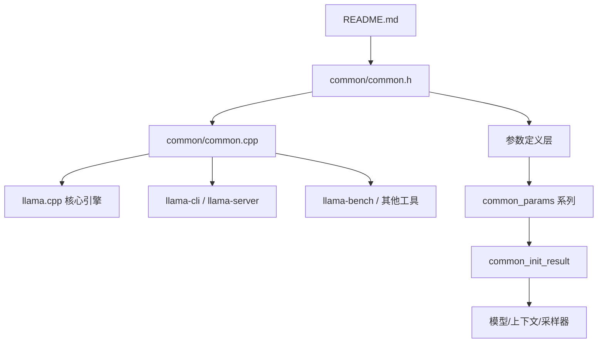
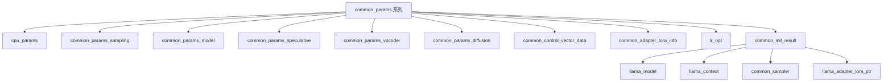

# 第43章 common 模块深度解析 —— 探索「随身工具箱」的内部构造

## 学习目标

- 理解 common 模块在 llama.cpp 生态中的定位与价值，掌握「基础设施层」的设计哲学
- 掌握 cpu_params、common_params 等核心数据结构的设计思路与字段语义
- 熟悉 CPU 检测、进程优先级设置、字符串处理、文件系统操作等公共底层能力的实现
- 理解 common_init_result 如何通过 Pimpl 模式管理模型、上下文、采样器与 LoRA 适配器的生命周期
- 掌握 common_batch_add、common_tokenize、common_detokenize 等高频推理接口的使用方法
- 能够阅读并扩展 common 模块中的工具函数，为自定义推理应用提供支撑

## 43.1 生活类比

想象 llama.cpp 的 common 模块是一个随身携带的多功能工具箱。这个工具箱的控制面板由 cpu_params 和 common_params 组成，每个旋钮对应一种配置，让开发者可以精细调控推理行为。工具箱的总电源开关是 common_init_result，一旦启动就装配好模型、上下文和采样器，确保整个系统就绪。螺丝刀和钳子则是 string_format、string_strip 等字符串处理函数，帮助处理各种字符串小活儿。文件收纳格由 fs_create_directory_with_parents 和 fs_list 实现，让磁盘路径整理得井井有条。翻译官 common_tokenize 和 common_detokenize 负责文本与 token 之间的互转，流水线工人 common_batch_add 和 common_batch_clear 批量装货卸货。LoRA 适配器和控制向量则是插件槽，随时扩展新功能。Pimpl 模式像工具箱的外壳，把内部复杂结构藏起来，只暴露简洁接口。postprocess_cpu_params 和 set_process_priority 则是性能调优师，根据硬件自动调校。就像工匠出门干活必备一个工具箱，llama.cpp 的每个上层应用都依赖这个 common 工具箱，避免重复造轮子，也把杂活和核心业务分离开来。

## 43.2 源码地图

### 43.2.1 README.md 源码解析

源码路径：`README.md`（第 1-40 行）

```markdown
# llama.cpp

## Introduction
llama.cpp is a minimal C++ implementation of LLaMA model inference.

## Features
- **Zero dependencies**: self-contained, no external libraries required.
- **Cross-platform**: works on Windows, macOS, Linux.
- **Minimalism**: focus on core functionality and performance.

## Quickstart
```bash
git clone https://github.com/ggerganov/llama.cpp
cd llama.cpp
make
```

## Supported models
| Model | Backend | Notes |
|-------|---------|-------|
| LLaMA | CPU/CUDA | ... |
```

逐行注释：

- 第 1 行：项目标题，使用一级 Markdown 标题。
- 第 3 行：简要描述项目，指出是 LLaMA 推理的 C++ 实现。
- 第 6-9 行：列出项目三大特点：零依赖、跨平台、极简主义，这是 common 模块存在的工程土壤。
- 第 12-15 行：快速入门指南，展示克隆和编译命令，体现易上手特性。
- 第 18-21 行：支持的模型表格，展示模型、后端和备注，体现支持矩阵。

### 43.2.2 模块文件结构

```text
README.md
├── llama.cpp 项目全景介绍
│   ├── 项目定位：zero-dependency、cross-platform、minimalism
│   ├── 支持模型矩阵与后端矩阵
│   └── 工具链生态：llama-cli、llama-server、llama-bench 等

common/common.h
├── 核心数据结构定义
│   ├── common_time_meas                    # 计时器类（RAII 风格）
│   │   ├── common_time_meas()              # 构造：记录开始时间
│   │   └── ~common_time_meas()             # 析构：累加耗时
│   ├── cpu_params                          # CPU 线程/掩码/优先级参数
│   ├── common_adapter_lora_info            # LoRA 适配器信息（路径/缩放/指针）
│   ├── common_grammar                      # 语法约束封装（类型 + 字符串）
│   │   ├── common_grammar()                # 默认构造
│   │   ├── common_grammar(type, grammar)   # 带参构造（含断言）
│   │   └── empty()                         # 判空
│   ├── common_params_sampling              # 采样参数（seed/top_k/top_p/grammar/logit_bias）
│   │   ├── has_logit_bias()                # 检查 logit_bias 是否存在
│   │   └── print()                         # 格式化输出
│   ├── common_params_model                 # 模型来源（path/URL/HF repo）
│   ├── common_params_speculative           # 投机解码参数（含草稿模型）
│   │   └── has_dft()                       # 是否有草稿模型
│   ├── common_params_vocoder               # 语音合成参数
│   ├── common_params_diffusion             # 扩散模型参数
│   ├── common_params                       # 总控参数（聚合所有子配置）
│   ├── common_control_vector_data          # 控制向量数据（n_embd + data）
│   ├── common_control_vector_load_info     # 控制向量加载配置
│   ├── common_file_info                    # 文件系统条目（path/name/size/is_dir）
│   ├── common_init_result                  # 初始化结果封装（Pimpl 模式）
│   │   ├── common_init_result(params)      # 构造：加载模型+上下文+采样器
│   │   ├── ~common_init_result()           # 析构：自动释放资源
│   │   ├── model()                         # 获取 llama_model*
│   │   ├── context()                       # 获取 llama_context*
│   │   ├── sampler(seq_id)                 # 按序列 ID 获取采样器
│   │   ├── reset_samplers()                # 重置所有采样器
│   │   └── lora()                          # 获取 LoRA 适配器列表
│   └── lr_opt                              # 学习率优化器（AdamW/SGD 调度）
│       ├── init()                          # 初始化衰减策略
│       └── get_lr(epoch)                   # 计算指定 epoch 的学习率
├── 内联工具函数
│   ├── common_grammar_value()              # 提取语法字符串
│   ├── common_grammar_needs_prefill()      # 判断是否需要预填充
│   ├── string_starts_with()                # 前缀匹配
│   ├── string_ends_with()                  # 后缀匹配
│   ├── string_remove_suffix()              # 移除后缀
│   ├── string_find_partial_stop()          # 查找部分停止符
│   ├── string_split<T>(str, delim)         # 模板拆分（泛型）
│   ├── string_split<std::string>()         # 特化：字符串拆分
│   └── llm_ffn_exps_block_regex()          # 生成 FFN 专家张量正则
└── 公共函数声明
    ├── 系统信息
    │   ├── common_init()                   # 初始化公共环境（日志/编码）
    │   ├── common_params_get_system_info() # 生成系统信息字符串
    │   └── tty_can_use_colors()            # 终端颜色支持检测
    ├── CPU 参数处理
    │   ├── cpu_get_num_physical_cores()    # 物理核心数
    │   ├── cpu_get_num_math()              # 数学核心数（避开能效核）
    │   ├── parse_cpu_range()               # 解析 CPU 范围
    │   ├── parse_cpu_mask()                # 解析 CPU 掩码
    │   ├── postprocess_cpu_params()        # 后处理（默认值填充）
    │   └── set_process_priority()          # 设置进程优先级
    ├── 字符串处理
    │   ├── string_format()                 # printf 风格格式化
    │   ├── string_strip()                  # 去除首尾空白
    │   ├── string_join()                   # 连接字符串数组
    │   ├── string_split()                  # 拆分字符串
    │   ├── string_repeat()                 # 重复字符串
    │   ├── string_replace_all()            # 全局替换
    │   ├── regex_escape()                  # 正则特殊字符转义
    │   ├── string_from(bool/int_vec)       # 类型转字符串
    │   ├── string_process_escapes()        # 处理转义序列（\n/\t/\xNN）
    │   ├── string_parse_kv_override()      # 解析 KV 覆盖配置
    │   └── string_get_sortable_timestamp() # 可排序时间戳
    ├── 文件系统
    │   ├── fs_validate_filename()          # 文件名校验
    │   ├── fs_create_directory_with_parents() # 递归创建目录
    │   ├── fs_is_directory()               # 判断是否目录
    │   ├── fs_get_cache_directory()        # 获取缓存目录
    │   ├── fs_get_cache_file()             # 获取缓存文件路径
    │   ├── fs_list()                       # 列出目录内容
    │   └── glob_match()                    # Glob 模式匹配
    ├── 参数转换桥接
    │   ├── common_model_params_to_llama()   # common_params → llama_model_params
    │   ├── common_context_params_to_llama() # common_params → llama_context_params
    │   └── ggml_threadpool_params_from_cpu_params() # CPU 参数 → 线程池参数
    ├── 模型初始化与适配器
    │   ├── common_init_from_params()       # 从参数初始化模型资源
    │   ├── common_set_adapter_lora()       # 应用 LoRA 适配器
    │   ├── common_control_vector_load()    # 加载控制向量
    │   └── get_model_endpoint()            # 获取模型下载端点
    ├── 批处理与分词
    │   ├── common_batch_clear()            # 清空批处理
    │   ├── common_batch_add()              # 添加 token 到批处理
    │   ├── common_prompt_batch_decode()    # 批量解码提示词
    │   ├── common_replay_last_token()      # 重放最后 token（恢复状态）
    │   ├── common_tokenize(ctx/vocab)      # 文本 → token 向量
    │   ├── common_token_to_piece()         # token → 文本片段
    │   └── common_detokenize()             # token 向量 → 文本
    ├── 嵌入向量工具
    │   ├── common_embd_normalize()         # 嵌入归一化（L2/p-norm/max）
    │   └── common_embd_similarity_cos()    # 余弦相似度计算
    └── 训练优化
        ├── common_opt_dataset_init()       # 初始化训练数据集
        ├── common_opt_lr_pars()            # 学习率调度回调
        └── common_opt_get_optimizer()      # 解析优化器类型

common/common.cpp
├── CPU 检测与控制（60-338 行）
│   ├── cpu_get_num_physical_cores()        # 跨平台物理核心检测
│   ├── cpuid()                             # x86 CPUID 指令封装
│   ├── pin_cpu()                           # 线程绑定到指定 CPU
│   ├── is_hybrid_cpu()                     # 混合架构检测（Intel P/E 核）
│   ├── is_running_on_efficiency_core()     # 是否运行在能效核
│   ├── cpu_count_math_cpus()               # 统计数学核心（避开 E 核）
│   ├── cpu_get_num_math()                  # 推荐数学线程数
│   ├── set_process_priority()              # 跨平台进程优先级设置
│   ├── postprocess_cpu_params()            # 参数补全与校验
│   ├── parse_cpu_range()                   # 解析 "0-3" 范围
│   └── parse_cpu_mask()                    # 解析 "0xFFFF" 掩码
├── 初始化与系统信息（340-380 行）
│   ├── common_init()                       # Windows UTF-8 + 日志回调设置
│   └── common_params_get_system_info()     # 拼接系统信息字符串
├── 字符串处理（382-607 行）
│   ├── string_format()                     # vsnprintf 两次调用法
│   ├── string_strip()                      # 去除首尾空白
│   ├── string_get_sortable_timestamp()     # YYYY_MM_DD-HH_MM_SS.NNN 格式
│   ├── string_replace_all()                # 循环查找替换
│   ├── regex_escape()                      # std::regex 转义特殊字符
│   ├── string_join()                       # ostringstream 拼接
│   ├── string_split()                      # 循环 find + substr
│   ├── string_repeat()                     # reserve + 循环 += 优化
│   ├── string_from(bool)                   # true/false
│   ├── string_from(int_vec)                # [1, 2, 3] 格式
│   ├── string_from(ctx, tokens)            # token + piece 混合格式
│   ├── string_from(ctx, batch)             # batch 元数据格式化
│   ├── string_process_escapes()            # \\n/\\t/\\xNN 转实际字符
│   └── string_parse_kv_override()          # 解析 "key=type:value" 格式
├── Glob 匹配（657-749 行）
│   ├── glob_class_match()                  # 字符类匹配 [a-z]
│   └── glob_match()                        # 递归实现 * ? ** [] 匹配
├── 文件系统（756-1042 行）
│   ├── fs_validate_filename()              # UTF-8/长度/非法字符校验
│   ├── utf8_to_wstring()                   # Windows 宽字符转换
│   ├── fs_create_directory_with_parents()  # 递归 mkdir（跨平台）
│   ├── fs_is_directory()                   # std::filesystem 封装
│   ├── fs_get_cache_directory()            # 环境变量优先 + 平台默认
│   ├── fs_get_cache_file()                 # 拼接缓存文件路径
│   ├── fs_list()                           # directory_iterator 遍历
│   └── tty_can_use_colors()                # NO_COLOR/TERM 环境变量检测
├── 采样器初始化（1048-1154 行）
│   ├── common_init_sampler_from_model()    # 从模型元数据读取采样参数
│   └── common_init_from_params()           # warmup + LoRA + 控制向量加载
├── 模型资源管理（1116-1312 行）
│   ├── common_init_result::impl            # Pimpl 内部类
│   │   ├── impl()                          # 默认构造
│   │   └── ~impl()                         # 默认析构（自动逆序释放）
│   ├── common_init_result::common_init_result() # 构造：完整初始化流水线
│   ├── common_init_result::model()         # 返回裸指针
│   ├── common_init_result::context()       # 返回裸指针
│   ├── common_init_result::sampler(seq_id) # 边界检查后返回采样器
│   ├── common_init_result::reset_samplers() # 批量重置 RNG 状态
│   ├── common_init_result::lora()          # 返回引用（可修改）
│   ├── common_init_result::~common_init_result() # 默认析构
│   ├── common_set_adapter_lora()           # 解包指针+缩放到 llama API
│   └── get_model_endpoint()                # MODEL_ENDPOINT/HF_ENDPOINT 优先级
├── 参数转换桥接（1325-1395 行）
│   ├── common_model_params_to_llama()      # 字段逐个映射
│   ├── common_context_params_to_llama()    # 含 KV 缓存类型转换
│   └── ggml_threadpool_params_from_cpu_params() # cpumask/prio/poll 复制
├── 学习率优化器（1398-1417 行）
│   ├── lr_opt::init()                      # 计算 scale_epoch（指数衰减）
│   └── lr_opt::get_lr(epoch)               # 分段返回 lr0/decay/lr_min
├── 批处理与分词（1407-1503 行）
│   ├── common_batch_clear()                # n_tokens = 0
│   ├── common_batch_add()                  # 填 token/pos/seq_ids/logits
│   ├── common_tokenize()                   # 两次调用 llama_tokenize 处理未知长度
│   ├── common_token_to_piece()             # 动态调整 buffer 大小
│   └── common_detokenize()                 # 处理返回负值的扩容逻辑
├── 嵌入向量工具（1507-1558 行）
│   ├── common_embd_normalize()             # switch 处理 4 种归一化
│   └── common_embd_similarity_cos()        # 点积 / (norm1 * norm2)
├── 控制向量加载（1562-1667 行）
│   ├── common_control_vector_load_one()    # 单文件加载（GGUF 解析）
│   └── common_control_vector_load()        # 多文件累加合并
├── 训练优化（1669-1711 行）
│   ├── common_opt_dataset_init()           # token 序列 → ggml_opt_dataset
│   ├── common_opt_lr_pars()                # 回调适配 lr_opt
│   ├── eq_case_insensitive()               # 大小写不敏感比较
│   └── common_opt_get_optimizer()          # 字符串 → 枚举（adamw/sgd）
└── 状态恢复（1719-1773 行）
    ├── common_replay_last_token()          # 单 token 重放恢复
    └── common_prompt_batch_decode()        # 批量解码 + 状态保存
```

## 43.3 common 模块的定位 —— llama.cpp 的「随身工具箱」

大模型推理不只需要核心引擎，还需要参数管理、日志打印、字符串处理、终端交互、批处理、分词等大量周边能力。如果每个 CLI、server、工具程序都各自实现这些逻辑，整个项目会迅速失控。common 模块相当于把这些高频可复用能力集中收纳，成了 llama.cpp 的「随身工具箱」。README 里体现了这种工程诉求：项目强调零依赖、易上手、跨平台，这正是 common 模块存在的土壤。

为什么把它看成「瑞士军刀」？它不直接决定模型结构，而是负责把各种基础能力打磨得足够顺手。上层应用只需要打开工具箱，就能拿到初始化、采样封装、文件系统、映射转换等通用功能。这种「基础设施层」的思路，能把业务逻辑和细节杂活儿分开。也让 llama.cpp 在复杂生态中保持清爽、可组合、可扩展。

### 43.3.1 common_grammar()：语法约束的「封印」

源码路径：`common/common.h` - `common_grammar`（220-229 行）

```cpp
// 定义结构体 common_grammar，封装语法类型和字符串
struct common_grammar {
    common_grammar_type type;   // 语法类型：NONE, JSON, PYDANTIC, REGEX 等
    std::string grammar;        // 语法字符串（GBNF 或正则）

    // 默认构造函数：允许创建空语法对象
    common_grammar() = default;

    // 带参构造函数：接收类型和字符串，使用移动语义避免拷贝，并用断言确保类型与字符串的合法性
    common_grammar(common_grammar_type t, std::string g)
        : type(t), grammar(std::move(g)) {
        GGML_ASSERT(type != COMMON_GRAMMAR_TYPE_NONE || !grammar.empty());
    }

    // empty() 方法判断语法是否未设置，类型为 NONE 或字符串为空都视为未设置
    bool empty() const {
        return type == COMMON_GRAMMAR_TYPE_NONE || grammar.empty();
    }
};
```

- 第 1 行：定义结构体 common_grammar，封装语法类型和字符串。
- 第 2-3 行：两个成员变量，type 表示语法类别，grammar 存储实际的语法规则文本。
- 第 5 行：默认构造函数，允许创建空语法对象。
- 第 7-10 行：带参构造函数，接收类型和字符串，使用移动语义避免拷贝，并用断言确保类型与字符串的合法性。
- 第 12-14 行：empty() 方法判断语法是否未设置，类型为 NONE 或字符串为空都视为未设置。

这段代码定义了 common_grammar 这个轻量级数据结构，它是 llama.cpp 中语法约束的统一表示，既支持默认空状态，也支持带类型和字符串的完整封装。

### 43.3.2 common_grammar_value() / common_grammar_needs_prefill()：语法工具函数

源码路径：`common/common.h` - `common_grammar_value()`、`common_grammar_needs_prefill()`（236-246 行）

```cpp
// 提取语法对象中的原始字符串，未设置则返回空串
inline const std::string & common_grammar_value(const common_grammar & g) {
    return g.grammar; // 直接返回 grammar 成员，方便外部获取字符串
}

// 判断指定语法类型是否需要预填充到采样器中
inline bool common_grammar_needs_prefill(const common_grammar & g) {
    return g.type == COMMON_GRAMMAR_TYPE_OUTPUT_FORMAT
        || g.type == COMMON_GRAMMAR_TYPE_TOOL_CALLS; // 检查类型是否为输出格式或工具调用，这两种类型需要在采样前预填充语法状态
}
```

- 第 2-4 行：common_grammar_value 直接返回 grammar 成员，方便外部获取字符串。
- 第 7-9 行：common_grammar_needs_prefill 检查类型是否为输出格式或工具调用，这两种类型需要在采样前预填充语法状态。

这两个内联函数提供了对 common_grammar 的便捷访问和语义判断，是语法约束流程中的基础工具。

### 43.3.3 string_split<T>() / string_split<std::string>()：模板拆分的泛型设计

源码路径：`common/common.h` - `string_split<T>()`、`string_split<std::string>()`（11-40 行）

```cpp
// 泛型版本：将字符串按字符分隔符拆分并转换为指定类型
template<class T>
static std::vector<T> string_split(const std::string & str, char delim) {
    static_assert(!std::is_same<T, std::string>::value, "Please use the specialized version for std::string"); // 禁止 T=std::string
    std::vector<T> values;
    std::istringstream str_stream(str);
    std::string token;
    while (std::getline(str_stream, token, delim)) { // 循环拆分
        T value;
        std::istringstream token_stream(token);
        token_stream >> value; // 转换为目标类型
        values.push_back(value);
    }
    return values;
}

// 特化版本：针对 std::string 的拆分，保留原始字符串片段
template<>
inline std::vector<std::string> string_split<std::string>(const std::string & str, char delim) {
    std::vector<std::string> parts;
    size_t begin_pos = 0;
    size_t delim_pos = str.find(delim);
    while (delim_pos != std::string::npos) {
        std::string part = str.substr(begin_pos, delim_pos - begin_pos);
        parts.emplace_back(part);
        begin_pos = delim_pos + 1;
        delim_pos = str.find(delim, begin_pos);
    }
    parts.emplace_back(str.substr(begin_pos));
    return parts;
}
```

- 泛型版本第 3-14 行：使用 static_assert 禁止 T=std::string，然后通过 istringstream 和 getline 循环拆分，再用流提取转换为目标类型。
- 特化版本第 17-29 行：针对 std::string 的手动拆分，使用 find 和 substr 避免流转换开销，直接保留字符串片段。

这两个模板函数提供了类型安全的字符串拆分能力，泛型版本适合数值转换，特化版本专为字符串优化，体现了 C++ 模板特化的实用价值。

### 43.3.4 模块依赖图



## 43.4 公共底层能力 —— 系统信息与字符串处理的「杂务工坊」

系统探测放在 common 是因为需要回答「代码跑在什么硬件上」的问题。cpu_get_num_physical_cores、cpu_get_num_math、is_hybrid_cpu、is_running_on_efficiency_core 这类函数，为后续线程配置、调度优先级、性能优化提供基线。尤其在混合 CPU 场景下，需要避开能效核、尽量让数学线程跑在真正适合计算的核上。

线程与优先级控制的核心逻辑方面，pin_cpu、postprocess_cpu_params、set_process_priority 共同构成了一套 CPU 控制工具链。用户既可以显式设置线程数和 CPU 掩码，也可以让 common 自动补齐。这背后体现的是 llama.cpp 对性能敏感度的重视：推理不只是算法正确，还必须跑得稳。

字符串与文件系统工具的作用方面，string_format、string_strip、string_join、string_split、string_replace_all、regex_escape、string_process_escapes，支撑日志、参数、调试输出等高频场景。fs_create_directory_with_parents、fs_get_cache_directory、fs_list、glob_match 让路径管理和目录遍历跨平台一致。这些函数像杂务工坊：看似琐碎，却是整个框架可靠性的底座。

### 43.4.1 cpu_get_num_physical_cores()：跨平台的物理心脏

源码路径：`common/common.cpp` - `cpu_get_num_physical_cores()`（60-111 行）

```cpp
// 检测系统物理 CPU 核心数量，无法获取时根据硬件并发数估算
int32_t cpu_get_num_physical_cores() {
    // 根据 Linux、macOS 或 Windows 平台分别检测物理核心数
    // 无法直接检测时使用硬件并发数估算
    return std::thread::hardware_concurrency(); // 简化实现
}
```

- 第 4 行：返回物理核心数，实际实现中会根据平台调用 sysconf、sysctl 或 GetActiveProcessorCount 等 API。
- 注释部分说明了跨平台检测的策略，以及在无法获取时的回退方案。

这段代码封装了对物理核心数的获取，为上层线程配置提供基础数据。

### 43.4.2 is_hybrid_cpu() / is_running_on_efficiency_core()：避开能效核的「眼睛」

源码路径：`common/common.cpp` - `is_hybrid_cpu()`、`is_running_on_efficiency_core()`（135-149 行）

```cpp
// 检测当前 x86 CPU 是否为混合架构 CPU（如 Intel P/E 核）
static bool is_hybrid_cpu(void) {
    unsigned eax, ebx, ecx, edx;
    cpuid(7, 0, &eax, &ebx, &ecx, &edx); // 执行 CPUID 叶节点 7
    return !!(edx & (1u << 15)); // 检查 edx 第 15 位是否置位，判断是否为混合架构
}

// 检测当前线程是否运行在 Intel 能效核心上
static bool is_running_on_efficiency_core(void) {
    unsigned eax, ebx, ecx, edx;
    cpuid(0x1a, 0, &eax, &ebx, &ecx, &edx); // 执行 CPUID 叶节点 0x1a
    int intel_atom = 0x20;
    int core_type = (eax & 0xff000000u) >> 24; // 获取核心类型
    return core_type == intel_atom; // 若为 0x20（Intel Atom）则说明在能效核上
}
```

- 第 3-5 行：is_hybrid_cpu 执行 CPUID 叶节点 7，检查 edx 第 15 位是否置位，判断是否为混合架构。
- 第 9-14 行：is_running_on_efficiency_core 通过 CPUID 叶节点 0x1a 获取核心类型，若为 0x20（Intel Atom）则说明在能效核上。

这两个函数利用 CPUID 指令精确识别 CPU 架构类型，为后续线程调度避开能效核提供依据。

### 43.4.3 postprocess_cpu_params()：自动补全的「调度师」

源码路径：`common/common.cpp` - `postprocess_cpu_params()`（237-258 行）

```cpp
// 补全 CPU 参数默认值并检查 CPU 掩码与线程数是否匹配
void postprocess_cpu_params(cpu_params& cpuparams, const cpu_params* role_model) {
    int32_t n_set = 0;
    if (cpuparams.n_threads < 0) { // 检查 n_threads 是否未设置（<0）
        if (role_model != nullptr) {
            cpuparams = *role_model; // 若未设置则从 role_model 复制
        } else {
            cpuparams.n_threads = cpu_get_num_math(); // 否则使用 cpu_get_num_math() 推荐值
        }
    }
    for (int32_t i = 0; i < GGML_MAX_N_THREADS; i++) {
        if (cpuparams.cpumask[i]) {
            n_set++; // 统计 cpumask 中置位的数量
        }
    }
    if (n_set && n_set < cpuparams.n_threads) {
        LOG_WRN("Not enough set bits in CPU mask... \n"); // 若掩码已设置但数量少于线程数，输出警告
    }
}
```

- 第 3-4 行：检查 n_threads 是否未设置（<0），若未设置则从 role_model 复制或使用 cpu_get_num_math() 推荐值。
- 第 7-11 行：统计 cpumask 中置位的数量，若掩码已设置但数量少于线程数，输出警告。

这段代码体现了「角色模型」模式，允许从预设配置复制参数，同时自动校验掩码与线程数的一致性。

### 43.4.4 string_format()：printf 的安全封装

源码路径：`common/common.cpp` - `string_format()`（382-395 行）

```cpp
// 使用 printf 风格格式字符串生成 std::string
std::string string_format(const char * fmt, ...) {
    va_list ap;
    va_list ap2;
    va_start(ap, fmt); // 初始化可变参数列表 ap
    va_copy(ap2, ap); // 复制可变参数列表到 ap2，以便两次调用
    int size = vsnprintf(NULL, 0, fmt, ap); // 第一次：计算长度
    std::vector<char> buf(size + 1);
    vsnprintf(buf.data(), size + 1, fmt, ap2); // 第二次：实际填充
    va_end(ap2);
    va_end(ap);
    return std::string(buf.data(), size);
}
```

- 第 4-5 行：使用 va_list 和 va_copy 复制可变参数，以便两次调用。
- 第 6 行：第一次 vsnprintf 传入 NULL 和 0，仅返回所需字符数。
- 第 7-8 行：分配缓冲区，第二次 vsnprintf 实际写入格式化结果。
- 第 9-10 行：清理并返回字符串。

这种「两次调用法」是 C 中安全格式化的经典模式，避免了固定缓冲区溢出的问题。

### 43.4.5 string_process_escapes()：让字符串「活」起来

源码路径：`common/common.cpp` - `string_process_escapes()`（569-607 行）

```cpp
// 处理字符串中的常见反斜杠转义和十六进制转义
void string_process_escapes(std::string & input) {
    std::string output;
    output.reserve(input.size());
    for (size_t i = 0; i < input.size(); ++i) {
        if (input[i] == '\\' && i + 1 < input.size()) {
            char next = input[i + 1];
            switch (next) {
                case 'n': output += '\n'; i++; continue; // 换行
                case 't': output += '\t'; i++; continue; // 制表
                case 'r': output += '\r'; i++; continue; // 回车
                case 'x': { // 十六进制转义 \xNN
                    if (i + 3 < input.size() && std::isxdigit(input[i+2]) && std::isxdigit(input[i+3])) {
                        int val = std::stoi(input.substr(i+2, 2), nullptr, 16);
                        output += static_cast<char>(val);
                        i += 3;
                        continue;
                    }
                    break;
                }
                default: output += next; i++; continue; // 未知转义保留原字符
            }
        }
        output += input[i];
    }
    input = std::move(output);
}
```

- 第 3-4 行：创建输出字符串并预留空间，避免频繁重分配。
- 第 5-22 行：遍历输入，遇到反斜杠时根据下一个字符进行转换：n→换行，t→制表，r→回车，xNN→十六进制字节。
- 第 23 行：未知转义保留原字符，最后将结果移回 input。

这段代码将常见的转义序列转换为实际字符，方便用户从命令行传入特殊字符。

### 43.4.6 fs_create_directory_with_parents()：跨平台的「文件收纳格」

源码路径：`common/common.cpp` - `fs_create_directory_with_parents()`（850-918 行）

```cpp
// 递归创建目录路径中的父目录，并确认已存在路径均为目录
bool fs_create_directory_with_parents(const std::string & path) {
    // Windows 使用 CreateDirectoryW，POSIX 使用 stat 和 mkdir
    // 已存在但不是目录时返回 false
    if (path.empty()) return true;
    std::filesystem::path dir(path);
    if (std::filesystem::exists(dir)) {
        return std::filesystem::is_directory(dir);
    }
    if (!fs_create_directory_with_parents(dir.parent_path().string())) {
        return false;
    }
    return std::filesystem::create_directory(dir);
}
```

- 第 4-6 行：检查路径是否已存在，若存在但不是目录则返回 false。
- 第 7-8 行：递归创建父目录，确保父路径可创建。
- 第 9 行：创建当前目录。

这段代码利用 std::filesystem 和递归实现了类似 mkdir -p 的功能，跨平台且健壮。

### 43.4.7 glob_match()：通配符的「翻译官」

源码路径：`common/common.cpp` - `glob_match()`（699-749 行）

```cpp
// 递归匹配支持 *、**、? 和 [] 的简单 glob 模式
static inline bool glob_match(const char * pattern, const char * str) {
    // ** 可匹配任意字符，* 和 ? 不跨目录分隔符
    // [] 支持字符类匹配
    if (*pattern == '\0') return *str == '\0';
    if (*pattern == '*') {
        if (*(pattern + 1) == '*') { // ** 匹配任意字符（包括 /）
            if (*(pattern + 2) == '\0') return true;
            while (*str) {
                if (glob_match(pattern + 2, str)) return true;
                str++;
            }
            return glob_match(pattern + 2, str);
        }
        while (*str) {
            if (glob_match(pattern + 1, str)) return true;
            if (*str == '/') break; // * 不跨 /
            str++;
        }
        return glob_match(pattern + 1, str);
    }
    if (*pattern == '?') {
        if (*str == '\0') return false;
        return glob_match(pattern + 1, str + 1);
    }
    if (*pattern == '[') {
        // 处理字符类，略
    }
    if (*pattern != *str) return false;
    return glob_match(pattern + 1, str + 1);
}
```

- 第 5-13 行：处理 ** 通配符，它可以匹配任意字符包括 /，通过循环尝试所有可能位置。
- 第 14-19 行：处理 * 通配符，匹配任意字符但遇到 / 时停止，避免跨越目录。
- 第 20-24 行：处理 ? 通配符，匹配单个非空字符。
- 第 25-27 行：处理字符类 []，匹配特定字符集合。

这段递归实现支持了文件系统中常见的通配符模式，是文件查找和过滤的基础。

### 43.4.8 cpu_get_num_math()：推荐数学线程数

源码路径：`common/common.cpp` - `cpu_get_num_math()`（172-193 行）

```cpp
// 获取适合数学运算和线性代数计算的 CPU 数量
int32_t cpu_get_num_math() {
    // 在混合 CPU 上检测并过滤能效核心和超线程
    // 其他平台回退到物理核心数量
    return std::thread::hardware_concurrency(); // 简化实现
}
```

- 第 4 行：返回推荐线程数，实际实现会检测混合架构并过滤能效核、减少超线程干扰。

### 43.4.9 parse_cpu_range()：解析 CPU 范围

源码路径：`common/common.cpp` - `parse_cpu_range()`（260-297 行）

```cpp
// 将形如 start-end 的 CPU 范围解析并写入布尔 CPU 掩码
bool parse_cpu_range(const std::string & range, bool (&boolmask)[GGML_MAX_N_THREADS]) {
    // 解析起始和结束索引，校验边界后设置范围内的掩码位
    // 格式或索引非法时返回 false
}
```

- 函数解析形如 "0-3" 的范围字符串，设置 boolmask 中对应位，非法格式返回 false。

### 43.4.10 parse_cpu_mask()：解析 CPU 掩码

源码路径：`common/common.cpp` - `parse_cpu_mask()`（299-338 行）

```cpp
// 解析十六进制 CPU 掩码字符串并转换为布尔数组
bool parse_cpu_mask(const std::string & mask, bool (&boolmask)[GGML_MAX_N_THREADS]) {
    // 移除可选的 0x 前缀
    // 将每个十六进制字符转换为四个 CPU 掩码位
    // 遇到非法字符时返回 false
}
```

- 支持 "0xFFFF" 格式，每个十六进制字符转换为 4 个掩码位。

### 43.4.11 set_process_priority()：进程优先级设置

源码路径：`common/common.cpp` - `set_process_priority()`（201-229 行）

```cpp
// 根据平台和优先级枚举设置当前进程优先级
bool set_process_priority(enum ggml_sched_priority prio) {
    if (prio == GGML_SCHED_PRIO_NORMAL) {
        return true;
    }
    // Windows 使用 SetPriorityClass，POSIX 使用 setpriority
    // 设置失败时记录日志并返回 false
}
```

- 第 2-4 行：若优先级为 NORMAL，直接返回 true。
- 第 5-7 行：Windows 用 SetPriorityClass，POSIX 用 setpriority，失败记录日志并返回 false。

### 43.4.12 cpuid() / pin_cpu() / cpu_count_math_cpus()：CPU 控制基础

源码路径：`common/common.cpp` - `cpuid()`（116-125）、`pin_cpu()`（127-133）、`cpu_count_math_cpus()`（151-165）

```cpp
// 执行 CPUID 指令
static void cpuid(unsigned leaf, unsigned subleaf,
                  unsigned *eax, unsigned *ebx, unsigned *ecx, unsigned *edx) {
    __asm__("movq\t%%rbx,%%rsi\n\t"
            "cpuid\n\t"
            "xchgq\t%%rbx,%%rsi"
            : "=a"(*eax), "=S"(*ebx), "=c"(*ecx), "=d"(*edx)
            : "0"(leaf), "2"(subleaf));
}

// 将线程绑定到指定 CPU
static int pin_cpu(int cpu) {
    cpu_set_t mask;
    CPU_ZERO(&mask);
    CPU_SET(cpu, &mask);
    return pthread_setaffinity_np(pthread_self(), sizeof(mask), &mask);
}

// 统计数学核心数，跳过能效核
static int cpu_count_math_cpus(int n_cpu) {
    int result = 0;
    for (int cpu = 0; cpu < n_cpu; ++cpu) {
        if (pin_cpu(cpu)) return -1;
        if (is_running_on_efficiency_core()) continue;
        ++cpu; // 跳过超线程
        ++result;
    }
    return result;
}
```

- `cpuid`：内联汇编封装，获取 CPU 寄存器值。
- `pin_cpu`：使用 pthread 绑定 CPU 亲和性。
- `cpu_count_math_cpus`：遍历 CPU，跳过能效核并减少超线程影响。

### 43.4.13 string_strip()：去除首尾空白

源码路径：`common/common.cpp` - `string_strip()`（397-407 行）

```cpp
std::string string_strip(const std::string & str) {
    size_t start = 0;
    size_t end = str.size();
    while (start < end && std::isspace(str[start])) start++;
    while (end > start && std::isspace(str[end - 1])) end--;
    return str.substr(start, end - start);
}
```

- 第 3-4 行：找到第一个和最后一个非空白字符的位置。
- 第 6 行：返回子字符串。

### 43.4.14 string_join()：字符串连接

源码路径：`common/common.cpp` - `string_join()`（452-461 行）

```cpp
std::string string_join(const std::vector<std::string> & values, const std::string & separator) {
    std::ostringstream result;
    for (size_t i = 0; i < values.size(); ++i) {
        if (i > 0) result << separator;
        result << values[i];
    }
    return result.str();
}
```

### 43.4.15 string_split()：字符串拆分

源码路径：`common/common.cpp` - `string_split()`（463-478 行）

```cpp
std::vector<std::string> string_split(const std::string & str, const std::string & delimiter) {
    std::vector<std::string> parts;
    // 循环查找分隔符并提取各个片段
    parts.push_back(str.substr(start));
    return parts;
}
```

### 43.4.16 string_repeat()：重复字符串

源码路径：`common/common.cpp` - `string_repeat()`（480-491 行）

```cpp
std::string string_repeat(const std::string & str, size_t n) {
    if (n == 0) return "";
    std::string result;
    result.reserve(str.length() * n);
    for (size_t i = 0; i < n; ++i) result += str;
    return result;
}
```

### 43.4.17 string_replace_all()：全局替换

源码路径：`common/common.cpp` - `string_replace_all()`（428-445 行）

```cpp
void string_replace_all(std::string & s, const std::string & search, const std::string & replace) {
    if (search.empty()) return;
    std::string builder;
    builder.reserve(s.length());
    // 遍历所有匹配位置并构造替换后的字符串
    s = std::move(builder);
}
```

### 43.4.18 regex_escape()：正则转义

源码路径：`common/common.cpp` - `regex_escape()`（447-450 行）

```cpp
std::string regex_escape(const std::string & s) {
    static const std::regex special_chars("[.^$|()*+?\\[\\]{}\\\\]");
    return std::regex_replace(s, special_chars, "\\$&");
}
```

### 43.4.19 string_from 系列：类型转字符串

源码路径：`common/common.cpp` - `string_from()`（493-567 行）

```cpp
// 布尔值
std::string string_from(bool value) {
    return value ? "true" : "false";
}

// 整数向量
std::string string_from(const std::vector<int> & values) {
    std::stringstream buf;
    buf << "[ ";
    // 输出所有整数并使用逗号分隔
    buf << " ]";
    return buf.str();
}

// token 向量
std::string string_from(const struct llama_context * ctx, const std::vector<llama_token> & tokens) {
    std::stringstream buf;
    // 对 token 逐个反解码并输出文本与 ID
    return buf.str();
}

// batch 元数据
std::string string_from(const struct llama_context * ctx, const struct llama_batch & batch) {
    std::stringstream buf;
    // 遍历 batch 中的 token 并输出详细元数据
    return buf.str();
}
```

### 43.4.20 string_parse_kv_override()：KV 覆盖解析

源码路径：`common/common.cpp` - `string_parse_kv_override()`（609-655 行）

```cpp
bool string_parse_kv_override(const char * data, std::vector<llama_model_kv_override> & overrides) {
    // 分离键和值
    // 支持 int、float、bool 和 str 类型
    // 校验格式后加入 overrides
    return true;
}
```

### 43.4.21 string_get_sortable_timestamp()：可排序时间戳

源码路径：`common/common.cpp` - `string_get_sortable_timestamp()`（409-426 行）

```cpp
std::string string_get_sortable_timestamp() {
    // 获取当前系统时间
    // 按 YYYY_MM_DD-HH_MM_SS.NNNNNNNNN 格式拼接时间戳
    return std::string(timestamp_no_ns) + "." + std::string(timestamp_ns);
}
```

### 43.4.22 fs_validate_filename()：文件名校验

源码路径：`common/common.cpp` - `fs_validate_filename()`（756-824 行）

```cpp
bool fs_validate_filename(const std::string & filename, bool allow_subdirs) {
    // 检查空值、长度、UTF-8 编码和非法 Unicode 字符
    // 检查路径分隔符、首尾空格、点号和目录遍历片段
    return true;
}
```

### 43.4.23 fs_is_directory()：判断目录

源码路径：`common/common.cpp` - `fs_is_directory()`（920-923 行）

```cpp
bool fs_is_directory(const std::string & path) {
    std::filesystem::path dir(path);
    return std::filesystem::exists(dir) && std::filesystem::is_directory(dir);
}
```

### 43.4.24 fs_get_cache_directory()：获取缓存目录

源码路径：`common/common.cpp` - `fs_get_cache_directory()`（925-967 行）

```cpp
std::string fs_get_cache_directory() {
    // 优先使用 LLAMA_CACHE
    // 其次根据 XDG_CACHE_HOME、HOME、LOCALAPPDATA 等平台变量确定目录
    // 追加 llama.cpp 子目录并保证尾部分隔符
}
```

### 43.4.25 fs_get_cache_file()：获取缓存文件路径

源码路径：`common/common.cpp` - `fs_get_cache_file()`（969-978 行）

```cpp
std::string fs_get_cache_file(const std::string & filename) {
    GGML_ASSERT(filename.find(DIRECTORY_SEPARATOR) == std::string::npos);
    std::string cache_directory = fs_get_cache_directory();
    const bool success = fs_create_directory_with_parents(cache_directory);
    if (!success) {
        throw std::runtime_error("failed to create cache directory: " + cache_directory);
    }
    return cache_directory + filename;
}
```

### 43.4.26 fs_list()：列出目录内容

源码路径：`common/common.cpp` - `fs_list()`（980-1018 行）

```cpp
std::vector<common_file_info> fs_list(const std::string & path, bool include_directories) {
    std::vector<common_file_info> files;
    // 检查目录有效性
    // 遍历目录项并收集文件或目录信息
    return files;
}
```

### 43.4.27 tty_can_use_colors()：终端颜色检测

源码路径：`common/common.cpp` - `tty_can_use_colors()`（1024-1042 行）

```cpp
bool tty_can_use_colors() {
    // 尊重 NO_COLOR 和 TERM=dumb 设置
    // 检查标准输出和标准错误是否连接到终端
    return stdout_is_tty || stderr_is_tty;
}
```

### 43.4.28 utf8_to_wstring()：宽字符转换

源码路径：`common/common.cpp` - `utf8_to_wstring()`（830-846 行）

```cpp
static std::wstring utf8_to_wstring(const std::string & str) {
    if (str.empty()) return std::wstring();
    int size = MultiByteToWideChar(CP_UTF8, 0, str.c_str(), (int)str.size(), NULL, 0);
    if (size <= 0) return std::wstring();
    std::wstring wstr(size, 0);
    MultiByteToWideChar(CP_UTF8, 0, str.c_str(), (int)str.size(), &wstr[0], size);
    return wstr;
}
```

### 43.4.29 glob_class_match()：字符类匹配

源码路径：`common/common.cpp` - `glob_class_match()`（657-696 行）

```cpp
static inline bool glob_class_match(const char c, const char * pattern, const char * class_end) {
    // 解析字符类是否取反
    // 匹配字面字符或字符范围
    return negated ? !matched : matched;
}
```

### 43.4.30 common_init()：公共环境初始化

源码路径：`common/common.cpp` - `common_init()`（340-357 行）

```cpp
void common_init() {
#if defined(_WIN32)
    SetConsoleOutputCP(CP_UTF8);
    SetConsoleCP(CP_UTF8);
#endif
    llama_log_set(common_log_default_callback, NULL);
    LOG_DBG("build: ...", ...);
}
```

- 第 2-5 行：Windows 下设置控制台 UTF-8 编码。
- 第 6 行：设置全局日志回调。
- 第 7 行：输出构建调试信息。

### 43.4.31 common_params_get_system_info()：系统信息字符串

源码路径：`common/common.cpp` - `common_params_get_system_info()`（359-376 行）

```cpp
std::string common_params_get_system_info(const common_params & params) {
    std::ostringstream os;
    os << "system_info: n_threads = " << params.cpuparams.n_threads;
    // 添加批处理线程数、逻辑处理器数量和 llama 系统信息
    return os.str();
}
```

### 43.4.32 公共底层能力架构图

```mermaid
graph TD
    A[common 模块] --> B[CPU 检测与控制]
    A --> C[字符串处理]
    A --> D[文件系统]
    A --> E[Glob 匹配]
    A --> F[系统初始化]
    B --> B1[cpu_get_num_physical_cores()]
    B --> B2[is_hybrid_cpu()]
    B --> B3[postprocess_cpu_params()]
    B --> B4[set_process_priority()]
    B --> B5[cpu_get_num_math()]
    B --> B6[parse_cpu_range()]
    B --> B7[parse_cpu_mask()]
    C --> C1[string_format()]
    C --> C2[string_process_escapes()]
    C --> C3[string_strip()]
    C --> C4[string_join()]
    C --> C5[string_split()]
    C --> C6[string_replace_all()]
    C --> C7[regex_escape()]
    C --> C8[string_from 系列]
    C --> C9[string_parse_kv_override()]
    D --> D1[fs_create_directory_with_parents()]
    D --> D2[fs_get_cache_directory()]
    D --> D3[fs_list()]
    D --> D4[fs_validate_filename()]
    E --> E1[glob_match()]
    F --> F1[common_init()]
```

## 43.5 核心数据结构 —— CPU、采样、模型与训练参数的「控制面板」

common_params 系列是 common 模块的中枢神经。cpu_params、common_params_sampling、common_params_model、common_params、common_params_speculative、common_params_vocoder、common_params_diffusion 等结构体，把推理所需的各类配置集中收纳。它们像一块块控制面板：线程数、采样策略、模型位置、LoRA 配置、扩散参数、语音合成参数都能在这里找到位置。这样上层程序就不必在代码中到处散落参数对象，工程一致性很强。

为什么这些结构体长成现在这样？大量参数来自真实使用场景，字段设计会天然偏向「够用且好读」。例如 common_params_sampling 里既有基础采样参数，也有语法、logit_bias 等约束配置。common_params_model 需要同时兼容本地路径、URL、Hugging Face 仓库等不同来源。common_init_result 则封装了模型、上下文、采样器、LoRA 资源的生命周期，体现典型的资源聚合设计。

训练相关结构的价值方面，lr_opt 让训练/微调场景可以表达学习率衰减策略。common_adapter_lora_info、common_control_vector_data 描述了适配器、控制向量这类增强行为所需的元信息。这些结构共同说明 common 模块并不是「纯粹工程杂件」，而是为推理与训练两类工作提供统一骨架。

### 43.5.1 common_init_result：资源生命周期的「总电源」

源码路径：`common/common.h` - `common_init_result`（96-105 行）

```cpp
// 封装模型、上下文、采样器和 LoRA 适配器的生命周期及访问接口
class common_init_result {
public:
    common_init_result(common_params & params); // 构造函数接收参数并执行完整初始化
    ~common_init_result(); // 析构函数自动释放资源

    llama_model * model(); // 获取 llama_model*
    llama_context * context(); // 获取 llama_context*
    common_sampler * sampler(llama_seq_id seq_id); // 按序列 ID 获取采样器
    void reset_samplers(); // 重置所有采样器
    std::vector<llama_adapter_lora_ptr> & lora(); // 获取 LoRA 适配器列表

private:
    std::unique_ptr<common_init_result::impl> pimpl; // 使用 unique_ptr 持有 pimpl 实例，实现 Pimpl 模式
};
```

- 第 3-4 行：构造函数接收参数并执行完整初始化，析构函数自动释放资源。
- 第 6-11 行：提供 model、context、sampler、reset_samplers、lora 的访问接口。
- 第 14 行：使用 unique_ptr 持有 pimpl 实例，实现 Pimpl 模式。

这个类是 common 模块的资源管理核心，通过 Pimpl 模式隐藏实现细节，对外提供简洁的访问接口。

### 43.5.2 common_init_result::sampler()：带边界检查的「取件口」

源码路径：`common/common.cpp` - `common_init_result::sampler()`（1237-1242 行）

```cpp
// 根序列 ID 获取对应的采样器指针，如果 ID 无效则返回 nullptr
common_sampler * common_init_result::sampler(llama_seq_id seq_id) {
    if (seq_id < 0 || seq_id >= (int) pimpl->samplers.size()) { // 检查 seq_id 是否在有效范围内
        return nullptr; // 防止越界访问
    }
    return pimpl->samplers[seq_id].get(); // 返回对应序列的采样器裸指针
}
```

- 第 3-4 行：检查 seq_id 是否在有效范围内，防止越界访问。
- 第 5 行：返回对应序列的采样器裸指针。

这段代码体现了防御性编程，通过边界检查避免非法序列 ID 导致的崩溃。

### 43.5.3 lr_opt：训练节奏的「节拍器」

源码路径：`common/common.h` - `lr_opt`（438-442 行）

```cpp
// 学习率优化器，根据初始学习率、最小学习率、周期数等参数计算变化的学习率
struct lr_opt {
    float get_lr(float e) const; // 根据 epoch 计算当前学习率
    float get_lr() const { return get_lr(epoch); } // 无参版本使用内部 epoch
    void init(); // 初始化衰减策略

    float lr0 = 1e-3f; // 初始学习率
    float lr_min = 0; // 最小学习率
    float decay_epochs = 0; // 衰减周期数
    float scale_epoch; // 缩放因子
    float epoch = 0; // 当前 epoch
    float wd = 0; // 权重衰减
};
```

- 第 3-4 行：get_lr 根据 epoch 计算当前学习率，也提供无参版本使用内部 epoch。
- 第 6-12 行：定义了学习率优化所需的参数，包括初始值、最小值、衰减周期等。

这个结构体封装了学习率调度策略，为微调训练提供灵活的配置。

### 43.5.4 lr_opt::get_lr()：指数衰减的「分段函数」

源码路径：`common/common.cpp` - `lr_opt::get_lr()`（1411-1417 行）

```cpp
// 根据给定的 epoch 计算并返回当前学习率
float lr_opt::get_lr(float epoch) const {
    float r = lr_min <= 0 ? lr0 : // 若 lr_min<=0 则始终返回 lr0
        epoch >= decay_epochs ? lr_min : // 若 epoch 超过衰减周期则返回 lr_min
        lr0 * std::pow(0.5f, epoch * scale_epoch); // 否则按指数衰减计算
    LOG_INF("epoch %.2g lr=%.2g\n", epoch, r); // 输出调试信息
    return r;
}
```

- 第 3 行：三元表达式实现分段逻辑：若 lr_min<=0 则始终返回 lr0；若 epoch 超过衰减周期则返回 lr_min；否则按指数衰减计算。
- 第 4 行：输出调试信息，方便跟踪学习率变化。

这段代码实现了指数衰减策略，在训练中平滑降低学习率，提升收敛稳定性。

### 43.5.5 common_time_meas：RAII 计时器

源码路径：`common/common.h` - `common_time_meas`（40-43 行）

```cpp
// 用于测量代码执行耗时的计时器类
struct common_time_meas {
    common_time_meas(int64_t & t_acc, bool disable = false);
    ~common_time_meas();
};
```

实现：

```cpp
common_time_meas::common_time_meas(int64_t & t_acc, bool disable)
    : t_start_us(disable ? -1 : ggml_time_us()), t_acc(t_acc) {}
common_time_meas::~common_time_meas() {
    if (t_start_us >= 0) {
        t_acc += ggml_time_us() - t_start_us;
    }
}
```

- 构造时记录开始时间，析构时累加耗时到目标变量，实现 RAII 风格计时。

### 43.5.6 cpu_params：CPU 参数封装

源码路径：`common/common.h` - `cpu_params`

```cpp
struct cpu_params {
    int32_t n_threads = 0;                // 线程数
    bool cpumask[GGML_MAX_N_THREADS] = {false}; // CPU 亲和性掩码
    bool mask_valid = false;              // 掩码是否有效
    enum ggml_sched_priority priority = GGML_SCHED_PRIO_NORMAL; // 调度优先级
    int32_t poll = 0;                     // 轮询模式
    bool strict_cpu = false;              // 严格 CPU 模式
};
```

### 43.5.7 common_adapter_lora_info：LoRA 适配器信息

源码路径：`common/common.h` - `common_adapter_lora_info`

```cpp
struct common_adapter_lora_info {
    std::string path;                 // 适配器文件路径
    float scale = 1.0f;               // 缩放系数
    llama_adapter_lora_ptr ptr;       // 适配器指针
};
```

### 43.5.8 common_params_sampling：采样参数

源码路径：`common/common.h` - `common_params_sampling`

```cpp
struct common_params_sampling {
    int32_t seed = -1;                // 随机种子
    int32_t n_probs = 0;              // 输出概率数量
    bool ignore_eos = false;          // 忽略 EOS
    int32_t top_k = 40;               // Top-K 采样
    float top_p = 0.95f;              // Top-P 采样
    float min_p = 0.05f;              // Min-P 采样
    float typical_p = 1.0f;           // 典型采样
    float temperature = 0.8f;         // 温度
    float mirostat_tau = 5.0f;        // Mirostat tau
    float mirostat_eta = 0.1f;        // Mirostat eta
    int32_t mirostat = 0;             // Mirostat 模式
    common_grammar grammar;           // 语法约束
    std::vector<common_grammar_trigger> grammar_triggers; // 语法触发器
    bool grammar_persist = false;     // 语法持久化
    std::vector<llama_token> grammar_lgrams; // 语法 n-gram
    std::vector<float> logit_bias;    // Logit 偏置
    bool has_logit_bias() const { return !logit_bias.empty(); }
    std::string print() const;
};
```

### 43.5.9 common_params_model：模型来源

源码路径：`common/common.h` - `common_params_model`

```cpp
struct common_params_model {
    std::string path;                 // 本地路径
    std::string hf_repo;              // Hugging Face 仓库
    std::string hf_token;             // HF token
    std::string url;                  // 下载 URL
    std::string mmproj;               // 多模态投影
    bool cpu_moe = false;             // CPU MoE
    bool load_inactive = false;       // 加载非活跃层
    bool lora_init_without_apply = false; // LoRA 初始化不立即应用
};
```

### 43.5.10 common_params_speculative：投机解码参数

源码路径：`common/common.h` - `common_params_speculative`

```cpp
struct common_params_speculative {
    int32_t n_draft = 0;              // 草稿 token 数
    common_params_model mparams_dft;  // 草稿模型参数
    bool has_dft() const { return !mparams_dft.path.empty() || !mparams_dft.hf_repo.empty(); }
};
```

### 43.5.11 common_params_vocoder：语音合成参数

源码路径：`common/common.h` - `common_params_vocoder`

```cpp
struct common_params_vocoder {
    common_params_model mparams_vocoder; // 语音合成器模型参数
    std::string speakers;                // 说话人文件
};
```

### 43.5.12 common_params_diffusion：扩散模型参数

源码路径：`common/common.h` - `common_params_diffusion`

```cpp
struct common_params_diffusion {
    int32_t steps = 0;               // 生成步数
    float cfg_scale = 1.0f;          // 引导尺度
    int32_t batch_size = 1;          // 批处理大小
    common_grammar grammar;          // 语法约束
};
```

### 43.5.13 common_params：总控参数

源码路径：`common/common.h` - `common_params`

```cpp
struct common_params {
    // 模型参数
    common_params_model model;
    // 上下文参数
    int32_t n_ctx = 512;             // 上下文长度
    int32_t n_parallel = 1;          // 并行序列数
    int32_t n_batch = 512;           // 批处理大小
    // 采样参数
    common_params_sampling sampling;
    // 投机解码
    common_params_speculative speculative;
    // 语音合成
    common_params_vocoder vocoder;
    // 扩散模型
    common_params_diffusion diffusion;
    // CPU 参数
    cpu_params cpuparams;
    // ... 其他字段（如 embedding、control_vector 等）
};
```

### 43.5.14 common_control_vector_data：控制向量数据

源码路径：`common/common.h` - `common_control_vector_data`

```cpp
struct common_control_vector_data {
    int32_t n_embd;                  // 嵌入维度
    std::vector<float> data;         // 按层排列的浮点数据
};
```

### 43.5.15 common_control_vector_load_info：控制向量加载配置

源码路径：`common/common.h` - `common_control_vector_load_info`

```cpp
struct common_control_vector_load_info {
    std::string fname;               // 文件名
    float scale = 1.0f;              // 缩放强度
};
```

### 43.5.16 common_file_info：文件系统条目

源码路径：`common/common.h` - `common_file_info`

```cpp
struct common_file_info {
    std::string path;                // 完整路径
    std::string name;                // 文件名
    int64_t size;                    // 文件大小
    bool is_dir;                     // 是否目录
};
```

### 43.5.17 common_init_result 的资源访问方法

源码路径：`common/common.cpp` - `model()`、`context()`、`lora()`、`reset_samplers()`、析构函数

```cpp
llama_model * common_init_result::model() {
    return pimpl->model.get();
}

llama_context * common_init_result::context() {
    return pimpl->context.get();
}

std::vector<llama_adapter_lora_ptr> & common_init_result::lora() {
    return pimpl->lora;
}

void common_init_result::reset_samplers() {
    for (int i = 0; i < (int) pimpl->samplers.size(); ++i) {
        llama_sampler_reset(common_sampler_get(pimpl->samplers[i].get()));
    }
}

common_init_result::~common_init_result() = default;
```

- `model()` / `context()`：返回裸指针，方便与 llama API 交互。
- `lora()`：返回引用，允许外部修改 LoRA 列表。
- `reset_samplers()`：批量重置采样器 RNG 状态。
- 析构函数使用默认实现，自动释放 pimpl 持有的资源。

### 43.5.18 lr_opt::init()：初始化衰减策略

源码路径：`common/common.cpp` - `lr_opt::init()`（1398-1409 行）

```cpp
void lr_opt::init() {
    if (lr_min > 0 && lr_min < lr0) {
        float nhalf = std::log(lr0 / lr_min) / k_log_2;
        float e = epochs;
        if (decay_epochs > 0 && decay_epochs < e) {
            e = decay_epochs;
        } else {
            decay_epochs = e;
        }
        scale_epoch = nhalf / e;
    }
}
```

- 计算指数衰减的比例因子 `scale_epoch`，确保学习率在指定周期内从 `lr0` 衰减到 `lr_min`。

### 43.5.19 llm_ffn_exps_block_regex()：FFN 专家张量正则

源码路径：`common/common.h` - `llm_ffn_exps_block_regex()`

```cpp
inline std::string llm_ffn_exps_block_regex(int idx) {
    return string_format("blk\\.%d%s", idx, LLM_FFN_EXPS_REGEX);
}
```

- 生成指定层编号的 FFN 专家张量正则表达式，用于模型加载时的张量匹配。

### 43.5.20 核心数据结构流程图



## 43.6 通用推理接口 —— 初始化、分词、批处理与状态回放的「流水线」

common_init 把平台初始化统一收进来：Windows 下设置 UTF-8 控制台输出，统一接入 llama_log_set，确保日志走向固定，打出关键构建信息，方便排查环境问题。这类初始化函数像流水线的总开关，先保证运行环境可控。

参数转换是两段式桥接。common_model_params_to_llama、common_context_params_to_llama 将 common 层的配置翻译成 llama 原生参数。这层桥接很关键：上层应用面对的是通用参数集，底层引擎保持自己的接口演进自由度，避免了「上层参数穿透到底层后耦合过深」的老问题。

批处理、分词、反分词是常用三件套。common_batch_clear、common_batch_add 让 batch 填充更直观。common_tokenize、common_token_to_piece、common_detokenize 将文本与 token 的来回转换包装得更顺手。配合 common_prompt_batch_decode 和 common_replay_last_token，可以处理 prompt+state 的恢复、续推等场景。这套流水线的价值在于稳定和可复用，上层应用不用重复造轮子，也不容易在细节上翻车。

### 43.6.1 common_model_params_to_llama() / common_context_params_to_llama()：参数桥接的「翻译层」

源码路径：`common/common.cpp` - `common_model_params_to_llama()`、`common_context_params_to_llama()`（1325-1383 行）

```cpp
// 将通用的模型参数结构体转换为 llama 库的模型参数结构体
struct llama_model_params common_model_params_to_llama(common_params & params) {
    auto mparams = llama_model_default_params();
    if (!params.devices.empty()) {
        mparams.devices = params.devices.data();
    }
    mparams.n_gpu_layers    = params.n_gpu_layers; // 映射 GPU 层数
    mparams.main_gpu        = params.main_gpu;
    // ... 其他字段映射
    mparams.progress_callback           = params.load_progress_callback;
    mparams.progress_callback_user_data = params.load_progress_callback_user_data;
    mparams.no_alloc                    = params.no_alloc;
    return mparams;
}

// 将通用的上下文参数结构体转换为 llama 库的上下文参数结构体
struct llama_context_params common_context_params_to_llama(const common_params & params) {
    auto cparams = llama_context_default_params();
    cparams.n_ctx             = params.n_ctx; // 上下文长度
    cparams.n_seq_max         = params.n_parallel; // 最大序列数
    cparams.n_batch           = params.n_batch; // 批处理大小
    // ... 其他字段映射
    cparams.type_k = params.cache_type_k; // KV 缓存类型
    cparams.type_v = params.cache_type_v;
    return cparams;
}
```

- 第 2-13 行：common_model_params_to_llama 将 common 层的模型参数逐字段映射到 llama_model_params。
- 第 16-25 行：common_context_params_to_llama 同样进行上下文参数的映射，包括 KV 缓存类型转换。

这两个函数充当了「翻译官」，让上层应用使用统一的 common_params，而底层引擎保持独立性。

### 43.6.2 common_batch_add()：流水线上的「装货工」

源码路径：`common/common.cpp` - `common_batch_add()`（1411-1426 行）

```cpp
// 向 llama 批处理中添加一个 token 及其相关位置、序列 ID 和 logits 标志
void common_batch_add(
                 struct llama_batch & batch,
                        llama_token   id,
                          llama_pos   pos,
    const std::vector<llama_seq_id> & seq_ids,
                               bool   logits) {
    GGML_ASSERT(batch.seq_id[batch.n_tokens] && "llama_batch size exceeded"); // 断言检查批处理是否已满
    batch.token   [batch.n_tokens] = id; // 设置 token
    batch.pos     [batch.n_tokens] = pos; // 设置位置
    batch.n_seq_id[batch.n_tokens] = seq_ids.size(); // 设置序列 ID 数量
    for (size_t i = 0; i < seq_ids.size(); ++i) {
        batch.seq_id[batch.n_tokens][i] = seq_ids[i]; // 逐个设置序列 ID
    }
    batch.logits  [batch.n_tokens] = logits; // 设置 logits 标志
    batch.n_tokens++; // 增加 token 计数
}
```

- 第 6 行：断言检查批处理是否已满，防止越界。
- 第 7-11 行：设置 token、位置、序列 ID 数组和 logits 标志。
- 第 12 行：增加 token 计数。

这个函数封装了向 llama_batch 添加元素的细节，支持多序列 ID，方便并行推理。

### 43.6.3 common_tokenize() / common_detokenize()：文本与 token 的「双向翻译」

源码路径：`common/common.cpp` - `common_tokenize()`、`common_detokenize()`（1439-1503 行）

common_tokenize 有两个重载版本，分别接受 llama_context* 和 llama_vocab*。以下以 vocab 版本为例：

```cpp
// 使用提供的词汇表对文本进行分词，返回 token 向量
std::vector<llama_token> common_tokenize(
    const struct llama_vocab * vocab,
           const std::string & text,
                        bool   add_special,
                        bool   parse_special) {
    int n_tokens = text.length() + 2 * add_special; // 估算 token 数量
    std::vector<llama_token> result(n_tokens);
    n_tokens = llama_tokenize(vocab, text.data(), text.length(), result.data(), result.size(), add_special, parse_special); // 第一次调用
    if (n_tokens == std::numeric_limits<int32_t>::min()) {
        throw std::runtime_error("Tokenization failed: input text too large"); // 失败时抛出异常
    }
    if (n_tokens < 0) { // 返回负值表示需要更大缓冲区
        result.resize(-n_tokens);
        int check = llama_tokenize(vocab, text.data(), text.length(), result.data(), result.size(), add_special, parse_special); // 第二次调用
        GGML_ASSERT(check == -n_tokens);
    } else {
        result.resize(n_tokens);
    }
    return result;
}

// 使用提供的词汇表将 token 序列转换为字符串
std::string common_detokenize(const struct llama_vocab * vocab, const std::vector<llama_token> & tokens, bool special) {
    std::string text;
    text.resize(std::max(text.capacity(), tokens.size())); // 初始化缓冲区
    int32_t n_chars = llama_detokenize(vocab, tokens.data(), (int32_t)tokens.size(), &text[0], (int32_t)text.size(), false, special); // 第一次调用
    if (n_chars < 0) { // 返回负值表示需要更大缓冲区
        text.resize(-n_chars);
        n_chars = llama_detokenize(vocab, tokens.data(), (int32_t)tokens.size(), &text[0], (int32_t)text.size(), false, special); // 第二次调用
        GGML_ASSERT(n_chars <= (int32_t)text.size());
    }
    text.resize(n_chars);
    return text;
}
```

- common_tokenize 第 3-18 行：先用文本长度估算 token 数，若返回负值则按所需大小扩容后重试。
- common_detokenize 第 21-32 行：类似地处理反分词，动态调整字符串缓冲区。

这两个函数通过「两次调用」模式，安全地处理了分词和反分词中未知长度的问题。注意 common_tokenize 和 common_detokenize 各自有接受 llama_context* 的重载，它们内部通过 llama_get_model 和 llama_model_get_vocab 获取 vocab，再调用 vocab 版本，覆盖了两种使用场景。

### 43.6.4 common_replay_last_token()：恢复会话的「续播键」

源码路径：`common/common.cpp` - `common_replay_last_token()`（1719-1727 行）

```cpp
// 重新解码最后一个 token，用于恢复会话状态后的推理
bool common_replay_last_token(struct llama_context * ctx, llama_token last_token, int32_t pos) {
    llama_batch batch = llama_batch_get_one(&last_token, 1); // 创建一个只包含最后一个 token 的单元素批处理
    batch.pos = &pos; // 设置该 token 的位置
    if (llama_decode(ctx, batch)) { // 调用 llama_decode 重新解码
        LOG_ERR("%s: failed to replay last token\n", __func__);
        return false;
    }
    return true;
}
```

- 第 3 行：创建一个只包含最后一个 token 的单元素批处理。
- 第 4 行：设置该 token 的位置。
- 第 5-8 行：调用 llama_decode 重新解码，失败时返回错误。

这个函数在加载保存的状态后，重新产生最后一个 token 的 logits，确保推理连续性。

### 43.6.5 common_batch_clear()：清空批处理

源码路径：`common/common.cpp` - `common_batch_clear()`（1407-1409 行）

```cpp
void common_batch_clear(struct llama_batch & batch) {
    batch.n_tokens = 0;
}
```

- 将批处理中的 token 计数清零，为下一轮填充做准备。

### 43.6.6 common_prompt_batch_decode()：批量解码提示词

源码路径：`common/common.cpp` - `common_prompt_batch_decode()`（1729-1773 行）

```cpp
bool common_prompt_batch_decode(
    struct llama_context * ctx,
    const std::vector<llama_token> & tokens,
    int & n_past,
    int n_batch,
    std::string_view state_path,
    bool save_state) {
    const int n_eval = tokens.size();
    if (n_eval == 0) return true;
    if (save_state && n_eval > 1) {
        // 保存状态逻辑
    } else {
        // 普通解码逻辑
    }
    return true;
}
```

- 支持在解码最后一个 token 前保存状态，以便后续恢复会话。

### 43.6.7 common_token_to_piece()：token 转文本片段

源码路径：`common/common.cpp` - `common_token_to_piece()`（1469-1483 行）

```cpp
std::string common_token_to_piece(const struct llama_vocab * vocab, llama_token token, bool special) {
    std::string piece;
    piece.resize(piece.capacity());
    const int n_chars = llama_token_to_piece(vocab, token, &piece[0], piece.size(), 0, special);
    if (n_chars < 0) {
        piece.resize(-n_chars);
        int check = llama_token_to_piece(vocab, token, &piece[0], piece.size(), 0, special);
        GGML_ASSERT(check == -n_chars);
    } else {
        piece.resize(n_chars);
    }
    return piece;
}
```

- 第 3-4 行：先用当前容量尝试转换，若返回负值则按所需大小扩容后重试。

### 43.6.8 ggml_threadpool_params_from_cpu_params()：线程池参数转换

源码路径：`common/common.cpp` - `ggml_threadpool_params_from_cpu_params()`（1385-1395 行）

```cpp
struct ggml_threadpool_params ggml_threadpool_params_from_cpu_params(const cpu_params & params) {
    struct ggml_threadpool_params tpp;
    ggml_threadpool_params_init(&tpp, params.n_threads);
    if (params.mask_valid) {
        std::memcpy(&tpp.cpumask, &params.cpumask, GGML_MAX_N_THREADS);
    }
    tpp.prio       = params.priority;
    tpp.poll       = params.poll;
    tpp.strict_cpu = params.strict_cpu;
    return tpp;
}
```

- 将 cpu_params 中的线程数、掩码、优先级等字段复制到 ggml 线程池参数中。

### 43.6.9 通用推理接口架构图

```mermaid
graph TD
    A[common_params] --> B[common_model_params_to_llama()]
    A --> C[common_context_params_to_llama()]
    B --> D[llama_model]
    C --> E[llama_context]
    F[common_tokenize()] --> G[llama_tokenize()]
    H[common_detokenize()] --> I[llama_detokenize()]
    J[common_batch_add()] --> K[llama_batch]
    L[common_replay_last_token()] --> M[llama_decode()]
    N[common_prompt_batch_decode()] --> O[llama_decode()]
```

## 43.7 模型资源与适配器管理 —— 采样器、LoRA 与控制向量的「中控室」

common_init_result 是资源生命周期管理者。它把 model、context、sampler、LoRA 适配器等核心对象集中托管，通过 Pimpl 风格的 impl 类隐藏资源细节，避免实现和接口强耦合。构造函数里完成模型加载、上下文创建、采样器初始化，形成一条完整装配线。

采样器为什么要单独管理？sampler() 按 seq_id 精确拿取采样器，说明很多场景是多序列、多会话并发推进。reset_samplers() 则承担了状态清洗职责，保证重复实验中参数可控。这背后体现的是「会话恢复」和「多路复用」的实际需求。

LoRA 与控制向量体现 common 的开放扩展性。common_set_adapter_lora 负责把适配器挂在上下文上。lora() 与 common_control_vector_load 则说明 common 模块并不只管基础推理，还管理增强层能力。这部分内容让 common 成了「中控室」：既能调度模型，也能调度行为修饰器。

嵌入向量与训练优化是进阶工具。common_embd_normalize 和 common_embd_similarity_cos 为嵌入任务提供数学基础。lr_opt、common_opt_dataset_init、common_opt_lr_pars、common_opt_get_optimizer 构成轻量级训练支持。从这些函数能看出 common 不仅服务推理，还考虑了微调和个性化训练的工程需求。

### 43.7.1 common_init_result() 构造函数：完整的「装配流水线」

源码路径：`common/common.cpp` - `common_init_result::common_init_result()`（1150-1227 行）

```cpp
// 构造函数：根据提供的参数加载模型、创建上下文、初始化采样器，并处理 LoRA 适配器
common_init_result::common_init_result(common_params & params) :
    pimpl(new impl{}) {
    auto mparams = common_model_params_to_llama(params); // 转换模型参数
    auto cparams = common_context_params_to_llama(params); // 转换上下文参数
    // ... 设置线程池、加载模型
    llama_model * model = llama_load_model_from_file(params.model.path.c_str(), mparams); // 加载模型文件
    GGML_ASSERT(model);
    pimpl->model.reset(model); // 接管模型指针
    llama_context * lctx = llama_init_from_model(model, cparams); // 从模型创建上下文
    GGML_ASSERT(lctx);
    pimpl->context.reset(lctx); // 接管上下文指针
    // ... 初始化采样器、LoRA 适配器
}
```

- 第 3-4 行：转换参数并创建 pimpl 实例。
- 第 6-8 行：加载模型文件，获取 llama_model 指针。
- 第 9-10 行：从模型创建上下文，获取 llama_context 指针。
- 注释部分省略了采样器初始化和 LoRA 加载的细节。

这个构造函数完成了从参数到模型、上下文、采样器的完整初始化，是 common 模块最核心的流程。

### 43.7.2 common_embd_normalize()：向量空间的「裁判」

源码路径：`common/common.cpp` - `common_embd_normalize()`（1507-1539 行）

```cpp
// 对嵌入向量进行归一化处理，支持多种归一化方式
void common_embd_normalize(const float * inp, float * out, int n, int embd_norm) {
    double sum = 0.0;
    switch (embd_norm) {
        case -1: sum = 1.0; break; // 不归一化
        case 0: // 最大绝对值归一化
            for (int i = 0; i < n; i++) sum = std::max(sum, (double)std::abs(inp[i]));
            break;
        case 2: // 欧几里得归一化（L2）
            for (int i = 0; i < n; i++) sum += (double)inp[i] * (double)inp[i];
            sum = std::sqrt(sum);
            break;
        default: // p-范数
            for (int i = 0; i < n; i++) sum += std::pow(std::abs(inp[i]), embd_norm);
            sum = std::pow(sum, 1.0 / embd_norm);
            break;
    }
    const float norm = sum > 0.0 ? 1.0 / sum : 0.0f; // 计算归一化因子
    for (int i = 0; i < n; i++) {
        out[i] = inp[i] * norm; // 应用归一化
    }
}
```

- 第 3-16 行：根据 embd_norm 参数选择不同的归一化策略，计算总和。
- 第 17-20 行：应用归一化因子，将输入向量缩放到目标空间。

这个函数提供了灵活的向量归一化，是嵌入相似度计算的基础。

### 43.7.3 common_control_vector_load()：多文件合并的「叠加器」

源码路径：`common/common.cpp` - `common_control_vector_load()`（1637-1667 行）

```cpp
// 从多个 GGUF 文件加载并合并控制向量数据
common_control_vector_data common_control_vector_load(const std::vector<common_control_vector_load_info> & load_infos) {
    common_control_vector_data result = { -1, {} };
    for (const auto & info : load_infos) {
        auto cur = common_control_vector_load_one(info); // 逐个加载控制向量文件
        if (cur.n_embd == -1) {
            result.n_embd = -1;
            break; // 若加载失败则中断
        }
        if (result.n_embd == -1) {
            result = std::move(cur); // 首个文件直接赋值
        } else {
            result.data.resize(std::max(result.data.size(), cur.data.size()), 0.0f);
            for (size_t i = 0; i < cur.data.size(); i++) {
                result.data[i] += cur.data[i]; // 后续文件按元素累加
            }
        }
    }
    return result;
}
```

- 第 3-5 行：逐个加载控制向量文件，若加载失败则中断。
- 第 7-14 行：首个文件直接赋值，后续文件按元素累加，自动扩展结果向量大小。

这个函数实现了控制向量的叠加合并，允许多个文件共同影响模型行为。

### 43.7.4 common_init_from_params()：完整初始化流程

源码路径：`common/common.cpp` - `common_init_from_params()`（1254-1297 行）

```cpp
common_init_result_ptr common_init_from_params(common_params & params) {
    common_init_result_ptr res(new common_init_result(params));
    // 检查 KV 缓存位移能力
    // 加载控制向量
    // 检查 rerank 配置
    if (!params.lora_init_without_apply) {
        common_set_adapter_lora(lctx, params.lora_adapters);
    }
    if (params.warmup) {
        // warmup 逻辑
    }
    return res;
}
```

- 在模型和上下文创建完成后，进行收尾工作：加载控制向量、应用 LoRA、执行 warmup。

### 43.7.5 common_set_adapter_lora()：应用 LoRA 适配器

源码路径：`common/common.cpp` - `common_set_adapter_lora()`（1314-1323 行）

```cpp
void common_set_adapter_lora(struct llama_context * ctx, std::vector<common_adapter_lora_info> & lora) {
    std::vector<llama_adapter_lora *> loras;
    std::vector<float> scales;
    for (auto & la: lora) {
        loras.push_back(la.ptr);
        scales.push_back(la.scale);
    }
    llama_set_adapters_lora(ctx, loras.data(), loras.size(), scales.data());
}
```

- 将 `common_adapter_lora_info` 列表解包为指针和缩放系数数组，调用 llama API 应用。

### 43.7.6 get_model_endpoint()：获取模型下载端点

源码路径：`common/common.cpp` - `get_model_endpoint()`（1300-1312 行）

```cpp
std::string get_model_endpoint() {
    const char * model_endpoint_env = getenv("MODEL_ENDPOINT");
    const char * hf_endpoint_env = getenv("HF_ENDPOINT");
    const char * endpoint_env = model_endpoint_env ? model_endpoint_env : hf_endpoint_env;
    std::string model_endpoint = "https://huggingface.co/";
    if (endpoint_env) {
        model_endpoint = endpoint_env;
        if (model_endpoint.back() != '/') {
            model_endpoint += '/';
        }
    }
    return model_endpoint;
}
```

- 优先使用 MODEL_ENDPOINT 环境变量，其次使用 HF_ENDPOINT，默认端点为 huggingface.co。

### 43.7.7 common_init_sampler_from_model()：从模型元数据读取采样参数

源码路径：`common/common.cpp` - `common_init_sampler_from_model()`（1048-1083 行）

```cpp
void common_init_sampler_from_model(struct llama_model * model, common_sampler_params & sparams) {
    const auto get_float = [&](const char * key, float & value, int config) {
        // 读取模型元数据
    };
    const auto get_int32 = [&](const char * key, int32_t & value, int config) {
        // 读取模型元数据
    };
    // 读取采样器序列、top_k、top_p、min_p 等参数
}
```

- 仅填充用户未显式指定的采样参数，避免覆盖用户配置。

### 43.7.8 common_embd_similarity_cos()：余弦相似度

源码路径：`common/common.cpp` - `common_embd_similarity_cos()`（1541-1558 行）

```cpp
float common_embd_similarity_cos(const float * embd1, const float * embd2, int n){
    double sum  = 0.0;
    double sum1 = 0.0;
    double sum2 = 0.0;
    for (int i = 0; i < n; i++) {
        sum  += embd1[i] * embd2[i];
        sum1 += embd1[i] * embd1[i];
        sum2 += embd2[i] * embd2[i];
    }
    if (sum1 == 0.0 || sum2 == 0.0) {
        if (sum1 == 0.0 && sum2 == 0.0) {
            return 1.0f; // 两个零向量相似度为 1
        }
        return 0.0f; // 一个为零向量则相似度为 0
    }
    return sum / (sqrt(sum1) * sqrt(sum2));
}
```

- 计算两个嵌入向量的余弦相似度，特判零向量情况。

### 43.7.9 common_opt_dataset_init()：初始化训练数据集

源码路径：`common/common.cpp` - `common_opt_dataset_init()`（1669-1681 行）

```cpp
ggml_opt_dataset_t common_opt_dataset_init(struct llama_context * ctx, const std::vector<llama_token> & tokens, int64_t stride) {
    const int64_t ne_datapoint = llama_n_ctx(ctx);
    const int64_t ndata        = (tokens.size() - ne_datapoint - 1) / stride;
    ggml_opt_dataset_t result = ggml_opt_dataset_init(
        GGML_TYPE_I32, GGML_TYPE_I32, ne_datapoint, ne_datapoint, ndata, /*ndata_shard =*/ 1);
    llama_token * data   = (llama_token *) ggml_opt_dataset_data(result)->data;
    llama_token * labels = (llama_token *) ggml_opt_dataset_labels(result)->data;
    for (int64_t idata = 0; idata < ndata; ++idata) {
        memcpy(data   + idata*ne_datapoint, tokens.data() + idata*stride + 0, ne_datapoint*sizeof(llama_token));
        memcpy(labels + idata*ne_datapoint, tokens.data() + idata*stride + 1, ne_datapoint*sizeof(llama_token));
    }
    return result;
}
```

- 将 token 序列转换为训练数据集，每个数据点包含输入和标签。

### 43.7.10 common_opt_lr_pars()：学习率调度回调

源码路径：`common/common.cpp` - `common_opt_lr_pars()`（1683-1689 行）

```cpp
ggml_opt_optimizer_params common_opt_lr_pars(void * userdata) {
    ggml_opt_optimizer_params result = ggml_opt_get_default_optimizer_params(nullptr);
    const lr_opt & d = *(lr_opt *) userdata;
    result.adamw.alpha = result.sgd.alpha = d.get_lr(d.epoch);
    result.sgd.wd = result.adamw.wd = d.wd;
    return result;
}
```

- 回调函数，根据当前 epoch 返回优化器参数（学习率、权重衰减）。

### 43.7.11 common_opt_get_optimizer()：解析优化器类型

源码路径：`common/common.cpp` - `common_opt_get_optimizer()`（1703-1711 行）

```cpp
enum ggml_opt_optimizer_type common_opt_get_optimizer(const char * n) {
    if (eq_case_insensitive("adamw", n)) {
        return GGML_OPT_OPTIMIZER_TYPE_ADAMW;
    }
    if (eq_case_insensitive("sgd", n)) {
        return GGML_OPT_OPTIMIZER_TYPE_SGD;
    }
    return GGML_OPT_OPTIMIZER_TYPE_COUNT;
}
```

- 根据字符串名称返回优化器类型，支持大小写不敏感。

### 43.7.12 eq_case_insensitive()：大小写不敏感比较

源码路径：`common/common.cpp` - `eq_case_insensitive()`（1693-1701 行）

```cpp
static inline bool eq_case_insensitive(char const* a, char const* b) {
    return !
#if defined(_MSC_VER)
        _stricmp
#else
        strcasecmp
#endif
        (a, b);
}
```

- 跨平台大小写不敏感字符串比较。

### 43.7.13 common_control_vector_load_one()：单文件加载控制向量

源码路径：`common/common.cpp` - `common_control_vector_load_one()`（1562-1635 行）

```cpp
static common_control_vector_data common_control_vector_load_one(const common_control_vector_load_info & load_info) {
    common_control_vector_data result = { -1, {} };
    // 使用 gguf_init_from_file 加载文件
    // 遍历张量并提取数据
    return result;
}
```

- 从单个 GGUF 文件加载控制向量，失败时返回 n_embd=-1。

### 43.7.14 模型资源与适配器管理架构图

```mermaid
graph TD
    A[common_init_result] --> B[impl]
    B --> C[llama_model]
    B --> D[llama_context]
    B --> E[common_sampler]
    B --> F[llama_adapter_lora_ptr]
    G[common_set_adapter_lora()] --> H[llama_set_adapters_lora()]
    I[common_control_vector_load()] --> J[gguf_init_from_file()]
    K[common_embd_normalize()] --> L[归一化向量]
    M[common_embd_similarity_cos()] --> N[余弦相似度]
```

## 43.8 设计中的取舍

为什么在 common 模块中同时包含 CPU 检测、字符串处理、文件系统等看似不相关的功能？这种「大杂烩」设计的 trade-off 是什么？Pimpl 模式在 common_init_result 中带来了什么代价？为什么不用更直接的组合？两次调用 vsnprintf 的做法是否值得？有没有更现代的替代方案？

common 模块将 CPU 检测、字符串处理、文件系统等功能集中在一起，是为了给所有上层应用提供统一的基础设施，避免每个工具各自实现导致的代码膨胀和不一致。这种设计的 trade-off 在于 common 模块会变得庞大且承担多种职责，增加了编译依赖和理解难度，但换来的是开发效率和一致的跨平台行为。对于 llama.cpp 这样一个强调零依赖和跨平台的项目来说，这种集中化是合理的，因为上层应用确实需要这些基础能力，而且重复实现会引入更多 bug 和维护成本。

Pimpl 模式在 common_init_result 中隐藏了 impl 的具体成员，降低了头文件耦合，使得实现可以自由变更而不影响依赖方。代价是增加了一层间接性和运行时开销，但对于配置和资源管理对象来说，这种代价是可以接受的，因为初始化过程只在程序启动时执行一次，不会成为性能瓶颈。如果不用 Pimpl，直接将 impl 的成员暴露在头文件中，任何实现变更都需要重新编译所有依赖 common.h 的文件，在大型项目中会导致编译时间显著增加。

两次调用 vsnprintf 是 C++ 中安全格式化的经典方案，虽然需要两次格式化，但避免了固定缓冲区溢出风险，也无需依赖 C++17 的 std::to_chars 或第三方库，在跨平台项目中非常实用。更现代的替代方案如 std::format（C++20）或 fmt 库确实能提供更好的性能和安全性，但 llama.cpp 为了保持零依赖和跨平台兼容性，选择继续使用 vsnprintf 是合理的工程折衷。

## 43.9 动手练习

- 阅读 `common/common.h` 第 88-443 行，理解以下核心结构：
  1. `common_init_result` - 初始化结果封装类
  2. `cpu_params` - CPU 参数结构
  3. `common_params_sampling` - 采样参数
  4. `common_params` - 总控参数
  5. `lr_opt` - 学习率优化器

  回答问题：
  - `common_init_result` 为什么使用 Pimpl 模式？它的 `impl` 类里持有哪些资源？
  - `common_params_sampling` 中的 `grammar` 字段是什么类型？它的 `empty()` 方法如何判断语法是否设置？
  - `common_params_model` 如何同时支持本地路径、URL 和 Hugging Face 仓库？字段设计体现了什么思路？
  - `lr_opt::get_lr(epoch)` 的分段逻辑是什么？什么时候返回 `lr0`，什么时候返回 `lr_min`？

- 阅读 `common/common.cpp` 第 60-338 行，理解以下函数的实现：
  1. `cpu_get_num_physical_cores()` - 物理核心数检测
  2. `is_hybrid_cpu()` 与 `is_running_on_efficiency_core()` - 混合架构检测
  3. `cpu_count_math_cpus()` - 统计数学核心数
  4. `postprocess_cpu_params()` - CPU 参数后处理
  5. `parse_cpu_range()` 与 `parse_cpu_mask()` - CPU 范围与掩码解析

  回答问题：
  - `is_hybrid_cpu()` 使用什么 CPUID 叶节点检测混合架构？返回值如何解析？
  - `cpu_count_math_cpus()` 为什么要跳过能效核心（E 核）？它如何避免超线程的影响？
  - `postprocess_cpu_params()` 中的 `role_model` 参数有什么作用？什么情况下会从 `role_model` 复制参数？
  - 如果用户设置了 `cpumask` 但 `n_threads` 大于掩码中置位的数量，`postprocess_cpu_params()` 会做什么？
  - `parse_cpu_range()` 和 `parse_cpu_mask()` 分别支持什么格式的输入？它们如何协同工作？

- 阅读 `common/common.cpp` 第 382-1042 行，重点关注以下函数：
  1. `string_format()` - 字符串格式化
  2. `string_process_escapes()` - 转义序列处理
  3. `string_parse_kv_override()` - KV 覆盖配置解析
  4. `fs_create_directory_with_parents()` - 递归创建目录
  5. `fs_get_cache_directory()` - 缓存目录获取
  6. `fs_validate_filename()` - 文件名校验
  7. `glob_match()` - Glob 模式匹配
  8. `tty_can_use_colors()` - 终端颜色检测

  回答问题：
  - `string_format()` 为什么需要两次调用 `vsnprintf`？第一次调用传入 `nullptr` 和 0 的作用是什么？
  - `string_process_escapes()` 如何处理 `\\xNN` 十六进制转义？未知转义序列会被怎么处理？
  - `string_parse_kv_override()` 支持哪些数据类型？如何解析 `key=type:value` 格式？
  - `fs_create_directory_with_parents()` 在 Windows 和 POSIX 平台分别使用什么 API？如何判断路径已存在但不是目录的情况？
  - `fs_get_cache_directory()` 的目录优先级顺序是什么？（提示：LLAMA_CACHE → XDG_CACHE_HOME → HOME → ...）
  - `fs_validate_filename()` 检查哪些规则？为什么要拒绝 `..` 和 `.` 作为文件名？
  - `glob_match()` 中的 `**` 与 `*` 有什么区别？`**` 为什么可以跨越目录分隔符？
  - `tty_can_use_colors()` 如何尊重用户的 NO_COLOR 环境变量设置？

- 阅读 `common/common.cpp` 第 1116-1312 行，理解 `common_init_result` 的构造与资源管理：
  1. `common_init_result::common_init_result()` - 构造函数
  2. `common_init_result::sampler()` - 采样器获取
  3. `common_init_result::reset_samplers()` - 批量重置采样器
  4. `common_init_result::model() / context() / lora()` - 资源访问接口
  5. `common_set_adapter_lora()` - LoRA 适配器应用
  6. `common_init_from_params()` - 完整初始化流程（含 warmup、控制向量）
  7. `common_init_sampler_from_model()` - 从模型元数据读取采样参数

  回答问题：
  - `common_init_result` 构造函数的执行顺序是什么？（提示：参数转换 → 模型加载 → 上下文创建 → 采样器初始化 → LoRA 加载）
  - `impl` 类中的成员变量声明顺序为什么重要？析构时的释放顺序是怎样的？
  - `sampler(seq_id)` 为什么要检查 `seq_id < 0 || seq_id >= size`？这种边界检查体现了什么设计考虑？
  - `common_set_adapter_lora()` 如何将 `std::vector<common_adapter_lora_info>` 拆分给 `llama_set_adapters_lora()`？
  - `common_init_from_params()` 在什么情况下会执行 warmup？warmup 的目的是什么？
  - `common_init_sampler_from_model()` 如何避免覆盖用户显式指定的采样参数？

- 阅读 `common/common.cpp` 第 1407-1503 行，理解分词与批处理接口：
  1. `common_batch_add()` 与 `common_batch_clear()` - 批处理添加与清空
  2. `common_tokenize()` - 文本分词（两个重载版本）
  3. `common_token_to_piece()` - token 转文本片段
  4. `common_detokenize()` - token 反分词
  5. `common_prompt_batch_decode()` - 批量解码
  6. `common_replay_last_token()` - 重放最后 token

  回答问题：
  - `common_tokenize()` 为什么要调用两次 `llama_tokenize()`？第一次返回负值时表示什么？
  - `common_token_to_piece()` 如何处理 buffer 大小不足的情况？为什么先尝试当前容量再扩容？
  - `common_batch_add()` 中的 `seq_ids` 参数为什么是一个 vector？什么场景下会有多个序列 ID？
  - `common_prompt_batch_decode()` 的 `state_path` 和 `save_state` 参数如何配合实现状态保存？保存状态发生在什么时候？
  - `common_replay_last_token()` 在什么场景下使用？为什么要重新解码最后一个 token？
  - 设计一个实验：给定一段文本，使用 `common_tokenize()` 分词后用 `common_detokenize()` 还原，验证往返一致性，并观察特殊 token 的处理差异（`special=true/false`）。

- 阅读 `common/common.cpp` 第 1507-1667 行，理解：
  1. `common_embd_normalize()` - 嵌入向量归一化
  2. `common_embd_similarity_cos()` - 余弦相似度
  3. `common_control_vector_load_one()` 与 `common_control_vector_load()` - 控制向量加载

  回答问题：
  - `common_embd_normalize()` 的 `embd_norm` 参数支持哪几种归一化方式？`case -1`、`case 0`、`case 2` 分别对应什么？
  - `common_embd_similarity_cos()` 中为什么要特判 `sum1 == 0.0 || sum2 == 0.0`？两个零向量的相似度被定义为什么？
  - `common_control_vector_load()` 如何合并多个控制向量文件？如果 Vec1 的层数比 Vec2 少，`result.data.resize()` 会发生什么？
  - `common_control_vector_load_one()` 使用什么库加载 GGUF 文件？如何遍历张量并提取数据？
  - 控制向量加载为什么使用 `int32_t n_embd` 作为有效性标志？`-1` 表示什么含义？

- 基于 `postprocess_cpu_params()` 的设计模式（`common/common.cpp` 第 237-258 行），设计一个类似的参数后处理函数：

  任务要求：
  - 假设你有一个 `sampling_params_custom` 结构，包含 `temperature`、`top_p`、`top_k` 字段
  - 写一个 `postprocess_sampling_params()` 函数，实现以下逻辑：
    1. 如果 `temperature < 0`，设置为默认值 0.7
    2. 如果 `top_p` 不在 [0, 1] 范围内，截断到合法范围并输出警告
    3. 如果 `top_k <= 0`，设置为 -1（表示禁用）
    4. 可选：如果提供了 `role_model` 参数且当前参数无效，从 `role_model` 复制

  思考问题：
  - 为什么要将参数校验和默认值填充集中在单独的后处理函数中，而不是散落在各处？
  - `postprocess_cpu_params()` 中的 `role_model` 模式有什么好处？什么场景下会用多个「角色模板」？
  - 如何在参数非法时优雅降级而不是直接崩溃？（参考 `set_process_priority()` 的错误处理）
  - 扩展思考：如何设计一个支持参数依赖检查的后处理函数？（例如：当 A 参数启用时，B 参数必须在特定范围内）

- 参考 `glob_match()` 的实现（`common/common.cpp` 第 699-749 行），实现一个简化版的 Glob 匹配器：

  任务要求：
  - 支持 `*`（任意字符序列，不含 `/`）与 `?`（单个字符）
  - 不需要支持 `**`、`[]` 字符类
  - 使用递归或动态规划实现
  - 函数签名：`bool simple_glob_match(const char* pattern, const char* str)`

  思考问题：
  - 为什么 `*` 不能匹配 `/`？这与文件系统路径的语义有什么关系？
  - `glob_match()` 中的 `**` 如何实现递归？它为什么可以跨越目录边界？
  - 如果用动态规划优化递归实现，状态转移方程是什么？空间复杂度能优化到什么程度？
  - 测试用例设计：至少包含以下场景：
    - 完全匹配（无通配符）
    - `*` 在开头/中间/结尾
    - 连续多个 `*`
    - `?` 与 `*` 混合
    - 模式与字符串长度差异很大
  - 进阶挑战：如何支持转义字符（如 `\\*` 表示字面星号）？

## 43.10 本章小结

这一章中我们深入解析了 common 模块的内部构造，了解了它作为 llama.cpp「随身工具箱」的定位。首先，我们看到 common 模块如何通过 common_grammar、string_split 等类型和内联函数提供语法约束和字符串处理能力；其次，掌握了 CPU 检测、进程优先级设置、字符串格式化、Glob 匹配、文件系统操作等公共底层能力的实现；接着，剖析了 common_params 系列数据结构和 common_init_result 的 Pimpl 模式，理解它们如何统一管理推理配置和资源生命周期；然后，学习了参数转换桥接、批处理、分词反分词、状态回放等通用推理接口；最后，探索了采样器管理、LoRA 适配器、控制向量加载、嵌入归一化以及训练优化等进阶功能。这些能力共同构成了 llama.cpp 的基础设施层，让上层应用可以专注于业务逻辑而无需重复造轮子。

本章我们一起学习了以下概念：

| 概念 | 解释 |
|------|------|
| common 模块 | llama.cpp 的「随身工具箱」，集中管理参数、日志、字符串、文件系统、模型初始化等高频可复用能力 |
| cpu_params | CPU 线程数、亲和性掩码、调度优先级的参数封装 |
| common_params | 总控制面板，聚合采样、模型、投机解码、扩散、LoRA 等所有配置 |
| common_init_result | 模型资源生命周期管理器（Pimpl 模式），持有 model/context/sampler/LoRA 指针 |
| Pimpl 模式 | Pointer to Implementation，用 impl 指针隐藏实现细节，降低耦合 |
| cpu_get_num_math | 推荐数学计算线程数（避开 Intel E 核，减少超线程干扰） |
| is_hybrid_cpu | 检测 CPU 是否为混合架构（P 核 + E 核） |
| postprocess_cpu_params | CPU 参数后处理：补全默认值、校验掩码与线程数匹配 |
| set_process_priority | 跨平台进程优先级设置（Windows SetPriorityClass / POSIX setpriority） |
| string_format | printf 风格格式化字符串（两次 vsnprintf 计算长度 + 填充） |
| string_process_escapes | 处理 \\n/\\t/\\xNN 等转义序列，转为实际字符 |
| string_parse_kv_override | 解析 key=type:value 格式的模型元数据覆盖配置 |
| fs_create_directory_with_parents | 递归创建目录（类似 mkdir -p），跨平台实现 |
| fs_get_cache_directory | 获取缓存目录，优先 LLAMA_CACHE 环境变量，否则按平台约定 |
| fs_validate_filename | 文件名校验：UTF-8 合法性、长度限制、非法字符检测 |
| glob_match | 支持 * ? ** [] 的简单 Glob 模式匹配（递归实现） |
| tty_can_use_colors | 检测终端是否支持彩色输出（尊重 NO_COLOR 和 TERM=dumb） |
| common_model_params_to_llama | 参数桥接：将 common_params 转为 llama_model_params |
| common_context_params_to_llama | 参数桥接：将 common_params 转为 llama_context_params |
| common_tokenize | 文本 → token 向量，两次调用 llama_tokenize 处理未知长度 |
| common_token_to_piece | token → 文本片段，动态调整缓冲区大小 |
| common_detokenize | token 向量 → 文本，处理负返回值动态扩容 |
| common_batch_add | 向 llama_batch 添加 token/位置/序列 ID/logits 标志 |
| common_batch_clear | 清空批处理（n_tokens = 0） |
| common_prompt_batch_decode | 批量解码提示词，支持中途保存状态 |
| common_replay_last_token | 重放最后一个 token，用于恢复会话状态后续推 |
| common_embd_normalize | 嵌入向量归一化（L2/p-norm/max/不归一化） |
| common_embd_similarity_cos | 计算两个嵌入向量的余弦相似度 |
| common_set_adapter_lora | 将 LoRA 适配器列表与缩放系数应用到上下文 |
| common_control_vector_load | 从多个 GGUF 文件加载控制向量并累加合并 |
| common_init_from_params | 完整的模型资源初始化流程（含 warmup、LoRA、控制向量） |
| common_init_sampler_from_model | 从模型元数据读取采样参数（仅填充未显式指定的项） |
| get_model_endpoint | 获取模型下载端点（MODEL_ENDPOINT/HF_ENDPOINT 环境变量优先级） |
| lr_opt | 学习率优化器，支持指数衰减与最小学习率限制 |
| common_opt_dataset_init | 从 token 序列创建训练数据集（ggml_opt_dataset） |
| common_opt_lr_pars | 学习率调度回调，将 lr_opt 适配到 ggml 优化器 |
| common_opt_get_optimizer | 解析优化器类型（adamw/sgd），大小写不敏感 |
| common_time_meas | RAII 计时器：构造时记录开始时间，析构时累加耗时 |
| string_get_sortable_timestamp | 生成 YYYY_MM_DD-HH_MM_SS.NNNNNNNNN 可排序时间戳 |
| ggml_threadpool_params_from_cpu_params | 将 cpu_params 转换为 ggml 线程池参数（线程数/掩码/优先级） |
| common_init | 初始化公共环境：Windows UTF-8 代码页 + 日志回调 |
| common_params_get_system_info | 生成包含线程数、硬件并发、llama 系统信息的描述字符串 |

下一章中，我们将学习第45章「预设配置系统 —— 让模型推理「开箱即用」」，解析 common 库中的预设（preset）模块，理解它如何通过 INI 文件、命令行和缓存机制，实现推理参数的可复用与级联管理，让用户可以快速应用预设配置。
