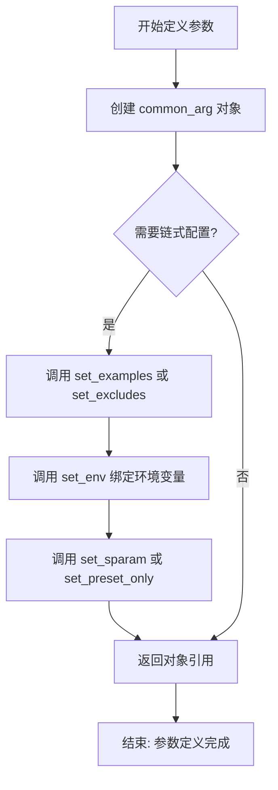
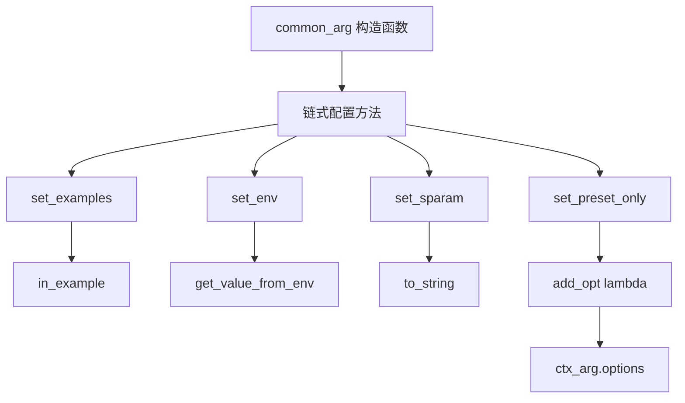
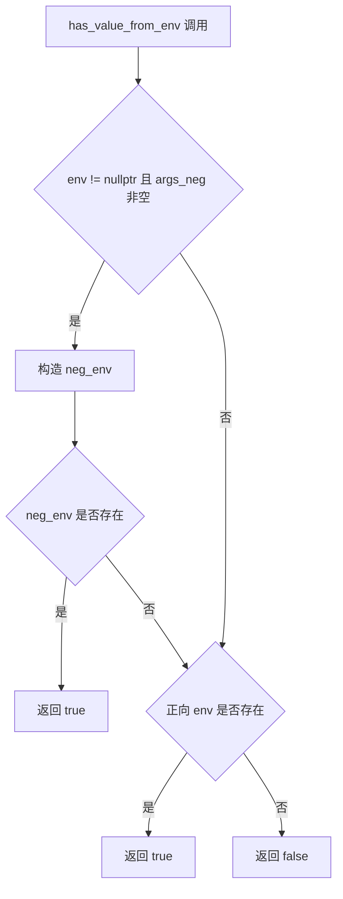
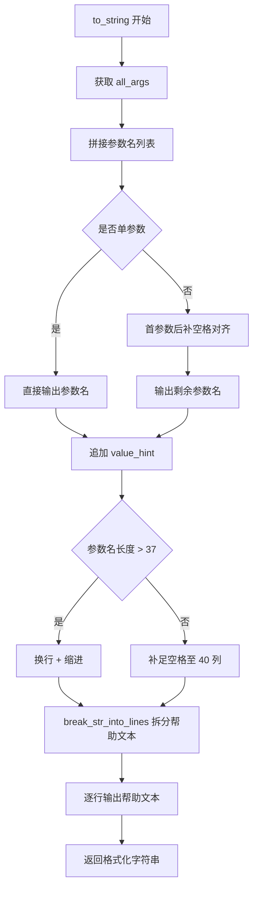
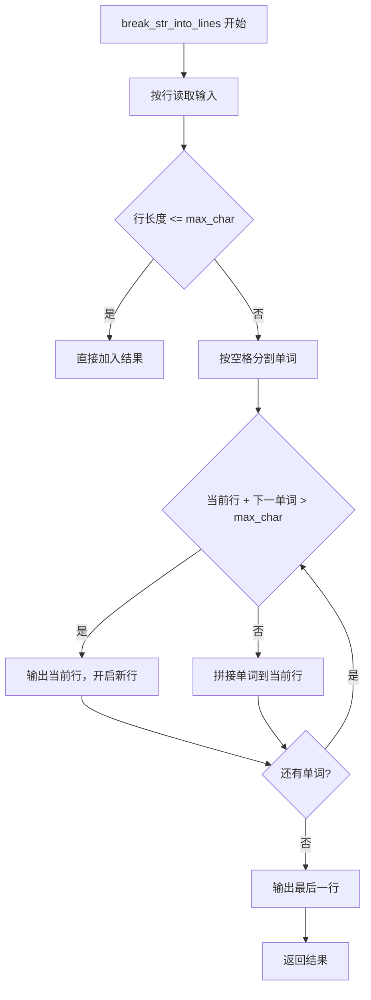
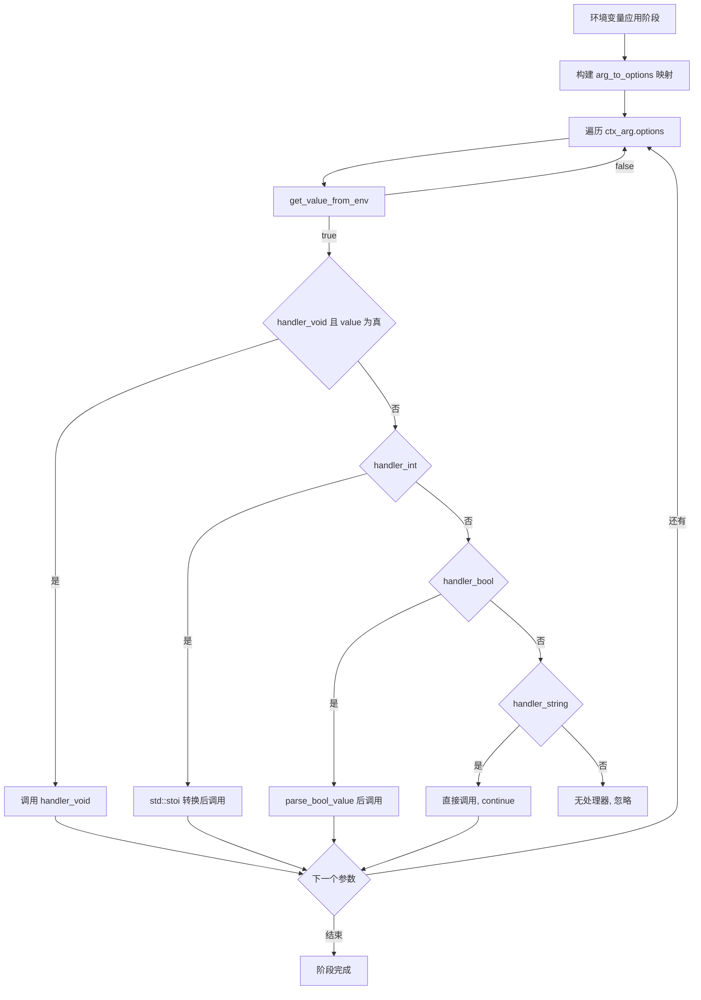
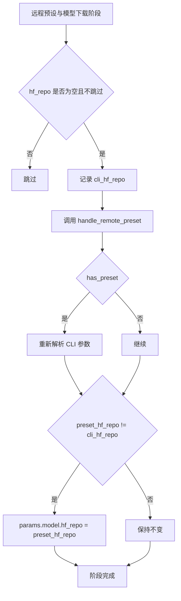
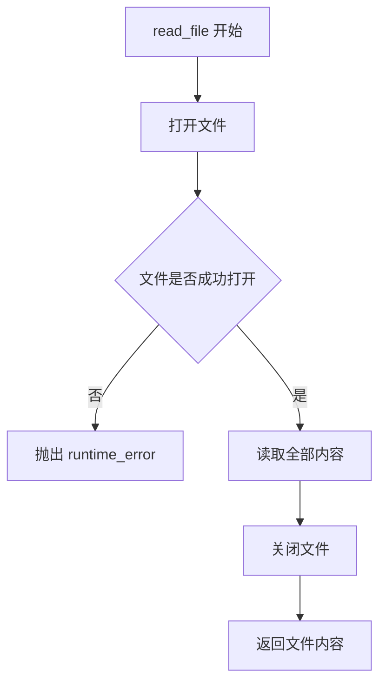
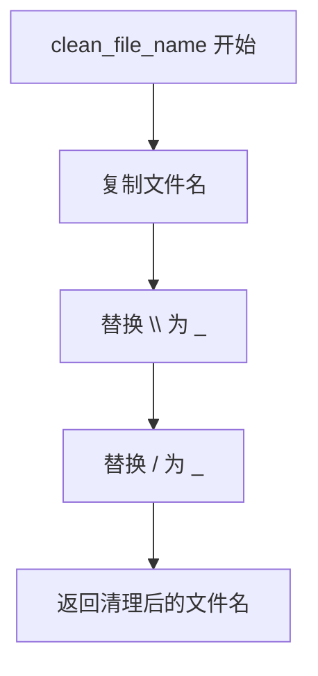
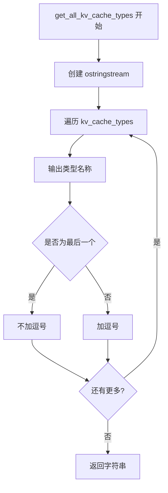

# 第44章 45 预设配置系统 —— 像值机系统一样管理参数

## 学习目标

- 理解 common_arg 核心数据结构：如何通过五种处理器（void/int/bool/string/str_str）和链式配置（set_examples/set_env/set_sparam）声明式定义命令行参数
- 掌握环境变量与 CLI 参数的优先级合并机制：正反环境变量（LLAMA_ARG_NO_）的设计与冲突处理策略
- 解析 common_params_parse_ex 的三阶段流水线：环境变量预处理、CLI 参数分派、远程预设与模型下载
- 掌握远程预设与模型下载机制：common_params_handle_remote_preset 和 common_params_handle_model 的实现流程
- 了解帮助信息生成系统：to_string 的自动排版算法与 print_usage 的三栏分类展示逻辑
- 熟悉特殊参数处理技巧：KV 缓存类型转换、布尔值解析、CSV 设备列表、RPC 设备注册等
- 理解 common_params_context 作为解析上下文的作用，以及预设专属参数（preset_only）的注册机制

## 44.1 生活类比

想象 llama.cpp 的参数系统是一个大型机场的 multilingual 值机系统：common_arg 就像值机柜台工作人员的标准操作手册，详细记录每个手续的名称、所需材料、适用航线以及备用联系方式；五种处理器分别对应不同类型的柜台——handler_void 是自助值机，无需材料，刷身份证即可，handler_int 是行李托运，需要精确的整数重量，handler_bool 是偏好选择，支持正反两种表达，handler_string 是目的地填写，自由文本，handler_str_str 则是中转联程，需要出发地和目的地两个值。链式配置如同工作人员的岗前培训，set_env 分配对讲机频道，set_examples 划定负责区域，set_sparam 标记为 VIP 服务专员。环境变量与 CLI 参数的关系就像网上预约与现场办理：旅客可以先在网上预约座位，但现场值机时可以覆盖之前的选择。common_params_parse_ex 的三阶段流程恰似值机流程：首先检查旅客的网上预办理记录，然后现场办理登机牌和托运行李，如果是联程航班则自动下载后续航段的登机牌。common_params_context 就像值机工作站的配置终端，保存着当前航线的所有参数设置和待处理的乘客列表。而 to_string 的排版艺术则如同机场航班信息显示屏，自动对齐航班号、智能折行目的地信息，确保所有信息整齐易读。就像优秀的值机系统能通过标准化流程处理各种复杂票务需求，llama.cpp 的参数系统通过统一的抽象处理了数百个命令行参数的解析、验证和默认值处理。

## 44.2 源码地图

```
common/arg.h
├── struct common_arg                    # 参数定义核心类（36-92行）
│   ├── 构造函数家族                     # 五种参数类型的初始化
│   │   ├── common_arg()                 # 默认构造函数（36行）
│   │   ├── common_arg(args, hint, help, handler_string)      # 字符串参数（38-42行）
│   │   ├── common_arg(args, hint, help, handler_int)         # 整数参数（44-48行）
│   │   ├── common_arg(args, help, handler_void)              # 无值开关（50-53行）
│   │   ├── common_arg(args, args_neg, help, handler_bool)    # 布尔开关对（55-58行）
│   │   └── common_arg(args, hint, hint2, help, handler_str_str) # 双字符串参数（60-63行）
│   ├── 链式配置方法（声明）              # Builder 模式接口
│   │   ├── set_examples()               # 设置适用示例类型（65行）
│   │   ├── set_excludes()               # 设置排除示例类型（66行）
│   │   ├── set_env()                    # 绑定环境变量（67行）
│   │   ├── set_sparam()                 # 标记为采样参数（68行）
│   │   └── set_preset_only()            # 标记为仅预设参数（69行）
│   ├── 状态检查方法（声明）
│   │   ├── in_example()                 # 检查是否属于指定示例（70行）
│   │   └── is_exclude()                 # 检查是否被指定示例排除（71行）
│   ├── 环境变量方法（声明）
│   │   ├── get_value_from_env()         # 读取环境变量值（72行）
│   │   ├── has_value_from_env()         # 检查环境变量是否存在（73行）
│   │   └── get_env()                    # 获取所有环境变量名（92行）
│   ├── 格式化与比较
│   │   ├── to_string()                  # 格式化帮助文本（74行声明）
│   │   ├── operator<()                  # 比较运算符（76-81行，内联实现）
│   │   ├── operator==()                 # 相等运算符（83-88行，内联实现）
│   │   └── get_args()                   # 获取所有参数名（91行声明）
├── struct common_params_context         # 解析上下文（117行）
│   ├── common_params_context()          # 构造函数（117行）
│   ├── params                           # 参数引用
│   ├── ex                               # 示例类型
│   ├── options                          # 参数定义列表
│   └── print_usage                      # 自定义打印回调
├── common_params_parse()                # 顶层解析入口（124行）
├── common_params_to_map()               # 参数映射生成（127行）
├── common_params_add_preset_options()   # 预设参数注册（132行）
└── common_params_parser_init()          # 解析器初始化（135行）

common/arg.cpp
├── 辅助工具函数
│   ├── read_file()                      # 读取文件内容（134-143行）
│   ├── get_common_arg_defs()            # 获取参数定义表（145-152行）
│   ├── break_str_into_lines()           # 智能换行算法（231-254行）
│   ├── parse_tensor_buffer_overrides()  # 张量缓冲区覆写解析（316-343行）
│   └── clean_file_name()                # 文件名清理（345-349行）
├── common_arg 方法实现
│   ├── 链式配置实现
│   │   ├── common_arg::set_examples()   # 159-163行
│   │   ├── common_arg::set_excludes()   # 165-169行
│   │   ├── common_arg::set_env()        # 171-175行（含帮助文本追加）
│   │   ├── common_arg::set_sparam()     # 177-181行
│   │   └── common_arg::set_preset_only() # 183-187行
│   ├── 状态检查实现
│   │   ├── common_arg::in_example()     # 189-191行
│   │   └── common_arg::is_exclude()     # 193-195行
│   ├── 环境变量处理
│   │   ├── common_arg::get_value_from_env() # 197-216行（支持 NO_ 前缀反转变量）
│   │   ├── common_arg::has_value_from_env() # 218-229行
│   │   └── common_arg::get_env()        # 304-314行（返回所有环境变量名）
│   ├── common_arg::to_string()          # 256-291行（参数名对齐与帮助排版）
│   ├── common_arg::get_args()           # 293-302行（合并正反参数名）
│   ├── common_arg::operator<()          # 76-81行（内联，按首参数名排序）
│   └── common_arg::operator==()         # 83-88行（内联，按首参数名比较）
├── 远程与模型处理
│   ├── common_params_handle_remote_preset()  # 远程预设下载与应用（351-381行）
│   └── common_params_handle_model()     # 三种来源模型下载（389-427行）
├── 类型转换与解析
│   ├── kv_cache_type_from_str()         # KV缓存类型转换（443-450行）
│   ├── get_all_kv_cache_types()         # 缓存类型列表（453-458行）
│   └── parse_bool_value()               # 布尔值解析（462-468行）
├── 解析核心
│   ├── common_params_parse_ex()         # 三阶段解析主循环（470-640行）
│   │   ├── 环境变量应用阶段
│   │   ├── CLI 参数解析阶段（arg_to_options 分派）
│   │   └── 远程预设与模型下载阶段
│   ├── parse_device_list()              # 设备列表解析（748-764行）
│   ├── add_rpc_devices()                # RPC 设备注册（766-782行）
│   ├── common_params_to_map()           # 参数映射生成（784-826行）
│   └── common_params_parse()            # 顶层入口（828-850行）
├── 输出与展示
│   ├── common_params_print_usage()      # 帮助信息打印（642-668行）
│   ├── common_params_print_completion() # Bash 补全脚本生成（670-746行）
│   └── list_builtin_chat_templates()    # 内置模板列表（852-863行）
├── 语义判断工具
│   ├── is_truthy()                      # 真值判断（865-867行）
│   ├── is_falsey()                      # 假值判断（869-871行）
│   └── is_autoy()                       # 自动值判断（873-875行）
├── parse_csv_row()                      # CSV 行解析（877-908行，支持引号）
└── 参数注册中心
    ├── common_params_parser_init()      # 初始化入口（910-920行）
    ├── common_params_add_preset_options() # 预设参数注册（3872-3900行）
    └── ms_parser_init()                 # 参数注册表构建（995-1780+行）
        └── 通过 add_opt() 注册的 200+ 个参数定义
        └── 包括：
            ├── 采样参数（DRY、Adaptive、Mirostat、Logit Bias、Grammar）
            ├── RoPE 缩放（rope-scaling、rope-scale、yarn 系列）
            ├── KV 缓存（cache-type-k/v、kv-offload）
            ├── 设备管理（device、list-devices、tensor-split）
            ├── MoE 优化（cpu-moe、n-cpu-moe）
            ├── 多模态（mmproj、image、audio）
            ├── 服务器（parallel、cont-batching、sleep-idle）
            ├── 推测解码（draft、spec-type、spec-replace）
            ├── TTS 与扩散模型（tts-*、diffusion-*）
            └── 预设模型配置（fim-qwen-*、embd-gemma-default 等）
```

## 44.3 参数定义基石 —— common_arg 的「参数蓝图」

就像值机柜台的标准操作手册，llama.cpp 拥有数百个命令行参数，每个参数都需要名称、类型、帮助文本、环境变量绑定、适用示例类型等元数据。common_arg 将这些元数据集中管理，像一个“参数身份证”，使得参数注册可以声明式完成。

### 44.3.1 common_arg 构造函数：定义参数蓝图

源码路径：`common/arg.h` - `common_arg`（36-63行）

```cpp
// 默认构造函数，用于后续手动赋值
common_arg() = default;

// 字符串参数构造函数：接收参数名列表、值提示、帮助文本、字符串处理器
common_arg(
    const std::initializer_list<const char *> & args,
    const char * value_hint,
    const std::string & help,
    void (*handler)(common_params & params, const std::string &)
) : args(args), value_hint(value_hint), help(help), handler_string(handler) {}

// 整数参数构造函数：与字符串类似，但处理器接受 int
common_arg(
    const std::initializer_list<const char *> & args,
    const char * value_hint,
    const std::string & help,
    void (*handler)(common_params & params, int)
) : args(args), value_hint(value_hint), help(help), handler_int(handler) {}

// 无值开关构造函数：仅触发动作，不需要值
common_arg(
    const std::initializer_list<const char *> & args,
    const std::string & help,
    void (*handler)(common_params & params)
) : args(args), help(help), handler_void(handler) {}

// 布尔开关对构造函数：支持正反两种形式（如 --mmap 和 --no-mmap）
common_arg(
    const std::initializer_list<const char *> & args,
    const std::initializer_list<const char *> & args_neg,
    const std::string & help,
    void (*handler)(common_params & params, bool)
) : args(args), args_neg(args_neg), help(help), handler_bool(handler) {}

// 双字符串参数构造函数：需要两个值，如 --spec-replace TARGET DRAFT
common_arg(
    const std::initializer_list<const char *> & args,
    const char * value_hint,
    const char * value_hint_2,
    const std::string & help,
    void (*handler)(common_params & params, const std::string &, const std::string &)
) : args(args), value_hint(value_hint), value_hint_2(value_hint_2), help(help), handler_str_str(handler) {}
```

**逐行解析：**
- 第 1 行：默认构造函数允许创建空参数对象，用于特殊场景。
- 第 2‑7 行：字符串参数构造函数，初始化参数名列表、值提示（如 `STRING`）、帮助文本和处理器函数指针。
- 第 9‑13 行：整数参数构造函数，处理器接受 `int`，适用于 `--threads 4` 这类参数。
- 第 15‑19 行：无值开关构造函数，不设置 `value_hint`，处理器仅接收 `params`，适用于 `--list-devices`。
- 第 21‑26 行：布尔开关对构造函数，额外接收 `args_neg` 列表，用于定义反向参数（如 `--no-mmap`）。
- 第 28‑34 行：双字符串参数构造函数，有两个值提示，处理器接收两个字符串，用于需要两个值的参数。

这段代码定义了 common_arg 的五种构造函数，覆盖了命令行参数的所有类型需求，为声明式参数注册奠定基础。

```mermaid
classDiagram
    class common_arg {
        +initializer_list~const char*~ args
        +initializer_list~const char*~ args_neg
        +const char* value_hint
        +const char* value_hint_2
        +std::string help
        +set~enum llama_example~ examples
        +set~enum llama_example~ excludes
        +const char* env
        +bool is_sparam
        +bool is_preset_only
        +function<void(common_params&)> handler_void
        +function<void(common_params&, int)> handler_int
        +function<void(common_params&, bool)> handler_bool
        +function<void(common_params&, const string&)> handler_string
        +function<void(common_params&, const string&, const string&)> handler_str_str
        +common_arg()
        +common_arg(args, hint, help, handler_string)
        +common_arg(args, hint, help, handler_int)
        +common_arg(args, help, handler_void)
        +common_arg(args, args_neg, help, handler_bool)
        +common_arg(args, hint, hint2, help, handler_str_str)
    }
```

### 44.3.2 common_arg 链式配置方法：Builder 模式接口

源码路径：`common/arg.h` - `common_arg`（65-69行，声明）

```cpp
common_arg & set_examples(std::initializer_list<enum llama_example> examples);
common_arg & set_excludes(std::initializer_list<enum llama_example> excludes);
common_arg & set_env(const char * env);
common_arg & set_sparam();
common_arg & set_preset_only();
```

**逐行解析：**
- 五种链式配置方法均返回 `common_arg &` 引用，支持 `.set_env(...).set_sparam()` 链式调用。
- `set_examples`/`set_excludes` 通过 `std::set` 存储适用/排除的示例类型。
- `set_env` 绑定环境变量名，并在 `set_env` 实现中自动追加 `(env: ...)` 到帮助文本。
- `set_sparam` 将参数标记为采样参数，用于帮助信息分类。
- `set_preset_only` 标记参数仅在预设文件中生效，不暴露为 CLI 参数。



### 44.3.3 模块依赖图



## 44.4 环境变量的「隐形之手」 —— get_value_from_env 与优先级策略

如同旅客可以先在网上预约座位，环境变量允许用户在启动脚本中预设参数，避免在命令行中重复输入。common_arg 通过 `get_value_from_env` 和 `has_value_from_env` 支持环境变量的读取和冲突检测，并巧妙设计了正反双向环境变量机制。

### 44.4.1 common_arg::get_value_from_env：环境变量读取实现

源码路径：`common/arg.cpp` - `common_arg::get_value_from_env()`（197-216行）

```cpp
bool common_arg::get_value_from_env(std::string & output) const {
    if (env == nullptr) return false;  // 未绑定环境变量，直接返回 false

    // 检查是否存在反向环境变量（如 LLAMA_ARG_NO_ 前缀）
    if (!args_neg.empty()) {
        std::string neg_env = env;
        string_replace_all(neg_env, "LLAMA_ARG_", "LLAMA_ARG_NO_");
        char * neg_value = std::getenv(neg_env.c_str());
        if (neg_value) {
            output = "0";  // 反向变量存在表示禁用，输出 "0"
            return true;
        }
    }

    // 检查正向环境变量
    char * value = std::getenv(env);
    if (value) {
        output = value;
        return true;
    }
    return false;
}
```

**逐行解析：**
- 第 1 行：函数声明，若未绑定环境变量则返回 false。
- 第 2 行：空环境变量名检查，快速退出。
- 第 3‑8 行：如果存在反向参数（`args_neg` 非空），构造反向环境变量名（将 `LLAMA_ARG_` 替换为 `LLAMA_ARG_NO_`），检查是否存在。若存在，输出 `"0"` 表示禁用，并返回 true。
- 第 9‑12 行：检查正向环境变量，若存在则将其值赋给 `output` 并返回 true。
- 第 13 行：都没找到时返回 false。

这段代码实现了环境变量的读取，优先检查反向变量，再检查正向变量，确保布尔参数的语义正确。

```mermaid
flowchart TD
    A[get_value_from_env 调用] --> B{env 是否为 nullptr}
    B -->|是| C[返回 false]
    B -->|否| D{args_neg 是否为空}
    D -->|否| E[构造 neg_env: LLAMA_ARG_NO_ 前缀]
    E --> F[检查 neg_env 是否存在]
    F -->|是| G[output = "0", 返回 true]
    F -->|否| H[检查正向 env 是否存在]
    D -->|是| H
    H -->|是| I[output = value, 返回 true]
    H -->|否| J[返回 false]
```

### 44.4.2 common_arg::has_value_from_env：环境变量存在性检查

源码路径：`common/arg.cpp` - `common_arg::has_value_from_env()`（218-229行）

```cpp
bool common_arg::has_value_from_env() const {
    // 同样先检查反向变量，再检查正向变量
    if (env != nullptr && !args_neg.empty()) {
        std::string neg_env = env;
        string_replace_all(neg_env, "LLAMA_ARG_", "LLAMA_ARG_NO_");
        if (std::getenv(neg_env.c_str())) {
            return true;
        }
    }
    return env != nullptr && std::getenv(env);
}
```

**逐行解析：**
- 第 1‑7 行：若绑定环境变量且有反向参数，检查反向环境变量是否存在，存在则返回 true。
- 第 8 行：最后检查正向环境变量是否存在，返回结果。

这段代码用于在 CLI 解析时检测环境变量是否已设置，以便输出冲突警告。



## 44.5 状态检查与示例过滤 —— in_example 与 is_exclude 的「守门员」

llama.cpp 支持多种工具（CLI、SERVER、EMBEDDING 等），每个参数需要声明适用的示例类型。`in_example` 和 `is_exclude` 方法实现了参数的动态过滤。

### 44.5.1 common_arg::in_example 与 common_arg::is_exclude：正向过滤与反向排除

源码路径：`common/arg.cpp` - `common_arg::in_example()` 和 `common_arg::is_exclude()`（189-195行）

```cpp
bool common_arg::in_example(enum llama_example ex) {
    return examples.find(ex) != examples.end();
}

bool common_arg::is_exclude(enum llama_example ex) {
    return excludes.find(ex) != excludes.end();
}
```

**逐行解析：**
- 第 1‑3 行：`in_example` 检查参数适用的示例集合中是否包含指定示例，用于正向过滤。
- 第 5‑7 行：`is_exclude` 检查参数排除的示例集合中是否包含指定示例，用于反向排除，优先级高于 `in_example`。

这段代码虽然简单，但构成了参数注册表动态裁剪的基础，使得不同工具可以共享同一套参数定义。

```mermaid
flowchart TD
    A[参数过滤检查] --> B[in_example(ex)]
    B --> C{examples 中是否包含 ex}
    C -->|是| D[参数适用于当前示例]
    C -->|否| E[is_exclude(ex)]
    E --> F{excludes 中是否包含 ex}
    F -->|是| G[参数被排除]
    F -->|否| H[参数不适用]
```

## 44.6 参数格式化输出 —— to_string 的「帮助排版艺术」

llama.cpp 有 200+ 参数，可读的帮助信息是用户体验的关键。`to_string` 方法实现了一个自动排版引擎，包括参数名对齐、多行帮助文本缩进、词边界换行。

### 44.6.1 common_arg::to_string：to_string 排版实现

源码路径：`common/arg.cpp` - `common_arg::to_string()`（256-291行）

```cpp
std::string common_arg::to_string() const {
    const static int n_leading_spaces = 40;              // 参数名列宽
    const static int n_char_per_line_help = 70;          // 帮助文本每行字符数
    std::string leading_spaces(n_leading_spaces, ' ');   // 用于对齐的空格字符串
    std::ostringstream ss;
    auto all_args = get_args();  // 获取所有参数名（包括正反）

    // 拼接所有参数名，用逗号分隔，控制长度
    for (const auto & arg : all_args) {
        if (arg == all_args.front()) {
            if (all_args.size() == 1) {
                ss << arg;
            } else {
                auto tmp = std::string(arg) + ", ";
                auto spaces = std::string(std::max(0, 7 - (int)tmp.size()), ' ');
                ss << tmp << spaces;
            }
        } else {
            ss << arg << (arg != all_args.back() ? ", " : "");
        }
    }

    // 添加值提示（如 <N> 或 TYPE）
    if (value_hint) ss << " " << value_hint;
    if (value_hint_2) ss << " " << value_hint_2;

    // 如果参数名过长，换行并从下一列开始帮助文本
    if (ss.tellp() > n_leading_spaces - 3) {
        ss << "\n" << leading_spaces;
    } else {
        ss << std::string(leading_spaces.size() - ss.tellp(), ' ');
    }

    // 将帮助文本按 70 字符智能换行
    const auto help_lines = break_str_into_lines(help, n_char_per_line_help);
    for (const auto & line : help_lines) {
        ss << (&line == &help_lines.front() ? "" : leading_spaces) << line << "\n";
    }
    return ss.str();
}
```

**逐行解析：**
- 第 1‑3 行：定义常量，`n_leading_spaces` 控制参数名列宽（40 字符），`n_char_per_line_help` 控制帮助文本每行长度（70 字符）。
- 第 4‑5 行：创建空格字符串用于对齐，创建字符串流。
- 第 6‑17 行：遍历所有参数名，用逗号分隔，第一个参数名后若还有其他参数，则补空格对齐。
- 第 19‑20 行：追加值提示（如 `<N>` 或 `TYPE`）。
- 第 22‑26 行：检查当前字符串长度，若超过列宽则换行并缩进，否则补足空格。
- 第 28‑31 行：调用 `break_str_into_lines` 将帮助文本拆分为多行，逐行输出，非首行前补空格保持对齐。

这段代码实现了一个精巧的排版系统，确保数百个参数的帮助信息依然整洁易读。



### 44.6.2 break_str_into_lines：智能换行算法

源码路径：`common/arg.cpp` - `break_str_into_lines()`（231-254行）

```cpp
static std::vector<std::string> break_str_into_lines(std::string input, size_t max_char_per_line) {
    std::vector<std::string> result;
    std::istringstream iss(input);
    std::string line;
    auto add_line = [&](const std::string& l) {
        if (l.length() <= max_char_per_line) {
            result.push_back(l);
        } else {
            std::istringstream line_stream(l);
            std::string word, current_line;
            while (line_stream >> word) {
                if (current_line.length() + !current_line.empty() + word.length() > max_char_per_line) {
                    if (!current_line.empty()) result.push_back(current_line);
                    current_line = word;
                } else {
                    current_line += (!current_line.empty() ? " " : "") + word;
                }
            }
            if (!current_line.empty()) result.push_back(current_line);
        }
    };
    while (std::getline(iss, line)) {
        add_line(line);
    }
    return result;
}
```

**逐行解析：**
- 第 1‑3 行：函数接受输入字符串和每行最大字符数，返回拆分后的行向量。
- 第 4‑17 行：`add_line` lambda 处理单行文本，若长度不超过限制则直接加入，否则按空格分割单词，在单词边界处智能换行，避免切断单词。
- 第 18‑21 行：逐行读取输入，调用 `add_line` 处理每一行。

这段代码为 `to_string` 提供了健壮的文本换行能力，确保帮助信息在 70 字符宽度内优雅换行。



## 44.7 参数注册中心 —— add_opt、parser_init 与参数表的构建

参数定义完成后，需要注册到解析上下文中。这个过程就像值机柜台根据不同的航线（示例类型）配置可用的手续（参数），add_opt lambda 负责过滤出当前工具可用的参数，而 common_params_parser_init 和 ms_parser_init 则构成了整个参数注册表的构建流程。

### 44.7.1 add_opt lambda：add_opt 过滤机制

源码路径：`common/arg.cpp` - `ms_parser_init()` 中的 add_opt lambda（995-1780行）

```cpp
auto add_opt = [&](common_arg arg) {
    // 只注册属于当前示例或通用示例，且未被当前示例排除的参数
    if ((arg.in_example(ex) || arg.in_example(LLAMA_EXAMPLE_COMMON)) && !arg.is_exclude(ex)) {
        ctx_arg.options.push_back(std::move(arg));  // 将符合条件的参数移入选项列表
    }
};
```

**逐行解析：**
- 第 1 行：定义 lambda，捕获上下文引用，接受 `common_arg` 对象。
- 第 2 行：条件判断，参数必须属于当前示例 `ex` 或通用示例 `COMMON`，且不能被当前示例排除。
- 第 3 行：将符合条件的参数移入 `ctx_arg.options` 向量，完成注册。

这段代码是参数注册的核心过滤逻辑，确保每个工具只看到自己需要的参数，避免帮助信息混乱。

```mermaid
flowchart TD
    A[add_opt 调用] --> B[检查 in_example(ex) 或 COMMON]
    B --> C{条件满足?}
    C -->|否| D[丢弃参数]
    C -->|是| E[检查 is_exclude(ex)]
    E -->|是| D
    E -->|否| F[push_back 到 ctx_arg.options]
    F --> G[参数注册完成]
```

### 44.7.2 common_params_parser_init：解析器初始化入口

common_params_parser_init 是参数解析的初始化入口，它根据不同的示例类型设置合理的默认值，加载所有动态后端，然后调用 ms_parser_init 来构建参数注册表，最后返回解析上下文。就像值机系统启动时，先连接所有航线数据库，再加载标准操作手册。

源码路径：`common/arg.cpp` - `common_params_parser_init()`（910-920行）

```cpp
common_params_context common_params_parser_init(common_params & params, llama_example ex, void(*print_usage)(int, char **)) {
    // 根据示例类型设置默认参数，如同值机柜台根据航线调整默认配置
    if (ex == LLAMA_EXAMPLE_COMPLETION) {
        params.use_jinja = false;
    } else if (ex == LLAMA_EXAMPLE_MTMD) {
        params.use_jinja = false;
        params.sampling.temp = 0.2;
    } else if (ex == LLAMA_EXAMPLE_SERVER) {
        params.n_parallel = -1;
    }
    params.use_color = tty_can_use_colors();
    ggml_backend_load_all();  // 加载所有动态后端，如同值机系统连接所有航线数据库
    common_params_context ctx_arg(params);
    ctx_arg.print_usage = print_usage;
    ctx_arg.ex = ex;
    ms_parser_init(params, ex, print_usage);  // 调用参数注册表构建函数，它会填充 ctx_arg.options
    return ctx_arg;
}
```

**逐行解析：**
- 第 1‑9 行：函数签名，根据示例类型设置默认参数，例如 SERVER 模式默认 n_parallel 为 -1（自动）。
- 第 10 行：检测终端颜色支持。
- 第 11 行：加载所有动态后端，确保可用的设备都被识别。
- 第 12‑15 行：创建解析上下文，设置打印回调和示例类型。
- 第 16 行：调用 ms_parser_init 注册所有参数，它内部会填充 ctx_arg.options。
- 第 17 行：返回上下文，供后续解析使用。

### 44.7.3 ms_parser_init：参数注册表构建

ms_parser_init 是参数注册的核心，它通过数百个 add_opt 调用，将定义好的 common_arg 对象注册到上下文中。每个调用都通过链式配置方法设置环境变量、示例类型、是否为采样参数等。标记为 set_preset_only() 的参数不会通过 add_opt 注册，它们只在预设文件中生效，需要通过 common_params_add_preset_options 单独添加，这就像值机系统中有些 VIP 服务专柜不对外开放，仅限特定旅客使用。

源码路径：`common/arg.cpp` - `ms_parser_init()`（995-1780+行，以下为简化示例）

```cpp
void ms_parser_init(common_params & params, llama_example ex, void(*print_usage)(int, char **)) {
    // ... 根据示例类型设置默认值 ...
    common_params_context ctx_arg(params);
    ctx_arg.print_usage = print_usage;
    ctx_arg.ex = ex;

    auto add_opt = [&](common_arg arg) {
        if ((arg.in_example(ex) || arg.in_example(LLAMA_EXAMPLE_COMMON)) && !arg.is_exclude(ex)) {
            ctx_arg.options.push_back(std::move(arg));
        }
    };

    // 注册采样参数：--mirostat
    add_opt(common_arg(
        {"--mirostat"}, "N",
        string_format("use Mirostat sampling ... (default: %d)", params.sampling.mirostat),
        [](common_params & params, int value) {
            params.sampling.mirostat = value;
            // 标记采样配置已设置
            params.sampling.user_sampling_config |= common_params_sampling_config::COMMON_PARAMS_SAMPLING_CONFIG_MIROSTAT;
        }
    ).set_sparam());  // 标记为采样参数，用于帮助信息分类

    // 注册带环境变量的布尔参数：--mmap / --no-mmap
    add_opt(common_arg(
        {"--mmap"}, {"--no-mmap"},
        string_format("whether to memory-map model (default: %s)", params.use_mmap ? "enabled" : "disabled"),
        [](common_params & params, bool value) {
            params.use_mmap = value;
        }
    ).set_env("LLAMA_ARG_MMAP"));  // 绑定环境变量

    // 注册设备列表参数：--device
    add_opt(common_arg(
        {"-dev", "--device"}, "<dev1,dev2,..>",
        "comma-separated list of devices to use for offloading",
        [](common_params & params, const std::string & value) {
            params.devices = parse_device_list(value);
        }
    ).set_env("LLAMA_ARG_DEVICE"));

    // ... 更多 add_opt 调用，覆盖 200+ 参数 ...

    // 预设专属参数不会在这里注册，而是通过 common_params_add_preset_options 添加
    // 例如 load-on-startup 参数标记了 set_preset_only()
}
```

**逐行解析：**
- 第 1‑6 行：函数开头，创建上下文并设置示例类型。
- 第 8‑12 行：定义 add_opt lambda，实现参数过滤。
- 第 15‑23 行：注册采样参数，通过 set_sparam() 标记为采样参数。
- 第 26‑34 行：注册布尔参数，通过 set_env() 绑定环境变量。
- 第 37‑44 行：注册设备列表参数，解析逗号分隔的设备名。
- 最后说明：set_preset_only() 标记的参数不会出现在这里，它们由预设系统单独管理。

通过 ms_parser_init，llama.cpp 构建了一个包含 200+ 参数的注册表，每个参数都根据其适用示例被精确过滤，确保每个工具只看到自己需要的参数。

## 44.8 解析主循环 —— common_params_parse_ex 的「调度中心」

正如值机流程分为网上预办理、现场办理和行李托运三个阶段，common_params_parse_ex 是参数解析的核心函数，负责三阶段解析：环境变量应用、CLI 参数解析、远程预设与模型下载。

### 44.8.1 环境变量应用阶段

源码路径：`common/arg.cpp` - `common_params_parse_ex()`（470-640行，环境变量部分）

```cpp
// 构建命令行字符串到参数定义的映射表
std::unordered_map<std::string, std::pair<common_arg *, bool>> arg_to_options;
for (auto & opt : ctx_arg.options) {
    for (const auto & arg : opt.args) {
        arg_to_options[arg] = {&opt, /* is_positive */ true};
    }
    for (const auto & arg : opt.args_neg) {
        arg_to_options[arg] = {&opt, /* is_positive */ false};
    }
}

// 第一阶段：应用环境变量
for (auto & opt : ctx_arg.options) {
    std::string value;
    if (opt.get_value_from_env(value)) {
        try {
            if (opt.handler_void && is_truthy(value)) {
                opt.handler_void(params);
            }
            if (opt.handler_int) {
                opt.handler_int(params, std::stoi(value));
            }
            if (opt.handler_bool) {
                opt.handler_bool(params, parse_bool_value(value));
            }
            if (opt.handler_string) {
                opt.handler_string(params, value);
                continue;
            }
        } catch (std::exception & e) {
            throw std::invalid_argument(string_format(
                "error while handling environment variable \"%s\": %s\n\n",
                opt.env, e.what()));
        }
    }
}
```

**逐行解析：**
- 第 1‑7 行：构建 `arg_to_options` 映射，将每个命令行字符串（包括正反参数）映射到对应的 `common_arg*` 和 `is_positive` 标记。
- 第 10‑26 行：遍历所有参数，从环境变量读取值，根据处理器类型调用相应的处理函数。`handler_void` 仅在值为真时触发，`handler_int` 使用 `std::stoi` 转换，`handler_bool` 使用 `parse_bool_value` 统一解析，`handler_string` 直接传递字符串值。

这段代码完成了第一阶段解析，使得用户可以通过环境变量预设参数。



### 44.8.2 CLI 参数解析阶段

源码路径：`common/arg.cpp` - `common_params_parse_ex()`（470-640行，CLI 解析部分）

```cpp
auto check_arg = [&](int i) {
    if (i+1 >= argc) {
        throw std::invalid_argument("expected value for argument");
    }
};

auto parse_cli_args = [&]() {
    std::set<std::string> seen_args;
    for (int i = 1; i < argc; i++) {
        const std::string arg_prefix = "--";
        std::string arg = argv[i];
        if (arg.compare(0, arg_prefix.size(), arg_prefix) == 0) {
            std::replace(arg.begin(), arg.end(), '_', '-');  // 将下划线替换为连字符
        }
        if (arg_to_options.find(arg) == arg_to_options.end()) {
            throw std::invalid_argument(string_format("error: invalid argument: %s", arg.c_str()));
        }
        if (!seen_args.insert(arg).second) {
            LOG_WRN("DEPRECATED: argument '%s' specified multiple times, use comma-separated values instead\n", arg.c_str());
        }
        auto & tmp = arg_to_options[arg];
        auto opt = *tmp.first;
        bool is_positive = tmp.second;

        // 如果环境变量已设置，输出警告，CLI 将覆盖它
        if (opt.has_value_from_env()) {
            fprintf(stderr, "warn: %s environment variable is set, but will be overwritten by command line argument %s\n", opt.env, arg.c_str());
        }

        try {
            if (opt.handler_void) {
                opt.handler_void(params);
                continue;
            }
            if (opt.handler_bool) {
                opt.handler_bool(params, is_positive);
                continue;
            }
            check_arg(i);
            std::string val = argv[++i];
            if (opt.handler_int) {
                opt.handler_int(params, std::stoi(val));
                continue;
            }
            if (opt.handler_string) {
                opt.handler_string(params, val);
                continue;
            }
            check_arg(i);
            std::string val2 = argv[++i];
            if (opt.handler_str_str) {
                opt.handler_str_str(params, val, val2);
                continue;
            }
        } catch (std::exception & e) {
            throw std::invalid_argument(string_format(
                "error while handling argument \"%s\": %s\n\nusage:\n%s\n\nto show complete usage, run with -h",
                arg.c_str(), e.what(), opt.to_string().c_str()));
        }
    }
};
```

**逐行解析：**
- 第 1‑3 行：定义 `check_arg` lambda，防止数组越界。
- 第 5‑47 行：定义 `parse_cli_args` lambda，遍历命令行参数。
  - 第 9‑10 行：将参数名中的下划线替换为连字符，统一命名风格。
  - 第 11‑13 行：查找参数映射，若不存在则抛出异常。
  - 第 15‑17 行：检查参数是否重复，输出弃用警告。
  - 第 18‑20 行：获取参数对象和 `is_positive` 标记。
  - 第 22‑25 行：如果环境变量已设置，输出警告，CLI 参数将覆盖环境变量。
  - 第 27‑46 行：根据处理器类型分派执行，`handler_void` 和 `handler_bool` 不需要值，其他处理器需要从 argv 中提取值。

这段代码完成了第二阶段解析，实现了 CLI 参数对环境变量的覆盖，并提供了详细的错误提示。

```mermaid
flowchart TD
    A[CLI 解析阶段] --> B[parse_cli_args 开始]
    B --> C[遍历 argv]
    C --> D[替换 _ 为 -]
    D --> E{arg 是否在映射中}
    E -->|否| F[抛出 invalid_argument]
    E -->|是| G{是否重复}
    G -->|是| H[输出 DEPRECATED 警告]
    G -->|否| I[继续]
    H --> I
    I --> J[获取 opt 和 is_positive]
    J --> K{has_value_from_env}
    K -->|是| L[输出 overwritten 警告]
    K -->|否| M[继续]
    L --> M
    M --> N{handler_void}
    N -->|是| O[调用 handler_void, continue]
    N -->|否| P{handler_bool}
    P -->|是| Q[调用 handler_bool(params, is_positive), continue]
    P -->|否| R[check_arg(i)]
    R --> S[读取 val = argv[++i]]
    S --> T{handler_int}
    T -->|是| U[std::stoi 转换后调用, continue]
    T -->|否| V{handler_string}
    V -->|是| W[调用 handler_string(params, val), continue]
    V -->|否| X[check_arg(i)]
    X --> Y[读取 val2 = argv[++i]]
    Y --> Z{handler_str_str}
    Z -->|是| AA[调用 handler_str_str(params, val, val2), continue]
    Z -->|否| AB[无匹配处理器]
    O --> AC{下一个参数}
    Q --> AC
    U --> AC
    W --> AC
    AA --> AC
    AB --> AC
    AC -->|还有| C
    AC -->|结束| AD[阶段完成]
```

### 44.8.3 远程预设与模型下载阶段

源码路径：`common/arg.cpp` - `common_params_parse_ex()`（470-640行，远程预设部分）

```cpp
// 第三阶段：远程预设与模型下载
const bool skip_model_download = ctx_arg.ex == LLAMA_EXAMPLE_EXPORT_GRAPH_OPS;
if (!params.model.hf_repo.empty() && !skip_model_download) {
    std::string cli_hf_repo = params.model.hf_repo;
    bool has_preset = common_params_handle_remote_preset(params, ctx_arg.ex);
    std::string preset_hf_repo = params.model.hf_repo;
    bool preset_has_hf_repo = preset_hf_repo != cli_hf_repo;
    if (has_preset) {
        parse_cli_args();  // 预设可能修改了参数，需要重新解析 CLI
    }
    if (preset_has_hf_repo) {
        params.model.hf_repo = preset_hf_repo;
    }
}
```

**逐行解析：**
- 第 1‑2 行：检查是否跳过模型下载（如导出图算子时）。
- 第 3‑12 行：如果 HF 仓库不为空，调用 `common_params_handle_remote_preset` 下载并应用远程预设。预设可能修改 `hf_repo`，因此需要重新解析 CLI 参数以确保 CLI 优先级最高。

这段代码完成了第三阶段解析，实现了远程预设的自动下载和应用。



## 44.9 辅助工具函数 —— read_file 与 clean_file_name 的「幕后英雄」

参数解析过程中，经常需要读取文件内容或清理文件名。`read_file` 和 `clean_file_name` 是两个常用的辅助函数。

### 44.9.1 read_file：read_file 文件读取

源码路径：`common/arg.cpp` - `read_file()`（134-143行）

```cpp
static std::string read_file(const std::string & fname) {
    std::ifstream file(fname);
    if (!file) {
        throw std::runtime_error(string_format("error: failed to open file '%s'\n", fname.c_str()));
    }
    std::string content((std::istreambuf_iterator<char>(file)), std::istreambuf_iterator<char>());
    file.close();
    return content;
}
```

**逐行解析：**
- 第 1 行：定义函数，接受文件名，返回文件内容字符串。
- 第 2‑4 行：打开文件，若失败则抛出运行时异常，包含详细错误信息。
- 第 5 行：使用 `istreambuf_iterator` 读取整个文件内容到字符串。
- 第 6‑7 行：关闭文件并返回内容。

这段代码为 `--grammar-file`、`--chat-template-file` 等参数提供了统一的文件读取接口。



### 44.9.2 clean_file_name：clean_file_name 文件名清理

源码路径：`common/arg.cpp` - `clean_file_name()`（345-349行）

```cpp
static std::string clean_file_name(const std::string & fname) {
    std::string clean_fname = fname;
    string_replace_all(clean_fname, "\\", "_");  // Windows 路径分隔符
    string_replace_all(clean_fname, "/", "_");   // Unix 路径分隔符
    return clean_fname;
}
```

**逐行解析：**
- 第 1 行：定义函数，接受文件名，返回清理后的文件名。
- 第 2‑4 行：将路径分隔符替换为下划线，用于生成缓存文件名，避免路径冲突。

这段代码在下载远程预设时，用于生成安全的本地缓存文件名。



## 44.10 远程预设加载 —— handle_remote_preset 的「云端配置」

Hugging Face 上的模型通常附带推荐配置，用户执行 `-hf user/repo:tag` 时自动下载并应用。`common_params_handle_remote_preset` 实现了这一功能。

### 44.10.1 common_params_handle_remote_preset：远程预设下载与应用

源码路径：`common/arg.cpp` - `common_params_handle_remote_preset()`（351-381行）

```cpp
static bool common_params_handle_remote_preset(common_params & params, llama_example ex) {
    GGML_ASSERT(!params.model.hf_repo.empty());
    auto [hf_repo, hf_tag] = common_download_split_repo_tag(params.model.hf_repo);
    if (hf_tag == "latest") {
        hf_tag = "default";
    }
    const bool offline = params.offline;
    std::string model_endpoint = get_model_endpoint();
    auto preset_url = model_endpoint + hf_repo + "/resolve/main/preset.ini";
    auto preset_fname = clean_file_name(hf_repo + "_preset.ini");
    auto preset_path = fs_get_cache_file(preset_fname);
    const int status = common_download_file_single(preset_url, preset_path, params.hf_token, offline);
    const bool has_preset = status >= 200 && status < 400;
    if (has_preset) {
        LOG_INF("applying remote preset from %s\n", preset_url.c_str());
        common_preset_context ctx(ex, /* only_remote_allowed */ true);
        common_preset global;
        auto remote_presets = ctx.load_from_ini(preset_path, global);
        remote_presets = ctx.cascade(global, remote_presets);
        if (remote_presets.find(hf_tag) != remote_presets.end()) {
            common_preset preset = remote_presets.at(hf_tag);
            LOG_INF("\n%s", preset.to_ini().c_str());
            preset.apply_to_params(params);
        } else {
            throw std::runtime_error("Remote preset.ini does not contain [" + std::string(hf_tag) + "] section");
        }
    } else {
        LOG_INF("%s", "no remote preset found, skipping\n");
    }
    return has_preset;
}
```

**逐行解析：**
- 第 1‑3 行：函数声明，断言 HF 仓库不为空，拆分仓库和标签。
- 第 4‑6 行：若标签为 "latest"，则使用 "default" 作为默认预设名。
- 第 7‑11 行：构造预设文件的 URL 和本地缓存路径，调用 `common_download_file_single` 下载。
- 第 12‑25 行：若下载成功（HTTP 200-399），创建预设上下文，加载 INI 文件，级联合并预设，应用到参数。若失败，仅输出日志。

这段代码实现了远程预设的自动下载和应用，使得用户无需手动配置即可获得模型推荐参数。

```mermaid
flowchart TD
    A[handle_remote_preset 开始] --> B[拆分 hf_repo 和 hf_tag]
    B --> C{hf_tag == "latest"}
    C -->|是| D[hf_tag = "default"]
    C -->|否| E[继续]
    D --> E
    E --> F[构造 preset_url]
    F --> G[构造本地缓存路径]
    G --> H[下载 preset.ini]
    H --> I{HTTP 状态 200-399}
    I -->|是| J[创建 common_preset_context]
    J --> K[load_from_ini 加载预设]
    K --> L[cascade 级联合并]
    L --> M{hf_tag 是否存在}
    M -->|是| N[apply_to_params 应用预设]
    M -->|否| O[抛出 runtime_error]
    I -->|否| P[输出 "no remote preset found"]
    N --> Q[返回 true]
    O --> Q
    P --> Q[返回 false]
```

## 44.11 模型下载处理 —— handle_model 的「搬运工」

`common_params_handle_model` 处理三种模型来源：Docker 仓库、Hugging Face 仓库和远程 URL。

### 44.11.1 common_params_handle_model：三种模型来源处理

源码路径：`common/arg.cpp` - `common_params_handle_model()`（389-427行）

```cpp
static handle_model_result common_params_handle_model(struct common_params_model & model,
                                                      const std::string          & bearer_token,
                                                      bool                         offline) {
    handle_model_result result;
    if (!model.docker_repo.empty()) {
        model.path = common_docker_resolve_model(model.docker_repo);
        model.name = model.docker_repo;
    } else if (!model.hf_repo.empty()) {
        if (model.hf_file.empty() && !model.path.empty()) {
            model.hf_file = model.path;
            model.path = "";
        }
        common_download_model_opts opts;
        opts.download_mmproj = true;
        opts.offline = offline;
        auto download_result = common_download_model(model, bearer_token, opts);
        if (download_result.model_path.empty()) {
            LOG_ERR("error: failed to download model from Hugging Face\n");
            exit(1);
        }
        model.name = model.hf_repo;
        model.path = download_result.model_path;
        if (!download_result.mmproj_path.empty()) {
            result.found_mmproj = true;
            result.mmproj.path  = download_result.mmproj_path;
        }
    } else if (!model.url.empty()) {
        if (model.path.empty()) {
            auto f = string_split<std::string>(model.url, '#').front();
            f = string_split<std::string>(f, '?').front();
            model.path = fs_get_cache_file(string_split<std::string>(f, '/').back());
        }
        common_download_model_opts opts;
        opts.offline = offline;
        auto download_result = common_download_model(model, bearer_token, opts);
        if (download_result.model_path.empty()) {
            LOG_ERR("error: failed to download model from %s\n", model.url.c_str());
            exit(1);
        }
    }
    return result;
}
```

**逐行解析：**
- 第 1‑4 行：函数声明，处理模型下载，返回下载结果（包括 mmproj 路径）。
- 第 5‑9 行：处理 Docker 仓库来源，调用 `common_docker_resolve_model` 解析模型路径。
- 第 10‑26 行：处理 Hugging Face 仓库来源，支持自动下载 mmproj（多模态投影器），下载失败时退出程序。
- 第 27‑39 行：处理远程 URL 来源，从 URL 中提取文件名作为缓存路径，下载模型。

这段代码封装了三种模型下载逻辑，为用户提供了灵活的模型获取方式。

```mermaid
flowchart TD
    A[handle_model 开始] --> B{docker_repo 是否为空}
    B -->|是| C[调用 common_docker_resolve_model]
    B -->|否| D{hf_repo 是否为空}
    D -->|是| E[处理 hf_file 和 path]
    E --> F[设置 download_mmproj = true]
    F --> G[调用 common_download_model]
    G --> H{model_path 是否为空}
    H -->|是| I[输出错误并 exit(1)]
    H -->|否| J[设置 model.name 和 model.path]
    J --> K{mmproj_path 是否为空}
    K -->|否| L[设置 found_mmproj = true]
    D -->|否| M{url 是否为空}
    M -->|是| N[从 URL 提取文件名作为缓存路径]
    N --> O[调用 common_download_model]
    O --> P{model_path 是否为空}
    P -->|是| Q[输出错误并 exit(1)]
    P -->|否| R[继续]
    C --> S[返回 result]
    L --> S
    R --> S
```

## 44.12 KV 缓存类型解析 —— kv_cache_type_from_str 的「类型翻译」

KV 缓存占据推理时的大部分内存，支持多种量化类型以节省内存。`kv_cache_type_from_str` 将字符串转换为 `ggml_type` 枚举。

### 44.12.1 kv_cache_type_from_str：字符串到类型的转换

源码路径：`common/arg.cpp` - `kv_cache_type_from_str()`（443-450行）

```cpp
static ggml_type kv_cache_type_from_str(const std::string & s) {
    for (const auto & type : kv_cache_types) {
        if (ggml_type_name(type) == s) {
            return type;
        }
    }
    throw std::runtime_error("Unsupported cache type: " + s);
}
```

**逐行解析：**
- 第 1 行：定义函数，接受类型字符串，返回 `ggml_type` 枚举。
- 第 2‑4 行：遍历支持的缓存类型列表，匹配类型名称，找到则返回。
- 第 5 行：未找到时抛出运行时异常，提示不支持的缓存类型。

这段代码为 `--cache-type-k` 和 `--cache-type-v` 参数提供了类型解析，确保用户输入合法。

```mermaid
flowchart TD
    A[kv_cache_type_from_str 开始] --> B[遍历 kv_cache_types]
    B --> C{ggml_type_name(type) == s}
    C -->|是| D[返回 type]
    C -->|否| E{还有更多类型?}
    E -->|是| B
    E -->|否| F[抛出 runtime_error]
```

### 44.12.2 get_all_kv_cache_types：缓存类型列表

源码路径：`common/arg.cpp` - `get_all_kv_cache_types()`（453-458行）

```cpp
static std::string get_all_kv_cache_types() {
    std::ostringstream msg;
    for (const auto & type : kv_cache_types) {
        msg << ggml_type_name(type) << (&type == &kv_cache_types.back() ? "" : ", ");
    }
    return msg.str();
}
```

**逐行解析：**
- 第 1‑6 行：遍历 `kv_cache_types`，将每个类型名称拼接为逗号分隔的字符串，用于帮助信息。

这段代码为用户提供了可用的 KV 缓存类型列表，方便选择合适的量化类型。



## 44.13 特殊参数处理 —— 布尔、CSV、设备列表的「小技巧」

参数解析中，有些特殊格式需要额外处理，如布尔值的多种表达、带引号的 CSV 行、设备列表等。

### 44.13.1 parse_bool_value：布尔值解析

源码路径：`common/arg.cpp` - `parse_bool_value()`（462-468行）

```cpp
static bool parse_bool_value(const std::string & value) {
    if (is_truthy(value)) {
        return true;
    } else if (is_falsey(value)) {
        return false;
    } else {
        throw std::invalid_argument("invalid boolean value");
    }
}
```

**逐行解析：**
- 第 1‑6 行：使用 `is_truthy` 和 `is_falsey` 统一判断布尔值，支持 `true/false/on/off/1/0/yes/no` 等多种表达，非法值抛出异常。

```mermaid
flowchart TD
    A[parse_bool_value 开始] --> B{is_truthy(value)}
    B -->|是| C[返回 true]
    B -->|否| D{is_falsey(value)}
    D -->|是| E[返回 false]
    D -->|否| F[抛出 invalid_argument]
```

### 44.13.2 parse_csv_row：CSV 行解析

源码路径：`common/arg.cpp` - `parse_csv_row()`（877-908行）

```cpp
static std::vector<std::string> parse_csv_row(const std::string& input) {
    std::vector<std::string> fields;
    std::string field;
    bool in_quotes = false;
    for (size_t i = 0; i < input.length(); ++i) {
        char ch = input[i];
        if (ch == '"') {
            if (!in_quotes) {
                if (!field.empty()) {
                    field += '"';
                } else {
                    in_quotes = true;
                }
            } else {
                if (i + 1 < input.length() && input[i + 1] == '"') {
                    field += '"';
                    ++i;
                } else {
                    in_quotes = false;
                }
            }
        } else if (ch == ',') {
            if (in_quotes) {
                field += ',';
            } else {
                fields.push_back(std::move(field));
                field.clear();
            }
        } else {
            field += ch;
        }
    }
    fields.push_back(std::move(field));
    return fields;
}
```

**逐行解析：**
- 第 1‑3 行：定义函数，初始化字段向量和引号状态。
- 第 4‑30 行：逐字符处理，若在引号内则保留逗号和引号，否则按逗号分割字段。处理引号转义（双引号表示一个引号）。
- 第 31‑32 行：将最后一个字段加入向量并返回。

这段代码为 `--image` 等多文件参数提供了健壮的 CSV 解析，支持引号内的逗号。

```mermaid
flowchart TD
    A[parse_csv_row 开始] --> B[初始化 fields, field, in_quotes]
    B --> C[遍历每个字符]
    C --> D{ch == '"'}
    D -->|是| E{!in_quotes}
    E -->|是| F{field 是否为空}
    F -->|是| G[in_quotes = true]
    F -->|否| H[field += '"']
    E -->|否| I{i+1 < len 且 input[i+1] == '"'}
    I -->|是| J[field += '"', ++i]
    I -->|否| K[in_quotes = false]
    D -->|否| L{ch == ','}
    L -->|是| M{in_quotes}
    M -->|是| N[field += ',']
    M -->|否| O[push field, 清空 field]
    L -->|否| P[field += ch]
    G --> Q{还有字符?}
    H --> Q
    J --> Q
    K --> Q
    N --> Q
    O --> Q
    P --> Q
    Q -->|是| C
    Q -->|否| R[push 最后一个 field]
    R --> S[返回 fields]
```

### 44.13.3 parse_device_list：设备列表解析

源码路径：`common/arg.cpp` - `parse_device_list()`（748-764行）

```cpp
static std::vector<ggml_backend_dev_t> parse_device_list(const std::string & value) {
    std::vector<ggml_backend_dev_t> devices;
    auto dev_names = string_split<std::string>(value, ',');
    if (dev_names.empty()) {
        throw std::invalid_argument("no devices specified");
    }
    if (dev_names.size() == 1 && dev_names[0] == "none") {
        devices.push_back(nullptr);
    } else {
        for (const auto & device : dev_names) {
            auto * dev = ggml_backend_dev_by_name(device.c_str());
            if (!dev || ggml_backend_dev_type(dev) == GGML_BACKEND_DEVICE_TYPE_CPU) {
                throw std::invalid_argument(string_format("invalid device: %s", device.c_str()));
            }
            devices.push_back(dev);
        }
        devices.push_back(nullptr);
    }
    return devices;
}
```

**逐行解析：**
- 第 1‑5 行：定义函数，按逗号分割设备名，检查是否为空。
- 第 6‑9 行：若设备为 "none"，添加 `nullptr` 表示不卸载。
- 第 10‑19 行：否则根据设备名查找后端设备指针，排除 CPU 设备，最后添加 `nullptr` 作为结束标记。

这段代码为 `--device` 参数提供了设备列表解析，支持 GPU 卸载配置。

```mermaid
flowchart TD
    A[parse_device_list 开始] --> B[按逗号分割设备名]
    B --> C{是否为空}
    C -->|是| D[抛出 invalid_argument]
    C -->|否| E{是否只有一个且为 "none"}
    E -->|是| F[添加 nullptr]
    E -->|否| G[遍历设备名]
    G --> H[查找后端设备]
    H --> I{设备是否存在且非 CPU}
    I -->|否| J[抛出 invalid_argument]
    I -->|是| K[添加设备指针]
    K --> L{还有更多?}
    L -->|是| G
    L -->|否| M[添加 nullptr 结束标记]
    F --> N[返回 devices]
    M --> N
```

## 44.14 RPC 设备注册 —— add_rpc_devices 的「远程算力」

RPC 后端允许 llama.cpp 调用远程服务器上的模型推理。`add_rpc_devices` 动态加载 RPC 后端并注册远程服务器。

### 44.14.1 add_rpc_devices：RPC 设备注册实现

源码路径：`common/arg.cpp` - `add_rpc_devices()`（766-782行）

```cpp
static void add_rpc_devices(const std::string & servers) {
    auto rpc_servers = string_split<std::string>(servers, ',');
    if (rpc_servers.empty()) {
        throw std::invalid_argument("no RPC servers specified");
    }
    ggml_backend_reg_t rpc_reg = ggml_backend_reg_by_name("RPC");
    if (!rpc_reg) {
        throw std::invalid_argument("failed to find RPC backend");
    }
    typedef ggml_backend_reg_t (*ggml_backend_rpc_add_server_t)(const char * endpoint);
    ggml_backend_rpc_add_server_t ggml_backend_rpc_add_server_fn = (ggml_backend_rpc_add_server_t) ggml_backend_reg_get_proc_address(rpc_reg, "ggml_backend_rpc_add_server");
    if (!ggml_backend_rpc_add_server_fn) {
        throw std::invalid_argument("failed to find RPC add server function");
    }
    for (const auto & server : rpc_servers) {
        auto reg = ggml_backend_rpc_add_server_fn(server.c_str());
        ggml_backend_register(reg);
    }
}
```

**逐行解析：**
- 第 1‑4 行：定义函数，按逗号分割 RPC 服务器地址，检查是否为空。
- 第 5‑7 行：查找 RPC 后端注册表，若不存在则抛出异常。
- 第 8‑14 行：通过函数指针动态获取 `ggml_backend_rpc_add_server` 函数，避免硬依赖。
- 第 15‑18 行：遍历服务器地址，调用函数注册每个 RPC 后端。

这段代码实现了 RPC 设备的动态注册，使得 llama.cpp 可以利用远程 GPU 资源。

```mermaid
flowchart TD
    A[add_rpc_devices 开始] --> B[按逗号分割服务器地址]
    B --> C{是否为空}
    C -->|是| D[抛出 invalid_argument]
    C -->|否| E[查找 RPC 后端注册表]
    E --> F{是否找到}
    F -->|否| G[抛出 invalid_argument]
    F -->|是| H[获取函数指针 ggml_backend_rpc_add_server]
    H --> I{函数指针是否有效}
    I -->|否| J[抛出 invalid_argument]
    I -->|是| K[遍历服务器地址]
    K --> L[调用函数注册 RPC 后端]
    L --> M{还有更多?}
    M -->|是| K
    M -->|否| N[结束]
```

## 44.15 参数映射生成 —— common_params_to_map 的「文档输出」

`common_params_to_map` 将命令行参数转换为 `std::map<common_arg, std::string>`，用于文档生成和调试。

### 44.15.1 common_params_to_map：参数映射生成

源码路径：`common/arg.cpp` - `common_params_to_map()`（784-826行）

```cpp
bool common_params_to_map(int argc, char ** argv, llama_example ex, std::map<common_arg, std::string> & out_map) {
    common_params dummy_params;
    common_params_context ctx_arg = common_params_parser_init(dummy_params, ex, nullptr);
    std::unordered_map<std::string, common_arg *> arg_to_options;
    for (auto & opt : ctx_arg.options) {
        for (const auto & arg : opt.args) {
            arg_to_options[arg] = &opt;
        }
        for (const auto & arg : opt.args_neg) {
            arg_to_options[arg] = &opt;
        }
    }
    auto check_arg = [&](int i) {
        if (i+1 >= argc) {
            throw std::invalid_argument("expected value for argument");
        }
    };
    std::set<std::string> seen_args;
    for (int i = 1; i < argc; i++) {
        const std::string arg_prefix = "--";
        std::string arg = argv[i];
        if (arg.compare(0, arg_prefix.size(), arg_prefix) == 0) {
            std::replace(arg.begin(), arg.end(), '_', '-');
        }
        if (arg_to_options.find(arg) == arg_to_options.end()) {
            throw std::invalid_argument(string_format("error: invalid argument: %s", arg.c_str()));
        }
        if (!seen_args.insert(arg).second) {
            LOG_WRN("DEPRECATED: argument '%s' specified multiple times, use comma-separated values instead (only last value will be used)\n", arg.c_str());
        }
        auto opt = *arg_to_options[arg];
        std::string val;
        if (opt.value_hint == nullptr && opt.value_hint_2 == nullptr) {
            bool is_neg = std::find(opt.args_neg.begin(), opt.args_neg.end(), arg) != opt.args_neg.end();
            val = is_neg ? "0" : "1";
        }
        if (opt.value_hint != nullptr) {
            check_arg(i);
            val = argv[++i];
        }
        if (opt.value_hint_2 != nullptr) {
            throw std::invalid_argument("error: argument with 2 values is not yet supported\n");
        }
        out_map[opt] = val;
    }
    return true;
}
```

**逐行解析：**
- 第 1‑11 行：初始化 dummy 参数和上下文，构建命令行字符串到参数定义的映射。
- 第 12‑14 行：定义 `check_arg` lambda 防止越界。
- 第 15‑40 行：遍历命令行参数，根据参数类型提取值。无值参数自动填充 "0" 或 "1"，单值参数从 argv 提取，双值参数暂不支持。

这段代码为脚本和工具提供了参数映射功能，便于分析用户输入。

```mermaid
flowchart TD
    A[common_params_to_map 开始] --> B[初始化 dummy_params 和 ctx_arg]
    B --> C[构建 arg_to_options 映射]
    C --> D[遍历 argv]
    D --> E[替换 _ 为 -]
    E --> F{arg 是否在映射中}
    F -->|否| G[抛出 invalid_argument]
    F -->|是| H{是否重复}
    H -->|是| I[输出 DEPRECATED 警告]
    H -->|否| J[继续]
    I --> J
    J --> K[获取 opt]
    K --> L{value_hint 和 value_hint_2 是否都为 nullptr}
    L -->|是| M[根据 is_neg 设置 val 为 "0" 或 "1"]
    L -->|否| N{value_hint != nullptr}
    N -->|是| O[check_arg(i), val = argv[++i]]
    N -->|否| P{value_hint_2 != nullptr}
    P -->|是| Q[抛出 unsupported 错误]
    P -->|否| R[继续]
    M --> S[插入 out_map]
    O --> S
    Q --> T[结束]
    R --> S
    S --> U{还有参数?}
    U -->|是| D
    U -->|否| V[返回 true]
```

## 44.16 帮助信息生成 —— print_usage 的「三栏展示」

`common_params_print_usage` 将参数按通用、采样、特定示例分类，三栏展示，提升帮助信息的可读性。

### 44.16.1 common_params_print_usage：三栏分类展示

源码路径：`common/arg.cpp` - `common_params_print_usage()`（642-668行）

```cpp
static void common_params_print_usage(common_params_context & ctx_arg) {
    auto print_options = [](std::vector<common_arg *> & options) {
        for (common_arg * opt : options) {
            printf("%s", opt->to_string().c_str());
        }
    };
    std::vector<common_arg *> common_options;
    std::vector<common_arg *> sparam_options;
    std::vector<common_arg *> specific_options;
    for (auto & opt : ctx_arg.options) {
        if (opt.is_sparam) {
            sparam_options.push_back(&opt);
        } else if (opt.in_example(ctx_arg.ex)) {
            specific_options.push_back(&opt);
        } else {
            common_options.push_back(&opt);
        }
    }
    printf("----- common params -----\n\n");
    print_options(common_options);
    printf("\n\n----- sampling params -----\n\n");
    print_options(sparam_options);
    printf("\n\n----- example-specific params -----\n\n");
    print_options(specific_options);
}
```

**逐行解析：**
- 第 1‑3 行：定义打印辅助函数，遍历参数向量并调用 `to_string` 输出。
- 第 4‑13 行：将参数分为三类：采样参数（`is_sparam`）、特定示例参数（`in_example`）、通用参数（其余）。
- 第 14‑24 行：按分类打印帮助信息，使用分隔线标识。

这段代码使得帮助信息结构清晰，用户可以快速定位所需参数。

```mermaid
flowchart TD
    A[print_usage 开始] --> B[分类参数]
    B --> C{is_sparam}
    C -->|是| D[加入 sparam_options]
    C -->|否| E{in_example(ex)}
    E -->|是| F[加入 specific_options]
    E -->|否| G[加入 common_options]
    D --> H{还有参数?}
    F --> H
    G --> H
    H -->|是| B
    H -->|否| I[打印 common params]
    I --> J[打印 sampling params]
    J --> K[打印 example-specific params]
    K --> L[结束]
```

## 44.17 自动补全脚本 —— print_completion 的「shell 魔法」

`common_params_print_completion` 生成 Bash 自动补全脚本，支持参数名补全和文件类型过滤。

### 44.17.1 common_params_print_completion：Bash 补全脚本生成

源码路径：`common/arg.cpp` - `common_params_print_completion()`（670-746行）

```cpp
static void common_params_print_completion(common_params_context & ctx_arg) {
    std::vector<common_arg *> common_options;
    std::vector<common_arg *> sparam_options;
    std::vector<common_arg *> specific_options;
    for (auto & opt : ctx_arg.options) {
        if (opt.is_sparam) {
            sparam_options.push_back(&opt);
        } else if (opt.in_example(ctx_arg.ex)) {
            specific_options.push_back(&opt);
        } else {
            common_options.push_back(&opt);
        }
    }
    printf("_llama_completions() {\n");
    printf("    local cur prev opts\n");
    printf("    COMPREPLY=()\n");
    printf("    cur=\"${COMP_WORDS[COMP_CWORD]}\"\n");
    printf("    prev=\"${COMP_WORDS[COMP_CWORD-1]}\"\n\n");
    printf("    opts=\"");
    auto print_options = [](const std::vector<common_arg *> & options) {
        for (const common_arg * opt : options) {
            for (const char * arg : opt->args) {
                printf("%s ", arg);
            }
        }
    };
    print_options(common_options);
    print_options(sparam_options);
    print_options(specific_options);
    printf("\"\n\n");
    printf("    case \"$prev\" in\n");
    printf("        --model|-m)\n");
    printf("            COMPREPLY=( $(compgen -f -X '!*.gguf' -- \"$cur\") $(compgen -d -- \"$cur\") )\n");
    printf("            return 0\n");
    printf("            ;;\n");
    printf("        --grammar-file)\n");
    printf("            COMPREPLY=( $(compgen -f -X '!*.gbnf' -- \"$cur\") $(compgen -d -- \"$cur\") )\n");
    printf("            return 0\n");
    printf("            ;;\n");
    printf("        --chat-template-file)\n");
    printf("            COMPREPLY=( $(compgen -f -X '!*.jinja' -- \"$cur\") $(compgen -d -- \"$cur\") )\n");
    printf("            return 0\n");
    printf("            ;;\n");
    printf("        *)\n");
    printf("            COMPREPLY=( $(compgen -W \"${opts}\" -- \"$cur\") )\n");
    printf("            return 0\n");
    printf("            ;;\n");
    printf("    esac\n");
    printf("}\n\n");
    std::set<std::string> executables = {
        "llama-batched", "llama-batched-bench", "llama-bench",
        "llama-cli", "llama-completion", "llama-convert-llama2c-to-ggml",
        "llama-cvector-generator", "llama-debug", "llama-diffusion-cli",
        "llama-embedding", "llama-eval-callback", "llama-export-lora",
        "llama-finetune", "llama-fit-params", "llama-gemma3-cli",
        "llama-gen-docs", "llama-gguf", "llama-gguf-hash",
        "llama-gguf-split", "llama-idle", "llama-imatrix",
        "llama-llava-cli", "llama-lookahead", "llama-lookup",
        "llama-lookup-create", "llama-lookup-merge", "llama-lookup-stats",
        "llama-minicpmv-cli", "llama-mtmd-cli", "llama-parallel",
        "llama-passkey", "llama-perplexity", "llama-q8dot",
        "llama-quantize", "llama-qwen2vl-cli", "llama-retrieval",
        "llama-save-load-state", "llama-server", "llama-simple",
        "llama-simple-chat", "llama-speculative", "llama-speculative-simple",
        "llama-tokenize", "llama-tts", "llama-vdot"
    };
    for (const auto& exe : executables) {
        printf("complete -F _llama_completions %s\n", exe.c_str());
    }
}
```

**逐行解析：**
- 第 1‑11 行：分类参数，生成补全脚本的函数体框架。
- 第 12‑25 行：拼接所有参数名到 `opts` 变量，用于默认补全。
- 第 26‑46 行：根据前一个参数（`$prev`）特殊处理，如 `--model` 只补全 `.gguf` 文件，`--grammar-file` 只补全 `.gbnf` 文件。
- 第 47‑50 行：输出函数结束标记。
- 第 51‑69 行：为所有可执行文件注册补全函数。

这段代码为所有 llama.cpp 工具提供了开箱即用的 Bash 自动补全，极大提升了命令行体验。

```mermaid
flowchart TD
    A[print_completion 开始] --> B[分类参数]
    B --> C[输出函数框架]
    C --> D[拼接 opts 变量]
    D --> E[输出 case 判断]
    E --> F{prev 是否为 --model|-m}
    F -->|是| G[补全 .gguf 文件和目录]
    F -->|否| H{prev 是否为 --grammar-file}
    H -->|是| I[补全 .gbnf 文件和目录]
    H -->|否| J{prev 是否为 --chat-template-file}
    J -->|是| K[补全 .jinja 文件和目录]
    J -->|否| L[默认补全 opts]
    G --> M[输出函数结束]
    I --> M
    K --> M
    L --> M
    M --> N[为所有可执行文件注册 complete -F]
    N --> O[结束]
```

## 44.18 内置聊天模板列表 —— list_builtin_chat_templates 的「模板目录」

`list_builtin_chat_templates` 获取 llama.cpp 内置的聊天模板列表，用于 `--chat-template` 参数的帮助文本。

### 44.18.1 list_builtin_chat_templates：内置模板列表获取

源码路径：`common/arg.cpp` - `list_builtin_chat_templates()`（852-863行）

```cpp
static std::string list_builtin_chat_templates() {
    std::vector<const char *> supported_tmpl;
    int32_t res = llama_chat_builtin_templates(nullptr, 0);
    supported_tmpl.resize(res);
    res = llama_chat_builtin_templates(supported_tmpl.data(), supported_tmpl.size());
    std::ostringstream msg;
    for (auto & tmpl : supported_tmpl) {
        msg << tmpl << (&tmpl == &supported_tmpl.back() ? "" : ", ");
    }
    return msg.str();
}
```

**逐行解析：**
- 第 1‑4 行：定义函数，第一次调用获取模板数量，第二次调用填充模板名称。
- 第 5‑9 行：将模板名称拼接为逗号分隔的字符串，用于帮助信息。

这段代码为用户提供了可用的聊天模板列表，方便选择合适的对话格式。

```mermaid
flowchart TD
    A[list_builtin_chat_templates 开始] --> B[调用 llama_chat_builtin_templates 获取数量]
    B --> C[resize supported_tmpl]
    C --> D[第二次调用获取模板名称]
    D --> E[遍历模板名称]
    E --> F{是否为最后一个}
    F -->|是| G[不加逗号]
    F -->|否| H[加逗号]
    G --> I{还有更多?}
    H --> I
    I -->|是| E
    I -->|否| J[返回拼接字符串]
```

## 44.19 参数工具函数 —— is_truthy / is_falsey / is_autoy 的「语义判断」

`is_truthy`、`is_falsey` 和 `is_autoy` 是三个语义判断工具，统一处理字符串到布尔/自动值的转换。

### 44.19.1 common_arg_utils::is_truthy / is_falsey / is_autoy：语义判断实现

源码路径：`common/arg.cpp` - `is_truthy()`、`is_falsey()`、`is_autoy()`（865-875行）

```cpp
bool common_arg_utils::is_truthy(const std::string & value) {
    return value == "on" || value == "enabled" || value == "true" || value == "1";
}

bool common_arg_utils::is_falsey(const std::string & value) {
    return value == "off" || value == "disabled" || value == "false" || value == "0";
}

bool common_arg_utils::is_autoy(const std::string & value) {
    return value == "auto" || value == "-1";
}
```

**逐行解析：**
- 第 1‑3 行：`is_truthy` 判断字符串是否表示真值，支持 `on/enabled/true/1`。
- 第 5‑7 行：`is_falsey` 判断字符串是否表示假值，支持 `off/disabled/false/0`。
- 第 9‑11 行：`is_autoy` 判断字符串是否表示自动值，支持 `auto/-1`。

这三个函数为参数解析提供了统一的语义判断，避免每个参数重复实现。

```mermaid
flowchart TD
    A[语义判断工具] --> B[is_truthy: 检查 on/enabled/true/1]
    B --> C[is_falsey: 检查 off/disabled/false/0]
    C --> D[is_autoy: 检查 auto/-1]
    D --> E[返回判断结果]
```

## 44.20 顶层入口 —— common_params_parse 的「总开关」

`common_params_parse` 是参数解析的入口函数，负责初始化上下文、调用解析逻辑、处理帮助和补全请求。

### 44.20.1 common_params_parse：顶层入口实现

源码路径：`common/arg.cpp` - `common_params_parse()`（828-850行）

```cpp
bool common_params_parse(int argc, char ** argv, common_params & params, llama_example ex, void(*print_usage)(int, char **)) {
    auto ctx_arg = common_params_parser_init(params, ex, print_usage);
    const common_params params_org = ctx_arg.params;
    try {
        if (!common_params_parse_ex(argc, argv, ctx_arg)) {
            ctx_arg.params = params_org;
            return false;
        }
        if (ctx_arg.params.usage) {
            common_params_print_usage(ctx_arg);
            if (ctx_arg.print_usage) {
                ctx_arg.print_usage(argc, argv);
            }
            exit(0);
        }
        if (ctx_arg.params.completion) {
            common_params_print_completion(ctx_arg);
            exit(0);
        }
        params.lr.init();
    } catch (const std::invalid_argument & ex) {
        fprintf(stderr, "%s\n", ex.what());
        ctx_arg.params = params_org;
        return false;
    } catch (std::exception & ex) {
        fprintf(stderr, "%s\n", ex.what());
        exit(1);
    }
    return true;
}
```

**逐行解析：**
- 第 1‑3 行：定义入口函数，初始化解析上下文，保存原始参数副本。
- 第 4‑16 行：调用 `common_params_parse_ex` 执行解析，处理 `--help` 和 `--completion` 标志，初始化学习率参数。
- 第 17‑23 行：捕获异常，`invalid_argument` 恢复原始参数并返回 false，其他异常退出程序。

这段代码是参数解析的总开关，提供了统一的错误处理和状态恢复。

```mermaid
flowchart TD
    A[common_params_parse 开始] --> B[初始化 ctx_arg]
    B --> C[保存 params_org 副本]
    C --> D[调用 common_params_parse_ex]
    D -->|失败| E[恢复 params_org, 返回 false]
    D -->|成功| F{params.usage}
    F -->|是| G[调用 print_usage, exit(0)]
    F -->|否| H{params.completion}
    H -->|是| I[调用 print_completion, exit(0)]
    H -->|否| J[params.lr.init()]
    J --> K[返回 true]
    E --> L[结束]
    G --> L
    I --> L
    K --> L
```

## 44.21 参数上下文与预设选项 —— common_params_context 的「解析状态」与「预设专属参数」

`common_params_context` 是解析上下文，携带参数引用、示例类型、选项列表和打印回调。`common_params_add_preset_options` 注册预设专属参数。

### 44.21.1 common_params_context：解析上下文结构

源码路径：`common/arg.h` - `common_params_context`（117行）

```cpp
struct common_params_context {
    common_params & params;              // 参数引用
    enum llama_example ex;               // 示例类型
    std::vector<common_arg> options;     // 参数定义列表
    void(*print_usage)(int, char **);    // 自定义打印回调

    common_params_context(common_params & params) : params(params) {}
};
```

**逐行解析：**
- 第 1‑5 行：结构体定义，包含参数引用、示例类型、选项列表和打印回调。
- 第 6 行：构造函数初始化参数引用，其他成员默认初始化。

这个上下文结构在参数解析过程中传递，封装了所有解析所需的状态。

```mermaid
classDiagram
    class common_params_context {
        +common_params& params
        +enum llama_example ex
        +vector~common_arg~ options
        +function<void(int, char**)> print_usage
        +common_params_context(params)
    }
```

### 44.21.2 common_params_add_preset_options：预设专属参数注册

源码路径：`common/arg.cpp` - `common_params_add_preset_options()`（3872-3900行）

```cpp
void common_params_add_preset_options(std::vector<common_arg> & args) {
    // arguments below won't be treated as CLI args, only preset options
    args.push_back(common_arg(
        {"load-on-startup"}, "NAME",
        "in server router mode, autoload this model on startup",
        [](common_params &, const std::string &) { /* unused */ }
    ).set_env(COMMON_ARG_PRESET_LOAD_ON_STARTUP).set_preset_only());

    args.push_back(common_arg(
        {"stop-timeout"}, "SECONDS",
        "in server router mode, force-kill model instance after this many seconds of graceful shutdown",
        [](common_params &, int) { /* unused */ }
    ).set_env(COMMON_ARG_PRESET_STOP_TIMEOUT).set_preset_only());
}
```

**逐行解析：**
- 第 1‑2 行：定义函数，向参数向量添加预设专属参数。
- 第 3‑9 行：注册 `load-on-startup` 参数，标记为 `preset_only`，仅在预设文件中生效。
- 第 11‑17 行：注册 `stop-timeout` 参数，同样标记为 `preset_only`。

这段代码为 server router 模式提供了预设专属参数，使得预设文件可以控制模型的自动加载和超时行为。

```mermaid
flowchart TD
    A[add_preset_options 开始] --> B[添加 load-on-startup 参数]
    B --> C[设置 set_env 和 set_preset_only]
    C --> D[添加 stop-timeout 参数]
    D --> E[设置 set_env 和 set_preset_only]
    E --> F[参数注册完成]
```

## 44.22 设计中的取舍

在参数定义中，使用链式配置而不是传统 setter，是因为链式配置允许在一行内完成参数的定义和配置，极大提升了代码可读性；传统 setter 需要多行调用，容易遗漏步骤，例如 `.set_env("LLAMA_ARG_MMAP").set_sparam()` 比单独调用两个 setter 更简洁。然而，这种设计的 trade-off 在于它要求方法返回引用，增加了类的接口复杂度，但对于参数定义这种一次性配置场景，链式配置的收益远大于成本。使用环境变量的原因在于，它允许用户在启动脚本中预设参数，避免在命令行中重复输入，比如 `export LLAMA_ARG_N_GPU_LAYERS=99` 可以在每次运行时自动应用，就像旅客在网上预约座位一样。当环境变量与 CLI 参数同时设置时，解析时会输出警告，并以 CLI 参数为准，这确保了用户显式指定的参数不会被环境变量覆盖，如同现场值机可以覆盖网上预约的选择。至于五种处理器的设计，它们对应不同的参数类型，可以在编译期和运行期提供类型安全：整数处理器使用 `std::stoi` 转换，避免了字符串处理器需要手动转换的麻烦，布尔处理器则统一解析多种真值表达式，减少了重复代码，而双字符串处理器则专门处理需要两个值的参数，每种处理器都像值机柜台不同类型的手续，各司其职又统一在同一个标准手册下。

## 44.23 动手练习

- 阅读 `common/arg.h` 第 36-92 行，理解 common_arg 的五种构造函数及其对应的处理器类型。
- 重点关注：
  1. 布尔开关参数如何通过 `args_neg` 支持正反两种形式（如 --mmap 和 --no-mmap）
  2. `set_env` 如何在帮助文本中自动追加环境变量信息
  3. `set_sparam` 和 `set_preset_only` 的用途差异
- 思考问题：
  - 为什么 `get_args()` 需要合并 args 和 args_neg 两个列表？
  - 如果我想添加一个只接受浮点数的参数（如 --temperature），应该选择哪种构造函数？

- 阅读 `common/arg.cpp` 第 197-229 行的 `common_arg::get_value_from_env` 和 `common_arg::has_value_from_env`，以及第 470-640 行 `common_params_parse_ex` 的环境变量处理阶段。
- 完成以下任务：
  1. 画出环境变量处理的流程图，包括正向变量和反向变量（NO_ 前缀）的检查顺序
  2. 解释为什么在解析 CLI 参数时，如果环境变量已设置会输出警告（`warn: ... overwritten`）
  3. 找到 `LLAMA_ARG_MMAP` 和 `LLAMA_ARG_NO_MMAP` 对应的代码位置，说明反向环境变量如何映射到布尔值的反向设置
- 思考问题：
  - 如果用户同时设置了 `LLAMA_ARG_MMAP=1` 和 `--no-mmap`，最终 `params.use_mmap` 的值是什么？为什么？
  - 为什么 `common_arg::get_env()` 需要返回包含反向变量的列表？

- 深入阅读 `common/arg.cpp` 第 470-640 行的 `common_params_parse_ex` 函数。
- 完成以下分析：
  1. 梳理三阶段解析流程：环境变量应用 → CLI 参数解析 → 远程预设处理，说明每个阶段的具体操作
  2. 解释 `arg_to_options` 映射表的结构：`std::unordered_map<std::string, std::pair<common_arg*, bool>>`，为什么需要 `bool` 标记 `is_positive`？
  3. 找到 `check_arg` lambda 的作用，解释它如何防止数组越界
  4. 解释为什么在处理完远程预设后需要再次调用 `parse_cli_args()`
- 思考问题：
  - 如果用户输入了未知参数 `--invalid-arg`，程序会如何处理？在第几行代码处抛出异常？
  - `params.lr.init()` 在 `common_params_parse` 中调用的时机是什么？为什么放在所有解析完成后？

- 阅读 `common/arg.cpp` 第 351-427 行的 `common_params_handle_remote_preset` 和 `common_params_handle_model`。
- 完成以下任务：
  1. 说明 `preset.ini` 文件的下载逻辑：URL 构造规则、缓存路径生成（`fs_get_cache_file`）、离线模式处理
  2. 解释 `common_preset_context` 和 `cascade` 方法的作用：如何实现预设的继承与合并
  3. 分析 `handle_model` 中三种模型来源（Docker、HF、URL）的处理优先级和差异
  4. 注意 `common_params_parse_ex` 中 `preset_has_hf_repo` 的逻辑：为什么远程预设可能会修改 `hf_repo`？
- 思考问题：
  - 如果 HF 仓库的 `preset.ini` 不存在，程序会如何处理？会报错吗？
  - 在多模态模型场景下，`mmproj` 是如何被自动检测和下载的？

- 阅读 `common/arg.cpp` 第 256-291 行的 `common_arg::to_string`、第 642-668 行的 `common_params_print_usage`、以及第 670-746 行的 `common_params_print_completion`。
- 完成以下任务：
  1. 解释 `to_string` 中的排版算法：参数名对齐（40 字符）、帮助文本换行（70 字符）、超长参数名的处理
  2. 分析 `break_str_into_lines` 的实现：如何在单词边界智能换行？
  3. 说明 `print_usage` 的三个分类（common/sampling/specific）是如何划分的
  4. 解释 Bash 补全脚本的生成逻辑：如何为 `--model` 参数指定只显示 `.gguf` 文件
- 思考问题：
  - 如果我要添加一个新参数，如何确保它的帮助文本能够正确对齐和换行？
  - Bash 补全脚本中 `case "$prev" in` 的作用是什么？为什么需要特殊处理 `--model` 和 `--grammar-file`？

- 阅读 `common/arg.cpp` 第 316-343 行（`parse_tensor_buffer_overrides`）、第 443-468 行（`kv_cache_type_from_str` 和 `parse_bool_value`）、第 748-908 行（`parse_device_list`、`parse_csv_row` 等）。
- 选择其中一个函数，撰写分析报告：
  1. 说明函数的输入输出格式和典型使用场景
  2. 分析实现中的边界条件处理（如 `parse_csv_row` 中的引号转义、`parse_device_list` 中的 "none" 特殊值）
  3. 解释该函数如何与 `common_params` 中的对应字段交互
- 思考问题：
  - `parse_tensor_buffer_overrides` 为什么使用 `static std::list<std::string>` 来存储字符串？这解决了什么生命周期问题？
  - `parse_bool_value` 为什么使用 `is_truthy`/`is_falsey` 而不是直接比较字符串？这样做的好处是什么？

- 阅读 `common/arg.h` 第 117 行的 `common_params_context` 结构体，以及 `common/arg.cpp` 第 3872-3900 行的 `common_params_add_preset_options` 函数。
- 完成以下任务：
  1. 解释 `common_params_context` 的四个成员（params、ex、options、print_usage）各自的作用
  2. 分析 `common_params_add_preset_options` 注册的两个参数（load-on-startup、stop-timeout）为何需要 `set_preset_only()` 标记
  3. 查看 `get_common_arg_defs` 如何利用 `common_params_parser_init` 生成静态参数表，思考这种设计的测试友好性
- 思考问题：
  - 为什么预设参数需要与 CLI 参数分开处理？直接在 `ms_parser_init` 中注册不行吗？
  - `common_params_parser_init` 中的 `GGML_ASSERT(params.speculative.n_gpu_layers < 0)` 说明了什么设计约束？

- 阅读 `common/arg.cpp` 第 145-152 行的 `get_common_arg_defs`，以及第 910-920 行的 `common_params_parser_init` 和第 995-1780+ 行的 `ms_parser_init`。
- 完成以下任务：
  1. 解释 `get_common_arg_defs` 如何通过 `common_params_parser_init` 生成静态参数定义表，并说明其用途
  2. 分析 `common_params_parser_init` 的初始化流程：根据示例类型设置默认参数、加载动态后端、创建上下文
  3. 梳理 `ms_parser_init` 中 `add_opt` lambda 的注册机制，说明参数如何根据示例类型过滤
  4. 列举 `ms_parser_init` 中注册的至少 5 类参数，并说明它们的用途
- 思考问题：
  - `get_common_arg_defs` 使用静态局部变量的目的是什么？有什么线程安全性考虑？
  - `ms_parser_init` 中的 `add_opt` lambda 使用按值捕获 `[=]` 还是引用捕获 `[&]`？为什么？

## 44.24 本章小结

这一章中我们深入剖析了 llama.cpp 的命令行参数解析系统，理解了它如何通过统一的抽象处理数百个参数的解析、验证和默认值处理。首先，我们学习了 common_arg 的五种构造函数和链式配置方法，掌握了参数定义的声明式注册。其次，我们分析了环境变量与 CLI 参数的优先级合并机制，理解了正反环境变量的设计。接着，我们解析了 common_params_parse_ex 的三阶段流水线，包括环境变量预处理、CLI 参数分派和远程预设与模型下载。然后，我们探讨了帮助信息生成系统、自动补全脚本、特殊参数处理技巧等辅助功能。最后，我们了解了 common_params_context 的作用和预设专属参数的注册机制。

本章我们一起学习了以下概念：

| 概念 | 解释 |
|------|------|
| common_arg | 参数定义核心类，封装参数名、帮助文本、处理器与元数据，支持链式配置 |
| handler_void/int/bool/string/str_str | 五种参数处理器，对应无值开关、整数、布尔、字符串、双字符串参数类型 |
| set_examples/excludes | 限定参数适用的示例类型（如 SERVER、CLI），实现参数的分类管理 |
| set_env | 绑定环境变量，支持 LLAMA_ARG_NO_ 前缀的正反双向布尔环境变量 |
| get_value_from_env | 读取环境变量值，优先检查反向变量（NO_ 前缀），再检查正向变量 |
| common_params_context | 解析上下文，携带参数引用、示例类型、选项列表和打印回调 |
| add_opt lambda | 注册参数到上下文，根据 example 类型和 is_exclude 过滤参数 |
| common_params_parse_ex | 核心解析函数，三阶段处理：环境变量→CLI 参数→远程预设与模型下载 |
| common_params_handle_remote_preset | 从 Hugging Face 下载 preset.ini，应用远程预设配置 |
| common_params_handle_model | 处理三种模型来源：Docker 仓库、HF 仓库、远程 URL，支持 mmproj 分片下载 |
| kv_cache_type_from_str | 将字符串转换为 ggml_type 枚举，支持 f32/f16/q8_0 等 KV 缓存类型 |
| parse_bool_value | 统一布尔值解析，支持 true/false/on/off/1/0/yes/no 等多种形式 |
| parse_csv_row | 解析带引号的 CSV 行，用于 --image 等多文件参数 |
| parse_device_list | 解析设备列表（如 cuda0,cuda1），排除 CPU 设备，用于 GPU 卸载 |
| add_rpc_devices | 动态加载 RPC 后端，注册远程推理服务器 |
| common_params_to_map | 将 CLI 参数转换为 map，用于文档生成和调试 |
| common_params_print_usage | 三栏展示帮助信息：通用参数、采样参数、示例特定参数 |
| common_params_print_completion | 生成 Bash 自动补全脚本，支持文件名类型过滤 |
| is_truthy/falsey/autoy | 语义判断工具，统一处理字符串到布尔/自动值的转换 |
| break_str_into_lines | 智能换行算法，按 70 字符和单词边界拆分长文本 |
| to_string | 参数格式化输出，40 字符列宽对齐，支持多行帮助文本自动缩进 |
| common_params_add_preset_options | 注册预设专属参数（如 load-on-startup），不暴露为 CLI 参数 |

下一章中，我们将学习预设配置系统的具体实现，包括 common_preset 数据结构、INI 文件加载、级联算法以及如何将预设应用到参数解析中。
