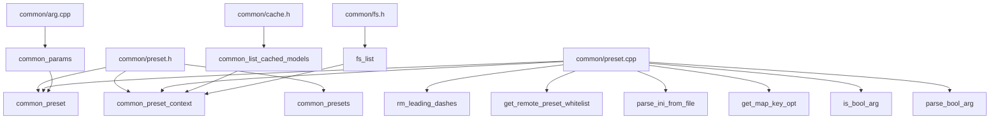

# 第45章 预设数据结构与接口 —— 参数配置的「乐高积木」

## 学习目标

- 理解 `common_preset` 与 `common_preset_context` 等核心结构，掌握预设系统的数据模型
- 深入 `common_preset_context` 构造函数、`load_from_ini`、`load_from_cache` 等函数，理解预设加载与解析
- 学习 `to_args`、`to_ini`、`set_option`、`merge`、`apply_to_params` 等方法，掌握预设的转换与应用
- 理解 `cascade` 的级联机制，掌握多预设的合并与继承

## 45.1 生活类比

想象你正在经营一家连锁餐厅。`common_preset` 就是一份**标准化菜谱卡（SOP）**，它精确记录了某道菜的食材配比、烹饪温度、出品标准等所有关键参数；而 `common_preset_context` 则是**总部运营中心**，它手握《食材供应商名录》（参数定义表）、《过敏原管控清单》（远程白名单）、以及《分店点单系统》（键到选项映射表），负责将总部下发的标准菜谱、分店自研的特色菜、以及中央厨房预制的半成品，统一转换为后厨能直接执行的标准化指令。当分店经理（上层应用）喊出“来份招牌牛肉面”时，运营中心会查阅菜谱卡，核对食材是否在白名单内，再指挥后厨（`common_params`）按标准流程出品。这种分层设计让“菜谱定义”与“出品执行”彻底解耦，无论分店怎么增加新菜品、总部怎么更新标准，后厨只需认识这一套标准指令即可。

## 45.2 源码地图

```text
common/preset.h
├── struct common_preset
│   ├── name : std::string
│   ├── options : std::map<common_arg, std::string>
│   ├── to_args()
│   ├── to_ini()
│   ├── set_option()
│   ├── unset_option()
│   ├── get_option()
│   ├── merge()
│   └── apply_to_params()
├── struct common_preset_context
│   ├── ctx_params : common_params_context
│   ├── key_to_opt : std::map<std::string, common_arg>
│   ├── filter_allowed_keys : bool
│   ├── allowed_keys : std::set<std::string>
│   ├── common_preset_context()
│   ├── load_from_ini()
│   ├── load_from_cache()
│   ├── load_from_models_dir()
│   ├── load_from_args()
│   └── cascade() (两个重载)
├── using common_presets = std::map<std::string, common_preset>
common/preset.cpp
├── rm_leading_dashes()
├── get_remote_preset_whitelist()
├── parse_ini_from_file()
├── get_map_key_opt()
├── is_bool_arg()
├── parse_bool_arg()
├── common_preset 方法实现
└── common_preset_context 方法实现
```

## 45.3 模块依赖图



---

### 45.3.1 common_preset —— 标准化「菜谱卡」的数据结构

**源码路径：`common/preset.h` (第 20-40 行)**

```cpp
// 定义一个命令行预设结构，用于存储一组配置选项
struct common_preset {
    std::string name;                                    // 预设名称，标识这一组配置的用途（如 "chat-7b-q4"）
    std::map<common_arg, std::string> options;           // 选项映射：键为参数定义，值为字符串化的参数值

    // 将当前预设转换为命令行参数字符串列表，可选地在参数列表中包含二进制程序路径
    std::vector<std::string> to_args(const std::string & bin_path = "") const;
    // 将当前预设序列化为 INI 配置文本，方便持久化和共享
    std::string to_ini() const;
    // 根据环境变量名称定位命令行选项，并设置其对应的值
    void set_option(const common_preset_context & ctx, const std::string & env, const std::string & value);
    // 根据环境变量名称移除预设中的对应选项
    void unset_option(const std::string & env);
    // 根据环境变量名称查询选项值，找到选项时返回 true，否则返回 false
    bool get_option(const std::string & env, std::string & value) const;
    // 将另一个预设合并到当前预设中，并覆盖当前预设中已存在的同名选项
    void merge(const common_preset & other);
    // 将当前预设中的选项应用到 common_params 参数对象
    void apply_to_params(common_params & params) const;
};
```

**这段代码定义了预设系统的核心数据载体。** `name` 相当于菜谱编号，`options` 则是“参数定义 -> 具体数值”的键值对集合。使用 `common_arg` 作为 Key 而非字符串，确保了类型安全：编译期就能保证只存入合法的参数定义，且自带处理器指针，后续 `apply_to_params` 可直接调度，无需再做字符串解析。这种“乐高积木”式设计让预设成为连接外部输入（CLI/INI/缓存）与内部执行（`common_params`）的标准化中间件。

---

### 45.3.2 common_preset_context —— 总部「运营中心」的上下文环境

**源码路径：`common/preset.h` (第 56-77 行)**

```cpp
// 预设上下文，维护参数解析所需的上下文和远程白名单，是配方管理器的核心
struct common_preset_context {
    common_params_context ctx_params;                 // 参数解析上下文，包含所有选项定义（食材供应商名录）
    std::map<std::string, common_arg> key_to_opt;     // 键（环境变量名或参数名）到选项的映射（菜品编号对照表）
    bool filter_allowed_keys = false;                 // 是否启用远程白名单过滤（过敏原管控开关）
    std::set<std::string> allowed_keys;               // 允许的键集合，定义远程可用的配方原料（过敏原白名单）

    // 根据 llama_example 创建预设处理上下文，并可配置是否仅允许白名单中的远程选项
    common_preset_context(llama_example ex, bool only_remote_allowed = false);
    // 从指定 INI 文件加载多个预设，并通过 global 参数返回全局预设
    common_presets load_from_ini(const std::string & path, common_preset & global) const;
    // 根据缓存中的模型生成预设集合
    common_presets load_from_cache() const;
    // 根据本地模型目录结构生成预设集合
    common_presets load_from_models_dir(const std::string & models_dir) const;
    // 根据命令行参数生成单个预设
    common_preset load_from_args(int argc, char ** argv) const;
    // 将 added 中的多个预设级联到 base 中，实现配方的继承与覆盖
    common_presets cascade(const common_presets & base, const common_presets & added) const;
    // 将一个基础预设应用到多个预设上，实现类似 CSS 的预设级联效果
    common_presets cascade(const common_preset & base, const common_presets & presets) const;
};
```

**这段代码定义了预设系统的“运行时大脑”。** 它持有完整的参数定义库 (`ctx_params`)、以及外部键名到内部定义的高速查找表 (`key_to_opt`)。最关键的是 `filter_allowed_keys` 与 `allowed_keys`：这是远程预设的安全闸门，只有在白名单内的参数才能被远程配置文件设置，防止恶意配置注入危险参数（如 `--model-url` 指向恶意地址）。两个 `cascade` 重载则分别实现“集合级联”（同名菜谱合并）与“单菜谱广播”（基础菜谱+差异菜谱=最终菜谱），支撑起“总部标准+分店特色”的灵活组合。

---

### 45.3.3 common_presets —— 菜谱库的类型别名

**源码路径：`common/preset.h` (隐含定义)**

```cpp
using common_presets = std::map<std::string, common_preset>;
```

**这个类型别名将“菜谱编号 -> 菜谱内容”映射标准化为 `common_presets`**，贯穿所有加载函数（`load_from_ini`、`load_from_cache` 等）的返回值与 `cascade` 的参数，确保不同来源的预设集合能无缝拼装、合并。

---

## 45.4 预设上下文初始化与安全白名单 —— 运营中心的「开业备案与食安体系」

### 45.4.1 common_preset_context 构造函数 —— 初始化运营中心档案库

**源码路径：`common/preset.cpp` (第 255-264 行)**

```cpp
// 构造函数，初始化预设上下文，相当于启动配方管理器
common_preset_context::common_preset_context(llama_example ex, bool only_remote_allowed)
    // 使用默认参数和示例配置初始化参数解析上下文
    : ctx_params(common_params_parser_init(default_params, ex)) {
    // 调用公共参数添加函数，将预设相关的选项注册到参数上下文中
    common_params_add_preset_options(ctx_params.options);
    // 建立键到选项的映射，方便后续通过环境变量名或参数名快速查找选项
    key_to_opt = get_map_key_opt(ctx_params);
    // 如果仅允许远程预设，则启用白名单过滤机制
    if (only_remote_allowed) {
        filter_allowed_keys = true;
        allowed_keys = get_remote_preset_whitelist(key_to_opt);
    }
}
```

**这段代码完成运营中心的“开业备案”：** 1) 根据业务场景 (`llama_example`) 初始化参数解析上下文；2) 注册预设专用选项；3) 调用 `get_map_key_opt` 构建“外部键名 -> 内部定义”的双向索引；4) 若启用 `only_remote_allowed`，则调用 `get_remote_preset_whitelist` 生成远程白名单，打开食安过滤开关。整个过程构建了后续所有预设加载、解析、校验的基础设施。

---

### 45.4.2 get_map_key_opt —— 建立「菜品编号对照表」

**源码路径：`common/preset.cpp` (第 236-247 行)**

```cpp
// 建立环境变量名及去除连字符后的命令行参数名到参数定义的映射
static std::map<std::string, common_arg> get_map_key_opt(common_params_context & ctx_params) {
    // 创建一个空映射，用于存储字符串到选项的对应关系
    std::map<std::string, common_arg> mapping;
    // 遍历参数上下文中的所有选项
    for (const auto & opt : ctx_params.options) {
        // 将每个环境变量名映射到选项
        for (const auto & env : opt.get_env()) {
            mapping[env] = opt;
        }
        // 将去除连字符后的命令行参数名映射到选项
        for (const auto & arg : opt.get_args()) {
            mapping[rm_leading_dashes(arg)] = opt;
        }
    }
    return mapping;
}
```

**这段代码构建了运营核心查找表 `key_to_opt`。** 它遍历所有参数定义，将“环境变量名”（如 `LLAMA_ARG_MODEL`）与“去除 `--` 前缀的命令行参数名”（如 `model`）均作为 Key 映射到同一个 `common_arg` 对象。这样无论外部输入是 `export LLAMA_ARG_MODEL=xxx` 还是 `--model xxx`，甚至 INI 里写 `model = xxx`，运营中心都能通过同一张表秒级定位到标准定义，实现多源输入的统一接入。

---

### 45.4.3 get_remote_preset_whitelist —— 生成「过敏原管控白名单」

**源码路径：`common/preset.cpp` (第 20-41 行)**

```cpp
// 根据参数定义生成远程预设允许使用的选项白名单，并包含选项别名和环境变量名称
static std::set<std::string> get_remote_preset_whitelist(const std::map<std::string, common_arg> & key_to_opt) {
    // 定义远程预设中明确允许的选项键集合（核心业务参数）
    static const std::set<std::string> allowed_options = {
        "model-url", "hf-repo", "hf-repo-draft", "hf-repo-v", "hf-file-v",
        "mmproj-url", "pooling", "jinja", "batch-size", "ubatch-size",
        "cache-reuse", "chat-template-kwargs", "mmap"
    };
    // 创建一个空白名单集合，用于存储允许的键
    std::set<std::string> allowed_keys;
    // 遍历键到选项的映射
    for (const auto & it : key_to_opt) {
        const std::string & key = it.first;
        const common_arg & opt = it.second;
        // 如果键在允许列表中，或者选项标记为 sparam（服务端安全参数），则加入白名单
        if (allowed_options.find(key) != allowed_options.end() || opt.is_sparam) {
            allowed_keys.insert(key);
            // 将选项的所有命令行参数名加入白名单
            for (const auto & arg : opt.get_args()) {
                allowed_keys.insert(rm_leading_dashes(arg));
            }
            // 将选项的所有环境变量名加入白名单
            for (const auto & env : opt.get_env()) {
                allowed_keys.insert(env);
            }
        }
    }
    return allowed_keys;
}
```

**这段代码实现了“食安管控”核心逻辑：** 先定义一份显式允许清单（模型下载、推理性能、聊天模板等业务核心参数），再遍历全量参数定义，凡是在清单内或被标记为 `is_sparam`（服务端安全参数）的选项，连同其所有别名（短选项、长选项、环境变量名）一并放入最终白名单。构造函数中 `filter_allowed_keys=true` 时，`load_from_ini` 会强制校验每个键是否在白名单内，拒绝任何越权参数，保障远程配置的安全边界。

---

## 45.5 预设的增删改查 —— 菜谱卡的「现场改单与查阅」

### 45.5.1 rm_leading_dashes —— 统一键名格式的「去修饰器」

**源码路径：`common/preset.cpp` (第 8-14 行)**

```cpp
// 去除字符串开头的连续连字符，返回剩余部分
static std::string rm_leading_dashes(const std::string & str) {
    // 初始化位置指针，指向字符串开头
    size_t pos = 0;
    // 循环跳过所有前导连字符
    while (pos < str.size() && str[pos] == '-') {
        ++pos;
    }
    // 返回从第一个非连字符开始的子串
    return str.substr(pos);
}
```

**这段代码提供了一个极简工具函数：** 将 `--model`、`-m`、`---model` 统一归一化为 `model`。它被 `get_map_key_opt`（建立索引时）、`to_ini`（输出键名时）、`parse_bool_arg`（匹配负向参数时）等多处复用，确保“键名”在全系统内保持一致的无连字符标准形态。

---

### 45.5.2 is_bool_arg —— 判断「是否为开关型参数」

**源码路径：`common/preset.cpp` (第 249-251 行)**

```cpp
// 判断给定参数是否为布尔类型（即支持负向形式的标志参数）
static bool is_bool_arg(const common_arg & arg) {
    // 如果参数的负向参数列表非空，则认为是布尔参数
    return !arg.args_neg.empty();
}
```

**这段代码通过“存在负向形式”来识别布尔开关参数。** 例如 `--mmap` 对应 `--no-mmap`，`args_neg` 非空即表明该参数是开关型。这一判断被 `load_from_ini` 和 `to_args` 使用，决定 INI 解析时是否做布尔取反、命令行生成时是否输出负向参数。

---

### 45.5.3 parse_bool_arg —— 解析「开关型参数的取反逻辑」

**源码路径：`common/preset.cpp` (第 253-263 行)**

```cpp
// 解析布尔参数的值，若使用负向参数名则反转逻辑值
static std::string parse_bool_arg(const common_arg & arg, const std::string & key, const std::string & value) {
    // 遍历参数的所有负向形式
    for (const auto & neg_arg : arg.args_neg) {
        // 如果当前键是负向参数名，则反转布尔值
        if (rm_leading_dashes(neg_arg) == key) {
            return common_arg_utils::is_truthy(value) ? "false" : "true";
        }
    }
    // 否则直接返回原值
    return value;
}
```

**这段代码处理 INI 中“负向键名 = true” 的语义反转：** 当 INI 写 `no-mmap = true` 时，键名匹配 `--no-mmap`，函数返回 `"false"`，最终写入预设的是 `mmap = false`。这让配置文件既能用正向键 `mmap = false`，也能用负向键 `no-mmap = true` 表达同一语义，极大提升了配置的可读性与灵活性。

---

### 45.5.4 common_preset::set_option —— 「现场改单」：按环境变量名增改选项

**源码路径：`common/preset.cpp` (第 102-119 行)**

```cpp
// 根据环境变量名称定位命令行选项，并设置其对应的值，用于动态调整配方
void common_preset::set_option(const common_preset_context & ctx, const std::string & env, const std::string & value) {
    // 遍历当前预设的选项列表，查找匹配环境变量的选项
    for (auto & [opt, val] : options) {
        if (opt.env && env == opt.env) {
            val = value;
            return;
        }
    }
    // 如果未找到已有选项，则从上下文中查找并添加新选项
    if (ctx.key_to_opt.find(env) == ctx.key_to_opt.end()) {
        throw std::runtime_error(string_format(
            "%s: option with env '%s' not found in ctx_params",
            __func__, env.c_str()
        ));
    }
    options[ctx.key_to_opt.at(env)] = value;
}
```

**这段代码实现了“先找菜谱里有没有，有就改料，没有就按编号点新菜”：** 优先在当前预设的 `options` 中按环境变量名匹配（精准定位），找到则直接更新值；否则回退到运营中心的 `key_to_opt` 总表查找定义，找到则插入新键值对，找不到抛异常。这使得预设支持动态增改，且始终受总表约束，防止非法参数混入。

---

### 45.5.5 common_preset::unset_option —— 「退菜」：按环境变量名删除选项

**源码路径：`common/preset.cpp` (第 121-133 行)**

```cpp
// 根据环境变量名称从预设中移除对应选项，实现配方的精简
void common_preset::unset_option(const std::string & env) {
    // 遍历选项列表，查找匹配环境变量的选项
    for (auto it = options.begin(); it != options.end(); ) {
        const common_arg & opt = it->first;
        if (opt.env && env == opt.env) {
            it = options.erase(it);
            return;
        } else {
            ++it;
        }
    }
}
```

**这段代码提供了精准删除能力：** 仅当选项定义了 `env` 且与传入 `env` 完全匹配时才移除。不匹配或未定义 `env` 的选项保持不动，避免误删。配合 `set_option` 可实现预设的精细化运维。

---

### 45.5.6 common_preset::get_option —— 「查阅菜谱」：按环境变量名读取选项值

**源码路径：`common/preset.cpp` (第 135-144 行)**

```cpp
// 根据环境变量名称查询选项值，找到选项时返回 true，否则返回 false
bool common_preset::get_option(const std::string & env, std::string & value) const {
    // 遍历选项列表，查找匹配环境变量的选项
    for (const auto & [opt, val] : options) {
        if (opt.env && env == opt.env) {
            value = val;
            return true;
        }
    }
    return false;
}
```

**这段代码实现了只读查询接口：** 同样按环境变量名精准匹配，找到则通过引用返回值并报 `true`，否则报 `false`。为外部审计、调试、条件判断提供标准入口。

---

## 45.6 预设的加载与级联 —— 从「中央厨房/供应商/分店」汇聚菜谱库

### 45.6.1 parse_ini_from_file —— 「标准菜谱文档」解析器

**源码路径：`common/preset.cpp` (第 180-253 行)**

```cpp
// 读取并解析 INI 文件，提取配置节、键和值，并返回分组后的配置映射
static std::map<std::string, std::map<std::string, std::string>> parse_ini_from_file(const std::string & path) {
    // 创建一个空的解析结果映射，用于存储节->键值对
    std::map<std::string, std::map<std::string, std::string>> parsed;
    // 检查文件是否存在，不存在则抛出运行时错误
    if (!std::filesystem::exists(path)) {
        throw std::runtime_error("preset file does not exist: " + path);
    }
    // 打开文件，失败则抛出运行时错误
    std::ifstream file(path);
    if (!file.good()) {
        throw std::runtime_error("failed to open server preset file: " + path);
    }
    // 读取整个文件内容到字符串
    std::string contents((std::istreambuf_iterator<char>(file)), std::istreambuf_iterator<char>());
    // 使用 PEG 解析器构建器定义 INI 语法规则
    static const auto parser = build_peg_parser([](auto & p) {
        // 定义换行符规则：支持 CRLF、LF 和 CR
        auto newline = p.rule("newline", p.literal("\r\n") | p.literal("\n") | p.literal("\r"));
        // 定义空白字符规则：零个或多个空格或制表符
        auto ws = p.rule("ws", p.chars("[ \t]", 0, -1));
        // 定义注释规则：以分号或井号开头，后跟任意非换行字符
        auto comment = p.rule("comment", p.chars("[;#]", 1, 1) + p.zero_or_more(p.negate(newline) + p.any()));
        // 定义行尾规则：空白字符 + 可选注释 + 换行或文件结束
        auto eol = p.rule("eol", ws + p.optional(comment) + (newline | p.end()));
        // 定义标识符规则：以字母或下划线开头，后跟字母、数字、点或连字符
        auto ident = p.rule("ident", p.chars("[a-zA-Z_]", 1, 1) + p.chars("[a-zA-Z0-9_.-]", 0, -1));
        // 定义行首规则：空白字符 + 注释或换行或文件结束
        auto eol_start = p.rule("eol-start", ws + (p.chars("[;#]", 1, 1) | newline | p.end()));
        // 定义值规则：零个或多个非行首字符
        auto value = p.rule("value", p.zero_or_more(p.negate(eol_start) + p.any()));
        // 定义头行规则：方括号包围的节名称
        auto header_line = p.rule("header-line", "[" + ws + p.tag("section-name", p.chars("[^]]")) + ws + "]" + eol);
        // 定义键值行规则：标识符 = 值
        auto kv_line = p.rule("kv-line", p.tag("key", ident) + ws + "=" + ws + p.tag("value", value) + eol);
        // 定义注释行规则：空白字符 + 注释 + 换行或文件结束
        auto comment_line = p.rule("comment-line", ws + comment + (newline | p.end()));
        // 定义空行规则：空白字符 + 换行或文件结束
        auto blank_line = p.rule("blank-line", ws + (newline | p.end()));
        // 定义行规则：头行、键值行、注释行或空行
        auto line = p.rule("line", header_line | kv_line | comment_line | blank_line);
        // 定义 INI 文件规则：零个或多个行 + 文件结束
        auto ini = p.rule("ini", p.zero_or_more(line) + p.end());
        return ini;
    });
    // 创建 PEG 解析上下文，传入文件内容
    common_peg_parse_context ctx(contents);
    // 执行解析，如果失败则抛出运行时错误
    const auto result = parser.parse(ctx);
    if (!result.success()) {
        throw std::runtime_error("failed to parse server config file: " + path);
    }
    // 初始化当前节和当前键，用于后续 AST 遍历
    std::string current_section = COMMON_PRESET_DEFAULT_NAME;
    std::string current_key;
    // 遍历解析树，提取节名、键和值
    ctx.ast.visit(result, [&](const auto & node) {
        if (node.tag == "section-name") {
            // 遇到新的节，更新当前节名，并在解析映射中创建空值映射
            current_section = std::string(node.text);
            parsed[current_section] = {};
        } else if (node.tag == "key") {
            // 遇到键，记录当前键名
            current_key = std::string(node.text);
        } else if (node.tag == "value" && !current_key.empty() && !current_section.empty()) {
            // 遇到值，将键值对存入当前节的映射中，并清空当前键
            parsed[current_section][current_key] = std::string(node.text);
            current_key.clear();
        }
    });
    return parsed;
}
```

**这段代码实现了健壮的 INI 解析器：** 基于 PEG 语法组合子定义完整 INI 语法（节头、键值对、注释、空行、多种换行符），解析生成 AST 后通过访问者模式提取“节名 -> {键 -> 值}”的二层映射。它不依赖第三方库、支持跨平台换行符、自动忽略注释与空行、键名允许点号连字符，为 `load_from_ini` 提供了结构化、类型安全的中间表示。

---

### 45.6.2 load_from_ini —— 从「总部标准菜谱手册」批量生成预设

**源码路径：`common/preset.cpp` (第 266-315 行)**

```cpp
// 从指定 INI 文件加载多个预设，并通过 global 参数返回全局预设
common_presets common_preset_context::load_from_ini(const std::string & path, common_preset & global) const {
    // 创建一个空的预设集合，用于存储加载的预设
    common_presets out;
    // 解析 INI 文件，获取配置节和键值对
    auto ini_data = parse_ini_from_file(path);
    // 遍历解析后的配置节
    for (auto section : ini_data) {
        // 创建一个新的预设对象
        common_preset preset;
        // 如果节名为空，则使用默认预设名
        if (section.first.empty()) {
            preset.name = COMMON_PRESET_DEFAULT_NAME;
        } else {
            preset.name = section.first;
        }
        // 遍历节中的键值对
        for (const auto & [key, value] : section.second) {
            // 跳过版本号键
            if (key == "version") {
                continue;
            }
            // 如果启用了白名单过滤，检查键是否允许
            if (filter_allowed_keys && allowed_keys.find(key) == allowed_keys.end()) {
                throw std::runtime_error(string_format(
                    "option '%s' is not allowed in remote presets",
                    key.c_str()
                ));
            }
            // 如果键在键到选项的映射中，则设置选项值
            if (key_to_opt.find(key) != key_to_opt.end()) {
                const auto & opt = key_to_opt.at(key);
                // 如果是布尔参数，则解析布尔值（处理负向键名取反）
                if (is_bool_arg(opt)) {
                    preset.options[opt] = parse_bool_arg(opt, key, value);
                } else {
                    preset.options[opt] = value;
                }
            } else {
                throw std::runtime_error(string_format(
                    "option '%s' not recognized in preset '%s'",
                    key.c_str(), preset.name.c_str()
                ));
            }
        }
        // 如果节名为 "*"，则设置为全局预设
        if (preset.name == "*") {
            global = preset;
        } else {
            out[preset.name] = preset;
        }
    }
    return out;
}
```

**这段代码实现了“中央厨房标准菜谱 -> 分店可执行菜谱卡”的转化流程：** 1) 调用 `parse_ini_from_file` 得到结构化数据；2) 逐节创建 `common_preset`，节名即菜谱编号；3) 逐键值对：跳过 `version`、白名单校验（远程模式下）、通过 `key_to_opt` 定位标准定义、布尔参数经 `parse_bool_arg` 取反处理、写入预设；4) 特殊节名 `*` 归入 `global`（作为后续级联的基础层），其余入库 `out`。全程强类型、强校验，保证入库预设纯净合规。

---

### 45.6.3 load_from_cache —— 从「中央厨房预制库」生成预设

**源码路径：`common/preset.cpp` (第 317-329 行)**

```cpp
// 从缓存模型列表中生成以模型标识为名称、以 Hugging Face 仓库为参数的预设
common_presets common_preset_context::load_from_cache() const {
    // 创建一个空的预设集合
    common_presets out;
    // 获取缓存中的模型列表
    auto cached_models = common_list_cached_models();
    // 遍历每个缓存模型，生成对应的预设
    for (const auto & model : cached_models) {
        // 创建一个新的预设对象
        common_preset preset;
        // 设置预设名称为模型标识（如 "org/model:quant"）
        preset.name = model.to_string();
        // 设置 Hugging Face 仓库参数为模型标识
        preset.set_option(*this, "LLAMA_ARG_HF_REPO", model.to_string());
        out[preset.name] = preset;
    }
    return out;
}
```

**这段代码将本地缓存的模型“变废为宝”生成即用预设：** 调用 `common_list_cached_models()` 获取已下载模型元数据，每个模型生成一个同名预设，核心参数仅设 `hf-repo` 指向该模型仓库。用户无需手写路径，直接用缓存标识即可启动，极大降低了“已下载模型”的复用门槛。

---

### 45.6.4 load_from_models_dir —— 从「分店本地食材库」扫描生成预设

**源码路径：`common/preset.cpp` (第 338-394 行)**

```cpp
// 扫描本地模型目录及其子目录，识别 GGUF 模型和 mmproj 文件并生成本地模型预设
common_presets common_preset_context::load_from_models_dir(const std::string & models_dir) const {
    // 检查目录是否存在且是目录，否则抛出运行时错误
    if (!std::filesystem::exists(models_dir) || !std::filesystem::is_directory(models_dir)) {
        throw std::runtime_error(string_format("error: '%s' does not exist or is not a directory\n", models_dir.c_str()));
    }
    // 创建一个空的本地模型列表
    std::vector<local_model> models;
    // 定义子目录扫描函数，用于识别子目录中的模型文件
    auto scan_subdir = [&models](const std::string & subdir_path, const std::string & name) {
        // 列出子目录中的文件
        auto files = fs_list(subdir_path, false);
        // 初始化模型文件、首个分片文件和 mmproj 文件的占位变量
        common_file_info model_file;
        common_file_info first_shard_file;
        common_file_info mmproj_file;
        // 遍历子目录中的文件，识别模型文件、首个分片文件和 mmproj 文件
        for (const auto & file : files) {
            if (string_ends_with(file.name, ".gguf")) {
                if (file.name.find("mmproj") != std::string::npos) {
                    mmproj_file = file;
                } else if (file.name.find("-00001-of-") != std::string::npos) {
                    first_shard_file = file;
                } else {
                    model_file = file;
                }
            }
        }
        // 创建本地模型对象，如果存在首个分片文件则使用分片路径，否则使用模型路径
        local_model model{
            name,
            first_shard_file.path.empty() ? model_file.path : first_shard_file.path,
            mmproj_file.path
        };
        if (!model.path.empty()) {
            models.push_back(model);
        }
    };
    // 列出模型目录中的所有文件和子目录
    auto files = fs_list(models_dir, true);
    // 遍历文件和子目录，生成本地模型列表
    for (const auto & file : files) {
        if (file.is_dir) {
            scan_subdir(file.path, file.name);
        } else if (string_ends_with(file.name, ".gguf")) {
            std::string name = file.name;
            string_replace_all(name, ".gguf", "");
            local_model model{ name, file.path, "" };
            models.push_back(model);
        }
    }
    // 创建一个空的预设集合
    common_presets out;
    // 为每个本地模型生成预设
    for (const auto & model : models) {
        common_preset preset;
        preset.name = model.name;
        preset.set_option(*this, "LLAMA_ARG_MODEL", model.path);
        if (!model.path_mmproj.empty()) {
            preset.set_option(*this, "LLAMA_ARG_MMPROJ", model.path_mmproj);
        }
        out[preset.name] = preset;
    }
    return out;
}
```

**这段代码实现了“分店走货扫描 -> 自动建档”的全流程：** 1) 校验目录合法性；2) 两层扫描：子目录模式（识别分片模型 `*-00001-of-*` 与 `mmproj` 伴随文件）+ 根目录散文件模式；3) 智能识别：优先用首分片路径代表分片模型、自动关联同目录下的 `mmproj`；4) 逐模型生成预设，设置 `model` 路径、可选 `mmproj` 路径。它把杂乱的本地文件系统自动整理为标准化预设库，实现“放进文件夹即可用”。

---

### 45.6.5 load_from_args —— 从「分店临时点单」生成预设

**源码路径：`common/preset.cpp` (第 396-406 行)**

```cpp
// 将命令行参数解析为默认名称的预设
common_preset common_preset_context::load_from_args(int argc, char ** argv) const {
    // 创建一个预设对象
    common_preset preset;
    // 设置预设名称为默认名称
    preset.name = COMMON_PRESET_DEFAULT_NAME;
    // 将命令行参数解析为预设的选项映射
    bool ok = common_params_to_map(argc, argv, ctx_params.ex, preset.options);
    if (!ok) {
        throw std::runtime_error("failed to parse CLI arguments into preset");
    }
    return preset;
}
```

**这段代码把命令行瞬时参数“打包”成标准预设：** 复用现有的 `common_params_to_map` 解析器，将 `argc/argv` 直接填充进 `preset.options`，名称固定为默认名。这让 CLI 参数也能进入预设体系，参与后续的级联合并、INI 导出、参数应用等统一流程，消除了“CLI 专用路径”与“预设路径”的二元对立。

---

### 45.6.6 cascade（重载一：集合级联）—— 「菜谱版本合并」：同名覆盖、异名新增

**源码路径：`common/preset.cpp` (第 408-421 行)**

```cpp
// 将新增预设集合级联到基础预设集合中，按名称合并或添加预设
common_presets common_preset_context::cascade(const common_presets & base, const common_presets & added) const {
    // 以基础预设集合为起点创建新集合
    common_presets out = base;
    // 遍历新增的预设集合
    for (const auto & [name, preset_added] : added) {
        // 如果基础集合中已存在同名预设，则合并选项（added 覆盖 base）
        if (out.find(name) != out.end()) {
            common_preset & target = out[name];
            target.merge(preset_added);
        } else {
            // 否则，直接添加新预设
            out[name] = preset_added;
        }
    }
    return out;
}
```

**这段代码实现了“总部标准版 + 分店微调版 = 最终执行版”：** 以 `base` 为底复制一份 `out`，遍历 `added`：同名菜谱调用 `merge`（`added` 的选项覆盖 `base` 同名选项），异名菜谱直接收录。典型场景：`load_from_ini` 返回的 `global`（`*` 节）作为 `base`，各分店自定义预设作为 `added`，级联后得到每家分店的最终菜单。

---

### 45.6.7 cascade（重载二：单预设广播）—— 「基础菜谱+差异菜谱」批量生成最终菜单

**源码路径：`common/preset.cpp` (第 423-434 行)**

```cpp
// 将一个基础预设应用到预设集合中的每个预设，并按集合名称生成结果
common_presets common_preset_context::cascade(const common_preset & base, const common_presets & presets) const {
    // 创建一个空的结果预设集合
    common_presets out;
    // 遍历预设集合，将基础预设合并到每个预设中
    for (const auto & [name, preset] : presets) {
        common_preset tmp = base;      // 复制基础菜谱
        tmp.name = name;               // 覆盖名称为当前差异菜谱名
        tmp.merge(preset);             // 差异菜谱覆盖基础菜谱
        out[name] = std::move(tmp);    // 存入结果
    }
    return out;
}
```

**这段代码实现了类 CSS 的“继承+覆盖”模式：** 单一 `base` 预设（如总部通用参数：线程数、上下文长度、Mmap 开关）广播到 `presets` 集合中的每个差异预设（如不同模型的专属路径、模板），生成同等规模的最终预设集合。配合重载一，可实现“全局默认 -> 模型默认 -> 分店微调 -> 临时点单”多层级联。

---

## 45.7 预设的转换与应用 —— 从「菜谱卡」到「后厨指令」与「存档文档」

### 45.7.1 common_preset::to_args —— 生成「后厨执行指令单」（命令行参数列表）

**源码路径：`common/preset.cpp` (第 43-83 行)**

```cpp
// 将当前预设转换为命令行参数字符串列表，可选地在参数列表中包含二进制程序路径
std::vector<std::string> common_preset::to_args(const std::string & bin_path) const {
    // 创建一个空的参数列表
    std::vector<std::string> args;
    // 如果二进制路径不为空，则将其作为第一个参数添加到列表中
    if (!bin_path.empty()) {
        args.push_back(bin_path);
    }
    // 遍历预设中的每一个选项
    for (const auto & [opt, value] : options) {
        // 如果该选项是预设专用选项，则跳过，不添加到命令行参数
        if (opt.is_preset_only) {
            continue;
        }
        // 将选项的最后一个参数名（通常是长选项）添加到参数列表
        args.push_back(opt.args.back());
        // 如果选项没有值提示，说明这是一个布尔选项
        if (opt.value_hint == nullptr && opt.value_hint_2 == nullptr) {
            // 检查选项值是否为假值
            if (common_arg_utils::is_falsey(value)) {
                // 如果存在负向参数，则使用负向参数替换当前参数
                if (!opt.args_neg.empty()) {
                    args.back() = opt.args_neg.back();
                } else {
                    // 否则，从参数列表中移除该选项
                    args.pop_back();
                }
            }
        }
        // 如果选项有值提示，则将值添加到参数列表
        if (opt.value_hint != nullptr) {
            args.push_back(value);
        }
        // 如果选项有两个值提示，则抛出运行时错误，因为目前不支持
        if (opt.value_hint != nullptr && opt.value_hint_2 != nullptr) {
            throw std::runtime_error(string_format(
                "common_preset::to_args(): option '%s' has two values, which is not supported yet",
                opt.args.back()
            ));
        }
    }
    return args;
}
```

**这段代码将“菜谱卡”编译为“后厨可直接执行的指令序列”：** 遍历 `options`，跳过 `is_preset_only` 标记的内部参数；对布尔开关（无 `value_hint`），值为假时输出负向参数（`--no-xxx`）或直接丢弃；对带值参数，追加值字符串；暂不支持双值参数。输出的 `vector<string>` 可直接传给 `execvp` 或子进程启动器，实现预设到进程参数的零损失转换。

---

### 45.7.2 common_preset::to_ini —— 生成「标准存档菜谱文档」（INI 文本）

**源码路径：`common/preset.cpp` (第 85-100 行)**

```cpp
// 将当前预设序列化为 INI 配置文本，方便持久化和共享
std::string common_preset::to_ini() const {
    // 创建一个字符串流，用于构建 INI 文本
    std::ostringstream ss;
    // 写入配置节头，格式为 [预设名称]
    ss << "[" << name << "]\n";
    // 遍历预设中的每一个选项
    for (const auto & [opt, value] : options) {
        // 创建值的副本，用于转义处理
        auto espaced_value = value;
        // 将值中的换行符转义，避免破坏 INI 格式
        string_replace_all(espaced_value, "\n", "\\n");
        // 写入键值对，键为去除连字符后的参数名
        ss << rm_leading_dashes(opt.args.back()) << " = ";
        ss << espaced_value << "\n";
    }
    // 在配置节后添加一个空行，分隔不同预设
    ss << "\n";
    return ss.str();
}
```

**这段代码将预设“存档”为标准 INI 格式：** 节名即预设名，键名统一用长选项去前缀（`rm_leading_dashes`），值做换行转义防止格式破坏。输出可直接写入文件，下次再经 `load_from_ini` 读回，形成完整的“持久化 <-> 内存”闭环。

---

### 45.7.3 common_preset::merge —— 「菜谱融合」：以另一预设覆盖当前同名选项

**源码路径：`common/preset.cpp` (第 146-151 行)**

```cpp
// 将另一个预设合并到当前预设中，并覆盖当前预设中已存在的同名选项
void common_preset::merge(const common_preset & other) {
    // 遍历另一个预设的选项，覆盖当前预设中的同名选项
    for (const auto & [opt, val] : other.options) {
        options[opt] = val;
    }
}
```

**这段代码是级联操作的原子单元：** 直接用 `other.options` 的键值对覆盖当前 `options`。键是 `common_arg`，比较基于地址/定义身份，保证“同一参数定义”的值被新值替换。极简高效，支撑起所有级联场景的核心语义。

---

### 45.7.4 common_preset::apply_to_params —— 「下达出品指令」：将菜谱参数应用到运行时对象

**源码路径：`common/preset.cpp` (第 153-178 行)**

```cpp
// 将当前预设中的选项应用到 common_params 参数对象，启动咖啡机
void common_preset::apply_to_params(common_params & params) const {
    // 遍历预设中的每一个选项
    for (const auto & [opt, val] : options) {
        // 根据选项的处理器类型，调用相应的处理函数
        if (opt.handler_string) {
            opt.handler_string(params, val);
        } else if (opt.handler_int) {
            opt.handler_int(params, std::stoi(val));
        } else if (opt.handler_bool) {
            opt.handler_bool(params, common_arg_utils::is_truthy(val));
        } else if (opt.handler_str_str) {
            throw std::runtime_error(string_format(
                "%s: option with two values is not supported yet",
                __func__
            ));
        } else if (opt.handler_void) {
            opt.handler_void(params);
        } else {
            GGML_ABORT("unknown handler type");
        }
    }
}
```

**这段代码是预设系统的“终端执行器”：** 它不关心参数从哪来（CLI/INI/缓存/目录），只认 `common_arg` 自带的处理器指针。字符串、整数、布尔、无参、双值（暂不支持）五类处理器覆盖了所有参数形态，`common_arg_utils::is_truthy` 统一了布尔真值判断（支持 `1/true/yes/on` 等）。调用者只需构建好 `common_params` 对象，一行 `preset.apply_to_params(params)` 即可完成全量参数注入，实现了“菜谱 -> 成品”的最后一公里。

---

## 45.8 设计中的取舍

**Q: 为什么选择 PEG 解析器而非现成的 INI 库（如 inih）解析配置文件？**  
A: PEG 解析器以 Header-only 形式内嵌于代码库，零外部依赖，且语法规则可在 C++ 代码中以 DSL 形式声明，便于针对 llama.cpp 的特殊需求（如键名允许点号/连字符、值支持多行转义、注释风格兼容 `;` 和 `#`）精确定制。引入第三方库会增加构建复杂度和依赖风险，且难以精确控制错误报告的行列信息。

**Q: 为什么用 `std::map<common_arg, std::string>` 而非 `std::map<std::string, std::string>` 存储预设选项？**  
A: `common_arg` 作为 Key 自带类型身份与处理器指针，`apply_to_params` 可直接分发调用，无需再做字符串 -> 定义的反向查找，消除了运行时字符串比较与映射开销，且编译期杜绝了拼写错误导致的非法参数注入。代价是预设对象不能直接 JSON 序列化，需经 `to_ini`/`to_args` 转换，但这正是“内部强类型、外部文本化”的良性分层。

**Q: 远程白名单机制为何采用“显式允许列表 + is_sparam 标记”双轨制？**  
A: 显式列表覆盖了高频业务参数（模型下载、推理性能、模板），`is_sparam` 标记允许参数定义者在声明处就声明“此参数远程安全”，新增参数只需加标记即可自动纳入白名单，无需改动 `get_remote_preset_whitelist` 的硬编码集合。双轨并行兼顾了“核心参数显式管控”与“扩展参数声明式纳管”的平衡。

**Q: 为什么 `cascade` 提供两个重载而非单一合并函数？**  
A: 重载一（集合级联）对应“多套菜谱库合并”场景（如总部标准库 + 分店特色库），重载二（单预设广播）对应“通用基础配 + 多个差异配”场景（如全局默认参数 + 多模型专属参数）。两者语义正交、组合灵活，避免了强行统一接口导致的参数顺序混淆或冗余拷贝。

**Q: `load_from_models_dir` 为何要特殊处理分片模型（`-00001-of-`）和 mmproj 文件？**  
A: 分片模型只有首分片包含完整元数据，后续分片不可单独加载，必须指定首分片路径；`mmproj` 是多模态模型的投影权重，需配套加载。自动识别这两类文件并关联生成预设，屏蔽了文件命名规则的复杂性，让用户“放目录即用”，体现了“对用户友好、对实现严谨”的工程哲学。

---

## 45.9 动手练习

- 创建一个包含模型路径、批处理大小和聊天模板参数的预设，使用 `to_ini` 将其序列化为 INI 字符串，然后使用 `load_from_ini` 重新加载，验证序列化和反序列化的正确性。
- 为一个新的模型源“my-model”编写专用预设加载函数，并将其集成到 `common_preset_context` 中，然后测试加载和级联流程。
- 修改 `apply_to_params` 以支持新的处理器类型（如 `handler_float`），并测试将预设应用到参数对象时的行为。
- 追踪一次完整的预设加载过程，从命令行参数到预设对象再到参数应用的全流程，绘制时序图。
- 在 `get_remote_preset_whitelist` 中添加一个新的业务参数到显式允许列表，观察远程 INI 加载时的校验行为变化。

---

## 45.10 本章小结

本章我们一起学习了以下概念：

| 概念 | 解释 |
|------|------|
| `common_preset` | 命令行预设的内部通用表示，包含预设名称和选项映射 |
| `common_preset_context` | 预设上下文，维护参数解析上下文、键到选项映射和远程白名单 |
| `common_presets` | 预设集合类型别名，`std::map<std::string, common_preset>` |
| `rm_leading_dashes` | 去除字符串前导连字符，统一键名格式 |
| `get_map_key_opt` | 建立环境变量名/参数名到参数定义的映射表 |
| `get_remote_preset_whitelist` | 生成远程预设允许使用的选项白名单（含别名与环境变量名） |
| `parse_ini_from_file` | 基于 PEG 解析器的 INI 文件解析，返回节->键值对映射 |
| `is_bool_arg` | 判断参数是否为布尔开关（存在负向形式） |
| `parse_bool_arg` | 解析布尔参数值，负向键名时反转逻辑 |
| `common_preset_context::common_preset_context` | 初始化参数上下文、选项映射、远程白名单 |
| `load_from_ini` | 从 INI 文件加载预设集合，支持全局预设与白名单校验 |
| `load_from_cache` | 从缓存模型列表生成预设（以模型标识为名、hf-repo 为参数） |
| `load_from_models_dir` | 扫描本地目录识别 GGUF/分片/mmproj 文件生成预设 |
| `load_from_args` | 将命令行参数解析为默认名称的预设 |
| `cascade` (集合级联) | 将新增预设集合合并到基础集合，同名合并、异名新增 |
| `cascade` (单预设广播) | 将基础预设应用到每个差异预设，生成最终预设集合 |
| `common_preset::to_args` | 将预设转换为命令行参数列表，处理布尔负向与带值参数 |
| `common_preset::to_ini` | 将预设序列化为 INI 文本，键名去前缀、值转义换行 |
| `common_preset::set_option` | 按环境变量名增改预设选项，回退总表查找定义 |
| `common_preset::unset_option` | 按环境变量名精准删除预设选项 |
| `common_preset::get_option` | 按环境变量名查询预设选项值 |
| `common_preset::merge` | 以另一预设覆盖当前预设同名选项 |
| `common_preset::apply_to_params` | 根据处理器类型将预设选项应用到运行时参数对象 |

下一章中，我们将学习参数解析引擎的实现，了解它如何将命令行选项和环境变量映射到内部参数，从而为预设系统提供强大的参数解析能力。

