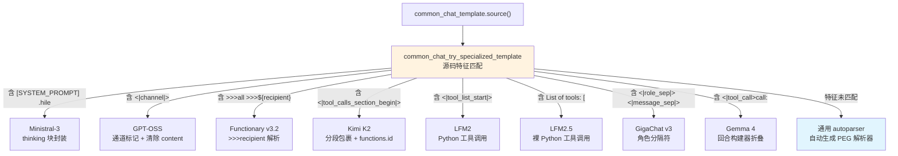
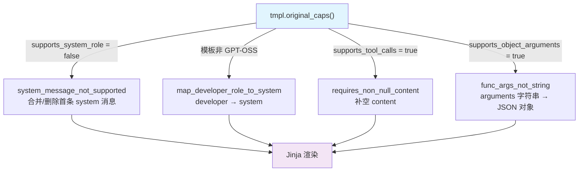
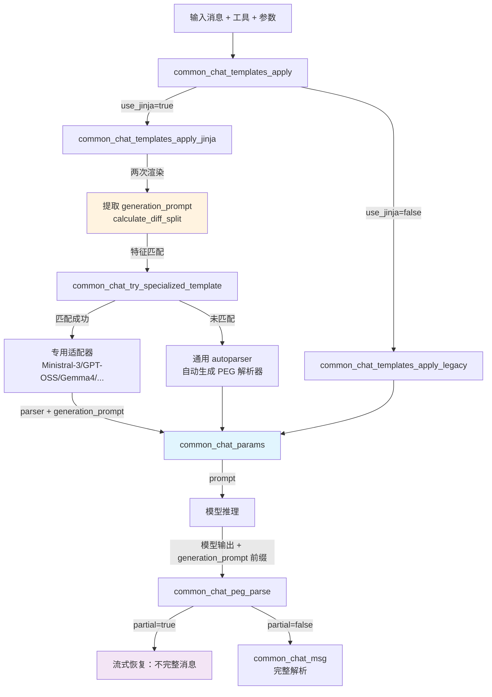

# 第46章 47 模板适配与消息解析 —— 模型提示词的"灵魂雕刻师"

## 学习目标

- 理解聊天消息（`common_chat_msg`）的核心字段设计：`role`、`content`、`content_parts`、`reasoning_content`、`tool_calls` 的职责划分与互斥规则，以及 `empty()`、`set_tool_call_ids()`、`operator==` 等生命周期方法的实现。
- 掌握 OpenAI 兼容 JSON 格式的双向转换机制：消息解析（`common_chat_msgs_parse_oaicompat`）与序列化（`to_json_oaicompat`），理解 `concat_typed_text` 参数如何控制多模态标记的换行行为。
- 理解流式场景下的增量差异计算：`string_diff` 前缀提取逻辑与 `compute_diffs` 的完整流程，以及工具调用只增不减的运行时契约。
- 掌握 `common_chat_template` 的构造与能力检测：词法分析、语法解析、`bos/eos_token` 存取与 `original_caps` 查询。
- 理解 Jinja 模板直接渲染机制：`common_chat_template_direct_apply_impl` 的上下文构造、override 参数注入。
- 掌握七大模型专用模板适配策略：Ministral-3 的思维块封装、GPT-OSS 的通道标记、Gemma 4 的回合构建器、Functionary v3.2 的 `>>>recipient` 解析、Kimi K2 的分段包裹、LFM2/LFM2.5 的 Python 风格工具调用、GigaChat v3 的角色分隔符。
- 理解模板变通（workaround）机制：`map_developer_role_to_system`、`system_message_not_supported`、`requires_non_null_content`、`func_args_not_string` 四大适配器的触发条件与实现细节。
- 掌握 PEG 解析器的分层设计：`build_chat_peg_parser` 的组合子构建、通用与 Gemma4 特化 mapper 的差异、`partial parse` 的流式恢复机制。
- 理解 `common_chat_parser_params` 的双构造函数职责：默认构造与从 `common_chat_params` 派生 `format`/`generation_prompt`。
- 掌握消息验证与格式化接口：`common_chat_verify_template`、`common_chat_format_single`、`common_chat_format_example`、`common_chat_template_direct_apply` 等。
- 理解 `common_chat_templates_deleter` 的 RAII 资源管理设计及其与 `common_chat_templates_free` 的协作。

## 46.1 生活类比 —— 国际快递公司的「标准化物流系统」

如果把 llama.cpp 的聊天模板系统比作一家**国际快递公司**，那么整个链路的运作方式就一目了然：**`common_chat_msg` 是标准集装箱**。无论货物是"文本"（`content`）、"多模态包裹"（`content_parts`）、"加急指令"（`tool_calls`）还是"内部批注"（`reasoning_content`），都必须装进这个统一规格的集装箱才能进入物流网络。集装箱的货格之间有严格的互斥规则——你不能同时用散装和托盘装同一批货。**`to_json_oaicompat` 是报关单**。集装箱出关时必须填一份 OpenAI 格式的报关单：`media_marker` 之间的不加换行规则，就像易碎品之间不能塞填充物——多模态标记必须紧贴相邻文本，否则"清关"（客户端解析）时就会出现格式错乱。**`common_chat_template` 是包装规格说明书**。每家快递公司（每个模型）有自己的包装规范：Ministral-3 要求把"内部批注"装进 `{type:-format 通道：<|constrain|> 约束
        // tool-call 通道：工具调用解析规则
        // 组合返回
    });
    data.parser = parser.save();
    return data;
}
```

关键适配点：
- **字段重命名**：`reasoning_content` → `thinking`，匹配模板变量名。
- **工具调用时清除 content**：GPT-OSS 模板在有工具调用时不期望 `content` 字段存在，避免渲染冲突。
- **通道标记保护**：`preserved_tokens` 列出所有 `<|...|>` 标记，防止 PEG 解析器误切分。

### 47.6.3 gemma4_model_turn_builder —— Gemma 4 回合构建器

**源码路径：`common/chat.cpp` - `gemma4_model_turn_builder`（1870-1970行）**

```cpp
// common/chat.cpp
class gemma4_model_turn_builder {
    json & messages;
    size_t pos;
    json tool_calls;
    json tool_responses;
    json content;
    json reasoning_content;

public:
    // ① 构造函数：保存消息引用与起始位置
    gemma4_model_turn_builder(json & msgs, size_t pos) : messages(msgs), pos(pos) {}

    // ② collect：三阶段收集
    void collect() {
        auto & msg = messages[pos];
        // 阶段1：收集首条 assistant 的 tool_calls 与 reasoning_content
        if (msg.contains("reasoning_content") && msg.at("reasoning_content").is_string()) {
            reasoning_content = msg.at("reasoning_content");
        }
        for (auto & tc : msg.at("tool_calls")) {
            tool_calls.push_back(tc);
        }
        pos++;

        // 阶段2：遍历后续 tool 角色消息，收集响应
        while (pos < messages.size() && messages[pos].value("role", "") == "tool") {
            collect_result(messages[pos]);
            pos++;
        }

        // 阶段3：若下一条是无 tool_calls 的 assistant，提取其 content
        if (pos < messages.size() && messages[pos].value("role", "") == "assistant") {
            auto & next = messages[pos];
            if (!has_tool_calls(next) && has_content(next)) {
                content = next.at("content");
                pos++;
            }
        }
    }

    // ③ collect_result：工具响应与调用配对
    void collect_result(const json & curr) {
        json response;
        // 解析 content：优先尝试 JSON，失败保留原文
        if (curr.contains("content")) {
            const auto & c = curr.at("content");
            if (c.is_string()) {
                try { response = json::parse(c.get<std::string>()); }
                catch (...) { response = c; }
            } else {
                response = c;
            }
        }
        // 配对策略：优先按索引顺序取 function.name，fallback 到 tool_call_id
        std::string name;
        size_t idx = tool_responses.size();
        if (idx < tool_calls.size()) {
            auto & tc = tool_calls[idx];
            if (tc.contains("function")) { name = tc.at("function").value("name", ""); }
        }
        if (name.empty()) { name = curr.value("tool_call_id", ""); }
        tool_responses.push_back({{"name", name}, {"response", response}});
    }

    // ④ build：打包成 Gemma 4 模板规范的 assistant 消息
    json build() {
        collect();
        json msg = { {"role", "assistant"}, {"tool_calls", tool_calls} };
        if (!tool_responses.empty()) { msg["tool_responses"] = tool_responses; }
        if (!content.is_null()) { msg["content"] = content; }
        if (!reasoning_content.is_null()) { msg["reasoning_content"] = reasoning_content; }
        return msg;
    }

    // ⑤ 静态辅助检测
    static bool has_content(const json & msg) {
        if (!msg.contains("content") || msg.at("content").is_null()) return false;
        const auto & c = msg.at("content");
        if (c.is_string() && !c.get<std::string>().empty()) return true;
        if (c.is_array() && !c.empty()) return true;
        return false;
    }
    static bool has_tool_calls(const json & msg) {
        return msg.contains("tool_calls") && msg.at("tool_calls").is_array() && !msg.at("tool_calls").empty();
    }
};
```

这段代码实现了 Gemma 4 独特的消息折叠逻辑：OpenAI 格式将工具调用拆分为 `assistant(tool_calls)` → `tool(response)` → `assistant(content)` 三条消息，而 Gemma 4 模板要求单条 `assistant` 消息同时包含 `tool_calls`、`tool_responses`、`content` 和 `reasoning_content`。`collect` 三阶段流程精确对应这一折叠过程。

### 47.6.4 convert_tool_responses_gemma4 —— Gemma 4 消息序列驱动函数

**源码路径：`common/chat.cpp` - `convert_tool_responses_gemma4`（1973-1993行）**

```cpp
// common/chat.cpp
static void convert_tool_responses_gemma4(json & messages) {
    json result = json::array();
    size_t i = 0;
    while (i < messages.size()) {
        auto & msg = messages[i];
        // ① 非工具调用消息：原样保留
        if (msg.value("role", "") != "assistant" || !msg.contains("tool_calls") ||
            !msg.at("tool_calls").is_array() || msg.at("tool_calls").empty()) {
            result.push_back(msg);
            i++;
            continue;
        }
        // ② 工具调用消息：折叠后替换
        gemma4_model_turn_builder builder(messages, i);
        result.push_back(builder.build());
        i = builder.pos;  // 跳过已折叠的消息
    }
    messages = result;
}
```

驱动函数遍历消息列表，识别包含 `tool_calls` 的 `assistant` 消息，调用构建器折叠，并用 `builder.pos` 跳过已消费的 `tool` 与尾随 `assistant` 消息。

### 47.6.5 common_chat_params_init_gemma4 —— Gemma 4 适配器入口

**源码路径：`common/chat.cpp` - `common_chat_params_init_gemma4`（约 1001-1135行）**

```cpp
// common/chat.cpp
static common_chat_params common_chat_params_init_gemma4(const common_chat_template & tmpl,
                                                         const autoparser::generation_params & inputs) {
    common_chat_params data;
    data.prompt = common_chat_template_direct_apply_impl(tmpl, inputs);
    data.format = COMMON_CHAT_FORMAT_PEG_GEMMA4;  // 特化格式标记
    data.supports_thinking = true;
    data.preserved_tokens = {
        "<|channel>", "<channel|>", "<|tool_call>", "<tool_call|>", "<|turn>"
    };
    auto parser = build_chat_peg_parser([&](common_chat_peg_builder & p) {
        // 构建 thought、内容、JSON 响应和 Gemma4 工具调用规则
    });
    data.parser = parser.save();
    return data;
}
```

入口函数设置 `COMMON_CHAT_FORMAT_PEG_GEMMA4` 格式标记，触发解析阶段使用 `common_chat_peg_gemma4_mapper` 处理 `tool_responses` 字段。

### 47.6.6 其余四模型适配器概览

以下表格汇总 Functionary v3.2、Kimi K2、LFM2、LFM2.5、GigaChat v3 的核心 `preserved_tokens` 与 PEG 解析特点：

| 模型 | preserved_tokens 核心标记 | PEG 解析规则特点 |
|------|--------------------------|------------------|
| Functionary v3.2 | `>>>all` | `content(p.until(">>>"))` 截取普通内容，`>>>${recipient}` 触发工具调用解析 |
| Kimi K2 | `<|tool_calls_section_begin|>`、`<|tool_call_begin|>`、`functions.<name>:<index>` | 分段包裹：reasoning → content_before_tools → tool_calls → end |
| LFM2 | `<|tool_list_start|>`、`<|tool_call_start|>`、`<|tool_call_end|>` | 可选思维块 + Python 风格工具调用（`tool_name(args)`） |
| LFM2.5 | `<|tool_call_start|>`、`<|tool_call_end|>` | 可选起始标记 + 裸 Python 风格工具调用 |
| GigaChat v3 | `<|message_sep|>`、`<|role_sep|>` | 固定角色分隔符表示工具调用，工具名/参数用 JSON member 构建 |

### 47.6.7 七大模型适配器分发架构



---

## 47.7 模板变通（Workaround）机制

四大适配器在 `common_chat_templates_apply_jinja` 中按 `caps` 判断触发，形成可组合的能力补偿层。

### 47.7.1 map_developer_role_to_system —— 适配器①：developer→system 角色映射

**源码路径：`common/chat.cpp` - `map_developer_role_to_system`（1791-1799行）**

```cpp
// common/chat.cpp
static void map_developer_role_to_system(json & messages) {
    for (auto & message : messages) {
        if (message.contains("role")) {
            if (message["role"] == "developer") {
                message["role"] = "system";  // 把 developer 角色降级为 system
            }
        }
    }
}
```

**触发条件**：模板源码不包含 `<|channel|>` 标记（即非 GPT-OSS 类模板）。GPT-OSS 原生区分 `developer` 与 `system`，其他模板通常不区分，故需映射。

### 47.7.2 system_message_not_supported —— 适配器②：系统消息合并

**源码路径：`common/chat.cpp` - `system_message_not_supported`（1806-1819行）**

```cpp
// common/chat.cpp
static void system_message_not_supported(json & messages) {
    if (!messages.empty() && messages.front().at("role") == "system") {
        if (messages.size() > 1) {
            LOG_DBG("Merging system prompt into next message\n");
            auto & first_msg = messages.front();
            auto & second_msg = messages[1];
            second_msg["content"] = first_msg.at("content").get<std::string>() + "\n" + second_msg.at("content").get<std::string>();
            messages.erase(messages.begin());  // 把系统消息"贴"到下一条消息上
        } else {
            LOG_WRN("Removing system prompt due to template not supporting system role\n");
            messages.erase(messages.begin());  // 只有系统消息时直接删除
        }
    }
}
```

**触发条件**：`tmpl.original_caps().supports_system_role == false`。模板不支持 `system` 角色时，将首条 system 消息合并入下一条用户消息，或直接删除。

### 47.7.3 requires_non_null_content —— 适配器③：强制非空 content

**源码路径：`common/chat.cpp` - `requires_non_null_content`（1822-1829行）**

```cpp
// common/chat.cpp
static void requires_non_null_content(json & messages) {
    GGML_ASSERT(messages.is_array());
    for (auto & message : messages) {
        if (message.contains("tool_calls") && !message.contains("content")) {
            message["content"] = "";  // 给缺少 content 的工具调用消息补空字符串
        }
    }
}
```

**触发条件**：`tmpl.original_caps().supports_tool_calls == true`。模板支持工具调用但要求消息必须有 `content` 字段时，为缺失 `content` 的工具调用消息补空串。

### 47.7.4 func_args_not_string —— 适配器④：参数字符串反序列化

**源码路径：`common/chat.cpp` - `func_args_not_string`（1996-2015行）**

```cpp
// common/chat.cpp
static void func_args_not_string(json & messages) {
    GGML_ASSERT(messages.is_array());
    for (auto & message : messages) {
        if (message.contains("tool_calls")) {
            for (auto & tool_call : message["tool_calls"]) {
                if (tool_call.contains("function") && tool_call["function"].contains("arguments")) {
                    auto & args = tool_call["function"]["arguments"];
                    if (args.is_string()) {
                        try {
                            args = json::parse(args.get<std::string>());  // 把字符串解析为 JSON 对象
                        } catch (const std::exception & e) {
                            throw std::runtime_error("Failed to parse tool call arguments as JSON: " + std::string(e.what()));
                        }
                    }
                }
            }
        }
    }
}
```

**触发条件**：`tmpl.original_caps().supports_object_arguments == true`。模板要求 `arguments` 必须是 JSON 对象而非字符串时，把内部存储的字符串解析为对象。

### 47.7.5 适配器触发逻辑流程图



---

## 47.8 模板应用与解析全链路

### 47.8.1 calculate_diff_split —— 生成提示词差值提取

**源码路径：`common/chat.cpp` - `calculate_diff_split`（内部函数，约 2080 行附近）**

```cpp
// common/chat.cpp (内部实现)
struct diff_split { std::string left; std::string right; };

static diff_split calculate_diff_split(const std::string & a, const std::string & b) {
    // 寻找最长公共前缀
    size_t common = 0;
    while (common < a.size() && common < b.size() && a[common] == b[common]) ++common;
    return { a.substr(common), b.substr(common) };
}
```

此函数计算两次渲染结果的最长公共前缀，返回左右差值。`right` 即为模型生成前的起始标记（如 `<start>`）。

### 47.8.2 common_chat_templates_apply_jinja —— Jinja 应用主路径

**源码路径：`common/chat.cpp` - `common_chat_templates_apply_jinja`（2085-2168行）**

```cpp
// common/chat.cpp
static common_chat_params common_chat_templates_apply_jinja(const struct common_chat_templates * tmpls,
                                                            const struct common_chat_templates_inputs & inputs) {
    autoparser::generation_params params;

    // ① 工具定义序列化为 OpenAI 兼容 JSON
    params.tools = common_chat_tools_to_json_oaicompat(inputs.tools);

    // ② 选择模板：有工具且存在 tool_use 变体则用 tool_use，否则用 default
    const auto & tmpl = params.tools.is_array() && tmpls->template_tool_use ? *tmpls->template_tool_use : *tmpls->template_default;
    const auto & src = tmpl.source();
    const auto & caps = tmpl.original_caps();

    // ③ 消息渲染为 JSON（根据 caps 决定 concat_typed_text）
    params.messages = render_message_to_json(inputs.messages, tmpl.original_caps());
    params.tool_choice = inputs.tool_choice;
    params.reasoning_format = inputs.reasoning_format;
    params.enable_thinking = inputs.enable_thinking;
    params.grammar = inputs.grammar;
    params.now = inputs.now;
    params.add_bos = tmpls->add_bos;
    params.add_eos = tmpls->add_eos;

    // ④ 模板变通层：根据 caps 触发四大适配器
    if (src.find("<|channel|>") == std::string::npos) {
        workaround::map_developer_role_to_system(params.messages);
    }
    if (!tmpl.original_caps().supports_system_role) {
        workaround::system_message_not_supported(params.messages);
    }
    if (tmpl.original_caps().supports_tool_calls) {
        workaround::requires_non_null_content(params.messages);
    }
    if (tmpl.original_caps().supports_object_arguments) {
        workaround::func_args_not_string(params.messages);
    }

    // ⑤ 计算 generation_prompt：两次渲染的差值
    params.add_generation_prompt = false;
    std::string no_gen_prompt = common_chat_template_direct_apply_impl(tmpl, params);
    params.add_generation_prompt = true;
    std::string gen_prompt = common_chat_template_direct_apply_impl(tmpl, params);
    auto diff = calculate_diff_split(no_gen_prompt, gen_prompt);
    params.generation_prompt = diff.right;

    // ⑥ 恢复用户指定的 add_generation_prompt，注入额外上下文（时间、kwargs）
    params.add_generation_prompt = inputs.add_generation_prompt;
    params.extra_context = common_chat_extra_context();
    for (auto el : inputs.chat_template_kwargs) {
        params.extra_context[el.first] = json::parse(el.second);
    }
    if (!inputs.json_schema.empty()) {
        params.json_schema = json::parse(inputs.json_schema);
    }
    params.parallel_tool_calls = inputs.parallel_tool_calls;

    // ⑦ grammar 与工具互斥检查
    if (params.tools.is_array()) {
        if (params.tool_choice != COMMON_CHAT_TOOL_CHOICE_NONE && !params.grammar.empty()) {
            throw std::runtime_error("Cannot specify grammar with tools");
        }
        if (caps.supports_tool_calls && !caps.supports_tools) {
            LOG_WRN("Template supports tool calls but does not natively describe tools. ...");
        }
    }

    // ⑧ 强制纯内容路径：不渲染推理与工具，只保留纯文本
    if (inputs.force_pure_content) {
        LOG_WRN("Forcing pure content template, will not render reasoning or tools separately.");
        common_chat_params data;
        auto params_copy = params;
        params_copy.reasoning_format = COMMON_REASONING_FORMAT_NONE;
        data.prompt = common_chat_template_direct_apply_impl(tmpl, params_copy);
        data.format = COMMON_CHAT_FORMAT_PEG_NATIVE;
        data.generation_prompt = params.generation_prompt;
        auto parser = build_chat_peg_parser([&params](common_chat_peg_builder & p) {
            return p.prefix(params.generation_prompt) << p.content(p.rest());
        });
        data.parser = parser.save();
        return data;
    }

    // ⑨ 专用模板分发：特征匹配成功则返回专用参数
    if (auto result = common_chat_try_specialized_template(tmpl, src, params)) {
        result->generation_prompt = params.generation_prompt;
        return *result;
    }

    // ⑩ 通用 autoparser 自动生成解析器
    try {
        struct autoparser::autoparser autoparser;
        autoparser.analyze_template(tmpl);
        auto auto_params = autoparser::peg_generator::generate_parser(tmpl, params, autoparser);
        auto_params.supports_thinking = autoparser.reasoning.mode != autoparser::reasoning_mode::NONE;
        if (auto_params.supports_thinking) {
            auto_params.thinking_start_tag = autoparser.reasoning.start;
            auto_params.thinking_end_tag = autoparser.reasoning.end;
        }
        auto_params.generation_prompt = params.generation_prompt;
        common_peg_arena arena;
        arena.load(auto_params.parser);
        return auto_params;
    } catch (const std::exception & e) {
        throw std::invalid_argument("Unable to generate parser for this template. ...");
    }
}
```

这段代码是 Jinja 应用的主干流程，关键节点：
1. **模板选择**：工具存在且有 `tool_use` 变体时切换模板。
2. **Workaround 链**：按 `caps` 依次应用四大适配器，完成消息结构的等效转换。
3. **双渲染差值**：`add_generation_prompt=false/true` 两次渲染，`calculate_diff_split` 提取 `generation_prompt`。
4. **上下文注入**：`common_chat_extra_context` 提供 `datetime`/`date_string`，`chat_template_kwargs` 允许用户自定义变量。
5. **分发优先级**：`force_pure_content` → 专用模板 → 通用 autoparser，保证特定模型获得最优解析器。

### 47.8.3 common_chat_templates_apply_legacy —— Legacy 模板应用路径

**源码路径：`common/chat.cpp` - `common_chat_templates_apply_legacy`（2171-2224行）**

```cpp
// common/chat.cpp
static common_chat_params common_chat_templates_apply_legacy(const struct common_chat_templates * tmpls,
                                                             const struct common_chat_templates_inputs & inputs) {
    size_t alloc_size = 0;
    std::vector<llama_chat_message> chat;
    std::vector<std::string> contents;

    // ① 展平 content_parts 为纯文本（media_marker 之间加换行）
    for (const auto & msg : inputs.messages) {
        auto content = msg.content;
        for (const auto & part : msg.content_parts) {
            if (part.type != "text" && part.type != "media_marker") {
                LOG_WRN("Ignoring non-text content part: %s\n", part.type.c_str());
                continue;
            }
            if (!content.empty()) { content += "\n"; }
            content += part.text;
        }
        contents.emplace_back(std::move(content));
    }

    // ② 构造 C API 所需的 chat 数组
    for (size_t i = 0; i < contents.size(); ++i) {
        const auto & msg = inputs.messages[i];
        const auto & content = contents[i];
        chat.push_back({ msg.role.c_str(), content.c_str() });
        size_t msg_size = msg.role.size() + content.size();
        alloc_size += msg_size + (msg_size / 4);
    }

    std::vector<char> buf(alloc_size);
    const auto & src = tmpls->template_default->source();

    // ③ 调用 C API 应用模板
    int32_t res = llama_chat_apply_template(src.c_str(), chat.data(), chat.size(), inputs.add_generation_prompt,
                                            buf.data(), buf.size());

    if (res < 0) {
        throw std::runtime_error("this custom template is not supported, try using --jinja");
    }

    // ④ 缓冲区不足时扩容重试
    if ((size_t) res > buf.size()) {
        buf.resize(res);
        res = llama_chat_apply_template(src.c_str(), chat.data(), chat.size(), inputs.add_generation_prompt,
                                        buf.data(), buf.size());
    }

    if (res < 0 || (size_t) res > buf.size()) {
        throw std::runtime_error("failed to apply chat template, try using --jinja");
    }

    common_chat_params params;
    params.prompt = std::string(buf.data(), res);

    // ⑤ JSON schema 转 grammar
    if (!inputs.json_schema.empty()) {
        params.grammar = json_schema_to_grammar(json::parse(inputs.json_schema));
    } else {
        params.grammar = inputs.grammar;
    }
    return params;
}
```

Legacy 路径将 `content_parts` 展平为纯文本（`media_marker` 间加换行），调用 C API `llama_chat_apply_template`。不支持工具调用和推理内容的结构化解析，失败时提示使用 `--jinja`。

### 47.8.4 common_chat_templates_apply —— 顶层入口

**源码路径：`common/chat.cpp` - `common_chat_templates_apply`（2226-2231行）**

```cpp
// common/chat.cpp
common_chat_params common_chat_templates_apply(const struct common_chat_templates * tmpls,
                                               const struct common_chat_templates_inputs & inputs) {
    GGML_ASSERT(tmpls != nullptr);
    return inputs.use_jinja ? common_chat_templates_apply_jinja(tmpls, inputs) :
                              common_chat_templates_apply_legacy(tmpls, inputs);
}
```

### 47.8.5 common_chat_extra_context —— 额外上下文构造

**源码路径：`common/chat.cpp` - `common_chat_extra_context`（2018-2027行）**

```cpp
// common/chat.cpp
static json common_chat_extra_context() {
    json ctx = json::object();
    std::chrono::system_clock::time_point now = std::chrono::system_clock::now();
    std::string datetime_str = format_time(now, "%b %d %Y");   // 如 "Jan 15 2025"
    std::string date_str = format_time(now, "%d %b %Y");       // 如 "15 Jan 2025"
    ctx["datetime"] = datetime_str;
    ctx["date_string"] = date_str;
    return ctx;
}
```

为模板提供当前时间变量，`format_time` 复用 47.2 节的基础工具函数。

### 47.8.6 common_chat_try_specialized_template —— 专用模板分发

**源码路径：`common/chat.cpp` - `common_chat_try_specialized_template`（2030-2082行）**

```cpp
// common/chat.cpp
std::optional<common_chat_params> common_chat_try_specialized_template(
    const common_chat_template & tmpl,
    const std::string & src,
    autoparser::generation_params & params) {

    // ① Ministral-3 特征：[SYSTEM_PROMPT] .hile [ARGS] 且无 [CALL_ID]
    if (src.find("[SYSTEM_PROMPT]") != std::string::npos && src.find(".hile") != std::string::npos &&
        src.find("[ARGS]") != std::string::npos && src.find("[CALL_ID]") == std::string::npos) {
        LOG_DBG("Using specialized template: Ministral/Magistral Large 3\n");
        return common_chat_params_init_ministral_3(tmpl, params);
    }

    // ② GPT-OSS 特征：<|channel|>
    if (src.find("<|channel|>") != std::string::npos) {
        LOG_DBG("Using specialized template: GPT-OSS\n");
        return common_chat_params_init_gpt_oss(tmpl, params);
    }

    // ③ Functionary v3.2 特征：>>>all 与 >>>${recipient}
    if (src.find(">>>all") != std::string::npos && src.find(">>>${recipient}") != std::string::npos) {
        LOG_DBG("Using specialized template: Functionary v3.2\n");
        return common_chat_params_init_functionary_v3_2(tmpl, params);
    }

    // ④ Kimi K2 特征：<|tool_calls_section_begin|> 与 <|tool_call_begin|>
    if (src.find("<|tool_calls_section_begin|>") != std::string::npos &&
        src.find("<|tool_call_begin|>") != std::string::npos) {
        LOG_DBG("Using specialized template: Kimi K2 Thinking\n");
        return common_chat_params_init_kimi_k2(tmpl, params);
    }

    // ⑤ LFM2 特征：<|tool_list_start|> 与 <|tool_list_end|>
    if (src.find("<|tool_list_start|>") != std::string::npos &&
        src.find("<|tool_list_end|>") != std::string::npos) {
        LOG_DBG("Using specialized template: LFM2\n");
        return common_chat_params_init_lfm2(tmpl, params);
    }

    // ⑥ LFM2.5 特征：List of tools: [ 且无 <|tool_list_start|>
    if (src.find("List of tools: [") != std::string::npos &&
        src.find("<|tool_list_start|>") == std::string::npos) {
        LOG_DBG("Using specialized template: LFM2.5\n");
        return common_chat_params_init_lfm2_5(tmpl, params);
    }

    // ⑦ GigaChat v3 特征：<|role_sep|> 与 <|message_sep|> 且无 <|function_call|>
    if (src.find("<|role_sep|>") != std::string::npos &&
        src.find("<|message_sep|>") != std::string::npos &&
        src.find("<|function_call|>") == std::string::npos) {
        LOG_DBG("Using specialized template: GigaChatV3\n");
        return common_chat_params_init_gigachat_v3(tmpl, params);
    }

    // ⑧ Gemma 4 特征：<|tool_call>call:
    if (src.find("'<|tool_call>call:'") != std::string::npos) {
        workaround::convert_tool_responses_gemma4(params.messages);  // 先折叠消息
        return common_chat_params_init_gemma4(tmpl, params);
    }

    return std::nullopt;  // 无匹配 → 通用 autoparser
}
```

通过源码关键字特征匹配分发到对应适配器，Gemma 4 额外调用 `convert_tool_responses_gemma4` 预处理消息。

### 47.8.7 common_chat_parser_params —— 解析参数双构造函数

**源码路径：`common/chat.h` - `common_chat_parser_params`（226-230行）**

```cpp
// common/chat.h
struct common_chat_parser_params {
    common_chat_format format = COMMON_CHAT_FORMAT_PEG_NATIVE;  // ① 默认格式
    bool debug = false;
    common_reasoning_format reasoning_format = COMMON_REASONING_FORMAT_NONE;
    common_peg_arena parser;
    std::string generation_prompt;

    // 默认构造：通用场景初始化
    common_chat_parser_params() = default;

    // 派生构造：从模板应用结果继承 format 与 generation_prompt
    common_chat_parser_params(const common_chat_params & chat_params) {
        format = chat_params.format;              // ② 继承输出格式
        generation_prompt = chat_params.generation_prompt;  // ③ 继承生成起始标记
    }
};
```

双构造职责分离：默认构造供独立解析场景，派生构造保证解析器与模板应用结果的格式与起始标记一致。

### 47.8.8 common_chat_peg_parse —— PEG 解析执行与流式恢复

**源码路径：`common/chat.cpp` - `common_chat_peg_parse`（2240-2297行）**

```cpp
// common/chat.cpp
common_chat_msg common_chat_peg_parse(const common_peg_arena & src_parser,
                                      const std::string & input,
                                      bool is_partial,
                                      const common_chat_parser_params & params) {
    // ① 空解析器兜底：纯内容解析器
    const common_peg_arena & parser = src_parser.empty() ?
        build_chat_peg_parser([](common_chat_peg_builder & p) { return p.content(p.rest()) + p.end(); }) :
        src_parser;
    if (src_parser.empty()) { LOG_DBG("No parser definition detected, assuming pure content parser."); }

    // ② generation_prompt 作为前缀拼接，对齐生成起始位置
    const std::string effective_input = params.generation_prompt.empty() ? input : params.generation_prompt + input;

    common_peg_parse_flags flags = COMMON_PEG_PARSE_FLAG_LENIENT;
    if (params.debug) { flags |= COMMON_PEG_PARSE_FLAG_DEBUG; }

    common_peg_parse_context ctx(effective_input, flags);
    auto result = parser.parse(ctx);

    // ③ 解析失败但已消费输入 → 流式恢复
    if (result.fail()) {
        if (is_partial && result.end > 0) {
            common_chat_msg msg;
            msg.role = "assistant";
            std::unique_ptr<common_chat_peg_mapper> mapper;
            // ④ 按 format 选择 mapper
            if (params.format == COMMON_CHAT_FORMAT_PEG_GEMMA4) {
                mapper = std::make_unique<common_chat_peg_gemma4_mapper>(msg);
            } else {
                mapper = std::make_unique<common_chat_peg_mapper>(msg);
            }
            mapper->from_ast(ctx.ast, result);
            return msg;  // 返回不完整消息
        }
        throw std::runtime_error("Failed to parse input at pos " + std::to_string(result.end) + ": " +
                                 effective_input.substr(result.end));
    }

    // ⑤ 完整解析：同样按 format 选择 mapper
    common_chat_msg msg;
    msg.role = "assistant";
    std::unique_ptr<common_chat_peg_mapper> mapper;
    if (params.format == COMMON_CHAT_FORMAT_PEG_GEMMA4) {
        mapper = std::make_unique<common_chat_peg_gemma4_mapper>(msg);
    } else {
        mapper = std::make_unique<common_chat_peg_mapper>(msg);
    }
    mapper->from_ast(ctx.ast, result);

    if (!is_partial) {
        LOG_DBG("Parsed message: %s\n", common_chat_msgs_to_json_oaicompat({ msg }).at(0).dump().c_str());
    }
    return msg;
}
```

核心机制：
- **前缀对齐**：`generation_prompt` 拼接在输入前，让解析器从模型生成起始位置开始消费。
- **Partial Parse 恢复**：解析失败但 `result.end > 0` 时，利用已消费前缀的 AST 构造不完整消息返回，支撑"边生成边解析"。
- **双 Mapper**：通用 `common_chat_peg_mapper` 与 Gemma4 特化 `common_chat_peg_gemma4_mapper`（处理 `tool_responses`），按 `format` 运行时多态选择。

### 47.8.9 全链路架构总览



---

## 47.9 其余核心接口解析

### 47.9.1 common_chat_verify_template —— 模板验证

**源码路径：`common/chat.cpp` - `common_chat_verify_template`（437-465行）**

```cpp
// common/chat.cpp
bool common_chat_verify_template(const std::string & tmpl, bool use_jinja) {
    if (use_jinja) {
        try {
            common_chat_msg msg;
            msg.role = "user";
            msg.content = "test";
            auto tmpls = common_chat_templates_init(nullptr, tmpl);
            common_chat_templates_inputs inputs;
            inputs.messages = { msg };
            common_chat_templates_apply(tmpls.get(), inputs);
            return true;
        } catch (const std::exception & e) {
            return false;
        }
    }
    // Legacy 路径：调用 C API 试渲染
    llama_chat_message chat[] = {{ "user", "test" }};
    const int res = llama_chat_apply_template(tmpl.c_str(), chat, 1, true, nullptr, 0);
    return res >= 0;
}
```

通过试渲染一条简单的 user 消息验证模板有效性。Jinja 路径走完整应用流程，Legacy 路径直接调用 C API。

### 47.9.2 common_chat_format_single —— 单条消息格式化

**源码路径：`common/chat.cpp` - `common_chat_format_single`（467-494行）**

```cpp
// common/chat.cpp
std::string common_chat_format_single(const common_chat_templates * tmpls,
                                      const std::vector<common_chat_msg> & past_msg,
                                      const common_chat_msg & new_msg,
                                      bool add_ass,
                                      bool use_jinja) {
    common_chat_templates_inputs inputs;
    inputs.use_jinja = use_jinja;
    inputs.add_bos = tmpls->add_bos;
    inputs.add_eos = tmpls->add_eos;

    // ① 先渲染历史消息（不加生成提示）
    std::string fmt_past_msg;
    if (!past_msg.empty()) {
        inputs.messages = past_msg;
        inputs.add_generation_prompt = false;
        fmt_past_msg = common_chat_templates_apply(tmpls, inputs).prompt;
    }

    // ② 再渲染历史+新消息（按 add_ass 决定是否加生成提示）
    inputs.messages.push_back(new_msg);
    inputs.add_generation_prompt = add_ass;
    auto fmt_new_msg = common_chat_templates_apply(tmpls, inputs).prompt;

    // ③ 返回差值：新消息对应的增量文本
    return fmt_new_msg.substr(fmt_past_msg.size());
}
```

计算新消息在模板下的增量文本：先渲染历史，再渲染历史+新消息，字符串差值即为新消息贡献的 prompt 片段。

### 47.9.3 common_chat_format_example —— 格式化示例生成

**源码路径：`common/chat.h` - 声明（202-204行） / `common/chat.cpp` 实现**

```cpp
// common/chat.h
std::string common_chat_format_example(const struct common_chat_templates * tmpls,
                                       bool use_jinja,
                                       const std::map<std::string, std::string> & chat_template_kwargs);
```

基于模板生成格式化示例，内部构造示例消息（system、user、assistant、tool 等），应用模板并返回渲染结果，用于调试与展示。

### 47.9.4 common_chat_templates_deleter —— RAII 资源管理

**源码路径：`common/chat.h` - `common_chat_templates_deleter`（178行）**

```cpp
// common/chat.h
struct common_chat_templates_deleter {
    void operator()(common_chat_templates * tmpls) { common_chat_templates_free(tmpls); }
};
```

为 `std::unique_ptr<common_chat_templates, common_chat_templates_deleter>` 提供自定义删除器，配合 `common_chat_templates_free` 实现 RAII。

### 47.9.5 common_chat_templates_free / was_explicit / source —— 资源管理与元信息

**源码路径：`common/chat.cpp`（522-542行）**

```cpp
// common/chat.cpp
void common_chat_templates_free(struct common_chat_templates * tmpls) { delete tmpls; }

bool common_chat_templates_was_explicit(const struct common_chat_templates * tmpls) {
    return tmpls->has_explicit_template;
}

std::string common_chat_templates_source(const struct common_chat_templates * tmpls, const std::string & variant) {
    if (!variant.empty() && variant == "tool_use") {
        if (tmpls->template_tool_use) { return tmpls->template_tool_use->source(); }
        return "";
    }
    return tmpls->template_default->source();
}
```

### 47.9.6 common_chat_format_name / common_reasoning_format_name / common_reasoning_format_from_name —— 枚举字符串转换

**源码路径：`common/chat.cpp`（632-670行）**

```cpp
// common/chat.cpp
const char * common_chat_format_name(common_chat_format format) {
    switch (format) {
        case COMMON_CHAT_FORMAT_CONTENT_ONLY: return "Content-only";
        case COMMON_CHAT_FORMAT_PEG_SIMPLE: return "peg-simple";
        case COMMON_CHAT_FORMAT_PEG_NATIVE: return "peg-native";
        case COMMON_CHAT_FORMAT_PEG_GEMMA4: return "peg-gemma4";
        default: throw std::runtime_error("Unknown chat format");
    }
}

const char * common_reasoning_format_name(common_reasoning_format format) {
    switch (format) {
        case COMMON_REASONING_FORMAT_NONE: return "none";
        case COMMON_REASONING_FORMAT_AUTO: return "auto";
        case COMMON_REASONING_FORMAT_DEEPSEEK: return "deepseek";
        case COMMON_REASONING_FORMAT_DEEPSEEK_LEGACY: return "deepseek-legacy";
        default: throw std::runtime_error("Unknown reasoning format");
    }
}

common_reasoning_format common_reasoning_format_from_name(const std::string & format) {
    if (format == "none") return COMMON_REASONING_FORMAT_NONE;
    if (format == "auto") return COMMON_REASONING_FORMAT_AUTO;
    if (format == "deepseek") return COMMON_REASONING_FORMAT_DEEPSEEK;
    if (format == "deepseek-legacy") return COMMON_REASONING_FORMAT_DEEPSEEK_LEGACY;
    throw std::runtime_error("Unknown reasoning format: " + format);
}
```

### 47.9.7 common_chat_templates_support_enable_thinking —— 思维链能力检测

**源码路径：`common/chat.cpp` - `common_chat_templates_support_enable_thinking`（209-224行）**

```cpp
// common/chat.cpp
bool common_chat_templates_support_enable_thinking(const common_chat_templates * chat_templates) {
    common_chat_templates_inputs inputs;
    inputs.reasoning_format = COMMON_REASONING_FORMAT_DEEPSEEK;
    common_chat_msg msg;
    msg.role = "user";
    msg.content = "test";
    inputs.messages = { msg };
    inputs.enable_thinking = true;
    inputs.add_generation_prompt = true;
    auto params = common_chat_templates_apply(chat_templates, inputs);
    return params.supports_thinking;
}
```

通过实际应用模板（`enable_thinking=true`）检测模板是否支持思考模式切换，返回 `params.supports_thinking`。

### 47.9.8 has_content / has_tool_calls —— Gemma4 构建器静态辅助

**源码路径：`common/chat.cpp`（1953-1970行）**

```cpp
// common/chat.cpp
static bool has_content(const json & msg) {
    if (!msg.contains("content") || msg.at("content").is_null()) return false;
    const auto & content = msg.at("content");
    if (content.is_string() && !content.get<std::string>().empty()) return true;
    if (content.is_array() && !content.empty()) return true;
    return false;
}

static bool has_tool_calls(const json & msg) {
    return msg.contains("tool_calls") && msg.at("tool_calls").is_array() && !msg.at("tool_calls").empty();
}
```

用于 `gemma4_model_turn_builder::collect()` 判断下一条 assistant 消息是否为收尾消息（有内容且无工具调用）。

### 47.9.9 foreach_function / foreach_parameter —— 工具遍历器

**源码路径：`common/chat.cpp`（672-700行）**

```cpp
// common/chat.cpp
static void foreach_function(const json & tools, const std::function<void(const json &)> & fn) {
    for (const auto & tool : tools) {
        if (!tool.contains("type") || tool.at("type") != "function" || !tool.contains("function")) {
            continue;  // 跳过非 function 类型或缺失 function 字段的工具
        }
        fn(tool);  // 回调处理有效工具
    }
}

static void foreach_parameter(const json & function,
                              const std::function<void(const std::string &, const json &, bool)> & fn) {
    if (!function.contains("parameters") || !function.at("parameters").is_object()) return;
    const auto & params = function.at("parameters");
    if (!params.contains("properties") || !params.at("properties").is_object()) return;
    const auto & props = params.at("properties");

    // 收集 required 字段集合
    std::set<std::string> required;
    if (params.contains("required") && params.at("required").is_array()) {
        params.at("required").get_to(required);
    }

    for (const auto & [name, prop] : props.items()) {
        fn(name, prop, required.find(name) != required.end());  // 回调：参数名、schema、是否必需
    }
}
```

`foreach_function` 过滤有效的 `type=function` 工具；`foreach_parameter` 遍历参数属性并标记必需性，二者在 PEG 解析器构建中用于自动生成工具调用的 JSON Schema 约束。

### 47.9.10 format_time / safe_args_parse / has_content_or_tool_calls —— 基础工具函数

**源码路径：`common/chat.cpp`（21-61行）**

```cpp
// common/chat.cpp
static std::string format_time(const std::chrono::system_clock::time_point & now, const std::string & format) {
    auto time = std::chrono::system_clock::to_time_t(now);
    auto local_time = *std::localtime(&time);
    std::ostringstream ss;
    ss << std::put_time(&local_time, format.c_str());
    return ss.str();
}

static json safe_args_parse(const std::string & to_parse) {
    std::string stripped = to_parse;
    if (to_parse.at(0) == '"' && to_parse.at(to_parse.length() - 1) == '"') {
        stripped = to_parse.substr(1, to_parse.length() - 2);  // 去除首尾引号
    }
    try { return json::parse(stripped); }
    catch (json::exception &) { return stripped; }  // 解析失败返回原始字符串
}

static bool has_content_or_tool_calls(const common_chat_msg & msg) {
    return !msg.content.empty() || !msg.tool_calls.empty();
}
```

- `format_time`：系统时间 → 本地时间字符串，供 `common_chat_extra_context` 使用。
- `safe_args_parse`：尝试 JSON 解析，失败回退原始字符串，处理带引号的字面量。
- `has_content_or_tool_calls`：消息有效性快速判断，用于过滤空消息。

---

## 47.10 设计中的取舍

**问：为什么不用 PyTorch / transformers 内置的聊天模板，而要在 llama.cpp 里自建一套 Jinja 引擎？**
**答：** 因为 llama.cpp 的核心承诺是"零依赖、单文件可运行"。引入 Python 运行时和 transformers 库等于把整个生态的重量压在最终用户身上——而 llama.cpp 的典型用户可能只有一台无头 Linux 服务器或一部 Android 手机。自建 Jinja 引擎把"模板渲染"这件事变成了纯 C++ 的确定性计算，代价是你得自己实现词法分析、语法解析和运行时执行。这个 trade-off 在工程上是划算的：模板引擎的代码量相对模型推理本身是零头，却换来了部署 footprint 的数量级缩减。

**问：为什么 content 和 content_parts 强制互斥，而不是允许两者并存？**
**答：** 因为 OpenAI 协议对 content 字段的定义是"二者选其一"——要么是纯字符串，要么是内容片段数组。如果允许两者并存，客户端就得自己判断"用哪个"，而这个判断在流式拼接、diff 计算和模板渲染中都会引入歧义。把互斥校验提到 `to_json_oaicompat` 的入口处，等于用运行时显式失败的方式把非法状态扼杀在摇篮里。

**问：为什么工具调用的 arguments 必须以 JSON 字符串存储，而不是直接存 JSON 对象？**
**答：** 这是 OpenAI API 的历史遗留规范——它要求 arguments 是一个字符串，由客户端自行解析。llama.cpp 选择遵守这个规范，是为了让 `to_json_oaicompat` 的输出能原样喂给任何 OpenAI 兼容客户端。代价是 PEG 解析器在反向解析时得用 `func_args_not_string` 这类 workaround 把字符串解析回 JSON 对象，但换来了跨生态的即插即用。

**问：为什么用 PEG 解析器而不是正则表达式来解析模型输出？**
**答：** 因为模型输出的结构是嵌套的：工具调用里有参数，参数里有 JSON，JSON 里可能还有嵌套对象。正则表达式无法表达这种递归结构，而 PEG 的组合子模型可以——你可以用 sequence、choice、repetition 自由组合出能匹配任意嵌套深度的语法规则。partial parse 的流式恢复能力更是正则做不到的：PEG 解析器能告诉你"我已经消费到第 N 个字符了"，这让"边生成边解析"成为可能。

**问：string_diff 的前缀增量设计带来了什么 trade-off？**
**答：** 收益是流式输出的带宽和延迟大幅降低——每次只推送新增的几个字符，而不是整条消息。代价是它强依赖"模型输出是单调追加的"这一不变量：如果模型回退几个字符（比如改口），string_diff 会返回空字符串而不是负增量；如果输出和历史完全没有前缀关系，它会直接抛异常。这个设计把"模型输出的不可撤销性"从隐式假设变成了显式运行时契约。

**问：为什么四大 workaround 适配器的触发条件完全由 caps 判断驱动？**
**答：** 因为模板的能力集合（caps）是模板源码的静态属性——在模板构造时通过遍历 AST 即可探测，不需要实际渲染。如果把适配逻辑散落在各处，每次应用模板都要"试渲染一次再决定是否转换"，就会把本可避免的渲染开销变成常态。caps 驱动的适配器把"能力探测"和"能力补偿"解耦成两个阶段：先探测，再按需转换。这样做的代价是 caps 的探测规则必须和适配器的转换规则严格对齐——一旦两者不一致，就会出现"模板声称支持但实际渲染失败"的隐蔽 bug，因此 caps 的每个字段都需要在测试中逐个验证。

---

## 47.11 动手练习

- 阅读 `common/chat.cpp` 第 55-118 行的 `common_chat_msg::to_json_oaicompat()` 方法，回答：
  1. 当 `content` 和 `content_parts` 同时存在时，代码如何处理？这体现了什么设计约束？
  2. `concat_typed_text` 参数为 true 时，`media_marker` 前后为什么不加 `\n`？这种设计对多模态消息有何意义？
  3. `tool_calls` 中的 `arguments` 字段为什么以字符串而非 JSON 对象存储？这种设计在解析时带来了什么挑战？
- 阅读 `common/chat.cpp` 第 45-57 行的 `string_diff` 函数和第 120-181 行的 `compute_diffs` 方法，回答：
  1. `string_diff` 在什么情况下返回空字符串？什么情况下抛出异常？
  2. `compute_diffs` 为什么用 `reserve()` 预分配 `tool_calls.size() - prv.tool_calls.size() + 3` 容量？
  3. 流式推理中，如果新消息的工具调用数量比旧消息少（`<`），代码如何处理？这对应什么非法场景？
- 阅读 `common/chat.cpp` 第 544-630 行的 `common_chat_templates_init()` 函数，回答：
  1. 模板来源的优先级顺序是什么？（chat_template_override → 模型元数据 → CHATML_TEMPLATE_SRC）
  2. `has_explicit_template` 标记在什么情况下为 true？这个标记对后续处理有何影响？
  3. 代码中 `GGML_ASSERT(model != nullptr)` 出现在什么条件下？这表明了什么设计假设？
- 阅读 `common/chat.cpp` 中以下函数的实现，完成对比表格：
  - `common_chat_params_init_ministral_3()`（762-789）
  - `common_chat_params_init_gpt_oss()`（约 851-1000）
  - `common_chat_params_init_gemma4()`（约 1001-1135）
  - `common_chat_params_init_kimi_k2()`（约 1241-1360）
  对比维度：
  1. 思维内容（reasoning/thinking）的处理方式有何不同？
  2. `preserved_tokens` 列表中分别包含哪些特殊标记？这些标记的作用是什么？
  3. 工具调用的 PEG 解析规则在四个模型中有何结构差异？
- 阅读 `common/chat.cpp` 第 1870-1970 行的 `gemma4_model_turn_builder` 类，回答：
  1. `collect()` 方法如何将 assistant(tool_calls) → tool → assistant(content) 的消息序列折叠为单条消息？
  2. `collect_result()` 在配对工具调用与响应时，优先使用什么字段？fallback 到什么字段？
  3. `build()` 方法返回的消息对象包含哪些字段？什么时候会包含 `tool_responses` 字段？
  4. `convert_tool_responses_gemma4()`（1973-1993）作为驱动函数，如何遍历并转换所有符合条件的消息？
- 阅读 `common/chat.cpp` 第 21-61 行的基础工具函数，回答：
  1. `format_time()` 函数如何将 `std::chrono::system_clock::time_point` 转换为本地时间字符串？
  2. `safe_args_parse()` 在处理带引号的字符串时做了什么特殊处理？为什么要这样做？
  3. `has_content_or_tool_calls()` 的判断逻辑是什么？这个函数在哪些场景下会被使用？
- 阅读 `common/chat.cpp` 第 672-700 行的 `foreach_function()` 和 `foreach_parameter()` 函数，回答：
  1. `foreach_function()` 如何过滤有效的工具定义？哪些字段是必需的？
  2. `foreach_parameter()` 如何检测参数的必需性？`required` 集合是如何构建的？
  3. 这两个函数在 PEG 解析器构建中扮演什么角色？它们如何支持工具调用的自动解析？

---

## 47.12 本章小结

这一章中我们深入剖析了 llama.cpp 聊天模板系统的核心设计。首先，我们从 `common_chat_msg` 的字段组织入手，理解了 role、content、content_parts、reasoning_content、tool_calls 如何共同承载一条完整消息的四种信息形态，以及 `empty()`、`set_tool_call_ids()`、`operator==` 等方法如何支撑消息的生命周期管理。其次，我们看了 `to_json_oaicompat` 如何通过"互斥校验+双模式拼接"把内部结构翻译成 OpenAI 客户端能消费的 JSON，以及 `media_marker` 前后不加换行的细节如何保留多模态语义。接着，`string_diff` 与 `compute_diffs` 构成了流式增量计算的核心——用前缀提取替代全量对比，用 tool_call_index 精确定位新增工具调用，并把"工具调用只会追加"的不变量编码成运行时异常。然后，我们追踪了 `common_chat_template` 的构造流水线（词法分析→语法解析→caps 探测）和 `common_chat_template_direct_apply_impl` 的 Jinja 直接渲染机制，理解了模板能力如何驱动四大 workaround 适配器（developer→system 映射、系统消息合并、强制非空 content、参数字符串反序列化）。在此基础上，我们对比了七大模型专用模板适配器的差异化策略——Ministral-3 的 thinking 块封装、GPT-OSS 的通道标记清除、Gemma 4 的回合构建器（collect/collect_result/build 三阶段折叠）、Functionary v3.2 的 `>>>recipient` 解析、Kimi K2 的分段包裹、LFM2/LFM2.5 的 Python 风格工具调用、GigaChat v3 的角色分隔符——以及 `common_chat_peg_parse` 如何通过通用与 Gemma4 特化 mapper 实现 AST 到消息的映射和 partial parse 的流式恢复。最后，`common_chat_parser_params` 的双构造函数和 `common_chat_templates_apply_jinja` 的差值提取机制，共同保证了从模板源码到 prompt 再到解析器的全链路闭环。

本章我们一起学习了以下概念：

| 概念 | 解释 |
|------|------|
| common_chat_msg | 聊天消息标准载体，支持纯文本、分段内容、工具调用和推理内容四种信息形态 |
| to_json_oaicompat | OpenAI 兼容序列化：处理 content 与 content_parts 互斥，media_marker 不加换行 |
| common_chat_msg::empty | 空消息检测：content、content_parts、tool_calls、reasoning_content、tool_name、tool_call_id 全为空 |
| common_chat_msg::set_tool_call_ids | 工具调用 ID 管理：复用缓存 ID 或调用生成器填充，确保跨消息 ID 一致 |
| string_diff | 前缀增量计算，流式场景只返回新增部分，大幅节省带宽 |
| compute_diffs | 消息差异计算：检测 content、reasoning_content、tool_calls 变化，工具调用减少时抛异常 |
| common_chat_template | Jinja 模板封装：构造时执行词法分析与语法解析，缓存 caps 能力集与 bos/eos token |
| common_chat_parser_params | 解析参数载体：双构造函数支持默认初始化和从 common_chat_params 派生 format 与 generation_prompt |
| common_chat_templates_deleter | 自定义删除器：为 unique_ptr 提供 common_chat_templates_free 调用，实现 RAII 管理 |
| common_chat_templates_init | 模板工厂：优先用覆盖参数，否则从模型提取，最后用 CHATML 默认模板 |
| common_chat_template_direct_apply_impl | Jinja 直接渲染：构造上下文→注入变量→执行 runtime→收集字符串结果 |
| common_chat_params_init_ministral_3 | Ministral-3 适配：将 reasoning_content 转换为 {type: thinking} 块并合并 content 数组 |
| common_chat_params_init_gpt_oss | GPT-OSS 适配：处理 <|channel|> 等通道标记，工具调用时清除冗余 content |
| gemma4_model_turn_builder | Gemma4 回合构建器：将 (assistant→tool→assistant) 序列合并为单条消息 |
| common_chat_params_init_functionary_v3_2 | Functionary v3.2 适配：解析 >>>all 普通内容与 >>>${recipient} 工具调用 |
| common_chat_params_init_kimi_k2 | Kimi K2 适配：处理 <|tool_calls_section_begin|> 区段与 functions.<name>:<index> 调用 ID |
| workaround 四大适配器 | 模板能力补偿：developer→system 映射、system 消息合并、强制非空 content、参数字符串转 JSON |
| common_chat_try_specialized_template | 专用模板分发：通过源码特征标记（如 [SYSTEM_PROMPT]、<|channel|>）识别七大模型 |
| common_chat_templates_apply_jinja | Jinja 应用主路径：生成两份 prompt 并计算差值作为 generation_prompt |
| common_chat_peg_parse | PEG 解析执行：支持 partial parse、流式恢复、通用与 Gemma4 双 mapper AST 映射 |
| common_chat_params | 聊天参数集合：包含 prompt、format、parser、generation_prompt、supports_thinking 等 |
| supports_thinking / enable_thinking | 思维链能力标记：通过模板试渲染检测，控制 reasoning 内容提取 |
| format_time | 时间格式化工具：将系统时间转换为指定格式的本地时间字符串 |
| safe_args_parse | 安全参数解析：尝试 JSON 解析，失败时返回原始字符串 |
| has_content_or_tool_calls | 消息有效性检测：判断是否包含内容或工具调用 |
| render_message_to_json | 消息渲染辅助：根据模板能力将消息数组转换为 JSON 格式 |
| foreach_function / foreach_parameter | 工具遍历器：逐个处理工具定义和参数，支持必需参数检测 |
| common_chat_verify_template | 模板验证：通过试渲染检测模板是否能成功应用 |
| common_chat_format_single | 单条消息格式化：通过差值提取计算新消息的增量文本 |
| common_chat_format_example | 格式化示例生成：基于模板生成格式化示例用于调试与展示 |
| common_chat_template_direct_apply | 直接模板应用：使用默认参数渲染聊天模板的简化接口 |
| common_chat_templates_free / was_explicit / source | 模板资源管理与元信息查询接口 |
| common_chat_format_name / reasoning_format 转换 | 格式枚举与字符串的双向转换工具 |
| has_content / has_tool_calls | Gemma4 构建器辅助：静态方法检测消息内容和工具调用 |
| __main__ thinking 块构造 | 将 reasoning_content 转换为 {type: thinking} 块并合并 content 数组的全局逻辑 |

下一章中，我们将学习 PEG 解析器框架 —— 理解模型输出的"语法分析大师"，深入 common/peg-parser.h 与 common/peg-parser.cpp，看组合子如何像搭积木一样构建出能解析 JSON、Python 字典和 GBNF 语法的通用解析引擎。

