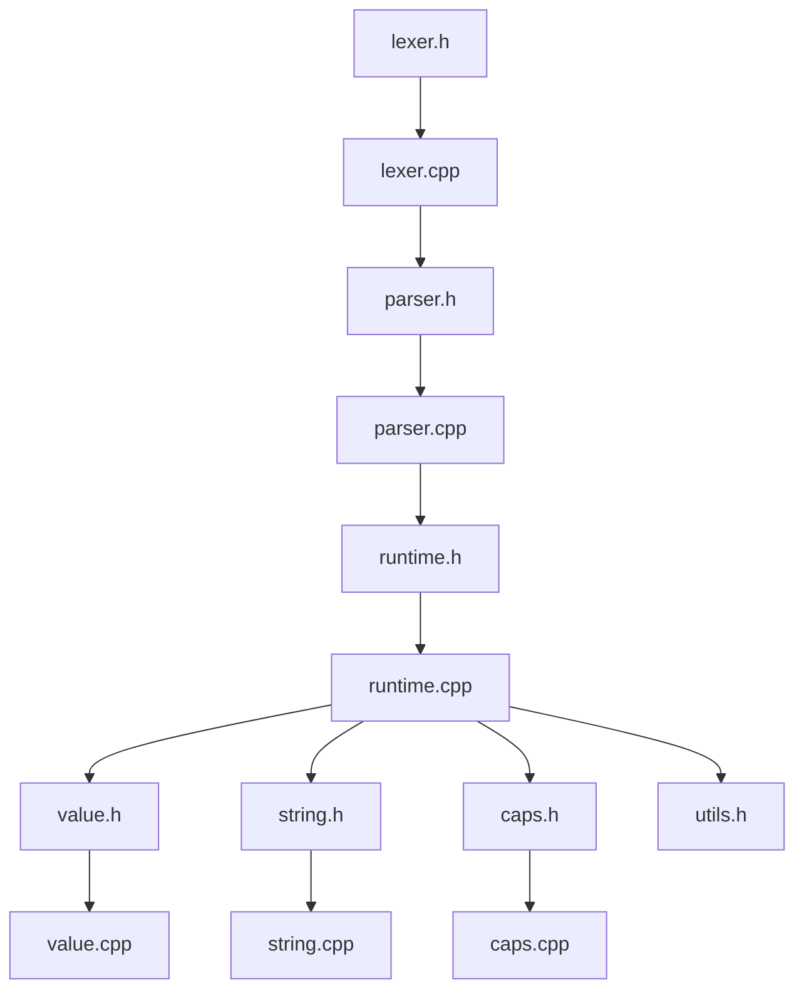
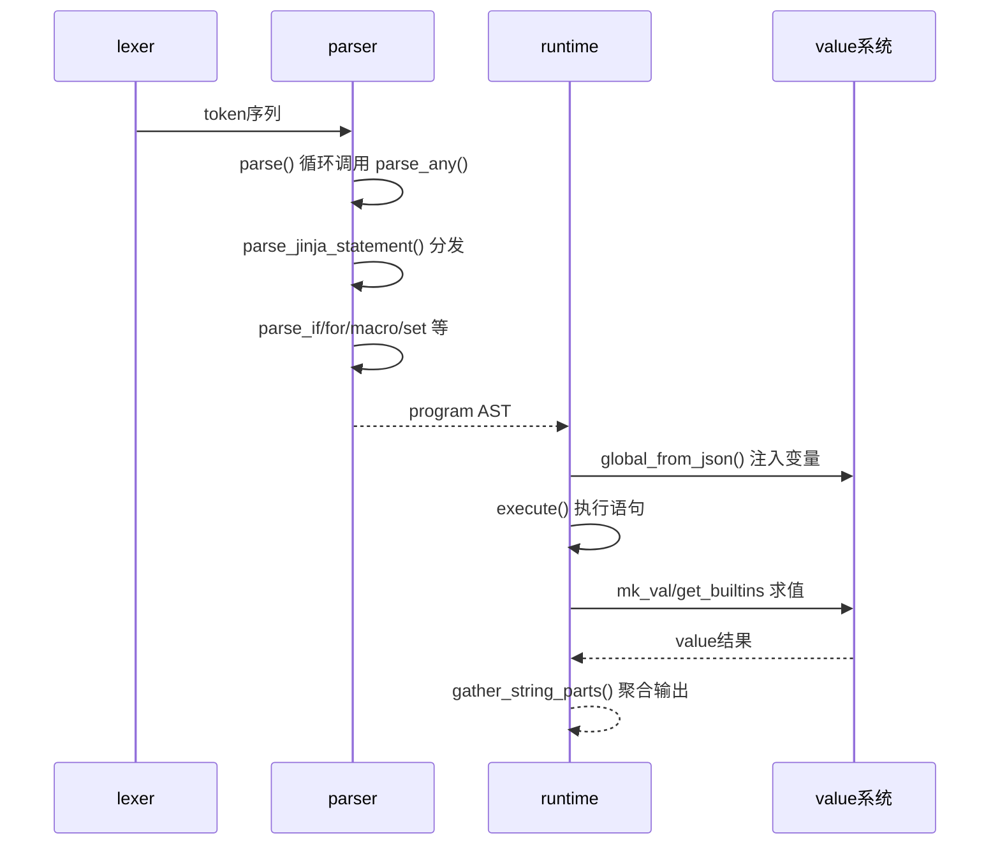
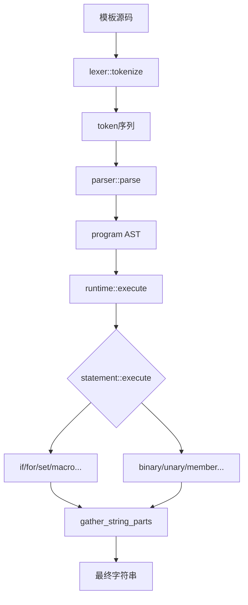
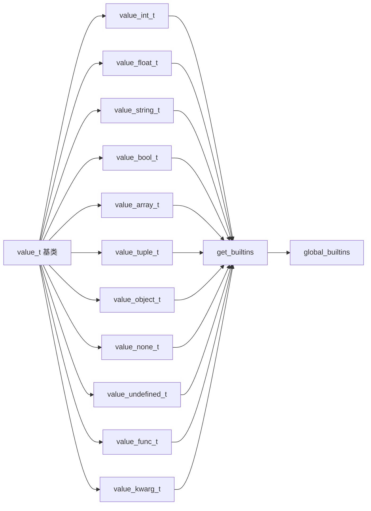
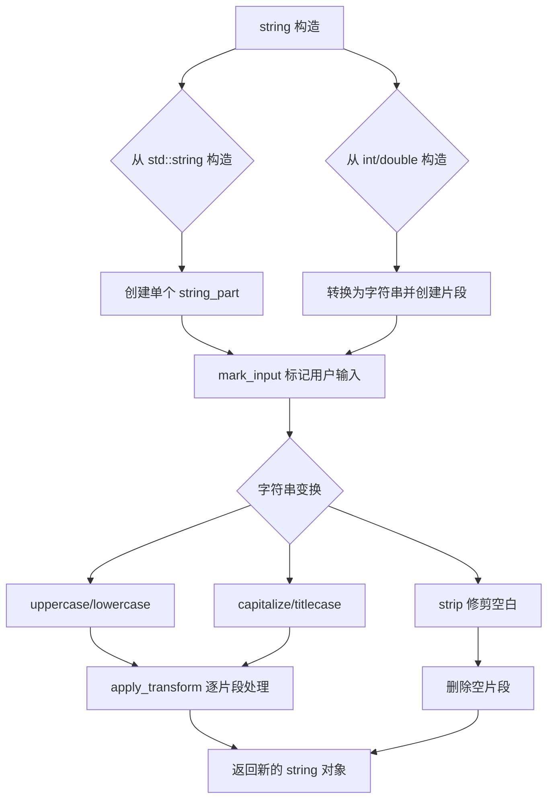
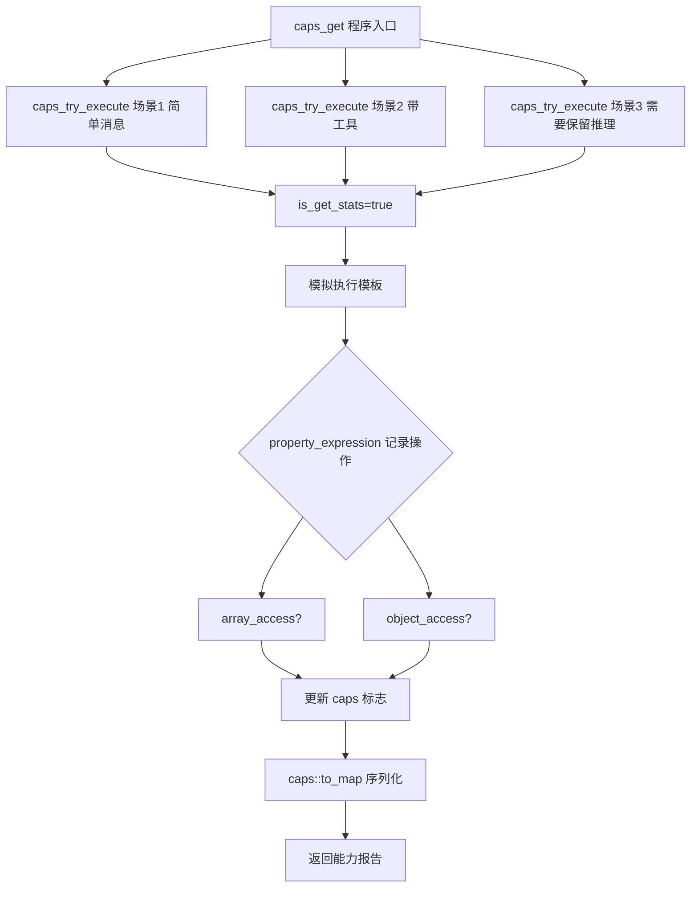
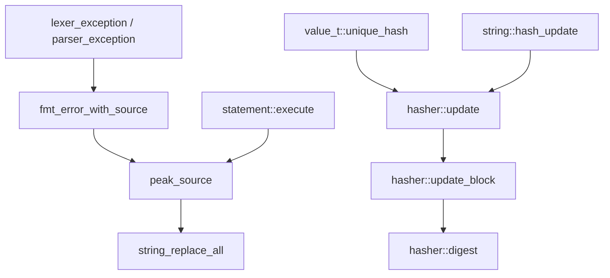

# 第47章 Jinja 模板引擎 —— 智能邮件合并工厂的"全流水线"

## 学习目标

- 理解 Jinja 词法分析器（lexer）如何将模板源码切分为 token 序列，掌握 trim_blocks/lstrip_blocks 空白控制机制
- 掌握递归下降解析器（parser）构建 AST 的完整流程，理解表达式优先级链与控制结构解析
- 深入运行时执行引擎（runtime），理解上下文作用域管理、控制流执行与表达式求值机制
- 剖析强类型值系统（value_t 体系），理解类型多态、内置函数绑定与函数参数处理机制
- 了解智能字符串系统（string_part/string）的输入标记传播与文本变换实现
- 掌握能力探测机制（caps）如何通过模拟执行与统计追踪推断模板特性
- 熟悉基础设施组件（hasher、peak_source 等）在错误定位与哈希计算中的应用

## 47.1 生活类比

在 Jinja 模板引擎的智能邮件合并工厂中，每个组件都扮演着关键角色，共同完成从非结构化模板到结构化提示词的转换。词法分析器（lexer）如同一位细致的**信件分拣员**，它将原始模板文本拆分成邮票（`{{ }}`）、地址标签（``）和普通内容，为后续处理做好准备。语法解析器（parser）则像**信件结构分析师**，它理解模板的层次结构，识别问候语（if 条件）和循环列表（for 循环），并构建出标准信件模板（AST）。运行时执行器（runtime）是**信件生成器**，它根据客户数据（context 变量）实际填写模板，处理循环展开、条件判断，最终输出信件。值系统（value_t）是**多功能文书工具箱**，提供各种数据类型（数字、文本、列表、字典）和对应的处理工具（过滤器、函数），让模板能够灵活操作数据。智能字符串（string）是**带安全标签的墨水**，它区分打印好的文字（模板静态内容）和手写的敏感信息（用户输入），从而实现 XSS 防护。能力探测（caps）则是**格式检测器**，它预先试探信件模板支持哪些高级功能（如工具调用、并行处理等），以便调整处理策略。整个工厂的最终目标是：将非结构化的模板与结构化的数据，高效、安全地合成为最终的提示词文本。

## 47.2 源码地图

```
common/jinja/
├── lexer.h - 词法分析器定义
│   ├── token::type             # Token 类型枚举
│   ├── type_to_string()        # Token 类型转字符串
│   ├── token                   # Token 结构
│   ├── lexer_result            # 词法分析结果封装
│   ├── ordered_mapping_table   # 运算符映射表
│   ├── is_word()               # 判断标识符字符
│   ├── is_integer()            # 判断数字字符
│   ├── lexer                   # 词法分析器类
│   ├── lexer::tokenize()       # 主词法分析循环
│   ├── lexer_exception         # 词法异常类型
│   └── lexer_exception::lexer_exception() # 构造函数
├── lexer.cpp - 词法分析器实现
│   ├── string_lstrip()         # 左侧空白修剪
│   ├── string_rstrip()         # 右侧空白修剪
│   └── lexer::tokenize()       # 主词法分析循环实现
├── parser.h - 语法解析器接口
│   ├── parse_from_tokens()     # 解析入口函数
│   └── parser_exception        # 解析异常类型
│       └── parser_exception()  # 构造函数
├── parser.cpp - 递归下降解析器实现
│   ├── is_type()               # AST 类型检查工具
│   ├── parser 类
│   │   ├── parser()            # 构造函数
│   │   ├── parse()             # 顶层解析入口
│   │   ├── mk_stmt()           # AST节点工厂
│   │   ├── peek()              # 前瞻token
│   │   ├── next()              # 消费token
│   │   ├── expect()            # 断言token类型
│   │   ├── expect_identifier() # 断言标识符
│   │   ├── is()                # 类型检查
│   │   ├── is_identifier()     # 标识符检查
│   │   ├── is_statement()      # 语句检查
│   │   ├── parse_any()         # 语句分派器
│   │   ├── parse_jinja_expression() # {{ }} 表达式解析
│   │   ├── parse_jinja_statement()  #  语句解析
│   │   ├── parse_set_statement()    # set 赋值解析
│   │   ├── parse_if_statement()     # if/elif/else 解析
│   │   ├── parse_macro_statement()  # 宏定义解析
│   │   ├── parse_for_statement()    # for 循环解析
│   │   ├── parse_expression()       # 表达式入口
│   │   ├── parse_if_expression()    # 三元表达式
│   │   ├── parse_logical_or_expression()   # 逻辑或
│   │   ├── parse_logical_and_expression()  # 逻辑与
│   │   ├── parse_logical_negation_expression() # 逻辑非
│   │   ├── parse_comparison_expression()   # 比较运算
│   │   ├── parse_additive_expression()     # 加减运算
│   │   ├── parse_multiplicative_expression() # 乘除运算
│   │   ├── parse_test_expression()         # is 测试
│   │   ├── parse_filter_expression()       # 管道过滤器
│   │   ├── parse_call_member_expression()  # 调用成员
│   │   ├── parse_call_expression()         # 函数调用
│   │   ├── parse_member_expression()       # 成员访问
│   │   ├── parse_member_expression_arguments() # 成员访问参数
│   │   ├── parse_args()                    # 参数列表
│   │   ├── parse_expression_sequence()     # 表达式序列
│   │   └── parse_primary_expression()      # 字面量解析
│   └── parse_from_tokens()     # 解析入口实现
├── runtime.h - 运行时执行引擎定义
│   ├── is_stmt()               # 语句类型检查
│   ├── cast_stmt()             # 语句类型转换
│   ├── extract_pointee_unique  # 类型萃取工具
│   ├── context                 # 执行上下文（变量环境）
│   │   ├── context()           # 构造函数
│   │   ├── ~context()          # 析构函数
│   │   ├── context(const context&) # 拷贝构造（作用域继承）
│   │   ├── get_val()           # 获取变量
│   │   ├── set_val()           # 设置变量（2个重载）
│   │   └── print_vars()        # 打印变量
│   ├── statement               # AST 节点基类
│   │   ├── ~statement()        # 虚析构
│   │   ├── type()              # 类型名称
│   │   ├── execute_impl()      # 虚函数实现接口
│   │   └── execute()           # 统一执行入口
│   ├── chk_type()              # 类型断言检查（2个重载）
│   ├── expression              # 表达式基类
│   │   └── type()              # 类型名称
│   ├── program                 # 程序根节点
│   │   ├── program()           # 构造函数
│   │   ├── type()              # 类型名称
│   │   └── execute_impl()      # 禁止直接执行
│   ├── if_statement            # 条件语句
│   │   ├── if_statement()      # 构造函数
│   │   ├── type()              # 类型名称
│   │   └── execute_impl()      # 执行实现
│   ├── for_statement           # 循环语句
│   │   ├── for_statement()     # 构造函数
│   │   ├── type()              # 类型名称
│   │   └── execute_impl()      # 执行实现
│   ├── break_statement         # break 语句
│   │   ├── type()              # 类型名称
│   │   ├── signal              # break 信号异常
│   │   │   └── what()          # 异常描述
│   │   └── execute_impl()      # 执行实现
│   ├── continue_statement      # continue 语句
│   │   ├── type()              # 类型名称
│   │   ├── signal              # continue 信号异常
│   │   │   └── what()          # 异常描述
│   │   └── execute_impl()      # 执行实现
│   ├── noop_statement          # 空语句
│   │   ├── type()              # 类型名称
│   │   └── execute_impl()      # 执行实现
│   ├── set_statement           # 赋值语句
│   │   ├── set_statement()     # 构造函数
│   │   ├── type()              # 类型名称
│   │   └── execute_impl()      # 执行实现
│   ├── macro_statement         # 宏定义
│   │   ├── macro_statement()   # 构造函数
│   │   ├── type()              # 类型名称
│   │   └── execute_impl()      # 执行实现
│   ├── comment_statement       # 注释语句
│   │   ├── comment_statement() # 构造函数
│   │   ├── type()              # 类型名称
│   │   └── execute_impl()      # 执行实现
│   ├── blank_expression        # 空表达式
│   │   ├── type()              # 类型名称
│   │   └── execute_impl()      # 执行实现
│   ├── member_expression       # 成员访问
│   │   ├── member_expression() # 构造函数
│   │   ├── type()              # 类型名称
│   │   └── execute_impl()      # 执行实现
│   ├── call_expression         # 函数调用
│   │   ├── call_expression()   # 构造函数
│   │   ├── type()              # 类型名称
│   │   └── execute_impl()      # 执行实现
│   ├── identifier              # 标识符
│   │   ├── identifier()        # 构造函数
│   │   ├── type()              # 类型名称
│   │   └── execute_impl()      # 执行实现
│   ├── integer_literal         # 整数字面量
│   │   ├── integer_literal()   # 构造函数
│   │   ├── type()              # 类型名称
│   │   └── execute_impl()      # 执行实现
│   ├── float_literal           # 浮点字面量
│   │   ├── float_literal()     # 构造函数
│   │   ├── type()              # 类型名称
│   │   └── execute_impl()      # 执行实现
│   ├── string_literal          # 字符串字面量
│   │   ├── string_literal()    # 构造函数
│   │   ├── type()              # 类型名称
│   │   └── execute_impl()      # 执行实现
│   ├── array_literal           # 数组字面量
│   │   ├── array_literal()     # 构造函数
│   │   ├── type()              # 类型名称
│   │   └── execute_impl()      # 执行实现
│   ├── tuple_literal           # 元组字面量
│   │   ├── tuple_literal()     # 构造函数
│   │   ├── type()              # 类型名称
│   │   └── execute_impl()      # 执行实现
│   ├── object_literal          # 对象字面量
│   │   ├── object_literal()    # 构造函数
│   │   ├── type()              # 类型名称
│   │   └── execute_impl()      # 执行实现
│   ├── binary_expression       # 二元运算
│   │   ├── binary_expression() # 构造函数
│   │   ├── type()              # 类型名称
│   │   └── execute_impl()      # 执行实现
│   ├── filter_expression       # 过滤器应用
│   │   ├── filter_expression() # 构造函数（2个重载）
│   │   ├── type()              # 类型名称
│   │   └── execute_impl()      # 执行实现
│   ├── filter_statement        # 过滤器语句
│   │   ├── filter_statement()  # 构造函数
│   │   ├── type()              # 类型名称
│   │   └── execute_impl()      # 执行实现
│   ├── select_expression       # 选择表达式
│   │   ├── select_expression() # 构造函数
│   │   ├── type()              # 类型名称
│   │   └── execute_impl()      # 执行实现
│   ├── test_expression         # is 测试
│   │   ├── test_expression()   # 构造函数
│   │   ├── type()              # 类型名称
│   │   └── execute_impl()      # 执行实现
│   ├── unary_expression        # 一元运算
│   │   ├── unary_expression()  # 构造函数
│   │   ├── type()              # 类型名称
│   │   └── execute_impl()      # 执行实现
│   ├── slice_expression        # 切片表达式
│   │   ├── slice_expression()  # 构造函数
│   │   ├── type()              # 类型名称
│   │   └── execute_impl()      # 执行实现
│   ├── keyword_argument_expression # 关键字参数
│   │   ├── keyword_argument_expression() # 构造函数
│   │   ├── type()              # 类型名称
│   │   └── execute_impl()      # 执行实现
│   ├── spread_expression       # 展开表达式
│   │   ├── spread_expression() # 构造函数
│   │   └── type()              # 类型名称
│   ├── call_statement          # 宏调用
│   │   ├── call_statement()    # 构造函数
│   │   └── type()              # 类型名称
│   ├── ternary_expression      # 三元表达式
│   │   ├── ternary_expression() # 构造函数
│   │   ├── type()              # 类型名称
│   │   └── execute_impl()      # 执行实现
│   ├── raised_exception        # 抛出异常
│   │   ├── raised_exception()  # 构造函数
│   │   └── what()              # 异常消息
│   ├── rethrown_exception      # 重抛异常
│   │   ├── rethrown_exception() # 构造函数
│   │   └── what()              # 异常消息
│   ├── gather_string_parts_recursive() # 递归收集字符串
│   ├── render_string_parts()   # 渲染字符串片段
│   ├── runtime                 # 运行时执行器
│   │   ├── runtime()           # 构造函数
│   │   ├── execute()           # 执行程序
│   │   └── gather_string_parts() # 收集字符串片段
│   ├── enable_debug()          # 启用调试
│   └── property_expression     # 属性访问表达式（能力检测）
│       └── execute_impl()      # 执行实现（含统计）
├── runtime.cpp - 运行时执行实现
│   ├── enable_debug()          # 启用调试模式
│   ├── exec_statements()       # 语句序列执行
│   ├── statement::execute()    # 统一执行入口（异常包装）
│   ├── get_line_col()          # 获取行列号
│   ├── ensure_key_type_allowed() # 键类型验证
│   ├── identifier::execute_impl()  # 标识符解析
│   ├── object_literal::execute_impl() # 对象字面量执行
│   ├── binary_expression::execute_impl()  # 二元运算执行
│   ├── try_builtin_func()      # 内置函数查找
│   ├── filter_expression::execute_impl()  # 过滤器应用
│   ├── filter_statement::execute_impl()   # 过滤器语句执行
│   ├── test_expression::execute_impl()    # is 测试执行
│   ├── unary_expression::execute_impl()   # 一元运算执行
│   ├── if_statement::execute_impl()       # 条件分支执行
│   ├── for_statement::execute_impl()      # 循环执行
│   ├── set_statement::execute_impl()      # 变量赋值
│   ├── macro_statement::execute_impl()    # 宏注册与调用
│   ├── member_expression::execute_impl()  # 成员/索引访问
│   ├── property_expression::execute_impl() # 属性访问执行
│   ├── call_expression::execute_impl()    # 函数调用
│   └── keyword_argument_expression::execute_impl() # 关键字参数执行
├── value.h - 强类型值系统定义
│   ├── extract_pointee         # 智能指针类型萃取
│   ├── is_val()                # 类型检查
│   ├── mk_val()                # 值工厂函数
│   ├── cast_val()              # 类型转换
│   ├── global_from_json()      # JSON导入全局
│   ├── value_compare()         # 值比较
│   ├── value_t                 # 值基类（多态接口）
│   │   ├── value_t()           # 构造函数
│   │   ├── type()              # 类型名称
│   │   ├── as_int()            # 转整数
│   │   ├── as_float()          # 转浮点
│   │   ├── as_string()         # 转字符串
│   │   ├── as_bool()           # 转布尔
│   │   ├── as_array()          # 转数组
│   │   ├── as_ordered_object() # 转有序对象
│   │   ├── invoke()            # 函数调用
│   │   ├── is_none()           # 是否None
│   │   ├── is_undefined()      # 是否Undefined
│   │   ├── get_builtins()      # 获取内置函数
│   │   ├── has_key()           # 键存在检查
│   │   ├── insert()            # 插入键值
│   │   ├── at()                # 索引访问
│   │   ├── is_numeric()        # 是否数值
│   │   ├── is_hashable()       # 是否可哈希
│   │   ├── is_immutable()      # 是否不可变
│   │   ├── unique_hash()       # 唯一哈希
│   │   ├── operator==()        # 等于运算符
│   │   ├── operator!=()        # 不等于运算符
│   │   ├── as_repr()           # 调试表示
│   │   ├── equivalent()        # 等价比较
│   │   ├── nonequal()          # 严格不等
│   │   └── stats_t             # 值使用统计
│   │       └── mark_used()     # 标记已使用
│   ├── global_builtins()       # 全局内置函数
│   ├── value_to_json()         # 值转JSON
│   ├── value_to_string_repr()  # 值转调试字符串
│   ├── not_implemented_exception # 未实现异常
│   │   └── not_implemented_exception() # 构造函数
│   ├── value_hasher            # 值哈希器
│   │   └── operator()          # 哈希计算
│   ├── value_equivalence       # 值等价比较
│   │   └── operator()          # 等价比较
│   ├── value_equality          # 值相等比较
│   │   └── operator()          # 相等比较
│   ├── value_int_t             # 整数类型
│   │   ├── 构造函数、as_int、as_float、as_string、as_bool、get_builtins、is_numeric、is_hashable、unique_hash、equivalent、nonequal
│   ├── value_float_t           # 浮点类型
│   │   ├── 构造函数、as_float、as_int、as_string、as_bool、get_builtins、is_numeric、is_hashable、unique_hash、equivalent、nonequal
│   ├── value_string_t          # 字符串类型
│   │   ├── 构造函数、type、as_string、as_repr、as_bool、get_builtins、is_hashable、unique_hash、mark_input、equivalent
│   ├── value_bool_t            # 布尔类型
│   │   ├── 构造函数、type、as_int、as_bool、as_string、get_builtins、is_numeric、is_hashable、unique_hash、equivalent、nonequal
│   ├── value_array_t           # 数组类型
│   │   ├── 构造函数、reverse、push_back、pop_at、type、is_immutable、as_array、as_string、as_bool、at、get_builtins、is_hashable、unique_hash、equivalent
│   ├── value_tuple_t           # 元组类型（继承数组）
│   │   ├── 构造函数、type、is_immutable
│   ├── value_object_t          # 对象类型
│   │   ├── 构造函数、insert、type、is_immutable、as_ordered_object、as_string、as_bool、has_key、at、get_builtins、is_hashable、unique_hash、equivalent
│   ├── value_none_t            # None 类型
│   │   ├── type、is_none、as_bool、as_string、as_repr、get_builtins、is_hashable、unique_hash、equivalent
│   ├── value_undefined_t       # Undefined 类型
│   │   ├── 构造函数、type、is_undefined、as_bool、as_repr、get_builtins、unique_hash、equivalent
│   ├── func_args               # 函数参数封装
│   │   ├── 构造函数、get_kwarg、get_kwarg_or_pos、get_pos、get_args、count、push_back、push_front、ensure_count、ensure_val、ensure_vals
│   ├── value_func_t            # 函数类型
│   │   ├── 构造函数、invoke、type、as_repr、is_hashable、unique_hash、equivalent
│   └── value_kwarg_t           # 关键字参数类型
│       ├── 构造函数、type、as_repr、is_hashable、unique_hash、equivalent
├── value.cpp - 值系统实现
│   ├── func_args 方法实现      # get_kwarg/get_kwarg_or_pos/get_pos/push_back/push_front/get_args
│   ├── slice()                 # Python风格切片
│   ├── empty_value_fn()        # 空值生成
│   ├── test_type_fn()          # 类型测试函数生成
│   ├── test_compare_fn()       # 比较测试函数
│   ├── tojson()                # JSON序列化
│   ├── selectattr()            # 属性选择/拒绝
│   ├── default_value()         # 默认值处理
│   ├── global_builtins()       # 全局内置函数注册
│   ├── 各类型 get_builtins 实现 # int/float/string/bool/array/object/none/undefined
│   ├── value_t::stats_t::mark_used() # 标记使用统计
│   ├── from_json()             # JSON 反序列化
│   ├── value_compare()         # 跨类型值比较
│   ├── global_from_json()      # JSON导入全局实现
│   ├── value_to_json_internal() # JSON序列化内部
│   ├── value_to_json()         # JSON 序列化入口
│   └── value_to_string_repr()  # 值转调试字符串
├── string.h - 智能字符串系统
│   ├── string_part             # 字符串片段
│   │   ├── is_uppercase()      # 大写检查
│   │   └── is_lowercase()      # 小写检查
│   ├── string                  # 组合字符串类
│   │   ├── 构造函数（4个重载）、mark_input、str、length、hash_update、all_parts_are_input、is_uppercase、is_lowercase、mark_input_based_on、append、uppercase、lowercase、capitalize、titlecase、strip
├── string.cpp - 字符串操作实现
│   ├── string_part 方法实现    # is_uppercase/is_lowercase
│   ├── string 方法实现         # mark_input/str/length/hash_update/all_parts_are_input/is_uppercase/is_lowercase/mark_input_based_on/append/uppercase/lowercase/capitalize/titlecase/strip
│   └── apply_transform 辅助函数
├── caps.h - 能力探测定义
│   └── caps 结构体             # supports_* 标志
│       ├── to_map()            # 转映射
│       └── to_string()         # 转字符串
├── caps.cpp - 能力探测实现
│   ├── caps_try_execute()      # 模拟执行模板
│   ├── caps::to_map()          # 能力转映射实现
│   ├── caps::to_string()       # 能力转字符串实现
│   ├── caps_print_stats()      # 统计信息输出
│   └── caps_get()              # 能力分析主入口
└── utils.h - 基础设施工具
    ├── string_replace_all()    # 字符串替换
    ├── peak_source()           # 源码错误定位
    ├── fmt_error_with_source() # 错误格式化
    └── hasher                  # FNV 变体哈希器
        ├── 构造函数（默认/类型信息）、update（流式/字符串）、digest、update_block
```

## 47.3 词法分析器 —— 信件分拣员

词法分析器是 Jinja 引擎的第一道工序。它的核心职责是将原始模板源代码文本切分为结构化的 token 序列（文本、注释、语句、表达式），并处理 `\r\n` 到 `\n` 的规范化，确保跨平台一致性。同时，它支持 `lstrip_blocks` 和 `trim_blocks` 选项，自动修剪行首空白和块后换行，使用 `string_lstrip`/`string_rstrip` 辅助函数处理用户显式的 `-` 空白控制修饰符。在 `consume_while` 中处理反斜杠转义（`\n`, `t`, `\\` 等），并自动识别整数和浮点数（含科学计数法），区分正负号是一元运算符还是数字的一部分。当词法分析失败时，抛出 `lexer_exception` 并携带源码上下文和精确位置，通过 `peak_source` 生成带指示符的错误片段。

### 47.3.1 token::type / type_to_string() —— Token 类型枚举与字符串转换

源码路径：`common/jinja/lexer.h` - `token::type`（第12-34行）

```cpp
// Token 类型枚举，定义了 Jinja 模板中所有可能的 token 类型
enum class type {
    eof,                    // 文件结束
    text,                   // 普通文本
    numeric_literal,        // 数字字面量
    string_literal,         // 字符串字面量
    identifier,             // 标识符
    equals,                 // 等号 =
    open_paren,             // 左括号 (
    close_paren,            // 右括号 )
    open_statement,         // 语句块开始 
    open_expression,        // 表达式块开始 {{
    close_expression,       // 表达式块结束 }}
    open_square_bracket,    // 左方括号 [
    close_square_bracket,   // 右方括号 ]
    open_curly_bracket,     // 左花括号 {
    close_curly_bracket,    // 右花括号 }
    comma,                  // 逗号 ,
    dot,                    // 点号 .
    colon,                  // 冒号 :
    pipe,                   // 管道符 |
    call_operator,          // 调用符 ()
    additive_binary_operator,  // 加性运算符 +/-
    multiplicative_binary_operator, // 乘性运算符 *///
    comparison_binary_operator,    // 比较运算符 ==/!=/etc
    unary_operator,         // 一元运算符
    comment,                // 注释
};
```

这段代码定义了 `token::type` 枚举，为每种 token 类型分配了一个明确的标识符，使得词法分析器生成的 token 流具有可读性和类型安全性。`type_to_string()` 函数则将这些枚举值转换为对应的字符串名称，用于调试输出和错误报告。

### 47.3.2 lexer::tokenize() —— 核心词法分析循环

源码路径：`common/jinja/lexer.cpp` - `lexer::tokenize()`（第37-328行）

```cpp
lexer_result lexer::tokenize(const std::string & source) {
    std::vector<token> tokens;
    std::string src = source;
    if (source.empty()) {
        return {tokens, src};
    }
    // 规范化 \r\n 或 \r 为 \n
    for (std::string::size_type pos = 0; (pos = src.find("\r\n", pos)) != std::string::npos; ) {
        src.erase(pos, 1);
        ++pos;
    }
    for (std::string::size_type pos = 0; (pos = src.find("\r", pos)) != std::string::npos; ) {
        src.replace(pos, 1, 1, '\n');
        ++pos;
    }
    if (source.back() == '\n') {
        src.pop_back();
    }
    // ... 状态机循环，处理文本、注释、表达式、语句等
    // 核心逻辑包括：consume_while、consume_numeric、ordered_mapping_table 匹配等
    return {std::move(tokens), src};
}
```

`lexer::tokenize()` 是词法分析器的核心，它遍历规范化的源码字符串，根据当前状态和字符特征生成 token 序列。通过 `ordered_mapping_table` 快速匹配 Jinja 控制符（`{{`、`` 等），并处理字符串、数字、标识符和运算符。同时，它根据 `opt_lstrip_blocks` 和 `opt_trim_blocks` 选项，在遇到块结束标记时回溯修剪前一个 text token 的尾部空白，实现精细的空白控制。

### 47.3.3 string_lstrip / string_rstrip —— 空白控制辅助函数

源码路径：`common/jinja/lexer.cpp` - `string_lstrip()` / `string_rstrip()`（第13-29行）

```cpp
static void string_lstrip(std::string & s, const char * chars) {
    size_t start = s.find_first_not_of(chars);
    if (start == std::string::npos) {
        s.clear();
    } else {
        s.erase(0, start);
    }
}

static void string_rstrip(std::string & s, const char * chars) {
    size_t end = s.find_last_not_of(chars);
    if (end == std::string::npos) {
        s.clear();
    } else {
        s.erase(end + 1);
    }
}
```

这两个辅助函数实现了从字符串两端去除指定字符集的功能。在词法分析中，当遇到 `{{-` 或 `-}}` 等显式空白控制修饰符时，`string_lstrip` 用于修剪前一个 text token 的尾部空白，`string_rstrip` 用于修剪当前 text token 的首部空白，从而精确控制模板渲染时的空白输出。

### 47.3.4 模块依赖图



词法分析器是整个 Jinja 引擎的入口，它的输出（token 序列）被解析器消费，解析器生成的 AST 被运行时执行，运行时依赖值系统、字符串系统和工具函数。

### 47.3.5 补充：词法分析器的其他关键组件

除了上述核心接口外，`lexer.h` 中还定义了若干重要组件，它们在词法分析过程中发挥着不可或缺的作用。

**`ordered_mapping_table`** 是一个静态的映射表，它将 Jinja 的控制符和运算符序列（如 `"{{"`、`"}}"`、`""`、`"=="`、`"!="` 等）映射到对应的 `token::type`。在 `tokenize()` 的主循环中，解析器按顺序遍历该表，检查当前位置的源码是否匹配某个序列，从而快速识别出各种定界符和运算符。由于映射表按照序列长度降序排列，长序列优先匹配，避免了 `"{{"` 被误认为两个单独的 `{` 字符。

**`is_word()`** 是一个简单的字符分类函数，它判断给定的字符是否为字母数字字符或下划线（`[a-zA-Z0-9_]`）。这个函数在词法分析中用于识别标识符：当遇到一个满足条件的字符时，解析器会连续消费后续的 `is_word` 字符，从而构造出完整的标识符 token。

**`is_integer()`** 判断字符是否为十进制数字（`[0-9]`）。它与 `is_word()` 配合，用于区分数字字面量和标识符。在 `consume_numeric()` 中，解析器利用 `is_integer()` 来消费连续的数字字符，并在适当的时候识别小数点和科学计数法，从而生成 `numeric_literal` token。

**`lexer_exception`** 是一个自定义的异常类，它在词法分析失败时抛出。它的构造函数接收错误消息、源代码和出错位置，内部调用 `fmt_error_with_source()` 将错误信息与源码上下文组合成一个可读的字符串，然后传递给基类 `std::runtime_error`。这样，当模板源码中出现无法识别的字符或不符合语法的结构时，引擎能够提供精确的错误定位，帮助开发者快速诊断问题。

## 47.4 递归下降解析器 —— 信件结构分析师

解析器接收词法分析器生成的 token 序列，通过递归下降解析构建抽象语法树（AST）。它使用 `mk_stmt` 模板方法创建 AST 节点并自动绑定源码位置信息，通过 `peek`/`next`/`expect`/`expect_identifier` 实现前瞻和断言，确保语法符合预期结构。控制结构解析包括 `parse_if_statement`（处理 if/elif/else/endif 嵌套）、`parse_for_statement`（解析循环变量、in 迭代对象、循环体及可选的 else 块）、`parse_macro_statement`（捕获宏名称、参数列表和宏体）等。表达式优先级链实现标准的递归下降：`parse_if_expression` → `parse_logical_or` → `parse_logical_and` → `parse_logical_negation` → `parse_comparison` → `parse_additive` → `parse_multiplicative` → `parse_test` → `parse_filter` → `parse_call_member` → `parse_member` → `parse_primary`。

### 47.4.1 parser 类与 parse() —— 解析入口

源码路径：`common/jinja/parser.cpp` - `parser::parse()`（第27-34行）

```cpp
program parser::parse() {
    statements body;                              // 创建空的语句容器，存放顶层语句
    while (current < tokens.size()) {             // 循环直到消费完所有 token
        body.push_back(parse_any());               // 解析每个顶层语句并加入容器
    }
    return program(std::move(body));              // 用语句列表构造 program 根节点
}
```

`parse()` 是解析器的顶层入口，它循环调用 `parse_any()` 直到 token 流耗尽，将所有顶层语句收集到 `body` 中，最终构造一个 `program` 节点作为 AST 的根。`parse_any()` 根据当前 token 类型分派到注释、文本、Jinja 语句或 Jinja 表达式解析逻辑。

### 47.4.2 parse_expression() → parse_primary_expression() —— 表达式优先级链

源码路径：`common/jinja/parser.cpp` - `parse_expression()` 到 `parse_primary_expression()`（第291-542行）

```cpp
statement_ptr parse_expression() {
    return parse_if_expression();
}

statement_ptr parse_if_expression() {
    auto a = parse_logical_or_expression();
    if (is_identifier("if")) {
        // 处理三元表达式 a if test else b 或选择表达式 a if test
        // ...
    }
    return a;
}

// ... parse_logical_or_expression, parse_logical_and_expression,
// parse_logical_negation_expression, parse_comparison_expression,
// parse_additive_expression, parse_multiplicative_expression,
// parse_test_expression, parse_filter_expression,
// parse_call_member_expression, parse_member_expression,
// parse_primary_expression 等
```

解析器通过嵌套调用实现表达式优先级：从最低优先级的 `parse_if_expression`（三元/选择）开始，逐层下降到 `parse_logical_or`、`parse_logical_and`、`parse_logical_negation`、`parse_comparison`、`parse_additive`、`parse_multiplicative`、`parse_test`、`parse_filter`、`parse_call_member`、`parse_member`，最后在 `parse_primary_expression` 中解析字面量。这种结构确保了运算符优先级的正确性，例如乘法优先于加法，管道过滤器优先于成员访问。

### 47.4.3 parse_jinja_statement() —— 控制语句分发

源码路径：`common/jinja/parser.cpp` - `parse_jinja_statement()`（第125-198行）

```cpp
statement_ptr parse_jinja_statement() {
    expect(token::open_statement, "Expected {%");
    if (peek().t != token::identifier) {
        throw std::runtime_error("Unknown statement");
    }
    size_t start_pos = current;
    std::string name = next().value;
    statement_ptr result;
    if (name == "set") {
        result = parse_set_statement(start_pos);
    } else if (name == "if") {
        result = parse_if_statement(start_pos);
        // ... expect endif
    } else if (name == "for") {
        result = parse_for_statement(start_pos);
        // ... expect endfor
    } else if (name == "macro") {
        result = parse_macro_statement(start_pos);
        // ... expect endmacro
    } else if (name == "break") {
        // ...
    } else if (name == "continue") {
        // ...
    } else if (name == "call") {
        // 解析宏调用及调用者参数
    } else if (name == "filter") {
        // 解析  块
    } else {
        throw std::runtime_error("Unknown statement: " + name);
    }
    return result;
}
```

`parse_jinja_statement()` 是 `` 语句的分发中心。它首先消费 `{%` 标记，然后根据标识符名称将解析任务委派给具体的语句解析函数（`parse_set_statement`、`parse_if_statement`、`parse_for_statement` 等）。对于 `call` 和 `filter` 等特殊语句，它内联处理复杂的语法结构（如调用者参数、块体等）。

### 47.4.4 时序图



解析器将 token 流转换为 AST，运行时执行 AST 并调用值系统完成求值，最终聚合字符串输出。

### 47.4.5 补充：解析器的入口函数与异常处理

**`parse_from_tokens()`** 是解析器的全局入口函数，定义在 `parser.h` 中。它接收词法分析的结果（`lexer_result`），创建一个 `parser` 对象并调用 `parse()` 方法，返回完整的 `program` AST。这个函数在 `parser.cpp` 的末尾实现，为上层代码提供了一个简洁的接口：

源码路径：`common/jinja/parser.cpp` - `parse_from_tokens()`（第545-547行）

```cpp
program parse_from_tokens(const lexer_result & lexer_res) {
    return parser(lexer_res.tokens, lexer_res.source).parse();
}
```

`parse_from_tokens()` 将词法分析产生的 token 序列和源码文本传给解析器，解析器通过 `parse()` 方法递归下降地构建 AST。如果解析过程中遇到语法错误，会抛出 `parser_exception`，其中包含源码上下文和出错位置，便于开发者定位问题。

**`parser_exception`** 是解析器专用的异常类，同样定义在 `parser.h` 中。它在遇到语法错误时抛出，构造函数接收错误消息、源码和位置，内部调用 `fmt_error_with_source()` 生成带有源码上下文的错误信息。与 `lexer_exception` 类似，它也继承自 `std::runtime_error`，使得解析错误能够被统一捕获和处理。

## 47.5 运行时执行引擎 —— 信件生成器

运行时执行引擎是 Jinja 的"虚拟机"，负责遍历 AST 并执行求值。`context` 类维持变量环境栈，构造函数自动注入 `true`/`false`/`none`（含大写变体）内置常量及当前时间戳；拷贝构造函数实现作用域继承：复制父上下文变量、时间戳、`is_get_stats` 标志和源码引用。`statement` 作为所有 AST 节点基类，提供 `type()` 多态识别和 `execute()` 统一入口，`execute()` 包装具体执行逻辑，捕获异常并附加源码位置（行列号）和代码片段。控制流信号（`break_statement::signal`, `continue_statement::signal`）通过异常实现非局部跳转。`if_statement` 根据条件值选择执行主体或备选分支；`for_statement` 支持数组/对象遍历，自动处理 `loop` 元数据，支持 `else` 空循环回退；`set_statement` 支持标识符赋值、元组解包赋值和成员赋值；`macro_statement` 将宏体封装为可调用的函数对象注册到上下文。表达式求值方面，`binary_expression` 处理逻辑短路（and/or）、算术运算、比较运算和成员关系（in/not in）；`unary_expression` 处理 not 逻辑非和数值负号；`filter_expression` 将左侧值作为输入，调用匹配的内置过滤器；`test_expression` 解析 is 测试到对应的 `test_is_*` 内置函数；`member_expression` 处理点号成员访问和方括号索引/切片；`call_expression` 执行函数调用，参数通过 `func_args` 封装。

### 47.5.1 context 类 —— 变量环境与作用域

源码路径：`common/jinja/runtime.h` - `context::context()`（第45-57行）

```cpp
context(std::string src = "") : src(std::make_shared<std::string>(std::move(src))) {
    env = mk_val<value_object>();                              // 创建空对象作为变量环境
    env->has_builtins = false;                                // 标记尚未注入内置函数
    env->insert("true",  mk_val<value_bool>(true));           // 注入 true 常量
    env->insert("True",  mk_val<value_bool>(true));           // 注入 True 常量
    env->insert("false", mk_val<value_bool>(false));          // 注入 false 常量
    env->insert("False", mk_val<value_bool>(false));          // 注入 False 常量
    env->insert("none",  mk_val<value_none>());               // 注入 none 常量
    env->insert("None",  mk_val<value_none>());               // 注入 None 常量
    current_time = std::time(nullptr);                        // 记录当前时间戳
}
```

`context` 类是模板执行时的变量环境。构造函数初始化一个空对象 `env`，并注入 `true`/`false`/`none` 及其大写变体作为内置常量，同时记录当前时间戳用于 `strftime_now` 等全局函数。拷贝构造函数通过复制父上下文的变量实现作用域嵌套，使得循环体、宏体等内部作用域可以访问外部变量，同时内部赋值不会泄漏到外部。

### 47.5.2 statement::execute() —— 统一执行入口与异常包装

源码路径：`common/jinja/runtime.cpp` - `statement::execute()`（第32-62行）

```cpp
value statement::execute(context & ctx) {
    try {
        return execute_impl(ctx);                              // 调用具体的执行实现
    } catch (const continue_statement::signal & /* ex */) {
        throw;                                                 // 继续信号直接抛出
    } catch (const break_statement::signal & /* ex */) {
        throw;                                                 // 中断信号直接抛出
    } catch (const rethrown_exception & /* ex */) {
        throw;                                                 // 重抛异常直接抛出
    } catch (const not_implemented_exception & /* ex */) {
        throw;                                                 // 未实现异常直接抛出
    } catch (const std::exception & e) {
        const std::string & source = *ctx.src;
        if (source.empty()) {
            std::ostringstream oss;
            oss << "\nError executing " << type() << " at position " << pos << ": " << e.what();
            throw rethrown_exception(oss.str());               // 无源码时输出简要错误
        } else {
            std::ostringstream oss;
            oss << "\n------------\n";
            oss << "While executing " << type() << " at " << get_line_col(source, pos) << " in source:\n";
            oss << peak_source(source, pos) << "\n";
            oss << "Error: " << e.what();
            throw rethrown_exception(oss.str());               // 有源码时输出详细错误
        }
    }
}
```

`statement::execute()` 是所有 AST 节点的统一执行入口。它调用具体的 `execute_impl()` 并捕获异常，将运行时异常转换为包含模板位置和源码片段的 `rethrown_exception`。通过 `get_line_col()` 将字符偏移量转换为行列号，并用 `peak_source()` 提取错误位置前后的源码片段（默认前后 40 字符），生成带 `^` 指示符的错误报告，极大地方便了模板调试。

### 47.5.3 for_statement::execute_impl() —— 循环执行

源码路径：`common/jinja/runtime.cpp` - `for_statement::execute_impl()`（第415-551行）

```cpp
value for_statement::execute_impl(context & ctx) {
    context scope(ctx);                                        // 创建循环作用域，继承父上下文
    // ... 获取可迭代对象，支持数组和对象遍历
    // ... 绑定循环变量，处理 loop 元数据
    // ... 执行循环体，支持 break/continue 信号
    // ... 若无迭代，执行 else 默认块
    value_string str = mk_val<value_string>();
    gather_string_parts_recursive(result, str);                // 聚合循环体产生的字符串片段
    return str;
}
```

`for_statement::execute_impl()` 实现了 Jinja 的循环语句。它创建一个新的作用域 `scope` 继承自当前上下文，然后遍历可迭代对象（数组或对象）。对于对象遍历，它将每个键值对包装为元组。循环体内可以访问 `loop` 元数据（如 `loop.index`、`loop.first` 等）。如果可迭代对象为空，则执行 `else` 分支的默认块。最后，通过 `gather_string_parts_recursive()` 将循环体产生的所有字符串片段聚合为一个字符串返回。

### 47.5.4 binary_expression —— 二元运算与短路

源码路径：`common/jinja/runtime.cpp` - `binary_expression::execute_impl()`（第95-244行）

```cpp
value binary_expression::execute_impl(context & ctx) {
    value left_val = left->execute(ctx);                       // 计算左操作数
    if (op.value == "and") {
        return left_val->as_bool() ? right->execute(ctx) : std::move(left_val);  // 短路：左真则返回右值
    } else if (op.value == "or") {
        return left_val->as_bool() ? std::move(left_val) : right->execute(ctx);  // 短路：左假则返回右值
    }
    value right_val = right->execute(ctx);                     // 计算右操作数
    // ... 处理 ==, !=, 算术运算, 字符串拼接等
    // 注意：and/or 实现短路求值，右操作数可能不被执行
}
```

`binary_expression::execute_impl()` 实现了 Jinja 的二元运算。对于逻辑运算 `and` 和 `or`，它实现短路求值：如果左操作数已经确定了结果，则不执行右操作数。对于比较运算（`==`、`!=`），它使用 `operator==` 进行值比较。对于算术运算（`+`、`-`、`*`、`/`），它将操作数转换为浮点数进行计算。对于字符串拼接（`~` 和 `+`），它将两个字符串拼接为新的字符串。

### 47.5.5 流程图



从模板源码到最终字符串的完整流程：词法分析器生成 token 序列，解析器构建 AST，运行时执行 AST 并聚合字符串片段。

### 47.5.6 program —— 模板程序的根节点

源码路径：`common/jinja/runtime.h` - `program`（第116-121行）

```cpp
struct program : statement {
    statements body;

    program() = default;
    explicit program(statements && body) : body(std::move(body)) {}

    std::string type() const override { return "Program"; }

    value execute_impl(context &) override {
        throw std::runtime_error("Cannot execute program directly, use jinja::runtime instead");
    }
};
```

`program` 是整个模板的根节点，它包含一个顶层语句列表 `body`。`program` 本身不直接执行，而是由 `runtime` 类遍历 `body` 中的每个语句并执行。这种设计将程序的组织与执行分离，使得 `runtime` 可以统一处理执行过程和结果收集。

### 47.5.7 if_statement —— 条件语句

源码路径：`common/jinja/runtime.h` - `if_statement`（第129-135行）

```cpp
struct if_statement : statement {
    statement_ptr test;
    statements body;
    statements alternate;

    if_statement(statement_ptr && test, statements && body, statements && alternate)
        : test(std::move(test)), body(std::move(body)), alternate(std::move(alternate)) {
        chk_type<expression>(this->test);
    }

    std::string type() const override { return "If"; }
    value execute_impl(context & ctx) override;
};
```

`if_statement` 表示 Jinja 的 `` 条件分支。它包含一个测试表达式 `test`、条件为真时执行的语句块 `body`，以及备选分支 `alternate`（对应 `` 或 ``）。在运行时，先计算 `test` 的布尔值，然后根据结果选择执行 `body` 或 `alternate`。

### 47.5.8 noop_statement —— 空语句

源码路径：`common/jinja/runtime.h` - `noop_statement`（第187-190行）

```cpp
struct noop_statement : statement {
    std::string type() const override { return "Noop"; }
    value execute_impl(context &) override {
        return mk_val<value_undefined>();
    }
};
```

`noop_statement` 是一个空操作语句，用于占位或跳过某些语法结构（如 `` 标签）。执行时直接返回 `undefined` 值，不产生任何输出。

### 47.5.9 member_expression —— 成员访问

源码路径：`common/jinja/runtime.h` - `member_expression`（第248-255行）

```cpp
struct member_expression : expression {
    statement_ptr object;
    statement_ptr property;
    bool computed;  // true 表示方括号访问，false 表示点号访问

    member_expression(statement_ptr && object, statement_ptr && property, bool computed)
        : object(std::move(object)), property(std::move(property)), computed(computed) {
        chk_type<expression>(this->object);
        chk_type<expression>(this->property);
    }

    std::string type() const override { return "MemberExpression"; }
    value execute_impl(context & ctx) override;
};
```

`member_expression` 表示对象的成员访问。`computed` 标志区分点号访问（`obj.attr`）和方括号访问（`obj[key]`）。方括号访问时，`property` 可能是 `slice_expression` 或普通表达式；点号访问时，`property` 必须是标识符。运行时根据 `object` 的类型（对象、数组、字符串）和访问形式，解析内置成员或索引。

### 47.5.10 call_expression —— 函数调用

源码路径：`common/jinja/runtime.h` - `call_expression`（第263-270行）

```cpp
struct call_expression : expression {
    statement_ptr callee;
    statements args;

    call_expression(statement_ptr && callee, statements && args)
        : callee(std::move(callee)), args(std::move(args)) {
        chk_type<expression>(this->callee);
        for (const auto& arg : this->args) chk_type<expression>(arg);
    }

    std::string type() const override { return "CallExpression"; }
    value execute_impl(context & ctx) override;
};
```

`call_expression` 表示函数调用，包含被调用者 `callee` 和参数列表 `args`。运行时先计算 `callee` 得到函数值，然后依次计算所有参数，最后调用函数的 `invoke()` 方法。

### 47.5.11 identifier —— 标识符

源码路径：`common/jinja/runtime.h` - `identifier`（第277-279行）

```cpp
struct identifier : expression {
    std::string val;

    explicit identifier(const std::string & val) : val(val) {}

    std::string type() const override { return "Identifier"; }
    value execute_impl(context & ctx) override;
};
```

`identifier` 表示模板中的变量名或函数名。运行时从上下文 `ctx` 中查找对应的值；如果未找到，则检查是否为全局内置函数；如果都不是，返回 `undefined`。

### 47.5.12 integer_literal —— 整数字面量

源码路径：`common/jinja/runtime.h` - `integer_literal`（第285-289行）

```cpp
struct integer_literal : expression {
    int64_t val;

    explicit integer_literal(int64_t val) : val(val) {}

    std::string type() const override { return "IntegerLiteral"; }
    value execute_impl(context &) override {
        return mk_val<value_int>(val);
    }
};
```

`integer_literal` 表示整数字面量。运行时直接将其包装为 `value_int` 类型的值并返回。

### 47.5.13 float_literal —— 浮点字面量

源码路径：`common/jinja/runtime.h` - `float_literal`（第294-298行）

```cpp
struct float_literal : expression {
    double val;

    explicit float_literal(double val) : val(val) {}

    std::string type() const override { return "FloatLiteral"; }
    value execute_impl(context &) override {
        return mk_val<value_float>(val);
    }
};
```

`float_literal` 表示浮点数字字面量。运行时直接将其包装为 `value_float` 类型的值并返回。

### 47.5.14 string_literal —— 字符串字面量

源码路径：`common/jinja/runtime.h` - `string_literal`（第303-307行）

```cpp
struct string_literal : expression {
    std::string val;

    explicit string_literal(const std::string & val) : val(val) {}

    std::string type() const override { return "StringLiteral"; }
    value execute_impl(context &) override {
        return mk_val<value_string>(val);
    }
};
```

`string_literal` 表示字符串字面量。运行时直接将其包装为 `value_string` 类型的值并返回。

### 47.5.15 array_literal —— 数组字面量

源码路径：`common/jinja/runtime.h` - `array_literal`（第312-322行）

```cpp
struct array_literal : expression {
    statements val;

    explicit array_literal(statements && val) : val(std::move(val)) {
        for (const auto& item : this->val) chk_type<expression>(item);
    }

    std::string type() const override { return "ArrayLiteral"; }
    value execute_impl(context & ctx) override {
        auto arr = mk_val<value_array>();
        for (const auto & item_stmt : val) {
            arr->push_back(item_stmt->execute(ctx));
        }
        return arr;
    }
};
```

`array_literal` 表示数组字面量，包含一组子表达式。运行时依次计算每个子表达式，并将结果依次加入 `value_array` 中。

### 47.5.16 tuple_literal —— 元组字面量

源码路径：`common/jinja/runtime.h` - `tuple_literal`（第327-337行）

```cpp
struct tuple_literal : expression {
    statements val;

    explicit tuple_literal(statements && val) : val(std::move(val)) {
        for (const auto& item : this->val) chk_type<expression>(item);
    }

    std::string type() const override { return "TupleLiteral"; }
    value execute_impl(context & ctx) override {
        auto arr = mk_val<value_array>();
        for (const auto & item_stmt : val) {
            arr->push_back(item_stmt->execute(ctx));
        }
        return mk_val<value_tuple>(std::move(arr->as_array()));
    }
};
```

`tuple_literal` 表示元组字面量，与数组类似，但运行时将其包装为不可变的 `value_tuple` 类型。

### 47.5.17 object_literal —— 对象字面量

源码路径：`common/jinja/runtime.h` - `object_literal`（第343-351行）

```cpp
struct object_literal : expression {
    std::vector<std::pair<statement_ptr, statement_ptr>> val;

    explicit object_literal(std::vector<std::pair<statement_ptr, statement_ptr>> && val)
        : val(std::move(val)) {
        for (const auto & pair : this->val) {
            chk_type<expression>(pair.first);
            chk_type<expression>(pair.second);
        }
    }

    std::string type() const override { return "ObjectLiteral"; }
    value execute_impl(context & ctx) override;
};
```

`object_literal` 表示对象字面量，由一组键值对表达式组成。运行时依次计算键和值，并插入到 `value_object` 中。

### 47.5.18 filter_expression —— 过滤器表达式

源码路径：`common/jinja/runtime.h` - `filter_expression`（第380-392行）

```cpp
struct filter_expression : expression {
    statement_ptr operand;  // 可能为 nullptr，当使用 value_string 构造时
    value_string val;       // 当 operand 为 nullptr 时使用
    statement_ptr filter;

    filter_expression(statement_ptr && operand, statement_ptr && filter)
        : operand(std::move(operand)), filter(std::move(filter)) {
        chk_type<expression>(this->operand);
        chk_type<identifier, call_expression>(this->filter);
    }

    filter_expression(value_string && val, statement_ptr && filter)
        : val(std::move(val)), filter(std::move(filter)) {
        chk_type<identifier, call_expression>(this->filter);
    }

    std::string type() const override { return "FilterExpression"; }
    value execute_impl(context & ctx) override;
};
```

`filter_expression` 表示管道过滤器，将左侧值（`operand` 或 `val`）作为输入，传递给右侧的过滤器（`filter`）。过滤器可以是简单标识符（如 `upper`）或带参数的调用（如 `replace('a', 'b')`）。运行时通过 `try_builtin_func` 查找对应的内置函数并执行。

### 47.5.19 filter_statement —— 过滤器语句

源码路径：`common/jinja/runtime.h` - `filter_statement`（第399-405行）

```cpp
struct filter_statement : statement {
    statement_ptr filter;
    statements body;

    filter_statement(statement_ptr && filter, statements && body)
        : filter(std::move(filter)), body(std::move(body)) {
        chk_type<identifier, call_expression>(this->filter);
    }

    std::string type() const override { return "FilterStatement"; }
    value execute_impl(context & ctx) override;
};
```

`filter_statement` 表示 `` 块，将整个语句块的输出作为字符串，然后应用指定的过滤器。它先执行 `body` 中的语句并聚合为字符串，再调用 `filter_expression` 完成过滤。

### 47.5.20 select_expression —— 选择表达式

源码路径：`common/jinja/runtime.h` - `select_expression`（第418-432行）

```cpp
struct select_expression : expression {
    statement_ptr lhs;
    statement_ptr test;

    select_expression(statement_ptr && lhs, statement_ptr && test)
        : lhs(std::move(lhs)), test(std::move(test)) {
        chk_type<expression>(this->lhs);
        chk_type<expression>(this->test);
    }

    std::string type() const override { return "SelectExpression"; }
    value execute_impl(context & ctx) override {
        auto predicate = test->execute_impl(ctx);
        if (!predicate->as_bool()) {
            return mk_val<value_undefined>();
        }
        return lhs->execute_impl(ctx);
    }
};
```

`select_expression` 表示 `a if test` 形式的选择表达式（无 `else` 分支）。运行时计算 `test` 的布尔值，若为真则返回 `lhs` 的值，否则返回 `undefined`。这种表达式常用于序列过滤，如 `items | selectattr('active')`。

### 47.5.21 test_expression —— is 测试

源码路径：`common/jinja/runtime.h` - `test_expression`（第444-451行）

```cpp
struct test_expression : expression {
    statement_ptr operand;
    bool negate;
    statement_ptr test;

    test_expression(statement_ptr && operand, bool negate, statement_ptr && test)
        : operand(std::move(operand)), negate(negate), test(std::move(test)) {
        chk_type<expression>(this->operand);
        chk_type<identifier, call_expression>(this->test);
    }

    std::string type() const override { return "TestExpression"; }
    value execute_impl(context & ctx) override;
};
```

`test_expression` 表示 `is` 测试表达式，如 `x is defined` 或 `x is not divisibleby(3)`。运行时将测试名称映射到对应的 `test_is_*` 内置函数，并传入 `operand` 作为参数。`negate` 标志表示是否对测试结果取反（对应 `is not`）。

### 47.5.22 unary_expression —— 一元运算

源码路径：`common/jinja/runtime.h` - `unary_expression`（第459-465行）

```cpp
struct unary_expression : expression {
    token op;
    statement_ptr argument;

    unary_expression(token op, statement_ptr && argument)
        : op(std::move(op)), argument(std::move(argument)) {
        chk_type<expression>(this->argument);
    }

    std::string type() const override { return "UnaryExpression"; }
    value execute_impl(context & ctx) override;
};
```

`unary_expression` 表示一元运算，目前支持 `not`（逻辑非）和 `-`（数值负号）。运行时根据运算符对操作数进行相应处理。

### 47.5.23 slice_expression —— 切片表达式

源码路径：`common/jinja/runtime.h` - `slice_expression`（第473-483行）

```cpp
struct slice_expression : expression {
    statement_ptr start_expr;
    statement_ptr stop_expr;
    statement_ptr step_expr;

    slice_expression(statement_ptr && start_expr, statement_ptr && stop_expr, statement_ptr && step_expr)
        : start_expr(std::move(start_expr)), stop_expr(std::move(step_expr)), step_expr(std::move(step_expr)) {
        chk_type<expression>(this->start_expr);
        chk_type<expression>(this->stop_expr);
        chk_type<expression>(this->step_expr);
    }

    std::string type() const override { return "SliceExpression"; }
    value execute_impl(context &) override {
        throw std::runtime_error("must be handled by MemberExpression");
    }
};
```

`slice_expression` 表示切片表达式，包含起始、结束和步长三个子表达式。它不能独立执行，必须由 `member_expression` 在方括号访问中解释和调用。

### 47.5.24 keyword_argument_expression —— 关键字参数

源码路径：`common/jinja/runtime.h` - `keyword_argument_expression`（第491-498行）

```cpp
struct keyword_argument_expression : expression {
    statement_ptr key;
    statement_ptr val;

    keyword_argument_expression(statement_ptr && key, statement_ptr && val)
        : key(std::move(key)), val(std::move(val)) {
        chk_type<identifier>(this->key);
        chk_type<expression>(this->val);
    }

    std::string type() const override { return "KeywordArgumentExpression"; }
    value execute_impl(context & ctx) override;
};
```

`keyword_argument_expression` 表示函数调用中的关键字参数，如 `func(name=value)`。运行时验证键必须是标识符，然后计算值并构造 `value_kwarg` 对象。

### 47.5.25 spread_expression —— 展开表达式

源码路径：`common/jinja/runtime.h` - `spread_expression`（第504-506行）

```cpp
struct spread_expression : expression {
    statement_ptr argument;

    explicit spread_expression(statement_ptr && argument) : argument(std::move(argument)) {
        chk_type<expression>(this->argument);
    }
};
```

`spread_expression` 表示函数调用中的展开参数，如 `func(*args)`。运行时计算 `argument` 的值（通常为数组），然后将其元素展开为位置参数。

### 47.5.26 call_statement —— 宏调用

源码路径：`common/jinja/runtime.h` - `call_statement`（第514-520行）

```cpp
struct call_statement : statement {
    statement_ptr call;
    statements caller_args;
    statements body;

    call_statement(statement_ptr && call, statements && caller_args, statements && body)
        : call(std::move(call)), caller_args(std::move(caller_args)), body(std::move(body)) {
        chk_type<call_expression>(this->call);
        for (const auto & arg : this->caller_args) chk_type<expression>(arg);
    }

    std::string type() const override { return "CallStatement"; }
};
```

`call_statement` 表示 `` 宏调用语句，包含被调用的宏、调用者参数以及可选的调用者块（`` 和 `` 之间的内容）。运行时执行宏调用，并将调用者块作为特殊变量传递给宏。

### 47.5.27 raised_exception —— 抛出异常

源码路径：`common/jinja/runtime.h` - `raised_exception`（第550-553行）

```cpp
struct raised_exception : std::runtime_error {
    std::string message;

    raised_exception(const std::string & msg) : message(msg) {}
    const char* what() const noexcept override {
        return message.c_str();
    }
};
```

`raised_exception` 是 Jinja 模板中通过 `raise_exception()` 函数抛出的异常类型。它在模板中用于主动抛出错误，例如 ``。

### 47.5.28 rethrown_exception —— 重抛异常

源码路径：`common/jinja/runtime.h` - `rethrown_exception`（第558-561行）

```cpp
struct rethrown_exception : std::runtime_error {
    std::string message;

    rethrown_exception(const std::string & msg) : message(msg) {}
    const char* what() const noexcept override {
        return message.c_str();
    }
};
```

`rethrown_exception` 是运行时在捕获异常后重新抛出的异常类型，它包装了原始异常信息，并添加了模板源码位置和上下文，使得错误报告更加友好。

### 47.5.29 render_string_parts —— 渲染字符串片段

源码路径：`common/jinja/runtime.h` - `render_string_parts`（第572-579行）

```cpp
static std::string render_string_parts(const value_string & parts) {
    std::ostringstream oss;
    for (const auto & part : parts->val_str.parts) {
        oss << part.val;
    }
    return oss.str();
}
```

`render_string_parts` 将 `value_string` 中的所有字符串片段拼接为一个标准的 `std::string`。它在调试和最终输出时使用，忽略片段的 `is_input` 标记。

### 47.5.30 runtime —— 运行时执行器

源码路径：`common/jinja/runtime.h` - `runtime`（第580-607行）

```cpp
struct runtime {
    context & ctx;

    explicit runtime(context & ctx) : ctx(ctx) {}

    value_array execute(const program & prog) {
        value_array results = mk_val<value_array>();
        for (const auto & stmt : prog.body) {
            value res = stmt->execute(ctx);
            results->push_back(std::move(res));
        }
        return results;
    }

    static value_string gather_string_parts(const value & val) {
        value_string parts = mk_val<value_string>();
        gather_string_parts_recursive(val, parts);
        // 合并相邻的同类型片段
        auto & p = parts->val_str.parts;
        for (size_t i = 1; i < p.size(); ) {
            if (p[i].is_input == p[i - 1].is_input) {
                p[i - 1].val += p[i].val;
                p.erase(p.begin() + i);
            } else {
                ++i;
            }
        }
        return parts;
    }
};
```

`runtime` 是模板的执行器，它遍历 `program` 中的所有顶层语句并执行，将结果收集到 `value_array` 中。`gather_string_parts` 方法递归收集值中的字符串片段，并合并相邻的同类型片段（模板文本或用户输入），以优化最终的字符串拼接。

### 47.5.31 enable_debug —— 启用调试

源码路径：`common/jinja/runtime.cpp` - `enable_debug()`（第16-18行）

```cpp
void enable_debug(bool enable) {
    g_jinja_debug = enable;
}
```

`enable_debug()` 是一个全局函数，用于开启或关闭 Jinja 运行时的调试输出。开启后，运行时会在控制台打印表达式求值、函数调用等详细信息，帮助开发者追踪模板执行过程。

## 47.6 强类型值系统 —— 多功能文书工具箱

值系统是 Jinja 的"数据与行为载体"。以 `value_t` 为抽象基类，定义类型查询、转换、比较、哈希等通用接口，派生出 `value_int_t`、`value_float_t`、`value_string_t`、`value_bool_t`、`value_array_t`、`value_tuple_t`、`value_object_t`、`value_none_t`、`value_undefined_t`、`value_func_t`、`value_kwarg_t` 共 11 种具体类型。使用 `std::shared_ptr<value_t>` 实现自动内存管理，通过 `mk_val<T>` 工厂函数创建实例，`is_val<T>`/`cast_val<T>` 基于 `extract_pointee` 模板元编程提供安全的类型检查和向下转型。`func_args` 类封装参数列表，支持 `get_pos`（位置参数）和 `get_kwarg`（关键字参数）访问，`get_kwarg_or_pos` 实现 Jinja 风格的灵活参数传递。每个值类型实现 `get_builtins()` 返回函数映射表，通过 `value_func_t` 将成员函数暴露给模板。`global_builtins()` 注册全局函数：`range`、`strftime_now`、`raise_exception`、`namespace`、`tojson` 及 `test_is_*` 系列类型测试。`value_compare` 函数处理跨类型比较，`unique_hash` 为每个值生成唯一哈希，用于 `unordered_map` 键。

### 47.6.1 value_t 类型体系 —— 多态值基类

源码路径：`common/jinja/value.h` - `value_t`（第80-140行）

```cpp
struct value_t {
    value_t() = default;
    value_t(const value_t &) = default;
    virtual ~value_t() = default;

    virtual std::string type() const { return ""; }
    virtual int64_t as_int() const { throw std::runtime_error(type() + " is not an int value"); }
    virtual double as_float() const { throw std::runtime_error(type() + " is not a float value"); }
    virtual string as_string() const { throw std::runtime_error(type() + " is not a string value"); }
    virtual bool as_bool() const { throw std::runtime_error(type() + " is not a bool value"); }
    virtual const std::vector<value> & as_array() const { throw std::runtime_error(type() + " is not an array value"); }
    virtual const std::vector<std::pair<value, value>> & as_ordered_object() const { throw std::runtime_error(type() + " is not an object value"); }
    virtual value invoke(const func_args &) const { throw std::runtime_error(type() + " is not a function value"); }
    virtual bool is_none() const { return false; }
    virtual bool is_undefined() const { return false; }
    virtual const func_builtins & get_builtins() const { throw std::runtime_error("No builtins available for type " + type()); }
    // ... 其他接口
};
```

`value_t` 是所有值类型的基类，定义了类型查询（`type()`）、类型转换（`as_int()`、`as_float()`、`as_string()`、`as_bool()` 等）、函数调用（`invoke()`）、内置函数获取（`get_builtins()`）等通用接口。每个具体类型可以根据自身特性重写相应的虚函数，未实现的接口默认抛出运行时异常，确保类型安全。

### 47.6.2 func_args —— 函数参数封装

源码路径：`common/jinja/value.cpp` - `func_args::get_kwarg_or_pos()`（第28-37行）

```cpp
value func_args::get_kwarg_or_pos(const std::string & key, size_t pos) const {
    value val = get_kwarg(key, mk_val<value_undefined>());  // 先尝试获取关键字参数
    if (val->is_undefined() && pos < count() && !is_val<value_kwarg>(args[pos])) {
        return args[pos];                                   // 未找到关键字参数时，返回位置参数
    }
    return val;
}
```

`func_args::get_kwarg_or_pos()` 实现了 Jinja 风格的灵活参数传递：优先获取指定名称的关键字参数，如果未找到且指定位置存在非关键字参数，则返回位置参数。这种机制允许内置函数同时接受位置参数和关键字参数，例如 `range(1, 10, 2)` 或 `range(start=1, stop=10, step=2)`。

### 47.6.3 get_builtins() —— 内置函数绑定

源码路径：`common/jinja/value.cpp` - `value_string_t::get_builtins()`（第347-568行，部分）

```cpp
const func_builtins & value_string_t::get_builtins() const {
    static const func_builtins builtins = {
        {"default", default_value},
        {"upper", [](const func_args & args) -> value {
            args.ensure_vals<value_string>();               // 验证参数类型
            jinja::string str = args.get_pos(0)->as_string().uppercase();
            return mk_val<value_string>(str);
        }},
        {"lower", [](const func_args & args) -> value {
            args.ensure_vals<value_string>();
            jinja::string str = args.get_pos(0)->as_string().lowercase();
            return mk_val<value_string>(str);
        }},
        {"strip", [](const func_args & args) -> value {
            // ... 支持 chars 关键字参数
        }},
        // ... 其他字符串过滤器
    };
    return builtins;
}
```

每个值类型通过 `get_builtins()` 返回一个静态的函数映射表，将过滤器名称（如 `upper`、`lower`、`strip`）绑定到具体的函数实现。这些函数使用 `args.ensure_vals<value_string>()` 验证参数类型，使用 `args.get_pos(0)` 获取输入值，然后调用 `jinja::string` 的相应方法（如 `uppercase()`、`lowercase()`）进行变换，最后用 `mk_val<value_string>()` 包装结果。这种设计使得模板中的管道过滤器（如 `{{ name | upper }}`）能够高效地调用内置函数。

### 47.6.4 架构分层图



值系统采用分层设计：抽象基类 `value_t` 定义通用接口，具体类型实现各自的行为，`get_builtins()` 向运行时暴露类型相关的过滤器和函数，`global_builtins()` 提供全局函数和测试器。

### 47.6.5 value_int_t —— 整数类型

源码路径：`common/jinja/value.h` - `value_int_t`（第180-208行）

```cpp
struct value_int_t : value_t {
    int64_t val_int;
    double val_flt;

    value_int_t(int64_t v) {
        val_int = v;
        val_flt = static_cast<double>(v);
        if (static_cast<int64_t>(val_flt) != v) {
            val_flt = v < 0 ? -INFINITY : INFINITY;
        }
    }

    virtual std::string type() const override { return "Integer"; }
    virtual int64_t as_int() const override { return val_int; }
    virtual double as_float() const override { return val_flt; }
    virtual string as_string() const override { return std::to_string(val_int); }
    virtual bool as_bool() const override { return val_int != 0; }
    virtual const func_builtins & get_builtins() const override;
    virtual bool is_numeric() const override { return true; }
    virtual bool is_hashable() const override { return true; }
    virtual hasher unique_hash() const noexcept override {
        return hasher(typeid(*this))
            .update(&val_int, sizeof(val_int))
            .update(&val_flt, sizeof(val_flt));
    }
    virtual bool equivalent(const value_t & other) const override {
        return other.is_numeric() && val_int == other.val_int && val_flt == other.val_flt;
    }
    virtual bool nonequal(const value_t & other) const override {
        return !(typeid(*this) == typeid(other) && val_int == other.val_int);
    }
};
```

`value_int_t` 表示整数值，内部同时维护整数和浮点数两种表示，以便快速进行数值运算。它的内置函数包括 `abs`（绝对值）、`float`（转浮点）、`tojson` 等。

### 47.6.6 value_float_t —— 浮点类型

源码路径：`common/jinja/value.h` - `value_float_t`（第218-254行）

```cpp
struct value_float_t : value_t {
    double val_flt;
    int64_t val_int;
    value val;

    value_float_t(double v) {
        val_flt = v;
        val_int = std::isfinite(v) ? static_cast<int64_t>(v) : 0;
        val = mk_val<value_int>(val_int);
    }

    virtual std::string type() const override { return "Float"; }
    virtual double as_float() const override { return val_flt; }
    virtual int64_t as_int() const override { return val_int; }
    virtual string as_string() const override {
        std::string out = std::to_string(val_flt);
        out.erase(out.find_last_not_of('0') + 1, std::string::npos);
        if (out.back() == '.') out.push_back('0');
        return out;
    }
    virtual bool as_bool() const override { return val_flt != 0.0; }
    virtual const func_builtins & get_builtins() const override;
    virtual bool is_numeric() const override { return true; }
    virtual bool is_hashable() const override { return true; }
    virtual hasher unique_hash() const noexcept override {
        if (static_cast<double>(val_int) == val_flt) {
            return val->unique_hash();
        } else {
            return hasher(typeid(*this))
                .update(&val_int, sizeof(val_int))
                .update(&val_flt, sizeof(val_flt));
        }
    }
    virtual bool equivalent(const value_t & other) const override {
        return other.is_numeric() && val_int == other.val_int && val_flt == other.val_flt;
    }
    virtual bool nonequal(const value_t & other) const override {
        return !(typeid(*this) == typeid(other) && val_flt == other.val_flt);
    }
};
```

`value_float_t` 表示浮点数值，内部维护浮点数、对应的整数表示以及一个 `value_int` 缓存。它的内置函数包括 `abs`、`int`（转整数）、`tojson` 等。

### 47.6.7 value_string_t —— 字符串类型

源码路径：`common/jinja/value.h` - `value_string_t`（第261-302行）

```cpp
struct value_string_t : value_t {
    string val_str;

    value_string_t() { val_str = string(); }
    value_string_t(const std::string & v) { val_str = string(v); }
    value_string_t(const string & v) { val_str = v; }

    virtual std::string type() const override { return "String"; }
    virtual string as_string() const override { return val_str; }
    virtual std::string as_repr() const override {
        std::ostringstream ss;
        for (const auto & part : val_str.parts) {
            ss << (part.is_input ? "INPUT: " : "TMPL:  ") << part.val << "\n";
        }
        return ss.str();
    }
    virtual bool as_bool() const override { return val_str.length() > 0; }
    virtual const func_builtins & get_builtins() const override;
    virtual bool is_hashable() const override { return true; }
    virtual hasher unique_hash() const noexcept override {
        const auto type_hash = typeid(*this).hash_code();
        auto hash = hasher();
        hash.update(&type_hash, sizeof(type_hash));
        val_str.hash_update(hash);
        return hash;
    }
    void mark_input() { val_str.mark_input(); }
    virtual bool equivalent(const value_t & other) const override {
        return typeid(*this) == typeid(other) && val_str.str() == other.val_str.str();
    }
};
```

`value_string_t` 表示字符串值，内部使用 `jinja::string` 类型，支持片段化存储和输入标记。它的内置函数包括 `upper`、`lower`、`strip`、`replace` 等。

### 47.6.8 value_bool_t —— 布尔类型

源码路径：`common/jinja/value.h` - `value_bool_t`（第307-329行）

```cpp
struct value_bool_t : value_t {
    int64_t val_int;
    double val_flt;
    value val;

    value_bool_t(bool v) {
        val_int = static_cast<int64_t>(v);
        val_flt = static_cast<double>(v);
        val = mk_val<value_int>(val_int);
    }

    virtual std::string type() const override { return "Boolean"; }
    virtual int64_t as_int() const override { return val_int; }
    virtual bool as_bool() const override { return val_int; }
    virtual string as_string() const override { return std::string(val_int ? "True" : "False"); }
    virtual const func_builtins & get_builtins() const override;
    virtual bool is_numeric() const override { return true; }
    virtual bool is_hashable() const override { return true; }
    virtual hasher unique_hash() const noexcept override { return val->unique_hash(); }
    virtual bool equivalent(const value_t & other) const override {
        return other.is_numeric() && val_int == other.val_int && val_flt == other.val_flt;
    }
    virtual bool nonequal(const value_t & other) const override {
        return !(typeid(*this) == typeid(other) && val_int == other.val_int);
    }
};
```

`value_bool_t` 表示布尔值，内部同时维护整数和浮点数表示，以便参与数值运算。它的内置函数包括 `int`、`float`、`string` 等。

### 47.6.9 value_array_t —— 数组类型

源码路径：`common/jinja/value.h` - `value_array_t`（第336-437行）

```cpp
struct value_array_t : value_t {
    std::vector<value> val_arr;

    value_array_t() = default;
    value_array_t(value & v) { val_arr = v->val_arr; }
    value_array_t(std::vector<value> && arr) { val_arr = arr; }
    value_array_t(const std::vector<value> & arr) { val_arr = arr; }

    void reverse() {
        if (is_immutable()) { throw std::runtime_error("Attempting to modify immutable type"); }
        std::reverse(val_arr.begin(), val_arr.end());
    }
    void push_back(const value & val) {
        if (is_immutable()) { throw std::runtime_error("Attempting to modify immutable type"); }
        val_arr.push_back(val);
    }
    void push_back(value && val) {
        if (is_immutable()) { throw std::runtime_error("Attempting to modify immutable type"); }
        val_arr.push_back(std::move(val));
    }
    value pop_at(int64_t index) {
        if (is_immutable()) { throw std::runtime_error("Attempting to modify immutable type"); }
        if (index < 0) { index = static_cast<int64_t>(val_arr.size()) + index; }
        if (index < 0 || index >= static_cast<int64_t>(val_arr.size())) {
            throw std::runtime_error("Index out of bounds");
        }
        value val = val_arr.at(static_cast<size_t>(index));
        val_arr.erase(val_arr.begin() + index);
        return val;
    }

    virtual std::string type() const override { return "Array"; }
    virtual bool is_immutable() const override { return false; }
    virtual const std::vector<value> & as_array() const override { return val_arr; }
    virtual string as_string() const override {
        const bool immutable = is_immutable();
        std::ostringstream ss;
        ss << (immutable ? "(" : "[");
        for (size_t i = 0; i < val_arr.size(); i++) {
            if (i > 0) ss << ", ";
            value val = val_arr.at(i);
            ss << value_to_string_repr(val);
        }
        if (immutable && val_arr.size() == 1) { ss << ","; }
        ss << (immutable ? ")" : "]");
        return ss.str();
    }
    virtual bool as_bool() const override { return !val_arr.empty(); }
    virtual value & at(int64_t index, value & default_val) override {
        if (index < 0) { index += val_arr.size(); }
        if (index < 0 || static_cast<size_t>(index) >= val_arr.size()) { return default_val; }
        return val_arr[index];
    }
    virtual value & at(int64_t index) override {
        if (index < 0) { index += val_arr.size(); }
        if (index < 0 || static_cast<size_t>(index) >= val_arr.size()) {
            throw std::runtime_error("Index out of bounds");
        }
        return val_arr[index];
    }
    virtual const func_builtins & get_builtins() const override;
    virtual bool is_hashable() const override {
        if (std::all_of(val_arr.begin(), val_arr.end(), [&](auto & val) -> bool {
            return val->is_immutable() && val->is_hashable();
        })) { return true; }
        return false;
    }
    virtual hasher unique_hash() const noexcept override {
        auto hash = hasher(typeid(*this));
        for (const auto & val : val_arr) {
            const size_t val_hash = val->unique_hash().digest();
            hash.update(&val_hash, sizeof(size_t));
        }
        return hash;
    }
    virtual bool equivalent(const value_t & other) const override {
        return typeid(*this) == typeid(other) && is_hashable() && other.is_hashable() &&
               std::equal(val_arr.begin(), val_arr.end(), other.val_arr.begin(), other.val_arr.end(), value_equivalence());
    }
};
```

`value_array_t` 表示可变的数组，提供 `push_back`、`pop_at`、`reverse` 等方法。它的内置函数非常丰富，包括 `count`、`slice`、`join`、`map`、`append`、`pop`、`sort`、`reverse`、`unique` 等。

### 47.6.10 value_tuple_t —— 元组类型

源码路径：`common/jinja/value.h` - `value_tuple_t`（第443-456行）

```cpp
struct value_tuple_t : value_array_t {
    value_tuple_t(value & v) { val_arr = v->val_arr; }
    value_tuple_t(std::vector<value> && arr) { val_arr = arr; }
    value_tuple_t(const std::vector<value> & arr) { val_arr = arr; }
    value_tuple_t(const std::pair<value, value> & pair) {
        val_arr.push_back(pair.first);
        val_arr.push_back(pair.second);
    }

    virtual std::string type() const override { return "Tuple"; }
    virtual bool is_immutable() const override { return true; }
};
```

`value_tuple_t` 继承自 `value_array_t`，表示不可变的元组。它的 `is_immutable()` 返回 `true`，因此任何修改操作（如 `append`、`pop`）都会抛出异常。

### 47.6.11 value_object_t —— 对象类型

源码路径：`common/jinja/value.h` - `value_object_t`（第470-562行）

```cpp
struct value_object_t : value_t {
    std::vector<std::pair<value, value>> val_obj;
    std::unordered_map<value, value, value_hasher> unordered;

    value_object_t() = default;
    value_object_t(value & v) {
        val_obj = v->val_obj;
        for (const auto & pair : val_obj) {
            unordered[pair.first] = pair.second;
        }
    }
    value_object_t(const std::map<value, value> & obj) {
        for (const auto & pair : obj) {
            insert(pair.first, pair.second);
        }
    }
    value_object_t(const std::vector<std::pair<value, value>> & obj) {
        for (const auto & pair : obj) {
            insert(pair.first, pair.second);
        }
    }

    void insert(const std::string & key, const value & val) {
        insert(mk_val<value_string>(key), val);
    }

    virtual std::string type() const override { return "Object"; }
    virtual bool is_immutable() const override { return false; }
    virtual const std::vector<std::pair<value, value>> & as_ordered_object() const override { return val_obj; }
    virtual string as_string() const override {
        std::ostringstream ss;
        ss << "{";
        for (size_t i = 0; i < val_obj.size(); i++) {
            if (i > 0) ss << ", ";
            auto & [key, val] = val_obj.at(i);
            ss << value_to_string_repr(key) << ": " << value_to_string_repr(val);
        }
        ss << "}";
        return ss.str();
    }
    virtual bool as_bool() const override { return !unordered.empty(); }
    virtual bool has_key(const value & key) override {
        if (!key->is_immutable() || !key->is_hashable()) {
            throw std::runtime_error("Object key of unhashable type: " + key->type());
        }
        return unordered.find(key) != unordered.end();
    }
    virtual void insert(const value & key, const value & val) override {
        bool replaced = false;
        if (is_immutable()) { throw std::runtime_error("Attempting to modify immutable type"); }
        if (has_key(key)) {
            for (auto & pair : val_obj) {
                if (*(pair.first) == *key) {
                    pair.second = val;
                    replaced = true;
                    break;
                }
            }
        }
        unordered[key] = val;
        if (!replaced) {
            val_obj.push_back({key, val});
        }
    }
    virtual value & at(const value & key, value & default_val) override {
        if (!has_key(key)) { return default_val; }
        return unordered.at(key);
    }
    virtual value & at(const value & key) override {
        if (!has_key(key)) {
            throw std::runtime_error("Key not found in value of type " + type());
        }
        return unordered.at(key);
    }
    virtual value & at(const std::string & key, value & default_val) override {
        value key_val = mk_val<value_string>(key);
        return at(key_val, default_val);
    }
    virtual value & at(const std::string & key) override {
        value key_val = mk_val<value_string>(key);
        return at(key_val);
    }
    virtual const func_builtins & get_builtins() const override;
    virtual bool is_hashable() const override {
        if (std::all_of(val_obj.begin(), val_obj.end(), [&](auto & pair) -> bool {
            const auto & val = pair.second;
            return val->is_immutable() && val->is_hashable();
        })) { return true; }
        return false;
    }
    virtual hasher unique_hash() const noexcept override {
        auto hash = hasher(typeid(*this));
        for (const auto & [key, val] : val_obj) {
            const size_t key_hash = key->unique_hash().digest();
            const size_t val_hash = val->unique_hash().digest();
            hash.update(&key_hash, sizeof(key_hash));
            hash.update(&val_hash, sizeof(val_hash));
        }
        return hash;
    }
    virtual bool equivalent(const value_t & other) const override {
        return typeid(*this) == typeid(other) && is_hashable() && other.is_hashable() &&
               std::equal(val_obj.begin(), val_obj.end(), other.val_obj.begin(), other.val_obj.end(), value_equivalence());
    }
};
```

`value_object_t` 表示对象，内部同时维护有序的键值对列表 `val_obj` 和无序映射 `unordered`，以支持快速键查找和有序遍历。它的内置函数包括 `get`、`keys`、`values`、`items`、`dictsort` 等。

### 47.6.12 value_none_t —— None 类型

源码路径：`common/jinja/value.h` - `value_none_t`（第568-581行）

```cpp
struct value_none_t : value_t {
    virtual std::string type() const override { return "None"; }
    virtual bool is_none() const override { return true; }
    virtual bool as_bool() const override { return false; }
    virtual string as_string() const override { return string(type()); }
    virtual std::string as_repr() const override { return type(); }
    virtual const func_builtins & get_builtins() const override;
    virtual bool is_hashable() const override { return true; }
    virtual hasher unique_hash() const noexcept override {
        return hasher(typeid(*this));
    }
    virtual bool equivalent(const value_t & other) const override {
        return typeid(*this) == typeid(other);
    }
};
```

`value_none_t` 表示 None 值，其内置函数大多返回空值或默认值，例如 `items` 返回空数组，`string` 返回字符串 "None"。

### 47.6.13 value_undefined_t —— Undefined 类型

源码路径：`common/jinja/value.h` - `value_undefined_t`（第586-598行）

```cpp
struct value_undefined_t : value_t {
    std::string hint;

    value_undefined_t(const std::string & h = "") : hint(h) {}

    virtual std::string type() const override {
        return hint.empty() ? "Undefined" : "Undefined (hint: '" + hint + "')";
    }
    virtual bool is_undefined() const override { return true; }
    virtual bool as_bool() const override { return false; }
    virtual std::string as_repr() const override { return type(); }
    virtual const func_builtins & get_builtins() const override;
    virtual hasher unique_hash() const noexcept override {
        return hasher(typeid(*this));
    }
    virtual bool equivalent(const value_t & other) const override {
        return is_undefined() == other.is_undefined();
    }
};
```

`value_undefined_t` 表示未定义值，与 `value_none_t` 不同，它用于区分真正的 None 和未定义的变量。其内置函数与 `value_none_t` 类似，但 `type()` 返回 "Undefined"。

### 47.6.14 value_func_t —— 函数类型

源码路径：`common/jinja/value.h` - `value_func_t`（第669-700行）

```cpp
struct value_func_t : value_t {
    std::string name;
    func_handler val_func;
    value arg0;

    value_func_t(const std::string & name, const func_handler & func) : name(name) {
        val_func = func;
    }
    value_func_t(const std::string & name, const func_handler & func, const value & arg_this)
        : name(name), arg0(arg_this) {
        val_func = func;
    }

    virtual value invoke(const func_args & args) const override {
        func_args new_args(args);
        new_args.func_name = name;
        if (arg0) {
            new_args.push_front(arg0);
        }
        return val_func(new_args);
    }

    virtual std::string type() const override { return "Function"; }
    virtual std::string as_repr() const override {
        return type() + "<" + name + ">(" + (arg0 ? arg0->as_repr() : "") + ")";
    }
    virtual bool is_hashable() const override { return false; }
    virtual hasher unique_hash() const noexcept override {
        const auto target = val_func.target<func_hptr>();
        return hasher(typeid(*this)).update(&target, sizeof(target));
    }
    virtual bool equivalent(const value_t & other) const override {
        const auto target_this  = this->val_func.target<func_hptr>();
        const auto target_other = other.val_func.target<func_hptr>();
        return typeid(*this) == typeid(other) && target_this == target_other;
    }
};
```

`value_func_t` 表示函数值，封装了一个 `std::function` 对象。它在被调用时，会将 `arg0`（绑定的对象）作为第一个参数注入，然后执行 `val_func`。函数可以是全局内置函数、宏或绑定到特定对象的成员函数。

### 47.6.15 value_kwarg_t —— 关键字参数类型

源码路径：`common/jinja/value.h` - `value_kwarg_t`（第707-723行）

```cpp
struct value_kwarg_t : value_t {
    std::string key;
    value val;

    value_kwarg_t(const std::string & k, const value & v) : key(k), val(v) {}

    virtual std::string type() const override { return "KwArg"; }
    virtual std::string as_repr() const override { return type(); }
    virtual bool is_hashable() const override { return true; }
    virtual hasher unique_hash() const noexcept override {
        const auto type_hash = typeid(*this).hash_code();
        auto hash = val->unique_hash();
        hash.update(&type_hash, sizeof(type_hash))
            .update(key.data(), key.size());
        return hash;
    }
    virtual bool equivalent(const value_t & other) const override {
        const value_kwarg_t & other_val = static_cast<const value_kwarg_t &>(other);
        return typeid(*this) == typeid(other) && key == other_val.key && val == other_val.val;
    }
};
```

`value_kwarg_t` 表示关键字参数，内部存储参数名和参数值。它在函数调用中用于传递具名参数，`func_args` 通过遍历参数列表识别 `value_kwarg` 类型来提取关键字参数。

### 47.6.16 extract_pointee —— 智能指针类型萃取

源码路径：`common/jinja/value.h` - `extract_pointee`（第23-26行）

```cpp
template<typename U>
struct extract_pointee<std::shared_ptr<U>> {
    using type = U;
};
```

`extract_pointee` 是一个模板元函数，用于从 `std::shared_ptr<U>` 中提取原始类型 `U`。它与 `mk_val`、`is_val`、`cast_val` 等工具配合，使得模板代码可以使用 `value_int`（而非 `value_int_t`）这样的简写类型，同时保持类型安全。

### 47.6.17 is_val() —— 类型检查

源码路径：`common/jinja/value.h` - `is_val()`（第28-36行）

```cpp
template<typename T>
bool is_val(const value & ptr) {
    using PointeeType = typename extract_pointee<T>::type;
    return dynamic_cast<const PointeeType*>(ptr.get()) != nullptr;
}
template<typename T>
bool is_val(const value_t * ptr) {
    using PointeeType = typename extract_pointee<T>::type;
    return dynamic_cast<const PointeeType*>(ptr) != nullptr;
}
```

`is_val<T>()` 使用 `dynamic_cast` 检查值指针是否指向指定类型。它通过 `extract_pointee` 提取类型，支持 `value_int` 和 `value_int_t` 两种写法。

### 47.6.18 mk_val() —— 值工厂函数

源码路径：`common/jinja/value.h` - `mk_val()`（第37-41行）

```cpp
template<typename T, typename... Args>
std::shared_ptr<typename extract_pointee<T>::type> mk_val(Args&&... args) {
    using PointeeType = typename extract_pointee<T>::type;
    return std::make_shared<PointeeType>(std::forward<Args>(args)...);
}
```

`mk_val<T>()` 是值对象的工厂函数，使用 `std::make_shared` 创建指定类型的值对象。它通过 `extract_pointee` 提取类型，支持 `value_int` 和 `value_int_t` 两种写法。

### 47.6.19 cast_val() —— 类型转换

源码路径：`common/jinja/value.h` - `cast_val()`（第42-50行）

```cpp
template<typename T>
const typename extract_pointee<T>::type * cast_val(const value & ptr) {
    using PointeeType = typename extract_pointee<T>::type;
    return dynamic_cast<const PointeeType*>(ptr.get());
}
template<typename T>
typename extract_pointee<T>::type * cast_val(value & ptr) {
    using PointeeType = typename extract_pointee<T>::type;
    return dynamic_cast<PointeeType*>(ptr.get());
}
```

`cast_val<T>()` 将值指针动态转换为指定类型的指针，提供常量和非常量两个重载。它通常与 `is_val` 配合使用，先检查类型再转换。

### 47.6.20 global_from_json() —— JSON 导入全局

源码路径：`common/jinja/value.h` - `global_from_json()`（第63-64行）

```cpp
template<typename T_JSON>
void global_from_json(context & ctx, const T_JSON & json_obj, bool mark_input);
```

`global_from_json()` 是一个模板函数，将 JSON 对象中的键值对设置到执行上下文中。`mark_input` 参数控制是否将字符串值标记为用户输入，用于能力探测和安全审计。

### 47.6.21 value_compare() —— 跨类型值比较

源码路径：`common/jinja/value.h` - `value_compare()`（第79行）

```cpp
bool value_compare(const value & a, const value & b, value_compare_op op);
```

`value_compare()` 是一个全局函数，实现两个值的比较操作。它支持数值、字符串和布尔类型的比较，根据指定的比较操作符（eq、ne、lt、gt、le、ge）返回布尔结果。跨类型比较时，如果类型不匹配则返回 false。

### 47.6.22 stats_t —— 值使用统计

源码路径：`common/jinja/value.h` - `stats_t`（第89行）

```cpp
static void mark_used(value & val, bool deep = false);
```

`stats_t` 是 `value_t` 的内部类，用于在能力探测中统计值的使用情况。`mark_used()` 方法递归标记一个值及其子元素（数组或对象）为已使用，`deep` 参数控制是否递归标记。

### 47.6.23 not_implemented_exception —— 未实现异常

源码路径：`common/jinja/value.h` - `not_implemented_exception`（第163行）

```cpp
not_implemented_exception(const std::string & msg) : std::runtime_error("NotImplemented: " + msg) {}
```

`not_implemented_exception` 是未实现功能异常类，在模板调用未实现的内置函数时抛出。它在运行时的 `statement::execute()` 中不会被包装，直接抛出以避免嵌套异常。

### 47.6.24 value_hasher —— 值哈希函数对象

源码路径：`common/jinja/value.h` - `value_hasher`（第166-168行）

```cpp
struct value_hasher {
    size_t operator()(const value & val) const noexcept {
        return val->unique_hash().digest();
    }
};
```

`value_hasher` 是一个函数对象，用于计算值的哈希。它在 `value_object_t` 的 `unordered_map` 中作为哈希函数使用，确保对象键的唯一性。

### 47.6.25 value_equivalence —— 值等价比较

源码路径：`common/jinja/value.h` - `value_equivalence`（第171-177行）

```cpp
struct value_equivalence {
    bool operator()(const value & lhs, const value & rhs) const {
        return *lhs == *rhs;
    }
    bool operator()(const std::pair<value, value> & lhs, const std::pair<value, value> & rhs) const {
        return *(lhs.first) == *(rhs.first) && *(lhs.second) == *(rhs.second);
    }
};
```

`value_equivalence` 是一个函数对象，用于比较两个值是否等价。它在 `value_array_t` 和 `value_object_t` 的 `equivalent()` 方法中使用，以递归比较容器元素。

### 47.6.26 value_equality —— 值相等比较

源码路径：`common/jinja/value.h` - `value_equality`（第205-208行）

```cpp
struct value_equality {
    bool operator()(const value & lhs, const value & rhs) const {
        return !(*lhs != *rhs);
    }
};
```

`value_equality` 是一个函数对象，用于比较两个值是否相等。它通过调用 `operator!=` 并取反来实现，与 `value_equivalence` 不同，它要求类型严格匹配。

### 47.6.27 global_builtins() —— 全局内置函数

源码路径：`common/jinja/value.cpp` - `global_builtins()`（第277-286行）

```cpp
const func_builtins & global_builtins() {
    static const func_builtins builtins = {
        {"raise_exception", [](const func_args & args) -> value {
            // 抛出异常
        }},
        {"namespace", [](const func_args & args) -> value {
            // 创建命名空间对象
        }},
        {"strftime_now", [](const func_args & args) -> value {
            // 格式化当前时间
        }},
        {"range", [](const func_args & args) -> value {
            // 生成数字序列
        }},
        {"tojson", tojson},
        {"test_is_boolean", test_type_fn<value_bool>},
        {"test_is_number", test_type_fn<value_int, value_float>},
        {"test_is_iterable", test_type_fn<value_array, value_string, value_undefined>},
        // ...
    };
    return builtins;
}
```

`global_builtins()` 返回全局内置函数和测试器映射，包括异常抛出、命名空间、时间格式化、range、JSON 序列化、类型判断等。这些函数在模板中通过标识符直接调用，如 `range(10)` 或 `tojson(obj)`。

### 47.6.28 value_to_json() —— 值转 JSON

源码路径：`common/jinja/value.cpp` - `value_to_json()`（第1250-1256行）

```cpp
std::string value_to_json(const value & val, int indent, const std::string_view item_sep, const std::string_view key_sep) {
    std::ostringstream oss;
    value_to_json_internal(oss, val, 0, indent, item_sep, key_sep);
    return oss.str();
}
```

`value_to_json()` 将值对象序列化为 JSON 字符串，支持缩进和分隔符配置。它调用内部递归函数 `value_to_json_internal()` 处理各种数据类型，包括 null、布尔、数字、字符串、数组和对象。

### 47.6.29 value_to_string_repr() —— 值转调试字符串

源码路径：`common/jinja/value.cpp` - `value_to_string_repr()`（第1258-1269行）

```cpp
std::string value_to_string_repr(const value & val) {
    if (is_val<value_string>(val)) {
        const std::string val_str = val->as_string().str();
        if (val_str.find('\'') != std::string::npos) {
            return value_to_json(val);
        } else {
            return "'" + val_str + "'";
        }
    } else {
        return val->as_repr();
    }
}
```

`value_to_string_repr()` 将值转换为调试字符串表示。对于字符串类型，如果包含单引号则使用 JSON 格式，否则使用单引号包裹；其他类型则调用 `as_repr()` 方法。

### 47.6.30 slice() —— Python 风格切片

源码路径：`common/jinja/value.cpp` - `slice()`（第70-117行）

```cpp
template<typename T>
static T slice(const T & array, int64_t start, int64_t stop, int64_t step = 1) {
    int64_t len = static_cast<int64_t>(array.size());
    int64_t direction = (step > 0) ? 1 : ((step < 0) ? -1 : 0);
    int64_t start_val = 0;
    int64_t stop_val = 0;
    if (direction >= 0) {
        // 处理正向步长
    } else {
        // 处理反向步长
    }
    T result;
    if (direction == 0) { return result; }
    for (int64_t i = start_val; direction * i < direction * stop_val; i += step) {
        if (i >= 0 && i < len) {
            result.push_back(array[static_cast<size_t>(i)]);
        }
    }
    return result;
}
```

`slice()` 函数按照 Python 风格对容器执行切片操作，支持正向和反向步长。它根据起始、结束和步长参数计算有效的索引范围，然后将对应的元素复制到新容器中。

### 47.6.31 empty_value_fn() —— 空值生成

源码路径：`common/jinja/value.cpp` - `empty_value_fn()`（第119-130行）

```cpp
template<typename T>
static value empty_value_fn(const func_args &) {
    if constexpr (std::is_same_v<T, value_int>) {
        return mk_val<T>(0);
    } else if constexpr (std::is_same_v<T, value_float>) {
        return mk_val<T>(0.0);
    } else if constexpr (std::is_same_v<T, value_bool>) {
        return mk_val<T>(false);
    } else {
        return mk_val<T>();
    }
}
```

`empty_value_fn()` 是一个模板函数，根据指定的值类型返回对应的空值。它在 `value_none_t` 和 `value_undefined_t` 的内置函数中使用，例如 `none.items` 返回空数组，`undefined.upper` 返回空字符串。

### 47.6.32 test_type_fn() —— 类型测试函数生成

源码路径：`common/jinja/value.cpp` - `test_type_fn()`（第132-157行）

```cpp
template<typename T>
static value test_type_fn(const func_args & args) {
    args.ensure_count(1);
    bool is_type = is_val<T>(args.get_pos(0));
    return mk_val<value_bool>(is_type);
}
template<typename T, typename U>
static value test_type_fn(const func_args & args) {
    args.ensure_count(1);
    bool is_type = is_val<T>(args.get_pos(0)) || is_val<U>(args.get_pos(0));
    return mk_val<value_bool>(is_type);
}
template<typename T, typename U, typename V>
static value test_type_fn(const func_args & args) {
    args.ensure_count(1);
    bool is_type = is_val<T>(args.get_pos(0)) || is_val<U>(args.get_pos(0)) || is_val<V>(args.get_pos(0));
    return mk_val<value_bool>(is_type);
}
```

`test_type_fn()` 是一组模板函数，用于生成类型测试内置函数（如 `test_is_boolean`、`test_is_number`）。它们检查第一个参数是否属于指定的值类型，返回布尔结果。

### 47.6.33 test_compare_fn() —— 比较测试函数

源码路径：`common/jinja/value.cpp` - `test_compare_fn()`（第159-163行）

```cpp
template<value_compare_op op>
static value test_compare_fn(const func_args & args) {
    args.ensure_count(2, 2);
    return mk_val<value_bool>(value_compare(args.get_pos(0), args.get_pos(1), op));
}
```

`test_compare_fn()` 是一个模板函数，用于生成比较测试内置函数（如 `test_lt`、`test_gt`）。它调用 `value_compare()` 比较两个参数，并返回布尔结果。

### 47.6.34 tojson() —— JSON 序列化

源码路径：`common/jinja/value.cpp` - `tojson()`（第165-194行）

```cpp
static value tojson(const func_args & args) {
    args.ensure_count(1, 5);
    value val_ascii = args.get_kwarg_or_pos("ensure_ascii", 1);
    value val_indent = args.get_kwarg_or_pos("indent", 2);
    value val_separators = args.get_kwarg_or_pos("separators", 3);
    value val_sort = args.get_kwarg_or_pos("sort_keys", 4);
    int indent = -1;
    // ... 处理参数
    std::string json_str = value_to_json(args.get_pos(0), indent, item_sep, key_sep);
    return mk_val<value_string>(json_str);
}
```

`tojson()` 是全局内置函数，将值序列化为 JSON 字符串。它支持 `ensure_ascii`、`indent`、`separators`、`sort_keys` 等参数，内部调用 `value_to_json()` 实现。

### 47.6.35 selectattr() —— 属性选择/拒绝

源码路径：`common/jinja/value.cpp` - `selectattr()`（第196-262行）

```cpp
template<bool is_reject>
static value selectattr(const func_args & args) {
    args.ensure_count(2, 4);
    args.ensure_vals<value_array, value_string, value_string, value_string>(true, true, false, false);
    auto arr = args.get_pos(0)->as_array();
    auto attribute = args.get_pos(1);
    auto out = mk_val<value_array>();
    // ... 根据属性值或测试函数筛选元素
    return out;
}
```

`selectattr()` 是一个模板函数，用于根据对象属性值或指定测试函数从数组中筛选元素。`is_reject` 模板参数控制是选择匹配项还是拒绝匹配项，对应 `selectattr`/`rejectattr` 和 `select`/`reject` 四个内置函数。

### 47.6.36 default_value() —— 默认值处理

源码路径：`common/jinja/value.cpp` - `default_value()`（第264-275行）

```cpp
static value default_value(const func_args & args) {
    args.ensure_count(2, 3);
    value val_check = args.get_kwarg_or_pos("boolean", 2);
    bool check_bool = val_check->as_bool();
    bool no_value = check_bool
        ? (!args.get_pos(0)->as_bool())
        : (args.get_pos(0)->is_undefined() || args.get_pos(0)->is_none());
    return no_value ? args.get_pos(1) : args.get_pos(0);
}
```

`default_value()` 是 `default` 过滤器的实现，当输入值为 undefined、none 或在 boolean 模式下为假值时返回默认值。它支持 `boolean` 关键字参数，用于控制是否将假值也视为需要默认值。

### 47.6.37 from_json() —— JSON 反序列化

源码路径：`common/jinja/value.cpp` - `from_json()`（第1118-1134行）

```cpp
static value from_json(const nlohmann::ordered_json & j, bool mark_input) {
    if (j.is_null()) {
        return mk_val<value_none>();
    } else if (j.is_boolean()) {
        return mk_val<value_bool>(j.get<bool>());
    } else if (j.is_number_integer()) {
        return mk_val<value_int>(j.get<int64_t>());
    } else if (j.is_number_float()) {
        return mk_val<value_float>(j.get<double>());
    } else if (j.is_string()) {
        auto str = mk_val<value_string>(j.get<std::string>());
        if (mark_input) {
            str->mark_input();
        }
        return str;
    } else if (j.is_array()) {
        auto arr = mk_val<value_array>();
        for (const auto & item : j) {
            arr->push_back(from_json(item, mark_input));
        }
        return arr;
    } else if (j.is_object()) {
        auto obj = mk_val<value_object>();
        for (auto it = j.begin(); it != j.end(); ++it) {
            obj->insert(it.key(), from_json(it.value(), mark_input));
        }
        return obj;
    } else {
        throw std::runtime_error("Unsupported JSON value type");
    }
}
```

`from_json()` 函数递归地将 `nlohmann::ordered_json` 对象转换为内部 value 对象。它支持 null、布尔、整数、浮点、字符串、数组和对象类型，并通过 `mark_input` 参数控制是否将字符串标记为用户输入。

### 47.6.38 value_to_json_internal() —— JSON 序列化内部

源码路径：`common/jinja/value.cpp` - `value_to_json_internal()`（第1191-1248行）

```cpp
static void value_to_json_internal(std::ostringstream & oss, const value & val, int curr_lvl, int indent, const std::string_view item_sep, const std::string_view key_sep) {
    auto indent_str = [indent, curr_lvl]() -> std::string {
        return (indent > 0) ? std::string(curr_lvl * indent, ' ') : "";
    };
    auto newline = [indent]() -> std::string {
        return (indent >= 0) ? "\n" : "";
    };

    if (is_val<value_none>(val) || val->is_undefined()) {
        oss << "null";
    } else if (is_val<value_bool>(val)) {
        oss << (val->as_bool() ? "true" : "false");
    } else if (is_val<value_int>(val)) {
        oss << val->as_int();
    } else if (is_val<value_float>(val)) {
        oss << val->as_float();
    } else if (is_val<value_string>(val)) {
        oss << "\"";
        for (char c : val->as_string().str()) {
            // 处理转义字符
        }
        oss << "\"";
    } else if (is_val<value_array>(val)) {
        const auto & arr = val->as_array();
        oss << "[";
        if (!arr.empty()) {
            oss << newline();
            for (size_t i = 0; i < arr.size(); ++i) {
                oss << indent_str();
                value_to_json_internal(oss, arr[i], curr_lvl + 1, indent, item_sep, key_sep);
                if (i < arr.size() - 1) { oss << item_sep; }
                oss << newline();
            }
            oss << indent_str();
        }
        oss << "]";
    } else if (is_val<value_object>(val)) {
        const auto & obj = val->as_ordered_object();
        oss << "{";
        if (!obj.empty()) {
            oss << newline();
            size_t i = 0;
            for (const auto & pair : obj) {
                oss << indent_str();
                value_to_json_internal(oss, mk_val<value_string>(pair.first->as_string().str()), curr_lvl + 1, indent, item_sep, key_sep);
                oss << key_sep;
                value_to_json_internal(oss, pair.second, curr_lvl + 1, indent, item_sep, key_sep);
                if (i < obj.size() - 1) { oss << item_sep; }
                oss << newline();
                ++i;
            }
            oss << indent_str();
        }
        oss << "}";
    } else {
        oss << "null";
    }
}
```

`value_to_json_internal()` 是 JSON 序列化的内部递归函数，处理各种数据类型的序列化，包括缩进和换行控制。它被 `value_to_json()` 调用，生成最终的 JSON 字符串。

## 47.7 智能字符串系统 —— 带安全标签的墨水

智能字符串系统是 Jinja 的"安全边界"。`string_part` 是携带 `is_input` 布尔标记的最小单元，区分模板静态文本（TMPL）和用户输入（INPUT），用于 XSS 防护或内容审计。`string` 类由多个 `string_part` 组成，支持从 `std::string`/`int`/`double` 构造，`str()` 拼接所有片段（单片段优化返回），`length()` 计算总字符长度，`hash_update` 将各片段内容更新到 `hasher`。`string_part::is_uppercase`/`is_lowercase` 检查片段是否全大写/小写（仅检查 ASCII 字母），`string::is_uppercase`/`is_lowercase` 要求所有片段满足条件。`mark_input()` 将字符串所有片段标记为用户输入，`mark_input_based_on()` 实现标记传染：若源字符串全是输入，则目标字符串也标记为输入，确保用户提供的敏感数据（如工具调用参数）不会被误认为是可信模板代码。字符串变换方面，`append()` 追加字符串并合并片段（保留各自输入标记），`uppercase()`/`lowercase()`/`capitalize()`/`titlecase()` 通过 `apply_transform` 辅助函数统一实现，逐片段应用字符变换，保持片段结构；`strip(left, right, chars)` 支持自定义字符集修剪两端，会修剪片段边界并删除空片段。

### 47.7.1 string_part / string —— 片段化字符串

源码路径：`common/jinja/string.h` - `string_part` / `string`（第15-58行）

```cpp
struct string_part {
    bool is_input = false;  // 是否为用户输入
    std::string val;        // 片段内容
    bool is_uppercase() const;
    bool is_lowercase() const;
};

struct string {
    std::vector<string_part> parts;
    string() = default;
    string(const std::string & v, bool user_input = false) {
        parts.push_back({user_input, v});
    }
    // ... 其他构造函数和方法
    void mark_input();
    std::string str() const;
    size_t length() const;
    void hash_update(hasher & hash) const noexcept;
    bool all_parts_are_input() const;
    bool is_uppercase() const;
    bool is_lowercase() const;
    void mark_input_based_on(const string & other);
    string append(const string & other);
    string uppercase();
    string lowercase();
    string capitalize();
    string titlecase();
    string strip(bool left, bool right, std::optional<const std::string_view> chars = std::nullopt);
};
```

`string_part` 是字符串的最小单元，携带 `is_input` 标记，用于区分模板静态文本和用户输入。`string` 类由多个 `string_part` 组成，支持从 `std::string`、`int`、`double` 构造，默认 `is_input` 为 `false`（即模板静态文本）。`str()` 方法拼接所有片段，当只有一个片段时直接返回其值，避免不必要的字符串拷贝。

### 47.7.2 mark_input_based_on —— 输入标记传播

源码路径：`common/jinja/string.cpp` - `string::mark_input_based_on()`（第98-105行）

```cpp
void string::mark_input_based_on(const string & other) {
    if (other.all_parts_are_input()) {  // 检查源字符串是否全部为输入
        for (auto & part : parts) {
            part.is_input = true;          // 将当前字符串的所有片段标记为输入
        }
    }
}
```

`mark_input_based_on()` 实现了输入标记的传染机制：如果源字符串 `other` 的所有片段都被标记为用户输入，则将当前字符串的所有片段也标记为用户输入。这确保了在模板渲染过程中，用户提供的敏感数据（如工具调用参数）不会被误认为是可信的模板代码，从而防止 XSS 攻击或模板注入。

### 47.7.3 string::strip —— 跨片段空白修剪

源码路径：`common/jinja/string.cpp` - `string::strip()`（第166-208行）

```cpp
string string::strip(bool left, bool right, std::optional<const std::string_view> chars) {
    static auto strip_part = [](const std::string & s, bool left, bool right, std::optional<const std::string_view> chars) -> std::string {
        size_t start = 0;
        size_t end = s.length();
        auto match_char = [&chars](unsigned char c) -> bool {
            return chars ? (*chars).find(c) != std::string::npos : isspace(c);
        };
        if (left) {
            while (start < end && match_char(static_cast<unsigned char>(s[start]))) {
                ++start;
            }
        }
        if (right) {
            while (end > start && match_char(static_cast<unsigned char>(s[end - 1]))) {
                --end;
            }
        }
        return s.substr(start, end - start);
    };
    // ... 遍历片段，修剪首尾空白，并删除空片段
}
```

`string::strip()` 支持跨片段的空白修剪。它逐个片段应用 `strip_part` 辅助函数，从两端修剪指定字符集（默认为空白字符）。如果修剪后某个片段变为空，则将其从片段列表中删除，确保最终字符串的片段结构保持紧凑。

### 47.7.4 字符串变换流程图



字符串的构造、输入标记和变换操作均以片段为单位进行，既保持了输入标记的精确追踪，又确保了变换操作的高效执行。

### 47.7.5 mark_input —— 标记用户输入

源码路径：`common/jinja/string.cpp` - `string::mark_input()`（第39-43行）

```cpp
void string::mark_input() {
    for (auto & part : parts) {
        part.is_input = true;   // 将所有片段标记为用户输入
    }
}
```

`mark_input()` 将字符串的所有片段标记为用户输入。在模板渲染中，当字符串值来自用户输入（如工具调用参数）时，调用此方法可以标记该字符串为不可信内容，用于后续的安全审计或 XSS 防护。

### 47.7.6 str / length / hash_update —— 字符串工具方法

源码路径：`common/jinja/string.cpp` - `string::str()` / `length()` / `hash_update()`（第45-68行）

```cpp
std::string string::str() const {
    if (parts.size() == 1) {
        return parts[0].val;   // 单片段优化，直接返回
    }
    std::ostringstream oss;
    for (const auto & part : parts) {
        oss << part.val;
    }
    return oss.str();
}

size_t string::length() const {
    size_t len = 0;
    for (const auto & part : parts) {
        len += part.val.length();
    }
    return len;
}

void string::hash_update(hasher & hash) const noexcept {
    for (const auto & part : parts) {
        hash.update(part.val.data(), part.val.length());
    }
}
```

`str()` 拼接所有片段为标准字符串，单片段时直接返回以避免拷贝。`length()` 计算总字符长度。`hash_update()` 将每个片段的内容依次更新到 `hasher` 中，用于生成字符串的唯一哈希。

### 47.7.7 all_parts_are_input / is_uppercase / is_lowercase —— 字符串状态检查

源码路径：`common/jinja/string.cpp` - `string::all_parts_are_input()` / `is_uppercase()` / `is_lowercase()`（第70-95行）

```cpp
bool string::all_parts_are_input() const {
    for (const auto & part : parts) {
        if (!part.is_input) {
            return false;
        }
    }
    return true;
}

bool string::is_uppercase() const {
    for (const auto & part : parts) {
        if (!part.is_uppercase()) {
            return false;
        }
    }
    return true;
}

bool string::is_lowercase() const {
    for (const auto & part : parts) {
        if (!part.is_lowercase()) {
            return false;
        }
    }
    return true;
}
```

`all_parts_are_input()` 检查所有片段是否都是用户输入。`is_uppercase()` 和 `is_lowercase()` 检查所有片段是否全大写或全小写（仅检查 ASCII 字母）。这些方法在 `mark_input_based_on()` 和大小写过滤器中使用。

### 47.7.8 append —— 字符串追加

源码路径：`common/jinja/string.cpp` - `string::append()`（第107-113行）

```cpp
string string::append(const string & other) {
    for (const auto & part : other.parts) {
        parts.push_back(part);   // 追加另一个字符串的所有片段
    }
    return *this;
}
```

`append()` 将另一个字符串的所有片段追加到当前字符串末尾。它保留每个片段的 `is_input` 标记，因此拼接后的字符串可以同时包含模板文本和用户输入片段。

### 47.7.9 apply_transform —— 字符串变换辅助函数

源码路径：`common/jinja/string.cpp` - `apply_transform()`（第116-122行）

```cpp
using transform_fn = std::function<std::string(const std::string&)>;
static string apply_transform(string & self, const transform_fn & fn) {
    for (auto & part : self.parts) {
        part.val = fn(part.val);   // 对每个片段应用变换函数
    }
    return self;
}
```

`apply_transform()` 是一个辅助函数，用于统一实现 `uppercase`、`lowercase`、`capitalize`、`titlecase` 等变换操作。它遍历字符串的每个片段，对片段内容应用指定的变换函数，保持片段结构不变。

### 47.7.10 uppercase / lowercase / capitalize / titlecase —— 字符串大小写变换

源码路径：`common/jinja/string.cpp` - `string::uppercase()` / `lowercase()` / `capitalize()` / `titlecase()`（第124-165行）

```cpp
string string::uppercase() {
    return apply_transform(*this, [](const std::string & s) {
        std::string res = s;
        std::transform(res.begin(), res.end(), res.begin(), ::toupper);
        return res;
    });
}

string string::lowercase() {
    return apply_transform(*this, [](const std::string & s) {
        std::string res = s;
        std::transform(res.begin(), res.end(), res.begin(), ::tolower);
        return res;
    });
}

string string::capitalize() {
    return apply_transform(*this, [](const std::string & s) {
        if (s.empty()) return s;
        std::string res = s;
        res[0] = ::toupper(static_cast<unsigned char>(res[0]));
        std::transform(res.begin() + 1, res.end(), res.begin() + 1, ::tolower);
        return res;
    });
}

string string::titlecase() {
    return apply_transform(*this, [](const std::string & s) {
        std::string res = s;
        bool capitalize_next = true;
        for (char &c : res) {
            if (isspace(static_cast<unsigned char>(c))) {
                capitalize_next = true;
            } else if (capitalize_next) {
                c = ::toupper(static_cast<unsigned char>(c));
                capitalize_next = false;
            } else {
                c = ::tolower(static_cast<unsigned char>(c));
            }
        }
        return res;
    });
}
```

`uppercase()`、`lowercase()`、`capitalize()`、`titlecase()` 分别实现字符串的大小写变换。它们都通过 `apply_transform()` 逐片段应用变换函数，保持片段结构和输入标记不变。

## 47.8 能力探测机制 —— 格式检测器

能力探测机制是 Jinja 模板的"特性雷达"。`caps` 结构体聚合模板支持的特性标志：字符串内容、类型化内容、工具调用、并行工具调用、系统角色、推理保留、对象参数等。`to_map()` 将能力转为键值对（字符串到布尔的映射），便于 JSON 序列化或配置查询；`to_string()` 生成人类可读的多行调试信息。`caps_try_execute` 使用模拟的 `messages`/`tools` 数据执行模板，捕获执行结果或异常，全局开启 `is_get_stats` 模式使 `value` 对象记录被访问的属性和操作（`stats.ops`），并通过 `analyze_fn` 回调处理。`caps_get` 是主入口，通过多次模拟执行（不同场景组合，如简单消息、带工具、需要保留推理等），利用 `has_op` 检查统计信息，汇总生成最终能力报告。`property_expression::execute_impl()` 在能力检测中记录 `array_access`/`object_access` 操作类型，从而推断模板是否使用了特定语言特性。

### 47.8.1 caps 结构体与 caps_get —— 能力探测入口

源码路径：`common/jinja/caps.h` - `caps`（第10-25行）

```cpp
struct caps {
    bool supports_string_content = false;
    bool supports_typed_content = false;
    bool supports_tools = false;
    bool supports_tool_calls = false;
    bool supports_parallel_tool_calls = false;
    bool supports_system_role = false;
    bool supports_preserve_reasoning = false;
    bool supports_object_arguments = false;

    std::map<std::string, bool> to_map() const;
    std::string to_string() const;
};

caps caps_get(jinja::program & prog);
```

`caps` 结构体定义了模板支持的各种能力标志。`caps_get()` 函数是能力探测的主入口，它接收一个已解析的 Jinja 程序（`jinja::program`），通过多次模拟执行分析模板对各种特性的支持情况，并返回一个 `caps` 对象。服务端可以根据这些能力标志自动调整输入处理策略（如是否注入工具定义）。

### 47.8.2 caps_try_execute —— 模拟执行与统计

源码路径：`common/jinja/caps.cpp` - `caps_try_execute()`（第18-39行）

```cpp
static void caps_try_execute(jinja::program & prog,
                             const caps_json_fn & messages_fn,
                             const caps_json_fn & tools_fn,
                             const caps_analyze_fn & analyze_fn) {
    context ctx;
    ctx.is_get_stats = true;   // 开启统计模式
    jinja::global_from_json(ctx, json{
        {"messages", messages_fn()},
        {"tools", tools_fn()},
        {"bos_token", ""},
        {"eos_token", ""},
        {"add_generation_prompt", true}
    }, true);

    auto messages = ctx.get_val("messages");
    auto tools = ctx.get_val("tools");

    bool success = false;
    std::string result;
    try {
        jinja::runtime runtime(ctx);
        auto results = runtime.execute(prog);
        auto parts = jinja::runtime::gather_string_parts(results);
        result = parts->as_string().str();
        success = true;
    } catch (const std::exception & e) {
        JJ_DEBUG("Exception during execution: %s", e.what());
        result = "";
    }

    analyze_fn(success, messages, tools);
}
```

`caps_try_execute()` 使用模拟的 `messages` 和 `tools` 数据执行模板。它创建一个 `context` 并设置 `is_get_stats = true`，然后通过 `global_from_json()` 将模拟数据注入上下文。执行过程中，所有 `value` 对象都会记录其被访问的属性和操作（`stats.ops`）。执行完成后，调用 `analyze_fn` 回调分析统计信息，推断模板支持的能力。

### 47.8.3 property_expression::execute_impl() —— 属性访问统计

源码路径：`common/jinja/runtime.cpp` - `property_expression::execute_impl()`（第847-870行）

```cpp
value property_expression::execute_impl(context & ctx) {
    // ... 执行属性访问逻辑
    if (ctx.is_get_stats && val && object && property) {
        value_t::stats_t::mark_used(val);
        value_t::stats_t::mark_used(object);
        value_t::stats_t::mark_used(property);
        if (is_val<value_int>(property)) {
            object->stats.ops.insert("array_access");   // 记录数组访问操作
        } else if (is_val<value_string>(property)) {
            object->stats.ops.insert("object_access");  // 记录对象访问操作
        }
    }
    return val;
}
```

`property_expression::execute_impl()` 在执行属性访问时，如果启用了统计模式（`ctx.is_get_stats`），它会标记访问的值、对象和属性为已使用，并根据属性类型记录操作类型（`array_access` 或 `object_access`）。这些统计信息被 `caps_get()` 用来推断模板是否使用了对象属性访问，从而判断模板是否支持对象参数等高级特性。

### 47.8.4 能力探测流程图



能力探测通过多次模拟执行，收集模板运行时的操作统计信息，最终汇总为能力标志供上层调用者使用。

### 47.8.5 caps::to_map() —— 能力转映射

源码路径：`common/jinja/caps.cpp` - `caps::to_map()`（第41-52行）

```cpp
std::map<std::string, bool> caps::to_map() const {
    return {
        {"supports_string_content", supports_string_content},
        {"supports_typed_content", supports_typed_content},
        {"supports_tools", supports_tools},
        {"supports_tool_calls", supports_tool_calls},
        {"supports_parallel_tool_calls", supports_parallel_tool_calls},
        {"supports_system_role", supports_system_role},
        {"supports_preserve_reasoning", supports_preserve_reasoning},
        {"supports_object_arguments", supports_object_arguments},
    };
}
```

`to_map()` 将能力标志转换为 `std::map<std::string, bool>`，键为能力名称，值为对应的布尔标志。这种格式便于直接序列化为 JSON，供服务端进行配置查询或上报。

### 47.8.6 caps::to_string() —— 能力转字符串

源码路径：`common/jinja/caps.cpp` - `caps::to_string()`（第54-63行）

```cpp
std::string caps::to_string() const {
    std::ostringstream ss;
    ss << "Caps(\n";
    for (const auto & [key, value] : to_map()) {
        ss << "  " << key << "=" << (value ? "true" : "false") << "\n";
    }
    ss << ")";
    return ss.str();
}
```

`to_string()` 将能力标志格式化为多行字符串，每行显示一个能力的名称和布尔值，便于在调试日志中 human-readable 地输出。

### 47.8.7 caps_print_stats() —— 统计信息输出

源码路径：`common/jinja/caps.cpp` - `caps_print_stats()`（第43-53行）

```cpp
static void caps_print_stats(value & v, const std::string & path) {
    std::string ops;
    for (const auto & name : v->stats.ops) {
        ops += name + " ";
    }
    JJ_DEBUG("Value %s, type: %s %s, ops: %s",
             path.c_str(),
             v->type().c_str(),
             v->stats.used ? "(used)" : "",
             ops.c_str());
}
```

`caps_print_stats()` 输出 value 的类型、是否被使用以及执行期间记录的操作统计信息。它用于调试能力探测过程，帮助开发者了解模板执行时访问了哪些属性。

## 47.9 基础设施与工具 —— 手术器械

基础设施工具是模板引擎的"手术器械"。`peak_source` 提取源码中出错位置前后片段（默认前后 40 字符），用 `↵` 符号可视化换行，插入 `^` 指示符精确定位；`fmt_error_with_source` 组合标签、消息和源码指示，生成友好的错误报告。`string_replace_all` 提供高效的字符串全局替换，使用 `builder` 模式避免重复分配内存，支持空搜索字符串保护。`hasher` 类实现 FNV 变体算法（FNV-1a），支持 32/64 位平台（通过 `block_size` 区分），支持流式更新：`update(const void*, size_t)` 处理任意字节块，`update(const std::string&)` 便捷包装，`hasher(const std::type_info&)` 支持基于 `typeid` 的类型哈希初始化，`update_block` 处理固定大小的数据块（异或加乘法混合），`digest()` 处理剩余缓冲区（补零）后输出最终哈希值，调用后不可再更新。

### 47.9.1 peak_source / fmt_error_with_source —— 错误定位

源码路径：`common/jinja/utils.h` - `peak_source()` / `fmt_error_with_source()`（第28-49行）

```cpp
static std::string peak_source(const std::string & source, size_t pos, size_t max_peak_chars = 40) {
    if (source.empty()) {
        return "(no source available)";
    }
    std::string output;
    size_t start = (pos >= max_peak_chars) ? (pos - max_peak_chars) : 0;
    size_t end = std::min(pos + max_peak_chars, source.length());
    std::string substr = source.substr(start, end - start);
    string_replace_all(substr, "\n", "↵");   // 将换行符替换为 ↵ 符号
    output += "..." + substr + "...\n";
    std::string spaces(pos - start + 3, ' ');
    output += spaces + "^";                   // 生成 ^ 指示符
    return output;
}

static std::string fmt_error_with_source(const std::string & tag, const std::string & msg, const std::string & source, size_t pos) {
    std::ostringstream oss;
    oss << tag << ": " << msg << "\n";
    oss << peak_source(source, pos);
    return oss.str();
}
```

`peak_source()` 提取源码中错误位置前后的一段文本（默认前后各 40 字符），将换行符替换为 `↵` 符号以可视化换行，并在下一行输出空格和 `^` 指示符精确定位错误位置。`fmt_error_with_source()` 将标签、消息和源码指示组合成完整的错误报告，用于词法分析器和解析器的异常格式化。

### 47.9.2 hasher —— FNV 变体哈希器

源码路径：`common/jinja/utils.h` - `hasher`（第55-146行）

```cpp
struct hasher {
    hasher() = default;
    hasher(const std::type_info & type_inf) noexcept {
        const auto type_hash = type_inf.hash_code();
        update(&type_hash, sizeof(type_hash));
    }

    hasher& update(void const * bytes, size_t len) noexcept {
        // 流式更新：先填充内部缓冲区，再处理完整块，最后缓存剩余字节
        // ...
        return *this;
    }

    hasher& update(const std::string & s) noexcept {
        return update(s.data(), s.size());
    }

    size_t digest() noexcept {
        // 处理剩余缓冲区（补零），返回最终哈希值
        // ...
    }

private:
    void update_block(const uint8_t * block) noexcept {
        size_t blk = static_cast<uint32_t>(block[0]) | ...;
        state ^= blk;
        state *= prime;
    }
};
```

`hasher` 类实现了 FNV-1a 哈希算法的变体，支持流式更新。它维护一个内部缓冲区，先将输入字节填充到完整块，再逐块处理，最后缓存剩余字节。`update_block()` 方法对每个完整块执行异或和乘法混合，`digest()` 方法处理剩余缓冲区（补零）后输出最终哈希值。这种设计使得 `value_t::unique_hash()` 可以为每个值生成唯一哈希，用于对象键去重和容器哈希。

### 47.9.3 string_replace_all —— 高效字符串替换

源码路径：`common/jinja/utils.h` - `string_replace_all()`（第9-24行）

```cpp
static void string_replace_all(std::string & s, const std::string & search, const std::string & replace) {
    if (search.empty()) {
        return;
    }
    std::string builder;
    builder.reserve(s.length());
    size_t pos = 0;
    size_t last_pos = 0;
    while ((pos = s.find(search, last_pos)) != std::string::npos) {
        builder.append(s, last_pos, pos - last_pos);
        builder.append(replace);
        last_pos = pos + search.length();
    }
    builder.append(s, last_pos, std::string::npos);
    s = std::move(builder);
}
```

`string_replace_all()` 使用 `builder` 模式实现高效的字符串全局替换。它预先分配足够的内存，然后遍历字符串，将非匹配部分和替换部分追加到 `builder` 中，最后将 `builder` 移动回原字符串。这种方法避免了频繁的字符串重新分配，显著提高了性能。

### 47.9.4 工具函数调用关系图



基础工具函数在错误格式化、哈希计算和字符串处理中协同工作，为模板引擎的稳定运行提供支持。

## 47.10 设计中的取舍

- **为什么使用递归下降解析器而不是表驱动解析？**  
  递归下降解析器复杂度低，适用于表达式优先级复杂的场景，而表驱动解析器复杂度高，适用于语法简单、需要自动处理左递归的场景。Jinja 的表达式优先级链（从三元表达到字面量）嵌套层数多，递归下降更易于理解和维护。

- **为什么使用异常实现 break/continue 控制流？**  
  异常实现复杂度低，适用于 break/continue 这类非局部跳转，而标志变量复杂度高，适用于简单循环。Jinja 的循环体可能包含多层嵌套的语句和表达式，使用异常可以简洁地实现非局部跳转，避免在每层循环中检查标志变量。

- **为什么使用 `std::shared_ptr<value_t>` 而不是裸指针？**  
  `shared_ptr` 自动管理内存，适用于值系统这种多处引用的场景，而裸指针需要手动管理，容易出错。Jinja 的值在模板执行过程中可能被多个容器（数组、对象）和闭包引用，`shared_ptr` 确保了内存安全。

- **为什么使用 `is_input` 标记追踪用户输入？**  
  `is_input` 标记复杂度低，适用于需要区分模板静态文本和用户输入的场景，而全局状态复杂度高，适用于简单模板。Jinja 需要防止用户输入被误认为是可信模板代码（XSS 防护），`is_input` 标记提供了一种轻量级的追踪机制。

## 47.11 动手练习

- 阅读 `common/jinja/lexer.cpp` 第37-328行，理解 `lexer::tokenize` 的完整实现
- 创建一个包含以下内容的测试模板：普通文本与 `{{ expression }}` 混合、`` 条件语句和 `` 循环、`{# 注释 #}` 和 `{{- 空白控制 -}}`、字符串转义字符
- 修改代码，在 tokenize 过程中打印每个生成的 token 类型和值
- 回答问题：trim_blocks 和 lstrip_blocks 选项分别在哪段代码中处理？它们有什么区别？当遇到 `{{-` 时，代码如何回溯修剪前一个 text token 的尾部空白？词法分析器如何区分一元负号和二元减号？ordered_mapping_table 中的匹配顺序为什么重要？
- 阅读 `common/jinja/parser.cpp` 中表达式解析的优先级链（parse_expression → parse_if_expression → parse_logical_or → ... → parse_primary_expression）
- 编写一个测试用例，包含复杂表达式：`a + b * c if d else e | upper`
- 手动构造该表达式对应的 AST 结构
- 回答问题：为什么 parse_if_expression 在逻辑运算之前处理？parse_member_expression 如何处理链式调用如 obj.attr1.attr2[0].method()？parse_args 如何区分位置参数、关键字参数和 *args 展开？parse_expression_sequence 何时会生成 tuple_literal？
- 阅读 `common/jinja/runtime.cpp` 中 if_statement::execute_impl 和 for_statement::execute_impl 的实现
- 理解 context 类的拷贝构造函数如何实现作用域嵌套
- 编写测试模板验证：循环内定义的变量是否泄漏到外部作用域、嵌套循环中 loop 变量的遮蔽行为、break/continue 如何通过信号异常实现控制流
- 回答问题：statement::execute 如何包装异常以提供源码位置信息？rethrown_exception 与普通异常有什么区别？exec_statements 和 gather_string_parts_recursive 如何协作聚合输出？ctx.is_get_stats 标志在 identifier::execute_impl 中起什么作用？
- 研究 `common/jinja/value.h` 和 `value.cpp` 中的值类型系统
- 选择一种值类型（如 value_array_t 或 value_string_t），分析其 get_builtins() 方法
- 添加一个新的内置函数到该类型，例如为数组添加 sum() 方法或为字符串添加 reverse() 方法
- 确保新函数遵循现有代码风格：使用 args.ensure_count() 验证参数，返回适当类型的 mk_val<T>
- 回答问题：func_args::get_kwarg_or_pos 如何实现 Jinja 风格的灵活参数传递？value_t::unique_hash() 在对象键去重中起什么作用？value_compare 函数如何处理跨类型比较？empty_value_fn 和 test_type_fn 模板函数如何简化内置函数的实现？
- 分析 `common/jinja/string.h` 和 `string.cpp` 中的片段化字符串设计
- 理解 string_part 的 is_input 标记如何在模板渲染中追踪用户输入
- 观察 string::append 和 string::mark_input_based_on 的传播逻辑
- 回答问题：为什么 string::str() 在只有单个片段时直接返回？string::strip 如何处理跨片段的空白修剪？apply_transform 辅助函数如何实现 uppercase/lowercase/capitalize 的统一逻辑？hash_update 在 hasher 为值生成唯一哈希时起什么作用？
- 分析 `common/jinja/runtime.cpp` 中 statement::execute 方法的异常包装机制
- 创建一个会触发运行时错误的模板，例如：未定义变量访问、类型不匹配运算、数组越界、调用未定义函数
- 运行模板并观察错误输出，理解 peak_source 生成的错误定位格式
- 回答问题：get_line_col 函数如何将字符偏移量转换为行列号？peak_source 中的 ↵ 符号和 ^ 指示符是如何生成的？property_expression::execute_impl 在能力检测中扮演什么角色？ensure_key_type_allowed 为什么要求对象键必须是可哈希的？
- 阅读 `common/jinja/caps.cpp` 中 caps_get 和 caps_try_execute 的实现
- 理解以下能力标志的检测逻辑：supports_tools、supports_parallel_tool_calls、supports_preserve_reasoning、supports_object_arguments
- 创建两个测试模板：一个简单文本模板，一个包含复杂工具调用的模板，运行能力检测并对比结果
- 回答问题：caps_try_execute 中为什么要设置 ctx.is_get_stats = true？value_t::stats_t::mark_used 在能力检测中起什么作用？如何通过 stats.ops 判断模板是否使用了对象属性访问？caps::to_map() 和 caps::to_string() 分别用于什么场景？

## 47.12 本章小结

这一章中我们深入探索了 Jinja 模板引擎的完整实现，从词法分析到运行时执行，再到值系统和能力探测。首先，我们学习了词法分析器如何将模板源码切分为 token 序列，并处理空白控制和转义字符；其次，我们掌握了递归下降解析器如何构建 AST，理解了表达式优先级链和控制结构解析；接着，我们深入运行时执行引擎，理解了上下文作用域管理、控制流执行和表达式求值机制；然后，我们剖析了强类型值系统，掌握了类型多态、内置函数绑定和函数参数处理；此外，我们还学习了智能字符串系统的输入追踪机制和能力探测机制的统计追踪原理；最后，我们了解了基础设施组件在错误定位和哈希计算中的应用。这些组件共同构成了一个高效、安全、可扩展的模板引擎，为 llama.cpp 的聊天模板和结构化输出提供了坚实的基础。

本章我们一起学习了以下概念：

| 概念 | 解释 |
|------|------|
| token::type / type_to_string | Token 类型枚举与字符串转换 |
| lexer::tokenize | 核心词法分析，将模板源码转为 token 流 |
| string_lstrip/string_rstrip | 辅助函数，实现 `{{-` 和 `-}}` 的空白控制 |
| parser::parse 系列 | 递归解析，从 parse_expression 到 parse_primary_expression 的优先级链 |
| parse_jinja_statement | 分派 `` 语句到具体处理器（if/for/macro/set/call/filter） |
| mk_stmt<T> | AST 节点工厂，自动绑定源码位置信息 |
| peek/next/expect/is | 解析器原语：前瞻token、消费token、断言类型 |
| context 类 | 运行时变量环境，支持嵌套作用域 |
| statement::execute/execute_impl | 统一执行入口与虚函数实现，异常包装附加位置信息 |
| for_statement::execute_impl | 循环执行，支持数组/对象遍历、loop 元数据、else 空循环回退 |
| binary_expression | 处理逻辑短路（and/or）、算术、比较、成员关系（in）运算 |
| filter_expression | 管道语法实现，将值传递给内置过滤器 |
| test_expression | is 测试实现，映射到 test_is_* 内置函数 |
| property_expression | 属性访问表达式，记录统计信息（array_access/object_access） |
| value_t 类型体系 | 强类型值系统，派生 int/float/string/bool/array/tuple/object/none/undefined/func/kwarg |
| mk_val<T>/is_val<T>/cast_val<T> | 类型安全的值创建、检查和转换工具 |
| func_args | 函数参数封装，支持位置参数、关键字参数、*args 展开 |
| get_builtins() | 每个值类型暴露的内置函数表 |
| global_builtins() | 全局函数注册表（range/tojson/raise_exception/test_is_*） |
| value_compare | 跨类型比较逻辑，处理数值、字符串、布尔的比较 |
| from_json/value_to_json/value_to_string_repr | JSON 与值系统的双向转换及调试表示 |
| value_t::stats_t::mark_used | 递归标记值已使用，支持能力探测统计 |
| string_part/string | 片段化字符串，is_input 标记区分模板静态文本和用户输入 |
| mark_input_based_on | 输入标记传染机制，确保用户数据不被误认为是可信模板代码 |
| caps 结构体与 caps_get | 能力探测入口，通过模拟执行推断模板特性 |
| caps_try_execute/caps_print_stats | 模拟执行模板并输出统计追踪信息 |
| hasher | FNV 变体哈希器，支持流式更新与最终摘要 |
| peak_source/fmt_error_with_source | 错误定位工具，提取出错位置前后片段并标记指示符 |
| get_line_col | 将字符偏移量转换为行列号的辅助函数 |
| string_replace_all | 高效字符串全局替换工具 |

下一章中，我们将学习 PEG 解析器框架，探索如何将非结构化的模型输出解析为结构化数据，理解构建器、执行器、AST 管理和 GBNF 语法生成的核心原理。


