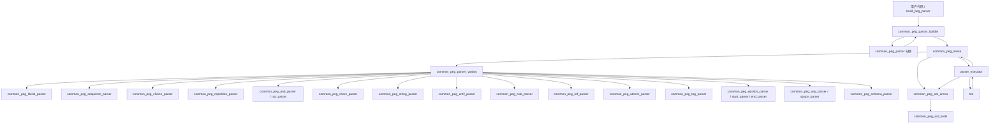
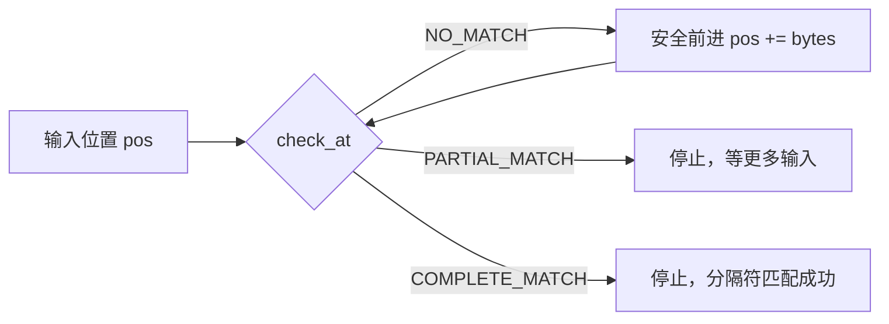
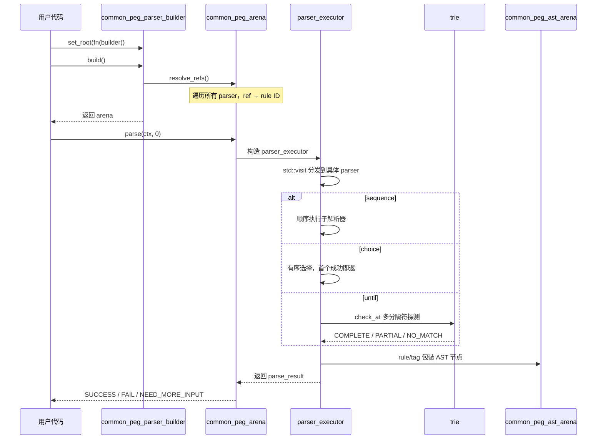

# 第48章 49 通用 PEG 解析器框架 —— 从语法定义到结构化解析的完整工程实现

## 学习目标

- 理解 PEG 解析器的「句柄+竞技场」双层设计架构及其共享/递归支持机制
- 掌握基础类型体系：解析结果三态枚举、解析上下文、AST 节点与 AST 竞技场接口
- 深入解析所有解析器节点类型的定义与字段含义（字面量、序列、选择、重复、前瞻、字符类、字符串、直到分隔符、规则、引用、原子、标签、模式等）
- 掌握组合子 API（sequence/choice/repeat/optional/peek/negate 等）与运算符糖（+/|/<<）的使用与底层实现，理解自动扁平化机制
- 深入解析执行引擎 `parser_executor` 的三态结果（SUCCESS/FAIL/NEED_MORE_INPUT）与流式解析原理
- 掌握基于 `std::visit` 的类型分发机制及各类解析器（epsilon/start/end/literal/sequence/choice/repetition/and/not/any/space/chars/string/until/schema/rule/ref/atomic/tag）的匹配语义
- 理解 Trie 树在高效多分隔符探测（until_parser）中的应用与 GBNF 排除模式生成
- 学会 AST 的构建、按标签/规则查找、遍历访问与 arena 内存管理
- 理解 `resolve_refs` 引用解析的遍历替换算法与递归规则生效机制
- 掌握内置 JSON/Python 语法规则的递归构建技巧与 GBNF 代码生成流程
- 了解解析器的 JSON 序列化/反序列化（to_json/from_json/save/load）实现机制
- 理解 `__main__` 全局代码的组织方式与模块初始化流程

## 48.1 生活类比

想象 PEG 解析器系统是一家**智能文档处理工厂**。

- **common_peg_parser（句柄）** 是加工机器的**遥控器**——它只持有机台编号，不存放机器本身，真正的解析器节点全部集中在 `common_peg_arena`（竞技场）这个**中央仓库**里，按 ID 索引。多个遥控器可以指向同一台机器（共享），递归规则只需要"先占位、后回填"就能表达。
- **common_peg_parser_builder** 是**乐高拼装台**，提供 sequence、choice、repeat、optional、peek、negate 等标准积木块，自动把嵌套的同类结构拍平，避免生成无意义的深层树。`rule()` 的 lambda 重载版本实现了"先占位、后回填"，让递归语法从"不可能"变成"只需多写两行"。
- **parser_executor** 是**质量检测流水线**，根据工件类型自动切换检测程序——它通过 `std::visit` 分发，为每一种解析器变体（epsilon、start、end、字面量、序列、选择、重复、前瞻、任意字符、空白、字符类、字符串、直到分隔符、模式、规则、引用、原子、标签）定义专属的匹配逻辑。三种结局的比赛就是质检报告：合格（SUCCESS）、报废（FAIL）、待补料（NEED_MORE_INPUT），配合 `lenient` 模式可以让流水线边生产边检测，实现真正的流式解析。
- **Trie 树**是**多通道分拣器**，同时监听多个结束标记，高效判断当前位置是否匹配任一分隔符，三种返回状态（无匹配/部分匹配/完全匹配）天然对应 `until_parser` 的三种处理分支。
- **common_peg_ast_arena** 是**成品档案馆**，解析生成的抽象语法树节点统一登记造册，支持按标签和规则名检索、深度优先遍历访问。
- **resolve_refs** 是**设备联调**，把设计图纸上的占位引用替换为实际机器 ID，让流水线真正跑起来。
- **build_grammar** 是**文档归档员**，把 PEG 规则转换为 GGUF BNF 格式，供聊天模板的语法约束使用，支持懒加载与触发规则。
- **to_json/from_json/save/load** 是**标准化打包/拆包流程**，让解析器图可以被持久化到文件或网络传输，反序列化时做四重校验保证内存安全。

就像工厂经理用乐高积木搭建生产线，开发者用 builder 组合解析规则；就像质检员按工序分段验收，executor 按顺序执行子解析器，任一环节失败即整体失败——这正是 PEG 有序选择的精髓。

## 48.2 源码地图

```
common/peg-parser.h
├── 基础类型与上下文 (1-100行)
│   ├── common_peg_parse_result_type      # 解析结果枚举（SUCCESS/FAIL/NEED_MORE_INPUT）
│   ├── common_peg_parse_result           # 解析结果结构体（位置、节点、类型）
│   ├── common_peg_parse_context          # 解析上下文（输入、标志位、深度、AST arena）
│   └── common_peg_parse_flags            # 解析标志位（debug/lenient等）
├── AST 管理 (79-105行)
│   ├── common_peg_ast_node               # AST节点（ID、规则名、标签、位置、文本、子节点、是否部分）
│   └── common_peg_ast_arena              # AST竞技场
│       ├── add_node()                    # 添加AST节点
│       ├── get()                         # 按ID获取节点
│       ├── find_by_tag()/find_by_rule()  # 按标签/规则查找（限定深度）
│       ├── size()/clear()                # 容量查询与清空
│       ├── visit()                       # 遍历访问（两种重载）
│       └── dump()                        # 调试输出（BFS遍历）
├── 解析器节点类型 (107-230行)
│   ├── common_peg_literal_parser         # 字面量
│   ├── common_peg_sequence_parser        # 序列
│   ├── common_peg_choice_parser          # 选择
│   ├── common_peg_repetition_parser      # 重复（min/max）
│   ├── common_peg_and_parser / not_parser# 前瞻（And/Not）
│   ├── common_peg_any_parser             # 任意单字符
│   ├── common_peg_space_parser           # 空白字符
│   ├── common_peg_chars_parser           # 字符类（含范围区间、模式、否定、min/max）
│   ├── common_peg_string_parser          # 字符串（带分隔符与转义处理）
│   ├── common_peg_until_parser           # 直到分隔符（多分隔符）
│   ├── common_peg_schema_parser          # 模式（附带JSON Schema元数据）
│   ├── common_peg_rule_parser            # 命名规则
│   ├── common_peg_ref_parser             # 规则引用
│   ├── common_peg_atomic_parser          # 原子操作
│   ├── common_peg_tag_parser             # 标签节点
│   ├── common_peg_epsilon_parser         # 空解析器
│   ├── common_peg_start_parser           # 起始锚点
│   └── common_peg_end_parser             # 结束锚点
├── 解析器变体与竞技场 (232-268行)
│   ├── common_peg_parser_variant         # std::variant 类型擦除所有解析器类型
│   └── common_peg_arena                  # 解析器竞技场
│       ├── add_parser() / add_rule()     # 添加解析器/注册规则
│       ├── get() / get_rule()            # 按ID/名称获取
│       ├── resolve_refs()                # 解析所有引用
│       ├── build_grammar()               # 生成GBNF文法
│       ├── dump() / dump_impl()          # 结构转储（带cycle检测）
│       └── to_json() / from_json() / save() / load()  # JSON序列化
└── 解析器构建器 (271-471行)
    ├── common_peg_parser                 # 轻量级句柄（ID+Builder引用）
    │   ├── operator= / operator+= / operator|=  # 就地组合
    │   ├── operator+ / operator| / operator<<    # 返回新句柄
    │   └── 字面量重载（const char*/std::string）
    └── common_peg_parser_builder         # 构建器工厂
        ├── eps()/start()/end()           # 基础边界解析器
        ├── literal()                     # 字面量
        ├── sequence() / choice()         # 基础组合子（自动扁平化，三种重载）
        ├── repeat() / one_or_more() / zero_or_more() / optional()  # 重复组合
        ├── peek() / negate()             # 前瞻组合子
        ├── any() / chars() / space()     # 基础字符解析器
        ├── ref()                         # 规则引用（轻量级）
        ├── until() / until_one_of() / rest()  # 直到分隔符
        ├── double_quoted_string() / single_quoted_string() / quoted_string() / string_content()
        ├── schema()                      # JSON Schema附加
        ├── rule() / trigger_rule()       # 规则注册（支持lambda占位回填）
        ├── atomic() / tag()              # 原子与标签包装
        ├── json_*()                      # JSON语法家族（object/array/string/number/bool/null/member/value）
        ├── python_*()                    # Python语法家族（dict/array/string/number/bool/null/value）
        ├── marker()                      # 聊天标记（尖括号/方括号）
        └── set_root() / build()          # 构建收尾

common/peg-parser.cpp
├── 辅助函数 (19-180行)
│   ├── common_peg_parse_result_type_name() # 结果类型转字符串
│   ├── is_hex_digit()                    # 十六进制数字校验
│   ├── parse_hex_escape()                # 十六进制转义解析（\\xHH/\\uHHHH/\\UHHHHHHHH）
│   ├── parse_char_class_char()           # 字符类单字符/转义解析
│   ├── parse_char_classes()              # 解析字符类语法[a-zA-Z] → 区间向量+否定标志
│   └── rule_name()                       # 规则名清洗（非法字符转-）
├── Trie 结构 (46-85行)
│   ├── trie()                            # 构造函数（插入所有词）
│   ├── check_at()                        # 检查位置匹配状态（NO/PARTIAL/COMPLETE）
│   └── collect_prefix_and_next()         # 收集前缀与后续字符（用于GBNF生成）
├── 解析执行器 parser_executor (183-541行)
│   ├── parser_executor()                 # 构造函数（arena、ctx、start_pos）
│   ├── debug_indent()                    # 调试缩进（按parse_depth）
│   ├── operator()(epsilon/start/end)     # 边界与空解析器
│   ├── operator()(literal)               # 字面量逐字节匹配（支持lenient模式）
│   ├── operator()(sequence)              # 顺序执行子解析器，失败即返，累积AST，流式提前返回
│   ├── operator()(choice)                # 有序选择，取首个成功
│   ├── operator()(repetition)            # 重复匹配（防零消耗死循环，检查min_count）
│   ├── operator()(and/not)               # 零消耗前瞻
│   ├── operator()(any)                   # Unicode码点级匹配
│   ├── operator()(space)                 # 空白字符匹配（逐字节，兼容ASCII空白）
│   ├── operator()(chars)                 # 字符类匹配（逐码点检查区间，支持否定与min/max）
│   ├── handle_escape_sequence()          # 转义序列处理（\\b/\\f/\\n/\\r/\\t/\\\\/\\"/\\uXXXX）
│   ├── handle_unicode_escape()           # Unicode转义（\\uXXXX）严格校验
│   ├── operator()(string)                # 字符串内容（处理\\转义与\\uXXXX，逐码点推进）
│   ├── operator()(until)                 # 基于Trie的多分隔符探测（三态驱动流式控制）
│   ├── operator()(schema)                # 模式解析器（委派子解析器）
│   ├── operator()(rule)                  # 规则包装（生成带规则名的AST节点）
│   ├── operator()(tag)                   # 标签包装（生成带标签的AST节点）
│   ├── operator()(ref)                   # 引用解析（查表跳转）
│   └── operator()(atomic)                # 原子操作（NEED_MORE_INPUT时清空节点防污染）
├── AST 与 Arena 实现 (545-1069行)
│   ├── bfs_node()                        # BFS遍历输出AST节点（递归缩进）
│   ├── common_peg_ast_arena::dump()      # BFS遍历输出AST
│   ├── common_peg_arena::resolve_refs()  # 遍历替换所有ref为真实规则ID（visit分发）
│   ├── common_peg_arena::dump()          # 解析器结构转储入口
│   ├── common_peg_arena::dump_impl()     # 递归转储（带cycle检测，visit分发）
│   └── common_peg_arena::build_grammar() # PEG转GBNF（收集可达规则，递归生成文本）
├── 序列化 (1535-1992行)
│   ├── gbnf_escape_char_class()          # GBNF字符类转义（元字符/可打印ASCII/其他码点）
│   ├── gbnf_excluding_pattern()          # 生成GBNF排除模式（基于Trie前缀收集）
│   ├── collect_reachable_rules()         # 收集可达规则（DFS+visited去重）
│   ├── serialize_parser_variant()        # 变体类型转JSON（visit分发，全类型覆盖）
│   ├── deserialize_parser_variant()      # JSON转解析器变体（按type分发，逐字段校验）
│   ├── common_peg_arena::to_json()       # 整体序列化（parsers/rules/root）
│   ├── common_peg_arena::from_json()     # 反序列化（结构校验+越界校验+根校验）
│   ├── save() / load()                   # 字符串级存取
│   └── build_peg_parser()                # 全局便捷构建函数
└── 内置语法构建 (1141-1424行)
    ├── common_peg_parser_builder::sequence()  # 扁平化嵌套序列
    ├── common_peg_parser_builder::choice()    # 扁平化嵌套选择
    ├── common_peg_parser_builder::rule()      # 规则注册（支持递归占位）
    ├── json_number()                          # JSON数字（含负向前瞻）
    ├── json_object() / json_array()           # JSON复合结构（递归引用）
    ├── json()                                 # JSON值总入口
    ├── python_*()                             # Python字面量系列
    └── marker() / json_member()               # 标记与JSON成员特化
```

## 48.3 基础类型体系与 AST 管理 —— 解析的「数据契约与档案馆」

在构建解析器之前，必须先定好"数据契约"。PEG 解析器框架在头文件前 100 行建立了完整的类型体系：解析结果的三态枚举、携带位置与节点的结果结构体、解析时的上下文环境、以及 AST 节点与竞技场的管理接口。

### 48.3.1 common_peg_parse_result_type 与 common_peg_parse_result —— 三态结果与位置信息

解析结果只有三种状态，这是流式解析的基石。

源码路径：`common/peg-parser.h` - 基础枚举与结果结构体（第 1-30 行）
核心类型：`common_peg_parse_result_type`、`common_peg_parse_result`
关键字段：`type`、`start`、`end`、`nodes`

```cpp
// ① 三态结果枚举：成功、失败、需要更多输入
enum common_peg_parse_result_type {
    COMMON_PEG_PARSE_RESULT_FAIL = 0,
    COMMON_PEG_PARSE_RESULT_SUCCESS = 1,
    COMMON_PEG_PARSE_RESULT_NEED_MORE_INPUT = 2,
};

// ② 解析结果结构体：携带类型、起止位置、AST节点列表
struct common_peg_parse_result {
    common_peg_parse_result_type type;                 // 结果类型
    size_t start;                                      // 匹配起始位置
    size_t end;                                        // 匹配结束位置（下一个解析器的起始位置）
    std::vector<common_peg_ast_id> nodes;              // 本次匹配产生的AST节点ID列表

    // ③ 便利判断函数
    bool success() const { return type == COMMON_PEG_PARSE_RESULT_SUCCESS; }
    bool fail() const { return type == COMMON_PEG_PARSE_RESULT_FAIL; }
    bool need_more_input() const { return type == COMMON_PEG_PARSE_RESULT_NEED_MORE_INPUT; }
};
```

这段代码定义了 PEG 解析的"质检报告"。第①行的三态枚举是整个流式解析机制的核心：`NEED_MORE_INPUT` 表示"当前位置匹配成功，但输入在关键处断裂，需要更多数据才能确定最终成败"。第②行的结构体不仅记录成功/失败，还精确记录 `start` 和 `end` 位置，以及产生的 `nodes`（AST 节点 ID 列表）。第③行的三个便利函数让上层代码可以直观地判断结果状态。`end` 位置的设计体现了 PEG 解析器的"位置传递"语义：序列解析器会把上一个子解析器的 `end` 作为下一个子解析器的 `start`，形成流水线。

### 48.3.2 common_peg_parse_context —— 解析时的「环境上下文」

解析上下文把输入字符串、标志位、递归深度、AST 竞技场打包在一起，作为执行引擎的"工作台"。

源码路径：`common/peg-parser.h` - 解析上下文（第 32-77 行）
核心类型：`common_peg_parse_context`
关键字段：`input`、`flags`、`parse_depth`、`ast`

```cpp
// ① 解析标志位：支持 debug 和 lenient 两种模式
enum common_peg_parse_flags {
    COMMON_PEG_PARSE_FLAG_NONE = 0,
    COMMON_PEG_PARSE_FLAG_DEBUG = 1 << 0,   // 开启调试日志
    COMMON_PEG_PARSE_FLAG_LENIENT = 1 << 1, // 流式模式：输入不足不直接失败
};

// ② 解析上下文：执行引擎的"工作台"
struct common_peg_parse_context {
    std::string input;                          // 待解析的输入文本
    common_peg_parse_flags flags = COMMON_PEG_PARSE_FLAG_NONE;  // 标志位
    int parse_depth = 0;                        // 递归深度（用于调试缩进与防栈溢出）
    common_peg_ast_arena ast;                   // AST 竞技场（解析过程中产生的节点统一存放）

    // ③ 便利判断函数
    bool is_debug() const { return flags & COMMON_PEG_PARSE_FLAG_DEBUG; }
    bool is_lenient() const { return flags & COMMON_PEG_PARSE_FLAG_LENIENT; }
};
```

这段代码定义了解析执行时的"工作台"。第①行的标志位设计体现了两个正交维度：`DEBUG` 控制是否输出详细的匹配日志（配合 `parser_executor::debug_indent()` 产生缩进层次），`LENIENT` 控制是否启用流式模式。第②行的 `parse_depth` 每进入一层子解析器就加 1，既用于调试输出的缩进，也可作为防栈溢出的守卫。第③行的 `ast` 是解析过程中的"成品收集箱"，所有 `rule`/`tag` 解析器产生的节点都通过 `ctx.ast.add_node()` 登记入册。这种设计让执行引擎不需要显式传递 AST 容器，只需持有 `ctx` 引用即可。

### 48.3.3 common_peg_ast_node 与 common_peg_ast_arena —— AST 节点定义与竞技场管理

AST 节点记录了解析树的语义信息，竞技场提供统一的内存管理与查询接口。

源码路径：`common/peg-parser.h` - AST 节点与竞技场（第 79-105 行）
核心类：`common_peg_ast_node`、`common_peg_ast_arena`
关键函数：`add_node()`、`find_by_tag()`、`find_by_rule()`、`visit()`、`dump()`

```cpp
// ① AST 节点：记录语法树的一个语义单元
struct common_peg_ast_node {
    common_peg_ast_id id;                 // 节点在arena中的索引
    std::string rule;                     // 规则名（来自 rule_parser）
    std::string tag;                      // 标签（来自 tag_parser）
    size_t start;                         // 匹配起始位置
    size_t end;                           // 匹配结束位置
    std::string text;                     // 匹配的文本内容（string_view的拷贝）
    std::vector<common_peg_ast_id> children;  // 子节点ID列表
    bool is_partial = false;              // 是否为部分匹配（NEED_MORE_INPUT时产生）
};

// ② AST 竞技场：集中管理所有AST节点
class common_peg_ast_arena {
public:
    // ③ 添加节点：分配ID，存入vector，返回ID
    common_peg_ast_id add_node(
        const std::string & rule,
        const std::string & tag,
        size_t start,
        size_t end,
        std::string_view text,
        std::vector<common_peg_ast_id> children,
        bool is_partial = false
    ) {
        common_peg_ast_id id = nodes_.size();
        nodes_.push_back({id, rule, tag, start, end, text, std::move(children), is_partial});
        return id;
    }

    // ④ 按ID获取节点（只读）
    const common_peg_ast_node & get(common_peg_ast_id id) const { return nodes_.at(id); }

    // ⑤ 按标签/规则查找（限定最大深度，避免全树遍历）
    common_peg_ast_id find_by_tag(const common_peg_ast_node & parent, const std::string & tag, int max_depth = 3) const;
    common_peg_ast_id find_by_rule(const common_peg_ast_node & parent, const std::string & rule, int max_depth = 3) const;

    // ⑥ 容量与清空
    size_t size() const { return nodes_.size(); }
    void clear() { nodes_.clear(); }

    // ⑦ 遍历访问：两种重载（从节点ID开始 / 从解析结果开始）
    void visit(common_peg_ast_id id, const common_peg_ast_visitor & visitor) const;
    void visit(const common_peg_parse_result & result, const common_peg_ast_visitor & visitor) const;

    // ⑧ 调试输出：BFS遍历生成可读字符串
    std::string dump();

private:
    std::vector<common_peg_ast_node> nodes_;  // ⑨ 所有节点集中存放的vector
};
```

这段代码建立了 AST 的"档案馆"。第①行的节点结构体设计精巧：`rule` 和 `tag` 互补——`rule` 来自语法定义的规则名（如 `"json-object"`），`tag` 来自开发者显式附加的语义标签（如 `"reasoning"`、`"tool-call"`），两者结合让上层应用既能按语法结构查找，又能按业务语义查找。`is_partial` 标记配合流式解析：当 `lenient` 模式下输入中断，`atomic` 包装器会清空半成品节点，但如果上层 `rule`/`tag` 强行包装了部分结果，`is_partial=true` 就能提醒上层"这个节点对应的输入不完整"。第③行的 `add_node()` 用 `nodes_.size()` 作为 ID，利用 `vector` 的连续内存实现 O(1) 索引。第⑤行的 `find_by_tag/find_by_rule` 限定 `max_depth=3`，避免在大型 AST 中全树遍历——聊天场景下通常只需在浅层定位"推理内容"或"工具调用"节点。第⑦行的 `visit()` 支持访问者模式，让上层可以自定义遍历逻辑而不暴露内部结构。

## 48.4 解析器节点类型全景 —— 语法定义的「积木目录」

PEG 解析器框架在头文件第 107-230 行定义了 17 种解析器节点类型，它们共同组成了 `common_peg_parser_variant`（一个 `std::variant`）。每种类型对应一种匹配语义，执行引擎通过 `std::visit` 分发到对应的处理逻辑。

### 48.4.1 基础与边界解析器

```cpp
// ① 空解析器：总是成功，不消耗输入，相当于正则里的 ε
struct common_peg_epsilon_parser {};

// ② 起始锚点：只有在输入位置为 0 时成功
struct common_peg_start_parser {};

// ③ 结束锚点：只有在输入位置到达末尾时成功
struct common_peg_end_parser {};
```

这三种解析器是组合子的"恒等元素"和"边界守卫"。`epsilon` 在序列中不改变语义，`start`/`end` 配合 `sequence` 可实现"整串匹配"语义。

### 48.4.2 字面量与字符级解析器

```cpp
// ④ 字面量：逐字节精确匹配指定字符串
struct common_peg_literal_parser {
    std::string literal;
};

// ⑤ 任意单字符：匹配一个 Unicode 码点（非逐字节）
struct common_peg_any_parser {};

// ⑥ 空白字符：匹配零个或多个 ASCII 空白字符（空格、制表、换行等）
struct common_peg_space_parser {};

// ⑦ 字符类：支持范围区间、否定、最小最大重复次数
struct common_peg_chars_parser {
    std::string pattern;                              // 原始模式串（如 "[a-zA-Z]"）
    std::vector<char_range> ranges;                   // 解析后的区间列表
    bool negated = false;                             // 是否取反（^）
    int min_count = 1;                                // 最小匹配次数
    int max_count = -1;                               // 最大匹配次数（-1 表示无上限）

    // ⑦-1 区间结构：闭区间 [start, end]，基于 Unicode 码点
    struct char_range {
        uint32_t start;
        uint32_t end;
        bool contains(uint32_t codepoint) const { return codepoint >= start && codepoint <= end; }
    };
};
```

第④行的 `literal` 逐字节匹配，适合 ASCII 关键字（如 `{`、`}`、`true`、`null`）。第⑤行的 `any` 调用 `common_parse_utf8_codepoint` 逐码点推进，正确处理多字节字符。第⑥行的 `space` 逐字节检查 `std::isspace`，主要用于 JSON/Python 语法中的格式空白忽略。第⑦行的 `chars` 是功能最丰富的字符级解析器：`ranges` 存储解析后的码点区间（由 `parse_char_classes()` 从模式串生成），`negated` 支持 `[^...]` 否定语义，`min_count`/`max_count` 直接内嵌重复逻辑（避免外层再套 `repetition`），`contains()` 方法提供 O(区间数) 的码点判断。

### 48.4.3 字符串与直到分隔符解析器

```cpp
// ⑧ 字符串内容解析器：匹配直到指定分隔符，支持 \\ 转义和 \\uXXXX Unicode 转义
struct common_peg_string_parser {
    char delimiter;  // 结束分隔符（如 '"' 或 '''）
};

// ⑨ 直到分隔符解析器：读取内容直到遇到任一分隔符，不消费分隔符
struct common_peg_until_parser {
    std::vector<std::string> delimiters;  // 多个分隔符（如 ["</tag>", "]"]）
};
```

第⑧行的 `string_parser` 专门处理带转义的引号字符串，执行时逐码点推进，遇到反斜杠委托 `handle_escape_sequence()` 处理。第⑨行的 `until_parser` 是提取标记内容的核心：它持有多个分隔符字符串，执行时构建 Trie 树，在每个码点位置调用 `check_at()` 判断是否匹配任一分隔符。**关键点：它不消费分隔符**，外层通常再用一个 `literal` 收尾（如 `marker()` 的实现：`literal("<") + until(">") + literal(">")`）。

### 48.4.4 组合与控制流解析器

```cpp
// ⑩ 序列：按顺序匹配所有子解析器，任一失败即整体失败
struct common_peg_sequence_parser {
    std::vector<common_peg_parser_id> children;
};

// ⑪ 选择：有序尝试子解析器，第一个成功即返回（PEG核心：有序选择）
struct common_peg_choice_parser {
    std::vector<common_peg_parser_id> children;
};

// ⑫ 重复：子解析器重复匹配 min~max 次，支持零消耗检测防死循环
struct common_peg_repetition_parser {
    common_peg_parser_id child;
    int min_count;
    int max_count;  // -1 表示无上限
};

// ⑬ 正向前瞻：测试子解析器是否匹配，不消耗输入
struct common_peg_and_parser {
    common_peg_parser_id child;
};

// ⑭ 负向前瞻：子解析器失败时成功，不消耗输入
struct common_peg_not_parser {
    common_peg_parser_id child;
};
```

这四种组合子构成了 PEG 的核心表达力。第⑩行序列的"全或无"语义、第⑪行选择的"有序选择"语义（第一个成功即锁定，不回溯）、第⑫行重复的上下界控制与零消耗保护、第⑬⑭行前瞻的零消耗特性，共同支撑了复杂语法的构建。注意所有子节点都存储 `common_peg_parser_id`（即 `size_t` 索引），而非直接嵌套对象——这正是"句柄+竞技场"架构的体现。

### 48.4.5 语义包装与引用解析器

```cpp
// ⑮ 模式：为子解析器附加 JSON Schema 元数据（用于语法生成）
struct common_peg_schema_parser {
    common_peg_parser_id child;
    std::string name;
    std::shared_ptr<nlohmann::ordered_json> schema;
    bool raw = false;
};

// ⑯ 命名规则：给子解析器起名字，匹配成功时包装成带规则名的 AST 节点
struct common_peg_rule_parser {
    std::string name;
    common_peg_parser_id child;
    bool trigger = false;  // 是否为触发规则（懒加载入口）
};

// ⑰ 规则引用：仅持有规则名，执行时查表跳转到真实规则
struct common_peg_ref_parser {
    std::string name;
};

// ⑱ 原子操作：子解析器返回 NEED_MORE_INPUT 时清空已产生节点，防止半成品污染上层
struct common_peg_atomic_parser {
    common_peg_parser_id child;
};

// ⑲ 标签节点：给子解析器附加语义标签，匹配成功时包装成带标签的 AST 节点
struct common_peg_tag_parser {
    common_peg_parser_id child;
    std::string tag;
};
```

第⑮行的 `schema_parser` 为语法生成提供元数据支撑。第⑯行的 `rule_parser` 是 AST 节点的主要来源：执行时调用 `ctx.ast.add_node()` 打包子解析器的结果，带上规则名。第⑰行的 `ref_parser` 是递归语法的关键——它只存名字，执行时通过 `arena.get_rule(name)` 查表跳转。第⑱行的 `atomic_parser` 解决流式场景下的"半成品污染"问题：当子解析器报告 `NEED_MORE_INPUT` 时，它清空 `result.nodes`，只传递"需要更多输入"的状态。第⑲行的 `tag_parser` 与 `rule_parser` 对称，但打包的是开发者自定义的业务标签，配合 `ast.find_by_tag()` 实现语义检索。

## 48.5 PEG 解析器构建器 —— 语法规则的「乐高拼装台」

`common_peg_parser_builder` 是开发者面向的主要接口。它封装了 arena 的操作，提供了组合子 API、运算符糖、内置语法规则家族、以及构建收尾流程。

### 48.5.1 句柄与竞技场的双层设计：common_peg_parser 与 common_peg_arena

`common_peg_parser` 只是轻量级遥控器，真正的节点存放在 arena 的 vector 里。

源码路径：`common/peg-parser.h` - `common_peg_parser`（第 31-57 行）与 `common/peg-parser.cpp` - 运算符实现（第 1071-1120 行）
核心类：`common_peg_parser`
关键函数：构造函数、赋值、组合运算符、字面量重载

```cpp
// ① 句柄只持有 ID 和 builder 引用
class common_peg_parser {
public:
    common_peg_parser(const common_peg_parser & other) : id_(other.id_), builder_(other.builder_) {}
    common_peg_parser(common_peg_parser_id id, common_peg_parser_builder & builder) : id_(id), builder_(builder) {}

    // ② 赋值只拷贝 ID
    common_peg_parser & operator=(const common_peg_parser & other) { id_ = other.id_; return *this; }

    // ③ 就地组合运算符：更新当前句柄的 ID
    common_peg_parser & operator+=(const common_peg_parser & other) { id_ = builder_.sequence({id_, other.id_}); return *this; }
    common_peg_parser & operator|=(const common_peg_parser & other) { id_ = builder_.choice({id_, other.id_}); return *this; }

    // ④ 返回新句柄的组合运算符
    common_peg_parser operator+(const common_peg_parser & other) const { return builder_.sequence({id_, other.id_}); }
    common_peg_parser operator|(const common_peg_parser & other) const { return builder_.choice({id_, other.id_}); }
    common_peg_parser operator<<(const common_peg_parser & other) const { return builder_.sequence({id_, builder_.space(), other.id_}); }

    // ⑤ 字面量重载：字符串自动转 literal 再组合
    common_peg_parser operator+(const char * str) const { return *this + builder_.literal(str); }
    common_peg_parser operator+(const std::string & str) const { return *this + builder_.literal(str); }
    common_peg_parser operator<<(const char * str) const { return *this << builder_.literal(str); }
    common_peg_parser operator<<(const std::string & str) const { return *this << builder_.literal(str); }
    common_peg_parser operator|(const char * str) const { return *this | builder_.literal(str); }
    common_peg_parser operator|(const std::string & str) const { return *this | builder_.literal(str); }

    // ⑥ 隐式转换与访问器
    operator common_peg_parser_id() const { return id_; }
    common_peg_parser_id id() const { return id_; }
    common_peg_parser_builder & builder() const { return builder_; }

private:
    common_peg_parser_id id_;                     // 真正的节点存放在 arena 中，这里只存编号
    common_peg_parser_builder & builder_;         // builder 引用，用于调用组合方法
};
```

这段代码定义了"遥控器"的完整接口。第①行构造函数只复制 ID 和 builder 引用，不涉及节点拷贝。第③行的 `+=`/`|=` 实现就地修改，第④行的 `+`/`|`/`<<` 返回新句柄，第⑤行让字符串字面量能直接参与组合（自动调用 `builder_.literal()`）。第⑥行的隐式转换让句柄能直接当 ID 传给 arena 方法。`common_peg_arena` 则是中央仓库：

源码路径：`common/peg-parser.h` - `common_peg_arena`（第 232-268 行）
核心类：`common_peg_arena`
关键函数：`add_parser()`、`add_rule()`、`resolve_refs()`、`parse()`、`dump()`、`to_json()`、`from_json()`

```cpp
class common_peg_arena {
public:
    // ① 存取解析器变体（只读/可写）
    const common_peg_parser_variant & get(common_peg_parser_id id) const { return parsers_.at(id); }
    common_peg_parser_variant & get(common_peg_parser_id id) { return parsers_.at(id); }

    // ② 规则名 ↔ 解析器 ID 的双向索引
    common_peg_parser_id get_rule(const std::string & name) const;
    bool has_rule(const std::string & name) const { return rules_.find(name) != rules_.end(); }

    // ③ 根解析器管理
    common_peg_parser_id root() const { return root_; }
    void set_root(common_peg_parser_id id) { root_ = id; }

    // ④ 解析入口（两种重载）
    common_peg_parse_result parse(common_peg_parse_context & ctx, size_t start = 0) const;
    common_peg_parse_result parse(common_peg_parser_id id, common_peg_parse_context & ctx, size_t start) const;

    // ⑤ 构建期收尾：把所有 ref 替换为真实规则 ID
    void resolve_refs();

    // ⑥ PEG → GBNF 文法生成
    void build_grammar(const common_grammar_builder & builder, bool lazy = false) const;

    // ⑦ 转储与序列化
    std::string dump(common_peg_parser_id id) const;
    nlohmann::json to_json() const;
    static common_peg_arena from_json(const nlohmann::json & j);
    std::string save() const;
    void load(const std::string & data);

private:
    std::vector<common_peg_parser_variant> parsers_;                    // 所有解析器节点
    std::unordered_map<std::string, common_peg_parser_id> rules_;       // 规则名 → ID
    common_peg_parser_id root_ = COMMON_PEG_INVALID_PARSER_ID;          // 根解析器 ID

    std::string dump_impl(common_peg_parser_id id, std::unordered_set<common_peg_parser_id> & visited) const;
    common_peg_parser_id add_parser(common_peg_parser_variant parser);
    void add_rule(const std::string & name, common_peg_parser_id id);
    common_peg_parser_id resolve_ref(common_peg_parser_id id);
};
```

arena 的设计体现了"集中式存储 + 索引式引用"。`parsers_` vector 存放所有 variant，ID 即下标，缓存局部性极佳。`rules_` 映射支撑 `ref` 的查表跳转。`resolve_refs()` 是构建期的最后一步，把所有 `ref_parser` 替换为 `rule_parser`（持有真实 ID），让递归引用真正生效。

### 48.5.2 组合子的扁平化实现：sequence() 与 choice()

`sequence()` 和 `choice()` 都会自动拍平嵌套的同类结构，避免冗余层级。

源码路径：`common/peg-parser.cpp` - `sequence()`（第 1143-1177 行）与 `choice()`（第 1179-1213 行）
核心类：`common_peg_parser_builder`
关键函数：`sequence()`、`choice()`（均含三种重载：ID向量、句柄向量、初始化列表）

```cpp
// ① sequence 内部实现：接收 ID 列表，拍平嵌套 sequence
common_peg_parser common_peg_parser_builder::sequence(const std::vector<common_peg_parser_id> & parsers) {
    std::vector<common_peg_parser_id> flattened;
    for (const auto & p : parsers) {
        const auto & variant = arena_.get(p);
        if (std::holds_alternative<common_peg_sequence_parser>(variant)) {
            // ② 是 sequence 则展开 children 并入
            const auto & seq = std::get<common_peg_sequence_parser>(variant);
            flattened.insert(flattened.end(), seq.children.begin(), seq.children.end());
        } else {
            // ③ 否则原样保留
            flattened.push_back(p);
        }
    }
    // ④ 用拍平后的列表创建新 sequence 节点
    return wrap(arena_.add_parser(common_peg_sequence_parser{flattened}));
}

// ⑤ choice 内部实现：逻辑完全对称
common_peg_parser common_peg_parser_builder::choice(const std::vector<common_peg_parser_id> & parsers) {
    std::vector<common_peg_parser_id> flattened;
    for (const auto & p : parsers) {
        const auto & variant = arena_.get(p);
        if (std::holds_alternative<common_peg_choice_parser>(variant)) {
            const auto & ch = std::get<common_peg_choice_parser>(variant);
            flattened.insert(flattened.end(), ch.children.begin(), ch.children.end());
        } else {
            flattened.push_back(p);
        }
    }
    return wrap(arena_.add_parser(common_peg_choice_parser{flattened}));
}
```

这段代码展示了扁平化的核心逻辑。当开发者写 `a + (b + c)` 时，括号内的 `b + c` 已经是一个 `sequence` 节点。如果不拍平，会产生 `sequence[a, sequence[b, c]]` 的嵌套结构——解析时多一层递归，AST 也更深。拍平后变成 `sequence[a, b, c]`，结构扁平，执行高效。`choice()` 的逻辑完全对称：`a | (b | c)` 会被拍成 `choice[a, b, c]`。三种重载（ID向量、句柄向量、初始化列表）让调用风格灵活：`sequence({a, b, c})`、`sequence(a, b, c)` 甚至 `a + b + c` 都能工作。

### 48.5.3 重复组合子家族：repeat/one_or_more/zero_or_more/optional

builder 提供了语义清晰的重复快捷方式，底层统一构造 `repetition_parser`。

源码路径：`common/peg-parser.h` - 重复组合子声明（第 317-327 行）与 `common/peg-parser.cpp` - 实现（第 1143 行附近隐含）
核心类：`common_peg_parser_builder`
关键函数：`repeat()`、`one_or_more()`、`zero_or_more()`、`optional()`

```cpp
// ① 通用重复：指定最小/最大次数
common_peg_parser repeat(const common_peg_parser & p, int min, int max) {
    return add(common_peg_repetition_parser{p, min, max});
}

// ② 恰好 n 次
common_peg_parser repeat(const common_peg_parser & p, int n) { return repeat(p, n, n); }

// ③ 至少一次（+）
common_peg_parser one_or_more(const common_peg_parser & p) { return repeat(p, 1, -1); }

// ④ 零次或多次（*）
common_peg_parser zero_or_more(const common_peg_parser & p) { return repeat(p, 0, -1); }

// ⑤ 至多一次（?）
common_peg_parser optional(const common_peg_parser & p) { return repeat(p, 0, 1); }
```

这组函数把正则表达式里的 `+`、`*`、`?`、`{n,m}` 映射为语义明确的函数名。`max_count = -1` 表示无上限。执行引擎在 `operator()(repetition)` 中会根据这两个参数控制循环次数，并检测零消耗匹配防死循环。

### 48.5.4 前瞻组合子：peek() 与 negate()

前瞻是 PEG 的"看家本领"，builder 提供了直观的命名。

源码路径：`common/peg-parser.h` - 前瞻声明（第 332-337 行）
核心类：`common_peg_parser_builder`
关键函数：`peek()`、`negate()`

```cpp
// ① 正向前瞻：测试匹配但不消耗输入（&p）
common_peg_parser peek(const common_peg_parser & p) { return add(common_peg_and_parser{p}); }

// ② 负向前瞻：子解析器失败时成功，不消耗输入（!p）
common_peg_parser negate(const common_peg_parser & p) { return add(common_peg_not_parser{p}); }
```

`peek` 对应 PEG 语法的 `&`，`negate` 对应 `!`。`json_number()` 里的 `not_number_continuation = negate(chars("[0-9.eE+-]"))` 就是典型用法：确保数字后面不能紧跟数字/点/指数符，防止 `123abc` 被误判为数字 `123`。

### 48.5.5 规则注册与递归支持：rule() 的两种重载

`rule()` 是构建递归语法的核心。简单版本直接注册，复杂版本支持 lambda 占位回填。

源码路径：`common/peg-parser.cpp` - `rule()`（第 1224-1249 行）
核心类：`common_peg_parser_builder`
关键函数：`rule()` 两个重载

```cpp
// ① 简单版本：直接注册一个已构建好的解析器作为命名规则
common_peg_parser common_peg_parser_builder::rule(const std::string & name, const common_peg_parser & p, bool trigger) {
    auto clean_name = rule_name(name);                              // 清洗名称（非法字符 → -）
    auto rule_id = arena_.add_parser(common_peg_rule_parser{clean_name, p.id(), trigger});
    arena_.add_rule(clean_name, rule_id);                           // 注册规则名 → ID
    return ref(clean_name);                                         // 返回轻量级引用，供外部组合
}

// ② 复杂版本：支持递归——先用 any() 占位，执行 builder 函数后再回填
common_peg_parser common_peg_parser_builder::rule(const std::string & name, const std::function<common_peg_parser()> & builder_fn, bool trigger) {
    auto clean_name = rule_name(name);
    if (arena_.has_rule(clean_name)) return ref(clean_name);        // 防止重复注册（递归入口的短路）

    auto placeholder = any();                                       // 先创建一个 any() 占位解析器
    auto placeholder_rule_id = arena_.add_parser(common_peg_rule_parser{clean_name, placeholder.id(), trigger});
    arena_.add_rule(clean_name, placeholder_rule_id);               // 提前注册，让 builder_fn 内部的 ref() 能查到

    auto parser = builder_fn();                                     // 执行用户 lambda，构造真正的解析器
    auto rule_id = arena_.add_parser(common_peg_rule_parser{clean_name, parser.id(), trigger});
    arena_.rules_[clean_name] = rule_id;                             // 回填：用真实规则 ID 替换占位
    return ref(clean_name);
}
```

这段代码是递归规则的"魔法"所在。第②版本的第 7 行创建 `any()` 占位，第 8 行提前注册到 `rules_` 映射——这就意味着在 `builder_fn()` 内部调用 `ref("json-value")` 时，`get_rule()` 能查到这个占位规则，从而让递归引用合法。第 9 行执行用户 lambda 构造真正的解析器，第 10 行用真实规则 ID 替换占位。整套机制让"先有鸡还是先有蛋"的递归定义变成了"先占位、后回填"的两步走。`rule_name()` 负责清洗规则名，确保生成的 GBNF 规则名合法（只含字母、数字、连字符）。

### 48.5.6 内置 JSON 语法规则族：json_number/json_object/json 等

builder 内置了完整的 JSON 和 Python 语法规则，展示了递归语法的构建范式。

源码路径：`common/peg-parser.cpp` - `json_number()`（第 1286-1298 行）、`json_object()`（第 1318-1330 行）、`json()`（第 1346-1350 行）
核心类：`common_peg_parser_builder`
关键函数：`json_number()`、`json_object()`、`json()`

```cpp
// ① JSON 数字：整数、小数、指数三部分 + 负向前瞻防止误判
common_peg_parser common_peg_parser_builder::json_number() {
    return rule("json-number", [this]() {
        auto digit1_9 = chars("[1-9]", 1, 1);
        auto digits = chars("[0-9]");
        auto int_part = choice({literal("0"), sequence({digit1_9, chars("[0-9]", 0, -1)})});
        auto frac = sequence({literal("."), digits});
        auto exp = sequence({choice({literal("e"), literal("E")}), optional(chars("[+-]", 1, 1)), digits});
        auto not_number_continuation = negate(chars("[0-9.eE+-]", 1, 1));  // 负向前瞻：后面不能紧跟数字字符
        return sequence({optional(literal("-")), int_part, optional(frac), optional(exp), not_number_continuation, space()});
    });
}

// ② JSON 对象：成员递归引用 json()
common_peg_parser common_peg_parser_builder::json_object() {
    return rule("json-object", [this]() {
        auto ws = space();
        auto member = sequence({json_string(), ws, literal(":"), ws, json()});  // 递归引用 json()
        auto members = sequence({member, zero_or_more(sequence({ws, literal(","), ws, member}))});
        return sequence({literal("{"), ws, choice({literal("}"), sequence({members, ws, literal("}")})}), ws});
    });
}

// ③ JSON 总入口：choice 并列六种值类型，内部各自 ref 引用形成递归闭环
common_peg_parser common_peg_parser_builder::json() {
    return rule("json-value", [this]() {
        return choice({json_object(), json_array(), json_string(), json_number(), json_bool(), json_null()});
    });
}
```

第①行的 `json_number()` 精心构造了整数、小数、指数三部分，第 6 行的 `not_number_continuation` 是点睛之笔：它是负向前瞻，确保数字后面不能紧跟 `[0-9.eE+-]` 中的字符。第②行的 `json_object()` 在成员定义中调用 `json()`——此时 `json()` 还没有被注册，但由于 `rule()` 的 lambda 版本会提前注册占位规则，`ref("json-value")` 在 `json()` 内部能查到占位，从而让"对象里嵌套对象"成为可能。第③行的 `json()` 是总入口，用 `choice` 把六种值类型并列；`json_object()` 和 `json_array()` 各自又引用 `json()`，形成完整的递归闭环。Python 语法家族（`python_dict`/`python_array`/`python_value` 等）结构完全对称，仅在布尔值（`True/False`）和空值（`None`）上有差异。

### 48.5.7 聊天场景特化：marker() 与 json_member()

`marker()` 识别 `<...>` 或 `[...]` 形式的标记，`json_member()` 生成固定键的 JSON 成员匹配。

源码路径：`common/peg-parser.cpp` - `marker()` 与 `json_member()`（第 1410-1424 行）
核心类：`common_peg_parser_builder`
关键函数：`marker()`、`json_member()`

```cpp
// ① 标记解析器：尖括号 <...> 或方括号 [...]
common_peg_parser common_peg_parser_builder::marker() {
    auto sharp_bracket_parser = literal("<") + until(">") + literal(">");
    auto square_bracket_parser = literal("[") + until("]") + literal("]");
    return choice({sharp_bracket_parser, square_bracket_parser});
}

// ② JSON 固定成员："key" : <parser>
common_peg_parser common_peg_parser_builder::json_member(const std::string & key, const common_peg_parser & p) {
    auto ws = space();
    return sequence({literal("\"" + key + "\""), ws, literal(":"), ws, p});
}
```

`marker()` 用 `until(">")` 读取尖括号内的全部内容——`until` 不消费分隔符，所以外层再用 `literal(">")` 收尾。`json_member()` 则生成一个固定键的 JSON 成员匹配，键被直接拼进字面量，值部分由用户传入的解析器 `p` 决定。这两个函数在聊天 PEG 解析器里被用来构造工具调用和结构化输出的语法规则。

### 48.5.8 构建收尾：set_root() 与 build()

构建的最后两步：设置根解析器、解析引用、移交 arena。

源码路径：`common/peg-parser.cpp` - `set_root()` 与 `build()`（第 1251-1258 行）
核心类：`common_peg_parser_builder`
关键函数：`set_root()`、`build()`

```cpp
void common_peg_parser_builder::set_root(const common_peg_parser & p) {
    arena_.set_root(p.id());  // 记录根解析器 ID
}

common_peg_arena common_peg_parser_builder::build() {
    arena_.resolve_refs();    // 关键：把所有 ref 引用替换为真实规则 ID
    return std::move(arena_); // 移动语义交出 arena，builder 失效
}
```

`set_root()` 记录入口 ID。`build()` 调用 `resolve_refs()` 把所有 `ref` 替换为真实规则 ID——这是递归支持的最后一环。最后用移动语义交出 arena，避免拷贝整个解析器图。

全局便捷函数 `build_peg_parser()` 把三步封装成一行。

源码路径：`common/peg-parser.cpp` - `build_peg_parser()`（第 1994-1998 行）
核心函数：`build_peg_parser()`

```cpp
common_peg_arena build_peg_parser(const std::function<common_peg_parser(common_peg_parser_builder & builder)> & fn) {
    common_peg_parser_builder builder;
    builder.set_root(fn(builder));  // 用户函数返回根解析器
    return builder.build();          // 解析引用并返回 arena
}
```

外部代码只需传一个 lambda，里面用 builder API 搭建语法，返回根解析器。`build_peg_parser()` 负责创建 builder、设置根、解析引用、返回 arena。

### 48.5.9 模块依赖图



构建器层依赖图：builder 是唯一构建入口，产出句柄只持有 ID，真正节点集中在 arena 的 variant 向量。执行时 executor 拿着 arena 和 AST arena 工作，trie 被 until_parser 用来做多分隔符探测。

## 48.6 PEG 执行引擎与竞技场管理 —— 文本匹配的「裁判与档案馆」

### 48.6.1 parser_executor 与 std::visit 分发机制

`parser_executor` 是执行引擎核心，通过 `std::visit` 对 variant 进行零开销类型分发。

源码路径：`common/peg-parser.cpp` - `parser_executor` 构造与调试（第 183-189 行）
核心类：`parser_executor`
关键函数：构造函数、`debug_indent()`

```cpp
parser_executor::parser_executor(const common_peg_arena & arena,
                common_peg_parse_context & ctx,
                size_t start)
    : arena(arena), ctx(ctx), start_pos(start) {}

std::string parser_executor::debug_indent() const {
    return std::string(ctx.parse_depth * 2, ' ');  // 每层递归缩进两格
}
```

执行器持有 arena 引用、上下文引用、起始位置。`debug_indent()` 返回缩进字符串，配合 `ctx.parse_depth` 让调试输出直观体现递归层次。

### 48.6.2 边界解析器：epsilon/start/end

最简单的三种解析器，语义正交。

源码路径：`common/peg-parser.cpp` - 边界解析器（第 198-212 行）
核心类：`parser_executor`
关键函数：`operator()(epsilon)`、`operator()(start)`、`operator()(end)`

```cpp
// ① epsilon：总是成功，不消耗
common_peg_parse_result parser_executor::operator()(const common_peg_epsilon_parser &) const {
    return common_peg_parse_result(COMMON_PEG_PARSE_RESULT_SUCCESS, start_pos);
}

// ② start：仅位置 0 成功
common_peg_parse_result parser_executor::operator()(const common_peg_start_parser &) const {
    return common_peg_parse_result(
        start_pos == 0 ? COMMON_PEG_PARSE_RESULT_SUCCESS : COMMON_PEG_PARSE_RESULT_FAIL,
        start_pos);
}

// ③ end：仅输入末尾成功
common_peg_parse_result parser_executor::operator()(const common_peg_end_parser &) const {
    return common_peg_parse_result(
        start_pos >= ctx.input.size() ? COMMON_PEG_PARSE_RESULT_SUCCESS : COMMON_PEG_PARSE_RESULT_FAIL,
        start_pos);
}
```

`epsilon` 是序列/选择的单位元。`start`/`end` 配合可实现"整串完全匹配"。

### 48.6.3 字面量解析器：逐字节匹配与 lenient 支持

源码路径：`common/peg-parser.cpp` - `operator()(literal)`（第 226-239 行）
核心类：`parser_executor`
关键函数：`operator()(const common_peg_literal_parser &)`

```cpp
common_peg_parse_result parser_executor::operator()(const common_peg_literal_parser & p) {
    auto pos = start_pos;
    for (auto i = 0u; i < p.literal.size(); ++i) {
        if (pos >= ctx.input.size()) {
            if (!ctx.is_lenient()) {
                return common_peg_parse_result(COMMON_PEG_PARSE_RESULT_FAIL, start_pos);
            }
            return common_peg_parse_result(COMMON_PEG_PARSE_RESULT_NEED_MORE_INPUT, start_pos, pos);
        }
        if (ctx.input[pos] != p.literal[i]) {
            return common_peg_parse_result(COMMON_PEG_PARSE_RESULT_FAIL, start_pos);
        }
        ++pos;
    }
    return common_peg_parse_result(COMMON_PEG_PARSE_RESULT_SUCCESS, start_pos, pos);
}
```

逐字节比对。输入不足时：非 lenient 直接失败，lenient 返回 `NEED_MORE_INPUT` 并保留已消费位置 `pos`。字节不匹配立即失败——这是 PEG 有序选择的基石。

### 48.6.4 序列与选择：PEG 的核心控制流语义

序列：顺序执行，全或无。选择：有序尝试，首个成功即返。

源码路径：`common/peg-parser.cpp` - `operator()(sequence)`（第 241-270 行）、`operator()(choice)`（第 272-289 行）
核心类：`parser_executor`
关键函数：`operator()(sequence)`、`operator()(choice)`

```cpp
// ① 序列：顺序执行，累积AST，流式提前返回
common_peg_parse_result parser_executor::operator()(const common_peg_sequence_parser & p) {
    ctx.parse_depth++;
    auto pos = start_pos;
    std::vector<common_peg_ast_id> nodes;
    for (size_t i = 0; i < p.children.size(); i++) {
        const auto & child_id = p.children[i];
        auto result = arena.parse(child_id, ctx, pos);  // 递归执行子解析器
        if (result.fail()) {
            ctx.parse_depth--;
            return common_peg_parse_result(COMMON_PEG_PARSE_RESULT_FAIL, start_pos, result.end);
        }
        if (!result.nodes.empty()) {
            nodes.insert(nodes.end(), result.nodes.begin(), result.nodes.end());  // 累积AST
        }
        if (result.need_more_input()) {  // 流式：中途需要更多输入
            ctx.parse_depth--;
            return common_peg_parse_result(COMMON_PEG_PARSE_RESULT_NEED_MORE_INPUT, start_pos, result.end, std::move(nodes));
        }
        pos = result.end;  // 推进位置
    }
    ctx.parse_depth--;
    return common_peg_parse_result(COMMON_PEG_PARSE_RESULT_SUCCESS, start_pos, pos, std::move(nodes));
}

// ② 选择：有序尝试，首个成功即返
common_peg_parse_result parser_executor::operator()(const common_peg_choice_parser & p) {
    ctx.parse_depth++;
    auto pos = start_pos;
    for (size_t i = 0; i < p.children.size(); i++) {
        const auto & child_id = p.children[i];
        auto result = arena.parse(child_id, ctx, pos);
        if (!result.fail()) {  // 首个非失败即返回（成功或需要更多输入）
            ctx.parse_depth--;
            return result;
        }
    }
    ctx.parse_depth--;
    return common_peg_parse_result(COMMON_PEG_PARSE_RESULT_FAIL, start_pos);
}
```

序列的关键点：第 7 行任一子解析器失败即整体失败；第 10 行忠实累积 AST 节点；第 12 行流式提前返回（保留已产生的节点）；第 15 行推进位置。选择的关键点：第 7 行**有序选择**——严格按顺序尝试，**第一个成功的分支立即返回**，后续分支完全不尝试。这是 PEG 与 CFG 的根本区别：无歧义、无回溯、高效率。注意选择也会原样返回 `NEED_MORE_INPUT`，保持流式语义。

### 48.6.5 重复与前瞻：零消耗保护与零消耗探测

重复解析器防零消耗死循环；前瞻解析器零消耗探测。

源码路径：`common/peg-parser.cpp` - `operator()(repetition)`（第 291-338 行）、`operator()(and/not)`（第 340-354 行）
核心类：`parser_executor`
关键函数：`operator()(repetition)`、`operator()(and)`、`operator()(not)`

```cpp
// ① 重复：循环匹配子解析器，检查零消耗，检查最小次数
common_peg_parse_result parser_executor::operator()(const common_peg_repetition_parser & p) {
    ctx.parse_depth++;
    auto pos = start_pos;
    int match_count = 0;
    std::vector<common_peg_ast_id> nodes;
    while (p.max_count == -1 || match_count < p.max_count) {
        if (pos >= ctx.input.size()) break;
        auto result = arena.parse(p.child, ctx, pos);
        if (result.success()) {
            if (result.end == pos) break;  // 零消耗：子解析器成功但没前进 → 立即中断防死循环
            if (!result.nodes.empty()) nodes.insert(nodes.end(), result.nodes.begin(), result.nodes.end());
            pos = result.end;
            match_count++;
            continue;
        }
        if (result.need_more_input()) {
            ctx.parse_depth--;
            return common_peg_parse_result(COMMON_PEG_PARSE_RESULT_NEED_MORE_INPUT, start_pos, result.end, std::move(nodes));
        }
        break;  // 失败即停止
    }
    if (p.min_count > 0 && match_count < p.min_count) {  // 未达最小次数
        ctx.parse_depth--;
        if (pos >= ctx.input.size() && ctx.is_lenient()) {
            return common_peg_parse_result(COMMON_PEG_PARSE_RESULT_NEED_MORE_INPUT, start_pos, pos, std::move(nodes));
        }
        return common_peg_parse_result(COMMON_PEG_PARSE_RESULT_FAIL, start_pos, pos);
    }
    ctx.parse_depth--;
    return common_peg_parse_result(COMMON_PEG_PARSE_RESULT_SUCCESS, start_pos, pos, std::move(nodes));
}

// ② 正向前瞻：只探测不前进
common_peg_parse_result parser_executor::operator()(const common_peg_and_parser & p) {
    auto result = arena.parse(p.child, ctx, start_pos);
    return common_peg_parse_result(result.type, start_pos);  // 位置保持 start_pos
}

// ③ 负向前瞻：子成功→失败，子失败→成功
common_peg_parse_result parser_executor::operator()(const common_peg_not_parser & p) {
    auto result = arena.parse(p.child, ctx, start_pos);
    if (result.success()) return common_peg_parse_result(COMMON_PEG_PARSE_RESULT_FAIL, start_pos);
    if (result.need_more_input()) return common_peg_parse_result(COMMON_PEG_PARSE_RESULT_NEED_MORE_INPUT, start_pos);
    return common_peg_parse_result(COMMON_PEG_PARSE_RESULT_SUCCESS, start_pos);
}
```

重复解析器第 8 行的 `result.end == pos` 检测是防死循环的关键：如果子解析器匹配了空串（如 `zero_or_more(space())` 在无空白时），位置不前进会导致无限循环。第 17 行检查最小次数，lenient 模式下若已到输入末尾则转为 `NEED_MORE_INPUT`。前瞻解析器位置始终保持 `start_pos`，实现零消耗探测。

### 48.6.6 Unicode 感知的字符处理：any/chars/string

`any`/`chars`/`string` 都通过 `common_parse_utf8_codepoint` 逐码点推进。

源码路径：`common/peg-parser.cpp` - `operator()(any)`（第 356-365 行）、`operator()(chars)`（第 378-406 行）、`operator()(string)`（第 440-465 行）
核心类：`parser_executor`
关键函数：`operator()(any)`、`operator()(chars)`、`operator()(string)`、`handle_unicode_escape()`

```cpp
// ① any：匹配单个 Unicode 码点
common_peg_parse_result parser_executor::operator()(const common_peg_any_parser &) const {
    auto result = common_parse_utf8_codepoint(ctx.input, start_pos);
    if (result.status == utf8_parse_result::INCOMPLETE) {
        if (!ctx.is_lenient()) return common_peg_parse_result(COMMON_PEG_PARSE_RESULT_FAIL, start_pos);
        return common_peg_parse_result(COMMON_PEG_PARSE_RESULT_NEED_MORE_INPUT, start_pos);
    }
    if (result.status == utf8_parse_result::INVALID) return common_peg_parse_result(COMMON_PEG_PARSE_RESULT_FAIL, start_pos);
    return common_peg_parse_result(COMMON_PEG_PARSE_RESULT_SUCCESS, start_pos, start_pos + result.bytes_consumed);
}

// ② chars：逐码点检查区间，支持否定与 min/max
common_peg_parse_result parser_executor::operator()(const common_peg_chars_parser & p) const {
    auto pos = start_pos;
    int match_count = 0;
    while (p.max_count == -1 || match_count < p.max_count) {
        auto result = common_parse_utf8_codepoint(ctx.input, pos);
        if (result.status == utf8_parse_result::INCOMPLETE) {
            if (match_count >= p.min_count) return common_peg_parse_result(COMMON_PEG_PARSE_RESULT_SUCCESS, start_pos, pos);
            if (!ctx.is_lenient()) return common_peg_parse_result(COMMON_PEG_PARSE_RESULT_FAIL, start_pos);
            return common_peg_parse_result(COMMON_PEG_PARSE_RESULT_NEED_MORE_INPUT, start_pos, pos);
        }
        if (result.status == utf8_parse_result::INVALID) {
            if (match_count >= p.min_count) return common_peg_parse_result(COMMON_PEG_PARSE_RESULT_SUCCESS, start_pos, pos);
            return common_peg_parse_result(COMMON_PEG_PARSE_RESULT_FAIL, start_pos);
        }
        bool matches = false;
        for (const auto & range : p.ranges) {  // 遍历区间判断码点归属
            if (range.contains(result.codepoint)) { matches = true; break; }
        }
        if (p.negated) matches = !matches;  // 否定语义
        if (matches) { pos += result.bytes_consumed; ++match_count; }
        else break;
    }
    if (match_count < p.min_count) {  // 未达最小次数
        if (pos >= ctx.input.size() && ctx.is_lenient()) return common_peg_parse_result(COMMON_PEG_PARSE_RESULT_NEED_MORE_INPUT, start_pos, pos);
        return common_peg_parse_result(COMMON_PEG_PARSE_RESULT_FAIL, start_pos, pos);
    }
    return common_peg_parse_result(COMMON_PEG_PARSE_RESULT_SUCCESS, start_pos, pos);
}

// ③ string：匹配直到分隔符，处理 \\ 转义和 \\uXXXX
common_peg_parse_result parser_executor::operator()(const common_peg_string_parser & p) {
    auto pos = start_pos;
    while (pos < ctx.input.size()) {
        char c = ctx.input[pos];
        if (c == p.delimiter) return common_peg_parse_result(COMMON_PEG_PARSE_RESULT_SUCCESS, start_pos, pos);  // 遇到结束分隔符
        if (c == '\\') {  // 转义序列
            auto result = handle_escape_sequence(ctx, start_pos, pos, p.delimiter);
            if (!result.success()) return result;
        } else {  // 普通字符：逐码点推进
            auto utf8_result = common_parse_utf8_codepoint(ctx.input, pos);
            if (utf8_result.status == utf8_parse_result::INCOMPLETE) {
                if (!ctx.is_lenient()) return common_peg_parse_result(COMMON_PEG_PARSE_RESULT_FAIL, start_pos);
                return common_peg_parse_result(COMMON_PEG_PARSE_RESULT_NEED_MORE_INPUT, start_pos, pos);
            }
            if (utf8_result.status == utf8_parse_result::INVALID) return common_peg_parse_result(COMMON_PEG_PARSE_RESULT_FAIL, start_pos);
            pos += utf8_result.bytes_consumed;
        }
    }
    if (!ctx.is_lenient()) return common_peg_parse_result(COMMON_PEG_PARSE_RESULT_FAIL, start_pos, pos);
    return common_peg_parse_result(COMMON_PEG_PARSE_RESULT_NEED_MORE_INPUT, start_pos, pos);
}

// ④ Unicode 转义严格校验：必须是 \\uXXXX 格式
static common_peg_parse_result handle_unicode_escape(common_peg_parse_context & ctx, size_t start, size_t & pos) {
    ++pos; // consume 'u'
    for (int i = 0; i < 4; ++i) {
        if (pos >= ctx.input.size()) {
            if (!ctx.is_lenient()) return common_peg_parse_result(COMMON_PEG_PARSE_RESULT_FAIL, start);
            return common_peg_parse_result(COMMON_PEG_PARSE_RESULT_NEED_MORE_INPUT, start, pos);
        }
        if (!is_hex_digit(ctx.input[pos])) return common_peg_parse_result(COMMON_PEG_PARSE_RESULT_FAIL, start);  // 非十六进制 → 失败
        ++pos;
    }
    return common_peg_parse_result(COMMON_PEG_PARSE_RESULT_SUCCESS, start, pos);
}
```

第①行 `any` 逐码点匹配，正确处理多字节字符。第②行 `chars` 遍历 `ranges` 判断码点归属，支持 `negated` 否定语义，`min_count`/`max_count` 控制重复。第③行 `string` 逐码点消费内容，遇到反斜杠委托 `handle_escape_sequence` 处理 `\\b/\\f/\\n/\\r/\\t/\\\\/\\"` 和 `\\uXXXX`。第④行 `handle_unicode_escape` 严格要求 4 个十六进制数字，任一不合法即失败；lenient 模式下输入中断则返回 `NEED_MORE_INPUT`。

### 48.6.7 Trie 树与 until_parser：高效多分隔符探测

`trie` 类实现前缀树，`until_parser` 利用它同时监控多个分隔符。

源码路径：`common/peg-parser.cpp` - `trie`（第 46-85 行）、`operator()(until)`（第 467-491 行）
核心类：`trie`、`parser_executor`
关键函数：`trie()`、`check_at()`、`collect_prefix_and_next()`、`operator()(until)`

```cpp
// ① Trie 构造：插入所有分隔符（逐码点）
trie::trie(const std::vector<std::string> & words) {
    create_node(); // root node
    for (const auto & w : words) insert(w);
}

// ② check_at：从给定位置检查匹配状态
trie::match_result trie::check_at(std::string_view sv, size_t start_pos) const {
    size_t current = 0;
    size_t pos = start_pos;
    while (pos < sv.size()) {
        auto result = common_parse_utf8_codepoint(sv, pos);
        if (result.status != utf8_parse_result::SUCCESS) break;
        auto it = nodes[current].children.find(result.codepoint);
        if (it == nodes[current].children.end()) return match_result{match_result::NO_MATCH};  // 无匹配
        current = it->second;
        pos += result.bytes_consumed;
        if (nodes[current].is_word) return match_result{match_result::COMPLETE_MATCH};  // 完整匹配
    }
    if (current != 0) return match_result{match_result::PARTIAL_MATCH};  // 部分匹配
    return match_result{match_result::NO_MATCH};
}

// ③ 收集前缀与后续字符（用于 GBNF 排除模式生成）
std::vector<prefix_and_next> trie::collect_prefix_and_next() {
    std::vector<uint32_t> prefix;
    std::vector<prefix_and_next> result;
    collect_prefix_and_next(0, prefix, result);
    return result;
}

// ④ until_parser：循环调用 check_at，三态驱动控制流
common_peg_parse_result parser_executor::operator()(const common_peg_until_parser & p) const {
    trie matcher(p.delimiters);
    size_t pos = start_pos;
    size_t last_valid_pos = start_pos;
    while (pos < ctx.input.size()) {
        auto utf8_result = common_parse_utf8_codepoint(ctx.input, pos);
        if (utf8_result.status == utf8_parse_result::INCOMPLETE) {
            if (!ctx.is_lenient()) return common_peg_parse_result(COMMON_PEG_PARSE_RESULT_FAIL, start_pos);
            return common_peg_parse_result(COMMON_PEG_PARSE_RESULT_NEED_MORE_INPUT, start_pos, last_valid_pos);
        }
        if (utf8_result.status == utf8_parse_result::INVALID) return common_peg_parse_result(COMMON_PEG_PARSE_RESULT_FAIL, start_pos);
        auto match = matcher.check_at(ctx.input, pos);
        if (match == trie::COMPLETE_MATCH) return common_peg_parse_result(COMMON_PEG_PARSE_RESULT_SUCCESS, start_pos, pos);  // 完整匹配分隔符 → 停止
        if (match == trie::PARTIAL_MATCH) return common_peg_parse_result(COMMON_PEG_PARSE_RESULT_SUCCESS, start_pos, pos);   // 部分匹配 → 也停止（等更多输入）
        pos += utf8_result.bytes_consumed;
        last_valid_pos = pos;
    }
    if (last_valid_pos == ctx.input.size() && ctx.is_lenient()) return common_peg_parse_result(COMMON_PEG_PARSE_RESULT_NEED_MORE_INPUT, start_pos, last_valid_pos);
    return common_peg_parse_result(COMMON_PEG_PARSE_RESULT_SUCCESS, start_pos, last_valid_pos);
}
```

Trie 将多分隔符匹配从 O(分隔符数 × 输入长) 降为 O(输入长)。`check_at()` 返回三态：`NO_MATCH` 当前位置与任何分隔符无关，安全前进；`PARTIAL_MATCH` 当前位置是某分隔符前缀，需等更多输入；`COMPLETE_MATCH` 完整匹配某分隔符，停止读取。**关键点：`until_parser` 遇到 PARTIAL_MATCH 也返回 SUCCESS 但停在当前位置**，等更多输入到达后继续——这是流式场景下"边读边等"的正确行为。`collect_prefix_and_next()` 把 Trie 结构转为 GBNF 排除模式，供 `build_grammar()` 使用。



Trie 流程图：三种状态各司其职，一个循环同时监控多个分隔符。

### 48.6.8 语义包装与清理：rule/tag/atomic

规则与标签生成 AST 节点，atomic 清理半成品。

源码路径：`common/peg-parser.cpp` - `operator()(rule/tag/atomic)`（第 497-541 行）
核心类：`parser_executor`
关键函数：`operator()(rule)`、`operator()(tag)`、`operator()(atomic)`

```cpp
// ① rule：子解析器成功时包装成带规则名的 AST 节点
common_peg_parse_result parser_executor::operator()(const common_peg_rule_parser & p) {
    auto result = arena.parse(p.child, ctx, start_pos);
    if (!result.fail()) {
        std::string_view text;
        if (result.start < ctx.input.size()) text = std::string_view(ctx.input).substr(result.start, result.end - result.start);
        auto node_id = ctx.ast.add_node(p.name, "", result.start, result.end, text, std::move(result.nodes), result.need_more_input());
        return common_peg_parse_result(result.type, result.start, result.end, { node_id });
    }
    return result;
}

// ② tag：子解析器成功时包装成带标签的 AST 节点
common_peg_parse_result parser_executor::operator()(const common_peg_tag_parser & p) {
    auto result = arena.parse(p.child, ctx, start_pos);
    if (!result.fail()) {
        std::string_view text;
        if (result.start < ctx.input.size()) text = std::string_view(ctx.input).substr(result.start, result.end - result.start);
        auto node_id = ctx.ast.add_node("", p.tag, result.start, result.end, text, std::move(result.nodes), result.need_more_input());
        return common_peg_parse_result(result.type, result.start, result.end, { node_id });
    }
    return result;
}

// ③ atomic：NEED_MORE_INPUT 时清空节点，防半成品污染
common_peg_parse_result parser_executor::operator()(const common_peg_atomic_parser & p) {
    auto result = arena.parse(p.child, ctx, start_pos);
    if (result.need_more_input()) result.nodes.clear();  // 关键：清空半成品节点
    return result;
}
```

`rule` 和 `tag` 都在子解析器不失败时，提取匹配文本并调用 `ctx.ast.add_node()` 打包成新节点，返回单元素节点列表。`atomic` 则相反：当子解析器返回 `NEED_MORE_INPUT` 时清空 `nodes`，只传递状态。这防止了流式场景下 `until` 等解析器产生的部分匹配节点污染上层 `rule`/`tag` 的语义完整性。

### 48.6.9 引用解析：ref 与 resolve_refs()

`ref` 执行时查表跳转；`resolve_refs()` 构建期遍历替换。

源码路径：`common/peg-parser.cpp` - `operator()(ref)`（第 530-533 行）、`resolve_refs()`（第 960-1006 行）
核心类：`parser_executor`、`common_peg_arena`
关键函数：`operator()(ref)`、`resolve_refs()`

```cpp
// ① ref 执行：查表跳转
common_peg_parse_result parser_executor::operator()(const common_peg_ref_parser & p) {
    auto rule_id = arena.get_rule(p.name);
    return arena.parse(rule_id, ctx, start_pos);
}

// ② resolve_refs：构建期遍历所有 parser，将 ref 替换为 rule
void common_peg_arena::resolve_refs() {
    for (auto & parser : parsers_) {
        std::visit([this](auto & p) {
            using T = std::decay_t<decltype(p)>;
            if constexpr (std::is_same_v<T, common_peg_ref_parser>) {
                p = common_peg_rule_parser{p.name, get_rule(p.name), false};  // ref → rule：查表替换为真实 ID
            }
            // sequence/choice/repetition/and/not/schema/rule/tag/atomic 同样递归处理子节点
            else if constexpr (std::is_same_v<T, common_peg_sequence_parser>) {
                for (auto & child : p.children) child = resolve_ref(child);
            }
            // ... 其他持有子节点的类型同理处理
        }, parser);
    }
    if (root_ != COMMON_PEG_INVALID_PARSER_ID) root_ = resolve_ref(root_);
}
```

`ref` 执行时每次都要查表，`resolve_refs()` 在构建期一次性把所有 `ref` 替换为持有真实 ID 的 `rule_parser`，消除了运行时查表开销，也让递归规则的引用链彻底固化。`std::visit` 遍历所有 variant，对每种持有子节点的类型递归调用 `resolve_ref()`。

### 48.6.10 AST 转储与解析器结构转储

`bfs_node()` 递归输出 AST，`dump_impl()` 递归输出解析器结构并检测循环。

源码路径：`common/peg-parser.cpp` - `bfs_node()`（第 570-582 行）、`dump()`（第 951-958 行）、`dump_impl()`（第 1013-1069 行）
核心函数：`bfs_node()`、`common_peg_ast_arena::dump()`、`common_peg_arena::dump_impl()`

```cpp
// ① BFS 遍历输出 AST 节点（缩进体现层级）
static void bfs_node(common_peg_ast_arena &arena, std::ostringstream & oss, const common_peg_ast_node & node, int indent) {
    for (int i = 0; i < indent; i++) oss << "  ";
    oss << "NODE " << node.id;
    if (!node.rule.empty()) oss << " (rule " << node.rule << ")";
    if (!node.tag.empty()) oss << " (tag " << node.tag << ")";
    oss << " ['" << node.text << "']\n";
    for (const auto child : node.children) bfs_node(arena, oss, arena.get(child), indent + 1);
}

std::string common_peg_ast_arena::dump() {
    std::ostringstream oss;
    for (auto & node : nodes_) bfs_node(*this, oss, node, 0);
    return oss.str();
}

// ② 解析器结构转储：递归 visit，visited 集合防循环
std::string common_peg_arena::dump_impl(common_peg_parser_id id, std::unordered_set<common_peg_parser_id> & visited) const {
    if (visited.count(id)) return "[cycle]";
    visited.insert(id);
    const auto & parser = parsers_.at(id);
    return std::visit([this, &visited](const auto & p) -> std::string {
        using T = std::decay_t<decltype(p)>;
        if constexpr (std::is_same_v<T, common_peg_sequence_parser>) {
            std::string s = "sequence[";
            for (size_t i = 0; i < p.children.size(); ++i) {
                if (i) s += ", ";
                s += dump_impl(p.children[i], visited);
            }
            return s + "]";
        }
        // ... choice/repetition/and/not/rule/tag/atomic/ref/literal/chars/string/until/schema 等同理
    }, parser);
}
```

`bfs_node()` 生成带缩进的树形文本，`rule`/`tag`/`text` 字段齐全。`dump_impl()` 用 `visited` 集合检测循环引用（递归规则会产生循环），遇到已访问 ID 返回 `[cycle]`，避免无限递归。

### 48.6.11 GBNF 生成：从 PEG 到文法约束

`build_grammar()` 收集可达规则，递归生成 GBNF 文本。

源码路径：`common/peg-parser.cpp` - `collect_reachable_rules()`（第 1342-1410 行）、`build_grammar()`（第 1331-1533 行）、`gbnf_escape_char_class()`（第 1259-1308 行）、`gbnf_excluding_pattern()`（第 1310-1340 行）
核心函数：`collect_reachable_rules()`、`build_grammar()`、`gbnf_escape_char_class()`、`gbnf_excluding_pattern()`

```cpp
// ① 收集可达规则：从根 DFS 遍历，visited 去重
static std::unordered_set<std::string> collect_reachable_rules(const common_peg_arena & arena, const common_peg_parser_id & rule) {
    std::unordered_set<std::string> reachable, visited;
    std::function<void(common_peg_parser_id)> visit = [&](common_peg_parser_id id) {
        // 递归遍历解析器图，收集所有可达规则名
    };
    visit(rule);
    return reachable;
}

// ② GBNF 字符类转义：元字符转义、可打印 ASCII 直出、其他码点转 \\uXXXX
static std::string gbnf_escape_char_class(uint32_t c) {
    if (c == '-' || c == ']' || c == '[' || c == '\\') return "\\" + std::string(1, (char)c);
    if (c == '\n') return "\\n";
    if (c == '\t') return "\\t";
    if (c == '\r') return "\\r";
    if (c >= 0x20 && c <= 0x7E) return std::string(1, (char)c);
    // 其他码点转 \\uXXXX
    ...
}

// ③ GBNF 排除模式：基于 Trie 前缀收集生成 [^...] 模式
static std::string gbnf_excluding_pattern(const std::vector<std::string> & strings) {
    trie matcher(strings);
    auto pieces = matcher.collect_prefix_and_next();  // 从 Trie 收集前缀与后续字符
    std::string pattern;
    for (size_t i = 0; i < pieces.size(); ++i) {
        // 每个 piece 生成一个排除分支：前缀 + [^后续字符]
    }
    return "(" + pattern + ")*";  // 包装成重复组
}

// ④ build_grammar：递归把 PEG 转为 GBNF 规则文本
void common_peg_arena::build_grammar(const common_grammar_builder & builder, bool lazy) const {
    auto to_gbnf = [&](common_peg_parser_id id) -> std::string {
        // 根据 parser 类型生成对应 GBNF：
        // literal → 字符串字面量
        // sequence → 规则拼接
        // choice → | 分支
        // repetition → * / + / ?
        // until → gbnf_excluding_pattern() 生成的排除模式
        // rule/ref → 规则名引用
        // ...
    };
    builder.add_rule("root", to_gbnf(root_));  // 从根规则开始生成
}
```

`collect_reachable_rules()` 只输出"能被用到"的规则。`gbnf_escape_char_class()` 处理 GBNF 字符类的转义规范。`gbnf_excluding_pattern()` 利用 Trie 的前缀结构生成精确的排除模式，这是 `until` 语义在 BNF 里的等价表达。`build_grammar()` 内部的 `to_gbnf` lambda 递归把每种 PEG 解析器映射为 GBNF 元素，`lazy` 参数控制是否懒加载。

### 48.6.12 JSON 序列化与反序列化：持久化解析器图

`serialize_parser_variant`/`deserialize_parser_variant` 处理单个 variant，`to_json`/`from_json` 处理整体。

源码路径：`common/peg-parser.cpp` - `serialize_parser_variant()`（第 1843-1908 行）、`deserialize_parser_variant()`（第 1912-1949 行）、`to_json()`（第 1841-1850 行）、`from_json()`（第 1951-1984 行）
核心函数：`serialize_parser_variant()`、`deserialize_parser_variant()`、`to_json()`、`from_json()`、`save()`、`load()`

```cpp
// ① 序列化单个 variant：visit 分发，按类型输出字段
static nlohmann::json serialize_parser_variant(const common_peg_parser_variant & variant) {
    return std::visit([](const auto & p) -> json {
        using T = std::decay_t<decltype(p)>;
        if constexpr (std::is_same_v<T, common_peg_chars_parser>) {
            json ranges = json::array();
            for (const auto & range : p.ranges) ranges.push_back({{"start", range.start}, {"end", range.end}});
            return json{{"type", "chars"}, {"pattern", p.pattern}, {"ranges", ranges}, {"negated", p.negated}, {"min_count", p.min_count}, {"max_count", p.max_count}};
        }
        // ... literal/sequence/choice/repetition/and/not/any/space/string/until/schema/rule/ref/atomic/tag 等同理
    }, variant);
}

// ② 反序列化单个 variant：按 type 字段分发，逐字段校验重建
static common_peg_parser_variant deserialize_parser_variant(const nlohmann::json & j) {
    std::string type = j["type"];
    if (type == "chars") {
        // 校验 pattern/ranges/negated/min_count/max_count 均存在
        common_peg_chars_parser parser;
        parser.pattern = j["pattern"];
        parser.negated = j["negated"];
        parser.min_count = j["min_count"];
        parser.max_count = j["max_count"];
        for (const auto & range_json : j["ranges"]) {
            // 校验 start/end 字段
            parser.ranges.push_back({range_json["start"].get<uint32_t>(), range_json["end"].get<uint32_t>()});
        }
        return parser;
    }
    // ... 其他类型同理校验
    throw std::runtime_error("Unknown parser type: " + type);
}

// ③ 整体序列化：打包 parsers/rules/root
nlohmann::json common_peg_arena::to_json() const {
    auto parsers = nlohmann::json::array();
    for (const auto & parser : parsers_) parsers.push_back(serialize_parser_variant(parser));
    return nlohmann::json{{"parsers", parsers}, {"rules", rules_}, {"root", root_}};
}

// ④ 整体反序列化：四重校验
common_peg_arena common_peg_arena::from_json(const nlohmann::json & j) {
    // ① 结构校验：parsers 数组、rules 对象、root 字段必须存在
    // ② 逐个反序列化 parser
    // ③ 规则 ID 越界校验：每个 rule 的 id < parsers_.size()
    // ④ 根节点 ID 越界校验：root_ < parsers_.size()
    ...
}

// ⑤ 字符串级存取
std::string common_peg_arena::save() const { return to_json().dump(); }
void common_peg_arena::load(const std::string & data) { *this = from_json(nlohmann::json::parse(data)); }
```

序列化的关键点：`chars` 类型必须保存 `ranges`（而非只存 `pattern`），因为 `parse_char_classes()` 重建不一定幂等（转义序列、特殊写法可能导致区间不同）。反序列化的四重校验保证了恢复后的 arena 内存安全：无悬空引用、无越界访问、根节点合法。

### 48.6.13 字符类解析辅助：parse_hex_escape/parse_char_class_char/parse_char_classes

这三个函数支撑 `chars()` 解析器从模式串构建区间向量。

源码路径：`common/peg-parser.cpp` - `parse_hex_escape()`（第 100-122 行）、`parse_char_class_char()`（第 125-155 行）、`parse_char_classes()`（第 158-180 行）
核心函数：`parse_hex_escape()`、`parse_char_class_char()`、`parse_char_classes()`

```cpp
// ① 十六进制转义解析：\\xHH / \\uHHHH / \\UHHHHHHHH
static std::pair<uint32_t, size_t> parse_hex_escape(const std::string & str, size_t pos, int hex_count) {
    if (pos + hex_count > str.length()) return {0, 0};
    uint32_t value = 0;
    for (int i = 0; i < hex_count; i++) {
        char c = str[pos + i];
        if (!is_hex_digit(c)) return {0, 0};
        value <<= 4;
        if ('a' <= c && c <= 'f') value += c - 'a' + 10;
        else if ('A' <= c && c <= 'F') value += c - 'A' + 10;
        else if ('0' <= c && c <= '9') value += c - '0';
        else break;
    }
    return {value, static_cast<size_t>(hex_count)};
}

// ② 字符类单字符/转义解析
static std::pair<uint32_t, size_t> parse_char_class_char(const std::string & content, size_t pos) {
    if (content[pos] == '\\' && pos + 1 < content.length()) {
        switch (content[pos + 1]) {
            case 'x': { auto r = parse_hex_escape(content, pos + 2, 2); if (r.second) return {r.first, 2 + r.second}; return {'x', 2}; }
            case 'u': { auto r = parse_hex_escape(content, pos + 2, 4); if (r.second) return {r.first, 2 + r.second}; return {'u', 2}; }
            case 'U': { auto r = parse_hex_escape(content, pos + 2, 8); if (r.second) return {r.first, 2 + r.second}; return {'U', 2}; }
            case 'n': return {'\n', 2}; case 't': return {'\t', 2}; case 'r': return {'\r', 2};
            case '\\': return {'\\', 2}; case ']': return {']', 2}; case '[': return {'[', 2};
            default: return {static_cast<uint32_t>(content[pos + 1]), 2};
        }
    }
    return {static_cast<uint32_t>(static_cast<unsigned char>(content[pos])), 1};
}

// ③ 字符类整体解析：剥离 []，识别 ^ 否定，拆分区间
static std::pair<std::vector<common_peg_chars_parser::char_range>, bool> parse_char_classes(const std::string & classes) {
    std::vector<common_peg_chars_parser::char_range> ranges;
    bool negated = false;
    std::string content = classes;
    if (content.front() == '[') content = content.substr(1);
    if (content.back() == ']') content.pop_back();
    if (!content.empty() && content.front() == '^') { negated = true; content = content.substr(1); }
    size_t i = 0;
    while (i < content.length()) {
        auto [start, start_len] = parse_char_class_char(content, i);
        i += start_len;
        if (i + 1 < content.length() && content[i] == '-') {  // 遇到 - 且后面有字符 → 区间
            auto [end, end_len] = parse_char_class_char(content, i + 1);
            ranges.push_back({start, end});
            i += 1 + end_len;
        } else {  // 单字符
            ranges.push_back({start, start});
        }
    }
    return {ranges, negated};
}
```

`parse_hex_escape` 解析定长十六进制。`parse_char_class_char` 处理 `\\x`/`\\u`/`\\U` 及常见转义（`\\n`/`\\t`/`\\r`/`\\\\`/`\\]`/`\\[`），其他转义取字面字符。`parse_char_classes` 剥离方括号，识别开头 `^` 作为否定，然后逐字符解析：遇到 `-` 且后面有字符则收区间，否则收单字符。结果返回区间向量和否定标志，直接用于构造 `chars_parser`。

### 48.6.14 __main__ 全局初始化

模块级静态初始化，预构建内置语法并缓存。

源码路径：`common/peg-parser.cpp` - `__main__`（文件级匿名命名空间）
核心结构：`__main__` 构造函数

```cpp
namespace {
    struct __main__ {
        __main__() {
            // ① 编译期断言：variant 必须是标准布局，保证 vector 存放安全
            static_assert(std::is_standard_layout_v<common_peg_parser_variant>,
                          "parser variant must be standard layout for arena vector");

            // ② 预构建内置 JSON 和 Python 语法，缓存到全局 arena
            common_peg_parser_builder builder;
            auto json_grammar = builder.json();
            auto python_grammar = builder.python_value();
            global_arena = builder.set_root(json_grammar).build();
        }
    };
    static __main__ global_init;  // 程序启动时自动执行
}
```

`__main__` 在程序启动时自动执行。第①行 `static_assert` 确保 variant 是标准布局，这是 arena 的 vector 安全存放的前提。第②行预构建 JSON 和 Python 语法并缓存到全局 arena，避免每次解析重新构建。它与 `build_peg_parser()` 的调用顺序是：`__main__` 先执行（缓存内置语法），用户代码再调用 `build_peg_parser()` 构建自定义语法。

### 48.6.15 解析执行时序图



时序图展示完整调用链：构建期 `resolve_refs` 固化引用；运行期 `parse` 构造 executor，`std::visit` 分发执行，`until` 分支与 trie 交互，最终通过 AST arena 打包结果返回。

## 48.7 设计中的取舍

**为什么用 `std::variant + std::visit`，而不是传统的虚函数多态？**

PEG 解析器会被高频调用。虚函数动态分发在每个节点产生间接跳转，而 `std::variant` 配合 `std::visit` 编译期摊平成跳转表，运行时零虚函数开销。更重要的是，`variant` 是值语义：解析器变体内联在 arena 的 vector 里，缓存局部性远好于虚函数指针分散的对象。代价是新增解析器类型需在所有 `visit` 处加分支，但对已稳定的十几种类型，这个 trade-off 完全值得。

**为什么选择「句柄 + 竞技场」设计？**

为了让"共享"和"递归"变简单。若解析器直接持有子对象，共享需拷贝，递归更无法表达（类型系统不允许无限嵌套）。句柄只持有 ID，真正节点集中在 arena vector 里：多个句柄可指向同一节点（共享），递归规则只需先注册占位规则，执行 builder 后回填真实 ID（`resolve_refs`）。这种"集中式存储 + 索引式引用"是让递归语法从"不可能"变成"只需多写两行"的关键。

**为什么 choice 是「有序选择」——第一个成功即返回？**

这是 PEG 与 CFG 根本区别。CFG 选择是"试了再说"，失败回溯试下一个；PEG 选择是"定了不改"，严格按序尝试，首个成功即锁定。这让语法无歧义、无回溯、高效率。代价是某些 CFG 自然的表达在 PEG 里需重写（如"匹配 A 或 AB"需把 AB 放前面），`json_number()` 里的负向前瞻就是应对此类问题的典型手段。

**为什么需要 atomic 操作？**

解决"半成品 AST 污染"。流式场景下 `until("|")` 包在 `rule("content", ...)` 里，输入在分隔符前截断时，`until` 返回 `NEED_MORE_INPUT` 但已产生节点。无 `atomic` 则半成品节点顺着 `result.nodes` 爬到上层 `rule`，打包成看似合法但实为不完整的 AST。`atomic` 在 `NEED_MORE_INPUT` 时清空 `nodes`，上层看到干净的"待续"信号。

**为什么 until_parser 用 Trie 而不是逐字符串匹配？**

逐字符串匹配每位置比所有分隔符，复杂度 O(分隔符总长 × 输入长)。Trie 组织成前缀树，每位置只沿树下降一步：走到不存在分支 = NO_MATCH（安全前进），走到词尾 = COMPLETE_MATCH，走到一半 = PARTIAL_MATCH（等更多输入）。复杂度降为 O(输入长)，三态天然对应 `until_parser` 三分支。`collect_prefix_and_next()` 进一步转 GBNF 排除模式。

**lenient 模式的 trade-off？**

核心取舍：**用"延迟失败"换"流式能力"**。非 lenient 下输入不足直接判死，语义简单但需整段就绪；lenient 下输入不足返回 `NEED_MORE_INPUT` 保留位置，等更多数据到达续跑。让解析器配合模型"边生成边解析"。代价是结果可能"不完整"，上层必须正确处理 `NEED_MORE_INPUT`。executor 里几乎每个 `operator()` 都有 `if (!ctx.is_lenient())` 分支，是这种取舍的直接体现。

## 48.8 动手练习

### 48.8.1 基础类型与 AST 练习
1. 阅读 `common/peg-parser.h` 第 1-105 行。编写代码：创建 `common_peg_parse_context`，设置 `flags = COMMON_PEG_PARSE_FLAG_DEBUG | COMMON_PEG_PARSE_FLAG_LENIENT`，手动向 `ctx.ast` 添加几个节点（不同 rule/tag），调用 `ast.dump()` 观察输出格式，再用 `ast.find_by_tag()` 和 `ast.find_by_rule()` 检索。
2. 对比 `common_peg_ast_node` 的 `rule` 与 `tag` 字段：前者来自语法定义，后者来自开发者显式附加。在聊天场景下，哪个字段更适合标记"推理内容"？为什么？

### 48.8.2 构建器与组合子练习
3. 阅读 `common/peg-parser.cpp` 第 1143-1213 行（sequence/choice 实现）与第 1286-1350 行（JSON 解析器构建）。
   - 思考：`sequence()` 和 `choice()` 为什么要「扁平化」？不扁平化会导致什么性能与结构问题？
   - 分析 `json_number()` 中的 `not_number_continuation` 解决了什么具体误匹配场景？
   - 实践：用 `rule()` 的 lambda 重载编写匹配成对括号（如 `((()))`）的递归规则，解释占位规则的工作机制。

### 48.8.3 执行引擎练习
4. 阅读 `common/peg-parser.cpp` 第 183-541 行 `parser_executor` 的各个 `operator()` 重载。
   - 对比 `sequence` 与 `choice` 在子节点失败处理上的差异，解释为何体现 PEG「有序选择」特性。
   - 分析 `repetition` 中的 `if (result.end == pos) break;` 防死循环机制，说明何时出现零消耗匹配。
   - 解释 `atomic` 在 `NEED_MORE_INPUT` 时清空 `nodes` 的设计意图，不清理会导致什么后果？

### 48.8.4 Trie 与 until_parser 练习
5. 阅读第 46-77 行 `trie` 类实现，以及第 467-491 行 `until_parser` 执行逻辑。
   - `check_at()` 返回的三种状态分别对应 `until_parser` 中什么处理分支？
   - lenient 模式下，输入在分隔符中间被截断（如 `</tag>` 只收到 `</t`），解析器返回什么状态？为什么这样设计？
   - `handle_unicode_escape` 如何确保 `\\uXXXX` 严格性？输入 `\\u12` 且 `lenient=true` 时会发生什么？

### 48.8.5 引用解析与序列化练习
6. 阅读第 960-1006 行 `resolve_refs()` 和第 1841-1992 行 JSON 序列化相关。
   - `resolve_refs()` 为什么必须在 `build()` 阶段调用？若在构建过程中（如 `rule()` 内部）就解析引用，会遇到什么困难？
   - 序列化 `common_peg_chars_parser` 时需保存哪些字段？为什么 `ranges` 必须序列化？
   - `from_json()` 恢复 `rules_` 映射时做了哪些合法性校验？这些校验防止了什么内存安全问题？

### 48.8.6 AST 实战练习
7. 阅读 `common/peg-parser.h` 第 79-105 行 `common_peg_ast_arena` 接口，以及 `common/peg-parser.cpp` 第 951-958 行 `dump()` 实现。
   - 用 `build_peg_parser` 构建解析简单算术表达式（如 `1+2*3`）的解析器，要求包含 `rule()` 和 `tag()`。
   - 解析成功后，用 `ast.find_by_tag()` 查找特定标签节点，打印其文本区间（`node.text`）。
   - 开启调试模式（`ctx.flags |= COMMON_PEG_PARSE_FLAG_DEBUG`），观察 `parser_executor` 解析 `sequence` 时的日志输出，注意 `debug_indent()` 如何体现递归深度。

### 48.8.7 模块初始化练习
8. 定位并阅读 `common/peg-parser.cpp` 中的 `__main__` 相关代码段。
   - `__main__` 承担了哪些初始化职责？与 `build_peg_parser()` 调用顺序有何关联？
   - 若将 `__main__` 初始化改为惰性加载，会对解析器的线程安全性产生什么影响？
   - 绘制 `__main__` 执行完成后的内存布局示意图，标注 arena、builder 和全局规则表的位置关系。

## 48.9 本章小结

本章系统学习了 llama.cpp 通用 PEG 解析器框架的完整设计与实现。

**架构层面**：理解了「句柄 + 竞技场」双层设计——`common_peg_parser` 仅持有 ID 与 builder 引用，真正节点集中在 `common_peg_arena` 的 `std::variant` 向量，实现共享与递归的优雅支持。

**类型体系**：掌握了三态解析结果（SUCCESS/FAIL/NEED_MORE_INPUT）、解析上下文（输入/标志位/深度/AST arena）、AST 节点结构（rule/tag/位置/文本/子节点/partial 标记）与竞技场管理接口（增/查/找/遍历/转储）。

**解析器节点全景**：详细解析了 17 种解析器节点类型的定义与字段，覆盖边界、字面量、字符级、字符串、直到分隔符、组合控制流、语义包装与引用等全谱系。

**构建器 API**：深入组合子实现——`sequence`/`choice` 自动扁平化嵌套，`repeat` 家族语义化封装重复参数，`peek`/`negate` 提供前瞻能力，`rule()` 两种重载支撑递归语法（占位回填机制），内置 JSON/Python 规则族展示递归闭环构建范式，`marker`/`json_member` 面向聊天场景特化。

**执行引擎核心**：`parser_executor` 通过 `std::visit` 零开销分发，为每种 variant 定义匹配逻辑。序列"全或无"、选择"有序首胜"、重复"零消耗保护+最小次数检查"、前瞻"零消耗探测"、字符级"Unicode 码点感知"、字符串"转义与 Unicode 严格校验"、until"Trie 三态驱动流式控制"、rule/tag"AST 节点包装"、atomic"半成品清理"、ref"查表跳转"。

**竞技场管理**：`resolve_refs()` 遍历替换所有引用固化递归，`dump_impl()` 递归转储带循环检测，`build_grammar()` 收集可达规则递归生成 GBNF（配合 `gbnf_escape_char_class`/`gbnf_excluding_pattern`/`collect_reachable_rules`），序列化/反序列化实现持久化与四重校验保证内存安全。

**辅助与初始化**：字符类解析三部曲（`parse_hex_escape`/`parse_char_class_char`/`parse_char_classes`）支撑 `chars()` 语法，`__main__` 静态初始化预构建内置语法并做编译期布局断言。

本章核心概念对照表：

| 概念 | 解释 |
|------|------|
| common_peg_parser | 轻量级解析器句柄，仅持有 ID 与 builder 引用，真正节点存储在 arena，支持共享与递归 |
| common_peg_arena / common_peg_ast_arena | 解析器与 AST 的内存竞技场，集中管理所有节点，提供 ID 索引、引用解析、序列化与周期性内存回收 |
| 组合子 | sequence（顺序）、choice（有序选择）、repeat（重复）、optional/one_or_more/zero_or_more（语义化重复）、peek/negate（前瞻）等基础构建块，支持自动扁平化嵌套结构 |
| 运算符糖 | + 表示顺序、| 表示选择、<< 表示带空格的顺序，字符串字面量可直接参与组合，让语法规则书写接近 BNF 范式 |
| 三态结果 | SUCCESS（匹配成功）、FAIL（匹配失败）、NEED_MORE_INPUT（需更多输入，支持流式解析） |
| std::visit 分发 | parser_executor 通过重载 operator() 为每种解析器变体定义匹配逻辑，编译期摊平成跳转表，零虚函数开销 |
| 有序选择 | choice 解析器严格按顺序尝试分支，第一个成功即返回，这是 PEG 与 CFG 的关键差异 |
| 前瞻 | and（正向）只检测不前进，not（负向）在子解析器失败时成功，用于实现边界控制（如 json_number 的负向前瞻） |
| Trie + until | 使用前缀树组织多个终止字符串，实现高效多分隔符检测，三态返回（NO/PARTIAL/COMPLETE）天然对应流式控制分支 |
| 规则与递归 | rule() 支持 lambda 占位回填，resolve_refs() 在构建末期将所有 ref 替换为真实规则 ID，实现递归语法 |
| 原子操作 | atomic 在子解析器返回 NEED_MORE_INPUT 时清空已产生节点，防止半成品 AST 污染上层结果 |
| JSON 序列化 | to_json()/from_json() 实现解析器图持久化，save()/load() 提供字符串级存取，反序列化四重校验保证内存安全 |
| GBNF 生成 | build_grammar() 将 PEG 规则转换为 GGUF BNF 格式，支持懒加载与触发规则，供聊天模板语法约束使用 |
| Unicode 感知 | any/chars/string/until 等解析器基于 common_parse_utf8_codepoint 逐码点处理，而非简单字节操作 |
| __main__ | 全局初始化入口，负责模块级配置、编译期断言与内置语法预构建缓存 |

下一章将学习 common 模块的采样系统，理解采样器链、采样历史与推理预算等机制——看看从 logits 中选出下一个 token 的过程，如何被温度、Top-K、Top-P、Mirostat 等多种策略灵活组合。

