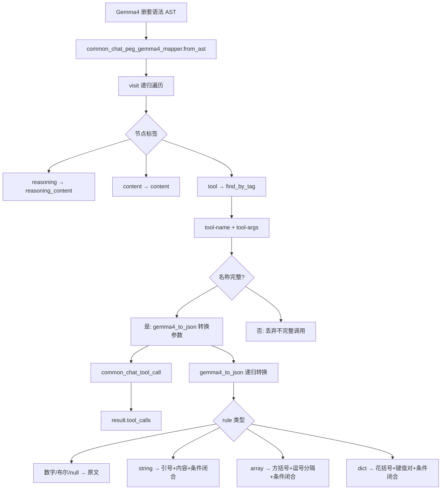
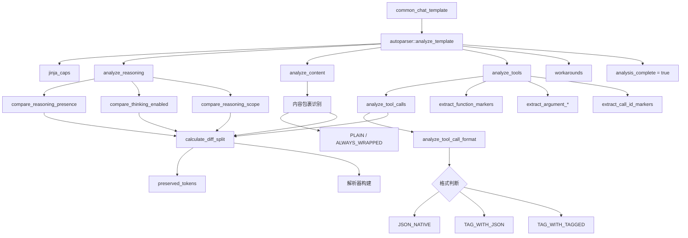
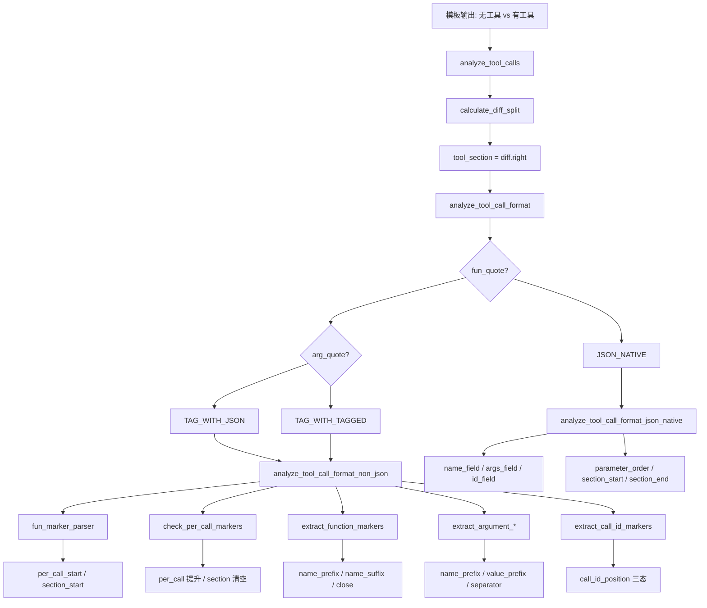
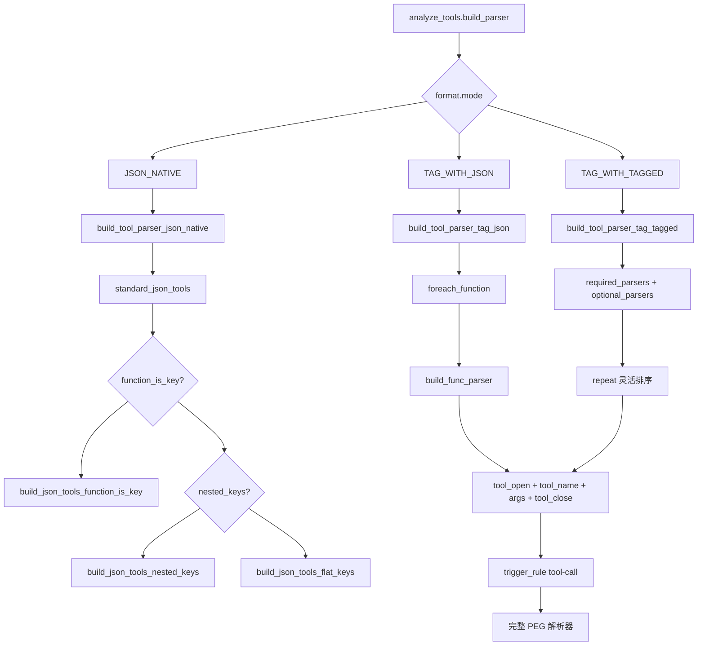
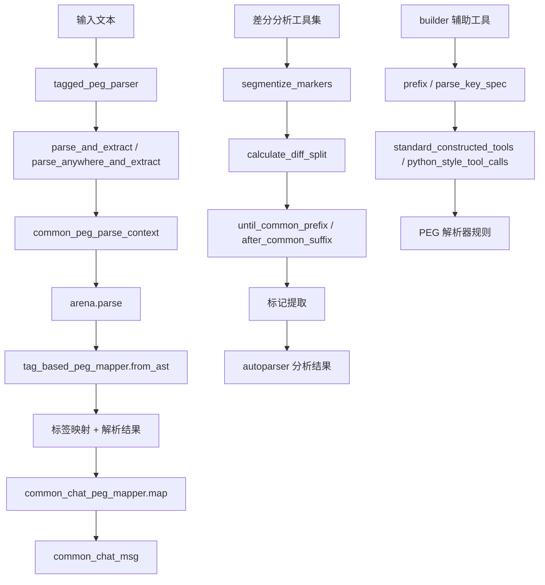

# 第49章 智能分拣中心：聊天 PEG 解析器的三段式架构与自动分析机制

## 学习目标

理解聊天 PEG 解析器的三段式设计，是掌握现代大模型输出结构化的第一步。所谓三段式，是指将模型生成的原始文本流拆分为推理内容（reasoning）、正文内容（content）和工具调用（tools）三个独立但可组合的处理车间：推理内容承载模型的「思考过程」，正文内容承载对用户的可见回复，工具调用承载模型希望调用外部能力的指令。这种分离使得每种内容类型都可以有专属的解析策略，同时又能灵活组合以适应不同的模板格式——无论是 GPT-OSS 的多推理块、Gemma4 的嵌套工具语法，还是标准的 OpenAI JSON 工具调用，都能用同一套框架统一处理。

掌握 builder 模式如何组合原子解析器，是理解解析器可组合性的关键。PEG 解析器的强大之处在于它可以像乐高积木一样，将 literal（字面量匹配）、until（匹配到指定分隔符为止）、schema（按 JSON Schema 约束匹配）等原子解析器层层嵌套，构建出能够处理复杂嵌套结构的状态机。`common_chat_peg_builder` 提供的 reasoning、content、tool_open、tool_name、tool_arg_* 等标签方法，就是这套积木的核心零件，它们不仅定义了「匹配什么」，更通过 tag() 和 atomic() 包装器为匹配到的文本赋予语义含义，使得后续的映射器能够准确地知道「这段文本属于什么」。

学会使用差分分析技术，是理解「解析器如何自动适应不同模型模板」的核心钥匙。`chat-diff-analyzer` 模块通过 `calculate_diff_split` 和 `compare_variants`，构造同一模板的两个变体（例如「有推理内容 vs 无推理内容」），计算它们的差分分割，从而自动逆向推断出聊天模板的隐藏结构——哪些部分是推理标记、哪些是正文标记、工具调用的参数名和参数值被什么样的前后缀包裹。这种技术避免了为每一种模型模板手写解析规则的噩梦，使得 llama.cpp 能够支持数十种不同格式的模型而无需维护同等数量的硬编码解析器。

理解 `common_chat_peg_mapper` 将 AST 节点映射为结构化 `common_chat_msg` 的职责，是连接「解析」与「消费」两个世界的桥梁。映射器不关心解析规则如何匹配，只根据 AST 节点上的标签做判断：遇到 REASONING 标签就追加到 reasoning_content，遇到 CONTENT 标签就追加到 content，遇到 TOOL_OPEN/TOOL_NAME/TOOL_ARG_* 等标签就逐步构建 tool_calls 对象。这种职责分离使得解析器的构建和结构化数据的消费互不耦合，同一套标签体系可以驱动多种输出格式。

理解三种工具调用格式的解析策略，是处理真实世界多样性的关键。JSON_NATIVE 格式（如 `{"name": "func", "arguments": {...}}`）将工具调用表达为标准 JSON 对象；TAG_WITH_JSON 格式（如 `<tool_call>{"name": "func"}</tool_call>`）在 JSON 外层包裹标签；TAG_WITH_TAGGED 格式（如 `<tool_call><function=name><param=key>value</param></function></tool_call>`）则将每个部分都用标签描述。每种格式都有专属的构建函数和分析策略，但最终都收敛到同一套 tool_open/name/args/close 标签体系。

掌握触发器与延迟语法在流式解析中的应用，是理解「性能与灵活性如何平衡」的核心。trigger marker（如 `<tool_call>`）平时安静地扫描文本流，一旦检测到这个标记才激活复杂的工具调用解析规则和 GBNF 语法规则，避免在普通对话中浪费计算资源。`grammar_lazy` 标志与 `COMMON_GRAMMAR_TRIGGER_TYPE_WORD` 配合，实现了「按需激活」的语义约束，使得模型在生成普通文本时不受语法限制，只有在需要调用工具时才被约束格式。

了解 JSON 转义规范化与括号深度计算的实现细节，是理解流式解析鲁棒性的关键。`normalize_quotes_to_json` 将模型可能输出的 Python 单引号统一转换为 JSON 双引号，`json_brace_depth` 正确计算嵌套花括号的未闭合数量——这两个函数共同确保了即使在部分解析（流式场景）下，生成的 JSON 片段也是合法前缀。掌握 Gemma4 专用映射器处理特殊工具调用语法树的机制，则是理解「如何为特殊格式预留扩展通道」的范例：通过 `gemma4_to_json()` 递归转换 + `visit()` 遍历的组合，Gemma4 的嵌套标签结构被统一映射为标准工具调用格式。

## 49.1 生活类比

想象聊天 PEG 解析器是一个**智能包裹分拣中心**：每天从模型那里送来大量原始文本包裹，这些包裹有的装着推理内容（模型的「内心独白」），有的装着正文（给用户的回复），还有的装着工具调用指令（希望调用的外部能力）。这个分拣中心的运作流程是这样的——

差分分析器（analyze_*）就像**逆向工程侦探**，它通过对比「有推理内容 vs 无推理内容」的包裹样本，推断出包装规则——也就是模型输出中哪些部分是推理标记、哪些是正文标记。侦探不会去破解模型的源码，而是像 forensic analyst 一样，从输出结果的差异中反推模板的隐藏结构。`common_chat_peg_builder` 则是**流水线装配工**，根据侦探报告搭建分拣线：推理线、正文线、工具线三条传送带并行运转，每条传送带上有不同的彩色标签贴纸——reasoning、content、tool_open、tool_name、tool_arg_name 等。而 tool_open、tool_close、tool_name 这些标签就像**彩色标签贴纸**，贴在关键位置，告诉机器人「这里是工具名」「这里是参数」「这里是参数值」。`common_chat_peg_mapper` 是**数据翻译官**，把贴满标签的包裹（AST）翻译成标准快递单（common_chat_msg）——推理内容放进 reasoning_content 字段，正文放进 content 字段，工具调用组装成 tool_calls 数组。

触发标记（trigger marker）则是**警报器**，平时安静地扫描，一旦检测到 `<tool_call>` 这类标记才激活复杂解析规则——就像分拣中心的安检门，只有当 X 光检测到可疑物品时才触发详细检查，而不是对每个包裹都做全面安检，从而节省资源。增量解析与 args_buffer 就像**暂存货架**：包裹只来一半时（流式输出尚未完成），先把零件放货架（args_buffer），等剩余部分到了再组装，同时用 closing_quote_pending 标志记住「我已经打开了一个引号但还没闭合」，确保流式输出的 JSON 前缀始终合法。`normalize_quotes_to_json` 是**包装标准化机**，把 Python 单引号统一换成 JSON 双引号，就像把不同规格的包裹统一换成标准纸箱。至于 Gemma4 映射器，那是一条**专用翻译通道**，针对特殊包装格式（嵌套标签语法），有专门的分拣员（visit 函数）和翻译规则（gemma4_to_json），先将特殊语法树递归转换为标准 JSON，再注入工具调用对象。整个系统协作天衣无缝，让模型输出的每一个字都被精确分类和结构化。

## 49.2 源码地图

```
common/chat-peg-parser.h
├── common_chat_peg_mapper (13-30)
│   ├── common_chat_peg_mapper()
│   ├── ~common_chat_peg_mapper()
│   ├── from_ast()
│   ├── map()
│   ├── normalize_container_value()
│   └── args_target()
├── common_chat_peg_gemma4_mapper (32-38)
│   ├── common_chat_peg_gemma4_mapper()
│   ├── from_ast()
│   └── visit()
├── common_chat_peg_builder (48-142)
│   ├── reasoning_block() / reasoning() / content()
│   ├── tag_with_safe_content()
│   ├── tool() / tool_open() / tool_close() / tool_id() / tool_name()
│   ├── tool_args() / tool_arg() / tool_arg_open() / tool_arg_close()
│   ├── tool_arg_name() / tool_arg_value() / tool_arg_string_value() / tool_arg_json_value()
│   ├── prefix()
│   ├── standard_json_tools()
│   ├── standard_constructed_tools()
│   ├── python_style_tool_calls()
│   ├── build_json_tools_function_is_key()
│   ├── build_json_tools_nested_keys()
│   └── build_json_tools_flat_keys()
├── tag_based_peg_mapper (152-153)
│   └── from_ast()
├── tagged_peg_parser (156-176)
│   ├── withDebug() / withoutDebug()
│   ├── parse_and_extract()
│   └── parse_anywhere_and_extract()
├── build_chat_peg_parser() (145-150)
└── build_tagged_peg_parser() (181-182)

common/chat-peg-parser.cpp
├── trim_trailing_space() / trim_leading_space() / trim() (8-34)
├── json_brace_depth() (38-64)
├── escape_json_string_inner() (68-74)
├── normalize_quotes_to_json() (80-166)
├── build_tagged_peg_parser() (418-423)
├── parse_key_spec() (468-474)
├── gemma4_to_json() (894-937)
├── common_chat_peg_mapper::map() (80-255)
├── common_chat_peg_mapper::from_ast() (50-78)
├── common_chat_peg_mapper::args_target() (42-44)
├── common_chat_peg_mapper::normalize_container_value() (46-48)
├── tag_based_peg_mapper::from_ast() (356-361)
├── tagged_peg_parser::parse_and_extract() (363-371)
├── tagged_peg_parser::parse_anywhere_and_extract() (373-386)
├── common_chat_peg_builder::tag_with_safe_content() (388-395)
├── common_chat_peg_builder::standard_constructed_tools() (569-637)
├── common_chat_peg_builder::python_style_tool_calls() (407-466)
├── common_chat_peg_builder::standard_json_tools() (742-817)
├── common_chat_peg_builder::build_json_tools_function_is_key() (479-552)
├── common_chat_peg_builder::build_json_tools_nested_keys() (557-637)
├── common_chat_peg_builder::build_json_tools_flat_keys() (640-731)
├── common_chat_peg_builder::prefix() (733-740)
└── common_chat_peg_gemma4_mapper::from_ast() / visit() (889-983)

common/chat-auto-parser.h
├── template_params / generation_params / compare_variants_result
├── tool_format / reasoning_mode / content_mode / call_id_position
├── autoparser (491-498)
│   └── peg_generator
└── __main__

common/chat-auto-parser-generator.cpp
├── parser_build_context (41-45)
├── peg_generator
│   └── generate_parser() (48-91)
├── autoparser
│   └── build_parser() (95-133)
├── analyze_reasoning
│   └── build_parser() (138-157)
├── analyze_content
│   ├── build_parser() (163-172)
│   └── build_optional_wrapped() (175-182)
├── analyze_tools
│   ├── build_parser() (185-198)
│   ├── build_tool_parser_json_native() (202-240)
│   ├── build_func_parser() (243-271)
│   ├── build_tool_parser_tag_json() (274-337)
│   └── build_tool_parser_tag_tagged() (340-474)
└── __main__

common/chat-diff-analyzer.cpp
├── build_tool_call() (137-143)
├── mode_to_str() (157-162)
├── autoparser
│   ├── analyze_template() (164-213)
│   └── collect_preserved_tokens() (215-246)
├── analyze_reasoning
│   ├── analyze_reasoning() (248-258)
│   ├── compare_reasoning_presence() (260-317)
│   ├── compare_thinking_enabled() (319-401)
│   └── compare_reasoning_scope() (403-463)
├── analyze_content
│   ├── analyze_content() (465-550)
│   └── is_always_wrapped() (552-554)
├── analyze_tools
│   ├── analyze_tools() (556-579)
│   ├── analyze_tool_calls() (581-616)
│   ├── analyze_tool_call_format() (618-670)
│   ├── analyze_tool_call_format_json_native() (678-755)
│   ├── analyze_tool_call_format_non_json() (757-842)
│   ├── check_per_call_markers() (843-884)
│   ├── extract_function_markers() (885-1042)
│   ├── analyze_arguments() (1043-1046)
│   ├── extract_argument_name_markers() (1047-1144)
│   ├── extract_argument_value_markers() (1145-1222)
│   ├── extract_argument_separator() (1223-1266)
│   ├── extract_args_markers() (1267-1328)
│   └── extract_call_id_markers() (1329-1516)
└── __main__

common/chat-auto-parser-helpers.h
├── diff_split / segment
├── trim_whitespace() / trim_leading_whitespace() / trim_trailing_whitespace()
├── trim_trailing_newlines()
├── calculate_diff_split()
├── until_common_prefix() / after_common_suffix()
├── segmentize_markers()
├── prune_whitespace_segments()
├── autoparser::apply_template() / compare_variants()
└── __main__

common/chat-auto-parser-helpers.cpp
├── diff_split::diff_split() / segment::segment()
├── trim_whitespace() (19-36)
├── trim_leading_whitespace() (38-43)
├── trim_trailing_whitespace() (45-59)
├── trim_trailing_newlines() (61-67)
├── common_prefix_len() (69-76) / common_suffix_len() (78-83)
├── calculate_diff_split() (85-156)
├── until_common_prefix() (158-179)
├── after_common_suffix() (181-201)
├── segmentize_markers() (202-224)
├── prune_whitespace_segments() (226-232)
├── autoparser::apply_template() (234-253)
└── autoparser::compare_variants() (255-276)
```

---


## 49.3 装配流水线 —— common_chat_peg_builder 与 mapper 的标签驱动协作

### 49.3.1 聊天 PEG 解析器核心 —— 从文本流到结构化数据的「装配流水线」

`common_chat_peg_builder` 是整个解析器生态的「总装配车间」，它不直接参与文本匹配，而是为 PEG 解析器规则添加语义标签。在分拣中心的比喻中，builder 就是那台「贴标签机」——它接收原子解析器（literal、until、schema 等），输出带有语义标记的解析规则。这些标签分为三个层次：内容层（REASONING、CONTENT）标记文本的语义类型；工具层（TOOL_OPEN、TOOL_NAME、TOOL_ARGS 等）标记工具调用的各个组成部分；参数层（TOOL_ARG_OPEN、TOOL_ARG_NAME、TOOL_ARG_VALUE 等）进一步细化到单个参数的名称和值。

理解 builder 的关键在于区分 `tag()` 和 `atomic()` 两种包装器。`tag()` 仅为匹配到的文本添加一个语义标签，文本本身可以包含子解析器匹配的内容；`atomic()` 则将整个解析器标记为原子操作——在 PEG 语义中，这意味着该规则内的所有内容必须作为一个不可分割的整体匹配成功或失败，不允许部分匹配。为什么工具调用的边界（tool_open、tool_close、tool_id、tool_name）需要 atomic 包装？因为如果工具调用的开始标记（如 `<function=`）只匹配了一部分（例如模型输出了 `<fun` 就中断了），解析器应该将这次匹配视为整体失败，而不是留下一个「半开的工具调用」状态。原子化确保了流式解析中的状态机边界清晰：要么完整匹配一个工具调用边界，要么什么都不匹配。

### 49.3.2 common_chat_peg_builder —— 解析器的「总装配车间」

源码路径：`common/chat-peg-parser.h` - `common_chat_peg_builder`（48-142 行）

```cpp
// 文件: common/chat-peg-parser.h
// 类: common_chat_peg_builder
// 行: 48-142

// 推理块标签：为解析器规则添加推理块语义
common_peg_parser reasoning_block(const common_peg_parser & p) { return tag(REASONING_BLOCK, p); }
// 推理内容标签：标记一段文本为推理内容
common_peg_parser reasoning(const common_peg_parser & p) { return tag(REASONING, p); }
// 普通内容标签：标记一段文本为正文内容
common_peg_parser content(const common_peg_parser & p) { return tag(CONTENT, p); }
// 工具调用标签：标记一段解析为工具调用
common_peg_parser tool(const common_peg_parser & p) { return tag(TOOL, p); }
// 工具开始标签（原子化）：确保工具调用的开始被原子化处理
common_peg_parser tool_open(const common_peg_parser & p) { return atomic(tag(TOOL_OPEN, p)); }
// 工具结束标签（原子化）：确保工具调用的结束被原子化处理
common_peg_parser tool_close(const common_peg_parser & p) { return atomic(tag(TOOL_CLOSE, p)); }
// 工具ID标签（原子化）：提取工具调用的 ID
common_peg_parser tool_id(const common_peg_parser & p) { return atomic(tag(TOOL_ID, p)); }
// 工具名称标签（原子化）：提取工具调用的名称
common_peg_parser tool_name(const common_peg_parser & p) { return atomic(tag(TOOL_NAME, p)); }
// 工具参数整体标签：标记整个参数部分
common_peg_parser tool_args(const common_peg_parser & p) { return tag(TOOL_ARGS, p); }
// 单个工具参数标签：标记单个参数
common_peg_parser tool_arg(const common_peg_parser & p) { return tag(TOOL_ARG, p); }
// 工具参数开始标签（原子化）：标记参数的开始
common_peg_parser tool_arg_open(const common_peg_parser & p) { return atomic(tag(TOOL_ARG_OPEN, p)); }
// 工具参数结束标签（原子化）：标记参数的结束
common_peg_parser tool_arg_close(const common_peg_parser & p) { return atomic(tag(TOOL_ARG_CLOSE, p)); }
// 工具参数名称标签（原子化）：提取参数名称
common_peg_parser tool_arg_name(const common_peg_parser & p) { return atomic(tag(TOOL_ARG_NAME, p)); }
// 工具参数值标签：提取参数值
common_peg_parser tool_arg_value(const common_peg_parser & p) { return tag(TOOL_ARG_VALUE, p); }
// 工具参数字符串值标签：模式声明此参数为字符串类型
common_peg_parser tool_arg_string_value(const common_peg_parser & p) { return tag(TOOL_ARG_STRING_VALUE, p); }
// 工具参数JSON值标签（原子化）：用于 JSON 格式的参数值
common_peg_parser tool_arg_json_value(const common_peg_parser & p) { return atomic(tag(TOOL_ARG_VALUE, p)); }
```

这段代码定义了 `common_chat_peg_builder` 的全部标签方法，是解析器生态的「总装配车间」。在分拣中心的比喻中，builder 就是那台「贴标签机」——它接收原子解析器（literal、until、schema 等），输出带有语义标记的解析规则。这些标签分为三个层次：内容层（REASONING、CONTENT）标记文本的语义类型；工具层（TOOL_OPEN、TOOL_NAME、TOOL_ARGS 等）标记工具调用的各个组成部分；参数层（TOOL_ARG_OPEN、TOOL_ARG_NAME、TOOL_ARG_VALUE 等）进一步细化到单个参数的名称和值。理解 builder 的关键在于区分 `tag()` 和 `atomic()` 两种包装器：`tag()` 仅为匹配到的文本添加语义标签，`atomic()` 则将整个解析器标记为原子操作——在 PEG 语义中，这意味着该规则内的所有内容必须作为一个不可分割的整体匹配成功或失败。为什么工具调用的边界（tool_open、tool_close、tool_id、tool_name）需要 atomic 包装？因为如果工具调用的开始标记只匹配了一部分，解析器应该将这次匹配视为整体失败，而不是留下一个「半开的工具调用」状态——原子化确保了流式解析中的状态机边界清晰：要么完整匹配一个工具调用边界，要么什么都不匹配。

### 49.3.3 common_chat_peg_mapper —— AST 到结构化数据的「翻译官」

源码路径：`common/chat-peg-parser.cpp` - `common_chat_peg_mapper::map()`（80-255 行）

```cpp
// 文件: common/chat-peg-parser.cpp
// 函数: common_chat_peg_mapper::map()
// 行: 80-255

void common_chat_peg_mapper::map(const common_peg_ast_node & node) {
    // 判断节点是否为推理内容或普通内容
    bool is_reasoning = node.tag == common_chat_peg_builder::REASONING;
    bool is_content   = node.tag == common_chat_peg_builder::CONTENT;

    if (is_reasoning) {
        // GPT OSS 可能有多于1个推理块，因此在此处拼接
        result.reasoning_content += std::string(node.text);
    }

    if (is_content) {
        // 拼接来自多个内容节点的内容（例如，当推理标记在 reasoning_format=NONE 模式下
        // 在内容标记之前被保留时）
        result.content += std::string(node.text);
    }

    // 处理工具相关标签（同时支持 JSON 和标记格式）
    bool is_tool_open  = node.tag == common_chat_peg_builder::TOOL_OPEN;
    bool is_tool_close = node.tag == common_chat_peg_builder::TOOL_CLOSE;
    bool is_tool_name  = node.tag == common_chat_peg_builder::TOOL_NAME;
    bool is_tool_id    = node.tag == common_chat_peg_builder::TOOL_ID;
    bool is_tool_args  = node.tag == common_chat_peg_builder::TOOL_ARGS;
    bool is_arg_open   = node.tag == common_chat_peg_builder::TOOL_ARG_OPEN;
    bool is_arg_close  = node.tag == common_chat_peg_builder::TOOL_ARG_CLOSE;
    bool is_arg_name         = node.tag == common_chat_peg_builder::TOOL_ARG_NAME;
    bool is_arg_value        = node.tag == common_chat_peg_builder::TOOL_ARG_VALUE;
    bool is_arg_string_value = node.tag == common_chat_peg_builder::TOOL_ARG_STRING_VALUE;

    if (is_tool_open) {
        // 工具调用开始：创建一个新的待处理工具调用
        pending_tool_call     = common_chat_tool_call();
        current_tool          = &pending_tool_call.value();
        arg_count             = 0;
        args_buffer.clear();
        closing_quote_pending = false;
    }

    if (is_tool_id && current_tool) {
        // 工具调用 ID：去除尾部空格，并去除可能的引号
        auto text = trim_trailing_space(node.text);
        if (text.size() >= 2 && text.front() == '"' && text.back() == '"') {
            text = text.substr(1, text.size() - 2);
        }
        current_tool->id = std::string(text);
    }

    if (is_tool_name && current_tool) {
        // 工具名称：设置名称，并从缓冲区填充参数
        current_tool->name = std::string(trim_trailing_space(node.text));
        if (!args_buffer.empty()) {
            current_tool->arguments = args_buffer;
            args_buffer.clear();
        } else if (current_tool->arguments.empty()) {
            current_tool->arguments = "{";
        }
        // 将工具调用添加到结果中，以便流式处理能够看到它
        if (pending_tool_call.has_value()) {
            result.tool_calls.push_back(pending_tool_call.value());
            pending_tool_call.reset();
            current_tool = &result.tool_calls.back();
        }
    }

    if (is_tool_args && current_tool) {
        // 对于 JSON 格式：参数作为一个完整的 JSON 对象传入
        // 对于标记格式：由单个 arg_name/arg_value 节点构建
        auto text = trim_trailing_space(node.text);
        if (!text.empty() && text.front() == '{') {
            args_target() = std::string(text);
        }
    }

    if (is_arg_open) {
        closing_quote_pending = false;
    }

    if (is_arg_name && current_tool) {
        // 参数名称：构建 JSON 条目 "name":
        std::string arg_entry;
        if (arg_count > 0) {
            arg_entry = ",";
        }
        arg_entry += ordered_json(trim(node.text)).dump() + ":";
        ++arg_count;

        auto & target = args_target();
        if (target.empty()) {
            target = "{";
        }
        target += arg_entry;
    }

    if ((is_arg_value || is_arg_string_value) && current_tool) {
        // 参数值：处理字符串值、JSON 值、容器等
        std::string value_content = std::string(trim_trailing_space(trim_leading_space(node.text, 1), 1));

        std::string value_to_add;
        if (value_content.empty() && is_arg_string_value) {
            // 空字符串值：arg_close 将添加闭合引号
            value_to_add          = "\"";
            closing_quote_pending = true;
        } else if (!value_content.empty() && is_arg_string_value) {
            // 模式声明此参数为字符串类型 - 始终作为字面量字符串值处理
            if (!closing_quote_pending) {
                value_to_add          = "\"";
                closing_quote_pending = true;
            }
            value_to_add += escape_json_string_inner(value_content);
        } else if (!value_content.empty()) {
            // 对于潜在的容器，将 Python 风格的单引号归一化为 JSON 双引号
            bool is_potential_container = value_content[0] == '[' || value_content[0] == '{';
            if (is_potential_container) {
                value_content = normalize_container_value(value_content);
            }

            // 尝试解析为 JSON 值（数字、布尔、null、对象、数组）
            try {
                ordered_json parsed = ordered_json::parse(value_content);
                if (parsed.is_string()) {
                    // 不添加闭合引号（由 arg_close 添加），以保持流式处理的单调性
                    std::string escaped = parsed.dump();
                    if (!escaped.empty() && escaped.back() == '"') {
                        escaped.pop_back();
                    }
                    value_to_add          = escaped;
                    closing_quote_pending = true;
                } else {
                    // 非字符串值：使用原始内容以保持空白的单调性
                    value_to_add = value_content;
                }
            } catch (...) {
                if (node.is_partial && is_potential_container) {
                    // 部分容器：直接传入已经归一化的内容
                    value_to_add = value_content;
                } else {
                    // 不是有效的 JSON - 视为字符串值
                    if (!closing_quote_pending) {
                        value_to_add          = "\"";
                        closing_quote_pending = true;
                    }
                    value_to_add += escape_json_string_inner(value_content);
                }
            }
        }

        args_target() += value_to_add;
    }

    if (is_arg_close && current_tool) {
        if (closing_quote_pending) {
            args_target() += "\"";
            closing_quote_pending = false;
        }
    }

    if (is_tool_close && current_tool) {
        // 如果从未见过工具名称，则将缓冲区刷新到参数中
        if (current_tool->name.empty() && !args_buffer.empty()) {
            current_tool->arguments = args_buffer;
            args_buffer.clear();
        }
        // 闭合任何待处理的字符串引号
        if (closing_quote_pending) {
            current_tool->arguments += "\"";
            closing_quote_pending = false;
        }
        // 闭合任何未闭合的花括号（考虑嵌套对象）
        for (int d = json_brace_depth(current_tool->arguments); d > 0; d--) {
            current_tool->arguments += "}";
        }
        // 如果工具已命名，则添加到结果中；否则丢弃
        if (pending_tool_call.has_value()) {
            if (!current_tool->name.empty()) {
                result.tool_calls.push_back(pending_tool_call.value());
            }
            pending_tool_call.reset();
        }
    }
}
```

`common_chat_peg_mapper::map()` 是分拣中心的「数据翻译官」，它接收 builder 贴好标签的 AST 节点，逐个判断标签类型并累积到 `common_chat_msg` 结果对象中。在分拣中心的比喻中，翻译官的工作流程是：拿到一个包裹（AST 节点），看一眼标签——如果是 REASONING 标签，就把内容拼接到 reasoning_content 字段（GPT-OSS 可能有多个推理块，所以用 += 拼接）；如果是 CONTENT 标签，就拼接到 content 字段；如果是工具相关的标签，就按状态机逐步构建 tool_calls。

翻译官维护了几个关键状态来处理流式场景。`pending_tool_call` 是一个 `std::optional<common_chat_tool_call>`，它在收到 TOOL_OPEN 时被创建，在收到 TOOL_NAME 时被推入 result.tool_calls 并重置——这种「延迟提交」的设计使得在工具名称出现之前，即使参数内容已经部分到达，也能先缓存在 `args_buffer` 中。`closing_quote_pending` 标志是流式 JSON 合法性的关键：当参数值是一个字符串且已经输出了开头的双引号但尚未闭合时，这个标志为 true，等到 TOOL_ARG_CLOSE 或 TOOL_CLOSE 时才补上闭合引号——这确保了在流式输出中，每一个已输出的 JSON 片段都是合法前缀。`args_target()` 是一个辅助函数，它根据「工具名称是否已经确定」来选择写入目标：名称确定前写入 args_buffer，名称确定后写入 current_tool->arguments，这样就统一了 JSON 格式（参数作为整体传入）和标记格式（逐个参数构建）两种路径。

代码中还处理了几个重要的边界情况。`json_brace_depth` 在工具关闭时自动补全未闭合的花括号——如果模型输出了一半的嵌套对象 `{"a": {"b":`，解析器会自动补上 `}}`。`normalize_container_value`（调用 `normalize_quotes_to_json`）将 Python 风格的单引号容器（如 `['a', 'b']`）转换为 JSON 双引号。对于部分解析（`node.is_partial`）中的容器值，直接透传已归一化的内容，避免在中间状态尝试 JSON 解析导致失败。

### 49.3.4 文本工具函数 —— trim、json_brace_depth 与 normalize_quotes_to_json 的「标准化流水线」

源码路径：`common/chat-peg-parser.cpp` - 文本工具函数（8-166 行）

```cpp
// 文件: common/chat-peg-parser.cpp
// 函数: trim_trailing_space() / trim_leading_space() / trim()
// 行: 8-34

// 移除字符串视图末尾的空白字符，可选择限制移除数量
static std::string_view trim_trailing_space(std::string_view sv, int max = -1) {
    int count = 0;
    while (!sv.empty() && std::isspace(static_cast<unsigned char>(sv.back()))) {
        if (max != -1 && count >= max) {
            break;
        }
        sv.remove_suffix(1);
        count++;
    }
    return sv;
}

// 移除字符串视图开头的空白字符，可选择限制移除数量
static std::string_view trim_leading_space(std::string_view sv, int max = -1) {
    int count = 0;
    while (!sv.empty() && std::isspace(static_cast<unsigned char>(sv.front()))) {
        if (max != -1 && count >= max) {
            break;
        }
        sv.remove_prefix(1);
        count++;
    }
    return sv;
}

// 移除字符串视图两端的空白字符（最多移除开头一个空白）
static std::string_view trim(std::string_view sv) {
    return trim_trailing_space(trim_leading_space(sv, 1));
}
```

```cpp
// 文件: common/chat-peg-parser.cpp
// 函数: json_brace_depth()
// 行: 38-64

// 计算JSON类字符串中未闭合的左花括号数量，正确跳过引号内的花括号
static int json_brace_depth(const std::string & s) {
    int  depth     = 0;
    bool in_string = false;
    bool escaped   = false;
    for (char c : s) {
        if (escaped) {
            escaped = false;
            continue;
        }
        if (c == '\\' && in_string) {
            escaped = true;
            continue;
        }
        if (c == '"') {
            in_string = !in_string;
            continue;
        }
        if (!in_string) {
            if (c == '{') {
                depth++;
            } else if (c == '}') {
                depth--;
            }
        }
    }
    return depth;
}
```

```cpp
// 文件: common/chat-peg-parser.cpp
// 函数: escape_json_string_inner()
// 行: 68-74

// 对字符串进行JSON转义并返回不包含引号的内容
static std::string escape_json_string_inner(const std::string & s) {
    std::string escaped = ordered_json(s).dump();
    if (escaped.size() >= 2 && escaped.front() == '"' && escaped.back() == '"') {
        return escaped.substr(1, escaped.size() - 2);
    }
    return escaped;
}
```

```cpp
// 文件: common/chat-peg-parser.cpp
// 函数: normalize_quotes_to_json()
// 行: 80-166

// 将Python风格的单引号字符串转换为JSON双引号字符串，正确转义内部引号
static std::string normalize_quotes_to_json(const std::string & input) {
    std::string result;
    result.reserve(input.size() + 16);  // May need extra space for escaping

    bool in_single_quoted = false;
    bool in_double_quoted = false;

    for (size_t i = 0; i < input.size(); ++i) {
        char c = input[i];

        // Handle escape sequences
        if (c == '\\' && i + 1 < input.size()) {
            char next = input[i + 1];

            if (in_single_quoted) {
                // Inside a single-quoted string being converted to double quotes
                if (next == '\'') {
                    // \\' -> ' (escaped single quote becomes unescaped in double-quoted string)
                    result += '\'';
                    ++i;
                    continue;
                }
                if (next == '"') {
                    // \" stays as \" (already escaped, works in double-quoted string)
                    result += "\\\"";
                    ++i;
                    continue;
                }
                // Other escapes (\n, \\, etc.): pass through both characters
                result += c;
                result += next;
                ++i;
                continue;
            }

            if (in_double_quoted) {
                // Inside a double-quoted string - pass through escape sequences as-is
                result += c;
                result += next;
                ++i;
                continue;
            }

            // Outside any string - just pass through the backslash
            result += c;
            continue;
        }

        // Handle quote characters
        if (c == '"') {
            if (in_single_quoted) {
                // Unescaped double quote inside single-quoted string -> must escape for JSON
                result += "\\\"";
            } else {
                // Double quote as string delimiter or outside strings
                in_double_quoted = !in_double_quoted;
                result += c;
            }
        } else if (c == '\'') {
            if (in_double_quoted) {
                // Single quote inside double-quoted string -> pass through
                result += c;
            } else if (in_single_quoted) {
                // Closing single quote -> convert to double quote
                in_single_quoted = false;
                result += '"';
            } else {
                // Opening single quote -> convert to double quote
                in_single_quoted = true;
                result += '"';
            }
        } else {
            result += c;
        }
    }

    return result;
}
```

这组文本工具函数是分拣中心「标准化流水线」的基础零件，负责在 AST 映射前对文本进行清理和规范化。在分拣中心的比喻中，它们就像**包裹预处理台**——`trim_trailing_space` / `trim_leading_space` / `trim` 负责去除包裹边缘的 whitespace（就像修剪包裹上多余的填充物），`trim` 特殊限制了开头最多只去除一个空白，避免误删内容标记前的分隔符；`json_brace_depth` 是**括号深度计数器**，它在遍历字符串时维护一个状态机——用 `in_string` 标志跳过引号内的花括号，用 `escaped` 标志处理转义字符，最终返回未闭合的左花括号数量，这使得映射器在工具关闭时能自动补全嵌套对象的 `}`；`escape_json_string_inner` 是**JSON 转义机**，利用 `ordered_json(s).dump()` 获得标准的 JSON 转义字符串后剥掉外层引号，确保参数值中的特殊字符（换行、引号、反斜杠）都被正确转义；`normalize_quotes_to_json` 是最精密的**包装标准化机**，它逐字符遍历输入，用 `in_single_quoted` 和 `in_double_quoted` 双标志追踪当前字符串状态——遇到单引号就切换为双引号（开或闭），遇到双引号且在单引号字符串内就转义为 `\"`，遇到反斜杠就按所在字符串类型分发转义规则（单引号字符串内的 `\'` 转为无转义的 `'`，双引号字符串内的转义原样保留），最终将 Python 风格的单引号容器（如 `['a', 'b']`）统一转换为合法的 JSON 双引号形式。这组函数共同确保了即使在流式部分解析的场景下，映射器接收到的文本片段也是可安全拼接的 JSON 前缀。

### 49.3.5 模块依赖图

```mermaid
graph TD
    A[common_chat_peg_builder] --> B[构建 PEG 解析器规则]
    B --> C[添加标签: reasoning/content/tool]
    C --> D[生成 PEG AST]
    D --> E[common_chat_peg_mapper]
    E --> F[map() 遍历 AST]
    F --> G{标签判断}
    G --> H[推理内容]
    G --> I[普通内容]
    G --> J[工具调用]
    H --> K[result.reasoning_content]
    I --> L[result.content]
    J --> M[tool_open/name/args/close]
    M --> N[result.tool_calls]
```

从这张模块依赖图可以看出分拣中心的完整运作流程：`common_chat_peg_builder` 是流水线的起点，它将原子解析器组合成带有语义标签的 PEG 规则，这些规则在解析过程中生成 PEG AST（抽象语法树）。AST 节点带着 builder 贴上的标签被传递给 `common_chat_peg_mapper::map()`，映射器根据标签类型将节点文本分发到 `common_chat_msg` 的对应字段——推理内容进入 reasoning_content，正文内容进入 content，工具调用的各个部分（open/name/args/close）被组装为 tool_calls 数组。文本工具函数（trim、json_brace_depth、escape_json_string_inner、normalize_quotes_to_json）在映射器内部被调用，为 AST 节点文本提供标准化预处理。整个流程的核心设计原则是**标签驱动**：builder 负责「贴标签」，mapper 负责「读标签」，两者之间通过 AST 节点的 tag 字段解耦，使得同一套标签体系可以驱动多种输出格式。

---


## 49.4 Gemma4 专属通道 —— common_chat_peg_gemma4_mapper 与 gemma4_to_json 的递归转换

### 49.4.1 Gemma4 专用解析通道 —— 特殊格式的「定制化翻译官」

在分拣中心的比喻中，Gemma4 就像来自**特殊产地的包裹**——它使用嵌套标签语法来表示工具调用，而不是常见的 JSON 或 XML 格式。例如，Gemma4 的工具调用可能被包裹在自定义的标记中，参数名和值使用特殊的分隔符，甚至参数值本身可能是嵌套的结构。通用映射器（common_chat_peg_mapper）无法直接处理这种特殊语法，因为它的 map() 函数假设工具参数是以 JSON 对象或逐个 arg_name/arg_value 节点的形式出现的。因此，分拣中心为 Gemma4 开设了一条**专用翻译通道**——`common_chat_peg_gemma4_mapper`，它有专门的分拣员（visit 函数）和翻译规则（gemma4_to_json）。

这条通道的核心策略是：先将 Gemma4 的特有语法树通过 `gemma4_to_json()` 函数递归转换为标准 JSON，然后再将 JSON 作为参数值注入工具调用对象。这种方式既保持了映射器的通用性（最终输出的 tool_calls 结构与标准格式完全一致），又为 Gemma4 提供了足够的灵活性。流式安全的 JSON 生成是这条通道的重要特性：通过 `is_partial` 标志决定是否添加闭合符号（如字符串的闭合引号、数组的 `]`、字典的 `}`），确保在部分解析时生成的 JSON 也是合法的前缀。工具调用的条件提取策略确保只在 tool-name 和 tool-args 都存在且 tool-name 非 partial 时才生成有效调用，避免产生不完整的工具调用。

### 49.4.2 common_chat_peg_gemma4_mapper —— Gemma4 的专属翻译官

源码路径：`common/chat-peg-parser.cpp` - `common_chat_peg_gemma4_mapper::visit()`（939-983 行）

```cpp
// 文件: common/chat-peg-parser.cpp
// 函数: common_chat_peg_gemma4_mapper::visit()
// 行: 939-983

void common_chat_peg_gemma4_mapper::visit(const common_peg_ast_arena & arena, common_peg_ast_id id) {
    const auto & node = arena.get(id);

    if (node.tag == "reasoning") {
        result.reasoning_content += std::string(node.text);
        return;
    }

    if (node.tag == "content") {
        result.content += std::string(node.text);
        return;
    }

    if (node.tag == "tool") {
        auto name_id = arena.find_by_tag(node, "tool-name");
        auto args_id = arena.find_by_tag(node, "tool-args");

        if (name_id != COMMON_PEG_INVALID_AST_ID && args_id != COMMON_PEG_INVALID_AST_ID) {
            const auto & name_node = arena.get(name_id);
            const auto & args_node = arena.get(args_id);

            if (!name_node.is_partial) {
                common_chat_tool_call call;
                call.name = std::string(name_node.text);
                if (!args_node.children.empty()) {
                    call.arguments = gemma4_to_json(arena, args_node.children[0]);
                }
                result.tool_calls.push_back(call);
            }
        }

        return;
    }

    for (auto child_id : node.children) {
        visit(arena, child_id);
    }
}
```

`common_chat_peg_gemma4_mapper::visit()` 是 Gemma4 专属翻译官的核心方法，它递归遍历 AST，识别 reasoning、content 和 tool 三种顶层标签。与通用映射器的 map() 函数不同，visit() 采用递归下降的方式：对于 reasoning 和 content 标签，直接将节点文本追加到对应字段；对于 tool 标签，则在当前节点的子树中通过 `find_by_tag` 查找 tool-name 和 tool-args 子节点。这种设计利用了 AST 的树形结构——tool 节点本身就是一个子树，tool-name 和 tool-args 是它的子节点，这使得映射器可以一次性获取工具调用的完整信息，而不需要像通用映射器那样维护 pending_tool_call 状态机。

条件提取逻辑是这条通道的关键安全措施：只有当 tool-name 和 tool-args 都存在，且 tool-name 节点的 `is_partial` 为 false（即工具名称已完整到达）时，才生成工具调用对象。如果工具名称还不完整（流式输出中常见），则直接跳过，不产生半成品调用——这避免了在流式输出中向用户暴露不完整的工具调用。参数的转换通过调用 `gemma4_to_json(arena, args_node.children[0])` 实现，将 tool-args 子树的第一个子节点（即参数内容的根节点）递归转换为标准 JSON 字符串。

### 49.4.3 gemma4_to_json —— Gemma4 语法树的 JSON 转换器

源码路径：`common/chat-peg-parser.cpp` - `gemma4_to_json()`（894-937 行）

```cpp
// 文件: common/chat-peg-parser.cpp
// 函数: gemma4_to_json()
// 行: 894-937

static std::string gemma4_to_json(const common_peg_ast_arena & arena, common_peg_ast_id id) {
    const auto & node = arena.get(id);

    if (node.text.empty()) {
        return "";
    }

    // 数字、布尔、null：直接返回文本
    if (node.rule == "gemma4-number" || node.rule == "gemma4-bool" || node.rule == "gemma4-null") {
        return std::string(node.text);
    }

    // 字符串内容：进行 JSON 转义
    if (node.rule == "gemma4-string-content") {
        return escape_json_string_inner(std::string(node.text));
    }

    // 字符串：拼装引号，部分解析时不闭合
    if (node.rule == "gemma4-string") {
        std::string result = "\"";
        if (!node.children.empty()) {
            result += gemma4_to_json(arena, node.children[0]);
            if (!node.is_partial) {
                result += "\"";
            }
        }
        return result;
    }

    // 数组：拼装方括号，部分解析时不闭合
    if (node.rule == "gemma4-array") {
        std::string result = "[";
        bool add_comma = false;
        for (auto child_id : node.children) {
            if (add_comma) {
                result += ",";
            }
            add_comma = true;
            result += gemma4_to_json(arena, child_id);
        }
        if (!node.is_partial) {
            result += ']';
        }
        return result;
    }

    // 字典键名：直接返回文本
    if (node.rule == "gemma4-dict-key-name") {
        return std::string(node.text);
    }

    // 字典键：拼装引号和冒号，部分解析时不闭合
    if (node.rule == "gemma4-dict-key") {
        std::string result = "\"";
        if (!node.children.empty()) {
            result += escape_json_string_inner(gemma4_to_json(arena, node.children[0]));
        }
        if (!node.is_partial) {
            result += "\":";
        }
        return result;
    }

    // 字典键值对：拼接键和值
    if (node.rule == "gemma4-dict-kv") {
        std::string result;
        for (auto child_id : node.children) {
            result += gemma4_to_json(arena, child_id);
        }
        return result;
    }

    // 字典：拼装花括号，部分解析时不闭合
    if (node.rule == "gemma4-dict") {
        std::string result = "{";
        bool add_comma = false;
        for (auto child_id : node.children) {
            if (add_comma) {
                result += ",";
            }
            add_comma = true;
            result += gemma4_to_json(arena, child_id);
        }
        if (!node.is_partial) {
            result += '}';
        }
        return result;
    }

    // 值：递归处理子节点
    if (node.rule == "gemma4-value") {
        if (!node.children.empty()) {
            return gemma4_to_json(arena, node.children[0]);
        }
        return "";
    }

    return "";
}
```

`gemma4_to_json()` 是 Gemma4 专属通道的「语法转换器」，它根据节点的 rule 属性（由 Gemma4 专用 PEG 解析器在匹配时设置）递归地将 Gemma4 特有的语法树节点转换为标准 JSON 字符串。在分拣中心的比喻中，这个函数就像一台**多语言翻译机**——它能识别 Gemma4 语法中的数字（gemma4-number）、布尔（gemma4-bool）、null（gemma4-null）、字符串（gemma4-string / gemma4-string-content）、数组（gemma4-array）、字典（gemma4-dict / gemma4-dict-key / gemma4-dict-kv）等类型，并将每种类型翻译为对应的 JSON 表示。

这个函数的设计有两个精妙之处。第一是**递归组合**：复杂类型（数组、字典）通过递归调用 `gemma4_to_json()` 处理其子节点来构建，`gemma4-dict-kv` 节点则简单地拼接其所有子节点的转换结果（子节点已经包含了键和值两部分）。第二是**流式安全**：每个容器类型（字符串、数组、字典）在 `node.is_partial` 为 true 时省略闭合符号（引号、方括号、花括号），这确保了在流式输出中，即使 Gemma4 的工具调用尚未完成，已输出的部分也是合法的 JSON 前缀——就像包裹只封了一半的口，但里面的物品已经可以被部分查看。

### 49.4.4 Gemma4 通道架构图



这张架构图展示了 Gemma4 专属通道的完整数据流：AST 首先进入 `from_ast()`，它遍历根节点的所有子节点并调用 `visit()`。visit() 根据节点标签分发处理——reasoning 和 content 标签直接追加到对应字段；tool 标签则通过 `find_by_tag` 在子树中查找 tool-name 和 tool-args，只有在工具名称完整（非 partial）时才调用 `gemma4_to_json()` 将参数子树递归转换为 JSON，最终生成 common_chat_tool_call 对象。`gemma4_to_json()` 内部根据 rule 属性分发到不同的转换逻辑，每个容器类型都根据 `is_partial` 标志决定是否添加闭合符号，确保流式输出的 JSON 前缀合法性。

---


## 49.5 模板自动分析 —— autoparser 的逆向推断与差分侧写

### 49.5.1 聊天模板自动分析器 —— 逆向推断输出格式的「诊断师」

在分拣中心的比喻中， autoparser 就是那位**逆向工程侦探**——它不直接阅读模型模板的源码（那需要理解复杂的 Jinja 语法和模板语义），而是通过构造模板变体、对比输出差异，来推断模板的隐藏结构。具体来说，侦探会生成两个版本的模板输出——一个包含推理内容，一个不包含——然后使用 `calculate_diff_split` 计算它们的差分分割，从而定位推理标记的位置和内容。同样的技术应用于内容包裹识别（正文是否被标记包围）和工具调用格式检测（JSON、标签 JSON、标签标记三种格式）。这种差分分析的方法大大降低了实现难度，且具有更好的可移植性，可以适应不同模型的各种模板格式。

### 49.5.2 autoparser —— 模板分析的「总调度」

源码路径：`common/chat-diff-analyzer.cpp` - `autoparser::analyze_template()`（164-213 行）

```cpp
// 文件: common/chat-diff-analyzer.cpp
// 函数: autoparser::analyze_template()
// 行: 164-213

void autoparser::analyze_template(const common_chat_template & tmpl) {
    jinja_caps = tmpl.original_caps();
    reasoning = analyze_reasoning(tmpl, jinja_caps.supports_tool_calls);
    content = analyze_content(tmpl, reasoning);
    tools = analyze_tools(jinja_caps.supports_tool_calls ? analyze_tools(tmpl, jinja_caps, reasoning) : analyze_tools());
    collect_preserved_tokens();

    for (auto & workaround : workarounds) {
        workaround(tmpl, *this);
    }

    LOG_DBG("\n--- Reasoning & Content Structure ---\n");
    LOG_DBG("reasoning_mode: %s\n", mode_to_str(reasoning.mode).c_str());
    LOG_DBG("reasoning_start: '%s'\n", reasoning.start.c_str());
    LOG_DBG("reasoning_end: '%s'\n", reasoning.end.c_str());
    LOG_DBG("content_mode: %s\n", mode_to_str(content.mode).c_str());
    LOG_DBG("content_start: '%s'\n", content.start.c_str());
    LOG_DBG("content_end: '%s'\n", content.end.c_str());

    LOG_DBG("\n--- Tool Call Structure ---\n");
    LOG_DBG("tool_mode: %s\n", mode_to_str(tools.format.mode).c_str());
    LOG_DBG("supports_tools: %s\n", jinja_caps.supports_tools ? "true" : "false");
    LOG_DBG("supports_parallel_calls: %s\n", jinja_caps.supports_parallel_tool_calls ? "true" : "false");
    LOG_DBG("tool_section_start: '%s'\n", tools.format.section_start.c_str());
    LOG_DBG("tool_section_end: '%s'\n", tools.format.section_end.c_str());
    LOG_DBG("per_call_start: '%s'\n", tools.format.per_call_start.c_str());
    LOG_DBG("per_call_end: '%s'\n", tools.format.per_call_end.c_str());
    LOG_DBG("func_name_prefix: '%s'\n", tools.function.name_prefix.c_str());
    LOG_DBG("func_name_suffix: '%s'\n", tools.function.name_suffix.c_str());
    LOG_DBG("func_close: '%s'\n", tools.function.close.c_str());
    LOG_DBG("call_id_prefix: '%s'\n", tools.call_id.prefix.c_str());
    LOG_DBG("call_id_suffix: '%s'\n", tools.call_id.suffix.c_str());
    LOG_DBG("call_id_pos: %s\n", mode_to_str(tools.call_id.pos).c_str());
    LOG_DBG("args_start: '%s'\n", tools.arguments.start.c_str());
    LOG_DBG("args_end: '%s'\n", tools.arguments.end.c_str());
    LOG_DBG("arg_name_prefix: '%s'\n", tools.arguments.name_prefix.c_str());
    LOG_DBG("arg_name_suffix: '%s'\n", tools.arguments.name_suffix.c_str());
    LOG_DBG("arg_value_prefix: '%s'\n", tools.arguments.value_prefix.c_str());
    LOG_DBG("arg_value_suffix: '%s'\n", tools.arguments.value_suffix.c_str());
    LOG_DBG("name_field: '%s'\n", tools.format.name_field.c_str());
    LOG_DBG("args_field: '%s'\n", tools.format.args_field.c_str());
    LOG_DBG("id_field: '%s'\n", tools.format.id_field.c_str());
    LOG_DBG("gen_id_field: %s\n", tools.format.gen_id_field.c_str());
    LOG_DBG("parameter_order: %s\n", std::accumulate(tools.format.parameter_order.begin(), tools.format.parameter_order.end(),
        std::string(""), [] (const std::string & a, const std::string & b) { return a.empty() ? b : a + ", " + b; }
        ).c_str());

    LOG_DBG(ANSI_PURPLE "=== Differential analysis complete ===\n" ANSI_RESET);
    analysis_complete = true;
}
```

`autoparser::analyze_template()` 是整个自动分析器的入口点和「总调度」，它负责协调推理、内容和工具三个分析阶段。在分拣中心的比喻中，总调度的工作流程是：首先从模板中提取 Jinja 能力的原始配置（jinja_caps），然后按顺序启动三个分析阶段——先分析推理内容（reasoning），再分析正文内容（content，依赖推理分析的结果），最后分析工具调用（tools，仅在模板支持工具调用时执行）。三个阶段的结果被存储在 autoparser 对象的成员变量中，后续的 `build_parser()` 阶段会读取这些分析结果来构建实际的 PEG 解析器。

分析完成后，`collect_preserved_tokens()` 从各分析阶段的结果中收集所有发现的标记（如推理的起始/结束标记、内容的包裹标记、工具调用的各种前后缀），并去重后存入 preserved_tokens 列表——这些标记在后续的解析器构建中需要被「保留」，即在解析过程中原样输出，不被当作普通文本消费。最后，`workarounds` 向量中的每个兼容性补丁函数被调用，允许针对特定模型模板的已知问题进行修正（例如某些模板的工具调用格式与标准不完全一致）。详细的分析结果通过 LOG_DBG 输出，为开发者和调试者提供清晰的诊断信息。

### 49.5.3 collect_preserved_tokens —— 保留标记的「收集员」

源码路径：`common/chat-diff-analyzer.cpp` - `autoparser::collect_preserved_tokens()`（215-246 行）

```cpp
// 文件: common/chat-diff-analyzer.cpp
// 函数: autoparser::collect_preserved_tokens()
// 行: 215-246

void autoparser::collect_preserved_tokens() {
    auto add_token = [this](const std::string & org_token) {
        std::string token = trim_whitespace(org_token);
        if (!token.empty()) {
            // Avoid duplicates
            if (std::find(preserved_tokens.begin(), preserved_tokens.end(), token) == preserved_tokens.end()) {
                preserved_tokens.push_back(token);
            }
        }
    };

    add_token(reasoning.start);
    add_token(reasoning.end);
    add_token(content.start);
    add_token(content.end);
    add_token(tools.format.section_start);
    add_token(tools.format.section_end);
    add_token(tools.format.per_call_start);
    add_token(tools.format.per_call_end);
    add_token(tools.function.name_prefix);
    add_token(tools.function.name_suffix);
    add_token(tools.function.close);
    add_token(tools.arguments.start);
    add_token(tools.arguments.end);
    add_token(tools.arguments.name_prefix);
    add_token(tools.arguments.name_suffix);
    add_token(tools.arguments.separator);
    add_token(tools.arguments.value_prefix);
    add_token(tools.arguments.value_suffix);
    add_token(tools.call_id.prefix);
    add_token(tools.call_id.suffix);
}
```

`collect_preserved_tokens()` 是总调度身边的「标记收集员」，它的职责是把三个分析阶段发现的所有标记汇总到 `preserved_tokens` 列表中，供后续的解析器构建阶段使用。在分拣中心的比喻中，收集员就像**标签归档员**——它不参与实际的分析推理，而是等到三个侦探小组（推理分析、内容分析、工具分析）都提交报告后，逐一翻阅每份报告中的标记字段，把非空的标记收集到一个去重的清单里。这个清单的意义在于：这些标记（如 `<tool_call>`、`</tool_call>`、`<function=`、`</function>` 等）在后续的 PEG 解析器构建中需要被「保留」——即在解析过程中原样输出，不被当作普通文本消费。如果某个标记不在 preserved_tokens 中，解析器可能会在匹配内容时将其「吞掉」，导致工具调用的边界标记丢失。

收集员的实现非常简洁但考虑周全。它定义了一个 `add_token` lambda，对每个传入的标记先做 `trim_whitespace` 去除首尾空白，然后检查是否为空——空标记（如某些模板中不存在的可选标记）直接跳过。去重通过 `std::find` 线性检查 preserved_tokens 向量，避免同一标记（如推理结束标记同时被 reasoning 和 content 阶段引用）被重复添加。收集的标记覆盖了全部分析维度：推理的起始/结束标记（reasoning.start/end）、内容的起始/结束标记（content.start/end）、工具调用的节标记（section_start/end）、每调用标记（per_call_start/end）、函数名的前后缀（name_prefix/name_suffix）和结束符（close）、参数块的起始/结束标记（arguments.start/end）、参数名的前后缀（name_prefix/name_suffix）、参数分隔符（separator）、参数值的前后缀（value_prefix/value_suffix），以及调用 ID 的前后缀（call_id.prefix/suffix）。这个清单确保了后续 `peg_generator::generate_parser()` 在序列化解析器时，能将 `data.preserved_tokens` 正确传递给运行时，使得解析器在流式处理中保留所有关键标记。

### 49.5.4 calculate_diff_split —— 差异分割的「手术刀」

源码路径：`common/chat-auto-parser-helpers.cpp` - `calculate_diff_split()`（85-156 行）

```cpp
// 文件: common/chat-auto-parser-helpers.cpp
// 函数: calculate_diff_split()
// 行: 85-156

diff_split calculate_diff_split(const std::string & left, const std::string & right) {
    diff_split result;
    auto left_seg = segmentize_markers(left);
    auto right_seg = segmentize_markers(right);
    if (left_seg.empty()) {
        result.right = right;
        return result;
    }
    if (right_seg.empty()) {
        result.left = left;
        return result;
    }

    auto left_start = left_seg.begin();
    auto left_end = --left_seg.end();
    auto right_start = right_seg.begin();
    auto right_end = --right_seg.end();
    auto test = [&] () {
        return left_start != left_end && right_start != right_end;
    };

    bool left_fully_consumed = false;
    bool right_fully_consumed = false;
    while (test()) {
        bool advanced = false;
        if (*left_start == *right_start) {
            result.prefix.append(left_start->value);
            left_start++;
            right_start++;
            advanced = true;
        }
        if (*left_end == *right_end) {
            result.suffix = left_end->value + result.suffix;
            if (left_start != left_end) {
                left_end--;
            } else {
                left_fully_consumed = true;
            }
            if (right_start != right_end) {
                right_end--;
            } else {
                right_fully_consumed = true;
            }
            advanced = true;
        }
        if (!advanced) {
            break;
        }
    }

    // 处理剩余部分，计算 left 和 right 的独有部分
    auto eat_segment = [](std::string str, const segment & seg) -> std::string { return std::move(str) + seg.value; };
    bool can_have_text_suffix = left_end->type == segment_type::TEXT && right_end->type == segment_type::TEXT;
    bool can_have_text_prefix = right_start->type == segment_type::TEXT && left_start->type == segment_type::TEXT;
    std::string remainder_left = std::accumulate(left_start, left_fully_consumed ? left_end : ++left_end, std::string(), eat_segment);
    std::string remainder_right = std::accumulate(right_start, right_fully_consumed ? right_end : ++right_end, std::string(), eat_segment);
    size_t suffix_len = can_have_text_suffix ? common_suffix_len(remainder_left, remainder_right) : 0;
    size_t prefix_len = can_have_text_prefix ? common_prefix_len(remainder_left.substr(0, remainder_left.size() - suffix_len),
        remainder_right.substr(0, remainder_right.size() - suffix_len)) : 0;
    result.prefix.append(remainder_left.substr(0, prefix_len));
    result.suffix = remainder_left.substr(remainder_left.length() - suffix_len, suffix_len) + result.suffix;
    result.left = remainder_left.substr(prefix_len, remainder_left.length() - prefix_len - suffix_len);
    result.right = remainder_right.substr(prefix_len, remainder_right.length() - prefix_len - suffix_len);
    if (result.left == "" && result.right == "") {
        result.prefix = left;
        result.suffix = "";
    }
    if (result.left.empty() && !result.right.empty() &&
            left.size() <= right.size() &&
            right.substr(0, left.size()) == left) {
        result.prefix = left;
        result.suffix = "";
        result.right  = right.substr(left.size());
    }
    return result;
}
```

`calculate_diff_split()` 是差分分析的核心算法，被称为差异分割的「手术刀」。在分拣中心的比喻中，这把手术刀的作用是：给定两个包裹（left 和 right 字符串），精确地切出它们的公共前缀（prefix）、公共后缀（suffix）、left 独有的部分（left）和 right 独有的部分（right）。手术刀的精妙之处在于它不是简单地按字符比较，而是先通过 `segmentize_markers()` 将字符串按标记（`<xxx>` 或 `[xxx]`）分段，然后从两端向中间匹配相同的段——这样可以确保前缀和后缀的边界总是落在标记的边界上，而不是落在标记的中间。例如，比较 `<html><body><div></div></body></html>` 和 `<html><body><p>Something</p></body></html>` 时，前缀会是 `<html><body>` 而不是 `<html><body><`，因为算法会等到整个标记匹配后才将其归入前缀。

算法的工作流程分为三个阶段。第一阶段是分段：将 left 和 right 分别切分为 TEXT（普通文本）和 MARKER（标记）交替的段序列。第二阶段是双向匹配：从两端同时向中间推进，如果左端的段等于右端的段，就归入 prefix；如果左尾的段等于右尾的段，就归入 suffix。第三阶段是剩余处理：当两端无法继续匹配时，将剩余部分累加为 remainder_left 和 remainder_right，然后在这些剩余字符串上计算字符级的公共前缀和公共后缀（仅当两端都是 TEXT 类型时才计算，避免切断标记），最终确定 left 和 right 的独有部分。算法还处理了几个边界情况：如果 left 和 right 完全相同，则整个 left 归入 prefix；如果 left 是 right 的前缀，则 right 的剩余部分归入 right 字段。

### 49.5.5 analyze_reasoning —— 推理内容分析的「侦探」

`analyze_reasoning` 是侦探团队的第一个小组，专门负责**推理内容的精准定位**。在分拣中心的比喻中，这个小组的任务是回答一个问题：模型输出的哪些部分是「思考过程」（推理内容），哪些是「给用户的回复」（正文内容）？为了回答这个问题，小组使用了三种差分对比技术。

`compare_reasoning_presence()` 构造两个消息序列变体：一个包含普通的 assistant 消息（无推理内容），另一个包含带有 reasoning_content 字段的 assistant 消息。通过比较这两个变体的模板输出差异，如果 right（有推理的版本）中包含推理内容的特征文本，就尝试用 PEG 解析器提取推理标记的前缀（pre）和后缀（post），从而确定推理模式是 TAG_BASED（有包裹标签）还是 NONE（无推理）。

`compare_thinking_enabled()` 则从另一个角度验证：它比较 enable_thinking 为 false 和 true 时的模板输出。如果关闭思考时输出较短、开启思考时输出较长，且差异部分恰好是推理标记对，就进一步确认推理标记的起始和结束位置。这个方法还使用了尾部锚定技术（anchor_len = 64 字符）来处理某些模型在切换思考模式时会改变系统消息的干扰情况——通过锚定输出尾部的公共部分，定位附加的推理标记。

`compare_reasoning_scope()` 进一步探究推理的范围：推理内容是否仅在工具调用时出现（TOOLS_ONLY 模式）？它构造两个变体——一个包含只有推理内容的 assistant 消息，另一个包含同时有推理内容和工具调用的 assistant 消息——如果推理内容只在第二个变体中出现，就将模式标记为 TOOLS_ONLY。这种模式下的推理内容不会在普通对话中出现，只有在工具调用场景中才会被激活。

### 49.5.6 analyze_content —— 正文内容包裹的「识别师」

`analyze_content` 是侦探团队的第二个小组，负责**主内容的包裹识别**。在分拣中心的比喻中，这个小组的任务是判断正文内容是否被标记包围——也就是说，模型输出的正文是裸文本（PLAIN 模式）还是被特定的标签包裹（ALWAYS_WRAPPED 模式）。

小组构造了三个变体进行对比：仅包含 assistant 正文内容的变体、包含工具调用的变体、包含推理内容的变体。通过分析这些变体之间的差异，小组判断正文内容是否总是被起始和结束标记包裹。核心逻辑在 `analyze_content()` 中实现：如果 diff 的 left 部分恰好等于纯正文内容，且能通过解析器验证，则模式为 PLAIN；否则，尝试用 wrapped 解析器提取包裹标记的前缀（pre）和后缀（post），并将模式设置为 ALWAYS_WRAPPED。

`is_always_wrapped()` 是一个简单的查询函数，它检查内容模式是否为 ALWAYS_WRAPPED 且起始和结束标记都非空。这个函数在后续的解析器构建阶段被频繁调用——例如在 `build_tool_parser_json_native()` 中，如果内容总是被包裹，就需要在工具调用解析器中包含内容包装器，确保工具调用之前的正文也能被正确解析。

### 49.5.7 autoparser 分析流程架构图



这张架构图展示了 autoparser 作为「总调度」的完整分析流程：`analyze_template()` 首先从模板中提取 Jinja 能力配置，然后按顺序启动三个分析阶段——推理分析、内容分析和工具分析。每个阶段内部通过构造模板变体并调用 `calculate_diff_split` 来计算差异，从而推断出各自领域的标记和格式。推理分析使用三种对比技术（presence、thinking_enabled、scope）来确定推理模式和标记位置；内容分析通过对比纯内容、工具调用和推理内容三个变体来判断内容是否被包裹；工具分析则通过多层子分析来识别工具调用的格式模式和所有细节标记。`collect_preserved_tokens()` 在三个阶段完成后汇总所有非空标记到 preserved_tokens 列表，`workarounds` 兼容性补丁在最后执行，标记分析完成。

---


## 49.6 工具调用格式的分子级检测 —— analyze_tools 的多协议法医

### 49.6.1 工具调用格式的分子级检测 —— 从 JSON 到 XML 的「格式法医」

工具调用格式的分子级检测负责识别模型输出中工具调用的具体序列化形式。不同模型可能使用不同的格式：有些使用标准的 JSON 对象（如 `{"name": "func", "arguments": {...}}`），有些使用带标签的 JSON（如 `<tool_call>{"name": "func"}</tool_call>`），还有些使用纯标签格式（如 `<tool_call><function=name><param=key>value</param></function></tool_call>`）。检测过程通过对比包含工具调用和不包含工具调用的模板输出，自动推断出工具调用的格式模式和具体的标记。

在分拣中心的比喻中，格式法医的工作就像**分子级别的格式鉴定**——他们不关心工具调用的具体内容（函数名是什么、参数值是什么），而是关心工具调用的「语法结构」：函数名被什么标记包裹？参数名和参数值之间用什么分隔？整个工具调用被什么标记包围？这些鉴定结果直接决定了后续解析器的构建方式。

### 49.6.2 analyze_tool_call_format —— 工具调用格式的「法医」

源码路径：`common/chat-diff-analyzer.cpp` - `analyze_tools::analyze_tool_call_format()`（618-670 行）

```cpp
// 文件: common/chat-diff-analyzer.cpp
// 函数: analyze_tools::analyze_tool_call_format()
// 行: 618-670

void analyze_tools::analyze_tool_call_format(const std::string &       haystack,
                                             const std::string &       fun_name_needle,
                                             const std::string &       arg_name_needle,
                                             const analyze_reasoning & reasoning) {
    if (fun_name_needle.empty() || arg_name_needle.empty() || haystack.empty()) {
        return;
    }

    // 检测函数名和参数名是否被双引号包围，以判断格式模式
    auto in_json_haystack = [&haystack](const std::string & needle) -> bool {
        auto parser = build_tagged_peg_parser([&](common_peg_parser_builder &p) {
            return p.choice({ p.literal("{"), p.literal(":") }) << p.choice({
                p.tag("dq", p.literal("\"") + p.literal(needle) + p.literal("\"")) });
        });
        auto result = parser.parse_anywhere_and_extract(haystack);
        return result.result.success();
    };

    auto fun_quote = in_json_haystack(fun_name_needle);
    auto arg_quote = in_json_haystack(arg_name_needle);

    if (fun_quote) {
        // 不需要进一步检查，我们已经处于 JSON 世界
        format.mode = tool_format::JSON_NATIVE;
    } else if (arg_quote) {
        format.mode = tool_format::TAG_WITH_JSON;
    } else {
        format.mode = tool_format::TAG_WITH_TAGGED;
    }

    // 首先，移除任何推理标记
    std::string clean_haystack = haystack;
    if (!reasoning.start.empty()) {
        auto pos = haystack.find(reasoning.start);
        if (pos != std::string::npos) {
            clean_haystack = haystack.substr(0, pos) + haystack.substr(pos + reasoning.start.length());
        }
    }
    if (!reasoning.end.empty()) {
        auto pos = clean_haystack.find(reasoning.end);
        if (pos != std::string::npos) {
            clean_haystack = clean_haystack.substr(0, pos) + clean_haystack.substr(pos + reasoning.end.length());
        }
    }

    if (format.mode == tool_format::JSON_NATIVE) {
        analyze_tool_call_format_json_native(clean_haystack, fun_name_needle, arg_name_needle);
    } else {
        analyze_tool_call_format_non_json(clean_haystack, fun_name_needle);
    }
    // 总是放宽结束标记的空白要求，因为它们不影响内容
    format.section_end  = trim_whitespace(format.section_end);
    format.per_call_end = trim_whitespace(format.per_call_end);
}
```

`analyze_tool_call_format()` 是格式法医的「初步鉴定」方法，它通过检测函数名和参数名是否被双引号包围来判断工具调用的格式模式。在分拣中心的比喻中，这就像法医通过观察包裹上的标签格式来初步判断包裹的产地——如果函数名和参数名都用双引号包围（如 `"name": "func"`），那就是 JSON 世界（JSON_NATIVE）；如果只有参数名用双引号包围而函数名在外面被标签包裹，那就是标签包裹 JSON（TAG_WITH_JSON）；如果两者都没有双引号，那就是纯标签格式（TAG_WITH_TAGGED）。

鉴定过程使用了一个巧妙的 PEG 解析器 `in_json_haystack`，它检查在 `{` 或 `:` 之后是否紧跟着 `"needle"` 的模式——这正是 JSON 对象中键值对的典型结构。如果函数名 needle（如 `func1`）出现在这种结构中，就可以确定工具调用使用了 JSON 原生格式。确定格式模式后，方法首先清理推理标记（移除 reasoning.start 和 reasoning.end 之间的内容），然后将清理后的文本传递给具体的子分析函数：JSON 格式调用 `analyze_tool_call_format_json_native()`，非 JSON 格式调用 `analyze_tool_call_format_non_json()`。最后，方法放宽结束标记的空白要求——因为结束标记（如 `</tool_call>`）后面的空白不影响内容解析，去除空白可以避免在后续的标记比对中出现不必要的差异。

### 49.6.3 analyze_tool_call_format_json_native —— JSON 格式的「结构鉴定师」

`analyze_tool_call_format_json_native()` 是 JSON 格式的「结构鉴定师」，它负责从 JSON 格式的工具调用片段中提取字段信息和节标记。在分拣中心的比喻中，这就像法医对 JSON 格式的包裹进行详细的结构分析——他们要确定 name_field（函数名字段）、args_field（参数字段）、id_field（调用 ID 字段）等关键字段在 JSON 对象中的位置，以及工具调用在文本中的节起始和结束标记。

鉴定师首先找到 JSON 对象的起始 `{` 和结束 `}` 位置，解析这个 JSON 结构，然后遍历其所有字段。通过检查字段值是否等于函数名 needle（确定 name_field）、字段值中是否包含参数名 needle（确定 args_field）、字段值是否包含 "call0000"（确定 id_field）、字段名是否包含 "id"（确定 gen_id_field），鉴定师逐步构建出完整的字段映射。如果函数名本身就是 JSON 对象的键（如 `{"func1": {...}}`），则设置 `fun_name_is_key = true`，此时不需要单独的 name_field。鉴定师还检查工具调用是否被包裹在数组中（`[...]`），如果是则设置 `tools_array_wrapped = true` 并调整节标记的范围。最终，根据各字段在原始文本中的位置，确定参数顺序（parameter_order）和节起始/结束标记。

### 49.6.4 analyze_tool_call_format_non_json —— 非 JSON 格式的「标记提取师」

`analyze_tool_call_format_non_json()` 是非 JSON 格式的「标记提取师」，它负责从标签格式的工具调用片段中提取函数标记、节标记和每调用标记。在分拣中心的比喻中，这就像法医对标签格式的包裹进行结构分析——他们要确定函数名被什么标签包裹（如 `<function=name>` 中的 `<function=` 和 `>`）、整个工具调用被什么标签包围（如 `<tool_call>` 和 `</tool_call>`）。

提取师首先使用 `fun_marker_parser` 来确定函数标记的格式——函数名可能被 `<...>` 或 `[...]` 类型的标签包裹。然后，它尝试用两种模式来解析工具调用的结构：一种是「双标记模式」（节标记 + 每调用标记 + 函数前缀 + 函数标记 + 剩余内容），另一种是「单标记模式」（节标记 + 函数标记 + 剩余内容）。根据哪种模式匹配成功，提取师分别从解析结果中提取 `sec_start`（节起始标记）、`call_start`（每调用起始标记）、`fun_pre`（函数名前缀）等标签，最终确定 `format.section_start`、`format.per_call_start`、`format.section_end`、`format.per_call_end` 等关键标记。

### 49.6.5 check_per_call_markers —— 并行调用标记的「检测师」

`check_per_call_markers()` 是并行调用标记的「检测师」，它负责判断在支持并行工具调用的模板中，是否存在每调用级别的格式标记。在分拣中心的比喻中，这就像法医通过对比「一个工具调用」和「两个工具调用」的包裹，来判断每个工具调用是否有独立的包装——如果两个调用的包裹格式与一个调用的包裹格式相同（只是重复了两次），说明存在 per_call 级别的标记；如果两个调用的包裹被一个更大的节标记包围，则说明只有节级别的标记。

检测师构造两个变体——一个包含一个工具调用，另一个包含两个工具调用——然后计算它们的差异分割。如果第二个工具调用的内容以节起始标记开头，说明节标记实际上应该是每调用标记——将 `format.section_start` 和 `format.section_end` 的值提升为 `per_call_start` 和 `per_call_end`，并将节标记清空。这种检测确保了在并行调用场景下，解析器能够正确地包装每个独立的工具调用。

### 49.6.6 extract_function_markers —— 函数标记的「测绘师」

`extract_function_markers()` 是函数标记的「测绘师」，它负责提取函数名称的前缀（name_prefix）、后缀（name_suffix）以及调用结束符（close）。在分拣中心的比喻中，这就像法医通过对比两个不同函数名的调用（如 `func1` 和 `func2`），来精确测绘函数名在文本中的包裹结构——函数名前面有什么标记？后面有什么标记？参数结束后到工具调用结束之间有什么标记？

测绘师构造两个变体——分别包含不同的函数名——计算它们的差异分割。如果两个函数名都出现在差异中，就通过 PEG 解析器提取函数名前面的部分（name_prefix）和后面的部分（name_suffix）。对于 JSON 格式，name_suffix 会延伸到第一个 `{` 或 `[`（参数的开始）之前；对于标签格式，name_suffix 会延伸到第一个标记（参数标记）之前。结束符（close）的提取则更复杂——它需要在最后一个参数值之后、工具调用结束标记之前找到内容，可能还需要借助「无工具调用」变体的差异来辅助定位。

### 49.6.7 参数标记的「精密切片师」

参数标记的提取由四个函数协作完成，就像一个**精密切片师团队**。`extract_argument_name_markers()` 通过对比两个不同参数名的变体，提取参数名称的前缀（name_prefix）和后缀（name_suffix）——参数名被什么标记包裹？`extract_argument_value_markers()` 通过对比同一参数不同值的变体，提取参数值的前缀（value_prefix）和后缀（value_suffix）——参数值前面有什么标记？后面有什么标记？`extract_argument_separator()` 通过对比单参数和双参数的变体，提取参数之间的分隔符（如 `, ` 或 `,\n`）。`extract_args_markers()` 则通过对比无参数和有参数的变体，提取参数块的开始和结束标记（主要针对 JSON 原生格式，如 `{` 和 `}`）。

在分拣中心的比喻中，这个团队的工作就像是对包裹的内部结构进行微观分析——每个参数名和参数值都有自己的包装，这些包装的精确格式对于后续的解析器构建至关重要。例如，如果参数名被 `<param=` 和 `>` 包裹，参数值被 `</param>` 结束，那么解析器就需要按照这个精确的格式来匹配参数。

### 49.6.8 extract_call_id_markers —— 调用 ID 的「三态定位师」

`extract_call_id_markers()` 是调用 ID 的「三态定位师」，它负责确定 call_id 在工具调用中的位置。在分拣中心的比喻中，这就像法医需要判断包裹上的序列号（call_id）贴在包裹的哪个位置——是在函数名之前（PRE_FUNC_NAME）？在函数名和参数之间（BETWEEN_FUNC_AND_ARGS）？还是在参数之后（POST_ARGS）？

定位师构造两个变体——分别包含不同的调用 ID（如 `call00001` 和 `call00009`）——计算它们的差异分割。通过检查函数名出现在 diff 的 prefix 还是 suffix 中，定位师可以判断 call_id 的位置：如果函数名只在 prefix 中且参数的大括号 `{` 在 suffix 中，则 call_id 在函数名和参数之间（BETWEEN_FUNC_AND_ARGS）；如果函数名和参数都在 prefix 中，则 call_id 在参数之后（POST_ARGS）；如果函数名只在 suffix 中，则 call_id 在函数名之前（PRE_FUNC_NAME）。每种位置下，定位师进一步提取 call_id 的前缀和后缀标记——前缀是 call_id 前面的标记，后缀是 call_id 后面的标记。

### 49.6.9 工具调用格式检测架构图



这张架构图展示了工具调用格式分子级检测的完整流程：`analyze_tool_calls()` 首先通过对比「无工具调用」和「有工具调用」的模板变体，用 `calculate_diff_split` 提取出工具调用的差异段（diff.right），然后调用 `analyze_tool_call_format()` 进行初步格式鉴定——通过检测函数名和参数名是否被双引号包围，将格式分为 JSON_NATIVE、TAG_WITH_JSON 和 TAG_WITH_TAGGED 三种模式。确定格式后，JSON 格式进入 `analyze_tool_call_format_json_native()` 提取字段映射和参数顺序，非 JSON 格式进入 `analyze_tool_call_format_non_json()` 提取函数标记和节标记。后续的 `check_per_call_markers`、`extract_function_markers`、`extract_argument_*`、`extract_call_id_markers` 等子分析函数分别从不同维度提取 per_call 标记、函数名包裹、参数标记和调用 ID 位置，最终汇聚为完整的工具格式分析结果。

---


## 49.7 工具调用解析器的组装 —— 将分析结果转化为运行时「解码器」

分析阶段完成后，需要将分析结果转化为实际的 PEG 解析器。这一阶段的核心是 `analyze_tools::build_parser()`，它根据分析出的工具格式模式，分派到对应的解析器构建函数：`build_tool_parser_json_native()`、`build_tool_parser_tag_json()` 和 `build_tool_parser_tag_tagged()`。在分拣中心的比喻中，这就像侦探的分析报告被送到**流水线装配工**手中，装配工根据报告中的规格（格式模式、标记、字段名）搭建对应的分拣线——JSON 格式的搭建 JSON 分拣线，标签格式的搭建标签分拣线。

### 49.7.1 analyze_tools::build_parser() —— 分支调度

源码路径：`common/chat-auto-parser-generator.cpp` - `analyze_tools::build_parser()`（185-198 行）

```cpp
// 文件: common/chat-auto-parser-generator.cpp
// 函数: analyze_tools::build_parser()
// 行: 185-198

common_peg_parser analyze_tools::build_parser(parser_build_context & ctx) const {
    switch (format.mode) {
        case tool_format::JSON_NATIVE:
            return build_tool_parser_json_native(ctx);
        case tool_format::TAG_WITH_JSON:
            return build_tool_parser_tag_json(ctx);
        case tool_format::TAG_WITH_TAGGED:
            return build_tool_parser_tag_tagged(ctx);
        default:
            LOG_ERR("[ERROR] Template seems to support tool calls, but failed to determine tool format. Tool calling will not work properly. "
                "Check for a fixed template for your model in the models/templates directory of your llama.cpp installation or "
                "report an issue at https://github.com/ggml-org/llama.cpp/issues\n");
            return ctx.p.eps();
    }
}
```

`analyze_tools::build_parser()` 是工具调用解析器组装阶段的「分支调度员」。在分拣中心的比喻中，调度员读取格式法医的鉴定报告（format.mode），然后根据报告中的格式类型将工作分派给三个专业小组之一：JSON 原生格式交给 `build_tool_parser_json_native()`，标签 JSON 格式交给 `build_tool_parser_tag_json()`，标签标记格式交给 `build_tool_parser_tag_tagged()`。这种 switch 分派的设计使得三种格式的构建逻辑完全独立，每种格式都可以针对其特点进行优化，互不干扰。默认情况下的错误提示也为开发者提供了清晰的调试路径——如果格式模式无法确定（NONE），调度员会输出错误信息并返回一个空解析器（eps），确保系统不会崩溃但工具调用功能将不可用。

### 49.7.2 build_tool_parser_json_native —— JSON 原生格式的「装配工」

源码路径：`common/chat-auto-parser-generator.cpp` - `build_tool_parser_json_native()`（202-240 行）

```cpp
// 文件: common/chat-auto-parser-generator.cpp
// 函数: build_tool_parser_json_native()
// 行: 202-240

common_peg_parser analyze_tools::build_tool_parser_json_native(parser_build_context & ctx) const {
    auto &       p           = ctx.p;
    const auto & inputs      = ctx.inputs;
    bool         force_tools = inputs.tool_choice == COMMON_CHAT_TOOL_CHOICE_REQUIRED;

    // 构建有效的字段名，如果 function_field 存在则使用点表示法
    std::string name_field = format.name_field;
    std::string args_field = format.args_field;

    if (!format.function_field.empty() && format.function_field != "function" &&
        name_field.find('.') == std::string::npos) {
        name_field = format.function_field + "." + name_field;
        args_field = format.function_field + "." + args_field;
    }

    auto tools_parser = p.standard_json_tools(
        format.section_start, format.section_end, inputs.tools, inputs.parallel_tool_calls,
        inputs.tool_choice == COMMON_CHAT_TOOL_CHOICE_REQUIRED, name_field, args_field, format.tools_array_wrapped,
        format.fun_name_is_key, format.id_field, format.gen_id_field, format.parameter_order);

    // 如果内容被包裹，处理内容包装器
    if (ctx.content && ctx.content->is_always_wrapped()) {
        auto wrapped_content = ctx.content->build_optional_wrapped(ctx);
        return ctx.reasoning_parser + wrapped_content + tools_parser + p.end();
    }

    std::string tool_start = "{";
    if (!format.section_start.empty()) {
        tool_start = format.section_start;
    } else if (!format.per_call_start.empty()) {
        tool_start = format.per_call_start;
    }

    return ctx.reasoning_parser + (force_tools ? p.eps() : p.optional(p.content(p.until(tool_start)))) + tools_parser +
           p.end();
}
```

`build_tool_parser_json_native()` 是 JSON 原生格式解析器的构建函数，负责将 JSON 格式的工具调用分析结果转化为可运行的 PEG 解析规则。在分拣中心的比喻中，这就像装配工根据「JSON 规格」搭建 JSON 分拣线。装配工首先处理字段名的点表示法——如果 function_field 存在且不是 "function"，则将 name_field 和 args_field 构造为 `function_field.name_field` 的形式，以匹配嵌套 JSON 结构（如 `{"tool": {"name": "func", "arguments": {...}}}`）。接着调用 `standard_json_tools()` 构建具体的工具调用解析规则，传入分析出的节标记、字段名、参数顺序等信息。如果内容总是被包裹（is_always_wrapped），装配工会将内容包装器嵌入到工具调用解析器中——通过 `build_optional_wrapped()` 构建可选的包裹内容解析器，确保在工具调用之前出现的正文也能被正确解析。最后，装配工将推理解析器、可选的正文内容、工具调用解析器和结束符按顺序串联，形成完整的解析规则。`force_tools` 标志（tool_choice 为 REQUIRED 时）会强制跳过可选的正文内容，确保解析器在强制工具调用模式下不接受普通文本。

### 49.7.3 build_tool_parser_tag_json —— 标签 JSON 格式的「装配工」

源码路径：`common/chat-auto-parser-generator.cpp` - `build_tool_parser_tag_json()`（274-337 行）

```cpp
// 文件: common/chat-auto-parser-generator.cpp
// 函数: build_tool_parser_tag_json()
// 行: 274-337

common_peg_parser analyze_tools::build_tool_parser_tag_json(parser_build_context & ctx) const {
    auto &       p           = ctx.p;
    const auto & inputs      = ctx.inputs;
    bool         force_tools = inputs.tool_choice == COMMON_CHAT_TOOL_CHOICE_REQUIRED;

    common_peg_parser tool_choice = p.choice();

    foreach_function(inputs.tools, [&](const json & tool) {
        const auto & func   = tool.at("function");
        std::string  name   = func.at("name");
        const auto & schema = func.contains("parameters") ? func.at("parameters") : json::object();

        // 构建 call_id 解析器（如果支持）
        bool have_call_id = false;
        common_peg_parser call_id_section = p.eps();
        if (call_id.pos == call_id_position::BETWEEN_FUNC_AND_ARGS && !call_id.prefix.empty() &&
            (!call_id.suffix.empty() || !arguments.start.empty())) {
            if (!call_id.suffix.empty()) {
                call_id_section = p.optional(call_id.prefix + p.tool_id(p.until(call_id.suffix))) + call_id.suffix;
            } else {
                call_id_section = p.optional(call_id.prefix + p.tool_id(p.until(arguments.start)));
            }
            have_call_id = true;
        }
        auto args_parser = p.tool_args(p.schema(p.json(), "tool-" + name + "-schema", schema));
        if (!arguments.start.empty()) {
            args_parser = p.literal(arguments.start) + args_parser;
        }
        if (!arguments.end.empty()) {
            args_parser = args_parser + p.literal(arguments.end);
        }

        auto atomic_peek = !arguments.start.empty() ? std::optional(p.peek(p.literal(arguments.start))) : std::nullopt;
        auto func_parser = build_func_parser(p, name, call_id_section, have_call_id, args_parser, atomic_peek);
        tool_choice |= p.rule("tool-" + name, func_parser);
    });

    auto require_calls = inputs.tool_choice == COMMON_CHAT_TOOL_CHOICE_REQUIRED;

    common_peg_parser tool_calls = p.eps();

    if (!format.per_call_start.empty()) {
        auto wrapped_call = format.per_call_start + tool_choice + format.per_call_end;
        if (inputs.parallel_tool_calls) {
            tool_calls = p.trigger_rule("tool-call", wrapped_call + p.zero_or_more(p.space() + wrapped_call));
        } else {
            tool_calls = p.trigger_rule("tool-call", wrapped_call);
        }
        if (!format.section_start.empty()) {
            tool_calls = p.trigger_rule("tool-calls",
                                        p.literal(format.section_start) + p.space() + tool_calls + p.space() +
                                            (format.section_end.empty() ? p.end() : p.literal(format.section_end)));
        }
    } else {
        std::string separator = ", ";  // 默认
        if (inputs.parallel_tool_calls) {
            tool_calls = p.trigger_rule("tool-call", format.section_start + tool_choice +
                                                         p.zero_or_more(separator + tool_choice) + format.section_end);
        } else {
            tool_calls = p.trigger_rule("tool-call", format.section_start + tool_choice + format.section_end);
        }
    }

    if (!require_calls) {
        tool_calls = p.optional(tool_calls);
    }

    std::string trigger_marker       = !format.section_start.empty() ? format.section_start : format.per_call_start;
    auto        content_before_tools = trigger_marker.empty() ? p.eps() : p.until(trigger_marker);
    return ctx.reasoning_parser + (force_tools ? p.eps() : p.optional(p.content(content_before_tools))) + tool_calls +
           p.end();
}
```

`build_tool_parser_tag_json()` 是标签 JSON 格式解析器的构建函数，负责将标签包裹 JSON 的工具调用分析结果转化为 PEG 解析规则。在分拣中心的比喻中，这就像装配工根据「标签 JSON 规格」搭建分拣线——工具调用被包裹在 `<tool_call>` 和 `</tool_call>` 之间，参数是标准的 JSON 对象。装配工通过 `foreach_function` 遍历所有工具函数，为每个函数构建独立的解析规则：先根据 call_id 的位置（BETWEEN_FUNC_AND_ARGS）和前后缀标记构建可选的 call_id 解析器，再用 `p.schema(p.json(), ...)` 构建基于 JSON Schema 约束的参数解析器，并用 `arguments.start` / `arguments.end` 包裹参数块。每个函数的解析规则通过 `build_func_parser()` 辅助函数组装为 tool_open + call_id + args + tool_close 的统一结构。所有函数规则通过 `tool_choice` choice 节点合并后，装配工根据是否支持并行调用、是否有节标记等因素动态组合工具调用部分的解析规则——如果支持并行调用，工具调用部分会使用 `zero_or_more` 来匹配多个调用；如果有节标记，则在工具调用部分外再包裹一层节标记解析。最后，通过 `trigger_rule("tool-call", ...)` 将工具调用部分包装为可在流式解析中按需激活的规则，并与推理解析器、可选的正文内容串联为完整解析器。

### 49.7.4 build_tool_parser_tag_tagged —— 标签标记格式的「装配工」

源码路径：`common/chat-auto-parser-generator.cpp` - `build_tool_parser_tag_tagged()`（340-474 行）

```cpp
// 文件: common/chat-auto-parser-generator.cpp
// 函数: build_tool_parser_tag_tagged()
// 行: 340-474

common_peg_parser analyze_tools::build_tool_parser_tag_tagged(parser_build_context & ctx) const {
    auto &       p           = ctx.p;
    const auto & inputs      = ctx.inputs;
    bool         force_tools = inputs.tool_choice == COMMON_CHAT_TOOL_CHOICE_REQUIRED;

    common_peg_parser tool_choice = p.choice();

    foreach_function(inputs.tools, [&](const json & tool) {
        const auto &          func       = tool.at("function");
        std::string           name       = func.at("name");
        const auto &          params     = func.contains("parameters") ? func.at("parameters") : json::object();
        const auto &          properties = params.contains("properties") ? params.at("properties") : json::object();
        std::set<std::string> required;

        // 为每个参数构建解析器，区分必选和可选
        std::vector<common_peg_parser> required_parsers;
        std::vector<common_peg_parser> optional_parsers;
        for (const auto & [param_name, param_schema] : properties.items()) {
            bool        is_required = required.find(param_name) != required.end();
            std::string type        = "object";
            if (param_schema.contains("type")) {
                const auto & type_obj = param_schema.at("type");
                if (type_obj.is_string()) {
                    type_obj.get_to(type);
                } else if (type_obj.is_array()) {
                    // 处理可空类型如 ["string", "null"]
                    for (const auto & t : type_obj) {
                        if (t.is_string() && t.get<std::string>() != "null") {
                            type = t.get<std::string>();
                            break;
                        }
                    }
                } else if (type_obj.is_object()) {
                    if (type_obj.contains("type") && type_obj.at("type").is_string()) {
                        type_obj.at("type").get_to(type);
                    }
                }
            }
            // 当类型未指定时，从枚举值推断字符串类型
            if (type == "object" && param_schema.contains("enum")) {
                const auto & enum_vals = param_schema.at("enum");
                if (enum_vals.is_array()) {
                    for (const auto & v : enum_vals) {
                        if (v.is_string()) {
                            type = "string";
                            break;
                        }
                    }
                }
            }

            auto arg =
                p.tool_arg(p.tool_arg_open(arguments.name_prefix + p.tool_arg_name(p.literal(param_name)) +
                                           arguments.name_suffix) +
                           arguments.value_prefix +
                           (type == "string" ?
                                p.tool_arg_string_value(p.schema(p.until(arguments.value_suffix),
                                                                 "tool-" + name + "-arg-" + param_name + "-schema",
                                                                 param_schema, true)) :
                                p.tool_arg_json_value(p.schema(
                                    p.json(), "tool-" + name + "-arg-" + param_name + "-schema", param_schema, false)) +
                                    p.space()) +
                           p.tool_arg_close(p.literal(arguments.value_suffix)));

            auto named_arg = p.rule("tool-" + name + "-arg-" + param_name, arg);
            if (is_required) {
                required_parsers.push_back(named_arg);
            } else {
                optional_parsers.push_back(named_arg);
            }
        }

        // 按定义顺序构建必选参数序列
        common_peg_parser args_seq = p.eps();
        for (size_t i = 0; i < required_parsers.size(); i++) {
            if (i > 0) {
                args_seq = args_seq + p.space();
            }
            args_seq = args_seq + required_parsers[i];
        }

        // 构建可选参数，支持灵活排序
        if (!optional_parsers.empty()) {
            common_peg_parser any_opt = p.choice();
            for (const auto & opt : optional_parsers) {
                any_opt |= opt;
            }
            args_seq = args_seq + p.repeat(p.space() + any_opt, 0, (int) optional_parsers.size());
        }

        if (!arguments.start.empty()) {
            args_seq = p.literal(arguments.start) + args_seq;
        }
        if (!arguments.end.empty()) {
            args_seq = args_seq + p.literal(arguments.end);
        }

        // 构建 call_id 解析器（如果支持）
        common_peg_parser call_id_section = p.eps();
        bool have_call_id = false;
        if (call_id.pos == call_id_position::BETWEEN_FUNC_AND_ARGS && !call_id.prefix.empty() &&
            (!call_id.suffix.empty() || !arguments.start.empty())) {
            have_call_id = true;
            if (!call_id.suffix.empty()) {
                call_id_section = p.optional(call_id.prefix + p.tool_id(p.until(call_id.suffix)) + call_id.suffix);
            } else {
                call_id_section = p.optional(call_id.prefix + p.tool_id(p.until(arguments.start)));
            }
        }

        // 当有必选参数且参数名前缀不为空时，使用 peek 确保只有存在参数标签时才匹配
        auto atomic_peek = (!arguments.name_prefix.empty() && !required_parsers.empty()) ?
            std::optional(p.peek(p.literal(arguments.name_prefix))) : std::nullopt;
        auto func_parser = build_func_parser(p, name, call_id_section, have_call_id, args_seq, atomic_peek);
        tool_choice |= p.rule("tool-" + name, func_parser);
    });

    auto require_tools = inputs.tool_choice == COMMON_CHAT_TOOL_CHOICE_REQUIRED;

    common_peg_parser tool_calls = p.eps();

    if (!format.per_call_start.empty()) {
        auto wrapped_call = format.per_call_start + p.space() + tool_choice + p.space() + format.per_call_end;
        if (inputs.parallel_tool_calls) {
            tool_calls = p.trigger_rule("tool-call", wrapped_call + p.zero_or_more(p.space() + wrapped_call));
        } else {
            tool_calls = p.trigger_rule("tool-call", wrapped_call);
        }
        if (!format.section_start.empty()) {
            tool_calls = p.trigger_rule("tool-calls",
                                        p.literal(format.section_start) + p.space() + tool_calls + p.space() +
                                            (format.section_end.empty() ? p.end() : p.literal(format.section_end)));
        }
    } else {
        std::string separator = ", ";  // 默认

        if (inputs.parallel_tool_calls) {
            tool_calls = p.trigger_rule("tool-call", format.section_start + p.space() + tool_choice +
                                                         p.zero_or_more(separator + tool_choice) + p.space() +
                                                         format.section_end);
        } else {
            tool_calls = p.trigger_rule(
                "tool-call", format.section_start + p.space() + tool_choice + p.space() + format.section_end);
        }
    }

    if (!require_tools) {
        tool_calls = p.optional(tool_calls);
    }

    std::string trigger_marker       = !format.section_start.empty() ? format.section_start : format.per_call_start;
    auto        content_before_tools = trigger_marker.empty() ? p.eps() : p.until(trigger_marker);
    return ctx.reasoning_parser + (force_tools ? p.eps() : p.optional(p.content(content_before_tools))) + tool_calls +
           p.end();
}
```

`build_tool_parser_tag_tagged()` 是标签标记格式解析器的构建函数，也是三种格式中最复杂的一个。在分拣中心的比喻中，这就像装配工根据「标签标记规格」搭建分拣线——每个参数都有独立的标签包裹（如 `<param=key>value</param>`），参数顺序灵活，必选参数必须出现，可选参数可以灵活排序。装配工根据参数的 schema 信息，为每个参数构建独立的解析规则：通过 `arguments.name_prefix` + `tool_arg_name(literal(param_name))` + `arguments.name_suffix` 构建参数名解析器，通过 `arguments.value_prefix` + `tool_arg_string_value/schema` + `tool_arg_close(literal(arguments.value_suffix))` 构建参数值解析器。类型推断逻辑从 schema 的 type 字段（支持字符串、数组、对象三种形式）和 enum 枚举值中推断参数类型，决定使用 `tool_arg_string_value`（字符串类型，用 until 匹配到 value_suffix 为止）还是 `tool_arg_json_value`（JSON 类型，用 schema 约束匹配）。必选参数按定义顺序组成序列（args_seq），可选参数通过 `repeat(p.space() + any_opt, 0, N)` 支持最多 N 次的灵活排序——`any_opt` 将所有可选参数解析器合并为 choice，repeat 确保每个可选参数最多出现一次且顺序任意。`atomic_peek` 机制通过 `peek(literal(arguments.name_prefix))` 确保只有在存在参数标签时才匹配，避免在没有参数标签时错误匹配。最后，所有函数规则通过 `tool_choice` choice 合并，根据 per_call 标记和并行调用标志组合为工具调用部分，并通过 `trigger_rule` 包装为可在流式解析中按需激活的规则。

### 49.7.5 解析器组装架构图



这张架构图展示了解析器组装的完整流程：`build_parser()` 根据 format.mode 分派到三种格式的构建函数。JSON_NATIVE 格式通过 `standard_json_tools()` 进一步根据 function_is_key、nested_keys 等标志分派到三种 JSON 布局构建函数（function_is_key、nested_keys、flat_keys）。TAG_WITH_JSON 格式通过 `foreach_function` 遍历所有工具函数，为每个函数调用 `build_func_parser` 构建独立的解析规则。TAG_WITH_TAGGED 格式最为复杂，需要为每个参数区分必选和可选，必选参数按定义顺序组成序列，可选参数通过 `repeat` 支持灵活排序。三种格式最终都收敛到统一的 tool_open/name/args/close 标签体系，并通过 `trigger_rule` 包装为可在流式解析中按需激活的规则。

---


## 49.8 语法规则与触发词的编织 —— 让模型学会「何时说、说什么、怎么说」

解析器负责提取结构，而语法规则负责约束生成。这一节介绍如何将分析结果转化为 GBNF 语法，从而限制模型的输出格式。在分拣中心的比喻中，这就像为分拣线配备**自动包装机**——包装机根据包裹的规格（JSON schema）自动调整包装模板，确保每个包裹都按照指定的格式打包。响应格式的 JSON Schema 集成：生成包装在 ` ```json...``` ` 内的 schema 解析器，确保模型输出符合指定的 JSON 结构。工具 schema 的延迟解析：`grammar_lazy` 按需展开工具规则，只有当触发标记出现时才激活语法约束，避免不必要的性能开销。触发标记设计：`COMMON_GRAMMAR_TRIGGER_TYPE_WORD` 激活文法规则，通过 `trigger_marker` 指定触发词。JSON 工具解析的三种布局：函数名作为键、嵌套键、扁平键，分别对应不同的 JSON 结构化形式。

### 49.8.1 peg_generator::generate_parser() —— 解析器与语法的双轨制

源码路径：`common/chat-auto-parser-generator.cpp` - `peg_generator::generate_parser()`（48-91 行）

```cpp
// 文件: common/chat-auto-parser-generator.cpp
// 函数: peg_generator::generate_parser()
// 行: 48-91

common_chat_params peg_generator::generate_parser(const common_chat_template &    tmpl,
                                                  const struct generation_params & inputs) {
    // 运行差分分析以提取模板结构
    struct autoparser autoparser;
    autoparser.analyze_template(tmpl);
    return generate_parser(tmpl, inputs, autoparser);
}

common_chat_params peg_generator::generate_parser(const common_chat_template &    tmpl,
                                                  const struct generation_params & inputs,
                                                  const autoparser &              autoparser) {
    // 创建结果结构
    common_chat_params data;
    data.prompt           = common_chat_template_direct_apply(tmpl, inputs);
    data.format           = COMMON_CHAT_FORMAT_PEG_NATIVE;
    data.preserved_tokens = autoparser.preserved_tokens;

    auto parser = autoparser.build_parser(inputs);
    data.parser = parser.save();

    // 如果存在工具，构建语法
    bool has_tools =
        autoparser.tools.format.mode != tool_format::NONE && inputs.tools.is_array() && !inputs.tools.empty();
    std::string trigger_marker = !autoparser.tools.format.section_start.empty() ? autoparser.tools.format.section_start :
                                                                                  autoparser.tools.format.per_call_start;

    bool has_response_format = !inputs.json_schema.empty() && inputs.json_schema.is_object();
    bool include_grammar = has_response_format || (has_tools &&
            ((inputs.tool_choice == COMMON_CHAT_TOOL_CHOICE_AUTO && !trigger_marker.empty()) ||
              inputs.tool_choice == COMMON_CHAT_TOOL_CHOICE_REQUIRED));

    if (include_grammar) {
        data.grammar_lazy = !has_response_format && inputs.tool_choice == COMMON_CHAT_TOOL_CHOICE_AUTO;
        data.grammar      = build_grammar([&](const common_grammar_builder & builder) {
            foreach_function(inputs.tools, [&](const json & tool) {
                const auto & function = tool.at("function");
                auto         schema   = function.contains("parameters") ? function.at("parameters") : json::object();
                builder.resolve_refs(schema);
            });
            parser.build_grammar(builder, data.grammar_lazy);
        });

        // 根据工具节标记设置语法触发器（回退到每调用标记）
        if (data.grammar_lazy) {
            data.grammar_triggers = {
                { COMMON_GRAMMAR_TRIGGER_TYPE_WORD, trigger_marker }
            };
        }
    }

    return data;
}
```

`peg_generator::generate_parser()` 是「双轨制」的核心实现——它同时产出解析器（parser）和语法规则（grammar），前者用于「读取」模型输出，后者用于「约束」模型输出。在分拣中心的比喻中，这就像为分拣线同时配备**读码器**和**打标机**：读码器负责读取包裹上的标签（解析模型输出），打标机负责在包裹出厂前打印符合规格的标签（约束模型生成）。

双轨制的工作流程是：首先运行差分分析（autoparser.analyze_template）提取模板结构，然后调用 `build_parser()` 构建 PEG 解析器并序列化为字节流（parser.save()）。接着，根据是否存在工具和响应格式，决定是否生成 GBNF 语法。语法的生成通过 `build_grammar` 回调实现——它遍历所有工具函数并解析 JSON schema 中的引用（resolve_refs），然后调用 `parser.build_grammar(builder, data.grammar_lazy)` 将解析器规则转换为 GBNF 语法。`grammar_lazy` 标志是延迟语法的核心：当它为 true 时（仅在 tool_choice 为 AUTO 且无 response_format 时），语法规则是延迟的——只有当 `trigger_marker`（如 `<tool_call>`）出现在模型输出中时，语法约束才被激活。语法触发器通过 `grammar_triggers` 设置，类型为 `COMMON_GRAMMAR_TRIGGER_TYPE_WORD`，触发词为 `trigger_marker`。这种设计避免了在普通对话中对模型输出施加不必要的语法约束，只有在模型「表示」要调用工具时才激活约束。`include_grammar` 的条件覆盖了三种需要语法的场景：有 response_format 时（强制 JSON 输出）、tool_choice 为 REQUIRED 时（强制工具调用）、tool_choice 为 AUTO 且有 trigger_marker 时（允许自主决定但需要延迟激活）。

### 49.8.2 python_style_tool_calls —— Python 风格工具调用的「快速构建器」

源码路径：`common/chat-peg-parser.cpp` - `common_chat_peg_builder::python_style_tool_calls()`（407-466 行）

```cpp
// 文件: common/chat-peg-parser.cpp
// 函数: common_chat_peg_builder::python_style_tool_calls()
// 行: 407-466

common_peg_parser common_chat_peg_builder::python_style_tool_calls(
    const ordered_json & tools,
    bool                 parallel_tool_calls) {
    if (!tools.is_array() || tools.empty()) {
        return eps();
    }

    auto tool_choices = choice();

    for (const auto & tool_def : tools) {
        if (!tool_def.contains("function")) {
            continue;
        }
        const auto &   function = tool_def.at("function");
        std::string    name     = function.at("name");
        ordered_json   params   = function.contains("parameters") ? function.at("parameters") : ordered_json::object();

        auto args = eps();
        if (params.contains("properties") && !params["properties"].empty()) {
            auto arg_choice = choice();
            for (const auto & el : params["properties"].items()) {
                const std::string & prop_name = el.key();
                const auto & prop_def = el.value();
                bool is_string_type = (prop_def.contains("type") && prop_def["type"] == "string");

                auto arg_name_parser = literal(prop_name);

                common_peg_parser arg_value_parser = eps();
                auto string_value_parser = choice({
                    literal("\"") + tool_arg_string_value(string_content('"')) + literal("\""),
                    literal("'") + tool_arg_string_value(string_content('\'')) + literal("'")
                });

                if (is_string_type) {
                    arg_value_parser = string_value_parser;
                } else {
                    arg_value_parser = tool_arg_value(python_value());
                }

                // Full argument: name="value" or name=value
                auto arg_rule = tool_arg(
                    tool_arg_open(eps()) +
                    tool_arg_name(arg_name_parser) +
                    literal("=") +
                    arg_value_parser +
                    tool_arg_close(eps())
                );
                arg_choice |= arg_rule;
            }

            args = arg_choice + zero_or_more("," + space() + arg_choice);
        }

        auto tool_parser = tool(tool_open(tool_name(literal(name)) + literal("(")) +
            space() + tool_args(args) + space() + tool_close(literal(")"))
        );

        tool_choices |= rule("tool-" + name, tool_parser);
    }

    if (parallel_tool_calls) {
        return "[" + space() + tool_choices + zero_or_more("," + space() + tool_choices) + space() + "]";
    }
    return "[" + space() + tool_choices + space() + "]";
}
```

`python_style_tool_calls()` 是 Python 风格工具调用解析器的「快速构建器」，负责处理如 `func1(arg1="value1", arg2=value2)` 这种函数调用风格的工具调用格式。在分拣中心的比喻中，这就像一条**专用分拣线**——它识别的不是 JSON 或 XML 标签，而是编程语言风格的函数调用语法。构建器遍历所有工具函数，为每个函数根据其 schema 构建独立的解析规则：参数名直接用 `literal(prop_name)` 匹配，参数值根据 schema 中的 type 字段决定——字符串类型使用 `string_value_parser`（支持双引号和单引号两种字符串字面量），非字符串类型使用 `tool_arg_value(python_value())` 匹配 Python 风格的字面量值。每个参数通过 `tool_arg()` 包装为 tool_arg_open + tool_arg_name + `=` + arg_value + tool_arg_close 的结构，多个参数通过 `zero_or_more("," + space() + arg_choice)` 支持逗号分隔的并列参数。函数调用本身通过 `tool_open(tool_name(literal(name)) + literal("("))` 和 `tool_close(literal(")"))` 包裹，匹配 `funcname(...)` 的形式。如果支持并行调用，多个工具调用被包裹在方括号 `[...]` 中并用逗号分隔；否则单个工具调用也用方括号包裹。这种构建器为某些使用 Python 函数调用语法的模型模板（如早期的 llama.cpp 模板）提供了开箱即用的解析支持。

### 49.8.3 三种 JSON 工具布局：function_is_key、nested_keys、flat_keys

三种 JSON 工具布局对应模型输出工具调用时的不同 JSON 结构化形式。在分拣中心的比喻中，这就像三种不同的包裹打包方式——它们都装的是同一个工具调用，但外包装的格式不同。

**函数名作为键（function_is_key）**：函数名本身就是 JSON 对象的键，如 `{"func1": {"arg1": "value1"}}`。`build_json_tools_function_is_key()` 构建的解析器直接匹配这种结构——它处理 call_id 和 gen_call_id 的可选字段，并根据 args_key 是否为空决定参数是直接作为值（`{"func1": {"arg1": "value1"}}`）还是包裹在 args_key 中（`{"func1": {"arguments": {"arg1": "value1"}}}`）。

**嵌套键（nested_keys）**：函数名和参数被包裹在嵌套的 JSON 对象中，如 `{"function": {"name": "func1", "arguments": {"arg1": "value1"}}}`。`build_json_tools_nested_keys()` 通过 `parse_key_spec` 解析点表示法的键名（如 `function.name` 和 `function.arguments`），支持如 `"function.name"` 和 `"function.arguments"` 的嵌套结构。生成的解析器匹配 `{ "function": { "name": "func1", "arguments": {...} } }` 的结构。

**扁平键（flat_keys）**：所有字段都在同一层级，如 `{"name": "func1", "arguments": {"arg1": "value1"}, "id": "call_id"}`。`build_json_tools_flat_keys()` 根据 `parameters_order` 对字段进行排序，确保解析器能够匹配字段顺序灵活的 JSON 结构。生成的解析器匹配扁平结构的 JSON，字段顺序可以自定义。

### 49.8.4 双轨制架构图

```mermaid
graph TD
    A[tmpl + inputs] --> B[peg_generator.generate_parser]
    B --> C[autoparser.analyze_template]
    C --> D[分析结果: reasoning/content/tools]
    D --> E[build_parser → PEG 解析器]
    E --> F[parser.save() → 字节流]
    B --> G{include_grammar?}
    G --> H[是: build_grammar]
    H --> I[resolve_refs schema]
    I --> J[parser.build_grammar]
    J --> K{grammar_lazy?}
    K --> L[是: grammar_triggers 触发词]
    K --> M[否: 全量语法约束]
    L --> N[GBNF 语法 + 触发器]
    M --> N
    F --> O[流式解析: parser 字节流]
    N --> P[流式生成: GBNF 约束]
```

这张架构图展示了双轨制的完整流程：`generate_parser()` 首先运行差分分析提取模板结构，然后基于分析结果构建 PEG 解析器并序列化为字节流（parser.save()），同时根据工具和响应格式决定是否生成 GBNF 语法。如果生成语法，`grammar_lazy` 标志决定语法是全量约束还是延迟激活——延迟模式下，只有 `trigger_marker`（如 `<tool_call>`）出现在模型输出中时，语法约束才被激活，通过 `COMMON_GRAMMAR_TRIGGER_TYPE_WORD` 触发器实现。解析器字节流用于流式解析（读取模型输出），GBNF 语法用于流式生成（约束模型输出），两者协同工作，确保模型输出既被正确解析又符合格式约束。`python_style_tool_calls()` 作为 Python 风格工具调用的专用构建器，为非 JSON/非标签格式的模型模板提供了解析支持。

---


## 49.9 辅助解析工具与基础设施 —— 解析生态的「工具百宝箱」

除了核心的 builder 和 mapper 之外，聊天 PEG 解析器还提供了一系列辅助工具，这些工具虽然不直接参与解析，但为解析器的构建、调试和测试提供了便利。在分拣中心的比喻中，这些辅助工具就像**工具百宝箱**——它们不直接参与包裹的分拣，但为分拣中心的日常运作提供了必不可少的支持。

### 49.9.1 tag_based_peg_mapper 与 tagged_peg_parser —— 调试与测试的「便捷工具」

源码路径：`common/chat-peg-parser.h` - `tag_based_peg_mapper`（152-153 行）、`tagged_peg_parser`（156-176 行）

```cpp
// 文件: common/chat-peg-parser.h
// 类: tag_based_peg_mapper
// 行: 152-153

// 从 PEG AST 中提取标签到字符串映射
void from_ast(const common_peg_ast_arena & arena, const common_peg_parse_result & result);
```

```cpp
// 文件: common/chat-peg-parser.h
// 类: tagged_peg_parser
// 行: 156-176

// 封装带解析标志的 PEG 解析器，并提供解析结果和标签提取功能
tagged_parse_result parse_and_extract(const std::string & input, common_peg_parse_flags extra_flags = COMMON_PEG_PARSE_FLAG_NONE) const;
tagged_parse_result parse_anywhere_and_extract(const std::string & input) const;
```

`tag_based_peg_mapper` 和 `tagged_peg_parser` 共同构成了聊天 PEG 解析器的基础设施。在分拣中心的比喻中，`tag_based_peg_mapper` 就像**标签收集员**——它不关心包裹的具体内容，只负责从 AST 中提取所有带标签的节点文本到标签映射中（`tags[node.tag] = node.text`），这对于调试和测试非常有用：开发者可以快速查看解析器在某个输入上匹配到了哪些标签。`tagged_peg_parser` 则是**便捷解析接口**，它封装了 PEG 解析器的解析和标签提取过程，提供了 `parse_and_extract()` 和 `parse_anywhere_and_extract()` 等方法，使得解析器的使用更加简单——调用者不需要手动创建解析上下文、调用解析、提取标签，只需一行代码即可完成。

### 49.9.2 tagged_peg_parser::parse_anywhere_and_extract() —— 灵活的「任意位置解析器」

源码路径：`common/chat-peg-parser.cpp` - `tagged_peg_parser::parse_anywhere_and_extract()`（373-386 行）

```cpp
// 文件: common/chat-peg-parser.cpp
// 函数: tagged_peg_parser::parse_anywhere_and_extract()
// 行: 373-386

tagged_parse_result tagged_peg_parser::parse_anywhere_and_extract(const std::string & input) const {
    if (input.empty()) {
        return parse_and_extract(input);
    }
    for (size_t i = 0; i < input.size(); i++) {
        common_peg_parse_context ctx(input, flags);
        auto parse_result = arena.parse(ctx, i);
        if (parse_result.success() || i == input.size() - 1) {
            tag_based_peg_mapper mapper;
            mapper.from_ast(ctx.ast, parse_result);
            return { std::move(parse_result), std::move(mapper.tags) };
        }
    }
    GGML_ABORT("Should not happen");
}
```

`tagged_peg_parser::parse_anywhere_and_extract()` 是「任意位置解析器」，它尝试从输入的不同位置开始解析，返回第一个成功的解析结果及其标签。在分拣中心的比喻中，这就像一个**灵活的扫描员**——它不一定要从包裹的最开头开始扫描，而是可以从包裹的任意位置开始，找到第一个能够匹配解析规则的位置就立即开始分拣。这种能力在分析工具中尤其重要：例如，在 `analyze_tool_call_format()` 中，工具调用可能不是从文本的最开头开始的（前面可能有推理内容或其他文本），`parse_anywhere_and_extract()` 可以跳过这些前缀，直接定位到工具调用的开始位置。

实现上，`parse_anywhere_and_extract()` 遍历输入的所有位置 i，从位置 i 开始解析。如果解析成功，立即返回结果；如果遍历到最后一个位置仍失败，也返回最后一个位置的解析结果（即使失败）。这种「尽力而为」的策略确保了函数总是返回一个结果，不会因为输入中没有匹配而崩溃。`parse_and_extract()` 是 `parse_anywhere_and_extract()` 的特例——当输入为空时，直接调用 `parse_and_extract()` 避免无意义的遍历。

### 49.9.3 common_chat_peg_builder::standard_constructed_tools() —— 标记格式的「快速构建器」

源码路径：`common/chat-peg-parser.cpp` - `common_chat_peg_builder::standard_constructed_tools()`（569-637 行）

`common_chat_peg_builder::standard_constructed_tools()` 是标记格式（XML/标签式）工具调用的「快速构建器」，它接收一个标记映射（markers map）和工具列表，自动构建出完整的标记格式工具调用解析器。在分拣中心的比喻中，这就像**预设规格的打包机**——用户只需要提供包裹的规格（标记的前缀、后缀、参数名包裹方式等），打包机就能自动搭建对应的分拣线。构建器支持默认标记值（如 `<tool_call>`、`<function=`、`<param=` 等），当用户未提供某个标记时使用默认值，这使得常见的标记格式（如 GPT-OSS 的工具调用格式）可以通过一行代码快速构建。

### 49.9.4 common_chat_peg_builder::prefix() —— 前缀匹配的「精准切片器」

源码路径：`common/chat-peg-parser.cpp` - `common_chat_peg_builder::prefix()`（733-740 行）

```cpp
// 文件: common/chat-peg-parser.cpp
// 函数: common_chat_peg_builder::prefix()
// 行: 733-740

common_peg_parser common_chat_peg_builder::prefix(const std::string & s, const std::string & delimiter) {
    if (s.empty()) {
        return eps();
    }
    if (delimiter.empty()) {
        return literal(s);
    }
    return literal(s.substr(0, s.rfind(delimiter)));
}
```

`common_chat_peg_builder::prefix()` 是前缀匹配的「精准切片器」，它返回一个解析器，匹配字符串 s 中直到指定分隔符之前的部分。在分拣中心的比喻中，这就像一把**精准的切刀**——给定一个字符串和分隔符，切刀精确地切出分隔符之前的部分。例如，`prefix("assistant\n\n", "\n\n")` 会匹配 "assistant"，而 `prefix("hello", "")` 会匹配整个 "hello"。这个函数在解析器构建中用于处理生成提示（generation prompt）的前缀匹配——例如，某些模板在推理内容之前有固定的前缀（如 "assistant\n\n"），解析器需要精确匹配这个前缀才能正确进入推理内容的解析。空字符串返回空解析器（eps），空分隔符返回完整字面量匹配，两者都做了边界处理，避免在解析器组合中产生未定义行为。

### 49.9.5 parse_key_spec() —— 点表示法的「解析器」

源码路径：`common/chat-peg-parser.cpp` - `parse_key_spec()`（468-474 行）

```cpp
// 文件: common/chat-peg-parser.cpp
// 函数: parse_key_spec()
// 行: 468-474

static std::pair<std::string, std::string> parse_key_spec(const std::string & key) {
    auto dot_pos = key.find('.');
    if (dot_pos == std::string::npos) {
        return {"", key};  // 顶层字段
    }
    return {key.substr(0, dot_pos), key.substr(dot_pos + 1)};
}
```

`parse_key_spec()` 是点表示法的「解析器」，它将点号分隔的键规范（如 `"function.name"`）拆分为前缀（`"function"`）和字段名（`"name"`）两个部分。在分拣中心的比喻中，这就像一个**地址解析器**——给定一个地址（如 "function.name"），解析器将其拆分为「建筑物」（function）和「房间号」（name）。这个函数在 `build_json_tools_nested_keys()` 中被用于解析嵌套 JSON 键的结构，使得解析器可以匹配如 `{"function": {"name": "func1", "arguments": {...}}}` 的嵌套 JSON 格式——前缀部分（function）作为外层对象的键，字段名部分（name/arguments）作为内层对象的键。如果键中不含点号，返回空前缀和完整字段名，表示这是一个顶层字段（扁平键格式）。

### 49.9.6 差分分析辅助工具集

源码路径：`common/chat-auto-parser-helpers.cpp` 和 `common/chat-auto-parser-helpers.h`

差分分析辅助工具集是差分分析的「基础设施」，就像分拣中心的**基础工具**——虽然不直接参与包裹的分拣，但为分拣提供了必不可少的基础能力。这个工具集包含以下工具：

- **`diff_split` 结构体**：表示两个字符串之间的差异分割结果，存储公共前缀（prefix）、左侧剩余部分（left）、右侧剩余部分（right）和公共后缀（suffix）四个字段，是差分分析的核心数据结构。
- **`segment` 结构体**：表示文本片段，包含片段类型（TEXT 或 MARKER）和值，是 calculate_diff_split 的基础单元。
- **`trim_whitespace()` / `trim_leading_whitespace()` / `trim_trailing_whitespace()`**：去除字符串首尾的空白字符，是标记提取和比对的预处理步骤。
- **`trim_trailing_newlines()`**：去除字符串末尾的换行符，在处理模板输出时特别重要，因为模板输出通常以换行符结尾。
- **`common_prefix_len()` / `common_suffix_len()`**：计算两个字符串的公共前缀/后缀长度，是 calculate_diff_split 的底层辅助函数。
- **`until_common_prefix()` / `after_common_suffix()`**：返回 full 字符串中从开始到左右公共前缀第一次出现位置之前的部分 / 从公共后缀最后一次出现位置之后的部分，是参数标记提取的关键工具。
- **`segmentize_markers()`**：将输入文本按标记（`<xxx>` 或 `[xxx]`）分割成段，是 calculate_diff_split 的第一步。
- **`prune_whitespace_segments()`**：过滤掉向量中 value 为纯空白字符的 segment，用于清理分段结果。
- **`autoparser::apply_template()`**：应用聊天模板到给定参数，返回生成的文本字符串；应用失败时记录错误并返回空字符串。
- **`autoparser::compare_variants()`**：对比两个模板变体的输出差异，通过修改参数生成变体 B 并与变体 A 比较，返回包含差异和两个输出字符串的结果对象。

### 49.9.7 基础设施架构图



这张架构图展示了辅助工具集的完整生态：`tagged_peg_parser` 作为便捷解析接口，封装了 `parse_and_extract` 和 `parse_anywhere_and_extract` 方法，内部创建解析上下文、调用 arena.parse、然后通过 `tag_based_peg_mapper.from_ast` 提取标签映射，最终传递给 `common_chat_peg_mapper.map` 生成 `common_chat_msg`。差分分析工具集（segmentize_markers → calculate_diff_split → until_common_prefix/after_common_suffix）为 autoparser 的标记提取提供基础能力。builder 辅助工具（prefix、parse_key_spec、standard_constructed_tools、python_style_tool_calls）则为解析器规则的快速构建提供支持。

---


## 49.10 设计中的取舍

在分拣中心的建设过程中，设计师们做出了几个关键的取舍，每一个都影响了分拣中心的最终形态。

**为什么使用 PEG 解析器而不是正则表达式？**

正则表达式在处理简单模式匹配时非常高效，就像一个手持 scanners 的分拣员，可以快速识别包裹上的简单标签。但面对嵌套结构（如工具调用中的嵌套 JSON 对象 `{"function": {"name": "func", "arguments": {"a": {"b": "c"}}}}`）时，正则表达式就力不从心了——它无法递归地匹配嵌套的花括号。PEG 解析器能够递归地匹配嵌套结构，提供更强大的表达能力，就像一个可以堆叠的分拣机器人，可以处理任意深度的嵌套包裹。此外，PEG 解析器的组合性使得解析规则可以像乐高积木一样灵活拼接——literal、until、schema、choice、repeat 等基本积木可以组合出任意复杂的解析规则，便于支持多种工具调用格式。

**这种设计的 trade-off 是什么？**

PEG 解析器的灵活性带来了更高的实现复杂度和一定的运行时开销。相比于正则表达式，PEG 解析器需要更多的内存（存储解析规则和 AST）和计算资源（递归匹配嵌套结构）。但相对于其提供的精确结构化输出能力，这些开销是值得的。特别是在需要处理复杂嵌套结构和多种格式的场景下，PEG 解析器的优势非常明显——如果使用正则表达式，每增加一种新的工具调用格式都需要重新设计正则模式，而 PEG 解析器只需组合新的积木即可。

**为什么采用差分分析而不是直接解析模板源码？**

直接解析模板源码需要理解 Jinja 语法和模板的语义——这就像要求分拣员阅读包裹产地的生产流程图，不仅需要专业的 Jinja 语法知识，还需要理解模板中各种条件判断和循环的语义，是一项极其复杂的任务。差分分析通过对比模板变体的输出，间接推断出模板的结构，就像通过观察不同包裹的包装差异来反推包装规则，大大降低了实现难度。此外，差分分析还具有更好的可移植性——只要模板的输出格式一致，差分分析就能工作，不需要理解模板源码的具体实现。

**标签系统与直接解析 JSON 的 trade-off 是什么？**

标签系统将解析器的结构与数据消费逻辑解耦，使得同一套标签体系可以驱动多种输出格式——`common_chat_peg_mapper` 和 `common_chat_peg_gemma4_mapper` 都使用同一套标签体系，但分别处理标准格式和 Gemma4 特殊格式。但这也意味着解析器需要维护额外的标签信息（每个 AST 节点都需要存储 tag 字段），增加了内存开销。直接解析 JSON 则更加高效——解析器直接将 JSON 文本转换为 json 对象，不需要中间的标签层——但缺乏灵活性，难以适应不同的输出格式需求。在这个取舍中，标签系统的灵活性胜出，因为聊天模板的格式多样性是这个系统面临的最大的挑战。

## 49.11 动手练习

在学习了聊天 PEG 解析器的完整工作原理之后，我们鼓励你通过以下练习来加深理解。

第一个练习是阅读 `chat-diff-analyzer.cpp` 第 260-317 行和第 465-550 行，理解 `compare_variants` 如何生成对比变体。具体来说，`compare_variants` 接收基础参数 params_A 和一个参数修改器 params_modifier，通过调用 params_modifier 生成 params_B，然后分别应用模板得到 output_A 和 output_B，最后调用 `calculate_diff_split(output_A, output_B)` 计算差异。在阅读时请重点分析 `calculate_diff_split` 返回的 prefix、left、right、suffix 四个字段的含义——prefix 是两个变体输出的公共前缀，suffix 是公共后缀，left 是变体 A 独有的部分，right 是变体 B 独有的部分。这四个字段共同构成了差分分析的基础，理解它们就是理解了侦探的「推理语言」。

第二个练习是阅读 `chat-auto-parser-generator.cpp` 第 95-133 行，理解 `build_parser` 如何组合 reasoning/content/tools 解析器。在阅读时请重点分析 `grammar_lazy` 的触发条件——`grammar_lazy` 仅在「有工具 + tool_choice 为 AUTO + 无 response_format」时为 true，这意味着只有当模型被允许自主决定是否调用工具、且没有强制的响应格式时，语法规则才会延迟激活。理解了这个条件，你就理解了分拣中心的「警报器」在什么情况下才会响起。

第三个练习是尝试为一种新的工具调用格式（例如 Anthropic 的 XML 格式）编写差分分析代码——先构造两个变体（有工具调用和无工具调用），计算它们的差异分割，然后从差异中提取工具调用的标记。通过这个练习，你会深刻体会到差分分析的威力——它让你不需要理解模板源码，就能自动推断出解析规则。

## 49.12 本章小结

这一章中我们学习了聊天 PEG 解析器的完整工作原理。首先，我们了解了解析器的三段式设计（推理内容、正文、工具调用）与装配流水线架构，理解了 `common_chat_peg_builder` 如何组合原子解析器构建复杂状态机，以及 trim、json_brace_depth、escape_json_string_inner、normalize_quotes_to_json 等文本工具函数如何为 AST 映射提供标准化预处理。其次，我们掌握了 `common_chat_peg_mapper` 将 AST 节点映射为结构化 `common_chat_msg` 的职责，以及 Gemma4 专用映射器处理特殊工具调用语法树的机制。接着，我们学会了使用差分分析技术（`calculate_diff_split`、`compare_variants`）自动逆向推断聊天模板的隐藏结构，理解了 `autoparser` 如何协调推理、内容和工具三个分析阶段，以及 `collect_preserved_tokens` 如何汇总所有标记。然后，我们深入探讨了三种工具调用格式（JSON_NATIVE、TAG_WITH_JSON、TAG_WITH_TAGGED）的解析策略，以及触发器（trigger marker）与延迟语法（grammar_lazy）在流式解析中的应用，同时涵盖了 `python_style_tool_calls` 对 Python 风格工具调用的支持。最后，我们了解了 JSON 转义规范化与括号深度计算的实现细节，以及辅助解析工具与基础设施的作用。

为了便于查阅，本章涉及的核心概念汇总如下：

| 概念 | 解释 |
|------|------|
| common_chat_peg_builder | PEG 解析器构建器，组合原子解析器构建复杂解析规则 |
| common_chat_peg_mapper | AST 到结构化数据的映射器，处理推理、内容和工具调用 |
| common_chat_peg_gemma4_mapper | Gemma4 专用映射器，通过递归 visit 和 JSON 转换处理特殊工具格式 |
| autoparser / analyze_template | 模板自动分析器，通过差分分析逆向推断模板隐藏结构 |
| collect_preserved_tokens | 标记收集员，汇总分析阶段发现的所有非空标记到 preserved_tokens |
| analyze_reasoning | 推理内容分析器，检测推理标记的位置与触发条件 |
| analyze_content | 正文内容分析器，判断内容是否被标记包裹 |
| analyze_tools | 工具调用分析器，识别 JSON_NATIVE / TAG_WITH_JSON / TAG_WITH_TAGGED 三种格式 |
| calculate_diff_split | 差异分割算法，计算最长公共前后缀定位变化部分 |
| trigger_marker / grammar_lazy | 延迟语法触发机制，按需激活工具调用语法规则 |
| pending_tool_call / args_buffer | 流式解析状态缓冲区，支持不完整工具调用逐步累积 |
| build_json_tools_* | JSON 工具调用的三种布局构建策略 |
| python_style_tool_calls | Python 风格工具调用解析器构建器，支持 funcname(args) 语法 |
| trim / json_brace_depth / normalize_quotes_to_json | 文本标准化工具函数，确保流式 JSON 前缀合法性 |
| tag_based_peg_mapper / tagged_peg_parser | 调试与测试基础设施，提供便捷的解析与标签提取接口 |
| prefix / parse_key_spec | builder 辅助工具，支持前缀匹配与点表示法解析 |

除了表格中列出的核心概念，本章还涵盖了差分分析工具集（`segmentize_markers`、`until_common_prefix`、`after_common_suffix`、`prune_whitespace_segments` 等）、标记提取工具集（`extract_function_markers`、`extract_argument_name_markers`、`extract_call_id_markers` 等）、解析器组装工具集（`build_func_parser`、`build_tool_parser_*` 等）以及基础设施（`tag_based_peg_mapper`、`tagged_peg_parser`、`parse_key_spec`、`prefix` 等）。这些概念共同构成了聊天 PEG 解析器的完整知识体系。
