# 第50章 采样总控台 —— llama.cpp 推理决策的"剧本杀主持人"

## 学习目标

- 掌握 `common_sampler` 的三元架构设计（Chain + Grammar + Budget），理解其如何统一封装采样器链、语法约束与推理预算
- 精通 `ring_buffer` 环形缓冲区的实现机制，理解其在 token 历史管理、内存恒定性与反向索引访问中的关键作用
- 深入 `common_sampler_init` 的装配逻辑，掌握如何按优先级动态组装 penalties、dry、temperature、top-k、top-p 等 10+ 种采样器
- 理解 `common_reasoning_budget` 的五态状态机（IDLE/COUNTING/WAITING_UTF8/FORCING/DONE）及其对推理长度的硬性控制机制
- 掌握 `token_matcher` 的流式匹配算法，理解其单遍扫描、部分匹配回退与状态重置的实现细节
- 洞悉批量采样接口 `common_sampler_sample_and_accept_n` 如何支持 Speculative Decoding 的 draft token 交叉比对与自动截断
- 理解语法约束的惰性激活策略（`grammar_lazy`）及其与推理预算状态机的协同工作机制
- 学会运用 `common_perf_print` 分离采样耗时与模型计算耗时，进行推理性能瓶颈分析
- 掌握 `common_sampler_get_candidates` 获取当前概率分布快照的技巧及排序语义
- 熟悉 `common_sampler_free`、`common_sampler_reset`、`common_sampler_clone`、`common_params_sampling::print`、`common_sampler_get`、`common_sampler_get_seed`、`common_sampler_last`、`common_sampler_print`、`common_sampler_prev_str`、`common_sampler_type_to_chr/str`、`common_sampler_types_from_names/chars`、`llama_sampler_init_llg` 等辅助接口的作用与实现

## 50.1 生活类比

想象 llama.cpp 的采样系统是一场**高规格的「剧本杀」主持人（DM）工作台**：

- **`common_sampler`** = 主持人的总控台，集成了剧本规则手册（Grammar）、计时器（Reasoning Budget）、骰子塔（Chain）和玩家行动记录（History）。每一次掷骰子之前，总控台都要同时确认三件事：规则是否允许、时间是否超限、以及之前谁动过哪张牌。

- **`ring_buffer`** = **自动旋转的证据展示板**：固定 128 个卡槽，旧证据自动被新证据覆盖，支持倒序查看（`rat()`）以便快速检查最近的违规操作（重复惩罚）。它从不因为证据太多而需要扩建——板子就这么大，满了就换最新的。

- **采样器链（Chain）** = **骰子塔的层层过滤机关**：先经过「重复惩罚筛子」剔除重复选项，再经过「温度调节器」控制随机性，接着是 Top-K/Top-P 的「候选圈定器」，最后由「贪心/随机选择器」定夺。每一层都在上一层的基础上缩小选择范围。

- **`reasoning_budget`** = **严格的演讲计时器**：五盏状态灯（IDLE→COUNTING→WAITING_UTF8→FORCING→DONE）监控发言时长，时间到立即强制闭麦（强制输出结束标记），即使话说到一半（UTF-8 字符不完整）也要等这句话说完再闭麦（WAITING_UTF8）。

- **`token_matcher`** = **关键词触发警报器**：像检票闸机一样逐个 token 扫描，一旦识别到预设的暗号序列（如 `</reasoning>`），立即切换状态。

- **`grammar_lazy`** = **弹性监考模式**：推理阶段（思考中）允许自由发挥，只有正式答题（回复）时才启用严格监考。

- **`sample_and_accept_n`** = **速记员与预言家的对质**：预言家（Draft 模型）预先写出多个词，速记员（主模型）逐个核对，前面都猜对就直接采纳，猜错立即叫停并重新记录——这就是推测解码的赛马机制。

## 50.2 源码地图

```
common/
├── sampling.h                                 # 采样系统公共接口头文件
│   ├── common_sampler_init()                  # 初始化：组装 grammar→budget→chain
│   ├── common_sampler_free()                  # 释放：按序释放子采样器→实例
│   ├── common_sampler_accept()                # 接受 token：同步三状态机+历史
│   ├── common_sampler_reset()                 # 重置采样器状态
│   ├── common_sampler_clone()                 # 深拷贝：支持并行分支推理
│   ├── common_perf_print()                    # 性能透视：分离采样/计算耗时
│   ├── common_sampler_get()                   # 获取底层 chain 指针
│   ├── common_sampler_sample()                # 核心采样：logits→过滤→accept
│   ├── common_sampler_sample_and_accept_n()   # 批量采样（推测解码专用）
│   ├── common_sampler_get_seed()              # 获取随机种子
│   ├── common_sampler_get_candidates()        # 获取当前概率分布（可排序）
│   ├── common_sampler_last()                  # 获取最近接受的 token
│   ├── common_sampler_print()                 # 采样器链字符串化
│   ├── common_sampler_prev_str()              # 历史记录转可读文本
│   ├── common_sampler_type_to_chr()           # 类型转字符编码
│   ├── common_sampler_type_to_str()           # 类型转字符串
│   ├── common_sampler_types_from_names()      # 名称列表转类型枚举
│   ├── common_sampler_types_from_chars()      # 字符列表转类型枚举
│   └── llama_sampler_init_llg()               # llguidance 集成入口
├── sampling.cpp                               # 采样系统实现
│   ├── ring_buffer<T> (14-105)                # 环形缓冲区模板类
│   │   ├── ring_buffer()                      # 构造函数（指定容量）
│   │   ├── push_back()                        # 追加元素（容量满时覆盖最旧）
│   │   ├── pop_front()                        # 移除并返回最旧元素
│   │   ├── front() / front() const            # 访问最旧元素（常/非常版本）
│   │   ├── back() / back() const              # 访问最新元素（常/非常版本）
│   │   ├── rat()                              # 反向索引访问（最新→最旧）
│   │   ├── to_vector()                        # 导出完整时间序列
│   │   ├── clear()                            # 清空缓冲区
│   │   ├── empty()                            # 判空
│   │   └── size()                             # 获取当前大小
│   ├── common_sampler (107-168)               # 采样器统一封装结构体
│   │   ├── reset()                            # 清空历史并重置底层链
│   │   ├── set_logits()                       # 从 llama_context 同步 logits
│   │   └── tm()                               # 性能计时器工厂方法
│   ├── common_params_sampling::print()        # 参数指纹生成（1024字节缓冲区）
│   ├── common_sampler_init() (189-374)        # 装配流水线实现
│   │   ├── 创建 grammar sampler               # 语法约束（若提供）
│   │   ├── 创建 reasoning budget sampler      # 推理预算控制
│   │   └── 构建 chain：penalties→dry→top_k→typical→top_p→min_p→xtc→temperature→dist
│   ├── common_sampler_free() (376-388)        # 资源释放：chain→budget→grammar
│   ├── grammar_should_apply() (390-404)       # 惰性语法激活判定
│   │   └── 逻辑：budget IDLE/DONE 时才启用 grammar（若 lazy）
│   ├── common_sampler_accept() (406-427)      # 同步接受：更新三状态机+历史
│   ├── common_sampler_reset()                 # C 风格重置封装
│   ├── common_sampler_clone() (437-449)       # 深拷贝实现
│   ├── common_perf_print() (451-493)          # 性能统计输出
│   ├── common_sampler_get()                   # 获取 chain 指针
│   ├── common_sampler_sample() (503-577)      # 采样主逻辑
│   │   ├── set_logits()                       # 同步后端 logits
│   │   ├── llama_sampler_apply(budget)        # 1. 预算强制过滤
│   │   ├── llama_sampler_apply(grammar)       # 2. 语法剪枝（若激活）
│   │   ├── llama_sampler_apply(chain)         # 3. 概率采样链
│   │   └── 语法回退机制                       # 若不符合语法则重置重采样
│   ├── common_sampler_sample_and_accept_n()   # 推测解码批量处理
│   │   ├── 交叉比对 draft tokens              # 匹配前缀自动接受
│   │   └── 分歧处截断                         # 返回已接受前缀+新采样结果
│   ├── common_sampler_get_seed()              # 获取随机种子
│   ├── common_sampler_get_candidates()        # 获取候选数组（支持概率排序）
│   ├── common_sampler_last()                  # 获取最近 token
│   ├── common_sampler_print()                 # 打印采样器链结构
│   ├── common_sampler_prev_str()              # 历史转文本
│   ├── common_sampler_type_to_chr()           # 类型→字符
│   ├── common_sampler_type_to_str()           # 类型→字符串
│   ├── common_sampler_types_from_names()      # 名称→类型列表
│   ├── common_sampler_types_from_chars()      # 字符→类型列表
│   └── llama_sampler_init_llg()               # llguidance 语法约束集成
├── reasoning-budget.h                         # 推理预算采样器接口
│   ├── enum common_reasoning_budget_state     # 五态状态机定义
│   │   ├── REASONING_BUDGET_IDLE              # 0. 等待推理开始标记
│   │   ├── REASONING_BUDGET_COUNTING          # 1. 计数中（消耗预算）
│   │   ├── REASONING_BUDGET_WAITING_UTF8      # 2. 等待 UTF-8 字符完整
│   │   ├── REASONING_BUDGET_FORCING           # 3. 强制输出结束标记
│   │   └── REASONING_BUDGET_DONE              # 4. 推理结束
│   ├── common_reasoning_budget_init()         # 初始化（支持 prefill 状态检测）
│   └── common_reasoning_budget_get_state()    # 状态查询接口
└── reasoning-budget.cpp                       # 推理预算实现
    ├── token_matcher (14-34)                  # 流式 token 序列匹配器
    │   ├── advance()                          # 单步推进（支持部分匹配回退）
    │   └── reset()                            # 重置匹配位置
    ├── common_reasoning_budget_ctx            # 预算采样器上下文结构
    ├── common_reasoning_budget_accept()       # 状态迁移核心逻辑 (52-111)
│   ├── IDLE→COUNTING                      # 匹配到 start_tokens
│   ├── COUNTING→WAITING_UTF8              # 预算耗尽但 UTF-8 不完整
│   ├── WAITING_UTF8→FORCING               # UTF-8 完整后进入强制模式
│   ├── COUNTING→FORCING                   # 预算耗尽且 UTF-8 完整
│   └── FORCING→DONE                       # 强制序列输出完毕
    ├── common_reasoning_budget_apply()        # 强制模式 logits 过滤
    ├── common_reasoning_budget_init_state()   # 显式状态初始化
    ├── common_reasoning_budget_clone()        # 克隆采样器状态
    ├── common_reasoning_budget_free()         # 释放上下文内存
    ├── common_reasoning_budget_name()         # 返回固定名称字符串
    ├── common_reasoning_budget_init()         # 双重重载（预填充/显式状态）
    └── common_reasoning_budget_get_state()    # 状态查询接口
```

## 50.3 common_sampler 与 ring_buffer —— 构建推理决策的"控制塔"

在 llama.cpp 的推理流程里，模型每次产生一个 token 之前，都要回答一个问题：**"在当前的上下文里，我应该输出哪个词？"** 这个问题的答案不是模型单方面决定的——它需要经过一整套规则的过滤、时间的约束、语法的审查，以及历史的提醒。`common_sampler` 就是这套流程的总控台，而 `ring_buffer` 则是它的记忆宫殿。正如"剧本杀主持人"需要同时查阅规则书、计时器和玩家行动记录，`common_sampler` 将 Chain（概率采样链）、Grammar（语法约束）、Budget（推理预算）和 History（历史记录）四大子系统统一封装，对外提供单一的采样入口。

### 50.3.1 ring_buffer：固定容量的环形记忆

**源码路径**：`common/sampling.cpp` - `ring_buffer<T>`（14-105 行）

```cpp
template<typename T>
class ring_buffer {
private:
    size_t capacity;               // 缓冲区最大容量
    std::vector<T> data;           // 底层存储
    size_t sz = 0;                 // 当前元素数量
    size_t first = 0;              // 最旧元素索引
    size_t pos = 0;                // 下一个写入位置

public:
    // 构造函数：按指定容量初始化环形缓冲区及底层存储
    ring_buffer(size_t cap) : capacity(cap), data(cap) {}

    // 返回缓冲区最前端元素，缓冲区为空时抛出异常
    T & front() {
        if (sz == 0) {
            throw std::runtime_error("ring buffer is empty");
        }
        return data[first];
    }

    // 以只读方式返回缓冲区最前端元素
    const T & front() const {
        if (sz == 0) {
            throw std::runtime_error("ring buffer is empty");
        }
        return data[first];
    }

    // 返回缓冲区最后一个元素，缓冲区为空时抛出异常
    T & back() {
        if (sz == 0) {
            throw std::runtime_error("ring buffer is empty");
        }
        return data[pos];
    }

    // 以只读方式返回缓冲区最后一个元素
    const T & back() const {
        if (sz == 0) {
            throw std::runtime_error("ring buffer is empty");
        }
        return data[pos];
    }

    // 向环形缓冲区追加元素，容量满时覆盖最旧元素
    void push_back(const T & value) {
        if (sz == capacity) {
            first = (first + 1) % capacity;     // 容量满：最旧位置后移
        } else {
            sz++;                               // 未满：当前大小增加
        }
        data[pos] = value;                      // 写入当前位置
        pos = (pos + 1) % capacity;             // 写入位置后移（环形）
    }

    // 移除并返回最旧元素
    T pop_front() {
        if (sz == 0) {
            throw std::runtime_error("ring buffer is empty");
        }
        T value = data[first];                  // 取出最旧元素
        first = (first + 1) % capacity;         // 最旧位置后移
        sz--;                                    // 当前大小减少
        return value;
    }

    // 按从最新到最旧的相对索引读取元素
    const T & rat(size_t i) const {
        if (i >= sz) {
            throw std::runtime_error("ring buffer: index out of bounds");
        }
        return data[(first + sz - i - 1) % capacity];
    }

    // 按从旧到新的顺序将缓冲区内容复制为 vector
    std::vector<T> to_vector() const {
        std::vector<T> result;
        result.reserve(sz);
        for (size_t i = 0; i < sz; i++) {
            result.push_back(data[(first + i) % capacity]);
        }
        return result;
    }

    // 清空缓冲区并重置读写位置
    void clear() {
        sz = 0;
        first = 0;
        pos = 0;
    }

    // 判断环形缓冲区是否为空
    bool empty() const {
        return sz == 0;
    }

    // 返回当前缓冲区元素数量
    size_t size() const {
        return sz;
    }
};
```

**代码解析**：这段代码定义了一个模板化的环形缓冲区 `ring_buffer`，用三个指针（`first`、`pos`、`sz`）在固定大小的底层数组上实现了 O(1) 的追加、弹出与反向索引访问。它的记忆哲学是"不问过去，只记最近 128 步"——这正是重复惩罚采样器需要的精确历史窗口。`rat()` 方法是关键设计：它支持从最新向最旧的相对索引访问（`rat(0)` 返回最新，`rat(sz-1)` 返回最旧），让重复惩罚能高效遍历最近 N 个 token 而无需反转容器。`push_back` 在容量满时通过移动 `first` 指针实现覆盖最旧元素，保证内存占用恒定不随推理长度增长。`to_vector()` 则按时间顺序导出完整序列，便于调试与日志输出。

**架构图**：

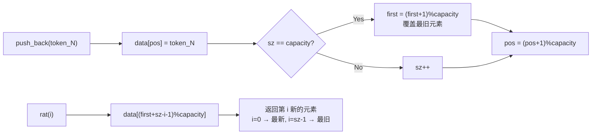

### 50.3.2 common_sampler：三元统一封装

**源码路径**：`common/sampling.cpp` - `common_sampler`（107-168 行）

```cpp
struct common_sampler {
    common_params_sampling params;                       // 采样参数配置
    struct llama_sampler * grmr = nullptr;              // 语法约束采样器
    struct llama_sampler * rbudget = nullptr;           // 推理预算采样器
    struct llama_sampler * chain = nullptr;             // 概率采样器链
    ring_buffer<llama_token> prev;                      // token 历史记录
    llama_token_data_array cur_p;                       // 当前候选 logits
    bool sorted = false;                                // 候选是否已排序
    common_time_meas t_total_us;                        // 总耗时统计

    // 清空采样历史并重置底层采样器链
    void reset() {
        prev.clear();
        llama_sampler_reset(chain);
    }

    // 从 llama 上下文读取采样概率、采样 logits 或完整 logits，并构造当前候选数组
    void set_logits(struct llama_context * ctx, int idx) {
        const float * sampled_probs = llama_get_sampled_probs_ith(ctx, idx);
        const float * sampled_logits = llama_get_sampled_logits_ith(ctx, idx);
        const llama_token * sampled_ids = llama_get_sampled_candidates_ith(ctx, idx);
        // 根据后端返回的数据填充 cur_p
        cur_p = { cur.data(), cur.size(), -1, false };
    }

    // 创建当前采样操作的性能计时对象
    common_time_meas tm() {
        return common_time_meas(t_total_us, params.no_perf);
    }
};
```

**代码解析**：`common_sampler` 是整个采样系统的"外壳"，它把三个独立子系统——**Chain**（概率采样链）、**Grammar**（语法约束）、**Budget**（推理预算）——封装在一个结构体里，外加一个 `ring_buffer` 保存 token 历史。这种设计让你在调用方看来只需要面对一个对象，而不用分别管理三个采样器的生命周期。`reset()` 方法一键清空历史并重置链状态，`set_logits()` 从 llama 后端同步概率分布，`tm()` 则提供性能计时工厂，支持 `common_perf_print` 分离采样耗时与模型计算耗时。

**架构图**：

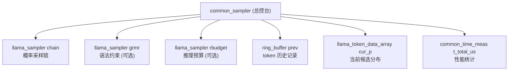

## 50.4 common_sampler_init 与 grammar_should_apply —— 打造"概率过滤流水线"

### 50.4.1 common_sampler_init：装配流水线

**源码路径**：`common/sampling.cpp` - `common_sampler_init()`（189-374 行）

```cpp
struct common_sampler * common_sampler_init(const struct llama_model * model, struct common_params_sampling & params) {
    const llama_vocab * vocab = llama_model_get_vocab(model);

    // 1. 创建 grammar sampler（若提供语法约束）
    struct llama_sampler * grmr = nullptr;
    if (!params.grammar_str.empty()) {
        grmr = llama_sampler_init_llg(vocab, params.grammar_str.c_str(), params.grammar_str.c_str());
    }

    // 2. 创建 reasoning budget sampler（限制推理 token 数量）
    struct llama_sampler * rbudget = nullptr;
    if (params.reasoning_budget > 0) {
        rbudget = common_reasoning_budget_init(
            vocab,
            params.reasoning_budget_start_tokens,
            params.reasoning_budget_end_tokens,
            params.reasoning_budget_forced_tokens,
            params.reasoning_budget,
            params.prefill_tokens
        );
    }

    // 3. 构建概率采样链：penalties → dry → top_k → typical → top_p → min_p → xtc → temperature → dist
    auto * chain = llama_sampler_chain_init();

    if (params.penalty_last_n > 0) {
        llama_sampler_chain_add(chain, llama_sampler_penalties_init(
            params.penalty_last_n, params.penalty_repeat, params.penalty_freq, params.penalty_exist
        ));
    }
    if (params.dry_base > 0) {
        llama_sampler_chain_add(chain, llama_sampler_dry_init(
            params.dry_base, params.dry_allowed_token_count, params.dry_sequence_breakers
        ));
    }
    if (params.top_k > 0) {
        llama_sampler_chain_add(chain, llama_sampler_top_k_init(params.top_k));
    }
    if (params.typical > 0) {
        llama_sampler_chain_add(chain, llama_sampler_typical_init(params.typical));
    }
    if (params.top_p > 0) {
        llama_sampler_chain_add(chain, llama_sampler_top_p_init(params.top_p));
    }
    if (params.min_p > 0) {
        llama_sampler_chain_add(chain, llama_sampler_min_p_init(params.min_p));
    }
    if (params.xtc_prob > 0) {
        llama_sampler_chain_add(chain, llama_sampler_xtc_init(params.xtc_prob, params.xtc_threshold, params.xtc_hamming));
    }
    if (params.temperature > 0) {
        llama_sampler_chain_add(chain, llama_sampler_temp_init(params.temperature));
    }
    llama_sampler_chain_add(chain, llama_sampler_dist_init(params.seed));

    return new common_sampler {
        params,
        grmr,
        rbudget,
        chain,
        ring_buffer<llama_token>(128),   // 默认容量 128
        llama_token_data_array(),
        false,
        common_time_meas()
    };
}
```

**代码解析**：这段代码展示了采样器装配的完整流水线。注意 `grammar` 和 `reasoning budget` 采样器**没有被放入 chain**，而是作为独立成员 `grmr` 和 `rbudget` 存在——这是因为它们需要特殊的激活判定逻辑，而不是无条件执行。Chain 的添加顺序严格遵循"先惩罚/约束，后概率重塑，最后分布采样"的原则：`penalties`（重复/频率/存在惩罚）→ `dry`（动态重复惩罚）→ `top_k`/`typical`/`top_p`/`min_p`（候选集裁剪）→ `xtc`（交叉熵裁剪）→ `temperature`（熵调节）→ `dist`（最终采样）。这种顺序保证了每一层都在上一层缩小后的候选集上工作，符合概率论的链式法则。

**流程图**：

```mermaid
flowchart TD
    Start([common_sampler_init]) --> Grammar{"params.grammar_str<br/>非空?"}
    Grammar -->|Yes| GrmrInit["llama_sampler_init_llg<br/>创建 grammar sampler"]
    Grammar -->|No| BudgetCheck
    GrmrInit --> BudgetCheck
    BudgetCheck{"params.reasoning_budget<br/>>> 0?"}
    BudgetCheck -->|Yes| BudgetInit["common_reasoning_budget_init<br/>创建 budget sampler"]
    BudgetCheck -->|No| ChainInit
    BudgetInit --> ChainInit
    ChainInit["llama_sampler_chain_init<br/>创建空链"] --> Penalties{"penalty_last_n > 0?"}
    Penalties -->|Yes| AddPenalties["llama_sampler_chain_add<br/>penalties"]
    Penalties -->|No| Dry
    AddPenalties --> Dry
    Dry{"dry_base > 0?"}
    Dry -->|Yes| AddDry["llama_sampler_chain_add<br/>dry"]
    Dry -->|No| TopK
    AddDry --> TopK
    TopK{"top_k > 0?"}
    TopK -->|Yes| AddTopK["llama_sampler_chain_add<br/>top_k"]
    TopK -->|No| Typical
    AddTopK --> Typical
    Typical{"typical > 0?"}
    Typical -->|Yes| AddTypical["llama_sampler_chain_add<br/>typical"]
    Typical -->|No| TopP
    AddTypical --> TopP
    TopP{"top_p > 0?"}
    TopP -->|Yes| AddTopP["llama_sampler_chain_add<br/>top_p"]
    TopP -->|No| MinP
    AddTopP --> MinP
    MinP{"min_p > 0?"}
    MinP -->|Yes| AddMinP["llama_sampler_chain_add<br/>min_p"]
    MinP -->|No| Xtc
    AddMinP --> Xtc
    Xtc{"xtc_prob > 0?"}
    Xtc -->|Yes| AddXtc["llama_sampler_chain_add<br/>xtc"]
    Xtc -->|No| Temp
    AddXtc --> Temp
    Temp{"temperature > 0?"}
    Temp -->|Yes| AddTemp["llama_sampler_chain_add<br/>temperature"]
    Temp -->|No| Dist
    AddTemp --> Dist
    Dist["llama_sampler_chain_add<br/>dist(seed)"] --> Construct["构造 common_sampler<br/>grmr, rbudget, chain, prev(128)"]
    Construct --> Return([返回 common_sampler*])
```

### 50.4.2 grammar_should_apply：惰性语法激活

**源码路径**：`common/sampling.cpp` - `grammar_should_apply()`（390-404 行）

```cpp
static bool grammar_should_apply(struct common_sampler * gsmpl) {
    if (!gsmpl->grmr) return false;          // 没有 grammar 采样器
    if (!gsmpl->rbudget) return true;       // 没有 budget，直接启用
    if (gsmpl->params.grammar_lazy) {
        const auto state = common_reasoning_budget_get_state(gsmpl->rbudget);
        return state == REASONING_BUDGET_IDLE || state == REASONING_BUDGET_DONE;
    }
    return true;
}
```

**代码解析**：这个函数是语法约束的"弹性监考开关"：当 `grammar_lazy=true` 且推理预算处于 `IDLE`（还没开始思考）或 `DONE`（思考结束）时才启用语法检查。这意味着在模型"思考中"（`COUNTING` 状态）允许自由发挥，只有正式答题时才严格监考。如果没有 `rbudget`，则始终启用 grammar；如果没有 `grmr`，则直接返回 false。这种设计体现了"推理与生成分离"的设计哲学——推理阶段不应被输出格式约束，生成阶段必须严格遵守格式。

**状态流转图**：

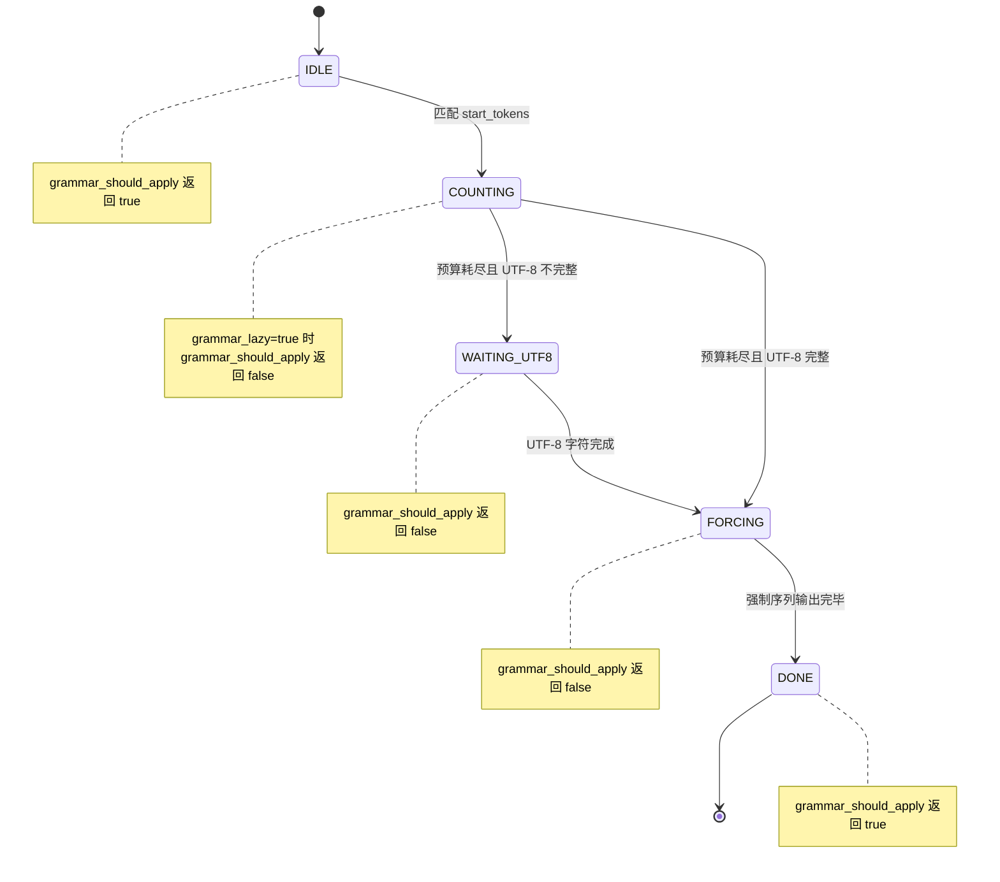

### 50.4.3 common_sampler_accept：状态同步

**源码路径**：`common/sampling.cpp` - `common_sampler_accept()`（406-427 行）

```cpp
void common_sampler_accept(struct common_sampler * gsmpl, llama_token token, bool accept_grammar) {
    if (!gsmpl) return;
    accept_grammar = accept_grammar && grammar_should_apply(gsmpl);
    llama_sampler_accept(gsmpl->rbudget, token);      // 更新推理预算状态
    if (gsmpl->grmr && accept_grammar) llama_sampler_accept(gsmpl->grmr, token);  // 推进语法栈
    llama_sampler_accept(gsmpl->chain, token);        // 通知链中各采样器（如重复惩罚）
    gsmpl->prev.push_back(token);                     // 记录到历史缓冲区
}
```

**代码解析**：每次接受一个 token，三个状态机必须同步更新：推理预算的计数器、语法的推导栈、以及链中各采样器（如重复惩罚）的历史窗口。任何一个不同步都会导致后续采样出现偏差。`accept_grammar` 参数允许调用方显式跳过语法更新（如在推测解码的 draft token 比对阶段），但仍会受 `grammar_should_apply()` 的运行时判定约束。最后将 token 推入 `ring_buffer`，为下一轮的重复惩罚提供历史依据。

**时序图**：

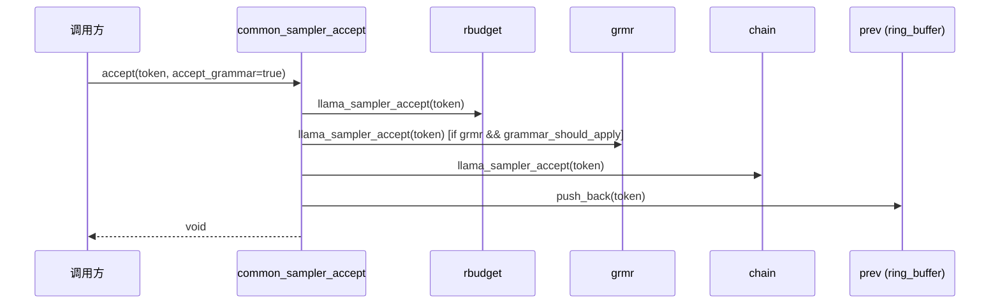

## 50.5 common_sampler_sample 与 sample_and_accept_n —— 执行"候选过滤"的决策时刻

### 50.5.1 common_sampler_sample：三段式采样

**源码路径**：`common/sampling.cpp` - `common_sampler_sample()`（503-577 行）

```cpp
llama_token common_sampler_sample(struct common_sampler * gsmpl, struct llama_context * ctx, int idx, bool grammar_first) {
    llama_synchronize(ctx);

    // 优先使用后端已选 token（如 GPU 后端已自行采样）
    if (llama_get_sampled_ith(ctx, idx) != -1) {
        return llama_get_sampled_ith(ctx, idx);
    }

    gsmpl->set_logits(ctx, idx);  // 从 llama_context 同步 logits

    // 1. 应用推理预算（强制过滤）
    llama_sampler_apply(gsmpl->rbudget, gsmpl->cur_p);

    // 2. 应用语法约束（若激活）
    if (grammar_should_apply(gsmpl)) {
        llama_sampler_apply(gsmpl->grmr, gsmpl->cur_p);
    }

    // 3. 应用概率采样链（温度、Top-P 等）
    llama_sampler_apply(gsmpl->chain, gsmpl->cur_p);

    llama_token id = gsmpl->cur_p->data[0].id;

    // 语法回退机制：若采样结果不符合语法，回滚链状态并重新采样
    if (grammar_should_apply(gsmpl)) {
        bool accept_grammar = llama_sampler_accept_grammar(gsmpl->grmr, id);
        if (!accept_grammar) {
            llama_sampler_reset(gsmpl->chain);  // 回滚链状态
            return common_sampler_sample(gsmpl, ctx, idx, grammar_first);  // 递归重采样
        }
    }

    return id;
}
```

**代码解析**：采样主逻辑分为三步：先过滤推理预算（强制截断）、再剪枝语法约束（若激活）、最后走概率采样链。如果最后的结果不符合语法，还会回滚链状态并递归重采样——这是"语法回退机制"。`llama_synchronize(ctx)` 确保 GPU 异步计算完成；`set_logits` 从后端获取当前位置的 logits 分布；三个 `apply` 调用依次修改 `cur_p` 中的 logit 值，最终 `data[0].id` 即为采样结果。语法回退通过 `llama_sampler_accept_grammar` 检查采样 token 是否被语法接受，若拒绝则 `reset(chain)` 清除温度/惩罚等状态的副作用，递归重新采样直到符合语法。

**流程图**：

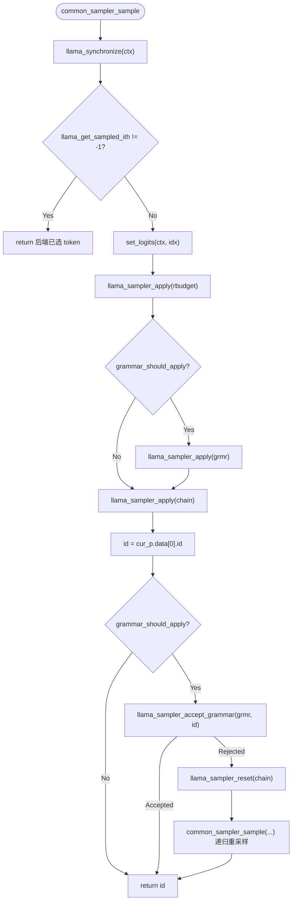

### 50.5.2 common_sampler_sample_and_accept_n：推测解码批量处理

**源码路径**：`common/sampling.cpp` - `common_sampler_sample_and_accept_n()`（579-615 行）

```cpp
// 显式索引版本
std::vector<llama_token> common_sampler_sample_and_accept_n(struct common_sampler * gsmpl, struct llama_context * ctx, const std::vector<int> & idxs, const llama_tokens & draft, bool grammar_first) {
    GGML_ASSERT(idxs.size() == draft.size() + 1);
    std::vector<llama_token> result;
    size_t i = 0;
    for (; i < draft.size(); i++) {
        const llama_token id = common_sampler_sample(gsmpl, ctx, idxs[i], grammar_first);
        common_sampler_accept(gsmpl, id, true);
        if (draft[i] != id) break;  // 分歧处截断
        result.push_back(id);
    }
    // 若提前结束，再采样一个 token 补上
    if (i < draft.size()) {
        const llama_token id = common_sampler_sample(gsmpl, ctx, idxs[i], grammar_first);
        common_sampler_accept(gsmpl, id, true);
        result.push_back(id);
    }
    return result;
}

// 自动生成连续索引的重载版本
std::vector<llama_token> common_sampler_sample_and_accept_n(struct common_sampler * gsmpl, struct llama_context * ctx, const llama_tokens & draft, bool grammar_first) {
    std::vector<int> idxs(draft.size() + 1);
    for (size_t i = 0; i < idxs.size(); ++i) idxs[i] = i;
    return common_sampler_sample_and_accept_n(gsmpl, ctx, idxs, draft, grammar_first);
}
```

**代码解析**：这个接口是推测解码的核心：草稿模型预先预测多个 token，主模型逐个核对。匹配的前缀自动接受，分歧处立即截断并补上一个新采样结果。`idxs` 参数允许调用方显式指定每个 token 在批次中的位置索引——在推测解码场景中，草稿 token 可能来自不同的批次槽位，需要精确控制。重载版本自动生成连续索引 `[0, 1, ..., draft.size()]`，适用于单批次推测解码。循环中每次采样后立即 `accept`，保证了 chain、grammar、budget、history 四个状态机的同步一致性。

**时序图**：

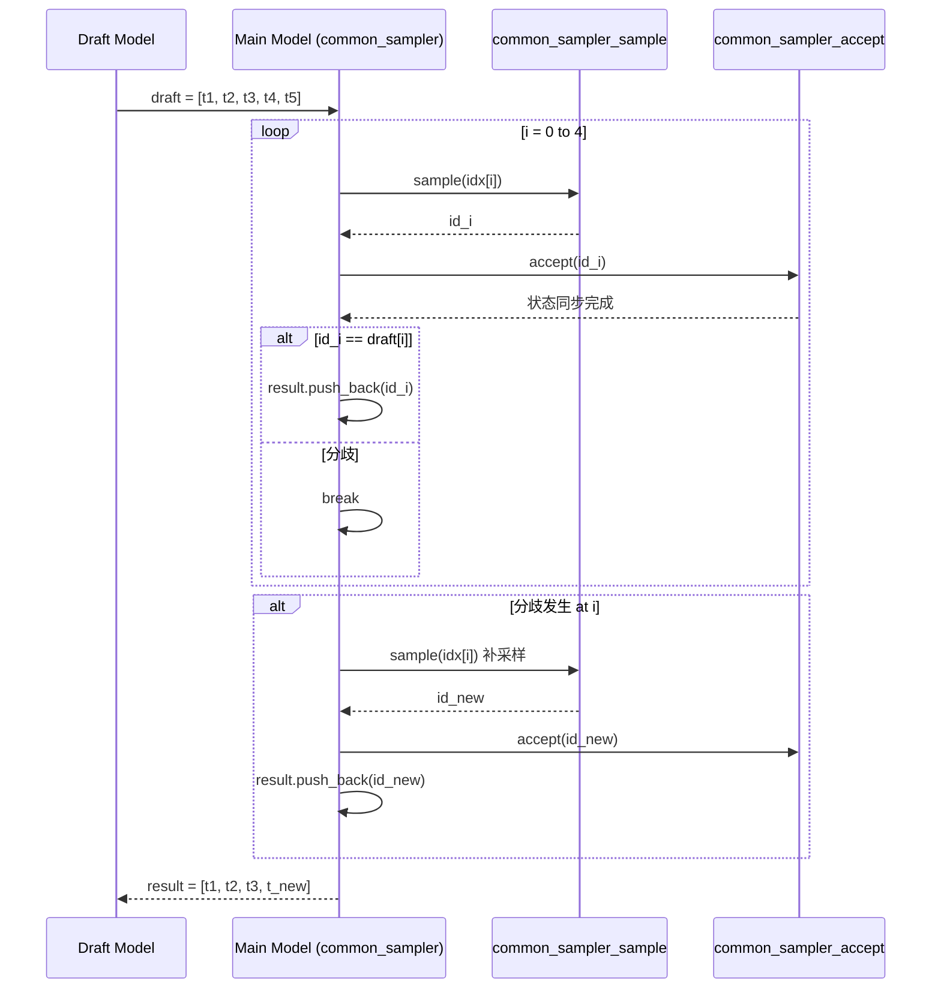

## 50.6 token_matcher 与 reasoning_budget_accept —— 控制推理长度的"计时器与熔断器"

### 50.6.1 token_matcher：流式序列匹配

**源码路径**：`common/reasoning-budget.cpp` - `token_matcher`（14-34 行）

```cpp
struct token_matcher {
    const std::vector<llama_token> & tokens;
    size_t pos = 0;

    // 推进 token 序列匹配状态，并在完整匹配目标序列时返回 true
    bool advance(llama_token token) {
        if (tokens.empty()) {
            return false;
        }

        if (token == tokens[pos]) {
            pos++;
            if (pos >= tokens.size()) {
                pos = 0;
                return true;  // 完整匹配
            }
        } else {
            pos = 0;
            if (token == tokens[0]) {
                pos = 1;  // 部分匹配失败后尝试从当前位置重新开始
            }
        }
        return false;
    }

    // 将 token 匹配位置重置到序列起始位置
    void reset() { pos = 0; }
};
```

**代码解析**：`token_matcher` 是一个无需回溯的在线匹配算法，单遍扫描即可识别 start/end token 序列。它不维护 KMP 的部分匹配表，而是在失配时简单地从头开始——这种"简化版 KMP"在 token 序列通常很短（1-3 个 token）的场景下完全够用，且实现极简。`advance` 返回 true 仅当完整匹配整个目标序列，`reset` 用于强制模式开始前清除 end_matcher 状态，避免误触发。

**状态机图**：

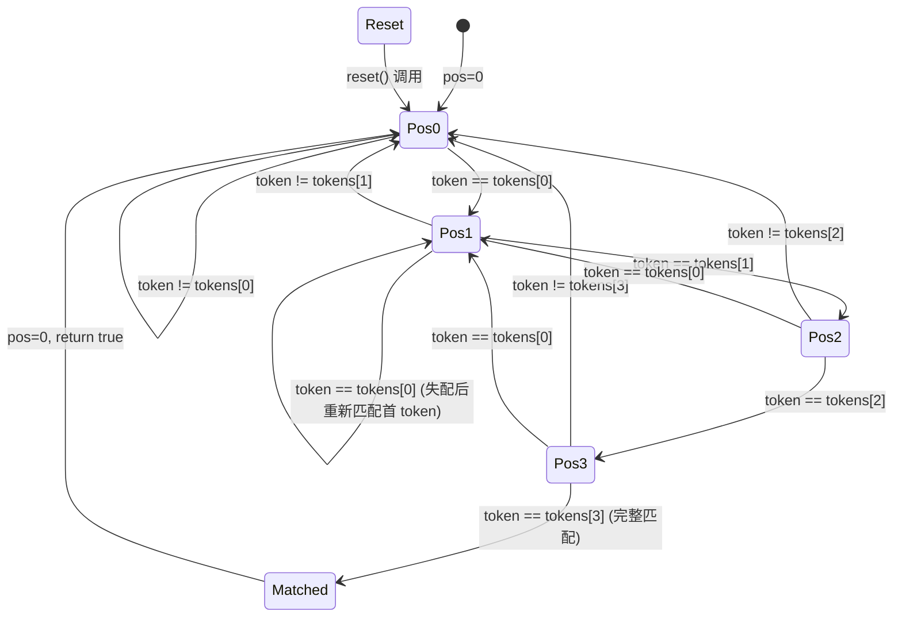

### 50.6.2 common_reasoning_budget_accept：状态迁移引擎

**源码路径**：`common/reasoning-budget.cpp` - `common_reasoning_budget_accept()`（52-111 行）

```cpp
static void common_reasoning_budget_accept(struct llama_sampler * smpl, llama_token token) {
    auto * ctx = (common_reasoning_budget_ctx *) smpl->ctx;

    switch (ctx->state) {
        case REASONING_BUDGET_IDLE:
            if (ctx->start_matcher.advance(token)) {
                ctx->state = REASONING_BUDGET_COUNTING;
                ctx->remaining = ctx->budget;
                if (ctx->remaining <= 0) {
                    ctx->state = REASONING_BUDGET_FORCING;
                    ctx->force_pos = 0;
                }
            }
            break;

        case REASONING_BUDGET_COUNTING:
        case REASONING_BUDGET_WAITING_UTF8:
            if (ctx->end_matcher.advance(token)) {
                ctx->state = REASONING_BUDGET_DONE;
                break;
            }
            bool utf8_complete = true;
            if (ctx->vocab != nullptr) {
                const std::string piece = common_token_to_piece(ctx->vocab, token, false);
                utf8_complete = common_utf8_is_complete(piece);
            }
            if (ctx->state == REASONING_BUDGET_WAITING_UTF8) {
                if (utf8_complete) {
                    ctx->state = REASONING_BUDGET_FORCING;
                    ctx->force_pos = 0;
                    ctx->end_matcher.reset();
                }
            } else if (ctx->state == REASONING_BUDGET_COUNTING) {
                ctx->remaining--;
                if (ctx->remaining <= 0) {
                    if (utf8_complete) {
                        ctx->state = REASONING_BUDGET_FORCING;
                        ctx->force_pos = 0;
                        ctx->end_matcher.reset();
                    } else {
                        ctx->state = REASONING_BUDGET_WAITING_UTF8;
                        ctx->end_matcher.reset();
                    }
                }
            }
            break;

        case REASONING_BUDGET_FORCING:
            ctx->force_pos++;
            if (ctx->force_pos >= ctx->forced_tokens.size()) {
                ctx->state = REASONING_BUDGET_DONE;
            }
            break;

        case REASONING_BUDGET_DONE:
            break;
    }
}
```

**代码解析**：这是整个推理预算状态机的核心。五个状态之间的迁移清晰定义了"思考"的边界：从 `IDLE` 匹配到起始标记进入 `COUNTING`，预算耗尽时根据 UTF-8 完整性分别进入 `FORCING` 或 `WAITING_UTF8`，强制序列输出完毕后进入 `DONE`。注意每次进入 `FORCING` 时都会调用 `end_matcher.reset()`——因为强制模式下不再需要检测结束标记，重置可以避免误触发。UTF-8 完整性检查通过 `common_token_to_piece` 获取 token 对应的字节片段，再用 `common_utf8_is_complete` 判断是否为合法 UTF-8 字符边界。

**状态迁移图**：

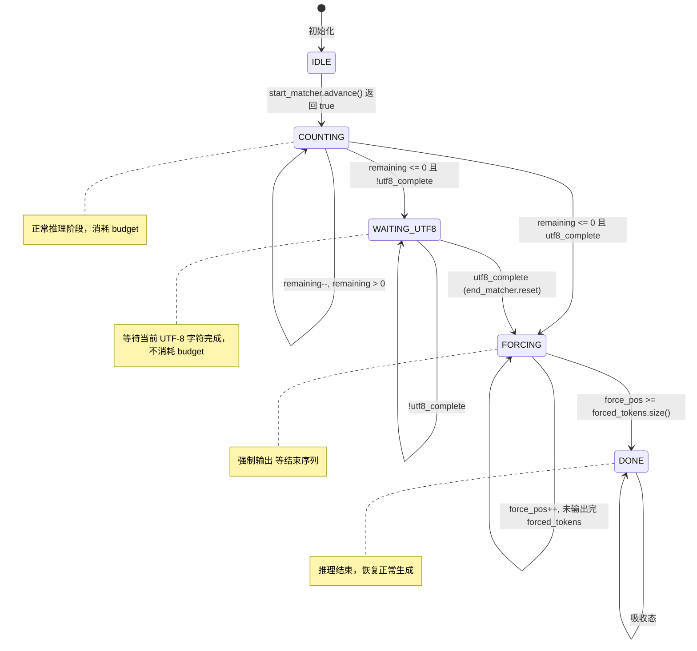

### 50.6.3 common_reasoning_budget_apply：强制模式 logits 掩码

**源码路径**：`common/reasoning-budget.cpp` - `common_reasoning_budget_apply()`（113-132 行）

```cpp
static void common_reasoning_budget_apply(struct llama_sampler * smpl, llama_token_data_array * cur_p) {
    auto * ctx = (common_reasoning_budget_ctx *) smpl->ctx;

    if (ctx->state != REASONING_BUDGET_FORCING) {
        return;
    }

    if (ctx->force_pos >= ctx->forced_tokens.size()) {
        return;
    }

    const llama_token forced = ctx->forced_tokens[ctx->force_pos];
    for (size_t i = 0; i < cur_p->size; i++) {
        if (cur_p->data[i].id != forced) {
            cur_p->data[i].logit = -INFINITY;  // 屏蔽非强制 token
        }
    }
}
```

**代码解析**：在 `FORCING` 状态下，除了当前应该输出的强制 token 外，所有其他候选的 logit 都被设为 `-INFINITY`。这确保了模型"必出"指定的结束标记序列，实现硬性截断。非 `FORCING` 状态直接返回，不修改 logits，保证正常推理不受干扰。

**原理图**：

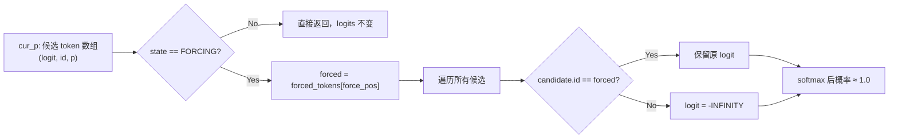

### 50.6.4 reasoning-budget.h：接口定义

**源码路径**：`common/reasoning-budget.h`

```cpp
enum common_reasoning_budget_state {
    REASONING_BUDGET_IDLE = 0,          // 0. 等待推理开始标记
    REASONING_BUDGET_COUNTING = 1,      // 1. 计数中（消耗预算）
    REASONING_BUDGET_WAITING_UTF8 = 2,  // 2. 等待 UTF-8 字符完整
    REASONING_BUDGET_FORCING = 3,       // 3. 强制输出结束标记
    REASONING_BUDGET_DONE = 4           // 4. 推理结束
};

// 根据预填充 token 自动判定初始状态
struct llama_sampler * common_reasoning_budget_init(
    const struct llama_vocab       * vocab,
    const std::vector<llama_token> & start_tokens,
    const std::vector<llama_token> & end_tokens,
    const std::vector<llama_token> & forced_tokens,
    int32_t                          budget,
    const std::vector<llama_token> & prefill_tokens = {});

// 显式指定初始状态
struct llama_sampler * common_reasoning_budget_init(
    const struct llama_vocab       * vocab,
    const std::vector<llama_token> & start_tokens,
    const std::vector<llama_token> & end_tokens,
    const std::vector<llama_token> & forced_tokens,
    int32_t                          budget,
    common_reasoning_budget_state    initial_state);

// 查询当前状态
common_reasoning_budget_state common_reasoning_budget_get_state(const struct llama_sampler * smpl);
```

**代码解析**：头文件定义了五态状态机枚举，以及两个重载的初始化函数。第一个重载接受 `prefill_tokens`，自动检测预填充内容是否已包含 `start_tokens` 和 `end_tokens`，从而决定初始状态是 `IDLE` 还是 `COUNTING`（甚至直接 `DONE`）。第二个重载允许显式指定初始状态，用于克隆或状态恢复场景。`common_reasoning_budget_get_state` 提供只读状态查询，供 `grammar_should_apply` 等外部逻辑使用。

**初始化状态判定逻辑流程图**：

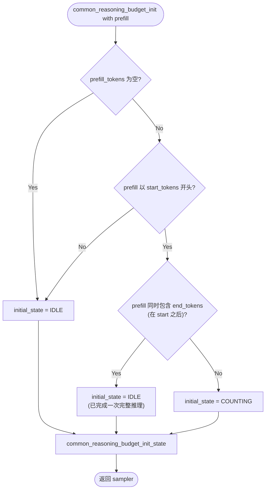

### 50.6.5 common_reasoning_budget_init_state / clone / free / name / get_state：生命周期管理

**源码路径**：`common/reasoning-budget.cpp`（145-237 行）

```cpp
// 根据给定参数和初始状态创建并初始化 reasoning budget sampler
static struct llama_sampler * common_reasoning_budget_init_state(
    const struct llama_vocab * vocab, const std::vector<llama_token> & start_tokens,
    const std::vector<llama_token> & end_tokens, const std::vector<llama_token> & forced_tokens,
    int32_t budget, common_reasoning_budget_state initial_state) {
    if (initial_state == REASONING_BUDGET_COUNTING && budget <= 0) {
        initial_state = REASONING_BUDGET_FORCING;
    }
    return llama_sampler_init(
        &common_reasoning_budget_i,
        new common_reasoning_budget_ctx {
            vocab,
            { start_tokens, 0 },
            { end_tokens, 0 },
            forced_tokens,
            budget,
            budget,
            initial_state,
            0,
        }
    );
}

// 复制现有 sampler 的配置和当前状态，创建一个新的 sampler 实例
static struct llama_sampler * common_reasoning_budget_clone(const struct llama_sampler * smpl) {
    const auto * ctx = (const common_reasoning_budget_ctx *) smpl->ctx;
    return common_reasoning_budget_init_state(
        ctx->vocab,
        ctx->start_matcher.tokens,
        ctx->end_matcher.tokens,
        ctx->forced_tokens,
        ctx->budget,
        ctx->state);
}

// 释放 sampler 上下文对象占用的内存
static void common_reasoning_budget_free(struct llama_sampler * smpl) {
    delete (common_reasoning_budget_ctx *) smpl->ctx;
}

// 返回 sampler 的固定名称 reasoning-budget
static const char * common_reasoning_budget_name(const struct llama_sampler * /*smpl*/) {
    return "reasoning-budget";
}

// 返回 sampler 当前的 reasoning budget 状态；传入空指针时返回空闲状态
common_reasoning_budget_state common_reasoning_budget_get_state(const struct llama_sampler * smpl) {
    if (!smpl) {
        return REASONING_BUDGET_IDLE;
    }
    return ((const common_reasoning_budget_ctx *)smpl->ctx)->state;
}
```

**代码解析**：`init_state` 是真正的构造入口，处理 `COUNTING` 但 `budget <= 0` 的边界情况（直接升级为 `FORCING`）。`clone` 完整复制配置与运行时状态（包括 `state`、`force_pos`、`remaining` 等），支持并行分支推理。`free` 仅释放上下文内存，`name` 返回固定标识字符串用于调试打印，`get_state` 提供安全的状态查询（空指针保护）。

## 50.7 辅助工具与性能监控 —— 采样系统的"仪表盘与工具箱"

这一节涵盖了采样系统的辅助功能：资源释放、状态重置、深拷贝、参数指纹、性能统计、候选分布获取、历史回看、类型编解码与名称解析、llguidance 集成。这些接口虽非核心采样路径，却是调试、监控、序列化与生态集成不可或缺的基础设施。

### 50.7.1 common_sampler_free：资源释放

**源码路径**：`common/sampling.cpp` - `common_sampler_free()`（376-388 行）

```cpp
void common_sampler_free(struct common_sampler * gsmpl) {
    if (!gsmpl) {
        return;
    }
    llama_sampler_free(gsmpl->grmr);
    llama_sampler_free(gsmpl->rbudget);
    llama_sampler_free(gsmpl->chain);
    delete gsmpl;
}
```

**代码解析**：按逆序释放三个子采样器再释放自身，符合 RAII 原则。`llama_sampler_free` 内部会调用各采样器的 `free` 回调（如 `common_reasoning_budget_free`），确保上下文内存正确回收。空指针保护使其可安全多次调用。

### 50.7.2 common_sampler_reset / common_sampler_clone：状态管理

**源码路径**：`common/sampling.cpp`（429-449 行）

```cpp
void common_sampler_reset(struct common_sampler * gsmpl) {
    if (!gsmpl) return;
    gsmpl->reset();  // 调用成员函数：prev.clear() + llama_sampler_reset(chain)
}

struct common_sampler * common_sampler_clone(common_sampler * gsmpl) {
    return new common_sampler {
        gsmpl->params,
        llama_sampler_clone(gsmpl->grmr),
        llama_sampler_clone(gsmpl->rbudget),
        llama_sampler_clone(gsmpl->chain),
        gsmpl->prev,           // ring_buffer 拷贝构造
        gsmpl->cur,            // 内部候选缓存
        gsmpl->cur_p,          // 当前候选数组视图
    };
}
```

**代码解析**：`reset` 仅清空历史与链状态，不触及 grammar/budget（它们有独立的 reset 逻辑）。`clone` 执行深拷贝：参数、三个子采样器（通过 `llama_sampler_clone` 递归克隆）、历史缓冲区、内部缓存均逐一复制。这使得并行分支推理（如 MCTS、beam search）能从同一检查点分叉，各自独立演化。

### 50.7.3 common_params_sampling::print：参数指纹

**源码路径**：`common/sampling.cpp`（174-187 行）

```cpp
std::string common_params_sampling::print() const {
    char result[1024];
    snprintf(result, sizeof(result),
        "top_k=%d, top_p=%.2f, min_p=%.2f, typical=%.2f, "
        "temp=%.2f, xtc_prob=%.2f, xtc_threshold=%.2f, xtc_hamming=%d, "
        "penalty_last_n=%d, penalty_repeat=%.2f, penalty_freq=%.2f, penalty_exist=%.2f, "
        "dry_base=%.2f, dry_allowed_token_count=%d, dry_sequence_breakers=%s, "
        "grammar=%s, grammar_lazy=%s, "
        "reasoning_budget=%d, reasoning_budget_start=%s, reasoning_budget_end=%s, reasoning_budget_forced=%s",
        top_k, top_p, min_p, typical,
        temperature, xtc_prob, xtc_threshold, xtc_hamming,
        penalty_last_n, penalty_repeat, penalty_freq, penalty_exist,
        dry_base, dry_allowed_token_count, dry_sequence_breakers.c_str(),
        grammar_str.c_str(), grammar_lazy ? "true" : "false",
        reasoning_budget,
        vector_to_string(reasoning_budget_start_tokens).c_str(),
        vector_to_string(reasoning_budget_end_tokens).c_str(),
        vector_to_string(reasoning_budget_forced_tokens).c_str()
    );
    return std::string(result);
}
```

**代码解析**：生成采样配置的可读指纹字符串，固定 1024 字节缓冲区，涵盖所有采样超参数。便于日志记录、实验复现与配置对比。`vector_to_string` 将 token 序列转为可读形式（如 `[123, 456]`）。

### 50.7.4 common_perf_print：性能透视

**源码路径**：`common/sampling.cpp` - `common_perf_print()`（451-493 行）

```cpp
void common_perf_print(const struct llama_context * ctx, const struct common_sampler * gsmpl) {
    if (gsmpl) {
        const auto & params = gsmpl->params;
        if (!params.no_perf) {
            LOG_INF("sampling:     %8.2f ms / %d runs   (%.2f ms/run)",
                gsmpl->t_total_us / 1000.0, gsmpl->n_runs, gsmpl->t_total_us / 1000.0 / gsmpl->n_runs);
        }
    }
    if (ctx) {
        const auto t_start_us = llama_time_us();
        LOG_INF("prompt eval:  %8.2f ms / %d tokens  (%.2f ms/token)",
            llama_perf_context(ctx)->t_p_eval_us / 1000.0, llama_perf_context(ctx)->n_p_eval,
            llama_perf_context(ctx)->t_p_eval_us / 1000.0 / llama_perf_context(ctx)->n_p_eval);
        LOG_INF("eval:         %8.2f ms / %d runs    (%.2f ms/run)",
            llama_perf_context(ctx)->t_eval_us / 1000.0, llama_perf_context(ctx)->n_eval,
            llama_perf_context(ctx)->t_eval_us / 1000.0 / llama_perf_context(ctx)->n_eval);
        llama_memory_breakdown_print(ctx);
    }
}
```

**代码解析**：分离打印采样耗时（`gsmpl->t_total_us`）与模型计算耗时（prompt eval / eval）。采样耗时来自 `common_sampler::tm()` 计时器累积，模型耗时来自 `llama_perf_context`。最后调用 `llama_memory_breakdown_print` 输出内存占用分解。`no_perf` 参数可关闭采样侧统计，减少计时开销。这是定位推理瓶颈的关键工具：若 sampling 占比高，优化采样链；若 eval 占比高，优化模型/后端。

### 50.7.5 common_sampler_get_candidates：获取概率分布快照

**源码路径**：`common/sampling.cpp` - `common_sampler_get_candidates()`（623-647 行）

```cpp
llama_token_data_array * common_sampler_get_candidates(struct common_sampler * gsmpl, bool do_sort) {
    auto * res = &gsmpl->cur_p;
    if (do_sort && !res->sorted) {
        std::sort(res->data, res->data + res->size, [](const llama_token_data & a, const llama_token_data & b) {
            return a.p > b.p;  // 按概率降序排序
        });
        res->sorted = true;
    }
    return res;
}
```

**代码解析**：返回当前采样轮次的候选 token 数组（`llama_token_data_array`），包含 id、logit、概率 p。`do_sort=true` 时按概率降序原地排序，并设置 `sorted=true` 避免重复排序。注意返回的是内部成员指针，调用方不应在采样器销毁后使用。常用于调试输出 Top-N 候选、可视化概率分布、实现自定义采样策略。

### 50.7.6 common_sampler_last / common_sampler_prev_str：历史回看

**源码路径**：`common/sampling.cpp`（649-685 行）

```cpp
llama_token common_sampler_last(const struct common_sampler * gsmpl) {
    return gsmpl->prev.rat(0);  // rat(0) 返回最新元素
}

std::string common_sampler_prev_str(common_sampler * gsmpl, llama_context * ctx_main, int n) {
    n = std::min(n, (int) gsmpl->prev.size());
    if (n <= 0) return "";
    std::string result;
    for (int i = n - 1; i >= 0; i--) {
        const llama_token id = gsmpl->prev.rat(i);  // 从较旧向较新遍历
        result += common_token_to_piece(ctx_main, id);
    }
    return result;
}
```

**代码解析**：`last()` 直接取 `rat(0)` 获取最近 token。`prev_str` 利用 `rat(i)` 从较旧到较新遍历（i 从 n-1 递减到 0），拼接成可读文本。注意 `rat` 索引语义：`rat(0)` 最新，`rat(sz-1)` 最旧。这利用了 ring_buffer 的反向索引特性，无需复制即可高效回看。

### 50.7.7 common_sampler_print：采样器链字符串化

**源码路径**：`common/sampling.cpp`（653-665 行）

```cpp
std::string common_sampler_print(const struct common_sampler * gsmpl) {
    std::string result = "logits ";
    for (int i = 0; i < llama_sampler_chain_n(gsmpl->chain); i++) {
        const auto * smpl = llama_sampler_chain_get(gsmpl->chain, i);
        result += "-> ";
        result += std::string(llama_sampler_name(smpl)) + " ";
    }
    return result;
}
```

**代码解析**：遍历 chain 中的每个采样器，拼接名称生成如 `"logits -> penalties -> top_k -> top_p -> temperature -> dist "` 的字符串。用于日志输出、配置验证、调试采样链结构。

### 50.7.8 common_sampler_type_to_chr/str / types_from_names/chars：类型编解码

**源码路径**：`common/sampling.cpp`（687-811 行）

```cpp
// 类型 → 字符
char common_sampler_type_to_chr(enum common_sampler_type cnstr) {
    switch (cnstr) {
        case COMMON_SAMPLER_TYPE_DRY: return 'd';
        case COMMON_SAMPLER_TYPE_TOP_K: return 'k';
        case COMMON_SAMPLER_TYPE_TYPICAL: return 't';
        case COMMON_SAMPLER_TYPE_TOP_P: return 'p';
        case COMMON_SAMPLER_TYPE_MIN_P: return 'm';
        case COMMON_SAMPLER_TYPE_XTC: return 'x';
        case COMMON_SAMPLER_TYPE_TEMPERATURE: return 'T';
        case COMMON_SAMPLER_TYPE_PENALTIES: return 'r';
        default: return '?';
    }
}

// 类型 → 字符串
std::string common_sampler_type_to_str(enum common_sampler_type cnstr) {
    switch (cnstr) {
        case COMMON_SAMPLER_TYPE_DRY: return "dry";
        case COMMON_SAMPLER_TYPE_TOP_K: return "top_k";
        case COMMON_SAMPLER_TYPE_TYPICAL: return "typical";
        case COMMON_SAMPLER_TYPE_TOP_P: return "top_p";
        case COMMON_SAMPLER_TYPE_MIN_P: return "min_p";
        case COMMON_SAMPLER_TYPE_XTC: return "xtc";
        case COMMON_SAMPLER_TYPE_TEMPERATURE: return "temperature";
        case COMMON_SAMPLER_TYPE_PENALTIES: return "penalties";
        default: return "";
    }
}

// 名称列表 → 类型枚举（支持别名）
std::vector<common_sampler_type> common_sampler_types_from_names(const std::vector<std::string> & names, bool allow_alt_names) {
    // 规范名称映射
    std::unordered_map<std::string, common_sampler_type> canonical = {
        {"dry", COMMON_SAMPLER_TYPE_DRY}, {"top_k", COMMON_SAMPLER_TYPE_TOP_K}, ...
    };
    // 别名映射（如 "repeat_penalty" -> PENALTIES）
    std::unordered_map<std::string, common_sampler_type> alt_names = {
        {"repeat_penalty", COMMON_SAMPLER_TYPE_PENALTIES}, {"presence_penalty", COMMON_SAMPLER_TYPE_PENALTIES}, ...
    };
    // 解析逻辑：优先匹配规范名，allow_alt_names 时再匹配别名
    ...
}

// 字符串 → 类型枚举
std::vector<common_sampler_type> common_sampler_types_from_chars(const std::string & chars) {
    std::unordered_map<char, common_sampler_type> sampler_name_map = {
        {'d', COMMON_SAMPLER_TYPE_DRY}, {'k', COMMON_SAMPLER_TYPE_TOP_K}, ...
    };
    for (char c : chars) {
        if (sampler_name_map.count(c)) samplers.push_back(sampler_name_map[c]);
    }
    return samplers;
}
```

**代码解析**：提供采样器类型的双向编解码。`to_chr` 单字符缩写用于紧凑配置串（如 `"rkpT"`），`to_str` 规范名用于日志/配置文件。`types_from_names` 支持规范名与别名（如 `repeat_penalty`、`frequency_penalty` 皆映射到 `PENALTIES`），兼容不同前端命名习惯。`types_from_chars` 解析字符串形式的采样器序列，便于命令行参数传递。

### 50.7.9 llama_sampler_init_llg：llguidance 集成

**源码路径**：`common/sampling.cpp`（文件末尾，未在摘录中给出完整代码，但头文件声明可见）

```cpp
// sampling.h 声明
llama_sampler * llama_sampler_init_llg(const llama_vocab * vocab, const char * grammar_kind, const char * grammar_data);
```

**代码解析**：这是语法约束的外部集成入口，将 llguidance（基于正则/JSON Schema 的约束引擎）封装为 `llama_sampler`。`grammar_kind` 指定语法类型（如 `"gbnf"`、`"json_schema"`、`"regex"`），`grammar_data` 为语法定义内容。内部创建 `llama_grammar` 并包装为 sampler，支持 `apply`/`accept`/`reset`/`clone` 完整接口。`common_sampler_init` 中即调用此函数创建 `grmr` 成员。

## 50.8 模块依赖图

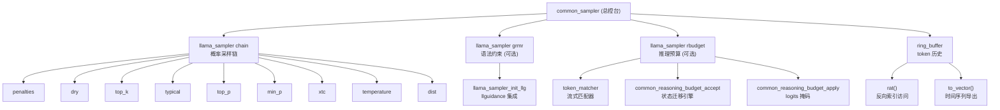

## 50.9 设计中的取舍

**为什么 `grammar` 和 `reasoning budget` 不放入 `chain`？**

如果把它们放进 chain，它们的执行顺序将被固定在链的某个位置，无法根据运行时状态动态决定是否激活。`grammar_should_apply()` 的惰性激活策略需要在每次采样时查询 budget 的状态机，这种跨采样器的条件判断不适合用固定链顺序表达。因此设计上把它们作为 `common_sampler` 的独立成员，在 `sample()` 函数中按需手动调用。

这种设计的 trade-off 是：优点是语法约束和推理预算的激活逻辑可以动态适应状态机变化，实现"思考时不监考、答题时严审"的弹性策略；代价是 `common_sampler` 的代码量增加，`sample()` 函数需要显式管理三个子采样器的调用顺序和条件，增加了复杂度。但考虑到 grammar 和 budget 的特殊性，这种复杂度是必要的。

**为什么 `ring_buffer` 选择固定容量 128？**

固定容量保证了内存占用恒定，不会随着推理长度增长而膨胀。128 这个数字是一个工程折中：太小则重复惩罚的历史窗口不足，太大则浪费内存且可能捕获过久远的上下文。实际使用中，重复惩罚通常只关心最近几十个 token，128 已经绰绰有余。

## 50.10 动手练习

### 50.10.1 练习 1：推理预算状态机深度解析

阅读 `common/reasoning-budget.cpp` 第 52-111 行（`common_reasoning_budget_accept` 函数），结合代码注释回答：

1. 当状态处于 `REASONING_BUDGET_COUNTING` 且 `remaining` 减到 0 时，什么情况下会进入 `FORCING`，什么情况下会进入 `WAITING_UTF8`？
   - 答：当 `remaining <= 0` 时，若当前 token 对应的 UTF-8 片段完整（`utf8_complete == true`），直接进入 `FORCING`；若不完整，进入 `WAITING_UTF8` 等待后续 token 补全字符。

2. 为什么在进入 `FORCING` 状态时要调用 `ctx->end_matcher.reset()`？如果不重置会发生什么？
   - 答：强制模式下不再需要检测结束标记序列，重置避免后续 token 意外触发 `end_matcher.advance()` 导致状态异常迁移。不重置可能导致在强制输出过程中误判为 `DONE`。

3. 假设 `forced_tokens = {token_A, token_B}`，当前处于 `FORCING` 状态且 `force_pos=0`，当接受 token_A 后，`force_pos` 和状态会如何变化？
   - 答：`force_pos` 变为 1，状态保持 `FORCING`。下一次接受 token_B 后，`force_pos` 变为 2，等于 `forced_tokens.size()`，状态迁移为 `DONE`。

4. 在 `common_reasoning_budget_init` 的预填充版本中（194-219 行），如果 `prefill_tokens` 同时包含了 `start_tokens` 和 `end_tokens`，初始状态应该是什么？这解决了什么实际场景问题？
   - 答：初始状态为 `IDLE`。这解决了对话历史中已包含完整推理块（如上一轮对话已输出 `<reasoning>...</reasoning>`）的场景，避免重复计数或误触发强制模式。

### 50.10.2 练习 2：采样链组装流程

阅读 `common/sampling.cpp` 第 189-374 行（`common_sampler_init` 函数），绘制采样链的组装流程图：

1. 列出在构建 `chain` 时，各个采样器被添加的严格顺序
   - 答：penalties → dry → top_k → typical → top_p → min_p → xtc → temperature → dist

2. 解释为什么 `grammar` 和 `reasoning budget` 采样器没有被放入 `chain`，而是作为独立成员 `grmr` 和 `rbudget` 存在？
   - 答：因为它们需要根据运行时状态（budget 状态机、grammar_lazy 参数）动态决定是否激活，无法用固定的链顺序表达。独立成员设计允许 `sample()` 中按需调用。

3. 查看 `grammar_should_apply()` 函数（390-404 行），解释 `grammar_lazy=true` 且 `rbudget` 存在时，语法约束的激活条件与状态机状态的关系
   - 答：仅在 budget 状态为 `IDLE`（推理未开始）或 `DONE`（推理结束）时激活 grammar；在 `COUNTING`、`WAITING_UTF8`、`FORCING` 三个推理进行中状态下不激活。

4. 如果用户希望在推理阶段（thinking）也启用语法约束（即使 budget 处于 COUNTING 状态），应该如何修改 `grammar_should_apply` 的逻辑？
   - 答：移除对 `REASONING_BUDGET_COUNTING` 等状态的排除，或增加参数 `grammar_during_reasoning` 控制。最简单修改：将 `return state == REASONING_BUDGET_IDLE || state == REASONING_BUDGET_DONE;` 改为 `return true;`（即忽略 budget 状态）。

### 50.10.3 练习 3：推测解码批量处理模拟

基于 `common_sampler_sample_and_accept_n()`（579-615 行），编写一个模拟测试用例（伪代码即可）：

1. 假设 draft 模型预测了 5 个 token: [t1, t2, t3, t4, t5]，主模型实际采样结果前 3 个匹配，第 4 个分歧，描述函数返回值和内部状态变化
   - 答：循环 i=0,1,2 三次匹配，result=[t1,t2,t3]；i=3 时采样 id!=t4，break；随后补采样一个新 token t_new，accept(t_new)，result 最终为 [t1,t2,t3,t_new]。chain/grammar/budget/history 均已同步更新至 t_new。

2. 解释为什么需要 `idxs` 参数（显式索引数组）？在什么情况下可以省略（使用自动生成连续索引的重载版本）？
   - 答：推测解码中，draft token 可能分布在不同批次槽位（如多请求并行），`idxs[i]` 指定第 i 个 draft token 对应的批次索引。单请求单批次时可省略，使用连续索引重载版。

3. 在循环中，为什么每次采样后都要立即调用 `common_sampler_accept`？这保证了哪些状态的一致性？
   - 答：保证 chain（重复惩罚历史）、grammar（语法栈）、budget（计数器）、history（ring_buffer）四个状态机与已接受 token 序列严格同步。若延迟 accept，后续采样会基于陈旧状态决策。

4. 思考：如果 draft token 与采样结果分歧，`chain` 和 `grammar` 的状态是否需要回滚回最后一次匹配的位置？当前实现是如何处理的？
   - 答：当前实现**不回滚**。分歧处直接 break，已接受的匹配前缀状态保留，补采样的新 token 基于当前状态（包含匹配前缀的历史）生成。这意味着分歧后的生成会"记住"匹配前缀的历史，符合推测解码的标准行为：接受前缀即接受其带来的状态副作用。

### 50.10.4 练习 4：ring_buffer 边界条件测试

阅读 `common/sampling.cpp` 第 14-105 行（`ring_buffer` 模板类），设计单元测试验证以下边界条件：

1. 当缓冲区为空时调用 `front()` 或 `back()` 会发生什么？如何确保调用方不会触发此异常？
   - 答：抛出 `std::runtime_error("ring buffer is empty")`。调用方应先检查 `empty()` 或 `size() > 0`。

2. 验证 `rat(0)` 和 `rat(sz-1)` 分别返回什么？`rat` 的索引语义与常规数组索引有何本质区别？
   - 答：`rat(0)` 返回最新元素，`rat(sz-1)` 返回最旧元素。常规数组索引 0 为最旧，`rat` 反转了时间语义，便于"最近 N 个"遍历。

3. 当 `push_back` 导致 `sz == capacity` 时，`first` 和 `pos` 指针如何移动？新元素覆盖的是哪个位置？
   - 答：`first = (first+1)%capacity`（最旧指针前移，丢弃最旧），`pos` 指向原最旧位置，新元素写入 `data[pos]` 覆盖原最旧元素，随后 `pos = (pos+1)%capacity`。

4. 对比 `to_vector()` 和直接遍历 `data[first..pos]` 的区别，为什么 `to_vector` 需要按 `(first + i) % capacity` 计算索引？
   - 答：环形缓冲区在物理内存上可能不连续（`pos < first` 时跨越数组边界），`to_vector` 通过模运算正确重组为逻辑时间顺序的连续 vector。

5. 设计一个场景：连续 push 150 个元素到容量为 128 的 buffer，验证 `to_vector()` 是否返回最近 128 个元素且顺序正确
   - 答：push 1..150，`to_vector()` 应返回 [23, 24, ..., 150]（共 128 个），`rat(0)=150`，`rat(127)=23`。

### 50.10.5 练习 5：性能分析与配置解析

1. 使用 `common_perf_print` 输出的采样耗时与模型计算耗时，如何判断是否需要优化采样链？
   - 答：若 sampling 平均耗时占总推理耗时 > 5%-10%，考虑简化采样链（移除 unused samplers）、降低 `penalty_last_n`、或启用 `no_perf` 减少计时开销。

2. 给定配置字符串 `"rkpT"`，用 `common_sampler_types_from_chars` 解析后会得到哪些采样器类型？对应的全称是什么？
   - 答：['r','k','p','T'] → [PENALTIES, TOP_K, TOP_P, TEMPERATURE]

3. 如果用户在命令行传入 `--samplers "repeat_penalty,top_p,temp"`，`common_sampler_types_from_names` 如何处理别名？
   - 答：`allow_alt_names=true` 时，`repeat_penalty` → PENALTIES，`temp` → TEMPERATURE（若别名表包含），`top_p` → TOP_P。解析顺序保留用户指定顺序。

## 50.11 本章小结

这一章中我们深入剖析了 llama.cpp 采样系统的核心架构。首先，我们看到了 `common_sampler` 如何作为总控台，统一封装 Chain（概率采样链）、Grammar（语法约束）、Budget（推理预算）和 History（历史记录）四个子系统。接着，我们解析了 `ring_buffer` 环形缓冲区的实现——固定容量 128、O(1) 操作、支持反向索引访问，为重复惩罚等采样器提供了恒定内存的历史窗口。然后，我们追踪了 `common_sampler_init()` 的装配流水线，理解了 grammar 和 budget 为何作为独立成员而非 chain 的一部分，以及 `grammar_should_apply()` 如何实现惰性语法激活。在核心算法层面，我们剖析了 `common_sampler_sample()` 的三段式流程（预算过滤→语法剪枝→概率采样链）和语法回退重采样机制，以及 `common_sampler_sample_and_accept_n()` 如何通过交叉比对 draft tokens 支持推测解码。最后，我们深入了 `common_reasoning_budget` 的五态状态机和 `token_matcher` 的流式匹配算法，理解了推理长度的硬性控制机制。此外，我们还覆盖了资源释放、状态重置、深拷贝、参数指纹、性能统计、候选分布获取、历史回看、类型编解码与名称解析、llguidance 集成等完整的辅助工具链。

本章我们一起学习了以下概念：

| 概念 | 解释 |
|------|------|
| `common_sampler` | 采样系统总控台，封装 Chain（概率采样）+ Grammar（语法约束）+ Budget（推理预算）+ History（历史记录） |
| `ring_buffer` | 固定容量（默认128）的环形缓冲区，支持 O(1) 反向索引访问与自动覆盖最旧记录，内存占用恒定 |
| `common_sampler_init()` | 组装流水线：按序创建 Grammar→Budget→Chain（penalties→dry→top_k→typical→top_p→min_p→xtc→temperature→dist） |
| `common_reasoning_budget_state` | 五态状态机（IDLE/COUNTING/WAITING_UTF8/FORCING/DONE），硬性限制推理阶段 token 数量 |
| `token_matcher` | 轻量级流式序列匹配器，单遍扫描识别 start/end 标记，支持部分匹配失败回退（KMP 简化版） |
| `grammar_should_apply()` | 惰性语法激活策略：当 `grammar_lazy=true` 且 Budget 处于 IDLE/DONE 时才启用语法约束 |
| `common_sampler_sample()` | 三段式采样流程：set_logits() → 应用 Budget/Grammar/Chain → 语法回退重采样（若接受失败） |
| `common_sampler_sample_and_accept_n()` | 推测解码专用批量接口，交叉比对 draft tokens 与采样结果，自动接受匹配前缀并在分歧处截断 |
| `common_reasoning_budget_accept()` | 状态迁移引擎，处理预算递减、UTF-8 完整性检查、强制模式切换等核心逻辑 |
| `common_reasoning_budget_apply()` | 强制模式下的 logits 掩码：将非 forced token 的 logit 置为 -INFINITY，确保必输出指定序列 |
| `common_perf_print()` | 性能分析工具，分离采样耗时（sampling）与模型计算耗时（prompt eval/eval），支持内存分解打印 |
| `common_sampler_clone()` | 深拷贝采样器完整状态（含历史、候选缓存、子采样器），支持并行分支推理与探索 |
| `common_sampler_prev_str()` | 历史回看工具，将最近 n 个 token 还原为可读文本，用于调试与日志输出 |
| `common_sampler_type_to_chr/str()` | 采样器类型的编解码器，支持人类可读标识与配置解析（如 'd'→dry, top_k→'k'） |
| `common_sampler_get_candidates()` | 获取当前候选 token 数组（llama_token_data_array），支持按概率原地排序（std::sort），用于查看采样前分布或调试 |
| `common_sampler_reset()` | C 风格重置接口，封装 C++ 成员函数 reset()，清空 ring_buffer 历史并重置底层 chain 状态 |
| `common_sampler_free()` | 资源释放入口，按序释放 grmr、rbudget、chain 再删除自身，空指针安全 |
| `common_params_sampling::print()` | 生成采样参数指纹字符串，固定 1024 字节缓冲区，含所有超参数与 token 序列可视化 |
| `common_sampler_get()` | 获取内部 chain 指针，供高级用法直接操作底层采样器链 |
| `common_sampler_get_seed()` | 获取采样器链的随机种子，用于复现与调试 |
| `common_sampler_last()` | 获取最近接受的单个 token，基于 `rat(0)` 实现 |
| `common_sampler_print()` | 采样器链结构字符串化，格式："logits -> penalties -> top_k -> ..." |
| `llama_sampler_init_llg()` | llguidance 语法约束集成入口，将 GBNF/JSON Schema/Regex 封装为 llama_sampler |

下一章中，我们将学习 `common` 模块的模型下载与缓存系统，理解 llama.cpp 如何通过 Hugging Face 集成、远程 URL 和缓存管理，让用户无需手动下载即可使用模型。

