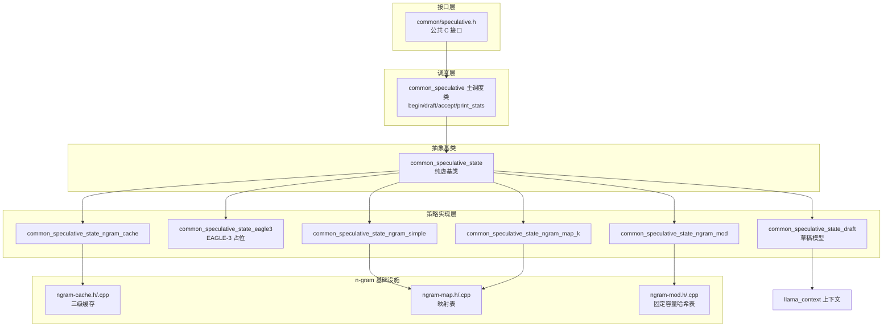
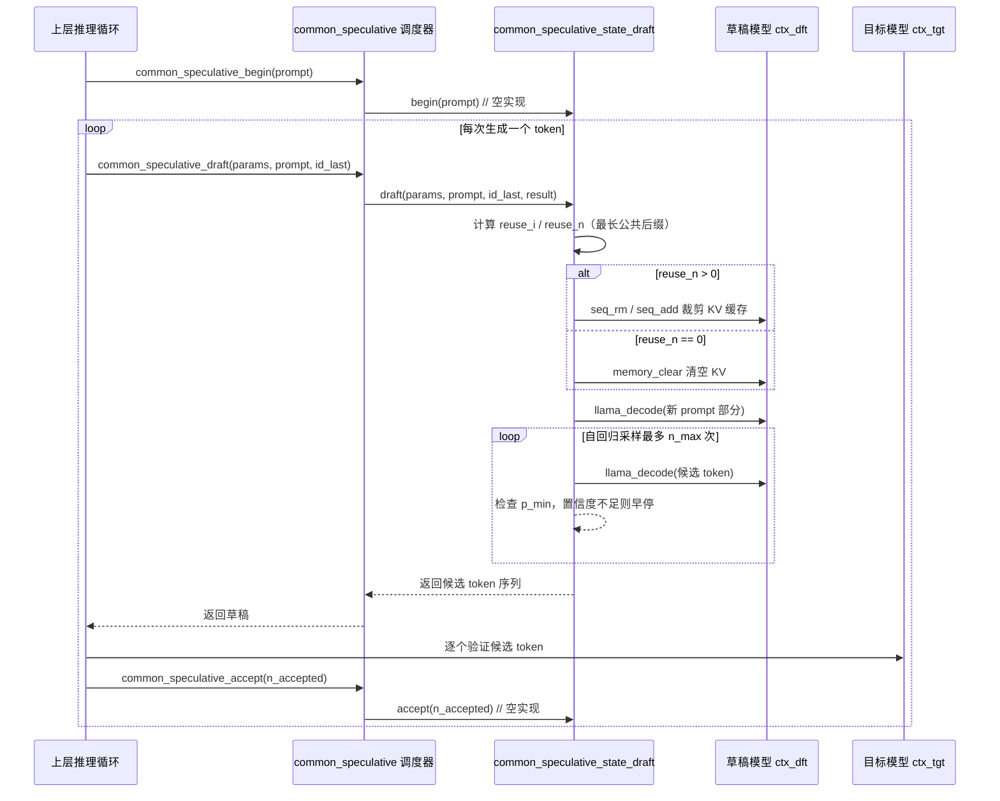
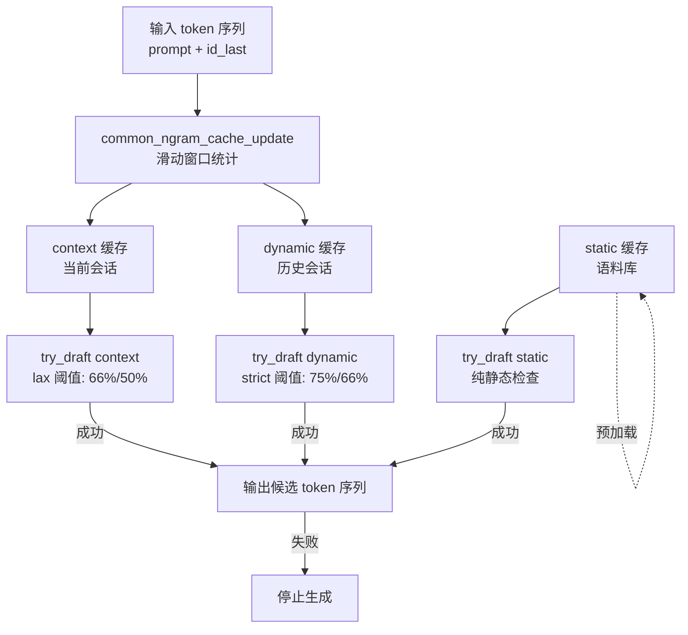

# 第51章 投机解码 —— 让推理"跑得更快"的秘密武器

## 学习目标

- 理解投机解码的统一接口与调度机制（begin/draft/accept 三阶段）及类型注册系统
- 掌握草稿模型投机解码的实现：上下文初始化、词汇表兼容性检查、KV 缓存复用与概率阈值控制
- 精通 n-gram 缓存算法：三级缓存架构（context/dynamic/static）、主导比例验证与持久化/合并机制
- 熟悉 n-gram 映射与哈希结构：LCG 哈希、Fibonacci 哈希、固定容量表与统计决策逻辑
- 掌握多种投机策略的状态机实现及其性能监控、统计收集与自动重置机制

## 51.1 生活类比

想象投机解码是一家**餐厅的预测备菜系统**。在一家繁忙的餐厅里，主厨（目标模型）是最终做菜的人，但每来一桌客人，主厨都要从头想一遍做什么菜、配什么料，这很耗时。聪明的餐厅经理引入了一套"预言家"机制：经验丰富的学徒厨师（草稿模型）会根据历史订单，快速猜测主厨接下来可能做什么菜，提前把食材备好（生成候选 token）；主厨只需要确认这些备菜对不对，对的直接上桌，不对的倒掉重来。这样一来，主厨省去了从零开始思考的时间，出菜速度自然大幅提升。

而这个"预言家"家族有好几位成员，各有所长。有的是会猜菜的学徒（草稿模型），靠自己的"手艺"（小模型推理）提前备菜；有的是记性好的历史订单统计本（n-gram 缓存），记录着"顾客点了宫保鸡丁后，80% 会点米饭"这种模式；有的是把常见菜品组合贴在墙上的便签墙（n-gram 映射/哈希），用编号（哈希）快速查找，而不是翻遍整本账本。更聪明的是，如果连续几桌客人都不按预测的菜点（接受率低于 50%），经理就会撕掉旧的预测便签，重新观察新趋势，让预测系统始终保持活力。而这一切，都藏在一套统一的"经理工作流程"背后：开市准备（begin）→ 预估菜品（draft）→ 确认订单（accept）。

## 51.2 源码地图

```
common/speculative.h
├── common_speculative_type           # 八种投机策略枚举（NONE/DRAFT/EAGLE3/NGRAM_*）
├── common_speculative_type_name_str() # 类型名称列表（行9）
├── common_speculative_type_from_name() # 名称转枚举（行12）
├── common_speculative_type_to_str()  # 枚举转字符串（行15）
├── common_speculative_is_compat()    # 上下文兼容性检查（行19）
├── common_speculative_init()         # 工厂函数：初始化与配置解析（行21-24）
├── common_speculative_free()         # 资源释放（行26）
├── common_speculative_begin()        # 统一入口：begin 阶段（行29）
├── common_speculative_draft()        # 主调度：生成候选 token（行32-36）
├── common_speculative_accept()       # 接受 token 并更新统计（行39）
└── common_speculative_print_stats()  # 打印性能统计（行42）

common/speculative.cpp
├── 全局数据与工具函数
│   ├── common_speculative_types[]    # 全局类型数组与名称映射表（行53-71）
│   ├── common_speculative_type_name_str() # 类型名称字符串拼接（行589-597）
│   ├── common_speculative_type_to_str()   # 枚举转字符串（行599-610）
│   ├── common_speculative_type_from_name() # 名称转枚举（行612-618）
│   └── common_speculative_is_compat() # 目标上下文兼容性检查（行620-643）
├── common_speculative_config         # 配置类：构造函数（行76-79）
├── common_speculative_are_compatible() # 词汇表兼容性检查（行83-125）
├── common_speculative_state          # 抽象基类（行148-165）
│   ├── common_speculative_state()    # 构造函数：类型初始化（行148-149）
│   ├── ~common_speculative_state()   # 虚析构函数（行151-152）
│   ├── begin()                       # 纯虚函数：开始阶段（行154-155）
│   ├── draft()                       # 纯虚函数：生成候选（行157-162）
│   └── accept()                      # 纯虚函数：接受反馈（行164-165）
├── common_speculative_state_draft    # 草稿模型实现类（行174-351）
│   ├── common_speculative_state_draft() # 构造函数：ctx_dft、Top-K采样器、batch管理（行174-208）
│   ├── ~common_speculative_state_draft() # 析构函数：资源释放（行210-216）
│   ├── begin()                       # 空实现（行218-220）
│   ├── draft()                       # KV 缓存复用 → 批量解码 → 自回归采样（行222-322）
│   ├── accept()                      # 空实现（行324-327）
│   ├── replace_to_dft()              # 词表翻译：目标→草稿（行329-339）
│   └── replace_to_tgt()              # 词表翻译：草稿→目标（行341-351）
├── common_speculative_state_eagle3   # EAGLE-3 占位实现（行353-373）
│   ├── common_speculative_state_eagle3() # 构造函数（行353-354）
│   ├── begin() / draft() / accept()  # 空实现框架（行356-373）
├── common_speculative_state_ngram_simple  # 简单 n-gram（行376-396）
│   ├── common_speculative_state_ngram_simple() # 构造函数（行376-379）
│   ├── begin()                       # 空实现（行381-383）
│   ├── draft()                       # 包装 common_ngram_simple_draft（行385-391）
│   └── accept()                      # 空实现（行393-396）
├── common_speculative_state_ngram_map_k   # 映射表包装（行399-418）
│   ├── common_speculative_state_ngram_map_k() # 构造函数（行399-402）
│   ├── begin()                       # 调用 common_ngram_map_begin 清理过期条目（行404-406）
│   ├── draft()                       # 调用 common_ngram_map_draft（行408-414）
│   └── accept()                      # 调用 common_ngram_map_accept 更新统计（行416-418）
├── common_speculative_state_ngram_mod     # 动态哈希表（行421-498）
│   ├── common_speculative_state_ngram_mod() # 构造：初始化 ngram_mod 与 LLAMA_TRACE（行421-425）
│   ├── begin()                       # 预热 n-gram 表，监控占用率（>25% 重置）（行427-442）
│   ├── draft()                       # 哈希查找生成候选（支持 n_min 强制长度）（行444-480）
│   └── accept()                      # 接受率 <50% 连续 3 次触发重置（行482-498）
├── common_speculative_state_ngram_cache   # 缓存策略（行501-561）
│   ├── common_speculative_state_ngram_cache() # 构造：加载 static/dynamic 缓存文件（行501-522）
│   ├── begin()                       # 空实现（行524-526）
│   ├── draft()                       # 增量更新 context 缓存 → 调用 common_ngram_cache_draft（行528-556）
│   └── accept()                      # 空实现（行558-561）
├── get_common_ngram_map()            # 辅助：创建 n-gram 映射对象（行571-577）
├── create_state_ngram_cache()        # 辅助：创建 ngram_cache 状态实例（行579-587）
├── common_speculative_init()         # 策略组装：按类型创建状态实例（行650-741）
├── common_speculative                # 主调度类（行1020-1110）
│   ├── common_speculative_begin()    # 遍历所有 impl 执行 begin（行1020-1032）
│   ├── common_speculative_draft()    # 轮询 impls 直到生成非空草稿（行1034-1060）
│   ├── common_speculative_accept()   # 调用当前 impl 的 accept（行1062-1080）
│   └── common_speculative_print_stats() # 打印调用次数、生成/接受 token 数与耗时（行1082-1110）
├── common_speculative_free()         # 释放资源（行1012-1018）
└── __main__                          # 全局常量与类型映射表（行1-52）

common/ngram-cache.h
├── 常量与类型定义（__main__）
│   ├── LLAMA_NGRAM_MIN/MAX/STATIC    # 常量：1/4/2（行9-11）
│   ├── common_ngram_cache_part       # typedef：token→count 的 unordered_map
│   └── common_ngram_cache            # typedef：ngram→part 的 unordered_map
├── common_ngram                      # 固定长度 4 的 token 数组（行19-39）
│   ├── common_ngram()                # 默认构造：填充 LLAMA_TOKEN_NULL（行19-23）
│   ├── common_ngram(const llama_token*, int) # 带参构造（行25-29）
│   └── operator==()                  # 相等比较（行31-39）
├── common_token_hash_function        # Fibonacci 哈希（行43-46）
│   └── operator()                    # 单 token 哈希计算（行43-46）
├── common_ngram_hash_function        # N-gram 组合哈希（行50-56）
│   └── operator()                    # 多 token 哈希合并（行50-56）
├── common_ngram_cache_update()       # 更新统计（行70-72）
├── common_ngram_cache_draft()        # 三级缓存草稿生成（行82-85）
├── common_ngram_cache_save()         # 二进制持久化（行91）
├── common_ngram_cache_load()         # 二进制加载（行97）
└── common_ngram_cache_merge()        # 缓存合并（行103）

common/ngram-cache.cpp
├── 全局常量（__main__）
│   ├── draft_min_sample_size_lax/strict  # 阈值数组（行14-17）
│   └── draft_min_percent_lax/strict      # 主导比例：66%/50% vs 75%/66%（行18-19）
├── common_ngram_cache_update()       # 滑动窗口统计 n-gram 频率（行5-48）
├── get_token() (static)              # 辅助：从 inp/draft 逻辑序列取 token（行51-53）
├── try_draft() (static)              # 静态缓存：最低样本 + 主导比例检查（行62-94）
├── try_draft() (primary+static)      # 联合验证：count_primary * count_static 加权（行97-139）
├── common_ngram_cache_draft()        # 主流程：context(lax) → dynamic(strict) → static（行142-190）
├── common_ngram_cache_save()         # 二进制序列化（行193-214）
├── common_ngram_cache_load()         # 二进制反序列化（行217-256）
└── common_ngram_cache_merge()        # 缓存合并（行259-286）

common/ngram-map.h
├── common_ngram_simple_config        # 简单 n-gram 配置（行23-25）
├── common_ngram_map_value            # 候选值统计：索引、出现次数、接受数
├── common_ngram_map_key              # 键统计：位置、计数、候选值数组
├── common_ngram_map                  # 映射表主类
│   └── common_ngram_map()            # 构造函数（行53-58）
├── common_ngram_simple_draft()       # 简单模式匹配（行23-25）
├── common_ngram_map_begin()          # 初始化/清理（行78-80）
├── common_ngram_map_draft()          # 生成草稿（行87-90）
└── common_ngram_map_accept()         # 接受反馈（行94）

common/ngram-map.cpp
├── common_ngram_map_hash()           # LCG 哈希：hash * 6364136223846793005ULL + token（行17-24）
├── common_tokens_to_str()            # 调试辅助：token 序列转字符串（行27-37）
├── common_ngram_simple_draft()       # 线性扫描查找 n-gram 模式（行48-100）
├── common_ngram_map_begin()          # 清理过期 key/value（基于 size_last_begin）（行110-191）
├── common_ngram_map_draft()          # 核心逻辑（行196-405）
│   ├── 哈希表快速定位 match_pos
│   ├── 更新 keys/values 统计（最多 4 个候选值）
│   ├── 主导检查：max_occur >= 2 * sum_occur
│   └── min_hits 验证后才生成草稿
└── common_ngram_map_accept()         # 更新接受统计（行407-420）

common/ngram-mod.h
└── common_ngram_mod                  # 固定容量哈希表类声明
    ├── common_ngram_mod()            # 构造（行17）
    ├── idx() / add() / get()         # 哈希定位/写入/查询（行19-21）
    ├── reset()                       # 清空（行23）
    └── get_n() / get_used() / size() / size_bytes() # 状态查询（行25-29)

common/ngram-mod.cpp
└── common_ngram_mod 实现
    ├── common_ngram_mod()            # 构造函数：初始化 entries 数组（行7-12）
    ├── idx()                         # 组合哈希取模定位槽位（行14-26）
    ├── add()                         # 写入 token 并更新 used 计数（行28-36）
    ├── get()                         # O(1) 查询，EMPTY(-1) 表示未命中（行38-43）
    ├── reset()                       # 清空表（行45-48）
    ├── get_n() / get_used()          # 状态查询（行50-56）
    └── size() / size_bytes()         # 容量与内存统计（行58-64）
```

## 51.3 投机解码核心接口 —— 统一调度多种「预言术」引擎

投机解码之所以能成为加速大模型推理的"秘密武器"，关键在于它把"如何猜测下一个 token"这件事抽象成了一套统一的接口。不管底层是用小模型猜（草稿模型），还是用历史统计规律猜（n-gram 缓存），还是用哈希表快速查（n-gram 映射），对上层调用者来说都只需要关心三个动作：开始一轮预测（begin）、生成候选 token（draft）、确认哪些候选被接受了（accept）。这套抽象层的存在，让 llama.cpp 可以在同一个推理循环里灵活组合多种策略，甚至同时启用多个策略轮流尝试，直到有一个成功产出候选。

### 51.3.1 类型系统：八种「预言术」的名册

类型即图纸。在动手读任何策略实现之前，我们先看这套系统"身份证"长什么样——也就是枚举和它配套的字符串转换函数。

```cpp
// 源码路径：common/speculative.h - common_speculative_type（枚举定义）
// 核心类型：common_speculative_type
// 关键函数：common_speculative_type_to_str() / from_name() / name_str()
enum common_speculative_type {
    COMMON_SPECULATIVE_TYPE_NONE,          // 不启用投机解码（占位）
    COMMON_SPECULATIVE_TYPE_DRAFT,         // 草稿模型：小模型猜大模型
    COMMON_SPECULATIVE_TYPE_EAGLE3,        // EAGLE-3：特征序列预测
    COMMON_SPECULATIVE_TYPE_NGRAM_SIMPLE,  // 简单 n-gram：线性扫描历史
    COMMON_SPECULATIVE_TYPE_NGRAM_MAP_K,   // n-gram 映射（仅键模式）
    COMMON_SPECULATIVE_TYPE_NGRAM_MAP_K4V, // n-gram 映射（键+值统计）
    COMMON_SPECULATIVE_TYPE_NGRAM_MOD,     // 动态哈希表 n-gram
    COMMON_SPECULATIVE_TYPE_NGRAM_CACHE,   // 三级缓存 n-gram
    COMMON_SPECULATIVE_TYPE_COUNT,         // 类型总数（哨兵值，用于数组边界）
};
```

这段代码定义了投机解码的八种策略枚举。注意 `COMMON_SPECULATIVE_TYPE_COUNT` 这个哨兵值——它不对应任何真实策略，专门用来标记数组大小和循环边界，是 C/C++ 枚举里的惯用手法。

```cpp
// 源码路径：common/speculative.cpp - common_speculative_type_to_str()（第599-610行）
// 核心类型：common_speculative_type
// 关键函数：common_speculative_type_to_str()
std::string common_speculative_type_to_str(enum common_speculative_type type) {
    switch (type) {
        // 逐个 case 把枚举值翻译成人类可读的字符串
        case COMMON_SPECULATIVE_TYPE_NONE:          return "none";
        case COMMON_SPECULATIVE_TYPE_DRAFT:         return "draft";
        case COMMON_SPECULATIVE_TYPE_EAGLE3:        return "eagle3";
        case COMMON_SPECULATIVE_TYPE_NGRAM_SIMPLE:  return "ngram_simple";
        case COMMON_SPECULATIVE_TYPE_NGRAM_MAP_K:   return "ngram_map_k";
        case COMMON_SPECULATIVE_TYPE_NGRAM_MAP_K4V: return "ngram_map_k4v";
        case COMMON_SPECULATIVE_TYPE_NGRAM_MOD:     return "ngram_mod";
        case COMMON_SPECULATIVE_TYPE_NGRAM_CACHE:   return "ngram_cache";
        default: return "unknown";                  // 兜底：防御性编程
    }
}
```

这段代码把枚举值转成字符串。为什么需要它？因为配置解析（命令行、JSON、环境变量）拿到的都是字符串，必须有办法在"字符串 → 枚举 → 真正的策略类"这条链路上双向转换。

```cpp
// 源码路径：common/speculative.cpp - common_speculative_type_from_name()（第612-618行）
// 核心类型：common_speculative_type
// 关键函数：common_speculative_type_from_name()
enum common_speculative_type common_speculative_type_from_name(const std::string & name) {
    const auto it = common_speculative_type_from_name_map.find(name);
    if (it == common_speculative_type_from_name_map.end()) {
        return COMMON_SPECULATIVE_TYPE_COUNT;   // 找不到返回哨兵值，调用方据此判断
    }
    return it->second;
}
```

这段代码反向查表：把用户输入的字符串（比如 "ngram_mod"）转回枚举值。找不到时返回 `COMMON_SPECULATIVE_TYPE_COUNT`，这是一个"非法值"信号，调用方可以据此报错或忽略，而不是落到 default 分支产生未定义行为。

```cpp
// 源码路径：common/speculative.cpp - common_speculative_type_name_str()（第589-597行）
// 核心类型：common_speculative_type
// 关键函数：common_speculative_type_name_str()
std::string common_speculative_type_name_str() {
    std::string result;
    for (size_t i = 0; i < common_speculative_types.size(); i++) {
        if (i > 0) {
            result += ", ";
        }
        result += common_speculative_type_to_str(common_speculative_types[i]);
    }
    return result;
}
```

这段代码拼出一个逗号分隔的字符串，内容是所有支持的策略名。它主要用来生成帮助信息——当用户在命令行里写错策略名时，错误提示里可以列出全部可选项，比如 `supported types: none, draft, eagle3, ngram_simple, ...`。

### 51.3.2 抽象基类 common_speculative_state：三阶段生命周期

类型系统只是"名册"，真正让多种策略能被统一调度的，是下面这个抽象基类。它定义了所有策略必须实现的三阶段契约。

```cpp
// 源码路径：common/speculative.cpp - common_speculative_state（第148-165行）
// 核心类：common_speculative_state（抽象基类）
// 关键函数：begin() / draft() / accept()
class common_speculative_state {
public:
    // 构造函数：只记录自己的"工牌"（类型），不干别的
    common_speculative_state(enum common_speculative_type type) : type(type) {}
    // 虚析构：多态基类的标配，确保派生类资源正确释放
    virtual ~common_speculative_state() = default;
    // ① begin：新一轮生成开始时调用，用于清理上一轮状态
    virtual void begin(const llama_tokens & prompt) = 0;
    // ② draft：核心动作——生成候选 token 序列
    virtual void draft(
            const common_params_speculative & params,  // 投机参数（n_max、p_min 等）
            const llama_tokens & prompt_tgt,            // 目标模型看到的 prompt
            llama_token id_last,                        // 刚采样出的最后一个 token
            llama_tokens & result) = 0;                 // 输出：候选 token 序列
    // ③ accept：目标模型验证后，告知"接受了几个"，用于更新统计
    virtual void accept(uint16_t n_accepted) = 0;
};
```

这段代码定义了投机解码的抽象基类。三个纯虚函数 `begin`、`draft`、`accept` 构成了策略的"最小完备集合"：begin 授予初始化权限，draft 授予生成候选权限，accept 授予统计反馈权限。注意 `draft` 的参数设计——它同时拿到了目标模型的 prompt、刚采样的 token 和投机参数，这意味着每个策略实现都可以根据自己的算法决定"要不要猜""猜几个""从哪儿开始猜"。

### 51.3.3 主调度器 common_speculative 与工厂函数

有了基类和枚举，还需要一个"调度台"把多个策略实例管起来，以及一个"工厂"根据配置把实例造出来。

```cpp
// 源码路径：common/speculative.cpp - common_speculative_init()（第650-741行，核心部分）
// 核心类：common_speculative
// 关键函数：common_speculative_init()
common_speculative * common_speculative_init(
        common_params_speculative & params,
        llama_context             * ctx_tgt) {
    llama_context * ctx_dft = nullptr;
    if (params.model_dft) {
        // 如果配了草稿模型，先把它加载出来（独立上下文）
        ctx_dft = llama_init_from_model(params.model_dft, params.cparams_dft);
        if (ctx_dft == nullptr) {
            LOG_ERR("%s", "failed to create draft context\n");
            return nullptr;
        }
    }
    std::vector<common_speculative_config> configs = {}; // 待实例化的策略配置列表
    {
        // 把用户选的类型翻译成一张"待办清单"
        bool has_ngram_cache   = (params.type == COMMON_SPECULATIVE_TYPE_NGRAM_CACHE);
        bool has_ngram_simple  = (params.type == COMMON_SPECULATIVE_TYPE_NGRAM_SIMPLE);
        bool has_ngram_map_k   = (params.type == COMMON_SPECULATIVE_TYPE_NGRAM_MAP_K);
        bool has_ngram_map_k4v = (params.type == COMMON_SPECULATIVE_TYPE_NGRAM_MAP_K4V);
        bool has_ngram_mod     = (params.type == COMMON_SPECULATIVE_TYPE_NGRAM_MOD);
        bool has_draft = !params.mparams_dft.path.empty();
        if (has_ngram_simple) configs.push_back(common_speculative_config(COMMON_SPECULATIVE_TYPE_NGRAM_SIMPLE, params));
        if (has_ngram_map_k)  configs.push_back(common_speculative_config(COMMON_SPECULATIVE_TYPE_NGRAM_MAP_K, params));
        if (has_ngram_map_k4v) configs.push_back(common_speculative_config(COMMON_SPECULATIVE_TYPE_NGRAM_MAP_K4V, params));
        if (has_ngram_mod) {
            // ngram_mod 是动态哈希表，需要显式分配内存（4MB）
            if (!params.ngram_mod) {
                params.ngram_mod = std::make_shared<common_ngram_mod>(params.ngram_size_n, 4*1024*1024);
                LOG_INF("%s: initialized ngram_mod with n=%d, size=%zu (%.3f MB)\n", __func__,
                        params.ngram_size_n, params.ngram_mod->size(),
                        (float)(params.ngram_mod->size_bytes())/1024/1024);
                if (params.ngram_size_n < 16) {
                    LOG_WRN("%s: ngram_mod n=%d is too small - poor quality is possible\n", __func__, params.ngram_size_n);
                }
            }
            configs.push_back(common_speculative_config(COMMON_SPECULATIVE_TYPE_NGRAM_MOD, params));
        }
        if (has_ngram_cache) configs.push_back(common_speculative_config(COMMON_SPECULATIVE_TYPE_NGRAM_CACHE, params));
        if (has_draft)        configs.push_back(common_speculative_config(COMMON_SPECULATIVE_TYPE_DRAFT, params));
    }
    std::vector<std::unique_ptr<common_speculative_state>> impls = {};
    for (const common_speculative_config & config : configs) {
        LOG_DBG("%s: adding implementation %s\n", __func__, common_speculative_type_to_str(config.type).c_str());
        switch (config.type) {
            case COMMON_SPECULATIVE_TYPE_DRAFT: {
                // 草稿模型：需要 ctx_tgt、ctx_dft、词汇表替换表 三样东西
                impls.push_back(std::make_unique<common_speculative_state_draft>(config.type,
                    /* .ctx_tgt      = */ ctx_tgt,
                    /* .ctx_dft      = */ ctx_dft,
                    /* .replacements = */ params.replacements));
                break;
            }
            case COMMON_SPECULATIVE_TYPE_NGRAM_MOD: {
                GGML_ASSERT(config.params.ngram_mod);
                impls.push_back(std::make_unique<common_speculative_state_ngram_mod>(config.type, *config.params.ngram_mod));
                break;
            }
            case COMMON_SPECULATIVE_TYPE_NGRAM_CACHE: {
                auto state = create_state_ngram_cache(config.params.path_static, config.params.path_dynamic, config);
                impls.push_back(std::make_unique<common_speculative_state_ngram_cache>(std::move(state)));
                break;
            }
            // ... NGRAM_SIMPLE / NGRAM_MAP_K / NGRAM_MAP_K4V / EAGLE3 类似地实例化
        }
    }
    if (impls.empty()) {
        return nullptr;   // 一个策略都没配？返回空，退化为普通解码
    }
    auto * result = new common_speculative();
    result->impls = std::move(impls);
    return result;
}
```

这段代码是投机解码的工厂函数。它的核心思路是"配置 → 清单 → 实例"：先把用户指定的类型展开成一张配置清单，再按清单逐个创建策略实例，最后打包成一个 `common_speculative` 对象返回。注意 `ngram_mod` 的特殊处理——它是一个 4MB 的固定容量哈希表，需要在构造时显式分配，而且如果 n 过小（<16）会打印警告，因为 n 太小会导致哈希冲突严重、预测质量差。

```cpp
// 源码路径：common/speculative.cpp - common_speculative_draft()（第1034-1060行）
// 核心类：common_speculative
// 关键函数：common_speculative_draft()
llama_tokens common_speculative_draft(
        common_speculative * spec,
        const common_params_speculative & params,
        const llama_tokens & prompt_tgt,
        llama_token id_last) {
    llama_tokens result;
    spec->curr_impl = nullptr;                              // 先清空"当前生效的策略"
    for (auto & impl : spec->impls) {                       // 按优先级遍历所有策略
        {
            common_time_meas tm(impl->t_draft_us, !impl->gen_perf);
            impl->draft(params, prompt_tgt, id_last, result);  // 让当前策略去猜
            impl->n_call_draft++;                               // 统计调用次数
        }
        if (!result.empty()) {                                 // 猜到了？立刻收工
            LOG_DBG("%s: called impl %s, hist size = %zu, call_count = %zu, gen = %zu\n", __func__,
                    common_speculative_type_to_str(impl.get()->type).c_str(), prompt_tgt.size(),
                    impl.get()->n_call_draft, result.size());
            spec->curr_impl = impl.get();                     // 记录"这次是谁猜的"
            impl->n_gen_drafts++;                             // 统计"成功产出草稿的次数"
            impl->n_gen_tokens += result.size();              // 统计"产出的 token 总数"
            break;                                            // 不再尝试后面的策略
        }
    }
    return result;
}
```

这段代码是主调度器的核心——`common_speculative_draft()`。它按优先级轮询 `impls` 数组里的每一个策略实例，谁先产出非空的候选序列就立刻停下，并把"这次是谁猜的"记下来（`curr_impl`），供后续 `accept` 回调统计。这种"轮询直到成功"的设计，让多个策略可以按优先级组合：比如先试轻量的 n-gram（快），不行再试草稿模型（慢但准）。

### 51.3.4 模块依赖图

下面是投机解码模块的依赖关系全景图：



从图中可以看出清晰的分层：接口层暴露公共函数 → 调度层管理多个实例 → 抽象基类定义契约 → 具体策略各自实现 → n-gram 基础设施提供底层数据结构。草稿模型策略是唯一直接依赖 llama_context 的（因为它要真正跑模型推理），其他 n-gram 系策略都是纯数据结构操作。

## 51.4 草稿模型投机解码 —— 「小模型猜大模型」的协作艺术

在"预言家"家族里，草稿模型是最直观也最强大的一员：它用一个小型、快速的语言模型（草稿模型）去猜大型目标模型的输出，提前生成一批候选 token，目标模型只需要逐个验证，省掉了自回归生成的大部分计算量。

### 51.4.1 词汇表兼容性检查

两个模型能不能协作，先决条件是它们"说同一种语言"。`common_speculative_are_compatible()` 就是这道关卡。

```cpp
// 源码路径：common/speculative.cpp - common_speculative_are_compatible()（第83-125行）
// 核心函数：common_speculative_are_compatible()
static bool common_speculative_are_compatible(
    const llama_model * model_tgt,
    const llama_model * model_dft) {
    const llama_vocab * vocab_tgt = llama_model_get_vocab(model_tgt);
    const llama_vocab * vocab_dft = llama_model_get_vocab(model_dft);
    const bool vocab_type_tgt = llama_vocab_type(vocab_tgt);
    const bool vocab_type_dft = llama_vocab_type(vocab_dft);
    // 检查①：分词器类型必须相同（SPM / BPE / WPM 等）
    if (vocab_type_tgt != vocab_type_dft) {
        return false;
    }
    // 检查②：特殊 token（BOS/EOS、add_bos/add_eos 标志）必须一致
    if (
        llama_vocab_get_add_bos(vocab_tgt) != llama_vocab_get_add_bos(vocab_dft) ||
        llama_vocab_get_add_eos(vocab_tgt) != llama_vocab_get_add_eos(vocab_dft) ||
        llama_vocab_bos(vocab_tgt) != llama_vocab_bos(vocab_dft) ||
        llama_vocab_eos(vocab_tgt) != llama_vocab_eos(vocab_dft)
    ) {
        return false;
    }
    // 检查③：词表大小不能差太多（SPEC_VOCAB_MAX_SIZE_DIFFERENCE 以内）
    const int n_vocab_tgt = llama_vocab_n_tokens(vocab_tgt);
    const int n_vocab_dft = llama_vocab_n_tokens(vocab_dft);
    const int vocab_diff  = n_vocab_tgt > n_vocab_dft
        ? n_vocab_tgt - n_vocab_dft
        : n_vocab_dft - n_vocab_tgt;
    if (vocab_diff > SPEC_VOCAB_MAX_SIZE_DIFFERENCE) {
        return false;
    }
    // 检查④：逐个比对 token 内容，确保 ID 对应的字符串完全一致
    for (int i = SPEC_VOCAB_CHECK_START_TOKEN_ID; i < std::min(n_vocab_tgt, n_vocab_dft); ++i) {
        const char * token_text_tgt = llama_vocab_get_text(vocab_tgt, i);
        const char * token_text_dft = llama_vocab_get_text(vocab_dft, i);
        if (std::strcmp(token_text_tgt, token_text_dft) != 0) {
            return false;
        }
    }
    return true;
}
```

这段代码执行四道兼容性检查。分词器类型、特殊 token、词表大小、逐 token 内容——任何一道不通过，两个模型就无法协作。注意第四道检查是逐个比对 token 字符串而非只看 ID，这是因为两个模型可能都用 BPE 但词表内容不同（比如一个经过额外训练），这种情况下 ID 相同但字符串不同，直接用 ID 对应会导致翻译错误。

### 51.4.2 构造函数：草稿上下文与采样器初始化

兼容性过关后，草稿模型状态类开始构造自己的"工作台"。

```cpp
// 源码路径：common/speculative.cpp - common_speculative_state_draft()（第174-208行）
// 核心类：common_speculative_state_draft
// 关键函数：common_speculative_state_draft() 构造函数
common_speculative_state_draft(
        enum common_speculative_type type,
        llama_context * ctx_tgt,
        llama_context * ctx_dft,
        const std::vector<std::pair<std::string, std::string>> & replacements)
    : common_speculative_state(type)
    , ctx_tgt(ctx_tgt)
    , ctx_dft(ctx_dft)
{
    // ① 为草稿模型分配一个批处理容器（初始容量 = 草稿模型的 batch 大小）
    batch = llama_batch_init(llama_n_batch(ctx_dft), 0, 1);
    smpl = nullptr;
    {
        // ② 配置采样器：只用 Top-K（k=10），不加温度、不加 Top-P
        common_params_sampling params;
        params.no_perf = false;
        params.top_k = 10;
        params.samplers = { COMMON_SAMPLER_TYPE_TOP_K };
        smpl = common_sampler_init(llama_get_model(ctx_dft), params);
    }
    // ③ 检查两个模型的词表是否兼容
    vocab_cmpt = common_speculative_are_compatible(llama_get_model(ctx_tgt), llama_get_model(ctx_dft));
    LOG_DBG("vocab_cmpt = %d\n", vocab_cmpt);
    if (!vocab_cmpt) {
        // 词表不兼容？记下用户给的替换对，后续用字符串翻译兜底
        LOG_WRN("the target and draft vocabs are not compatible - tokens will be translated between the two\n");
        for (const auto & pair : replacements) {
            vocab_map[pair.first] = pair.second;
        }
    }
}
```

这段代码是草稿模型状态类的构造函数。它做了三件事：分配批处理容器、配置一个轻量采样器（只用 Top-K，保证草稿模型跑得快）、检查词表兼容性。注意采样器配置刻意做减法——草稿模型不需要复杂的采样策略，Top-K 足够了，因为它的输出只是"候选"，最终决定权在目标模型手里。

### 51.4.3 draft() 核心逻辑：KV 缓存复用与自回归采样

这是整个草稿模型策略的心脏——`draft()` 函数。它要解决的核心问题是：如何用最少的计算量，让草稿模型产出尽可能多的有效候选 token。

```cpp
// 源码路径：common/speculative.cpp - common_speculative_state_draft.draft()（第222-322行，核心部分）
// 核心类：common_speculative_state_draft
// 关键函数：draft()
void draft(
        const common_params_speculative & params,
        const llama_tokens & prompt_tgt,
        llama_token id_last,
        llama_tokens & result) override {
    auto * spec = this;
    auto & batch      = spec->batch;
    auto & ctx_tgt    = spec->ctx_tgt;
    auto & ctx_dft    = spec->ctx_dft;
    auto & smpl       = spec->smpl;
    auto & prompt_dft = spec->prompt_dft;
    auto * mem_dft = llama_get_memory(ctx_dft);
    int reuse_i = 0;   // 复用的起始位置
    int reuse_n = 0;   // 复用的 token 数量
    const int n_ctx = llama_n_ctx(ctx_dft) - params.n_max;
    llama_tokens prompt_cnv;
    // ① 如果词表不兼容，先把目标模型的 prompt 翻译成草稿模型的词表
    if (!spec->vocab_cmpt) {
        std::string text;
        text = common_detokenize(ctx_tgt, prompt_tgt, true);
        text = replace_to_dft(text);
        prompt_cnv = common_tokenize(ctx_dft, text, false, true);
        // ... 同样翻译 id_last ...
        id_last = common_tokenize(ctx_dft, text, false, true)[0];
    }
    const llama_tokens & prompt_cur = spec->vocab_cmpt ? prompt_tgt : prompt_cnv;
    // ② 在草稿模型的历史 prompt 中找"最长公共后缀"，这就是 reuse_i / reuse_n
    const int i_start = std::max<int>(0, (int) prompt_cur.size() - n_ctx);
    for (int i = 0; i < (int) prompt_dft.size(); ++i) {
        int cur = 0;
        while (i_start + cur < (int) prompt_cur.size() &&
                i       + cur < (int) prompt_dft.size() &&
                prompt_cur[i_start + cur] == prompt_dft[i + cur]) {
            cur++;
        }
        // 关键条件：要么匹配长度超过 256，要么当前 prompt 已经短到边界
        if ((cur >= 256 || n_ctx >= (int) prompt_cur.size()) && cur > reuse_n) {
            reuse_i = i;
            reuse_n = cur;
        }
    }
    // ③ 根据 reuse_n 决定如何处理 KV 缓存
    result.clear();
    result.reserve(params.n_max);
    if (reuse_n == 0) {
        // 完全没复用？清空草稿模型的 KV 缓存，从头来
        llama_memory_clear(mem_dft, false);
        prompt_dft.clear();
    } else {
        // 有复用？先看看能不能直接从缓存里"捡"候选
        if (reuse_i + reuse_n < (int) prompt_dft.size() && prompt_dft[reuse_i + reuse_n] == id_last) {
            for (int i = reuse_i + reuse_n + 1; i < (int) prompt_dft.size(); ++i) {
                result.push_back(prompt_dft[i]);
                if (params.n_max <= (int) result.size()) break;
            }
            return;  // 直接返回，不需要重新解码
        }
        // 否则裁剪 KV 缓存：删掉 reuse_i 之前的，保留 reuse_n 之后的
        if (reuse_i > 0) {
            llama_memory_seq_rm (mem_dft, 0, 0, reuse_i);
            llama_memory_seq_add(mem_dft, 0, reuse_i, -1, -reuse_i);
            prompt_dft.erase(prompt_dft.begin(), prompt_dft.begin() + reuse_i);
        }
        if (reuse_n < (int) prompt_dft.size()) {
            llama_memory_seq_rm (mem_dft, 0, reuse_n, -1);
            prompt_dft.erase(prompt_dft.begin() + reuse_n, prompt_dft.end());
        }
    }
    // ④ 把新 prompt（去掉已复用部分）送进草稿模型
    common_batch_clear(batch);
    for (size_t i = i_start + reuse_n; i < prompt_cur.size(); ++i) {
        common_batch_add(batch, prompt_cur[i], i - i_start, { 0 }, false);
        prompt_dft.push_back(prompt_cur[i]);
    }
    if (batch.n_tokens > 0) {
        llama_decode(ctx_dft, batch);
    }
    // ⑤ 自回归采样：一个一个猜，直到达到 n_max 或置信度低于 p_min
    const llama_pos n_past = prompt_dft.size();
    common_batch_clear(batch);
    common_batch_add(batch, id_last, n_past, { 0 }, true);
    prompt_dft.push_back(id_last);
    llama_decode(ctx_dft, batch);
    common_sampler_reset(smpl);
    for (int i = 0; i < params.n_max; ++i) {
        common_batch_clear(batch);
        common_sampler_sample(smpl, ctx_dft, 0, true);
        const auto * cur_p = common_sampler_get_candidates(smpl, true);
        const llama_token id = cur_p->data[0].id;
        common_sampler_accept(smpl, id, true);
        result.push_back(id);
        if (params.n_max <= (int) result.size()) break;
        if (cur_p->data[0].p < params.p_min) break;  // 置信度不够？提前停
        common_batch_add(batch, id, n_past + i + 1, { 0 }, true);
        llama_decode(ctx_dft, batch);
        prompt_dft.push_back(id);
    }
    // ⑥ 如果词表不兼容，把候选 token 翻译回目标模型词表
    if (!spec->vocab_cmpt) {
        std::string detokenized = common_detokenize(ctx_dft, result, true);
        detokenized = replace_to_tgt(detokenized);
        result = common_tokenize(ctx_tgt, detokenized, false, true);
        if (result.size() > (size_t)params.n_max) {
            result.resize(params.n_max);
        }
    }
}
```

这段代码是草稿模型策略的核心解码流程。它的设计精妙之处在于 KV 缓存复用：草稿模型维护了自己的 `prompt_dft` 历史，每次生成前先和当前 prompt 比对，找到最长公共后缀（reuse_i / reuse_n），然后只对"新出现的部分"调用 `llama_decode`。这样，多轮生成时草稿模型不需要从头算 KV，复用率越高越省算力。`p_min` 参数则充当"早停闸门"——草稿模型对自己猜的结果越没信心，就越早停止生成，避免浪费目标模型的验证算力。

### 51.4.4 词汇表翻译机制

当两个模型词表不兼容时，字符串级别的双向翻译是兜底方案。

```cpp
// 源码路径：common/speculative.cpp - replace_to_dft()（第329-339行）
// 核心类：common_speculative_state_draft
// 关键函数：replace_to_dft()
std::string replace_to_dft(const std::string & input) const {
    std::string result = input;
    for (const auto & pair : this->vocab_map) {
        size_t pos = result.find(pair.first);
        while (pos != std::string::npos) {
            result.replace(pos, pair.first.length(), pair.second);
            pos = result.find(pair.first, pos + pair.second.length());
        }
    }
    return result;
}
```

这段代码把目标模型的词表字符串翻译成草稿模型的词表字符串。它遍历用户配置的 `replacements` 替换对（比如目标模型的 `"▁Hello"` → 草稿模型的 `"Hello"`），在输入字符串里逐处替换。注意每次替换后 `pos` 从 `pair.second.length()` 之后继续找，避免在刚替换的文本里重复匹配。

```cpp
// 源码路径：common/speculative.cpp - replace_to_tgt()（第341-351行）
// 核心类：common_speculative_state_draft
// 关键函数：replace_to_tgt()
std::string replace_to_tgt(const std::string & input) const {
    std::string result = input;
    for (const auto & pair : this->vocab_map) {
        size_t pos = result.find(pair.second);
        while (pos != std::string::npos) {
            result.replace(pos, pair.second.length(), pair.first);
            pos = result.find(pair.second, pos + pair.first.length());
        }
        }
    }
    return result;
}
```

这段代码是反向翻译：把草稿模型的词表字符串翻译回目标模型的词表字符串。逻辑和 `replace_to_dft` 对称，但方向相反——查找的是 `pair.second`（草稿模型的词），替换成 `pair.first`（目标模型的词）。

### 51.4.5 时序图



时序图展示了草稿模型策略在一个完整生成循环中的行为。可以看到，草稿模型的 `begin` 和 `accept` 都是空实现——因为它不维护跨轮的统计状态，所有状态都存在 `ctx_dft` 的 KV 缓存和 `prompt_dft` 历史里。

## 51.5 n-gram 缓存算法 —— 基于统计的「历史复读机」

草稿模型虽然准，但要额外加载一个小模型，内存和显存开销都不小。n-gram 缓存则完全不需要第二个模型——它纯粹依靠"历史重复模式"来猜，用统计学替代了模型推理。

### 51.5.1 数据结构：common_ngram 与哈希函数

类型即图纸。n-gram 缓存的核心是一个固定长度为 4 的 token 数组，以及配套的哈希函数。

```cpp
// 源码路径：common/ngram-cache.h - common_ngram（第19-39行）
// 核心类：common_ngram
// 关键函数：common_ngram() / operator==()
class common_ngram {
public:
    llama_token tokens[LLAMA_NGRAM_MAX];  // LLAMA_NGRAM_MAX = 4，固定长度
    // 默认构造：所有 token 初始化为 LLAMA_TOKEN_NULL
    common_ngram() {
        for (int i = 0; i < LLAMA_NGRAM_MAX; ++i) {
            tokens[i] = LLAMA_TOKEN_NULL;
        }
    }
    // 带参构造：按给定长度填充，剩余位置保持 NULL
    common_ngram(const llama_token * input, const int ngram_size) {
        for (int i = 0; i < LLAMA_NGRAM_MAX; ++i) {
            tokens[i] = i < ngram_size ? input[i] : LLAMA_TOKEN_NULL;
        }
    }
    // 相等比较：逐个比较 4 个 token
    bool operator==(const common_ngram & other) const {
        for (int i = 0; i < LLAMA_NGRAM_MAX; ++i) {
            if (tokens[i] != other.tokens[i]) {
                return false;
            }
        }
        return true;
    }
};
```

这段代码定义了 n-gram 的"身份证"。固定长度 4 是一个工程折中：太短不足以捕获模式（比如"因为...所以"这种长距离依赖），太长则哈希冲突率高且缓存命中率低。未使用的位置用 `LLAMA_TOKEN_NULL` 填充，保证不同长度的 n-gram 不会误判为相等。

```cpp
// 源码路径：common/ngram-cache.h - common_token_hash_function / common_ngram_hash_function（第43-56行）
// 核心类：common_token_hash_function / common_ngram_hash_function
// 关键函数：operator()
class common_token_hash_function {
public:
    size_t operator()(const llama_token token) const {
        return token * 11400714819323198485llu;  // Fibonacci 哈希常数
    }
};
class common_ngram_hash_function {
public:
    size_t operator()(const common_ngram & ngram) const {
        size_t hash = common_token_hash_function{}(ngram.tokens[0]);
        for (int i = 1; i < LLAMA_NGRAM_MAX; ++i) {
            hash ^= common_token_hash_function{}(ngram.tokens[i]);  // 组合哈希
        }
        return hash;
    }
};
```

这两段代码是 n-gram 缓存的"地址系统"。单 token 哈希用 Fibonacci 哈希（乘以黄金分割相关的常数），能把 token ID 均匀打散到整个 size_t 空间。n-gram 哈希则把 4 个 token 的哈希值异或组合，作为 `unordered_map` 的键——这就是为什么 `common_ngram` 能直接当 `std::unordered_map` 的 key。

### 51.5.2 滑动窗口统计：common_ngram_cache_update()

```cpp
// 源码路径：common/ngram-cache.cpp - common_ngram_cache_update()（第5-48行）
// 核心函数：common_ngram_cache_update()
void common_ngram_cache_update(common_ngram_cache & ngram_cache, int ngram_min, int ngram_max,
                              std::vector<llama_token> & inp, int nnew, bool print_progress) {
    const int64_t t_start_ms = ggml_time_ms();
    const int64_t inp_size = inp.size();
    const int64_t n_todo = inp_size * (ngram_max - ngram_min + 1);
    int64_t n_done = 0;
    // 外层循环：遍历所有 n-gram 尺寸（1 到 4）
    for (int64_t ngram_size = ngram_min; ngram_size <= ngram_max; ++ngram_size) {
        // 内层循环：滑动窗口，统计每个 n-gram 后面出现的 token
        const int64_t i_start = std::max(inp_size - nnew, ngram_size);
        for (int64_t i = i_start; i < inp_size; ++i) {
            const int64_t ngram_start = i - ngram_size;
            common_ngram ngram(&inp[ngram_start], ngram_size);
            const llama_token token = inp[i];
            common_ngram_cache::iterator part_it = ngram_cache.find(ngram);
            if (part_it == ngram_cache.end()) {
                // 第一次见到这个 n-gram？新建一个统计分区
                common_ngram_cache_part part;
                part.emplace(token, 1);
                ngram_cache.emplace(ngram, part);
            } else {
                // 见过？累加这个后续 token 的计数
                common_ngram_cache_part::iterator token_count_it = part_it->second.find(token);
                if (token_count_it == part_it->second.end()) {
                    part_it->second.emplace(token, 1);
                } else {
                    token_count_it->second++;
                }
            }
            ++n_done;
            // 可选：每处理 1000 万个 n-gram 打印一次进度和 ETA
            if (print_progress && n_done % 10000000 == 0) {
                const int64_t t_now_ms = ggml_time_ms();
                const int64_t eta_ms = (inp_size * (ngram_max - ngram_min + 1) - n_done) * (t_now_ms - t_start_ms) / n_done;
                const int64_t eta_min = eta_ms / (60 * 1000);
                const int64_t eta_s = (eta_ms - 60 * 1000 * eta_min) / 1000;
                fprintf(stderr, "%s: %" PRId64 "/%" PRId64 " done, ETA: %02" PRId64 ":%02" PRId64 "\n", __func__, n_done, n_todo, eta_min, eta_s);
            }
        }
    }
}
```

这段代码用滑动窗口统计每个 n-gram 后续 token 的出现次数。数据结构是两级映射：`n-gram → (token → count)`。外层循环遍历 n-gram 尺寸（1~4），内层循环滑动窗口，每遇到一个 n-gram 就把它后面的 token 计数加一。`print_progress` 参数让它能处理大规模语料（比如从 HuggingFace 下载的整库文本），每 1000 万个 n-gram 打印一次进度。

### 51.5.3 try_draft 双重验证：最低样本数与主导比例

光有统计还不够，从统计里挑候选需要两道"置信度闸门"。

```cpp
// 源码路径：common/ngram-cache.cpp - try_draft() 静态缓存版（第62-94行）
// 核心函数：try_draft()
static llama_token try_draft(common_ngram_cache & nc_static, const common_ngram ngram_static) {
    common_ngram_cache::iterator part_static_it = nc_static.find(ngram_static);
    if (part_static_it == nc_static.end()) {
        return LLAMA_TOKEN_NULL;   // 缓存里没这个 n-gram？无候选
    }
    const common_ngram_cache_part part_static = part_static_it->second;
    int max_count_static = 0;
    int sum_count_static = 0;
    llama_token max_token = LLAMA_TOKEN_NULL;
    for (std::pair<llama_token, int> token_count_static : part_static) {
        const llama_token token = token_count_static.first;
        const int32_t count_static = token_count_static.second;
        if (count_static > max_count_static) {
            max_token = token;
            max_count_static = count_static;
        }
        sum_count_static += count_static;
    }
    // 闸门①：样本数不足（静态缓存用 lax 阈值：至少 1~2 个样本）
    if (sum_count_static < draft_min_sample_size_lax[LLAMA_NGRAM_STATIC - 1]) {
        return LLAMA_TOKEN_NULL;
    }
    // 闸门②：主导比例不足（最高频 token 占比需 >= 50%）
    if (100 * max_count_static < draft_min_percent_lax[LLAMA_NGRAM_STATIC - 1] * sum_count_static) {
        return LLAMA_TOKEN_NULL;
    }
    return max_token;
}
```

这段代码是纯静态缓存的候选选择逻辑。它先找到 n-gram 对应的统计分区，遍历所有候选 token 找出出现次数最高的那个，然后过两道闸门：样本数不够（`draft_min_sample_size_lax`）直接放弃，最高频 token 占比不够（`draft_min_percent_lax`）也放弃。注意这里用的是 lax（宽松）阈值，因为静态缓存来自大规模语料库，统计本身已经比较可靠。

```cpp
// 源码路径：common/ngram-cache.cpp - try_draft() 联合验证版（第97-139行）
// 核心函数：try_draft()
static llama_token try_draft(
    common_ngram_cache & nc_primary, const std::vector<common_ngram> & ngrams_primary,
    common_ngram_cache_part & part_static,
    const int * min_sample_size, const int * min_percent) {
    llama_token drafted_token = LLAMA_TOKEN_NULL;
    // 从最长的 n-gram 开始试（越长越准，命中率越低）
    for (int i = ngrams_primary.size() - 1; i >= 0 && drafted_token == LLAMA_TOKEN_NULL; --i) {
        const common_ngram ngram_primary = ngrams_primary[i];
        common_ngram_cache::iterator part_primary_it = nc_primary.find(ngram_primary);
        if (part_primary_it == nc_primary.end()) continue;
        const common_ngram_cache_part part_primary = part_primary_it->second;
        int max_count_primary = 0;
        int max_count_static = 0;
        int sum_count_primary = 0;
        llama_token max_token = LLAMA_TOKEN_NULL;
        for (std::pair<llama_token, int> token_count_primary : part_primary) {
            const llama_token token = token_count_primary.first;
            // 关键：用 count_primary * count_static 加权，而不是只看主缓存
            common_ngram_cache_part::iterator token_count_static_it = part_static.find(token);
            const int32_t count_primary = token_count_primary.second;
            const int32_t count_static = token_count_static_it != part_static.end() ? 100 * token_count_static_it->second : 1;
            if (count_primary * count_static > max_count_primary * max_count_static) {
                max_token = token;
                max_count_primary = count_primary;
                max_count_static = count_static;
            }
            sum_count_primary += count_primary;
        }
        if (sum_count_primary < min_sample_size[i]) continue;
        if (100 * max_count_primary < min_percent[i] * sum_count_primary) continue;
        drafted_token = max_token;
    }
    return drafted_token;
}
```

这段代码是联合验证版的候选选择。它和静态版最大的不同是：选择最高频 token 时，用的是 `count_primary * count_static` 的乘积作为权重，而不是只看主缓存的计数。这样做的目的是借助静态缓存（来自大规模语料库）来"背书"主缓存（来自当前会话）的统计——如果一个 token 在主缓存里出现 3 次，在静态缓存里出现 100 次，它的加权得分是 300，远高于只在主缓存里出现 5 次但静态缓存里没有的 token（得分 5）。这有效解决了"当前会话样本太少、统计不可靠"的问题。

### 51.5.4 三级缓存主流程

```cpp
// 源码路径：common/ngram-cache.cpp - common_ngram_cache_draft()（第142-190行）
// 核心函数：common_ngram_cache_draft()
void common_ngram_cache_draft(
    std::vector<llama_token> & inp, std::vector<llama_token> & draft, int n_draft,
    int ngram_min, int ngram_max,
    common_ngram_cache & nc_context, common_ngram_cache & nc_dynamic, common_ngram_cache & nc_static) {
    GGML_ASSERT(draft.size() == 1);
    const int inp_size = inp.size();
    if (inp_size < LLAMA_NGRAM_STATIC) return;
    while ((int) draft.size() - 1 < n_draft) {
        llama_token drafted_token = LLAMA_TOKEN_NULL;
        // ① 构造静态 n-gram（固定长度 2）
        const int ngram_start_static = inp_size - LLAMA_NGRAM_STATIC + draft.size() - 1;
        common_ngram ngram_static;
        for (int j = ngram_start_static; j < ngram_start_static + LLAMA_NGRAM_STATIC; ++j) {
            ngram_static.tokens[j - ngram_start_static] = get_token(inp, draft, j);
        }
        common_ngram_cache::iterator part_static_it = nc_static.find(ngram_static);
        common_ngram_cache_part part_static;
        if (part_static_it != nc_static.end()) {
            part_static = part_static_it->second;
        }
        // ② 构造 context/dynamic 的 n-gram 集合（长度从 ngram_min 到 ngram_max）
        std::vector<common_ngram> ngrams_cd;
        for (int ngram_size_cd = ngram_min; ngram_size_cd <= ngram_max; ++ngram_size_cd) {
            const int ngram_start_cd = inp_size - ngram_size_cd + draft.size() - 1;
            common_ngram ngram_cd;
            for (int j = ngram_start_cd; j < ngram_start_cd + ngram_size_cd; ++j) {
                ngram_cd.tokens[j - ngram_start_cd] = get_token(inp, draft, j);
            }
            ngrams_cd.push_back(ngram_cd);
        }
        // ③ 三级尝试：context（lax）→ dynamic（strict）→ static（纯静态）
        drafted_token = try_draft(nc_context, ngrams_cd, part_static, draft_min_sample_size_lax, draft_min_percent_lax);
        if (drafted_token == LLAMA_TOKEN_NULL) {
            drafted_token = try_draft(nc_dynamic, ngrams_cd, part_static, draft_min_sample_size_strict, draft_min_percent_strict);
        }
        if (drafted_token == LLAMA_TOKEN_NULL) {
            drafted_token = try_draft(nc_static, ngram_static);
        }
        if (drafted_token == LLAMA_TOKEN_NULL) break;
        LOG_DBG(" - draft candidate: token=%d\n", drafted_token);
        draft.push_back(drafted_token);
    }
}
```

这段代码是三级缓存草稿生成的主流程。它的核心策略是"逐级降级"：先试 context 缓存（当前会话的统计，用 lax 阈值，因为样本新鲜、置信度高），不行再试 dynamic 缓存（历史会话的统计，用 strict 阈值，因为样本旧、需要更严的验证），最后试 static 缓存（大规模语料库，只用最基础的样本数和主导比例检查）。每一级都失败就停止生成，避免产出低质量候选。

### 51.5.5 持久化与合并

```cpp
// 源码路径：common/ngram-cache.cpp - common_ngram_cache_save()（第193-214行）
// 核心函数：common_ngram_cache_save()
void common_ngram_cache_save(common_ngram_cache & ngram_cache, const std::string & filename) {
    std::ofstream file_out(filename, std::ios::binary);
    for (std::pair<common_ngram, common_ngram_cache_part> item : ngram_cache) {
        const common_ngram ngram = item.first;
        common_ngram_cache_part token_counts = item.second;
        GGML_ASSERT(!token_counts.empty());
        const int32_t ntokens = token_counts.size();
        GGML_ASSERT(ntokens > 0);
        // 二进制格式：[ngram 结构体][ntokens][token, count] × ntokens
        file_out.write(reinterpret_cast<const char *>(&ngram), sizeof(common_ngram));
        file_out.write(reinterpret_cast<const char *>(&ntokens), sizeof(int32_t));
        for (std::pair<llama_token, int32_t> item2 : token_counts) {
            const llama_token token = item2.first;
            const int32_t count = item2.second;
            GGML_ASSERT(count > 0);
            file_out.write(reinterpret_cast<const char *>(&token), sizeof(llama_token));
            file_out.write(reinterpret_cast<const char *>(&count), sizeof(int32_t));
        }
    }
}
```

这段代码把 n-gram 缓存序列化成二进制文件。格式很简单：每个条目先是 n-gram 结构体本身，再是候选 token 数量，然后是 `(token, count)` 对。这种紧凑的二进制格式既方便跨会话复用（dynamic 缓存的持久化），也方便分布式场景下合并多个节点的统计。

```cpp
// 源码路径：common/ngram-cache.cpp - common_ngram_cache_merge()（第259-286行）
// 核心函数：common_ngram_cache_merge()
void common_ngram_cache_merge(common_ngram_cache & ngram_cache_target, common_ngram_cache & ngram_cache_add) {
    for (std::pair<common_ngram, common_ngram_cache_part> ngram_part : ngram_cache_add) {
        const common_ngram ngram = ngram_part.first;
        common_ngram_cache_part part = ngram_part.second;
        common_ngram_cache::iterator part_merged_it = ngram_cache_target.find(ngram);
        if (part_merged_it == ngram_cache_target.end()) {
            ngram_cache_target.emplace(ngram, part);
            continue;
        }
        for (std::pair<llama_token, int32_t> token_count : part) {
            const llama_token token = token_count.first;
            const int32_t count = token_count.second;
            GGML_ASSERT(count > 0);
            common_ngram_cache_part::iterator token_count_merged_it = part_merged_it->second.find(token);
            if (token_count_merged_it == part_merged_it->second.end()) {
                part_merged_it->second.emplace(token, count);
                continue;
            }
            token_count_merged_it->second += count;  // 累加相同 token 的计数
        }
    }
}
```

这段代码把一个缓存合并到另一个缓存中。它遍历源缓存的每个 n-gram 条目，在目标缓存中查找对应的分区；如果目标里没有这个 n-gram，直接搬过去；如果有，就把相同 token 的计数累加。这在分布式统计场景下特别有用——多台机器各自处理一部分语料，最后把统计结果合并在一起。

### 51.5.6 数据流图



数据流图展示了 n-gram 缓存从统计到产出候选的完整路径。可以清楚看到"逐级降级"的策略：context 缓存优先（样本新鲜，用宽松阈值），dynamic 次之（样本旧，用严格阈值），static 兜底（只做最基本检查）。

## 51.6 n-gram 映射与哈希 —— 「键值对」结构的模式速查

n-gram 缓存适合"短平快"的重复模式，但要处理更复杂的"上下文→后续"映射，需要更结构化的键值对系统。这就是 n-gram 映射和哈希表的用武之地。

### 51.6.1 数据结构：common_ngram_map

```cpp
// 源码路径：common/ngram-map.h - common_ngram_map_key / common_ngram_map_value（数据结构）
// 核心类：common_ngram_map_key / common_ngram_map_value / common_ngram_map
// 关键函数：common_ngram_map() 构造函数
// common_ngram_map_value：每个候选值的统计信息
struct common_ngram_map_value {
    uint32_t value_idx;   // 候选值在 token 序列中的起始位置
    uint16_t value_num;   // 该候选值出现的次数
    uint16_t n_accepted;  // 最近一次草稿被接受的 token 数
};
// common_ngram_map_key：一个 n-gram 键的完整统计
struct common_ngram_map_key {
    uint32_t key_idx;                          // 键在 token 序列中的位置
    uint32_t stat_idx;                         // 统计进度（上次处理到的位置）
    uint16_t key_num;                          // 键出现的总次数
    common_ngram_map_key() : key_idx(0), stat_idx(0), key_num(0) {
        for (int i = 0; i < COMMON_NGRAM_MAX_VALUES; ++i) {
            values[i].value_num = 0;
            values[i].n_accepted = m;  // 初始假设全部接受
        }
    }
    common_ngram_map_value values[COMMON_NGRAM_MAX_VALUES];  // 最多 4 个候选值
};
// common_ngram_map：映射表主类
class common_ngram_map {
public:
    uint16_t size_key;                         // 键的 n-gram 长度
    uint16_t size_value;                       // 值的 m-gram 长度
    bool     key_only;                         // 是否仅统计键（不统计值）
    uint16_t min_hits;                         // 最小命中次数
    std::vector<common_ngram_map_key> keys;    // 键数组
    std::vector<uint32_t> key_map;             // 哈希加速表
    // ...
    common_ngram_map(uint16_t sz_key, uint16_t sz_value, bool only_keys, uint16_t min_hits)
        : size_key(sz_key), size_value(sz_value), key_only(only_keys), min_hits(min_hits) {
        key_map.resize(COMMON_NGRAM_HASH_MAP_SIZE);  // 预分配哈希表
    }
};
```

这段代码定义了 n-gram 映射的核心数据结构。和缓存不同，映射表显式区分"键"（n-gram，触发条件）和"值"（m-gram，预测结果），每个键最多记录 4 个候选值及其统计信息。`key_only` 模式用于 `NGRAM_MAP_K` 策略（只统计键的出现，不区分不同值），`key_only=false` 的 `NGRAM_MAP_K4V` 则完整统计键值对。

### 51.6.2 LCG 哈希加速

```cpp
// 源码路径：common/ngram-map.cpp - common_ngram_map_hash()（第17-24行）
// 核心函数：common_ngram_map_hash()
static uint32_t common_ngram_map_hash(const llama_tokens & tokens, size_t start, size_t len) {
    uint32_t hash = 0;
    for (size_t i = 0; i < len; ++i) {
        hash = hash * LCG_FACTOR + tokens[start + i];  // LCG: 线性同余生成器风格
    }
    return hash;
}
```

这段代码用 LCG（线性同余生成器）风格的哈希函数把 token 序列映射到 32 位整数。`LCG_FACTOR` 是一个大质数，乘法操作能让 token 序列的微小差异扩散到整个 32 位空间，再取模就能定位到 `key_map` 的槽位。这种哈希比直接用 `std::hash` 更可控，也更容易在 C 和 Python 实现之间保持一致。

### 51.6.3 简单模式匹配：common_ngram_simple_draft()

```cpp
// 源码路径：common/ngram-map.cpp - common_ngram_simple_draft()（第48-100行）
// 核心函数：common_ngram_simple_draft()
llama_tokens common_ngram_simple_draft(
        const common_ngram_simple_config & config,
        const llama_tokens & tokens, llama_token sampled) {
    const size_t cur_len = tokens.size();
    const size_t n_draft_min = config.size_ngram;   // 键长度 n
    const size_t n_draft_max = config.size_mgram;   // 值长度 m
    llama_tokens draft_tokens;
    if (cur_len <= static_cast<size_t>(n_draft_min + n_draft_max + 1)) return draft_tokens;
    // ① 构造"模式"：最近的 n 个 token + 刚采样的 token
    llama_tokens pattern;
    pattern.reserve(n_draft_min);
    for (size_t j = cur_len - n_draft_min + 1; j < cur_len; ++j) {
        pattern.push_back(tokens[j]);
    }
    pattern.push_back(sampled);
    // ② 在历史中线性扫描，找匹配的模式
    size_t match_pos = 0;
    for (size_t j = cur_len - n_draft_min - 1; j > 0; --j) {
        bool match = true;
        for (size_t k = 0; k < pattern.size(); ++k) {
            if (tokens[j + k] != pattern[k]) { match = false; break; }
        }
        if (match) { match_pos = j; break; }
    }
    if (match_pos == 0) return draft_tokens;
    // ③ 从匹配位置后面复制 m 个 token 作为草稿
    const size_t copy_max = std::min(n_draft_max, cur_len - (match_pos + n_draft_min));
    if (copy_max < n_draft_min) return draft_tokens;
    draft_tokens.reserve(copy_max);
    for (size_t j = 0; j < copy_max; ++j) {
        draft_tokens.push_back(tokens[match_pos + n_draft_min + j]);
    }
    return draft_tokens;
}
```

这段代码是简单 n-gram 匹配的完整实现。它的思路很直观：把"最近的 n 个 token + 刚采样的 token"作为模式，在历史里线性扫描找相同模式，找到后把模式后面紧跟的 m 个 token 原样复制出来作为草稿。时间复杂度 O(n²)，适用于短序列，但序列长了就会成为瓶颈——这也是为什么有了映射表版本。

### 51.6.4 map_draft 核心逻辑与统计决策

```cpp
// 源码路径：common/ngram-map.cpp - common_ngram_map_draft()（第196-405行，核心部分）
// 核心函数：common_ngram_map_draft()
void common_ngram_map_draft(common_ngram_map & map,
        const llama_tokens & inp, llama_token sampled, llama_tokens & draft) {
    map.last_draft_created   = false;
    map.last_draft_key_idx   = 0;
    map.last_draft_value_idx = 0;
    const size_t cur_len = inp.size();
    const uint16_t n = map.size_key;
    const uint16_t m = map.size_value;
    if (cur_len < static_cast<size_t>(2 * n + m)) return;
    // ① 构造当前键（最近 n-1 个 token + 刚采样的 token）
    std::vector<llama_token> key_tokens;
    key_tokens.reserve(n);
    for (size_t j = cur_len - n + 1; j < cur_len; ++j) key_tokens.push_back(inp[j]);
    key_tokens.push_back(sampled);
    // ② 用哈希表快速定位匹配位置
    size_t match_pos = 0;
    if (!map.key_map.empty()) {
        uint32_t idx_hash = (common_ngram_map_hash(key_tokens, 0, n) % map.key_map.size());
        uint32_t idx_key = map.key_map[idx_hash];
        if (idx_key != 0 && idx_key < cur_len - n - m - 1) {
            bool match = true;
            for (size_t k = 0; k < n; ++k) {
                if (inp[idx_key + k] != key_tokens[k]) { match = false; break; }
            }
            if (match) match_pos = idx_key;
        }
    }
    // ③ 哈希没命中？退化到线性扫描（只扫新增部分）
    if (match_pos == 0 && map.size_last_begin > (size_t) (n + m + 1)) {
        for (size_t j = map.size_last_begin - n - m - 1; j > map.key_map_last_idx; --j) {
            bool match = true;
            for (size_t k = 0; k < n; ++k) {
                if (inp[j + k] != key_tokens[k]) { match = false; break; }
            }
            if (match) { match_pos = j; break; }
        }
    }
    // ④ 找到匹配后，更新键和值的统计
    if (match_pos > 0) {
        size_t key_offset = map.keys.size();
        for (size_t i = 0; i < map.keys.size(); ++i) {
            bool match = true;
            for (size_t j = 0; j < n; ++j) {
                if (inp[map.keys[i].key_idx + j] != key_tokens[j]) { match = false; break; }
            }
            if (match) { key_offset = i; break; }
        }
        if (key_offset == map.keys.size()) {
            // 新键：初始化统计
            common_ngram_map_key new_key;
            new_key.key_idx = match_pos;
            new_key.key_num = 0;
            for (int i = 0; i < COMMON_NGRAM_MAX_VALUES; ++i) {
                new_key.values[i].value_num = 0;
                new_key.values[i].n_accepted = m;
            }
            map.keys.push_back(new_key);
        }
        common_ngram_map_key & curr_key = map.keys[key_offset];
        curr_key.key_num = (uint16_t) std::min((int) curr_key.key_num + 1, (int) COMMON_NGRAM_MAX_VALUE_COUNT);
        // ⑤ 统计决策：只有当最高频候选显著高于其他候选总和时才生成草稿
        if (curr_key.key_num < map.min_hits) return;
        // 遍历所有匹配位置，更新候选值计数
        for (size_t i = curr_key.stat_idx; i <= match_pos; ++i) {
            // ... 比对 key，找到对应的 value 槽位并累加 value_num
        }
        curr_key.stat_idx = match_pos;
        uint16_t max_occur = 0;
        int slot_max = 0;
        for (int v = 0; v < COMMON_NGRAM_MAX_VALUES; ++v) {
            uint16_t curr_occur = curr_key.values[v].value_num;
            if (curr_occur > max_occur) { max_occur = curr_occur; slot_max = v; }
        }
        uint32_t sum_occur = 0;
        for (int v = 0; v < COMMON_NGRAM_MAX_VALUES; ++v) {
            if (v == slot_max) continue;
            sum_occur += curr_key.values[v].value_num;
        }
        // ⑥ 关键检查：最高频候选必须 >= 其他候选总和的 2 倍
        if (sum_occur > 0 && max_occur < 2 * sum_occur) {
            return;  // 统计不显著，不生成草稿
        }
        int n_draft_tokens = std::min((int) m, (int) curr_key.values[slot_max].n_accepted);
        for (int i = 0; i < n_draft_tokens; ++i) {
            draft.push_back(inp[match_pos + n + i]);
        }
        map.last_draft_created   = true;
        map.last_draft_key_idx   = key_offset;
        map.last_draft_value_idx = slot_max;
    }
}
```

这段代码是映射表策略的核心逻辑。它的统计决策机制非常精妙：`max_occur < 2 * sum_occur` 这个检查，要求最高频候选的出现次数必须至少是其他候选总和的 2 倍，才认为这个模式"足够确定"。举个例子：如果"A, B"后面出现 C 5 次、D 2 次、E 1 次，那么 max_occur=5, sum_occur=3，5 < 2×3=6，不满足条件，不生成草稿；但如果出现 C 8 次、D 1 次，max_occur=8, sum_occur=1，8 >= 2，满足条件，生成草稿。这种设计确保了只有"压倒性"的模式才会被采纳，避免了低置信度预测污染候选序列。

### 51.6.5 固定容量哈希表：common_ngram_mod

```cpp
// 源码路径：common/ngram-mod.cpp - common_ngram_mod 实现（第7-64行）
// 核心类：common_ngram_mod
// 关键函数：idx() / add() / get() / reset()
common_ngram_mod::common_ngram_mod(uint16_t n, size_t size) : n(n), used(0) {
    entries.resize(size);
    reset();
}
size_t common_ngram_mod::idx(const entry_t * tokens) const {
    size_t res = 0;
    for (size_t i = 0; i < n; ++i) {
        res = res*6364136223846793005ULL + tokens[i];  // 组合哈希
    }
    res = res % entries.size();  // 取模定位槽位
    return res;
}
void common_ngram_mod::add(const entry_t * tokens) {
    const size_t i = idx(tokens);
    if (entries[i] == EMPTY) {
        used++;  // 槽位从空变占用，计数+1
    }
    entries[i] = tokens[n];  // 写入"下一个 token"
}
common_ngram_mod::entry_t common_ngram_mod::get(const entry_t * tokens) const {
    const size_t i = idx(tokens);
    return entries[i];  // EMPTY(-1) 表示未命中
}
void common_ngram_mod::reset() {
    std::fill(entries.begin(), entries.end(), EMPTY);
    used = 0;
}
size_t common_ngram_mod::size_bytes() const {
    return entries.size() * sizeof(entries[0]);
}
```

这段代码实现了固定容量哈希表。它的设计哲学是"用内存换速度"：预分配 4MB 的 entries 数组，通过组合哈希取模 O(1) 定位槽位，不处理冲突（直接覆盖）。`EMPTY`（-1）标记空槽位，`used` 计数监控占用率。当占用率超过 25% 时，`begin()` 会自动重置整个表——这是为了防止哈希冲突率随填充度上升而恶化。

### 51.6.6 架构分层图

```mermaid
 graph LR
     A[token 序列] --> B[n-gram 映射层<br/>common_ngram_map]
     A --> C[简单匹配层<br/>common_ngram_simple_draft]
     B --> D[键统计<br/>common_ngram_map_key]
     B --> E[值统计<br/>common_ngram_map_value]
     B --> F[LCG 哈希层<br/>common_ngram_map_hash]
     F --> G[key_map 加速表]
     B --> H[固定容量哈希表<br/>common_ngram_mod]
     H --> I[idx/add/get/reset]
     G --> J[槽位定位]
     I --> K[O(1) 查询]
     C --> L[线性扫描 O(n²)]
```

架构分层图展示了 n-gram 映射和哈希的层次结构。简单匹配层是"朴素版"，适合短序列；映射表层通过键值对统计和 LCG 哈希加速，把查找从 O(n²) 降到接近 O(1)；固定容量哈希表 `common_ngram_mod` 则是更激进的"内存换速度"方案，用 4MB 预分配内存换取纯粹的 O(1) 查询。

## 51.7 多种策略状态机实现 —— 「预言家」的七十二变

有了底层的 n-gram 基础设施，各种投机策略的状态类就可以各显神通了。它们都实现 `common_speculative_state` 的三阶段接口，但内部机制完全不同。

### 51.7.1 简单 n-gram 状态类

```cpp
// 源码路径：common/speculative.cpp - common_speculative_state_ngram_simple（第376-396行）
// 核心类：common_speculative_state_ngram_simple
// 关键函数：draft()
class common_speculative_state_ngram_simple : public common_speculative_state {
    common_ngram_simple_config config;
public:
    common_speculative_state_ngram_simple(enum common_speculative_type type, common_ngram_simple_config config)
        : common_speculative_state(type), config(config) {}
    void begin(const llama_tokens & prompt) override { GGML_UNUSED(prompt); }
    void draft(const common_params_speculative & params, const llama_tokens & prompt_tgt,
            llama_token id_last, llama_tokens & result) override {
        result = common_ngram_simple_draft(config, prompt_tgt, id_last);
        GGML_UNUSED(params);
    }
    void accept(uint16_t n_accepted) override { GGML_UNUSED(n_accepted); }
};
```

这段代码是简单 n-gram 状态类。它的实现极其简洁：`begin` 和 `accept` 都是空操作（因为简单匹配不需要维护跨轮状态），`draft` 直接调用 `common_ngram_simple_draft`。这种"零状态"设计让它几乎没有内存开销，但也意味着它每次都要重新扫描整个历史。

### 51.7.2 映射表状态类

```cpp
// 源码路径：common/speculative.cpp - common_speculative_state_ngram_map_k（第399-418行）
// 核心类：common_speculative_state_ngram_map_k
// 关键函数：begin() / draft() / accept()
class common_speculative_state_ngram_map_k : public common_speculative_state {
    common_ngram_map map;
public:
    common_speculative_state_ngram_map_k(enum common_speculative_type type, common_ngram_map map)
        : common_speculative_state(type), map(std::move(map)) {}
    void begin(const llama_tokens & prompt) override {
        common_ngram_map_begin(map, prompt);  // 清理过期条目
    }
    void draft(const common_params_speculative & params, const llama_tokens & prompt_tgt,
            llama_token id_last, llama_tokens & result) override {
        common_ngram_map_draft(map, prompt_tgt, id_last, result);
        GGML_UNUSED(params);
    }
    void accept(uint16_t n_accepted) override {
        common_ngram_map_accept(map, n_accepted);  // 更新接受统计
    }
};
```

这段代码是映射表状态类。它和简单版的关键区别在于维护了状态：`begin` 调用 `common_ngram_map_begin` 清理过期的 key/value 条目（基于 `size_last_begin` 判断哪些位置之前的条目已经"过期"），`accept` 调用 `common_ngram_map_accept` 根据实际接受的 token 数更新候选值的 `n_accepted` 统计。这三个回调形成了"清理 → 生成 → 反馈"的完整闭环。

### 51.7.3 动态哈希表状态类：自动重置机制

```cpp
// 源码路径：common/speculative.cpp - common_speculative_state_ngram_mod（第421-498行，核心部分）
// 核心类：common_speculative_state_ngram_mod
// 关键函数：begin() / accept()
class common_speculative_state_ngram_mod : public common_speculative_state {
    common_ngram_mod & mod;
    bool verbose;
    size_t i_last;
    size_t n_draft_last;
    int n_low;  // 低接受率计数器
public:
    common_speculative_state_ngram_mod(enum common_speculative_type type, common_ngram_mod & mod)
        : common_speculative_state(type), mod(mod), verbose(std::getenv("LLAMA_TRACE") != nullptr) {
        static_assert(sizeof(llama_token) == sizeof(common_ngram_mod::entry_t));
    }
    void begin(const llama_tokens & prompt) override {
        i_last = 0;
        n_draft_last = 0;
        const size_t n = mod.get_n();
        if (prompt.size() < n) return;
        // ① 用 prompt 预热 n-gram 表
        for (size_t i = 0; i < prompt.size() - n; ++i) {
            mod.add(prompt.data() + i);
        }
        i_last = prompt.size() - n;
        // ② 检查占用率，超过 25% 就重置
        const double f = (double)mod.get_used() / (double)mod.size();
        LOG_INF("%s: ngram_mod occupancy = %zu/%zu (%.2f)\n", __func__, mod.get_used(), mod.size(), f);
        constexpr double f_thold = 0.25;
        if (f > f_thold) {
            LOG_WRN("%s: ngram_mod occupancy %.2f exceeds threshold (%.2f) - resetting\n", __func__, f, f_thold);
            mod.reset();
        }
    }
    void accept(uint16_t n_accepted) override {
        if (verbose) {
            LOG_INF("%s: accepted %d tokens from %zu drafted tokens\n", __func__, n_accepted, n_draft_last);
        }
        if (n_draft_last > 0) {
            const double f_acc = (double)n_accepted / (double)n_draft_last;
            if (f_acc < 0.5) {  // 接受率 < 50%
                n_low++;
                if (n_low >= 3) {  // 连续 3 次低接受率 → 重置
                    LOG_WRN("%s: low acceptance streak (%d) – resetting ngram_mod\n", __func__, n_low);
                    mod.reset();
                    n_low = 0;
                }
            } else {
                n_low = 0;  // 接受率正常 → 重置计数器
            }
        }
    }
};
```

这段代码是动态哈希表状态类。它有两个精妙的自动管理机制：`begin()` 里检查占用率，超过 25% 就重置（防止哈希冲突率恶化）；`accept()` 里追踪接受率，连续 3 次低于 50% 就重置（说明当前 n-gram 模式和当前任务不匹配，需要重新学习）。`LLAMA_TRACE` 环境变量控制详细日志，方便调试。这种"自己监控自己、自己调整自己"的设计，让 ngram_mod 无需人工调参就能适应不同的任务场景。

### 51.7.4 缓存状态类

```cpp
// 源码路径：common/speculative.cpp - common_speculative_state_ngram_cache（第501-561行，核心部分）
// 核心类：common_speculative_state_ngram_cache
// 关键函数：构造函数 / draft()
class common_speculative_state_ngram_cache : public common_speculative_state {
    common_ngram_cache ngram_cache_context;   // 当前会话缓存
    common_ngram_cache ngram_cache_dynamic;   // 动态历史缓存
    common_ngram_cache ngram_cache_static;    // 静态语料库缓存
    size_t cache_size;
    uint16_t n_draft;
    bool save_dynamic;
    bool save_static;
public:
    common_speculative_state_ngram_cache(const enum common_speculative_type type,
            const std::string & path_static, const std::string & path_dynamic,
            uint16_t n_draft, bool save_dynamic, bool save_static)
        : common_speculative_state(type), n_draft(n_draft), save_dynamic(save_dynamic), save_static(save_static) {
        // 构造函数：从磁盘加载静态和动态缓存
        if (!path_static.empty()) {
            try { ngram_cache_static = common_ngram_cache_load(path_static); }
            catch (...) { LOG_ERR("failed to open static lookup cache: %s", path_static.c_str()); GGML_ABORT("Couldn't read static lookup cache"); }
        }
        if (!path_dynamic.empty()) {
            try { ngram_cache_dynamic = common_ngram_cache_load(path_dynamic); }
            catch (...) { LOG_ERR("failed to open dynamic lookup cache: %s", path_dynamic.c_str()); GGML_ABORT("Couldn't read dynamic lookup cache"); }
        }
    }
    void draft(const common_params_speculative & params, const llama_tokens & prompt_tgt,
            llama_token id_last, llama_tokens & result) override {
        GGML_UNUSED(params);
        // ① 增量更新 context 缓存（只处理新增的 token）
        if (cache_size < prompt_tgt.size() + 1) {
            llama_tokens tokens_new;
            tokens_new.reserve(prompt_tgt.size() + 1 - cache_size);
            for (size_t j = cache_size; j < prompt_tgt.size(); ++j) {
                tokens_new.push_back(prompt_tgt[j]);
            }
            tokens_new.push_back(id_last);
            common_ngram_cache_update(ngram_cache_context, LLAMA_NGRAM_MIN, LLAMA_NGRAM_MAX, tokens_new, tokens_new.size(), false);
            cache_size = prompt_tgt.size() + 1;
        }
        // ② 调用三级缓存草稿生成
        llama_tokens inp;
        inp.reserve(prompt_tgt.size() + 1);
        for (size_t j = 0; j < prompt_tgt.size(); ++j) inp.push_back(prompt_tgt[j]);
        inp.push_back(id_last);
        result.push_back(id_last);
        common_ngram_cache_draft(inp, result, n_draft, LLAMA_NGRAM_MIN, LLAMA_NGRAM_MAX,
                ngram_cache_context, ngram_cache_dynamic, ngram_cache_static);
        if (result.size() > 0) {
            result.erase(result.begin());  // 删除第一个 token（就是 id_last 本身）
        }
    }
};
```

这段代码是三级缓存状态类。它的独特之处在于持久化：构造时从磁盘加载 static 和 dynamic 缓存，推理过程中增量更新 context 缓存，会话结束后还可以把 dynamic 缓存写回磁盘。`cache_size` 追踪已处理的 token 数量，确保增量更新只处理新增部分，避免重复统计。

### 51.7.5 EAGLE-3 占位实现

```cpp
// 源码路径：common/speculative.cpp - common_speculative_state_eagle3（第353-373行）
// 核心类：common_speculative_state_eagle3
// 关键函数：draft()
class common_speculative_state_eagle3 : public common_speculative_state {
public:
    common_speculative_state_eagle3(enum common_speculative_type type) : common_speculative_state(type) {}
    void begin(const llama_tokens & prompt) override { GGML_UNUSED(prompt); }
    void draft(const common_params_speculative & params, const llama_tokens & prompt_tgt,
            llama_token id_last, llama_tokens & draft_tokens) override {
        // TODO: implement
        GGML_UNUSED(params); GGML_UNUSED(prompt_tgt);
        GGML_UNUSED(id_last); GGML_UNUSED(draft_tokens);
    }
    void accept(uint16_t n_accepted) override { GGML_UNUSED(n_accepted); }
};
```

这段代码是 EAGLE-3 策略的占位实现。EAGLE-3 是一种更高级的投机解码算法（通过特征序列预测而非简单草稿），但目前在 common 模块里还只是骨架——三个方法都是空操作或 TODO。这说明架构已经为它预留了位置，具体实现在后续版本中会逐步补全。

### 51.7.6 工厂函数与策略组装

```cpp
// 源码路径：common/speculative.cpp - get_common_ngram_map() / create_state_ngram_cache()（第571-587行）
// 核心函数：get_common_ngram_map() / create_state_ngram_cache()
static common_ngram_map get_common_ngram_map(const common_speculative_config & config) {
    uint16_t size_key   = config.params.ngram_size_n;
    uint16_t size_value = config.params.ngram_size_m;
    bool     key_only   = (config.type == COMMON_SPECULATIVE_TYPE_NGRAM_MAP_K);
    uint16_t min_hits   = config.params.ngram_min_hits;
    return common_ngram_map(size_key, size_value, key_only, min_hits);
}
static common_speculative_state_ngram_cache create_state_ngram_cache(
        const std::string & path_static, const std::string & path_dynamic,
        const common_speculative_config & config) {
    uint16_t n_draft = 8;
    bool save_static = false;
    bool save_dynamic = false;
    return common_speculative_state_ngram_cache(config.type, path_static, path_dynamic, n_draft, save_static, save_dynamic);
}
```

这两个工厂辅助函数是 `common_speculative_init()` 的"零件车间"。`get_common_ngram_map()` 根据配置参数（n/m 大小、是否仅键模式、最小命中次数）创建映射表对象；`create_state_ngram_cache()` 创建缓存状态实例（当前 `n_draft` 硬编码为 8，`save_static`/`save_dynamic` 暂时为 false，都是 TODO 待完善）。它们的存在让 `common_speculative_init()` 的 switch 分支保持简洁——具体的构造细节封装在工厂里，调度器只管"造出来、管起来"。

## 51.8 设计中的取舍

**为什么不用单一策略而要抽象出 `common_speculative` 调度层？**

因为不同任务场景下，最优的投机策略完全不同。代码生成任务里 n-gram 命中率高（重复模式多），用 n-gram 就够；创意写作任务里重复模式少，草稿模型更靠谱。如果把策略硬编码进推理循环，每次换策略都要改核心代码。`common_speculative` 调度层把"选哪个策略"变成配置问题，把"怎么执行策略"变成接口问题，让策略可以按优先级组合、热插拔、独立演进。代价是多了一层间接调用和虚函数分发，但换来的是架构的灵活性和可维护性。

**草稿模型 vs n-gram 的 trade-off 是什么？**

草稿模型用额外的小模型推理换取高准确率，但要付出内存（加载小模型）、显存（独立 KV 缓存）和首次延迟（小模型 warm-up）的代价。n-gram 零额外模型开销，纯内存操作，但准确率高度依赖任务本身的重复模式密度——在代码、法律文书等高重复文本上表现优异，在创意写作上几乎无效。本质上是"用算力换确定性"和"用统计换确定性"两条路。

**为什么 n-gram 缓存分三级（context/dynamic/static），而不是一锅粥？**

因为不同来源的统计可靠性差异巨大。context 缓存来自当前会话，样本新鲜、和当前任务最相关，但样本量可能很小（刚开始聊天时只有几十个 token）；dynamic 缓存来自历史会话，样本量大但可能和当前任务无关；static 缓存来自大规模语料库，统计最可靠但粒度最粗。分级的核心目的是"按置信度分级使用"：context 用宽松阈值（因为新鲜），dynamic 用严格阈值（因为旧），static 只用最基本检查（因为本身已经很可靠）。如果一锅粥，就会出现"用 1000 条无关历史的统计来预测当前对话"这种荒谬情况。

**为什么 NGRAM_MOD 用固定容量哈希表而不是 `std::unordered_map`？**

因为推理场景对延迟和内存稳定性有严格要求。`std::unordered_map` 会动态 rehash，rehash 期间所有条目被重新插入，导致延迟尖峰；而且内存占用随条目数线性增长，无法预估上限。固定容量哈希表（4MB 预分配）把最坏情况都锁死了：O(1) 查询、无 rehash、内存恒定 4MB。代价是不处理冲突（直接覆盖）和占用率超过 25% 就重置，但在 n-gram 场景下，"最近的 n-gram 最有用"这条经验足以支撑这种激进设计。

**词汇表不兼容时为什么用字符串翻译而不是放弃投机？**

因为词汇表不兼容是常见现象而非异常——两个不同来源的模型（比如目标模型是 Llama-3，草稿模型是 Mistral）几乎必然词表不同。字符串翻译（`replace_to_dft`/`replace_to_tgt`）是"尽力而为"的兜底：对用户配置的替换对做字符串级映射，覆盖大部分常见差异（比如词边界符 `▁` 的有无）。虽然翻译不可能 100% 准确（多义词会翻错），但"错翻但能跑"远好过"直接放弃加速"。这是典型的工程折中：不追求完美，但保证可用。

## 51.9 动手练习

- 阅读 `common/speculative.cpp` 第 222-322 行（common_speculative_state_draft.draft()）。
  回答问题：
  1. `reuse_i` 和 `reuse_n` 是如何计算的？它们如何帮助避免重复解码？
  2. 当 `reuse_n == 0` 与 `reuse_n > 0` 时，代码分别如何处理 `llama_memory`？
  3. 为什么要检查 `cur >= 256 || n_ctx >= prompt_cur.size()` 这个条件？

- 阅读 `common/ngram-cache.cpp` 第 62-139 行（两个 try_draft 函数）。
  分析以下常量的作用：
  - `draft_min_sample_size_lax` = {2, 2, 1, 1}
  - `draft_min_percent_lax` = {66, 50, 50, 50}
  - `draft_min_percent_strict` = {75, 66, 66, 66}
  回答问题：
  1. 为什么静态缓存（static）使用 `lax`（宽松）阈值，而动态缓存（dynamic）使用 `strict`（严格）阈值？
  2. 在联合验证版本（第 97-139 行）中，为什么要计算 `count_primary * count_static` 的乘积？这解决了什么问题？

- 阅读 `common/ngram-map.cpp` 第 196-405 行（common_ngram_map_draft）。
  构造一个测试场景：
  - 输入历史 tokens: [A, B, C, A, B, C, A, B, D]（其中 A/B/C/D 为 token ID）
  - 设置 n=3, m=2
  回答问题：
  1. 当处理到最后一个 token D 时，key「A, B」的 values 会记录哪些候选？各自的 value_num 是多少？
  2. 根据 `max_occur < 2 * sum_occur` 的检查逻辑，此时会生成草稿吗？为什么？
  3. 如果要让系统接受「C」作为「A, B」的候选，需要什么样的历史模式？

- 阅读 `common/speculative.cpp` 第 421-498 行（common_speculative_state_ngram_mod）。
  回答问题：
  1. `begin()` 方法中，为什么要检查 `f > 0.25`（占用率阈值）？过高占用率会导致什么问题？
  2. `accept()` 方法中，连续 3 次接受率低于 50% 触发重置的逻辑，是为了解决什么实际场景？
  3. 如果要调整重置策略为「接受率低于 30% 连续 5 次」，需要修改哪些变量和逻辑？

- 基于 `common/speculative.cpp` 第 1020-1110 行的 `common_speculative` 类接口。
  编写一段伪代码或描述逻辑：
  1. 同时初始化 `NGRAM_SIMPLE` 和 `NGRAM_MOD` 两种策略。
  2. 在生成 100 个 token 后，统计两种策略的：平均草稿长度、接受率（n_acc_tokens/n_gen_tokens）、调用耗时（t_draft_us）。
  3. 根据统计结果，设计一个动态切换策略：当某种策略连续 10 次接受率低于 30% 时，自动切换到另一种。

## 51.10 本章小结

这一章中我们深入剖析了 llama.cpp 的投机解码系统，理解了它如何通过"猜-验"机制大幅加速大模型推理。首先，我们看到投机解码通过 `common_speculative_state` 抽象基类定义了 `begin`/`draft`/`accept` 三阶段生命周期，配合 `common_speculative_type` 枚举的八种策略和 `common_speculative` 主调度器的轮询机制，实现了对多种策略的统一调度。其次，我们掌握了草稿模型投机解码的核心——通过独立上下文 `ctx_dft` 生成候选 token，利用 KV 缓存复用（reuse_i/reuse_n）避免重复解码，并通过 `p_min` 概率阈值实现早停；词汇表不兼容时还有 `replace_to_dft`/`replace_to_tgt` 字符串翻译兜底。接着，我们精通了 n-gram 缓存算法的三级架构（context/dynamic/static）和双重验证机制（最低样本数 + 主导比例），理解了 `count_primary * count_static` 加权如何借助静态缓存提升统计可靠性。然后，我们熟悉了 n-gram 映射的 LCG 哈希加速、`max_occur < 2 * sum_occur` 统计显著性检查，以及 `common_ngram_mod` 固定容量哈希表的 O(1) 查询与自动重置机制。最后，我们看到各种策略状态类如何通过统一接口实现差异化内部逻辑，以及 `common_speculative_init()` 工厂函数如何完成策略的组装与分发。

本章我们一起学习了以下概念：

| 概念 | 解释 |
|------|------|
| common_speculative_state | 抽象基类，定义 begin/draft/accept 三阶段生命周期，支持多态策略 |
| common_speculative_type | 八种策略枚举：NONE、DRAFT（草稿模型）、EAGLE3、NGRAM_SIMPLE、NGRAM_MAP_K、NGRAM_MAP_K4V、NGRAM_MOD、NGRAM_CACHE |
| common_speculative_are_compatible | 检查目标与草稿模型的词表类型、特殊 Token（BOS/EOS）及内容一致性，确保可协同工作 |
| common_speculative_state_draft | 草稿模型实现：通过独立 ctx_dft 生成候选词，支持 KV 缓存复用（reuse_n）和概率早停（p_min） |
| replace_to_dft / replace_to_tgt | 词表不兼容时的字符串级双向翻译机制，基于 replacements 映射表 |
| common_ngram_cache | 三级缓存系统：context（当前会话）、dynamic（动态历史）、static（静态语料库），支持持久化 |
| try_draft 双重验证 | 草稿生成需满足最小样本数（min_sample_size）和主导比例（dominance percentage，如 66% 或 50%） |
| common_ngram_map | 键值对映射结构：key 为 n-gram，value 为候选 m-gram 及其统计信息，支持哈希加速（LCG）与 min_hits 验证 |
| max_occur < 2 * sum_occur | 统计显著性检查：最高频候选必须显著高于其他候选总和才采纳 |
| common_ngram_mod | 固定容量（4MB）哈希表，O(1) 查找，EMPTY 标记空槽，高占用率（>25%）或低接受率自动重置 |
| common_speculative_init | 工厂函数：根据参数类型组装多个策略实例到 impls 数组，实现策略链式调度 |
| common_speculative_draft | 主调度器：按优先级轮询 impls，取第一个非空草稿结果，并统计生成 token 数 |
| min_hits / dominance | 置信度控制：键出现次数需达阈值，且最高频值占比需超过 50-75%（视缓存级别而定） |
| common_ngram_cache_merge | 多个 n-gram 缓存合并，累加相同 n-gram 的 token 计数，用于分布式统计汇总 |

下一章中，我们将学习模型下载与缓存系统，理解 llama.cpp 如何通过 Hugging Face 集成、远程 URL 和缓存管理，让用户无需手动下载即可直接使用模型。
