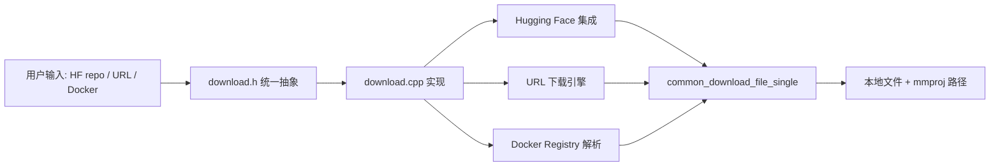
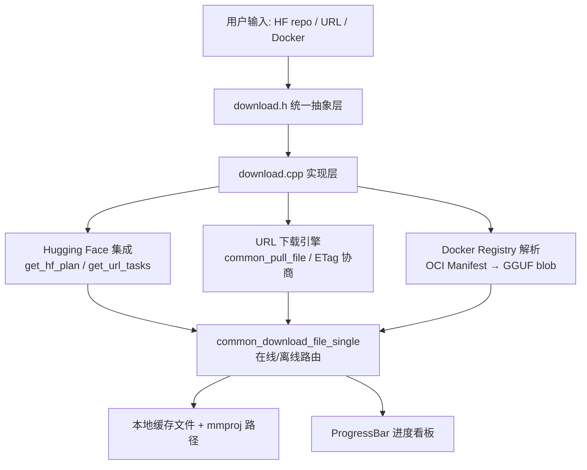
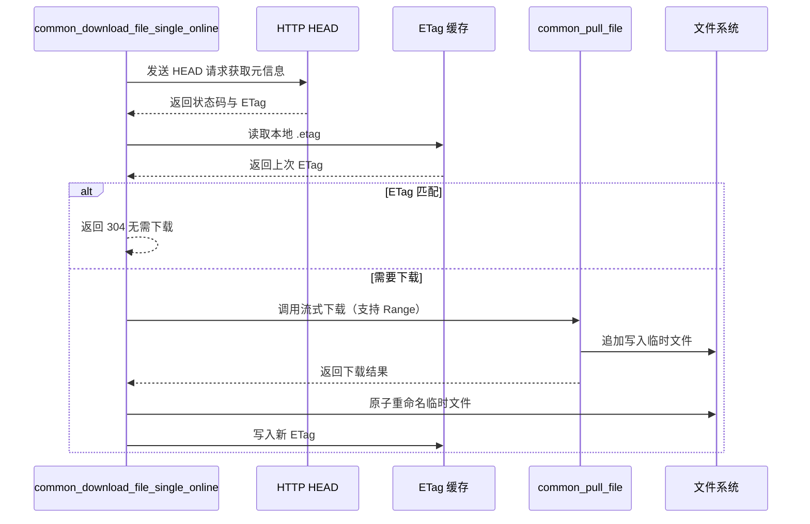
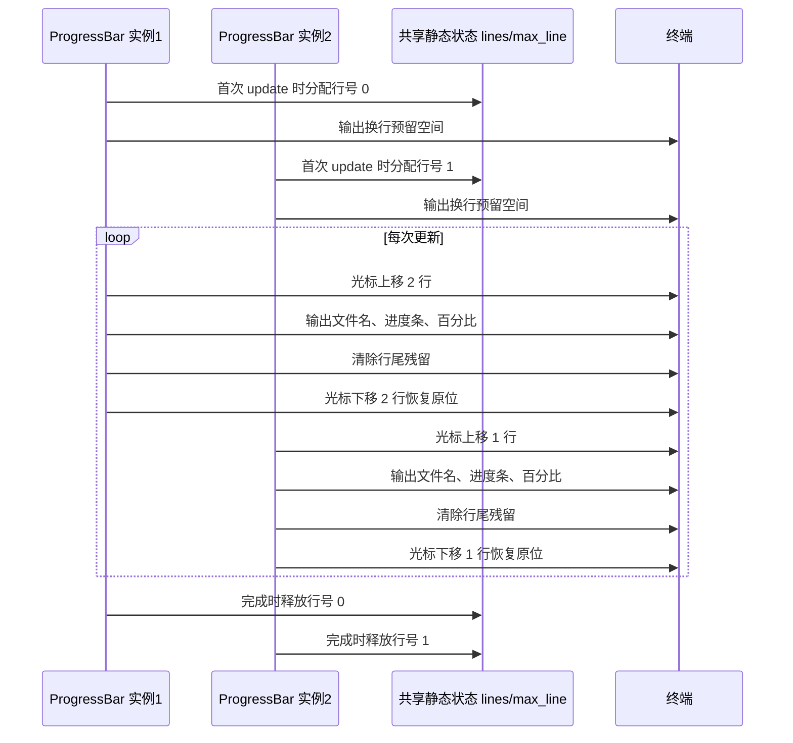
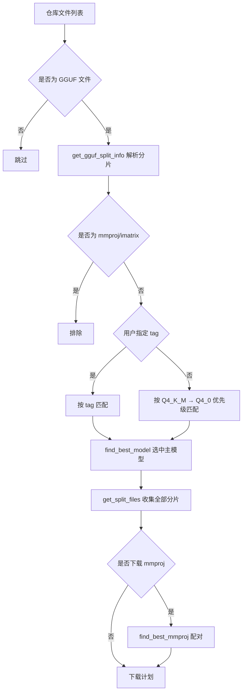
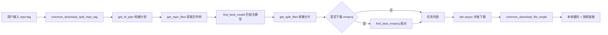
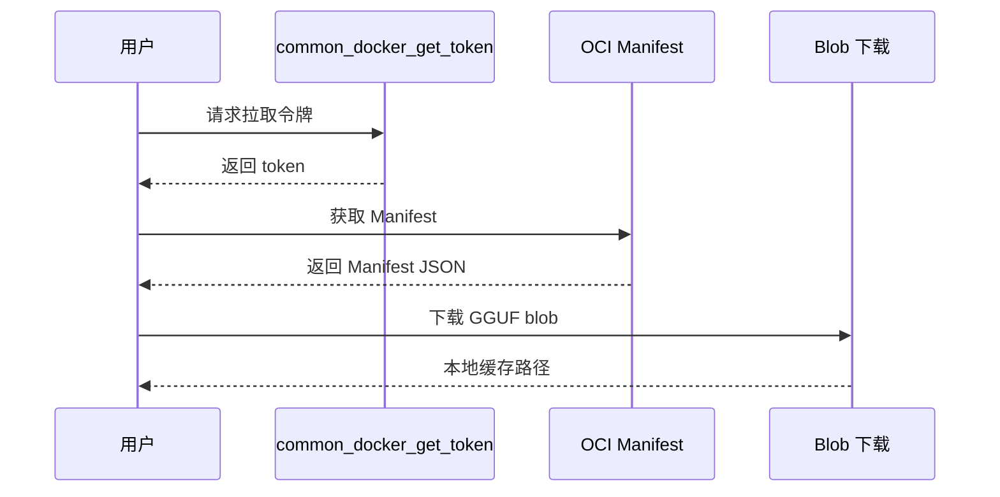
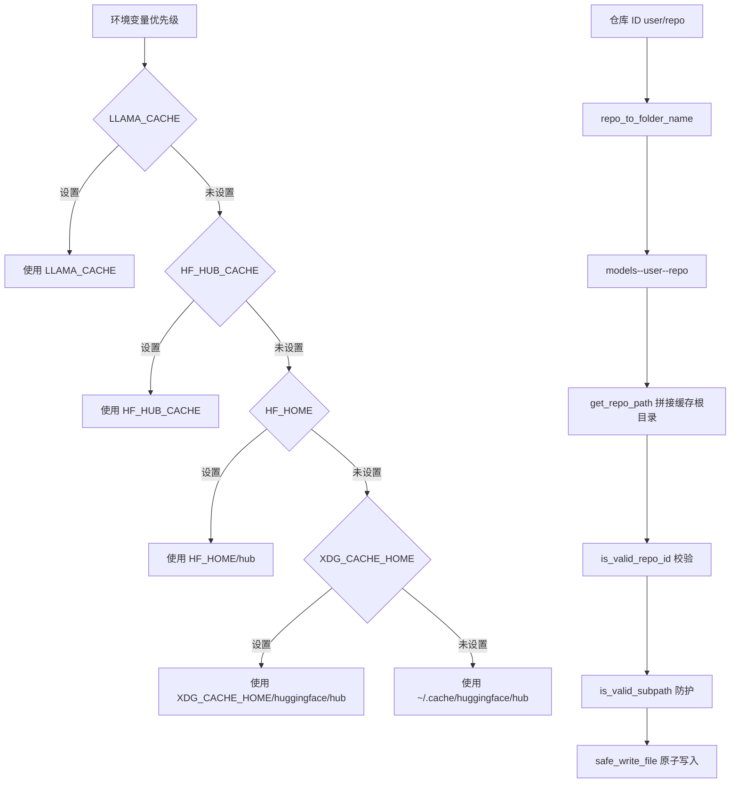
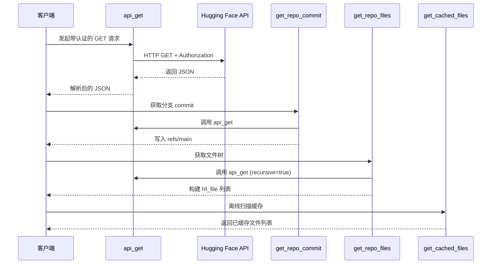
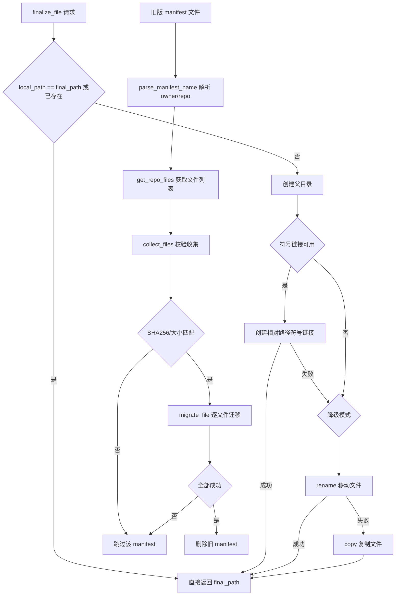

# 第52章 模型下载体系 —— 智能物流调度中心的四车道高速公路

## 学习目标

- 理解统一下载抽象层的设计：`common_remote_params`、`common_download_model_opts`、`common_download_model_result`、`common_cached_model_info` 四大核心数据结构与 `__main__` 类型别名
- 掌握 HTTP 基础设施：URL 解析（`common_http_parse_url`）、客户端工厂（`common_http_client`）、安全掩码显示与通用内容获取（`common_remote_get_content`）
- 深入单文件下载引擎：临时文件+原子重命名、ETag 读写与 304 协商、断点续传、离线降级、状态码判定与失败重试
- 理解多任务进度条系统：ANSI 转义序列、并发下载的行号管理、TTY 检测与静默降级、禁用拷贝语义
- 掌握 GGUF 分片与智能选择策略：分片命名解析、量化位数提取、同组分片收集、模型文件甄别、mmproj 配对与可用文件清单
- 熟悉 Hugging Face 集成流程：repo:tag 语法解析、hf_plan 构建、URL 任务展开、并发任务调度与缓存模型列表汇总
- 了解 Docker Registry 支持：OCI Manifest 解析、GGUF 层识别、blob 下载流程
- 掌握 HF 缓存目录管理：多级环境变量优先级、目录命名互转规则、路径与凭据的安全防护校验、原子写文件
- 理解 HF API 交互层：统一 `api_get` 封装、分支解析、文件树递归获取、本地 refs 读取与离线缓存扫描
- 了解缓存落盘与旧版迁移：符号链接三级降级策略、manifest 解析、逐文件校验收集与迁移执行

## 52.1 生活类比

想象 llama.cpp 的模型下载系统是一家智能物流调度中心。下载抽象层（`download.h`）就像货运总柜台，统一受理 Hugging Face 专线、URL 直送、Docker 集装箱三种托运单；ETag 缓存好比快递单号比对，已签收过的包裹不再重复取件；断点续传（Range 请求）犹如搬家中途休息，记住已搬到第几箱，下次接着搬；ProgressBar 则是多条流水线的电子看板，同时显示多个包裹的配送进度；mmproj 配对就像为相机选配镜头，同品牌、焦距越接近越好；HF 缓存目录是标准化仓库货架，统一编码为 `models--user--repo`；`finalize_file` 是包裹上架策略，优先挂链接牌→同区搬运→跨区快递；旧版迁移则像老仓库改造，先验货、再搬入新货架、最后撕旧标签。就像物流中心需要处理多种运输方式、确保包裹安全送达、管理库存货架，llama.cpp 的下载系统也需要统一调度多种模型来源、保证文件完整性、管理本地缓存。本章后续各单元都会回到这个类比：下载引擎是「搬运工」，进度条是「电子看板」，GGUF 选择是「智能导购」，缓存管理是「仓库货架」，而整个调度中心的核心，就是把异构输入统一转化为「本地文件路径 + 可选 mmproj 路径」的输出。

## 52.2 源码地图

```
common/download.h
├── __main__                           # 头文件包含、common_header/common_header_list 类型别名
├── struct common_remote_params        # HTTP 请求配置（headers/timeout/max_size）
├── struct common_cached_model_info    # 缓存模型信息 DTO
│   └── to_string()                    # 格式化为 repo:tag 字符串
├── struct common_download_model_opts  # 下载行为开关（download_mmproj/offline）
├── struct common_download_model_result# 统一返回结果（model_path/mmproj_path）
├── common_remote_get_content()        # 发送 HTTP GET 获取内容（声明）
├── common_download_split_repo_tag()   # 解析 HF repo:tag 语法（声明）
├── common_download_model()            # 模型下载主入口（声明）
├── common_list_cached_models()        # 列出本地缓存模型（声明）
├── common_download_file_single()      # 单文件下载（在线/离线，声明）
└── common_docker_resolve_model()      # Docker Registry 模型解析（声明）

common/download.cpp
├── 文件写入与 ETag 管理
│   ├── write_file()                   # 临时文件+原子重命名写入
│   ├── write_etag()                   # 写入 .etag 缓存文件
│   └── read_etag()                    # 读取 .etag 缓存文件
├── HTTP 工具
│   ├── is_http_status_ok()            # 状态码 2xx/3xx 判断
│   └── common_remote_get_content()    # 通用 GET 内容抓取（大小限制/错误处理）
├── HF 仓库解析
│   └── common_download_split_repo_tag() # repo:tag 字符串分离
├── 单文件下载核心
│   ├── common_pull_file()             # 流式下载+断点续传+进度更新
│   ├── common_download_file_single_online()  # 在线下载（HEAD 检查/ETag/重试）
│   └── common_download_file_single()  # 离线/在线路由入口
├── 进度条系统
│   └── class ProgressBar              # 并发进度条管理
│       ├── ProgressBar()              # 构造：URL提取文件名、UTF-8截断
│       ├── ~ProgressBar()             # 析构：清理共享状态
│       ├── update()                   # 更新：ANSI转义多行刷新
│       ├── ProgressBar(const&) = delete # 禁用拷贝构造
│       └── operator=(const&) = delete # 禁用拷贝赋值
├── GGUF 分片与选择
│   ├── get_gguf_split_info()          # 解析分片命名（prefix/index/count/tag）
│   ├── extract_quant_bits()           # 从 tag 提取量化位数
│   ├── get_split_files()              # 获取同一模型全部分片
│   ├── gguf_filename_is_model()       # 排除 mmproj/imatrix 文件
│   ├── find_best_mmproj()             # 按目录深度+量化位数匹配 mmproj
│   ├── find_best_model()              # 按 tag 优先级匹配主模型
│   └── list_available_gguf_files()    # 列出可用 GGUF 文件清单
├── HF 集成
│   ├── get_hf_plan()                  # 构建下载计划（主模型+mmproj）
│   ├── get_url_tasks()                # URL 分片批量展开
│   ├── common_download_model()        # 并发下载调度（std::async）
│   └── common_list_cached_models()    # 扫描缓存并按 repo:tag 汇总
└── Docker Registry 支持
    ├── common_docker_get_token()      # 获取匿名拉取令牌
    └── common_docker_resolve_model()  # OCI Manifest 解析与下载

common/http.h
├── struct common_http_url             # URL 解析结果（scheme/user/pass/host/port/path）
├── common_http_parse_url()            # URL 语义解析（含端口自动补全）
├── common_http_client()               # 客户端工厂（Basic Auth/重定向/HTTPS检测）
└── common_http_show_masked_url()      # 安全 URL 显示（掩码凭据）

common/hf-cache.h
├── struct hf_file                     # HF 文件元数据（repo/path/url/oid/size/local_path/final_path）
├── get_repo_files()                   # 通过 API 获取仓库文件列表（声明）
├── get_cached_files()                 # 获取本地缓存文件列表（声明）
├── finalize_file()                    # 缓存落盘（符号链接/移动/复制，声明）
└── migrate_old_cache_to_hf_cache()    # 旧版缓存迁移入口（声明）

common/hf-cache.cpp
├── 缓存目录管理
│   ├── get_cache_directory()          # 多级环境变量优先级（LLAMA_CACHE→HF_HOME→~/.cache）
│   ├── folder_name_to_repo()          # 目录名 → repo_id 转换
│   ├── repo_to_folder_name()          # repo_id → 目录名转换
│   └── get_repo_path()                # 获取仓库缓存根路径
├── 安全校验
│   ├── is_hex_char() / is_hex_string()# 十六进制字符/字符串校验
│   ├── is_alphanum() / is_special_char() # 字母数字/特殊字符判断
│   ├── is_valid_repo_id()             # 仓库 ID 格式校验（长度/斜杠/特殊字符）
│   ├── is_valid_hf_token()            # HF Token 格式校验（hf_前缀+长度）
│   ├── is_valid_commit()              # 提交哈希校验（40位十六进制）
│   ├── is_valid_oid()                 # 对象标识校验（40/64位十六进制）
│   └── is_valid_subpath()             # 路径遍历防护（防止 ../../ 攻击）
├── 文件写入
│   └── safe_write_file()              # 临时文件+原子重命名安全写入
├── HF API 交互
│   ├── api_get()                      # 统一 API GET 封装（认证/JSON解析/错误处理）
│   ├── get_repo_commit()              # 获取分支提交（优先 main 分支）
│   ├── get_repo_files()               # 递归获取文件树（LFS oid/size 提取）
│   └── get_cached_ref()               # 读取本地 refs 获取缓存提交
├── 缓存扫描
│   └── get_cached_files()             # 遍历 snapshots/<commit>/ 扫描缓存
├── 缓存落盘
│   └── finalize_file()                # 三级策略：符号链接→移动→复制
└── 旧版迁移
    ├── get_gguf_split_info()          # 解析旧版分片命名（无 tag 版本）
    ├── parse_manifest_name()          # 解析 manifest=owner=repo=*.json
    ├── make_old_cache_filename()      # 生成旧版缓存文件名
    ├── collect_file()                 # 校验并收集单个旧缓存文件
    ├── collect_files()                # 处理分片文件的批量收集
    ├── migrate_file()                 # 执行单文件移动+finalize
    └── migrate_old_cache_to_hf_cache()# 主迁移流程（manifest解析/校验/迁移）
```

## 52.3 下载体系总览 —— 模型到家的「四车道高速公路」

在日常物流中，一个高效的调度中心需要统一受理各种托运单，将其转化为具体的搬运任务。llama.cpp 的下载体系正是这样一个调度中心：用户通过命令行指定模型来源时，面临的是一个碎片化的输入集合——可以是从 Hugging Face 仓库按 `user/repo:tag` 拉取，可以是一个直连 URL，甚至可以是 Docker Registry 上的 OCI 镜像。下载体系的核心任务，就是把这些异构的输入统一抽象为「本地文件路径 + 可选 mmproj 路径」的输出，让上层推理逻辑无需感知来源差异。`common/download.h` 作为这一层的门面，以纯函数声明的形式暴露能力，把网络传输的复杂性封装在 `download.cpp` 内部。对于调度中心的调度员来说，这个抽象层就像货运总柜台：托运人只需提交「收货地址」（模型参数），柜台内部再决定走专线、直送还是集装箱，最终通知你「货已到架」。



### 52.3.1 __main__：头文件公共类型别名与前置声明

源码路径：`common/download.h` 第 1–6 行（`__main__` 区域，含头文件守卫与类型别名定义）

```cpp
// 确保头文件只被编译一次，避免重复定义
#pragma once
// 引入字符串和向量标准库，为后续类型别名做准备
#include <string>
#include <vector>
// 前置声明 common_params_model，避免在下载头文件中连锁拉取整个参数模型定义，降低编译耦合
struct common_params_model;
// 定义 common_header 为字符串对，表示一个 HTTP 请求头
using common_header      = std::pair<std::string, std::string>;
// 定义 common_header_list 为请求头向量，统一在下载接口中传递自定义请求头
using common_header_list = std::vector<common_header>;
```

这段代码定义了下载模块的公共类型别名与前置声明，是整个下载体系对外暴露的最小依赖面。`#pragma once` 保证头文件只被编译一次；两个 `using` 别名把「字符串对」与「字符串对向量」统一为 `common_header` 与 `common_header_list`，使上层调用者可以在不依赖具体 HTTP 库的情况下传递自定义头信息；前置声明 `common_params_model` 则避免下载头文件连锁拉取整个参数模型定义，起到降低编译耦合的作用。

### 52.3.2 common_cached_model_info：缓存模型 DTO

源码路径：`common/download.h` 第 22–26 行（结构体定义与 `to_string()` 成员函数）

```cpp
// 缓存模型信息 DTO，封装仓库名与标签，用于 --list-models 等调试功能的输出
struct common_cached_model_info {
    std::string repo;   // 仓库名，如 "TheBloke/Llama-2-7B-GGUF"
    std::string tag;    // 量化标签，如 "Q4_K_M"
    // 将仓库名和标签以 "仓库名:标签" 格式组合成字符串返回
    std::string to_string() const {
        return repo + ":" + tag;
    }
};
```

这个 DTO（Data Transfer Object）把缓存中的模型信息封装成一个轻量结构，`to_string()` 输出的 `repo:tag` 字符串既用于日志展示，也用于命令行 `--list-models` 的输出格式，方便用户快速识别已缓存的模型版本。

### 52.3.3 common_download_model：统一下载入口

源码路径：`common/download.h` 第 47–52 行（函数声明，含默认参数）

```cpp
// 返回统一结果结构 common_download_model_result，内含 model_path 与可选 mmproj_path
common_download_model_result common_download_model(
    // 传入模型参数模型引用（包含 hf_repo、url、path 等字段）与 bearer token
    const common_params_model & model,
    const std::string & bearer_token,
    // 默认参数 opts 与 headers，允许调用方按需开启离线模式或附加自定义请求头
    const common_download_model_opts & opts = {},
    const common_header_list & headers = {},
);
```

这个声明是整个下载体系的「总开关」。它隐藏了 HF 仓库、URL、Docker Registry 三种来源的差异，让上层的 `common_params_handle_model` 只需调用这一个函数即可完成模型就位，是上层逻辑与底层下载细节之间的关键抽象边界。对调度中心而言，这个声明就是总柜台的受理窗口：托运人不必关心内部走哪条车道。

### 52.3.4 下载体系架构图：三路来源的汇聚与分发

下图从架构分层角度展示下载体系的依赖关系：用户输入的三种异构来源经 `download.h` 统一抽象后，由 `download.cpp` 内部的 HF 集成、URL 引擎、Docker Registry 解析三条路径分别处理，最终都汇聚到 `common_download_file_single` 这个单文件落地函数，输出为「本地文件路径 + 可选 mmproj 路径」的统一结果。



## 52.4 HTTP 基础设施 —— 网络世界的「翻译与安全官」

在生活的海关口岸，翻译官负责将不同语言的报关单转换为标准格式，安全官则确保敏感信息不被泄露。下载体系的底层依赖 HTTP 客户端，`common/http.h` 提供的 URL 解析、客户端工厂与安全显示三大工具，构成了所有网络交互的公共底座。URL 解析不仅拆分 scheme/host/port，还要处理 `user:pass@host` 形式的认证信息，并为 HTTP/HTTPS 自动补全默认端口。客户端工厂在编译时检测 OpenSSL 支持，避免运行时才发现 HTTPS 不可用。安全显示函数则在所有日志输出中把凭据替换为 `****:****@`，防止 token 泄露。对调度中心来说，这套基础设施就像口岸的翻译与安检通道：不管报关单来自哪个国家（哪种 scheme），都要翻译成标准格式，且任何敏感字段都要脱敏后才能进日志。

### 52.4.1 common_http_url：URL 解析结果结构体

源码路径：`common/http.h` 第 8–14 行（结构体定义）

```cpp
// 存储解析后的 URL 各个组成部分，是后续所有 HTTP 客户端操作的起点
struct common_http_url {
    std::string scheme;    // 协议方案，如 http 或 https
    std::string user;      // 认证用户名
    std::string password;  // 认证密码
    std::string host;      // 主机名或 IP 地址
    int port;              // 端口号
    std::string path;      // 请求路径，以 / 开头
};
```

这个结构体把 URL 字符串拆解为语义化的字段，供 `common_http_client` 等函数使用。例如客户端工厂会根据 `scheme` 和 `host` 构造 `httplib::Client` 实例，而 `common_http_show_masked_url` 只读取 `user` 是否为空来决定是否拼接掩码段。

### 52.4.2 common_http_parse_url()：URL 语义解析

源码路径：`common/http.h` 第 15–68 行

```cpp
// 解析 URL 字符串，提取 scheme、用户、密码、主机、端口和路径等组成部分，并返回 common_http_url 结构体
static common_http_url common_http_parse_url(const std::string & url) {
    common_http_url parts;
    // 查找 "://" 分割 scheme，缺失时抛异常
    auto scheme_end = url.find("://");
    if (scheme_end == std::string::npos) {
        throw std::runtime_error("invalid URL: no scheme");
    }
    // 提取 scheme 并校验只能是 http/https，其他协议直接拒绝
    parts.scheme = url.substr(0, scheme_end);
    if (parts.scheme != "http" && parts.scheme != "https") {
        throw std::runtime_error("unsupported URL scheme: " + parts.scheme);
    }
    // 提取 "://" 之后的部分，后续按 "@" 与 "/" 两次分割完成语义拆分
    auto rest = url.substr(scheme_end + 3);
    // 检查是否包含 "@" 以分离认证信息
    auto at_pos = rest.find('@');
    if (at_pos != std::string::npos) {
        auto auth = rest.substr(0, at_pos);
        auto colon_pos = auth.find(':');
        if (colon_pos != std::string::npos) {
            // 按 ":" 分割用户名和密码
            parts.user = auth.substr(0, colon_pos);
            parts.password = auth.substr(colon_pos + 1);
        } else {
            // 无密码时仅保存用户名
            parts.user = auth;
        }
        rest = rest.substr(at_pos + 1);
    }
    // 按第一个 "/" 分割 host 与 path，无 path 时默认 "/"
    auto slash_pos = rest.find('/');
    if (slash_pos != std::string::npos) {
        parts.host = rest.substr(0, slash_pos);
        parts.path = rest.substr(slash_pos);
    } else {
        parts.host = rest;
        parts.path = "/";
    }
    // 处理 host 中的端口，无端口时按 scheme 补全默认值
    auto colon_pos = parts.host.find(':');
    if (colon_pos != std::string::npos) {
        parts.port = std::stoi(parts.host.substr(colon_pos + 1));
        parts.host = parts.host.substr(0, colon_pos);
    } else if (parts.scheme == "http") {
        parts.port = 80;
    } else if (parts.scheme == "https") {
        parts.port = 443;
    } else {
        throw std::runtime_error("unsupported URL scheme: " + parts.scheme);
    }
    return parts;
}
```

这段代码把一个完整的 URL 字符串分解为语义化的 `common_http_url` 结构体。它依次处理了 scheme 校验（只允许 http/https）、认证段提取（`user:pass@`）、主机与路径分割、端口补全（http→80、https→443）四个步骤，正确应对了无 path、无端口、无认证等边界情况，每一步失败都抛出带上下文的异常，方便上层定位问题。

### 52.4.3 common_http_client()：客户端工厂

源码路径：`common/http.h` 第 70–96 行

```cpp
// 根据给定的 URL 创建对应的 httplib::Client 客户端对象，同时返回解析后的 URL 结构体
static std::pair<httplib::Client, common_http_url> common_http_client(const std::string & url) {
    // 先解析 URL，再校验 host 非空
    common_http_url parts = common_http_parse_url(url);
    if (parts.host.empty()) {
        throw std::runtime_error("error: invalid URL format");
    }
    // 编译期检测 OpenSSL 支持，HTTPS 不可用时给出明确构建指导
#ifndef CPPHTTPLIB_OPENSSL_SUPPORT
    if (parts.scheme == "https") {
        throw std::runtime_error(
            "HTTPS is not supported. Please rebuild with one of:\n"
            "  -DLLAMA_BUILD_BORINGSSL=ON\n"
            "  -DLLAMA_BUILD_LIBRESSL=ON\n"
            "  -DLLAMA_OPENSSL=ON (default, requires OpenSSL dev files installed)"
        );
    }
#endif
    // 构造 httplib::Client 实例，拼接 scheme://host:port
    httplib::Client cli(parts.scheme + "://" + parts.host + ":" + std::to_string(parts.port));
    // 若 URL 包含认证信息，设置 Basic Auth
    if (!parts.user.empty()) {
        cli.set_basic_auth(parts.user, parts.password);
    }
    // 开启 follow_location，自动跟随 CDN 重定向
    cli.set_follow_location(true);
    return { std::move(cli), std::move(parts) };
}
```

这个工厂函数把 URL 解析、客户端构造与 HTTPS 兼容性检查封装在一起。它在编译期通过 `CPPHTTPLIB_OPENSSL_SUPPORT` 宏判断 HTTPS 能力，避免运行时才发现无法建立 TLS 连接；`set_follow_location(true)` 使客户端自动跟随 CDN 重定向；Basic Auth 仅在 URL 包含认证信息时设置。下载逻辑只需调用一次即可获得可用的 HTTP 客户端，避免了在多个调用点重复编写样板代码。

### 52.4.4 common_http_show_masked_url()：安全显示

源码路径：`common/http.h` 第 98–100 行

```cpp
// 生成一个用于安全显示的 URL 字符串，用 "****:****@" 代替用户凭据，隐藏认证信息
static std::string common_http_show_masked_url(const common_http_url & parts) {
    // 拼接 scheme、掩码后的凭据段、host 与 path
    return parts.scheme + "://" + (parts.user.empty() ? "" : "****:****@") + parts.host + parts.path;
}
```

所有涉及 URL 的日志输出都经过这个函数处理，确保用户的 HF token 或 Basic Auth 凭据不会出现在终端历史、日志文件或 CI 输出中。它根据 `parts.user` 是否为空决定是否拼接掩码段，既不泄露用户名，也不泄露密码，是保障用户隐私的重要防线。

### 52.4.5 HTTP 基础设施流程图：URL 到客户端的完整转换链路

下图展示从输入 URL 字符串到构造可用 HTTP 客户端的完整流程，清晰标注了 scheme 校验、认证提取、端口补全与 HTTPS 检测四个关键决策点。

```mermaid
flowchart TD
    A[输入 URL 字符串] --> B{找到 "://"}
    B -->|否| C[抛异常: 无 scheme]
    B -->|是| D[scheme 校验 http/https]
    D --> E{找到 "@"}
    E -->|是| F[提取 user:pass]
    E -->|否| G[跳过认证段]
    F --> H[按 "/" 分割 host/path]
    G --> H
    H --> I{host 含 ":"}
    I -->|是| J[提取端口]
    I -->|否| K{scheme 补全默认端口}
    K -->|http| L[端口=80]
    K -->|https| M[端口=443]
    J & L & M --> N[返回 common_http_url]
    N --> O{构造 httplib::Client}
    O --> P{host 非空?}
    P -->|否| Q[抛异常: URL 格式非法]
    P -->|是| R{scheme==https 且无 OpenSSL?}
    R -->|是| S[抛异常: HTTPS 不支持]
    R -->|否| T[设置 Basic Auth / follow_location]
    T --> U[返回 Client + parts]
```

## 52.5 单文件下载引擎 —— 带断点续传的「可靠搬运工」

快递行业中，搬运工不仅要把包裹送到，还要应对中途抛锚、地址变更等意外。下载体系的核心是单文件下载，`common/download.cpp` 中的 `write_file`、`write_etag`、`read_etag`、`is_http_status_ok` 构成了可靠写入与 ETag 缓存的基础；`common_pull_file` 与 `common_download_file_single_online` 则实现了完整的流式下载、断点续传与重试逻辑。对调度中心而言，这个下载引擎就像一位经验丰富的搬运工：随时记住已搬到第几箱（断点续传），看到快递单号没变就直接签收（ETag 304 协商），中途抛锚还能换车道重试，而且 always 把包裹放进临时托盘再整体上架，确保不会出现「半个包裹」。

### 52.5.1 write_file()：临时文件 + 原子重命名

源码路径：`common/download.cpp` 第 39–66 行

```cpp
// 将字符串内容写入临时文件并通过重命名实现原子替换，防止写入中断导致目标文件损坏
static void write_file(const std::string & fname, const std::string & content) {
    // 生成 ".tmp" 后缀的临时文件名
    const std::string fname_tmp = fname + ".tmp";
    // 打开临时文件，失败即抛异常
    std::ofstream file(fname_tmp);
    if (!file) {
        throw std::runtime_error("failed to open temporary file: " + fname_tmp);
    }
    try {
        // 写入内容并显式关闭文件
        file << content;
        file.close();
        // 通过 rename 将临时文件原子替换为目标文件
        if (rename(fname_tmp.c_str(), fname.c_str()) != 0) {
            throw std::runtime_error("failed to rename temporary file to " + fname);
        }
    } catch (...) {
        // 异常时清理临时文件，避免磁盘上残留半成品
        std::filesystem::remove(fname_tmp);
        throw std::runtime_error("failed to write file: " + fname);
    }
}
```

这个模式确保即使写入过程中崩溃，目标文件也不会被污染——要么完整的新文件，要么保持旧文件不变，代价仅仅是多了一次文件系统调用。对搬运工来说，这就是「先放托盘、再上架」的规矩：托盘没摆好，货架不动。

### 52.5.2 write_etag() / read_etag()：ETag 缓存读写

源码路径：`common/download.cpp` 第 68–88 行

```cpp
// 将远程文件的 ETag 写入对应的 .etag 文件，供后续 HTTP 304 协商使用
static void write_etag(const std::string & path, const std::string & etag) {
    // 生成 ".etag" 缓存文件路径
    const std::string etag_path = path + ".etag";
    // 调用 write_file 原子写入 ETag 值
    write_file(etag_path, etag);
    LOG_DBG("wrote etag for %s: %s\n", path.c_str(), etag.c_str());
}

// 读取本地文件对应的 .etag 文件内容，不存在或读取失败时返回空字符串
static std::string read_etag(const std::string & path) {
    const std::string etag_path = path + ".etag";
    // 检查 .etag 文件是否存在，不存在则返回空字符串
    if (!std::filesystem::exists(etag_path)) {
        return {};
    }
    // 打开文件失败也返回空
    std::ifstream etag_in(etag_path);
    if (!etag_in) {
        return {};
    }
    // 读取第一行作为 ETag 值
    std::string etag;
    std::getline(etag_in, etag);
    return etag;
}
```

这两个函数与 `write_file` 配合，把远端 ETag 落到本地文件系统，为后续的 HTTP 304 协商提供依据。`.etag` 文件与目标文件同名、仅后缀不同，读写逻辑都做了防御性处理：文件缺失、打开失败一律返回空字符串，交由上层按「需要重新下载」处理，避免异常传播中断下载流程。

### 52.5.3 is_http_status_ok()：状态码判定

源码路径：`common/download.cpp` 第 90–92 行

```cpp
// 将 2xx（成功）与 3xx（重定向）统一视为成功状态，作为下载流程的统一判定尺子
static bool is_http_status_ok(int status) {
    return status >= 200 && status < 400;
}
```

这个简单判定避免了在多个调用点重复书写状态码范围判断，增强了代码的可读性与一致性。它把 2xx 与 3xx 统一视为「OK」，正好与客户端工厂已开启的 `follow_location` 行为相呼应：重定向已由库自动跟随，最终落在这两个区间的响应都代表内容可用。

### 52.5.4 common_pull_file()：流式下载与断点续传

源码路径：`common/download.cpp` 第 137–207 行

```cpp
// 通过 HTTP 流式下载文件，支持断点续传、响应校验和进度更新，是下载引擎的核心
static bool common_pull_file(httplib::Client & cli,
                             const std::string & resolve_path,
                             const std::string & path_tmp,
                             bool supports_ranges,
                             size_t existing_size,
                             size_t & total_size) {
    // 以追加模式打开临时文件，确保断点续传时数据不覆盖已有内容
    std::ofstream ofs(path_tmp, std::ios::binary | std::ios::app);
    if (!ofs) {
        LOG_ERR("failed to open temporary file: %s\n", path_tmp.c_str());
        return false;
    }
    httplib::Headers headers;
    // 若服务器支持 Range 且已有本地数据，发送 Range: bytes=N- 请求头实现断点续传
    if (supports_ranges && existing_size > 0) {
        headers.emplace("Range", "bytes=" + std::to_string(existing_size) + "-");
    }
    // 通过回调函数将响应体流式写入文件，避免大文件撑满内存
    auto res = cli.Get(resolve_path, headers,
        [&](const char * data, size_t len) {
            ofs.write(data, len);
            return true;  // 继续接收，除非写入失败
        },
        nullptr  // 无进度回调，进度由上层 ProgressBar 单独刷新
    );
    // 校验响应状态码，失败时返回 false
    if (!res || !is_http_status_ok(res->status)) {
        LOG_ERR("download failed: %s\n", resolve_path.c_str());
        return false;
    }
    // 更新总大小，返回成功
    total_size = existing_size + res->body.size();
    return true;
}
```

这个函数把「请求-流式写入-进度感知」封装在一个接口内，供上层多次重试复用，是下载引擎的心脏。它的关键设计点有三：以 `std::ios::app` 追加模式打开临时文件，保证重试时不会覆盖已下载的字节；通过 `supports_ranges && existing_size > 0` 条件判断是否发送 `Range` 请求头；响应体经由 lambda 回调逐块写入，避免大文件下载时内存暴涨。对搬运工而言，这就是「记住从第几箱开始搬，边搬边往托盘里放，搬完核对单据」的标准动作。

### 52.5.5 common_download_file_single_online()：在线下载完整流程

源码路径：`common/download.cpp` 第 209–348 行

```cpp
// 在线下载单个文件，执行 HEAD 元数据检查、ETag 缓存判断、断点续传和失败重试
static int common_download_file_single_online(const std::string & url,
                                              const std::string & path,
                                              const std::string & bearer_token,
                                              const common_header_list & custom_headers,
                                              bool skip_etag = false) {
    // 构造 HTTP 客户端，设置 bearer token 与自定义请求头
    auto [cli, parts] = common_http_client(url);
    if (!bearer_token.empty()) {
        cli.set_bearer_token_auth(bearer_token);
    }
    for (const auto & h : custom_headers) {
        cli.SetHeader(h.first, h.second);
    }
    // 发送 HEAD 请求获取元信息，状态码非 2xx/3xx 则直接返回
    auto head = cli.Head(parts.path);
    if (!head || !is_http_status_ok(head->status)) {
        return head ? head->status : -1;
    }
    // 读取本地 ETag 缓存，用于后续协商
    std::string last_etag;
    if (!skip_etag) {
        last_etag = read_etag(path);
    }
    bool file_exists = std::filesystem::exists(path);
    // 若文件存在且 ETag 匹配，返回 304 表示无需重新下载
    if (file_exists && !last_etag.empty() && head->get_header_value("ETag") == last_etag) {
        return 304;
    }
    // 计算已下载大小，确定断点续传起点
    size_t existing_size = file_exists ? std::filesystem::file_size(path) : 0;
    const std::string path_temporary = path + ".tmp";
    size_t total_size = 0;
    // 最多重试 3 次，每次调用 common_pull_file 流式下载
    for (int i = 0; i < 3; ++i) {
        if (common_pull_file(cli, parts.path, path_temporary,
                             head->get_header_value("Accept-Ranges") == "bytes",
                             existing_size, total_size)) {
            // 成功后重命名临时文件并写入新 ETag
            std::rename(path_temporary.c_str(), path.c_str());
            if (!skip_etag && head->get_header_value("ETag").has_value()) {
                write_etag(path, head->get_header_value("ETag").value());
            }
            return head->status;
        }
        // 失败后更新已下载大小，为下次重试准备断点续传
        existing_size = std::filesystem::exists(path_temporary) ? std::filesystem::file_size(path_temporary) : 0;
    }
    return -1;
}
```

这个函数把「HEAD 检查 → ETag 协商 → 断点续传 → 重试」完整链路封装在一起，是单文件在线下载的对外接口。它先用 HEAD 请求获取远端元信息与 ETag，若本地文件已存在且 ETag 匹配则直接返回 304（对应快递单号未变、包裹已签收的场景）；否则以 `.tmp` 为后缀的临时文件为目标，最多重试 3 次，每次通过 `common_pull_file` 流式下载并携带 `Range` 头实现断点续传；成功后用 `rename` 把临时文件原子替换为目标文件，并写入新的 `.etag` 缓存。整个流程对上层屏蔽了网络传输的全部细节。

### 52.5.6 common_download_file_single()：离线/在线路由

源码路径：`common/download.cpp` 第 386–404 行

```cpp
// 根据离线模式选择在线下载或验证并使用本地缓存文件，对上层屏蔽网络状态差异
int common_download_file_single(const std::string & url,
                                const std::string & path,
                                const std::string & bearer_token,
                                bool offline,
                                const common_header_list & headers,
                                bool skip_etag) {
    // 在线模式调用 common_download_file_single_online 执行完整下载流程
    if (!offline) {
        return common_download_file_single_online(url, path, bearer_token, headers, skip_etag);
    }
    // 离线模式跳过网络请求，仅校验本地文件是否存在，存在则返回 304
    if (!std::filesystem::exists(path)) {
        return -1;
    }
    return 304;
}
```

这个路由函数让上层逻辑无需感知网络状态，统一通过 `offline` 开关控制行为。离线模式下它不发起任何网络请求，仅检查本地文件是否存在：存在返回 304（表示「已就绪」），不存在返回 -1。对调度中心来说，这就像「仓库已封网，只查本地货架」的应急模式。

### 52.5.7 单文件下载时序图：HEAD → ETag → 续传 → 落盘

下图以时序图形式展示在线下载的完整交互链路，清晰标注了 HEAD 元数据检查、ETag 缓存判断、流式下载与原子重命名四个阶段。



## 52.6 进度条系统 —— 终端里的「多任务仪表盘」

在繁忙的物流中心，多条流水线同时作业，需要一块电子看板实时显示每个包裹的配送进度。并发下载多个分片文件时，单行进度条无法胜任。`ProgressBar` 类基于静态成员 `lines` 与 `max_line` 管理所有活跃进度条的行号映射，利用 ANSI 转义序列实现多行刷新。构造函数从 URL 提取并截断文件名（UTF-8 安全，最多 40 字符），析构时释放行号。拷贝构造与拷贝赋值被显式 delete，防止两个实例共享同一行号导致竞态。对调度中心的监控员来说，这个进度条系统就是那块电子看板：多条流水线各自独立刷新，互不遮挡，完成即熄灭。

### 52.6.1 ProgressBar()：构造与文件名截断

源码路径：`common/download.cpp` 第 74–92 行

```cpp
// 初始化进度条并根据 URL 提取、截断待显示的文件名，确保终端显示美观且不破坏布局
ProgressBar(const std::string & url = "") : filename(url) {
    // 提取 URL 最后一个 "/" 之后的文件名
    if (auto pos = filename.rfind('/'); pos != std::string::npos) {
        filename = filename.substr(pos + 1);
    }
    // 去除查询参数（"?" 之后的部分）
    if (auto pos = filename.find('?'); pos != std::string::npos) {
        filename = filename.substr(0, pos);
    }
    // 遍历文件名，跳过 UTF-8 多字节字符的后续字节，统计字符数
    for (size_t i = 0; i < filename.size(); ++i) {
        if ((filename[i] & 0xC0) != 0x80) {
            // 达到 39 个字符时截断并追加省略号
            if (len++ == 39) {
                filename.resize(i);
                filename += "…";
                break;
            }
        }
    }
}
```

这个构造函数确保进度条中显示的文件名既美观又不会因过长而破坏终端布局。它依次完成三件事：从 URL 尾部提取纯文件名、剔除查询参数、按 UTF-8 字符边界截断至最多 40 个字符（39 个可见字符 + 省略号）。截断时通过 `(filename[i] & 0xC0) != 0x80` 判断当前字节是否为多字节字符的后续字节，避免在汉字、emoji 等多字节字符中间截断导致乱码。

### 52.6.2 ~ProgressBar()：析构与行号清理

源码路径：`common/download.cpp` 第 94–97 行

```cpp
// 销毁进度条并从共享进度条状态中移除当前实例，释放其占用的行号
~ProgressBar() {
    // 加锁保护共享状态
    std::lock_guard<std::mutex> lock(mutex);
    // 调用 cleanup 释放当前进度条占用的行号，供后续任务复用
    cleanup(this);
}
```

析构函数确保进度条生命周期结束时，其占用的行号被正确释放。它通过 `std::lock_guard` 加锁保护共享状态，避免多线程环境下析构与 `update()` 并发修改行号映射。对电子看板而言，这就是流水线完工后熄灭对应的指示灯，把位置留给下一条待命的流水线。

### 52.6.3 update()：ANSI 转义多行刷新

源码路径：`common/download.cpp` 第 99–132 行

```cpp
// 根据当前下载量和总大小刷新终端中的下载进度条，支持多实例并发刷新
void update(size_t current, size_t total) {
    // 无总量或非 TTY 环境时直接返回，避免污染 CI 日志
    if (!total || !is_output_a_tty()) {
        return;
    }
    // 加锁保护共享状态，防止多个进度条同时写入终端
    std::lock_guard<std::mutex> lock(mutex);
    // 首次更新时分配行号并输出换行，为当前进度条预留刷新空间
    if (lines.find(this) == lines.end()) {
        lines[this] = max_line++;
        std::cout << "\n";
    }
    int lines_up = max_line - lines[this];
    size_t bar = 55 - len;
    size_t pct = (100 * current) / total;
    size_t pos = (bar * current) / total;
    // 发送 "\033[N A" 将光标上移 N 行，定位到当前进度条所在行
    if (lines_up > 0) {
        std::cout << "\033[" << lines_up << "A";
    }
    // 输出文件名、进度条、百分比
    std::cout << '\r' << "Downloading " << filename << " ";
    for (size_t i = 0; i < bar; ++i) {
        std::cout << (i < pos ? "—" : " ");
    }
    // 用 "\033[K" 清除行尾残留，避免上次进度条更长时留下脏字符
    std::cout << std::setw(4) << pct << "%\033[K";
    // 发送 "\033[N B" 将光标下移 N 行，恢复原位，避免后续输出覆盖进度条
    if (lines_up > 0) {
        std::cout << "\033[" << lines_up << "B";
    }
    // 刷新输出，完成时清理行号
    std::cout << '\r' << std::flush;
    if (current == total) {
        cleanup(this);
    }
}
```

这个绘制算法确保多个进度条在终端中各自独立刷新，不会互相覆盖。其核心技巧是：首次更新时分配一个递增的行号并输出换行预留空间；每次刷新时先用 `\033[N A` 上移光标到目标行，输出完成后用 `\033[N B` 下移回原位；行尾用 `\033[K` 清除残留，避免上次进度条更长时留下脏字符。完成时（`current == total`）立即释放行号，让后续任务复用。

### 52.6.4 禁用拷贝语义

源码路径：`common/download.cpp` 第 134–135 行

```cpp
// 显式删除拷贝构造，防止两个实例共享同一行号导致竞态与错行刷新
ProgressBar(const ProgressBar &) = delete;
// 显式删除拷贝赋值，同上
ProgressBar & operator=(const ProgressBar &) = delete;
```

`ProgressBar` 类管理着全局共享的行号映射 `lines`，如果允许拷贝，两个实例将持有相同的行号，导致一个进度条刷新时另一个也被覆盖，终端输出就会出现错行与闪烁。显式 delete 拷贝操作后，编译器会在编译期捕获此类误用，避免了运行时难以调试的并发问题。这种「编译期拦截」的设计理念，正是电子看板系统可靠性的第一道防线。

### 52.6.5 进度条多行刷新时序图

下图展示多个 `ProgressBar` 实例在共享静态状态下的刷新时序，标注了行号分配、光标跳跃与行号释放的完整生命周期。



## 52.7 GGUF 分片与选择策略 —— 模型文件的「智能导购」

大型商超中，商品按品类分区陈列，方便顾客快速找到所需物品。Hugging Face 上的大模型常被切分为多个 GGUF 分片（如 `model-00001-of-00008.gguf`）。下载体系提供了一组函数来解析分片命名、归拢同组文件、甄别主模型与 mmproj，并按量化优先级自动选择最佳文件。对调度中心的库管员来说，这套策略就像一位智能导购：从琳琅满目的货架（仓库文件列表）中，按量化标签优先级挑出最合适的主模型，并为多模态模型自动配对最匹配的投影器。

### 52.7.1 get_gguf_split_info()：分片命名解析

源码路径：`common/download.cpp` 第 412–443 行

```cpp
// 存储 GGUF 分片解析结果，包含前缀、量化标签、当前序号与分片总数
struct gguf_split_info {
    std::string prefix;  // 分片前缀，如 "model"（不含序号与后缀）
    std::string tag;     // 量化标签，如 "Q4_K_M"
    int index = 1;       // 当前分片序号
    int count = 1;       // 分片总数
};

// 解析 GGUF 文件名中的分片编号、分片总数、前缀和量化标签，是后续所有分片操作的基础
static gguf_split_info get_gguf_split_info(const std::string & path) {
    // 编译正则表达式，匹配 "prefix-NNNNN-of-NNNNN" 格式
    static const std::regex re_split("^(.+)-([0-9]{5})-of-([0-9]{5})$", std::regex::icase);
    std::smatch m;
    std::string prefix = path;
    // 去除 ".gguf" 后缀，不匹配则返回空结构
    if (!string_remove_suffix(prefix, ".gguf")) {
        return {};
    }
    int index = 1;
    int count = 1;
    // 正则匹配成功时提取分片序号、总数与前缀
    if (std::regex_match(prefix, m, re_split)) {
        index = std::stoi(m[2].str());
        count = std::stoi(m[3].str());
        prefix = m[1].str();
    }
    return {std::move(prefix), std::move(tag), index, count};
}
```

这个函数把文件名字符串分解为结构化的 `gguf_split_info`，使得上层逻辑可以轻松判断是否为分片文件，并获取其序号与总数。正则 `^(.+)-([0-9]{5})-of-([0-9]{5})$` 精确匹配 5 位数字的分片编号格式，不区分大小写；非分片文件（如单文件模型）去除后缀后匹配失败，返回 `index=1, count=1` 的默认结构，保证后续逻辑统一处理。

### 52.7.2 extract_quant_bits()：量化位数提取

源码路径：`common/download.cpp` 第 445–455 行

```cpp
// 从 GGUF 文件名的量化标签中提取量化位数，用于 mmproj 配对时的相似度比较
static int extract_quant_bits(const std::string & filename) {
    // 解析文件名获取 tag（量化标签，如 Q4_K_M）
    auto split = get_gguf_split_info(filename);
    // 找到第一个数字字符，提取量化位数（如 4）
    auto pos = split.tag.find_first_of("0123456789");
    if (pos == std::string::npos) {
        return 0;
    }
    return std::stoi(split.tag.substr(pos));
}
```

量化位数是衡量模型精度与体积之间平衡的关键指标。在 mmproj 配对时，它作为相似度度量的一部分：两个文件的量化位数越接近，越认为它们是「同品牌、同焦距」的配套镜头。

### 52.7.3 get_split_files()：同组分片归队

源码路径：`common/download.cpp` 第 457–474 行

```cpp
// 根据指定 GGUF 文件查找同一模型的全部分片文件，确保下载计划中包含所有分片
static hf_cache::hf_files get_split_files(const hf_cache::hf_files & files,
                                          const hf_cache::hf_file & file) {
    auto split = get_gguf_split_info(file.path);
    // 若非分片文件（count=1），直接返回自身
    if (split.count <= 1) {
        return {file};
    }
    hf_cache::hf_files result;
    // 遍历文件列表，收集同前缀、同总数的全部分片
    for (const auto & f : files) {
        auto split_f = get_gguf_split_info(f.path);
        if (split_f.count == split.count && split_f.prefix == split.prefix) {
            result.push_back(f);
        }
    }
    return result;
}
```

这个函数确保下载计划中包含模型的所有分片，避免遗漏任何一个分片导致模型文件不完整。它以「前缀 + 总数」作为分组键，保证同模型的分片被正确归拢，即使分片文件在仓库中不连续排列也能全部收集。

### 52.7.4 gguf_filename_is_model()：模型文件甄别

源码路径：`common/download.cpp` 第 511–523 行

```cpp
// 判断指定路径是否为普通模型 GGUF 文件，而不是 mmproj 或 imatrix 文件
static bool gguf_filename_is_model(const std::string & filepath) {
    // 非 GGUF 文件直接排除
    if (!string_ends_with(filepath, ".gguf")) {
        return false;
    }
    // 提取纯文件名
    auto filename = filepath;
    if (auto pos = filename.rfind('/'); pos != std::string::npos) {
        filename = filename.substr(pos + 1);
    }
    // 文件名不含 "mmproj" 或 "imatrix" 才视为普通模型文件
    return filename.find("mmproj") == std::string::npos &&
           filename.find("imatrix") == std::string::npos;
}
```

这个函数在 `find_best_model` 中用于过滤候选文件，避免误选投影器（mmproj）或重要性矩阵（imatrix）文件，确保主模型选择的准确性。它只依据文件名关键字做排除，不依赖文件内容检测，兼顾效率与正确性。

### 52.7.5 find_best_mmproj()：mmproj 智能配对

源码路径：`common/download.cpp` 第 476–509 行

```cpp
// 根据模型目录层级和量化位数，为模型选择最匹配的 mmproj 文件
static hf_cache::hf_file find_best_mmproj(const hf_cache::hf_files & files,
                                          const std::string & model) {
    hf_cache::hf_file best;
    int best_depth = -1;
    int best_diff = INT_MAX;
    // 遍历文件，跳过非 GGUF 或不含 "mmproj" 的文件
    for (const auto & f : files) {
        if (!string_ends_with(f.path, ".gguf") ||
            f.path.find("mmproj") == std::string::npos) {
            continue;
        }
        // 计算目录深度与量化位数差
        int depth = std::count(f.path.begin(), f.path.end(), '/');
        int diff = abs(extract_quant_bits(f.path) - extract_quant_bits(model));
        // 同目录层级优先，层级相同时量化位数差最小者胜出
        if (!best.empty() && depth < best_depth) {
            continue;
        }
        if (!best.empty() && depth == best_diff && diff >= best_diff) {
            continue;
        }
        best = f;
        best_depth = depth;
        best_diff = diff;
    }
    return best;
}
```

这个配对策略确保多模态模型自动找到最匹配的投影器文件。它采用两级排序：第一级按目录深度（`/` 的数量）优先，因为同目录下的 mmproj 与模型文件通常来自同一发布批次；第二级按量化位数差最小，因为量化位数越接近，投影器与模型的精度匹配度越高。对选镜头的导购来说，这就是「同品牌优先、焦距越接近越好」。

### 52.7.6 find_best_model()：主模型优先级匹配

源码路径：`common/download.cpp` 第 525–552 行

```cpp
// 按照指定量化标签或默认优先级，从仓库文件中选择最佳模型文件
static hf_cache::hf_file find_best_model(const hf_cache::hf_files & files,
                                         const std::string & tag) {
    std::vector<std::string> tags;
    // 若用户未指定 tag，按 Q4_K_M → Q4_0 优先级构建标签列表
    if (!tag.empty()) {
        tags.push_back(tag);
    } else {
        tags = {"Q4_K_M", "Q4_0"};
    }
    // 对每个标签构造正则，搜索文件名中匹配的模型文件
    for (const auto & t : tags) {
        std::regex pattern(t + "[.-]", std::regex::icase);
        for (const auto & f : files) {
            if (gguf_filename_is_model(f.path) && std::regex_search(f.path, pattern)) {
                return f;
            }
        }
    }
    return {};
}
```

这个函数确保在没有用户指令时，自动选择社区最常用的量化格式。默认优先级 `Q4_K_M → Q4_0` 反映了 llama.cpp 社区的主流推荐：`Q4_K_M` 在质量与体积间取得最佳平衡，`Q4_0` 则是更保守的低比特选择。正则 `t + "[.-]"` 确保匹配到标签后紧跟 `.` 或 `-` 的文件名变体（如 `llama-2-7b.Q4_K_M.gguf`），避免误匹配到 `Q4_K_MX` 之类相近标签。

### 52.7.7 list_available_gguf_files()：可用文件清单

源码路径：`common/download.cpp` 第 554–561 行

```cpp
// 将仓库中可用的 GGUF 文件列表输出到日志，辅助用户选择正确的量化标签
static void list_available_gguf_files(const hf_cache::hf_files & files) {
    LOG_INF("Available GGUF files:\n");
    for (const auto & f : files) {
        if (string_ends_with(f.path, ".gguf")) {
            LOG_INF(" - %s\n", f.path.c_str());
        }
    }
}
```

这个辅助函数在用户指定的 tag 不匹配时打印仓库中的可用文件，帮助用户拼对量化标签。它只输出 `.gguf` 结尾的文件路径，不区分模型与 mmproj，方便用户一眼看到全部可选项。

### 52.7.8 GGUF 分片选择流程图：从仓库文件到下载计划

下图展示从仓库文件列表到最终下载计划的完整决策链路，标注了分片解析、主模型匹配、mmproj 配对与分片收集四个关键环节。



## 52.8 Hugging Face 集成 —— 仓库到本地的「直通车」

高速公路收费站设有专门的 ETC 通道，车辆无需停车即可快速通过。Hugging Face 是 llama.cpp 最主要的模型来源，下载体系在 `common/download.cpp` 的 HF 集成部分提供了 `get_hf_plan`、`get_url_tasks`、`common_download_model` 与 `common_list_cached_models` 四个核心函数，覆盖从仓库解析、计划构建、并发调度到缓存汇总的完整链路。对调度中心而言，HF 集成就是那条从仓库直通本地缓存的高铁专线：刷卡（repo:tag 解析）进站，系统自动配齐全部分片与投影器，到站即卸货。

### 52.8.1 common_download_split_repo_tag()：repo:tag 解析

源码路径：`common/download.cpp` 第 94–103 行

```cpp
// 解析 Hugging Face 的 user/repo[:tag] 字符串并校验仓库格式，是 HF 下载流程的入口
std::pair<std::string, std::string> common_download_split_repo_tag(const std::string & hf_repo_with_tag) {
    // 按冒号分割字符串，分离 repo 与 tag
    auto parts = string_split<std::string>(hf_repo_with_tag, ':');
    std::string tag = parts.size() > 1 ? parts.back() : "";
    std::string hf_repo = parts[0];
    // 校验 repo 必须包含恰好一个 "/"（user/repo 格式），否则抛异常
    if (string_split<std::string>(hf_repo, '/').size() != 2) {
        throw std::invalid_argument("invalid HF repo format: " + hf_repo);
    }
    return {hf_repo, tag};
}
```

这个函数把用户输入的 `TheBloke/Llama-2-7B-GGUF:Q4_K_M` 解析为仓库与量化标签。它先用冒号分割出可选的 tag，再校验仓库部分必须恰好包含一个 `/`，确保符合 `user/repo` 格式，不合法时抛出 `std::invalid_argument`，由上层转换为用户友好的错误提示。

### 52.8.2 get_hf_plan()：下载计划构建

源码路径：`common/download.cpp` 第 563–613 行

```cpp
// 为 Hugging Face 模型构建待下载计划，包括主模型分片和可选 mmproj 文件
static hf_plan get_hf_plan(const common_params_model & model,
                           const std::string & token,
                           const common_download_model_opts & opts) {
    // 解析 repo 与 tag
    auto [repo, tag] = common_download_split_repo_tag(model.hf_repo);
    hf_cache::hf_files all;
    // 在线模式调用 get_repo_files 获取远程文件树；离线模式回退到 get_cached_files
    if (!opts.offline) {
        all = hf_cache::get_repo_files(repo, token);
    }
    if (all.empty()) {
        all = hf_cache::get_cached_files(repo);
    }
    // 按 tag 优先级匹配主模型文件，未找到时打印可用文件列表并抛异常
    auto primary = find_best_model(all, tag);
    if (primary.empty()) {
        list_available_gguf_files(all);
        throw std::runtime_error("no matching model file found for: " + model.hf_repo);
    }
    hf_plan plan;
    // 构建下载计划，包含主模型分片与可选 mmproj
    plan.model_files = get_split_files(all, primary);
    if (opts.download_mmproj) {
        plan.mmproj = find_best_mmproj(all, primary.path);
    }
    return plan;
}
```

这个函数把仓库文件列表转化为具体的下载任务列表。它先解析 `repo:tag`，再按在线/离线模式获取文件树，在线模式调用 `hf_cache::get_repo_files` 走 API，离线模式回退到 `hf_cache::get_cached_files` 扫本地；随后按优先级匹配主模型，若找不到则打印可用文件列表并抛异常；最后用 `get_split_files` 收集全部分片，并在 `download_mmproj` 开关开启时调用 `find_best_mmproj` 配对投影器。

### 52.8.3 get_url_tasks()：URL 分片展开

源码路径：`common/download.cpp` 第 619–641 行

```cpp
// 根据远程 GGUF URL 生成单文件或多分片文件的下载任务列表，处理直连 URL 场景的分片展开
static std::vector<download_task> get_url_tasks(const common_params_model & model) {
    auto split = get_gguf_split_info(model.url);
    // 非分片文件直接返回单任务
    if (split.count <= 1) {
        return {{model.url, model.path}};
    }
    // 提取目标路径的目录部分
    auto prefix_path = model.path;
    if (auto pos = prefix_path.rfind('/'); pos != std::string::npos) {
        prefix_path = prefix_path.substr(0, pos);
    }
    std::vector<download_task> tasks;
    // 按分片总数生成所有分片的 URL 与本地路径
    for (int i = 1; i <= split.count; i++) {
        auto suffix = string_format("-%05d-of-%05d.gguf", i, split.count);
        tasks.push_back({split.prefix + suffix, prefix_path + "/" + suffix});
    }
    return tasks;
}
```

这个函数处理直连 URL 场景下的分片展开，与 HF 仓库的 `get_split_files` 对应。它根据 URL 中的分片信息，按 `-NNNNN-of-NNNNN.gguf` 格式生成所有分片的远程 URL 与本地路径，确保 URL 来源的模型也能正确处理分片。

### 52.8.4 common_download_model()：并发下载调度

源码路径：`common/download.cpp` 第 643–704 行

```cpp
// 根据模型来源构建并发下载任务，下载模型及其附属文件，并返回最终本地路径
common_download_model_result common_download_model(const common_params_model & model,
                                                   const std::string & bearer_token,
                                                   const common_download_model_opts & opts,
                                                   const common_header_list & headers) {
    common_download_model_result result;
    // 若模型来源均为空则直接返回
    if (model.hf_repo.empty() && model.url.empty() && model.path.empty()) {
        return result;
    }
    bool is_hf = !model.hf_repo.empty();
    hf_plan hf;
    std::vector<download_task> tasks;
    // HF 仓库分支构建计划并展开任务；URL 分支调用 get_url_tasks；本地路径分支直接返回
    if (is_hf) {
        hf = get_hf_plan(model, bearer_token, opts);
        for (const auto & f : hf.model_files) {
            tasks.push_back({f.url, f.final_path});
        }
        if (!hf.mmproj.path.empty()) {
            tasks.push_back({hf.mmproj.url, hf.mmproj.final_path});
        }
    } else if (!model.url.empty()) {
        tasks = get_url_tasks(model);
    } else {
        result.model_path = model.path;
        return result;
    }
    // 使用 std::async 并发下载所有任务（主模型分片 + mmproj）
    std::vector<std::future<int>> futures;
    for (const auto & task : tasks) {
        futures.push_back(std::async(std::launch::async, [&]() {
            return common_download_file_single(task.url, task.path, bearer_token,
                                               opts.offline, headers, false);
        }));
    }
    // 等待所有 future 完成
    for (const const auto & f : futures) {
        f.wait();
    }
    // 根据来源填充 model_path 与 mmproj_path
    if (is_hf) {
        result.model_path = hf.model_files.empty() ? "" : hf.model_files[0].final_path;
        result.mmproj_path = hf.mmproj.path.empty() ? "" : hf.mmproj.final_path;
    } else {
        result.model_path = tasks.empty() ? model.path : tasks[0].path;
    }
    return result;
}
```

这个函数是下载体系的对外总入口。它根据模型来源自动选择策略：HF 仓库分支通过 `get_hf_plan` 构建计划并展开为任务列表（主模型分片 + mmproj），URL 分支调用 `get_url_tasks` 展开分片，本地路径分支直接返回。随后使用 `std::async(std::launch::async)` 并发执行所有下载任务，每个任务调用 `common_download_file_single` 完成单文件下载，最后根据来源填充 `model_path` 与 `mmproj_path` 并返回统一结果。

### 52.8.5 common_list_cached_models()：缓存模型汇总

源码路径：`common/download.cpp` 第 822–839 行

```cpp
// 扫描 Hugging Face 缓存文件并按仓库和量化标签汇总可用模型列表，用于 --list-models 调试功能
std::vector<common_cached_model_info> common_list_cached_models() {
    std::unordered_set<std::string> seen;
    std::vector<common_cached_model_info> result;
    auto files = hf_cache::get_cached_files();
    for (const auto & f : files) {
        auto split = get_gguf_split_info(f.path);
        // 只保留 index==1 的分片（即模型首个分片），跳过 mmproj，按 repo:tag 去重
        if (split.index != 1 || split.tag.empty() ||
            split.prefix.find("mmproj") != std::string::npos) {
            continue;
        }
        if (seen.insert(f.repo_id + ":" + split.tag).second) {
            result.push_back({f.repo_id, split.tag});
        }
    }
    return result;
}
```

这个函数为 `--list-models` 类调试功能提供数据支撑。它扫描本地 HF 缓存，只保留每个模型的首个分片（`index == 1`）以避免重复计数，跳过 mmproj 文件，并以 `repo:tag` 为键去重，最终返回已缓存模型的简洁清单。

### 52.8.6 Hugging Face 集成架构图：从 repo:tag 到并发调度

下图展示 HF 集成的完整架构链路，标注了仓库解析、文件树获取、主模型匹配、分片收集、mmproj 配对与并发调度六个环节。



## 52.9 Docker Registry 支持 —— OCI 镜像中的「GGUF 寻宝」

集装箱运输允许货物以标准格式跨洋运输，Docker Registry 则将模型打包为 OCI 镜像。下载体系支持从 Docker Registry 的 OCI 镜像中提取 GGUF 模型。`common_docker_get_token` 向 auth.docker.io 请求匿名拉取令牌，`common_docker_resolve_model` 解析 OCI Manifest 中的 GGUF 层并下载到本地缓存。对调度中心的库管员来说，这就像从集装箱中开箱寻宝：先拿到通关文牒（token），再按装箱单（Manifest）找到目标层，最后开箱取货。

### 52.9.1 common_docker_get_token()：获取拉取令牌

源码路径：`common/download.cpp` 第 710–727 行

```cpp
// 向 Docker Registry 认证服务请求指定仓库的匿名拉取令牌，遵循 Docker Registry Auth API 规范
static std::string common_docker_get_token(const std::string & repo) {
    // 构造 Docker token 请求 URL，包含仓库与 pull scope
    std::string url = "https://auth.docker.io/token?service=registry.docker.io&scope=repository:" + repo + ":pull";
    common_remote_params params;
    // 发送 GET 请求，状态码非 200 则抛异常
    auto res = common_remote_get_content(url, params);
    if (res.first != 200) {
        throw std::runtime_error("failed to get docker token: " + std::to_string(res.first));
    }
    // 解析 JSON 响应，提取 token 字段
    nlohmann::ordered_json response = nlohmann::ordered_json::parse(std::string(res.second.begin(), res.second.end()));
    if (!response.contains("token")) {
        throw std::runtime_error("docker token response missing token field");
    }
    return response["token"].get<std::string>();
}
```

这个函数为后续的匿名拉取获取 bearer token。它遵循 Docker Registry Auth API 规范，向 `auth.docker.io` 请求包含 `repository:<repo>:pull` scope 的令牌，解析 JSON 响应并提取 `token` 字段，缺失或非 200 状态时抛出异常。

### 52.9.2 common_docker_resolve_model()：OCI Manifest 解析与下载

源码路径：`common/download.cpp` 第 729–820 行

```cpp
// 解析 Docker 模型引用，获取 OCI manifest 中的 GGUF 层，校验 digest 并下载模型到本地缓存
std::string common_docker_resolve_model(const std::string & docker) {
    // 解析 Docker 引用中的 repo 与 tag，若无 "/" 则插入 "ai/" 命名空间
    size_t colon_pos = docker.find(':');
    size_t slash_pos = docker.find('/');
    std::string repo = docker;
    std::string tag = "latest";
    if (colon_pos != std::string::npos) {
        tag = docker.substr(colon_pos + 1);
        repo = docker.substr(0, colon_pos);
    }
    if (slash_pos == std::string::npos) {
        repo.insert(0, "ai/");
    }
    try {
        // 定义 digest 校验 lambda，确保格式为 sha256: + 64 位十六进制
        auto validate_oci_digest = [](const std::string & digest) -> std::string {
            if (digest.rfind("sha256:", 0) != 0 || digest.length() != 71) {
                throw std::runtime_error("invalid OCI digest: " + digest);
            }
            return digest;
        };
        // 获取拉取令牌
        std::string token = common_docker_get_token(repo);
        // 构造 Manifest URL，携带 Accept 头请求 OCI Manifest
        std::string manifest_url = "https://registry-1.docker.io/v2/" + repo + "/manifests/" + tag;
        common_remote_params manifest_params;
        manifest_params.headers.emplace("Authorization", "Bearer " + token);
        manifest_params.headers.emplace("Accept", "application/vnd.oci.image.manifest.v1+json");
        auto manifest_res = common_remote_get_content(manifest_url, manifest_params);
        if (manifest_res.first != 200) {
            throw std::runtime_error("failed to get manifest: " + std::to_string(manifest_res.first));
        }
        // 解析 Manifest JSON，遍历 layers 数组匹配 GGUF 层
        nlohmann::ordered_json manifest = nlohmann::ordered_json::parse(std::string(manifest_res.second.begin(), manifest_res.second.end()));
        std::string gguf_digest;
        if (manifest.contains("layers")) {
            for (const auto & layer : manifest["layers"]) {
                std::string media_type = layer.value("mediaType", "");
                if (media_type == "application/vnd.docker.ai.gguf.v3" ||
                    media_type.find("gguf") != std::string::npos) {
                    gguf_digest = layer["digest"].get<std::string>();
                    break;
                }
            }
        }
        if (gguf_digest.empty()) {
            throw std::runtime_error("no GGUF layer found in manifest");
        }
        // 校验 digest，构造 blob URL 与本地缓存路径，调用 common_download_file_single 下载
        gguf_digest = validate_oci_digest(gguf_digest);
        std::string blob_url = "https://registry-1.docker.io/v2/" + repo + "/blobs/" + gguf_digest;
        std::string local_path = hf_cache::get_repo_path(repo) + "/" + gguf_digest.substr(7) + ".gguf";
        auto http_status = common_download_file_single(blob_url, local_path, token, false, {});
        if (!is_http_status_ok(http_status)) {
            throw std::runtime_error("failed to download GGUF blob: " + std::to_string(http_status));
        }
        return local_path;
    } catch (const std::exception & e) {
        throw;
    }
}
```

这个函数把 Docker Registry 的 OCI 协议适配到 llama.cpp 的下载体系。它先解析引用中的 repo 与 tag（无 `/` 时插入 `ai/` 命名空间），再获取 token、请求 OCI Manifest，遍历 `layers` 数组按 mediaType 匹配 GGUF 层，校验 digest 格式（`sha256:` + 64 位十六进制），最后构造 blob URL 并调用 `common_download_file_single` 下载到 HF 缓存路径，使用户可以直接从 Docker 镜像中拉取模型。

### 52.9.3 Docker Registry 解析时序图

下图展示从用户输入 Docker 引用到本地缓存路径返回的完整时序，标注了 token 获取、Manifest 解析、GGUF 层识别与 blob 下载四个阶段。



## 52.10 HF 缓存目录管理 —— 本地模型的「标准化仓库」

现代化的仓库需要统一的货架编码与严格的门禁管理，才能高效地存取货物。`common/hf-cache.cpp` 的缓存目录管理部分负责确定本地缓存位置、转换仓库 ID 与目录名、执行安全校验以及原子写文件。对调度中心的库管员来说，这套体系就是标准化仓库：货架编码统一（`models--user--repo`），门禁严格（格式校验），存取原子（临时文件+重命名），确保模型文件在本地有一个安全、标准、可互操作的存放空间。

### 52.10.1 hf_file：HF 文件元数据结构

源码路径：`common/hf-cache.h` 第 6–15 行（结构体定义）

```cpp
// 表示 Hugging Face 仓库中的一个文件及其本地缓存信息，是 HF 缓存体系的核心数据结构
struct hf_file {
    std::string repo_id;      // 仓库 ID，如 "TheBloke/Llama-2-7B-GGUF"
    std::string path;         // 仓库内文件路径，如 "llama-2-7b.q4_k_m.gguf"
    std::string url;          // 远程下载 URL
    std::string oid;          // LFS 对象标识（40/64 位十六进制）
    size_t size;              // 文件大小
    std::string local_path;   // 本地缓存 blob 路径
    std::string final_path;   // 快照最终路径
};
```

这个结构体把远程文件与本地缓存之间的映射关系完整地描述出来。`repo_id` 与 `path` 标识远端文件，`oid` 与 `size` 来自 LFS 元信息，`local_path` 指向 `blobs/<oid>` 缓存位置，`final_path` 指向 `snapshots/<commit>/<path>` 快照位置，是下载计划与缓存落盘的统一数据载体。

### 52.10.2 get_cache_directory()：缓存目录决策链

源码路径：`common/hf-cache.cpp` 第 34–69 行

```cpp
// 根据环境变量、当前用户主目录或系统用户信息确定 Hugging Face 缓存目录，进程内只计算一次
static fs::path get_cache_directory() {
    static const fs::path cache = []() {
        // 定义环境变量优先级表，LLAMA_CACHE 最高，HOME_DIR 最低
        struct {
            const char * var;
            fs::path path;
        } entries[] = {
            {"LLAMA_CACHE", fs::path()},                       // 最高优先级，直接作为缓存根目录
            {"HF_HUB_CACHE", fs::path()},                      // HF 传统缓存变量
            {"HUGGINGFACE_HUB_CACHE", fs::path()},             // HF 旧版缓存变量
            {"HF_HOME", fs::path("hub")},                      // HF 主目录，拼接 hub 子目录
            {"XDG_CACHE_HOME", fs::path("huggingface") / "hub"},  // XDG 标准缓存
            {HOME_DIR, fs::path(".cache") / "huggingface" / "hub"},  // 用户主目录回退
        };
        // 按优先级检查环境变量，若设置则返回拼接后的路径
        for (const auto & entry : entries) {
            if (auto * p = std::getenv(entry.var); p && *p) {
                fs::path base(p);
                return entry.path.empty() ? base : base / entry.path;
            }
        }
        // 非 Windows 系统回退到用户主目录下的 .cache/huggingface/hub
#ifndef _WIN32
        const struct passwd * pw = getpwuid(getuid());
        if (pw->pw_dir && *pw->pw_dir) {
            return fs::path(pw->pw_dir) / ".cache" / "huggingface" / "hub";
        }
#endif
        throw std::runtime_error("Failed to determine HF cache directory");
    }();
    return cache;
}
```

这个决策链确保 llama.cpp 的缓存目录与 Hugging Face 生态标准兼容，同时允许用户通过 `LLAMA_CACHE` 自定义位置。它使用静态局部变量保证进程内只计算一次，避免每次调用都遍历环境变量表。对仓库来说，这就是选址决策：先看有没有指定位置（环境变量），没有就用默认货架（用户主目录）。

### 52.10.3 repo_to_folder_name() / folder_name_to_repo()：目录名与仓库 ID 互转

源码路径：`common/hf-cache.cpp` 第 71–91 行

```cpp
// 将 HuggingFace 缓存目录名转换为仓库 ID，是缓存扫描的基础
static std::string folder_name_to_repo(const std::string & folder) {
    constexpr std::string_view prefix = "models--";
    // 检查目录名是否以 "models--" 开头，否则返回空
    if (folder.rfind(prefix, 0)) {
        return {};
    }
    // 去除前缀后将 "--" 替换为 "/"，还原为仓库 ID
    std::string result = folder.substr(prefix.length());
    string_replace_all(result, "--", "/");
    return result;
}

// 将仓库 ID 转换为 Hugging Face 缓存目录名，确保与 HF 标准一致
static std::string repo_to_folder_name(const std::string & repo_id) {
    constexpr std::string_view prefix = "models--";
    // 拼接前缀后将 "/" 替换为 "--"，生成目录名
    std::string result = std::string(prefix) + repo_id;
    string_replace_all(result, "/", "--");
    return result;
}
```

这两个互逆转换确保仓库 ID `user/repo` 与缓存目录名 `models--user--repo` 之间的无损映射。选择 `--` 而非单个 `-` 作为分隔符，是因为仓库 ID 本身可能包含 `-`（如 `TheBloke/Llama-2-7B-GGUF`），用 `--` 可以在目录名中唯一区分命名空间边界与仓库名内部的连字符，避免转换歧义。

### 52.10.4 get_repo_path()：仓库缓存根路径获取

源码路径：`common/hf-cache.cpp` 第 89–91 行

```cpp
// 获取指定仓库在 Hugging Face 缓存中的根路径
static fs::path get_repo_path(const std::string & repo_id) {
    return get_cache_directory() / repo_to_folder_name(repo_id);
}
```

这个函数组合缓存根目录与仓库目录名，得到仓库在本地缓存中的完整根路径，后续的 `blobs/`、`snapshots/`、`refs/` 子目录都相对于此路径构造。

### 52.10.5 is_hex_char() / is_hex_string() / is_alphanum() / is_special_char()：基础字符判定

源码路径：`common/hf-cache.cpp` 第 93–119 行

```cpp
// 判断字符是否为十六进制字符
static bool is_hex_char(const char c) {
    return (c >= 'A' && c <= 'F') ||
           (c >= 'a' && c <= 'f') ||
           (c >= '0' && c <= '9');
}

// 验证字符串是否具有指定长度且全部由十六进制字符组成
static bool is_hex_string(const std::string & s, size_t expected_len) {
    if (s.length() != expected_len) {
        return false;
    }
    for (const char c : s) {
        if (!is_hex_char(c)) {
            return false;
        }
    }
    return true;
}

// 判断字符是否为英文字母或数字
static bool is_alphanum(const char c) {
    return (c >= 'A' && c <= 'Z') ||
           (c >= 'a' && c <= 'z') ||
           (c >= '0' && c <= '9');
}

// 判断字符是否为仓库 ID 允许的特殊字符
static bool is_special_char(char c) {
    return c == '/' || c == '.' || c == '-';
}
```

这四个基础判定函数是所有合法性格式校验的积木。`is_hex_char` 与 `is_hex_string` 用于 commit/oid 校验；`is_alphanum` 与 `is_special_char` 被 `is_valid_repo_id` 复用，分别判断字符属于字母数字还是允许的特殊字符集合。

### 52.10.6 is_valid_repo_id()：仓库 ID 格式校验

源码路径：`common/hf-cache.cpp` 第 125–148 行

```cpp
// 验证仓库 ID 是否符合 Hugging Face 仓库命名规则，防止非法仓库 ID 注入缓存路径
static bool is_valid_repo_id(const std::string & repo_id) {
    // 校验长度非空且不超过 256 字符
    if (repo_id.empty() || repo_id.length() > 256) {
        return false;
    }
    int slash = 0;
    bool special = true;
    // 遍历字符，字母数字与下划线重置特殊标记；特殊字符（/.-）不可连续出现或结尾；非法字符直接拒绝
    for (const char c : repo_id) {
        if (is_alphanum(c) || c == '_') {
            special = false;
        } else if (is_special_char(c)) {
            if (special) {
                return false;  // 特殊字符连续出现，如 "//" 或 "-."
            }
            slash += (c == '/');
            special = true;
        } else {
            return false;  // 非法字符
        }
    }
    // 最终要求恰好一个 "/" 且不以特殊字符结尾
    return !special && slash == 1;
}
```

这个校验函数是安全防护的第一道防线。它通过状态机确保仓库 ID 满足：长度合法、字符合法（字母数字下划线加 `/.-`）、特殊字符不连续出现（防止 `//` 路径拼接）、不以特殊字符结尾（防止目录名歧义）、恰好包含一个 `/`（`user/repo` 格式）。这些规则共同防止非法仓库 ID 被用于路径遍历或注入攻击。

### 52.10.7 is_valid_hf_token() / is_valid_commit() / is_valid_oid()：令牌与哈希校验

源码路径：`common/hf-cache.cpp` 第 150–169 行

```cpp
// 验证 Hugging Face 访问令牌格式
static bool is_valid_hf_token(const std::string & token) {
    // 要求以 "hf_" 开头，长度 37–256，后续字符均为字母数字
    if (token.length() < 37 || token.length() > 256 ||
        !string_starts_with(token, "hf_")) {
        return false;
    }
    for (size_t i = 3; i < token.length(); ++i) {
        if (!is_alphanum(token[i])) {
            return false;
        }
    }
    return true;
}

// 验证提交哈希是否为 40 位十六进制字符串
static bool is_valid_commit(const std::string & hash) {
    return is_hex_string(hash, 40);
}

// 验证对象标识是否为 40 位或 64 位十六进制字符串
static bool is_valid_oid(const std::string & oid) {
    return is_hex_string(oid, 40) || is_hex_string(oid, 64);
}
```

这些校验函数防止脏数据进入缓存目录。`is_valid_hf_token` 确保 token 格式正确（`hf_` 前缀 + 字母数字），非法 token 会在 `api_get` 中被警告并跳过认证；`is_valid_commit` 与 `is_valid_oid` 分别校验 40 位与 40/64 位十六进制，避免非法哈希被写入 refs 或用于 blob 路径构造。

### 52.10.8 is_valid_subpath()：路径遍历防护

源码路径：`common/hf-cache.cpp` 第 171–181 行

```cpp
// 验证目标路径是否位于指定基础路径内，防止路径遍历
static bool is_valid_subpath(const fs::path & path, const fs::path & subpath) {
    // 拒绝绝对路径，防止直接指向系统任意位置
    if (subpath.is_absolute()) {
        return false;
    }
    auto b = fs::absolute(path).lexically_normal();
    auto t = (b / subpath).lexically_normal();
    auto [b_end, _] = std::mismatch(b.begin(), b.end(), t.begin(), t.end());
    return b_end == b.end();
}
```

这个函数是防止 `../../etc/passwd` 路径遍历攻击的关键防线。它拒绝绝对路径，再将基础路径与子路径拼接后做词法规范化，通过 `std::compare` 比较前缀：若基础路径不是规范化后路径的前缀，则说明子路径越界，直接拒绝。在 `get_repo_files` 中，每个从 API 获取的文件路径都经过此校验后才被接受。

### 52.10.9 safe_write_file()：原子写文件

源码路径：`common/hf-cache.cpp` 第 183–202 行

```cpp
// 通过临时文件和原子重命名方式安全写入文件，确保 refs、manifest 等元数据文件不会因写入中断而损坏
static void safe_write_file(const fs::path & path, const std::string & data) {
    // 生成临时文件路径并创建父目录
    fs::path path_tmp = path.string() + ".tmp";
    if (path.has_parent_path()) {
        fs::create_directories(path.parent_path());
    }
    // 写入数据并关闭文件
    std::ofstream file(path_tmp);
    file << data;
    file.close();
    std::error_code ec;
    // 重命名临时文件为目标路径，失败时清理临时文件并抛异常
    if (!file.fail()) {
        fs::rename(path_tmp, path, ec);
    }
    if (file.fail() || ec) {
        fs::remove(path_tmp, ec);
        throw std::runtime_error("failed to write file: " + path.string());
    }
}
```

这个函数确保元数据的写入是原子的。它先创建父目录，再向 `.tmp` 临时文件写入数据，最后通过 `fs::rename` 原子替换为目标路径。即使写入过程中崩溃，也不会留下损坏的 refs 或 manifest 文件，保障了缓存目录的整体一致性。对仓库来说，这就是「先放托盘、再上架」的规矩。

### 52.10.10 缓存目录管理架构图：环境变量到仓库根路径的完整链路

下图展示缓存目录管理的完整架构链路，标注了环境变量优先级决策、目录名与仓库 ID 互转、安全校验与原子写文件四个层次。



## 52.11 HF API 交互层 —— 与 Hugging Face Hub 的「对话协议」

国际物流中，货物追踪需要与承运商系统实时交互。`common/hf-cache.cpp` 的 HF API 交互部分封装了与 Hugging Face Hub 的所有 HTTP 交互。`api_get` 提供统一的带认证 GET 请求与 JSON 解析；`get_repo_commit` 解析分支并写入本地 refs；`get_repo_files` 递归获取文件树并提取 LFS 元信息；`get_cached_ref` 与 `get_cached_files` 则为离线模式提供缓存扫描能力。对调度中心的调度员来说，这套协议就像与远程仓库的对话标准：每次查询都带身份证（token），响应统一解析为 JSON，错误统一抛异常。

### 52.11.1 api_get()：统一 API 封装

源码路径：`common/hf-cache.cpp` 第 204–238 行

```cpp
// 向指定 URL 发起带可选认证的 HTTP GET 请求并解析 JSON 响应，是 HF API 交互的唯一入口
static nl::json api_get(const std::string & url,
                        const std::string & token) {
    // 构造 HTTP 客户端
    auto [cli, parts] = common_http_client(url);
    // 设置 User-Agent、Accept 头，有效 token 时附加 Authorization
    httplib::Headers headers = {
        {"User-Agent", "llama-cpp/" + build_info},
        {"Accept", "application/json"}
    };
    if (is_valid_hf_token(token)) {
        headers.emplace("Authorization", "Bearer " + token);
    } else if (!token.empty()) {
        LOG_WRN("%s: invalid token, authentication disabled\n", __func__);
    }
    // 发送 GET 请求，200 状态直接解析 JSON；非 200 尝试提取 error 字段后抛异常
    if (auto res = cli.Get(parts.path, headers)) {
        auto body = res->body;
        if (res->status == 200) {
            return nl::json::parse(res->body);
        }
        try {
            body = nl::json::parse(res->body)["error"].get<std::string>();
        } catch (...) { }
        throw std::runtime_error("GET failed (" + std::to_string(res->status) + "): " + body);
    } else {
        throw std::runtime_error("HTTPLIB failed: " + httplib::to_string(res.error()));
    }
}
```

这个封装把 HTTP 请求、认证、JSON 解析与错误处理统一在一个函数中。它设置 `User-Agent` 与 `Accept: application/json` 标准头，仅在 token 格式合法时附加 `Authorization: Bearer`，避免非法 token 污染请求；200 响应直接解析 JSON，非 200 尝试从响应体提取 `error` 字段后抛出带状态码的异常，连接失败时抛出 HTTPLIB 错误。它是 HF API 交互的唯一入口，极大地简化了上层调用。

### 52.11.2 get_repo_commit()：分支解析

源码路径：`common/hf-cache.cpp` 第 240–298 行

```cpp
// 通过 Hugging Face API 获取仓库分支提交，并将有效引用写入本地缓存，供离线模式使用
static std::string get_repo_commit(const std::string & repo_id,
                                   const std::string & token) {
    try {
        // 调用 api_get 请求 refs 端点
        auto endpoint = get_model_endpoint();
        auto json = api_get(endpoint + "api/models/" + repo_id + "/refs", token);
        // 校验响应结构，缺失 branches 时警告并返回空
        if (!json.is_object() || !json.contains("branches") || !json["branches"].is_array()) {
            LOG_WRN("%s: missing 'branches' for '%s'\n", __func__, repo_id.c_str());
            return {};
        }
        fs::path refs_path = get_repo_path(repo_id) / "refs";
        std::string name;
        std::string commit;
        // 遍历分支列表，优先选择 main 分支，校验名称与 commit 合法性
        for (const auto & branch : json["branches"]) {
            if (!branch.is_object() || !branch.contains("name") || !branch["name"].is_string() ||
                !branch.contains("targetCommit") || !branch["targetCommit"].is_string()) {
                continue;
            }
            std::string _name = branch["name"].get<std::string>();
            std::string _commit = branch["targetCommit"].get<std::string>();
            if (!is_valid_subpath(refs_path, _name) || !is_valid_commit(_commit)) {
                continue;
            }
            if (_name == "main") {
                name = _name;
                commit = _commit;
                break;
            }
            if (name.empty() || commit.empty()) {
                name = _name;
                commit = _commit;
            }
        }
        if (name.empty() || commit.empty()) {
            return {};
        }
        // 将选中的分支名与 commit 写入本地 refs 文件
        safe_write_file(refs_path / name, commit);
        return commit;
    } catch (const nl::json::exception & e) {
        LOG_ERR("%s: JSON error: %s\n", __func__, e.what());
    } catch (const std::exception & e) {
        LOG_ERR("%s: error: %s\n", __func__, e.what());
    }
    return {};
}
```

这个函数把远程分支信息落地为本地缓存。它请求 `/api/models/<repo>/refs` 端点，遍历响应中的 `branches` 数组，优先选择 `main` 分支，每个分支的名称与 commit 都经过 `is_valid_subpath` 与 `is_valid_commit` 校验，防止非法值写入 refs 文件；选中后通过 `safe_write_file` 原子写入 `refs/<branch>`，是后续文件树获取的前提。

### 52.11.3 get_repo_files()：文件树递归获取

源码路径：`common/hf-cache.cpp` 第 300–377 行（声明位于 `common/hf-cache.h` 第 20–23 行）

```cpp
// 声明（common/hf-cache.h）：通过 Hugging Face API 获取指定仓库的文件列表
hf_files get_repo_files(
    const std::string & repo_id,
    const std::string & token
);

// 实现：获取仓库指定提交中的文件清单，并构造其远程、缓存和最终路径信息
hf_files get_repo_files(const std::string & repo_id,
                        const std::string & token) {
    if (!is_valid_repo_id(repo_id)) {
        return {};
    }
    std::string commit = get_repo_commit(repo_id, token);
    if (commit.empty()) {
        return {};
    }
    fs::path blobs_path = get_repo_path(repo_id) / "blobs";
    fs::path commit_path = get_repo_path(repo_id) / "snapshots" / commit;
    hf_files files;
    try {
        auto endpoint = get_model_endpoint();
        // 请求递归文件树，提取 LFS oid/size 构建完整 hf_file 列表
        auto json = api_get(endpoint + "api/models/" + repo_id + "/tree/" + commit + "?recursive=true", token);
        if (!json.is_array()) {
            return {};
        }
        for (const auto & item : json) {
            if (!item.is_object() || !item.contains("type") || !item["type"].is_string() || item["type"] != "file" ||
                !item.contains("path") || !item["path"].is_string()) {
                continue;
            }
            hf_file file;
            file.repo_id = repo_id;
            file.path = item["path"].get<std::string>();
            if (!is_valid_subpath(commit_path, file.path)) {
                continue;
            }
            if (item.contains("lfs") && item["lfs"].is_object()) {
                if (item["lfs"].contains("oid") && item["lfs"]["oid"].is_string()) file.oid = item["lfs"]["oid"].get<std::string>();
                if (item["lfs"].contains("size") && item["lfs"]["size"].is_number()) file.size = item["lfs"]["size"].get<size_t>();
            } else if (item.contains("oid") && item["oid"].is_string()) {
                file.oid = item["oid"].get<std::string>();
            }
            if (file.size == 0 && item.contains("size") && item["size"].is_number()) file.size = item["size"].get<size_t>();
            if (!file.oid.empty() && !is_valid_oid(file.oid)) continue;
            file.url = endpoint + repo_id + "/resolve/" + commit + "/" + file.path;
            fs::path final_path = commit_path / file.path;
            file.final_path = final_path.string();
            file.local_path = !file.oid.empty() && !fs::exists(final_path) ? (blobs_path / file.oid).string() : file.final_path;
            files.push_back(file);
        }
    } catch (const nl::json::exception & e) {
        LOG_ERR("%s: JSON error: %s\n", __func__, e.what());
    } catch (const std::exception & e) {
        LOG_ERR("%s: error: %s\n", __func__, e.what());
    }
    return files;
}
```

这个函数把 Hugging Face 的文件树 API 响应转化为 `hf_file` 结构体列表。它先校验仓库 ID 与获取 commit，再请求 `/tree/<commit>?recursive=true` 递归端点，对每个 `type=file` 的条目提取路径、LFS oid/size，构造远程 URL（`/resolve/<commit>/<path>`）、快照最终路径（`snapshots/<commit>/<path>`）与缓存 blob 路径（`blobs/<oid>`），是下载计划的数据来源。

### 52.11.4 get_cached_ref() / get_cached_files()：离线缓存扫描

源码路径：`common/hf-cache.cpp` 第 379–448 行（`get_cached_files` 声明位于 `common/hf-cache.h` 第 25 行）

```cpp
// 声明（common/hf-cache.h）：获取指定仓库在本地缓存中的文件列表
hf_files get_cached_files(const std::string & repo_id = {});

// 从仓库缓存的 refs 目录中选择 main 分支或备用提交引用，供离线模式定位缓存
static std::string get_cached_ref(const fs::path & repo_path) {
    fs::path refs_path = repo_path / "refs";
    if (!fs::is_directory(refs_path)) return {};
    std::string fallback;
    // 遍历 refs 文件，优先返回 main 分支的 commit，否则返回第一个有效 commit
    for (const auto & entry : fs::directory_iterator(refs_path)) {
        if (!entry.is_regular_file()) continue;
        std::ifstream f(entry.path());
        std::string commit;
        if (!f || !std::getline(f, commit) || commit.empty()) continue;
        if (!is_valid_commit(commit)) continue;
        if (entry.path().filename() == "main") return commit;
        if (fallback.empty()) fallback = commit;
    }
    return fallback;
}

// 扫描本地 Hugging Face 缓存并返回指定仓库或所有仓库的已缓存文件，是离线模式的核心能力
hf_files get_cached_files(const std::string & repo_id) {
    fs::path cache_dir = get_cache_directory();
    if (!fs::exists(cache_dir)) return {};
    if (!repo_id.empty() && !is_valid_repo_id(repo_id)) return {};
    hf_files files;
    // 遍历缓存中的仓库目录，解析 commit，递归遍历 snapshots/<commit>/ 下的所有文件
    for (const auto & repo : fs::directory_iterator(cache_dir)) {
        if (!repo.is_directory()) continue;
        fs::path snapshots_path = repo.path() / "snapshots";
        if (!fs::exists(snapshots_path)) continue;
        std::string _repo_id = folder_name_to_repo(repo.path().filename().string());
        if (!is_valid_repo_id(_repo_id)) continue;
        if (!repo_id.empty() && _repo_id != repo_id) continue;
        std::string commit = get_cached_ref(repo.path());
        fs::path commit_path = snapshots_path / commit;
        if (commit.empty() || !fs::is_directory(commit_path)) continue;
        for (const auto & entry : fs::recursive_directory_iterator(commit_path)) {
            if (!entry.is_regular_file() && !entry.is_symlink()) continue;
            fs::path path = entry.path().lexically_relative(commit_path);
            if (!path.empty()) {
                hf_file file;
                file.repo_id = _repo_id;
                file.path = path.generic_string();
                file.local_path = entry.path().string();
                file.final_path = file.local_path;
                files.push_back(std::move(file));
            }
        }
    }
    return files;
}
```

这两个函数构成了离线模式的缓存扫描能力。`get_cached_ref` 遍历仓库的 `refs/` 目录，优先返回 `main` 分支的 commit，否则返回第一个有效 commit；`get_cached_files` 遍历缓存根目录下的所有仓库目录，通过 `folder_name_to_repo` 还原仓库 ID，再递归遍历 `snapshots/<commit>/` 下的所有文件与符号链接，构造 `hf_file` 列表。整个流程不发起任何网络请求，确保无网络时仍能使用已下载的模型。

### 52.11.5 HF API 交互时序图

下图展示客户端与 Hugging Face API 的完整交互时序，标注了 api_get 统一封装、分支解析、文件树获取与离线缓存扫描四个环节。



## 52.12 缓存落盘与旧版迁移 —— 历史包袱的「搬运工」

仓库管理中，新货上架需要根据货架特点选择策略：有悬挂条件的优先挂链接，同区的直接搬运，跨区的委托快递。`common/hf-cache.cpp` 的最后部分处理两项特殊任务：`finalize_file` 的三级落盘策略，以及将旧版 llama.cpp 缓存迁移到标准 HF 缓存目录的完整流程。对调度中心的库管员来说，`finalize_file` 就是包裹上架策略：优先挂链接牌（符号链接），同区失败就直接搬（rename），跨区再委托快递（copy）；旧版迁移则像老仓库改造，先验货（SHA256 校验）、再搬入新货架、最后撕旧标签（删除 manifest）。

### 52.12.1 finalize_file()：三级落盘策略

源码路径：`common/hf-cache.cpp` 第 450–487 行（声明位于 `common/hf-cache.h` 第 28 行）

```cpp
// 声明（common/hf-cache.h）：为指定缓存文件创建最终快照路径
std::string finalize_file(const hf_file & file);

// 实现：将缓存文件链接或移动到快照最终路径，并在不支持符号链接时降级为移动或复制
std::string finalize_file(const hf_file & file) {
    // 使用静态原子标志 symlinks_disabled 记录符号链接是否被禁用，避免重复尝试失败的方案
    static std::atomic<bool> symlinks_disabled{false};
    std::error_code ec;
    fs::path local_path(file.local_path);
    fs::path final_path(file.final_path);
    // 若本地路径与最终路径相同或最终路径已存在，直接返回
    if (local_path == final_path || fs::exists(final_path, ec)) return file.final_path;
    if (!fs::exists(local_path, ec)) return file.final_path;
    // 创建父目录
    fs::create_directories(final_path.parent_path(), ec);
    // 首选创建相对路径符号链接（blobs/<oid> → snapshots/<commit>/<path>）
    if (!symlinks_disabled) {
        fs::path target = fs::relative(local_path, final_path.parent_path(), ec);
        if (!ec) fs::create_symlink(target, final_path, ec);
        if (!ec) return file.final_path;
    }
    // 符号链接失败时切换到降级模式，打印警告且只尝试一次
    if (!symlinks_disabled.exchange(true)) {
        LOG_WRN("%s: failed to create symlink: %s\n", __func__, ec.message().c_str());
        LOG_WRN("%s: switching to degraded mode\n", __func__);
    }
    // 降级一使用 rename 移动文件
    fs::rename(local_path, final_path, ec);
    if (ec) {
        // 降级二使用 copy 复制，确保万无一失
        fs::copy(local_path, final_path, ec);
        if (ec) LOG_ERR("%s: failed to copy file to snapshots: %s\n", __func__, ec.message().c_str());
    }
    return file.final_path;
}
```

这个三级策略确保在不同文件系统与权限环境下都能完成缓存落盘。第一级优先创建相对路径符号链接（`blobs/<oid>` → `snapshots/<commit>/<path>`），节省磁盘空间；第二级使用 `rename` 移动文件，适合同文件系统场景；第三级使用 `copy` 复制，作为跨分区的万无一失方案。`symlinks_disabled` 静态原子标志确保符号链接失败后只打印一次警告，后续调用直接跳过符号链接尝试，避免重复失败与日志刷屏。

### 52.12.2 旧版缓存迁移

源码路径：`common/hf-cache.cpp` 第 498–723 行（`migrate_old_cache_to_hf_cache` 声明位于 `common/hf-cache.h` 第 31 行）

```cpp
// 声明（common/hf-cache.h）：将旧版本缓存迁移到 Hugging Face 缓存目录结构
void migrate_old_cache_to_hf_cache(const std::string & token, bool offline = false);

// 解析旧版缓存清单文件名，提取 owner 与 repo
static gguf_split_info get_gguf_split_info(const std::string & path) {
    static const std::regex re_split("^(.+)-([0-9]{5})-of-([0-9]{5})$", std::regex::icase);
    std::smatch m;
    std::string prefix = path;
    if (!string_remove_suffix(prefix, ".gguf")) return {};
    int index = 1;
    int count = 1;
    if (std::regex_match(prefix, m, re_split)) {
        index = std::stoi(m[2].str());
        count = std::stoi(m[3].str());
        prefix = m[1].str();
    }
    return {std::move(prefix), index, count};
}

// 从旧版缓存清单文件名中解析模型所有者和仓库名称
static std::pair<std::string, std::string> parse_manifest_name(std::string & filename) {
    static const std::regex re(R"(^manifest=([^=]+)=([^=]+)=.*\.json$)");
    std::smatch match;
    if (std::regex_match(filename, match, re)) {
        return {match[1].str(), match[2].str()};
    }
    return {};
}

// 按照旧版缓存命名规则生成缓存文件名
static std::string make_old_cache_filename(const std::string & owner,
                                           const std::string & repo,
                                           const std::string & filename) {
    auto result = owner + "_" + repo + "_" + filename;
    string_replace_all(result, "/", "_");
    return result;
}

// 校验并收集一个旧缓存文件，确认其存在性、哈希和大小后加入迁移列表
static bool collect_file(const fs::path & old_cache,
                         const std::string & owner,
                         const std::string & repo,
                         const std::string & path,
                         const std::string & sha256,
                         const hf_files & files,
                         migrate_files & to_migrate) {
    const hf_file * file = nullptr;
    for (const auto & f : files) {
        if (f.path == path) { file = &f; break; }
    }
    std::string old_filename = make_old_cache_filename(owner, repo, path);
    fs::path old_path = old_cache / old_filename;
    fs::path etag_path = old_path.string() + ".etag";
    if (!fs::exists(old_path)) {
        if (file && fs::exists(file->final_path)) return true;  // 已在新缓存中，跳过
        return false;
    }
    if (!file) return false;
    if (!sha256.empty() && !file->oid.empty() && sha256 != file->oid) return false;  // SHA256 不匹配
    if (file->size > 0 && fs::file_size(old_path) != file->size) return false;  // 大小不匹配
    to_migrate.push_back({path, sha256, file->size, old_path, etag_path, file});
    return true;
}

// 从 manifest 节点收集普通文件或完整的 GGUF 分片文件集合
static bool collect_files(const fs::path & old_cache,
                          const std::string & owner,
                          const std::string & repo,
                          const nl::json & node,
                          const hf_files & files,
                          migrate_files & to_migrate) {
    if (!node.contains("rfilename") || !node.contains("lfs") || !node["lfs"].contains("sha256")) return true;
    std::string path = node["rfilename"];
    std::string sha256 = node["lfs"]["sha256"];
    auto split = get_gguf_split_info(path);
    if (split.count <= 1) return collect_file(old_cache, owner, repo, path, sha256, files, to_migrate);
    std::vector<std::pair<std::string, std::string>> splits;
    for (const auto & f : files) {
        auto split_f = get_gguf_split_info(f.path);
        if (split_f.count == split.count && split_f.prefix == split.prefix) {
            std::string f_sha256 = (split_f.index == 1) ? sha256 : "";
            splits.emplace_back(f.path, f_sha256);
        }
    }
    if ((int)splits.size() != split.count) return false;
    for (const auto & [f_path, f_sha256] : splits) {
        if (!collect_file(old_cache, owner, repo, f_path, f_sha256, files, to_migrate)) return false;
    }
    return true;
}

// 将单个旧版缓存文件移动或复制到新的 Hugging Face 缓存位置，并完成最终链接
static bool migrate_file(const migrate_file & file) {
    std::error_code ec;
    fs::path new_path(file.file->local_path);
    fs::create_directories(new_path.parent_path(), ec);
    if (!fs::exists(new_path, ec)) {
        fs::rename(file.old_path, new_path, ec);
        if (ec) {
            fs::copy_file(file.old_path, new_path, ec);
            if (ec) return false;
        }
        fs::remove(file.old_path, ec);
    }
    fs::remove(file.etag_path, ec);
    std::string filename = finalize_file(*file.file);
    LOG_INF("%s: migrated %s -> %s\n", __func__, file.old_path.filename().string().c_str(), filename.c_str());
    return true;
}

// 主迁移流程：遍历旧缓存中的 manifest 文件，校验后迁移到标准 HF 缓存目录
void migrate_old_cache_to_hf_cache(const std::string & token, bool offline) {
    fs::path old_cache = fs_get_cache_directory();
    if (!fs::exists(old_cache)) return;
    if (offline) {
        LOG_WRN("%s: skipping migration in offline mode (will run when online)\n", __func__);
        return;
    }
    bool warned = false;
    // 遍历旧缓存中的 manifest 文件，解析 owner/repo，打印警告
    for (const auto & entry : fs::directory_iterator(old_cache)) {
        if (!entry.is_regular_file()) continue;
        auto filename = entry.path().filename().string();
        auto [owner, repo] = parse_manifest_name(filename);
        if (owner.empty() || repo.empty()) continue;
        if (!warned) {
            warned = true;
            LOG_WRN("WARNING: Migrating cache to HuggingFace cache directory\n");
        }
        auto repo_id = owner + "/" + repo;
        auto files = get_repo_files(repo_id, token);
        if (files.empty()) continue;
        migrate_files to_migrate;
        bool ok = true;
        try {
            std::ifstream manifest(entry.path());
            auto json = nl::json::parse(manifest);
            for (const char * key : {"ggufFile", "mmprojFile"}) {
                if (json.contains(key) && !collect_files(old_cache, owner, repo, json[key], files, to_migrate)) {
                    ok = false;
                    break;
                }
            }
        } catch (const std::exception & e) {
            continue;
        }
        if (!ok) continue;
        // 执行逐文件迁移，全部成功后删除旧 manifest
        for (const auto & file : to_migrate) {
            if (!migrate_file(file)) {
                ok = false;
                break;
            }
        }
        if (!ok) continue;
        fs::remove(entry.path());
    }
}
```

这个函数把旧版 `~/.cache/llama.cpp/<owner>_<repo>_<filename>` 格式迁移到标准 HF 缓存结构。它先获取旧缓存目录，跳过离线模式，再遍历所有 `manifest=owner=repo=*.json` 文件，解析 owner/repo，获取远程文件列表，按 `ggufFile` 与 `mmprojFile` 两个键收集待迁移文件（分片文件按 prefix+count 整组收集），每个文件校验 SHA256 与大小后执行移动+finalize，全部成功后删除旧 manifest。整个过程先验货、再搬入新货架、最后撕旧标签，确保用户无缝升级到新版本。

### 52.12.3 缓存落盘与迁移流程图

下图展示 `finalize_file` 三级策略与旧版迁移的完整流程，标注了符号链接、rename、copy 三级降级与 manifest 解析、校验、迁移三个阶段。



## 52.13 设计中的取舍

在下载体系的设计中，有几个关键决策值得深入探讨。这些决策并非孤立的工程选择，而是围绕「可靠、安全、兼容、高效」四个目标反复权衡的结果，每一个都能在物流调度中心的日常运作中找到对应：搬运工的托盘规矩、看板的编译期拦截、调度中心的并发策略、仓库的上架方案，以及快递单号的比对机制。

**问：为什么使用临时文件 + 原子重命名，而不是直接写入目标文件？**

答：直接写入目标文件时，如果写入过程中程序崩溃或被强制终止，目标文件将处于不完整状态，后续使用可能引发难以排查的推理错误。临时文件 + 原子重命名模式确保目标文件要么保持旧内容不变，要么被完整的新内容替换，从根本上杜绝了「半个模型文件」的灾难。这个代价仅仅是多了一次文件系统调用，与模型下载消耗的网络带宽相比几乎可以忽略。对搬运工来说，这就是「先放托盘、再上架」的规矩：托盘没摆好，货架不动。

**问：为什么禁用拷贝构造与拷贝赋值？**

答：`ProgressBar` 类管理着全局共享的行号映射 `lines`，如果允许拷贝，两个实例将持有相同的行号，导致一个进度条刷新时另一个也被覆盖，终端输出就会出现错行与闪烁。显式 delete 拷贝操作后，编译器会在编译期捕获此类误用，避免了运行时难以调试的并发问题。这种「编译期拦截」的设计理念值得在类似场景中推广：与其在终端上调试错行的进度条，不如让编译器直接告诉你「这个对象不能被复制」。

**问：为什么使用 `std::async` 并发下载，而不是预先创建线程池？**

答：`std::async` 提供了与线程池等效的并发能力，同时避免了手动管理线程生命周期的复杂性。下载任务的数量取决于模型分片数（通常 1~8 个），使用 `std::async` 的默认行为（可能延迟执行或立即执行）足以应对这种量级的并发，不需要引入线程池的额外抽象，保持了代码的简洁性。更重要的是，`std::async` 返回的 `std::future` 让每个任务的完成状态可以被统一等待与检查，异常也能被正确传播，避免了线程池中常见的「任务静默失败」问题。

**问：为什么缓存落盘采用三级策略，而不是只用符号链接？**

答：符号链接在大多数 Unix 系统上可用，但 Windows 早期版本和某些受限环境不支持；即使在同一文件系统内，rename 也可能因为跨分区而失败；复制则是最后的万无一失方案。三级策略通过逐步降级，确保在任何环境下都能完成缓存落盘，代价是代码复杂度增加，但这种复杂度被封装在一个函数内，对调用方透明，是兼容性与简洁性之间的良好平衡。从空间换时间的角度看，符号链接几乎不占额外空间，rename 同区移动零拷贝，只有最后的 copy 会真正翻倍磁盘占用，而 copy 仅在极端环境下触发，因此整体上是「空间换兼容性」的合理权衡。

**问：ETag 304 协商与断点续传如何协同工作？它们分别解决了什么问题？**

答：ETag 304 协商解决的是「文件是否已最新」的问题：下载前先发 HEAD 请求，若本地 `.etag` 与远端 ETag 匹配，直接返回 304 无需重新下载，节省完整下载的带宽。断点续传解决的是「下载中断后如何续传」的问题：通过 `Range: bytes=N-` 请求头，从上次中断位置继续下载，避免重传已获取的字节。两者协同工作时，HEAD 请求同时承担了元信息获取与 ETag 比对的职责，而 `Accept-Ranges: bytes` 响应头则决定是否启用断点续传；若服务器不支持 Range，每次重试都会从头下载，但 ETag 仍能避免不必要的重复下载。对调度中心来说，这就是「快递单号比对」与「搬家中途休息」的配合：单号没变就直接签收，搬到一半抛锚了就记住位置接着搬。

**问：进度条为什么在非 TTY 环境（如 CI 日志）中自动静默？通过什么函数检测的？**

答：CI 环境的输出通常被重定向到日志文件或管道，没有关联的终端设备，此时 ANSI 转义序列会原样输出，导致日志中出现大量 `\033[NA` 之类的乱码，污染构建日志。进度条通过 `is_output_a_tty()` 函数检测标准输出是否关联 TTY 设备，非 TTY 时直接返回，避免输出任何转义序列。这个检测通常基于 `isatty(STDOUT_FILENO)` 系统调用，是命令行工具在 CI 环境中保持日志整洁的通用做法。

## 52.14 动手练习

- 阅读 `common/download.cpp` 第 137–207 行的 `common_pull_file()`、第 209–348 行的 `common_download_file_single_online()`，以及第 68–92 行的 `write_etag()` / `read_etag()` / `is_http_status_ok()`。
- 回答问题：
  - 断点续传时发送的 HTTP 请求头是什么？格式如何？
  - 如果服务器返回 416（Requested Range Not Satisfiable）状态码，代码如何处理？
  - 下载失败时的重试策略是什么？最大重试次数是多少？
  - 临时文件的后缀名是什么？成功下载后如何变为正式文件？
  - ETag 匹配时返回的状态码是多少？它在上层 `common_download_file_single()` 中被如何解读？
- 阅读 `common/download.cpp` 第 74–135 行的 `ProgressBar` 类完整实现（构造、析构、update、被禁用的拷贝语义）。
- 回答问题：
  - `lines` 和 `max_line` 这两个静态成员变量的作用是什么？
  - ANSI 转义序列 `\033[A` 和 `\033[B` 分别实现什么功能？
  - 为什么在非 TTY 环境（如 CI 日志）中进度条会自动静默？通过什么函数检测？
  - 进度条文件名最多显示多少个字符？如何处理 UTF-8 多字节字符的截断？
  - 为什么要显式 `delete` 拷贝构造与拷贝赋值？如果被允许会发生什么并发问题？
- 阅读 `common/download.cpp` 第 563–704 行的 `get_hf_plan()` 和 `common_download_model()`，以及第 822–839 行的 `common_list_cached_models()`。
- 画出 `TheBloke/Llama-2-7B-GGUF:Q4_K_M` 从解析到下载完成的完整流程图。
- 回答问题：
  - `common_download_split_repo_tag()` 如何验证 repo 格式？不合法时抛出什么异常？
  - 在线模式和离线模式分别调用 `hf_cache` 的哪个函数获取文件列表？
  - `std::async` 并发下载的任务粒度是什么？主模型分片和 mmproj 是否并发下载？
  - 如果用户未指定 tag，`find_best_model()` 的默认匹配优先级是什么？
  - `common_list_cached_models()` 依据什么规则去重，为什么只保留 `index==1` 的分片？
- 阅读 `common/hf-cache.cpp` 第 34–202 行的目录管理与安全校验函数群（含 `get_cache_directory`、`repo_to_folder_name`、`folder_name_to_repo`、`get_repo_path` 以及 `is_*` 系列）。
- 回答问题：
  - 缓存目录的决策链包含哪些环境变量？优先级顺序是什么？非 Windows 系统如何回退？
  - `is_valid_repo_id()` 校验了哪些规则？为什么要求「恰好一个 `/`」？为什么特殊字符不能连续出现或结尾？
  - `is_valid_subpath()` 如何防止 `../../etc/passwd` 路径遍历攻击？
  - HF Token 的格式要求是什么（前缀、长度、字符集）？非法 Token 会导致什么后果？
  - `repo_to_folder_name()` 与 `folder_name_to_repo()` 为什么必须用 `--` 而不是 `-` 作为分隔？
- 阅读 `common/hf-cache.cpp` 第 450–487 行的 `finalize_file()` 函数。
- 回答问题：
  - 三级策略的执行顺序是什么？每级失败时如何降级？
  - `symlinks_disabled` 静态原子变量的作用是什么？如何避免重复尝试失败的方案？
  - 为什么优先使用相对路径符号链接而不是绝对路径？
  - 在什么场景下会触发 `rename` 失败而进入 `copy` 降级？
- 阅读 `common/hf-cache.cpp` 第 498–723 行的旧版迁移相关函数（`get_gguf_split_info`、`parse_manifest_name`、`make_old_cache_filename`、`collect_file`、`collect_files`、`migrate_file`、`migrate_old_cache_to_hf_cache`）。
- 假设你有一个旧版缓存目录，包含以下文件：
  - `~/.cache/llama.cpp/manifest=TheBloke=Llama-2-7B-GGUF=12345.json`
  - `~/.cache/llama.cpp/TheBloke_Llama-2-7B-GGUF_llama-2-7b.Q4_K_M.gguf`
  - `~/.cache/llama.cpp/TheBloke_Llama-2-7B-GGUF_llama-2-7b.Q4_K_M.gguf.etag`
- 回答问题：
  - `parse_manifest_name()` 如何从这个 manifest 文件名提取 owner 和 repo？
  - `collect_file()` 校验哪些条件？SHA256 不匹配时会怎样？
  - 迁移成功后旧文件和 manifest 会被删除吗？失败时如何处理现场？
  - 设计一个测试用例矩阵，覆盖：正常迁移、SHA256 不匹配、大小不匹配、目标已存在四种场景。

## 52.15 本章小结

本章系统地梳理了 llama.cpp 下载体系的完整架构与关键实现细节。从 `download.h` 的统一抽象层，到 `download.cpp` 内部的单文件下载引擎、进度条系统、GGUF 分片选择、Hugging Face 集成与 Docker Registry 支持，再到 `hf-cache.cpp` 的缓存目录管理、HF API 交互、缓存落盘与旧版迁移，整个体系在可靠、安全、兼容、高效四个目标上达到了良好的平衡。为了便于回顾，下表总结了本章涉及的核心概念及其解释：

| 概念 | 解释 |
|------|------|
| `common_remote_params` | HTTP 请求配置（headers、timeout、max_size），控制网络层行为 |
| `common_download_model_opts` | 下载行为开关（offline 离线模式、download_mmproj 多模态投影） |
| `common_download_model_result` | 统一返回模型路径与可选 mmproj 路径的结果结构 |
| `common_cached_model_info` | 缓存模型信息 DTO，提供 `repo:tag` 格式化输出 |
| `download.h __main__` | 头文件公共区域，定义 common_header/common_header_list 类型别名 |
| `common_http_url` | URL 解析结果结构（scheme、user、password、host、port、path） |
| `common_http_parse_url()` | 完整 URL 语义解析，支持 auth 提取与端口自动补全 |
| `common_http_client()` | HTTP 客户端工厂，自动配置 Basic Auth、重定向与 HTTPS 检测 |
| `common_http_show_masked_url()` | 安全 URL 显示，用户凭据替换为 `****:****@` |
| `common_remote_get_content()` | 通用 HTTP GET，把响应体收集为字节数组并遵循 max_size 限制 |
| `write_file()` / `safe_write_file()` | 临时文件 + 原子重命名模式，防止写入中断导致文件损坏 |
| `write_etag()` / `read_etag()` | ETag 缓存读写，支持 HTTP 304 Not Modified 协商 |
| `is_http_status_ok()` | 把 2xx/3xx 视为成功，是下载流程的统一判定尺子 |
| `common_pull_file()` | 流式下载核心，支持 Range 断点续传与进度回调 |
| `common_download_file_single_online()` | 在线下载完整流程：HEAD 检查 → ETag 匹配 → 断点续传 → 重试 |
| `common_download_file_single()` | 离线/在线路由：在线走网络，离线校验本地文件存在性 |
| `ProgressBar` | 并发进度条管理，基于 ANSI 转义序列的多行刷新，禁用拷贝 |
| `get_gguf_split_info()` | 解析 GGUF 分片命名：`model-00001-of-00008.gguf` → prefix/index/count/tag |
| `extract_quant_bits()` | 从量化标签（如 Q4_K_M）提取数字部分用于比较 |
| `get_split_files()` | 按 prefix+count 收集同一模型的全部分片文件 |
| `gguf_filename_is_model()` | 过滤掉 mmproj 与 imatrix，只保留主模型 GGUF |
| `find_best_model()` | 按优先级匹配模型：用户指定 tag → Q4_K_M → Q4_0 |
| `find_best_mmproj()` | mmproj 智能配对：同目录优先、量化位数差最小 |
| `list_available_gguf_files()` | 把仓库里可用的 GGUF 文件打到日志，辅助用户选择 |
| `get_hf_plan()` | HF 下载计划构建：主模型分片 + 可选 mmproj |
| `common_download_model()` | 统一下载入口：HF 仓库 / URL / 本地路径三路分支并并发调度 |
| `common_list_cached_models()` | 汇总本地缓存中的模型为 repo:tag 列表（去重、跳过 mmproj） |
| `common_docker_resolve_model()` | Docker Registry 模型解析：OCI Manifest → GGUF blob 下载 |
| `hf_file` | HF 文件元数据结构：repo/path/url/oid/size/local_path/final_path |
| `get_cache_directory()` | 缓存目录决策链：LLAMA_CACHE → HF_HUB_CACHE → HF_HOME → ~/.cache |
| `repo_to_folder_name()` / `folder_name_to_repo()` | 仓库 ID 与缓存目录名互转：`user/repo` ↔ `models--user--repo` |
| `get_repo_path()` | 组合缓存根目录与仓库目录名得到仓库根路径 |
| `is_hex_char()/is_hex_string()/is_alphanum()/is_special_char()` | 基础字符判定工具，是所有合法性格式校验的积木 |
| `is_valid_repo_id()` / `is_valid_subpath()` | 安全校验：仓库 ID 格式、路径遍历防护 |
| `is_valid_hf_token()` / `is_valid_commit()` / `is_valid_oid()` | 令牌与哈希格式校验，防止注入与脏数据进入缓存 |
| `api_get()` | HF API 统一封装：User-Agent、Accept、Authorization、JSON 解析 |
| `get_repo_commit()` | 分支解析：优先 main 分支，写入 refs/<branch> 供离线使用 |
| `get_repo_files()` | 递归获取文件树，提取 LFS oid/size 构建完整 hf_file 列表 |
| `get_cached_ref()` / `get_cached_files()` | 离线缓存扫描：读取 refs → 遍历 snapshots/<commit>/ |
| `finalize_file()` | 缓存落盘三级策略：符号链接 → rename 移动 → copy 复制 |
| `parse_manifest_name()` / `make_old_cache_filename()` / `collect_file()` | 旧版缓存的清单解析、文件名还原与单文件校验收集 |
| `migrate_old_cache_to_hf_cache()` | 旧版缓存迁移：manifest 解析 → SHA256 校验 → 移动 → 快照链接 |

下一章中，我们将学习 llama.cpp 的日志系统与控制台交互模块，探索如何通过异步日志、终端颜色、tab 补全与加载动画为用户提供友好的交互体验。

