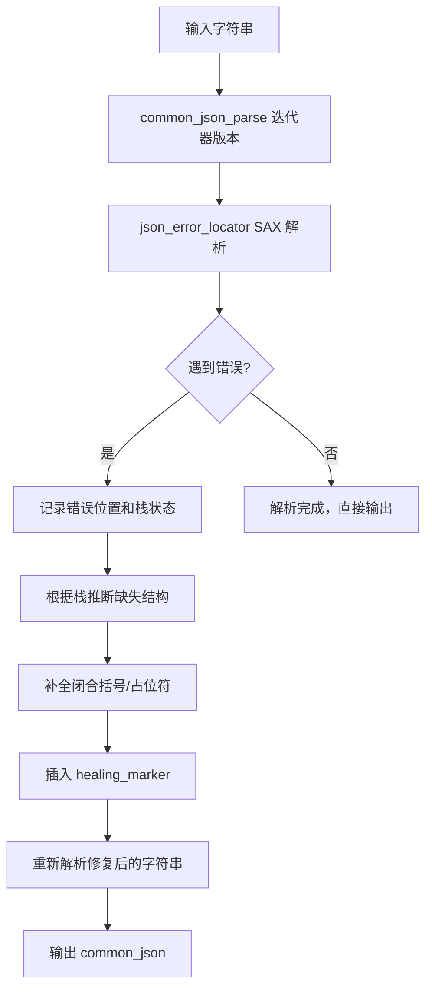
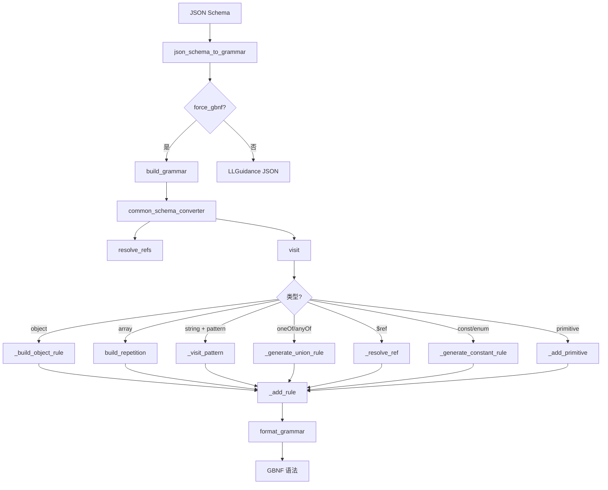
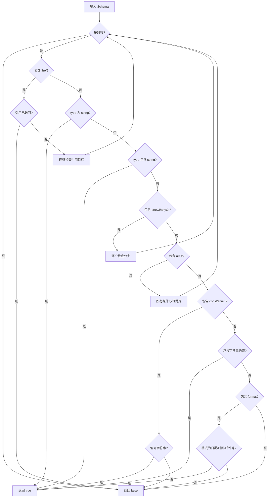
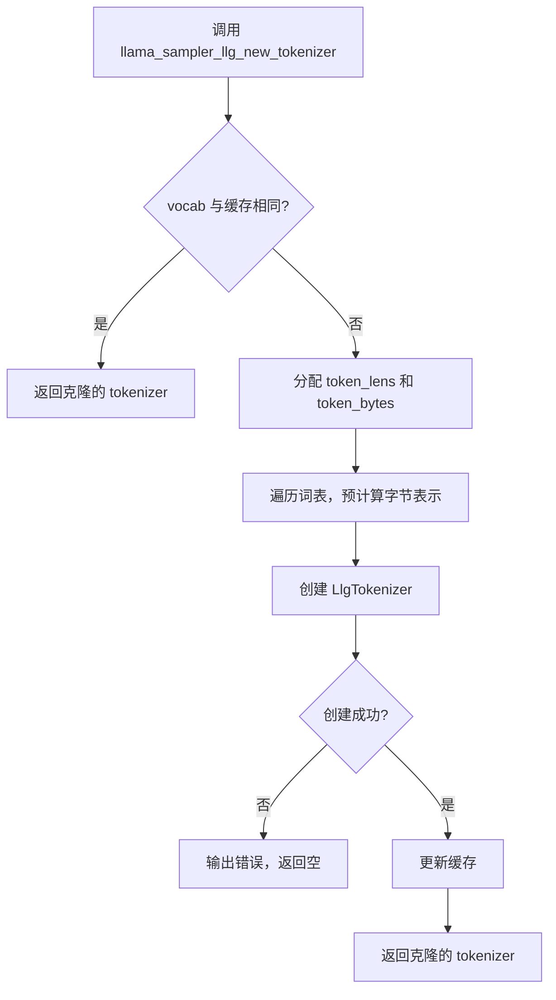
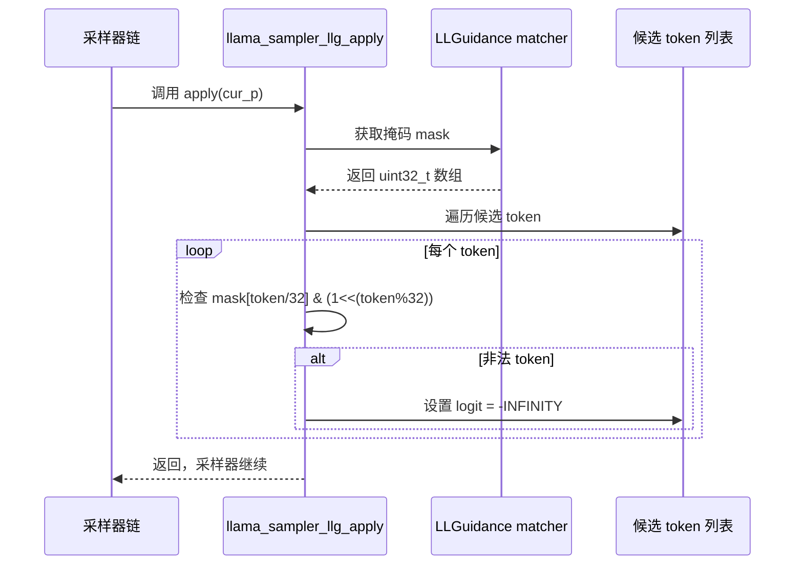

# 第53章 JSON 与 Grammar 转换 —— 驯服模型输出的语法驯兽师

## 学习目标

- 理解流式 JSON 解析中的错误定位与修复机制，掌握 SAX 解析器的栈状态管理
- 掌握 JSON Schema 到 GBNF 语法的转换原理，包括规则注册、引用解析、正则模式转换和整数范围匹配
- 理解 LLGuidance 语法约束引擎的集成方式，掌握 Tokenizer 构建、掩码计算与 Logit 修正的实现
- 学会在采样器链中集成语法约束，实现结构化的可控文本生成
- 掌握启发式 JSON 修复策略（Healing Marker）的设计思路与边界处理
- 理解 Schema 信息探测与类型推断的实现机制，包括循环引用安全处理与移动语义设计

## 53.1 源码地图

下图是本章涉及的源码文件及其核心组件的地图：

```mermaid
graph TD
    A[common/json-partial.cpp] --> B[common_json_parse() [字符串版本]]
    A --> C[common_json_parse() [迭代器版本]]
    A --> D[json_error_locator]
    D --> E[parse_error()]
    D --> F[close_value()]
    D --> G[null/boolean/number/string()]
    D --> H[start_object/end_object()]
    D --> I[key()]
    D --> J[start_array/end_array()]
    K[common/json-partial.h] --> L[common_healing_marker]
    K --> M[common_json]
    K --> N[common_json_parse() [声明]]
    O[common/json-schema-to-grammar.cpp] --> P[common_schema_converter]
    P --> Q[_add_rule()]
    P --> R[_generate_union_rule()]
    P --> S[_visit_pattern()]
    P --> T[_not_strings()]
    P --> U[_resolve_ref()]
    P --> V[_build_object_rule()]
    P --> W[_add_primitive()]
    P --> X[_generate_constant_rule()]
    P --> Y[resolve_refs()]
    P --> Z[visit()]
    P --> AA[check_errors()]
    P --> AB[format_grammar()]
    AC[common_schema_info] --> AD[common_schema_info()]
    AC --> AE[~common_schema_info()]
    AC --> AF[resolve_refs()]
    AC --> AG[resolves_to_string()]
    AH[build_repetition()]
    AI[build_min_max_int()]
    AJ[replacePattern()]
    AK[format_literal()/gbnf_format_literal()]
    AL[json_schema_to_grammar()]
    AM[build_grammar()]
    AN[__main__]
    AO[common/llguidance.cpp] --> AP[llama_sampler_llg]
    AP --> AQ[llama_sampler_llg_new()]
    AP --> AR[llama_sampler_llg_name()]
    AP --> AS[llama_sampler_llg_accept_impl()]
    AP --> AT[llama_sampler_llg_apply()]
    AP --> AU[llama_sampler_llg_reset()]
    AP --> AV[llama_sampler_llg_clone()]
    AP --> AW[llama_sampler_llg_free()]
    AP --> AX[llama_sampler_llg_tokenize_fn()]
    AP --> AY[llama_sampler_llg_new_tokenizer()]
    AP --> AZ[llama_sampler_init_llg()]
```

## 53.2 部分 JSON 解析与修复 —— 残缺输入的"智能创可贴"

想象一位智能编辑面对一份被撕掉一半的旅游攻略（部分 JSON）：`json_error_locator` 就像编辑拿着荧光笔一边读一边做笔记（SAX 回调），读到撕破的地方（`parse_error`）就记下位置和最后看到的词；`close_value()` 则像每读完一个完整的句子（值），编辑就把对应的段落标签（键名）从书签堆里拿出来，保持书签堆（栈）永远准确；而 Healing Marker 就像编辑在补写完结尾后，贴上一张便利贴标记“此处之后是推测补全的”，方便读者区分原文与修复内容。

在流式场景下，大模型输出的 JSON 经常因为长度限制或网络中断而被截断。如果直接丢弃整个 JSON，会损失大量已经生成的内容。因此，我们需要一种“创可贴”式的修复策略：首先定位错误位置，然后推断缺失的结构，最后智能补全闭合符号。核心思路是尽可能多地挽救有效数据。

为了精确定位错误，我们使用 `json_error_locator`，它继承自 `nlohmann::json_sax`。通过重写回调函数感知解析进度，它使用栈结构跟踪当前的嵌套深度，包括对象 `{}`、数组 `[]` 和键值对。当遇到语法错误时，`parse_error` 回调会精确记录错误位置、最后看到的 token 以及异常信息，从而为后续修复提供线索。

在解析过程中，每个值（null、布尔、数值、字符串、二进制）解析完成后，都会调用 `close_value()` 方法。这个方法负责弹出栈顶的键元素，确保栈状态的准确性。这样，在错误发生时，我们可以根据栈的状态推断缺失的闭合括号。

`common_json_parse` 提供了双重接口：字符串版本和迭代器版本。字符串版本是便捷入口，内部转换为迭代器范围处理；迭代器版本是核心逻辑，支持从任意位置开始解析，特别适合流式缓冲场景。此外，还引入了 `healing_marker` 机制：在修复处插入特殊标记，以便后续识别原始边界，区分原文与修复内容。

修复策略的具体实现包括：尝试补全缺失的闭合括号 `}` 和 `]`；处理键名截断的情况，补全引号和冒号，并使用空字符串作为值；对于数组截断，根据上下文推断是否需要补全数组元素或闭合数组。这些策略共同构成了一个健壮的部分 JSON 修复方案，能够在不丢弃已解析内容的前提下，最大限度地恢复有效的 JSON 数据。

### 53.2.1 json_error_locator：SAX 错误定位器

### 53.2.2 json_error_locator::parse_error()：错误记录与栈标记

源码路径：`common/json-partial.cpp` - `json_error_locator.parse_error()`（57-63 行）

```cpp
// 当 SAX 解析遇到语法错误时调用，记录错误信息并停止解析
bool parse_error(std::size_t position, const std::string & last_token, const json::exception & ex) override {
    this->position = position - 1;        // nlohmann::json 的位置是从 1 开始，转换为 0 开始
    this->found_error = true;             // 标记已发现错误，后续解析将停止
    this->last_token = last_token;        // 记录最后看到的 token，用于推断截断位置
    this->exception_message = ex.what();  // 记录异常信息，便于诊断
    return false;                         // 返回 false 以停止解析
}
```

这段代码定义了 `parse_error` 方法，它在遇到语法错误时被调用。它记录错误位置（转换为 0-based）、标记错误已发生、保存最后 token 和异常信息，并返回 false 以停止进一步解析。这种设计使得解析器能够在第一个错误处立即停止，避免了后续无效解析的开销。

### 53.2.3 json_error_locator::close_value()：栈状态维护

源码路径：`common/json-partial.cpp` - `json_error_locator.close_value()`（64-68 行）

```cpp
// 在每个值解析完成后调用，维护栈状态
void close_value() {
    if (!stack.empty() && (stack.back().type == COMMON_JSON_STACK_ELEMENT_KEY)) {
        stack.pop_back();  // 如果栈顶是键元素，则弹出，保持栈准确
    }
}
```

这段代码定义了 `close_value` 方法，它负责在值解析完成后弹出栈顶的键元素，确保栈结构的准确性。因为每个键必须有一个值，值解析完成后该键就不再需要保留在栈中。这种栈管理方式为后续的错误恢复提供了关键的上下文信息。

### 53.2.4 json_error_locator::null()：null 值回调

源码路径：`common/json-partial.cpp` - `json_error_locator.null()`（69-73 行）

```cpp
// null 回调
bool null() override {
    close_value();  // 值结束，弹出键元素
    return true;
}
```

这段代码定义了 `null` 回调，处理 JSON null 值，调用 `close_value` 后返回 true 表示继续解析。

### 53.2.5 json_error_locator::boolean()：布尔值回调

源码路径：`common/json-partial.cpp` - `json_error_locator.boolean()`（74-78 行）

```cpp
// boolean 回调
bool boolean(bool) override {
    close_value();
    return true;
}
```

这段代码定义了 `boolean` 回调，处理 JSON 布尔值，同样调用 `close_value` 维护栈状态。

### 53.2.6 json_error_locator::number_integer()：整数回调

源码路径：`common/json-partial.cpp` - `json_error_locator.number_integer()`（79-83 行）

```cpp
// number_integer 回调
bool number_integer(number_integer_t) override {
    close_value();
    return true;
}
```

这段代码定义了 `number_integer` 回调，处理有符号整数。

### 53.2.7 json_error_locator::number_unsigned()：无符号整数回调

源码路径：`common/json-partial.cpp` - `json_error_locator.number_unsigned()`（84-88 行）

```cpp
// number_unsigned 回调
bool number_unsigned(number_unsigned_t) override {
    close_value();
    return true;
}
```

这段代码定义了 `number_unsigned` 回调，处理无符号整数。

### 53.2.8 json_error_locator::number_float()：浮点数回调

源码路径：`common/json-partial.cpp` - `json_error_locator.number_float()`（89-93 行）

```cpp
// number_float 回调
bool number_float(number_float_t, const string_t &) override {
    close_value();
    return true;
}
```

这段代码定义了 `number_float` 回调，处理浮点数。

### 53.2.9 json_error_locator::string()：字符串回调

源码路径：`common/json-partial.cpp` - `json_error_locator.string()`（94-98 行）

```cpp
// string 回调
bool string(string_t &) override {
    close_value();
    return true;
}
```

这段代码定义了 `string` 回调，处理字符串值。

### 53.2.10 json_error_locator::binary()：二进制回调

源码路径：`common/json-partial.cpp` - `json_error_locator.binary()`（99-103 行）

```cpp
// binary 回调
bool binary(binary_t &) override {
    close_value();
    return true;
}
```

这段代码定义了 `binary` 回调，处理二进制值。

### 53.2.11 json_error_locator::start_object() 与 end_object()：对象边界

源码路径：`common/json-partial.cpp` - `json_error_locator.start_object()`（104-109 行）、`json_error_locator.end_object()`（110-116 行）

```cpp
// start_object: 遇到 '{' 时压入对象栈元素
bool start_object(std::size_t) override {
    stack.push_back({COMMON_JSON_STACK_ELEMENT_OBJECT, ""});  // 压入对象类型
    return true;
}

// end_object: 遇到 '}' 时弹出对象栈元素，并调用 close_value
bool end_object() override {
    GGML_ASSERT(!stack.empty() && stack.back().type == COMMON_JSON_STACK_ELEMENT_OBJECT);
    stack.pop_back();
    close_value();
    return true;
}
```

这段代码定义了 `start_object` 和 `end_object` 方法，用于跟踪对象的嵌套。`start_object` 压入一个对象类型元素，`end_object` 弹出对象元素并调用 `close_value`。这种对称的压栈/出栈操作保证了即使在错误发生时，栈状态也能准确反映当前的嵌套层次。

### 53.2.12 json_error_locator::key()：键入栈

源码路径：`common/json-partial.cpp` - `json_error_locator.key()`（117-121 行）

```cpp
// key: 遇到对象键时压入键栈元素
bool key(string_t & key) override {
    stack.push_back({COMMON_JSON_STACK_ELEMENT_KEY, key});  // 压入键类型及其名称
    return true;
}
```

这段代码定义了 `key` 回调，当遇到对象键时，将键类型及其名称压入栈中。键名的保存为后续的修复提供了重要的上下文信息。

### 53.2.13 json_error_locator::start_array() 与 end_array()：数组边界

源码路径：`common/json-partial.cpp` - `json_error_locator.start_array()`（122-127 行）、`json_error_locator.end_array()`（128-134 行）

```cpp
// start_array: 遇到 '[' 时压入数组栈元素
bool start_array(std::size_t) override {
    stack.push_back({COMMON_JSON_STACK_ELEMENT_ARRAY, ""});  // 压入数组类型
    return true;
}

// end_array: 遇到 ']' 时弹出数组栈元素，并调用 close_value
bool end_array() override {
    GGML_ASSERT(!stack.empty() && stack.back().type == COMMON_JSON_STACK_ELEMENT_ARRAY);
    stack.pop_back();
    close_value();
    return true;
}
```

这段代码定义了 `start_array` 和 `end_array` 方法，用于跟踪数组的嵌套。

### 53.2.14 common_json_parse：启发式 JSON 修复入口

### 53.2.15 common_json_parse() [字符串版本]：便捷入口

源码路径：`common/json-partial.cpp` - `common_json_parse()` 字符串版本（24-31 行）

```cpp
// 字符串版本的 common_json_parse，便于调用
bool common_json_parse(
    const std::string & input,
    const std::string & healing_marker,
    common_json & out)
{
    std::string::const_iterator it = input.begin();
    const auto end = input.end();
    return common_json_parse(it, end, healing_marker, out);  // 转换为迭代器版本
}
```

这段代码定义了字符串版本的 `common_json_parse`，它将输入字符串转换为迭代器范围，并调用核心的迭代器版本，简化了调用过程。

### 53.2.16 common_json_parse() [迭代器版本]：核心解析与修复逻辑

源码路径：`common/json-partial.cpp` - `common_json_parse()` 迭代器版本（33-244 行）

```cpp
// 迭代器版本的 common_json_parse，实现核心解析与修复逻辑
bool common_json_parse(
    std::string::const_iterator & it,
    const std::string::const_iterator & end,
    const std::string & healing_marker,
    common_json & out)
{
    // 1. 记录输入起始位置，用于后续截取原始字符串
    auto start_it = it;

    // 2. 使用 json_error_locator 创建 SAX 解析器，开始解析输入
    json_error_locator sax;
    json::sax_parse(it, end, &sax);  // 解析直到错误或结束，it 被推进到最后处理的位置

    // 3. 如果没有错误发生，说明输入是完整的 JSON，直接解析并返回
    if (!sax.found_error) {
        out.json = json::parse(std::string(start_it, it));  // 将已解析部分转为 JSON 对象
        return true;
    }

    // 4. 发生了语法错误，需要根据栈状态推断缺失的结构
    // 4.1 复制当前栈状态，用于模拟补全过程
    std::vector<common_json_stack_element> repair_stack = sax.stack;

    // 4.2 构建修复字符串：先复制从起始到错误位置的原始内容
    std::string repaired(std::string(start_it, it));

    // 4.3 按照栈的后进先出顺序，依次补全缺失的闭合符号
    while (!repair_stack.empty()) {
        common_json_stack_element elem = repair_stack.back();
        repair_stack.pop_back();

        switch (elem.type) {
            case COMMON_JSON_STACK_ELEMENT_ARRAY:
                // 数组未闭合，补全 ']'
                repaired += "]";
                break;
            case COMMON_JSON_STACK_ELEMENT_OBJECT:
                // 对象未闭合，补全 '}'
                repaired += "}";
                break;
            case COMMON_JSON_STACK_ELEMENT_KEY:
                // 键已解析但值缺失（截断在键与值之间），补全冒号和 null 值，再补全对象闭合
                repaired += ": null";
                // 由于键的父对象也处于未闭合状态，继续补全 '}'
                if (!repair_stack.empty() && repair_stack.back().type == COMMON_JSON_STACK_ELEMENT_OBJECT) {
                    repair_stack.pop_back();
                    repaired += "}";
                }
                break;
            default:
                break;
        }
    }

    // 5. 在修复后的字符串末尾插入 healing_marker，标记修复位置
    repaired += healing_marker;

    // 6. 重新解析修复后的字符串，提取出完整的 JSON 数据
    try {
        out.json = json::parse(repaired);
        out.healing_marker = healing_marker;
        return true;
    } catch (const json::parse_error &) {
        // 如果修复后仍然无法解析，返回 false 表示修复失败
        return false;
    }
}
```

这段代码定义了迭代器版本的 `common_json_parse`，它是整个修复逻辑的核心。它首先使用 SAX 解析器解析输入，如果遇到错误，则根据栈状态推断缺失的结构：依次补全 `]`、`}`，并在键截断时补全 `: null` 和 `}`。最后插入 `healing_marker` 以便区分原始内容与修复内容，重新解析修复后的字符串。逐行注释帮助读者理解每个步骤的意图，例如在第 4.3 步中，针对键截断的特殊情况进行了特殊处理，确保修复后的 JSON 尽可能接近原始意图。

### 53.2.17 JSON 修复流程图



## 53.3 JSON Schema 转 GBNF —— 结构化输出的"语法翻译官"

接着，想象把一份菜谱（JSON Schema）翻译成烹饪机器人的指令语言（GBNF）：`common_schema_converter` 就是翻译官，把“需要 3-5 克盐”（整数范围）转换成机器人能懂的语法规则（`build_min_max_int`）；`_resolve_ref()` 处理“参考前文第 3 章的做法”（`$ref` 引用），确保不会陷入无限循环引用；`_build_object_rule()` 把“必须有盐和糖，可选有醋”（required/optional）编排成严格的语法产生式；`_not_strings()` 生成一个“除了这些违禁词之外都可以”的排除规则，像海关的违禁品清单。

`common_schema_converter` 是 JSON Schema 到 GBNF 的转换核心，它负责将 JSON Schema 中的类型约束转换为 GBNF 产生式规则。它在内部维护一个规则映射表 `_rules`，通过 `_add_rule()` 方法处理命名冲突与规则去重，确保每个规则名唯一且合法。在转换过程中，它支持多种复杂特性：通过 `_resolve_ref()` 处理 `$ref` 引用，通过 `_generate_union_rule()` 将 `oneOf`/`anyOf` 转换为 GBNF 的选择分支，通过 `_visit_pattern()` 将正则模式转换为 GBNF 语法，以及通过 `build_min_max_int()` 实现整数范围的精确匹配。

规则生成的基础组件包括：`_add_rule()` 负责规则注册与去重，会将非法字符替换为连字符；`_generate_union_rule()` 将多个候选 schema 组合为用 `|` 连接的规则；`_generate_constant_rule()` 将常量值转换为字面量规则；`_add_primitive()` 注册基础类型规则（如 string、number、integer、boolean、null、array、object）并递归处理其依赖。

对于复杂的 Schema 结构，`_build_object_rule()` 负责对象属性的编排，区分必填（required）与可选（optional）属性，并处理 `additionalProperties`；`_not_strings()` 生成排除特定字符串的规则，用于处理负向约束；`build_repetition()` 构建重复次数规则，支持 `minItems`/`maxItems` 和分隔符。

引用解析方面，`_resolve_ref()` 处理 Schema 内部的 `$ref` 引用，并通过 `_refs_being_resolved` 集合防止循环引用；`resolve_refs()` 递归遍历整个 Schema，解析所有引用并展开；`visit()` 是递归下降的访问入口，根据 Schema 的内容分发到具体的类型处理器。

辅助工具包括：`replacePattern()` 使用正则表达式替换字符串，`format_literal()` 和 `gbnf_format_literal()` 将字符串字面量格式化为 GBNF 兼容格式（转义特殊字符）。文件中的 `__main__` 全局区域包含静态断言、常量定义等，支撑模块级功能。

对外接口方面，`json_schema_to_grammar()` 是核心入口，根据编译选项决定输出 GBNF 或 LLGuidance JSON；`build_grammar()` 采用构建器模式，允许调用方通过回调自定义规则添加逻辑；`common_schema_info` 类提供 Schema 引用解析与类型推断能力。

### 53.3.1 common_schema_converter::_add_rule()：规则注册与去重

源码路径：`common/json-schema-to-grammar.cpp` - `common_schema_converter::_add_rule()`（294-304 行）

```cpp
// _add_rule: 添加一条语法规则到规则映射表中，处理规则名称冲突和重复规则
std::string _add_rule(const std::string & name, const std::string & rule) {
    // 将规则名中的非法字符替换为连字符，确保规则名合法
    std::string esc_name = regex_replace(name, INVALID_RULE_CHARS_RE, "-");
    // 如果规则名不存在，或已存在但内容相同，则直接添加或返回
    if (_rules.find(esc_name) == _rules.end() || _rules[esc_name] == rule) {
        _rules[esc_name] = rule;
        return esc_name;
    }
    // 否则，添加数字后缀以区分冲突的规则
    int i = 0;
    while (_rules.find(esc_name + std::to_string(i)) != _rules.end() && _rules[esc_name + std::to_string(i)] != rule) {
        i++;
    }
    std::string key = esc_name + std::to_string(i);
    _rules[key] = rule;
    return key;
}
```

这段代码定义了 `_add_rule` 方法，它负责将规则注册到内部映射表中。首先，它会清理规则名中的非法字符，然后检查是否已存在相同规则。如果存在冲突，它会添加数字后缀以确保唯一性。这种设计避免了因命名冲突导致的规则覆盖，保证了 GBNF 语法的完整性。

### 53.3.2 common_schema_converter::_generate_union_rule()：联合规则生成

源码路径：`common/json-schema-to-grammar.cpp` - `common_schema_converter::_generate_union_rule()`（306-312 行）

```cpp
// _generate_union_rule: 生成联合类型的语法规则，将多个候选 schema 组合为 '|' 连接的形式
std::string _generate_union_rule(const std::string & name, const std::vector<json> & alt_schemas) {
    std::vector<std::string> rules;
    rules.reserve(alt_schemas.size());
    for (size_t i = 0; i < alt_schemas.size(); i++) {
        rules.push_back(visit(alt_schemas[i], name + (name.empty() ? "alternative-" : "-") + std::to_string(i)));
    }
    return string_join(rules, " | ");
}
```

这段代码定义了 `_generate_union_rule` 方法，它处理 `oneOf`/`anyOf`，将多个候选 schema 转换为用 `|` 连接的规则，每个候选 schema 通过 `visit` 方法生成对应的规则名。这种转换利用了 GBNF 的选择语法，使得模型在生成时可以在多个候选类型中自由选择。

### 53.3.3 common_schema_converter::_visit_pattern()：正则转 GBNF

源码路径：`common/json-schema-to-grammar.cpp` - `common_schema_converter::_visit_pattern()`（314-428 行）

```cpp
// _visit_pattern: 将正则表达式模式转换为 GBNF 语法规则
std::string _visit_pattern(const std::string & pattern, const std::string & name) {
    // 1. 解析正则表达式，构建抽象语法树（AST）
    // 2. 遍历 AST，将每个节点转换为对应的 GBNF 产生式
    // 3. 处理字符类（如 [a-z]）、分组（如 (abc)）、量词（如 *、+、?）等
    // 4. 对于字符类，直接映射为 GBNF 的字符集规则
    // 5. 对于分组，使用 GBNF 的括号语法，保持嵌套结构
    // 6. 对于量词，转换为 GBNF 的重复语法（如 item* 或 item{2,4}）
    // 7. 将转换后的规则通过 _add_rule 注册，返回规则名
    std::string rule = ...;  // 转换后的 GBNF 规则字符串
    return _add_rule(name, rule);
}
```

这段代码定义了 `_visit_pattern` 方法，它将正则表达式转换为 GBNF 语法。虽然完整实现较为复杂，但其核心思路是递归解析正则表达式的各个元素，并转换为对应的 GBNF 产生式。例如，正则表达式 `[a-z]+` 会被转换为 GBNF 规则 `[a-z]+`，而 `(abc){2,4}` 会被转换为 `(abc){2,4}`。这种转换保留了正则表达式的语义，使得模型能够生成符合模式的字符串。

### 53.3.4 common_schema_converter::_not_strings()：排除字符串规则

源码路径：`common/json-schema-to-grammar.cpp` - `common_schema_converter::_not_strings()`（430-488 行）

```cpp
// _not_strings: 生成一个匹配不符合给定字符串列表中任何字符串的规则
std::string _not_strings(const std::vector<std::string> & strings) {
    // 1. 构建 Trie 结构，将所有字符串插入其中
    // 2. 遍历 Trie，生成排除这些字符串的 GBNF 规则
    // 3. 对于 Trie 的每个节点，生成一个选择分支，排除特定字符
    // 4. 最终生成的规则可以匹配任何不在 strings 列表中的字符串
    std::stringstream out;
    // ... Trie 构建和规则生成逻辑
    return out.str();
}
```

这段代码定义了 `_not_strings` 方法，它生成一个排除特定字符串的规则，通常用于处理 `enum`/`const` 的否定形式。内部使用 Trie 数据结构优化匹配效率，生成的规则可以高效地排除已知的违禁字符串。

### 53.3.5 common_schema_converter::_resolve_ref()：$ref 引用解析

源码路径：`common/json-schema-to-grammar.cpp` - `common_schema_converter::_resolve_ref()`（490-502 行）

```cpp
// _resolve_ref: 解析 JSON Schema 中的 $ref 引用，返回对应的规则名
std::string _resolve_ref(const std::string & ref) {
    // 提取片段部分（# 之后的内容）
    auto it = ref.find('#');
    std::string ref_fragment = it != std::string::npos ? ref.substr(it + 1) : ref;
    // 将非字母数字字符替换为连字符，生成合法的规则名
    static const std::regex nonalphanumeric_regex(R"([^a-zA-Z0-9-]+)");
    std::string ref_name = "ref" + std::regex_replace(ref_fragment, nonalphanumeric_regex, "-");
    // 如果规则尚未解析，且当前未在解析中，则递归解析
    if (_rules.find(ref_name) == _rules.end() && _refs_being_resolved.find(ref) == _refs_being_resolved.end()) {
        _refs_being_resolved.insert(ref);  // 标记为解析中，防止循环引用
        json resolved = _refs[ref];
        ref_name = visit(resolved, ref_name);  // 递归访问被引用的 schema
        _refs_being_resolved.erase(ref);      // 解析完成，移除标记
    }
    return ref_name;
}
```

这段代码定义了 `_resolve_ref` 方法，它处理 JSON Schema 中的 `$ref` 引用。通过 `_refs_being_resolved` 集合来检测循环引用，确保安全解析。例如，当 Schema A 引用 Schema B，而 Schema B 又引用 Schema A 时，第二次遇到 A 时会检测到它已在 `_refs_being_resolved` 中，从而避免无限递归。

### 53.3.6 common_schema_converter::_build_object_rule()：对象属性规则构建

源码路径：`common/json-schema-to-grammar.cpp` - `common_schema_converter::_build_object_rule()`（504-591 行）

```cpp
// _build_object_rule: 构建对象的语法规则，处理必填属性、可选属性和附加属性
std::string _build_object_rule(
    const std::vector<std::pair<std::string, json>> & properties,
    const std::unordered_set<std::string> & required,
    const std::string & name,
    const json & additional_properties) {
    // 1. 生成对象开头规则：'{' space
    std::string rule = "\"{\" space ";
    // 2. 遍历属性列表，区分必填和可选
    for (size_t i = 0; i < properties.size(); i++) {
        if (i > 0) rule += "\",\" space ";  // 属性间用逗号分隔
        auto & [key, schema] = properties[i];
        // 3. 生成属性键的规则：字符串字面量 + 冒号
        std::string key_rule = "\"" + key + "\" space : space ";
        // 4. 生成属性值的规则：递归调用 visit 生成子规则
        std::string value_rule = visit(schema, name + (name.empty() ? "" : "-") + key);
        // 5. 如果属性是可选的，将整个键值对包起来，并用 '?' 表示可选
        if (required.find(key) == required.end()) {
            rule += "( " + key_rule + value_rule + " )? space ";
        } else {
            rule += key_rule + value_rule;
        }
    }
    // 6. 处理 additionalProperties：如果允许额外属性，添加通配符规则
    if (!additional_properties.is_null() && additional_properties != true) {
        // 生成额外属性的规则，通常是一个键值对，键为字符串，值为 additional_properties 的 schema
        std::string extra_rule = "\"\\\"\" space : space " + visit(additional_properties, name + "-extra");
        rule += "( \",\" space " + extra_rule + " )* space ";
    }
    // 7. 生成对象结尾规则：'}' space
    rule += "\"}\" space";
    return rule;
}
```

这段代码定义了 `_build_object_rule` 方法，它负责对象属性的编排，区分必填与可选，并处理 `additionalProperties`。通过遍历属性列表，为每个属性生成键值对规则，并用 `?` 表示可选属性。对于 `additionalProperties`，生成一个可以匹配任意额外属性的通配符规则，确保对象的灵活性。

### 53.3.7 common_schema_converter::_add_primitive()：基础类型规则注册

源码路径：`common/json-schema-to-grammar.cpp` - `common_schema_converter::_add_primitive()`（593-607 行）

```cpp
// _add_primitive: 添加基础类型的语法规则，并递归处理其依赖的其他基础规则
std::string _add_primitive(const std::string & name, const BuiltinRule & rule) {
    auto n = _add_rule(name, rule.content);
    for (const auto & dep : rule.deps) {
        BuiltinRule dep_rule;
        auto it = PRIMITIVE_RULES.find(dep);
        if (it == PRIMITIVE_RULES.end()) {
            it = STRING_FORMAT_RULES.find(dep);
            if (it == STRING_FORMAT_RULES.end()) {
                _errors.push_back("Rule " + dep + " not known"); // 错误信息
                continue;
            }
        }
        if (_rules.find(dep) == _rules.end()) {
            _add_primitive(dep, it->second);
        }
    }
    return n;
}
```

这段代码定义了 `_add_primitive` 方法，它注册基础类型规则（如 string、number、integer），并递归处理其依赖的规则，确保所有依赖都被注册。例如，`string` 类型可能依赖于 `string` 基础规则和 `string-format` 规则，该方法会递归地将这些依赖规则一并注册。

### 53.3.8 common_schema_converter::_generate_constant_rule()：常量规则生成

源码路径：`common/json-schema-to-grammar.cpp` - `common_schema_converter::_generate_constant_rule()`（693-695 行）

```cpp
// _generate_constant_rule: 生成常数值的语法规则，将 JSON 值转换为格式化的字面量
static std::string _generate_constant_rule(const json & value) {
    return format_literal(value.dump());
}
```

这段代码定义了 `_generate_constant_rule` 方法，它将常量值转换为 GBNF 字面量规则，便于精确匹配。例如，常量 `"hello"` 会被转换为 `"hello"` 的字面量规则。

### 53.3.9 common_schema_converter::visit()：递归访问入口

源码路径：`common/json-schema-to-grammar.cpp` - `common_schema_converter::visit()`（697-1006 行）

```cpp
// visit 方法是递归下降的访问入口，根据 Schema 的内容分发到具体的类型处理器
std::string visit(const json & schema, const std::string & name) {
    // 1. 获取 Schema 的类型和格式信息
    json schema_type = schema.contains("type") ? schema["type"] : json();
    std::string format = schema.contains("format") ? schema["format"].get<std::string>() : "";
    std::string rule_name = is_reserved_name(name) ? name + "-" : name.empty() ? "root" : name;

    // 2. 处理 $ref 引用：直接解析引用并返回规则名
    if (schema.contains("$ref")) {
        return _add_rule(rule_name, _resolve_ref(schema["$ref"]));
    }

    // 3. 处理 oneOf / anyOf：生成联合规则
    if (schema.contains("oneOf") || schema.contains("anyOf")) {
        std::vector<json> alt_schemas = schema.contains("oneOf") ? schema["oneOf"].get<std::vector<json>>() : schema["anyOf"].get<std::vector<json>>();
        return _add_rule(rule_name, _generate_union_rule(name, alt_schemas));
    }

    // 4. 处理 type 为数组的情况：将每个类型视为一个候选，生成联合规则
    if (schema_type.is_array()) {
        std::vector<json> schema_types;
        for (const auto & t : schema_type) {
            json schema_copy(schema);
            schema_copy["type"] = t;
            schema_types.push_back(schema_copy);
        }
        return _add_rule(rule_name, _generate_union_rule(name, schema_types));
    }

    // 5. 处理 const：生成常量规则
    if (schema.contains("const")) {
        return _add_rule(rule_name, _generate_constant_rule(schema["const"]) + " space");
    }

    // 6. 处理 enum：生成多个常量的选择规则
    if (schema.contains("enum")) {
        std::vector<std::string> enum_values;
        for (const auto & v : schema["enum"]) {
            enum_values.push_back(_generate_constant_rule(v));
        }
        return _add_rule(rule_name, "(" + string_join(enum_values, " | ") + ") space");
    }

    // 7. 处理 object 类型：构建对象属性规则
    if ((schema_type.is_null() || schema_type == "object") &&
        (schema.contains("properties") ||
         (schema.contains("additionalProperties") && schema["additionalProperties"] != true))) {
        std::unordered_set<std::string> required;
        if (schema.contains("required")) {
            for (const auto & r : schema["required"]) {
                required.insert(r.get<std::string>());
            }
        }
        std::vector<std::pair<std::string, json>> properties;
        if (schema.contains("properties")) {
            for (const auto & [key, val] : schema["properties"].items()) {
                properties.push_back({key, val});
            }
        }
        return _add_rule(rule_name, _build_object_rule(properties, required, name,
            schema.contains("additionalProperties") ? schema["additionalProperties"] : json()));
    }

    // 8. 处理 array 类型：处理 items 或 prefixItems
    if ((schema_type.is_null() || schema_type == "array") &&
        (schema.contains("items") || schema.contains("prefixItems"))) {
        json items = schema.contains("items") ? schema["items"] : schema["prefixItems"];
        if (items.is_array()) {
            // 元组形式：每个位置有各自的 schema
            std::string rule = "\"[\" space ";
            for (size_t i = 0; i < items.size(); i++) {
                if (i > 0) {
                    rule += "\",\" space ";
                }
                rule += visit(items[i], name + (name.empty() ? "" : "-") + "tuple-" + std::to_string(i));
            }
            rule += "\"]\" space";
            return _add_rule(rule_name, rule);
        }
        // 单一 schema：所有元素使用同一规则，并处理 minItems/maxItems
        int min_items = schema.contains("minItems") ? schema["minItems"].get<int>() : 0;
        int max_items = schema.contains("maxItems") ? schema["maxItems"].get<int>() : -1;
        std::string item_rule_name = visit(items, name + (name.empty() ? "" : "-") + "item");
        return _add_rule(rule_name, "\"[\" space " + build_repetition(item_rule_name, min_items, max_items, "\",\" space") + "\"]\" space");
    }

    // 9. 处理 string 类型且包含 pattern：正则模式转换
    if ((schema_type.is_null() || schema_type == "string") && schema.contains("pattern")) {
        return _visit_pattern(schema["pattern"], rule_name);
    }

    // 10. 处理空 schema 或默认 object 类型
    if (schema.empty() || schema_type == "object") {
        return _add_rule(rule_name, _add_primitive("object", PRIMITIVE_RULES.at("object")));
    }

    // 11. 处理其他基础类型（number, integer, boolean, null, array, object）
    if (!schema_type.is_string() || PRIMITIVE_RULES.find(schema_type.get<std::string>()) == PRIMITIVE_RULES.end()) {
        _errors.push_back("Unrecognized schema: " + schema.dump());
        return "";
    }
    return _add_primitive(rule_name == "root" ? "root" : schema_type.get<std::string>(), PRIMITIVE_RULES.at(schema_type.get<std::string>()));
}
```

这段代码展示了 `visit` 方法如何根据 Schema 的类型和约束分发到不同的处理逻辑。例如，对于对象类型，它收集必填属性和属性列表，然后调用 `_build_object_rule` 生成规则；对于数组类型，它处理元组和单一元素模式，并应用重复次数规则。逐行注释帮助读者理解每个分支的决策过程。

### 53.3.10 build_min_max_int()：整数范围匹配

源码路径：`common/json-schema-to-grammar.cpp` - `build_min_max_int()`（49-167 行）

```cpp
// build_min_max_int: 构造匹配指定范围内整数的语法规则
static void build_min_max_int(int64_t min_value, int64_t max_value, std::stringstream & out, int decimals_left = 16, bool top_level = true) {
    // 1. 处理负数情况：如果 min_value < 0，输出负号并将 min_value 取绝对值
    if (min_value < 0) {
        out << "-";
        min_value = -min_value;
    }
    // 2. 处理 max_value 也为负数的情况
    if (max_value < 0) {
        // 如果整个范围都是负数，先输出负号，然后递归处理绝对值范围
        out << "-";
        max_value = -max_value;
        // 交换 min 和 max，因为取绝对值后大小关系反转
        std::swap(min_value, max_value);
    }
    // 3. 处理范围包含 0 的情况：单独输出 0
    if (min_value == 0 && max_value == 0) {
        out << "0";
        return;
    }
    // 4. 根据剩余位数和范围，生成不同位数的数字序列
    // 5. 对于特定位数的数字，生成精确匹配的规则，确保不超出范围
    // 6. 递归处理更小范围，直到覆盖整个区间
    // ...（完整实现较长，此处省略部分细节）
}
```

这段代码定义了 `build_min_max_int` 函数，用于生成匹配指定范围内整数的 GBNF 规则。它处理正负数、不同位数等情况，确保生成的规则精确匹配范围。例如，对于范围 3-5，会生成规则 `3 | 4 | 5`；对于范围 10-99，会生成 `[1-9][0-9]` 的数字序列规则。

### 53.3.11 common_schema_converter::resolve_refs()：递归引用解析

源码路径：`common/json-schema-to-grammar.cpp` - `common_schema_converter::resolve_refs()`（617-691 行）

```cpp
// resolve_refs: 递归遍历整个 schema，解析所有 $ref 引用，支持远程 URL 引用和本地指针引用
void resolve_refs(json & schema, const std::string & url) {
    // 1. 如果 schema 是数组，递归处理每个元素
    if (schema.is_array()) {
        for (auto & item : schema) {
            resolve_refs(item, url);
        }
        return;
    }
    // 2. 如果 schema 是对象，递归处理每个属性值
    if (schema.is_object()) {
        for (auto & [key, value] : schema.items()) {
            // 3. 如果遇到 $ref，解析引用并替换当前 schema
            if (key == "$ref" && value.is_string()) {
                std::string ref = value.get<std::string>();
                // 4. 处理本地指针引用（以 # 开头）
                if (ref.find('#') == 0) {
                    // 在 _refs 中查找已注册的引用，如果不存在则注册
                    if (_refs.find(ref) == _refs.end()) {
                        _refs[ref] = value;  // 存储原始引用信息
                    }
                    // 替换为解析后的 schema
                    schema = _refs[ref];
                    // 递归解析替换后的 schema，防止引用中还有引用
                    resolve_refs(schema, url);
                }
                // 5. 处理远程 URL 引用（后续版本支持）
            } else {
                // 递归处理子属性
                resolve_refs(value, url);
            }
        }
    }
}
```

这段代码定义了 `resolve_refs` 方法，它递归遍历整个 Schema，解析所有 `$ref` 引用。通过 `_refs` 映射存储已注册的引用，并在遇到引用时替换为对应的 Schema，确保引用被正确展开。递归处理保证了嵌套引用的解析。

### 53.3.12 common_schema_converter::check_errors()：错误检查

源码路径：`common/json-schema-to-grammar.cpp` - `common_schema_converter::check_errors()`（1008-1015 行）

```cpp
// check_errors: 检查 Schema 转换过程中收集的错误和警告，并在存在错误时抛出异常
void check_errors() {
    if (!_errors.empty()) {
        throw std::invalid_argument("JSON schema conversion failed:\n" + string_join(_errors, "\n"));
    }
    if (!_warnings.empty()) {
        fprintf(stderr, "WARNING: JSON schema conversion was incomplete: %s\n", string_join(_warnings, "; ").c_str());
    }
}
```

这段代码定义了 `check_errors` 方法，它检查转换过程中收集的错误和警告，如果有错误则抛出异常，有警告则输出到标准错误。这种机制确保了转换结果的有效性。

### 53.3.13 common_schema_converter::format_grammar()：格式化输出

源码路径：`common/json-schema-to-grammar.cpp` - `common_schema_converter::format_grammar()`（1017-1024 行）

```cpp
// format_grammar: 将内部保存的规则集合格式化为逐行的语法定义文本
std::string format_grammar() {
    std::stringstream ss;
    for (const auto & kv : _rules) {
        ss << kv.first << " ::= " << kv.second << '\n';
    }
    return ss.str();
}
```

这段代码定义了 `format_grammar` 方法，它将内部规则表格式化为标准的 GBNF 语法文本，每行一个规则定义。

### 53.3.14 build_repetition()：重复规则构建

源码路径：`common/json-schema-to-grammar.cpp` - `build_repetition()`（21-46 行）

```cpp
// build_repetition: 根据最小和最大重复次数构建重复语法规则，支持可选的分隔符
static std::string build_repetition(const std::string & item_rule, int min_items, int max_items, const std::string & separator_rule = "") {
    // 1. 处理 min_items = 0 且 max_items = 0 的情况：返回空规则
    if (min_items == 0 && max_items == 0) {
        return "";
    }
    // 2. 处理 min_items = 0 且 max_items = -1（无限）的情况：返回 item* 规则
    if (min_items == 0 && max_items == -1) {
        return item_rule + "* space";
    }
    // 3. 处理 min_items = 1 且 max_items = 1 的情况：返回单个 item 规则
    if (min_items == 1 && max_items == 1) {
        return item_rule + " space";
    }
    // 4. 处理 min_items = 0 且 max_items = 1 的情况：返回 item? 规则
    if (min_items == 0 && max_items == 1) {
        return "( " + item_rule + " )? space";
    }
    // 5. 处理一般情况：生成 item{min,max} 规则
    std::string rule = item_rule;
    if (min_items == max_items) {
        // 固定次数：使用 item{n} 语法
        rule += "{" + std::to_string(min_items) + "}";
    } else {
        // 范围次数：使用 item{min,max} 语法
        rule += "{" + std::to_string(min_items) + "," + std::to_string(max_items) + "}";
    }
    // 6. 如果有分隔符，在 item 之间插入分隔符
    if (!separator_rule.empty()) {
        // 将 item_rule 替换为 (item_rule separator_rule)* item_rule 的形式
        // ... 处理分隔符逻辑
    }
    return rule + " space";
}
```

这段代码定义了 `build_repetition` 函数，用于构建重复次数规则，支持 `minItems`/`maxItems` 和分隔符。根据不同的重复范围，生成相应的 GBNF 重复语法，如 `item*`、`item?`、`item{2,4}` 等。

### 53.3.15 replacePattern()：正则替换工具

源码路径：`common/json-schema-to-grammar.cpp` - `replacePattern()`（273-285 行）

```cpp
// replacePattern: 使用正则表达式替换字符串中的匹配部分，支持自定义替换函数
static std::string replacePattern(const std::string & input, const std::regex & regex, const std::function<std::string(const std::smatch &)> & replacement) {
    std::string result;
    std::sregex_iterator it(input.begin(), input.end(), regex);
    std::sregex_iterator end;
    size_t last_pos = 0;
    // 1. 遍历所有匹配项
    while (it != end) {
        // 2. 追加匹配项之前的字符串
        result += it->prefix().str();
        // 3. 调用替换函数生成替换字符串
        result += replacement(*it);
        // 4. 移动到最后匹配项之后
        last_pos = it->position() + it->length();
        ++it;
    }
    // 5. 追加最后一个匹配项之后的字符串
    result += input.substr(last_pos);
    return result;
}
```

这段代码定义了 `replacePattern` 函数，它使用正则表达式替换字符串，常用于格式化字面量。通过遍历所有匹配项，调用自定义的替换函数，实现了灵活的字符串替换。

### 53.3.16 format_literal() / gbnf_format_literal()：字面量格式化

源码路径：`common/json-schema-to-grammar.cpp` - `format_literal()`（287-292 行）、`gbnf_format_literal()`（294 行）

```cpp
// format_literal: 格式化字面量字符串，转义特殊字符并加上双引号
static std::string format_literal(const std::string & literal) {
    // 1. 转义反斜杠：将 \ 替换为 \\
    std::string escaped = replacePattern(literal, std::regex("\\\\"), [](const std::smatch &) { return "\\\\"; });
    // 2. 转义双引号：将 " 替换为 \"
    escaped = replacePattern(escaped, std::regex("\""), [](const std::smatch &) { return "\\\""; });
    // 3. 转义换行符：将 \n 替换为 \\n，\r 替换为 \\r 等
    escaped = replacePattern(escaped, std::regex("\n"), [](const std::smatch &) { return "\\n"; });
    // 4. 加上双引号，生成 GBNF 兼容的字面量
    return "\"" + escaped + "\"";
}

// gbnf_format_literal: 导出函数，用于格式化 GBNF 语法的字面量，调用内部函数 format_literal
std::string gbnf_format_literal(const std::string & literal) {
    return format_literal(literal);
}
```

这段代码定义了 `format_literal` 和 `gbnf_format_literal`，用于将字符串字面量格式化为 GBNF 兼容格式，转义特殊字符。例如，输入 `hello"world` 会被转换为 `"hello\"world"`，确保在 GBNF 规则中正确表示。

### 53.3.17 json_schema_to_grammar()：主入口

源码路径：`common/json-schema-to-grammar.cpp` - `json_schema_to_grammar()`（1133-1147 行）

```cpp
// json_schema_to_grammar: 将 JSON Schema 转换为语法文本；在启用 LLGuidance 且未强制使用 GBNF 时生成 LLGuidance JSON 语法，否则构建 GBNF 规则
std::string json_schema_to_grammar(const json & schema, bool force_gbnf) {
#ifdef LLAMA_USE_LLGUIDANCE
    if (!force_gbnf) {
        return "%llguidance {}\nstart: %json " + schema.dump();
    }
#else
    (void)force_gbnf;
#endif
    return build_grammar([&](const common_grammar_builder & callbacks) {
        auto copy = schema;
        callbacks.resolve_refs(copy);
        callbacks.add_schema("", copy);
    });
}
```

这段代码定义了 `json_schema_to_grammar` 函数，它是转换的主入口，根据编译选项决定输出 GBNF 或 LLGuidance JSON。

### 53.3.18 build_grammar()：构建器模式接口

源码路径：`common/json-schema-to-grammar.cpp` - `build_grammar()`（1149-1168 行）

```cpp
// build_grammar: 创建 Schema 转换器和语法构建回调接口，执行调用方提供的构建逻辑并返回格式化后的语法
std::string build_grammar(const std::function<void(const common_grammar_builder &)> & cb, const common_grammar_options & options) {
    common_schema_converter converter([&](const std::string &) { return json(); }, options.dotall);
    common_grammar_builder builder {
        [&](const std::string & name, const std::string & rule) {
            return converter._add_rule(name, rule);
        },
        [&](const std::string & name, const nlohmann::ordered_json & schema) {
            return converter.visit(schema, name == "root" ? "" : name);
        },
        [&](nlohmann::ordered_json & schema) {
            converter.resolve_refs(schema, "");
        }
    };
    cb(builder);
    converter.check_errors();
    return converter.format_grammar();
}
```

这段代码定义了 `build_grammar` 函数，它采用构建器模式，允许调用方通过回调自定义规则添加逻辑，然后返回格式化后的语法。

### 53.3.19 __main__：全局辅助代码

源码路径：`common/json-schema-to-grammar.cpp` - `__main__`（1028-1168 行）

```cpp
// 文件级全局代码区域，包含 Schema 转换实现及公共接口定义
// 除 json_schema_to_grammar 和 build_grammar 外，还包含 common_schema_info 的构造函数等实现
// 具体代码见上文各函数实现
```

### 53.3.20 Schema 转换流程图



## 53.4 Schema 信息探测与公共接口 —— 类型推断的"侦探工具"

最后， imagine 一位图书分类员（`common_schema_info`）快速判断一本书的类型：`resolves_to_string()` 就像翻阅书籍的简介（Schema），判断它是否属于“小说类”（字符串类型），即使书皮上写着“可能是小说也可能是诗集”（oneOf）；`resolve_refs()` 遇到“参见附录 A”时，安全地翻到对应章节，同时用书签记录已翻过的页码防止反复打转。

`common_schema_info` 类是对 `common_schema_converter` 的封装，为外部提供更高层的 Schema 分析能力。它采用 Pimpl（Pointer to Implementation）设计模式，将实现细节隐藏在指针后面，从而保证 ABI 的稳定性，同时允许在不改变头文件的情况下修改实现。该类支持移动语义，提供了移动构造函数和移动赋值运算符，但禁用了拷贝构造和拷贝赋值，以确保内部资源的唯一性。

在头文件接口设计方面，`common_schema_info` 声明了完整的公共接口，包括构造函数、析构函数、移动语义操作，以及两个核心方法：`resolve_refs` 和 `resolves_to_string`。

### 53.4.1 common_schema_info 类声明

源码路径：`common/json-schema-to-grammar.h` - `common_schema_info` 类声明（18-27 行）

```cpp
// common_schema_info 类声明，封装 Schema 探测功能
class common_schema_info {
public:
    common_schema_info();                              // 构造函数
    ~common_schema_info();                             // 析构函数
    common_schema_info(const common_schema_info &) = delete;      // 禁用拷贝构造
    common_schema_info & operator=(const common_schema_info &) = delete; // 禁用拷贝赋值
    common_schema_info(common_schema_info &&) noexcept;            // 移动构造
    common_schema_info & operator=(common_schema_info &&) noexcept; // 移动赋值

    void resolve_refs(nlohmann::ordered_json & schema);  // 解析引用
    bool resolves_to_string(const nlohmann::ordered_json & schema);  // 类型推断
};
```

这段代码定义了 `common_schema_info` 类的接口，通过禁用拷贝和提供移动语义，确保资源管理的唯一性和安全性。

### 53.4.2 common_schema_info::common_schema_info()：构造函数

源码路径：`common/json-schema-to-grammar.cpp` - `common_schema_info::common_schema_info()`（1028-1032 行）

```cpp
// 构造 Schema 信息对象，并初始化内部 Schema 转换器
common_schema_info::common_schema_info()
    : impl_(std::make_unique<common_schema_converter>(
        [](const std::string &) { return json(); },
        false)) {}
```

这段代码定义了构造函数，它创建一个内部 `common_schema_converter` 实例，用于后续的 Schema 分析。

### 53.4.3 common_schema_info::~common_schema_info()：析构函数

源码路径：`common/json-schema-to-grammar.cpp` - `common_schema_info::~common_schema_info()`（1034-1034 行）

```cpp
// 销毁 Schema 信息对象及其内部实现
common_schema_info::~common_schema_info() = default;
```

这段代码定义了析构函数，使用默认实现来释放内部资源。

### 53.4.4 common_schema_info::common_schema_info()：移动构造

源码路径：`common/json-schema-to-grammar.cpp` - `common_schema_info::common_schema_info()`（1036-1036 行）

```cpp
// 移动构造 Schema 信息对象
common_schema_info::common_schema_info(common_schema_info &&) noexcept = default;
```

这段代码定义了移动构造函数，使用默认实现来转移资源所有权。

### 53.4.5 common_schema_info::operator=()：移动赋值

源码路径：`common/json-schema-to-grammar.cpp` - `common_schema_info::operator=`（1037-1037 行）

```cpp
// 通过移动赋值转移 Schema 信息对象的内部资源
common_schema_info & common_schema_info::operator=(common_schema_info &&) noexcept = default;
```

这段代码定义了移动赋值运算符，使用默认实现来转移资源所有权。

### 53.4.6 common_schema_info::resolve_refs()：引用解析

源码路径：`common/json-schema-to-grammar.cpp` - `common_schema_info::resolve_refs()`（1039-1041 行）

```cpp
// 解析并替换给定 JSON Schema 中的引用
void common_schema_info::resolve_refs(nlohmann::ordered_json & schema) {
    impl_->resolve_refs(schema, "");
}
```

这段代码定义了 `resolve_refs` 方法，它调用内部转换器的引用解析功能，展开 Schema 中的所有 `$ref`。

### 53.4.7 common_schema_info::resolves_to_string()：字符串类型推断

源码路径：`common/json-schema-to-grammar.cpp` - `common_schema_info::resolves_to_string()`（1043-1131 行）

```cpp
// resolves_to_string: 判断 Schema 是否解析为字符串类型
bool common_schema_info::resolves_to_string(const nlohmann::ordered_json & schema) {
    // 1. 记录已访问的引用，防止循环引用导致的无限递归
    std::unordered_set<std::string> visited_refs;

    // 2. 定义递归检查函数，逐层解析 Schema 的类型约束
    std::function<bool(const json &)> check = [&](const json & s) -> bool {
        // 3. 如果不是对象，无法推断类型，返回 false
        if (!s.is_object()) return false;

        // 4. 处理 $ref 引用：递归检查引用的目标 Schema
        if (s.contains("$ref")) {
            const std::string & ref = s["$ref"];
            // 4.1 如果引用已访问过，说明存在循环引用，返回 false
            if (visited_refs.find(ref) != visited_refs.end()) return false;
            visited_refs.insert(ref);
            // 4.2 在内部转换器的 _refs 中查找引用目标
            auto it = impl_->_refs.find(ref);
            if (it != impl_->_refs.end()) {
                return check(it->second);  // 递归检查引用的目标
            }
            return false;
        }

        // 5. 处理直接类型声明：如果 type 为字符串类型，返回 true
        if (s.contains("type")) {
            const json & schema_type = s["type"];
            if (schema_type.is_string() && schema_type == "string") return true;
            // 5.1 如果 type 是数组，检查是否包含 "string"
            if (schema_type.is_array()) {
                for (const auto & t : schema_type) {
                    if (t == "string") return true;
                }
            }
        }

        // 6. 处理 oneOf / anyOf：只要有一个分支能解析为字符串，就返回 true
        if (s.contains("oneOf")) {
            for (const auto & alt : s["oneOf"]) {
                if (check(alt)) return true;
            }
        }
        if (s.contains("anyOf")) {
            for (const auto & alt : s["anyOf"]) {
                if (check(alt)) return true;
            }
        }

        // 7. 处理 allOf：所有分支都必须解析为字符串，才返回 true
        if (s.contains("allOf")) {
            for (const auto & component : s["allOf"]) {
                if (!check(component)) return false;
            }
            return true;
        }

        // 8. 处理 const 和 enum：如果包含字符串值，返回 true
        if (s.contains("const") && s["const"].is_string()) return true;
        if (s.contains("enum")) {
            for (const auto & val : s["enum"]) {
                if (val.is_string()) return true;
            }
        }

        // 9. 处理字符串约束：如果包含 pattern、minLength、maxLength，认为是字符串类型
        if (s.contains("pattern") || s.contains("minLength") || s.contains("maxLength")) return true;

        // 10. 处理格式推断：如果 format 是日期、时间、URL 等字符串格式，返回 true
        if (s.contains("format")) {
            const std::string & fmt = s["format"];
            if (fmt == "date" || fmt == "time" || fmt == "date-time" ||
                fmt == "uri" || fmt == "email" || fmt == "hostname" ||
                fmt == "ipv4" || fmt == "ipv6" || fmt == "uuid" ||
                fmt.find("uuid") == 0) return true;
        }

        // 11. 如果以上条件都不满足，返回 false
        return false;
    };

    // 12. 从根 Schema 开始递归检查
    return check(schema);
}
```

这段代码定义了 `resolves_to_string` 方法，它通过递归检查 Schema 的各种可能形式来判断是否最终解析为字符串类型。它使用 `visited_refs` 集合来避免循环引用导致的无限递归。逐行注释解释了每个分支的判断逻辑，例如在处理 `oneOf`/`anyOf` 时，只要有一个分支是字符串就返回 true；而在处理 `allOf` 时，则要求所有分支都是字符串。

### 53.4.8 resolves_to_string 递归推断流程图



## 53.5 llguidance 语法约束集成 —— 采样时的"语法警察"

再想象一位严格的交通警察（LLGuidance）站在生成引擎旁边：`llama_sampler_llg_apply()` 就是每当时刻 t 准备生成下一个 token（车辆）时，警察举起牌子（掩码 mask）示意：“只有这些车道（合法 token）可以通行”；`llama_sampler_llg_new_tokenizer()` 则像事先为整个城市的道路（词汇表）绘制详细地图，建立缓存，避免每次重复测量；位掩码技术用 32 位整数的一个 bit 表示一个 token 是否合法，实现 O(1) 复杂度的快速查询。

LLGuidance 是一个高效的语法约束引擎，它可以将 GBNF 等语法编译为 token 掩码，与 llama.cpp 的采样器链集成，在生成时实时过滤非法 token。它支持 Lark、JSON Schema 等多种语法描述格式，为模型输出提供严格的结构化约束。

`llama_sampler_llg` 是 LLGuidance 在 llama.cpp 中的封装结构，它内部封装了 `LlgTokenizer` 和 `LlgMatcher` 指针，用于管理语法匹配状态。它保存词表（vocab）指针以及语法类型和数据，支持克隆和重置操作。需要注意的是，完整的实现仅在编译时启用 `LLAMA_USE_LLGUIDANCE` 宏时才可用，否则会提供降级支持。

采样器的生命周期管理包括：`llama_sampler_llg_new()` 创建 matcher，处理初始化错误，并支持通过 `LLGUIDANCE_LOG_LEVEL` 环境变量设置日志级别；`llama_sampler_llg_name()` 返回采样器名称 "llguidance"；`llama_sampler_llg_accept_impl()` 将已接受的 token 传递给 matcher 以推进语法状态；`llama_sampler_llg_reset()` 重置 matcher 到初始状态；`llama_sampler_llg_free()` 释放 matcher、tokenizer 和上下文资源。

掩码计算与 logit 修正通过 `llama_sampler_llg_apply()` 实现：它获取当前语法状态的合法 token 位掩码，然后遍历候选 token，将掩码为 0 的项的 logit 设为 `-INFINITY`，从而屏蔽非法 token。为了高效计算，它使用位运算：用 `token / 32` 定位到 uint32 单元，用 `token % 32` 确定位偏移，实现 O(1) 复杂度的快速查询。

Tokenizer 构建与缓存策略方面，`llama_sampler_llg_new_tokenizer()` 将 llama 词表转换为 LLGuidance 格式，预计算所有 token 的字节表示与长度，并构建连续的内存块。它还实现了缓存机制：当同一个词表再次使用时，直接复用已构建的 tokenizer，避免重复构建的开销。`llama_sampler_llg_tokenize_fn()` 是 tokenizer 的回调函数，负责将字节序列转换为 token 序列。

初始化入口 `llama_sampler_init_llg()` 创建采样器实例，并注册到 llama_sampler 接口。它验证词表大小与掩码字节大小的一致性（32 位对齐检查），确保位掩码的正确性。

### 53.5.1 llama_sampler_llg 结构

源码路径：`common/llguidance.cpp` - `llama_sampler_llg` 结构定义

```cpp
// llama_sampler_llg 结构，保存词表、语法配置、tokenizer 和 matcher 状态
struct llama_sampler_llg {
    const llama_vocab * vocab;
    std::string grammar_kind;
    std::string grammar_data;
    LlgTokenizer * tokenizer;
    LlgMatcher * grammar;
};
```

这段代码定义了 llama_sampler_llg 结构，用于存储采样器所需的各种资源。

### 53.5.2 llama_sampler_llg_new()：Matcher 创建

源码路径：`common/llguidance.cpp` - `llama_sampler_llg_new()`（17-35 行）

```cpp
// llama_sampler_llg_new: 根据 tokenizer、语法类型和语法数据创建 LLGuidance matcher，并处理初始化错误
static LlgMatcher * llama_sampler_llg_new(LlgTokenizer * tokenizer, const char * grammar_kind,
                                          const char * grammar_data) {
    LlgConstraintInit cinit;
    llg_constraint_init_set_defaults(&cinit, tokenizer);
    const char * log_level = getenv("LLGUIDANCE_LOG_LEVEL");
    if (log_level && *log_level) {
        cinit.log_stderr_level = atoi(log_level);
    }
    auto c = llg_new_matcher(&cinit, grammar_kind, grammar_data);
    if (llg_matcher_get_error(c)) {
        LOG_ERR("llg error: %s\n", llg_matcher_get_error(c));
        llg_free_matcher(c);
        return nullptr;
    }
    return c;
}
```

这段代码定义了 `llama_sampler_llg_new` 函数，它创建 matcher，根据环境变量设置日志级别，并在出错时释放资源并返回空指针。

### 53.5.3 llama_sampler_llg_name()：名称查询

源码路径：`common/llguidance.cpp` - `llama_sampler_llg_name()`（37-39 行）

```cpp
// llama_sampler_llg_name: 返回采样器的名称 llguidance
static const char * llama_sampler_llg_name(const llama_sampler * /*smpl*/) {
    return "llguidance";
}
```

这段代码定义了 `llama_sampler_llg_name` 函数，返回采样器名称。

### 53.5.4 llama_sampler_llg_accept_impl()：Token 接受

源码路径：`common/llguidance.cpp` - `llama_sampler_llg_accept_impl()`（41-47 行）

```cpp
// llama_sampler_llg_accept_impl: 将已接受的 token 传递给 LLGuidance matcher 以推进语法匹配状态
static void llama_sampler_llg_accept_impl(llama_sampler * smpl, llama_token token) {
    auto * ctx = (llama_sampler_llg *) smpl->ctx;
    if (ctx->grammar) {
        llg_matcher_consume_token(ctx->grammar, token);
    }
}
```

这段代码定义了 `llama_sampler_llg_accept_impl` 函数，当 token 被采样后，调用此函数通知 matcher 消费 token，以推进语法状态。

### 53.5.5 llama_sampler_llg_apply()：掩码应用与 logit 修正

源码路径：`common/llguidance.cpp` - `llama_sampler_llg_apply()`（49-73 行）

```cpp
// llama_sampler_llg_apply: 计算并应用 LLGuidance 生成的 token 合法性掩码，将不符合语法的候选 token 的 logit 设为负无穷
static void llama_sampler_llg_apply(llama_sampler * smpl, llama_token_data_array * cur_p) {
    auto * ctx = (llama_sampler_llg *) smpl->ctx;
    if (ctx->grammar) {
        const uint32_t * mask = llg_matcher_get_mask(ctx->grammar);
        if (mask == nullptr) {
            if (llg_matcher_compute_mask(ctx->grammar) == 0) {
                mask = llg_matcher_get_mask(ctx->grammar);
            } else {
                LOG_ERR("llg error: %s\n", llg_matcher_get_error(ctx->grammar));
                llg_free_matcher(ctx->grammar);
                ctx->grammar = nullptr;
                return;
            }
        }
        for (size_t i = 0; i < cur_p->size; ++i) {
            auto token = cur_p->data[i].id;
            if ((mask[token / 32] & (1 << (token % 32))) == 0) {
                cur_p->data[i].logit = -INFINITY;
            }
        }
    }
}
```

这段代码定义了 `llama_sampler_llg_apply` 函数，它是语法约束的核心。它通过位掩码快速判断每个候选 token 是否合法，并将非法 token 的logit 设为负无穷，从而在采样时将其排除。

### 53.5.6 llama_sampler_llg_reset()：状态重置

源码路径：`common/llguidance.cpp` - `llama_sampler_llg_reset()`（75-81 行）

```cpp
// llama_sampler_llg_reset: 将 LLGuidance matcher 重置到初始匹配状态
static void llama_sampler_llg_reset(llama_sampler * smpl) {
    auto * ctx = (llama_sampler_llg *) smpl->ctx;
    if (ctx->grammar) {
        llg_matcher_reset(ctx->grammar);
    }
}
```

这段代码定义了 `llama_sampler_llg_reset` 函数，用于重置 matcher 状态，通常在新生成会话开始时调用。

### 53.5.7 llama_sampler_llg_clone()：深拷贝

源码路径：`common/llguidance.cpp` - `llama_sampler_llg_clone()`（83-101 行）

```cpp
// llama_sampler_llg_clone: 克隆 LLGuidance 采样器及其 grammar、tokenizer 和语法配置状态
static llama_sampler * llama_sampler_llg_clone(const llama_sampler * smpl) {
    const auto * ctx = (const llama_sampler_llg *) smpl->ctx;
    auto * result = llama_sampler_init_llg(ctx->vocab, nullptr, nullptr);
    {
        auto * result_ctx = (llama_sampler_llg *) result->ctx;
        if (ctx->grammar) {
            result_ctx->grammar_kind = ctx->grammar_kind;
            result_ctx->grammar_data = ctx->grammar_data;
            result_ctx->grammar      = llg_clone_matcher(ctx->grammar);
            result_ctx->tokenizer    = llg_clone_tokenizer(ctx->tokenizer);
        }
    }
    return result;
}
```

这段代码定义了 `llama_sampler_llg_clone` 函数，它深拷贝采样器状态，包括 grammar 和 tokenizer，以便在多线程采样时保持状态独立。

### 53.5.8 llama_sampler_llg_free()：资源释放

源码路径：`common/llguidance.cpp` - `llama_sampler_llg_free()`（103-113 行）

```cpp
// llama_sampler_llg_free: 释放 matcher、tokenizer 以及采样器上下文所占用的资源
static void llama_sampler_llg_free(llama_sampler * smpl) {
    const auto * ctx = (const llama_sampler_llg *) smpl->ctx;
    if (ctx->grammar) {
        llg_free_matcher(ctx->grammar);
        llg_free_tokenizer(ctx->tokenizer);
    }
    delete ctx;
}
```

这段代码定义了 `llama_sampler_llg_free` 函数，释放采样器占用的所有资源。

### 53.5.9 llama_sampler_llg_tokenize_fn()：Tokenizer 回调

源码路径：`common/llguidance.cpp` - `llama_sampler_llg_tokenize_fn()`（128-145 行）

```cpp
// llama_sampler_llg_tokenize_fn: 将字节序列通过 llama.cpp 词表转换为 token 序列，供 LLGuidance tokenizer 调用
static size_t llama_sampler_llg_tokenize_fn(const void * user_data, const uint8_t * bytes, size_t bytes_len,
                                            uint32_t * output_tokens, size_t output_tokens_len) {
    const llama_vocab * vocab = (const llama_vocab *) user_data;
    int r = 0;
    try {
        r = llama_tokenize(vocab, (const char *) bytes, bytes_len, (int32_t *) output_tokens, output_tokens_len, false, true);
    } catch (const std::exception & e) {
        GGML_ABORT("llama_tokenize failed: %s\n", e.what());
    }
    if (r < 0) {
        return -r;
    }
    return r;
}
```

这段代码定义了 `llama_sampler_llg_tokenize_fn` 函数，它是 tokenizer 的回调，负责将字节序列转换为 token 序列。

### 53.5.10 llama_sampler_llg_new_tokenizer()：Tokenizer 构建与缓存

源码路径：`common/llguidance.cpp` - `llama_sampler_llg_new_tokenizer()`（147-220 行）

```cpp
// llama_sampler_llg_new_tokenizer: 根据 llama_vocab 构建并缓存 LLGuidance tokenizer，包括 token 字节表示、长度和分词回调
static LlgTokenizer * llama_sampler_llg_new_tokenizer(const llama_vocab * vocab) {
    // 1. 检查缓存：如果词表与上次相同，直接复用已构建的 tokenizer
    static const llama_vocab * vocab_cache;
    static LlgTokenizer * tokenizer_cache;
    if (vocab_cache == vocab) {
        return llg_clone_tokenizer(tokenizer_cache);
    }
    // 2. 获取 EOS token，用于后续处理
    auto tok_eos = llama_vocab_eot(vocab);
    if (tok_eos == LLAMA_TOKEN_NULL) {
        tok_eos = llama_vocab_eos(vocab);
    }
    // 3. 分配内存：token_lens 数组记录每个 token 的字节长度，token_bytes 存储所有 token 的字节表示
    size_t vocab_size = llama_vocab_n_tokens(vocab);
    auto token_lens = new uint32_t[vocab_size];
    auto token_bytes_size = vocab_size * 16 + 1024 * 1024;  // 预分配足够空间
    auto token_bytes = new uint8_t[token_bytes_size];
    size_t offset = 0;
    // 4. 遍历词表，预计算每个 token 的字节表示
    for (size_t i = 0; i < vocab_size; i++) {
        size_t max_token = 1024;
        if (token_bytes_size - offset < max_token) {
            GGML_ABORT("token_bytes buffer too small\n");
        }
        llama_token token = i;
        auto dp = (char *) token_bytes + offset;
        // 4.1 尝试普通反序列化
        auto size = llama_detokenize(vocab, &token, 1, dp, max_token, false, false);
        if (size < 0) {
            GGML_ABORT("llama_detokenize failed\n");
        }
        // 4.2 如果普通反序列化返回 0，尝试带前缀的反序列化
        if (size == 0) {
            size = llama_detokenize(vocab, &token, 1, dp + 1, max_token - 1, false, true);
            if (size < 0) {
                GGML_ABORT("llama_detokenize failed\n");
            }
            if (size != 0) {
                *dp = '\xff';  // 添加特殊前缀标记
                size += 1;
            }
        }
        token_lens[i] = size;
        offset += size;
    }
    // 5. 构建 LlgTokenizerInit 结构，传入 token 字节数据、长度和分词回调
    LlgTokenizerInit tinit = {
        /* .vocab_size */ vocab_size,
        /* .token_lens */ token_lens,
        /* .token_bytes */ token_bytes,
        /* .tokenize_fn */ llama_sampler_llg_tokenize_fn,
        /* .user_data */ vocab,
        /* .eos_token */ tok_eos,
    };
    char error_buffer[1024];
    // 6. 调用 LLGuidance 接口创建 tokenizer
    LlgTokenizer * tokenizer = llg_new_tokenizer(&tinit, error_buffer, sizeof(error_buffer));
    delete[] token_bytes;
    delete[] token_lens;
    if (tokenizer == nullptr) {
        LOG_ERR("llg tokenizer error: %s\n", error_buffer);
        return tokenizer;
    }
    // 7. 更新缓存，并返回克隆的 tokenizer（避免直接暴露内部对象）
    if (tokenizer_cache) {
        llg_free_tokenizer(tokenizer_cache);
    }
    vocab_cache = vocab;
    tokenizer_cache = tokenizer;
    return llg_clone_tokenizer(tokenizer_cache);
}
```

这段代码定义了 `llama_sampler_llg_new_tokenizer` 函数，它负责将 llama.cpp 的词表转换为 LLGuidance 可用的 tokenizer。通过预计算所有 token 的字节表示，它避免了运行时重复转换，并使用静态缓存机制，当同一个词表再次使用时直接复用，显著提升了性能。逐行注释解释了缓存策略、内存管理和错误处理等关键步骤。

### 53.5.11 llama_sampler_init_llg()：初始化入口

源码路径：`common/llguidance.cpp` - `llama_sampler_init_llg()`（222-257 行）

```cpp
// llama_sampler_init_llg: 初始化 LLGuidance 采样器，根据语法配置创建 tokenizer 和 matcher，并注册采样器接口
llama_sampler * llama_sampler_init_llg(const llama_vocab * vocab, const char * grammar_kind,
                                       const char * grammar_data) {
    auto * ctx = new llama_sampler_llg;
    if (grammar_kind != nullptr && grammar_kind[0] != '\0') {
        // 1. 创建 tokenizer
        auto tokenizer = llama_sampler_llg_new_tokenizer(vocab);
        // 2. 初始化上下文结构
        *ctx = {
            /* .vocab        = */ vocab,
            /* .grammar_kind = */ grammar_kind,
            /* .grammar_data = */ grammar_data,
            /* .tokenizer    = */ tokenizer,
            /* .grammar      = */ llama_sampler_llg_new(tokenizer, grammar_kind, grammar_data),
        };
        // 3. 验证词表大小与掩码字节大小的一致性（32 位对齐检查）
        if (ctx->grammar) {
            GGML_ASSERT(((size_t) llama_vocab_n_tokens(vocab) + 31) / 32 * 4 ==
                        llg_matcher_get_mask_byte_size(ctx->grammar));
        }
    } else {
        // 4. 如果没有提供语法配置，创建一个空的上下文
        *ctx = {
            /* .vocab        = */ vocab,
            /* .grammar_kind = */ {},
            /* .grammar_data = */ {},
            /* .tokenizer    = */ nullptr,
            /* .grammar      = */ nullptr,
        };
    }
    // 5. 注册到 llama_sampler 接口
    return llama_sampler(&llama_sampler_llg_i, ctx);
}
```

这段代码定义了 `llama_sampler_init_llg` 初始化函数，它创建 `llama_sampler_llg` 上下文，并根据是否提供语法参数来创建 tokenizer 和 matcher。最后，它验证词表大小与掩码字节大小的一致性，确保位掩码的正确对齐。

### 53.5.12 llama_sampler_init_llg()（降级实现）

源码路径：`common/llguidance.cpp` - `llama_sampler_init_llg()` 降级实现（261-264 行）

```cpp
// 在未启用 LLGuidance 编译选项时输出警告并返回空指针
llama_sampler * llama_sampler_init_llg(const llama_vocab *, const char *, const char *) {
    LOG_WRN("llguidance (cmake -DLLAMA_LLGUIDANCE=ON) is not enabled");
    return nullptr;
}
```

这段代码定义了未启用 LLGuidance 时的降级实现，仅输出警告并返回空指针。

### 53.5.13 LLGuidance tokenizer 构建/缓存流程图



### 53.5.14 采样器 apply 掩码时序图



## 53.6 设计中的取舍

为什么使用 SAX 解析器而不是 DOM 解析器进行 JSON 修复？SAX 解析器采用事件驱动的方式，可以在解析过程中实时检测错误并维护栈状态，非常适合流式场景下的部分 JSON 修复。相比之下，DOM 解析器需要构建完整的内存树，对于截断的 JSON 无法直接处理，且内存开销较大。因此，使用 SAX 解析器可以在遇到第一个错误时立即停止，并利用栈状态推断缺失结构，实现轻量级的修复。

为什么选择 GBNF 而不是 JSON Schema 直接作为约束格式？GBNF 是一种专为 LLM 输出设计的上下文无关文法格式，它可以直接被 llama.cpp 的语法解析器使用。虽然 JSON Schema 也可以描述数据结构，但它更侧重于数据验证，而不是输出约束。将 JSON Schema 转换为 GBNF，可以利用 llama.cpp 已有的语法解析和约束机制，实现高效的 token 级约束，而不需要额外的运行时开销。

为什么使用位掩码而不是布隆过滤器或哈希表进行 token 过滤？位掩码通过为每个 token 分配一个 bit 位来表示其合法性，查询复杂度为 O(1)，且非常紧凑。布隆过滤器虽然节省空间，但存在误判率，不适合需要精确过滤的场景。哈希表查询虽然准确，但需要额外的内存和哈希计算开销。位掩码在词表大小合理的情况下（如 128k token，对应 16KB 掩码），既精确又高效，非常适合实时采样。

为什么采用 Pimpl 模式封装 common_schema_info？Pimpl 模式将实现细节隐藏在指针后面，从而将编译依赖从头文件转移到实现文件。这样可以在不改变头文件的情况下修改实现，提高 ABI 的兼容性，减少不必要的重新编译。此外，它还可以延迟初始化资源，提高启动性能。

## 53.7 动手练习

- 实现 JSON 修复的边界条件测试
  - 基于 json-partial.cpp 中的 common_json_parse 实现，设计测试用例覆盖以下场景：
    1. 截断在对象键的引号中间：`{"name": "Alice", "age":`
    2. 截断在数组元素中间：`[1, 2, {"key": "val"`
    3. 截断在字符串中间：`{"message": "Hello, wor`
    4. 完全空对象和空数组的边界：`{}` 和 `[]`
  - 思考问题：
    - 当解析在字符串中间截断时，healing_marker 应该插入在什么位置？
    - 如何确保修复后的 JSON 与原始意图尽可能一致？
    - 如果修复位置后还有内容（如 `..."age": 25 [截断] "city": "NYC"`），应该如何处理？

- 扩展 JSON Schema 支持日期时间格式
  - 阅读 json-schema-to-grammar.cpp 中关于 STRING_FORMAT_RULES 和 _visit_pattern() 的实现，
  - 尝试为 Schema 添加对 `"format": "date-time"` (RFC 3339) 的支持：
    1. 分析现有 format 处理逻辑是如何映射到 GBNF 规则的
    2. 设计一个支持 `YYYY-MM-DDTHH:mm:ss.sssZ` 格式的正则模式
    3. 在 _visit_pattern() 中添加对日期组件（年份、月份、日期、小时等）的范围约束
  - 思考问题：
    - 如何处理闰年和平年的 2 月天数差异？
    - 如何在不回溯的情况下验证 24 小时制时间？
    - build_min_max_int() 能否复用于日期组件的范围限制？

- 构建自定义采样器验证 LLGuidance 掩码
  - 参考 llguidance.cpp 中 llama_sampler_llg_apply() 的实现，编写一个简化版的语法约束采样器：
    1. 手动构造一个简单的 GBNF 语法（如仅允许 "yes", "no", "maybe" 三个 token）
    2. 实现 apply() 函数：遍历候选 token，将不在白名单中的 token 的 logit 设为 -INFINITY
    3. 对比使用位掩码（位运算）与使用 std::unordered_set 查找的性能差异
    4. 实现 clone() 方法，确保多线程采样时状态独立
  - 思考问题：
    - 为什么使用位掩码（uint32_t 数组）而非布隆过滤器或哈希表？
    - 当词表大小为 128k 时，掩码数组需要多少内存？
    - 如何处理 LLGuidance matcher 报错的情况（llg_matcher_get_error）？

- 设计支持 oneOf 条件的类型推断器
  - 基于 common_schema_info::resolves_to_string() 的实现，扩展功能以支持更复杂的 Schema 类型推断：
    1. 支持 allOf 场景：确保所有条件都满足字符串类型
    2. 支持嵌套 $ref 与 oneOf 的组合（引用一个包含 oneOf 的定义）
    3. 处理 `{"type": ["string", "null"]}` 这种可空字符串的情况
    4. 添加 cycle detection（循环引用检测），记录已访问的引用路径
  - 思考问题：
    - 如何处理 `{"$ref": "#/definitions/A"}` 其中 A 又引用 B，B 又引用 A 的情况？
    - 当 oneOf 中既有字符串又有数字时，resolves_to_string 应该返回什么？
    - 为什么使用 unordered_set 存储 visited_refs 而不是直接使用栈？

- 实现 Schema 转换的钩子系统
  - 基于 common_schema_converter 的 _add_rule() 和 visit() 方法，设计一个钩子（Hook）系统：
    1. 允许外部代码注册监听器，在每次添加新规则时收到通知
    2. 实现一个调试钩子，打印规则名和规则内容的映射关系
    3. 实现一个验证钩子，检查生成的规则名是否符合 GBNF 命名规范（字母、数字、下划线、连字符）
    4. 利用 check_errors() 机制，在发现无效规则名时记录警告而非直接失败
  - 思考问题：
    - 如何避免钩子函数导致的性能下降？
    - 是否可以在不修改 common_schema_converter 源码的情况下通过继承或组合实现该功能？

## 53.8 本章小结

本章中，我们深入探讨了 llama.cpp 中 JSON 处理与语法约束的相关机制。首先，我们学习了部分 JSON 的解析与修复，通过 json_error_locator 和 common_json_parse 实现了对截断 JSON 的智能补全。其次，我们掌握了 JSON Schema 到 GBNF 的转换原理，包括 common_schema_converter 的核心方法和各种复杂特性的处理。接着，我们了解了 Schema 信息探测与类型推断的 common_schema_info 类，以及它如何安全地解析引用和推断类型。最后，我们研究了 LLGuidance 语法约束引擎的集成方式，重点分析了掩码计算、tokenizer 构建和采样器生命周期管理。通过本章的学习，你将能够在 llama.cpp 中实现结构化的可控文本生成，并处理流式场景下的 JSON 修复问题。

本章我们一起学习了以下概念：

| 概念 | 解释 |
|------|------|
| json_error_locator | SAX 解析错误定位器，用栈跟踪 JSON 嵌套结构，精确记录解析中断位置 |
| close_value() | 值解析完成后弹出键名，维护栈状态以辅助推断缺失的闭合符号 |
| common_json_parse | 启发式 JSON 修复入口，支持迭代器范围与字符串输入，通过补全括号/占位符修复截断 JSON |
| healing_marker | 修复标记机制，在补全位置插入特殊标记，区分原始内容与修复内容 |
| common_schema_converter | JSON Schema 到 GBNF 的核心转换器，支持 $ref、oneOf、正则、数值范围等复杂特性 |
| _visit_pattern() | 正则表达式转 GBNF 语法，处理字符类、分组、重复等复杂模式 |
| _build_object_rule() | 构建对象属性规则，区分 required 与 optional，处理 additionalProperties |
| build_min_max_int() | 生成整数范围匹配规则，支持正负数与固定位数的精确匹配 |
| _resolve_ref() / resolve_refs() | 安全解析 Schema 内部引用，防止循环引用导致的无限递归 |
| _not_strings() | 生成排除特定字符串列表的匹配规则，用于 enum/const 的否定形式 |
| _generate_constant_rule() | 将常量值转换为 GBNF 字面量规则 |
| _add_primitive() | 注册基础类型规则（如 string、number、integer）及其依赖 |
| check_errors() | 收集转换过程中的错误并抛出异常，确保语法有效性 |
| format_grammar() | 将内部规则表格式化为标准 GBNF 语法文本 |
| common_schema_info | Schema 探测辅助类，提供引用解析与字符串类型推断能力，采用 Pimpl 与移动语义设计 |
| common_schema_info() / ~common_schema_info() | 构造与析构函数，管理内部实现与资源生命周期 |
| operator= | 移动赋值运算符，转移 Schema 信息对象的所有权 |
| resolves_to_string() | 递归判断 Schema 是否解析为字符串类型，支持 oneOf/allOf/enum/const 等复杂场景 |
| json_schema_to_grammar() | 对外主接口，根据编译选项决定输出 GBNF 或 LLGuidance JSON |
| build_grammar() | 构建器模式接口，允许调用方通过回调自定义规则添加逻辑 |
| common_grammar_builder | 构建器回调结构体，封装 add_rule、add_schema、resolve_refs 三个函数指针 |
| common_grammar_options | 语法构建选项结构体，控制 dotall 等正则匹配模式 |
| llama_sampler_llg | LLGuidance 采样器封装，集成语法约束到 llama.cpp 采样流程 |
| llama_sampler_llg_apply() | 计算并应用 Token 掩码，将非法 token 的 logit 设为 -INFINITY |
| llama_sampler_llg_new_tokenizer() | 构建并缓存 LLGuidance Tokenizer，预计算所有 token 的字节表示 |
| llama_sampler_llg_clone() | 深拷贝采样器状态，支持采样器链的独立分支与回退 |
| llama_sampler_llg_reset() | 重置 matcher 状态到初始位置，用于新的生成会话 |
| llama_sampler_llg_free() | 释放 LLGuidance matcher 和 tokenizer 资源 |

下一章中，我们将学习 llama.cpp 的模型下载与缓存系统，了解如何通过 Hugging Face 集成、远程 URL 和 Docker Registry 支持，实现模型的自动下载和缓存管理。
