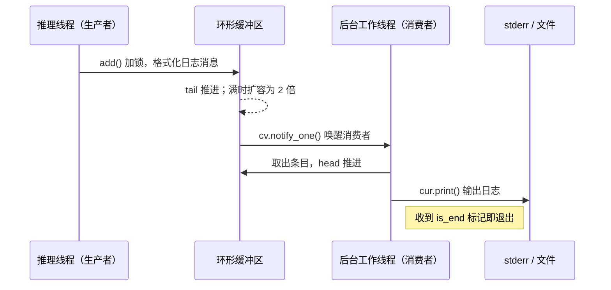
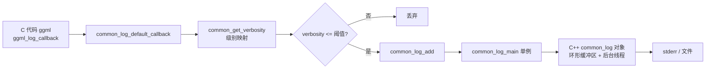
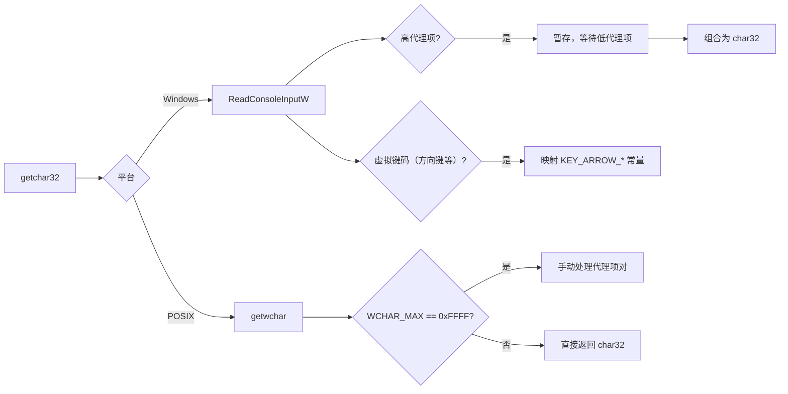
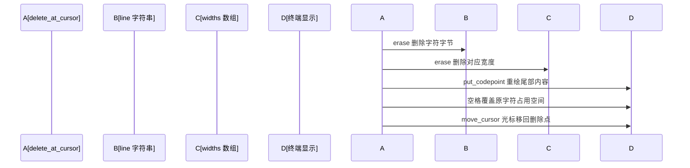
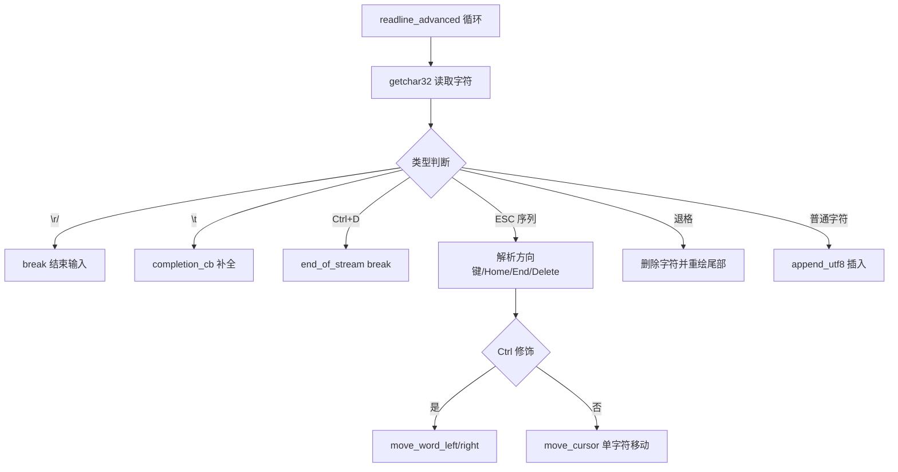
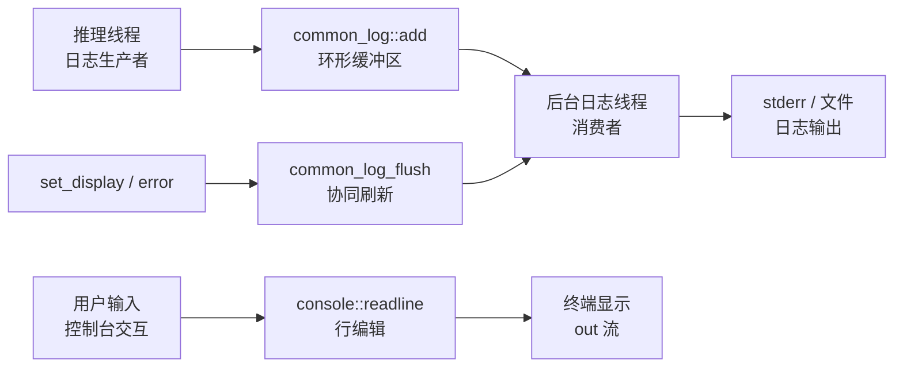

# 第54章 53 工具函数与辅助能力：像餐厅后厨与前厅那样的解耦与桥接

## 学习目标

- 理解异步日志系统的生产者-消费者模式与环形缓冲区设计原理
- 掌握跨平台终端控制技术（Windows API与POSIX termios）的差异处理
- 熟练运用ANSI颜色代码与UTF-8/UTF-16编码处理实现终端美化
- 深入理解高级行编辑功能（历史记录、自动补全、光标管理）的实现机制
- 分析双模式设计（简单IO vs 高级显示）在兼容性与功能性之间的权衡
- 掌握多线程环境下终端输出的同步与互斥策略
- 理解UTF-8解码/编码、字符宽度计算与光标移动的字节级实现
- 掌握C风格API与C++类封装之间的桥接模式
- 辨析静态自由函数与类静态方法在控制台模块中的混合设计
- 理解控制台显示状态管理与颜色配置的懒更新策略

## 54.1 生活类比

想象一下，llama.cpp 的日志与控制台系统就像一家高端餐厅的后厨与前厅协作系统。在后厨，推理线程是厨师，当它准备好一道菜（生成日志）后，并不会亲自跑到前厅，而是把它放到环形传送带（环形缓冲区）上。专门的传菜员（后台工作线程）则守在传送带旁，一旦有新菜就按顺序送到顾客桌上——也就是打印到终端或文件。万一生意太好，传送带满了怎么办？很简单，换一条更长的传送带（自动扩容为原来的2倍），保证不丢单。而连接后厨与前厅的，是一套标准的服务用语，也就是C接口桥接函数：服务员只需要说标准话术（函数调用），不用关心后厨的专业术语，这样即使后厨改造，前厅服务也不需要改变。至于前厅的灯光与氛围，控制台显示系统（console）就是餐厅的灯光师，它为不同场景设计了不同的灯光模式：顾客指令是暖黄色（PROMPT），思考过程是灰色（REASONING），错误则是红色警报（ERROR）。更聪明的是，灯光师只在需要切换场景时才调整灯光，避免频繁闪烁。当顾客需要点单时，行编辑系统（readline）就像一个个性化的点单台：简单模式好比快餐柜台，顾客写纸条，收银员直接录入；高级模式则像日式铁板烧，厨师（光标）在顾客面前现场操作，可以左移右移（Ctrl+方向键）、回看上一条（历史记录）、甚至自动补全（Tab键推荐菜品）。而统一入口（console::readline）则是餐厅总调度，根据店面档次自动选择服务模式。历史记录（history_t）如同常客的点单记忆，记住常客上次点的菜，按上下键就能翻阅老菜单。当然，菜单还有多国语言，UTF-8处理就像多语言菜单翻译，把中文、日文、Emoji这些复杂的组合字符准确翻译成字节序列，并正确记录上菜顺序（光标位置）。最后，当等位时，进度指示器（spinner）就像旋转灯，告诉顾客“菜在做，请稍等”，独立的灯光师（线程）专门负责转灯，不影响后厨做菜。整个系统的精髓就在于：后厨（计算）与前厅（IO）分离，用缓冲区解耦，用颜色提升体验，用历史记录记住常客习惯。

## 54.2 源码地图

```
common/log.h
├── 全局定义与宏（1-47行）
│   ├── enum log_colors              # 日志颜色模式（自动/禁用/启用）
│   ├── LOG_LEVEL_*                  # 日志级别常量（DEBUG/INFO/WARN/ERROR/OUTPUT）
│   ├── LOG_COL_*                    # ANSI颜色代码宏定义
│   ├── LOG_ATTRIBUTE_FORMAT         # 格式化属性宏（跨编译器兼容）
│   └── common_log_verbosity_thold   # 全局日志级别阈值
├── 函数声明
│   ├── common_log_set_verbosity_thold()  # 设置全局日志阈值
│   ├── common_log_default_callback()     # 默认日志回调函数
│   └── LOG_* 宏家族（LOG/LOG_DBG/LOG_INF/LOG_WRN/LOG_ERR等）
└── struct common_log (C++接口)
    ├── common_log_init()           # 创建日志对象
    ├── common_log_main()           # 获取全局单例日志
    ├── common_log_pause/resume()   # 暂停/恢复工作线程
    ├── common_log_free()           # 释放日志对象
    ├── common_log_add()            # 添加日志条目（支持格式化）
    ├── common_log_set_file()       # 设置日志输出文件
    ├── common_log_set_colors()     # 设置颜色模式
    ├── common_log_set_prefix()     # 设置是否显示前缀
    ├── common_log_set_timestamps() # 设置是否显示时间戳
    └── common_log_flush()          # 刷新日志缓冲区

common/log.cpp
├── 全局变量与工具（20-41行）
│   ├── t_us()                      # 获取微秒级时间戳
│   ├── enum common_log_col         # 日志颜色枚举
│   └── g_col[]                     # 全局颜色配置表
├── struct common_log_entry         # 日志条目结构
│   └── print()                     # 打印单条日志（43-91行）
├── class common_log（实现）
│   ├── common_log()                # 构造函数（97-116行）
│   ├── ~common_log()               # 析构函数（118-124行）
│   ├── add()                       # 添加日志到环形缓冲区（151-207行）
│   ├── resume()                    # 启动后台工作线程（209-238行）
│   ├── pause()                     # 暂停并等待线程结束（240-260行）
│   ├── set_file()                  # 切换日志文件（262-276行）
│   ├── set_colors()                # 配置颜色表（278-301行）
│   ├── set_prefix()                # 设置前缀标志（303-307行）
│   └── set_timestamps()            # 设置时间戳标志（309-313行）
└── C接口桥接函数
    ├── common_log_init/main/free() # 对象生命周期管理
    ├── common_log_pause/resume()   # 线程控制
    ├── common_log_add()            # 日志添加入口
    ├── common_log_set_file/colors/prefix/timestamps() # 配置接口
    ├── common_log_flush()          # 刷新实现（pause+resume）
    ├── common_get_verbosity()      # 日志级别转换
    └── common_log_default_callback() # 默认回调

common/console.h
├── enum display_type               # 显示类型枚举（RESET/INFO/PROMPT等）
└── namespace console
    ├── init()                      # 初始化控制台
    ├── cleanup()                   # 清理并恢复终端设置
    ├── set_display()               # 设置显示样式
    ├── readline()                  # 读取用户输入（统一接口）
    ├── set_completion_callback()   # 设置自动补全回调
    ├── spinner::start/stop()       # 进度指示器控制
    ├── log()                       # 普通日志输出
    ├── error()                     # 错误日志输出（带颜色）
    └── flush()                     # 刷新输出

common/console.cpp
├── 控制台初始化与清理
│   ├── init()                      # 跨平台初始化（66-132行）
│   └── cleanup()                   # 恢复终端状态（134-149行）
├── 显示与颜色管理
│   ├── set_display()               # 设置ANSI颜色（155-179行）
│   └── error()                     # 错误输出（1328-1338行）
├── 基础输入输出
│   ├── getchar32()                 # 读取UTF-32字符（181-234行）
│   ├── pop_cursor()                # 光标左移（236-254行）
│   ├── estimateWidth()             # 估算字符宽度（256-263行）
│   ├── put_codepoint()             # 输出Unicode字符（265-310行）
│   └── replace_last()              # 替换最后字符（312-320行）
├── UTF-8处理工具
│   ├── decode_utf8()               # UTF-8解码（322-366行）
│   ├── append_utf8()               # UTF-8编码（368-383行）
│   ├── prev_utf8_char_pos()        # 前一字符位置（385-391行）
│   └── next_utf8_char_pos()        # 后一字符位置（393-399行）
├── 行编辑与光标控制
│   ├── delete_at_cursor()          # 删除光标处字符（412-436行）
│   ├── clear_current_line()        # 清除当前行（438-449行）
│   ├── set_line_contents()         # 设置行内容（451-480行）
│   ├── move_to_line_start()        # 移到行首（482-490行）
│   ├── move_to_line_end()          # 移到行尾（492-500行）
│   ├── has_ctrl_modifier()         # 检测Ctrl修饰键（502-526行）
│   ├── is_space_codepoint()        # 判断空白字符（528-530行）
│   ├── move_word_left()            # 左移一词（532-568行）
│   ├── move_word_right()           # 右移一词（570-614行）
│   └── move_cursor()               # 通用光标移动（616-640行）
├── struct history_t                # 历史记录管理
│   ├── add()                       # 添加历史条目（570-582行）
│   ├── prev()                      # 上一条历史（583-595行）
│   ├── next()                      # 下一条历史（596-612行）
│   ├── begin_viewing()             # 开始浏览（613-616行）
│   ├── end_viewing()               # 结束浏览（617-620行）
│   └── is_viewing()                # 检查浏览状态（621-623行）
├── 行读取实现（自由函数）
│   ├── ::readline_advanced()       # 高级编辑模式实现（642-820行）
│   ├── ::readline_simple()         # 简单模式实现（1200-1250行）
│   └── console::readline()         # 统一入口选择（1250-1260行）
├── 输出接口
│   ├── console::log()              # 直接输出（1320-1328行）
│   ├── console::error()            # 错误输出（1328-1338行）
│   └── console::flush()            # 刷新输出（1338-1342行）
└── namespace spinner               # 进度指示器
    ├── draw_next_frame()           # 绘制下一帧（1280-1288行）
    ├── start()                     # 启动旋转动画（1288-1308行）
    └── stop()                      # 停止动画（1308-1320行）
```

## 54.3 异步日志核心架构 —— 日志系统的「生产者-消费者流水线」

在大模型推理这种计算密集型任务中，同步打印日志会严重阻塞推理线程，而多线程环境下直接输出又容易导致内容交错混乱。llama.cpp 的解法是：让日志先存后取，用一个环形缓冲区 + 后台工作线程实现完全解耦。生产者（推理线程）只管把格式化后的消息扔进缓冲区，消费者（后台线程）则持续监听，有新消息就取出并打印到标准错误流或文件。当缓冲区满时，它会自动扩容为原来的 2 倍，确保即使突发大量日志也不丢失。同时，通过全局阈值 `common_log_verbosity_thold` 可以精细控制哪些级别的日志需要输出，DEBUG 级别默认不写文件，避免污染生产日志。

这正如餐厅后厨的传菜员系统：厨师（推理线程）只需把菜（日志）放在传送带（环形缓冲区）上，传菜员（后台线程）按顺序送到前厅（终端），两者互不阻塞，即使传送带满了也会自动更换更长的传送带。



### 54.3.1 `LOG_* 宏家族` 与 ANSI 颜色定义 —— 控制台的「调色盘」

源码路径：`common/log.h` - `LOG_* 宏家族与全局定义`（1-47行）

```c
// 定义 ANSI 颜色代码，用于终端着色
#define LOG_CLR_TO_EOL  "\033[K\r"     // 清除到行尾并回车
#define LOG_COL_DEFAULT "\033[0m"      // 默认颜色（重置）
#define LOG_COL_BOLD    "\033[1m"      // 加粗
#define LOG_COL_RED     "\033[31m"     // 红色
#define LOG_COL_GREEN   "\033[32m"     // 绿色
#define LOG_COL_YELLOW  "\033[33m"     // 黄色
#define LOG_COL_BLUE    "\033[34m"     // 蓝色
#define LOG_COL_MAGENTA "\033[35m"     // 品红
#define LOG_COL_CYAN    "\033[36m"     // 青色
#define LOG_COL_WHITE   "\033[37m"     // 白色

// 跨编译器兼容的格式化属性宏
#ifndef __GNUC__
#    define LOG_ATTRIBUTE_FORMAT(...)
#elif defined(__MINGW32__) && !defined(__clang__)
#    define LOG_ATTRIBUTE_FORMAT(...) __attribute__((format(gnu_printf, __VA_ARGS__)))
#else
#    define LOG_ATTRIBUTE_FORMAT(...) __attribute__((format(printf, __VA_ARGS__)))
#endif

// 日志级别常量，数值越小越紧急
#define LOG_LEVEL_DEBUG  4
#define LOG_LEVEL_INFO   3
#define LOG_LEVEL_WARN   2
#define LOG_LEVEL_ERROR  1
#define LOG_LEVEL_OUTPUT 0

#define LOG_DEFAULT_DEBUG LOG_LEVEL_DEBUG
#define LOG_DEFAULT_LLAMA LOG_LEVEL_INFO

// 颜色模式枚举
enum log_colors {
    LOG_COLORS_AUTO     = -1,  // 自动检测
    LOG_COLORS_DISABLED = 0,   // 禁用颜色
    LOG_COLORS_ENABLED  = 1,   // 启用颜色
};

extern int common_log_verbosity_thold;  // 全局日志级别阈值
```

这段代码定义了日志系统所需的 ANSI 颜色宏、跨编译器格式化属性宏、日志级别常量和颜色模式枚举，为整个日志模块的终端美化和条件编译奠定了基础。

### 54.3.2 `common_log` 结构体 —— C 风格日志接口定义

源码路径：`common/log.h` - `common_log` 接口（62-110行）

```c
struct common_log {
    // 创建一个新的日志对象
    struct common_log * (*init)(void);
    // 获取全局单例日志对象
    struct common_log * (*main)(void);
    // 暂停/恢复工作线程
    void (*pause)(struct common_log * log);
    void (*resume)(struct common_log * log);
    // 释放日志对象
    void (*free)(struct common_log * log);
    // 添加一条格式化日志
    LOG_ATTRIBUTE_FORMAT(3, 4)
    void (*add)(struct common_log * log, enum ggml_log_level level, const char * fmt, ...);
    // 配置输出目标
    void (*set_file)(struct common_log * log, const char * file);
    void (*set_colors)(struct common_log * log, log_colors colors);
    void (*set_prefix)(struct common_log * log, bool prefix);
    void (*set_timestamps)(struct common_log * log, bool timestamps);
    // 刷新所有待处理的日志
    void (*flush)(struct common_log * log);
};
```

这个接口定义了日志对象的完整生命周期和配置能力。所有函数都接受 `struct common_log *` 作为第一个参数，形成纯 C 风格的 API，便于桥接到 ggml 等 C 项目。

### 54.3.3 `common_log()` 构造函数 —— 日志对象的「诞生」

源码路径：`common/log.cpp` - `common_log()` 构造函数（97-116行）

```cpp
common_log() : common_log(256) {}

common_log(size_t capacity) {
    file = nullptr;                              // ① 初始无文件输出
    prefix = false;                              // ② 默认不显示前缀
    timestamps = false;                          // ③ 默认不显示时间戳
    running = false;                             // ④ 初始未运行
    t_start = t_us();                            // ⑤ 记录启动时间，用于计算相对时间戳
    entries.resize(capacity);                    // ⑥ 初始化环形缓冲区，默认容量 256
    for (auto & entry : entries) {
        entry.msg.resize(256);                   // ⑦ 为每个条目预分配 256 字节消息缓冲
    }
    head = 0;                                    // ⑧ 头指针初始化
    tail = 0;                                    // ⑨ 尾指针初始化
    resume();                                    // ⑩ 构造后立即启动后台工作线程
}
```

这段代码完成了日志对象的初始化。它预分配了环形缓冲区并为每个条目准备了消息缓冲区，最后调用 `resume()` 启动后台线程，使得日志对象创建后即可接收日志。

### 54.3.4 `~common_log()` 析构函数 —— 日志对象的「退役」

源码路径：`common/log.cpp` - `~common_log()` 析构函数（118-124行）

```cpp
~common_log() {
    pause();                          // ① 暂停后台线程，确保所有日志已输出
    if (file) {
        fclose(file);                 // ② 关闭日志文件
    }
}
```

析构函数负责清理日志对象占用的资源。它先暂停后台线程，等待所有待处理的日志输出完毕，再关闭已打开的日志文件，避免资源泄漏。

### 54.3.5 `common_log::add` —— 把日志塞进环形缓冲区

源码路径：`common/log.cpp` - `common_log::add`（151-207行）

```cpp
void add(enum ggml_log_level level, const char * fmt, va_list args) {
    std::lock_guard<std::mutex> lock(mtx);          // ① 加锁，保证线程安全
    if (!running) {                                 // ② 如果未运行（已暂停），直接丢弃
        return;
    }
    auto & entry = entries[tail];                   // ③ 获取环形缓冲区当前写入位置
    va_list args_copy;
    va_copy(args_copy, args);
    const size_t n = vsnprintf(entry.msg.data(), entry.msg.size(), fmt, args);  // ④ 格式化日志
    if (n >= entry.msg.size()) {                    // ⑤ 如果消息过长，动态扩容
        entry.msg.resize(n + 1);
        vsnprintf(entry.msg.data(), entry.msg.size(), fmt, args_copy);
    }
    va_end(args_copy);
    entry.level = level;                            // ⑥ 记录日志级别
    entry.prefix = prefix;                          // ⑦ 记录是否输出前缀
    entry.timestamp = timestamps ? t_us() - t_start : 0;  // ⑧ 记录时间戳
    entry.is_end = false;                           // ⑨ 标记为普通日志（非结束标记）
    tail = (tail + 1) % entries.size();             // ⑩ 推进尾指针（环形）
    if (tail == head) {                             // ⑪ 缓冲区满，扩容为 2 倍
        std::vector<common_log_entry> new_entries(2 * entries.size());
        size_t new_tail = 0;
        do {
            new_entries[new_tail] = std::move(entries[head]);
            head = (head + 1) % entries.size();
            new_tail = new_tail + 1;
        } while (head != tail);
        head = 0;
        tail = new_tail;
        for (size_t i = tail; i < new_entries.size(); i++) {
            new_entries[i].msg.resize(256);       // ⑫ 为新条目预分配消息缓冲
        }
        entries = std::move(new_entries);
    }
    cv.notify_one();                                // ⑬ 通知后台线程：有新日志了
}
```

这段代码实现了日志消息的线程安全入队操作。它通过互斥锁保护环形缓冲区的写入，当缓冲区满时自动扩容为原来的 2 倍，并将旧数据迁移到新数组，最后通过条件变量唤醒后台工作线程。

### 54.3.6 `common_log::resume` —— 启动后台「传菜员」

源码路径：`common/log.cpp` - `common_log::resume`（209-238行）

```cpp
void resume() {
    std::lock_guard<std::mutex> lock(mtx);          // ① 加锁
    if (running) {                                  // ② 已在运行，直接返回
        return;
    }
    running = true;                                 // ③ 标记为运行状态
    thrd = std::thread([this]() {                   // ④ 创建后台工作线程
        while (true) {
            {
                std::unique_lock<std::mutex> lock(mtx);
                cv.wait(lock, [this]() { return head != tail; });  // ⑤ 等待新日志
                cur = entries[head];                          // ⑥ 取出一条日志
                head = (head + 1) % entries.size();           // ⑦ 推进头指针
            }
            if (cur.is_end) {                            // ⑧ 收到结束标记，退出线程
                break;
            }
            cur.print();                                 // ⑨ 打印日志到标准错误流
            if (file) {                                  // ⑩ 如果配置了文件，同时写入文件
                cur.print(file);
            }
        }
    });
}
```

这段代码启动了一个独立的后台线程，持续监听条件变量。当环形缓冲区非空时，线程被唤醒，取出日志条目并调用 `print()` 方法输出到终端或文件。这种设计保证了日志 I/O 完全不阻塞推理线程。

### 54.3.7 `common_log::pause` —— 暂停后台「传菜员」

源码路径：`common/log.cpp` - `common_log::pause`（240-260行）

```cpp
void pause() {
    {
        std::lock_guard<std::mutex> lock(mtx);      // ① 加锁，保护共享状态
        if (!running) {                              // ② 未运行（已暂停），直接返回
            return;
        }
        running = false;                             // ③ 标记为停止状态
        auto & entry = entries[tail];                // ④ 获取下一个写入位置
        entry.is_end = true;                         // ⑤ 写入结束标记（特殊条目）
        tail = (tail + 1) % entries.size();          // ⑥ 推进尾指针，入队结束标记
        cv.notify_one();                              // ⑦ 唤醒后台线程处理该标记
    }
    thrd.join();                                     // ⑧ 阻塞等待线程结束
}
```

这段代码实现了日志线程的优雅停止机制。它先在缓冲区尾部写入一条 `is_end = true` 的特殊标记，再通过条件变量唤醒后台线程。后台线程在 `resume()` 的循环中检测到该标记后会主动 `break` 退出，最后 `join()` 回收线程资源。这种「标记+等待」的模式避免了强行终止线程可能带来的资源泄漏或竞态问题，是 `set_file()`、`set_colors()` 等配置接口能安全修改共享状态的前提。

### 54.3.8 `common_log::set_file` —— 切换日志输出「目的地」

源码路径：`common/log.cpp` - `common_log::set_file`（262-276行）

```cpp
void set_file(const char * path) {
    pause();                                        // ① 暂停后台线程，确保切换期间无输出
    if (file) {                                     // ② 关闭旧的日志文件
        fclose(file);
    }
    if (path) {                                     // ③ 打开新的日志文件（写入模式）
        file = fopen(path, "w");
    } else {
        file = nullptr;                             // ④ 传入 nullptr 表示关闭文件输出
    }
    resume();                                       // ⑤ 恢复后台线程，继续输出
}
```

这段代码展示了配置接口的通用模式：先 `pause()` 暂停后台线程，在无竞争的环境下修改共享状态（文件指针），再 `resume()` 恢复。`set_colors()` 采用了完全相同的 pause-modify-resume 三段式，确保颜色表在切换过程中不会被后台线程读到中间状态。

## 54.4 日志条目封装与输出 —— 单条日志的「身份证与信使」

每条日志在被打印之前，都会被封装成一个 `common_log_entry` 结构体，它记录了消息的级别、是否显示前缀、时间戳以及实际的文本内容。打印时，根据级别决定输出到 stdout 还是 stderr，根据配置决定是否添加前缀和颜色。DEBUG 级别如果低于全局阈值，则直接丢弃，不输出。这种精细化的管理让日志既能在开发期提供丰富信息，又能在生产期保持整洁。

这就像餐厅中每道菜都有一个菜单描述：前厅传菜员看到菜单就知道该把菜送到哪张桌（输出流），几点上的（时间戳），以及菜的级别（普通菜还是特色菜）。

```mermaid
flowchart LR
    A[common_log_entry] --> B[level 级别]
    A --> C[prefix 前缀开关]
    A --> D[timestamp 相对时间]
    A --> E[msg 消息缓冲]
    A --> F[is_end 结束标记]
    B --> G{print() 选择输出流}
    G -->|DEBUG 低于阈值| H[丢弃]
    G -->|NONE| I[stdout]
    G -->|其他| J[stderr]
    C --> K{prefix?}
    K -->|是| L[输出级别前缀 I/W/E/D]
    D --> M{timestamp?}
    M -->|是| N[输出相对时间]
```

### 54.4.1 `common_log_entry::print` —— 把日志送到「目的地」

源码路径：`common/log.cpp` - `common_log_entry::print`（43-91行）

```cpp
void print(FILE * file = nullptr) const {
    FILE * fcur = file;
    if (!fcur) {                                    // ① 未指定文件，选择默认输出流
        if (level == GGML_LOG_LEVEL_DEBUG && common_log_verbosity_thold < LOG_DEFAULT_DEBUG) {
            return;                                 // ② DEBUG 级别低于阈值，直接丢弃
        }
        fcur = stdout;
        if (level != GGML_LOG_LEVEL_NONE) {         // ③ 非 NONE 级别，输出到 stderr
            fcur = stderr;
        }
    }
    if (level != GGML_LOG_LEVEL_NONE && level != GGML_LOG_LEVEL_CONT && prefix) {
        if (timestamp) {                            // ④ 如果启用时间戳，打印相对时间
            fprintf(fcur, "%s%d.%02d.%03d.%03d%s ", ...);
        }
        switch (level) {                            // ⑤ 根据级别打印前缀字母
            case GGML_LOG_LEVEL_INFO:  fprintf(fcur, "%sI %s", ...); break;
            case GGML_LOG_LEVEL_WARN:  fprintf(fcur, "%sW %s", ...); break;
            case GGML_LOG_LEVEL_ERROR: fprintf(fcur, "%sE %s", ...); break;
            case GGML_LOG_LEVEL_DEBUG: fprintf(fcur, "%sD %s", ...); break;
            default: break;
        }
    }
    fprintf(fcur, "%s", msg.data());                // ⑥ 输出实际消息内容
    if (level == GGML_LOG_LEVEL_WARN || level == GGML_LOG_LEVEL_ERROR || level == GGML_LOG_LEVEL_DEBUG) {
        fprintf(fcur, "%s", g_col[COMMON_LOG_COL_DEFAULT]);  // ⑦ 恢复默认颜色
    }
    fflush(fcur);                                   // ⑧ 立即刷新，确保实时可见
}
```

这段代码完成了单条日志的格式化输出。它智能选择输出流，支持时间戳和级别前缀，并在错误/警告级别后自动恢复默认颜色，避免影响后续终端输出。

### 54.4.2 `common_log::set_colors` —— 颜色配置的「开关」

源码路径：`common/log.cpp` - `common_log::set_colors`（278-301行）

```cpp
void set_colors(bool colors) {
    pause();                                        // ① 暂停后台线程，保证配置一致性
    if (colors) {                                   // ② 启用颜色
        g_col[COMMON_LOG_COL_DEFAULT] = LOG_COL_DEFAULT;
        g_col[COMMON_LOG_COL_BOLD] = LOG_COL_BOLD;
        // ... 其他颜色映射
    } else {                                        // ③ 禁用颜色
        for (size_t i = 0; i < g_col.size(); i++) {
            g_col[i] = "";
        }
    }
    resume();                                       // ④ 恢复线程
}
```

这段代码在修改全局颜色表时暂停后台线程，确保不会出现颜色配置与日志输出的竞态条件。

### 54.4.3 `common_log::set_prefix` / `set_timestamps` —— 轻量级配置的「旋钮」

源码路径：`common/log.cpp` - `common_log::set_prefix` / `common_log::set_timestamps`（303-313行）

```cpp
void set_prefix(bool prefix) {
    std::lock_guard<std::mutex> lock(mtx);          // ① 轻量加锁
    this->prefix = prefix;                          // ② 只修改标志位
}

void set_timestamps(bool timestamps) {
    std::lock_guard<std::mutex> lock(mtx);          // ① 轻量加锁
    this->timestamps = timestamps;                  // ② 只修改标志位
}
```

这两个方法不需要 pause/resume，因为它们修改的布尔值在 `add()` 中被原子地读取到条目上，一旦条目入队，后续的标志修改不会影响已入队的日志，从而避免了不必要的线程停启开销。

## 54.5 C 接口桥接与全局管理 —— 跨越语言边界的「外交官」

llama.cpp 的核心是 C++ 实现的，但 ggml 等底层库是纯 C 的。为了让 C 代码也能使用异步日志，common 模块提供了一套 C 风格的包装函数。这些函数内部实例化或获取 C++ 对象，然后转发调用。通过 `common_log_main()` 的全局单例，整个进程只会创建一个日志对象，并且在首次调用时根据终端能力自动启用颜色，无需调用者手动管理生命周期。

这就像餐厅的前厅与后厨之间使用一套标准的服务用语（C 接口），服务员（C 代码）只需说标准话术，无需关心后厨（C++ 实现）的专业术语，即使后厨改造，前厅服务也不需要改变。



### 54.5.1 `common_log_main` —— 全局唯一的「日志指挥官」

源码路径：`common/log.cpp` - `common_log_main`（324-333行）

```cpp
struct common_log * common_log_main() {
    static struct common_log log;                  // ① 静态局部变量，进程级唯一
    static std::once_flag init_flag;
    std::call_once(init_flag, [&]() {              // ② 保证只初始化一次
        log.set_colors(tty_can_use_colors());       // ③ 自动检测终端颜色支持
    });
    return &log;
}
```

这段代码利用 `std::call_once` 和静态局部变量实现线程安全的单例模式。首次调用时，会自动检测终端是否支持颜色，并据此配置日志输出。这样，任何模块只需调用 `common_log_main()` 就能获得全局日志对象，无需关心初始化细节。

### 54.5.2 `common_log_set_verbosity_thold` —— 全局日志级别的「阀门」

源码路径：`common/log.cpp` - `common_log_set_verbosity_thold`（22-24行）

```cpp
void common_log_set_verbosity_thold(int verbosity) {
    common_log_verbosity_thold = verbosity;          // ① 设置全局阈值
}
```

这个简单的函数设置了全局日志级别阈值。数值越小越紧急，只有级别数值小于等于阈值的日志才会被输出，就像餐厅根据顾客需求调整菜单的详细程度。

### 54.5.3 `common_get_verbosity` —— 日志级别的「翻译官」

源码路径：`common/log.cpp` - `common_get_verbosity`（387-397行）

```cpp
static int common_get_verbosity(enum ggml_log_level level) {
    switch (level) {
        case GGML_LOG_LEVEL_DEBUG: return LOG_LEVEL_DEBUG;    // ① DEBUG 映射
        case GGML_LOG_LEVEL_INFO:  return LOG_LEVEL_INFO;     // ② INFO 映射
        case GGML_LOG_LEVEL_WARN:  return LOG_LEVEL_WARN;     // ③ WARN 映射
        case GGML_LOG_LEVEL_ERROR: return LOG_LEVEL_ERROR;    // ④ ERROR 映射
        case GGML_LOG_LEVEL_CONT:  return LOG_LEVEL_INFO;     // ⑤ CONT 映射为 INFO
        case GGML_LOG_LEVEL_NONE:                            // ⑥ NONE 映射为 OUTPUT
        default: return LOG_LEVEL_OUTPUT;
    }
}
```

这个函数将 ggml 的日志级别转换为通用日志级别，以便与全局阈值比较。它就像餐厅的菜单翻译器，把后厨的专业术语翻译成前厅的服务用语。

### 54.5.4 `common_log_default_callback` —— GGML 日志的「接线员」

源码路径：`common/log.cpp` - `common_log_default_callback`（399-405行）

```cpp
void common_log_default_callback(enum ggml_log_level level, const char * text, void * /*user_data*/) {
    auto verbosity = common_get_verbosity(level);   // ① 将 GGML 级别映射为通用级别
    if (verbosity <= common_log_verbosity_thold) {  // ② 根据阈值过滤
        common_log_add(common_log_main(), level, "%s", text);  // ③ 转发到全局日志
    }
}
```

这段代码作为 ggml 库的默认日志回调，负责将底层 C 库的日志接入 llama.cpp 的异步日志系统。它先将 GGML 的日志级别转换为通用级别，再根据全局阈值决定是否输出，最终调用 `common_log_add` 将消息加入环形缓冲区。

### 54.5.5 C 接口桥接全景 —— 稳定 ABI 的「防护墙」

源码路径：`common/log.cpp` - C 接口桥接函数族（320-405行）

这些 C 函数构成了 C/C++ 边界的稳定契约。它们的共同特点是：参数只使用不透明指针（`struct common_log *`）、基本类型和标准库类型，不暴露 C++ 类的内部布局。这样一来，即使 `common_log` 类内部增加或删除成员，C 侧代码也不需要重新编译，实现了真正的 ABI 兼容。

#### 54.5.5.1 `common_log_init` / `common_log_free` —— 对象生命周期管理

```cpp
// 创建日志对象
struct common_log * common_log_init() {
    return new common_log;          // ① 调用 C++ 构造函数，创建日志对象
}

// 释放日志对象
void common_log_free(struct common_log * log) {
    delete log;                     // ② 调用 C++ 析构函数，释放资源
}
```

这两个函数管理日志对象的创建与销毁。它们内部使用 C++ 的 `new` 和 `delete`，但对外暴露不透明指针，隐藏了实现细节。

#### 54.5.5.2 `common_log_pause` / `common_log_resume` —— 线程控制

```cpp
// 暂停后台线程
void common_log_pause(struct common_log * log) {
    log->pause();                   // ① 转发到 C++ 成员函数
}

// 恢复后台线程
void common_log_resume(struct common_log * log) {
    log->resume();                  // ② 转发到 C++ 成员函数
}
```

这两个函数控制后台工作线程的暂停与恢复，方便在修改配置时使用。

#### 54.5.5.3 `common_log_add` —— 日志添加入口

```cpp
void common_log_add(struct common_log * log, enum ggml_log_level level, const char * fmt, ...) {
    va_list args;
    va_start(args, fmt);
    log->add(level, fmt, args);     // ① 转发可变参数到 C++ 成员函数
    va_end(args);
}
```

这个函数是 C 代码添加日志的主要入口，它接收可变参数并转发给 C++ 的 `add` 方法。

#### 54.5.5.4 `common_log_flush` —— 刷新实现

```cpp
void common_log_flush(struct common_log * log) {
    log->pause();                   // ① 暂停，等待队列排空
    log->resume();                  // ② 恢复，重新开始消费
}
```

`common_log_flush()` 采用 pause+resume 而不是直接清空队列，是因为 pause 会等待后台线程处理完所有已入队的日志，从而保证调用者在 flush 返回后，所有日志都已实际写出。

#### 54.5.5.5 配置接口族

```cpp
// 设置日志文件
void common_log_set_file(struct common_log * log, const char * file) {
    log->set_file(file);
}

// 设置颜色模式
void common_log_set_colors(struct common_log * log, log_colors colors) {
    if (colors == LOG_COLORS_AUTO) {
        log->set_colors(tty_can_use_colors());
        return;
    }
    if (colors == LOG_COLORS_DISABLED) {
        log->set_colors(false);
        return;
    }
    GGML_ASSERT(colors == LOG_COLORS_ENABLED);
    log->set_colors(true);
}

// 设置前缀
void common_log_set_prefix(struct common_log * log, bool prefix) {
    log->set_prefix(prefix);
}

// 设置时间戳
void common_log_set_timestamps(struct common_log * log, bool timestamps) {
    log->set_timestamps(timestamps);
}
```

这些配置接口都采用统一的转发模式，将 C 调用转换为 C++ 成员函数调用，保持了接口的一致性。

## 54.6 控制台初始化与清理 —— 终端的「开机自检」

控制台模块需要应对 Windows 和 POSIX 两大平台的巨大差异。在 Windows 上，通过 `SetConsoleMode` 启用虚拟终端处理以支持 ANSI 颜色，输入模式设为宽字符以正确接收 Unicode。在 POSIX 上，通过 `termios` 禁用规范模式和回显，实现逐字符输入。初始化时还会保存终端原始状态，以便程序退出时完整恢复，避免留下「脏」终端。

这就像餐厅每天开业前的开机自检：检查灯光（ANSI 颜色）是否正常，菜单（输入模式）是否调好，以及记录原始状态以便打烊时恢复原样。

```mermaid
flowchart TD
    A[init(use_simple_io, use_advanced_display)] --> B{平台}
    B -->|Windows| C[GetConsoleMode 获取句柄]
    C --> D{获取失败?}
    D -->|是| E[simple_io = true 降级]
    D -->|否| F[SetConsoleMode 启用<br/>ENABLE_VIRTUAL_TERMINAL_PROCESSING]
    F --> G{启用失败?}
    G -->|是| H[advanced_display = false 降级]
    G -->|否| I[SetConsoleOutputCP CP_UTF8]
    I --> J[输入模式 _O_WTEXT / _O_U8TEXT]
    B -->|POSIX| K[tcgetattr 保存 initial_state]
    K --> L[禁用 ICANON | ECHO]
    K --> M[fopen /dev/tty 作为独立输出]
    K --> N[setlocale LC_ALL]
```

### 54.6.1 `init` —— 跨平台终端的「开机自检」

源码路径：`common/console.cpp` - `init`（66-132行）

```cpp
void init(bool use_simple_io, bool use_advanced_display) {
    advanced_display = use_advanced_display;
    simple_io = use_simple_io;
#if defined(_WIN32)
    // Windows-specific console initialization
    DWORD dwMode = 0;
    hConsole = GetStdHandle(STD_OUTPUT_HANDLE);
    if (hConsole == INVALID_HANDLE_VALUE || !GetConsoleMode(hConsole, &dwMode)) {
        hConsole = GetStdHandle(STD_ERROR_HANDLE);
        if (hConsole != INVALID_HANDLE_VALUE && (!GetConsoleMode(hConsole, &dwMode))) {
            hConsole = nullptr;
            simple_io = true;                     // ① 获取控制台句柄失败，降级到简单模式
        }
    }
    if (hConsole) {
        // ② 启用 ANSI 颜色支持
        if (advanced_display && !(dwMode & ENABLE_VIRTUAL_TERMINAL_PROCESSING) &&
            !SetConsoleMode(hConsole, dwMode | ENABLE_VIRTUAL_TERMINAL_PROCESSING)) {
            advanced_display = false;             // ③ 启用失败，禁用高级显示
        }
        SetConsoleOutputCP(CP_UTF8);              // ④ 设置输出代码页为 UTF-8
    }
    // ... 处理输入模式，设置 _O_WTEXT 或 _O_U8TEXT
#else
    // POSIX-specific console initialization
    if (!simple_io) {
        struct termios new_termios;
        tcgetattr(STDIN_FILENO, &initial_state);  // ⑤ 保存原始终端状态
        new_termios = initial_state;
        new_termios.c_lflag &= ~(ICANON | ECHO);  // ⑥ 禁用规范模式和回显
        new_termios.c_cc[VMIN] = 1;
        new_termios.c_cc[VTIME] = 0;
        tcsetattr(STDIN_FILENO, TCSANOW, &new_termios);
        tty = fopen("/dev/tty", "w+");             // ⑦ 打开独立终端，避免 stdout 被重定向影响
        if (tty != nullptr) {
            out = tty;
        }
    }
    setlocale(LC_ALL, "");                        // ⑧ 启用本地化，正确处理宽字符
#endif
}
```

这段代码展示了跨平台初始化的核心逻辑。Windows 侧重点在于获取控制台句柄、启用 ANSI 支持和设置代码页；POSIX 侧则通过 termios 结构保存原始状态并配置非规范输入，同时打开 `/dev/tty` 作为独立输出流。任何平台特性的失败都会触发降级，保证功能可用。

### 54.6.2 `cleanup` —— 终端状态的「还原师」

源码路径：`common/console.cpp` - `cleanup`（134-149行）

```cpp
void cleanup() {
    set_display(DISPLAY_TYPE_RESET);                // ① 重置显示样式，恢复默认颜色
#if !defined(_WIN32)
    // Restore settings on POSIX systems
    if (!simple_io) {                               // ② 仅在非简单模式下恢复终端
        if (tty != nullptr) {
            out = stdout;                           // ③ 输出流切回标准输出
            fclose(tty);
            tty = nullptr;
        }
        tcsetattr(STDIN_FILENO, TCSANOW, &initial_state);  // ④ 恢复原始终端状态
    }
#endif
}
```

这段代码是 `init()` 的逆操作。它先通过 `set_display(DISPLAY_TYPE_RESET)` 输出 ANSI 重置序列，清除可能残留的颜色状态，再在 POSIX 平台上关闭 `/dev/tty` 并用 `tcsetattr` 恢复终端的原始模式。如果没有这一步，程序退出后终端可能停留在「无回显、无行缓冲」的异常状态，用户需要手动执行 `reset` 才能恢复，这在命令行工具中是不可接受的。

## 54.7 控制台头文件与颜色管理 —— 终端的「化妆师」

`common/console.h` 定义了控制台模块的公共接口，包括 `display_type` 枚举和 `console` 命名空间中的函数声明。`display_type` 枚举定义了六种显示场景：RESET（重置）、INFO（信息）、PROMPT（提示）、REASONING（思考）、USER_INPUT（用户输入）、ERROR（错误）。

这就像餐厅为不同场景设计了不同的灯光模式：顾客指令是暖黄色，思考过程是灰色，错误则是红色警报。

### 54.7.1 `common/console.h` 全局定义

源码路径：`common/console.h` - 全局定义（1-50行）

```cpp
// Console functions

#pragma once

#include "common.h"

#include <functional>
#include <string>
#include <vector>

enum display_type {
    DISPLAY_TYPE_RESET = 0,
    DISPLAY_TYPE_INFO,
    DISPLAY_TYPE_PROMPT,
    DISPLAY_TYPE_REASONING,
    DISPLAY_TYPE_USER_INPUT,
    DISPLAY_TYPE_ERROR,
};

namespace console {
    void init(bool use_simple_io, bool use_advanced_display);
    void cleanup();
    void set_display(display_type display);
    bool readline(std::string & line, bool multiline_input);

    using completion_callback = std::function<std::vector<std::pair<std::string, size_t>>(std::string_view, size_t)>;
    void set_completion_callback(completion_callback cb);

    namespace spinner {
        void start();
        void stop();
    }

    // note: the logging API below output directly to stdout
    // it can negatively impact performance if used on inference thread
    // only use in in a dedicated CLI thread
    // for logging in inference thread, use log.h instead

    LLAMA_COMMON_ATTRIBUTE_FORMAT(1, 2)
    void log(const char * fmt, ...);

    LLAMA_COMMON_ATTRIBUTE_FORMAT(1, 2)
    void error(const char * fmt, ...);

    void flush();
}
```

这段代码声明了控制台模块的完整接口。`display_type` 枚举定义了六种显示场景，`console` 命名空间提供了初始化、清理、显示设置、输入读取、补全回调、进度指示器、日志输出和刷新等功能。

### 54.7.2 `set_display` —— 懒更新的「灯光切换」

源码路径：`common/console.cpp` - `set_display`（155-179行）

```cpp
void set_display(display_type display) {
    if (advanced_display && current_display != display) {  // ① 仅在高级模式且颜色变化时才输出
        common_log_flush(common_log_main());               // ② 先刷新日志，避免颜色交错
        switch(display) {
            case DISPLAY_TYPE_RESET:    fprintf(out, ANSI_COLOR_RESET); break;
            case DISPLAY_TYPE_INFO:     fprintf(out, ANSI_COLOR_MAGENTA); break;
            case DISPLAY_TYPE_PROMPT:   fprintf(out, ANSI_COLOR_YELLOW); break;
            case DISPLAY_TYPE_REASONING:fprintf(out, ANSI_COLOR_GRAY); break;
            case DISPLAY_TYPE_USER_INPUT: fprintf(out, ANSI_BOLD ANSI_COLOR_GREEN); break;
            case DISPLAY_TYPE_ERROR:    fprintf(out, ANSI_BOLD ANSI_COLOR_RED); break;
        }
        current_display = display;                          // ③ 更新当前颜色状态
        fflush(out);
    }
}
```

这段代码实现了颜色的懒更新机制。只有在高级显示模式下，并且当前颜色与目标颜色不同时，才会输出 ANSI 转义序列。这样做避免了在同一种颜色上重复输出造成的终端闪烁，同时 `common_log_flush` 确保日志输出不会与颜色切换交错。

### 54.7.3 `console::error` —— 红色警报的「染色剂」

源码路径：`common/console.cpp` - `console::error`（1328-1338行）

```cpp
void error(const char * fmt, ...) {
    va_list args;
    va_start(args, fmt);
    display_type cur = current_display;               // ① 保存当前颜色
    set_display(DISPLAY_TYPE_ERROR);                  // ② 切换到错误颜色（红色加粗）
    vfprintf(out, fmt, args);                         // ③ 输出错误信息
    set_display(cur);                                 // ④ 恢复原颜色
    va_end(args);
}
```

这段代码利用 `set_display` 的懒更新特性，临时切换到红色加粗输出错误信息，输出后立即恢复之前的颜色状态。整个过程对用户透明，不会影响后续的正常输出。

## 54.8 底层输入输出原语 —— 字符的「搬运工与测量师」

在终端交互中，最基础的操作就是读取一个字符并测量它的显示宽度。`getchar32()` 负责从标准输入读取一个 UTF-32 字符，Windows 上通过 `ReadConsoleInputW` 处理 UTF-16 代理项对，POSIX 上直接读取宽字符。`put_codepoint()` 则将 UTF-8 字符输出到终端，并通过查询光标位置返回实际显示宽度，解决中文等宽字符的对齐问题。

这就像餐厅的传菜员（字符搬运）与测量员（宽度测量）：传菜员负责把菜（字符）端到顾客面前，测量员确保菜盘（字符宽度）对齐，避免拥挤或松散。



### 54.8.1 `getchar32` —— 跨平台字符输入的「双城记」

源码路径：`common/console.cpp` - `getchar32`（181-234行）

```cpp
static char32_t getchar32() {
#if defined(_WIN32)
    HANDLE hConsole = GetStdHandle(STD_INPUT_HANDLE);
    wchar_t high_surrogate = 0;
    while (true) {
        INPUT_RECORD record;
        DWORD count;
        if (!ReadConsoleInputW(hConsole, &record, 1, &count) || count == 0) {
            return WEOF;
        }
        if (record.EventType == KEY_EVENT && record.Event.KeyEvent.bKeyDown) {
            wchar_t wc = record.Event.KeyEvent.uChar.UnicodeChar;
            if (wc == 0) {  // 处理特殊键（方向键等）
                const DWORD ctrl_mask = LEFT_CTRL_PRESSED | RIGHT_CTRL_PRESSED;
                const bool ctrl_pressed = (record.Event.KeyEvent.dwControlKeyState & ctrl_mask) != 0;
                switch (record.Event.KeyEvent.wVirtualKeyCode) {
                    case VK_LEFT:   return ctrl_pressed ? KEY_CTRL_ARROW_LEFT  : KEY_ARROW_LEFT;
                    case VK_RIGHT:  return ctrl_pressed ? KEY_CTRL_ARROW_RIGHT : KEY_ARROW_RIGHT;
                    // ... 其他特殊键
                }
            }
            if ((wc >= 0xD800) && (wc <= 0xDBFF)) {  // 高代理项
                high_surrogate = wc;
                continue;
            }
            if ((wc >= 0xDC00) && (wc <= 0xDFFF)) {  // 低代理项
                if (high_surrogate != 0) {
                    return ((high_surrogate - 0xD800) << 10) + (wc - 0xDC00) + 0x10000;
                }
            }
            high_surrogate = 0;
            return static_cast<char32_t>(wc);
        }
    }
#else
    wchar_t wc = getwchar();
    if (static_cast<wint_t>(wc) == WEOF) {
        return WEOF;
    }
#  if WCHAR_MAX == 0xFFFF
    if ((wc >= 0xD800) && (wc <= 0xDBFF)) {  // 高代理项
        wchar_t low_surrogate = getwchar();
        if ((low_surrogate >= 0xDC00) && (low_surrogate <= 0xDFFF)) {
            return (static_cast<char32_t>(wc & 0x03FF) << 10) + (low_surrogate & 0x03FF) + 0x10000;
        }
    }
    if ((wc >= 0xD800) && (wc <= 0xDFFF)) {  // 无效代理项
        return 0xFFFD;  // 返回替换字符
    }
#endif
    return static_cast<char32_t>(wc);
#endif
}
```

这段代码封装了跨平台字符输入的复杂性。Windows 侧通过 `ReadConsoleInputW` 读取宽字符输入，并正确处理 UTF-16 的代理项对，同时将方向键等特殊键映射为虚拟键码。POSIX 侧直接使用 `getwchar()`，并在 `wchar_t` 为 16 位的平台上手动处理代理项对。

### 54.8.2 `pop_cursor` —— 光标左移的「退格兵」

源码路径：`common/console.cpp` - `pop_cursor`（236-254行）

```cpp
static void pop_cursor() {
#if defined(_WIN32)
    if (hConsole != NULL) {
        CONSOLE_SCREEN_BUFFER_INFO bufferInfo;
        GetConsoleScreenBufferInfo(hConsole, &bufferInfo);
        COORD newCursorPosition = bufferInfo.dwCursorPosition;
        if (newCursorPosition.X == 0) {           // ① 处理首列换行
            newCursorPosition.X = bufferInfo.dwSize.X - 1;
            newCursorPosition.Y -= 1;
        } else {
            newCursorPosition.X -= 1;            // ② 普通左移
        }
        SetConsoleCursorPosition(hConsole, newCursorPosition);
        return;
    }
#endif
    putc('\b', out);                              // ③ POSIX 用退格符
}
```

这段代码处理光标左移一位。Windows 上通过 `SetConsoleCursorPosition` 直接设置坐标，POSIX 上则输出退格符，简单高效。

### 54.8.3 `estimateWidth` —— 字符宽度的「测量师」

源码路径：`common/console.cpp` - `estimateWidth`（256-263行）

```cpp
static int estimateWidth(char32_t codepoint) {
#if defined(_WIN32)
    (void)codepoint;
    return 1;                                     // ① Windows 固定宽度 1
#else
    return wcwidth(codepoint);                    // ② POSIX 使用 wcwidth 计算
#endif
}
```

这个函数估算字符的显示宽度。Windows 控制台通常将每个字符视为宽度 1，而 POSIX 系统使用 `wcwidth()` 函数正确处理中文等宽字符。

### 54.8.4 `put_codepoint` —— 字符输出的「宽度测量师」

源码路径：`common/console.cpp` - `put_codepoint`（265-310行）

```cpp
static int put_codepoint(const char* utf8_codepoint, size_t length, int expectedWidth) {
#if defined(_WIN32)
    CONSOLE_SCREEN_BUFFER_INFO bufferInfo;
    if (!GetConsoleScreenBufferInfo(hConsole, &bufferInfo)) {
        return expectedWidth;  // ① 获取缓冲区信息失败，返回预期宽度
    }
    COORD initialPosition = bufferInfo.dwCursorPosition;
    DWORD nNumberOfChars = length;
    WriteConsole(hConsole, utf8_codepoint, nNumberOfChars, &nNumberOfChars, NULL);
    CONSOLE_SCREEN_BUFFER_INFO newBufferInfo;
    GetConsoleScreenBufferInfo(hConsole, &newBufferInfo);
    // ② 处理最后一列的特殊情况
    if (utf8_codepoint[0] != 0x09 && initialPosition.X == newBufferInfo.dwSize.X - 1) {
        DWORD nNumberOfChars;
        WriteConsole(hConsole, &" \b", 2, &nNumberOfChars, NULL);
        GetConsoleScreenBufferInfo(hConsole, &newBufferInfo);
    }
    int width = newBufferInfo.dwCursorPosition.X - initialPosition.X;
    if (width < 0) {
        width += newBufferInfo.dwSize.X;  // ③ 处理跨行情况
    }
    return width;
#else
    if (expectedWidth >= 0 || tty == nullptr) {
        fwrite(utf8_codepoint, length, 1, out);
        return expectedWidth;  // ④ 信任预期宽度，直接输出
    }
    // ⑤ 通过查询光标位置获取实际宽度
    fputs("\033[6n", tty);
    int x1, y1, x2, y2;
    int results = 0;
    results = fscanf(tty, "\033[%d;%dR", &y1, &x1);
    fwrite(utf8_codepoint, length, 1, tty);
    fputs("\033[6n", tty);
    results += fscanf(tty, "\033[%d;%dR", &y2, &x2);
    if (results != 4) {
        return expectedWidth;
    }
    int width = x2 - x1;
    if (width < 0) {
        struct winsize w;
        ioctl(STDOUT_FILENO, TIOCGWINSZ, &w);
        width += w.ws_col;  // ⑥ 处理换行
    }
    return width;
#endif
}
```

这段代码在输出 Unicode 字符的同时，精确测量其显示宽度。Windows 上通过比较输出前后的光标位置计算宽度，POSIX 上则通过 ANSI 转义序列查询光标位置。这种机制保证了中文等宽字符在终端中的对齐精度。

### 54.8.5 `replace_last` —— 原地替换的「魔术师」

源码路径：`common/console.cpp` - `replace_last`（312-320行）

```cpp
static void replace_last(char ch) {
#if defined(_WIN32)
    pop_cursor();                                 // ① 光标左移
    put_codepoint(&ch, 1, 1);                     // ② 输出新字符
#else
    fprintf(out, "\b%c", ch);                     // ③ 退格后输出
#endif
}
```

这个函数是 spinner 动画能够「原地替换」字符的关键——它先用退格符收回光标，再输出新字符，从而在不改变光标整体位置的前提下更新显示内容。

## 54.9 UTF-8 处理引擎 —— 多字节字符的「翻译官」

UTF-8 的变长特性使得字节级操作变得困难。`decode_utf8()` 能够解析 1-4 字节的 UTF-8 序列，识别无效字节并返回替换字符 U+FFFD。`append_utf8()` 则执行反向转换，将 Unicode 码点编码为 UTF-8 字节序列。`prev_utf8_char_pos()` 和 `next_utf8_char_pos()` 利用 UTF-8 的编码模式（10xxxxxx 表示中间字节）在字节流中快速定位字符边界，确保光标移动和文本编辑时不会拆分多字节字符。

这就像餐厅的多语言菜单翻译：把中文、日文、Emoji 这些复杂的组合字符准确翻译成字节序列，并正确记录上菜顺序（光标位置）。

```mermaid
flowchart TD
    A[decode_utf8(input, pos)] --> B{首字节高位模式}
    B -->|0xxxxxxx| C[1字节序列<br/>advance=1]
    B -->|110xxxxx| D[2字节序列<br/>验证后续 10xxxxxx]
    B -->|1110xxxx| E[3字节序列<br/>验证后续两个 10xxxxxx]
    B -->|11110xxx| F[4字节序列<br/>验证后续三个 10xxxxxx]
    B -->|其他| G[无效字节<br/>返回 U+FFFD]
    D --> H[组合码点返回]
    E --> H
    F --> H
    I[append_utf8(ch)] --> J{ch 范围}
    J -->|<=0x7F| K[1字节]
    J -->|<=0x7FF| L[2字节 0xC0|...]
    J -->|<=0xFFFF| M[3字节 0xE0|...]
    J -->|<=0x10FFFF| N[4字节 0xF0|...]
```

### 54.9.1 `decode_utf8` —— 字节流的「解码器」

源码路径：`common/console.cpp` - `decode_utf8`（322-366行）

```cpp
static char32_t decode_utf8(const std::string & input, size_t pos, size_t & advance) {
    unsigned char c = static_cast<unsigned char>(input[pos]);
    if ((c & 0x80u) == 0u) {                          // ① 1 字节序列 (0xxxxxxx)
        advance = 1;
        return c;
    }
    if ((c & 0xE0u) == 0xC0u && pos + 1 < input.size()) {  // ② 2 字节序列 (110xxxxx)
        unsigned char c1 = static_cast<unsigned char>(input[pos + 1]);
        if ((c1 & 0xC0u) != 0x80u) {
            advance = 1;
            return 0xFFFD;                             // 无效序列
        }
        advance = 2;
        return ((c & 0x1Fu) << 6) | (static_cast<unsigned char>(input[pos + 1]) & 0x3Fu);
    }
    if ((c & 0xF0u) == 0xE0u && pos + 2 < input.size()) {  // ③ 3 字节序列 (1110xxxx)
        unsigned char c1 = static_cast<unsigned char>(input[pos + 1]);
        unsigned char c2 = static_cast<unsigned char>(input[pos + 2]);
        if ((c1 & 0xC0u) != 0x80u || (c2 & 0xC0u) != 0x80u) {
            advance = 1;
            return 0xFFFD;
        }
        advance = 3;
        return ((c & 0x0Fu) << 12) |
               ((static_cast<unsigned char>(input[pos + 1]) & 0x3Fu) << 6) |
               (static_cast<unsigned char>(input[pos + 2]) & 0x3Fu);
    }
    if ((c & 0xF8u) == 0xF0u && pos + 3 < input.size()) {  // ④ 4 字节序列 (11110xxx)
        unsigned char c1 = static_cast<unsigned char>(input[pos + 1]);
        unsigned char c2 = static_cast<unsigned char>(input[pos + 2]);
        unsigned char c3 = static_cast<unsigned char>(input[pos + 3]);
        if ((c1 & 0xC0u) != 0x80u || (c2 & 0xC0u) != 0x80u || (c3 & 0xC0u) != 0x80u) {
            advance = 1;
            return 0xFFFD;
        }
        advance = 4;
        return ((c & 0x07u) << 18) |
               ((static_cast<unsigned char>(input[pos + 1]) & 0x3Fu) << 12) |
               ((static_cast<unsigned char>(input[pos + 2]) & 0x3Fu) << 6) |
               (static_cast<unsigned char>(input[pos + 3]) & 0x3Fu);
    }
    advance = 1;
    return 0xFFFD;  // 无效字节，返回替换字符
}
```

这段代码实现了完整的 UTF-8 解码逻辑。通过检查首字节的高位模式，可以准确判断序列长度（1-4 字节），并验证后续字节的格式。任何无效序列都会被替换为 U+FFFD，保证程序的健壮性。

### 54.9.2 `prev_utf8_char_pos` —— 字符边界的「侦察兵」

源码路径：`common/console.cpp` - `prev_utf8_char_pos`（385-391行）

```cpp
static size_t prev_utf8_char_pos(const std::string & line, size_t pos) {
    if (pos == 0) return 0;
    pos--;
    while (pos > 0 && (line[pos] & 0xC0) == 0x80) {  // ① 跳过中间字节 (10xxxxxx)
        pos--;
    }
    return pos;  // ② 返回字符起始位置
}
```

这段代码利用 UTF-8 的编码特性：中间字节的高两位总是 `10`。通过向前扫描并跳过所有中间字节，可以快速定位到前一个字符的起始位置，确保光标移动时不会拆分多字节字符。

### 54.9.3 `append_utf8` 与 `next_utf8_char_pos` —— 编码与定位的「双向门」

源码路径：`common/console.cpp` - `append_utf8`/`next_utf8_char_pos`（368-399行）

```cpp
static void append_utf8(char32_t ch, std::string & out) {
    if (ch <= 0x7F) {                             // ① 1 字节序列
        out.push_back(static_cast<unsigned char>(ch));
    } else if (ch <= 0x7FF) {                     // ② 2 字节序列
        out.push_back(static_cast<unsigned char>(0xC0 | ((ch >> 6) & 0x1F)));
        out.push_back(static_cast<unsigned char>(0x80 | (ch & 0x3F)));
    } else if (ch <= 0xFFFF) {                    // ③ 3 字节序列
        out.push_back(static_cast<unsigned char>(0xE0 | ((ch >> 12) & 0x0F)));
        out.push_back(static_cast<unsigned char>(0x80 | ((ch >> 6) & 0x3F)));
        out.push_back(static_cast<unsigned char>(0x80 | (ch & 0x3F)));
    } else if (ch <= 0x10FFFF) {                  // ④ 4 字节序列
        out.push_back(static_cast<unsigned char>(0xF0 | ((ch >> 18) & 0x07)));
        out.push_back(static_cast<unsigned char>(0x80 | ((ch >> 12) & 0x3F)));
        out.push_back(static_cast<unsigned char>(0x80 | ((ch >> 6) & 0x3F)));
        out.push_back(static_cast<unsigned char>(0x80 | (ch & 0x3F)));
    } else {
        // Invalid Unicode code point             // ⑤ 无效码点，忽略
    }
}

static size_t next_utf8_char_pos(const std::string & line, size_t pos) {
    if (pos >= line.length()) return line.length();  // ① 已到末尾
    pos++;
    while (pos < line.length() && (line[pos] & 0xC0) == 0x80) {  // ② 跳过中间字节
        pos++;
    }
    return pos;                                     // ③ 返回下一字符起始位置
}
```

`append_utf8()` 是 `decode_utf8()` 的逆操作，它根据码点所处的 Unicode 平面选择 1-4 字节的编码方案，与解码逻辑形成完整的闭环。`next_utf8_char_pos()` 则与 `prev_utf8_char_pos()` 对称，利用同样的 `10xxxxxx` 特性向前定位。这四个函数共同构成了 UTF-8 处理的「双向翻译官」，使得行编辑模块可以在字节流和字符语义之间自由切换。

## 54.10 光标控制与行编辑原语 —— 屏幕上的「空间管理师」

行编辑的核心是维护三个索引：`byte_pos`（字节位置）、`char_pos`（字符位置）和 `widths[]` 数组（每个字符的显示宽度）。`move_cursor()` 通过 ANSI 转义序列或 Windows API 移动光标，处理跨行情况。`delete_at_cursor()` 删除字符后重绘尾部内容，并清除多余空格。`move_word_left/right()` 实现 Ctrl+方向键的按词移动，跳过连续空白和非空白字符。

这就像餐厅的点单台：厨师（光标）在顾客面前现场操作，可以左移右移（Ctrl+方向键），确保每道菜（字符）的位置和宽度都恰到好处。



### 54.10.1 `move_cursor` —— 光标的「物理引擎」

源码路径：`common/console.cpp` - `move_cursor`（616-640行）

```cpp
static void move_cursor(int delta) {
    if (delta == 0) return;
#if defined(_WIN32)
    if (hConsole != NULL) {
        CONSOLE_SCREEN_BUFFER_INFO bufferInfo;
        GetConsoleScreenBufferInfo(hConsole, &bufferInfo);
        COORD newCursorPosition = bufferInfo.dwCursorPosition;
        int width = bufferInfo.dwSize.X;
        int newX = newCursorPosition.X + delta;
        int newY = newCursorPosition.Y;
        while (newX >= width) { newX -= width; newY++; }  // ① 处理向右换行
        while (newX < 0)    { newX += width; newY--; }  // ② 处理向左换行
        newCursorPosition.X = newX;
        newCursorPosition.Y = newY;
        SetConsoleCursorPosition(hConsole, newCursorPosition);
    }
#else
    if (delta < 0) {
        for (int i = 0; i < -delta; i++) fprintf(out, "\b");  // ③ 左移用退格符
    } else {
        for (int i = 0; i < delta; i++) fprintf(out, "\033[C");  // ④ 右移用光标前进
    }
#endif
}
```

这段代码封装了跨平台的光标移动逻辑。Windows 侧通过计算新的 X/Y 坐标并调用 `SetConsoleCursorPosition`，正确处理跨行情况。POSIX 侧则使用退格符和 ANSI 光标前进序列，简单高效。

### 54.10.2 `delete_at_cursor` —— 删除字符的「整容手术」

源码路径：`common/console.cpp` - `delete_at_cursor`（412-436行）

```cpp
static void delete_at_cursor(std::string & line, std::vector<int> & widths, size_t & char_pos, size_t & byte_pos) {
    if (char_pos >= widths.size()) {
        return;
    }
    size_t next_pos = next_utf8_char_pos(line, byte_pos);
    int w = widths[char_pos];
    size_t char_len = next_pos - byte_pos;
    line.erase(byte_pos, char_len);                          // ① 从字符串中删除字符
    widths.erase(widths.begin() + char_pos);                 // ② 从宽度数组中删除
    size_t p = byte_pos;
    int tail_width = 0;
    for (size_t i = char_pos; i < widths.size(); ++i) {      // ③ 重绘尾部内容
        size_t following = next_utf8_char_pos(line, p);
        put_codepoint(line.c_str() + p, following - p, widths[i]);
        tail_width += widths[i];
        p = following;
    }
    for (int i = 0; i < w; ++i) {
        fputc(' ', out);                                     // ④ 清除原字符占用的空间
    }
    move_cursor(-(tail_width + w));                          // ⑤ 光标移回删除位置
}
```

这段代码实现了删除光标处字符后的完整重绘逻辑。它先从字符串和宽度数组中移除对应元素，然后重新输出尾部内容，再用空格覆盖原字符位置，最后将光标移回删除点，确保终端显示与内部状态一致。

### 54.10.3 `clear_current_line` —— 清除当前行的「清场员」

源码路径：`common/console.cpp` - `clear_current_line`（438-449行）

```cpp
static void clear_current_line(const std::vector<int> & widths) {
    int total_width = 0;
    for (int w : widths) {
        total_width += (w > 0 ? w : 1);               // ① 计算总宽度
    }
    if (total_width > 0) {
        std::string spaces(total_width, ' ');
        fwrite(spaces.c_str(), 1, total_width, out);   // ② 输出空格覆盖
        move_cursor(-total_width);                      // ③ 光标移回行首
    }
}
```

这个函数在切换历史记录或清空当前行时使用，它通过输出空格覆盖原有内容，然后将光标移回行首，确保显示干净。

### 54.10.4 `set_line_contents` —— 设置行内容的「整容师」

源码路径：`common/console.cpp` - `set_line_contents`（451-480行）

```cpp
static void set_line_contents(std::string new_line, std::string & line, std::vector<int> & widths, size_t & char_pos,
                              size_t & byte_pos, int cursor_byte_pos = -1) {
    move_to_line_start(char_pos, byte_pos, widths);     // ① 移动光标到行首
    clear_current_line(widths);                         // ② 清除当前行显示
    line = std::move(new_line);                         // ③ 更新内部字符串
    widths.clear();                                     // ④ 清空宽度数组
    byte_pos = 0;
    char_pos = 0;
    size_t idx = 0;
    int back_width = 0;
    while (idx < line.size()) {                         // ⑤ 遍历新行，输出并记录宽度
        size_t advance = 0;
        char32_t cp = decode_utf8(line, idx, advance);
        int expected_width = estimateWidth(cp);
        int real_width = put_codepoint(line.c_str() + idx, advance, expected_width);
        if (real_width < 0) real_width = 0;
        widths.push_back(real_width);
        idx += advance;
        if (cursor_byte_pos >= 0 && static_cast<size_t>(cursor_byte_pos) < idx) {
            back_width += real_width;                   // ⑥ 计算光标后方的宽度
        } else {
            ++char_pos;
            byte_pos = idx;
        }
    }
    if (cursor_byte_pos >= 0) {
        move_cursor(-back_width);                       // ⑦ 将光标移动到指定位置
    }
}
```

这个函数在历史记录浏览和自动补全时使用，它先清除当前行，再输出新内容，并根据指定的光标位置调整显示，确保显示与内部状态一致。

### 54.10.5 `move_to_line_start` / `move_to_line_end` —— 行首与行尾的「导航员」

源码路径：`common/console.cpp` - `move_to_line_start`/`move_to_line_end`（482-500行）

```cpp
static void move_to_line_start(size_t & char_pos, size_t & byte_pos, const std::vector<int> & widths) {
    int back_width = 0;
    for (size_t i = 0; i < char_pos; ++i) {
        back_width += widths[i];                        // ① 计算需要回退的宽度
    }
    move_cursor(-back_width);                           // ② 光标移动到行首
    char_pos = 0;
    byte_pos = 0;
}

static void move_to_line_end(size_t & char_pos, size_t & byte_pos, const std::vector<int> & widths, const std::string & line) {
    int forward_width = 0;
    for (size_t i = char_pos; i < widths.size(); ++i) {
        forward_width += widths[i];                     // ① 计算需要前进的宽度
    }
    move_cursor(forward_width);                         // ② 光标移动到行尾
    char_pos = widths.size();
    byte_pos = line.length();
}
```

这两个函数分别实现 Home 和 End 键的功能，通过累加宽度值计算移动距离，然后调用 `move_cursor` 跳转。

### 54.10.6 `has_ctrl_modifier` —— Ctrl 修饰键的「检测员」

源码路径：`common/console.cpp` - `has_ctrl_modifier`（502-526行）

```cpp
static bool has_ctrl_modifier(const std::string & params) {
    size_t start = 0;
    while (start < params.size()) {
        size_t end = params.find(';', start);
        size_t len = (end == std::string::npos) ? params.size() - start : end - start;
        if (len > 0) {
            int value = 0;
            for (size_t i = 0; i < len; ++i) {
                char ch = params[start + i];
                if (!std::isdigit(static_cast<unsigned char>(ch))) {
                    value = -1;
                    break;
                }
                value = value * 10 + (ch - '0');
            }
            if (value == 5) {                            // ① 值为 5 表示 Ctrl 按下
                return true;
            }
        }
        if (end == std::string::npos) {
            break;
        }
        start = end + 1;
    }
    return false;
}
```

这个函数解析终端转义序列的参数，检测是否按下了 Ctrl 键。在 ANSI 转义序列中，Ctrl 修饰键对应的参数值为 5，例如 Ctrl+左方向键的序列会包含 `;5`。

### 54.10.7 `is_space_codepoint` —— 空白字符的「鉴定师」

源码路径：`common/console.cpp` - `is_space_codepoint`（528-530行）

```cpp
static bool is_space_codepoint(char32_t cp) {
    return std::iswspace(static_cast<wint_t>(cp)) != 0;  // ① 使用标准库判断空白字符
}
```

这个函数使用标准库的 `iswspace` 判断一个 Unicode 码点是否为空白字符，用于按词移动时跳过空格。

### 54.10.8 `move_word_left` / `move_word_right` —— 按词跳转的「导航仪」

源码路径：`common/console.cpp` - `move_word_left`/`move_word_right`（532-614行）

```cpp
static void move_word_left(size_t & char_pos, size_t & byte_pos, const std::vector<int> & widths, const std::string & line) {
    if (char_pos == 0) {
        return;
    }
    size_t new_char_pos = char_pos;
    size_t new_byte_pos = byte_pos;
    int move_width = 0;
    while (new_char_pos > 0) {                              // ① 先跳过尾部空白
        size_t prev_byte = prev_utf8_char_pos(line, new_byte_pos);
        size_t advance = 0;
        char32_t cp = decode_utf8(line, prev_byte, advance);
        if (!is_space_codepoint(cp)) {
            break;
        }
        move_width += widths[new_char_pos - 1];
        new_char_pos--;
        new_byte_pos = prev_byte;
    }
    while (new_char_pos > 0) {                              // ② 再跳过非空白字符（一个单词）
        size_t prev_byte = prev_utf8_char_pos(line, new_byte_pos);
        size_t advance = 0;
        char32_t cp = decode_utf8(line, prev_byte, advance);
        if (is_space_codepoint(cp)) {
            break;
        }
        move_width += widths[new_char_pos - 1];
        new_char_pos--;
        new_byte_pos = prev_byte;
    }
    move_cursor(-move_width);                               // ③ 光标跳转到词首
    char_pos = new_char_pos;
    byte_pos = new_byte_pos;
}

static void move_word_right(size_t & char_pos, size_t & byte_pos, const std::vector<int> & widths, const std::string & line) {
    if (char_pos >= widths.size()) {
        return;
    }
    size_t new_char_pos = char_pos;
    size_t new_byte_pos = byte_pos;
    int move_width = 0;
    while (new_char_pos < widths.size()) {                  // ① 先跳过当前词的非空白字符
        size_t advance = 0;
        char32_t cp = decode_utf8(line, new_byte_pos, advance);
        if (!is_space_codepoint(cp)) {
            break;
        }
        move_width += widths[new_char_pos];
        new_char_pos++;
        new_byte_pos += advance;
    }
    while (new_char_pos < widths.size()) {                  // ② 再跳过后续空白
        size_t advance = 0;
        char32_t cp = decode_utf8(line, new_byte_pos, advance);
        if (is_space_codepoint(cp)) {
            break;
        }
        move_width += widths[new_char_pos];
        new_char_pos++;
        new_byte_pos += advance;
    }
    while (new_char_pos < widths.size()) {                  // ③ 最后跳过下一个词的非空白字符
        size_t advance = 0;
        char32_t cp = decode_utf8(line, new_byte_pos, advance);
        if (!is_space_codepoint(cp)) {
            break;
        }
        move_width += widths[new_char_pos];
        new_char_pos++;
        new_byte_pos += advance;
    }
    move_cursor(move_width);                                // ④ 光标跳转到下个词首
    char_pos = new_char_pos;
    byte_pos = new_byte_pos;
}
```

这两个函数实现了 Ctrl+方向键的按词跳转逻辑。`move_word_left` 先跳过尾部空白，再跳过一个完整的非空白序列，最终停在词首；`move_word_right` 则依次跳过当前词、空白和下一个词，停在再下一个词的开头。它们都依赖 `decode_utf8` + `is_space_codepoint` 判断字符类别，并通过 `widths[]` 累加移动的显示宽度，保证多字节字符环境下的精确跳转。

## 54.11 历史记录管理 —— 终端的「记忆宫殿」

`history_t` 结构体维护一个字符串向量，记录用户之前输入的所有行。`viewing_idx` 标记当前浏览位置，`entries.size()` 表示不在浏览状态。`begin_viewing()` 备份当前输入行，`end_viewing()` 清除浏览状态。添加新记录时自动结束浏览，防止历史与当前输入混淆。空行和与最后一条相同的记录会被跳过，避免垃圾数据。

这就像餐厅常客的点单记忆：记住常客上次点的菜，按上下键就能翻阅老菜单，且不会重复记录相同的菜。

```mermaid
flowchart TD
    A[add(line)] --> B{line.empty?}
    B -->|是| C[返回]
    B -->|否| D{与最后一条重复?}
    D -->|否| E[entries.emplace_back]
    D -->|是| E
    E --> F[end_viewing 清除浏览状态]
    G[prev/next] --> H{viewing_idx == SIZE_MAX?}
    H -->|prev| I[返回 false]
    H -->|next| J[返回 false]
    H -->|否| K[移动 viewing_idx]
    K --> L[返回对应条目]
```

### 54.11.1 `history_t::add` —— 记忆的「存储」

源码路径：`common/console.cpp` - `history_t::add`（570-582行）

```cpp
void add(std::string_view line) {
    if (line.empty()) {
        return;                                              // ① 空行不记录
    }
    // avoid duplicates with the last entry
    if (entries.empty() || entries.back() != line) {        // ② 避免重复
        entries.emplace_back(line);
    }
    // also clear viewing state
    end_viewing();                                          // ③ 添加新记录后退出浏览模式
}
```

这段代码在添加历史记录时，会自动过滤空行和与最后一条相同的记录，避免无效数据。同时，它会主动结束当前的历史浏览状态，确保新输入与历史记录不会混淆。

### 54.11.2 `history_t::prev` —— 时光的「倒带」

源码路径：`common/console.cpp` - `history_t::prev`（583-595行）

```cpp
bool prev(std::string & cur_line) {
    if (entries.empty()) {
        return false;
    }
    if (viewing_idx == SIZE_MAX) {                          // ① 如果不在浏览状态，先开始浏览
        return false;
    }
    if (viewing_idx > 0) {
        viewing_idx--;                                      // ② 向前移动索引
    }
    cur_line = entries[viewing_idx];                        // ③ 返回历史记录
    return true;
}
```

这段代码实现了历史记录的向上浏览。`viewing_idx` 初始化为 `entries.size()` 表示不在浏览状态，首次按上键时会自动调用 `begin_viewing()` 备份当前行，然后逐条返回历史记录。到达最早记录后停止，不会循环回到最新。

### 54.11.3 `history_t::next` 与浏览状态管理 —— 记忆的「快进与开关」

源码路径：`common/console.cpp` - `history_t::next`/`begin_viewing`/`end_viewing`/`is_viewing`（596-623行）

```cpp
bool next(std::string & cur_line) {
    if (entries.empty() || viewing_idx == SIZE_MAX) {  // ① 无历史或未浏览，返回
        return false;
    }
    viewing_idx++;                                     // ② 向后移动索引
    if (viewing_idx >= entries.size()) {               // ③ 到达末尾
        cur_line = backup_line;                         // ④ 恢复备份行
        end_viewing();                                  // ⑤ 结束浏览
    } else {
        cur_line = entries[viewing_idx];                // ⑥ 返回历史记录
    }
    return true;
}

void begin_viewing(const std::string & line) {
    backup_line = line;          // ① 备份当前输入行
    viewing_idx = entries.size(); // ② 设置浏览索引为末尾
}

void end_viewing() {
    viewing_idx = SIZE_MAX;    // ① 清除浏览索引
    backup_line.clear();       // ② 清除备份行
}

bool is_viewing() const {
    return viewing_idx != SIZE_MAX;  // ① 检查是否在浏览状态
}
```

`next()` 是 `prev()` 的对称操作：它向后移动索引，到达末尾时自动恢复备份行并结束浏览。`begin_viewing()` / `end_viewing()` 构成了浏览状态的「开关」，`is_viewing()` 则是这个开关的查询接口——`readline_advanced()` 中的 history_prev/history_next 两个 lambda 就是通过它来判断是否需要先备份当前行，避免在浏览过程中丢失用户正在输入的内容。

## 54.12 高级行编辑核心 —— 终端的「微型文本编辑器」

`readline_advanced()` 是整个控制台模块最复杂的函数，它在一个循环中持续读取字符，处理插入、删除、光标移动、历史浏览和自动补全。它维护 `byte_pos` 和 `char_pos` 两个索引，以及 `widths[]` 数组，确保多字节字符的编辑和显示完全一致。自动补全通过 `completion_cb` 回调获取候选列表，支持 Tab 键触发。

这就像餐厅的个性化点单台：厨师（光标）在顾客面前现场操作，可以左移右移、回看上一条、甚至自动补全推荐菜品。



### 54.12.1 `readline_advanced` —— 高级编辑的「主循环」

源码路径：`common/console.cpp` - `readline_advanced`（642-820行，节选）

```cpp
static bool readline_advanced(std::string & line, bool multiline_input) {
    if (out != stdout) {
        fflush(stdout);
    }
    line.clear();
    std::vector<int> widths;
    bool is_special_char = false;
    bool end_of_stream = false;
    size_t byte_pos = 0;  // current byte index
    size_t char_pos = 0;  // current character index (one char can be multiple bytes)
    char32_t input_char;
    while (true) {
        assert(char_pos <= byte_pos);
        assert(char_pos <= widths.size());
        // ① 历史浏览的 lambda
        auto history_prev = [&]() {
            if (!history.is_viewing()) {
                history.begin_viewing(line);
            }
            std::string new_line;
            if (!history.prev(new_line)) {
                return;
            }
            set_line_contents(new_line, line, widths, char_pos, byte_pos);
        };
        auto history_next = [&]() {
            if (history.is_viewing()) {
                std::string new_line;
                if (!history.next(new_line)) {
                    return;
                }
                set_line_contents(new_line, line, widths, char_pos, byte_pos);
            }
        };
        fflush(out);
        input_char = getchar32();                        // ② 读取一个字符
        if (input_char == '\r' || input_char == '\n') {
            break;                                      // ③ 回车结束输入
        }
        if (completion_cb && input_char == '\t') {       // ④ Tab 键触发自动补全
            auto candidates = completion_cb(line, byte_pos);
            if (!candidates.empty()) {
                if (candidates.size() > 1 || candidates[0].first != line) {
                    set_line_contents(candidates[0].first, line, widths, char_pos, byte_pos, candidates[0].second);
                }
                continue;
            }
        }
        if (input_char == (char32_t) WEOF || input_char == 0x04) {  // ⑤ Ctrl+D 结束输入
            end_of_stream = true;
            break;
        }
        if (is_special_char) {
            replace_last(line.back());
            is_special_char = false;
        }
        if (input_char == '\033') {                      // ⑥ 处理 Escape 序列（方向键等）
            char32_t code = getchar32();
            if (code == '[') {
                std::string params;
                while (true) {
                    code = getchar32();
                    if ((code >= 'A' && code <= 'Z') || (code >= 'a' && code <= 'z') || code == '~' || code == (char32_t) WEOF) {
                        break;
                    }
                    params.push_back(static_cast<char>(code));
                }
                const bool ctrl_modifier = has_ctrl_modifier(params);
                if (code == 'D') {  // left
                    if (ctrl_modifier) {
                        move_word_left(char_pos, byte_pos, widths, line);
                    } else if (char_pos > 0) {
                        int w = widths[char_pos - 1];
                        move_cursor(-w);
                        char_pos--;
                        byte_pos = prev_utf8_char_pos(line, byte_pos);
                    }
                } else if (code == 'C') {  // right
                    if (ctrl_modifier) {
                        move_word_right(char_pos, byte_pos, widths, line);
                    } else if (char_pos < widths.size()) {
                        int w = widths[char_pos];
                        move_cursor(w);
                        char_pos++;
                        byte_pos = next_utf8_char_pos(line, byte_pos);
                    }
                } else if (code == 'H') {  // home
                    move_to_line_start(char_pos, byte_pos, widths);
                } else if (code == 'F') {  // end
                    move_to_line_end(char_pos, byte_pos, widths, line);
                } else if (code == 'A' || code == 'B') {  // up/down
                    if (code == 'A') {
                        history_prev();
                        is_special_char = false;
                    } else if (code == 'B') {
                        history_next();
                        is_special_char = false;
                    }
                } else if ((code == '~' || (code >= 'A' && code <= 'Z') || (code >= 'a' && code <= 'z')) && !params.empty()) {
                    std::string digits;
                    for (char ch : params) {
                        if (ch == ';') {
                            break;
                        }
                        if (std::isdigit(static_cast<unsigned char>(ch))) {
                            digits.push_back(ch);
                        }
                    }
                    if (code == '~') {
                        if (digits == "1" || digits == "7") {  // home
                            move_to_line_start(char_pos, byte_pos, widths);
                        } else if (digits == "4" || digits == "8") {  // end
                            move_to_line_end(char_pos, byte_pos, widths, line);
                        } else if (digits == "3") {  // delete
                            delete_at_cursor(line, widths, char_pos, byte_pos);
                        }
                    }
                }
            } else if (code == 0x1B) {
                // Discard the rest of the escape sequence
                while ((code = getchar32()) != (char32_t) WEOF) {
                    if ((code >= 'A' && code <= 'Z') || (code >= 'a' && code <= 'z') || code == '~') {
                        break;
                    }
                }
            }
        } else if (input_char == 0x08 || input_char == 0x7F) {  // ⑦ 退格键
            if (char_pos > 0) {
                int w = widths[char_pos - 1];
                move_cursor(-w);
                char_pos--;
                size_t prev_pos = prev_utf8_char_pos(line, byte_pos);
                size_t char_len = byte_pos - prev_pos;
                byte_pos = prev_pos;
                // remove the character
                line.erase(byte_pos, char_len);
                widths.erase(widths.begin() + char_pos);
                // redraw tail
                size_t p = byte_pos;
                int tail_width = 0;
                for (size_t i = char_pos; i < widths.size(); ++i) {
                    size_t next_p = next_utf8_char_pos(line, p);
                    put_codepoint(line.c_str() + p, next_p - p, widths[i]);
                    tail_width += widths[i];
                    p = next_p;
                }
                // clear display
                for (int i = 0; i < w; ++i) {
                    fputc(' ', out);
                }
                move_cursor(-(tail_width + w));
            }
        } else {
            // ⑧ 普通字符插入
            std::string new_char_str;
            append_utf8(input_char, new_char_str);
            int w = estimateWidth(input_char);
            // ... 插入逻辑继续
        }
    }
    // ... 返回逻辑
}
```

这段代码是高级行编辑的核心循环。它持续读取字符，根据输入类型分发到不同的处理逻辑：回车结束、Tab 补全、方向键移动光标、退格删除、普通字符插入。整个过程维护 `byte_pos`、`char_pos` 和 `widths[]` 三个索引，确保多字节字符的编辑和显示完全一致。

### 54.12.2 `set_completion_callback` —— 自动补全的「开关」

源码路径：`common/console.cpp` - `set_completion_callback`（1260-1265行）

```cpp
void set_completion_callback(completion_callback cb) {
    completion_cb = cb;                              // ① 设置补全回调函数
}
```

这个函数设置了自动补全的回调函数。当用户按下 Tab 键时，`readline_advanced` 会调用这个回调获取候选列表，并自动选择第一个候选进行补全。

### 54.12.3 `readline_simple` 与统一入口 —— 双模式的「调度台」

源码路径：`common/console.cpp` - `readline_simple`/`console::readline`（1200-1260行）

```cpp
static bool readline_simple(std::string & line, bool multiline_input) {
    // ① 简单模式：依赖标准库的行读取，终端处于规范模式
    if (!std::getline(std::cin, line)) {
        return false;                                     // ② 输入结束（EOF）
    }
    // ③ 处理多行输入的特殊控制字符
    if (!multiline_input && !line.empty()) {
        if (line.back() == '/') {                          // ④ 以 '/' 结尾表示继续输入
            line.pop_back();
            return true;
        }
        if (line.back() == '\\') {                         // ⑤ 以 '\' 结尾切换到多行模式
            line.pop_back();
            multiline_input = true;
        }
    }
    return multiline_input;                                // ⑥ 返回是否需要继续读取
}

bool console::readline(std::string & line, bool multiline_input) {
    if (simple_io) {                                      // ① 简单模式直接调用简单读取
        return readline_simple(line, multiline_input);
    }
    return readline_advanced(line, multiline_input);      // ② 高级模式调用高级读取
}
```

`readline_simple()` 牺牲了光标移动、历史浏览、自动补全等高级功能，换来了极强的兼容性——它在任何支持标准输入的环境中都能工作，甚至在管道重定向或嵌入式设备上。`console::readline()` 作为统一入口，根据 `init()` 时设置的 `simple_io` 标志自动选择模式，对调用者屏蔽了双模式的差异。

## 54.13 进度指示器 —— 终端的「加载动画师」

`spinner` 命名空间提供了一个简单的旋转动画功能，常用于模型加载等长时间操作。它使用 `|/-\` 字符序列模拟旋转效果，通过独立线程按固定间隔（通常 100ms）更新动画帧。启动和停止前都会调用 `common_log_flush()`，确保日志输出不与动画交错。线程同步使用条件变量 `cv_stop`，可以及时唤醒和退出。

这就像餐厅等位时的旋转灯，告诉顾客“菜在做，请稍等”，独立的灯光师（线程）专门负责转灯，不影响后厨做菜。

```mermaid
sequenceDiagram
    participant A[spinner::start]
    participant B[common_log_flush]
    participant C[动画线程]
    participant D[spinner::stop]
    A->>B: 刷新日志，避免交错
    A->>C: 创建线程，输出第一帧 LOADING_CHARS[0]
    loop 每 100ms
        C->>C: cv_stop.wait_for 超时
        C->>C: draw_next_frame replace_last
    end
    D->>C: running=false, notify_all 唤醒
    D->>C: join 等待线程退出
    D->>D: replace_last(' ') 覆盖动画
    D->>D: pop_cursor 光标左移
```

### 54.13.1 `spinner::start` —— 启动旋转的「灯光师」

源码路径：`common/console.cpp` - `spinner::start`（1288-1308行）

```cpp
void start() {
    std::unique_lock<std::mutex> lock(mtx);
    if (simple_io || running) {
        return;                                              // ① 简单模式或已在运行，直接返回
    }
    common_log_flush(common_log_main());                     // ② 刷新日志，避免交错
    fprintf(out, "%c", LOADING_CHARS[0]);                    // ③ 输出第一帧
    fflush(out);
    frame = 1;
    running = true;
    th = std::thread([]() {
        std::unique_lock<std::mutex> lock(mtx);
        while (true) {
            if (cv_stop.wait_for(lock, wait_time, []{ return !running; })) {  // ④ 等待停止信号
                break;
            }
            draw_next_frame();                                  // ⑤ 绘制下一帧
        }
    });
}
```

这段代码启动了一个独立的动画线程。它先刷新日志，避免动画与日志输出交错，然后输出第一帧字符，再创建线程持续绘制后续帧。线程通过条件变量的 `wait_for` 方法按固定间隔唤醒，既保证了动画的流畅性，又能在停止信号到来时立即退出。

### 54.13.2 `spinner::stop` —— 停止动画的「熄灯」

源码路径：`common/console.cpp` - `spinner::stop`（1308-1320行）

```cpp
void stop() {
    {
        std::unique_lock<std::mutex> lock(mtx);
        if (simple_io || !running) {
            return;
        }
        running = false;                                      // ① 设置停止标志
        cv_stop.notify_all();                                  // ② 唤醒线程
    }
    if (th.joinable()) {
        th.join();                                            // ③ 等待线程结束
    }
    replace_last(' ');                                        // ④ 用空格覆盖最后一帧
    pop_cursor();                                             // ⑤ 光标左移一位
    fflush(out);
}
```

这段代码停止动画线程并清理终端显示。它先设置停止标志并唤醒线程，然后调用 `join()` 等待线程退出，最后用空格覆盖动画字符并将光标左移，恢复正常的控制台状态。

### 54.13.3 `spinner::draw_next_frame` —— 动画帧的「切换器」

源码路径：`common/console.cpp` - `spinner::draw_next_frame`（1280-1288行）

```cpp
static void draw_next_frame() {
    frame = (frame + 1) % sizeof(LOADING_CHARS);    // ① 计算下一帧索引（循环）
    replace_last(LOADING_CHARS[frame]);              // ② 替换最后一帧字符
    fflush(out);                                     // ③ 立即刷新，确保动画可见
}
```

`draw_next_frame()` 是 spinner 动画的心脏。它通过 `replace_last()` 实现原地字符替换——先用退格符收回光标，再输出新字符——从而在不改变光标整体位置的前提下更新显示。`LOADING_CHARS` 通常定义为 `"|/-\\"` 四个字符的循环序列，`sizeof(LOADING_CHARS)` 包含结尾的空字符，因此取模运算会在四个字符之间平滑轮转，形成经典的旋转动画效果。

## 54.14 日志与控制的协同 —— 终端的「交通管制」

在复杂的终端环境中，日志系统和控制台显示需要像交通警察一样协同工作，才能保证输出的有序与美观。日志系统负责将推理过程中的各类信息（调试、警告、错误）异步写出，而控制台显示则负责管理终端的颜色、光标和用户交互。两者看似独立，却在多个关键点上必须紧密配合：输出流的隔离避免了互相干扰，颜色的统一管理保证了视觉一致性，而刷新机制则确保了输出时序的正确性。

这就像餐厅的交通管制：后厨的日志传菜员（后台线程）走专门的通道（stderr），前厅的服务员（控制台交互）走另一条通道（/dev/tty），两者互不干扰；而灯光师（颜色管理）在切换灯光前会先确认没有传菜员正在上菜（刷新日志）。

### 54.14.1 频道分离：日志与控制台的输出流隔离

日志系统与控制台最基础的协同，是它们使用不同的输出通道，从而避免彼此的输出交错混乱。`common_log` 的所有日志默认输出到 `stderr`，并可配置写入文件；而 `console` 模块则使用独立的 `out` 流——在 POSIX 平台上通常是 `/dev/tty`，确保即使 `stdout` 被重定向，控制台的提示和用户输入仍然直接显示在终端上。

```cpp
// common/log.cpp 中的日志输出
void print(FILE * file = nullptr) const {
    FILE * fcur = file;
    if (!fcur) {
        fcur = stdout;
        if (level != GGML_LOG_LEVEL_NONE) {
            fcur = stderr;          // 日志默认走 stderr，与控制台输出分离
        }
    }
    // ...
}

// common/console.cpp 中的控制台输出
static FILE * out = stdout;     // 可被 init() 改为 /dev/tty
```

这种频道分离的设计，使得即使推理线程产生大量日志，也不会干扰到用户输入的提示行；反之，控制台的交互操作也不会因为等待日志写出而阻塞。

### 54.14.2 颜色映射：全局颜色表与显示样式的协同

日志系统的颜色输出和控制台的显示样式共享同一套 ANSI 颜色体系，但它们的管理方式不同。日志通过 `g_col` 全局颜色表控制，而控制台则通过 `current_display` 状态和 `set_display()` 函数管理。当两者同时输出时，必须确保颜色切换不会互相干扰。

`set_display()` 在改变颜色前，会先调用 `common_log_flush()` 刷新日志队列，避免颜色转义序列与日志消息交错：

```cpp
// 源码路径：common/console.cpp - set_display（155-179行）
void set_display(display_type display) {
    if (advanced_display && current_display != display) {
        common_log_flush(common_log_main());   // ① 先刷新日志，确保无待输出日志
        switch(display) {
            case DISPLAY_TYPE_ERROR:
                fprintf(out, ANSI_BOLD ANSI_COLOR_RED); break;  // ② 输出红色加粗
            // ...
        }
        current_display = display;
        fflush(out);
    }
}
```

而 `console::error()` 则利用这一机制，在输出错误信息后立即恢复原颜色，不会影响后续的正常输出。

### 54.14.3 `console::log` —— 直接输出的「信使」

源码路径：`common/console.cpp` - `console::log`（1320-1328行）

```cpp
void log(const char * fmt, ...) {
    va_list args;
    va_start(args, fmt);
    vfprintf(out, fmt, args);                 // ① 直接格式化输出到 out 流
    va_end(args);
}
```

这个函数提供简单的格式化日志输出，直接写入 `out` 流。它设计用于 CLI 线程中的普通信息输出，不经过异步日志系统，因此不会阻塞推理线程。注意：在推理线程中应使用 `log.h` 的异步日志，避免影响性能。

### 54.14.4 `console::flush` —— 输出的「强制刷新」

源码路径：`common/console.cpp` - `console::flush`（1338-1342行）

```cpp
void flush() {
    fflush(out);                              // ① 立即刷新输出流，确保内容可见
}
```

这个函数强制刷新 `out` 流的缓冲区，确保所有待输出的内容立即显示在终端上。在需要立即反馈的场景（如进度指示器）中非常有用。

### 54.14.5 架构图：日志与控制台的协同通道



日志与控制的协同，本质上就是这对「生产者-消费者」与「交互-显示」两条主线的协调。通过输出流的隔离、颜色管理的统一以及时序刷新的保证，整个系统在高并发、高交互的场景下，依然能够保持输出的清晰与稳定。

## 54.15 设计中的取舍

在日志与控制台系统的设计中，有许多关键的工程选择值得深思。

**为什么用环形缓冲区而不是链表？**  
环形缓冲区使用预分配的固定大小数组，入队和出队都是 O(1) 操作，且内存连续，对 CPU 缓存友好。链表虽然可以无限扩容，但每个节点都需要单独分配内存，在高频日志场景下会造成严重的性能开销。环形缓冲区在满时扩容为 2 倍，既保证了不丢失日志，又避免了链表的分配负担。

**为什么 C 接口使用 opaque pointer（不透明指针）而不是直接暴露 C++ 对象？**  
C++ 对象的布局与编译器、标准库实现密切相关，如果直接暴露给 C 代码，一旦 C++ 类添加或删除成员，就会破坏 ABI。使用不透明指针（`struct common_log*`）后，C 代码永远只通过函数操作日志对象，具体实现完全隐藏在 .cpp 文件中，从而实现了稳定的 C ABI。

**为什么 `set_display` 只在颜色变化时才输出 ANSI 代码？**  
如果每次调用都输出 ANSI 转义序列，会导致终端频繁闪烁，尤其是在大量日志输出时。懒更新策略只在颜色真正改变时才输出，既保证了视觉效果，又避免了无谓的输出开销。这是一种典型的「用少量状态换性能」的工程权衡。

**为什么 `pause()` 要写入 `is_end` 标记而不是直接 `join()` 线程？**  
如果在持有锁的情况下直接 `join()` 后台线程，而后台线程正阻塞在 `cv.wait()` 上等待锁，就会造成死锁：暂停线程持锁等待线程结束，后台线程等待锁来唤醒。正确的做法是先释放锁，写入结束标记并通知，再在锁外 `join()`。源码的实现正是这样：写入标记的代码块在 `{ }` 范围内结束后才调用 `thrd.join()`，避免了死锁。

**为什么 `readline_advanced` 要同时维护 `byte_pos` 和 `char_pos` 两个索引？**  
因为 UTF-8 是变长编码，一个字符可能占用 1-4 个字节。`byte_pos` 用于字符串的增删改查（`line.erase`、`line.c_str() + p`），而 `char_pos` 用于计算显示宽度（`widths[char_pos]`）和逻辑移动（「左移一个字符」对应 `char_pos--`）。只用一个索引的话，要么无法精确操作多字节字符，要么无法直接获取显示宽度。两个索引通过 `prev_utf8_char_pos`/`next_utf8_char_pos` 保持同步，确保编辑操作不会拆分多字节字符。

**为什么 `common_log_flush()` 采用 pause+resume 而不是直接清空队列？**  
`pause()` 会等待后台线程处理完所有已入队的日志，从而保证调用者在 flush 返回后，所有日志都已实际写出。如果只是清空队列而不等待消费者处理，可能导致日志丢失，破坏日志的可靠性保证。

## 54.16 动手练习

1.  **分析异步日志的线程安全机制**
    阅读 `common/log.cpp` 第 151-207 行（add 方法）和第 209-238 行（resume 方法），回答：
    1. 环形缓冲区满时的扩容策略是什么？为什么要把旧数据迁移到新数组？
    2. `add()` 和后台线程之间通过什么机制同步？为什么用 `cv.notify_one()` 而不是 `notify_all()`？
    3. `pause()` 方法中设置的 `is_end` 标记有什么作用？如果不设置会发生什么？
    4. 试估算：如果缓冲区默认 256 条，每条消息平均 256 字节，内存占用大约是多少？扩容后呢？

2.  **追踪 UTF-8 字符的完整生命周期**
    阅读 `common/console.cpp` 中以下函数：
    1. `decode_utf8()` (322-366 行)：分析如何根据首字节判断 UTF-8 序列长度（1-4 字节）
    2. `append_utf8()` (368-383 行)：理解码点到 UTF-8 字节的反向转换逻辑
    3. `getchar32()` (181-234 行)：Windows 和 POSIX 平台如何统一获取宽字符输入
    4. `::readline_advanced()` (642-820 行)：找到字符插入和删除时的 byte_pos/char_pos 换算逻辑
    回答问题：
    - 为什么需要同时维护 `byte_pos` 和 `char_pos` 两个索引？只用一个会有什么问题？
    - `prev_utf8_char_pos()` 如何利用 UTF-8 的编码特性（10xxxxxx）向前查找字符边界？
    - `getchar32()` 如何处理 Windows 的 UTF-16 代理项对（surrogate pair）？
    - 当用户输入中文「你好」并按下退格键时，`widths[]` 数组如何更新？

3.  **设计跨平台的终端颜色方案**
    阅读 `common/console.cpp` 的 `init()` (66-132 行) 和 `set_display()` (155-179 行)，回答：
    1. Windows 平台下，启用 ANSI 颜色需要设置哪个标志？如果设置失败会怎样降级？
    2. POSIX 系统下，程序如何通过 `isatty()` 检测输出是否为终端？重定向到文件时颜色如何自动禁用？
    3. `set_display()` 为什么要在颜色变化时才输出 ANSI 代码？如果每次都输出会有什么副作用？
    4. 观察 `console::error()` (1328-1338 行)，它是如何做到输出错误信息后恢复原颜色的？

4.  **实现一个简易版历史记录管理器**
    基于 `common/console.cpp` 中 `history_t` 的设计（570-623 行），在不看源码的情况下尝试实现：
    1. 一个支持 `add()`/`prev()`/`next()` 的简易历史记录类
    2. 处理边界条件：空历史时的浏览、到达最早/最新记录时的行为
    3. 实现 `begin_viewing()` 和 `end_viewing()` 的状态保存与恢复
    思考：
    - 源码中为什么用 `viewing_idx = entries.size()` 表示「不在浏览状态」？
    - 如果用户在浏览历史时输入新内容，当前浏览状态应该如何处理？（提示：参考 add() 的实现）
    - `is_viewing()` 方法在哪些地方被调用？它如何影响历史浏览的行为？

5.  **分析 C 接口与 C++ 类的桥接设计**
    对比 `common/log.h` 和 `common/log.cpp`，回答：
    1. `common_log_init()`、`common_log_free()` 与 C++ 构造函数/析构函数的关系是什么？
    2. 为什么需要 `common_log_main()` 这个全局单例？它通过什么机制保证只初始化一次？
    3. `common_log_flush()` (382-385 行) 如何通过 pause+resume 实现刷新？为什么这样比直接 flush 更可靠？
    4. `common_log_default_callback()` 中 `common_get_verbosity()` 的作用是什么？它如何将 GGML 日志级别映射到通用级别？

6.  **分析 spinner 的线程同步细节**
    阅读 `common/console.cpp` 的 spinner 实现（1280-1320 行），回答：
    1. `spinner::start()` 中为什么要先调用 `common_log_flush()`？不调用会有什么问题？
    2. `cv_stop.wait_for()` 的超时参数 `wait_time` 起什么作用？为什么不用 `sleep()`？
    3. `stop()` 方法中为什么需要 `join()` 线程？直接设置 `running=false` 有什么隐患？
    4. `replace_last()` 和 `pop_cursor()` 如何配合实现原地动画效果？

7.  **双模式设计的工程权衡**
    分析 `console::init()` 和 `console::readline()` 中的双模式设计（simple_io vs advanced），回答：
    1. 简单模式（simple_io）和高级模式（advanced）在 Windows 和 POSIX 下分别如何配置终端？
    2. 什么情况下会自动降级到 simple 模式？这种设计体现了什么工程思想？
    3. 对比 `::readline_simple()` (1200-1250 行) 和 `::readline_advanced()` (642-820 行)，简单模式牺牲了哪些功能换取了什么优势？
    4. 如果让你为嵌入式设备（如路由器）设计控制台，你会强制使用哪种模式？为什么？

## 54.17 本章小结

通过本章的学习，我们深入剖析了 llama.cpp 的 common 模块中那些看似零散却至关重要的工具函数与辅助能力。首先，我们探索了异步日志系统如何通过环形缓冲区和生产者-消费者模式实现线程安全的日志记录，理解了 `common_log` 类、`common_log_entry` 结构以及 C 接口桥接的设计哲学。接着，我们揭开了控制台模块的神秘面纱，学习了跨平台的终端初始化与清理、基于 `display_type` 枚举的颜色管理系统，以及 `getchar32`、`put_codepoint` 等底层 IO 原语。在 UTF-8 处理部分，我们掌握了 `decode_utf8`、`append_utf8` 和字符边界定位的字节级技巧。行编辑核心则展示了 `readline_advanced` 如何维护 byte_pos/char_pos/widths 三元组，实现光标移动、删除、历史浏览和自动补全等复杂功能。最后，进度指示器 spinner 和日志与控制的协同机制，保证了终端输出的视觉效果与性能的平衡。

本章我们一起学习了以下概念：

| 概念 | 解释 |
|------|------|
| common_log | 异步日志核心类，基于环形缓冲区与生产者-消费者模式实现线程安全日志 |
| common_log_entry | 单条日志的封装，包含级别、前缀、时间戳和消息内容 |
| 环形缓冲区（ring buffer） | 固定大小循环数组，实现 O(1) 入队出队，满时自动 2 倍扩容 |
| C 接口桥接 | 通过 common_log_init/add/flush 等 C 函数封装 C++ 类，提供稳定 ABI |
| display_type | 终端显示类型枚举，定义 RESET/INFO/PROMPT/REASONING/USER_INPUT/ERROR 六种模式 |
| set_display() | 懒更新式颜色设置，仅在颜色变化时输出 ANSI 转义序列 |
| readline_advanced | 高级行编辑实现，维护 byte_pos/char_pos/widths 三元组，支持光标移动、历史、补全 |
| history_t | 历史记录管理器，支持双向浏览、防重复添加与浏览状态恢复 |
| UTF-8 处理三剑客 | decode_utf8/append_utf8/prev_next_char_pos，处理多字节字符的编解码与定位 |
| widths[] 数组 | 记录每个字符显示宽度，解决中文等宽字符的光标精确定位问题 |
| getchar32() | 跨平台 UTF-32 字符读取，处理 Windows 高/低代理项与 POSIX 宽字符 |
| spinner | 进度指示器，通过独立线程与退格符实现原地旋转动画 |
| console::init/cleanup | 跨平台终端初始化与恢复，处理 Windows API 与 POSIX termios 差异 |
| move_cursor/word_left/word_right | 光标移动与单词跳转，处理多字节字符与单词边界 |
| common_log_flush | 通过 pause+resume 实现强制刷新，确保日志输出时序 |
| common_log_verbosity_thold | 全局日志级别阈值，控制日志输出的详细程度 |
| 日志与控制协同 | 通过频道分离、颜色映射和刷新机制，保证日志与终端显示的有序配合 |

本章到此结束，感谢阅读。

