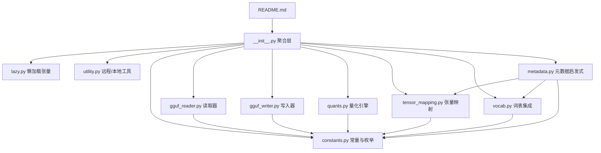

# 第56章 GGUF 的物流集装箱哲学 —— 统一模型分发的「世界语」

## 学习目标

- 理解GGUF作为「模型集装箱」的设计哲学与二进制布局规范
- 掌握gguf-py的模块化架构：constants/reader/writer/quants/vocab等子模块的职责边界
- 熟练运用GGUFReader解析文件头、KV元数据与张量信息
- 掌握GGUFWriter的状态机写入流程（HEADER→KV_DATA→TI_DATA→WEIGHTS）
- 理解ReaderField与ReaderTensor的懒加载与内存映射机制
- 掌握Metadata的多源启发式加载与启发式推断逻辑
- 理解TensorNameMap的静态/动态映射表与工厂函数
- 掌握量化接口（quantize/dequantize）与Lazy张量的交互机制
- 熟悉SpecialVocab对多种分词器格式的统一处理

## 56.1 生活类比

想象 GGUF 是一个国际航运的标准集装箱体系。无论箱子里装的是 Llama、Qwen 还是 Gemma，箱子的外形、锁扣、吊装孔都遵循统一的 ISO 标准，港口（推理引擎）可以无缝吊装。GGUF 格式就是大模型世界的集装箱尺寸规范，它定义了二进制布局、元数据键名和张量排列规则，让不同架构的模型都能装进同一个“箱子”。gguf-py 则是这个集装箱的海关，Writer 是装箱流水线，Reader 是海关查验机，constants.py 是 HS 编码词典，tensor_mapping.py 是多语言翻译官，而 metadata.py 和 vocab.py 则分别负责报关单和语言通行证的办理。整个常量体系就像集装箱上的标牌、锁扣和条形码，为模型世界提供了一套统一的“术语表”和“坐标系”。

## 56.2 源码地图

```
README.md
gguf-py/gguf/__init__.py
└── __main__  # 星号导入聚合层
    ├── from .constants import *      # 常量与枚举
    ├── from .lazy import *           # 懒加载张量
    ├── from .gguf_reader import *    # GGUFReader
    ├── from .gguf_writer import *    # GGUFWriter
    ├── from .quants import *         # 量化/反量化
    ├── from .tensor_mapping import * # 张量名映射
    ├── from .vocab import *          # 分词器集成
    ├── from .utility import *        # 实用工具
    └── from .metadata import *       # 元数据启发式

gguf-py/gguf/constants.py
├── 基础常量 (GGUF_MAGIC, GGUF_VERSION, GGUF_DEFAULT_ALIGNMENT)
├── class Keys
│   ├── class General      # general.architecture等
│   ├── class LLM          # {arch}.context_length等
│   ├── class Attention    # {arch}.attention.head_count等
│   ├── class Rope         # {arch}.rope.*等
│   ├── class Split        # split.no/count等
│   ├── class SSM          # {arch}.ssm.*等
│   ├── class KDA / WKV / PosNet / ConvNext / Classifier / ShortConv
│   ├── class Tokenizer    # tokenizer.ggml.*等
│   ├── class Adapter / IMatrix
│   └── class Clip/ClipVision/ClipAudio / Diffusion / xIELU
├── 枚举类
│   ├── class GGUFType         # MODEL/ADAPTER/IMATRIX/MMPROJ
│   ├── class MODEL_ARCH       # LLAMA/QWEN/MAMBA等
│   ├── class GGMLQuantizationType # F32/Q4_0/Q4_K/IQ2_XXS等
│   ├── class GGUFValueType    # UINT8/STRING/ARRAY等 + get_type()
│   ├── class GGUFEndian       # LITTLE/BIG
│   ├── class TokenType / RopeScalingType / PoolingType / ExpertGatingFuncType
│   └── class LlamaFileType    # MOSTLY_Q4_0等
├── 映射字典
│   ├── MODEL_ARCH_NAMES / VISION_PROJECTOR_TYPE_NAMES
│   ├── TENSOR_NAMES
│   └── MODEL_TENSORS          # 架构→张量列表映射
└── class TensorNameMap (注：实际实现位于 tensor_mapping.py)
    └── 见 tensor_mapping.py

gguf-py/gguf/gguf_reader.py
├── class ReaderField (NamedTuple)
│   └── contents()           # 提取字段实际值
├── class ReaderTensor (NamedTuple)
└── class GGUFReader
    ├── __init__()           # 校验Magic/Version，构建字段与张量
    ├── get_field() / get_tensor()  # 查询接口
    ├── _get()               # 内存映射读取指定类型数据
    ├── _push_field()        # 字段入册与去重检查
    ├── _get_str()           # 读取变长字符串
    ├── _get_field_parts()   # 递归解析字段（标量/字符串/数组）
    ├── _build_fields()      # 解析KV元数据
    ├── _get_tensor_info_field() # 解析单个张量元信息
    ├── _build_tensor_info() # 批量解析张量信息
    └── _build_tensors()     # 构建ReaderTensor列表（含形状/类型）

gguf-py/gguf/gguf_writer.py
├── class WriterState (Enum)  # NO_FILE→EMPTY→HEADER→KV_DATA→TI_DATA→WEIGHTS
├── class TensorInfo / GGUFValue
└── class GGUFWriter
    ├── 生命周期
    │   ├── __init__()       # 初始化路径/架构/字节序/分片策略
    │   ├── open_output_file() / print_plan() / close() / flush()
    ├── KV元数据添加
    │   ├── add_key_value()  # 通用KV添加（内部入口）
    │   ├── add_uint8/add_int8/.../add_bool/add_float32/...  # 基础类型
    │   ├── add_string() / add_array()       # 字符串与数组
    │   ├── add_architecture() / add_type() / add_name() / add_version() / add_author()
    │   ├── add_custom_alignment() / add_quantization_version() / add_file_type()
    │   ├── add_block_count() / add_context_length() / add_vocab_size() / add_embedding_length()
    │   ├── add_head_count() / add_head_count_kv() / add_sliding_window() / add_max_alibi_bias()
    │   ├── add_rope_freq_base() / add_rope_scaling_type() / add_rope_dimension_sections()
    │   ├── add_ssm_conv_kernel() / add_vision_*() / add_audio_*() / add_clip_*()
    │   ├── add_tokenizer_model() / add_chat_template() / add_token_list() / add_token_merges()
    │   ├── add_bos_token_id() / add_eos_token_id() / add_unk_token_id() / add_pad_token_id()
    │   ├── add_sampling_*() / add_expert_*() / add_base_model_*() / add_dataset_*()
    │   └── add_tags() / add_languages() / add_license() / add_url() / add_doi() / add_uuid()
    ├── 张量与权重管理
    │   ├── add_tensor_info()    # 注册元数据（名称/形状/类型）
    │   ├── add_tensor()         # 注册数据（支持临时文件）
    │   ├── write_tensor_data()  # 写入单个张量权重
    │   └── write_tensors_to_file() # 批量写入（含分片/tqdm）
    ├── 分片与对齐
    │   ├── format_shard_names() # SHARD_NAME_FORMAT生成
    │   ├── add_shard_kv_data()  # 分片KV（split.no/count）
    │   ├── write_padding() / ggml_pad()  # 32/64字节对齐
    │   └── get_total_parameter_count()   # 统计总参数量/专家数
    └── 序列化底层
        ├── write_header_to_file()   # Magic/Version/张量数/KV数
        ├── write_kv_data_to_file()  # 序列化KV对
        ├── write_ti_data_to_file()  # 张量元信息区
        └── _pack()/_pack_val()      # struct打包与字节序处理

gguf-py/gguf/quants.py
├── 全局函数
│   ├── quant_shape_to_byte_shape() / quant_shape_from_byte_shape()
│   ├── quantize() / dequantize()       # 量化入口
│   ├── np_roundf()                     # 远离零舍入
│   └── _apply_over_grouped_rows()      # 分行批处理
├── class __Quant (ABC)               # 量化基类
│   ├── __init__() / __init_subclass__() # 自动注册与Lazy包装
│   ├── quantize() / dequantize()       # 统一入口
│   ├── quantize_rows() / dequantize_rows()
│   ├── quantize_blocks() / dequantize_blocks() # 抽象方法
│   └── can_quantize() / init_grid()    # 可行性检查与网格初始化
└── 具体量化实现（含Q/K/IQ/TQ/MXFP4/NVFP4系列）
    ├── BF16 / Q4_0 / Q4_1 / Q5_0 / Q5_1 / Q8_0  # 含quantize_blocks
    ├── Q2_K / Q3_K / Q4_K / Q5_K / Q6_K        # K-quant解量化
    ├── TQ1_0 / TQ2_0                           # 三元量化
    ├── MXFP4 / NVFP4                           # FP4微缩放
    └── IQ1_S / IQ1_M / IQ2_XXS / IQ2_S / IQ3_S / IQ3_XXS / IQ4_NL / IQ4_XS # IQ查表

gguf-py/gguf/tensor_mapping.py
├── __main__  # mappings_cfg, block_mappings_cfg, arch_block_mappings_cfg
├── class TensorNameMap
│   ├── __init__(arch, n_blocks)          # 构建映射
│   ├── get_type_and_name(key, try_suffixes) # 核心查询
│   ├── get_name() / get_type()           # 快捷访问
│   └── __getitem__() / __contains__() / __repr__()
└── get_tensor_name_map()                 # 工厂函数

gguf-py/gguf/metadata.py
├── __main__  # 常量与辅助（含set_gguf_meta_model未包含的字段写入逻辑）
└── class Metadata
    ├── load()                      # 多源加载聚合入口
    ├── load_metadata_override()    # JSON覆盖文件
    ├── load_model_card()           # README.md YAML frontmatter
    ├── load_hf_parameters()        # config.json
    ├── load_generation_config()    # generation_config.json
    ├── apply_metadata_heuristic()  # 启发式推断与合并
    ├── id_to_title() / get_model_id_components() # ID解析
    └── set_gguf_meta_model()       # 写入GGUFWriter

gguf-py/gguf/vocab.py
├── __main__  # bytes_to_unicode及辅助
├── bytes_to_unicode()              # BPE字节→Unicode映射表
├── class SpecialVocab              # 特殊token与chat template
│   ├── __init__() / __repr__()       # 初始化与表示
│   ├── add_to_gguf()               # 写入GGUFWriter
│   ├── _load()                     # 统一加载入口
│   ├── _try_load_from_tokenizer_json() # tokenizer.json
│   ├── _try_load_from_config_json()    # config.json
│   ├── _try_load_merges_txt()          # merges.txt
│   └── _set_special_token()            # 特殊token校验
├── class BaseVocab / Vocab (Protocol)  # 词表协议
├── class NoVocab                       # 无词表占位
├── class BpeVocab                      # GPT-2风格BPE
│   ├── __init__() / __repr__() / bpe_tokens() / added_tokens() / all_tokens()
├── class SentencePieceVocab            # SPM分词器
│   ├── __init__() / __repr__() / sentencepiece_tokens() / added_tokens() / all_tokens()
├── class LlamaHfVocab                  # HF统一接口
│   ├── __init__() / __repr__() / hf_tokens() / added_tokens() / all_tokens()
│   ├── get_token_type() / get_token_score() / has_newline_token()
└── class MistralVocab / MistralVocabConverter # SPM/Tekken双模式
    ├── __init__() / tokenizer_name / gguf_tokenizer_model
    ├── _sentencepiece_tokens() / _tekken_tokens()
    ├── get_token_id() / bos_id/eos_id/pad_id/unk_id
    ├── bos_token/eos_token/pad_token/unk_token
    ├── token_bytes_to_string() / extract_vocab_merges_from_model()
    └── all_tokens()

gguf-py/gguf/utility.py
├── fill_templated_filename() # 文件名模板填充
├── model_weight_count_rounded_notation() # 参数量格式化
├── size_label()            # 尺寸标签（含专家计数）
├── naming_convention()     # GGUF命名规范
├── class RemoteTensor      # 远程张量描述
│   └── data()              # HTTP Range获取数据
├── class SafetensorRemote  # 远程safetensors读取
│   ├── get_list_tensors_hf_model()  # 单文件/多文件分片
│   ├── get_list_tensors()   # 解析safetensors头部
│   ├── get_metadata()       # 读取JSON元数据
│   ├── get_data_by_range()  # HTTP Range请求
│   ├── check_file_exist()   # HEAD探测
│   └── _get_request_headers() # HF_TOKEN处理
├── class LocalTensor       # 本地张量
│   └── mmap_bytes()        # 内存映射读取
└── class SafetensorsLocal  # 本地safetensors
    ├── __init__()          # 解析本地文件
    ├── __enter__() / __exit__()  # 上下文管理

gguf-py/examples/reader.py
├── read_gguf_file()           # 示例：打印KV对与张量列表
└── __main__                   # 示例入口

gguf-py/examples/writer.py
├── writer_example()           # 示例：创建含3个张量的GGUF文件
└── __main__                   # 示例入口
```

## 56.3 GGUF 的物流集装箱哲学 —— 统一模型分发的「世界语」

大模型世界早期就像没有标准集装箱的码头：PyTorch、Safetensors、HuggingFace 格式各自为政，装卸（加载）效率低下且易出错。GGUF（GPT-Generated Unified Format）定义了标准化的“集装箱尺寸”（二进制布局）和“装箱单”（元数据），让任何模型都能装进统一的“箱子”里跨平台运输。在 llama.cpp 生态中，GGUF 是唯一的“官方货运标准”，从 CPU 到 CUDA 再到 Metal，所有后端都只认这个格式。gguf-py 是 Python 世界的 GGUF 海关，负责“打包”（Writer）和“开箱”（Reader）。通过 `__init__.py` 的星号导入，它将 constants、reader、writer 等子模块聚合成统一的命名空间，就像海关大厅的各个服务窗口。这种设计让转换脚本（如 convert_hf_to_gguf.py）无需关心底层二进制细节，只需调用高层 API 即可完成“报关”。

### 56.3.1 __init__.py：星号导入聚合层 —— 海关大厅的服务窗口

源码路径：`gguf-py/gguf/__init__.py` - `__main__`（1-9 行）

```python
# 聚合层：将各子模块的公共符号导入 gguf 命名空间
from .constants import *      # 常量与枚举，如 GGUF_MAGIC、Keys、MODEL_ARCH
from .lazy import *           # 懒加载张量 LazyNumpyTensor
from .gguf_reader import *    # GGUFReader、ReaderField、ReaderTensor
from .gguf_writer import *    # GGUFWriter、WriterState
from .quants import *         # quantize/dequantize 及所有量化类
from .tensor_mapping import * # TensorNameMap、get_tensor_name_map
from .vocab import *          # SpecialVocab、BpeVocab、SentencePieceVocab 等
from .utility import *        # SafetensorRemote、SafetensorsLocal 等工具
from .metadata import *       # Metadata 数据类
```

这段代码通过星号导入将 constants、reader、writer 等子模块聚合成统一的 gguf 命名空间，让转换脚本无需关心底层二进制细节即可调用高层 API。就像海关大厅的各个服务窗口统一对外提供服务，上层应用只需 `import gguf` 即可访问所有核心功能。

## 56.4 代码地图速览 —— 拆解 GGUF 的「海关架构」

### 56.4.1 基础常量：GGUF_MAGIC 与版本号 —— 集装箱的身份证号

源码路径：`gguf-py/gguf/constants.py` - `__main__`（1-20 行）

```python
GGUF_MAGIC             = 0x46554747  # "GGUF"，文件头魔数，ASCII 码对应 "GGUF"
GGUF_VERSION           = 3           # 当前支持的 GGUF 版本，Reader 据此校验兼容性
GGUF_DEFAULT_ALIGNMENT = 32          # 默认数据对齐字节数，保证张量数据按 32 字节边界排列
GGML_QUANT_VERSION     = 2           # 量化格式版本号，区分量化算法迭代
```

这些常量是读写双方的“外交官”，确保文件头校验和版本协商有一致的语言。`GGUF_MAGIC` 为 `0x46554747`（即 ASCII "GGUF"），Reader 在打开文件时首先读取前 4 字节进行校验，防止误读非 GGUF 文件。

### 56.4.2 Keys 类族：元数据键名容器 —— 装箱单的标准字段名

源码路径：`gguf-py/gguf/constants.py` - `Keys.General`（26-116 行）

```python
class Keys:
    class General:
        TYPE                       = "general.type"           # 模型类型：model/adapter/imatrix/mmproj
        ARCHITECTURE               = "general.architecture"    # 架构名：llama/qwen/mamba 等
        QUANTIZATION_VERSION       = "general.quantization_version"
        ALIGNMENT                  = "general.alignment"       # 数据对齐字节数
        FILE_TYPE                  = "general.file_type"       # 量化文件类型（LlamaFileType 枚举值）
        SAMPLING_SEQUENCE           = "general.sampling.sequence"
        SAMPLING_TOP_K              = "general.sampling.top_k"
        SAMPLING_TOP_P              = "general.sampling.top_p"
        SAMPLING_MIN_P              = "general.sampling.min_p"
        SAMPLING_TEMP               = "general.sampling.temp"
        # ... 还有作者、许可证、标签等 20+ 个通用键
```

`Keys` 类族为所有 GGUF 元数据提供了标准字段名，`LLM`、`Attention`、`Rope`、`Tokenizer` 等嵌套类覆盖了从超参数到分词器配置的全部属性。例如 `Keys.LLM.VOCAB_SIZE = "{arch}.vocab_size"` 使用 `{arch}` 占位符，在写入时会自动展开为 `llama.vocab_size` 或 `qwen.vocab_size`，实现了跨架构的键名复用。

### 56.4.3 枚举类：数据世界的“度量衡” —— 统一的编号系统

源码路径：`gguf-py/gguf/constants.py` - `MODEL_ARCH`（379-500 行）

```python
class MODEL_ARCH(IntEnum):
    LLAMA            = auto()  # LLaMA 架构
    FALCON           = auto()
    GPT2             = auto()
    QWEN             = auto()
    DEEPSEEK         = auto()
    # ... 覆盖 LLaMA、Qwen、Mamba、RWKV 等上百种架构
```

源码路径：`gguf-py/gguf/constants.py` - `GGMLQuantizationType`（3934-3970 行）

```python
class GGMLQuantizationType(IntEnum):
    F32     = 0
    F16     = 1
    Q4_0    = 2
    Q4_1    = 3
    Q5_0    = 6
    Q5_1    = 7
    Q8_0    = 8
    Q2_K    = 10
    Q3_K    = 11
    Q4_K    = 12
    Q5_K    = 13
    Q6_K    = 14
    IQ2_XXS = 16
    IQ4_NL  = 20
    MXFP4   = 39
    NVFP4   = 40
    # ... 等 30+ 种量化格式
```

这些枚举为模型架构、量化类型、值类型等提供了统一的编号系统，是 gguf-py 与 C 端 ggml 通信的“共同语言”。枚举值直接写入 GGUF 文件，保证跨语言一致性。

### 56.4.4 模块依赖图 —— 海关内部的业务流向



依赖图展示了 `constants.py` 作为核心基石，所有模块均依赖其枚举与键名定义；`metadata.py` 依赖 `tensor_mapping.py` 与 `vocab.py` 完成元数据到 Writer 的转写。

## 56.5 快速上手 —— 第一次「开箱」与「装箱」实操

### 56.5.1 read_gguf_file()：像查验货物一样检查 GGUF

源码路径：`gguf-py/examples/reader.py` - `read_gguf_file()`（11-39 行）

```python
def read_gguf_file(gguf_file_path):
    reader = GGUFReader(gguf_file_path)

    # 以列格式打印所有键值对
    print("Key-Value Pairs:")
    max_key_length = max(len(key) for key in reader.fields.keys())
    for key, field in reader.fields.items():
        value = field.parts[field.data[0]]
        print(f"{key:{max_key_length}} : {value}")

    print("----")

    # 以表格形式打印所有张量
    print("Tensors:")
    tensor_info_format = "{:<30} | Shape: {:<15} | Size: {:<12} | Quantization: {}"
    print(tensor_info_format.format("Tensor Name", "Shape", "Size", "Quantization"))
    print("-" * 80)
    for tensor in reader.tensors:
        shape_str = "x".join(map(str, tensor.shape))
        size_str = str(tensor.n_elements)
        quantization_str = tensor.tensor_type.name
        print(tensor_info_format.format(tensor.name, shape_str, size_str, quantization_str))
```

这段代码展示了 GGUFReader 的基本用法：字段和张量信息在初始化时已解析完成，访问 `reader.fields` 和 `reader.tensors` 即可获得全部元数据。`field.parts[field.data[0]]` 取出字段的第一个数据分片作为展示值。

### 56.5.2 writer_example()：五步走完「打包」流程

源码路径：`gguf-py/examples/writer.py` - `writer_example()`（11-36 行）

```python
def writer_example() -> None:
    # ① 初始化：指定输出路径和模型架构
    gguf_writer = GGUFWriter("example.gguf", "llama")

    # ② 填单子：添加元数据
    gguf_writer.add_block_count(12)
    gguf_writer.add_uint32("answer", 42)
    gguf_writer.add_float32("answer_in_float", 42.0)
    gguf_writer.add_custom_alignment(64)

    # ③ 装货：注册张量
    tensor1 = np.ones((32,), dtype=np.float32) * 100.0
    tensor2 = np.ones((64,), dtype=np.float32) * 101.0
    tensor3 = np.ones((96,), dtype=np.float32) * 102.0
    gguf_writer.add_tensor("tensor1", tensor1)
    gguf_writer.add_tensor("tensor2", tensor2)
    gguf_writer.add_tensor("tensor3", tensor3)

    # ④ 封存：严格按顺序写入
    gguf_writer.write_header_to_file()
    gguf_writer.write_kv_data_to_file()
    gguf_writer.write_tensors_to_file()

    # ⑤ 关闭文件句柄
    gguf_writer.close()
```

这段代码演示了 GGUFWriter 的完整生命周期：初始化 → 添加元数据 → 注册张量 → 按顺序写入 → 关闭，状态机确保每一步都按规范执行。

## 56.6 GGUFReader 深度拆解 —— 二进制文件的「无影灯」解析术

### 56.6.1 GGUFReader.__init__()：内存映射与魔数校验 —— 开箱前的身份核验

源码路径：`gguf-py/gguf/gguf_reader.py` - `GGUFReader.__init__()`（129-177 行）

```python
def __init__(self, path: os.PathLike[str] | str, mode: Literal['r', 'r+', 'c'] = 'r'):
    # ① 将文件映射到虚拟内存，避免一次性加载大文件
    self.data = np.memmap(path, mode = mode)
    offs = 0

    # ② 校验 GGUF 魔数（强制小端读取，防止字节序干扰）
    if self._get(offs, np.uint32, override_order = '<')[0] != GGUF_MAGIC:
        raise ValueError('GGUF magic invalid')
    offs += 4

    # ③ 读取版本号并自动检测字节序
    temp_version = self._get(offs, np.uint32)
    if temp_version[0] & 65535 == 0:
        # 若低 16 位为 0，说明文件字节序与主机相反
        self.byte_order = 'S'
        temp_version = temp_version.view(temp_version.dtype.newbyteorder(self.byte_order))
    version = temp_version[0]
    if version not in READER_SUPPORTED_VERSIONS:
        raise ValueError(f'Sorry, file appears to be version {version} which we cannot handle')

    # ④ 根据主机字节序设置端序
    host_endian = GGUFEndian.LITTLE if sys.byteorder == "little" else GGUFEndian.BIG
    swapped_endian = GGUFEndian.BIG if host_endian == GGUFEndian.LITTLE else GGUFEndian.LITTLE
    self.endianess = swapped_endian if self.byte_order == "S" else host_endian

    # ⑤ 初始化容器并解析头部字段
    self.fields: OrderedDict[str, ReaderField] = OrderedDict()
    self.tensors: list[ReaderTensor] = []
    offs += self._push_field(ReaderField(offs, 'GGUF.version', [temp_version], [0], [GGUFValueType.UINT32]))

    # ⑥ 读取张量数量与 KV 数量
    temp_counts = self._get(offs, np.uint64, 2)
    offs += self._push_field(ReaderField(offs, 'GGUF.tensor_count', [temp_counts[:1]], [0], [GGUFValueType.UINT64]))
    offs += self._push_field(ReaderField(offs, 'GGUF.kv_count', [temp_counts[1:]], [0], [GGUFValueType.UINT64]))
    tensor_count, kv_count = temp_counts

    # ⑦ 解析 KV 元数据、张量信息与对齐填充
    offs = self._build_fields(offs, kv_count)
    offs, tensors_fields = self._build_tensor_info(offs, tensor_count)
    # 读取 general.alignment 字段（若存在），校验其为 UINT32 且为非零 2 的幂
    new_align = self.fields.get('general.alignment')
    if new_align is not None:
        if new_align.types != [GGUFValueType.UINT32]:
            raise ValueError('Bad type for general.alignment field')
        self.alignment = new_align.parts[-1][0]
        if self.alignment == 0 or (self.alignment & (self.alignment - 1)) != 0:
            raise ValueError('Invalid alignment: must be a non-zero power of two')
    # 按对齐值填充，使张量数据区从对齐边界开始
    padding = offs % self.alignment
    if padding != 0:
        offs += self.alignment - padding
    self.data_offset = offs
    self._build_tensors(offs, tensors_fields)
```

这段代码通过 `np.memmap` 将文件映射到虚拟内存，避免一次性加载大文件；通过魔数和版本号校验文件合法性，并自动检测字节序。`byte_order='S'` 表示字节序需交换，后续读取会自动调整。解析完 KV 与张量元信息后，还会读取 `general.alignment` 字段校验对齐值，并在必要时跳过填充字节，使张量数据区从对齐边界开始。

### 56.6.2 GGUFReader._get()：内存映射读取指定类型数据 —— 底层读取原语

源码路径：`gguf-py/gguf/gguf_reader.py` - `GGUFReader._get()`（189-194 行）

```python
def _get(
    self, offset: int, dtype: npt.DTypeLike, count: int = 1, override_order: None | Literal['I', 'S', '<'] = None,
) -> npt.NDArray[Any]:
    count = int(count)
    itemsize = int(np.empty([], dtype = dtype).itemsize)
    end_offs = offset + itemsize * count
    arr = self.data[offset:end_offs].view(dtype=dtype)[:count]
    return arr.view(arr.dtype.newbyteorder(self.byte_order if override_order is None else override_order))
```

`_get()` 是 Reader 内部最底层的读取方法，它从 `np.memmap` 切片中读取指定偏移量、类型和数量的数据，并根据 `byte_order` 或 `override_order` 调整字节序。魔数校验时传入 `override_order='<'` 强制小端读取，确保不受文件实际字节序影响。

### 56.6.3 GGUFReader._push_field()：字段入册与去重检查 —— 登记货物清单

源码路径：`gguf-py/gguf/gguf_reader.py` - `GGUFReader._push_field()`（197-203 行）

```python
def _push_field(self, field: ReaderField, skip_sum: bool = False) -> int:
    if field.name in self.fields:
        # TODO: add option to make this a warning and accept duplicate keys like below
        raise KeyError(f'Duplicate {field.name} already in list at offset {field.offset}')

        # logger.warning(f'Duplicate key {field.name} at offset {field.offset}')
        # self.fields[field.name + '_{}'.format(field.offset)] = field
    else:
        self.fields[field.name] = field
    return 0 if skip_sum else sum(int(part.nbytes) for part in field.parts)
```

`_push_field()` 将解析出的 `ReaderField` 注册到 `self.fields` 字典中，并返回字段数据的总字节数，用于偏移量累加。它内置了去重检查，防止同一个键名重复出现。

### 56.6.4 GGUFReader._get_str()：读取变长字符串 —— 解码装箱单上的文字

源码路径：`gguf-py/gguf/gguf_reader.py` - `GGUFReader._get_str()`（205-206 行）

```python
def _get_str(self, offset: int) -> tuple[npt.NDArray[np.uint64], npt.NDArray[np.uint8]]:
    slen = self._get(offset, np.uint64)
    return slen, self._get(offset + 8, np.uint8, slen[0])
```

GGUF 中的字符串由 8 字节无符号整数长度前缀和紧随其后的 UTF-8 字节序列组成。`_get_str()` 先读取长度，再按长度读取字符串字节，返回长度数组和字节数组。

### 56.6.5 GGUFReader._get_field_parts()：字段解析流水线 —— 处理标量、字符串与数组

源码路径：`gguf-py/gguf/gguf_reader.py` - `GGUFReader._get_field_parts()`（208-229 行）

```python
def _get_field_parts(
    self, orig_offs: int, raw_type: int,
) -> tuple[int, list[npt.NDArray[Any]], list[int], list[GGUFValueType]]:
    offs = orig_offs
    types: list[GGUFValueType] = []
    gtype = GGUFValueType(raw_type)
    types.append(gtype)

    # 处理字符串：先读 8 字节长度，再读取字符串字节
    if gtype == GGUFValueType.STRING:
        sparts: list[npt.NDArray[Any]] = list(self._get_str(offs))
        size = sum(int(part.nbytes) for part in sparts)
        return size, sparts, [1], types

    # 处理标量类型
    nptype = self.gguf_scalar_to_np.get(gtype)
    if nptype is not None:
        val = self._get(offs, nptype)
        return int(val.nbytes), [val], [0], types

    # 处理数组：递归解析每个元素
    if gtype == GGUFValueType.ARRAY:
        raw_itype = self._get(offs, np.uint32)
        offs += int(raw_itype.nbytes)
        alen = self._get(offs, np.uint64)
        offs += int(alen.nbytes)
        aparts: list[npt.NDArray[Any]] = [raw_itype, alen]
        data_idxs: list[int] = []
        for idx in range(alen[0]):
            curr_size, curr_parts, curr_idxs, curr_types = self._get_field_parts(offs, raw_itype[0])
            if idx == 0:
                types += curr_types
            idxs_offs = len(aparts)
            aparts += curr_parts
            data_idxs += (idx + idxs_offs for idx in curr_idxs)
            offs += curr_size
        return offs - orig_offs, aparts, data_idxs, types

    raise ValueError(f'Unknown field type {gtype}')
```

这段代码递归解析 GGUF 的复合类型，支持字符串、标量和数组，是构建 `ReaderField` 的核心。数组类型包含元素类型（uint32）、长度（uint64）和递归解析的元素数据。

### 56.6.6 GGUFReader._build_fields()：解析 KV 元数据 —— 批量录入装箱单条目

源码路径：`gguf-py/gguf/gguf_reader.py` - `GGUFReader._build_fields()`（253-268 行）

```python
def _build_fields(self, offs: int, count: int) -> int:
    for _ in range(count):
        orig_offs = offs
        kv_klen, kv_kdata = self._get_str(offs)
        offs += int(kv_klen.nbytes + kv_kdata.nbytes)
        raw_kv_type = self._get(offs, np.uint32)
        offs += int(raw_kv_type.nbytes)
        parts: list[npt.NDArray[Any]] = [kv_klen, kv_kdata, raw_kv_type]
        idxs_offs = len(parts)
        field_size, field_parts, field_idxs, field_types = self._get_field_parts(offs, raw_kv_type[0])
        parts += field_parts
        self._push_field(ReaderField(
            orig_offs,
            str(bytes(kv_kdata), encoding = 'utf-8'),
            parts,
            [idx + idxs_offs for idx in field_idxs],
            field_types,
        ), skip_sum = True)
        offs += field_size
    return offs
```

`_build_fields()` 循环调用 `_get_field_parts()`，逐个解析 KV 对的键名、值类型和值数据，并将每个字段注册到 `self.fields` 中。键名存储为 UTF-8 字符串，值通过递归解析支持嵌套数组。

### 56.6.7 GGUFReader._get_tensor_info_field()：解析单个张量元信息 —— 记录货物规格

源码路径：`gguf-py/gguf/gguf_reader.py` - `GGUFReader._get_tensor_info_field()`（231-251 行）

```python
def _get_tensor_info_field(self, orig_offs: int) -> ReaderField:
    offs = orig_offs

    # Get Tensor Name
    name_len, name_data = self._get_str(offs)
    offs += int(name_len.nbytes + name_data.nbytes)

    # Get Tensor Dimensions Count
    n_dims = self._get(offs, np.uint32)
    offs += int(n_dims.nbytes)

    # Get Tensor Dimension Array
    dims = self._get(offs, np.uint64, n_dims[0])
    offs += int(dims.nbytes)

    # Get Tensor Encoding Scheme Type
    raw_dtype = self._get(offs, np.uint32)
    offs += int(raw_dtype.nbytes)

    # Get Tensor Offset
    offset_tensor = self._get(offs, np.uint64)
    offs += int(offset_tensor.nbytes)

    return ReaderField(
        orig_offs,
        str(bytes(name_data), encoding = 'utf-8'),
        [name_len, name_data, n_dims, dims, raw_dtype, offset_tensor],
        [1, 3, 4, 5],
    )
```

该方法解析单个张量的元信息字段，包括名称、维度数量、维度数组、数据类型和数据偏移量，返回一个 `ReaderField` 对象。维度数组使用 `np.uint64` 存储，支持大张量。

### 56.6.8 GGUFReader._build_tensor_info()：批量解析张量信息 —— 汇总所有货物清单

源码路径：`gguf-py/gguf/gguf_reader.py` - `GGUFReader._build_tensor_info()`（270-275 行）

```python
def _build_tensor_info(self, offs: int, count: int) -> tuple[int, list[ReaderField]]:
    tensor_fields = []
    for _ in range(count):
        field = self._get_tensor_info_field(offs)
        offs += sum(int(part.nbytes) for part in field.parts)
        tensor_fields.append(field)
    return offs, tensor_fields
```

`_build_tensor_info()` 循环调用 `_get_tensor_info_field()`，解析所有张量的元信息字段，返回偏移量和 `ReaderField` 列表。

### 56.6.9 GGUFReader.get_field() / get_tensor()：查询接口 —— 查验特定货物

源码路径：`gguf-py/gguf/gguf_reader.py` - `GGUFReader.get_field()` / `get_tensor()`（181-186 行）

```python
def get_field(self, key: str) -> Union[ReaderField, None]:
    return self.fields.get(key, None)

def get_tensor(self, idx: int) -> ReaderTensor:
    return self.tensors[idx]
```

`get_field()` 根据键名获取元数据字段，返回 `ReaderField` 对象或 `None`；`get_tensor()` 根据索引获取张量对象。

### 56.6.10 ReaderField.contents()：提取字段实际值 —— 从装箱单取出实物

源码路径：`gguf-py/gguf/gguf_reader.py` - `ReaderField.contents()`（71-111 行）

```python
def contents(self, index_or_slice: int | slice = slice(None)) -> Any:
    if self.types:
        to_string = lambda x: str(x.tobytes(), encoding='utf-8')
        main_type = self.types[0]

        if main_type == GGUFValueType.ARRAY:
            sub_type = self.types[-1]

            if sub_type == GGUFValueType.STRING:
                indices = self.data[index_or_slice]

                if isinstance(index_or_slice, int):
                    return to_string(self.parts[indices])
                else:
                    return [to_string(self.parts[idx]) for idx in indices]
            else:
                if isinstance(index_or_slice, int):
                    return self.parts[self.data[index_or_slice]].tolist()[0]
                else:
                    return [pv for idx in self.data[index_or_slice] for pv in self.parts[idx].tolist()]

        if main_type == GGUFValueType.STRING:
            return to_string(self.parts[-1])
        else:
            return self.parts[-1].tolist()[0]

    return None
```

`contents()` 从字段的 parts 中提取实际值，根据字段类型（字符串、数组、标量）进行差异化解码，支持索引和切片操作。对于数组类型，`self.data` 存储的是元素在 `parts` 中的索引位置。

### 56.6.11 ReaderField 与 ReaderTensor 数据结构 —— 海关档案卡片

`ReaderField` 是一个命名元组，包含字段的偏移量、名称、数据分片、数据索引和类型信息，是 GGUF 元数据的内存表示。`ReaderTensor` 同样是一个命名元组，包含张量的名称、量化类型、形状、元素数量、字节数、数据偏移量、数据内容及其对应的字段信息，是 GGUF 张量信息的内存表示。两者共同构成了 GGUFReader 的核心数据模型。

### 56.6.12 GGUFReader._build_tensors()：张量信息重建 —— 将规格单转为可访问对象

源码路径：`gguf-py/gguf/gguf_reader.py` - `GGUFReader._build_tensors()`（277-325 行）

```python
def _build_tensors(self, start_offs: int, fields: list[ReaderField]) -> None:
    tensors = []
    tensor_names = set()
    for field in fields:
        _name_len, name_data, _n_dims, dims, raw_dtype, offset_tensor = field.parts
        tensor_name = str(bytes(name_data), encoding='utf-8')
        if tensor_name in tensor_names:
            raise ValueError(f'Found duplicated tensor with name {tensor_name}')
        tensor_names.add(tensor_name)

        ggml_type = GGMLQuantizationType(raw_dtype[0])
        n_elems = int(np.prod(dims))
        np_dims = tuple(reversed(dims.tolist()))
        block_size, type_size = GGML_QUANT_SIZES[ggml_type]
        n_bytes = n_elems * type_size // block_size
        data_offs = int(start_offs + offset_tensor[0])

        # 根据量化类型决定 item_type
        if ggml_type == GGMLQuantizationType.F16:
            item_count = n_elems
            item_type = np.float16
        elif ggml_type == GGMLQuantizationType.F32:
            item_count = n_elems
            item_type = np.float32
        elif ggml_type == GGMLQuantizationType.F64:
            item_count = n_elems
            item_type = np.float64
        elif ggml_type == GGMLQuantizationType.I8:
            item_count = n_elems
            item_type = np.int8
        elif ggml_type == GGMLQuantizationType.I16:
            item_count = n_elems
            item_type = np.int16
        elif ggml_type == GGMLQuantizationType.I32:
            item_count = n_elems
            item_type = np.int32
        elif ggml_type == GGMLQuantizationType.I64:
            item_count = n_elems
            item_type = np.int64
        else:
            item_count = n_bytes
            item_type = np.uint8
            np_dims = quant_shape_to_byte_shape(np_dims, ggml_type)

        tensors.append(ReaderTensor(
            name = tensor_name,
            tensor_type = ggml_type,
            shape = dims,
            n_elements = n_elems,
            n_bytes = n_bytes,
            data_offset = data_offs,
            data = self._get(data_offs, item_type, item_count).reshape(np_dims),
            field = field,
        ))
    self.tensors = tensors
```

这段代码将张量元数据转化为 `ReaderTensor` 对象，根据 `ggml_type` 决定 `item_type`，并对量化类型调用 `quant_shape_to_byte_shape()` 计算实际字节形状。非量化类型直接按元素数量读取，量化类型按字节数读取并重塑形状。

## 56.7 GGUFWriter 核心机制 —— 装箱流水线的「智能调度中心」

### 56.7.1 WriterState 与 open_output_file()：状态机与文件生命周期 —— 严格的装箱工序

源码路径：`gguf-py/gguf/gguf_writer.py` - `WriterState` 与 `open_output_file()`（300-313 行）

```python
class WriterState(Enum):
    NO_FILE = 0   # 未打开文件
    EMPTY = 1     # 文件已打开，尚未写入头
    HEADER = 2    # 文件头已写入
    KV_DATA = 3   # KV 元数据已写入
    TI_DATA = 4   # 张量元信息已写入
    WEIGHTS = 5   # 权重已写入

def open_output_file(self, path=None):
    if self.state is WriterState.EMPTY and self.fout is not None and (path is None or path == self.path):
        return
    if self.state is not WriterState.NO_FILE:
        raise ValueError(f'Expected output file to be not yet opened, got {self.state}')
    if path is not None:
        self.path = path
    if self.path is not None:
        filenames = self.print_plan()
        self.fout = [open(filename, "wb") for filename in filenames]
        self.state = WriterState.EMPTY
```

`WriterState` 枚举严格定义了写入顺序：NO_FILE → EMPTY → HEADER → KV_DATA → TI_DATA → WEIGHTS，防止生成损坏的“集装箱”。`open_output_file()` 在首次调用时打开文件句柄，支持分片写入。

### 56.7.2 write_header_to_file() / write_kv_data_to_file() / write_ti_data_to_file()：封存三步曲 —— 按规范落笔

源码路径：`gguf-py/gguf/gguf_writer.py` - `write_header_to_file()` / `write_kv_data_to_file()` / `write_ti_data_to_file()`（344-402 行）

```python
def write_header_to_file(self, path=None):
    if len(self.tensors) == 1 and (self.split_max_tensors != 0 or self.split_max_size != 0):
        logger.warning("Model fails split requirements, not splitting")
    self.open_output_file(path)
    if self.state is not WriterState.EMPTY:
        raise ValueError(f'Expected output file to be empty, got {self.state}')
    assert self.fout is not None
    assert len(self.fout) == len(self.tensors)
    assert len(self.kv_data) == 1
    self.add_shard_kv_data()
    for fout, tensors, kv_data in zip(self.fout, self.tensors, self.kv_data):
        fout.write(self._pack("<I", GGUF_MAGIC, skip_pack_prefix=True))
        fout.write(self._pack("I", GGUF_VERSION))
        fout.write(self._pack("Q", len(tensors)))
        fout.write(self._pack("Q", len(kv_data)))
        fout.flush()
    self.state = WriterState.HEADER

def write_kv_data_to_file(self):
    if self.state is not WriterState.HEADER:
        raise ValueError(f'Expected output file to contain the header, got {self.state}')
    assert self.fout is not None
    for fout, kv_data in zip(self.fout, self.kv_data):
        kv_bytes = bytearray()
        for key, val in kv_data.items():
            kv_bytes += self._pack_val(key, GGUFValueType.STRING, add_vtype=False)
            kv_bytes += self._pack_val(val.value, val.type, add_vtype=True, sub_type=val.sub_type)
        fout.write(kv_bytes)
    self.flush()
    self.state = WriterState.KV_DATA

def write_ti_data_to_file(self):
    if self.state is not WriterState.KV_DATA:
        raise ValueError(f'Expected output file to contain KV data, got {self.state}')
    assert self.fout is not None
    for fout, tensors in zip(self.fout, self.tensors):
        ti_data = bytearray()
        offset_tensor = 0
        for name, ti in tensors.items():
            ti_data += self._pack_val(name, GGUFValueType.STRING, add_vtype=False)
            n_dims = len(ti.shape)
            ti_data += self._pack("I", n_dims)
            for j in range(n_dims):
                ti_data += self._pack("Q", ti.shape[n_dims - 1 - j])
            ti_data += self._pack("I", ti.dtype)
            ti_data += self._pack("Q", offset_tensor)
            offset_tensor += GGUFWriter.ggml_pad(ti.nbytes, self.data_alignment)
        fout.write(ti_data)
        fout.flush()
    self.state = WriterState.TI_DATA
```

这三步严格按照 GGUF 二进制布局顺序写入：先写魔数/版本/张量数/KV 数，再序列化 KV 对，最后写入张量元信息区。`write_header_to_file()` 在写入头之前会检查分片要求、断言文件句柄与分片数一致，并调用 `add_shard_kv_data()` 写入分片序号/总数等 KV；`write_ti_data_to_file` 中维度按逆序写入（`n_dims - 1 - j`），符合 GGUF 规范。

### 56.7.3 add_tensor_info() 与 add_tensor()：张量与权重的分治策略 —— 分离清单与实物

源码路径：`gguf-py/gguf/gguf_writer.py` - `add_tensor_info()` 与 `add_tensor()`（456-514 行）

```python
def add_tensor_info(self, name, tensor_shape, tensor_dtype, tensor_nbytes, raw_dtype=None):
    if self.state is not WriterState.NO_FILE:
        raise ValueError(f'Expected output file to be not yet opened, got {self.state}')
    if any(name in tensors for tensors in self.tensors):
        raise ValueError(f'Duplicated tensor name {name!r}')
    if raw_dtype is None:
        if tensor_dtype == np.float16:
            dtype = GGMLQuantizationType.F16
        elif tensor_dtype == np.float32:
            dtype = GGMLQuantizationType.F32
        # ... 其他类型
    else:
        dtype = raw_dtype
        if tensor_dtype == np.uint8:
            tensor_shape = quant_shape_from_byte_shape(tensor_shape, raw_dtype)
    # 分片逻辑：超过张量或大小限制时开启新分片
    if len(self.tensors[-1]) > 0:
        if (self.split_max_tensors != 0 and len(self.tensors[-1]) >= self.split_max_tensors) or \
           (self.split_max_size != 0 and sum(ti.nbytes for ti in self.tensors[-1].values()) + tensor_nbytes > self.split_max_size):
            self.tensors.append({})
    self.tensors[-1][name] = TensorInfo(shape=tensor_shape, dtype=dtype, nbytes=tensor_nbytes)

def add_tensor(self, name, tensor, raw_shape=None, raw_dtype=None, tensor_endianess=None):
    if tensor_endianess is None:
        tensor_endianess = GGUFEndian.BIG if sys.byteorder == 'big' else GGUFEndian.LITTLE
    if tensor_endianess != self.endianess:
        tensor = tensor.byteswap(inplace=False)
    if self.use_temp_file and self.temp_file is None:
        fp = tempfile.SpooledTemporaryFile(mode="w+b", max_size=256 * 1024 * 1024)
        fp.seek(0)
        self.temp_file = fp
    shape = raw_shape if raw_shape is not None else tensor.shape
    self.add_tensor_info(name, shape, tensor.dtype, tensor.nbytes, raw_dtype=raw_dtype)
    if self.temp_file is None:
        self.tensors[-1][name].tensor = tensor
        return
    tensor.tofile(self.temp_file)
    self.write_padding(self.temp_file, tensor.nbytes)
```

`add_tensor_info()` 仅注册元数据（形状、类型、名称），`add_tensor()` 处理实际数据，支持临时文件缓冲和字节序转换。临时文件模式下，张量数据先写入内存溢出临时文件，最后由 `write_tensors_to_file()` 统一拷贝到目标文件。

### 56.7.4 GGUFWriter.add_* 方法族：模型属性配置全家桶 —— 一站式填单服务

GGUFWriter 提供了超过 100 个 `add_*` 方法，覆盖了从基础类型到模型超参数的几乎所有配置。以下按类别列举部分关键方法：

**基础类型添加**：
- `add_uint8()` / `add_int8()` / `add_uint16()` / `add_int16()` / `add_uint32()` / `add_int32()` / `add_float32()` / `add_uint64()` / `add_int64()` / `add_float64()` / `add_bool()`：添加对应类型的标量 KV 对。
- `add_string()`：添加字符串 KV 对，空字符串会被忽略。
- `add_array()`：添加数组 KV 对，空数组会被忽略。

**架构与模型信息**：
- `add_architecture()`：添加 `general.architecture` 键。
- `add_type()`：添加 `general.type` 键。
- `add_name()` / `add_author()` / `add_version()` / `add_organization()`：添加模型名称、作者、版本、组织。
- `add_finetune()` / `add_basename()` / `add_description()` / `add_size_label()`：添加微调信息、基础名称、描述、尺寸标签。
- `add_license()` / `add_license_name()` / `add_license_link()`：添加许可证信息。
- `add_url()` / `add_doi()` / `add_uuid()` / `add_repo_url()`：添加 URL、DOI、UUID、仓库 URL。
- `add_tags()` / `add_languages()`：添加标签和语言数组。

**LLM 超参数**：
- `add_block_count()` / `add_context_length()` / `add_vocab_size()` / `add_embedding_length()`：添加块数、上下文长度、词汇表大小、嵌入长度。
- `add_head_count()` / `add_head_count_kv()`：添加注意力头数（支持单值或数组）。
- `add_key_length()` / `add_value_length()`：添加键和值长度。
- `add_sliding_window()` / `add_max_alibi_bias()`：添加滑动窗口大小和最大 ALiBi 偏置。
- `add_feed_forward_length()` / `add_expert_count()` / `add_expert_used_count()`：添加前馈网络长度和专家数量。

**RoPE 配置**：
- `add_rope_freq_base()` / `add_rope_scaling_type()` / `add_rope_dimension_count()` / `add_rope_dimension_sections()`：添加 RoPE 频率基数、缩放类型、维度数量和分段。

**分词器配置**：
- `add_tokenizer_model()` / `add_tokenizer_pre()`：添加分词器模型和预处理类型。
- `add_token_list()` / `add_token_merges()` / `add_token_types()`：添加词汇表、合并规则和 Token 类型。
- `add_bos_token_id()` / `add_eos_token_id()` / `add_unk_token_id()` / `add_pad_token_id()`：添加特殊 Token ID。
- `add_chat_template()`：添加聊天模板，支持单个模板或多个模板的选择。

**视觉/音频/扩散模型**：
- `add_vision_*()` 系列：添加视觉编码器参数（图像大小、块数、头数等）。
- `add_audio_*()` 系列：添加音频编码器参数。
- `add_clip_*()` 系列：添加 CLIP 投影器类型和标志。
- `add_diffusion_shift_logits()`：添加扩散模型标志。

这些方法内部都调用 `add_key_value()`，将键值对添加到 `self.kv_data` 列表中，实现了模型属性的统一配置。

## 56.8 量化引擎与懒加载 —— 字节压缩的「魔术空间」

### 56.8.1 quant_shape_to_byte_shape()：形状转换的数学基础 —— 压缩后的尺寸计算

源码路径：`gguf-py/gguf/quants.py` - `quant_shape_to_byte_shape()`（17-21 行）

```python
def quant_shape_to_byte_shape(shape, quant_type):
    block_size, type_size = GGML_QUANT_SIZES[quant_type]
    if shape[-1] % block_size != 0:
        raise ValueError(f"Row size {shape[-1]} not multiple of {block_size}")
    return (*shape[:-1], shape[-1] // block_size * type_size)
```

该函数根据量化类型的块大小（如 Q4_0 的 32）和类型大小（如 18），将逻辑形状转换为物理字节形状。例如形状 `(4096, 4096)` 的 F32 张量量化为 Q4_0 后，最后一维变为 `4096 // 32 * 18 = 2304` 字节。

### 56.8.2 __Quant.__init_subclass__()：基类与注册工厂 —— 量化算法的自动登记

源码路径：`gguf-py/gguf/quants.py` - `__Quant.__init_subclass__()`（156-166 行）

```python
def __init_subclass__(cls, qtype: GGMLQuantizationType) -> None:
    cls.qtype = qtype
    cls.block_size, cls.type_size = GGML_QUANT_SIZES[qtype]
    cls.__quantize_lazy = LazyNumpyTensor._wrap_fn(
        cls.__quantize_array, meta_noop=(np.uint8, cls.__shape_to_bytes))
    cls.__dequantize_lazy = LazyNumpyTensor._wrap_fn(
        cls.__dequantize_array, meta_noop=(np.float32, cls.__shape_from_bytes))
    assert qtype not in _type_traits
    _type_traits[qtype] = cls
```

`__init_subclass__` 在子类定义时自动执行，将 Q4_0、Q8_0 等量化类注册到 `_type_traits` 字典，并包装惰性张量支持。`LazyNumpyTensor._wrap_fn` 将数组量化方法包装为支持延迟计算的版本。

### 56.8.3 Q4_0.quantize_blocks()：经典量化实现 —— 对称量化的核心逻辑

源码路径：`gguf-py/gguf/quants.py` - `Q4_0.quantize_blocks()`（295-309 行）

```python
@classmethod
def quantize_blocks(cls, blocks):
    n_blocks = blocks.shape[0]
    imax = abs(blocks).argmax(axis=-1, keepdims=True)
    max = np.take_along_axis(blocks, imax, axis=-1)
    d = max / -8
    with np.errstate(divide="ignore"):
        id = np.where(d == 0, 0, 1 / d)
    qs = np.trunc((blocks * id) + np.float32(8.5), dtype=np.float32).astype(np.uint8).clip(0, 15)
    qs = qs.reshape((n_blocks, 2, cls.block_size // 2))
    qs = qs[..., 0, :] | (qs[..., 1, :] << np.uint8(4))
    d = d.astype(np.float16).view(np.uint8)
    return np.concatenate([d, qs], axis=-1)
```

Q4_0 采用对称量化，基于块内绝对最大值计算缩放因子 `d`，将 32 个浮点数压缩为 2 字节缩放因子 + 16 字节 4-bit 整数。`np.trunc(x + 8.5)` 实现向远离零方向舍入，随后打包高低 4 位到一个字节。

## 56.9 元数据启发式提取 —— 从模型卡到「身份档案」

### 56.9.1 Metadata.load()：多源加载流水线 —— 汇总各方情报

源码路径：`gguf-py/gguf/metadata.py` - `Metadata.load()`（155-238 行）

```python
@staticmethod
def load(metadata_override_path=None, model_path=None, model_name=None, total_params=0):
    metadata = Metadata()
    model_card = Metadata.load_model_card(model_path)
    hf_params = Metadata.load_hf_parameters(model_path)
    gen_config = Metadata.load_generation_config(model_path)

    metadata = Metadata.apply_metadata_heuristic(metadata, model_card, hf_params, model_path, total_params)

    if gen_config:
        metadata.sampling_sequence = gen_config.get("sequence", metadata.sampling_sequence)
        metadata.sampling_top_k = gen_config.get("top_k", metadata.sampling_top_k)
        # ... 其他采样参数

    metadata_override = Metadata.load_metadata_override(metadata_override_path)
    # ... 应用覆盖

    if model_name is not None:
        metadata.name = model_name
    return metadata
```

`Metadata.load()` 按优先级合并模型卡（README.md YAML）、HF 配置（config.json）、生成配置（generation_config.json）和用户覆盖 JSON，实现元数据的自动提取。启发式逻辑会从模型 ID、目录名等推断 basename、finetune、version、size_label。

### 56.9.2 Metadata.get_model_id_components()：模型 ID 解构算法 —— 从名字里挖信息

源码路径：`gguf-py/gguf/metadata.py` - `Metadata.get_model_id_components()`（326-421 行）

```python
@staticmethod
def get_model_id_components(model_id=None, total_params=0):
    if model_id is None:
        return None, None, None, None, None, None
    if ' ' in model_id:
        return model_id, None, None, None, None, None
    if '/' in model_id:
        org_component, model_full_name_component = model_id.split('/', 1)
    else:
        org_component, model_full_name_component = None, model_id

    name_parts = model_full_name_component.split('-')
    # ... 正则匹配版本号、尺寸标签、微调类型等
    return model_full_name_component, org_component, basename, finetune, version, size_label
```

该算法将模型 ID（如 `Mixtral-8x7B-Instruct-v0.1`）自动拆解为组织、基名、微调类型、版本和尺寸标签，为元数据提供结构化信息。正则表达式识别 `v0.1` 版本、`7B` 尺寸、`Instruct` 微调等模式。

## 56.10 多源词表整合 —— 分词器的「巴别塔」

### 56.10.1 SpecialVocab：特殊 Token 的中央枢纽 —— 统一管理 BOS/EOS/聊天模板

源码路径：`gguf-py/gguf/vocab.py` - `SpecialVocab.__init__()` 与 `_load()`（35-55、86-89 行）

```python
def __init__(self, path, load_merges=False, special_token_types=None, n_vocab=None):
    self.special_token_ids = {}
    self.add_special_token = {}
    self.n_vocab = n_vocab
    self.load_merges = load_merges
    self.merges = []
    self.chat_template = None
    if special_token_types is not None:
        self.special_token_types = special_token_types
    else:
        self.special_token_types = ('bos', 'eos', 'unk', 'sep', 'pad', 'cls', 'mask')
    self._load(Path(path))

def _load(self, path):
    self._try_load_from_tokenizer_json(path)
    self._try_load_from_config_json(path)
    if self.load_merges and not self.merges:
        self._try_load_merges_txt(path)
```

`SpecialVocab` 管理 BOS/EOS/UNK 等特殊 token 的 ID 和聊天模板，通过 `_load()` 依次尝试 tokenizer.json、config.json 和 merges.txt。`_try_load_from_tokenizer_json` 解析 post_processor 中的 RobertaProcessing/TemplateProcessing，自动推断 add_bos/add_eos/add_sep 标志。

### 56.10.2 BpeVocab 与 SentencePieceVocab —— 两大分词流派的适配器

源码路径：`gguf-py/gguf/vocab.py` - `BpeVocab.__init__()`（283-324 行）

```python
def __init__(self, base_path):
    added_tokens = {}
    if (fname_tokenizer := base_path / 'vocab.json').exists():
        with open(fname_tokenizer, encoding="utf-8") as f:
            self.vocab = json.load(f)
        try:
            with open(base_path / 'added_tokens.json', encoding="utf-8") as f:
                added_tokens = json.load(f)
        except FileNotFoundError:
            pass
    else:
        fname_tokenizer = base_path / 'tokenizer.json'
        with open(fname_tokenizer, encoding="utf-8") as f:
            tokenizer_json = json.load(f)
        tokenizer_model = tokenizer_json['model']
        if (tokenizer_model['type'] != 'BPE' or tokenizer_model.get('byte_fallback', False)
                or tokenizer_json['decoder']['type'] != 'ByteLevel'):
            raise FileNotFoundError('Cannot find GPT-2 BPE tokenizer')
        self.vocab = tokenizer_model["vocab"]
        if (added := tokenizer_json.get('added_tokens')) is not None:
            added_tokens = {item['content']: item['id'] for item in added if item['content'] not in self.vocab}

    vocab_size = len(self.vocab)
    expected_ids = list(range(vocab_size, vocab_size + len(added_tokens)))
    actual_ids = sorted(added_tokens.values())
    if expected_ids != actual_ids:
        raise ValueError("Added token IDs must be sequential")
    self.added_tokens_dict = added_tokens
    self.added_tokens_list = [text for (text, idx) in sorted(added_tokens.items(), key=lambda text_idx: text_idx[1])]
    self.vocab_size_base = vocab_size
    self.vocab_size = self.vocab_size_base + len(self.added_tokens_list)
    self.fname_tokenizer = fname_tokenizer
```

`BpeVocab` 处理 GPT-2 风格的 BPE 分词器，支持 vocab.json 和 tokenizer.json 两种格式，并验证 added_tokens 的 ID 连续性。`all_tokens()` 迭代器先产出基础词表（score=0.0, type=NORMAL），再产出 added_tokens（score=-1000.0, type=CONTROL）。

`SentencePieceVocab` 使用 `sentencepiece` 库加载 `.model` 文件，通过 `IdToPiece`、`GetScore`、`IsUnknown` 等方法提取 token 信息，支持 UNKNOWN/CONTROL/UNUSED/BYTE 等类型判断。

## 56.11 张量映射与远程工具 —— 跨框架的「翻译官」与「无人机」

### 56.11.1 TensorNameMap：命名标准化引擎 —— 多语言翻译官

源码路径：`gguf-py/gguf/tensor_mapping.py` - `TensorNameMap.__init__()`（1709-1724 行）

```python
def __init__(self, arch, n_blocks):
    self.mapping = {}
    for tensor, keys in self.mappings_cfg.items():
        if tensor not in MODEL_TENSORS[arch]:
            continue
        tensor_name = TENSOR_NAMES[tensor]
        self.mapping[tensor_name] = (tensor, tensor_name)
        for key in keys:
            self.mapping[key] = (tensor, tensor_name)
    if arch in self.arch_block_mappings_cfg:
        self.block_mappings_cfg.update(self.arch_block_mappings_cfg[arch])
    for bid in range(n_blocks):
        for tensor, keys in self.block_mappings_cfg.items():
            if tensor not in MODEL_TENSORS[arch]:
                continue
            tensor_name = TENSOR_NAMES[tensor].format(bid=bid)
            self.mapping[tensor_name] = (tensor, tensor_name)
            for key in keys:
                key = key.format(bid=bid)
                self.mapping[key] = (tensor, tensor_name)
```

`TensorNameMap` 根据模型架构和层数，将模板如 `blk.{bid}.attn_q.weight` 展开为具体名称，建立 HuggingFace 原始名到 GGUF 标准名的映射。`mappings_cfg` 处理静态张量（如 `token_embd`），`block_mappings_cfg` 处理逐层张量（如 `attn_q`），`arch_block_mappings_cfg` 提供架构特有的块映射覆盖。

### 56.11.2 SafetensorRemote.get_list_tensors_hf_model()：远程读取 —— 无人机吊运货物

源码路径：`gguf-py/gguf/utility.py` - `SafetensorRemote.get_list_tensors_hf_model()`（95-129 行）

```python
@classmethod
def get_list_tensors_hf_model(cls, model_id):
    # 检查单文件模型
    is_single_file = cls.check_file_exist(f"{cls.BASE_DOMAIN}/{model_id}/resolve/main/model.safetensors")
    if is_single_file:
        url = f"{cls.BASE_DOMAIN}/{model_id}/resolve/main/model.safetensors"
        return cls.get_list_tensors(url)

    # 检查多分片模型
    index_url = f"{cls.BASE_DOMAIN}/{model_id}/resolve/main/model.safetensors.index.json"
    is_multiple_files = cls.check_file_exist(index_url)
    if is_multiple_files:
        index_data = cls.get_data_by_range(index_url, 0)
        index_json = json.loads(index_data.decode('utf-8'))
        weight_map = index_json["weight_map"]
        all_files = list(set(weight_map.values()))
        all_files.sort()
        tensors = {}
        for file in all_files:
            url = f"{cls.BASE_DOMAIN}/{model_id}/resolve/main/{file}"
            for key, val in cls.get_list_tensors(url).items():
                tensors[key] = val
        return tensors

    raise ValueError("No safetensor file found")
```

`SafetensorRemote` 通过 HTTP Range 请求从 HuggingFace 远程读取 safetensors 元数据与权重，无需下载完整文件，就像用无人机吊运货物。`get_metadata()` 只读取前 5MB 解析头部，`get_data_by_range()` 按需获取张量字节。

## 56.12 设计中的取舍

- **为什么使用枚举而不是字符串常量？**  
  枚举为模型架构、量化类型等提供了类型安全的编号系统，避免魔法字符串导致的拼写错误，同时便于 C 端 ggml 与 Python 端 gguf-py 之间通过整数 ID 进行高效通信。在大型项目中，字符串常量容易因拼写不一致而引发隐蔽的 bug，而枚举在编译期和运行期都能提供更强的约束。此外，枚举值可以序列化为整数，使得 GGUF 文件中的类型字段紧凑且跨语言兼容，这对于 C/C++ 后端的 ggml 库至关重要。

- **为什么 GGUF 的键名采用 `{arch}` 前缀而不是直接使用模型名？**  
  `{arch}` 占位符允许同一键名在不同架构下自动展开（如 `{arch}.context_length` → `llama.context_length`），既保持了键名的通用性，又避免了不同架构间的键名冲突。这种设计使得 GGUF 格式可以支持数十种模型架构而不需要为每种架构单独定义一套键名，大大降低了维护成本。例如，当添加一个新的架构 `mamba` 时，只需在 `Keys.LLM` 类中使用 `{arch}` 占位符，无需为 `mamba` 单独添加 `mamba.context_length` 等键名，因为格式化会自动处理。

- **量化类型枚举中为什么保留已删除的值（如 Q4_2、Q4_3）？**  
  保留历史值是为了保证向后兼容性，避免旧文件在新版本中无法解析。虽然这些格式不再使用，但它们的编号位置仍被保留，就像集装箱标准中为已淘汰的尺寸预留的编码。如果删除这些值，旧版本 GGUF 文件中的类型编号将无法映射到有效的量化类型，导致文件无法读取。在软件演进过程中，保持枚举值的稳定性是一项重要的设计原则。

- **Reader 为什么使用 `np.memmap` 而不是直接读取整个文件？**  
  `np.memmap` 将文件映射到虚拟内存，允许按需读取张量数据而无需一次性加载到内存中，这对于处理数 GB 的模型文件至关重要，是“开箱”而不“拆箱”的关键设计。在典型的工作负载中，用户可能只需要访问模型的元数据或部分张量，`np.memmap` 使得这些操作可以在常数内存开销下完成。相比之下，直接读取整个文件会要求内存容量至少等于文件大小，这在处理大型模型时是不可行的。

- **Writer 为什么采用严格的状态机而不是允许任意顺序写入？**  
  GGUF 文件格式对二进制布局有严格要求：Header → KV Data → Tensor Info → Weights。状态机在 API 层面强制执行这一顺序，防止用户错误地先写张量再写元数据导致文件损坏。这种设计将格式规范内化为代码约束，降低了使用门槛。

- **量化基类 `__Quant` 为什么用 `__init_subclass__` 自动注册而非手工维护字典？**  
  自动注册消除了“定义新量化类却忘记加入字典”的人为错误，确保 `_type_traits` 与枚举值始终同步。同时，`__init_subclass__` 统一完成 `LazyNumpyTensor` 包装、网格初始化等样板代码，体现了“约定优于配置”的思想。

- **张量映射为何区分 `mappings_cfg`（静态）与 `block_mappings_cfg`（动态）？**  
  静态张量（如 embedding、output_norm）在模型中仅有一份，动态张量（如各层的 attn_q、ffn_down）随层数重复。分离两者使得 `TensorNameMap.__init__` 可通过循环 `n_blocks` 自动展开动态映射，避免手工维护数百个层级键名，同时支持 `arch_block_mappings_cfg` 针对特定架构（如 Jamba、Nemotron）覆盖默认块映射。

- **远程读取为何选择 HTTP Range 而非下载整个文件？**  
  safetensors 格式将元数据放在文件头（前几 MB），张量数据紧随其后。Range 请求可仅下载头部解析元数据，按需下载特定张量，极大降低带宽与延迟。这对于转换脚本在 CI/CD 或资源受限环境下运行尤为重要。

## 56.13 动手练习

- 阅读 `gguf-py/gguf/gguf_reader.py` 第129-177行（`__init__`方法）与第231-251行（`_get_tensor_info_field`），回答以下问题：
  1. 文件头如何检测字节序？如果文件是Big-Endian而主机是Little-Endian，`self.byte_order`会被设置为什么？
  2. `_get_tensor_info_field`如何解析张量的维度信息？为什么使用`np.uint64`数组存储维度而非直接存储元素个数？
  3. 在`_build_tensors`中（第277-325行），当`ggml_type`为`Q4_0`时，`data`字段是如何通过`quant_shape_to_byte_shape`计算形状的？

- 基于 `gguf-py/examples/writer.py`，执行以下操作并观察异常：
  1. 在调用`write_header_to_file()`之前尝试调用`write_kv_data_to_file()`，观察抛出的`ValueError`信息
  2. 注释掉示例中的`write_kv_data_to_file()`，直接调用`write_tensors_to_file()`，分析会触发哪个状态检查
  3. 尝试连续调用两次`write_header_to_file()`，阅读`open_output_file()`（第300-313行）理解为什么第二次调用会失败或成功
  4. 修改示例，使用`use_temp_file=True`，解释`add_tensor()`与`write_tensors_to_file()`在临时文件模式下的协作流程

- 修改 `gguf-py/examples/writer.py` 实现以下扩展：
  1. 使用`add_string()`添加自定义键`my.custom.field`，值为'hello gguf'
  2. 使用`add_array()`添加一个字符串数组（如标签列表），然后使用`reader.py`读取并打印该字段的原始`parts`与`contents()`结果
  3. 尝试添加一个空字符串和一个空数组，观察`add_string()`与`add_array()`的防御性处理（是否会跳过空值）
  4. 使用`GGUFReader`读取生成的文件，通过`get_field('my.custom.field')`获取字段，并调用`contents()`提取值，验证类型解码是否正确

- 阅读 `gguf-py/gguf/tensor_mapping.py`：
  1. 分析`TensorNameMap.__init__`如何处理`mappings_cfg`与`block_mappings_cfg`的区别，为什么需要区分静态映射和层级映射？
  2. 解释`get_type_and_name`方法如何通过`try_suffixes`机制处理带前缀/后缀的张量名（如`model.layers.0.self_attn.q_proj.weight`与`blk.0.attn_q.weight`的映射）
  3. 找到一个具体的例子（如`MODEL_TENSOR.ATTN_Q`），追踪从HuggingFace的`q_proj`到GGUF的`attn_q`的完整映射链路

- 结合 `gguf-py/gguf/quants.py` 与 `gguf-py/gguf/gguf_reader.py`：
  1. 阅读`GGML_QUANT_SIZES`字典（或通过`__Quant`子类如`Q4_0`），理解`block_size`与`type_size`的含义
  2. 解释`quant_shape_to_byte_shape`如何处理形状为(4096, 4096)的F32张量，当量化为Q4_0时返回的字节形状是什么？
  3. 在Reader的`_build_tensors`中，为什么对Q4_0使用`np.uint8`作为`item_type`，而对F16使用`np.float16`？
  4. 计算一个(128, 256)的Q8_0量化张量在GGUF文件中实际占用的字节数（考虑对齐填充）

- 阅读 `gguf-py/gguf/vocab.py` 第129-252行（`_try_load_from_tokenizer_json`）：
  1. 解释代码如何处理`tokenizer.json`中的`added_tokens`和`chat_template`字段
  2. 当`post_processor`类型为`RobertaProcessing`时，代码如何推断`bos`和`eos`的特殊token设置？
  3. 在`TemplateProcessing`类型处理器中，代码如何检测并警告未知的 leading/trailing special tokens？
  4. 使用`SpecialVocab`加载一个包含`merges.txt`的目录，观察`_try_load_merges_txt`如何解析并去重合并规则

## 56.14 本章小结

这一章中我们深入 GGUF 格式的常量定义层，理解了它如何构成整个生态的“术语表”和“坐标系”。首先，我们看到 `constants.py` 中的 `Keys` 类族和枚举类为模型元数据、架构、量化类型提供了标准字段名和编号系统；其次，`gguf_reader.py` 和 `gguf_writer.py` 分别通过内存映射和状态机实现了二进制文件的“开箱”与“装箱”；接着，`quants.py` 的量化引擎和 `tensor_mapping.py` 的名称映射器完成了权重压缩与跨框架翻译；然后，`metadata.py` 和 `vocab.py` 分别从模型卡和分词器中自动提取身份信息与语言系统；最后，`utility.py` 的远程读取工具让模型加载无需下载完整文件。这些模块共同构成了 GGUF 格式的完整“海关”体系，让任何模型都能被标准化地打包、运输和开箱。

本章我们一起学习了以下概念：

| 概念 | 解释 |
|------|------|
| `GGUF_MAGIC` / `GGUF_VERSION` | 文件头魔数 0x46554747 与版本号，Reader 据此校验文件合法性 |
| `Keys` 类 | 元数据键名容器（General/LLM/Attention/Rope 等），定义标准字段如 `general.architecture` |
| `MODEL_ARCH` / `GGMLQuantizationType` | 模型架构枚举与张量量化类型枚举，支持 Q4_0/Q4_K/IQ 系列/MXFP4 等 |
| `GGUFReader` | 拆箱读取器，基于 `np.memmap` 懒加载，分 `_build_fields`/`_build_tensor_info`/`_build_tensors` 三阶段解析 |
| `ReaderField.contents()` | 从字段 parts 中提取实际值，处理字符串/数组/标量的差异化解码 |
| `GGUFWriter` 状态机 | 严格限制写入顺序：NO_FILE→EMPTY→HEADER→KV_DATA→TI_DATA→WEIGHTS，防止生成损坏文件 |
| `add_tensor_info()` vs `add_tensor()` | 前者注册元数据（名称/形状/类型），后者写入实际权重数据，支持分片与临时文件缓冲 |
| `write_header_to_file()` | 写入 Magic/Version/张量数/KV 数，支持大端/小端字节序 |
| `quant_shape_to_byte_shape` | 量化张量的形状转换，根据 `GGML_QUANT_SIZES` 计算压缩后的字节尺寸 |
| `TensorNameMap` | 张量名称映射器，将 HF/PyTorch 原始张量名转换为 GGUF 标准命名（如 `blk.{bid}.attn_q.weight`） |
| `Metadata.load()` | 元数据启发式加载，从模型卡/config.json/generation_config.json 多源合并 author、license、tags 等信息 |
| `SpecialVocab` | 特殊 token（BOS/EOS/UNK）与 chat_template 的统一管理器，支持从 tokenizer.json/config.json 自动探测 |
| `SafetensorRemote` | 通过 HTTP Range 请求从 HuggingFace 远程读取 safetensors 元数据与权重，无需下载完整文件 |
| `__Quant` 基类 | 量化算法的抽象基类，通过 `__init_subclass__` 自动注册 Q4_0/Q8_0 等子类，支持 LazyNumpyTensor 延迟计算 |

下一章中，我们将学习 GGUF 文件读取器的完整实现，深入 `GGUFReader` 的底层内存映射与字段解析细节，理解如何将二进制字节流还原为可访问的元数据和张量对象。

