# 第57章 GGUF 常量体系 —— 全球化智能物流中心的标准化编码系统


## 57.1 GGUF 常量体系 —— 全球化智能物流中心的标准化编码系统

## 57.2 学习目标

- 掌握GGUF元数据键名（Keys）的分层设计与架构无关占位符模式，理解18个嵌套子类的职责划分
- 理解MODEL_ARCH/MODEL_TENSOR/MODEL_TENSORS/GGufType如何构成模型架构的统一坐标系
- 深入量化类型（GGMLQuantizationType、LlamaFileType）与值类型（GGUFValueType）的类型系统
- 掌握TokenType、RopeScalingType、PoolingType、ExpertGatingFuncType、VisionProjectorType等专项枚举的设计
- 剖析TensorNameMap三层映射架构（mappings_cfg/arch_block_mappings_cfg/block_mappings_cfg）与动态生成机制
- 理解GGUF_ENDIAN字节序与GGUFValueType.get_type()自动类型推导的实现原理
- 掌握后缀剥离算法与get_type_and_name()的鲁棒查询机制

## 57.3 生活类比

想象GGUF的常量体系是一个全球化智能物流中心的标准化编码系统。在这个物流中心里，Keys的18个子类就像是18个专业部门窗口，比如收件部、分拣部、冷链部和国际部，每个部门只处理特定类型的包裹信息：General部门负责所有包裹的通用标签，而LLM部门则专门处理大语言模型的专属参数。{arch}占位符就像国家代码，自动适配不同地区的格式要求，使得同一套模板可以无缝应用于llama、qwen等不同架构。GGUFType则像是包裹的四种运输方式标识，MODEL代表标准货运，ADAPTER代表外挂配件，IMATRIX代表质检报告，MMPROJ代表多模态集装箱，决定了整个物流链的处理流程。MODEL_ARCH就像是100多种集装箱类型，每种类型都有唯一的ISO编码，从冷藏箱到框架箱，对应着llama、qwen、mamba、deepseek等不同模型家族。MODEL_TENSOR则是集装箱内的货物分类学，无论哪种箱子，内部货物都按统一标准分类贴标，比如ATTN_Q代表注意力查询权重，FFN_DOWN代表前馈网络下投影。MODEL_TENSORS映射表就像每种集装箱的标准装箱清单，规定Qwen3必须装哪些货物，Mamba必须装哪些部件。TensorNameMap则是多语言翻译官加自动贴标机，既懂英文（PyTorch的命名），也懂世界语（GGUF的标准命名），并能为100层的超大型集装箱自动生成每一层的标签。量化类型则是不同的压缩包装工艺，Q4_0是经济压缩，Q8_0是标准包装，F32是豪华精装，MXFP4是新型纳米压缩，而LlamaFileType决定整个集装箱以哪种工艺为主。GGUFValueType.get_type()则是智能材质检测仪，放入Python对象自动判断应贴哪种标签，避免人工填写错误。整个系统确保了从模型创建到部署的每一个环节都能准确无误地识别和处理模型元数据。这个类比将贯穿本章，后续每个单元我们都会用物流中心的不同角色来类比相应的常量设计。

## 57.4 源码地图

```
gguf-py/gguf/constants.py
├── Keys 元数据键容器 (26-364行)
│   ├── class General                # 通用元数据键（类型/架构/作者/许可/采样参数）
│   ├── class LLM                    # LLM专属参数（vocab_size/context_length/embedding_length）
│   ├── class Attention              # 注意力参数（head_count/kv/temperature_scale/indexer）
│   ├── class Rope                   # RoPE位置编码参数（dimension_count/scaling/yarn_beta）
│   ├── class Split                  # 模型分片参数（split.no/split.count）
│   ├── class SSM                    # 状态空间模型参数（conv_kernel/inner_size/dt_b_c_rms）
│   ├── class KDA                    # KDA模块参数（head_dim）
│   ├── class WKV                    # RWKV位置编码参数（head_size）
│   ├── class PosNet                 # Position Network参数（embedding_length/block_count）
│   ├── class ConvNext               # ConvNext模型参数
│   ├── class Classifier             # 分类器输出标签
│   ├── class ShortConv              # ShortConv模块参数（l_cache）
│   ├── class Tokenizer              # 分词器配置（model/pre/merges/bos/eos/pad）
│   ├── class Adapter                # 适配器配置（lora_alpha/alora_invocation_tokens）
│   ├── class IMatrix                # 重要性矩阵元数据（chunk_count/chunk_size/datasets）
│   ├── class Clip                   # CLIP基础配置（projector_type/has_vision_encoder）
│   ├── class ClipVision             # CLIP视觉编码器参数（Attention/Projector/SAM子类）
│   ├── class ClipAudio              # CLIP音频编码器参数（num_mel_bins/Attention/Projector）
│   ├── class Diffusion              # 扩散模型参数（shift_logits）
│   └── class xIELU                  # xIELU激活函数参数（alpha_p/alpha_n/beta/eps）
├── GGUFType 文件类型枚举 (369-373行)
│   ├── MODEL    = "model"           # 标准模型文件
│   ├── ADAPTER  = "adapter"         # 适配器文件（LoRA等）
│   ├── IMATRIX  = "imatrix"         # 重要性矩阵文件
│   └── MMPROJ   = "mmproj"          # 多模态投影文件
├── 模型架构与张量映射 (376-1630行, 2577-6300行)
│   ├── MODEL_ARCH (Enum)            # 100+模型架构枚举（LLAMA/FALCON/GPT2/QWEN/DEEPSEEK等） (376-500行)
│   ├── MODEL_TENSOR (Enum)          # 张量类型枚举（TOKEN_EMBD/ATTN_Q/FFN_DOWN等） (502-600行)
│   ├── MODEL_ARCH_NAMES             # 架构→字符串名映射 (602-700行)
│   ├── TENSOR_NAMES                 # 张量类型→标准命名模板 (702-800行)
│   └── MODEL_TENSORS                # 架构→张量列表映射表 (827-1630行, 2577-6300行)
├── 量化与值类型 (3908-4061行)
│   ├── TokenType                    # Token分类（NORMAL/UNKNOWN/CONTROL/USER_DEFINED/BYTE）
│   ├── RopeScalingType              # RoPE缩放（NONE/LINEAR/YARN/LONGROPE）
│   ├── PoolingType                  # 池化方式（NONE/MEAN/CLS/LAST/RANK）
│   ├── GGMLQuantizationType         # 量化类型（Q4_0/Q2_K/IQ2_XXS/MXFP4/NVFP4/Q1_0）
│   ├── ExpertGatingFuncType         # MoE门控（SOFTMAX/SIGMOID）
│   ├── LlamaFileType                # 文件级量化策略（MOSTLY_Q4_K_M/MOSTLY_MXFP4_MOE等）
│   ├── GGUFEndian                   # 字节序（LITTLE=0/BIG=1）
│   └── GGUFValueType                # 元数据值类型（UINT8/STRING/ARRAY/FLOAT64 + get_type()）
└── 特殊化枚举 (4063-4097行)
    └── VisionProjectorType          # 视觉投影器类型（gemma3/qwen2vl_merger/internvl等30+种）
gguf-py/gguf/tensor_mapping.py
├── TensorNameMap 类 (1709-1756行)
│   ├── __init__                    # 三层映射动态生成（mappings_cfg/arch_block_mappings_cfg/block_mappings_cfg）
│   ├── get_type_and_name           # 核心查询算法，支持后缀剥离重试
│   ├── get_name                    # 封装：返回标准名称
│   ├── get_type                    # 封装：返回MODEL_TENSOR枚举
│   ├── __getitem__                 # 字典式键访问
│   ├── __contains__                # 成员测试
│   └── __repr__                    # 映射字典的字符串表示
├── mappings_cfg (1443-1708行)     # 架构无关的静态张量映射词典
└── arch_block_mappings_cfg        # 架构特定的块映射补充协议
```

## 57.5 Keys 元数据键名体系 —— 模型的「身份档案柜」

在物流中心，Keys的18个子类就像是18个专业部门窗口，每个部门只处理特定类型的包裹信息，确保从收件到分拣的每一条元数据都能被准确归档。

### 57.5.1 Keys.General 类：通用元数据键定义

源码路径：`gguf-py/gguf/constants.py` - `Keys.General`（26-116行）

```python
class General:
    # 通用元数据键，用于描述模型的基本信息，是所有 GGUF 文件的公共部分
    # 这些键构成了模型的"身份证"，任何 GGUF 文件都必须包含这些基础信息
    TYPE                       = "general.type"           # 模型类型，标识文件用途（model/adapter/mmproj）
    ARCHITECTURE               = "general.architecture"   # 模型架构名称，如 llama、qwen2，用于运行时路由
    QUANTIZATION_VERSION       = "general.quantization_version"  # 量化版本号，用于兼容性检查，避免跨版本读取
    ALIGNMENT                  = "general.alignment"      # 文件对齐方式，通常为 32 字节，优化存储与读取
    FILE_TYPE                  = "general.file_type"      # 文件类型，与 GGUFType 对应，决定处理流程
    SAMPLING_SEQUENCE          = "general.sampling.sequence"    # 采样序列，决定采样器链的顺序，影响生成质量
    SAMPLING_TOP_K             = "general.sampling.top_k"       # Top-K 采样参数，限制候选词数量，控制多样性
    SAMPLING_TOP_P             = "general.sampling.top_p"       # Top-P 采样参数，动态候选集，更灵活
    SAMPLING_MIN_P             = "general.sampling.min_p"       # Min-P 采样参数，设置最低概率阈值
    SAMPLING_TEMP              = "general.sampling.temp"        # 温度参数，控制输出随机性，值越高越随机
    SAMPLING_PENALTY_REPEAT    = "general.sampling.penalty_repeat"  # 重复惩罚，减少重复词出现
    SAMPLING_PENALTY_FREQ      = "general.sampling.penalty_freq"    # 频率惩罚，按出现次数递增惩罚
    SAMPLING_PENALTY_PRESENT   = "general.sampling.penalty_present" # 存在惩罚，对已出现过的词统一惩罚
    LANGUAGES                  = "general.languages"      # 支持的语言列表，用于多语言模型的路由
```

这段代码定义了 `Keys.General` 类，作为 GGUF 元数据的通用入口，涵盖了模型类型、架构、量化版本、采样参数等基础信息。这些键是所有模型文件都必须包含的，它们为上层工具提供了统一的模型基本信息读取方式。从设计上看，General 类将采样参数集中管理，避免了与模型架构参数的混淆，同时通过统一的命名空间（`general.*`）保证了全局唯一性。在物流中心，这就像收件部的通用标签窗口，无论包裹来自哪里，都先贴上收件日期、目的地、运输方式等基础信息，为后续分拣提供统一入口。

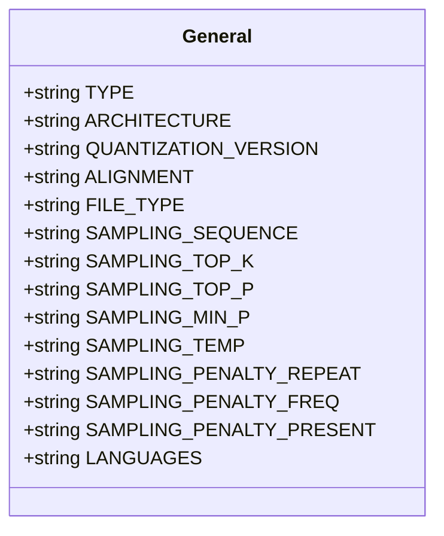

### 57.5.2 Keys.LLM 类：大语言模型专属参数定义

源码路径：`gguf-py/gguf/constants.py` - `Keys.LLM`（120-162行）

```python
class LLM:
    # 大语言模型专属超参数，使用 {arch} 占位符实现架构无关
    # 这些键在运行时会被替换为具体的架构名，如 llama.vocab_size
    VOCAB_SIZE                        = "{arch}.vocab_size"          # 词汇表大小，决定输出层维度
    CONTEXT_LENGTH                    = "{arch}.context_length"      # 上下文窗口长度，影响最大输入长度
    EMBEDDING_LENGTH                  = "{arch}.embedding_length"    # 嵌入维度，模型的隐藏状态大小
    FEED_FORWARD_LENGTH               = "{arch}.feed_forward_length" # FFN 隐藏层维度，通常为 embedding 的 4 倍
    HEAD_COUNT                        = "{arch}.attention.head_count"        # 注意力头数，多头并行
    HEAD_COUNT_KV                     = "{arch}.attention.head_count_kv"     # KV 头数，用于 GQA，减少计算量
    LAYER_NORM_EPS                    = "{arch}.layer_norm_epsilon"          # 层归一化 epsilon，数值稳定性
    ROPE_DIMENSION_COUNT              = "{arch}.rope.dimension_count"        # RoPE 维度，通常等于 embedding 维度
    ROPE_FREQ_BASE                    = "{arch}.rope.freq_base"              # RoPE 频率基址，控制位置编码尺度
    ROPE_SCALING_TYPE                 = "{arch}.rope.scaling.type"           # RoPE 缩放类型，扩展上下文
    ROPE_SCALING_FACTOR               = "{arch}.rope.scaling.factor"         # RoPE 缩放因子，线性或 yarn 缩放
    DENSE_FEAT_OUT_SIZE               = "{arch}.{dense}_feat_out"  # 密集特征输出大小，用于嵌入模型，{dense} 为架构特定占位
```

这段代码定义了 `Keys.LLM` 类，专门管理大语言模型的核心超参数。通过 `{arch}` 占位符，同一套键名可以动态适配 llama、qwen 等不同架构，避免了命名冲突。这种设计使得新增一种模型架构时，只需在子类中添加带占位符的键即可，无需修改全局命名空间。在物流中心，这就像国际部的多语言标签机，同一套模板可以根据国家代码自动切换语言，实现无缝适配。

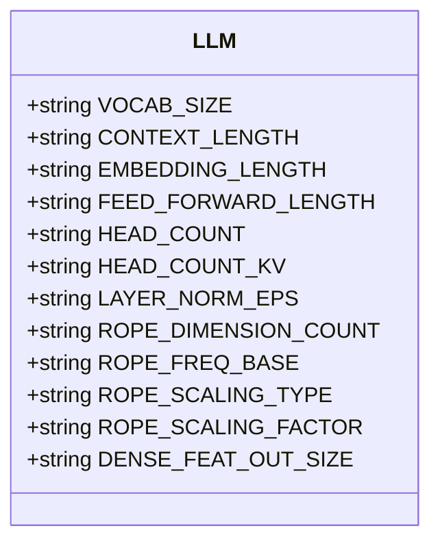

### 57.5.3 {arch} 占位符替换流程

在物流中心，{arch} 占位符就像包裹上的国家代码，实际分拣时需要替换为具体的国家名称。以下是占位符替换的流程图：

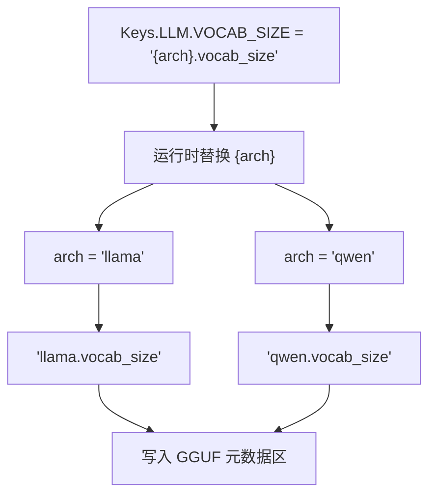

### 57.5.4 Keys.Attention 类：注意力机制参数定义

源码路径：`gguf-py/gguf/constants.py` - `Keys.Attention`（163-193行）

```python
class Attention:
    # 注意力机制相关参数，集中管理注意力层的超参数
    # 通过嵌套 Indexer 子类支持长上下文索引器配置
    HEAD_COUNT                   = "{arch}.attention.head_count"        # 注意力头数，多头并行计算
    HEAD_COUNT_KV                = "{arch}.attention.head_count_kv"     # KV 头数，用于 GQA，减少 KV 缓存
    LAYER_NORM_EPS              = "{arch}.attention.layer_norm_epsilon" # 注意力层归一化 epsilon，稳定训练
    TEMPERATURE_SCALE           = "{arch}.attention.temperature_scale"  # 注意力温度缩放，控制注意力分布平滑度
    # 嵌套 Indexer 子类，用于长上下文索引器（如 Infinite Attention）
    class Indexer:
        HEAD_COUNT = "{arch}.attention.indexer.head_count"  # 索引器头数，用于稀疏注意力
        KEY_LENGTH = "{arch}.attention.indexer.key_length"  # 索引器键长度，决定索引粒度
        TOP_K      = "{arch}.attention.indexer.top_k"       # 索引器 Top-K，选择 Top-K 个关键位置
```

这段代码集中管理注意力机制的超参数，并通过嵌套 `Indexer` 子类支持长上下文索引器配置，体现了对注意力机制扩展性的支持。嵌套结构使得相关参数聚集在一起，便于阅读和维护。在物流中心，这就像冷链部的专属窗口，只处理需要温控的包裹，并且内部还细分了冷藏、冷冻、恒温等子区域。

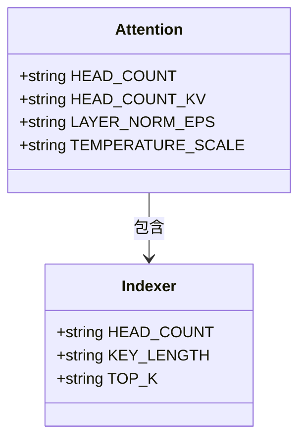

### 57.5.5 其他子类详解

除了上述四个子类，Keys 还包含众多专业模块子类，每个子类都承载着特定领域的元数据键定义，共同构成了 GGUF 元数据的完整身份档案柜。以下逐一展开各子类的源码路径、代码实现与设计意图。

#### 57.5.5.1 Keys.Rope：RoPE 位置编码参数定义

源码路径：`gguf-py/gguf/constants.py` - `Keys.Rope`（196-210行）

```python
class Rope:
    # RoPE（旋转位置编码）相关参数，用于控制位置编码的行为，影响模型对位置信息的编码方式
    # 通过 {arch} 占位符实现架构无关，支持不同模型的 RoPE 配置
    DIMENSION_COUNT           = "{arch}.rope.dimension_count"        # RoPE 的维度，通常等于 embedding 维度
    DIMENSION_COUNT_SWA       = "{arch}.rope.dimension_count_swa"    # 滑动窗口注意力（SWA）的 RoPE 维度
    FREQ_BASE                 = "{arch}.rope.freq_base"              # RoPE 的基础频率，控制位置编码的尺度
    FREQ_SCALE                = "{arch}.rope.freq_scale"             # 频率缩放因子，用于扩展上下文
    SCALING_TYPE              = "{arch}.rope.scaling.type"           # RoPE 缩放类型，如 none/linear/yarn/longrope
    SCALING_FACTOR            = "{arch}.rope.scaling.factor"         # 缩放因子，用于线性或 yarn 缩放
    SCALING_YARN_EXT          = "{arch}.rope.scaling.yarn_ext"       # YARN 扩展因子
    SCALING_YARN_ALPHA        = "{arch}.rope.scaling.yarn_alpha"     # YARN alpha 参数
    SCALING_YARN_BETA         = "{arch}.rope.scaling.yarn_beta"      # YARN beta 参数
    SCALING_YARN_BETA_SLOW    = "{arch}.rope.scaling.yarn_beta_slow" # YARN beta 慢速参数
    ORIG_FREQ_BASE            = "{arch}.rope.orig_freq_base"         # 原始频率基址，用于恢复原始 RoPE
    ATTN_FACTOR               = "{arch}.rope.attn_factor"            # 注意力因子，调整注意力分布
```

`Keys.Rope` 集中管理了 RoPE 位置编码的所有超参数，使得不同架构可以灵活配置位置编码方式。通过统一的命名空间，运行时可以快速读取并应用相应的 RoPE 变体。

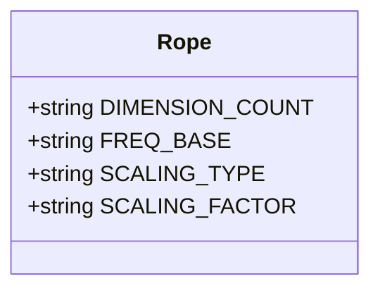

#### 57.5.5.2 Keys.Split：模型分片参数定义

源码路径：`gguf-py/gguf/constants.py` - `Keys.Split`（213-215行）

```python
class Split:
    # 模型分片相关参数，用于描述模型被切分到多个文件时的分片信息
    # 这些键在分布式训练和模型并行加载时至关重要
    LLM_KV_SPLIT_NO            = "split.no"            # 当前分片的序号，从 0 开始
    LLM_KV_SPLIT_COUNT         = "split.count"         # 总分片数
    LLM_KV_SPLIT_TENSORS_COUNT = "split.tensors.count" # 当前分片包含的张量数量
```

`Keys.Split` 定义了模型分片的元数据键，使得多文件模型能够被正确重组和加载。

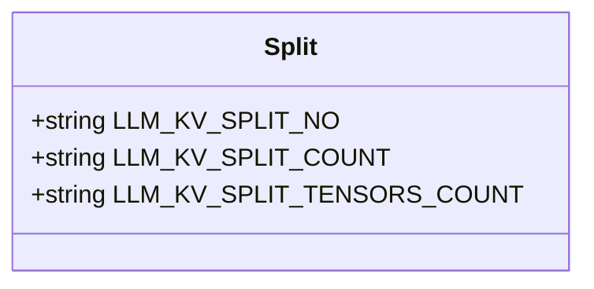

#### 57.5.5.3 Keys.SSM：状态空间模型参数定义

源码路径：`gguf-py/gguf/constants.py` - `Keys.SSM`（217-222行）

```python
class SSM:
    # 状态空间模型（State Space Model）相关参数，用于 Mamba 等架构
    # 这些参数控制 SSM 层的卷积核、内部大小和门控机制
    CONV_KERNEL    = "{arch}.ssm.conv_kernel"    # 卷积核大小，用于 SSM 的卷积操作
    INNER_SIZE     = "{arch}.ssm.inner_size"     # SSM 内部状态大小，影响模型容量
    DT_B_C_RMS     = "{arch}.ssm.dt_b_c_rms"     # 门控参数，控制 dt、B、C 的 RMS 归一化
```

`Keys.SSM` 为状态空间模型提供了专属的参数命名空间，使得 Mamba 等架构可以独立于 Transformer 配置其特有参数。

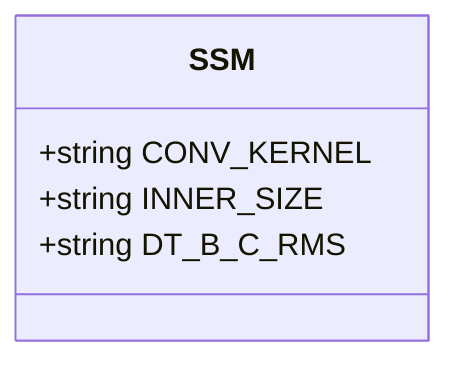

#### 57.5.5.4 Keys.KDA：KDA 模块参数定义

源码路径：`gguf-py/gguf/constants.py` - `Keys.KDA`（226-227行）

```python
class KDA:
    # KDA（Kronecker Decomposed Attention）模块参数
    # 用于描述 KDA 注意力机制的头维度
    HEAD_DIM = "{arch}.kda.head_dim"  # KDA 注意力头维度
```

`Keys.KDA` 为 KDA 注意力机制提供了简洁的参数定义。

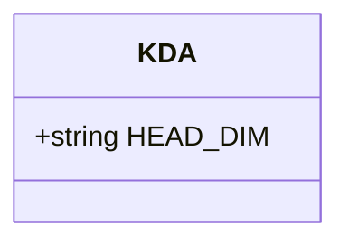

#### 57.5.5.5 Keys.WKV：RWKV 模型核心参数定义

源码路径：`gguf-py/gguf/constants.py` - `Keys.WKV`（231-232行）

```python
class WKV:
    # WKV（RWKV 模型的核心计算单元）参数
    # RWKV 是一种结合 RNN 和 Transformer 优势的架构
    HEAD_SIZE = "{arch}.wkv.head_size"  # WKV 头大小
```

`Keys.WKV` 定义了 RWKV 模型特有的参数键。

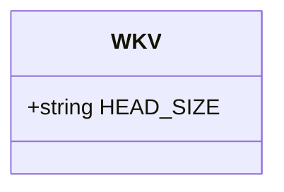

#### 57.5.5.6 Keys.PosNet：Position Network 参数定义

源码路径：`gguf-py/gguf/constants.py` - `Keys.PosNet`（236-237行）

```python
class PosNet:
    # Position Network（位置网络）参数
    # 用于某些模型中独立于主干的位置编码网络
    EMBEDDING_LENGTH = "{arch}.posnet.embedding_length"  # 位置网络的嵌入维度
    BLOCK_COUNT      = "{arch}.posnet.block_count"       # 位置网络的块数
```

`Keys.PosNet` 为位置网络提供了配置键。

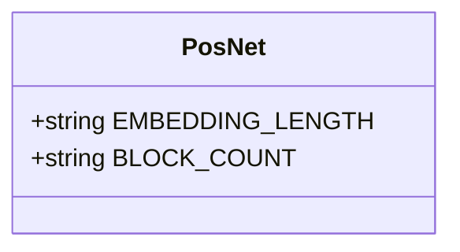

#### 57.5.5.7 Keys.ConvNext：ConvNeXt 模型参数定义

源码路径：`gguf-py/gguf/constants.py` - `Keys.ConvNext`（241-242行）

```python
class ConvNext:
    # ConvNeXt 模型参数
    # ConvNeXt 是一种纯卷积神经网络，用于视觉任务
    EMBEDDING_LENGTH = "{arch}.convnext.embedding_length"  # 嵌入维度
    BLOCK_COUNT      = "{arch}.convnext.block_count"       # 块数
```

`Keys.ConvNext` 定义了 ConvNeXt 架构的元数据键。

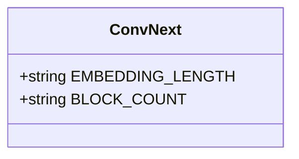

#### 57.5.5.8 Keys.Classifier：分类器参数定义

源码路径：`gguf-py/gguf/constants.py` - `Keys.Classifier`（246-247行）

```python
class Classifier:
    # 分类器相关参数，用于输出标签的配置
    OUTPUT_LABELS = "{arch}.classifier.output_labels"  # 分类器输出标签列表
```

`Keys.Classifier` 为分类任务提供了输出标签的配置。

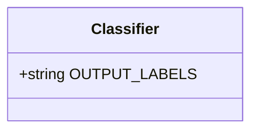

#### 57.5.5.9 Keys.ShortConv：短卷积模块参数定义

源码路径：`gguf-py/gguf/constants.py` - `Keys.ShortConv`（251-252行）

```python
class ShortConv:
    # ShortConv（短卷积）模块参数
    # 用于某些模型中的短卷积操作，如 Linear Attention 中的卷积
    L_CACHE = "{arch}.shortconv.l_cache"  # 短卷积的缓存长度
```

`Keys.ShortConv` 定义了短卷积模块的参数。

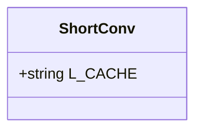

#### 57.5.5.10 Keys.Tokenizer：分词器配置定义

源码路径：`gguf-py/gguf/constants.py` - `Keys.Tokenizer`（256-289行）

```python
class Tokenizer:
    # 分词器配置，包含分词模型、前缀、合并、特殊 token 等
    # 这些键决定了模型如何将文本转换为 token 序列
    MODEL                = "tokenizer.ggml.model"                # 分词模型名称，如 "llama"
    PRE                  = "tokenizer.ggml.pre"                  # 分词前缀
    MERGES               = "tokenizer.ggml.merges"               # 合并规则列表
    BOS_ID               = "tokenizer.ggml.bos_token_id"          # BOS token ID
    EOS_ID               = "tokenizer.ggml.eos_token_id"          # EOS token ID
    UNK_ID               = "tokenizer.ggml.unk_token_id"          # UNK token ID
    PAD_ID               = "tokenizer.ggml.pad_token_id"          # PAD token ID
    VOCAB_SIZE           = "tokenizer.ggml.vocab_size"           # 词汇表大小
    ADD_BOS_TOKEN        = "tokenizer.ggml.add_bos_token"        # 是否添加 BOS token
    ADD_EOS_TOKEN        = "tokenizer.ggml.add_eos_token"        # 是否添加 EOS token
    PREFIX_ID            = "tokenizer.ggml.prefix_token_id"      # 前缀 token ID
    SUFFIX_ID            = "tokenizer.ggml.suffix_token_id"      # 后缀 token ID
    MIDDLE_ID            = "tokenizer.ggml.middle_token_id"      # 中间 token ID
    # ... 更多分词器相关配置
```

`Keys.Tokenizer` 集中管理了分词器的所有配置，确保模型能够正确地进行文本与 token 之间的转换。

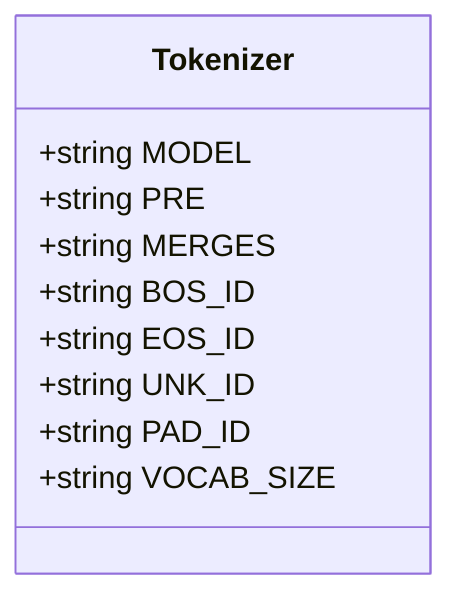

#### 57.5.5.11 Keys.Adapter：适配器配置定义

源码路径：`gguf-py/gguf/constants.py` - `Keys.Adapter`（293-297行）

```python
class Adapter:
    # 适配器（Adapter）相关参数，用于 LoRA 等微调适配器
    # 这些键描述了适配器的类型、缩放因子和调用令牌
    TYPE                    = "adapter.type"                    # 适配器类型，如 "lora"
    LORA_ALPHA              = "adapter.lora.alpha"              # LoRA alpha 缩放因子
    LORA_RANK               = "adapter.lora.rank"               # LoRA 秩
    ALORA_INVOCATION_TOKENS = "adapter.alora.invocation_tokens" # Alora 调用令牌
```

`Keys.Adapter` 为适配器配置提供了专用的键名，便于区分基础模型和适配器权重。

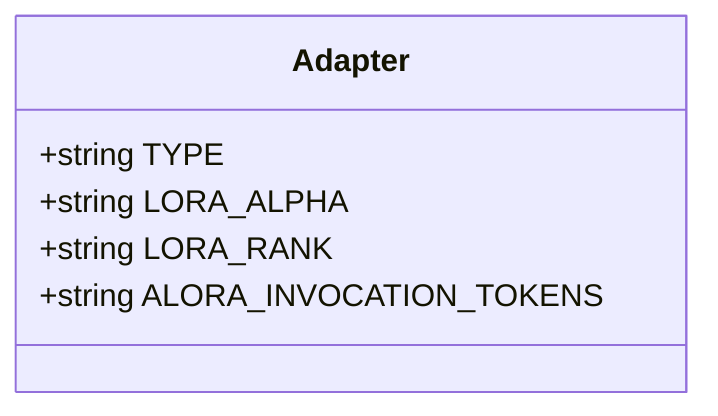

#### 57.5.5.12 Keys.IMatrix：重要性矩阵元数据定义

源码路径：`gguf-py/gguf/constants.py` - `Keys.IMatrix`（301-303行）

```python
class IMatrix:
    # 重要性矩阵（Importance Matrix）元数据
    # 用于量化校准，记录每个张量的重要性分布
    CHUNK_COUNT = "imatrix.chunk_count"  # 重要性矩阵的分块数
    CHUNK_SIZE  = "imatrix.chunk_size"   # 每块的大小
    DATASETS    = "imatrix.datasets"     # 用于校准的数据集列表
```

`Keys.IMatrix` 定义了重要性矩阵的元数据键，用于量化过程中的校准数据管理。

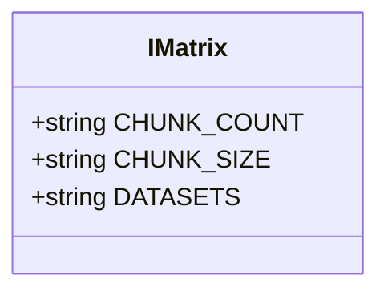

#### 57.5.5.13 Keys.Clip：CLIP 基础配置定义

源码路径：`gguf-py/gguf/constants.py` - `Keys.Clip`（307-310行）

```python
class Clip:
    # CLIP 模型的基础配置
    # CLIP 是一种多模态模型，用于连接视觉和语言
    PROJECTOR_TYPE        = "clip.projector_type"        # 投影器类型
    HAS_VISION_ENCODER    = "clip.has_vision_encoder"    # 是否包含视觉编码器
    HAS_AUDIO_ENCODER     = "clip.has_audio_encoder"     # 是否包含音频编码器
    HAS_LLAVA_PROJECTOR   = "clip.has_llava_projector"   # 是否包含 LLaVA 投影器
```

`Keys.Clip` 提供了 CLIP 模型的基础开关配置。

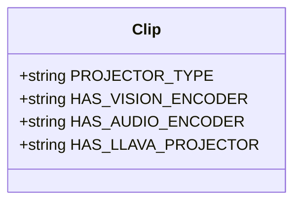

#### 57.5.5.14 Keys.ClipVision：CLIP 视觉编码器配置定义

源码路径：`gguf-py/gguf/constants.py` - `Keys.ClipVision`（313-337行）

```python
class ClipVision:
    # CLIP 视觉编码器配置，包含注意力、投影器和 SAM 等子类
    PROJECTOR_TYPE      = "clip.vision.projector_type"      # 视觉投影器类型
    IMAGE_SIZE          = "clip.vision.image_size"          # 输入图像大小
    PATCH_SIZE          = "clip.vision.patch_size"          # 图像块大小
    EMBEDDING_LENGTH    = "clip.vision.embedding_length"    # 视觉嵌入维度
    BLOCK_COUNT         = "clip.vision.block_count"         # 视觉编码器块数
    class Attention:
        # 视觉注意力机制参数
        HEAD_COUNT      = "clip.vision.attention.head_count"      # 注意力头数
        LAYERNORM_EPS   = "clip.vision.attention.layer_norm_epsilon" # 层归一化 epsilon
    class Projector:
        # 视觉投影器参数，用于将视觉特征映射到语言模型空间
        SCALE_FACTOR    = "clip.vision.projector.scale_factor"     # 投影器缩放因子
    class SAM:
        # SAM（Segment Anything Model）相关参数
        BLOCK_COUNT         = "clip.vision.sam.block_count"         # SAM 块数
        EMBEDDING_LENGTH    = "clip.vision.sam.embedding_length"    # SAM 嵌入维度
        HEAD_COUNT          = "clip.vision.sam.head_count"          # SAM 注意力头数
```

`Keys.ClipVision` 详细定义了视觉编码器的各个子模块参数，支持复杂的视觉-语言模型配置。

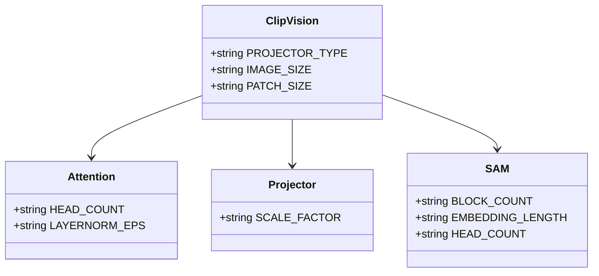

#### 57.5.5.15 Keys.ClipAudio：CLIP 音频编码器配置定义

源码路径：`gguf-py/gguf/constants.py` - `Keys.ClipAudio`（340-353行）

```python
class ClipAudio:
    # CLIP 音频编码器配置，包含注意力和投影器子类
    PROJECTOR_TYPE      = "clip.audio.projector_type"      # 音频投影器类型
    NUM_MEL_BINS        = "clip.audio.num_mel_bins"        # 梅尔频谱_bins 数量
    class Attention:
        # 音频注意力机制参数
        HEAD_COUNT      = "clip.audio.attention.head_count"      # 注意力头数
        LAYERNORM_EPS   = "clip.audio.attention.layer_norm_epsilon" # 层归一化 epsilon
    class Projector:
        # 音频投影器参数
        STACK_FACTOR    = "clip.audio.projector.stack_factor"     # 投影器堆叠因子
```

`Keys.ClipAudio` 为音频编码器提供了类似的配置支持。

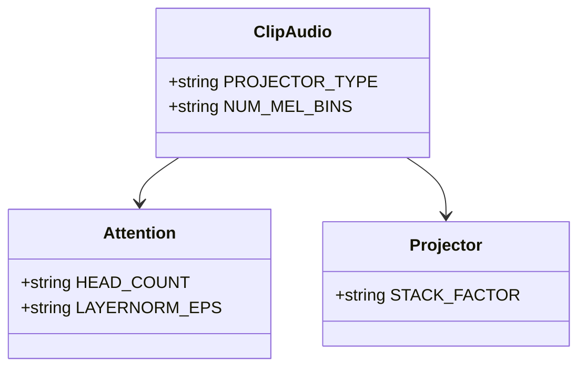

#### 57.5.5.16 Keys.Diffusion：扩散模型参数定义

源码路径：`gguf-py/gguf/constants.py` - `Keys.Diffusion`（356-357行）

```python
class Diffusion:
    # 扩散模型参数
    SHIFT_LOGITS        = "diffusion.shift_logits"  # 扩散模型的 logits 平移量
```

`Keys.Diffusion` 定义了扩散模型特有的参数。

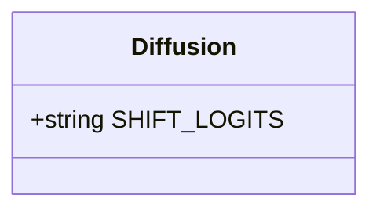

#### 57.5.5.17 Keys.xIELU：xIELU 激活函数参数定义

源码路径：`gguf-py/gguf/constants.py` - `Keys.xIELU`（361-364行）

```python
class xIELU:
    # xIELU 激活函数参数
    ALPHA_P             = "xielu.alpha_p"  # 正向 alpha 参数
    ALPHA_N             = "xielu.alpha_n"  # 负向 alpha 参数
    BETA                = "xielu.beta"      # beta 参数
    EPS                 = "xielu.eps"       # epsilon 参数
```

`Keys.xIELU` 为 xIELU 激活函数提供了可调节的参数键。

```mermaid
classDiagram
    class xIELU {
        +string ALPHA_P
        +string ALPHA_N
        +string BETA
        +string EPS
    }
```

### 57.5.6 模块依赖图

```mermaid
graph TD
    A[constants.py] --> B[Keys]
    A --> C[GGUFType]
    A --> D[MODEL_ARCH]
    A --> E[MODEL_TENSOR]
    B --> B1[General]
    B --> B2[LLM]
    B --> B3[Attention]
    B --> B4[Rope]
    B --> B5[SSM]
    B --> B6[Tokenizer]
    B --> B7[ClipVision]
    B --> B8[ClipAudio]
    B --> B9[Diffusion]
    B --> B10[xIELU]
    B1 --> B1A[采样参数]
    B2 --> B2A[{arch} 占位符]
    B3 --> B3A[Indexer 子类]
```

## 57.6 模型架构、文件类型与张量映射 —— 百种架构的「统一坐标系」

在物流中心，MODEL_ARCH 就像是 100 多种集装箱类型，每种类型都有唯一的 ISO 编码，从冷藏箱到框架箱，对应着 llama、qwen、mamba、deepseek 等不同模型家族。MODEL_TENSOR 则是集装箱内的货物分类学，无论哪种箱子，内部货物都按统一标准分类贴标。

### 57.6.1 GGUFType 枚举：文件类型枚举

源码路径：`gguf-py/gguf/constants.py` - `GGUFType`（369-373行）

```python
class GGUFType:
    # GGUF 文件类型枚举，标识文件用途，决定整个物流链的处理流程
    MODEL    = "model"           # 标准模型文件，包含完整权重和配置，是最常见的类型
    ADAPTER  = "adapter"         # 适配器文件，如 LoRA，仅包含增量权重，需配合基础模型使用
    IMATRIX  = "imatrix"         # 重要性矩阵文件，存储量化校准数据，用于提升量化精度
    MMPROJ   = "mmproj"          # 多模态投影文件，连接视觉/音频编码器与语言模型，实现跨模态理解
```

这段代码定义了四种文件类型，使得 GGUF 容器能够区分不同用途的模型文件，为上层工具提供了统一的类型判断依据。每种类型对应不同的处理流程，例如 ADAPTER 类型需要与基础模型合并，MMPROJ 类型需要加载视觉编码器权重。在物流中心，这就像包裹的四种运输方式标识，决定了包裹是走标准货运、还是需要特殊配件、质检报告或多模态集装箱。

```mermaid
classDiagram
    class GGUFType {
        +string MODEL
        +string ADAPTER
        +string IMATRIX
        +string MMPROJ
    }
```

### 57.6.2 MODEL_ARCH 枚举：模型架构枚举

源码路径：`gguf-py/gguf/constants.py` - `MODEL_ARCH`（376-500行，部分）

```python
class MODEL_ARCH(IntEnum):
    # 模型架构枚举，使用 auto() 自动分配唯一 ID，避免手动编号冲突
    # 新增架构只需追加，无需考虑编号，简化了扩展流程
    MMPROJ           = auto()   # 多模态投影占位架构，用于 clip.cpp 的临时标识
    LLAMA            = auto()   # LLaMA 架构，Meta 开发的基础模型家族
    FALCON           = auto()   # Falcon 架构，TII 开发的高效模型
    GPT2             = auto()   # GPT-2 架构，OpenAI 的经典解码器模型
    QWEN             = auto()   # Qwen 系列架构，阿里云开发的多语言模型
    DEEPSEEK         = auto()   # DeepSeek 架构，深度求索的高效模型
    REDEFINED_ARCH   = auto()   # 支持重新定义的架构变体，允许运行时动态扩展
    # ... 100+ 种架构，覆盖主流开源模型
```

这段代码枚举了 100+ 种模型架构，每个架构都有唯一标识。`auto()` 的使用简化了扩展流程，避免了手动编号带来的冲突风险，同时使得枚举值的顺序可以自由调整，提高了可维护性。在物流中心，这就像集装箱的 ISO 编码系统，每种箱型都有唯一编码，便于全球统一识别。

```mermaid
classDiagram
    class MODEL_ARCH {
        +IntEnum MMPROJ
        +IntEnum LLAMA
        +IntEnum FALCON
        +IntEnum GPT2
        +IntEnum QWEN
        +IntEnum DEEPSEEK
        +IntEnum REDEFINED_ARCH
    }
```

此外，还定义了 `MODEL_ARCH_NAMES` 映射表，用于将枚举值转换为可读的字符串名称，便于运行时识别和日志输出：

```python
MODEL_ARCH_NAMES: dict[MODEL_ARCH, str] = {
    MODEL_ARCH.MMPROJ:           "clip",        # 多模态投影占位架构，用于 clip.cpp
    MODEL_ARCH.LLAMA:            "llama",       # LLaMA 架构
    MODEL_ARCH.FALCON:           "falcon",      # Falcon 架构
    MODEL_ARCH.GPT2:             "gpt2",        # GPT-2 架构
    MODEL_ARCH.QWEN:             "qwen",        # Qwen 系列
    MODEL_ARCH.DEEPSEEK:         "deepseek",    # DeepSeek 架构
    MODEL_ARCH.REDEFINED_ARCH:   "redefined",   # 支持重新定义的架构变体
    # ... 100+ 种架构名称，覆盖主流开源模型
}
```

### 57.6.3 MODEL_TENSOR 枚举：张量类型枚举

源码路径：`gguf-py/gguf/constants.py` - `MODEL_TENSOR`（部分）

```python
class MODEL_TENSOR(IntEnum):
    # 张量类型枚举，定义所有可能的张量类别，作为跨架构的统一语言
    # 同一类型张量在不同架构中含义一致，简化了模型转换和加载逻辑
    TOKEN_EMBD       = auto()   # 词嵌入张量，模型的输入嵌入层
    OUTPUT           = auto()   # 输出投影张量，通常与词嵌入共享权重
    ATTN_Q           = auto()   # 注意力查询权重，用于计算 Query 向量
    ATTN_K           = auto()   # 注意力键权重，用于计算 Key 向量
    ATTN_V           = auto()   # 注意力值权重，用于计算 Value 向量
    ATTN_OUT         = auto()   # 注意力输出投影，将多头结果映射回隐藏维度
    FFN_UP           = auto()   # FFN 上投影，将隐藏维度扩展到中间维度
    FFN_DOWN         = auto()   # FFN 下投影，将中间维度映射回隐藏维度
    FFN_GATE         = auto()   # FFN 门控投影，用于 GLU 激活函数的门控机制
    SSM_IN           = auto()   # SSM 输入投影，状态空间模型的输入变换
    TIME_MIX_W0      = auto()   # RWKV 时间混合权重，控制时间混合因子
    # ... 更多，覆盖所有模型组件
```

这段代码定义了跨架构的统一张量类型，使得不同模型可以使用相同的标识符，极大地简化了模型转换和加载逻辑。无论模型来自哪个框架，只要张量类型相同，其语义就一致。在物流中心，这就像集装箱内的货物分类贴标，无论箱子来自哪个供应商，内部货物都按统一标准分类。

```mermaid
classDiagram
    class MODEL_TENSOR {
        +IntEnum TOKEN_EMBD
        +IntEnum OUTPUT
        +IntEnum ATTN_Q
        +IntEnum ATTN_K
        +IntEnum ATTN_V
        +IntEnum ATTN_OUT
        +IntEnum FFN_UP
        +IntEnum FFN_DOWN
        +IntEnum FFN_GATE
        +IntEnum SSM_IN
        +IntEnum TIME_MIX_W0
    }
```

### 57.6.4 MODEL_TENSORS 与 TENSOR_NAMES：装箱清单与命名规范

源码路径：`gguf-py/gguf/constants.py` - `MODEL_TENSORS` 与 `TENSOR_NAMES`（827-1630行，部分）

```python
# 架构到张量列表的映射，声明每种架构应包含的张量，用于转换器校验源模型完整性
MODEL_TENSORS: dict[MODEL_ARCH, list[MODEL_TENSOR]] = {
    MODEL_ARCH.LLAMA: [
        MODEL_TENSOR.TOKEN_EMBD,      # 词嵌入，模型必须
        MODEL_TENSOR.OUTPUT_NORM,     # 输出层归一化
        MODEL_TENSOR.OUTPUT,          # 输出投影
        MODEL_TENSOR.ATTN_NORM,       # 注意力层归一化
        MODEL_TENSOR.ATTN_Q,          # 注意力查询权重
        MODEL_TENSOR.ATTN_K,          # 注意力键权重
        MODEL_TENSOR.ATTN_V,          # 注意力值权重
        MODEL_TENSOR.ATTN_OUT,        # 注意力输出投影
        MODEL_TENSOR.FFN_NORM,        # FFN 层归一化
        MODEL_TENSOR.FFN_UP,          # FFN 上投影
        MODEL_TENSOR.FFN_DOWN,        # FFN 下投影
        # ... LLaMA 特有的张量组合
    ],
    MODEL_ARCH.QWEN: [
        MODEL_TENSOR.TOKEN_EMBD,
        # ... Qwen 特有张量，如 Qwen 的 attention bias 等
    ],
}

# 张量类型到标准命名模板的映射，通过 {bid} 占位符动态生成层索引
TENSOR_NAMES: dict[MODEL_TENSOR, str] = {
    MODEL_TENSOR.TOKEN_EMBD:   "token_embd",                    # 全局张量，无层索引
    MODEL_TENSOR.OUTPUT:       "output",                        # 输出层，同样全局
    MODEL_TENSOR.ATTN_Q:       "blk.{bid}.attn_q.weight",      # 注意力查询权重，{bid} 替换为层号
    MODEL_TENSOR.ATTN_K:       "blk.{bid}.attn_k.weight",      # 注意力键权重
    MODEL_TENSOR.ATTN_V:       "blk.{bid}.attn_v.weight",      # 注意力值权重
    MODEL_TENSOR.ATTN_OUT:     "blk.{bid}.attn_output.weight", # 注意力输出投影
    MODEL_TENSOR.FFN_UP:       "blk.{bid}.ffn_up.weight",      # FFN 上投影
    MODEL_TENSOR.FFN_DOWN:     "blk.{bid}.ffn_down.weight",    # FFN 下投影
    # ... 更多，覆盖所有张量类型
}
```

这段代码中，`MODEL_TENSORS` 为每种架构定义了必需的张量清单，用于转换器校验源模型完整性和推理引擎内存分配；`TENSOR_NAMES` 则提供了标准化命名模板，通过 `{bid}` 占位符动态生成层索引。两者共同构成了模型转换和加载的校验基础，确保了模型权重的完整性和一致性。在物流中心，这就像每种集装箱的标准装箱清单和货物标签模板，确保装箱和贴标过程有章可循。

```mermaid
graph TD
    A[MODEL_ARCH] --> B[MODEL_TENSORS]
    C[MODEL_TENSOR] --> B
    C --> D[TENSOR_NAMES]
    B --> E[校验完整性]
    D --> F[运行时内存分配]
```

### 57.6.5 模块依赖图

```mermaid
graph TD
    A[MODEL_ARCH] --> B[MODEL_TENSORS]
    C[MODEL_TENSOR] --> B
    C --> D[TENSOR_NAMES]
    B --> E[校验完整性]
    D --> F[运行时内存分配]
```

## 57.7 量化类型、值类型与字节序 —— 数据世界的「度量衡体系」

在物流中心，量化类型则是不同的压缩包装工艺，Q4_0 是经济压缩，Q8_0 是标准包装，F32 是豪华精装，MXFP4 是新型纳米压缩，而 LlamaFileType 决定整个集装箱以哪种工艺为主。

### 57.7.1 GGMLQuantizationType 枚举：量化类型枚举

源码路径：`gguf-py/gguf/constants.py` - `GGMLQuantizationType`（3934-3970行）

```python
class GGMLQuantizationType(IntEnum):
    # GGML 量化类型枚举，定义所有支持的量化格式，覆盖从全精度到 1-bit 的各种压缩方案
    # 数值连续但非全连续，预留了扩展空间，便于新增硬件加速格式
    F32     = 0    # 32位浮点，全精度，无损但体积最大
    F16     = 1    # 16位浮点，半精度，平衡精度与体积
    Q4_0    = 2    # 4-bit 量化，块大小32，经济压缩，适合边缘设备
    Q4_1    = 3    # 4-bit 量化，带最小值，精度略高于 Q4_0
    Q5_0    = 6    # 5-bit 量化，块大小32，提供更高精度
    Q5_1    = 7    # 5-bit 量化，带最小值，进一步提升精度
    Q8_0    = 8    # 8-bit 量化，块大小32，标准压缩，接近无损
    Q8_1    = 9    # 8-bit 量化，带最小值，用于特殊场景
    Q2_K    = 10   # K-quant 2-bit，块大小256，超低精度
    Q3_K    = 11   # K-quant 3-bit，块大小256，低精度
    Q4_K    = 12   # K-quant 4-bit，块大小256，中等精度，常用
    Q5_K    = 13   # K-quant 5-bit，块大小256，较高精度
    Q6_K    = 14   # K-quant 6-bit，块大小256，高精度
    Q8_K    = 15   # K-quant 8-bit，块大小256，接近全精度
    IQ2_XXS = 16   # IQ 2-bit 超小模型，极致压缩
    IQ2_XS  = 17   # IQ 2-bit 小模型，略大于 XXS
    IQ3_XXS = 18   # IQ 3-bit 超小模型，精度稍高
    IQ1_S   = 19   # IQ 1-bit 小模型，极限压缩
    IQ4_NL  = 20   # IQ 4-bit 非线性格，特殊量化方案
    IQ3_S   = 21   # IQ 3-bit 小模型，平衡精度与体积
    IQ2_S   = 22   # IQ 2-bit 小模型，低精度
    IQ4_XS  = 23   # IQ 4-bit 超小模型，高精度小体积
    I8      = 24   # 8-bit 整数，用于整数推理
    I16     = 25   # 16-bit 整数，中等精度整数
    I32     = 26   # 32-bit 整数，高精度整数
    I64     = 27   # 64-bit 整数，极高精度整数
    F64     = 28   # 64-bit 浮点，双精度浮点
    IQ1_M   = 29   # IQ 1-bit 中模型，中等压缩
    BF16    = 30   # Brain floating point 16，Google 提出的格式，动态范围大
    TQ1_0   = 34   # 三元量化 1-bit，三值量化
    TQ2_0   = 35   # 三元量化 2-bit，三值量化
    MXFP4   = 39   # 微缩放 FP4，AMD 等硬件支持的微缩放格式
    NVFP4   = 40   # NVIDIA FP4，NVIDIA 的 4-bit 浮点格式
    Q1_0    = 41   # 1-bit 量化，极限压缩，精度最低
```

这段代码提供了 20+ 种量化格式，覆盖从全精度到 1-bit 的各种压缩方案，为模型压缩提供了丰富的选择。数值连续但非全连续，预留了扩展空间，便于新增硬件加速格式。在物流中心，这就像包装车间的压缩工艺选择，从经济压缩到豪华精装，应有尽有。

```mermaid
classDiagram
    class GGMLQuantizationType {
        +IntEnum F32
        +IntEnum F16
        +IntEnum Q4_0
        +IntEnum Q4_1
        +IntEnum Q8_0
        +IntEnum Q2_K
        +IntEnum Q4_K
        +IntEnum MXFP4
        +IntEnum NVFP4
        +IntEnum Q1_0
    }
```

### 57.7.2 量化策略选择流程

在物流中心，选择量化策略就像根据包裹价值和目的地选择压缩工艺。以下是量化策略选择的简化流程图：

```mermaid
flowchart TD
    A["开始选择量化策略"] --> B{"1D 张量是否敏感?"}
    B -->|是| C["1D 张量保持 F32/F16"]
    B -->|否| D["全部使用统一量化"]
    C --> E{"2D 张量体积要求?"}
    D --> E
    E -->|体积优先| F["选择 Q4_0/Q2_K 等"]
    E -->|精度优先| G["选择 Q8_0/Q6_K 等"]
    E -->|硬件加速| H["选择 MXFP4/NVFP4"]
    F --> I["写入 LlamaFileType"]
    G --> I
    H --> I
```

### 57.7.3 LlamaFileType 枚举：文件量化策略枚举

源码路径：`gguf-py/gguf/constants.py` - `LlamaFileType`（3978-4025行）

```python
class LlamaFileType(IntEnum):
    # 文件级量化策略枚举，描述整个模型的主导量化类型
    # MOSTLY 前缀表示 1D 张量保持高精度、仅大矩阵量化的混合策略
    # 这种设计平衡了精度与体积，1D 张量（如 embedding）对精度更敏感
    ALL_F32            = 0    # 全部使用 F32，最高精度，体积最大
    MOSTLY_F16         = 1    # 除 1D 张量外使用 F16，1D 张量用 F32
    MOSTLY_Q4_0        = 2    # 除 1D 张量外使用 Q4_0，经济压缩
    MOSTLY_Q4_1        = 3    # 除 1D 张量外使用 Q4_1，略高精度
    # MOSTLY_Q4_1_SOME_F16 = 4   # 已移除，历史上用于部分 F16
    # MOSTLY_Q4_2        = 5   # 已移除，早期量化格式
    # MOSTLY_Q4_3        = 6   # 已移除，早期量化格式
    MOSTLY_Q8_0        = 7    # 除 1D 张量外使用 Q8_0，标准压缩
    MOSTLY_Q5_0        = 8    # 除 1D 张量外使用 Q5_0，较高精度
    MOSTLY_Q5_1        = 9    # 除 1D 张量外使用 Q5_1，带最小值
    MOSTLY_Q2_K        = 10   # 除 1D 张量外使用 Q2_K，超低精度
    MOSTLY_Q3_K_S      = 11   # 除 1D 张量外使用 Q3_K_S，小块 K-quant
    MOSTLY_Q3_K_M      = 12   # 除 1D 张量外使用 Q3_K_M，中等块 K-quant
    MOSTLY_Q3_K_L      = 13   # 除 1D 张量外使用 Q3_K_L，大块 K-quant
    MOSTLY_Q4_K_S      = 14   # 除 1D 张量外使用 Q4_K_S，小块 K-quant
    MOSTLY_Q4_K_M      = 15   # 除 1D 张量外使用 Q4_K_M，中等块 K-quant，最常用
    MOSTLY_Q5_K_S      = 16   # 除 1D 张量外使用 Q5_K_S，小块 K-quant
    MOSTLY_Q5_K_M      = 17   # 除 1D 张量外使用 Q5_K_M，中等块 K-quant
    MOSTLY_Q6_K        = 18   # 除 1D 张量外使用 Q6_K，高精度 K-quant
    MOSTLY_IQ2_XXS     = 19   # 除 1D 张量外使用 IQ2_XXS，极致压缩
    MOSTLY_IQ2_XS      = 20   # 除 1D 张量外使用 IQ2_XS，小模型压缩
    MOSTLY_Q2_K_S      = 21   # 除 1D 张量外使用 Q2_K_S，小块 K-quant
    MOSTLY_IQ3_XS      = 22   # 除 1D 张量外使用 IQ3_XS，小模型压缩
    MOSTLY_IQ3_XXS     = 23   # 除 1D 张量外使用 IQ3_XXS，超小模型压缩
    MOSTLY_IQ1_S       = 24   # 除 1D 张量外使用 IQ1_S，极限压缩
    MOSTLY_IQ4_NL      = 25   # 除 1D 张量外使用 IQ4_NL，非线性格
    MOSTLY_IQ3_S       = 26   # 除 1D 张量外使用 IQ3_S，小模型压缩
    MOSTLY_IQ3_M       = 27   # 除 1D 张量外使用 IQ3_M，中等模型压缩
    MOSTLY_IQ2_S       = 28   # 除 1D 张量外使用 IQ2_S，小模型压缩
    MOSTLY_IQ2_M       = 29   # 除 1D 张量外使用 IQ2_M，中等模型压缩
    MOSTLY_IQ4_XS      = 30   # 除 1D 张量外使用 IQ4_XS，超小模型压缩
    MOSTLY_IQ1_M       = 31   # 除 1D 张量外使用 IQ1_M，中等模型压缩
    MOSTLY_BF16        = 32   # 除 1D 张量外使用 BF16，脑浮点格式
    # MOSTLY_Q4_0_4_4      = 33  # 已移除，运行时重打包
    # MOSTLY_Q4_0_4_8      = 34  # 已移除，运行时重打包
    # MOSTLY_Q4_0_8_8      = 35  # 已移除，运行时重打包
    MOSTLY_TQ1_0       = 36   # 除 1D 张量外使用 TQ1_0，三元量化
    MOSTLY_TQ2_0       = 37   # 除 1D 张量外使用 TQ2_0，三元量化
    MOSTLY_MXFP4_MOE   = 38   # 除 1D 张量外使用 MXFP4 MoE，针对专家模型的微缩放格式
    MOSTLY_NVFP4       = 39   # 除 1D 张量外使用 NVFP4，NVIDIA 的 4-bit 浮点格式
    MOSTLY_Q1_0        = 40   # 除 1D 张量外使用 Q1_0，极限压缩
    GUESSED            = 1024 # 未指定时的推测策略，由工具自动选择
```

这段代码定义了文件级的量化策略，MOSTLY 前缀表示 1D 张量保持高精度、仅大矩阵量化，GUESSED 用于未指定时的推测。这种混合策略在精度和体积之间取得了良好平衡，因为 1D 张量（如词嵌入）对量化误差更敏感，而 2D 张量（如注意力矩阵）可以承受更大误差。在物流中心，这就像整箱运输时的混合包装策略，对易碎品（1D 张量）采用豪华精装，对耐压品（2D 张量）采用经济压缩。

```mermaid
classDiagram
    class LlamaFileType {
        +IntEnum ALL_F32
        +IntEnum MOSTLY_F16
        +IntEnum MOSTLY_Q4_0
        +IntEnum MOSTLY_Q8_0
        +IntEnum MOSTLY_Q4_K_M
        +IntEnum MOSTLY_MXFP4_MOE
        +IntEnum MOSTLY_NVFP4
        +IntEnum GUESSED
    }
```

### 57.7.4 GGUFValueType 枚举：元数据值类型枚举

源码路径：`gguf-py/gguf/constants.py` - `GGUFValueType`（4033-4061行）

```python
class GGUFValueType(IntEnum):
    # GGUF 元数据值类型枚举，定义支持的数据类型，用于序列化元数据
    # 从 8 位整数到 64 位浮点，覆盖了常见数据类型
    UINT8   = 0    # 无符号8位整数，用于小整数，如标志位
    INT8    = 1    # 有符号8位整数，用于小范围有符号数
    UINT16  = 2    # 无符号16位整数，用于中等整数
    INT16   = 3    # 有符号16位整数，用于中等范围有符号数
    UINT32  = 4    # 无符号32位整数，用于大整数，如计数
    INT32   = 5    # 有符号32位整数，用于通用整数，最常用
    FLOAT32 = 6    # 32位浮点数，用于浮点参数，如温度
    BOOL    = 7    # 布尔值，用于开关标志
    STRING  = 8    # 字符串，用于文本信息，如架构名
    ARRAY   = 9    # 数组，用于列表，如语言列表
    UINT64  = 10   # 无符号64位整数，用于大整数，如文件偏移
    INT64   = 11   # 有符号64位整数，用于大范围有符号数
    FLOAT64 = 12   # 64位浮点数，用于高精度浮点参数

    @staticmethod
    def get_type(val: Any) -> GGUFValueType:
        # 根据 Python 类型自动推导 GGUF 值类型，避免人工指定错误
        # 这种设计简化了元数据写入过程，提高了类型安全性
        if isinstance(val, (str, bytes, bytearray)):
            return GGUFValueType.STRING       # 字符串或字节数组，统一处理
        elif isinstance(val, list):
            return GGUFValueType.ARRAY         # 列表类型，自动识别为数组
        elif isinstance(val, float):
            return GGUFValueType.FLOAT32       # 浮点数，默认映射为 FLOAT32
        elif isinstance(val, bool):
            return GGUFValueType.BOOL          # 布尔值，注意 bool 是 int 的子类，需先判断
        elif isinstance(val, int):
            return GGUFValueType.INT32         # 整数，默认映射为 INT32
        else:
            raise ValueError(f"Unknown type: {type(val)}")  # 未知类型抛出异常
```

这段代码定义了 13 种元数据值类型，并通过 `get_type()` 静态方法实现 Python 类型到 GGUF 类型的自动推导，简化了元数据写入过程，避免了人工指定类型时的错误。注意 bool 类型的判断必须在 int 之前，因为 Python 中 bool 是 int 的子类。在物流中心，这就像智能材质检测仪，放入包裹自动判断应贴哪种材质标签，避免人工填写错误。

```mermaid
classDiagram
    class GGUFValueType {
        +IntEnum UINT8
        +IntEnum INT8
        +IntEnum FLOAT32
        +IntEnum BOOL
        +IntEnum STRING
        +IntEnum ARRAY
        +IntEnum FLOAT64
        +get_type() GGUFValueType
    }
```

### 57.7.5 GGUFEndian 枚举：字节序枚举

源码路径：`gguf-py/gguf/constants.py` - `GGUFEndian`（4027-4031行）

```python
class GGUFEndian(IntEnum):
    # 字节序枚举，用于跨平台文件兼容，确保模型文件在不同平台间的兼容性
    # 读取时自动检测并转换，避免字节序错误导致的数据损坏
    LITTLE = 0    # 小端字节序，x86、ARM 等主流架构使用，最常见
    BIG    = 1    # 大端字节序，网络字节序、部分嵌入式系统使用
```

这段代码提供了字节序标识，读取时自动检测并转换，确保模型文件在不同平台间的兼容性。小端字节序是主流，大端字节序用于特定场景。在物流中心，这就像包裹上的方向标识，确保在不同国家的分拣线上都能正确识别上下方向。

```mermaid
classDiagram
    class GGUFEndian {
        +IntEnum LITTLE
        +IntEnum BIG
    }
```

## 57.8 特殊化枚举 —— 分词、池化、门控与视觉的「扩展词典」

在物流中心，特殊化枚举就像是专业领域的处理规则，例如分词部门有六种身份标签，池化部门有五种聚合方式，每个规则都确保包裹在特定环节被正确处理。

### 57.8.1 TokenType 枚举：分词单元类型枚举

源码路径：`gguf-py/gguf/constants.py` - `TokenType`（3908-3915行）

```python
class TokenType(IntEnum):
    # 分词单元类型枚举，影响分词器行为与特殊 token 处理
    # 这些类型决定了分词器如何合并子词以及处理特殊 token
    NORMAL       = 1    # 普通 token，常规词汇，参与合并
    UNKNOWN      = 2    # 未知 token，未登录词，通常用特殊符号表示
    CONTROL      = 3    # 控制符，如 <|im_start|>，用于结构化控制
    USER_DEFINED = 4    # 用户自定义 token，扩展词汇表
    UNUSED       = 5    # 未使用保留位，预留用于未来扩展
    BYTE         = 6    # 字节级 token，用于回退，处理未见过的字节序列
```

这段代码定义了分词单元的六种身份标签，影响分词器的合并策略与特殊 token 处理，是分词器行为正确性的基础。在物流中心，这就像分拣部门的包裹身份标签，决定了包裹是普通件、未知件、控制件还是自定义件。

```mermaid
classDiagram
    class TokenType {
        +IntEnum NORMAL
        +IntEnum UNKNOWN
        +IntEnum CONTROL
        +IntEnum USER_DEFINED
        +IntEnum UNUSED
        +IntEnum BYTE
    }
```

### 57.8.2 RopeScalingType 枚举：RoPE 缩放类型枚举

源码路径：`gguf-py/gguf/constants.py` - `RopeScalingType`（3917-3923行）

```python
class RopeScalingType(Enum):
    # RoPE 缩放类型枚举，用于扩展上下文窗口，无需重新训练
    # 不同的缩放模式对应不同的长文本处理策略
    NONE     = 'none'    # 不缩放，使用原始 RoPE，适用于短文本
    LINEAR   = 'linear'  # 线性插值，简单扩展，但可能损失远距离注意力
    YARN     = 'yarn'    # NTK-aware 缓放，保留高频成分，适合超长文本
    LONGROPE = 'longrope' # 微软长上下文方案，动态调整频率，进一步扩展
```

这段代码提供了四种 RoPE 缩放模式，使得模型可以在不重新训练的情况下扩展上下文窗口，满足长文本处理需求。在物流中心，这就像运输距离的扩展策略，从短途运输到长途冷链运输，各有不同的适配方案。

```mermaid
classDiagram
    class RopeScalingType {
        +string NONE
        +string LINEAR
        +string YARN
        +string LONGROPE
    }
```

### 57.8.3 PoolingType 枚举：池化方式枚举

源码路径：`gguf-py/gguf/constants.py` - `PoolingType`（3925-3932行）

```python
class PoolingType(IntEnum):
    # 池化方式枚举，用于嵌入模型，决定如何聚合序列信息
    # 不同的池化策略适用于不同的下游任务
    NONE = 0    # 不池化，取最后一层 hidden state，保留全部序列信息
    MEAN = 1    # 平均池化，对所有 token 的隐藏状态求平均，适合语义相似度
    CLS  = 2    # 取 [CLS] token，常用于分类任务，需要预训练时指定
    LAST = 3    # 取最后一个 token，适合自回归模型，捕捉最终语义
    RANK = 4    # 排序池化，用于排序任务，如检索重排
```

这段代码定义了五种池化策略，适应不同下游任务（分类、检索、排序），为嵌入模型提供了灵活的特征聚合方式。在物流中心，这就像包裹的汇总方式，是全部汇总、取代表件、还是取最后一件，取决于下游分拣需求。

```mermaid
classDiagram
    class PoolingType {
        +IntEnum NONE
        +IntEnum MEAN
        +IntEnum CLS
        +IntEnum LAST
        +IntEnum RANK
    }
```

### 57.8.4 ExpertGatingFuncType 枚举：MoE 门控函数类型枚举

源码路径：`gguf-py/gguf/constants.py` - `ExpertGatingFuncType`（3972-3976行）

```python
class ExpertGatingFuncType(IntEnum):
    # MoE 门控函数类型枚举，区分不同的专家选择算法
    # 门控函数的选择影响专家路由的稀疏性和计算效率
    SOFTMAX = 1    # 传统 softmax 门控，概率归一化，适合传统 MoE
    SIGMOID = 2    # sigmoid 门控，独立激活，适合现代高效 MoE，如 DeepSeek
```

这段代码区分了 MoE 的两种门控算法，SOFTMAX 用于传统门控，SIGMOID 用于现代高效门控，影响专家选择概率计算。在物流中心，这就像分拣中心的路由策略，是统一调度还是独立决策，决定了分拣效率和灵活性。

```mermaid
classDiagram
    class ExpertGatingFuncType {
        +IntEnum SOFTMAX
        +IntEnum SIGMOID
    }
```

### 57.8.5 VisionProjectorType 常量类：视觉投影器类型常量

源码路径：`gguf-py/gguf/constants.py` - `VisionProjectorType`（4063-4097行）

```python
class VisionProjectorType:
    # 视觉投影器类型常量类，定义 30+ 种投影器，连接视觉与语言模型
    # 每种类型对应不同的视觉-语言特征对齐架构，支持音频和视频理解扩展
    GEMMA3       = "gemma3"           # Google 的 Gemma3 投影器
    GEMMA3NV     = "gemma3nv"         # Gemma3 的变体，支持视频
    GEMMA3NA     = "gemma3na"         # Gemma3 的音频版本
    GEMMA4V      = "gemma4v"          # Gemma4 的视觉版本
    GEMMA4A      = "gemma4a"          # Gemma4 的音频版本
    PHI4         = "phi4"             # Microsoft 的 Phi-4 投影器
    IDEFICS3     = "idefics3"          # HuggingFace 的 IDEFICS-3 投影器
    PIXTRAL      = "pixtral"           # Mistral 的 Pixtral 投影器
    LLAMA4       = "llama4"            # Meta 的 Llama4 投影器
    QWEN2VL      = "qwen2vl_merger"    # Qwen2-VL 的 merger 投影器
    QWEN25VL     = "qwen2.5vl_merger"  # Qwen2.5-VL 的 merger 投影器
    QWEN3VL      = "qwen3vl_merger"    # Qwen3-VL 的 merger 投影器
    ULTRAVOX     = "ultravox"          # Ultravox 投影器，用于音频理解
    INTERNVL     = "internvl"          # InternVL 投影器，上海 AI 实验室
    QWEN2A       = "qwen2a"            # Qwen2-Audio 投影器，音频
    GLMA         = "glma"              # GLMA 投影器，音频
    QWEN25O      = "qwen2.5o"          # Qwen2.5-Omni 投影器，全模态
    VOXTRAL      = "voxtral"           # Voxtral 投影器，音频
    LFM2         = "lfm2"              # LFM2 投影器
    KIMIVL       = "kimivl"            # Kimi-VL 投影器
    PADDLEOCR    = "paddleocr"         # PaddleOCR 投影器，用于OCR
    KIMIK25      = "kimik25"           # Kimi-K25 投影器
    LIGHTONOCR   = "lightonocr"        # LightOnOCR 投影器
    COGVLM       = "cogvlm"             # CogVLM 投影器，智谱AI
    JANUS_PRO    = "janus_pro"          # Janus-Pro 投影器
    DEEPSEEKOCR  = "deepseekocr"       # DeepSeekOCR 投影器
    LFM2A        = "lfm2a"             # LFM2-Audio 投影器，音频
    MUSIC_FLAMINGO = "musicflamingo"   # MusicFlamingo 投影器，音频
    GLM4V        = "glm4v"              # GLM-4V 投影器，智谱AI
    YOUTUVL      = "youtuvl"            # YouTube-VL 投影器
    NEMOTRON_V2_VL = "nemotron_v2_vl"  # Nemotron-V2-VL 投影器，NVIDIA
    HUNYUANOCR   = "hunyuanocr"        # HunyuanOCR 投影器，腾讯
```

这段代码定义了 30+ 种视觉投影器类型，每种类型对应不同的视觉-语言特征对齐架构，支持音频和视频理解扩展，为多模态模型提供了统一的标识。在物流中心，这就像多模态集装箱的翻译官，连接视觉、音频和语言模型，实现跨模态理解。

```mermaid
classDiagram
    class VisionProjectorType {
        +string GEMMA3
        +string QWEN2VL
        +string INTERNVL
        +string COGVLM
        +string LLAMA4
        +string GLM4V
    }
```

## 57.9 TensorNameMap 映射引擎 —— 框架方言的「通用翻译官」

在物流中心，TensorNameMap 则是多语言翻译官加自动贴标机，既懂英文（PyTorch 的命名），也懂世界语（GGUF 的标准命名），并能为 100 层的超大型集装箱自动生成每一层的标签。它通过三层映射架构，将框架特定的张量名称转换为 GGUF 标准名称。

### 57.9.1 TensorNameMap 类：映射引擎核心方法

源码路径：`gguf-py/gguf/tensor_mapping.py` - `TensorNameMap`（1709-1756行）

```python
class TensorNameMap:
    # TensorNameMap 类负责构建和维护一个从各种源张量名称到标准 GGUF 张量名称的映射字典
    # 它处理静态的架构级映射、动态的按层（block）级映射，并支持根据后缀查询
    # 这个类是模型转换过程中名称解析的核心，实现了框架方言到 GGUF 通用语的翻译

    def __init__(self, arch: MODEL_ARCH, n_blocks: int):
        # 初始化 TensorNameMap 实例，根据模型架构和层数动态生成映射关系
        # 1. 首先将架构相关的静态映射（mappings_cfg）填入 self.mapping
        # 2. 然后处理架构特有的块映射（arch_block_mappings_cfg）
        # 3. 最后为每一层（block）生成并填入动态的层级映射（block_mappings_cfg）
        self.mapping = {}  # 映射字典，键为源名称或标准名称，值为 (MODEL_TENSOR, 标准名称) 元组
        for tensor, keys in self.mappings_cfg.items():
            # 静态映射：处理架构无关的通用张量，如 embedding、output、norm 等
            if tensor not in MODEL_TENSORS[arch]:
                continue  # 如果当前架构不需要该张量，则跳过，避免冗余
            tensor_name = TENSOR_NAMES[tensor]  # 获取标准名称模板，如 "token_embd"
            self.mapping[tensor_name] = (tensor, tensor_name)  # 标准名称也能查询
            for key in keys:
                # 将源框架中的名称也加入映射，如 "model.embed_tokens.weight"
                self.mapping[key] = (tensor, tensor_name)
        if arch in self.arch_block_mappings_cfg:
            # 架构特有的块映射：处理如 Mamba 的 SSM 层等特殊架构的专属张量
            self.block_mappings_cfg.update(self.arch_block_mappings_cfg[arch])
        for bid in range(n_blocks):
            # 动态生成每一层的映射：通过 {bid} 占位符循环展开 n_blocks 层
            for tensor, keys in self.block_mappings_cfg.items():
                if tensor not in MODEL_TENSORS[arch]:
                    continue  # 跳过不需要的张量类型
                tensor_name = TENSOR_NAMES[tensor].format(bid = bid)  # 替换 {bid} 为具体层号
                self.mapping[tensor_name] = (tensor, tensor_name)
                for key in keys:
                    key = key.format(bid = bid)  # 同样替换源名称中的 {bid}
                    self.mapping[key] = (tensor, tensor_name)

    def get_type_and_name(self, key: str, try_suffixes: Sequence[str] = ()) -> tuple[MODEL_TENSOR, str] | None:
        # 核心查询算法：根据给定的键查询并返回对应的 (MODEL_TENSOR, 标准名称) 元组
        # 如果直接找不到，尝试将传入的后缀（try_suffixes）从键的末尾移除后再查询
        # 成功时将原来的后缀添加到返回的标准名称后面，实现后缀剥离与保留
        result = self.mapping.get(key)
        if result is not None:
            return result
        for suffix in try_suffixes:
            if key.endswith(suffix):
                result = self.mapping.get(key[:-len(suffix)])  # 剥离后缀后查询
                if result is not None:
                    return result[0], result[1] + suffix  # 保留后缀到标准名称后
        return None

    def get_name(self, key: str, try_suffixes: Sequence[str] = ()) -> str | None:
        # 封装 get_type_and_name，只返回标准名称部分，方便调用
        result = self.get_type_and_name(key, try_suffixes = try_suffixes)
        if result is None:
            return None
        return result[1]

    def get_type(self, key: str, try_suffixes: Sequence[str] = ()) -> MODEL_TENSOR | None:
        # 封装 get_type_and_name，只返回 MODEL_TENSOR 枚举部分
        result = self.get_type_and_name(key, try_suffixes = try_suffixes)
        if result is None:
            return None
        return result[0]

    def __getitem__(self, key: str) -> str:
        # 实现字典式的键访问，直接返回标准化的张量名称
        try:
            return self.mapping[key][1]
        except KeyError:
            raise KeyError(key)

    def __contains__(self, key: str) -> bool:
        # 实现成员测试操作符，判断键是否存在于映射字典中
        return key in self.mapping

    def __repr__(self) -> str:
        # 返回对象的字符串表示，直接返回内部映射字典的 repr
        return repr(self.mapping)
```

这段代码定义了 `TensorNameMap` 类，其核心是三层映射架构：`mappings_cfg` 提供架构无关的静态映射，`arch_block_mappings_cfg` 提供架构特定的补充映射，`block_mappings_cfg` 通过 `{bid}` 占位符动态生成每一层的映射。`get_type_and_name` 方法支持后缀剥离重试，能够处理如 `.lora_A`、`.lora_B` 等适配器后缀，实现鲁棒的名称解析。在物流中心，这就像多语言翻译官，既能翻译通用语言，也能处理特殊方言，并能为每一层集装箱自动生成标签。

此外，模块中还提供了一个便捷的工厂函数 `get_tensor_name_map()`，用于快速创建 `TensorNameMap` 实例，避免直接调用构造函数：

```python
def get_tensor_name_map(arch: MODEL_ARCH, n_blocks: int) -> TensorNameMap:
    # 工厂函数，封装 TensorNameMap 的构造过程
    # 使外部模块能够统一使用，提高代码可读性
    return TensorNameMap(arch, n_blocks)
```

```mermaid
graph TD
    A[架构 arch] --> B[mappings_cfg 静态映射]
    A --> C[arch_block_mappings_cfg 架构特定映射]
    C --> D[block_mappings_cfg 动态映射]
    B --> E[生成 self.mapping]
    D --> E
    E --> F[get_type_and_name 查询]
    F --> G[后缀剥离重试]
```

### 57.9.2 mappings_cfg 与 arch_block_mappings_cfg：静态与架构特定映射表

源码路径：`gguf-py/gguf/tensor_mapping.py` - `mappings_cfg`（1443-1708行）与 `arch_block_mappings_cfg`

```python
# mappings_cfg 定义：架构无关的静态张量映射词典
# 键为 MODEL_TENSOR 枚举，值为源框架中可能的名称元组
# 这些映射覆盖了所有架构共有的基础张量，如 embedding、output、norm 等
mappings_cfg: dict[MODEL_TENSOR, tuple[str, ...]] = {
    MODEL_TENSOR.TOKEN_EMBD: (
        "model.embed_tokens.weight",           # HuggingFace 常见命名
        "model.embeddings.word_embeddings.weight", # BERT 风格命名
        "transformer.wte.weight",              # GPT-2 风格命名
        # ... 更多来源名称
    ),
    MODEL_TENSOR.OUTPUT: (
        "lm_head.weight",                      # 常见输出层命名
        "model.output.weight",                 # 简化命名
        # ...
    ),
    MODEL_TENSOR.ATTN_NORM: (
        "model.layers.{bid}.input_layernorm.weight",  # LLaMA 风格
        "transformer.h.{bid}.ln_1.weight",            # GPT-2 风格
        # ...
    ),
    # ... 更多静态张量
}

# arch_block_mappings_cfg 定义：架构特定的块映射补充协议
# 针对某些特殊架构（如 Mamba、RWKV）的专属张量，这些张量不在静态映射中
arch_block_mappings_cfg: dict[MODEL_ARCH, dict[MODEL_TENSOR, tuple[str, ...]]] = {
    MODEL_ARCH.MAMBA: {
        MODEL_TENSOR.SSM_IN: (
            "model.layers.{bid}.in_proj.weight",   # Mamba 的输入投影
            # ...
        ),
        MODEL_TENSOR.SSM_OUT: (
            "model.layers.{bid}.out_proj.weight",  # Mamba 的输出投影
            # ...
        ),
        # ... Mamba 特有张量
    },
    MODEL_ARCH.RWKV: {
        MODEL_TENSOR.TIME_MIX_W0: (
            "model.layers.{bid}.attention.w0",     # RWKV 的时间混合权重
            # ...
        ),
        # ... RWKV 特有张量
    },
    # ... 更多特殊架构
}
```

这段代码中，`mappings_cfg` 定义了架构无关的静态映射，`arch_block_mappings_cfg` 为特殊架构提供补充映射，两者共同构成了 TensorNameMap 的映射基础。在物流中心，这就像通用翻译手册和特定语言补充协议，确保所有语言都能被准确翻译。

```mermaid
graph TD
    A[mappings_cfg] --> B[静态映射：embedding/norm/output]
    C[arch_block_mappings_cfg] --> D[架构特定映射：Mamba/RWKV]
    B --> E[block_mappings_cfg 动态生成]
    D --> E
    E --> F[按层展开 {bid}]
```

### 57.9.3 模块依赖图

```mermaid
graph TD
    A[TensorNameMap] --> B[mappings_cfg]
    A --> C[arch_block_mappings_cfg]
    A --> D[block_mappings_cfg]
    B --> E[静态映射生成]
    C --> F[架构特定补充]
    D --> G[动态按层展开]
    E --> H[self.mapping]
    F --> H
    G --> H
    H --> I[get_type_and_name]
    I --> J[后缀剥离重试]
```

## 57.10 设计中的取舍

### 57.10.1 为什么 Keys 使用嵌套子类而不是将所有键平铺在一个类中？

嵌套子类提供了更好的组织性和可读性。每个子类只负责特定领域的键名，便于维护和扩展。如果平铺在一个类中，500+ 的键名会变得难以管理，且容易发生命名冲突。嵌套结构还允许每个子类独立演化，不影响其他领域的键名。例如，新增一个 MoE 架构时，只需在 `Keys.MoE` 中添加专属键，而不会影响 `Keys.LLM` 或 `Keys.Attention` 的命名空间。这种设计代价是增加了查找时的层级深度，但通过 IDE 的代码折叠和命名规范，这一代价可以忽略不计。

### 57.10.2 为什么 MODEL_ARCH 使用 auto() 而不是手动指定整数值？

`auto()` 自动分配唯一 ID，避免了手动编号带来的冲突风险。当新增一个架构时，无需考虑下一个可用编号，也避免了因编号不连续而产生的混淆。同时，`auto()` 使得枚举值的顺序可以自由调整，提高了可维护性。然而，这也意味着枚举值的具体数字不再连续，在调试时难以直观判断枚举的先后顺序，序列化时如果依赖数值大小进行比较或排序，可能产生意外结果；但 GGUF 内部主要使用枚举名称而非数值，且通过 `MODEL_TENSORS` 字典的间接引用，这一问题被屏蔽了。

### 57.10.3 GGUFValueType.get_type() 中为什么 int 映射到 INT32 而不是 INT64？

Python 的 `int` 类型在底层可能是任意精度的，但在 GGUF 中通常使用 INT32 即可满足大多数场景。如果需要 64 位整数，可以使用显式类型或后续扩展。这种设计简化了自动推导，避免了类型模糊，但也牺牲了部分类型安全：当 Python 整数超出 INT32 范围（约 ±2.1×10^9）时，写入 GGUF 文件可能因溢出而截断，导致数据损坏。尽管元数据中的整数通常较小，但若用于存储文件偏移或计数时，风险不可忽视。这种妥协提高了易用性，但需要调用方注意数值范围，或通过运行时验证来弥补。

### 57.10.4 {arch} 占位符的设计有什么取舍？

`{arch}` 占位符实现了架构无关的键名模板，但这也意味着键名在运行时才完全确定。这种设计的好处是新增架构时无需修改键名定义，只需要在子类中添加带占位符的键即可。取舍在于，键名的最终形式依赖于架构名称的替换，如果架构名称发生变化，需要确保替换逻辑正确，但这种风险可以通过自动化测试来规避。此外，占位符的使用也使得键名在编译时无法完全确定，增加了静态分析的难度，但 GGUF 的动态特性使得这种灵活性更为重要。

### 57.10.5 三层映射架构（mappings_cfg / arch_block_mappings_cfg / block_mappings_cfg）的必要性是什么？

三层映射架构将张量名称的映射分为三个层次：通用静态映射、架构特定补充映射、动态按层映射。这种设计隔离了变化——大多数架构共享的通用张量（如 embedding、output）只需定义一次，特殊架构的专属张量通过第二层补充，而重复出现的层张量通过第三层动态生成。这避免了为每种架构定义完整映射的冗余，同时保持了扩展性。代价是查询时需要遍历多层映射，但通过合并到 `self.mapping` 中，查询性能不受影响。

### 57.10.6 MOSTLY 策略对 1D/2D 张量差异化处理的权衡是什么？

MOSTLY 策略将 1D 张量（如词嵌入、层归一化参数）保持高精度（F32 或 F16），而将 2D 张量（如注意力矩阵、FFN 权重）量化为低精度（Q4_0、Q8_0 等）。这种差异化处理的权衡在于：1D 张量对量化误差更敏感，因为它们直接影响模型的表示能力；2D 张量通常更大，量化带来的体积收益显著，且对精度的影响相对较小。这种策略在精度和体积之间取得了良好平衡，但需要额外的逻辑来区分张量维度，增加了实现复杂度。

### 57.10.7 get_type() 自动推导对类型安全的妥协是什么？

`get_type()` 自动推导将 Python 的动态类型映射为 GGUF 的静态类型，这提高了写入的便捷性，但牺牲了部分类型安全。具体而言，Python 的动态类型可能在运行时发生变化，而 GGUF 的静态类型在写入后无法更改；此外，如前所述，整数溢出风险在编译时无法检测。这种妥协是故意的，因为 GGUF 的元数据通常为小整数或字符串，溢出风险较低，且可以通过运行时验证来弥补。

### 57.10.8 GGUF_ENDIAN 在处理新型量化格式时的作用是什么？

`GGUF_ENDIAN` 定义了字节序标识，读取时自动检测并转换，确保模型文件在不同平台间的兼容性。对于新型量化格式（如 MXFP4、NVFP4），它们通常定义了特定的字节布局，字节序会影响数据的解释。例如，小端系统上的 MXFP4 数据如果按大端写入，读取时会导致数值错误。因此，`GGUF_ENDIAN` 在处理任何量化格式时都是必要的，无需特殊处理，因为它已经在文件头中标识了字节序，读取器会据此调整解析逻辑。

## 57.11 动手练习

- 扩展Keys：为MoE架构添加路由相关元数据键
  在 `gguf-py/gguf/constants.py` 的 `Keys` 类中，为混合专家（MoE）架构添加新的元数据键：
  1. 在 `Keys.LLM` 中添加 `EXPERT_FEED_FORWARD_LENGTH` 键，用于描述每个专家的FFN维度
  2. 在 `Keys.Attention` 中添加 `SLIDING_WINDOW_PATTERN` 键，用于描述滑动窗口注意力的模式
  3. 创建新的子类 `Keys.MoE`，包含 `EXPERT_COUNT`、`EXPERT_USED_COUNT`、`ROUTER_SCALING_FACTOR` 等键
  注意遵循现有的命名风格（`{arch}.`前缀，全大写下划线命名）。
  思考问题：
  - 为什么MoE相关的键应该放在 `Keys.LLM` 还是新子类 `Keys.MoE` 中更合理？参考 `Keys.SSM` 的设计逻辑。
  - 如果需要为每层指定不同的专家数量（如 `[4, 4, 8, 8]`），应该选择 `GGUFValueType` 中的哪种类型？

- 追踪TensorNameMap对特殊架构的映射生成
  在 `gguf-py/gguf/tensor_mapping.py` 中，找到 `TensorNameMap.__init__` 方法。
  手动推演以下场景：假设初始化 `TensorNameMap(MODEL_ARCH.QWEN2, n_blocks=2)`，且 `mappings_cfg` 包含 `MODEL_TENSOR.TOKEN_EMBD`，`arch_block_mappings_cfg` 包含 `MODEL_TENSOR.ATTN_Q`，`block_mappings_cfg` 包含 `MODEL_TENSOR.FFN_UP`。
  1. 写出最终 `self.mapping` 中包含的所有键值对（注意区分 `mappings_cfg` 与 `block_mappings_cfg` 的处理差异）
  2. 解释 `get_name('model.layers.0.mlp.up_proj.weight', try_suffixes=['.weight'])` 的完整执行流程，包括后缀剥离如何工作
  3. 如果要支持 `model.layers.0.mlp.experts.0.gate_proj` 这样的MoE专家名称，需要在 `mappings_cfg` 还是 `arch_block_mappings_cfg` 中添加映射？写出具体的映射条目。

- 设计支持NVFP4和动态量化的类型系统扩展
  查看 `GGMLQuantizationType` 枚举（约3934行）和 `LlamaFileType`（约3978行）。
  假设需要支持一种新的硬件加速器量化格式「HW_Q4」（硬件原生4-bit），请：
  1. 在 `GGMLQuantizationType` 中添加 `HW_Q4` 枚举值，选择合适的整数值并解释原因（是否利用预留空间，是否与现有类型冲突）
  2. 在 `LlamaFileType` 中添加 `MOSTLY_HW_Q4`，并说明它应该放在哪个位置以保持向后兼容
  3. 修改 `GGUFValueType.get_type()` 方法，使其能够正确处理 `numpy.uint4` 类型（假设存在），返回适当的 `GGUFValueType`
  4. 查阅 `MODEL_TENSORS` 中 `MODEL_ARCH.LLAMA` 的定义，说明「MOSTLY_HW_Q4」意味着哪些张量会被量化（提示：1D张量vs2D张量）
  5. 思考 `GGUF_ENDIAN` 在处理这种新型量化格式时的作用，是否需要特殊处理？

- 分析GGUFType在实际转换流程中的应用
  查看 `GGUFType` 枚举（MODEL/ADAPTER/IMATRIX/MMPROJ）。
  结合LlamaFileType，回答以下问题：
  1. 当转换一个纯LoRA适配器时，`GGUFType` 应该设置为什么值？此时 `LlamaFileType` 还有意义吗？为什么？
  2. 如果一个文件同时包含基础模型权重和LoRA权重（合并导出），应该选择哪种 `GGUFType`？
  3. `IMATRIX` 类型的文件与 `MODEL` 类型的文件在 `Keys` 的使用上有何差异？（提示：查看 `Keys.IMatrix` 与 `Keys.LLM` 的键定义）
  4. 设计一个场景：你需要创建一个包含视觉编码器和语言模型的多模态文件，但只保存投影层（projector），你会如何组合使用 `GGUFType` 和相关 `Keys`？

## 57.12 本章小结

本章我们一起学习了以下概念：

| 概念 | 解释 |
|------|------|
| `Keys` | GGUF 元数据的「身份档案柜」，通过 18 个嵌套子类组织 500+ 标准键名，使用 `{arch}` 占位符实现架构无关设计 |
| `GGUFType` | 文件类型「运输标识」，区分 MODEL（标准模型）、ADAPTER（LoRA 适配器）、IMATRIX（重要性矩阵）、MMPROJ（多模态投影）四种文件用途 |
| `MODEL_ARCH` | 模型架构的「基因编码」，枚举 100+ 种模型（LLaMA/Qwen/Mamba/DeepSeek/Falcon 等），使用 `auto()` 自动生成唯一 ID，支持 REDEFINED_ARCH 扩展 |
| `MODEL_TENSOR` | 张量的「分类标签」，定义所有可能的张量类型（TOKEN_EMBD/ATTN_Q/FFN_DOWN/SSM_IN/TIME_MIX_W0 等），作为跨架构的统一语言 |
| `MODEL_TENSORS` | 架构到张量的「装箱清单」，声明每种架构必须包含的张量类型，用于转换器校验完整性与推理引擎内存分配 |
| `GGMLQuantizationType` | 量化方案的「度量衡」，覆盖 F32/F16/Q4_0/Q8_0/IQ 系列/TQ 系列/MXFP4/NVFP4/Q1_0 等 20+ 种压缩格式，支持新型硬件量化 |
| `LlamaFileType` | 文件级量化策略，「MOSTLY_」前缀表示 1D 张量保持高精度、仅大矩阵量化的混合策略，包含 MOSTLY_MXFP4_MOE 等新型配置 |
| `GGUFEndian` | 字节序「交通规则」，LITTLE（0）/BIG（1）枚举支持跨平台（x86/ARM/大型机）文件兼容 |
| `GGUFValueType` | 元数据的「类型系统」，定义 UINT8 到 FLOAT64 等 13 种值类型，`get_type()` 静态方法实现 Python 类型（str/int/float/list/bool）到 GGUF 类型的自动推导 |
| `TokenType` | 分词单元的「身份标签」，区分 NORMAL/UNKNOWN/CONTROL/USER_DEFINED/UNUSED/BYTE 六种类型，影响 tokenizer 行为与特殊 token 处理 |
| `RopeScalingType` | 长上下文「伸缩策略」，支持 NONE/LINEAR/YARN/LONGROPE 四种位置编码缩放模式，用于扩展模型上下文窗口 |
| `PoolingType` | 嵌入模型的「聚合方式」，提供 NONE/MEAN/CLS/LAST/RANK 五种池化策略，适应不同下游任务（分类/检索/排序） |
| `ExpertGatingFuncType` | MoE 的「路由算法」，SOFTMAX 传统门控 vs SIGMOID 现代门控（DeepSeek 等），影响专家选择概率计算 |
| `VisionProjectorType` | 多模态「视觉翻译器」，定义 30+ 种视觉投影器类型（gemma3/qwen2vl_merger/internvl/cogvlm 等），连接视觉与语言模型 |
| `TensorNameMap` | 框架方言的「通用翻译官」，三层映射架构+后缀剥离算法实现 PyTorch/HuggingFace 命名到 GGUF 标准命名的自动转换 |
| `mappings_cfg` | 静态映射「词典」，定义架构无关的通用张量映射（如 embedding/output/norm 等） |
| `arch_block_mappings_cfg` | 架构特定「补充协议」，处理 Mamba 的 SSM 层等特殊架构的专属张量映射 |
| `block_mappings_cfg` | 动态映射「生成器」，通过 `{bid}` 占位符循环展开 n_blocks 层，自动生成所有层的映射关系 |
| `get_type_and_name()` | 核心查询「算法」，支持后缀剥离重试（如处理 .lora_A/.lora_B 后缀），实现鲁棒的名称解析与类型推导 |

下一章中，我们将学习 GGUF 文件的读取器实现，探索 GGUFReader 如何将二进制文件反向解析为可访问的元数据字段和张量信息。
