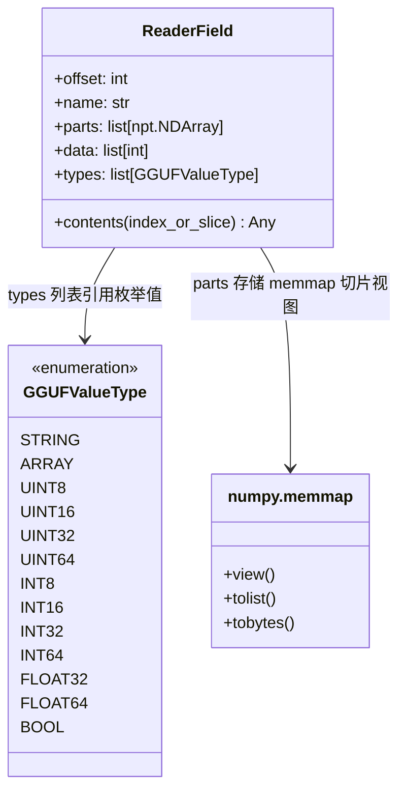
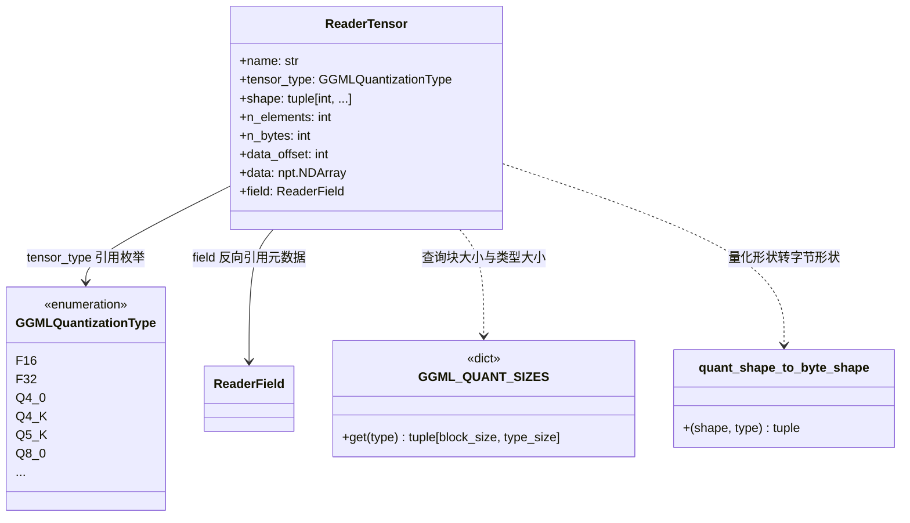
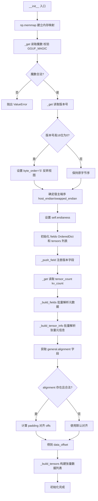
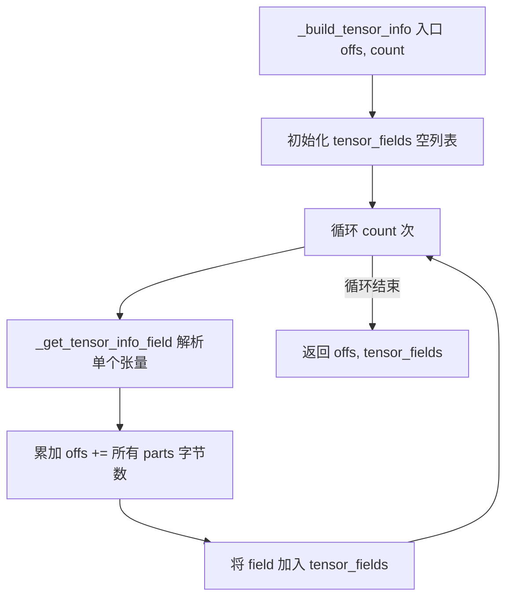
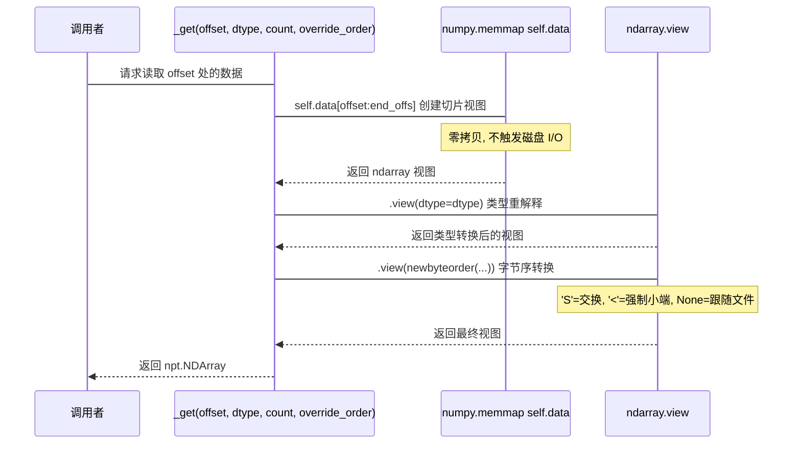
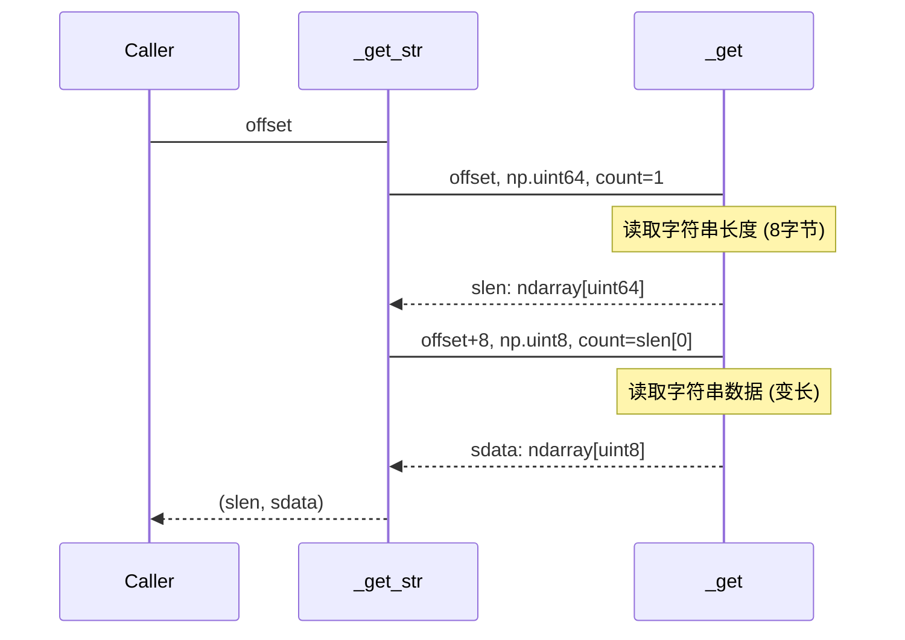
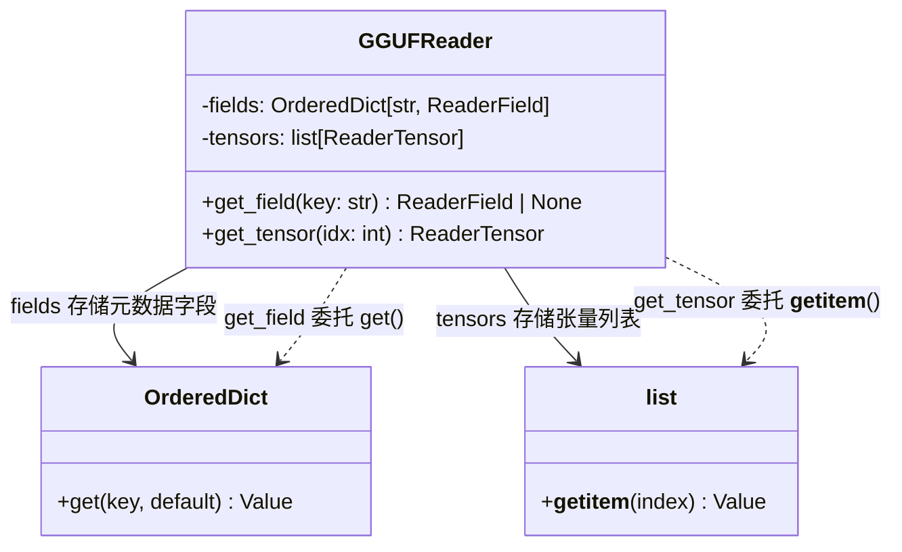
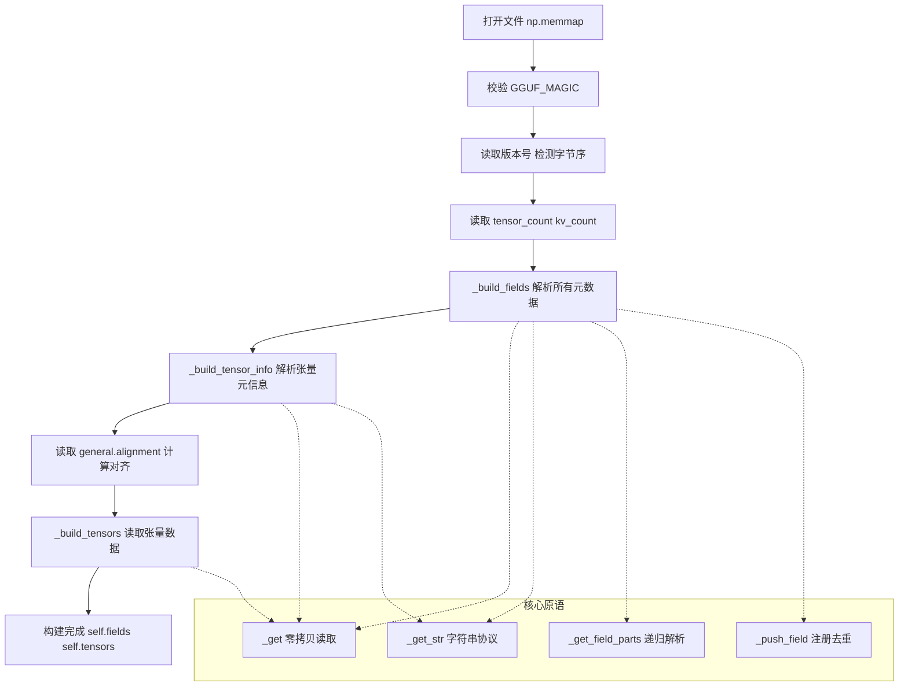

# 第58章 GGUF 文件读取器 —— 拆箱模型文件的"逆向工程师"

## 学习目标

- 理解GGUF文件格式的二进制结构与解析原理
- 掌握ReaderField和ReaderTensor两个核心数据结构的字段含义与使用方法
- 学会使用GGUFReader读取GGUF文件的元数据与张量数据
- 理解内存映射（memmap）技术在大型模型文件读取中的零拷贝优势
- 掌握GGUF文件的字节序自动检测与跨平台兼容处理机制
- 能够解析GGUF文件中的标量、字符串、数组等不同类型的元数据字段
- 掌握张量信息的解析流程：从原始字节到结构化张量元数据
- 理解公共查询接口get_field/get_tensor在代码中的桥梁作用

## 58.1 生活类比

想象 GGUF 文件是一个巨大的**集装箱货运船**：GGUFReader 就是港口的「开箱验货员」，负责按清单逐一检查货物。内存映射（memmap）技术让验货员直接在船上查看货物，而不用把所有集装箱搬下船再检查，这就是“零拷贝”读取的精髓。ReaderField 是每个集装箱的「货物清单」，记录品名、数量、存放位置；ReaderTensor 则是集装箱里的「实际货物」，附带详细的规格说明。字节序检测相当于识别清单是「从左往右写」还是「从右往左写」（大端/小端）。_get_field_parts() 是开箱时的「分层检查」：先看外包装类型，再拆内包装，支持嵌套结构。_get_tensor_info_field() 是张量的「身份登记员」，记录名称、尺寸、类型。contents() 方法像是根据清单「按需取货」，可以只取一件或取一批。get_field/get_tensor 则是对外开放的「查询窗口」，随时按单号取货。就像验货员不需要把所有货物搬下船就能确认内容，GGUFReader 通过内存映射直接在文件上「隔空取物」，高效读取任意位置的元数据和张量。

## 58.2 源码地图

```mermaid
graph TD
    subgraph gguf_reader_py [gguf-py/gguf/gguf_reader.py]
        RF[ReaderField (NamedTuple)]
        RT[ReaderTensor (NamedTuple)]
        GR[GGUFReader]
        RF -->|包含| RF_parts[parts: list[npt.NDArray]]
        RF -->|包含| RF_data[data: list[int]]
        RF -->|包含| RF_types[types: list[GGUFValueType]]
        RF -->|方法| RF_contents[contents()]
        RT -->|包含| RT_name[name: str]
        RT -->|包含| RT_type[tensor_type: GGMLQuantizationType]
        RT -->|包含| RT_shape[shape: tuple[int,...]]
        RT -->|包含| RT_data[data: npt.NDArray]
        RT -->|包含| RT_field[field: ReaderField]
        GR -->|初始化| GR_init[__init__]
        GR -->|查询| GR_get_field[get_field]
        GR -->|查询| GR_get_tensor[get_tensor]
        GR -->|核心原语| GR_get[_get]
        GR -->|核心原语| GR_get_str[_get_str]
        GR -->|核心原语| GR_get_field_parts[_get_field_parts]
        GR -->|核心原语| GR_push_field[_push_field]
        GR -->|解析流程| GR_build_fields[_build_fields]
        GR -->|解析流程| GR_build_tensor_info[_build_tensor_info]
        GR -->|解析流程| GR_build_tensors[_build_tensors]
        GR -->|解析流程| GR_get_tensor_info_field[_get_tensor_info_field]
    end
    
    subgraph gguf_py [gguf-py/gguf/gguf.py]
        G_MAIN[__main__ 兼容性入口]
        G_MAIN -->|调整路径| G_PATH[sys.path.insert]
        G_MAIN -->|失效缓存| G_CACHE[importlib.invalidate_caches]
        G_MAIN -->|加载包| G_IMPORT[import gguf]
        G_MAIN -->|强制重载| G_RELOAD[importlib.reload]
    end
```

## 58.3 ReaderField 与 ReaderTensor —— 数据基石与智能快递员

GGUF 文件在内存中的表现，最终都归结为两个核心数据结构：`ReaderField`（元数据字段）与 `ReaderTensor`（张量数据）。它们是 `NamedTuple`，不可变、轻量，且自带语义，是整个解析体系的“骨架”。

### 58.3.1 ReaderField：GGUF元数据字段核心数据结构

`ReaderField` 定义在 `gguf_reader.py` 第 56 行起，它把 GGUF 里的一个键值对（KV）封装为一个结构化对象。

**架构图：ReaderField 数据结构与依赖关系**



源码路径：`gguf-py/gguf/gguf_reader.py` - `ReaderField`（第56-111行）

```python
# 类型即图纸，先理解数据结构
class ReaderField(NamedTuple):
    offset: int                 # ① 该字段在文件中的起始字节偏移
    name: str                   # ② 字段键名，如 "general.architecture"
    parts: list[npt.NDArray]    # ③ 原始 numpy 数组片段列表（未解码的原始字节视图）
    data: list[int]             # ④ 索引映射：parts 中哪些片段是“有效载荷”
    types: list[GGUFValueType]  # ⑤ 类型链：记录嵌套类型，如 [ARRAY, STRING]

    def contents(self, index_or_slice: int | slice = slice(None)) -> Any:
        # ⑥ 核心提取逻辑：按索引/切片返回 Python 原生对象
        ...
```

**字段解读**：`parts` 存储的是 `numpy.memmap` 切片出来的**视图**，不拷贝数据，实现按需加载。`types` 列表记录嵌套类型（如 `ARRAY` 内嵌 `STRING`），为复杂数据结构提供类型线索。`data` 是索引映射，指向 `parts` 中真正承载数据的片段位置，实现“扁平化存储，索引化访问”。

#### 58.3.1.1 ReaderField.contents()：字段数据惰性解码提取器

这是 `ReaderField` 最关键的实例方法，支持按索引（`int`）或切片（`slice`）提取数据，灵活应对单值或批量读取。

**流程图：contents() 数据提取逻辑**

```mermaid
flowchart TD
    A[调用 contents(index_or_slice)] --> B{self.types 是否为空?}
    B -->|否| C[获取主类型 main_type = types[0]]
    B -->|是| D[返回 None]
    C --> E{main_type == ARRAY?}
    E -->|是| F[获取子类型 sub_type = types[-1]]
    F --> G{sub_type == STRING?}
    G -->|是| H[通过 data 索引定位 parts]
    H --> I{index_or_slice 是 int?}
    I -->|是| J[返回单个字符串: to_string(parts[idx])]
    I -->|否| K[返回字符串列表: [to_string(parts[idx]) for idx in indices]]
    G -->|否| L[数值型数组: tolist() 展开]
    L --> M{index_or_slice 是 int?}
    M -->|是| N[返回单值: parts[data[idx]].tolist()[0]]
    M -->|否| O[返回列表: [pv for idx in data[...] for pv in parts[idx].tolist()]]
    C --> P{main_type == STRING?}
    P -->|是| Q[直接取 parts[-1] 解码返回字符串]
    P -->|否| R[标量类型: 直接取 parts[-1].tolist()[0]]
```

源码路径：`gguf-py/gguf/gguf_reader.py` - `ReaderField.contents()`（第71-111行）

```python
def contents(self, index_or_slice: int | slice = slice(None)) -> Any:
    if self.types:
        to_string = lambda x: str(x.tobytes(), encoding='utf-8') # noqa: E731
        main_type = self.types[0]

        if main_type == GGUFValueType.ARRAY:
            sub_type = self.types[-1]

            if sub_type == GGUFValueType.STRING:
                indices = self.data[index_or_slice]
                if isinstance(index_or_slice, int):
                    return to_string(self.parts[indices]) # type: ignore
                else:
                    return [to_string(self.parts[idx]) for idx in indices] # type: ignore
            else:
                # 数值型数组：扁平化展开
                if isinstance(index_or_slice, int):
                    return self.parts[self.data[index_or_slice]].tolist()[0]
                else:
                    return [pv for idx in self.data[index_or_slice] for pv in self.parts[idx].tolist()]

        if main_type == GGUFValueType.STRING:
            return to_string(self.parts[-1])
        else:
            return self.parts[-1].tolist()[0]
    return None
```

**逐行解析**：首先检查 `self.types[0]` 判断顶层类型。若是 `ARRAY`，再看最内层 `sub_type`。若内层是 `STRING`：通过 `data` 索引定位到 `parts` 中的字节片段，调用 `tobytes().decode('utf-8')` 解码。支持单个索引返回字符串，切片返回字符串列表。若内层是数值类型：直接 `tolist()` 展开，配合 `data` 索引映射还原数组结构。顶层即 `STRING`，直接取 `parts[-1]` 解码。其余标量类型（UINT32, FLOAT32 等），直接 `tolist()[0]` 转为 Python 原生标量。

**总结**：这段代码实现了 GGUF 字段值的**惰性解码**——原始字节常驻 `parts`，只有调用 `contents()` 时才按类型解析为 Python 对象，且支持灵活的切片访问。

### 58.3.2 ReaderTensor：张量信息核心数据结构

`ReaderTensor` 定义在 `gguf_reader.py` 第 66 行起，它把一个张量的所有元信息与实测数据打包。

**架构图：ReaderTensor 数据结构与关联**



源码路径：`gguf-py/gguf/gguf_reader.py` - `ReaderTensor`（第66-70行）

```python
class ReaderTensor(NamedTuple):
    name: str                        # 张量名称，如 "blk.0.attn_q.weight"
    tensor_type: GGMLQuantizationType # 量化类型枚举，如 Q4_K
    shape: tuple[int, ...]           # 形状元组，如 (4096, 4096)
    n_elements: int                  # 元素总数
    n_bytes: int                     # 物理字节数（量化后）
    data_offset: int                 # 文件内绝对物理偏移
    data: npt.NDArray                # 实际数据（numpy 数组，已按 shape reshape）
    field: ReaderField               # 对应的元数据字段（含原始偏移、类型链等）
```

**设计亮点**：`shape` 保持 GGUF 原始维度顺序（如 `[out_dim, in_dim]`），而 `data` 内部已按 NumPy 惯例 `reshape`（通常是 `[in_dim, out_dim]`），`quant_shape_to_byte_shape` 负责量化类型的形状换算。`field` 字段保留了指向原始 `ReaderField` 的引用，形成“元数据→张量”的双向链接，方便追溯。

## 58.4 GGUFReader 核心流程 —— 二进制世界的「开箱验货」

`GGUFReader` 是整个解析流程的总调度者。它的 `__init__` 完成从文件打开到张量列表构建的全流水线。

### 58.4.1 GGUFReader.__init__()：GGUF文件解析主入口与初始化流程

**流程图：GGUFReader 初始化全流程**



源码路径：`gguf-py/gguf/gguf_reader.py` - `GGUFReader.__init__()`（第129-177行）

```python
def __init__(self, path: os.PathLike[str] | str, mode: Literal['r', 'r+', 'c'] = 'r'):
    # ① 建立内存映射：零拷贝读取大文件的关键
    self.data = np.memmap(path, mode = mode)
    offs = 0

    # ② 魔数校验：识别合法 GGUF 文件的第一道关卡
    if self._get(offs, np.uint32, override_order = '<')[0] != GGUF_MAGIC:
        raise ValueError('GGUF magic invalid')
    offs += 4

    # ③ 版本号与字节序检测：核心兼容性逻辑
    temp_version = self._get(offs, np.uint32)
    if temp_version[0] & 65535 == 0:
        # 高 16 位为 0 → 反向字节序文件
        self.byte_order = 'S'
        temp_version = temp_version.view(temp_version.dtype.newbyteorder(self.byte_order))
    version = temp_version[0]
    if version not in READER_SUPPORTED_VERSIONS:
        raise ValueError(f'Sorry, file appears to be version {version} which we cannot handle')

    # ④ 确定宿主与文件端序，设置 self.endianess
    if sys.byteorder == "little":
        host_endian = GGUFEndian.LITTLE
        swapped_endian = GGUFEndian.BIG
    else:
        host_endian = GGUFEndian.BIG
        swapped_endian = GGUFEndian.LITTLE
    self.endianess = swapped_endian if self.byte_order == "S" else host_endian

    self.fields: OrderedDict[str, ReaderField] = OrderedDict()
    self.tensors: list[ReaderTensor] = []

    # ⑤ 记录版本字段自身
    offs += self._push_field(ReaderField(offs, 'GGUF.version', [temp_version], [0], [GGUFValueType.UINT32]))

    # ⑥ 读取 tensor_count 与 kv_count（均为 uint64）
    temp_counts = self._get(offs, np.uint64, 2)
    offs += self._push_field(ReaderField(offs, 'GGUF.tensor_count', [temp_counts[:1]], [0], [GGUFValueType.UINT64]))
    offs += self._push_field(ReaderField(offs, 'GGUF.kv_count', [temp_counts[1:]], [0], [GGUFValueType.UINT64]))
    tensor_count, kv_count = temp_counts

    # ⑦ 批量解析元数据字段
    offs = self._build_fields(offs, kv_count)

    # ⑧ 批量解析张量信息字段
    offs, tensors_fields = self._build_tensor_info(offs, tensor_count)

    # ⑨ 处理对齐字段 general.alignment
    new_align = self.fields.get('general.alignment')
    if new_align is not None:
        if new_align.types != [GGUFValueType.UINT32]:
            raise ValueError('Bad type for general.alignment field')
        self.alignment = new_align.parts[-1][0]
        # 校验必须为 2 的幂次方
        if self.alignment == 0 or (self.alignment & (self.alignment - 1)) != 0:
            raise ValueError('Invalid alignment: must be a non-zero power of two')
    padding = offs % self.alignment
    if padding != 0:
        offs += self.alignment - padding
    self.data_offset = offs

    # ⑩ 构建张量数据列表
    self._build_tensors(offs, tensors_fields)
```

**逐行解析**：首先使用 `np.memmap` 建立文件到虚拟内存的映射，不读取内容到物理内存，支持 TB 级文件随机访问。然后进行魔数校验，`GGUF_MAGIC = 0x46554747`（ASCII "GGUF"），强制用小端（`override_order='<'`）读取，因为魔数在规范中固定为小端。接着读取版本号（`uint32`），若高 16 位为 0（即 `version & 0xFFFF == 0`），说明文件端序与宿主相反，设 `byte_order='S'`（Swap），并用 `view(newbyteorder)` 翻转视图。随后确定宿主与文件端序，记录文件实际端序供后续元数据写入/校验使用。将版本号也作为一个字段存入 `self.fields`，保持元数据完整性。读取 `tensor_count` 和 `kv_count`（均为 `uint64`），支持超大模型。最后依次调用 `_build_fields`、`_build_tensor_info`、对齐处理、`_build_tensors` 完成流水线。

**总结**：这段代码实现了 GGUF 文件的**头部解析、字节序自适应、元数据与张量信息的两级解析、内存对齐计算**，是读取器的“主干道”。

### 58.4.2 GGUFReader._build_fields()：元数据字段批量解析构建器

**流程图：_build_fields 元数据批量解析流程**

```mermaid
flowchart TD
    A[_build_fields 入口 offs, count] --> B[循环 count 次]
    B --> C[记录 orig_offs]
    C --> D[_get_str 读取键名 长度+数据]
    D --> E[累加 offs 跳过键名字节]
    E --> F[_get 读取值类型码 uint32]
    F --> G[累加 offs 跳过类型码字节]
    G --> H[构建 parts 前缀: [klen, kdata, type]]
    H --> I[_get_field_parts 递归解析值内容]
    I --> J[合并 parts 与 field_parts]
    J --> K[计算索引偏移 idxs_offs]
    K --> L[_push_field 注册 ReaderField]
    L --> M[累加 offs += field_size]
    M --> B
    B -->|循环结束| N[返回最终 offs]
```

源码路径：`gguf-py/gguf/gguf_reader.py` - `GGUFReader._build_fields()`（第253-268行）

```python
def _build_fields(self, offs: int, count: int) -> int:
    for _ in range(count):
        orig_offs = offs
        # ① 读取键名（字符串：长度 + 数据）
        kv_klen, kv_kdata = self._get_str(offs)
        offs += int(kv_klen.nbytes + kv_kdata.nbytes)
        # ② 读取值类型码
        raw_kv_type = self._get(offs, np.uint32)
        offs += int(raw_kv_type.nbytes)
        # ③ 预置 parts 前缀：[键长度, 键数据, 值类型]
        parts: list[npt.NDArray[Any]] = [kv_klen, kv_kdata, raw_kv_type]
        idxs_offs = len(parts)
        # ④ 递归解析值内容
        field_size, field_parts, field_idxs, field_types = self._get_field_parts(offs, raw_kv_type[0])
        parts += field_parts
        # ⑤ 注册字段（skip_sum=True 由外层累加 offs）
        self._push_field(ReaderField(
            orig_offs,
            str(bytes(kv_kdata), encoding='utf-8'),
            parts,
            [idx + idxs_offs for idx in field_idxs],  # 索引偏移修正
            field_types,
        ), skip_sum=True)
        offs += field_size
    return offs
```

**流程**：循环 `kv_count` 次，每次“读键名→读类型→递归读值→注册”。`_get_field_parts` 返回的 `field_idxs` 是相对于 `field_parts` 的索引，注册时需加上 `idxs_offs` 修正为相对于完整 `parts` 的索引。

### 58.4.3 GGUFReader._build_tensor_info()：张量元信息批量解析构建器

**流程图：_build_tensor_info 张量元信息批量解析**



源码路径：`gguf-py/gguf/gguf_reader.py` - `GGUFReader._build_tensor_info()`（第270-275行）

```python
def _build_tensor_info(self, offs: int, count: int) -> tuple[int, list[ReaderField]]:
    tensor_fields = []
    for _ in range(count):
        field = self._get_tensor_info_field(offs)
        offs += sum(int(part.nbytes) for part in field.parts)
        tensor_fields.append(field)
    return offs, tensor_fields
```

极简流水线：循环调用 `_get_tensor_info_field` 解析单个张量元信息，累加偏移量，收集 `ReaderField` 列表供后续 `_build_tensors` 使用。

对齐逻辑在 `__init__` 中：读取 `general.alignment`（默认 32），校验 2 的幂次方，计算 `padding` 对齐 `offs`，得到 `data_offset`——张量数据区的绝对起始位置。

### 58.4.4 GGUFReader._build_tensors()：张量数据批量加载与重塑构建器

**流程图：_build_tensors 张量数据构建流程**

```mermaid
flowchart TD
    A[_build_tensors 入口 start_offs, fields] --> B[初始化 tensors 列表, tensor_names 集合]
    B --> C[遍历每个 field]
    C --> D[解包 parts: name_len, name_data, n_dims, dims, raw_dtype, offset_tensor]
    D --> E[解码 tensor_name]
    E --> F{tensor_name 在 tensor_names 中?}
    F -->|是| G[抛出 ValueError 重复名称]
    F -->|否| H[加入 tensor_names]
    H --> I[获取 ggml_type 量化类型]
    I --> J[计算 n_elems = prod(dims)]
    J --> K[np_dims = reversed(dims) GGUF->NumPy]
    K --> L[查询 GGML_QUANT_SIZES 得 block_size, type_size]
    L --> M[计算 n_bytes = n_elems * type_size // block_size]
    M --> N[data_offs = start_offs + offset_tensor[0]]
    N --> O{ggml_type 是非量化类型?}
    O -->|F16/F32/F64/I8/I16/I32/I64| P[item_count=n_elems, item_type=对应dtype]
    O -->|量化类型 Q4_K等| Q[item_count=n_bytes, item_type=uint8]
    Q --> R[np_dims = quant_shape_to_byte_shape(np_dims, ggml_type)]
    P --> S[_get 读取数据并 reshape(np_dims)]
    R --> S
    S --> T[构建 ReaderTensor 加入 tensors]
    T --> C
    C -->|遍历结束| U[self.tensors = tensors]
```

源码路径：`gguf-py/gguf/gguf_reader.py` - `GGUFReader._build_tensors()`（第277-325行）

```python
def _build_tensors(self, start_offs: int, fields: list[ReaderField]) -> None:
    tensors = []
    tensor_names = set()
    for field in fields:
        _name_len, name_data, _n_dims, dims, raw_dtype, offset_tensor = field.parts
        tensor_name = str(bytes(name_data), encoding='utf-8')
        if tensor_name in tensor_names:
            raise ValueError(f'Found duplicated tensor with name {tensor_name}')
        tensor_names.add(tensor_name)

        ggml_type = GGMLQuantizationType(raw_dtype[0])
        n_elems = int(np.prod(dims))
        np_dims = tuple(reversed(dims.tolist()))  # GGUF 存 [out, in] -> NumPy [in, out]
        block_size, type_size = GGML_QUANT_SIZES[ggml_type]
        n_bytes = n_elems * type_size // block_size
        data_offs = int(start_offs + offset_tensor[0])

        # 根据量化类型决定读取 dtype 与 reshape 形状
        if ggml_type == GGMLQuantizationType.F16:
            item_count, item_type = n_elems, np.float16
        elif ggml_type == GGMLQuantizationType.F32:
            item_count, item_type = n_elems, np.float32
        elif ggml_type == GGMLQuantizationType.F64:
            item_count, item_type = n_elems, np.float64
        elif ggml_type == GGMLQuantizationType.I8:
            item_count, item_type = n_elems, np.int8
        elif ggml_type == GGMLQuantizationType.I16:
            item_count, item_type = n_elems, np.int16
        elif ggml_type == GGMLQuantizationType.I32:
            item_count, item_type = n_elems, np.int32
        elif ggml_type == GGMLQuantizationType.I64:
            item_count, item_type = n_elems, np.int64
        else:
            # 量化类型：按字节读取，形状需转换
            item_count, item_type = n_bytes, np.uint8
            np_dims = quant_shape_to_byte_shape(np_dims, ggml_type)

        tensors.append(ReaderTensor(
            name=tensor_name,
            tensor_type=ggml_type,
            shape=dims,           # 保留原始 GGUF 形状
            n_elements=n_elems,
            n_bytes=n_bytes,
            data_offset=data_offs,
            data=self._get(data_offs, item_type, item_count).reshape(np_dims),
            field=field,
        ))
    self.tensors = tensors
```

**关键点**：使用 `tensor_names` 集合防止恶意重复名称。GGUF 存储 `[输出维度, 输入维度]`（列主序习惯），NumPy 默认行主序，`reversed` 转换。非量化类型（F16/F32/I8...）按元素个数读取对应 dtype；量化类型（Q4_K 等）按字节数读取 `uint8`，再用 `quant_shape_to_byte_shape` 计算“逻辑形状→字节形状”映射。`self._get(...).reshape(...)` 直接在 `memmap` 视图上操作，无数据拷贝。

## 58.5 底层读取原语 —— 字节级考古的「刷子和铲子」

所有上层解析最终都落脚到这三个私有方法。

### 58.5.1 GGUFReader._get()：内存映射零拷贝数据读取原语

**架构图：_get() 零拷贝读取机制**



源码路径：`gguf-py/gguf/gguf_reader.py` - `GGUFReader._get()`（第189-194行）

```python
def _get(
    self, offset: int, dtype: npt.DTypeLike, count: int = 1,
    override_order: None | Literal['I', 'S', '<'] = None,
) -> npt.NDArray[Any]:
    count = int(count)
    itemsize = int(np.empty([], dtype=dtype).itemsize)
    end_offs = offset + itemsize * count
    # ① memmap 切片视图，零拷贝
    arr = self.data[offset:end_offs].view(dtype=dtype)[:count]
    # ② 动态切换字节序视图
    return arr.view(arr.dtype.newbyteorder(self.byte_order if override_order is None else override_order))
```

**设计精妙**：`self.data[offset:end_offs]` 在 `memmap` 上只是创建切片视图，**不触发磁盘 I/O**，直到后续 `.view()` 或访问数据时才按需页读入。`newbyteorder('S')` 返回字节序反转的**视图**，不拷贝数据。`override_order` 允许强制指定端序（如魔数、版本号强制小端 `<`），解决“文件头固定小端，数据区跟随文件端序”的规范要求。

### 58.5.2 GGUFReader._push_field()：字段注册去重守门员

**流程图：_push_field 字段注册逻辑**

```mermaid
flowchart TD
    A[_push_field field, skip_sum] --> B{field.name 在 self.fields 中?}
    B -->|是| C[抛出 KeyError 重复键名]
    B -->|否| D[self.fields[field.name] = field]
    D --> E{skip_sum == True?}
    E -->|是| F[返回 0]
    E -->|否| G[计算 sum(part.nbytes) 返回总字节数]
```

源码路径：`gguf-py/gguf/gguf_reader.py` - `GGUFReader._push_field()`（第197-203行）

```python
def _push_field(self, field: ReaderField, skip_sum: bool = False) -> int:
    if field.name in self.fields:
        raise KeyError(f'Duplicate {field.name} already in list at offset {field.offset}')
    else:
        self.fields[field.name] = field
    return 0 if skip_sum else sum(int(part.nbytes) for part in field.parts)
```

该方法严格校验重复键名，抛出 `KeyError`，保证元数据字典键唯一。`skip_sum` 控制是否返回字节数：`_build_fields` 中外层自行累加 `offs`，传 `True` 避免重复计算。

### 58.5.3 GGUFReader._get_str()：变长字符串读取协议实现器

**流程图：_get_str 字符串读取协议**



源码路径：`gguf-py/gguf/gguf_reader.py` - `GGUFReader._get_str()`（第205-206行）

```python
def _get_str(self, offset: int) -> tuple[npt.NDArray[np.uint64], npt.NDArray[np.uint8]]:
    # 读取字符串长度（uint64）
    slen = self._get(offset, np.uint64)
    # 读取字符串数据（uint8数组），长度由slen决定
    return slen, self._get(offset + 8, np.uint8, slen[0])
```

**代码作用**：该方法实现了 GGUF 字符串存储协议的读取。GGUF 文件中字符串采用“长度前缀 + 数据”的格式：先用 8 字节的 `uint64` 存储字符串长度，紧接着存储 UTF-8 编码的字节数据。`_get_str` 首先调用 `_get` 读取长度，然后根据长度读取后续的字节数组，最终返回一个包含长度数组和数据数组的元组，供上层组装 `ReaderField` 使用。

### 58.5.4 GGUFReader._get_field_parts()：字段数据递归解析与类型处理器

**流程图：_get_field_parts 递归解析流程**

```mermaid
flowchart TD
    A[_get_field_parts orig_offs, raw_type] --> B[转换 gtype = GGUFValueType(raw_type)]
    B --> C{判断类型}
    C -->|STRING| D[_get_str 读取长度+数据]
    D --> E[sparts = [slen, sdata]]
    E --> F[返回 size, sparts, data=[1], types=[STRING]]
    C -->|标量类型| G[查表 gguf_scalar_to_np 获取 nptype]
    G --> H{找到对应类型?}
    H -->|是| I[_get 读取单值]
    I --> J[返回 val.nbytes, [val], data=[0], types=[gtype]]
    H -->|否| K[继续判断]
    C -->|ARRAY| L[_get 读取子类型码 raw_itype]
    L --> M[_get 读取数组长度 alen]
    M --> N[aparts = [raw_itype, alen]]
    N --> O[循环 alen[0] 次]
    O --> P[_get_field_parts 递归解析元素]
    P --> Q[合并 curr_parts 到 aparts]
    Q --> R[计算索引偏移 修正 data_idxs]
    R --> O
    O -->|循环结束| S[返回 总大小, aparts, data_idxs, types]
    C -->|未知类型| T[抛出 ValueError]
```

源码路径：`gguf-py/gguf/gguf_reader.py` - `GGUFReader._get_field_parts()`（第208-229行）

```python
def _get_field_parts(
    self, orig_offs: int, raw_type: int,
) -> tuple[int, list[npt.NDArray[Any]], list[int], list[GGUFValueType]]:
    offs = orig_offs
    types: list[GGUFValueType] = []
    gtype = GGUFValueType(raw_type)
    types.append(gtype)

    # 情况 1：字符串
    if gtype == GGUFValueType.STRING:
        sparts = list(self._get_str(offs))
        size = sum(int(part.nbytes) for part in sparts)
        return size, sparts, [1], types  # data=[1] 指向 sparts[1] 即数据部分

    # 情况 2：标量
    nptype = self.gguf_scalar_to_np.get(gtype)
    if nptype is not None:
        val = self._get(offs, nptype)
        return int(val.nbytes), [val], [0], types  # data=[0] 指向 val

    # 情况 3：数组
    if gtype == GGUFValueType.ARRAY:
        raw_itype = self._get(offs, np.uint32)   # 子类型码
        offs += int(raw_itype.nbytes)
        alen = self._get(offs, np.uint64)        # 数组长度
        offs += int(alen.nbytes)
        aparts = [raw_itype, alen]
        data_idxs = []
        # FIXME: 当前扁平化处理，不支持多维数组
        for idx in range(alen[0]):
            curr_size, curr_parts, curr_idxs, curr_types = self._get_field_parts(offs, raw_itype[0])
            if idx == 0:
                types += curr_types
            idxs_offs = len(aparts)
            aparts += curr_parts
            data_idxs += (idx + idxs_offs for idx in curr_idxs)
            offs += curr_size
        return offs - orig_offs, aparts, data_idxs, types

    raise ValueError(f'Unknown/unhandled field type {gtype}')
```

**递归下降解析**：遇到字符串时，直接委托 `_get_str`，`data=[1]` 指向数据片段（跳过长度片段）。遇到标量时，查表 `gguf_scalar_to_np` 映射到 NumPy dtype，读取单值，`data=[0]`。遇到数组时，读取子类型码（`uint32`）和长度（`uint64`），循环递归解析每个元素。采用**扁平化存储**：所有元素的 `parts` 追加到 `aparts`，`data_idxs` 记录每个元素在 `aparts` 中的索引位置。首个元素的 `curr_types` 合并到 `types`，假设数组同质。

**返回四元组**：`(总字节数, 所有片段列表, 数据索引映射, 类型链)`，为构建 `ReaderField` 提供完整素材。

### 58.5.5 GGUFReader._get_tensor_info_field()：单张量元信息解析提取器

**流程图：_get_tensor_info_field 单张量元信息解析**

```mermaid
flowchart TD
    A[_get_tensor_info_field orig_offs] --> B[_get_str 读取名称长度+数据]
    B --> C[累加 offs]
    C --> D[_get 读取 n_dims uint32]
    D --> E[累加 offs]
    E --> F[_get 读取 dims uint64[n_dims]]
    F --> G[累加 offs]
    G --> H[_get 读取 raw_dtype uint32]
    H --> I[累加 offs]
    I --> J[_get 读取 offset_tensor uint64]
    J --> K[累加 offs]
    K --> L[构建 parts: [name_len, name_data, n_dims, dims, raw_dtype, offset_tensor]]
    L --> M[设置 data=[1,3,4,5] 指向有效载荷]
    M --> N[返回 ReaderField]
```

源码路径：`gguf-py/gguf/gguf_reader.py` - `GGUFReader._get_tensor_info_field()`（第231-251行）

```python
def _get_tensor_info_field(self, orig_offs: int) -> ReaderField:
    offs = orig_offs
    # ① 名称
    name_len, name_data = self._get_str(offs)
    offs += int(name_len.nbytes + name_data.nbytes)
    # ② 维度数量
    n_dims = self._get(offs, np.uint32)
    offs += int(n_dims.nbytes)
    # ③ 维度数组
    dims = self._get(offs, np.uint64, n_dims[0])
    offs += int(dims.nbytes)
    # ④ 量化类型码
    raw_dtype = self._get(offs, np.uint32)
    offs += int(raw_dtype.nbytes)
    # ⑤ 相对偏移量
    offset_tensor = self._get(offs, np.uint64)
    offs += int(offset_tensor.nbytes)

    return ReaderField(
        orig_offs,
        str(bytes(name_data), encoding='utf-8'),
        [name_len, name_data, n_dims, dims, raw_dtype, offset_tensor],
        [1, 3, 4, 5],  # data 索引：1=名称数据, 3=维度数组, 4=类型码, 5=偏移量
    )
```

**数据映射**：`parts` 包含 6 个片段，`data=[1,3,4,5]` 指向“有效载荷”片段（跳过长度、计数等辅助片段）。名称已解码为 `str` 存入 `name` 字段，便于后续去重。

## 58.6 公共查询接口 —— 数据库的「索引窗口」

### 58.6.1 GGUFReader.get_field()：元数据字段按键名查询接口

源码路径：`gguf-py/gguf/gguf_reader.py` - `GGUFReader.get_field()`（第181-182行）

```python
def get_field(self, key: str) -> Union[ReaderField, None]:
    # 从有序字典中按键名查找字段，键不存在时返回 None（安全访问）
    return self.fields.get(key, None)
```

### 58.6.2 GGUFReader.get_tensor()：张量按索引查询接口

源码路径：`gguf-py/gguf/gguf_reader.py` - `GGUFReader.get_tensor()`（第185-186行）

```python
def get_tensor(self, idx: int) -> ReaderTensor:
    # 按索引从列表直接取张量，越界抛 IndexError（Python 标准行为）
    return self.tensors[idx]
```

**架构图：公共查询接口与内部存储关系**



**设计哲学**：将内部 `OrderedDict` 与 `list` 封装为简洁查询接口，屏蔽解析细节，是用户与解析结果交互的主要桥梁。

## 58.7 兼容性入口 gguf.py —— 旧代码的「时空隧道」

`gguf-py/gguf/gguf.py` 是一个仅 17 行的历史兼容性垫片。

### 58.7.1 gguf.py 模块顶层执行代码：兼容性路径调整与包重载器

**流程图：gguf.py 兼容性加载流程**

```mermaid
flowchart TD
    A[用户执行 import gguf.gguf] --> B[sys.path.insert(0, 父目录父目录)]
    B --> C[importlib.invalidate_caches()]
    C --> D[import gguf 加载包]
    D --> E[importlib.reload(gguf) 强制重载]
    E --> F[gguf.__init__.py 执行 暴露公共 API]
    F --> G[兼容性导入完成]
```

源码路径：`gguf-py/gguf/gguf.py` - `__main__`（第1-17行）

```python
# This file left for compatibility. If you want to use the GGUF API from Python
# then don't import gguf/gguf.py directly. If you're looking for examples, see the
# examples/ directory for gguf-py

import importlib
import sys
from pathlib import Path

sys.path.insert(0, str(Path(__file__).parent.parent))

# Compatibility for people trying to import gguf/gguf.py directly instead of as a package.
importlib.invalidate_caches()
import gguf  # noqa: E402

importlib.reload(gguf)
```

**逐行解析**：首先通过 `Path(__file__).parent.parent` 定位到 `gguf-py` 顶层目录，插入 `sys.path` 首部，使 `import gguf` 能找到包而非模块。然后调用 `importlib.invalidate_caches()` 清除导入缓存，强制重新扫描模块路径。接着先 `import gguf` 加载包，再 `importlib.reload(gguf)` 强制重新执行 `gguf/__init__.py`，确保即使之前以错误方式加载过，也能刷新为正确的包对象，暴露 `GGUFReader`、`GGUFWriter` 等公共接口。

**设计哲学**：以极小的代码代价维持 API 兼容，避免旧教程、旧脚本失效，同时引导新用户使用标准包导入 `import gguf`。

## 58.8 可视化流程图



## 58.9 设计中的取舍

**为什么用 `NamedTuple` 而不是 `dataclass` 或普通 `class`？**
`NamedTuple` 不可变、内存紧凑、自带 `__repr__`/`_asdict()`，适合作为解析后的“只读数据载体”。解析阶段构建一次，后续只读查询，无需修改字段，完美契合不可变语义。`dataclass` 可变且有额外字典开销，普通 `class` 样板代码多。

**为什么 `_get_field_parts` 采用扁平化存储数组元素？**
GGUF 规范数组是同质一维序列，扁平化存储配合 `data_idxs` 索引映射，避免了嵌套列表的内存碎片与递归开销。代价是暂不支持多维数组（代码中有 `FIXME` 注释），但实际 GGUF 元数据极少用到多维数组，取舍合理。

**为什么 `get_tensor` 用索引而非名称？**
张量数量可达数万（如大模型），列表索引 O(1) 且内存紧凑；字典键名字符串哈希开销大、内存占用高。张量名称已在 `ReaderTensor.name` 与 `field.name` 中保留，用户如需按名查找可自建索引：`{t.name: i for i, t in enumerate(reader.tensors)}`。

**为什么元数据字段用 `OrderedDict` 而非普通 `dict`？**
Python 3.7+ `dict` 已保证插入序，但 `OrderedDict` 语义更显式，且提供 `move_to_end` 等操作，明确传达“字段顺序即文件顺序”的设计意图，便于调试与二进制对比。

## 58.10 动手练习

1.  **手动解析GGUF文件头**
    - 使用Python的`struct`模块或`numpy`手动读取一个GGUF文件的前32字节
    - 1. 读取前4字节验证GGUF_MAGIC
    - 2. 读取版本号并判断字节序
    - 3. 读取tensor_count和kv_count
    - 思考问题：
        - 为什么要用8字节而不是4字节存储tensor_count？
        - 如果文件是大端序，代码需要做哪些调整？

2.  **实现简化版GGUF读取器**
    - 参考`gguf_reader.py`第129-177行，实现一个只能读取元数据（不读张量）的简化版读取器
    - 要求：
        - 1. 支持魔数校验和字节序检测
        - 2. 能读取所有键值对并打印名称和类型
        - 3. 使用`try-except`处理重复键名异常
    - 扩展：尝试解析字符串和数组类型的字段值

3.  **字节序转换实验**
    - 下载两个不同字节序的GGUF文件（或使用hex编辑器修改一个文件的字节序标记）
    - 1. 使用`GGUFReader`分别读取两个文件
    - 2. 对比`reader.byte_order`和`reader.endianess`的值
    - 3. 用`_get()`方法读取同一个偏移量的数据，观察字节序转换效果
    - 思考问题：
        - 为什么版本号的高16位为0可以推断是反向字节序？
        - `override_order='<'`参数在什么场景下必须使用？

4.  **张量信息解析流程追踪**
    - 使用`GGUFReader`读取一个真实的GGUF模型文件
    - 1. 调用`_get_tensor_info_field()`解析前几个张量的元信息
    - 2. 观察名称、维度、量化类型和偏移量的提取过程
    - 3. 对比`_build_tensor_info()`批量解析与手动单个解析的结果
    - 思考问题：
        - 为什么张量偏移量是相对值（相对于数据区起始位置）？
        - `data_idxs`列表中的`[1,3,4,5]`分别对应哪些数据部分？

5.  **公共接口使用与性能**
    - 编写脚本使用`get_field()`和`get_tensor()`接口：
    - 1. 遍历所有字段，打印键名和数据类型
    - 2. 尝试访问不存在的键，观察返回值
    - 3. 通过`get_tensor()`随机访问不同索引的张量
    - 4. 统计不同`GGMLQuantizationType`的张量数量分布
    - 思考问题：
        - 为什么`get_tensor()`使用索引而不是名称？
        - 如果多次调用`get_field('general.name')`，性能会有影响吗？

6.  **内存映射vs传统读取性能对比**
    - 编写性能测试脚本，对比以下两种读取方式的效率
    - 方式A：使用`np.memmap`（GGUFReader采用的方式）
    - 方式B：使用`open().read()`一次性读入内存
    - 测试场景：
        - 1. 读取文件头部（前1KB）
        - 2. 随机访问文件中部的1MB数据
        - 3. 顺序读取整个文件
    - 记录并分析两种方式的内存占用和耗时差异
    - 思考：为什么GGUF选择内存映射而不是全量加载？

## 58.11 本章小结

这一章中我们学习了 GGUF 文件读取器的核心实现。首先，我们理解了 `ReaderField` 和 `ReaderTensor` 两大数据基石，它们分别封装元数据字段与张量信息，并提供了 `contents()` 等惰性解码接口。其次，我们深入剖析了 `GGUFReader.__init__` 的全流水线：内存映射建立、魔数校验、字节序自适应检测、元数据与张量信息的两级批量解析、内存对齐计算与张量数据加载。接着，我们探讨了底层读取原语 `_get`、`_get_str`、`_get_field_parts` 如何实现零拷贝、字节序动态切换、递归类型解析。然后，我们看到了张量信息解析器 `_get_tensor_info_field` 与公共查询接口 `get_field`/`get_tensor` 如何构成用户交互的“索引窗口”。最后，我们了解了 `gguf.py` 兼容性入口如何以极小代价维持旧代码可用。

本章我们一起学习了以下概念：

| 概念 | 解释 |
|------|------|
| ReaderField | GGUF元数据字段的命名元组，包含偏移、名称、数据分片、索引映射和类型链 |
| ReaderTensor | GGUF张量信息的命名元组，封装形状、量化类型、数据偏移和实际数据 |
| GGUFReader | 核心读取器类，负责解析GGUF文件的头部、元数据和张量数据 |
| 内存映射(memmap) | 通过numpy.memmap实现零拷贝文件访问，支持大型模型高效读取 |
| 字节序检测 | 自动识别文件是大端还是小端，通过`newbyteorder`动态切换视图 |
| _get() | 底层读取原语，基于偏移量和数据类型从内存映射中提取数据 |
| _get_str() | 字符串读取协议：先读8字节长度，再读对应字节数据 |
| _get_field_parts() | 递归解析字段数据，支持标量、字符串、数组的嵌套类型 |
| _get_tensor_info_field() | 解析单个张量的元信息：名称、维度、量化类型和相对偏移 |
| get_field()/get_tensor() | 对外查询接口，按键名或索引返回已解析的字段和张量对象 |
| GGUF_MAGIC | 文件魔数校验，识别合法GGUF文件的第一道关卡 |
| general.alignment | 内存对齐字段（默认32字节），必须是2的幂次方 |
| GGMLQuantizationType | 量化类型枚举，决定张量的块大小和存储格式 |
| gguf.py兼容入口 | 通过路径调整和模块重载，兼容旧代码的直接导入方式 |

下一章中，我们将学习 GGUF 文件写入器 —— 装载模型的“集装箱打包机”，理解如何将元数据、张量、权数据按照 GGUF 规范打包成完整的二进制文件。


