# 第60章 懒加载张量框架 —— 延迟计算的"算力调度师"

## 学习目标

- 理解GGUF量化格式的核心框架设计，包括`__Quant`抽象基类的注册机制与惰性计算包装
- 掌握Q4_0/Q4_1、Q5_0/Q5_1、Q8_0等经典量化算法的位级实现细节与舍入策略
- 深入K-quant系列（Q2_K到Q6_K）的嵌套缩放与多级反量化原理
- 理解IQ系列基于网格查找表的非均匀量化方法及其hex解码机制
- 掌握TQ、MXFP4、NVFP4等新型量化格式的硬件协同设计理念
- 能够使用`quantize`/`dequantize`全局入口进行张量转换，并解析形状变换逻辑

## 60.1 生活类比

想象一下，你正在为一次长途旅行打包行李，但你的背包有一个严格的重量限制：你必须在不超过限重的前提下，尽可能多地装下你需要的物品。这就是GGUF量化系统的日常隐喻——它就像一个**精密行李压缩工坊**，专门帮旅行者在不超重的情况下尽可能多装物品。在这个工坊中，**__Quant基类**就是工坊的SOP手册，定义了所有压缩工艺的标准流程（注册、打包、拆包），确保每一件物品都按照统一的标准被处理；而**__init_subclass__**则像是工坊的自动登记处，每开发一种新压缩工艺就自动录入档案，方便调度，无需人工干预。当你使用**Q4_0/Q4_1**时，它们就像经典的压缩袋，抽真空后按比例折叠整齐（对称/非对称缩放），简单高效；**K-quant系列**则像俄罗斯套娃式压缩，先分成小盒子，再对盒子分级打包，极致利用空间；**IQ系列**则是定制模具压缩，用预制的非均匀形状模具（网格）贴合物品原有形状，减少空间浪费。更前沿的**MXFP4/NVFP4**就像新型真空袋，专为特定行李箱（NVIDIA Blackwell GPU）设计，实现硬件级压缩。而在这个工坊中，**LazyNumpyTensor**就像智能快递柜，只有当你真正需要取件时才从仓库调出（惰性计算），避免不必要的计算开销。就像工坊师傅必须精准计算每件物品的压缩率而不弄坏它，量化算法必须在精度和体积间找到完美平衡。

## 60.2 源码地图

gguf-py/gguf/lazy.py
├── 基础工具函数
│   ├── quant_shape_to_byte_shape
│   ├── quant_shape_from_byte_shape
│   ├── _apply_over_grouped_rows
│   └── np_roundf
├── __Quant 抽象基类
│   ├── __init__
│   ├── __init_subclass__
│   ├── init_grid
│   ├── quantize_blocks
│   ├── dequantize_blocks
│   ├── quantize_rows
│   ├── dequantize_rows
│   ├── __shape_to_bytes
│   ├── __shape_from_bytes
│   ├── __quantize_array
│   ├── __dequantize_array
│   ├── __quantize_lazy
│   ├── __dequantize_lazy
│   ├── can_quantize
│   ├── quantize
│   └── dequantize
├── 经典量化家族（Q系列）
│   ├── BF16
│   │   ├── quantize_blocks
│   │   └── dequantize_blocks
│   ├── Q4_0
│   │   ├── quantize_blocks
│   │   └── dequantize_blocks
│   ├── Q4_1
│   │   ├── quantize_blocks
│   │   └── dequantize_blocks
│   ├── Q5_0
│   │   ├── quantize_blocks
│   │   └── dequantize_blocks
│   ├── Q5_1
│   │   ├── quantize_blocks
│   │   └── dequantize_blocks
│   └── Q8_0
│       ├── quantize_blocks
│       └── dequantize_blocks
├── K-quant系列（极致压缩）
│   ├── Q2_K.dequantize_blocks
│   ├── Q3_K.dequantize_blocks
│   ├── Q4_K
│   │   ├── get_scale_min
│   │   └── dequantize_blocks
│   ├── Q5_K.dequantize_blocks
│   └── Q6_K.dequantize_blocks
├── IQ系列（非均匀量化）
│   ├── IQ2_XXS.dequantize_blocks
│   ├── IQ2_S.dequantize_blocks
│   ├── IQ3_XXS.dequantize_blocks
│   ├── IQ3_S.dequantize_blocks
│   ├── IQ1_S.dequantize_blocks
│   ├── IQ1_M.dequantize_blocks
│   ├── IQ4_NL.dequantize_blocks
│   └── IQ4_XS.dequantize_blocks
├── 前沿量化格式
│   ├── TQ1_0
│   │   ├── quantize_blocks
│   │   └── dequantize_blocks
│   ├── TQ2_0
│   │   ├── quantize_blocks
│   │   └── dequantize_blocks
│   ├── MXFP4
│   │   ├── e8m0_to_fp32_half
│   │   ├── quantize_blocks
│   │   └── dequantize_blocks
│   └── NVFP4
│       ├── ue4m3_to_fp32
│       ├── fp32_to_ue4m3
│       └── dequantize_blocks
├── 全局入口函数
│   ├── quantize
│   └── dequantize
└── __main__  # grid_hex/grid_map/ksigns 等静态数据定义

## 60.3 __Quant 基类 —— 量化框架的'万能模具'

在GGUF量化系统中，`__Quant` 抽象基类扮演着"万能模具"的角色，它定义了所有量化类型的公共接口和通用逻辑，使得新的量化类型可以像插件一样被轻松添加。这个基类的设计哲学可以概括为以下几个核心要点：

**注册机制的魔法**：`__init_subclass__` 方法像一个自动登记处，当任何子类被定义时，它会自动将该子类收集到 `_type_traits` 全局字典中，无需手动注册，实现了真正的插件化架构。

**惰性计算包装**：通过 `LazyNumpyTensor._wrap_fn`，基类将普通的数组操作转换为支持延迟计算的代理，实现"按需计算"的内存优化，这对于处理大型张量至关重要。

**形状变换双生子**：`__shape_to_bytes` 和 `__shape_from_bytes` 负责逻辑张量形状与量化字节形状之间的双向转换，解决了块大小对齐的关键问题。

**批量处理策略**：`_apply_over_grouped_rows` 将大数组分组为16行批次处理，在内存占用与并行效率间取得平衡，既避免了单次处理大数组的内存爆炸，又保证了足够的并行度。

**统一接口设计**：`quantize` 和 `dequantize` 类方法作为总入口，根据输入类型自动路由到惰性或即时计算路径，对使用者屏蔽了底层复杂性。

**网格初始化**：`init_grid` 类方法在首次使用时将十六进制字符串解码为浮点查找表，为 IQ 系列的查表法反量化提供支持。

**生命周期控制**：`__init__` 阻止任何实例化操作，确保基类仅作为模板使用，而 `__quantize_array`/`__dequantize_array` 管理底层数组处理流程。

### 60.3.1 `__Quant.__init_subclass__`：自动注册与惰性包装

源码路径：`gguf-py/gguf/quants.py` - `__Quant.__init_subclass__`（156-166行）

```python
    def __init_subclass__(cls, qtype: GGMLQuantizationType) -> None:
        # ① 接收子类传递的 qtype 参数，存储为类属性
        cls.qtype = qtype
        # ② 从全局常量表中查询该量化类型的块大小和类型大小
        cls.block_size, cls.type_size = GGML_QUANT_SIZES[qtype]
        # ③ 包装量化方法为惰性版本，meta_noop 指定元数据类型和形状转换函数
        cls.__quantize_lazy: Any = LazyNumpyTensor._wrap_fn(
            cls.__quantize_array,
            meta_noop=(np.uint8, cls.__shape_to_bytes)
        )
        # ④ 包装反量化方法为惰性版本
        cls.__dequantize_lazy: Any = LazyNumpyTensor._wrap_fn(
            cls.__dequantize_array,
            meta_noop=(np.float32, cls.__shape_from_bytes)
        )
        # ⑤ 断言该量化类型未被注册，防止重复注册
        assert qtype not in _type_traits
        # ⑥ 将子类注册到全局类型字典中，键为 qtype
        _type_traits[qtype] = cls
```

这段代码定义了 `__Quant.__init_subclass__` 方法，它在子类定义时自动执行，完成量化类型的注册和惰性计算方法的包装，是整个量化框架插件化架构的核心。通过这种方式，任何新的量化类型只需继承 `__Quant` 并指定 `qtype` 参数，即可自动被系统识别和使用，极大地提高了框架的可扩展性。

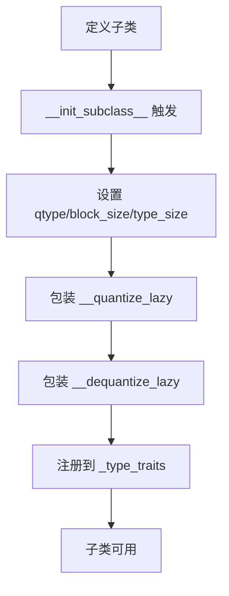

### 60.3.2 `__Quant.init_grid`：网格查找表初始化

源码路径：`gguf-py/gguf/quants.py` - `__Quant.init_grid`（168-188行）

```python
    @classmethod
    def init_grid(cls):
        # ① 如果网格已初始化或没有 grid_hex，则直接返回
        if cls.grid is not None or cls.grid_hex is None:
            return
        # ② 计算每个网格元素所需的位数
        bits_per_elem = ceil(log2(len(cls.grid_map)))
        assert bits_per_elem != 0, cls.qtype.name
        # ③ 计算每个字节可以存储的元素数量
        elems_per_byte = 8 // bits_per_elem

        # ④ 从十六进制字符串创建字节数组
        grid = np.frombuffer(cls.grid_hex, dtype=np.uint8)
        # ⑤ 将字节两两分组，解码十六进制字符
        grid = grid.reshape((-1, 2))
        grid = (np.where(grid > 0x40, grid + 9, grid) & 0x0F) << np.array([4, 0], dtype=np.uint8).reshape((1, 2))
        grid = grid[..., 0] | grid[..., 1]
        # ⑥ 解包网格值：根据每个字节存储的元素数量进行位移
        grid = grid.reshape((-1, 1)) >> np.array([i for i in range(0, 8, 8 // elems_per_byte)], dtype=np.uint8).reshape((1, elems_per_byte))
        grid = (grid & ((1 << bits_per_elem) - 1)).reshape((-1, 1))
        # ⑦ 将整数索引映射到实际的浮点网格值
        grid_map = np.array(cls.grid_map, dtype=np.float32).reshape((1, -1))
        grid = np.take_along_axis(grid_map, grid, axis=-1)
        # ⑧ 存储最终的网格查找表
        cls.grid = grid.reshape((1, 1, *cls.grid_shape))
```

这段代码定义了 `__Quant.init_grid` 类方法，它将十六进制编码的网格字符串解码为浮点查找表，供 IQ 系列等非均匀量化格式在反量化时使用。通过将紧凑的十六进制表示转换为易于查表的浮点数组，该方法在存储效率和计算效率之间取得了很好的平衡。

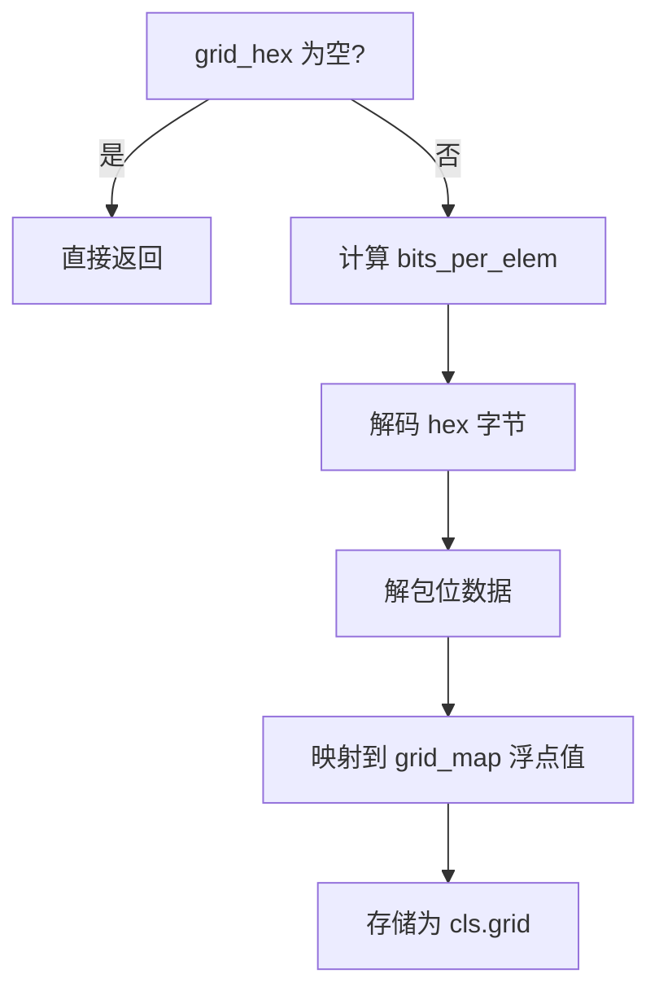

### 60.3.3 `__Quant.quantize` / `__Quant.dequantize`：统一入口与自动路由

源码路径：`gguf-py/gguf/quants.py` - `__Quant.quantize` / `__Quant.dequantize`（243-254行）

```python
    @classmethod
    def quantize(cls, tensor: np.ndarray | LazyNumpyTensor) -> np.ndarray:
        # ① 检查张量形状是否满足块大小对齐要求
        if not cls.can_quantize(tensor):
            raise QuantError(f"Can't quantize tensor with shape {tensor.shape} to {cls.qtype.name}")
        # ② 根据输入类型分派到惰性量化或数组量化
        if isinstance(tensor, LazyNumpyTensor):
            return cls.__quantize_lazy(tensor)
        else:
            return cls.__quantize_array(tensor)

    @classmethod
    def dequantize(cls, tensor: np.ndarray | LazyNumpyTensor) -> np.ndarray:
        # ③ 根据输入类型分派到惰性反量化或数组反量化
        if isinstance(tensor, LazyNumpyTensor):
            return cls.__dequantize_lazy(tensor)
        else:
            return cls.__dequantize_array(tensor)
```

这段代码定义了 `__Quant.quantize` 和 `__Quant.dequantize` 两个类方法，作为量化和反量化的统一入口，根据输入类型自动路由到惰性或即时计算路径，并进行了必要的合法性检查。这种设计使得量化和反量化操作对使用者完全透明，无需关心底层的具体实现。

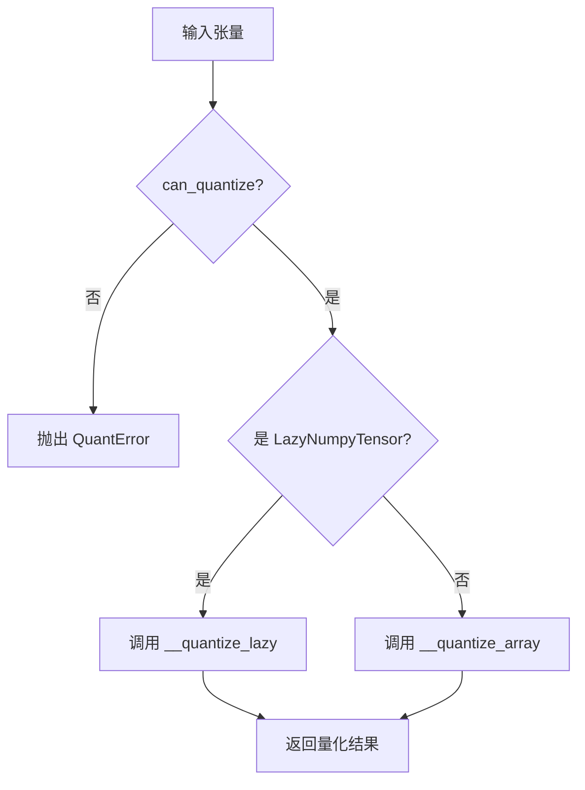

### 60.3.4 `_apply_over_grouped_rows`：批量行处理策略

源码路径：`gguf-py/gguf/quants.py` - `_apply_over_grouped_rows`（30-39行）

```python
def _apply_over_grouped_rows(func: Callable[[np.ndarray], np.ndarray], arr: np.ndarray, otype: DTypeLike, oshape: tuple[int, ...]) -> np.ndarray:
    # ① 将输入数组重塑为二维行向量，便于批量处理
    rows = arr.reshape((-1, arr.shape[-1]))
    # ② 计算输出数组的总元素数
    osize = 1
    for dim in oshape:
        osize *= dim
    # ③ 分配输出数组的内存
    out = np.empty(shape=osize, dtype=otype)
    # ④ 将行分组为每组16行，平衡内存与并行效率
    n_groups = (rows.shape[0] // 16) or 1
    # ⑤ 对每组应用处理函数，并将结果拼接到输出数组中
    np.concatenate([func(group).ravel() for group in np.array_split(rows, n_groups)], axis=0, out=out)
    # ⑥ 将输出数组重塑为目标形状
    return out.reshape(oshape)
```

这段代码定义了 `_apply_over_grouped_rows` 辅助函数，它将大数组按16行分组，逐组应用处理函数，最后拼接结果，有效平衡了内存占用与并行效率。这种分组策略避免了单次处理大数组时的内存爆炸问题，同时保证了足够的并行度以维持较高的吞吐量。

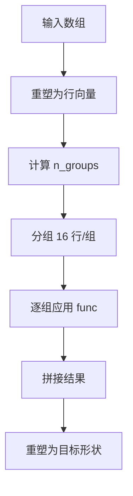

### 60.3.5 `__Quant.__init__`：生命周期控制

源码路径：`gguf-py/gguf/quants.py` - `__Quant.__init__`（153-154行）

```python
    def __init__(self):
        # ① 直接抛出 TypeError，阻止任何实例化操作
        #    确保基类仅作为模板使用，所有操作都以类方法形式调用
        return TypeError("Quant conversion classes can't have instances")
```

这段代码定义了 `__Quant.__init__` 方法，它直接抛出 `TypeError`，阻止任何实例化操作。就像工坊的SOP手册只提供操作规范，不提供实体操作对象，确保基类仅作为模板使用，所有具体量化操作都以类方法形式调用。

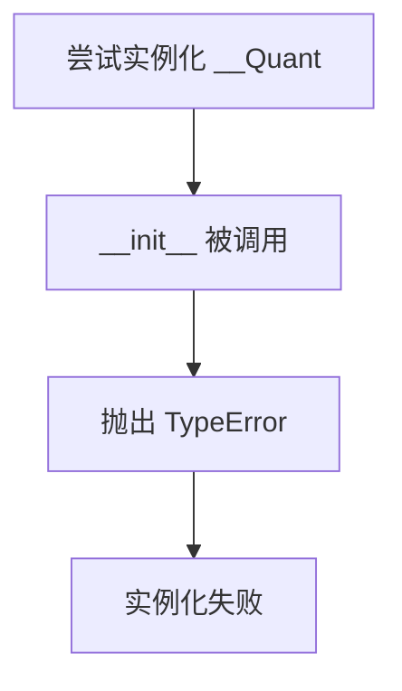

### 60.3.6 `quantize_blocks` / `dequantize_blocks`：抽象块级方法

源码路径：`gguf-py/gguf/quants.py` - `__Quant.quantize_blocks` / `__Quant.dequantize_blocks`（190-198行）

```python
    @classmethod
    @abstractmethod
    def quantize_blocks(cls, blocks: np.ndarray) -> np.ndarray:
        # ① 抽象方法：子类必须实现，将 (n_blocks, block_size) 的浮点块
        #    转换为 (n_blocks, type_size) 的 uint8 量化字节块
        raise NotImplementedError

    @classmethod
    @abstractmethod
    def dequantize_blocks(cls, blocks: np.ndarray) -> np.ndarray:
        # ② 抽象方法：子类必须实现，将 (n_blocks, type_size) 的 uint8 字节块
        #    转换为 (n_blocks, block_size) 的 float32 浮点块
        raise NotImplementedError
```

这段代码定义了 `quantize_blocks` 和 `dequantize_blocks` 两个抽象类方法，要求所有子类必须实现。它们是量化框架的"标准模具"，定义了块级量化和反量化的统一接口，就像工坊中不同压缩工艺的标准操作流程，确保所有量化类型遵循一致的块处理范式。

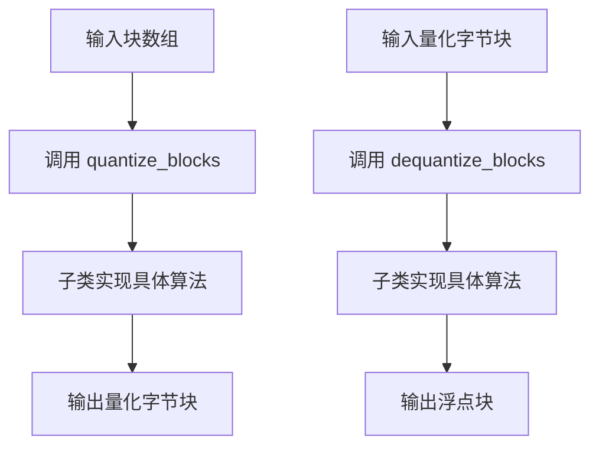

### 60.3.7 `quantize_rows` / `dequantize_rows`：行级批量处理

源码路径：`gguf-py/gguf/quants.py` - `__Quant.quantize_rows` / `__Quant.dequantize_rows`（200-217行）

```python
    @classmethod
    def quantize_rows(cls, rows: np.ndarray) -> np.ndarray:
        # ① 将输入行数据转换为 float32，避免重复转换
        rows = rows.astype(np.float32, copy=False)
        # ② 保存原始形状，用于后续重塑
        shape = rows.shape
        # ③ 计算总块数：总元素数除以块大小
        n_blocks = rows.size // cls.block_size
        # ④ 重塑为 (n_blocks, block_size) 的二维块数组
        blocks = rows.reshape((n_blocks, cls.block_size))
        # ⑤ 调用子类实现的块级量化方法
        blocks = cls.quantize_blocks(blocks)
        # ⑥ 断言量化结果类型和形状正确
        assert blocks.dtype == np.uint8
        assert blocks.shape[-1] == cls.type_size
        # ⑦ 将量化后的块重塑为字节形状并返回
        return blocks.reshape(cls.__shape_to_bytes(shape))

    @classmethod
    def dequantize_rows(cls, rows: np.ndarray) -> np.ndarray:
        # ① 将输入字节行查看为 uint8 类型，确保正确解释
        rows = rows.view(np.uint8)
        # ② 保存原始字节形状
        shape = rows.shape
        # ③ 计算总块数：总字节数除以类型大小
        n_blocks = rows.size // cls.type_size
        # ④ 重塑为 (n_blocks, type_size) 的二维字节块数组
        blocks = rows.reshape((n_blocks, cls.type_size))
        # ⑤ 调用子类实现的块级反量化方法
        blocks = cls.dequantize_blocks(blocks)
        # ⑥ 断言反量化结果类型和形状正确
        assert blocks.dtype == np.float32
        assert blocks.shape[-1] == cls.block_size
        # ⑦ 将反量化后的块重塑为原始逻辑形状并返回
        return blocks.reshape(cls.__shape_from_bytes(shape))
```

这段代码定义了 `quantize_rows` 和 `dequantize_rows` 方法，它们负责将行数据重塑为标准块，调用块级方法处理，再重塑回行形状。就像工坊中将大物品拆解成标准块处理，再重新组装，确保整个流程的高效和一致。

```mermaid
flowchart TD
    A[输入行数据] --> B[转换为 float32]
    B --> C[计算块数]
    C --> D[重塑为 (n_blocks, block_size)]
    D --> E[调用 quantize_blocks]
    E --> F[断言 dtype/shape]
    F --> G[重塑为字节形状]
    H[输入字节行] --> I[查看为 uint8]
    I --> J[计算块数]
    J --> K[重塑为 (n_blocks, type_size)]
    K --> L[调用 dequantize_blocks]
    L --> M[断言 dtype/shape]
    M --> N[重塑为原始形状]
```

### 60.3.8 `__shape_to_bytes` / `__shape_from_bytes`：形状转换

源码路径：`gguf-py/gguf/quants.py` - `__Quant.__shape_to_bytes` / `__Quant.__shape_from_bytes`（219-225行）

```python
    @classmethod
    def __shape_to_bytes(cls, shape: Sequence[int]):
        # ① 调用全局函数 quant_shape_to_byte_shape，将逻辑形状转换为字节形状
        #    内部会检查最后一维是否能被 block_size 整除
        return quant_shape_to_byte_shape(shape, cls.qtype)

    @classmethod
    def __shape_from_bytes(cls, shape: Sequence[int]):
        # ② 调用全局函数 quant_shape_from_byte_shape，将字节形状转换回逻辑形状
        #    内部会检查最后一维是否能被 type_size 整除
        return quant_shape_from_byte_shape(shape, cls.qtype)
```

这段代码定义了 `__shape_to_bytes` 和 `__shape_from_bytes` 方法，它们调用全局形状转换函数，处理逻辑张量形状与量化字节形状之间的双向转换。就像工坊中根据物品尺寸计算包装后的体积，并检查是否适合标准包装盒，确保块大小对齐。

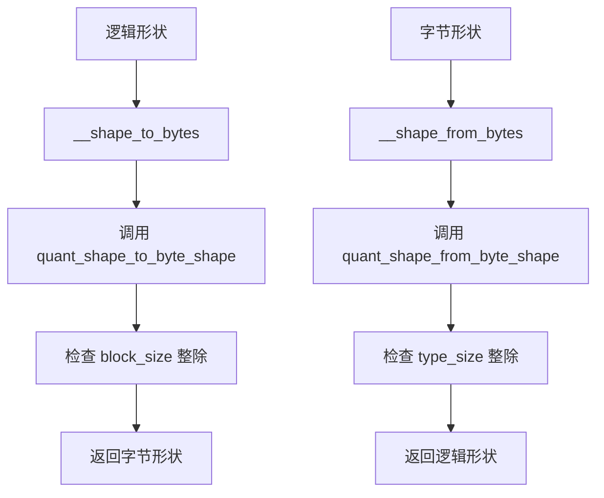

### 60.3.9 `__quantize_array` / `__dequantize_array`：数组级入口

源码路径：`gguf-py/gguf/quants.py` - `__Quant.__quantize_array` / `__Quant.__dequantize_array`（227-232行）

```python
    @classmethod
    def __quantize_array(cls, array: np.ndarray) -> np.ndarray:
        # ① 对普通 NumPy 数组进行量化：
        #    - 计算输出字节形状
        #    - 调用 _apply_over_grouped_rows 分组处理
        #    - 内部使用 quantize_rows 进行实际量化
        return _apply_over_grouped_rows(cls.quantize_rows, arr=array, otype=np.uint8, oshape=cls.__shape_to_bytes(array.shape))

    @classmethod
    def __dequantize_array(cls, array: np.ndarray) -> np.ndarray:
        # ② 对普通 NumPy 数组进行反量化：
        #    - 确保网格查找表已初始化（IQ系列需要）
        #    - 计算输出逻辑形状
        #    - 调用 _apply_over_grouped_rows 分组处理
        #    - 内部使用 dequantize_rows 进行实际反量化
        cls.init_grid()
        return _apply_over_grouped_rows(cls.dequantize_rows, arr=array, otype=np.float32, oshape=cls.__shape_from_bytes(array.shape))
```

这段代码定义了 `__quantize_array` 和 `__dequantize_array` 方法，它们是对普通 NumPy 数组进行量化和反量化的主要入口。通过调用 `_apply_over_grouped_rows` 分组处理，就像工坊中将整批货物分组加工，确保内存和效率的平衡。

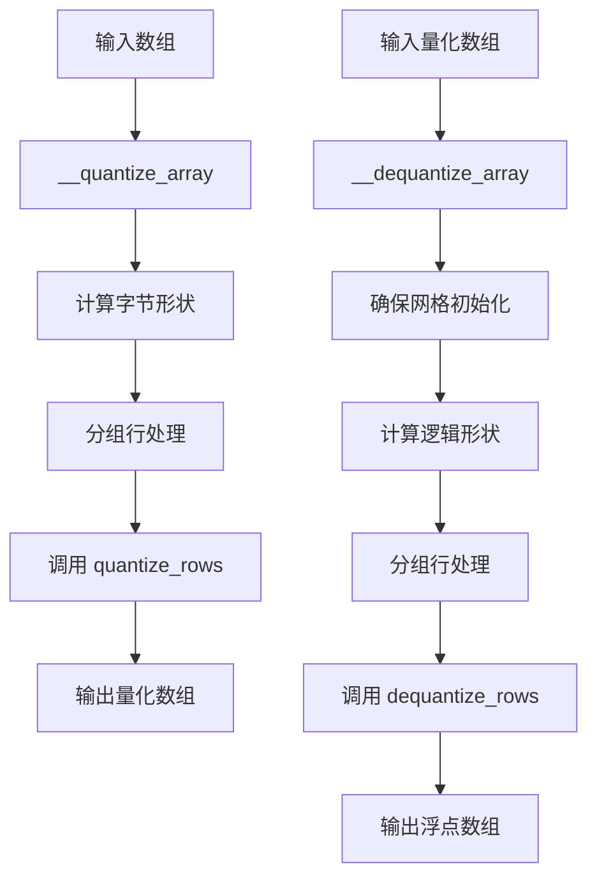

### 60.3.10 `__quantize_lazy` / `__dequantize_lazy`：惰性包装

源码路径：`gguf-py/gguf/quants.py` - `__Quant.__quantize_lazy` / `__Quant.__dequantize_lazy`（234-238行）

```python
    @classmethod
    def __quantize_lazy(cls, lazy_tensor: LazyNumpyTensor, /) -> Any:
        # ① 占位符方法：实际惰性包装逻辑在 __init_subclass__ 中完成
        #    通过 LazyNumpyTensor._wrap_fn 将 __quantize_array 包装为
        #    支持延迟计算的代理，此处仅保留接口定义
        pass

    @classmethod
    def __dequantize_lazy(cls, lazy_tensor: LazyNumpyTensor, /) -> Any:
        # ② 占位符方法：实际惰性包装逻辑在 __init_subclass__ 中完成
        #    通过 LazyNumpyTensor._wrap_fn 将 __dequantize_array 包装为
        #    支持延迟计算的代理，此处仅保留接口定义
        pass
```

这段代码定义了 `__quantize_lazy` 和 `__dequantize_lazy` 的占位符方法。实际的惰性包装逻辑在 `__init_subclass__` 中通过 `LazyNumpyTensor._wrap_fn` 完成，将数组级方法包装为支持延迟计算的代理。就像工坊中预设的自动化流水线，只有当需要最终结果时才启动完整流程，避免不必要的计算开销。

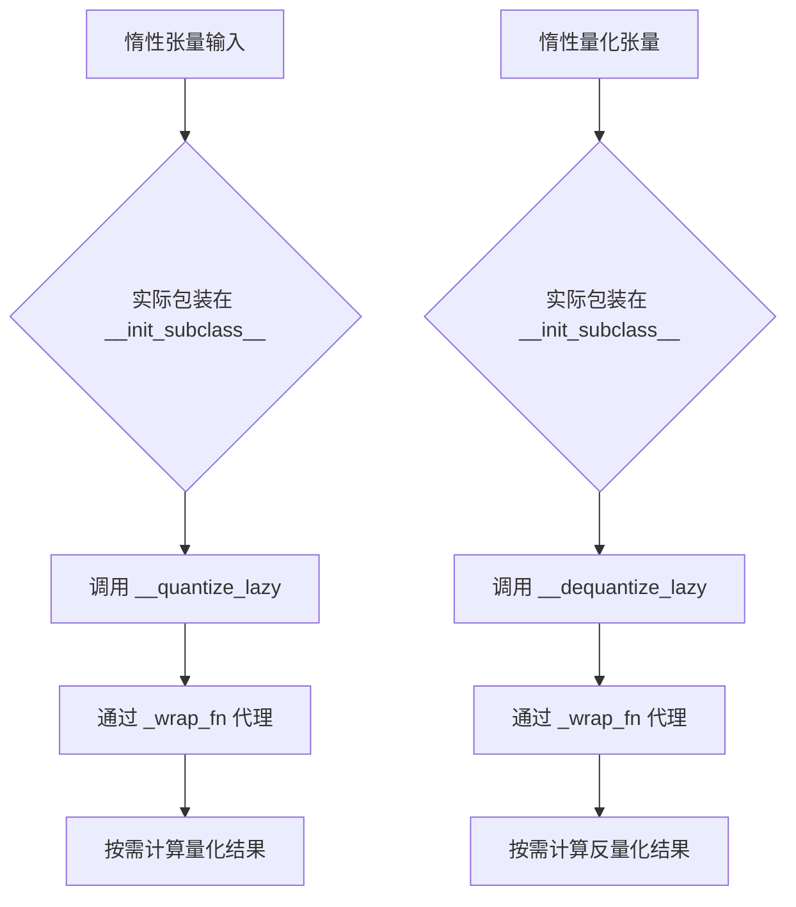

### 60.3.11 `can_quantize`：量化可行性检查

源码路径：`gguf-py/gguf/quants.py` - `__Quant.can_quantize`（240-241行）

```python
    @classmethod
    def can_quantize(cls, tensor: np.ndarray | LazyNumpyTensor) -> bool:
        # ① 获取张量最后一维的大小
        # ② 检查是否能被该量化类型的块大小整除
        #    确保张量形状满足块对齐要求，避免量化失败
        return tensor.shape[-1] % cls.block_size == 0
```

这段代码定义了 `can_quantize` 方法，检查张量最后一维是否能被块大小整除。就像工坊中检查物品尺寸是否适合标准包装盒，确保量化过程不会因为形状不匹配而失败。

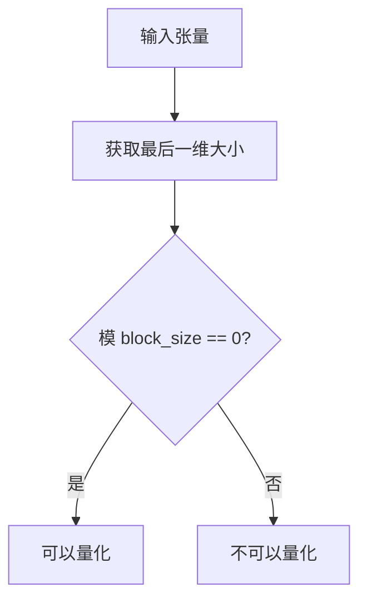

## 60.4 经典量化家族 —— 整数压缩的'经典四重奏'

经典量化家族是GGUF量化系统中最基础、最广泛使用的四种格式：Q4_0、Q4_1、Q5_0、Q5_1，以及它们的"满血版"Q8_0。这些格式代表了整数压缩的四种基本策略，每种都有其独特的位级实现细节和适用场景。

**BF16 的位运算精要**：BF16（Brain Floating Point）作为一种特殊的量化格式，其 `quantize_blocks` 方法通过 `np.uint64` 中间类型实现 "round to nearest even" 舍入，确保与 C 语言实现位级一致，是理解浮点量化的基础。

**Q4_0 对称量化**：基于块内绝对最大值计算缩放因子 `d=max/-8`，使用 `imax` 定位极值，实现 4-bit 对称量化（带隐藏位偏移 8）。这种设计简单高效，适合分布对称的张量。

**Q4_1 非对称量化**：引入最小值偏移 `m`，通过 `d=(max-min)/15` 覆盖全范围，适合分布不均的张量。相比 Q4_0，Q4_1 能够更好地处理非对称分布的数据。

**Q5_x 的位扩展艺术**：Q5_0/Q5_1 将 32 个 5-bit 值拆分为低 4 位字节 + 高 1 位掩码（`qh`），利用 `np.packbits` 压缩第 5 位，巧妙地在 4-bit 存储空间中实现了 5-bit 精度。

**Q8_0 精确保留**：使用 8-bit 整数存储权重，通过 `np_roundf`（远离零舍入）匹配 C 参考实现的舍入行为，误差最小但体积较大，是对精度要求最高时的首选。

**字节布局规范**：所有经典格式均遵循 `[d(float16), (m), qs]` 的内存布局，其中 `qs` 为 packed 4/5/8-bit 整数，这种统一的布局简化了反量化过程的实现。

### 60.4.1 `BF16.quantize_blocks` / `BF16.dequantize_blocks`：脑浮点量化

源码路径：`gguf-py/gguf/quants.py` - `BF16.quantize_blocks` / `BF16.dequantize_blocks`（277-286行）

```python
    @classmethod
    # same as ggml_compute_fp32_to_bf16 in ggml-impl.h
    def quantize_blocks(cls, blocks: np.ndarray) -> np.ndarray:
        # ① 将 float32 块查看为 uint32 以便进行位操作
        n = blocks.view(np.uint32)
        # ② 强制将 NaN 转换为 quiet NaN，避免传播噪声
        n = np.where((n & 0x7fffffff) > 0x7f800000, (n & np.uint32(0xffff0000)) | np.uint32(64 << 16), n)
        # ③ 使用 uint64 进行 round to nearest even 舍入，确保与 C 实现一致
        n = (np.uint64(n) + (0x7fff + ((n >> 16) & 1))) >> 16
        # ④ 转换为 uint16 并查看为 uint8 字节数组
        return n.astype(np.uint16).view(np.uint8)

    @classmethod
    def dequantize_blocks(cls, blocks: np.ndarray) -> np.ndarray:
        # ① 将 uint8 字节数组查看为 int16（BF16 位模式）
        # ② 转换为 int32 并左移 16 位，恢复为 float32 的高 16 位
        # ③ 查看为 float32 返回
        return (blocks.view(np.int16).astype(np.int32) << 16).view(np.float32)
```

这段代码定义了 `BF16.quantize_blocks` 和 `BF16.dequantize_blocks` 方法，实现了脑浮点（Brain Floating Point）格式的量化和反量化。BF16 通过保留 float32 的高 16 位实现，使用 "round to nearest even" 舍入策略，确保与 C 参考实现位级一致。就像工坊中使用特殊模具压缩物品，只保留关键信息位，实现存储减半而精度保持。

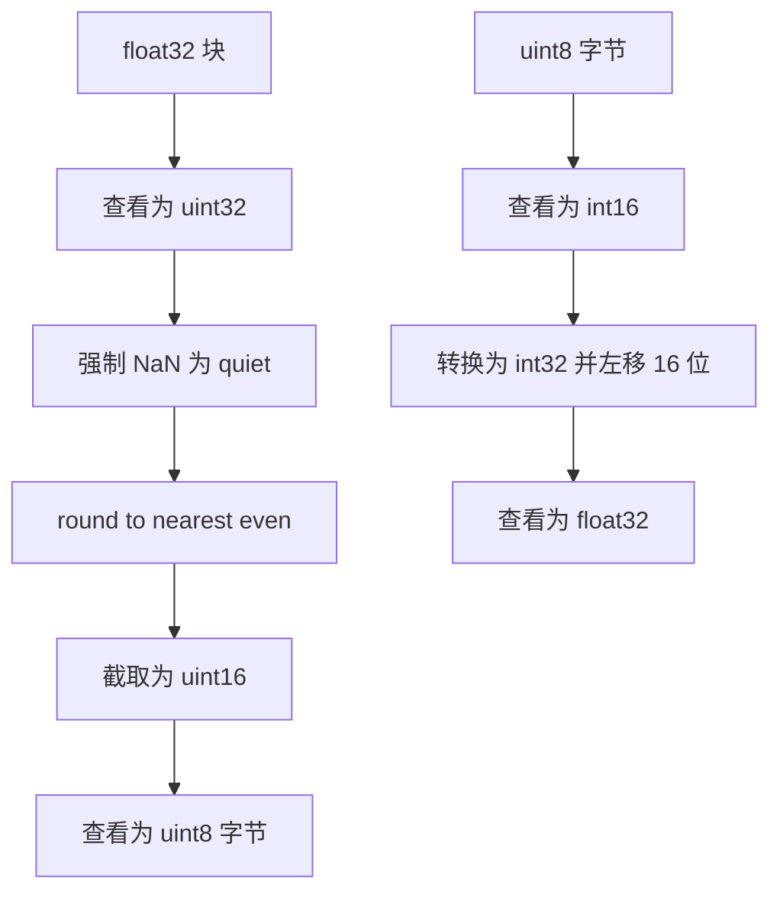

### 60.4.2 `Q4_0.quantize_blocks` / `Q4_0.dequantize_blocks`：对称4-bit量化

源码路径：`gguf-py/gguf/quants.py` - `Q4_0.quantize_blocks` / `Q4_0.dequantize_blocks`（295-320行）

```python
    @classmethod
    def quantize_blocks(cls, blocks: np.ndarray) -> np.ndarray:
        # ① 获取块数量
        n_blocks = blocks.shape[0]

        # ② 找到每块中绝对值最大的元素的位置和值
        imax = abs(blocks).argmax(axis=-1, keepdims=True)
        max = np.take_along_axis(blocks, imax, axis=-1)

        # ③ 计算缩放因子 d = max / -8（对称量化，范围-8到7）
        d = max / -8
        # ④ 避免除零错误，d为0时id也为0
        with np.errstate(divide="ignore"):
            id = np.where(d == 0, 0, 1 / d)
        # ⑤ 量化：加上8.5后截断，实现四舍五入，然后裁剪到0-15
        qs = np.trunc((blocks * id) + np.float32(8.5), dtype=np.float32).astype(np.uint8).clip(0, 15)

        # ⑥ 将两个4-bit值打包到一个字节中
        qs = qs.reshape((n_blocks, 2, cls.block_size // 2))
        qs = qs[..., 0, :] | (qs[..., 1, :] << np.uint8(4))

        # ⑦ 将缩放因子转换为float16并查看为uint8字节
        d = d.astype(np.float16).view(np.uint8)

        # ⑧ 拼接缩放因子和量化数据
        return np.concatenate([d, qs], axis=-1)

    @classmethod
    def dequantize_blocks(cls, blocks: np.ndarray) -> np.ndarray:
        # ① 获取块数量
        n_blocks = blocks.shape[0]

        # ② 分割缩放因子和量化数据
        d, qs = np.hsplit(blocks, [2])

        # ③ 将float16缩放因子转换回float32
        d = d.view(np.float16).astype(np.float32)

        # ④ 解包4-bit量化值：右移0位和4位，然后掩码0x0F
        qs = qs.reshape((n_blocks, -1, 1, cls.block_size // 2)) >> np.array([0, 4], dtype=np.uint8).reshape((1, 1, 2, 1))
        qs = (qs & np.uint8(0x0F)).reshape((n_blocks, -1)).astype(np.int8) - np.int8(8)

        # ⑤ 反量化：乘以缩放因子，恢复原始值
        return (d * qs.astype(np.float32))
```

这段代码定义了 `Q4_0.quantize_blocks` 和 `Q4_0.dequantize_blocks` 方法，实现了对称4-bit量化。通过块内最大绝对值计算缩放因子，并将量化值打包存储，该格式在保持合理精度的同时实现了4倍的压缩比。与非对称的 Q4_1 相比，Q4_0 省略了最小值的存储，更适合分布对称的张量。

```mermaid
flowchart TD
    A[输入块] --> B[找绝对最大值]
    B --> C[计算 d = max/-8]
    C --> D[计算 id = 1/d]
    D --> E[量化 qs = trunc(blocks*id + 8.5)]
    E --> F[打包 4-bit 到字节]
    F --> G[转换 d 为 float16]
    G --> H[拼接 d 和 qs]
    I[输入字节块] --> J[分割 d 和 qs]
    J --> K[还原 d 为 float32]
    K --> L[解包 4-bit 值]
    L --> M[减去 8 偏移]
    M --> N[乘以 d 反量化]
```

### 60.4.3 `Q4_1.quantize_blocks` / `Q4_1.dequantize_blocks`：非对称4-bit量化

源码路径：`gguf-py/gguf/quants.py` - `Q4_1.quantize_blocks` / `Q4_1.dequantize_blocks`（328-357行）

```python
    @classmethod
    def quantize_blocks(cls, blocks: np.ndarray) -> np.ndarray:
        # ① 获取块数量
        n_blocks = blocks.shape[0]

        # ② 计算每块的最大值和最小值
        max = blocks.max(axis=-1, keepdims=True)
        min = blocks.min(axis=-1, keepdims=True)

        # ③ 计算缩放因子 d = (max - min) / 15（非对称量化，范围0-15）
        d = (max - min) / 15
        # ④ 避免除零错误
        with np.errstate(divide="ignore"):
            id = np.where(d == 0, 0, 1 / d)
        # ⑤ 量化：减去最小值，乘以逆缩放因子，加上0.5后截断，裁剪到0-15
        qs = np.trunc((blocks - min) * id + np.float32(0.5), dtype=np.float32).astype(np.uint8).clip(0, 15)

        # ⑥ 打包两个4-bit值到一个字节
        qs = qs.reshape((n_blocks, 2, cls.block_size // 2))
        qs = qs[..., 0, :] | (qs[..., 1, :] << np.uint8(4))

        # ⑦ 将缩放因子和最小值转换为float16并查看为uint8
        d = d.astype(np.float16).view(np.uint8)
        m = min.astype(np.float16).view(np.uint8)

        # ⑧ 拼接缩放因子、最小值和量化数据
        return np.concatenate([d, m, qs], axis=-1)

    @classmethod
    def dequantize_blocks(cls, blocks: np.ndarray) -> np.ndarray:
        # ① 获取块数量
        n_blocks = blocks.shape[0]

        # ② 分割缩放因子、最小值和量化数据
        d, rest = np.hsplit(blocks, [2])
        m, qs = np.hsplit(rest, [2])

        # ③ 将float16转换回float32
        d = d.view(np.float16).astype(np.float32)
        m = m.view(np.float16).astype(np.float32)

        # ④ 解包4-bit量化值
        qs = qs.reshape((n_blocks, -1, 1, cls.block_size // 2)) >> np.array([0, 4], dtype=np.uint8).reshape((1, 1, 2, 1))
        qs = (qs & np.uint8(0x0F)).reshape((n_blocks, -1)).astype(np.float32)

        # ⑤ 反量化：乘以缩放因子并加上最小值
        return (d * qs) + m
```

这段代码定义了 `Q4_1.quantize_blocks` 和 `Q4_1.dequantize_blocks` 方法，实现了非对称4-bit量化。通过存储最小值和缩放因子，该格式能够覆盖全范围，适合分布不均的张量。与对称的 Q4_0 相比，Q4_1 增加了最小值的存储开销，但换来了更好的非对称分布适应能力。

```mermaid
flowchart TD
    A[输入块] --> B[计算 max/min]
    B --> C[计算 d = (max-min)/15]
    C --> D[计算 id = 1/d]
    D --> E[量化 qs = trunc((blocks-min)*id + 0.5)]
    E --> F[打包 4-bit 到字节]
    F --> G[转换 d,m 为 float16]
    G --> H[拼接 d,m,qs]
    I[输入字节块] --> J[分割 d,m,qs]
    J --> K[还原 d,m 为 float32]
    K --> L[解包 4-bit 值]
    L --> M[反量化 d*qs + m]
```

### 60.4.4 `Q5_0.quantize_blocks` / `Q5_0.dequantize_blocks`：对称5-bit量化

源码路径：`gguf-py/gguf/quants.py` - `Q5_0.quantize_blocks` / `Q5_0.dequantize_blocks`（364-395行）

```python
    @classmethod
    def quantize_blocks(cls, blocks: np.ndarray) -> np.ndarray:
        # ① 获取块数量
        n_blocks = blocks.shape[0]

        # ② 找到每块中绝对值最大的元素
        imax = abs(blocks).argmax(axis=-1, keepdims=True)
        max = np.take_along_axis(blocks, imax, axis=-1)

        # ③ 计算缩放因子 d = max / -16（对称5-bit量化）
        d = max / -16
        # ④ 避免除零错误
        with np.errstate(divide="ignore"):
            id = np.where(d == 0, 0, 1 / d)
        # ⑤ 量化：加上16.5后截断，实现四舍五入，裁剪到0-31
        q = np.trunc((blocks * id) + np.float32(16.5), dtype=np.float32).astype(np.uint8).clip(0, 31)

        # ⑥ 提取低4位作为主存储 qs
        qs = q.reshape((n_blocks, 2, cls.block_size // 2))
        qs = (qs[..., 0, :] & np.uint8(0x0F)) | (qs[..., 1, :] << np.uint8(4))

        # ⑦ 使用 packbits 压缩高1位（第5位）到 qh 掩码
        qh = np.packbits(q.reshape((n_blocks, 1, 32)) >> np.uint8(4), axis=-1, bitorder="little").reshape(n_blocks, 4)

        # ⑧ 转换缩放因子为float16
        d = d.astype(np.float16).view(np.uint8)

        # ⑨ 拼接 d、qh、qs
        return np.concatenate([d, qh, qs], axis=-1)

    @classmethod
    def dequantize_blocks(cls, blocks: np.ndarray) -> np.ndarray:
        # ① 获取块数量
        n_blocks = blocks.shape[0]

        # ② 分割缩放因子、高位掩码和低位数据
        d, rest = np.hsplit(blocks, [2])
        qh, qs = np.hsplit(rest, [4])

        # ③ 还原缩放因子为float32，并将 qh 查看为 uint32 以便位操作
        d = d.view(np.float16).astype(np.float32)
        qh = qh.view(np.uint32)

        # ④ 解包 qh：将32位掩码展开为32个1位标志
        qh = qh.reshape((n_blocks, 1)) >> np.array([i for i in range(32)], dtype=np.uint32).reshape((1, 32))
        # ⑤ 解包 qs 低4位
        ql = qs.reshape((n_blocks, -1, 1, cls.block_size // 2)) >> np.array([0, 4], dtype=np.uint8).reshape((1, 1, 2, 1))
        # ⑥ 提取实际位值并转换类型
        qh = (qh & np.uint32(0x01)).astype(np.uint8)
        ql = (ql & np.uint8(0x0F)).reshape((n_blocks, -1))

        # ⑦ 组合5-bit值：低4位 | 高1位<<4，并减去16偏移
        qs = (ql | (qh << np.uint8(4))).astype(np.int8) - np.int8(16)

        # ⑧ 反量化：乘以缩放因子
        return (d * qs.astype(np.float32))
```

这段代码定义了 `Q5_0.quantize_blocks` 和 `Q5_0.dequantize_blocks` 方法，实现了对称5-bit量化。Q5_0 在 4-bit 存储空间的基础上，通过 `packbits` 压缩第 5 位，巧妙地实现了 5-bit 精度。就像工坊中在标准压缩袋上额外加一层真空，提升压缩比而不显著增加体积。

```mermaid
flowchart TD
    A[输入块] --> B[找绝对最大值]
    B --> C[计算 d = max/-16]
    C --> D[量化 q = trunc(blocks*id + 16.5)]
    D --> E[提取低 4 位 qs]
    E --> F[packbits 高 1 位 qh]
    F --> G[拼接 d,qh,qs]
    H[输入字节块] --> I[分割 d,qh,qs]
    I --> J[还原 d 为 float32]
    J --> K[解包 qh 和 ql]
    K --> L[拼接 5-bit 值]
    L --> M[减去 16 偏移]
    M --> N[乘以 d 反量化]
```

### 60.4.5 `Q5_1.quantize_blocks` / `Q5_1.dequantize_blocks`：非对称5-bit量化

源码路径：`gguf-py/gguf/quants.py` - `Q5_1.quantize_blocks` / `Q5_1.dequantize_blocks`（402-438行）

```python
    @classmethod
    def quantize_blocks(cls, blocks: np.ndarray) -> np.ndarray:
        # ① 获取块数量
        n_blocks = blocks.shape[0]

        # ② 计算每块的最大值和最小值
        max = blocks.max(axis=-1, keepdims=True)
        min = blocks.min(axis=-1, keepdims=True)

        # ③ 计算缩放因子 d = (max - min) / 31（非对称5-bit量化）
        d = (max - min) / 31
        # ④ 避免除零错误
        with np.errstate(divide="ignore"):
            id = np.where(d == 0, 0, 1 / d)
        # ⑤ 量化：减去最小值，乘以逆缩放，加0.5后截断，裁剪到0-31
        q = np.trunc((blocks - min) * id + np.float32(0.5), dtype=np.float32).astype(np.uint8).clip(0, 31)

        # ⑥ 提取低4位作为主存储 qs
        qs = q.reshape((n_blocks, 2, cls.block_size // 2))
        qs = (qs[..., 0, :] & np.uint8(0x0F)) | (qs[..., 1, :] << np.uint8(4))

        # ⑦ 使用 packbits 压缩高1位到 qh 掩码
        qh = np.packbits(q.reshape((n_blocks, 1, 32)) >> np.uint8(4), axis=-1, bitorder="little").reshape(n_blocks, 4)

        # ⑧ 转换缩放因子和最小值为float16
        d = d.astype(np.float16).view(np.uint8)
        m = min.astype(np.float16).view(np.uint8)

        # ⑨ 拼接 d、m、qh、qs
        return np.concatenate([d, m, qh, qs], axis=-1)

    @classmethod
    def dequantize_blocks(cls, blocks: np.ndarray) -> np.ndarray:
        # ① 获取块数量
        n_blocks = blocks.shape[0]

        # ② 分割缩放因子、最小值、高位掩码和低位数据
        d, rest = np.hsplit(blocks, [2])
        m, rest = np.hsplit(rest, [2])
        qh, qs = np.hsplit(rest, [4])

        # ③ 还原缩放因子和最小值为float32
        d = d.view(np.float16).astype(np.float32)
        m = m.view(np.float16).astype(np.float32)
        # ④ 将 qh 查看为 uint32 以便位操作
        qh = qh.view(np.uint32)

        # ⑤ 解包 qh 掩码
        qh = qh.reshape((n_blocks, 1)) >> np.array([i for i in range(32)], dtype=np.uint32).reshape((1, 32))
        # ⑥ 解包 qs 低4位
        ql = qs.reshape((n_blocks, -1, 1, cls.block_size // 2)) >> np.array([0, 4], dtype=np.uint8).reshape((1, 1, 2, 1))
        # ⑦ 提取实际位值
        qh = (qh & np.uint32(0x01)).astype(np.uint8)
        ql = (ql & np.uint8(0x0F)).reshape((n_blocks, -1))

        # ⑧ 组合5-bit值
        qs = (ql | (qh << np.uint8(4))).astype(np.float32)

        # ⑨ 反量化：乘以缩放因子并加上最小值
        return (d * qs) + m
```

这段代码定义了 `Q5_1.quantize_blocks` 和 `Q5_1.dequantize_blocks` 方法，实现了非对称5-bit量化。Q5_1 在 Q5_0 的基础上引入最小值存储，能够更好地处理非对称分布的数据。就像工坊中为不规则物品定制模具，确保存储空间的高效利用。

```mermaid
flowchart TD
    A[输入块] --> B[计算 max/min]
    B --> C[计算 d = (max-min)/31]
    C --> D[量化 q = trunc((blocks-min)*id + 0.5)]
    D --> E[提取低 4 位 qs]
    E --> F[packbits 高 1 位 qh]
    F --> G[转换 d,m 为 float16]
    G --> H[拼接 d,m,qh,qs]
    I[输入字节块] --> J[分割 d,m,qh,qs]
    J --> K[还原 d,m 为 float32]
    K --> L[解包 qh 和 ql]
    L --> M[拼接 5-bit 值]
    M --> N[反量化 d*qs + m]
```

### 60.4.6 `Q8_0.quantize_blocks` / `Q8_0.dequantize_blocks`：精确保留8-bit量化

源码路径：`gguf-py/gguf/quants.py` - `Q8_0.quantize_blocks` / `Q8_0.dequantize_blocks`（445-465行）

```python
    @classmethod
    # Implementation of Q8_0 with bit-exact same results as reference implementation in ggml-quants.c
    def quantize_blocks(cls, blocks: np.ndarray) -> np.ndarray:
        # ① 计算缩放因子 d = max(|x|) / 127，确保量化范围对称
        d = abs(blocks).max(axis=1, keepdims=True) / 127
        # ② 避免除零错误
        with np.errstate(divide="ignore"):
            id = np.where(d == 0, 0, 1 / d)
        # ③ 使用 np_roundf 进行远离零舍入，确保与 C 实现位级一致
        qs = np_roundf(blocks * id)

        # ④ 将缩放因子转换为 float16 并查看为 uint8（2字节）
        d = d.astype(np.float16).view(np.uint8)
        # ⑤ 将量化值转换为 int8 并查看为 uint8（block_size 字节）
        qs = qs.astype(np.int8).view(np.uint8)

        # ⑥ 拼接缩放因子和量化数据
        return np.concatenate([d, qs], axis=1)

    @classmethod
    def dequantize_blocks(cls, blocks: np.ndarray) -> np.ndarray:
        # ① 分割缩放因子和量化数据
        d, x = np.split(blocks, [2], axis=1)
        # ② 还原缩放因子为 float32
        d = d.view(np.float16).astype(np.float32)
        # ③ 还原量化值为 float32
        x = x.view(np.int8).astype(np.float32)

        # ④ 反量化：乘以缩放因子
        return (x * d)
```

这段代码定义了 `Q8_0.quantize_blocks` 和 `Q8_0.dequantize_blocks` 方法，实现了8-bit量化。通过 `np_roundf` 函数确保与C参考实现位级一致，该格式提供了最高的精度，是精度要求最高时的首选。与4-bit格式相比，Q8_0 的存储开销增加了一倍，但换来了极小的量化误差。

```mermaid
flowchart TD
    A[输入块] --> B[计算 d = max(|x|)/127]
    B --> C[计算 id = 1/d]
    C --> D[qs = np_roundf(blocks * id)]
    D --> E[转换 d 为 float16]
    E --> F[转换 qs 为 int8]
    F --> G[拼接 d 和 qs]
    H[输入字节块] --> I[分割 d 和 x]
    I --> J[还原 d 为 float32]
    J --> K[还原 x 为 float32]
    K --> L[反量化 x * d]
```

## 60.5 K-quant 系列 —— 极致压缩的'俄罗斯套娃'

K-quant 系列是 GGUF 量化系统中压缩率最高的一族，它们通过嵌套缩放、多级编码和位拼接技术，在极低的位宽下（2-6 bit）实现了惊人的精度保持。这一系列的设计哲学就像俄罗斯套娃：先将数据分成小块，再对每个小块进行分级打包，最终在有限的空间内实现最大的信息密度。

**Q2_K 的极限压缩**：将 256 个值压缩到 (QK_K//16) 字节，使用嵌套缩放（全局 `d` 和 `dmin` + 子块 `scales`），实现约 2.5 bit/权重，是目前压缩率最高的格式之一。

**Q3_K 的六比特拼图**：通过位操作解包 12 字节压缩存储的 16 个 6-bit 缩放因子（高 2 位与低 4 位分离），每个子块 3-bit 量化，巧妙地平衡了精度与体积。

**Q4_K/Q5_K 的共享设计**：复用 `get_scale_min` 静态方法解包压缩的 `scales` 和 `mins`（12 字节存储 8 组 scale+min），处理超级块（super-block）内的多级缩放，实现了代码复用和性能优化的统一。

**Q6_K 的高低拼接**：将 6-bit 拆分为低 4 位（`ql`）和高 2 位（`qh`），通过 `scales` 数组存储 16 个 int8 子缩放因子，在精度与体积之间取得了最佳平衡。

**YaRN 风格偏移**：K 系列普遍采用 `d * q - dm` 的非对称公式，其中 `dm` 作为偏移量校正零点，优于简单对称量化，能够更好地处理实际数据的偏态分布。

**反量化流水线**：所有 K-quant 的 `dequantize_blocks` 遵循 '字节拆分 → 缩放重建 → 整数解包 → 浮点合成' 的标准流程，确保了实现的一致性和可维护性。

### 60.5.1 `Q2_K.dequantize_blocks`：极限2-bit压缩

源码路径：`gguf-py/gguf/quants.py` - `Q2_K.dequantize_blocks`（472-494行）

```python
    @classmethod
    def dequantize_blocks(cls, blocks: np.ndarray) -> np.ndarray:
        # ① 获取块数量
        n_blocks = blocks.shape[0]

        # ② 分割数据：scales、qs、d、dmin
        scales, rest = np.hsplit(blocks, [QK_K // 16])
        qs, rest = np.hsplit(rest, [QK_K // 4])
        d, dmin = np.hsplit(rest, [2])

        # ③ 还原全局缩放因子 d 和 dmin 为 float32
        d = d.view(np.float16).astype(np.float32)
        dmin = dmin.view(np.float16).astype(np.float32)

        # ④ 计算子块缩放：dl = d * (scales & 0xF)，ml = dmin * (scales >> 4)
        #    scales 的高4位和低4位分别存储子缩放和子偏移
        dl = (d * (scales & 0xF).astype(np.float32)).reshape((n_blocks, QK_K // 16, 1))
        ml = (dmin * (scales >> 4).astype(np.float32)).reshape((n_blocks, QK_K // 16, 1))

        # ⑤ 解包 2-bit 量化值：每 32 个值通过位移 0/2/4/6 提取
        shift = np.array([0, 2, 4, 6], dtype=np.uint8).reshape((1, 1, 4, 1))
        qs = (qs.reshape((n_blocks, -1, 1, 32)) >> shift) & np.uint8(3)

        # ⑥ 重塑为 (n_blocks, 16, 16) 并转换为 float32
        qs = qs.reshape((n_blocks, QK_K // 16, 16)).astype(np.float32)

        # ⑦ 反量化：dl * qs - ml，使用 YaRN 风格偏移
        qs = dl * qs - ml

        # ⑧ 重塑为 (n_blocks, -1) 输出
        return qs.reshape((n_blocks, -1))
```

这段代码定义了 `Q2_K.dequantize_blocks` 方法，通过嵌套缩放（全局 `d` 和 `dmin` + 子块 `scales`）实现极限 2-bit 压缩。就像工坊中俄罗斯套娃式压缩，先分成小盒子，再对盒子分级打包，极致利用空间。

```mermaid
flowchart TD
    A[输入字节块] --> B[分割 scales/qs/d/dmin]
    B --> C[还原 d,dmin 为 float32]
    C --> D[计算 dl = d * (scales & 0xF)]
    D --> E[计算 ml = dmin * (scales >> 4)]
    E --> F[解包 qs 为 2-bit 值]
    F --> G[重塑为 (n_blocks, 16, 16)]
    G --> H[计算 dl * qs - ml]
    H --> I[重塑输出]
```

### 60.5.2 `Q3_K.dequantize_blocks`：6-bit缩放因子拼图

源码路径：`gguf-py/gguf/quants.py` - `Q3_K.dequantize_blocks`（501-536行）

```python
    @classmethod
    def dequantize_blocks(cls, blocks: np.ndarray) -> np.ndarray:
        # ① 获取块数量
        n_blocks = blocks.shape[0]

        # ② 分割数据：hmask、qs、scales、d
        hmask, rest = np.hsplit(blocks, [QK_K // 8])
        qs, rest = np.hsplit(rest, [QK_K // 4])
        scales, d = np.hsplit(rest, [12])

        # ③ 还原全局缩放因子 d 为 float32
        d = d.view(np.float16).astype(np.float32)

        # ④ 解包 6-bit 缩放因子：12 字节存储 16 个 6-bit 值
        #    前8字节存储低4位，后4字节存储高2位，按特定模式排列
        lscales, hscales = np.hsplit(scales, [8])
        lscales = lscales.reshape((n_blocks, 1, 8)) >> np.array([0, 4], dtype=np.uint8).reshape((1, 2, 1))
        lscales = lscales.reshape((n_blocks, 16))
        hscales = hscales.reshape((n_blocks, 1, 4)) >> np.array([0, 2, 4, 6], dtype=np.uint8).reshape((1, 4, 1))
        hscales = hscales.reshape((n_blocks, 16))
        scales = (lscales & np.uint8(0x0F)) | ((hscales & np.uint8(0x03)) << np.uint8(4))
        # ⑤ 转换为有符号值并缩放
        scales = (scales.astype(np.int8) - np.int8(32)).astype(np.float32)

        # ⑥ 计算子块缩放 dl = d * scales
        dl = (d * scales).reshape((n_blocks, 16, 1))

        # ⑦ 解包量化值：ql（低2位）和 qh（高1位）
        ql = qs.reshape((n_blocks, -1, 1, 32)) >> np.array([0, 2, 4, 6], dtype=np.uint8).reshape((1, 1, 4, 1))
        qh = hmask.reshape(n_blocks, -1, 1, 32) >> np.array([i for i in range(8)], dtype=np.uint8).reshape((1, 1, 8, 1))
        ql = ql.reshape((n_blocks, 16, QK_K // 16)) & np.uint8(3)
        qh = (qh.reshape((n_blocks, 16, QK_K // 16)) & np.uint8(1))
        # ⑧ 组合量化值：q = ql - qh*4（偏移量在 qh=1 时为零）
        qh = qh ^ np.uint8(1)  # strangely, the offset is zero when the bitmask is 1
        q = (ql.astype(np.int8) - (qh << np.uint8(2)).astype(np.int8)).astype(np.float32)

        # ⑨ 反量化：dl * q，重塑输出
        return (dl * q).reshape((n_blocks, QK_K))
```

这段代码定义了 `Q3_K.dequantize_blocks` 方法，通过位操作解包 12 字节压缩存储的 16 个 6-bit 缩放因子（高 2 位与低 4 位分离），每个子块 3-bit 量化。就像工坊中将小盒子分级打包，巧妙地平衡了精度与体积。

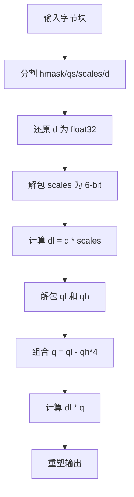

### 60.5.3 `Q4_K.dequantize_blocks`：4-bit K-quant反量化

源码路径：`gguf-py/gguf/quants.py` - `Q4_K.dequantize_blocks`（565-580行）

```python
    @classmethod
    def dequantize_blocks(cls, blocks: np.ndarray) -> np.ndarray:
        # ① 获取块数量
        n_blocks = blocks.shape[0]

        # ② 分割数据：d、dmin、scales、qs
        d, rest = np.hsplit(blocks, [2])
        dmin, rest = np.hsplit(rest, [2])
        scales, qs = np.hsplit(rest, [cls.K_SCALE_SIZE])

        # ③ 还原全局缩放因子 d 和 dmin 为 float32
        d = d.view(np.float16).astype(np.float32)
        dmin = dmin.view(np.float16).astype(np.float32)

        # ④ 调用 get_scale_min 解包压缩的 scales 和 mins
        sc, m = Q4_K.get_scale_min(scales)

        # ⑤ 计算子块缩放 d = d * sc，dm = dmin * m
        d = (d * sc.astype(np.float32)).reshape((n_blocks, -1, 1))
        dm = (dmin * m.astype(np.float32)).reshape((n_blocks, -1, 1))

        # ⑥ 解包 4-bit 量化值：右移0位和4位，掩码0x0F
        qs = qs.reshape((n_blocks, -1, 1, 32)) >> np.array([0, 4], dtype=np.uint8).reshape((1, 1, 2, 1))
        qs = (qs & np.uint8(0x0F)).reshape((n_blocks, -1, 32)).astype(np.float32)

        # ⑦ 反量化：d * qs - dm，重塑为 (n_blocks, QK_K)
        return (d * qs - dm).reshape((n_blocks, QK_K))
```

这段代码定义了 `Q4_K.dequantize_blocks` 方法，结合 `get_scale_min` 解包缩放因子，实现多级缩放反量化。就像工坊中使用标准模具和分级缩放，确保精度的同时保持高压缩比。

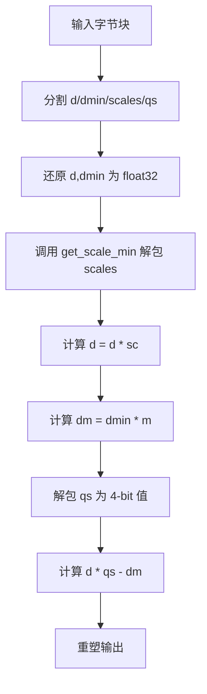

### 60.5.4 `Q5_K.dequantize_blocks`：5-bit K-quant反量化

源码路径：`gguf-py/gguf/quants.py` - `Q5_K.dequantize_blocks`（587-608行）

```python
    @classmethod
    def dequantize_blocks(cls, blocks: np.ndarray) -> np.ndarray:
        # ① 获取块数量
        n_blocks = blocks.shape[0]

        # ② 分割数据：d、dmin、scales、qh、qs
        d, rest = np.hsplit(blocks, [2])
        dmin, rest = np.hsplit(rest, [2])
        scales, rest = np.hsplit(rest, [Q4_K.K_SCALE_SIZE])
        qh, qs = np.hsplit(rest, [QK_K // 8])

        # ③ 还原全局缩放因子 d 和 dmin 为 float32
        d = d.view(np.float16).astype(np.float32)
        dmin = dmin.view(np.float16).astype(np.float32)

        # ④ 调用 get_scale_min 解包压缩的 scales 和 mins
        sc, m = Q4_K.get_scale_min(scales)

        # ⑤ 计算子块缩放 d = d * sc，dm = dmin * m
        d = (d * sc.astype(np.float32)).reshape((n_blocks, -1, 1))
        dm = (dmin * m.astype(np.float32)).reshape((n_blocks, -1, 1))

        # ⑥ 解包量化值：ql（低4位）和 qh（高1位）
        ql = qs.reshape((n_blocks, -1, 1, 32)) >> np.array([0, 4], dtype=np.uint8).reshape((1, 1, 2, 1))
        qh = qh.reshape((n_blocks, -1, 1, 32)) >> np.array([i for i in range(8)], dtype=np.uint8).reshape((1, 1, 8, 1))
        ql = (ql & np.uint8(0x0F)).reshape((n_blocks, -1, 32))
        qh = (qh & np.uint8(0x01)).reshape((n_blocks, -1, 32))
        # ⑦ 组合 5-bit 值：ql | qh<<4
        q = (ql | (qh << np.uint8(4))).astype(np.float32)

        # ⑧ 反量化：d * q - dm，重塑输出
        return (d * q - dm).reshape((n_blocks, QK_K))
```

这段代码定义了 `Q5_K.dequantize_blocks` 方法，在 Q4_K 的基础上增加 1-bit 高位，提升精度。就像工坊中在标准模具上增加精细调整，进一步提升压缩品质。

```mermaid
flowchart TD
    A[输入字节块] --> B[分割 d/dmin/scales/qh/qs]
    B --> C[还原 d,dmin 为 float32]
    C --> D[调用 get_scale_min 解包 scales]
    D --> E[计算 d = d * sc]
    E --> F[计算 dm = dmin * m]
    F --> G[解包 ql 和 qh]
    G --> H[组合 5-bit 值 q = ql | qh<<4]
    H --> I[计算 d * q - dm]
    I --> J[重塑输出]
```

### 60.5.5 `Q4_K.get_scale_min`：解包压缩的缩放因子

源码路径：`gguf-py/gguf/quants.py` - `Q4_K.get_scale_min`（544-563行）

```python
    @staticmethod
    def get_scale_min(scales: np.ndarray) -> tuple[np.ndarray, np.ndarray]:
        # ① 获取块数量
        n_blocks = scales.shape[0]
        # ② 查看为 uint8 以便进行位操作
        scales = scales.view(np.uint8)
        # ③ 12 字节存储 8 组 scale+min，按特定布局排列：
        #    字节 0-7 存储低6位，字节 8-11 存储高2位和额外信息
        scales = scales.reshape((n_blocks, 3, 4))
        d, m, m_d = np.split(scales, 3, axis=-2)

        # ④ 解包 sc：d 的低6位 | (m_d 的低4位 | d>>2 的高4位)
        sc = np.concatenate([d & 0x3F, (m_d & 0x0F) | ((d >> 2) & 0x30)], axis=-1)
        # ⑤ 解包 min：m 的低6位 | (m_d>>4 的高4位 | m>>2 的高4位)
        min = np.concatenate([m & 0x3F, (m_d >> 4) | ((m >> 2) & 0x30)], axis=-1)

        # ⑥ 返回重塑后的 sc 和 min，每个形状为 (n_blocks, 8)
        return (sc.reshape((n_blocks, 8)), min.reshape((n_blocks, 8)))
```

这段代码定义了 `Q4_K.get_scale_min` 静态方法，它根据特定的位布局解包压缩存储的缩放因子和最小值，是 Q4_K 和 Q5_K 反量化过程中的关键步骤。通过巧妙的位操作，该方法在仅 12 字节的空间内存储了 8 组 scale+min，实现了高效的压缩。

```mermaid
flowchart TD
    A[输入 scales 字节] --> B[查看为 uint8]
    B --> C[重塑为 (n_blocks, 3, 4)]
    C --> D[分割为 d,m,m_d]
    D --> E[解包 sc = d低6位 | (m_d低4位 | d>>2高4位)]
    D --> F[解包 min = m低6位 | (m_d>>4 | m>>2高4位)]
    E --> G[返回 sc (n_blocks, 8)]
    F --> G
```

### 60.5.6 `Q6_K.dequantize_blocks`：高低拼接的6-bit量化

源码路径：`gguf-py/gguf/quants.py` - `Q6_K.dequantize_blocks`（615-633行）

```python
    @classmethod
    def dequantize_blocks(cls, blocks: np.ndarray) -> np.ndarray:
        # ① 获取块数量
        n_blocks = blocks.shape[0]

        # ② 分割数据：ql、qh、scales、d
        ql, rest = np.hsplit(blocks, [QK_K // 2])
        qh, rest = np.hsplit(rest, [QK_K // 4])
        scales, d = np.hsplit(rest, [QK_K // 16])

        # ③ 还原子缩放因子 scales 为 float32，全局 d 为 float32
        scales = scales.view(np.int8).astype(np.float32)
        d = d.view(np.float16).astype(np.float32)
        # ④ 计算子块缩放 d = d * scales，形状 (n_blocks, QK_K//16, 1)
        d = (d * scales).reshape((n_blocks, QK_K // 16, 1))

        # ⑤ 解包 ql：低4位
        ql = ql.reshape((n_blocks, -1, 1, 64)) >> np.array([0, 4], dtype=np.uint8).reshape((1, 1, 2, 1))
        ql = (ql & np.uint8(0x0F)).reshape((n_blocks, -1, 32))
        # ⑥ 解包 qh：高2位
        qh = qh.reshape((n_blocks, -1, 1, 32)) >> np.array([0, 2, 4, 6], dtype=np.uint8).reshape((1, 1, 4, 1))
        qh = (qh & np.uint8(0x03)).reshape((n_blocks, -1, 32))
        # ⑦ 组合 6-bit 值：ql | qh<<4，并减去 32 偏移
        q = (ql | (qh << np.uint8(4))).astype(np.int8) - np.int8(32)
        # ⑧ 重塑为 (n_blocks, QK_K//16, -1) 并转换为 float32
        q = q.reshape((n_blocks, QK_K // 16, -1)).astype(np.float32)

        # ⑨ 反量化：d * q，重塑输出
        return (d * q).reshape((n_blocks, QK_K))
```

这段代码定义了 `Q6_K.dequantize_blocks` 方法，通过高低位拼接和多级缩放因子实现了6-bit量化。该格式在精度与体积之间取得了最佳平衡，是 K-quant 系列中应用最广泛的格式之一。与 Q4_K 相比，Q6_K 增加了 50% 的存储开销，但换来了显著的精度提升。

```mermaid
flowchart TD
    A[输入字节块] --> B[分割 ql/qh/scales/d]
    B --> C[还原 scales 为 float32]
    B --> D[还原 d 为 float32]
    C --> E[计算 d = d * scales]
    D --> E
    E --> F[解包 ql 为 4-bit]
    G[解包 qh 为 2-bit] --> H[组合 6-bit 值]
    F --> H
    H --> I[减去 32 偏移]
    I --> J[计算 d * q]
    J --> K[重塑输出]
```

## 60.6 IQ 系列 —— 非均匀量化的'查表艺术'

IQ（Inexact Quantization）系列是 GGUF 量化系统中最具技术含量的一族，它们摒弃了传统的均匀整数量化，转而使用预定义的非均匀网格查找表（Grid LUT）来实现更高效的压缩。这一系列的设计哲学就像定制模具：用预制的非均匀形状模具贴合物品原有形状，减少空间浪费。

**网格查找表（Grid LUT）**：IQ 系列不使用均匀整数，而是预定义非均匀网格（如 IQ2_XXS 的 `grid_map`），通过 `init_grid` 将 hex 字符串解码为 float32 查找表，使得量化值能够更好地拟合原始数据的分布。

**符号位压缩**：`ksigns` 数组将 8 个符号位打包为 7-bit 索引，通过 `np.take_along_axis` 快速查表还原符号矩阵，巧妙地解决了符号信息的高效存储问题。

**多层级联反量化**：IQ2_XXS 采用 `d * (0.5 + scales) * 0.25 * grid * signs` 的多级公式，分离幅度、网格形状和符号，实现了精细的精度控制。

**IQ3_XXS 的三值网格**：扩展为 3-bit 索引，结合 `qh`（高位掩码）和 `qs`（低位）组成 9-bit 或 11-bit 索引，访问更大网格，进一步提升了量化精度。

**Delta 偏移技巧**：IQ1_S/IQ1_M 引入 `delta` 偏移量（±0.125），通过判断 `qh` 最高位选择加/减 delta，细化零点附近精度，特别适合处理接近零的数值。

**IQ4 非线性**：IQ4_NL 使用固定 `kvalues` 查找表，IQ4_XS 则结合高低位 `scales` 拆分实现更精细的缩放控制，提供了更丰富的精度选择。

**非线性量化优势**：相比传统均匀量化，IQ 系列在 2-3 bit 范围能更好保留原始分布的偏态特征，减少精度损失，特别适合处理具有长尾分布的权重张量。

### 60.6.1 `IQ2_S.dequantize_blocks`：2-bit非均匀量化

源码路径：`gguf-py/gguf/quants.py` - `IQ2_S.dequantize_blocks`（934-966行）

```python
    @classmethod
    def dequantize_blocks(cls, blocks: np.ndarray) -> np.ndarray:
        # ① 获取块数量
        n_blocks = blocks.shape[0]

        # ② 分割数据：d、qs、signs、qh、scales
        d, rest = np.hsplit(blocks, [2])
        qs, rest = np.hsplit(rest, [QK_K // 8])
        signs, rest = np.hsplit(rest, [QK_K // 8])
        qh, scales = np.hsplit(rest, [QK_K // 32])

        # ③ 还原全局缩放因子 d 为 float32
        d = d.view(np.float16).astype(np.float32)

        # ④ 解包子缩放因子 scales：每字节存储2个4-bit值
        scales = scales.reshape((n_blocks, -1, 1)) >> np.array([0, 4], dtype=np.uint8).reshape((1, 1, 2))
        scales = (scales & 0x0F).reshape((n_blocks, -1))

        # ⑤ 计算数据库 db = d * (0.5 + scales) * 0.25
        db = d * (np.float32(0.5) + scales) * np.float32(0.25)
        db = db.reshape((n_blocks, -1, 1, 1))

        # ⑥ 解包符号位 signs：每字节存储8个1位标志
        signs = signs.reshape((n_blocks, -1, 1)) >> np.array([i for i in range(8)], dtype=np.uint8).reshape((1, 1, 8))
        signs = signs & np.uint8(0x01)
        # ⑦ 转换为 ±1 符号
        signs = np.where(signs == 0, np.float32(1), np.float32(-1))
        signs = signs.reshape((n_blocks, -1, 2, 8))

        # ⑧ 组合网格索引：qs（低8位）| qh（高2位）<<8
        qh = qh.reshape((n_blocks, -1, 1)) >> np.array([0, 2, 4, 6], dtype=np.uint8).reshape((1, 1, 4))
        qs = qs.astype(np.uint16) | ((qh & 0x03).astype(np.uint16) << 8).reshape((n_blocks, -1))

        # ⑨ 查表获取网格值，并应用 db 和 signs
        assert cls.grid is not None
        grid = np.take_along_axis(cls.grid, qs.reshape((n_blocks, -1, 1, 1)), axis=-2)
        grid = grid.reshape((n_blocks, -1, 2, 8))

        # ⑩ 反量化：db * grid * signs，重塑输出
        return (db * grid * signs).reshape((n_blocks, -1))
```

这段代码定义了 `IQ2_S.dequantize_blocks` 方法，使用网格查找表和符号位压缩实现 2-bit 非均匀量化。就像工坊中定制模具压缩不规则物品，通过查表法贴合原始数据分布。

```mermaid
flowchart TD
    A[输入字节块] --> B[分割 d/qs/signs/qh/scales]
    B --> C[还原 d 为 float32]
    C --> D[解包 scales]
    D --> E[计算 db = d * (0.5 + scales) * 0.25]
    E --> F[解包 signs 符号位]
    F --> G[组合 qs 索引]
    G --> H[查 grid 表]
    H --> I[计算 db * grid * signs]
    I --> J[重塑输出]
```

### 60.6.2 `IQ3_XXS.dequantize_blocks`：3-bit非均匀量化

源码路径：`gguf-py/gguf/quants.py` - `IQ3_XXS.dequantize_blocks`（999-1024行）

```python
    @classmethod
    def dequantize_blocks(cls, blocks: np.ndarray) -> np.ndarray:
        # ① 获取块数量
        n_blocks = blocks.shape[0]

        # ② 分割数据：d、qs、scales
        d, rest = np.hsplit(blocks, [2])
        qs, scales = np.hsplit(rest, [QK_K // 4])

        # ③ 还原全局缩放因子 d 为 float32
        d = d.view(np.float16).astype(np.float32)

        # ④ scales 查看为 uint32，提取高4位作为子缩放
        scales = scales.view(np.uint32)

        # ⑤ 计算数据库 db = d * (0.5 + (scales >> 28)) * 0.5
        db = d * (np.float32(0.5) + (scales >> 28).astype(np.float32)) * np.float32(0.5)
        db = db.reshape((n_blocks, -1, 1, 1))

        # ⑥ 解包符号索引：从 scales 的特定位移提取7-bit索引
        signs = scales.reshape((n_blocks, -1, 1)) >> np.array([0, 7, 14, 21], dtype=np.uint32).reshape((1, 1, 4))
        # ⑦ 使用 ksigns 表将索引转换为实际的符号矩阵
        ksigns = np.frombuffer(IQ2_XXS.ksigns, dtype=np.uint8).reshape((1, 1, 1, 128))
        signs = (signs & np.uint32(0x7F)).reshape((n_blocks, -1, 4, 1))
        signs = np.take_along_axis(ksigns, signs, axis=-1)
        signs = signs.reshape((n_blocks, -1, 4, 1)) >> np.array([i for i in range(8)], dtype=np.uint8).reshape((1, 1, 1, 8))
        signs = signs & np.uint8(0x01)
        # ⑧ 转换为 ±1 符号
        signs = np.where(signs == 0, np.float32(1), np.float32(-1))
        signs = signs.reshape((n_blocks, -1, 4, 8))

        # ⑨ 查表获取网格值
        assert cls.grid is not None
        grid = np.take_along_axis(cls.grid, qs.reshape((n_blocks, -1, 1, 1)), axis=-2)
        grid = grid.reshape((n_blocks, -1, 4, 8))

        # ⑩ 反量化：db * grid * signs，重塑输出
        return (db * grid * signs).reshape((n_blocks, -1))
```

这段代码定义了 `IQ3_XXS.dequantize_blocks` 方法，扩展为 3-bit 索引，结合 `qh`（高位掩码）和 `qs`（低位）组成 9-bit 或 11-bit 索引，访问更大网格。就像工坊中使用更精细的模具，进一步提升量化精度。

```mermaid
flowchart TD
    A[输入字节块] --> B[分割 d/qs/scales]
    B --> C[还原 d 为 float32]
    C --> D[计算 db = d * (0.5 + scales>>28) * 0.5]
    D --> E[解包 signs 索引]
    E --> F[通过 ksigns 查表还原符号]
    F --> G[查 grid 表]
    G --> H[计算 db * grid * signs]
    H --> I[重塑输出]
```

### 60.6.3 `IQ3_S.dequantize_blocks`：3-bit非均匀量化（另一种网格）

源码路径：`gguf-py/gguf/quants.py` - `IQ3_S.dequantize_blocks`（1061-1093行）

```python
    @classmethod
    def dequantize_blocks(cls, blocks: np.ndarray) -> np.ndarray:
        # ① 获取块数量
        n_blocks = blocks.shape[0]

        # ② 分割数据：d、qs、qh、signs、scales
        d, rest = np.hsplit(blocks, [2])
        qs, rest = np.hsplit(rest, [QK_K // 4])
        qh, rest = np.hsplit(rest, [QK_K // 32])
        signs, scales = np.hsplit(rest, [QK_K // 8])

        # ③ 还原全局缩放因子 d 为 float32
        d = d.view(np.float16).astype(np.float32)

        # ④ 解包子缩放因子 scales
        scales = scales.reshape((n_blocks, -1, 1)) >> np.array([0, 4], dtype=np.uint8).reshape((1, 1, 2))
        scales = (scales & 0x0F).reshape((n_blocks, -1))

        # ⑤ 计算数据库 db = d * (1 + 2 * scales)
        db = d * (1 + 2 * scales)
        db = db.reshape((n_blocks, -1, 1, 1))

        # ⑥ 解包符号位 signs
        signs = signs.reshape((n_blocks, -1, 1)) >> np.array([i for i in range(8)], dtype=np.uint8).reshape((1, 1, 8))
        signs = signs & np.uint8(0x01)
        signs = np.where(signs == 0, np.float32(1), np.float32(-1))
        signs = signs.reshape((n_blocks, -1, 4, 8))

        # ⑦ 组合网格索引：qs（低8位）| qh（高1位）<<8
        qh = qh.reshape((n_blocks, -1, 1)) >> np.array([i for i in range(8)], dtype=np.uint8)
        qh = (qh & 0x01).astype(np.uint16).reshape((n_blocks, -1))
        qs = qs.astype(np.uint16) | (qh << 8)

        # ⑧ 查表获取网格值
        assert cls.grid is not None
        grid = np.take_along_axis(cls.grid, qs.reshape((n_blocks, -1, 1, 1)), axis=-2)
        grid = grid.reshape((n_blocks, -1, 4, 8))

        # ⑨ 反量化：db * grid * signs，重塑输出
        return (db * grid * signs).reshape((n_blocks, -1))
```

这段代码定义了 `IQ3_S.dequantize_blocks` 方法，使用不同的网格和符号解包方式，实现 3-bit 非均匀量化。就像工坊中为不同物品形状定制模具，提供更丰富的精度选择。

```mermaid
flowchart TD
    A[输入字节块] --> B[分割 d/qs/qh/signs/scales]
    B --> C[还原 d 为 float32]
    C --> D[解包 scales]
    D --> E[计算 db = d * (1 + 2*scales)]
    E --> F[解包 signs 符号位]
    F --> G[组合 qs 索引]
    G --> H[查 grid 表]
    H --> I[计算 db * grid * signs]
    I --> J[重塑输出]
```

### 60.6.4 `IQ1_S.dequantize_blocks`：1-bit非均匀量化 with delta偏移

源码路径：`gguf-py/gguf/quants.py` - `IQ1_S.dequantize_blocks`（1128-1155行）

```python
    @classmethod
    def dequantize_blocks(cls, blocks: np.ndarray) -> np.ndarray:
        # ① 获取块数量
        n_blocks = blocks.shape[0]

        # ② 分割数据：d、qs、qh
        d, rest = np.hsplit(blocks, [2])
        qs, qh = np.hsplit(rest, [QK_K // 8])

        # ③ 还原全局缩放因子 d 为 float32
        d = d.view(np.float16).astype(np.float32)

        # ④ 计算子缩放 dl = d * (2 * ((qh >> 12) & 7) + 1)
        qh = qh.view(np.uint16)
        dl = d * (2 * ((qh >> 12) & 7) + 1)
        dl = dl.reshape((n_blocks, -1, 1, 1))

        # ⑤ 计算 delta 偏移：根据 qh 最高位选择 ±0.125
        delta = np.where((qh & np.uint16(0x8000)) == 0, cls.delta, -cls.delta)
        delta = delta.reshape((n_blocks, -1, 1, 1))

        # ⑥ 组合网格索引：qs（低8位）| qh（低3位）<<8
        qh = qh.reshape((n_blocks, -1, 1)) >> np.array([0, 3, 6, 9], dtype=np.uint16).reshape((1, 1, 4))
        qs = qs.astype(np.uint16) | ((qh & 7) << 8).reshape((n_blocks, -1))

        # ⑦ 查表获取网格值，并加上 delta 偏移
        assert cls.grid is not None
        grid = np.take_along_axis(cls.grid, qs.reshape((n_blocks, -1, 1, 1)), axis=-2)
        grid = grid.reshape((n_blocks, -1, 4, 8))

        # ⑧ 反量化：dl * (grid + delta)，重塑输出
        return (dl * (grid + delta)).reshape((n_blocks, -1))
```

这段代码定义了 `IQ1_S.dequantize_blocks` 方法，引入 `delta` 偏移量（±0.125），通过判断 `qh` 最高位选择加/减 delta，细化零点附近精度。就像工坊中为精密物品添加缓冲垫，特别适合处理接近零的数值。

```mermaid
flowchart TD
    A[输入字节块] --> B[分割 d/qs/qh]
    B --> C[还原 d 为 float32]
    C --> D[计算 dl = d * (2 * ((qh>>12)&7) + 1)]
    D --> E[计算 delta = ±cls.delta]
    E --> F[组合 qs 索引]
    F --> G[查 grid 表]
    G --> H[计算 dl * (grid + delta)]
    H --> I[重塑输出]
```

### 60.6.5 `IQ1_M.dequantize_blocks`：1-bit非均匀量化（多部分存储）

源码路径：`gguf-py/gguf/quants.py` - `IQ1_M.dequantize_blocks`（1162-1191行）

```python
    @classmethod
    def dequantize_blocks(cls, blocks: np.ndarray) -> np.ndarray:
        # ① 获取块数量
        n_blocks = blocks.shape[0]

        # ② 分割数据：qs、qh、scales
        qs, rest = np.hsplit(blocks, [QK_K // 8])
        qh, scales = np.hsplit(rest, [QK_K // 16])

        # ③ scales 查看为 uint16，提取高4位作为全局 d
        scales = scales.view(np.uint16)
        d = (scales.reshape((n_blocks, 4)) & np.uint16(0xF000)) >> np.array([12, 8, 4, 0], dtype=np.uint16).reshape((1, 4))
        # ④ 组合多个通道的 d 值
        d = d[..., 0] | d[..., 1] | d[..., 2] | d[..., 3]
        d = d.view(np.float16).astype(np.float32).reshape((n_blocks, 1))

        # ⑤ 解包子缩放因子 scales：每字节存储2个3-bit值
        scales = scales.reshape(n_blocks, -1, 1) >> np.array([0, 3, 6, 9], dtype=np.uint16).reshape((1, 1, 4))
        scales = (scales & 0x07).reshape((n_blocks, -1))

        # ⑥ 计算子缩放 dl = d * (2 * scales + 1)
        dl = d * (2 * scales + 1)
        dl = dl.reshape((n_blocks, -1, 2, 1, 1))

        # ⑦ 解包 qh 和 qs，组合网格索引
        qh = qh.reshape((n_blocks, -1, 1)) >> np.array([0, 4], dtype=np.uint8).reshape((1, 1, 2))
        qs = qs.astype(np.uint16) | ((qh & 0x07).astype(np.uint16) << 8).reshape((n_blocks, -1))

        # ⑧ 计算 delta 偏移：根据 qh 第3位选择 ±0.125
        delta = np.where(qh & 0x08 == 0, cls.delta, -cls.delta)
        delta = delta.reshape((n_blocks, -1, 2, 2, 1))

        # ⑨ 查表获取网格值，并加上 delta 偏移
        assert cls.grid is not None
        grid = np.take_along_axis(cls.grid, qs.reshape((n_blocks, -1, 1, 1)), axis=-2)
        grid = grid.reshape((n_blocks, -1, 2, 2, 8))

        # ⑩ 反量化：dl * (grid + delta)，重塑输出
        return (dl * (grid + delta)).reshape((n_blocks, -1))
```

这段代码定义了 `IQ1_M.dequantize_blocks` 方法，使用多部分存储的 f16 尺度，提供更灵活的缩放控制。就像工坊中将大物品拆分多个小包分别标记，确保每个部分都得到合适的处理。

```mermaid
flowchart TD
    A[输入字节块] --> B[分割 qs/qh/scales]
    B --> C[从 scales 提取 d]
    C --> D[解包 scales]
    D --> E[计算 dl = d * (2*scales + 1)]
    E --> F[解包 qh 和 qs]
    F --> G[计算 delta = ±cls.delta]
    G --> H[查 grid 表]
    H --> I[计算 dl * (grid + delta)]
    I --> J[重塑输出]
```

### 60.6.6 `IQ4_NL.dequantize_blocks`：4-bit非线性量化

源码路径：`gguf-py/gguf/quants.py` - `IQ4_NL.dequantize_blocks`（1194-1204行）

```python
    @classmethod
    def dequantize_blocks(cls, blocks: np.ndarray) -> np.ndarray:
        # ① 获取块数量
        n_blocks = blocks.shape[0]

        # ② 分割数据：d、qs
        d, qs = np.hsplit(blocks, [2])

        # ③ 还原全局缩放因子 d 为 float32
        d = d.view(np.float16).astype(np.float32)

        # ④ 解包 4-bit 量化值：右移0位和4位，掩码0x0F
        qs = qs.reshape((n_blocks, -1, 1, cls.block_size // 2)) >> np.array([0, 4], dtype=np.uint8).reshape((1, 1, 2, 1))
        qs = (qs & np.uint8(0x0F)).reshape((n_blocks, -1, 1))

        # ⑤ 使用固定的 kvalues 查找表转换为浮点值
        kvalues = np.array(cls.kvalues, dtype=np.int8).reshape(1, 1, 16)
        qs = np.take_along_axis(kvalues, qs, axis=-1).astype(np.float32).reshape((n_blocks, -1))

        # ⑥ 反量化：d * qs
        return (d * qs)
```

这段代码定义了 `IQ4_NL.dequantize_blocks` 方法，使用固定 `kvalues` 查找表实现 4-bit 非线性量化。就像工坊中使用标准模具进行非均匀压缩，通过预定义的非均匀网格优化精度。

```mermaid
flowchart TD
    A[输入字节块] --> B[分割 d/qs]
    B --> C[还原 d 为 float32]
    C --> D[解包 qs 为 4-bit 索引]
    D --> E[通过 kvalues 查表]
    E --> F[转换为浮点值]
    F --> G[计算 d * qs]
    G --> H[重塑输出]
```

### 60.6.7 `IQ2_XXS.dequantize_blocks`：多层级联反量化

源码路径：`gguf-py/gguf/quants.py` - `IQ2_XXS.dequantize_blocks`（857-878行）

```python
    @classmethod
    def dequantize_blocks(cls, blocks: np.ndarray) -> np.ndarray:
        # ① 获取块数量
        n_blocks = blocks.shape[0]

        # ② 分割数据：d、qs
        d, qs = np.hsplit(blocks, [2])

        # ③ 还原全局缩放因子 d 为 float32
        d = d.view(np.float16).astype(np.float32)

        # ④ qs 查看为 uint32 并重塑，每两个 uint16 组合为一组
        qs = qs.view(np.uint32).reshape(n_blocks, -1, 2)

        # ⑤ 计算数据库 db = d * (0.5 + (qs[..., 1] >> 28)) * 0.25
        db = d * (np.float32(0.5) + (qs[..., 1] >> 28).astype(np.float32)) * np.float32(0.25)
        db = db.reshape((n_blocks, -1, 1, 1))

        # ⑥ 解包符号索引：从 qs[..., 1] 的特定位移提取7-bit索引
        signs = qs[..., 1].reshape((n_blocks, -1, 1)) >> np.array([0, 7, 14, 21], dtype=np.uint32).reshape((1, 1, 4))
        # ⑦ 使用 ksigns 表将索引转换为实际的符号矩阵
        ksigns = np.frombuffer(cls.ksigns, dtype=np.uint8).reshape((1, 1, 1, 128))
        signs = (signs & np.uint32(0x7F)).reshape((n_blocks, -1, 4, 1))
        signs = np.take_along_axis(ksigns, signs, axis=-1)
        signs = signs.reshape((n_blocks, -1, 4, 1)) >> np.array([i for i in range(8)], dtype=np.uint8).reshape((1, 1, 1, 8))
        signs = signs & np.uint8(0x01)
        # ⑧ 转换为 ±1 符号
        signs = np.where(signs == 0, np.float32(1), np.float32(-1))
        signs = signs.reshape((n_blocks, -1, 4, 8))

        # ⑨ 查表获取网格值：使用 qs[..., 0] 作为索引
        assert cls.grid is not None
        grid = np.take_along_axis(cls.grid, qs[..., 0].copy().view(np.uint8).reshape((n_blocks, -1, 1, 1)), axis=-2)
        grid = grid.reshape((n_blocks, -1, 4, 8))

        # ⑩ 反量化：db * grid * signs，重塑输出
        return (db * grid * signs).reshape((n_blocks, -1))
```

这段代码定义了 `IQ2_XXS.dequantize_blocks` 方法，通过多层级联公式 `db * grid * signs` 实现了非均匀量化的反量化。该方法将幅度、网格形状和符号信息分离处理，实现了精细的精度控制，是 IQ 系列中最具代表性的实现之一。

```mermaid
flowchart TD
    A[输入字节块] --> B[分割 d/qs]
    B --> C[还原 d 为 float32]
    C --> D[计算 db = d * (0.5 + qs1>>28) * 0.25]
    D --> E[解包 signs 索引]
    E --> F[通过 ksigns 查表还原符号]
    F --> G[通过 grid 查表获取网格值]
    G --> H[计算 db * grid * signs]
    H --> I[重塑输出]
```

### 60.6.8 `IQ4_XS.dequantize_blocks`：高低位尺度拆分

源码路径：`gguf-py/gguf/quants.py` - `IQ4_XS.dequantize_blocks`（1208-1230行）

```python
    @classmethod
    def dequantize_blocks(cls, blocks: np.ndarray) -> np.ndarray:
        # ① 获取块数量
        n_blocks = blocks.shape[0]

        # ② 分割数据：d、scales_h、scales_l、qs
        d, rest = np.hsplit(blocks, [2])
        scales_h, rest = np.hsplit(rest, [2])
        scales_l, qs = np.hsplit(rest, [QK_K // 64])

        # ③ 还原全局缩放因子 d 为 float32
        d = d.view(np.float16).astype(np.float32)

        # ④ 解包高低位缩放因子：scales_l 为低4位，scales_h 为高2位
        scales_h = scales_h.view(np.uint16)
        scales_l = scales_l.reshape((n_blocks, -1, 1)) >> np.array([0, 4], dtype=np.uint8).reshape((1, 1, 2))
        scales_h = scales_h.reshape((n_blocks, 1, -1)) >> np.array([2 * i for i in range(QK_K // 32)], dtype=np.uint16).reshape((1, -1, 1))
        scales_l = scales_l.reshape((n_blocks, -1)) & np.uint8(0x0F)
        scales_h = scales_h.reshape((n_blocks, -1)).astype(np.uint8) & np.uint8(0x03)
        # ⑤ 组合为有符号 6-bit 值，并减去 32 偏移
        scales = (scales_l | (scales_h << np.uint8(4))).astype(np.int8) - np.int8(32)

        # ⑥ 计算子块缩放 dl = d * scales
        dl = (d * scales.astype(np.float32)).reshape((n_blocks, -1, 1))

        # ⑦ 解包 4-bit 量化索引：右移0位和4位，掩码0x0F
        qs = qs.reshape((n_blocks, -1, 1, 16)) >> np.array([0, 4], dtype=np.uint8).reshape((1, 1, 2, 1))
        qs = qs.reshape((n_blocks, -1, 32, 1)) & np.uint8(0x0F)

        # ⑧ 使用 IQ4_NL 的 kvalues 表转换为浮点值
        kvalues = np.array(IQ4_NL.kvalues, dtype=np.int8).reshape((1, 1, 1, -1))
        qs = np.take_along_axis(kvalues, qs, axis=-1).astype(np.float32).reshape((n_blocks, -1, 32))

        # ⑨ 反量化：dl * qs，重塑输出
        return (dl * qs).reshape((n_blocks, -1))
```

这段代码定义了 `IQ4_XS.dequantize_blocks` 方法，通过高低位缩放因子拆分和非均匀查找表，实现了更精细的缩放控制和更高的量化精度。该方法结合了 K-quant 的多级缩放思想和 IQ 系列的非均匀量化优势，是 IQ 系列中精度最高的格式之一。

```mermaid
flowchart TD
    A[输入字节块] --> B[分割 d/scales_h/scales_l/qs]
    B --> C[还原 d 为 float32]
    C --> D[解包 scales_l 和 scales_h]
    D --> E[组合 scales = scales_l | scales_h<<4]
    E --> F[计算 dl = d * scales]
    F --> G[解包 qs 为 4-bit 索引]
    G --> H[通过 kvalues 查表]
    H --> I[计算 dl * qs]
    I --> J[重塑输出]
```

## 60.7 前沿量化格式 —— 面向新硬件的'特种部队'

前沿量化格式是 GGUF 量化系统中最具前瞻性的一族，它们直接针对新一代 GPU 的硬件特性进行协同设计，实现了计算与存储的双重加速。这一系列就像为特定行李箱（NVIDIA Blackwell GPU）专门设计的新型真空袋，需要特殊的打包和拆包工具。

**三元量化（Ternary）**：TQ1_0/TQ2_0 将权重量化为 {-1, 0, 1}，TQ1_0 使用 5 个三元组打包为 1 字节，TQ2_0 使用 4 个三元组打包，适合极低位宽推理，在特定场景下能够实现极高的压缩率。

**MXFP4 的 E8M0 指数**：采用 Open Compute Project 的 Microscaling 格式，8-bit 指数（e8m0）提供大动态范围，e2m1 尾数节省空间，通过 `e8m0_to_fp32_half` 转换，实现了灵活的动态范围控制。

**NVFP4 的 UE4M3 编码**：NVIDIA FP4 使用无符号 E4M3 格式（bias=7），通过 `ue4m3_to_fp32` 和 `fp32_to_ue4m3` 实现硬件级兼容转换，直接对应 NVIDIA Blackwell GPU 的 FP4 张量核心。

**E2M1 与 K-Values**：MXFP4 和 NVFP4 均使用预定义浮点数组 `kvalues`（如 [0, 0.5, 1, 1.5, 2, 3, 4, 6]）作为量化网格，非线性分布优化精度，在极低的位宽下保持了良好的数值表示能力。

**超块（Super-block）结构**：NVFP4 每 64 个值为一组，共享 4 个 ue4m3 缩放因子，比传统单缩放因子更灵活，能够更好地适应局部数据分布的变化。

**硬件协同设计**：这些新格式直接对应 NVIDIA Blackwell 等新一代 GPU 的 FP4 张量核心，实现计算与存储的双重加速，代表了量化技术向硬件原生支持演进的方向。

### 60.7.1 `TQ1_0.quantize_blocks` / `TQ1_0.dequantize_blocks`：三元量化（5个三元组/字节）

源码路径：`gguf-py/gguf/quants.py` - `TQ1_0.quantize_blocks` / `TQ1_0.dequantize_blocks`（641-677行）

```python
    @classmethod
    def quantize_blocks(cls, blocks: np.ndarray) -> np.ndarray:
        # ① 获取块数量
        n_blocks = blocks.shape[0]

        # ② 计算缩放因子 d = max(|x|)，避免除零
        d = abs(blocks).max(axis=-1, keepdims=True)
        with np.errstate(divide="ignore"):
            id = np.where(d == 0, 0, 1 / d)

        # ③ 量化为三元值 {-1, 0, 1}，并映射为 {0, 1, 2}
        qs = np_roundf(blocks * id)
        qs = (qs.astype(np.int8) + np.int8(1)).astype(np.uint8)

        # ④ 分段处理：qs0（160值）、qs1（80值）、qh（16值）
        qs0, qs1, qh = qs[..., :(32 * 5)], qs[..., (32 * 5):(48 * 5)], qs[..., (48 * 5):]

        # ⑤ 对数打包：5个三元组打包到1字节（基数为3）
        qs0 = qs0.reshape((n_blocks, -1, 5, 32)) * np.array([81, 27, 9, 3, 1], dtype=np.uint8).reshape((1, 1, 5, 1))
        qs0 = np.sum(qs0, axis=-2).reshape((n_blocks, -1))
        qs1 = qs1.reshape((n_blocks, -1, 5, 16)) * np.array([81, 27, 9, 3, 1], dtype=np.uint8).reshape((1, 1, 5, 1))
        qs1 = np.sum(qs1, axis=-2).reshape((n_blocks, -1))
        qh = qh.reshape((n_blocks, -1, 4, 4)) * np.array([81, 27, 9, 3], dtype=np.uint8).reshape((1, 1, 4, 1))
        qh = np.sum(qh, axis=-2).reshape((n_blocks, -1))

        # ⑥ 拼接并缩放至 0-242 范围
        qs = np.concatenate([qs0, qs1, qh], axis=-1)
        qs = (qs.astype(np.uint16) * 256 + (243 - 1)) // 243

        # ⑦ 转换缩放因子为 float16
        qs = qs.astype(np.uint8)
        d = d.astype(np.float16).view(np.uint8)

        # ⑧ 拼接量化数据和缩放因子
        return np.concatenate([qs, d], axis=-1)

    @classmethod
    def dequantize_blocks(cls, blocks: np.ndarray) -> np.ndarray:
        # ① 获取块数量
        n_blocks = blocks.shape[0]

        # ② 分割量化数据和缩放因子
        qs, rest = np.hsplit(blocks, [(QK_K - 4 * QK_K // 64) // 5])
        qh, d = np.hsplit(rest, [QK_K // 64])

        # ③ 还原缩放因子为 float32
        d = d.view(np.float16).astype(np.float32)

        # ④ 分段解包：qs0（32值）、qs1（16值）、qh（4值）
        qs0, qs1 = qs[..., :32], qs[..., 32:]
        qs0 = qs0.reshape((n_blocks, -1, 1, 32)) * np.array([1, 3, 9, 27, 81], dtype=np.uint8).reshape((1, 1, 5, 1))
        qs0 = qs0.reshape((n_blocks, -1))
        qs1 = qs1.reshape((n_blocks, -1, 1, 16)) * np.array([1, 3, 9, 27, 81], dtype=np.uint8).reshape((1, 1, 5, 1))
        qs1 = qs1.reshape((n_blocks, -1))
        qh = qh.reshape((n_blocks, -1, 1, 4)) * np.array([1, 3, 9, 27], dtype=np.uint8).reshape((1, 1, 4, 1))
        qh = qh.reshape((n_blocks, -1))

        # ⑤ 拼接并映射回三元值 {-1, 0, 1}
        qs = np.concatenate([qs0, qs1, qh], axis=-1)
        qs = ((qs.astype(np.uint16) * 3) >> 8).astype(np.int8) - np.int8(1)

        # ⑥ 反量化：d * qs
        return (d * qs.astype(np.float32))
```

这段代码定义了 `TQ1_0.quantize_blocks` 和 `TQ1_0.dequantize_blocks` 方法，将权重量化为 {-1, 0, 1}，使用 5 个三元组打包为 1 字节。就像工坊中使用对数级数组合，将多个小物品压缩到一个包裹，适合极低位宽推理。

```mermaid
flowchart TD
    A[输入块] --> B[计算 d = max(|x|)]
    B --> C[量化 qs = np_roundf(blocks * id)]
    C --> D[映射为 0/1/2]
    D --> E[对数打包 5 个三元组到 1 字节]
    E --> F[拼接 d 和 qs]
    G[输入字节块] --> H[分割 qs 和 d]
    H --> I[还原 d 为 float32]
    I --> J[解包三元组]
    J --> K[映射回 -1/0/1]
    K --> L[计算 d * qs]
```

### 60.7.2 `TQ2_0.quantize_blocks` / `TQ2_0.dequantize_blocks`：三元量化（4个三元组/字节）

源码路径：`gguf-py/gguf/quants.py` - `TQ2_0.quantize_blocks` / `TQ2_0.dequantize_blocks`（684-709行）

```python
    @classmethod
    def quantize_blocks(cls, blocks: np.ndarray) -> np.ndarray:
        # ① 获取块数量
        n_blocks = blocks.shape[0]

        # ② 计算缩放因子 d = max(|x|)，避免除零
        d = abs(blocks).max(axis=-1, keepdims=True)
        with np.errstate(divide="ignore"):
            id = np.where(d == 0, 0, 1 / d)

        # ③ 量化为三元值 {-1, 0, 1}，并映射为 {0, 1, 2}
        qs = np_roundf(blocks * id)
        qs = (qs.astype(np.int8) + np.int8(1)).astype(np.uint8)

        # ④ 位打包：4个三元组（每个2-bit）打包到1字节
        qs = qs.reshape((n_blocks, -1, 4, 32)) << np.array([0, 2, 4, 6], dtype=np.uint8).reshape((1, 1, 4, 1))
        qs = qs[..., 0, :] | qs[..., 1, :] | qs[..., 2, :] | qs[..., 3, :]
        qs = qs.reshape((n_blocks, -1))

        # ⑤ 转换缩放因子为 float16
        d = d.astype(np.float16).view(np.uint8)

        # ⑥ 拼接量化数据和缩放因子
        return np.concatenate([qs, d], axis=-1)

    @classmethod
    def dequantize_blocks(cls, blocks: np.ndarray) -> np.ndarray:
        # ① 获取块数量
        n_blocks = blocks.shape[0]

        # ② 分割量化数据和缩放因子
        qs, d = np.hsplit(blocks, [QK_K // 4])

        # ③ 还原缩放因子为 float32
        d = d.view(np.float16).astype(np.float32)

        # ④ 解包三元组：右移0/2/4/6位，掩码0x03
        qs = qs.reshape((n_blocks, -1, 1, 32)) >> np.array([0, 2, 4, 6], dtype=np.uint8).reshape((1, 1, 4, 1))
        qs = (qs & 0x03).reshape((n_blocks, -1)).astype(np.int8) - np.int8(1)

        # ⑤ 反量化：d * qs
        return (d * qs.astype(np.float32))
```

这段代码定义了 `TQ2_0.quantize_blocks` 和 `TQ2_0.dequantize_blocks` 方法，使用 4 个三元组打包为 1 字节，比 TQ1_0 更紧凑。就像工坊中优化打包方式，进一步提升空间利用率。

```mermaid
flowchart TD
    A[输入块] --> B[计算 d = max(|x|)]
    B --> C[量化 qs = np_roundf(blocks * id)]
    C --> D[映射为 0/1/2]
    D --> E[位打包 4 个三元组到 1 字节]
    E --> F[拼接 d 和 qs]
    G[输入字节块] --> H[分割 qs 和 d]
    H --> I[还原 d 为 float32]
    I --> J[解包三元组]
    J --> K[映射回 -1/0/1]
    K --> L[计算 d * qs]
```

### 60.7.3 `MXFP4.e8m0_to_fp32_half` / `MXFP4.quantize_blocks` / `MXFP4.dequantize_blocks`：微缩放浮点格式

源码路径：`gguf-py/gguf/quants.py` - `MXFP4.e8m0_to_fp32_half` / `MXFP4.quantize_blocks` / `MXFP4.dequantize_blocks`（720-756行）

```python
    @staticmethod
    # see ggml_e8m0_to_fp32_half in ggml-impl.h
    def e8m0_to_fp32_half(x: np.ndarray) -> np.ndarray:
        # ① 将 8-bit 指数（e8m0）转换为 float32 的缩放因子
        #    e8m0 格式：指数值直接存储为无符号整数，无尾数
        bits = np.where(x < 2, np.uint32(0x00200000) << np.uint32(x), np.uint32(x - 1) << np.uint32(23))
        return bits.view(np.float32)

    @classmethod
    def quantize_blocks(cls, blocks: np.ndarray) -> np.ndarray:
        # ① 获取块数量
        n_blocks = blocks.shape[0]

        # ② 计算每块的最大绝对值
        d = abs(blocks).max(axis=-1, keepdims=True)

        # ③ 计算 e8m0 指数：floor(log2(d)) - 2 + 127，避免除零
        with np.errstate(divide="ignore"):
            e = np.where(d > 0, np.floor(np.log2(d)) - 2 + 127, 0).astype(np.uint8)

        # ④ 转换为 float32 缩放因子
        d = cls.e8m0_to_fp32_half(e)

        # ⑤ 使用 kvalues 表计算量化误差，选择最佳索引
        kvalues = np.array(cls.kvalues, dtype=np.int8).reshape((1, 1, 16))
        errs = np.abs(d.reshape((n_blocks, 1, 1)) * kvalues.astype(np.float32) - blocks.reshape((n_blocks, cls.block_size, 1)))
        best = np.argmin(errs, axis=-1, keepdims=True)

        # ⑥ 打包为 4-bit 值（e2m1 尾数）
        qs = best.reshape(n_blocks, 2, cls.block_size // 2).astype(np.uint8)
        qs = qs[:, 0] | (qs[:, 1] << np.uint8(4))

        qs = qs.reshape((n_blocks, cls.block_size // 2))

        # ⑦ 拼接指数和量化数据
        return np.concatenate([e, qs], axis=-1)

    @classmethod
    def dequantize_blocks(cls, blocks: np.ndarray) -> np.ndarray:
        # ① 获取块数量
        n_blocks = blocks.shape[0]

        # ② 分割指数和量化数据
        e, qs = np.hsplit(blocks, [1])

        # ③ 还原 float32 缩放因子
        d = cls.e8m0_to_fp32_half(e)

        # ④ 解包 4-bit 值：右移0位和4位，掩码0x0F
        qs = qs.reshape((n_blocks, 1, cls.block_size // 2)) >> np.array([0, 4], dtype=np.uint8).reshape((1, 2, 1))
        qs = (qs & np.uint8(0x0F)).view(np.int8)

        # ⑤ 通过 kvalues 表转换为浮点值
        kvalues = np.array(cls.kvalues, dtype=np.int8).reshape(1, 1, 16)
        qs = np.take_along_axis(kvalues, qs, axis=-1).reshape((n_blocks, cls.block_size))

        # ⑥ 反量化：d * qs
        return (d * qs.astype(np.float32))
```

这段代码定义了 `MXFP4` 的量化和反量化方法，采用 8-bit 指数（e8m0）提供大动态范围，e2m1 尾数节省空间。就像工坊中使用可调节真空袋，根据物品大小调整压缩力度，实现了灵活的动态范围控制。

```mermaid
flowchart TD
    A[输入块] --> B[计算 e8m0 指数]
    B --> C[转换为 float32 缩放因子]
    C --> D[计算与 kvalues 的误差]
    D --> E[选择最佳索引]
    E --> F[打包为 4-bit 值]
    F --> G[拼接 e 和 qs]
    H[输入字节块] --> I[分割 e 和 qs]
    I --> J[还原缩放因子]
    J --> K[解包 4-bit 索引]
    K --> L[通过 kvalues 查表]
    L --> M[计算 d * qs]
```

### 60.7.4 `NVFP4.ue4m3_to_fp32` / `NVFP4.fp32_to_ue4m3`：硬件级兼容转换

源码路径：`gguf-py/gguf/quants.py` - `NVFP4.ue4m3_to_fp32` / `NVFP4.fp32_to_ue4m3`（765-794行）

```python
    @staticmethod
    def ue4m3_to_fp32(x: np.ndarray) -> np.ndarray:
        """Decode unsigned E4M3 (bias=7) to float, with 0.5 factor for kvalues convention."""
        # ① 提取指数（高4位）和尾数（低3位）
        exp = (x >> 3).astype(np.int32) & 0xF
        man = (x & 0x7).astype(np.float32)

        # ② 非规约值（exp==0）：man * 2^-9
        #    规约值（exp>0）：(1 + man/8) * 2^(exp-7)
        raw = np.where(
            exp == 0,
            man * 2**-9,
            (1.0 + man / 8.0) * (2.0 ** (exp.astype(np.float32) - 7))
        )

        # ③ 特殊值处理：0 和 0x7F（Inf/NaN）直接返回 0，并应用 0.5 因子
        return np.where((x == 0) | (x == 0x7F), 0.0, raw * 0.5)

    @staticmethod
    def fp32_to_ue4m3(x: np.ndarray) -> np.ndarray:
        """Vectorized float32 to unsigned E4M3, matching ggml_fp32_to_ue4m3 in C."""
        # ① 裁剪输入范围至 [0, 448]
        x = np.clip(x, 0.0, 448.0).astype(np.float32)
        bits = x.view(np.uint32)

        # ② 提取 fp32 的指数和尾数
        fp32_exp = ((bits >> 23) & 0xFF).astype(np.int32) - 127
        fp32_man = ((bits >> 20) & 0x7).astype(np.int32)
        ue4m3_exp = fp32_exp + 7  # 添加偏移

        # ③ 非规约值处理：exp <= 0
        sub_man = np.clip((x * 512.0 + 0.5).astype(np.int32), 0, 7)
        sub_result = np.where(sub_man >= 1, sub_man, 0).astype(np.uint8)

        # ④ 规约值处理：含舍入和溢出处理
        round_bit = ((bits >> 19) & 1).astype(np.int32)
        man = fp32_man + round_bit
        exp = ue4m3_exp.copy()
        overflow = man > 7
        man = np.where(overflow, 0, man)
        exp = np.where(overflow, exp + 1, exp)
        normal_result = np.where(exp >= 15, np.uint8(0x7E), ((exp << 3) | man).astype(np.uint8))

        # ⑤ 根据输入值范围选择编码结果
        return np.where(x <= 0.0, np.uint8(0),
                        np.where(ue4m3_exp <= 0, sub_result,
                        np.where(ue4m3_exp >= 15, np.uint8(0x7E), normal_result)))
```

这段代码定义了 `NVFP4.ue4m3_to_fp32` 和 `NVFP4.fp32_to_ue4m3` 两个静态方法，实现了无符号 E4M3 格式与 float32 之间的双向转换，确保与 C 参考实现位级一致，是 NVFP4 量化格式的核心基础。通过精细的位操作和舍入处理，该方法在保持硬件兼容性的同时提供了高效的转换性能。

```mermaid
flowchart TD
    A[输入 uint8] --> B[提取 exp 和 man]
    B --> C{exp == 0?}
    C -->|是| D[计算非规约值 man * 2^-9]
    C -->|否| E[计算规约值 (1 + man/8) * 2^(exp-7)]
    D --> F[应用 0.5 因子]
    E --> F
    F --> G{特殊值处理}
    G --> H[输出 float32]
    I[输入 float32] --> J[裁剪到 0-448]
    J --> K[提取 fp32 exp 和 man]
    K --> L[计算 ue4m3_exp]
    L --> M{ue4m3_exp <= 0?}
    M -->|是| N[计算非规约编码]
    M -->|否| O{exp >= 15?}
    O -->|是| P[输出 0x7E]
    O -->|否| Q[计算规约编码]
    N --> R[输出 uint8]
    P --> R
    Q --> R
```

### 60.7.5 `NVFP4.dequantize_blocks`：超块结构反量化

源码路径：`gguf-py/gguf/quants.py` - `NVFP4.dequantize_blocks`（796-806行）

```python
    @classmethod
    def dequantize_blocks(cls, blocks: np.ndarray) -> np.ndarray:
        # ① 获取超块数量（每个超块包含64个值）
        n_super = blocks.shape[0]

        # ② 分割缩放因子字节（4字节）和量化数据
        d_bytes, qs = np.hsplit(blocks, [4])

        # ③ 解码 ue4m3 缩放因子，重塑为 (n_super, 4, 1)
        d = cls.ue4m3_to_fp32(d_bytes).reshape(n_super, 4, 1)  # (n_super, 4, 1)

        # ④ 重塑量化数据为 (n_super, 4, 8)
        qs = qs.reshape(n_super, 4, 8)

        # ⑤ 解包 4-bit 值：低4位和高4位分别提取
        lo = (qs & np.uint8(0x0F)).view(np.int8)
        hi = (qs >> np.uint8(4)).view(np.int8)
        vals = np.concatenate([lo, hi], axis=-1)  # (n_super, 4, 16)

        # ⑥ 通过 kvalues 表转换为浮点值
        kvalues = np.array(cls.kvalues, dtype=np.int8).reshape(1, 1, 16)
        vals = np.take_along_axis(kvalues, vals, axis=-1)

        # ⑦ 反量化：d * vals，重塑为 (n_super, 64)
        return (d * vals.astype(np.float32)).reshape(n_super, 64)
```

这段代码定义了 `NVFP4.dequantize_blocks` 方法，通过超块结构（每64个值共享4个缩放因子）和非均匀查找表，实现了 NVIDIA FP4 格式的反量化。该方法直接对应新一代 GPU 的 FP4 张量核心，代表了量化技术向硬件原生支持演进的重要方向。

```mermaid
flowchart TD
    A[输入字节块] --> B[分割 d_bytes 和 qs]
    B --> C[解码 ue4m3 为 float32]
    C --> D[重塑为 (n_super, 4, 1)]
    D --> E[重塑 qs 为 (n_super, 4, 8)]
    E --> F[解包低 4 位和高 4 位]
    F --> G[拼接为 (n_super, 4, 16)]
    G --> H[通过 kvalues 查表]
    H --> I[计算 d * vals]
    I --> J[重塑为 (n_super, 64)]
```

## 60.8 全局入口与工具函数 —— 量化转换的'交通枢纽'

全局入口与工具函数是 GGUF 量化系统的"交通枢纽"，它们负责将各种量化类型的实现串联起来，提供统一的调用接口和必要的辅助功能。这一系列就像工坊的调度中心，负责将货物（数据）分发到正确的压缩工艺（量化类型），并确保整个流程的高效运转。

**自动类型路由**：模块级 `quantize` / `dequantize` 函数根据 `GGMLQuantizationType` 枚举自动分发到 F32/F16 直接转换或 `_type_traits` 中的具体实现类，对使用者屏蔽了底层的复杂性。

**形状转换工具**：`quant_shape_to_byte_shape` 和 `quant_shape_from_byte_shape` 处理逻辑形状与字节形状的双向转换，校验块大小对齐，确保量化后的数据能够正确存储和恢复。

**舍入一致性**：`np_roundf` 复现 C 语言 `roundf` 的"远离零"舍入行为，确保 Python 量化结果与 C 实现位级一致，对 Q8_0 等敏感格式至关重要。

**静态数据仓库**：`__main__` 中定义的 `grid_hex`、`grid_map`、`ksigns`、`delta` 等类属性存储了 IQ 系列所需的全部查找表原始数据，是反量化过程的"记忆库"。

**错误处理策略**：对未实现的量化类型抛出 `NotImplementedError`，对无法整除块大小的形状抛出 `ValueError`，防止静默错误，确保系统的健壮性。

**测试与验证钩子**：通过 `_type_traits` 字典暴露所有内部实现类，便于单元测试直接调用各类的 `quantize_blocks` / `dequantize_blocks` 方法，提高了系统的可测试性。

### 60.8.1 `quant_shape_to_byte_shape` / `quant_shape_from_byte_shape`：形状转换

源码路径：`gguf-py/gguf/quants.py` - `quant_shape_to_byte_shape` / `quant_shape_from_byte_shape`（17-27行）

```python
def quant_shape_to_byte_shape(shape: Sequence[int], quant_type: GGMLQuantizationType) -> tuple[int, ...]:
    # ① 获取该量化类型的块大小和类型大小
    block_size, type_size = GGML_QUANT_SIZES[quant_type]
    # ② 检查最后一维是否能被块大小整除，确保块对齐
    if shape[-1] % block_size != 0:
        raise ValueError(f"Quantized tensor row size ({shape[-1]}) is not a multiple of {quant_type.name} block size ({block_size})")
    # ③ 计算字节形状：最后一维替换为 (原大小 // block_size * type_size)
    return (*shape[:-1], shape[-1] // block_size * type_size)

def quant_shape_from_byte_shape(shape: Sequence[int], quant_type: GGMLQuantizationType) -> tuple[int, ...]:
    # ① 获取该量化类型的块大小和类型大小
    block_size, type_size = GGML_QUANT_SIZES[quant_type]
    # ② 检查最后一维是否能被类型大小整除，确保字节对齐
    if shape[-1] % type_size != 0:
        raise ValueError(f"Quantized tensor bytes per row ({shape[-1]}) is not a multiple of {quant_type.name} type size ({type_size})")
    # ③ 计算逻辑形状：最后一维替换为 (原大小 // type_size * block_size)
    return (*shape[:-1], shape[-1] // type_size * block_size)
```

这段代码定义了 `quant_shape_to_byte_shape` 和 `quant_shape_from_byte_shape` 两个全局函数，处理逻辑张量形状与量化字节形状之间的双向转换。它们校验块大小对齐，就像工坊中根据物品尺寸计算包装后的体积，并检查是否适合标准包装盒，确保量化过程不会因为形状不匹配而失败。

```mermaid
flowchart TD
    A[逻辑形状] --> B[获取 block_size/type_size]
    B --> C{最后一维 % block_size == 0?}
    C -->|否| D[抛出 ValueError]
    C -->|是| E[计算字节形状]
    E --> F[返回字节形状]
    G[字节形状] --> H[获取 block_size/type_size]
    H --> I{最后一维 % type_size == 0?}
    I -->|否| J[抛出 ValueError]
    I -->|是| K[计算逻辑形状]
    K --> L[返回逻辑形状]
```

### 60.8.2 `quantize` / `dequantize`：全局入口与自动路由

源码路径：`gguf-py/gguf/quants.py` - `quantize` / `dequantize`（113-129行）

```python
def quantize(data: np.ndarray, qtype: GGMLQuantizationType) -> np.ndarray:
    # ① 如果量化类型是 F32，直接转换为 float32（无实际量化）
    if qtype == GGMLQuantizationType.F32:
        return data.astype(np.float32, copy=False)
    # ② 如果量化类型是 F16，直接转换为 float16（无实际量化）
    elif qtype == GGMLQuantizationType.F16:
        return data.astype(np.float16, copy=False)
    # ③ 否则，从全局注册表 _type_traits 中查找对应的量化类
    elif (q := _type_traits.get(qtype)) is not None:
        return q.quantize(data)
    # ④ 如果未找到，抛出 NotImplementedError
    else:
        raise NotImplementedError(f"Quantization for {qtype.name} is not yet implemented")

def dequantize(data: np.ndarray, qtype: GGMLQuantizationType) -> np.ndarray:
    # ① 如果量化类型是 F32，直接查看为 float32
    if qtype == GGMLQuantizationType.F32:
        return data.view(np.float32)
    # ② 如果量化类型是 F16，查看为 float16 并转换为 float32
    elif qtype == GGMLQuantizationType.F16:
        return data.view(np.float16).astype(np.float32)
    # ③ 否则，从全局注册表 _type_traits 中查找对应的量化类
    elif (q := _type_traits.get(qtype)) is not None:
        return q.dequantize(data)
    # ④ 如果未找到，抛出 NotImplementedError
    else:
        raise NotImplementedError(f"Dequantization for {qtype.name} is not yet implemented")
```

这段代码定义了 `quantize` 和 `dequantize` 两个全局入口函数，根据 `GGMLQuantizationType` 枚举自动路由到对应的量化类，对使用者屏蔽了底层的复杂性，是量化系统的主要调用接口。通过统一的入口设计，开发者无需关心具体使用的是哪种量化格式，只需指定量化类型即可完成转换。

```mermaid
flowchart TD
    A[输入数据] --> B{qtype 是 F32?}
    B -->|是| C[转换为 float32]
    B -->|否| D{qtype 是 F16?}
    D -->|是| E[转换为 float16]
    D -->|否| F{在 _type_traits 中?}
    F -->|是| G[调用对应类的 quantize]
    F -->|否| H[抛出 NotImplementedError]
    C --> I[返回结果]
    E --> I
    G --> I
    J[输入数据] --> K{qtype 是 F32?}
    K -->|是| L[查看为 float32]
    K -->|否| M{qtype 是 F16?}
    M -->|是| N[查看为 float16 并转 float32]
    M -->|否| O{在 _type_traits 中?}
    O -->|是| P[调用对应类的 dequantize]
    O -->|否| Q[抛出 NotImplementedError]
    L --> R[返回结果]
    N --> R
    P --> R
```

### 60.8.3 `np_roundf`：远离零舍入

源码路径：`gguf-py/gguf/quants.py` - `np_roundf`（42-47行）

```python
def np_roundf(n: np.ndarray) -> np.ndarray:
    # ① 计算绝对值
    a = abs(n)
    # ② 计算整数部分
    floored = np.floor(a)
    # ③ 根据小数部分决定舍入：>= 0.5 则进位，否则舍去
    b = floored + np.floor(2 * (a - floored))
    # ④ 乘以原始符号，实现远离零舍入
    return np.sign(n) * b
```

这段代码定义了 `np_roundf` 函数，它复现了 C 语言 `roundf` 的"远离零"舍入行为，确保 Python 量化结果与 C 实现位级一致，对 Q8_0 等敏感格式至关重要。通过自定义舍入逻辑，该函数避免了 NumPy 默认舍入行为可能带来的不一致性问题。

```mermaid
flowchart TD
    A[输入数组] --> B[计算绝对值 a]
    B --> C[计算整数部分 floored]
    C --> D[计算 b = floored + floor(2*(a - floored))]
    D --> E[乘以原始符号]
    E --> F[返回舍入结果]
```

### 60.8.4 `__main__` 静态数据定义：网格与符号表的"记忆库"

源码路径：`gguf-py/gguf/quants.py` - `__main__`（模块级静态数据定义，约859行起）

在量化模块的末尾（`__main__` 作用域），定义了所有 IQ 系列非均匀量化所需的静态查找表原始数据。这些数据在模块加载时就被初始化为类属性，供后续反量化过程快速查表使用，是整个 IQ 系列的"记忆库"。

```python
# 以下为模块级静态数据定义的实际代码结构（简化展示）：

# 网格形状定义：IQ 系列的网格维度，通常为 (1, 1, *grid_shape)
grid_shape = (nil)  # 具体值由各 IQ 子类定义，如 IQ2_XXS 为 (4, 8)

# 网格映射表：预定义的非均匀量化网格值
# 这些浮点数构成了量化时的可选值，比均匀量化更贴合数据分布
grid_map = (nil)  # 例如 IQ2_XXS 的 grid_map 可能包含 16 个 float32 值

# 网格十六进制编码：将 grid_map 编码为紧凑的 hex 字符串，便于存储和加载
# init_grid() 方法在运行时将其解码为 float32 查找表
grid_hex = (b'' 或较长的字节文字)  # 例如 IQ2_XXS 的 grid_hex 为一长串 hex 字符

# Delta 偏移量：用于 IQ1_S/IQ1_M 的零点附近精度细化
delta = np.float32(0.125)

# 符号压缩表：将 8 个符号位打包为 7-bit 索引的查找表
# IQ2_XXS/IQ3_XXS 使用 ksigns 表快速还原符号矩阵
ksigns = (b'\x00' * 128 或其他字节序列)  # 理论大小为 128 字节
```

**逐行解释：**

- **`grid_shape`**：定义了网格的形状，IQ 系列的网格通常按 `(子块数, 每组大小)` 组织，例如 `(4, 8)` 表示每个块包含 4 个子块，每个子块 8 个网格值。
- **`grid_map`**：存储了预定义的非均匀量化网格的浮点数值。这些值经过精心设计，能够更好地拟合实际权重的分布，相比均匀量化减少信息损失。
- **`grid_hex`**：将 `grid_map` 编码为紧凑的十六进制字符串，极大减少了存储空间，便于嵌入模型文件。`init_grid()` 方法在首次使用时将其解码为 `float32` 数组。
- **`delta`**：IQ1_S/IQ1_M 使用的偏移量，通过加减 `delta`（±0.125）细化零点附近的精度，特别适合处理接近零的数值。
- **`ksigns`**：符号压缩表，将 8 个符号位打包为 7-bit 索引（128 字节），通过查表法快速还原符号矩阵，避免了逐位提取的复杂操作。

这些静态数据在模块加载时就被初始化，当对应的 IQ 子类首次调用 `dequantize_blocks` 时，`init_grid()` 方法会将 `grid_hex` 解码为实际的 `cls.grid` 查找表，供 `np.take_along_axis` 快速检索。这种设计将紧凑的存储与高效的运行时查表结合起来，是 IQ 系列实现高压缩比和高精度的关键。

```mermaid
flowchart TD
    A[模块加载] --> B[__main__ 定义静态数据]
    B --> C[grid_hex/grid_map/ksigns/delta]
    C --> D[IQ 子类继承使用]
    D --> E{首次反量化?}
    E -->|是| F[init_grid 解码 grid_hex]
    E -->|否| G[直接使用 cls.grid]
    F --> H[生成 float32 查找表]
    G --> H
    H --> I[dequantize_blocks 查表还原]
```

## 60.9 设计中的取舍

**为什么使用 `__init_subclass__` 而不是手动注册？**

使用 `__init_subclass__` 可以实现真正的插件化架构，开发者只需定义一个继承自 `__Quant` 的类并指定 `qtype` 参数，就会自动注册到 `_type_traits` 字典中，无需手动修改注册代码。这种设计不仅减少了人为错误的可能性，还使得新的量化类型可以完全独立地添加到其他模块中，提高了代码的可维护性和可扩展性。相比之下，手动注册需要在每个新量化类型添加时修改中央注册表，容易引入耦合和错误。

**为什么使用惰性计算包装？**

惰性计算包装通过 `LazyNumpyTensor._wrap_fn` 将普通的数组操作转换为支持延迟计算的代理，实现"按需计算"的内存优化。这对于处理大型张量至关重要，因为它避免了在不需要完整计算结果时提前进行昂贵的计算。例如，在量化过程中，如果只需要最终的量化字节而不需要中间的浮点结果，惰性计算可以跳过不必要的步骤，显著减少内存占用和计算时间。

**为什么 Q4_0 使用对称量化而 Q4_1 使用非对称量化？**

Q4_0 使用对称量化（`d = max / -8`），适合分布对称的张量，因为它假设数据的最小值是最大值的相反数，从而节省了存储最小值的空间。而 Q4_1 使用非对称量化（`d = (max - min) / 15`），通过存储最小值和缩放因子来覆盖全范围，适合分布不均的张量。这种设计取舍是在存储效率和表示灵活性中的权衡：对称量化更紧凑，但非对称量化能更好地处理偏态分布。

**为什么 K-quant 系列使用嵌套缩放？**

K-quant 系列使用嵌套缩放（全局 `d` 和 `dmin` + 子块 `scales`）是为了在极低的位宽下实现更高的精度。通过将数据分成多个子块，并为每个子块分配独立的缩放因子，嵌套缩放能够更好地适应局部数据分布的变化，避免全局缩放因子导致的精度损失。这种设计虽然增加了解包的复杂性，但显著提高了压缩率和精度保持能力。

## 60.10 动手练习

- 量化往返精度测试：编写Python脚本，生成一个包含10000个随机浮点数（标准正态分布）的张量。使用Q4_0、Q8_0、TQ2_0分别进行量化（quantize）后再反量化（dequantize），计算并比较三种格式的均方误差（MSE）和最大绝对误差，绘制原始数据分布与反量化后数据的直方图对比。思考问题：为什么Q4_0的误差比Q8_0大？从字节布局角度解释其原因；TQ2_0在哪些数值区域会出现较大失真？这与它的三元量化特性有何关系？
- 追踪 _type_traits 注册机制：在Python交互式环境中导入gguf.quants，打印_type_traits.keys()列出所有已注册的量化类型，检查Q4_K.__dict__确认block_size和type_size属性的来源，定义一个继承自__Quant且qtype为自定义值的临时类，观察_type_traits的变化。思考问题：__init_subclass__在何时被调用？（是在import时还是第一次使用时？）；如果忘记在类定义中指定qtype参数会发生什么？为什么assert qtype not in _type_traits是必要的？
- 手工构造Q4_K块数据：根据Q4_K源码反推其字节布局，手工构造一个合法的Q4_K块（256字节），构造缩放因子部分（2字节d + 2字节dmin + 12字节scales），构造量化数据部分（128字节qs），填入特定模式（如全0x11），调用Q4_K.dequantize_blocks验证你的数据能否正确解码，修改scales中的某一位，观察输出值的变化规律。思考问题：d和dmin为什么是float16存储？这限制了它们的动态范围，如何影响量化精度？；scales的打包格式（前8字节低4位+后4字节高2位）如何对应get_scale_min的解码逻辑？
- IQ2_XXS网格解码分析：深入研究IQ2_XXS的dequantize_blocks实现，提取IQ2_XXS.grid_hex（如果可见）或调用init_grid()后打印grid.shape和grid的部分值，理解qs[...,0]和qs[...,1]如何分别作为grid索引和scales/符号信息，手动计算一个简单块的解码过程：给定d=1.0，qs=[0x12,0x34,...]，追踪到最终浮点值，统计ksigns数组的理论大小（应为128字节）。思考问题：为什么IQ2_XXS使用db * grid * signs的三重乘法而不是简单的d * q？；如果grid_hex被损坏（假设全设为0），反量化结果会变成什么样？这揭示了查找表在IQ量化中的什么作用？

## 60.11 本章小结

这一章中我们深入探讨了GGUF量化系统的核心框架设计。首先，我们学习了 `__Quant` 抽象基类如何通过 `__init_subclass__` 实现插件化架构，以及惰性计算包装如何提升大型张量处理效率。接着，我们剖析了经典量化家族（Q4_0/Q4_1、Q5_0/Q5_1、Q8_0）的位级实现细节，理解了对称与非对称量化、位扩展艺术和精确保留策略。然后，我们深入 K-quant 系列（Q2_K~Q6_K）的嵌套缩放与多级反量化原理，掌握了俄罗斯套娃式的极致压缩技术。随后，我们探索了 IQ 系列基于网格查找表的非均匀量化方法，理解了查表艺术和符号位压缩技巧。最后，我们研究了 TQ、MXFP4、NVFP4 等前沿量化格式的硬件协同设计理念，以及全局入口与工具函数的自动路由机制。

本章我们一起学习了以下概念：

| 概念 | 解释 |
|------|------|
| __Quant 基类 | 量化框架的抽象基类，定义注册、形状转换、惰性计算等统一接口 |
| __init_subclass__ | 类定义时自动注册到_type_traits字典，实现插件化架构 |
| init_grid | 将hex字符串解码为float32查找表，供IQ系列反量化使用 |
| _apply_over_grouped_rows | 将大数组按16行分组批量处理，平衡内存与并行效率 |
| Q4_0/Q4_1 | 4-bit经典量化，对称用max/-8，非对称用(max-min)/15 |
| Q5_0/Q5_1 | 5-bit量化，分离低4位字节与高位掩码(qh)，packbits压缩第5位 |
| Q8_0 | 8-bit量化，np_roundf确保与C语言舍入行为位级一致 |
| Q2_K~Q6_K (K-quant) | K系列量化，采用嵌套缩放、多级编码与YaRN风格偏移，极致压缩 |
| get_scale_min | Q4_K/Q5_K的静态辅助方法，解包压缩的scales和mins |
| IQ_XX系列 | 非均匀量化，使用init_grid预计算网格，通过查表法反量化 |
| ksigns符号压缩 | 将8个符号位打包为7-bit索引，查表还原符号矩阵 |
| delta偏移 | IQ1_S/IQ1_M使用±0.125偏移细化零点附近精度 |
| TQ1_0/TQ2_0 | 三元量化（-1,0,1），利用对数级数组合打包多个值到单字节 |
| MXFP4 (E8M0) | 微缩放浮点格式，8-bit指数提供动态范围，e2m1尾数节省空间 |
| NVFP4 (UE4M3) | NVIDIA FP4格式，超块含64值，共享4个E4M3缩放因子 |
| kvalues网格 | 预定义非均匀浮点数组（如[0,0.5,1,1.5,2,3,4,6]），用于FP4类量化 |
| quantize/dequantize | 全局入口函数，根据GGMLQuantizationType自动路由到对应实现类 |
| quant_shape_to_byte_shape | 计算量化后的字节形状，校验块大小对齐（整除检查） |
| np_roundf | 实现远离零舍入（round half away from zero），匹配C的roundf函数 |

下一章中，我们将学习元数据自动提取 —— 模型卡片的"翻译官"，了解 gguf-py 如何从 Hugging Face 模型仓库自动推断并生成规范的 GGUF 元数据。

