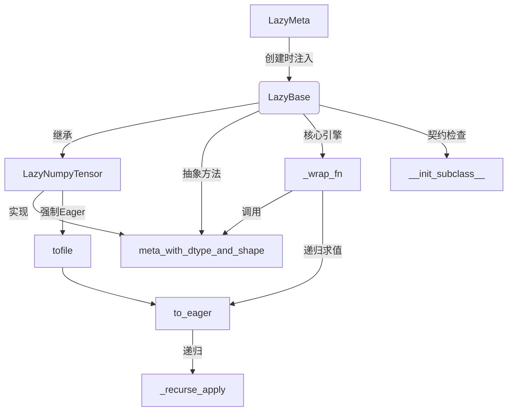

# 第61章 惰性张量框架 —— 操作图的"延迟执行引擎"

## 学习目标

- 理解基于Python元类（metaclass）的自动化惰性代理机制
- 掌握LazyMeta如何通过重写`__new__`动态注入`__getattr__`拦截器
- 熟悉LazyBase的操作树构建原理与延迟评估生命周期
- 理解元数据预演（Meta Propagation）在形状推导中的作用
- 掌握惰性张量到急切张量（Lazy-to-Eager）的转换时机与缓存策略
- 了解`stride tricks`在零内存占用模拟张量形状中的应用
- 掌握`__init_subclass__`在强制子类契约中的作用
- 理解抽象方法`meta_with_dtype_and_shape`在元张量创建中的分派机制
- 能够阅读并扩展自定义的惰性张量后端实现

## 61.1 生活类比

想象惰性张量系统是一个**智能建筑工地的预制件管理系统**：**LazyMeta** = 工厂的自动化装配流水线，一旦接到新建材（类定义）就自动贴上所有标准化接口标签（包装所有魔术方法）；**LazyBase** = 施工图纸库，每张图纸（张量）只记录材料规格（meta）和施工步骤（func），不立即生产实体；**_wrap_fn** = 工程监理，先根据图纸（meta）模拟推演流程，确认形状尺寸（shape/dtype）无误后，才安排实际施工；**to_eager** = 最终验收，按图纸树状结构（args嵌套）自底向上逐个完成实际建造，并缓存成品避免重复施工；**LazyNumpyTensor** = NumPy预制件供应商，利用Visual Tricks（stride tricks）展示建材规格而不占用仓库空间；**__init_subclass__** = 入职强制培训，确保每个新加入的施工队（子类）都配备基本的工具箱（_tensor_type）；**meta_with_dtype_and_shape** = 建材规格生成器，根据设计图纸（dtype/shape）快速生成虚拟样品（元张量）用于预览。

## 61.2 源码地图

```
gguf-py/gguf/lazy.py
├── LazyMeta (元类)
│   ├── __new__(cls, name, bases, namespace)
│   │   ├── 注入 __getattr__ 拦截器
│   │   ├── mk_wrap(op_name, meta_noop)  # 特殊方法包装器工厂
│   │   ├── 批量包装40+二元运算 (add/mul/matmul等)
│   │   ├── 包装一元运算 (neg/abs/invert)
│   │   └── 包装特殊协议 (getitem/setitem/len)
│   └── 关键机制：自动为所有魔术方法生成惰性代理
├── LazyBase (抽象基类)
│   ├── __init__(meta, data, args, kwargs, func)
│   ├── __init_subclass__(cls)  # 强制子类定义_tensor_type
│   ├── _recurse_apply(o, fn)  # 结构保持的递归映射
│   ├── _wrap_fn(fn, use_self, meta_noop) -> Callable
│   │   ├── 元数据预演：fn(*meta_args)
│   │   ├── 分支处理：张量/元组/标量
│   │   └── 惰性封装：返回新的LazyBase实例
│   ├── to_eager(cls, t) -> Any
│   │   └── 递归执行所有缓存的_func
│   ├── eager_to_meta(cls, t) -> Meta
│   ├── meta_with_dtype_and_shape (抽象类方法)  # 元张量创建接口
│   └── from_eager(cls, t) -> LazyBase
└── LazyNumpyTensor (NumPy具体实现)
    ├── meta_with_dtype_and_shape(dtype, shape)
    │   └── 使用np.lib.stride_tricks.as_strided创建零拷贝视图
    ├── astype(dtype)  # 惰性类型转换
    └── tofile(*args, **kwargs)  # 强制Eager执行后写入
```

## 61.3 LazyMeta 元类 —— 惰性张量的"自动包装工厂"

元类是 Python 中控制类创建的"元工厂"。`LazyMeta` 通过重写 `__new__` 方法，在类定义阶段就完成了所有运算符魔术方法的自动包装。这就像一个自动化装配流水线：只要你定义了一个继承自 `LazyBase` 的新类，流水线就会自动为它安装好加减乘除、索引、比较等 40 多个标准接口，而无需你手写一行重复代码。

### 61.3.1 `LazyMeta.__new__()`：动态注入 `__getattr__` 与批量包装运算符

源码路径：`gguf-py/gguf/lazy.py` - `LazyMeta`（第17-95行）

```python
# 第17-95行：LazyMeta.__new__ 实现
def __new__(cls, name: str, bases: tuple[type, ...], namespace: dict[str, Any], **kwargs):
    # 1. 定义并注入 __getattr__ 拦截器
    def __getattr__(self, name: str) -> Any:
        meta_attr = getattr(self._meta, name)
        if callable(meta_attr):
            # 属性是方法 -> 返回惰性包装版本
            return type(self)._wrap_fn(
                (lambda s, *args, **kwargs: getattr(s, name)(*args, **kwargs)),
                use_self=self,
            )
        elif isinstance(meta_attr, self._tensor_type):
            # 属性是张量 -> 包装为新的惰性张量
            return type(self)._wrap_fn(lambda s: getattr(s, name))(self)
        else:
            # 普通属性（标量等）-> 直接返回
            return meta_attr

    namespace["__getattr__"] = __getattr__

    # 2. 定义包装器工厂函数
    def mk_wrap(op_name: str, *, meta_noop: bool = False):
        def wrapped_special_op(self, *args, **kwargs):
            return type(self)._wrap_fn(
                getattr(type(self)._tensor_type, op_name),
                meta_noop=meta_noop,
            )(self, *args, **kwargs)
        return wrapped_special_op

    # 3. 批量包装 40+ 二元运算
    for binary_op in (
        "lt", "le", "eq", "ne", "ge", "gt",
        "add", "and", "floordiv", "lshift", "mod", "mul", "matmul",
        "or", "pow", "rshift", "sub", "truediv", "xor",
        "iadd", "iand", "ifloordiv", "ilshift", "imod", "imul", "ior", "irshift", "isub", "ixor",
        "radd", "rand", "rfloordiv", "rmul", "ror", "rpow", "rsub", "rtruediv", "rxor",
    ):
        attr_name = f"__{binary_op}__"
        namespace[attr_name] = mk_wrap(attr_name, meta_noop=False)

    # 4. 批量包装一元运算
    for unary_op in ("not", "abs", "invert", "neg", "pos"):
        attr_name = f"__{unary_op}__"
        namespace[attr_name] = mk_wrap(attr_name, meta_noop=True)

    # 5. 包装特殊协议
    for special_op in (
        "getitem", "setitem", "len",
    ):
        attr_name = f"__{special_op}__"
        namespace[attr_name] = mk_wrap(attr_name, meta_noop=False)

    return super().__new__(cls, name, bases, namespace, **kwargs)
```

这段代码定义了 `LazyMeta` 元类的核心逻辑。它在类创建时动态修改 `namespace` 字典，完成了三件大事：注入统一的 `__getattr__` 路由器、通过 `mk_wrap` 工厂批量生成 40 多个运算符魔术方法、区分二元运算（需预演形状，`meta_noop=False`）与一元运算（形状不变，`meta_noop=True`）的元数据策略。

**`__getattr__` 的三路转发逻辑**：
当访问 `lazy_tensor.some_attr` 时：
1. 若 `meta.some_attr` 是**可调用对象**（如 `reshape`、`transpose`），返回 `_wrap_fn` 包装后的惰性版本。
2. 若 `meta.some_attr` 是**张量实例**（如 `grad`、`data`），包装为新的惰性张量返回。
3. 否则（标量、字符串等），直接返回原值。

**`meta_noop` 的设计权衡**：
- 二元运算（`add`、`matmul` 等）设为 `False`：必须在元数据上真实执行以推导输出 shape/dtype。
- 一元运算（`neg`、`abs` 等）设为 `True`：不改变形状类型，直接复用输入元数据，避免无谓计算。
- 索引/长度（`getitem`、`len`）设为 `False`：切片会改变形态，必须预演。

## 61.4 LazyBase 基类 —— 构建"操作树"的延迟评估引擎与契约守护者

`LazyBase` 是惰性张量的抽象基类，它定义了"操作树"的节点结构、递归求值引擎、以及子类必须遵守的契约。每一个惰性张量实例，要么持有现成的数据，要么持有一个待执行的函数和参数树。

### 61.4.1 `LazyBase.__init__()`：惰性张量的"出生证明"

源码路径：`gguf-py/gguf/lazy.py` - `LazyBase.__init__()`（第112-120行）

```python
# 第112-120行：LazyBase.__init__
def __init__(self, *, meta: Any, data: Any | None = None, args: tuple = (), kwargs: dict[str, Any] | None = None, func: Callable[[Any], Any] | None = None):
    super().__init__()
    self._meta = meta          # 元数据：仅含 shape/dtype 的轻量级张量
    self._data = data          # 缓存的急切数据（已计算结果）
    self._args = args          # 参数元组（可能包含其他 LazyBase，形成树）
    self._kwargs = kwargs if kwargs is not None else {}
    self._func = func          # 待执行的计算函数
    assert self._func is not None or self._data is not None  # 核心不变式：要么有函数，要么有数据
```

这段代码初始化了惰性张量的核心四元组。设计哲学是：**要么已有数据，要么有计算函数，二者必居其一**。`args` 支持嵌套结构（可包含其他 `LazyBase`），天然形成了计算依赖树。`_data` 为 `None` 表示未计算；计算后缓存于此，实现记忆化。

### 61.4.2 `LazyBase.__init_subclass__()`：子类的强制入职检查

源码路径：`gguf-py/gguf/lazy.py` - `LazyBase.__init_subclass__()`（第122-125行）

```python
# 第122-125行：LazyBase.__init_subclass__
def __init_subclass__(cls) -> None:
    if "_tensor_type" not in cls.__dict__:
        raise TypeError(f"property '_tensor_type' must be defined for {cls!r}")
    return super().__init_subclass__()
```

这段代码实现了**子类看门人**机制。在类定义阶段（import 时）而非实例化时，强制检查子类是否定义了 `_tensor_type` 类属性。这确保了每个具体的惰性张量实现（如 `LazyNumpyTensor`）都必须绑定到底层张量类型（如 `np.ndarray`），在类型系统层面堵住配置错误。

### 61.4.3 `LazyBase._recurse_apply()`：结构保持的递归映射

源码路径：`gguf-py/gguf/lazy.py` - `LazyBase._recurse_apply()`（第127-137行）

```python
# 第127-137行：LazyBase._recurse_apply
def _recurse_apply(o: Any, fn: Callable[[Any], Any]) -> Any:
    # TODO: dict and set
    if isinstance(o, (list, tuple)):
        L = []
        for item in o:
            L.append(LazyBase._recurse_apply(item, fn))
        if isinstance(o, tuple):
            L = tuple(L)
        return L
    elif isinstance(o, LazyBase):
        return fn(o)
    else:
        return o
```

这段代码实现了**结构保持的递归遍历**。它能穿透 `list`/`tuple` 容器，对内部的 `LazyBase` 叶子节点应用函数 `fn`，同时保持容器类型不变。这是提取嵌套参数中的元数据（`_meta`）或触发嵌套急切求值的基础工具。

### 61.4.4 `LazyBase._wrap_fn()`：惰性求值的核心引擎

源码路径：`gguf-py/gguf/lazy.py` - `LazyBase._wrap_fn()`（第139-174行）

```python
# 第139-174行：LazyBase._wrap_fn
def _wrap_fn(cls, fn: Callable, *, use_self: LazyBase | None = None, meta_noop: bool | DTypeLike | tuple[DTypeLike, Callable[[tuple[int, ...]], tuple[int, ...]]] = False) -> Callable[[Any], Any]:
    def wrapped_fn(*args, **kwargs):
        if kwargs is None:
            kwargs = {}
        args = ((use_self,) if use_self is not None else ()) + args

        # 1. 提取所有参数的元数据
        meta_args = LazyBase._recurse_apply(args, lambda t: t._meta)

        # 2. 元数据预演
        if isinstance(meta_noop, bool) and not meta_noop:
            try:
                res = fn(*meta_args, **kwargs)
            except NotImplementedError:
                res = None
        else:
            # meta_noop=True 或元组指定：直接复用/变换第一个参数的元数据
            assert len(args) > 0
            res = args[0]
            assert isinstance(res, cls)
            res = res._meta
            if meta_noop is not True:
                if isinstance(meta_noop, tuple):
                    dtype, shape = meta_noop
                    assert callable(shape)
                    res = cls.meta_with_dtype_and_shape(dtype, shape(res.shape))
                else:
                    res = cls.meta_with_dtype_and_shape(meta_noop, res.shape)

        # 3. 根据预演结果分支
        if isinstance(res, cls._tensor_type):
            # 单张量输出 -> 创建新的惰性节点
            return cls(meta=cls.eager_to_meta(res), args=args, kwargs=kwargs, func=fn)
        elif isinstance(res, tuple) and all(isinstance(t, cls._tensor_type) for t in res):
            # 多输出算子 -> 共享参数避免重复计算
            shared_args: list = [args, None]

            def eager_tuple_element(a: list[Any], i: int = 0, /, **kw) -> LazyBase:
                assert len(a) == 2
                if a[1] is None:
                    a[1] = fn(*a[0], **kw)
                return a[1][i]
            return tuple(cls(meta=cls.eager_to_meta(res[i]), args=(shared_args, i), kwargs=kwargs, func=eager_tuple_element) for i in range(len(res)))
        else:
            # 标量/其他 -> 必须立即急切执行
            del res
            eager_args = cls.to_eager(args)
            return fn(*eager_args, **kwargs)
    return wrapped_fn
```

这段代码是**惰性求值的大脑**。它实现了"元数据预演 → 结果分类 → 惰性/急切分发"的完整流程：

1. **元数据预演**：先在轻量级 `_meta` 上跑一遍 `fn`，推导输出 shape/dtype。捕获 `NotImplementedError` 兼容不支持的后端。
2. **`meta_noop` 策略**：
   - `False`：真实执行预演。
   - `True`：直接复用第一个参数的元数据。
   - `(dtype, shape_fn)` 元组：用于 `astype` 等显式形变操作，调用 `meta_with_dtype_and_shape` 生成新元数据。
3. **三路分发**：
   - **张量输出**：构造新 `LazyBase` 节点，记录 `func`/`args`，延迟计算。
   - **元组张量输出**（如 `split`/`chunk`）：引入 `shared_args` 机制，多个输出共享同一计算结果，首次求值时只执行一次 `fn`。
   - **标量/其他**（如 `len`、`sum`）：无法惰性化，强制 `to_eager` 后立即执行。

### 61.4.5 `LazyBase.meta_with_dtype_and_shape()`：抽象工厂方法

源码路径：`gguf-py/gguf/lazy.py` - `LazyBase.meta_with_dtype_and_shape()`（第194-196行）

```python
# 第194-196行：LazyBase.meta_with_dtype_and_shape
def meta_with_dtype_and_shape(cls, dtype: Any, shape: Any) -> Any: pass
```

这段代码定义了**抽象工厂接口**。它是连接"逻辑形状推导"与"物理内存布局"的桥梁。基类仅声明契约，具体实现由子类（如 `LazyNumpyTensor`）提供。在 `_wrap_fn` 中，当 `meta_noop` 为元组指定新 dtype/shape 时，会调用此方法生成新的元数据张量。

### 61.4.6 `LazyBase.to_eager()`：延迟计算的最终引爆

源码路径：`gguf-py/gguf/lazy.py` - `LazyBase.to_eager()`（第176-187行）

```python
# 第176-187行：LazyBase.to_eager
def to_eager(cls, t: Any) -> Any:
    def simple_to_eager(_t: LazyBase) -> Any:
        if _t._data is not None:
            return _t._data
        assert _t._func is not None
        _t._args = cls._recurse_apply(_t._args, simple_to_eager)
        _t._data = _t._func(*_t._args, **_t._kwargs)
        assert _t._data is not None
        assert _t._data.dtype == _t._meta.dtype
        assert _t._data.shape == _t._meta.shape
        return _t._data
    return cls._recurse_apply(t, simple_to_eager)
```

这段代码实现了**自底向上的递归求值**。当调用 `to_eager(lazy_tensor)` 时：
1. 递归深入操作树叶子节点（最先计算依赖项）。
2. 执行缓存的 `_func`，得到真实张量。
3. **类型不变式校验**：断言结果 `dtype` 与 `shape` 与 `_meta` 完全一致，保证预演正确。
4. 缓存至 `_data`，后续访问直接返回，实现**记忆化**。

### 61.4.7 `LazyBase.eager_to_meta()` 与 `from_eager()`：双向转换桥梁

源码路径：`gguf-py/gguf/lazy.py` - `LazyBase.eager_to_meta()`（第189-191行）与 `from_eager()`（第198-204行）

```python
# 第189-191行：eager_to_meta
def eager_to_meta(cls, t: Any) -> Any:
    return cls.meta_with_dtype_and_shape(t.dtype, t.shape)

# 第198-204行：from_eager
def from_eager(cls, t: Any) -> Any:
    if type(t) is cls:
        return t
    elif isinstance(t, cls._tensor_type):
        return cls(meta=cls.eager_to_meta(t), data=t)
    else:
        return TypeError(f"{type(t)!r} is not compatible with {cls._tensor_type!r}")
```

这两段代码提供了**急切张量与惰性张量的互转入口**：
- `eager_to_meta`：剥离数据，仅保留 shape/dtype 元信息，构建轻量级元张量。
- `from_eager`：将 `np.ndarray` 等实体张量包装为惰性张量，`data` 直接指向原数组（零拷贝），`meta` 由 `eager_to_meta` 生成。

## 61.5 LazyNumpyTensor 实现 —— NumPy 后端的"内存伪装术"

`LazyNumpyTensor` 是 `LazyBase` 的首个具体实现，它利用 NumPy 的 `stride_tricks` 实现了**零内存占用的元张量**，并针对 NumPy 特有的 `astype`、`tofile` 做了惰性化适配。

### 61.5.1 `LazyNumpyTensor.meta_with_dtype_and_shape()`：零内存占用的形状模拟

源码路径：`gguf-py/gguf/lazy.py` - `LazyNumpyTensor.meta_with_dtype_and_shape()`（第214-219行）

```python
# 第214-219行：LazyNumpyTensor.meta_with_dtype_and_shape
def meta_with_dtype_and_shape(cls, dtype: DTypeLike, shape: tuple[int, ...]) -> np.ndarray[Any, Any]:
    cheat = np.zeros(1, dtype)
    return np.lib.stride_tricks.as_strided(cheat, shape, (0 for _ in shape))
```

这段代码实现了**元张量的"内存伪装术"**：
1. 先创建一个**单元素数组** `cheat`（仅占用几字节）。
2. 用 `as_strided` 创建一个视图，形状为目标 `shape`，但**所有维度的 stride 均为 0**。
3. 物理意义：无论怎么索引，都指向同一个内存地址（那个单元素）。

**优势对比**：创建 `shape=(4096, 4096), dtype=float32` 的元张量：
- 普通 `np.zeros`：需 64 MB 内存。
- `stride_tricks` 方案：仅 4 字节（单个 float32）。

这使得 GGUF 转换时可构建包含数万张量的巨大操作图，而元数据预演阶段**零内存压力**。

### 61.5.2 `LazyNumpyTensor.astype()`：惰性类型转换

源码路径：`gguf-py/gguf/lazy.py` - `LazyNumpyTensor.astype()`（第221-224行）

```python
# 第221-224行：LazyNumpyTensor.astype
def astype(self, dtype, *args, **kwargs):
    meta = type(self).meta_with_dtype_and_shape(dtype, self._meta.shape)
    full_args = (self, dtype,) + args
    return type(self)(meta=meta, args=full_args, kwargs=kwargs, func=(lambda a, *args, **kwargs: a.astype(*args, **kwargs)))
```

这段代码重写了 `astype` 使其**惰性化**：不立即转换数据，而是记录转换操作，生成新的元数据（原 shape + 新 dtype），构造新的惰性张量。实际转换推迟到 `to_eager()` 被调用时。

### 61.5.3 `LazyNumpyTensor.tofile()`：Eager 强制转换落盘

源码路径：`gguf-py/gguf/lazy.py` - `LazyNumpyTensor.tofile()`（第226-228行）

```python
# 第226-228行：LazyNumpyTensor.tofile
def tofile(self, *args, **kwargs):
    eager = LazyNumpyTensor.to_eager(self)
    return eager.tofile(*args, **kwargs)
```

这段代码处理**无法延迟的 IO 边界**。文件写入必须有真实数据，因此强制调用 `to_eager` 触发整个操作树的计算，再调用 NumPy 原生 `tofile` 写入。这是 GGUFWriter 写入权重前的必经步骤。

### 61.5.4 模块依赖图



## 61.6 设计中的取舍：元类注入 vs 装饰器侵入，预演优化 vs 正确性守门

**为什么用元类而非装饰器或基类 mixin？**
元类在**类创建时**一次性完成所有魔术方法的包装，对子类零侵入、零样板代码。装饰器需要逐方法标注，mixin 无法拦截实例属性访问（`__getattr__` 必须定义在类上）。元类是实现"透明代理"的最自然位置。

**`meta_noop=True` 对一元运算的优化是否安全？**
安全。`neg`、`abs`、`invert` 等逐元素运算**保证不改变 shape 和 dtype**。直接复用输入元数据等价于预演结果，省去了函数调用开销。但 `pos`（一元加）也被标记为 `True`，这在某些自定义类型中可能触发类型提升，属于已知权衡。

**为什么 `to_eager` 要做 `dtype/shape` 断言？**
这是**预演正确性的核心守门人**。如果后端实现的 `fn` 行为与元数据预演不一致（如 broadcasting 规则差异、类型提升差异），断言会立即失败，防止错误数据污染下游。这是"元数据即合同"设计的关键兑现环节。

**`shared_args` 机制解决了什么问题？**
多输出算子（`split`、`chunk`、`qr` 等）在惰性图中本应共享同一次计算。若每个输出独立持有 `args/func`，触发求值时会重复执行 `fn`。`shared_args = [args, cached_result]` 让多个输出节点指向同一缓存槽，首次求值计算，后续直接取缓存，**保证副作用只执行一次**。

## 61.7 动手练习

1. 元类机制分析
   - 阅读`LazyMeta.__new__`的源码实现（第17-95行），回答以下问题：
   - 1. `__getattr__`方法是如何区分'可调用方法'、'张量属性'和'普通标量'的？
   - 2. 为什么`__getitem__`和`__len__`的`meta_noop`设置为False，而`__neg__`设置为True？
   - 3. 如果尝试访问一个未在`binary_op`、`unary_op`或`special_op`列表中定义的方法，系统会如何处理？
   - 4. 绘制`LazyMeta`在类创建时的执行流程图，说明namespace被修改了哪些内容。

2. 操作树构建与推演
   - 假设有以下代码：`result = (tensor_a + tensor_b) * 2`，其中`tensor_a`和`tensor_b`都是`LazyNumpyTensor`实例。
   - 基于`LazyBase._wrap_fn`和`LazyBase.__init__`的实现：
   - 1. 描述`__add__`、`__mul__`（或`__rmul__`）被调用时的完整执行路径
   - 2. 说明最终生成的操作树结构（root节点和子节点的args关系）
   - 3. 什么时刻实际的NumPy计算被触发？
   - 4. 如果`tensor_a`和`tensor_b`的shape不匹配，错误会在哪个阶段被抛出？为什么？

3. Stride Tricks实现分析
   - 分析`LazyNumpyTensor.meta_with_dtype_and_shape`（第214-219行）的实现：
   - 1. 解释`np.zeros(1, dtype)`的作用，为什么不能直接用`np.empty(shape, dtype)`？
   - 2. `as_strided`中`strides=(0, 0, ...)`的物理意义是什么？
   - 3. 这种实现方式相比直接创建全零数组，在内存占用上有何优势？请用具体数字说明（例如创建一个shape=(4096, 4096)的float32元张量）。
   - 4. 尝试手动实现一个等效的'假数组'创建函数，不使用`as_strided`（提示：使用`np.broadcast_to`）。

4. 惰性到急切的转换追踪
   - 研究`to_eager`方法（第176-187行）和`tofile`方法（第226-228行）：
   - 1. 当调用`lazy_tensor.tofile('data.bin')`时，描述从LazyNumpyTensor到实际磁盘写入的完整调用链
   - 2. `to_eager`中的递归`_recurse_apply`处理了哪些嵌套结构？如果操作树有10层深度，会发生什么？
   - 3. 为什么`tofile`必须强制转换为eager？是否存在可能的优化使其保持惰性（异步写入）？
   - 4. 修改代码以支持`lazy_tensor.data`直接访问（如果尚未计算则自动触发to_eager），需要重写哪个魔术方法？

5. 子类契约与抽象方法分析
   - 研究`__init_subclass__`（第122-125行）和`meta_with_dtype_and_shape`（第194-196行）：
   - 1. 如果定义一个继承LazyBase的新子类但忘记定义`_tensor_type`属性，会在何时抛出错误？为什么选择在类定义时而非实例化时检查？
   - 2. `meta_with_dtype_and_shape`被定义为抽象方法（只有pass），这在Python中如何强制子类实现？如果子类没有实现就直接调用会发生什么？
   - 3. 在`_wrap_fn`的第153-158行中，当`meta_noop`是一个元组`(dtype, shape_callable)`时，`meta_with_dtype_and_shape`被如何使用？
   - 4. 设计一个实验：创建一个LazyTensor子类使用Python列表（list）作为底层存储而非NumPy数组，你需要实现哪些必要方法？

6. 扩展LazyBase实现
   - `LazyBase`目前缺少对`__getitem__`切片操作的详细元数据推导（虽然被标记为`meta_noop=False`）。
   - 假设你需要支持`tensor[0:10, :5]`这样的切片操作：
   - 1. 描述`_wrap_fn`在收到`__getitem__`调用时，`meta_args`应该是什么？
   - 2. 如何验证切片后的`meta.shape`是否正确？
   - 3. 如果要在`LazyBase`中支持`reshape(3, 4)`方法（而不仅仅是通过`__getattr__`转发），需要如何扩展代码？
   - 4. 考虑`LazyNumpyTensor`的场景，说明`shared_args`机制（用于多输出算子如`split`）如何避免重复计算。

## 61.8 本章小结

这一章中我们深入剖析了 `gguf-py/gguf/lazy.py` 实现的惰性张量框架。首先，我们理解了 `LazyMeta` 元类如何在类创建时自动注入 `__getattr__` 拦截器并批量包装 40 余个运算符魔术方法，实现了透明的惰性代理。其次，我们详细解读了 `LazyBase` 核心数据结构（`meta`/`data`/`args`/`func`）与延迟评估引擎 `_wrap_fn`，掌握了元数据预演、三路分发、多输出共享计算等关键机制。接着，我们探讨了 `__init_subclass__` 对子类契约的强制检查、抽象工厂方法 `meta_with_dtype_and_shape` 的分派作用，以及 `to_eager` 的自底向上递归求值与缓存策略。最后，我们分析了 `LazyNumpyTensor` 利用 `stride_tricks` 实现零内存元张量、惰性 `astype` 与强制 `tofile` 的具体实现。

本章我们一起学习了以下概念：

| 概念 | 解释 |
|------|------|
| LazyMeta | 元类拦截器，在类创建时自动包装所有特殊方法和运算符，实现透明的惰性代理 |
| __getattr__ | 属性访问路由器，将方法调用重定向到_wrap_fn，将属性访问转发到_meta |
| meta_noop | 元数据无操作标记，用于一元运算，避免在元数据层面执行不必要的计算 |
| _wrap_fn | 惰性求值核心，先在元数据上预演（meta propagation），再返回包含func的LazyBase实例 |
| _recurse_apply | 结构保持的递归遍历，用于提取嵌套args中的元数据或转换急切值 |
| __init_subclass__ | 子类看门人，强制要求任何继承LazyBase的类必须定义_tensor_type属性，确保类型系统完整性 |
| meta_with_dtype_and_shape | 抽象工厂方法，定义了如何根据dtype和shape创建轻量级元张量的接口契约，由子类具体实现 |
| to_eager | 延迟计算的触发器，递归执行操作树并缓存结果，确保dtype/shape与meta一致 |
| eager_to_meta | 从实际张量提取轻量级元数据（仅shape+type），构建惰性表示 |
| stride tricks | 通过as_strided创建零内存占用的假数组，用于高效模拟任意形状和类型的元张量 |
| LazyNumpyTensor | 基于NumPy的惰性张量实现，支持GGUF转换中的大规模张量操作图优化 |

下一章中，我们将学习 gguf-py 中的词表与分词器转换模块（`vocab.py`），理解如何将 BPE、SentencePiece、Llama HF、Mistral 等异构分词器统一为 GGUF 格式。

感谢你读到了这里，恭喜你，你已经完成了惰性张量框架的核心源码解析！

