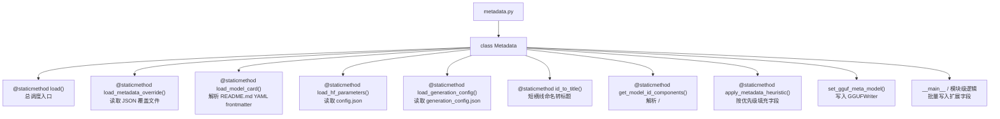
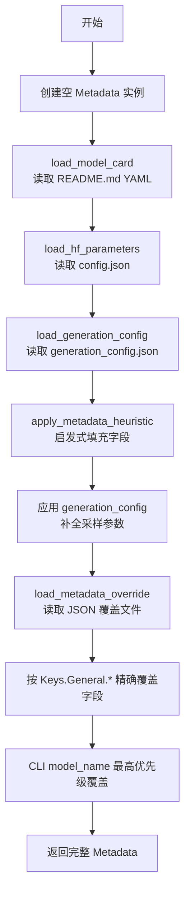
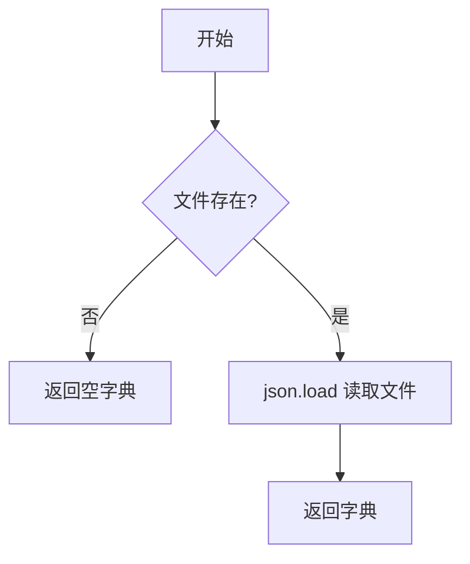
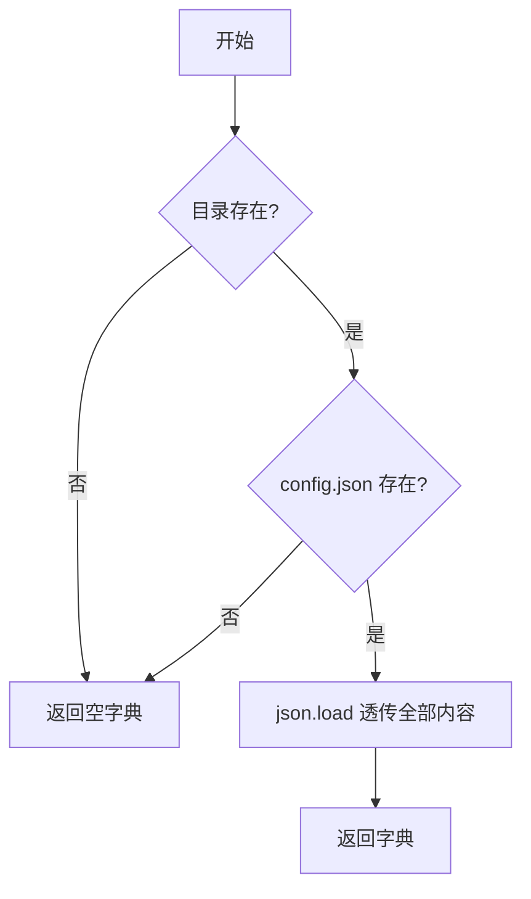
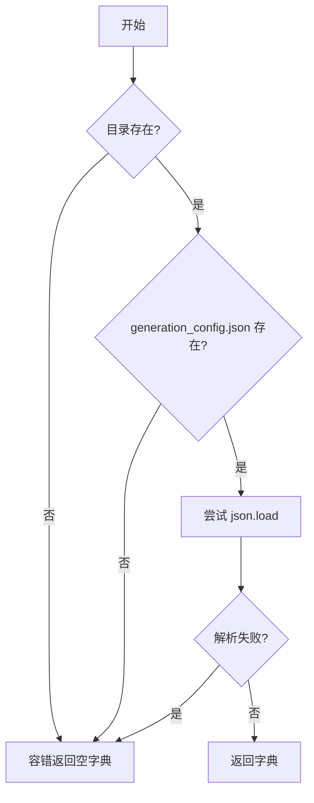
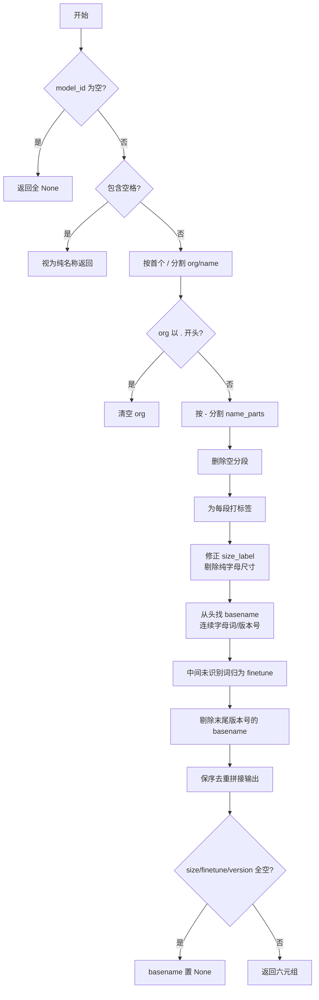
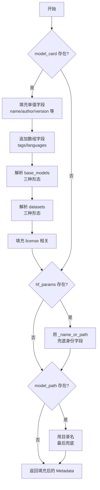
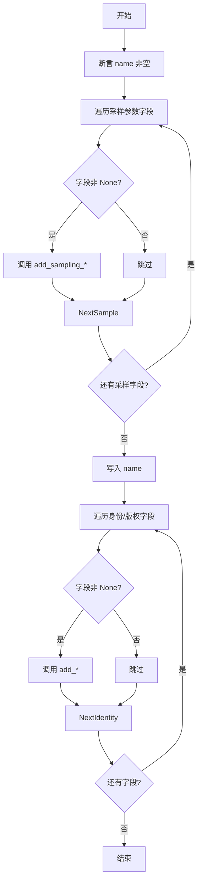
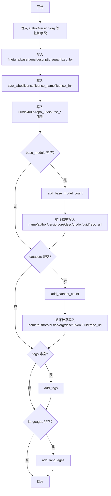

# 第62章 元数据自动提取 —— 模型档案的"户籍科"

## 学习目标

- 掌握 Metadata 数据类的设计思路，理解其作为模型元数据中枢的职责与全貌
- 熟悉四种元数据加载来源（模型卡、HF 配置、生成配置、覆盖文件）及其解析与合并流程
- 理解基于 Hugging Face 模型 ID 的启发式推断算法，能手动追踪 get_model_id_components 的字段标注过程
- 掌握 size_label 的智能判定、base_models/datasets 的多形态解析与去重逻辑
- 了解 set_gguf_meta_model 如何把内存中的 Metadata 字段规范化写入 GGUFWriter

## 62.1 生活类比

把 Hugging Face 模型仓库想象成一位求职者的应聘材料袋，而 `Metadata` 就是档案管理员手中的标准员工档案表：模型卡（README.md）是求职者的个人简历，YAML frontmatter 是简历最上方的摘要栏；`config.json` 是学历证明，由官方出具的技术参数凭证；`generation_config.json` 是工作偏好表，记录着期望的采样参数与惩罚策略；而 `metadata_override.json` 加上 CLI 参数则是 HR 的手工批注，具有最高优先级，能直接覆盖前面所有信息。`get_model_id_components` 则像人事专员，根据工号规则把 `meta-llama/Llama-3-8B-Instruct` 拆解成部门（org）、姓名（name）、职级（version）、岗位类型（finetune/size_label）。档案整理的顺序是：先把简历、学历、偏好按表格栏位誊写一遍，发现空缺就通过工号规则推测填补，最后再用 HR 批注一次性覆盖校准——保证落盘的 GGUF 档案既完整又准确。

## 62.2 源码地图



## 62.3 Metadata 数据类 —— 模型档案的"中枢仓库"

你把 GGUF 转换想象成给模型办"落户"：Hugging Face 仓库里的信息散落在 README、config.json、generation_config.json 三处，GGUF 却要求一个统一的 KV 容器。`Metadata` 就是那个把碎片拼成户口本的中枢仓库——它是一个数据类，字段覆盖了采样参数、作者版权、身份标识和生态纽带四大块。

**为什么需要 Metadata？** 把散落的模型信息集中管理。Hugging Face 仓库里元数据散落在 README、config、generation_config 等多处，GGUF 需要一个统一容器，把这些信息一次性收集、规范化、写入 KV。

**数据类职责一览**

**采样参数**。`Metadata` 负责管理一组推荐采样参数，包括 `sampling_sequence`、`sampling_top_k`、`sampling_top_p`、`sampling_min_p`、`sampling_xtc_probability`、`sampling_xtc_threshold`、`sampling_temp`、`sampling_penalty_last_n`、`sampling_penalty_repeat`、`sampling_mirostat`、`sampling_mirostat_tau`、`sampling_mirostat_eta` 等字段。这些参数共同决定了模型在生成文本时的"怎么说话"——从 `sampling_temp`（温度）控制的随机性，到 `sampling_top_k`、`sampling_top_p`、`sampling_min_p` 构成的逐级截断采样策略，再到 `sampling_mirostat` 系列基于自适应 perplexity 的截断控制，以及 `sampling_xtc_probability` / `sampling_xtc_threshold` 这种较新的反重复机制（XTC，Exclude Typical Tokens）。它们不是模型推理的硬性约束，而是作为"推荐值"写入 GGUF 的 KV 存储，供下游推理引擎（如 llama.cpp）在用户未显式指定采样参数时作为默认行为，从而让同一个 GGUF 文件在不同工具中保持一致的生成风格。

**作者与版权**。`Metadata` 存储了一组与作者和版权相关的字段，包括 `author`、`version`、`organization`、`license`、`license_name`、`license_link`、`description`、`quantized_by` 等。这些字段共同记录了模型的"出身"：`author` 和 `organization` 标明谁创造了这个模型、来自哪个机构，`version` 标明其迭代版本，`license`、`license_name`、`license_link` 三位一体地描述了模型的许可条款——从常见的 MIT、Apache-2.0 到自定义许可均可表达，`description` 用自然语言概括模型的能力与定位，而 `quantized_by` 则记录是谁、用什么工具把原始权重压缩成了当前这个文件。这些信息在模型被分享、转存或二次分发时至关重要，它们是模型"户口本"上的法定信息，确保下游用户知道该模型能做什么、能不能商用、出了问题该找谁。

**身份标识**。`Metadata` 维护着一组构成模型身份标识的字段，包括 `name`、`basename`、`finetune`、`size_label`、`uuid`、`repo_url` 等。如果说模型是一间工厂的产品，那么这些字段就是产品的"姓名、籍贯、工号"：`name` 是模型对外展示的完整名称，`basename` 是去掉了微调后缀和尺寸标签的基础模型名，`finetune` 记录它是基座模型还是经过了什么方向的微调（如 chat、instruct、vision），`size_label` 用 7B、13B 这类直观标签标明模型体量，`uuid` 是这个特定 GGUF 文件的唯一标识符，`repo_url` 则指回它在 Hugging Face 等平台上的原始仓库。这些字段在模型被导入、检索、去重或展示时承担核心角色，是 GGUF 元数据中最具"辨识度"的部分。

**生态纽带**。`Metadata` 聚合了一组描述模型生态关系的字段，包括 `base_models`、`datasets`、`tags`、`languages` 等。这些字段记录了模型的"家谱"与训练数据来源：`base_models` 用一个结构化的数组标明这个模型是从哪些基座模型微调或合并而来（支持字符串 URL、Hugging Face ID、字典三种形态），`datasets` 以完全对称的方式记录了训练所用的数据集，`tags` 是一组自由标签用于快速检索和分类（如 "text-generation"、"vision"），`languages` 则标明模型支持或擅长的语言。这些字段把单个模型从孤立的"权重文件"还原成生态网络中的一个节点，让用户不仅能知道"这是什么模型"，还能知道"它从哪里来、用什么训练、和谁有关"。

类比：模型户籍科。每个模型都有一张"户口本"，每条字段可独立填写或留白，写入 GGUF 前可以覆盖、补充，保证最终档案准确。

### 62.3.1 字段总览：模型档案的"户籍本"

在深入函数之前，先把这张"户籍本"的字段布局看清楚（以下是 `Metadata` 数据类的核心字段分组）：

| 字段类别 | 字段名 | 说明 |
|---------|--------|------|
| 采样参数 | `sampling_sequence`、`sampling_top_k`、`sampling_top_p`、`sampling_min_p`、`sampling_xtc_probability`、`sampling_xtc_threshold`、`sampling_temp`、`sampling_penalty_last_n`、`sampling_penalty_repeat`、`sampling_mirostat`、`sampling_mirostat_tau`、`sampling_mirostat_eta` | 推荐采样参数，决定模型生成时的行为 |
| 身份标识 | `name`、`author`、`version`、`organization`、`finetune`、`basename`、`size_label`、`uuid`、`repo_url` | 模型的"姓名、籍贯、工号" |
| 来源溯源 | `source_url`、`source_doi`、`source_uuid`、`source_repo_url` | 原始模型仓库的指针 |
| 版权与描述 | `license`、`license_name`、`license_link`、`description`、`quantized_by` | 许可证与量化者信息 |
| 生态纽带 | `base_models`、`datasets`、`tags`、`languages` | 模型的"家谱"与训练数据 |

这些字段构成了 GGUF 元数据的"最小完备集合"——写入时逐个判断 `is not None`，空值自动跳过，避免污染 KV 存储。

### 62.3.2 Metadata.load()：总调度入口

源码路径：`gguf-py/gguf/metadata.py` - `Metadata.load()`（155-238 行）



```python
@staticmethod
def load(metadata_override_path=None, model_path=None, model_name=None, total_params=0) -> Metadata:
    # 总调度入口：把散落在仓库各处的元数据收集到一个 Metadata 实例里
    metadata = Metadata()                                    # ① 先造一个空的 Metadata 骨架

    model_card = Metadata.load_model_card(model_path)        # ② 读模型卡 README.md 的 YAML frontmatter
    hf_params = Metadata.load_hf_parameters(model_path)      # ③ 读 config.json（HF 的"出生证明"）
    gen_config = Metadata.load_generation_config(model_path) # ④ 读 generation_config.json（采样偏好）
    # TODO: load adapter_config.json when possible, it usually contains the base model of the LoRA adapter

    # ⑤ 启发式：用模型卡 + HF 参数 + 目录名，把骨架填满
    metadata = Metadata.apply_metadata_heuristic(metadata, model_card, hf_params, model_path, total_params)

    # ⑥ generation_config 专门补采样参数（优先级低于后面的 override）
    if gen_config:
        metadata.sampling_sequence        = gen_config.get("sequence",        metadata.sampling_sequence)
        metadata.sampling_top_k           = gen_config.get("top_k",           metadata.sampling_top_k)
        metadata.sampling_top_p           = gen_config.get("top_p",           metadata.sampling_top_p)
        metadata.sampling_min_p           = gen_config.get("min_p",           metadata.sampling_min_p)
        metadata.sampling_xtc_probability = gen_config.get("xtc_probability", metadata.sampling_xtc_probability)
        metadata.sampling_xtc_threshold   = gen_config.get("xtc_threshold",   metadata.sampling_xtc_threshold)
        metadata.sampling_temp            = gen_config.get("temperature",     metadata.sampling_temp)
        metadata.sampling_penalty_last_n  = gen_config.get("penalty_last_n",  metadata.sampling_penalty_last_n)
        metadata.sampling_penalty_repeat  = gen_config.get("penalty_repeat",  metadata.sampling_penalty_repeat)
        metadata.sampling_mirostat        = gen_config.get("mirostat",        metadata.sampling_mirostat)
        metadata.sampling_mirostat_tau    = gen_config.get("mirostat_tau",    metadata.sampling_mirostat_tau)
        metadata.sampling_mirostat_eta    = gen_config.get("mirostat_eta",    metadata.sampling_mirostat_eta)

    # ⑦ 用户覆盖文件：用 GGUF 的 KV 键名精确覆盖（如 general.name、general.sampling_top_p）
    metadata_override = Metadata.load_metadata_override(metadata_override_path)
    metadata.sampling_sequence        = metadata_override.get(Keys.General.SAMPLING_SEQUENCE,        metadata.sampling_sequence)
    metadata.sampling_top_k           = metadata_override.get(Keys.General.SAMPLING_TOP_K,           metadata.sampling_top_k)
    metadata.sampling_top_p           = metadata_override.get(Keys.General.SAMPLING_TOP_P,           metadata.sampling_top_p)
    metadata.sampling_min_p           = metadata_override.get(Keys.General.SAMPLING_MIN_P,           metadata.sampling_min_p)
    metadata.sampling_xtc_probability = metadata_override.get(Keys.General.SAMPLING_XTC_PROBABILITY, metadata.sampling_xtc_probability)
    metadata.sampling_xtc_threshold   = metadata_override.get(Keys.General.SAMPLING_XTC_THRESHOLD,   metadata.sampling_xtc_threshold)
    metadata.sampling_temp            = metadata_override.get(Keys.General.SAMPLING_TEMP,            metadata.sampling_temp)
    metadata.sampling_penalty_last_n  = metadata_override.get(Keys.General.SAMPLING_PENALTY_LAST_N,  metadata.sampling_penalty_last_n)
    metadata.sampling_penalty_repeat  = metadata_override.get(Keys.General.SAMPLING_PENALTY_REPEAT,  metadata.sampling_penalty_repeat)
    metadata.sampling_mirostat        = metadata_override.get(Keys.General.SAMPLING_MIROSTAT,        metadata.sampling_mirostat)
    metadata.sampling_mirostat_tau    = metadata_override.get(Keys.General.SAMPLING_MIROSTAT_TAU,    metadata.sampling_mirostat_tau)
    metadata.sampling_mirostat_eta    = metadata_override.get(Keys.General.SAMPLING_MIROSTAT_ETA,    metadata.sampling_mirostat_eta)

    metadata.name            = metadata_override.get(Keys.General.NAME,            metadata.name)
    metadata.author          = metadata_override.get(Keys.General.AUTHOR,          metadata.author)
    metadata.version         = metadata_override.get(Keys.General.VERSION,         metadata.version)
    metadata.organization    = metadata_override.get(Keys.General.ORGANIZATION,    metadata.organization)
    metadata.finetune        = metadata_override.get(Keys.General.FINETUNE,        metadata.finetune)
    metadata.basename        = metadata_override.get(Keys.General.BASENAME,        metadata.basename)
    metadata.description     = metadata_override.get(Keys.General.DESCRIPTION,     metadata.description)
    metadata.quantized_by    = metadata_override.get(Keys.General.QUANTIZED_BY,    metadata.quantized_by)
    metadata.size_label      = metadata_override.get(Keys.General.SIZE_LABEL,      metadata.size_label)
    metadata.license_name    = metadata_override.get(Keys.General.LICENSE_NAME,    metadata.license_name)
    metadata.license_link    = metadata_override.get(Keys.General.LICENSE_LINK,    metadata.license_link)
    metadata.url             = metadata_override.get(Keys.General.URL,             metadata.url)
    metadata.doi             = metadata_override.get(Keys.General.DOI,             metadata.doi)
    metadata.uuid            = metadata_override.get(Keys.General.UUID,            metadata.uuid)
    metadata.repo_url        = metadata_override.get(Keys.General.REPO_URL,        metadata.repo_url)
    metadata.source_url      = metadata_override.get(Keys.General.SOURCE_URL,      metadata.source_url)
    metadata.source_doi      = metadata_override.get(Keys.General.SOURCE_DOI,      metadata.source_doi)
    metadata.source_uuid     = metadata_override.get(Keys.General.SOURCE_UUID,     metadata.source_uuid)
    metadata.source_repo_url = metadata_override.get(Keys.General.SOURCE_REPO_URL, metadata.source_repo_url)
    metadata.base_models     = metadata_override.get("general.base_models",        metadata.base_models)
    metadata.datasets        = metadata_override.get("general.datasets",           metadata.datasets)
    metadata.tags            = metadata_override.get(Keys.General.TAGS,            metadata.tags)
    metadata.languages       = metadata_override.get(Keys.General.LANGUAGES,       metadata.languages)

    # ⑧ CLI 传入的 model_name 具有最高优先级，直接覆盖前面所有来源
    if model_name is not None:
        metadata.name = model_name

    return metadata
```

这段代码定义并实现了 `Metadata` 的总调度入口 `load()`：它按"模型卡 → HF 参数 → 生成配置 → 启发式 → 覆盖文件 → CLI 参数"的优先级链，把散落在仓库各处的元数据收集、合并、覆盖，最终产出一个完整的 `Metadata` 实例。注意覆盖文件用的是 `Keys.General.*` 常量做键名映射，这意味着用户不需要了解 Python 字段名，直接用 GGUF 的 KV 键名就能精确控制最终写入。

### 62.3.3 Metadata.load_metadata_override()：读取 JSON 覆盖文件

源码路径：`gguf-py/gguf/metadata.py` - `Metadata.load_metadata_override()`（240-247 行）



```python
@staticmethod
def load_metadata_override(metadata_override_path=None) -> dict[str, Any]:
    if metadata_override_path is None or not metadata_override_path.is_file():
        return {}                                          # ① 没有覆盖文件，返回空字典
    with open(metadata_override_path, "r", encoding="utf-8") as f:
        return json.load(f)                                # ② 直接解析 JSON，键名对应 GGUF 的 KV 键
```

这段代码定义并实现了 `load_metadata_override`：它读取用户提供的 JSON 覆盖文件，键名直接对应 GGUF 的 KV 键名（如 `general.name`、`general.sampling_top_p`），返回字典供后续精确覆盖。

### 62.3.4 Metadata.load_hf_parameters()：透传 config.json

源码路径：`gguf-py/gguf/metadata.py` - `Metadata.load_hf_parameters()`（292-303 行）



```python
@staticmethod
def load_hf_parameters(model_path=None) -> dict[str, Any]:
    if model_path is None or not model_path.is_dir():
        return {}
    config_path = model_path / "config.json"
    if not config_path.is_file():
        return {}
    with open(config_path, "r", encoding="utf-8") as f:
        return json.load(f)                                # ③ 透传 config.json 全部内容
```

这段代码定义并实现了 `load_hf_parameters`：它直接透传 `config.json` 的全部内容，不做任何过滤或转换，作为 HF 官方参数的"原始档案"。

### 62.3.5 Metadata.load_generation_config()：容错读取采样偏好

源码路径：`gguf-py/gguf/metadata.py` - `Metadata.load_generation_config()`（305-318 行）



```python
@staticmethod
def load_generation_config(model_path=None) -> dict[str, Any]:
    if model_path is None or not model_path.is_dir():
        return {}
    generation_config_path = model_path / "generation_config.json"
    if not generation_config_path.is_file():
        return {}
    try:
        with open(generation_config_path, "r", encoding="utf-8") as f:
            return json.load(f)                            # ④ 优先读取 generation_config.json
    except (json.JSONDecodeError, IOError):
        return {}                                          # ⑤ 文件损坏或缺失，容错返回空
```

这段代码定义并实现了 `load_generation_config`：它容错读取 `generation_config.json`，文件不存在、损坏或无权限时静默返回空字典，避免中断整个加载流程。

### 62.3.6 Metadata.load_model_card()：YAML frontmatter 解析器

源码路径：`gguf-py/gguf/metadata.py` - `Metadata.load_model_card()`（249-290 行）

```mermaid
flowchart TD
    Start[开始] --> CheckPath{路径存在且为目录?}
    CheckPath -->|否| ReturnEmpty[返回空字典]
    CheckPath -->|是| CheckFile{README.md 存在?}
    CheckFile -->|否| ReturnEmpty
    CheckFile -->|是| ReadFile[读取文件内容]
    ReadFile --> CheckFirstLine{首行是 --- ?}
    CheckFirstLine -->|否| ReturnEmpty
    CheckFirstLine -->|是| CollectYAML[收集 --- 之间的行]
    CollectYAML --> FixNorway[修复 Norway 问题\n-no → - "no"]
    FixNorway --> FixTab[Tab 转 2 空格]
    FixTab --> ParseYAML[yaml.safe_load]
    ParseYAML --> CheckDict{结果是 dict?}
    CheckDict -->|是| ReturnDict[返回字典]
    CheckDict -->|否| LogError[记录错误] --> ReturnEmpty
```

```python
@staticmethod
def load_model_card(model_path=None) -> dict[str, Any]:
    if model_path is None or not model_path.is_dir():
        return {}                                          # ① 路径不存在，直接返回空字典

    model_card_path = model_path / "README.md"
    if not model_card_path.is_file():
        return {}                                          # ② 没有 README.md，返回空字典

    # 模型卡元数据假定始终在 YAML frontmatter 中
    yaml_content: str = ""
    with open(model_card_path, "r", encoding="utf-8") as f:
        content = f.read()
        lines = content.splitlines()
        lines_yaml = []
        if len(lines) == 0:
            return {}                                      # ③ 空文件
        if len(lines) > 0 and lines[0] != "---":
            return {}                                      # ④ 首行不是 ---，没有 frontmatter
        for line in lines[1:]:
            if line == "---":
                break                                      # ⑤ 遇到结束的 ---，停止收集
            else:
                lines_yaml.append(line)
        yaml_content = "\n".join(lines_yaml) + "\n"

    # Quick hack to fix the Norway problem：- no 会被误解为布尔值 false
    yaml_content = yaml_content.replace("- no\n", "- \"no\"\n")
    # yaml 应该用 2 个空格而不是 tab（Qwen3-235B 模型卡踩过这个坑）
    yaml_content = yaml_content.replace("\t", "  ")

    if yaml_content:
        data = yaml.safe_load(yaml_content)
        if isinstance(data, dict):
            return data                                   # ⑥ 解析成功，返回字典
        else:
            logger.error(f"while reading YAML model card frontmatter, data is {type(data)} instead of dict")
            return {}
    else:
        return {}
```

这段代码定义并实现了模型卡加载器：它从 README.md 中提取 `---` 包围的 YAML frontmatter，修复了 Norway 问题（`- no` 被误判为布尔）和 Tab 缩进问题，最终用 `yaml.safe_load` 反序列化为字典，非 dict 结果记日志并置空。

## 62.4 启发式推断 —— 把 HuggingFace ID 翻译成结构化元数据

三条情报线拿到的原始数据还是"毛坯"：模型卡是自由格式的 YAML，config.json 里是一堆 HF 专有键，真正需要写进 GGUF 的 name/author/basename/finetune/version/size_label 六元组，得靠 `get_model_id_components` 这套"工号拆解规则"来推导。

### 62.4.1 Metadata.id_to_title()：短横线命名转标题

源码路径：`gguf-py/gguf/metadata.py` - `Metadata.id_to_title()`（322-324 行）

```mermaid
flowchart LR
    Input[输入字符串] --> Split[按 - 分词]
    Split --> Loop{遍历每个词}
    Loop --> Check{是否全小写且\n非版本号/数字开头?}
    Check -->|是| Title[title() 首字母大写]
    Check -->|否| Keep[保持原样]
    Title --> Join
    Keep --> Join
    Join[用空格连接] --> Output[输出标题格式]
```

```python
@staticmethod
def id_to_title(string):
    # 把短横线拆成单词并标题化，但保留纯缩写、版本号、数字开头串
    return ' '.join(
        [w.title() if w.islower() and not re.match(r'^(v\d+(?:\.\d+)*|\d.*)$', w) else w
         for w in string.strip().replace('-', ' ').split()]
    )
```

这段代码定义并实现了 `id_to_title`：它把 `meta-llama` 这样的短横线命名转成 `Meta Llama`，但遇到 `v0.2`、`7b` 这类版本号或数字开头的词就原样保留，避免把 `7B` 错误标题化为 `7B` 之外的形式。

### 62.4.2 Metadata.get_model_id_components()：解析 <org>/<name>

源码路径：`gguf-py/gguf/metadata.py` - `Metadata.get_model_id_components()`（326-421 行）



```python
@staticmethod
def get_model_id_components(model_id=None, total_params=0):
    # Huggingface 常把模型 id 存成 '<org>/<model name>'，这里解析并尽量推断模型名组件
    if model_id is None:
        return None, None, None, None, None, None          # ① 模型 ID 缺失，全部返回 None

    if ' ' in model_id:
        # 模型 ID 其实是普通人类句子，大概率只是模型名，不遵循 HF 命名规范
        return model_id, None, None, None, None, None

    if '/' in model_id:
        org_component, model_full_name_component = model_id.split('/', 1)  # ② 按第一个 / 切分 org 和名字
    else:
        org_component, model_full_name_component = None, model_id       # ③ 缺少 org 组件

    # 撤销 './'、'../' 这类伪组织名，避免把路径当 org
    if org_component is not None and len(org_component) > 0 and org_component[0] == '.':
        org_component = None

    name_parts = model_full_name_component.split('-')     # ④ 按 - 切分名字为多个分段
    for i in reversed(range(len(name_parts))):
        if len(name_parts[i]) == 0:
            del name_parts[i]                             # ⑤ 删除空分段

    name_types = [set() for _ in name_parts]             # ⑥ 为每个分段准备一个类型标签集合

    # 给每个分段打标签
    for i, part in enumerate(name_parts):
        if re.fullmatch(r'(v|iter)?\d+([.]\d+)*', part, re.IGNORECASE):
            name_types[i].add("version")                # ⑦ 版本号：v0.2、iter3
        elif re.fullmatch(r'i?q\d(_\w)*|b?fp?(16|32)', part, re.IGNORECASE):
            name_types[i].add("type")                   # ⑧ 量化类型：q4_0、q8_0、fp16
            name_parts[i] = part.upper()
        elif i > 0 and re.fullmatch(r'(([A]|\d+[x])?\d+([._]\d+)?[KMBT][\d]?|small|mini|medium|large|x?xl)', part, re.IGNORECASE):
            part = part.replace("_", ".")
            # 处理 bloom-7b1 这种诡异写法
            if part[-1].isdecimal():
                part = part[:-2] + "." + part[-1] + part[-2]
            # 规范化尺寸后缀（k→K、m→M、b→B、t→T）
            if len(part) > 1 and part[-2].isdecimal():
                if part[-1] in "kmbt":
                    part = part[:-1] + part[-1].upper()
            # 用 total_params 判断这个"尺寸"究竟是模型尺寸还是上下文长度
            if total_params != 0:
                try:
                    label_params = float(part[:-1]) * pow(1000, " KMBT".find(part[-1]))
                    # 尺寸标签必须接近或大于模型尺寸；LoRA 适配器允许更大
                    if (total_params < 0 and label_params < abs(total_params) // 8) or (
                        total_params > 0 and abs(label_params - total_params) > 7 * total_params // 8):
                        name_types[i].add("finetune")  # ⑨ 太小或太大，判定为上下文长度（如 128K）
                        part = part[:-1] + part[-1].lower()
                except ValueError:
                    pass
            if len(name_types[i]) == 0:
                name_types[i].add("size_label")     # ⑩ 默认标为尺寸标签
            name_parts[i] = part
        elif i > 0 and re.fullmatch(r'chat|instruct|vision|lora', part, re.IGNORECASE):
            if total_params < 0 and part.lower() == "lora":
                name_types[i].add("type")            # ⑪ LoRA 适配器输出时忽略冗余的 lora
            else:
                name_types[i].add("finetune")        # ⑫ chat/instruct/vision 标为微调类型

    # 有数字尺寸标签时，剔除纯字母的尺寸标签（small/mini 等）
    if any(c.isdecimal() for n, t in zip(name_parts, name_types) if "size_label" in t for c in n):
        for n, t in zip(name_parts, name_types):
            if "size_label" in t:
                if all(c.isalpha() for c in n):
                    t.remove("size_label")

    at_start = True
    # 从开头找 basename：连续的无标签字母词或版本号
    for part, t in zip(name_parts, name_types):
        if at_start and ((len(t) == 0 and part[0].isalpha()) or "version" in t):
            t.add("basename")
        else:
            if at_start:
                at_start = False
            if len(t) == 0:
                t.add("finetune")                    # ⑬ 中间未识别的词默认归为 finetune

    # 剔除末尾版本号上的 basename 标签
    for part, t in zip(reversed(name_parts), reversed(name_types)):
        if "basename" in t and len(t) > 1:
            t.remove("basename")
        else:
            break

    basename = "-".join(n for n, t in zip(name_parts, name_types) if "basename" in t) or None
    size_label = "-".join(dict.fromkeys(s for s, t in zip(name_parts, name_types) if "size_label" in t).keys()) or None
    finetune = "-".join(f for f, t in zip(name_parts, name_types) if "finetune" in t) or None
    version = "-".join(v for v, t, in zip(name_parts, name_types) if "version" in t and "basename" not in t) or None

    if size_label is None and finetune is None and version is None:
        basename = None                          # ⑭ 太模糊，全部输出 None

    return model_full_name_component, org_component, basename, finetune, version, size_label
```

这段代码定义并实现了模型 ID 的拆解引擎：它把 `<org>/<name>` 形式的 HuggingFace ID 按 `-` 切分后逐段打标签（version / type / size_label / finetune），用 `total_params` 智能区分"模型尺寸"和"上下文长度"，最终用保序去重的方式拼出 basename / size_label / finetune / version 四个结构化字段。

### 62.4.3 Metadata.apply_metadata_heuristic()：按优先级填充字段

源码路径：`gguf-py/gguf/metadata.py` - `Metadata.apply_metadata_heuristic()`（423-565 行）



```python
@staticmethod
def apply_metadata_heuristic(metadata, model_card=None, hf_params=None, model_path=None, total_params=0):
    # 模型卡启发式：用模型卡的字段回填 Metadata 的空字段
    if model_card is not None:
        def use_model_card_metadata(metadata_key, model_card_key):
            if model_card_key in model_card and getattr(metadata, metadata_key, None) is None:
                setattr(metadata, metadata_key, model_card.get(model_card_key))

        def use_array_model_card_metadata(metadata_key, model_card_key):
            # 数组型字段（tags/languages）是追加而非替换
            tags_value = model_card.get(model_card_key, None)
            if tags_value is None:
                return
            current_value = getattr(metadata, metadata_key, None)
            if current_value is None:
                current_value = []
            if isinstance(tags_value, str):
                current_value.append(tags_value)
            elif isinstance(tags_value, list):
                current_value.extend(tags_value)
            setattr(metadata, metadata_key, current_value)

        # llama.cpp 内部约定（name/author/version 等）
        use_model_card_metadata("name", "name")
        use_model_card_metadata("author", "author")
        use_model_card_metadata("version", "version")
        use_model_card_metadata("organization", "organization")
        use_model_card_metadata("description", "description")
        use_model_card_metadata("finetune", "finetune")
        use_model_card_metadata("basename", "basename")
        use_model_card_metadata("size_label", "size_label")
        use_model_card_metadata("source_url", "url")
        use_model_card_metadata("source_doi", "doi")
        use_model_card_metadata("source_uuid", "uuid")
        use_model_card_metadata("source_repo_url", "repo_url")

        # HF 风格约定（model_name / model_author 等，带 model_ 前缀）
        use_model_card_metadata("name", "model_name")
        use_model_card_metadata("author", "model_author")
        use_model_card_metadata("version", "model_version")
        use_model_card_metadata("organization", "model_organization")
        use_model_card_metadata("description", "model_description")
        use_model_card_metadata("finetune", "model_finetune")
        use_model_card_metadata("basename", "model_basename")
        use_model_card_metadata("size_label", "model_size_label")
        use_model_card_metadata("source_url", "model_url")
        use_model_card_metadata("source_doi", "model_doi")
        use_model_card_metadata("source_uuid", "model_uuid")
        use_model_card_metadata("source_repo_url", "model_repo_url")

        # TheBloke 风格：model_name / model_creator / model_type
        use_model_card_metadata("name", "model_name")
        use_model_card_metadata("author", "model_creator")
        use_model_card_metadata("basename", "model_type")

        # base_models 解析：支持字符串 / URL / 字典三种形态
        if "base_model" in model_card or "base_models" in model_card or "base_model_sources" in model_card:
            metadata_base_models = []
            base_model_value = model_card.get("base_model", model_card.get("base_models", model_card.get("base_model_sources", None)))
            if base_model_value is not None:
                if isinstance(base_model_value, str):
                    metadata_base_models.append(base_model_value)
                elif isinstance(base_model_value, list):
                    metadata_base_models.extend(base_model_value)
            if metadata.base_models is None:
                metadata.base_models = []
            for model_id in metadata_base_models:
                base_model = {}
                if isinstance(model_id, str):
                    if model_id.startswith(("http://", "https://", "ssh://")):
                        base_model["repo_url"] = model_id
                        # 从 URL 里提取 HF ID
                        if "huggingface.co" in model_id:
                            match = re.match(r"https?://huggingface.co/([^/]+/[^/]+)$", model_id)
                            if match:
                                model_id_component = match.group(1)
                                model_full_name_component, org_component, basename, finetune, version, size_label = Metadata.get_model_id_components(model_id_component, total_params)
                                if model_full_name_component is not None:
                                    base_model["name"] = Metadata.id_to_title(model_full_name_component)
                                if org_component is not None:
                                    base_model["organization"] = Metadata.id_to_title(org_component)
                                if version is not None:
                                    base_model["version"] = version
                    else:
                        # 直接是 Hugging Face ID
                        model_full_name_component, org_component, basename, finetune, version, size_label = Metadata.get_model_id_components(model_id, total_params)
                        if model_full_name_component is not None:
                            base_model["name"] = Metadata.id_to_title(model_full_name_component)
                        if org_component is not None:
                            base_model["organization"] = Metadata.id_to_title(org_component)
                        if version is not None:
                            base_model["version"] = version
                        if org_component is not None and model_full_name_component is not None:
                            base_model["repo_url"] = f"https://huggingface.co/{org_component}/{model_full_name_component}"
                elif isinstance(model_id, dict):
                    base_model = model_id
                else:
                    logger.error(f"base model entry '{str(model_id)}' not in a known format")
                metadata.base_models.append(base_model)

        # datasets 解析：与 base_models 完全对称的逻辑
        if "datasets" in model_card or "dataset" in model_card or "dataset_sources" in model_card:
            metadata_datasets = []
            dataset_value = model_card.get("datasets", model_card.get("dataset", model_card.get("dataset_sources", None)))
            if dataset_value is not None:
                if isinstance(dataset_value, str):
                    metadata_datasets.append(dataset_value)
                elif isinstance(dataset_value, list):
                    metadata_datasets.extend(dataset_value)
            if metadata.datasets is None:
                metadata.datasets = []
            for dataset_id in metadata_datasets:
                dataset = {}
                if isinstance(dataset_id, str):
                    if dataset_id.startswith(("http://", "https://", "ssh://")):
                        dataset["repo_url"] = dataset_id
                        if "huggingface.co" in dataset_id:
                            match = re.match(r"https?://huggingface.co/([^/]+/[^/]+)$", dataset_id)
                            if match:
                                dataset_id_component = match.group(1)
                                dataset_name_component, org_component, basename, finetune, version, size_label = Metadata.get_model_id_components(dataset_id_component, total_params)
                                if dataset_name_component is not None:
                                    dataset["name"] = Metadata.id_to_title(dataset_name_component)
                                if org_component is not None:
                                    dataset["organization"] = Metadata.id_to_title(org_component)
                                if version is not None:
                                    dataset["version"] = version
                    else:
                        dataset_name_component, org_component, basename, finetune, version, size_label = Metadata.get_model_id_components(dataset_id, total_params)
                        if dataset_name_component is not None:
                            dataset["name"] = Metadata.id_to_title(dataset_name_component)
                        if org_component is not None:
                            dataset["organization"] = Metadata.id_to_title(org_component)
                        if version is not None:
                            dataset["version"] = version
                        if org_component is not None and dataset_name_component is not None:
                            dataset["repo_url"] = f"https://huggingface.co/{org_component}/{dataset_name_component}"
                elif isinstance(dataset_id, dict):
                    dataset = dataset_id
                else:
                    logger.error(f"dataset entry '{str(dataset_id)}' not in a known format")
                metadata.datasets.append(dataset)

        use_model_card_metadata("license", "license")
        use_model_card_metadata("license_name", "license_name")
        use_model_card_metadata("license_link", "license_link")
        use_array_model_card_metadata("tags", "tags")
        use_array_model_card_metadata("tags", "pipeline_tag")
        use_array_model_card_metadata("languages", "languages")
        use_array_model_card_metadata("languages", "language")

    # HF 参数兜底：用 config.json 的 _name_or_path 推断身份字段
    if hf_params is not None:
        hf_name_or_path = hf_params.get("_name_or_path")
        if hf_name_or_path is not None and hf_name_or_path.count('/') <= 1:
            model_id = hf_name_or_path
            model_full_name_component, org_component, basename, finetune, version, size_label = Metadata.get_model_id_components(model_id, total_params)
            if metadata.name is None and model_full_name_component is not None:
                metadata.name = Metadata.id_to_title(model_full_name_component)
            if metadata.organization is None and org_component is not None:
                metadata.organization = Metadata.id_to_title(org_component)
            if metadata.basename is None and basename is not None:
                metadata.basename = basename
            if metadata.finetune is None and finetune is not None:
                metadata.finetune = finetune
            if metadata.version is None and version is not None:
                metadata.version = version
            if metadata.size_label is None and size_label is not None:
                metadata.size_label = size_label

    # 目录名兜底：模型路径本身的名字也走一遍 get_model_id_components
    if model_path is not None:
        model_id = model_path.name
        model_full_name_component, org_component, basename, finetune, version, size_label = Metadata.get_model_id_components(model_id, total_params)
        if metadata.name is None and model_full_name_component is not None:
            metadata.name = Metadata.id_to_title(model_full_name_component)
        if metadata.organization is None and org_component is not None:
            metadata.organization = Metadata.id_to_title(org_component)
        if metadata.basename is None and basename is not None:
            metadata.basename = basename
        if metadata.finetune is None and finetune is not None:
            metadata.finetune = finetune
        if metadata.version is None and version is not None:
            metadata.version = version
        if metadata.size_label is None and size_label is not None:
            metadata.size_label = size_label

    return metadata
```

这段代码定义并实现了三源合并启发式：模型卡优先填充 name/author/version 等字段并解析 base_models/datasets 的三种形态（字符串 URL、HF ID、字典），HF 参数用 `_name_or_path` 兜底，目录名作为最后一道防线——每一级都只在字段为空时写入，保证优先级链不互相覆盖。

## 62.5 写入 GGUF —— 元数据落盘的"最后一公里"

内存里的 `Metadata` 实例还只是"户口本草稿"，真正要变成 GGUF 文件里的 KV 键值对，还得靠 `set_gguf_meta_model` 这道工序。

### 62.5.1 Metadata.set_gguf_meta_model()：字段到 KV 的搬运工

源码路径：`gguf-py/gguf/metadata.py` - `Metadata.set_gguf_meta_model()`（567-587 行）



```python
def set_gguf_meta_model(self, gguf_writer):
    assert self.name is not None                       # ① 入口断言：GGUF 至少得有名字

    # 采样参数逐项写入（空值自动跳过）
    if self.sampling_sequence is not None:
        gguf_writer.add_sampling_sequence(self.sampling_sequence)
    if self.sampling_top_k is not None:
        gguf_writer.add_sampling_top_k(self.sampling_top_k)
    if self.sampling_top_p is not None:
        gguf_writer.add_sampling_top_p(self.sampling_top_p)
    if self.sampling_min_p is not None:
        gguf_writer.add_sampling_min_p(self.sampling_min_p)
    if self.sampling_xtc_probability is not None:
        gguf_writer.add_sampling_xtc_probability(self.sampling_xtc_probability)
    if self.sampling_xtc_threshold is not None:
        gguf_writer.add_sampling_xtc_threshold(self.sampling_xtc_threshold)
    if self.sampling_temp is not None:
        gguf_writer.add_sampling_temp(self.sampling_temp)
    if self.sampling_penalty_last_n is not None:
        gguf_writer.add_sampling_penalty_last_n(self.sampling_penalty_last_n)
    if self.sampling_penalty_repeat is not None:
        gguf_writer.add_sampling_penalty_repeat(self.sampling_penalty_repeat)
    if self.sampling_mirostat is not None:
        gguf_writer.add_sampling_mirostat(self.sampling_mirostat)
    if self.sampling_mirostat_tau is not None:
        gguf_writer.add_sampling_mirostat_tau(self.sampling_mirostat_tau)
    if self.sampling_mirostat_eta is not None:
        gguf_writer.add_sampling_mirostat_eta(self.sampling_mirostat_eta)

    gguf_writer.add_name(self.name)                    # ② 核心身份字段按序写入

    if self.author is not None:
        gguf_writer.add_author(self.author)
    if self.version is not None:
        gguf_writer.add_version(self.version)
    if self.organization is not None:
        gguf_writer.add_organization(self.organization)
    if self.finetune is not None:
        gguf_writer.add_finetune(self.finetune)
    if self.basename is not None:
        gguf_writer.add_basename(self.basename)
    if self.description is not None:
        gguf_writer.add_desc(self.description)
```

这段代码定义并实现了 `set_gguf_meta_model`：它遍历 `Metadata` 的采样参数与身份字段，把非 None 的值逐项转交给 `GGUFWriter` 的 `add_*` 系列方法，入口处的 `assert self.name is not None` 确保 GGUF 文件至少有核心名称，空字段自动跳过以避免污染 KV 存储。

### 62.5.2 模块级逻辑/__main__：扩展字段的批量写入

源码路径：`gguf-py/gguf/metadata.py` - 扩展字段写入（649-731 行）



```python
if self.author is not None:
    gguf_writer.add_author(self.author)
if self.version is not None:
    gguf_writer.add_version(self.version)
if self.organization is not None:
    gguf_writer.add_organization(self.organization)

if self.finetune is not None:
    gguf_writer.add_finetune(self.finetune)
if self.basename is not None:
    gguf_writer.add_basename(self.basename)

if self.description is not None:
    gguf_writer.add_description(self.description)
if self.quantized_by is not None:
    gguf_writer.add_quantized_by(self.quantized_by)

if self.size_label is not None:
    gguf_writer.add_size_label(self.size_label)

# license 支持列表合并成逗号分隔字符串
if self.license is not None:
    if isinstance(self.license, list):
        gguf_writer.add_license(','.join(self.license))
    else:
        gguf_writer.add_license(self.license)
if self.license_name is not None:
    gguf_writer.add_license_name(self.license_name)
if self.license_link is not None:
    gguf_writer.add_license_link(self.license_link)

if self.url is not None:
    gguf_writer.add_url(self.url)
if self.doi is not None:
    gguf_writer.add_doi(self.doi)
if self.uuid is not None:
    gguf_writer.add_uuid(self.uuid)
if self.repo_url is not None:
    gguf_writer.add_repo_url(self.repo_url)

if self.source_url is not None:
    gguf_writer.add_source_url(self.source_url)
if self.source_doi is not None:
    gguf_writer.add_source_doi(self.source_doi)
if self.source_uuid is not None:
    gguf_writer.add_source_uuid(self.source_uuid)
if self.source_repo_url is not None:
    gguf_writer.add_source_repo_url(self.source_repo_url)

# base_models：先写总数，再循环编号写每个条目
if self.base_models is not None:
    gguf_writer.add_base_model_count(len(self.base_models))
    for key, base_model_entry in enumerate(self.base_models):
        if 'name' in base_model_entry:
            gguf_writer.add_base_model_name(key, base_model_entry['name'])
        if 'author' in base_model_entry:
            gguf_writer.add_base_model_author(key, base_model_entry['author'])
        if 'version' in base_model_entry:
            gguf_writer.add_base_model_version(key, base_model_entry['version'])
        if 'organization' in base_model_entry:
            gguf_writer.add_base_model_organization(key, base_model_entry['organization'])
        if 'description' in base_model_entry:
            gguf_writer.add_base_model_description(key, base_model_entry['description'])
        if 'url' in base_model_entry:
            gguf_writer.add_base_model_url(key, base_model_entry['url'])
        if 'doi' in base_model_entry:
            gguf_writer.add_base_model_doi(key, base_model_entry['doi'])
        if 'uuid' in base_model_entry:
            gguf_writer.add_base_model_uuid(key, base_model_entry['uuid'])
        if 'repo_url' in base_model_entry:
            gguf_writer.add_base_model_repo_url(key, base_model_entry['repo_url'])

# datasets：与 base_models 完全对称的编号展开
if self.datasets is not None:
    gguf_writer.add_dataset_count(len(self.datasets))
    for key, dataset_entry in enumerate(self.datasets):
        if 'name' in dataset_entry:
            gguf_writer.add_dataset_name(key, dataset_entry['name'])
        if 'author' in dataset_entry:
            gguf_writer.add_dataset_author(key, dataset_entry['author'])
        if 'version' in dataset_entry:
            gguf_writer.add_dataset_version(key, dataset_entry['version'])
        if 'organization' in dataset_entry:
            gguf_writer.add_dataset_organization(key, dataset_entry['organization'])
        if 'description' in dataset_entry:
            gguf_writer.add_dataset_description(key, dataset_entry['description'])
        if 'url' in dataset_entry:
            gguf_writer.add_dataset_url(key, dataset_entry['url'])
        if 'doi' in dataset_entry:
            gguf_writer.add_dataset_doi(key, dataset_entry['doi'])
        if 'uuid' in dataset_entry:
            gguf_writer.add_dataset_uuid(key, dataset_entry['uuid'])
        if 'repo_url' in dataset_entry:
            gguf_writer.add_dataset_repo_url(key, dataset_entry['repo_url'])

if self.tags is not None:
    gguf_writer.add_tags(self.tags)
if self.languages is not None:
    gguf_writer.add_languages(self.languages)
```

这段代码定义并实现了模块级扩展写入逻辑：它把 `license` 列表合并为逗号分隔字符串，把 `base_models`/`datasets` 先写总数再循环编号展开，`tags`/`languages` 直接透传——最终把内存中的 `Metadata` 完整映射为 GGUF 的 KV 键值对。

## 62.6 设计中的取舍

**为什么用静态方法而不是直接实例化？** 因为元数据的加载是一个有副作用的编排过程——涉及文件 I/O、YAML 解析、正则匹配，用静态方法可以屏蔽"先 new 再填"的两步操作，调用者只需一行 `Metadata.load(...)` 就能拿到完整实例。而且这些方法之间没有共享的实例状态（每调用一次都新建 `Metadata()`），用静态方法也避免了把文件路径之类的东西塞进 `self` 的尴尬。

**为什么覆盖文件用 JSON 而不是直接暴露 Metadata 的属性？** JSON 覆盖文件的键名直接对应 GGUF 的 KV 键名（如 `general.name`、`general.sampling_top_p`），这样用户不需要了解 Python 数据类的字段名，就能精确控制最终写入 GGUF 的每一个键值，同时也方便脚本化批量修改——一份 JSON 既能给人看，也能直接被 `Keys.General.*` 常量映射消费。

**为什么 `get_model_id_components` 返回 tuple 而不是 dataclass？** 因为这个函数在 `apply_metadata_heuristic` 里被反复调用（模型卡里的每个 base_model 都要拆一遍），返回 tuple 可以省去类实例化的开销，也符合 Python 多返回值的惯用写法。六个返回值的顺序（name / org / basename / finetune / version / size_label）在调用处用解包消费，语义清晰但顺序一旦写错就静默出错——这是 tuple 的典型 trade-off。

**为什么用启发式而不是强制用户填写？** 因为 Hugging Face 仓库的元数据质量参差不齐，很多模型的 README 根本不写作者、版本号。如果强制要求填写，大量模型就转不成 GGUF。启发式用"模型卡 → HF 参数 → 目录名"三级兜底，尽可能从模型 ID 本身推导出结构化字段，把"能不能转"变成"转得准不准"——这是工程上典型的宽松输入、严格输出策略。

## 62.7 动手练习

- 参考 `Metadata.load_model_card()`（249-290 行），在不运行整个 gguf-py 的前提下，用 Python 编写一个独立函数 `extract_frontmatter(readme_path)`。
  - 仅当文件首行为 `---` 时提取 YAML 区
  - 复现 Norway 问题修复（`- no` → `- "no"`）和 Tab 转空格
  - 若解析结果不是 dict，打印警告并返回空字典
  - 完成后，随便找一个 Hugging Face 模型 README，观察你提取到的字段与原始 YAML 是否一致。

- 阅读 `get_model_id_components()`（326-421 行），准备以下测试字符串：
  - `meta-llama/Llama-3-8B-Instruct`
  - `Qwen/Qwen2.5-7B`
  - `bloom-7b1`
  - `./my-model-v1.2`
  - `TheBloke/Mistral-7B-Instruct-v0.2-GGUF`
  - 手动写出每个 ID 的 name/org/basename/finetune/version/size_label 推导结果，再写脚本调用 `Metadata.get_model_id_components()` 验证你的推断。
  - 思考题：为什么 `bloom-7b1` 会被拆为 `7.1B`？为什么 `./xxx` 的组织名被丢弃？

- 在 `get_model_id_components()` 中，size_label 的正则同时会匹配 `128K`、`4K` 这类上下文长度写法。
  - 构造一个假想的模型目录（或修改临时 Metadata 对象），让 `total_params` 为 7_000_000_000（7B），传入模型 ID `MyModel-128K-Instruct`
  - 观察代码命中哪一段 `if` 分支，`128K` 最终被标为 `size_label` 还是 `finetune`？
  - 反过来把 `total_params` 设为 0，观察结果变化。
  - 用注释或日志记录你的追踪过程，理解 `total_params` 在启发式中的兜底作用。

- 查看 `Metadata.load()`（155-238 行）中覆盖文件的应用位置，编写一个最小的 `override.json`，至少包含以下键：`general.name`、`general.author`、`general.sampling.top_p`、`general.tags`。
  - 用 `Metadata.load(metadata_override_path=..., model_path=...)` 加载一个本地模型目录
  - 打印最终 Metadata 实例，确认哪些字段被 override 修改、哪些仍保留启发式结果
  - 对比不传 override 文件时的输出，列出优先级链：模型卡 / config / generation_config → heuristic → override → CLI model_name

- 精读 `set_gguf_meta_model()`（567-587 行）以及模块末尾的扩展字段写入逻辑（649-731 行）。
  - 列出所有被调用的 `gguf_writer.add_*` 方法及其触发条件
  - 对比 `license`、`base_models`、`datasets` 三种字段在写入前的特殊处理（字符串拼接、count 前缀、循环编号）
  - 用伪代码或流程图描述 "Metadata → GGUF KV" 的完整写入流水线，并思考：为什么必须在入口处 `assert self.name is not None`？

## 62.8 本章小结

这一章中我们学习了 gguf-py 如何把散落在 Hugging Face 仓库各处的模型元数据收集、规范化并写入 GGUF。首先，`Metadata` 数据类作为模型元数据的中枢仓库，聚合了采样参数、作者版权、身份标识和生态纽带四大块字段；其次，`Metadata.load()` 作为总调度入口，按"模型卡 → HF 参数 → 生成配置 → 启发式 → 覆盖文件 → CLI 参数"的优先级链把信息逐层合并；接着，`load_model_card` 用 YAML frontmatter 解析器处理 Norway 问题和 Tab 缩进，`load_hf_parameters` 透传 config.json，`load_generation_config` 容错读取采样偏好；然后，`get_model_id_components` 把 HuggingFace 风格的模型 ID 拆解为 name/org/basename/finetune/version/size_label 六元组，`apply_metadata_heuristic` 按三级优先级把结构化字段填回实例并解析 base_models/datasets 的三种形态；最后，`set_gguf_meta_model` 把内存中的字段逐项转交给 GGUFWriter，列表型字段用 count 前缀 + 循环编号展开，空值自动跳过。

本章我们一起学习了以下概念：

| 概念 | 解释 |
|------|------|
| `Metadata` 数据类 | 聚合采样参数、作者、License、base_models 等全部模型元数据的中枢仓库 |
| `Metadata.load()` | 静态工厂方法：依次加载模型卡、HF 配置、生成配置，再经启发式推断与覆盖文件修正，最终产出完整 Metadata |
| `Metadata.load_metadata_override()` | 读取用户自定义 JSON 覆盖文件，为最终写入提供最高优先级的修正 |
| `Metadata.load_model_card()` | 解析 README.md 的 YAML frontmatter，修复 Norway 问题与 Tab 缩进，产出模型自述信息 |
| `Metadata.load_hf_parameters()` | 直接透传 config.json 内容，获取官方架构与训练参数 |
| `Metadata.load_generation_config()` | 容错读取 generation_config.json，提取推荐采样参数 |
| `Metadata.id_to_title()` | 把短横线字符串转为标题格式，但保留缩写、版本号、数字开头串 |
| `Metadata.get_model_id_components()` | 将 HuggingFace 风格模型 ID 拆解为 name、org、basename、finetune、version、size_label 六元组 |
| size_label 启发式 | 支持 7B/7b1/small 等形式，并结合 total_params 判断究竟是模型尺寸还是上下文长度 |
| `Metadata.apply_metadata_heuristic()` | 按"模型卡 → HF 参数 → 目录名"优先级填充 name/author/version 等缺失字段，并解析 base_models/datasets |
| `Metadata.set_gguf_meta_model()` | 断言 name 非空后，将各字段安全地写入 GGUFWriter，空值自动跳过，列表型字段统一编号展开 |

下一章中，我们将学习 `vocab.py` 中的多种词表加载类，理解 gguf-py 如何将 BPE、SentencePiece、Llama HF、Mistral 等异构分词器统一为 GGUF 格式——也就是模型"语言系统"的移植者。


